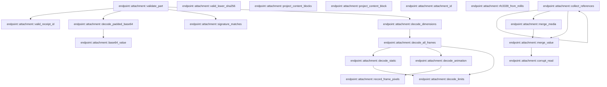

# endpoint::attachment

[Package atlas](index.md) · [Source](../../src/attachment.rs)

## Declarations

Visibility is the declaration spelling; trait members and reexports require their enclosing interface. `cfg` is not evaluated.

| Symbol | Kind | Visibility | Test / cfg |
|---|---|---|---|
| [endpoint::attachment::MAX_ATTACHMENT_BYTES](../../src/attachment.rs#L24) | const_item | `pub` |  |
| [endpoint::attachment::DEFAULT_FILE_MEDIA_TYPE](../../src/attachment.rs#L25) | const_item | `pub` |  |
| [endpoint::attachment::UPLOADS_DIR](../../src/attachment.rs#L26) | const_item | `pub` |  |
| [endpoint::attachment::MAX_IMAGE_DIMENSION](../../src/attachment.rs#L27) | const_item | `pub` |  |
| [endpoint::attachment::MAX_IMAGE_PIXELS](../../src/attachment.rs#L28) | const_item | `pub` |  |
| [endpoint::attachment::MAX_DECODE_ALLOCATION](../../src/attachment.rs#L30) | const_item | `private` |  |
| [endpoint::attachment::AttachmentPolicy](../../src/attachment.rs#L35) | struct_item | `pub` |  |
| [endpoint::attachment::AttachmentPolicy::default](../../src/attachment.rs#L43) | function_item | `private` |  |
| [endpoint::attachment::ImageMediaType](../../src/attachment.rs#L54) | enum_item | `pub` |  |
| [endpoint::attachment::ImageMediaType::as_str](../../src/attachment.rs#L67) | function_item | `pub` |  |
| [endpoint::attachment::ImageMediaType::image_format](../../src/attachment.rs#L76) | function_item | `private` |  |
| [endpoint::attachment::ImageMediaType::parse](../../src/attachment.rs#L85) | function_item | `private` |  |
| [endpoint::attachment::PromptPart](../../src/attachment.rs#L98) | enum_item | `pub` |  |
| [endpoint::attachment::AttachmentErrorReason](../../src/attachment.rs#L114) | enum_item | `pub` |  |
| [endpoint::attachment::ImageAttachmentRef](../../src/attachment.rs#L129) | struct_item | `pub` |  |
| [endpoint::attachment::ImageAttachment](../../src/attachment.rs#L141) | struct_item | `pub` |  |
| [endpoint::attachment::FileAttachmentRef](../../src/attachment.rs#L149) | struct_item | `pub` |  |
| [endpoint::attachment::FileAttachment](../../src/attachment.rs#L158) | struct_item | `pub` |  |
| [endpoint::attachment::UploadedFile](../../src/attachment.rs#L166) | struct_item | `pub` |  |
| [endpoint::attachment::UploadReceipt](../../src/attachment.rs#L174) | struct_item | `pub` |  |
| [endpoint::attachment::UploadReceiptRecord](../../src/attachment.rs#L182) | struct_item | `private` |  |
| [endpoint::attachment::MaterializedPrompt](../../src/attachment.rs#L193) | struct_item | `pub` |  |
| [endpoint::attachment::PromptMaterializeError](../../src/attachment.rs#L200) | enum_item | `pub` |  |
| [endpoint::attachment::AttachmentReadError](../../src/attachment.rs#L220) | enum_item | `pub` |  |
| [endpoint::attachment::AttachmentAuthority](../../src/attachment.rs#L236) | struct_item | `pub` |  |
| [endpoint::attachment::AttachmentAuthority::open](../../src/attachment.rs#L242) | function_item | `pub` |  |
| [endpoint::attachment::AttachmentAuthority::materialize_prompt_parts](../../src/attachment.rs#L251) | function_item | `pub` |  |
| [endpoint::attachment::AttachmentAuthority::expected_prompt_blocks_read_only](../../src/attachment.rs#L269) | function_item | `pub` |  |
| [endpoint::attachment::AttachmentAuthority::publish_validated](../../src/attachment.rs#L328) | function_item | `private` |  |
| [endpoint::attachment::AttachmentAuthority::upload_file](../../src/attachment.rs#L415) | function_item | `pub` |  |
| [endpoint::attachment::AttachmentAuthority::read_authorized_file](../../src/attachment.rs#L494) | function_item | `pub` |  |
| [endpoint::attachment::AttachmentAuthority::read_authorized](../../src/attachment.rs#L576) | function_item | `pub` |  |
| [endpoint::attachment::AttachmentAuthority::active_folder_for_prompt](../../src/attachment.rs#L675) | function_item | `private` |  |
| [endpoint::attachment::AttachmentAuthority::active_folder_for_read](../../src/attachment.rs#L691) | function_item | `private` |  |
| [endpoint::attachment::ValidatedPart](../../src/attachment.rs#L703) | enum_item | `private` |  |
| [endpoint::attachment::valid_receipt_id](../../src/attachment.rs#L709) | function_item | `private` |  |
| [endpoint::attachment::valid_file_name](../../src/attachment.rs#L714) | function_item | `private` |  |
| [endpoint::attachment::normalize_media_type](../../src/attachment.rs#L722) | function_item | `private` |  |
| [endpoint::attachment::load_receipt](../../src/attachment.rs#L752) | function_item | `private` |  |
| [endpoint::attachment::FileReference](../../src/attachment.rs#L769) | struct_item | `private` |  |
| [endpoint::attachment::collect_file_reference](../../src/attachment.rs#L775) | function_item | `private` |  |
| [endpoint::attachment::receipt_reference](../../src/attachment.rs#L811) | function_item | `private` |  |
| [endpoint::attachment::rfc3339_millis_now](../../src/attachment.rs#L846) | function_item | `private` |  |
| [endpoint::attachment::rfc3339_from_millis](../../src/attachment.rs#L853) | function_item | `private` |  |
| [endpoint::attachment::ValidatedImage](../../src/attachment.rs#L876) | struct_item | `private` |  |
| [endpoint::attachment::validate_part](../../src/attachment.rs#L884) | function_item | `private` |  |
| [endpoint::attachment::decode_padded_base64](../../src/attachment.rs#L924) | function_item | `private` |  |
| [endpoint::attachment::base64_value](../../src/attachment.rs#L969) | function_item | `private` |  |
| [endpoint::attachment::signature_matches](../../src/attachment.rs#L980) | function_item | `private` |  |
| [endpoint::attachment::decode_dimensions](../../src/attachment.rs#L991) | function_item | `private` |  |
| [endpoint::attachment::decode_all_frames](../../src/attachment.rs#L1012) | function_item | `private` |  |
| [endpoint::attachment::decode_static](../../src/attachment.rs#L1054) | function_item | `private` |  |
| [endpoint::attachment::decode_animation](../../src/attachment.rs#L1070) | function_item | `private` |  |
| [endpoint::attachment::record_frame_pixels](../../src/attachment.rs#L1088) | function_item | `private` |  |
| [endpoint::attachment::decode_limits](../../src/attachment.rs#L1105) | function_item | `private` |  |
| [endpoint::attachment::ReferenceExpectation](../../src/attachment.rs#L1114) | struct_item | `private` |  |
| [endpoint::attachment::collect_references](../../src/attachment.rs#L1122) | function_item | `private` |  |
| [endpoint::attachment::merge_media](../../src/attachment.rs#L1184) | function_item | `private` |  |
| [endpoint::attachment::merge_value](../../src/attachment.rs#L1191) | function_item | `private` |  |
| [endpoint::attachment::corrupt_read](../../src/attachment.rs#L1199) | function_item | `private` |  |
| [endpoint::attachment::valid_lower_sha256](../../src/attachment.rs#L1203) | function_item | `private` |  |
| [endpoint::attachment::project_content_blocks](../../src/attachment.rs#L1215) | function_item | `pub` |  |
| [endpoint::attachment::project_content_block](../../src/attachment.rs#L1222) | function_item | `private` |  |
| [endpoint::attachment::attachment_id](../../src/attachment.rs#L1251) | function_item | `private` |  |
| [endpoint::attachment::tests::SESSION](../../src/attachment.rs#L1267) | const_item | `private` | test; #[cfg(test)] |
| [endpoint::attachment::tests::OTHER_SESSION](../../src/attachment.rs#L1268) | const_item | `private` | test; #[cfg(test)] |
| [endpoint::attachment::tests::four_declared_formats_are_fully_decoded_and_materialized](../../src/attachment.rs#L1271) | function_item | `private` | test; #[cfg(test)] |
| [endpoint::attachment::tests::animated_gif_decodes_every_frame_and_rejects_a_broken_later_frame](../../src/attachment.rs#L1314) | function_item | `private` | test; #[cfg(test)] |
| [endpoint::attachment::tests::cumulative_animation_pixels_are_bounded](../../src/attachment.rs#L1330) | function_item | `private` | test; #[cfg(test)] |
| [endpoint::attachment::tests::prompt_validation_is_ordered_and_publishes_nothing_on_failure](../../src/attachment.rs#L1348) | function_item | `private` | test; #[cfg(test)] |
| [endpoint::attachment::tests::size_signature_decode_and_dimension_failures_are_distinct](../../src/attachment.rs#L1383) | function_item | `private` | test; #[cfg(test)] |
| [endpoint::attachment::tests::read_requires_a_reference_in_the_selected_session_and_revalidates_asset](../../src/attachment.rs#L1403) | function_item | `private` | test; #[cfg(test)] |
| [endpoint::attachment::tests::endpoint_journal_reference_authorizes_the_selected_session](../../src/attachment.rs#L1440) | function_item | `private` | test; #[cfg(test)] |
| [endpoint::attachment::tests::corrupt_asset_is_not_returned_even_when_referenced](../../src/attachment.rs#L1491) | function_item | `private` | test; #[cfg(test)] |
| [endpoint::attachment::tests::archive_between_validation_and_publication_cannot_recreate_active_folder](../../src/attachment.rs#L1526) | function_item | `private` | test; #[cfg(test)] |
| [endpoint::attachment::tests::FILE_BYTES](../../src/attachment.rs#L1570) | const_item | `private` | test; #[cfg(test)] |
| [endpoint::attachment::tests::upload](../../src/attachment.rs#L1572) | function_item | `private` | test; #[cfg(test)] |
| [endpoint::attachment::tests::file_reason](../../src/attachment.rs#L1578) | function_item | `private` | test; #[cfg(test)] |
| [endpoint::attachment::tests::upload_file_publishes_asset_and_durable_receipt](../../src/attachment.rs#L1586) | function_item | `private` | test; #[cfg(test)] |
| [endpoint::attachment::tests::upload_file_rejects_every_invalid_request_without_publishing](../../src/attachment.rs#L1648) | function_item | `private` | test; #[cfg(test)] |
| [endpoint::attachment::tests::file_receipt_part_materializes_a_file_block](../../src/attachment.rs#L1750) | function_item | `private` | test; #[cfg(test)] |
| [endpoint::attachment::tests::unknown_cross_session_and_archived_receipts_are_rejected](../../src/attachment.rs#L1811) | function_item | `private` | test; #[cfg(test)] |
| [endpoint::attachment::tests::read_authorized_file_requires_a_file_block_or_receipt_reference](../../src/attachment.rs#L1889) | function_item | `private` | test; #[cfg(test)] |
| [endpoint::attachment::tests::endpoint_journal_file_block_authorizes_file_read](../../src/attachment.rs#L1979) | function_item | `private` | test; #[cfg(test)] |
| [endpoint::attachment::tests::file_blocks_project_to_public_attachment_references](../../src/attachment.rs#L2015) | function_item | `private` | test; #[cfg(test)] |
| [endpoint::attachment::tests::rfc3339_formatter_matches_known_instants](../../src/attachment.rs#L2035) | function_item | `private` | test; #[cfg(test)] |
| [endpoint::attachment::tests::encoded_image](../../src/attachment.rs#L2051) | function_item | `private` | test; #[cfg(test)] |
| [endpoint::attachment::tests::animated_gif](../../src/attachment.rs#L2058) | function_item | `private` | test; #[cfg(test)] |
| [endpoint::attachment::tests::create_session](../../src/attachment.rs#L2069) | function_item | `private` | test; #[cfg(test)] |
| [endpoint::attachment::tests::append_input](../../src/attachment.rs#L2100) | function_item | `private` | test; #[cfg(test)] |
| [endpoint::attachment::tests::input_event](../../src/attachment.rs#L2107) | function_item | `private` | test; #[cfg(test)] |
| [endpoint::attachment::tests::canonical_line](../../src/attachment.rs#L2125) | function_item | `private` | test; #[cfg(test)] |

## Imports / reexports

| Local name | Source path | Visibility |
|---|---|---|
| `fs` | `std::fs` | `private` |
| `Cursor` | `std::io::Cursor` | `private` |
| `Path` | `std::path::Path` | `private` |
| `PathBuf` | `std::path::PathBuf` | `private` |
| `SystemTime` | `std::time::SystemTime` | `private` |
| `UNIX_EPOCH` | `std::time::UNIX_EPOCH` | `private` |
| `_` | `base64::Engine` | `private` |
| `BASE64` | `base64::engine::general_purpose::STANDARD` | `private` |
| `GifDecoder` | `image::codecs::gif::GifDecoder` | `private` |
| `PngDecoder` | `image::codecs::png::PngDecoder` | `private` |
| `WebPDecoder` | `image::codecs::webp::WebPDecoder` | `private` |
| `AnimationDecoder` | `image::AnimationDecoder` | `private` |
| `ImageDecoder` | `image::ImageDecoder` | `private` |
| `ImageFormat` | `image::ImageFormat` | `private` |
| `ImageReader` | `image::ImageReader` | `private` |
| `Limits` | `image::Limits` | `private` |
| `Block` | `schema::Block` | `private` |
| `Deserialize` | `serde::Deserialize` | `private` |
| `Serialize` | `serde::Serialize` | `private` |
| `Value` | `serde_json::Value` | `private` |
| `Digest` | `sha2::Digest` | `private` |
| `Sha256` | `sha2::Sha256` | `private` |
| `AssetStore` | `store::AssetStore` | `private` |
| `AtomicPublisher` | `store::AtomicPublisher` | `private` |
| `DirectoryLock` | `store::DirectoryLock` | `private` |
| `StoreError` | `store::StoreError` | `private` |
| `scan_valid_prefix` | `store::scan_valid_prefix` | `private` |
| `Error` | `thiserror::Error` | `private` |
| `EndpointJournal` | `crate::EndpointJournal` | `private` |
| `JournalError` | `crate::JournalError` | `private` |
| `validate_session_id` | `crate::validate_session_id` | `private` |
| `Cursor` | `std::io::Cursor` | `private` |
| `GifEncoder` | `image::codecs::gif::GifEncoder` | `private` |
| `DynamicImage` | `image::DynamicImage` | `private` |
| `Frame` | `image::Frame` | `private` |
| `GrayImage` | `image::GrayImage` | `private` |
| `RgbaImage` | `image::RgbaImage` | `private` |
| `IJsonValue` | `schema::IJsonValue` | `private` |
| `json` | `serde_json::json` | `private` |
| `*` | `super::*` | `private` |
| `SessionEvent` | `crate::SessionEvent` | `private` |
| `SurfaceOperation` | `crate::SurfaceOperation` | `private` |

## Module declarations

| Module | Visibility | Attributes |
|---|---|---|
| `endpoint::attachment::tests` | `private` | #[cfg(test)] |

## Function call graphs

Edges below are syntactically resolved calls only, including private functions. Graphs partition callers into groups of 20; they are not execution order. All unresolved sites are listed below and in the JSON inventory.

```mermaid
flowchart TD
  n0["endpoint::attachment::collect_references"]
  n1["endpoint::attachment::valid_lower_sha256"]
  n2["endpoint::attachment::attachment_id"]
  n3["endpoint::attachment::AttachmentAuthority::open"]
  n4["endpoint::attachment::AttachmentAuthority::materialize_prompt_parts"]
  n5["endpoint::attachment::AttachmentAuthority::expected_prompt_blocks_read_only"]
  n6["endpoint::attachment::AttachmentAuthority::publish_validated"]
  n7["endpoint::attachment::AttachmentAuthority::upload_file"]
  n8["endpoint::attachment::AttachmentPolicy::default"]
  n9["endpoint::attachment::AttachmentAuthority::read_authorized_file"]
  n10["endpoint::attachment::AttachmentAuthority::read_authorized"]
  n11["endpoint::attachment::AttachmentAuthority::active_folder_for_prompt"]
  n12["endpoint::attachment::ImageMediaType::as_str"]
  n13["endpoint::attachment::AttachmentAuthority::active_folder_for_read"]
  n14["endpoint::attachment::valid_receipt_id"]
  n15["endpoint::attachment::valid_file_name"]
  n16["endpoint::attachment::normalize_media_type"]
  n17["endpoint::attachment::load_receipt"]
  n18["endpoint::attachment::ImageMediaType::image_format"]
  n19["endpoint::attachment::collect_file_reference"]
  n20["endpoint::attachment::receipt_reference"]
  n21["endpoint::attachment::rfc3339_millis_now"]
  n22["endpoint::attachment::rfc3339_from_millis"]
  n23["endpoint::attachment::ImageMediaType::parse"]
  n24["endpoint::attachment::validate_part"]
  n25["endpoint::attachment::decode_padded_base64"]
  n26["endpoint::attachment::signature_matches"]
  n27["endpoint::attachment::decode_dimensions"]
  n28["endpoint::journal::EndpointJournal::open"]
  n29["endpoint::types::validate_session_id"]
  n30["store::asset::AssetStore::new"]
  n31["store::asset::AssetStore::open_read_only"]
  n32["store::atomic::AtomicPublisher::replace"]
  n33["store::platform::DirectoryLock::shared"]
  n34["store::tail::scan_valid_prefix"]
  n4 --> n6
  n4 --> n24
  n4 --> n29
  n5 --> n1
  n5 --> n17
  n5 --> n24
  n5 --> n31
  n6 --> n1
  n6 --> n2
  n6 --> n11
  n6 --> n17
  n6 --> n30
  n6 --> n33
  n7 --> n11
  n7 --> n15
  n7 --> n16
  n7 --> n21
  n7 --> n23
  n7 --> n25
  n7 --> n29
  n7 --> n30
  n7 --> n32
  n7 --> n33
  n9 --> n1
  n9 --> n13
  n9 --> n19
  n9 --> n20
  n9 --> n28
  n9 --> n29
  n9 --> n30
  n9 --> n34
  n10 --> n0
  n10 --> n1
  n10 --> n13
  n10 --> n26
  n10 --> n27
  n10 --> n28
  n10 --> n29
  n10 --> n30
  n10 --> n34
  n19 --> n19
  n21 --> n22
```

Functions 1–20: 42 direct edges

Functions 21–39: 16 direct edges

## Call sites

Includes test functions (marked in declarations). Receiver-type-required sites need type analysis/manual tracing. Calls in closures are attributed to their enclosing function; their occurrence here does not mean the closure executes immediately.

| Caller | Callee expression | Source lines | Target / classification |
|---|---|---|---|
| `parse` | `Some` | [87](../../src/attachment.rs#L87), [88](../../src/attachment.rs#L88), [89](../../src/attachment.rs#L89), [90](../../src/attachment.rs#L90) | external-constructor-callback-or-unresolved |
| `open` | `storage_root.as_ref().to_path_buf` | [244](../../src/attachment.rs#L244) | receiver-type-required |
| `open` | `storage_root.as_ref` | [244](../../src/attachment.rs#L244) | receiver-type-required |
| `materialize_prompt_parts` | `validate_session_id` | [256](../../src/attachment.rs#L256) | [endpoint::types::validate_session_id](../../src/types.rs#L130) |
| `materialize_prompt_parts` | `parts.is_empty` | [257](../../src/attachment.rs#L257) | receiver-type-required |
| `materialize_prompt_parts` | `Err` | [258](../../src/attachment.rs#L258) | external-constructor-callback-or-unresolved |
| `materialize_prompt_parts` | `Vec::with_capacity` | [260](../../src/attachment.rs#L260) | external-constructor-callback-or-unresolved |
| `materialize_prompt_parts` | `parts.len` | [260](../../src/attachment.rs#L260) | receiver-type-required |
| `materialize_prompt_parts` | `validated.push` | [262](../../src/attachment.rs#L262) | receiver-type-required |
| `materialize_prompt_parts` | `validate_part` | [262](../../src/attachment.rs#L262) | [endpoint::attachment::validate_part](../../src/attachment.rs#L884) |
| `materialize_prompt_parts` | `self.publish_validated` | [264](../../src/attachment.rs#L264) | [endpoint::attachment::AttachmentAuthority::publish_validated](../../src/attachment.rs#L328) |
| `expected_prompt_blocks_read_only` | `parts.is_empty` | [274](../../src/attachment.rs#L274) | receiver-type-required |
| `expected_prompt_blocks_read_only` | `Err` | [275](../../src/attachment.rs#L275), [312](../../src/attachment.rs#L312) | external-constructor-callback-or-unresolved |
| `expected_prompt_blocks_read_only` | `Vec::with_capacity` | [277](../../src/attachment.rs#L277), [281](../../src/attachment.rs#L281) | external-constructor-callback-or-unresolved |
| `expected_prompt_blocks_read_only` | `parts.len` | [277](../../src/attachment.rs#L277) | receiver-type-required |
| `expected_prompt_blocks_read_only` | `validated.push` | [279](../../src/attachment.rs#L279) | receiver-type-required |
| `expected_prompt_blocks_read_only` | `validate_part` | [279](../../src/attachment.rs#L279) | [endpoint::attachment::validate_part](../../src/attachment.rs#L884) |
| `expected_prompt_blocks_read_only` | `validated.len` | [281](../../src/attachment.rs#L281) | receiver-type-required |
| `expected_prompt_blocks_read_only` | `blocks.push` | [285](../../src/attachment.rs#L285), [288](../../src/attachment.rs#L288), [316](../../src/attachment.rs#L316) | receiver-type-required |
| `expected_prompt_blocks_read_only` | `image.media_type.as_str().to_owned` | [290](../../src/attachment.rs#L290) | receiver-type-required |
| `expected_prompt_blocks_read_only` | `image.media_type.as_str` | [290](../../src/attachment.rs#L290) | receiver-type-required |
| `expected_prompt_blocks_read_only` | `load_receipt` | [295](../../src/attachment.rs#L295) | [endpoint::attachment::load_receipt](../../src/attachment.rs#L752) |
| `expected_prompt_blocks_read_only` | `receipt                         .attachment_id                         .strip_prefix("sha256:")                         .filter(&#124;value&#124; valid_lower_sha256(value))                         .ok_or` | [296](../../src/attachment.rs#L296) | receiver-type-required |
| `expected_prompt_blocks_read_only` | `receipt                         .attachment_id                         .strip_prefix("sha256:")                         .filter` | [296](../../src/attachment.rs#L296) | receiver-type-required |
| `expected_prompt_blocks_read_only` | `receipt                         .attachment_id                         .strip_prefix` | [296](../../src/attachment.rs#L296) | receiver-type-required |
| `expected_prompt_blocks_read_only` | `valid_lower_sha256` | [299](../../src/attachment.rs#L299) | [endpoint::attachment::valid_lower_sha256](../../src/attachment.rs#L1203) |
| `expected_prompt_blocks_read_only` | `PromptMaterializeError::Attachment` | [300](../../src/attachment.rs#L300), [309](../../src/attachment.rs#L309), [312](../../src/attachment.rs#L312) | external-constructor-callback-or-unresolved |
| `expected_prompt_blocks_read_only` | `read_only_assets.is_none` | [304](../../src/attachment.rs#L304) | receiver-type-required |
| `expected_prompt_blocks_read_only` | `Some` | [305](../../src/attachment.rs#L305) | external-constructor-callback-or-unresolved |
| `expected_prompt_blocks_read_only` | `AssetStore::open_read_only` | [305](../../src/attachment.rs#L305) | [store::asset::AssetStore::open_read_only](../../../store/src/asset.rs#L35) |
| `expected_prompt_blocks_read_only` | `folder.join` | [305](../../src/attachment.rs#L305) | receiver-type-required |
| `expected_prompt_blocks_read_only` | `read_only_assets.as_ref().expect` | [307](../../src/attachment.rs#L307) | receiver-type-required |
| `expected_prompt_blocks_read_only` | `read_only_assets.as_ref` | [307](../../src/attachment.rs#L307) | receiver-type-required |
| `expected_prompt_blocks_read_only` | `assets.verify_named(&asset).map_err` | [308](../../src/attachment.rs#L308) | receiver-type-required |
| `expected_prompt_blocks_read_only` | `assets.verify_named` | [308](../../src/attachment.rs#L308) | receiver-type-required |
| `expected_prompt_blocks_read_only` | `Ok` | [325](../../src/attachment.rs#L325) | external-constructor-callback-or-unresolved |
| `publish_validated` | `self.storage_root.join("threads").join` | [333](../../src/attachment.rs#L333) | receiver-type-required |
| `publish_validated` | `self.storage_root.join` | [333](../../src/attachment.rs#L333) | receiver-type-required |
| `publish_validated` | `DirectoryLock::shared` | [334](../../src/attachment.rs#L334) | [store::platform::DirectoryLock::shared](../../../store/src/platform.rs#L58) |
| `publish_validated` | `self.active_folder_for_prompt` | [337](../../src/attachment.rs#L337), [343](../../src/attachment.rs#L343) | [endpoint::attachment::AttachmentAuthority::active_folder_for_prompt](../../src/attachment.rs#L675) |
| `publish_validated` | `Err` | [338](../../src/attachment.rs#L338), [339](../../src/attachment.rs#L339), [345](../../src/attachment.rs#L345), [370](../../src/attachment.rs#L370) | external-constructor-callback-or-unresolved |
| `publish_validated` | `PromptMaterializeError::Store` | [339](../../src/attachment.rs#L339) | external-constructor-callback-or-unresolved |
| `publish_validated` | `lifecycle.path` | [344](../../src/attachment.rs#L344) | receiver-type-required |
| `publish_validated` | `PromptMaterializeError::SessionNotFound` | [345](../../src/attachment.rs#L345) | external-constructor-callback-or-unresolved |
| `publish_validated` | `session_id.to_owned` | [346](../../src/attachment.rs#L346) | receiver-type-required |
| `publish_validated` | `AssetStore::new` | [349](../../src/attachment.rs#L349) | [store::asset::AssetStore::new](../../../store/src/asset.rs#L27) |
| `publish_validated` | `folder.join` | [349](../../src/attachment.rs#L349) | receiver-type-required |
| `publish_validated` | `Vec::with_capacity` | [350](../../src/attachment.rs#L350) | external-constructor-callback-or-unresolved |
| `publish_validated` | `validated.len` | [350](../../src/attachment.rs#L350) | receiver-type-required |
| `publish_validated` | `Vec::new` | [351](../../src/attachment.rs#L351), [352](../../src/attachment.rs#L352) | external-constructor-callback-or-unresolved |
| `publish_validated` | `blocks.push` | [355](../../src/attachment.rs#L355), [380](../../src/attachment.rs#L380), [397](../../src/attachment.rs#L397) | receiver-type-required |
| `publish_validated` | `load_receipt` | [357](../../src/attachment.rs#L357) | [endpoint::attachment::load_receipt](../../src/attachment.rs#L752) |
| `publish_validated` | `receipt                         .attachment_id                         .strip_prefix("sha256:")                         .filter(&#124;value&#124; valid_lower_sha256(value))                         .ok_or` | [358](../../src/attachment.rs#L358) | receiver-type-required |
| `publish_validated` | `receipt                         .attachment_id                         .strip_prefix("sha256:")                         .filter` | [358](../../src/attachment.rs#L358) | receiver-type-required |
| `publish_validated` | `receipt                         .attachment_id                         .strip_prefix` | [358](../../src/attachment.rs#L358) | receiver-type-required |
| `publish_validated` | `valid_lower_sha256` | [361](../../src/attachment.rs#L361) | [endpoint::attachment::valid_lower_sha256](../../src/attachment.rs#L1203) |
| `publish_validated` | `PromptMaterializeError::Attachment` | [362](../../src/attachment.rs#L362), [367](../../src/attachment.rs#L367), [370](../../src/attachment.rs#L370) | external-constructor-callback-or-unresolved |
| `publish_validated` | `assets.verify_named(&asset).map_err` | [366](../../src/attachment.rs#L366) | receiver-type-required |
| `publish_validated` | `assets.verify_named` | [366](../../src/attachment.rs#L366) | receiver-type-required |
| `publish_validated` | `files.push` | [374](../../src/attachment.rs#L374) | receiver-type-required |
| `publish_validated` | `receipt.name.clone` | [376](../../src/attachment.rs#L376) | receiver-type-required |
| `publish_validated` | `receipt.media_type.clone` | [378](../../src/attachment.rs#L378) | receiver-type-required |
| `publish_validated` | `assets.publish` | [388](../../src/attachment.rs#L388) | receiver-type-required |
| `publish_validated` | `attachments.push` | [389](../../src/attachment.rs#L389) | receiver-type-required |
| `publish_validated` | `attachment_id` | [390](../../src/attachment.rs#L390) | [endpoint::attachment::attachment_id](../../src/attachment.rs#L1251) |
| `publish_validated` | `image.name.clone` | [395](../../src/attachment.rs#L395) | receiver-type-required |
| `publish_validated` | `image.media_type.as_str().to_owned` | [399](../../src/attachment.rs#L399) | receiver-type-required |
| `publish_validated` | `image.media_type.as_str` | [399](../../src/attachment.rs#L399) | receiver-type-required |
| `publish_validated` | `Ok` | [405](../../src/attachment.rs#L405) | external-constructor-callback-or-unresolved |
| `upload_file` | `validate_session_id` | [422](../../src/attachment.rs#L422) | [endpoint::types::validate_session_id](../../src/types.rs#L130) |
| `upload_file` | `valid_file_name` | [423](../../src/attachment.rs#L423) | [endpoint::attachment::valid_file_name](../../src/attachment.rs#L714) |
| `upload_file` | `Err` | [424](../../src/attachment.rs#L424), [433](../../src/attachment.rs#L433), [440](../../src/attachment.rs#L440), [450](../../src/attachment.rs#L450), [451](../../src/attachment.rs#L451), [457](../../src/attachment.rs#L457) | external-constructor-callback-or-unresolved |
| `upload_file` | `DEFAULT_FILE_MEDIA_TYPE.to_owned` | [427](../../src/attachment.rs#L427) | receiver-type-required |
| `upload_file` | `normalize_media_type(value).ok_or` | [429](../../src/attachment.rs#L429) | receiver-type-required |
| `upload_file` | `normalize_media_type` | [429](../../src/attachment.rs#L429) | [endpoint::attachment::normalize_media_type](../../src/attachment.rs#L722) |
| `upload_file` | `ImageMediaType::parse(&media_type).is_some` | [432](../../src/attachment.rs#L432) | receiver-type-required |
| `upload_file` | `ImageMediaType::parse` | [432](../../src/attachment.rs#L432) | [endpoint::attachment::ImageMediaType::parse](../../src/attachment.rs#L85) |
| `upload_file` | `PromptMaterializeError::Attachment` | [433](../../src/attachment.rs#L433), [440](../../src/attachment.rs#L440) | external-constructor-callback-or-unresolved |
| `upload_file` | `decode_padded_base64(data_base64).map_err` | [438](../../src/attachment.rs#L438) | receiver-type-required |
| `upload_file` | `decode_padded_base64` | [438](../../src/attachment.rs#L438) | [endpoint::attachment::decode_padded_base64](../../src/attachment.rs#L924) |
| `upload_file` | `bytes.is_empty` | [439](../../src/attachment.rs#L439) | receiver-type-required |
| `upload_file` | `self.storage_root.join("threads").join` | [445](../../src/attachment.rs#L445) | receiver-type-required |
| `upload_file` | `self.storage_root.join` | [445](../../src/attachment.rs#L445) | receiver-type-required |
| `upload_file` | `DirectoryLock::shared` | [446](../../src/attachment.rs#L446) | [store::platform::DirectoryLock::shared](../../../store/src/platform.rs#L58) |
| `upload_file` | `self.active_folder_for_prompt` | [449](../../src/attachment.rs#L449), [455](../../src/attachment.rs#L455) | [endpoint::attachment::AttachmentAuthority::active_folder_for_prompt](../../src/attachment.rs#L675) |
| `upload_file` | `PromptMaterializeError::Store` | [451](../../src/attachment.rs#L451) | external-constructor-callback-or-unresolved |
| `upload_file` | `lifecycle.path` | [456](../../src/attachment.rs#L456) | receiver-type-required |
| `upload_file` | `PromptMaterializeError::SessionNotFound` | [457](../../src/attachment.rs#L457) | external-constructor-callback-or-unresolved |
| `upload_file` | `session_id.to_owned` | [458](../../src/attachment.rs#L458) | receiver-type-required |
| `upload_file` | `AssetStore::new` | [461](../../src/attachment.rs#L461) | [store::asset::AssetStore::new](../../../store/src/asset.rs#L27) |
| `upload_file` | `folder.join` | [461](../../src/attachment.rs#L461), [479](../../src/attachment.rs#L479) | receiver-type-required |
| `upload_file` | `assets.publish` | [462](../../src/attachment.rs#L462) | receiver-type-required |
| `upload_file` | `attachment_id` | [463](../../src/attachment.rs#L463) | external-constructor-callback-or-unresolved |
| `upload_file` | `uuid::Uuid::new_v4().hyphenated().to_string` | [464](../../src/attachment.rs#L464) | receiver-type-required |
| `upload_file` | `uuid::Uuid::new_v4().hyphenated` | [464](../../src/attachment.rs#L464) | receiver-type-required |
| `upload_file` | `uuid::Uuid::new_v4` | [464](../../src/attachment.rs#L464) | external-constructor-callback-or-unresolved |
| `upload_file` | `receipt_id.clone` | [467](../../src/attachment.rs#L467) | receiver-type-required |
| `upload_file` | `attachment_id.clone` | [468](../../src/attachment.rs#L468) | receiver-type-required |
| `upload_file` | `name.to_owned` | [469](../../src/attachment.rs#L469), [486](../../src/attachment.rs#L486) | receiver-type-required |
| `upload_file` | `rfc3339_millis_now` | [472](../../src/attachment.rs#L472) | [endpoint::attachment::rfc3339_millis_now](../../src/attachment.rs#L846) |
| `upload_file` | `serde_json_canonicalizer::to_vec(&record).map_err` | [474](../../src/attachment.rs#L474) | receiver-type-required |
| `upload_file` | `serde_json_canonicalizer::to_vec` | [474](../../src/attachment.rs#L474) | external-constructor-callback-or-unresolved |
| `upload_file` | `StoreError::Corruption` | [475](../../src/attachment.rs#L475) | external-constructor-callback-or-unresolved |
| `upload_file` | `line.push` | [477](../../src/attachment.rs#L477) | receiver-type-required |
| `upload_file` | `AtomicPublisher::replace` | [478](../../src/attachment.rs#L478) | [store::atomic::AtomicPublisher::replace](../../../store/src/atomic.rs#L16) |
| `upload_file` | `folder.join(UPLOADS_DIR).join` | [479](../../src/attachment.rs#L479) | receiver-type-required |
| `upload_file` | `Ok` | [482](../../src/attachment.rs#L482) | external-constructor-callback-or-unresolved |
| `read_authorized_file` | `validate_session_id` | [499](../../src/attachment.rs#L499) | [endpoint::types::validate_session_id](../../src/types.rs#L130) |
| `read_authorized_file` | `self.active_folder_for_read` | [500](../../src/attachment.rs#L500) | [endpoint::attachment::AttachmentAuthority::active_folder_for_read](../../src/attachment.rs#L691) |
| `read_authorized_file` | `attachment_id             .strip_prefix("sha256:")             .filter(&#124;value&#124; valid_lower_sha256(value))             .ok_or` | [501](../../src/attachment.rs#L501) | receiver-type-required |
| `read_authorized_file` | `attachment_id             .strip_prefix("sha256:")             .filter` | [501](../../src/attachment.rs#L501) | receiver-type-required |
| `read_authorized_file` | `attachment_id             .strip_prefix` | [501](../../src/attachment.rs#L501) | receiver-type-required |
| `read_authorized_file` | `valid_lower_sha256` | [503](../../src/attachment.rs#L503) | [endpoint::attachment::valid_lower_sha256](../../src/attachment.rs#L1203) |
| `read_authorized_file` | `AttachmentReadError::Attachment` | [504](../../src/attachment.rs#L504), [537](../../src/attachment.rs#L537), [544](../../src/attachment.rs#L544), [550](../../src/attachment.rs#L550), [555](../../src/attachment.rs#L555), [557](../../src/attachment.rs#L557), [559](../../src/attachment.rs#L559) | external-constructor-callback-or-unresolved |
| `read_authorized_file` | `EndpointJournal::open` | [509](../../src/attachment.rs#L509) | [endpoint::journal::EndpointJournal::open](../../src/journal.rs#L225) |
| `read_authorized_file` | `fs::read(folder.join("main.jsonl")).map_err` | [510](../../src/attachment.rs#L510) | receiver-type-required |
| `read_authorized_file` | `fs::read` | [510](../../src/attachment.rs#L510) | external-constructor-callback-or-unresolved |
| `read_authorized_file` | `folder.join` | [510](../../src/attachment.rs#L510), [542](../../src/attachment.rs#L542), [554](../../src/attachment.rs#L554) | receiver-type-required |
| `read_authorized_file` | `AttachmentReadError::Ledger` | [511](../../src/attachment.rs#L511), [515](../../src/attachment.rs#L515), [521](../../src/attachment.rs#L521), [528](../../src/attachment.rs#L528) | external-constructor-callback-or-unresolved |
| `read_authorized_file` | `scan_valid_prefix` | [513](../../src/attachment.rs#L513) | [store::tail::scan_valid_prefix](../../../store/src/tail.rs#L37) |
| `read_authorized_file` | `scan.projection.ok_or_else` | [514](../../src/attachment.rs#L514) | receiver-type-required |
| `read_authorized_file` | `"main.jsonl has no valid ledger prefix".to_owned` | [515](../../src/attachment.rs#L515) | receiver-type-required |
| `read_authorized_file` | `serde_json::to_value(event.raw()).map_err` | [520](../../src/attachment.rs#L520) | receiver-type-required |
| `read_authorized_file` | `serde_json::to_value` | [520](../../src/attachment.rs#L520), [527](../../src/attachment.rs#L527) | external-constructor-callback-or-unresolved |
| `read_authorized_file` | `event.raw` | [520](../../src/attachment.rs#L520) | receiver-type-required |
| `read_authorized_file` | `collect_file_reference` | [523](../../src/attachment.rs#L523), [530](../../src/attachment.rs#L530) | [endpoint::attachment::collect_file_reference](../../src/attachment.rs#L775) |
| `read_authorized_file` | `reference.is_none` | [525](../../src/attachment.rs#L525), [533](../../src/attachment.rs#L533) | receiver-type-required |
| `read_authorized_file` | `journal.records` | [526](../../src/attachment.rs#L526) | receiver-type-required |
| `read_authorized_file` | `serde_json::to_value(record.event.data).map_err` | [527](../../src/attachment.rs#L527) | receiver-type-required |
| `read_authorized_file` | `receipt_reference` | [534](../../src/attachment.rs#L534) | [endpoint::attachment::receipt_reference](../../src/attachment.rs#L811) |
| `read_authorized_file` | `Err` | [537](../../src/attachment.rs#L537), [550](../../src/attachment.rs#L550), [559](../../src/attachment.rs#L559) | external-constructor-callback-or-unresolved |
| `read_authorized_file` | `folder.join("assets").join` | [542](../../src/attachment.rs#L542) | receiver-type-required |
| `read_authorized_file` | `fs::metadata(&path)             .map_err` | [543](../../src/attachment.rs#L543) | receiver-type-required |
| `read_authorized_file` | `fs::metadata` | [543](../../src/attachment.rs#L543) | external-constructor-callback-or-unresolved |
| `read_authorized_file` | `metadata.is_file` | [545](../../src/attachment.rs#L545) | receiver-type-required |
| `read_authorized_file` | `metadata.len` | [546](../../src/attachment.rs#L546), [547](../../src/attachment.rs#L547), [548](../../src/attachment.rs#L548) | receiver-type-required |
| `read_authorized_file` | `AssetStore::new(folder.join("assets"))             .map_err(&#124;_&#124; AttachmentReadError::Attachment(AttachmentErrorReason::Corrupt))?             .read_verified(&asset_name)             .map_err` | [554](../../src/attachment.rs#L554) | receiver-type-required |
| `read_authorized_file` | `AssetStore::new(folder.join("assets"))             .map_err(&#124;_&#124; AttachmentReadError::Attachment(AttachmentErrorReason::Corrupt))?             .read_verified` | [554](../../src/attachment.rs#L554) | receiver-type-required |
| `read_authorized_file` | `AssetStore::new(folder.join("assets"))             .map_err` | [554](../../src/attachment.rs#L554) | receiver-type-required |
| `read_authorized_file` | `AssetStore::new` | [554](../../src/attachment.rs#L554) | [store::asset::AssetStore::new](../../../store/src/asset.rs#L27) |
| `read_authorized_file` | `bytes.len` | [558](../../src/attachment.rs#L558) | receiver-type-required |
| `read_authorized_file` | `Ok` | [563](../../src/attachment.rs#L563) | external-constructor-callback-or-unresolved |
| `read_authorized_file` | `attachment_id.to_owned` | [565](../../src/attachment.rs#L565) | receiver-type-required |
| `read_authorized_file` | `BASE64.encode` | [570](../../src/attachment.rs#L570) | receiver-type-required |
| `read_authorized` | `validate_session_id` | [581](../../src/attachment.rs#L581) | [endpoint::types::validate_session_id](../../src/types.rs#L130) |
| `read_authorized` | `self.active_folder_for_read` | [582](../../src/attachment.rs#L582) | [endpoint::attachment::AttachmentAuthority::active_folder_for_read](../../src/attachment.rs#L691) |
| `read_authorized` | `attachment_id             .strip_prefix("sha256:")             .filter(&#124;value&#124; valid_lower_sha256(value))             .ok_or` | [583](../../src/attachment.rs#L583) | receiver-type-required |
| `read_authorized` | `attachment_id             .strip_prefix("sha256:")             .filter` | [583](../../src/attachment.rs#L583) | receiver-type-required |
| `read_authorized` | `attachment_id             .strip_prefix` | [583](../../src/attachment.rs#L583) | receiver-type-required |
| `read_authorized` | `valid_lower_sha256` | [585](../../src/attachment.rs#L585) | [endpoint::attachment::valid_lower_sha256](../../src/attachment.rs#L1203) |
| `read_authorized` | `AttachmentReadError::Attachment` | [586](../../src/attachment.rs#L586), [616](../../src/attachment.rs#L616), [623](../../src/attachment.rs#L623), [628](../../src/attachment.rs#L628), [633](../../src/attachment.rs#L633), [635](../../src/attachment.rs#L635), [640](../../src/attachment.rs#L640), [644](../../src/attachment.rs#L644), [648](../../src/attachment.rs#L648), [653](../../src/attachment.rs#L653), [657](../../src/attachment.rs#L657) | external-constructor-callback-or-unresolved |
| `read_authorized` | `EndpointJournal::open` | [593](../../src/attachment.rs#L593) | [endpoint::journal::EndpointJournal::open](../../src/journal.rs#L225) |
| `read_authorized` | `fs::read(folder.join("main.jsonl")).map_err` | [594](../../src/attachment.rs#L594) | receiver-type-required |
| `read_authorized` | `fs::read` | [594](../../src/attachment.rs#L594) | external-constructor-callback-or-unresolved |
| `read_authorized` | `folder.join` | [594](../../src/attachment.rs#L594), [621](../../src/attachment.rs#L621), [632](../../src/attachment.rs#L632) | receiver-type-required |
| `read_authorized` | `AttachmentReadError::Ledger` | [595](../../src/attachment.rs#L595), [599](../../src/attachment.rs#L599), [605](../../src/attachment.rs#L605), [611](../../src/attachment.rs#L611) | external-constructor-callback-or-unresolved |
| `read_authorized` | `scan_valid_prefix` | [597](../../src/attachment.rs#L597) | [store::tail::scan_valid_prefix](../../../store/src/tail.rs#L37) |
| `read_authorized` | `scan.projection.ok_or_else` | [598](../../src/attachment.rs#L598) | receiver-type-required |
| `read_authorized` | `"main.jsonl has no valid ledger prefix".to_owned` | [599](../../src/attachment.rs#L599) | receiver-type-required |
| `read_authorized` | `ReferenceExpectation::default` | [602](../../src/attachment.rs#L602) | external-constructor-callback-or-unresolved |
| `read_authorized` | `serde_json::to_value(event.raw()).map_err` | [604](../../src/attachment.rs#L604) | receiver-type-required |
| `read_authorized` | `serde_json::to_value` | [604](../../src/attachment.rs#L604), [610](../../src/attachment.rs#L610) | external-constructor-callback-or-unresolved |
| `read_authorized` | `event.raw` | [604](../../src/attachment.rs#L604) | receiver-type-required |
| `read_authorized` | `collect_references` | [607](../../src/attachment.rs#L607), [613](../../src/attachment.rs#L613) | [endpoint::attachment::collect_references](../../src/attachment.rs#L1122) |
| `read_authorized` | `journal.records` | [609](../../src/attachment.rs#L609) | receiver-type-required |
| `read_authorized` | `serde_json::to_value(record.event.data).map_err` | [610](../../src/attachment.rs#L610) | receiver-type-required |
| `read_authorized` | `Err` | [616](../../src/attachment.rs#L616), [628](../../src/attachment.rs#L628), [640](../../src/attachment.rs#L640), [648](../../src/attachment.rs#L648), [657](../../src/attachment.rs#L657) | external-constructor-callback-or-unresolved |
| `read_authorized` | `folder.join("assets").join` | [621](../../src/attachment.rs#L621) | receiver-type-required |
| `read_authorized` | `fs::metadata(&path)             .map_err` | [622](../../src/attachment.rs#L622) | receiver-type-required |
| `read_authorized` | `fs::metadata` | [622](../../src/attachment.rs#L622) | external-constructor-callback-or-unresolved |
| `read_authorized` | `metadata.is_file` | [624](../../src/attachment.rs#L624) | receiver-type-required |
| `read_authorized` | `metadata.len` | [625](../../src/attachment.rs#L625), [626](../../src/attachment.rs#L626) | receiver-type-required |
| `read_authorized` | `AssetStore::new(folder.join("assets"))             .map_err(&#124;_&#124; AttachmentReadError::Attachment(AttachmentErrorReason::Corrupt))?             .read_verified(&asset_name)             .map_err` | [632](../../src/attachment.rs#L632) | receiver-type-required |
| `read_authorized` | `AssetStore::new(folder.join("assets"))             .map_err(&#124;_&#124; AttachmentReadError::Attachment(AttachmentErrorReason::Corrupt))?             .read_verified` | [632](../../src/attachment.rs#L632) | receiver-type-required |
| `read_authorized` | `AssetStore::new(folder.join("assets"))             .map_err` | [632](../../src/attachment.rs#L632) | receiver-type-required |
| `read_authorized` | `AssetStore::new` | [632](../../src/attachment.rs#L632) | [store::asset::AssetStore::new](../../../store/src/asset.rs#L27) |
| `read_authorized` | `expected             .bytes             .is_some_and` | [636](../../src/attachment.rs#L636) | receiver-type-required |
| `read_authorized` | `bytes.len` | [638](../../src/attachment.rs#L638), [666](../../src/attachment.rs#L666) | receiver-type-required |
| `read_authorized` | `expected.media_type.ok_or` | [644](../../src/attachment.rs#L644) | receiver-type-required |
| `read_authorized` | `signature_matches` | [647](../../src/attachment.rs#L647) | [endpoint::attachment::signature_matches](../../src/attachment.rs#L980) |
| `read_authorized` | `decode_dimensions(&bytes, media_type)             .map_err` | [652](../../src/attachment.rs#L652) | receiver-type-required |
| `read_authorized` | `decode_dimensions` | [652](../../src/attachment.rs#L652) | [endpoint::attachment::decode_dimensions](../../src/attachment.rs#L991) |
| `read_authorized` | `expected.width.is_some_and` | [654](../../src/attachment.rs#L654) | receiver-type-required |
| `read_authorized` | `expected.height.is_some_and` | [655](../../src/attachment.rs#L655) | receiver-type-required |
| `read_authorized` | `Ok` | [662](../../src/attachment.rs#L662) | external-constructor-callback-or-unresolved |
| `read_authorized` | `attachment_id.to_owned` | [664](../../src/attachment.rs#L664) | receiver-type-required |
| `read_authorized` | `BASE64.encode` | [671](../../src/attachment.rs#L671) | receiver-type-required |
| `active_folder_for_prompt` | `self.storage_root.join("archive").join(session_id).is_dir` | [679](../../src/attachment.rs#L679) | receiver-type-required |
| `active_folder_for_prompt` | `self.storage_root.join("archive").join` | [679](../../src/attachment.rs#L679) | receiver-type-required |
| `active_folder_for_prompt` | `self.storage_root.join` | [679](../../src/attachment.rs#L679), [682](../../src/attachment.rs#L682) | receiver-type-required |
| `active_folder_for_prompt` | `Err` | [680](../../src/attachment.rs#L680), [684](../../src/attachment.rs#L684) | external-constructor-callback-or-unresolved |
| `active_folder_for_prompt` | `PromptMaterializeError::Archived` | [680](../../src/attachment.rs#L680) | external-constructor-callback-or-unresolved |
| `active_folder_for_prompt` | `session_id.to_owned` | [680](../../src/attachment.rs#L680), [685](../../src/attachment.rs#L685) | receiver-type-required |
| `active_folder_for_prompt` | `self.storage_root.join("threads").join` | [682](../../src/attachment.rs#L682) | receiver-type-required |
| `active_folder_for_prompt` | `folder.is_dir` | [683](../../src/attachment.rs#L683) | receiver-type-required |
| `active_folder_for_prompt` | `PromptMaterializeError::SessionNotFound` | [684](../../src/attachment.rs#L684) | external-constructor-callback-or-unresolved |
| `active_folder_for_prompt` | `Ok` | [688](../../src/attachment.rs#L688) | external-constructor-callback-or-unresolved |
| `active_folder_for_read` | `self.storage_root.join("archive").join(session_id).is_dir` | [692](../../src/attachment.rs#L692) | receiver-type-required |
| `active_folder_for_read` | `self.storage_root.join("archive").join` | [692](../../src/attachment.rs#L692) | receiver-type-required |
| `active_folder_for_read` | `self.storage_root.join` | [692](../../src/attachment.rs#L692), [695](../../src/attachment.rs#L695) | receiver-type-required |
| `active_folder_for_read` | `Err` | [693](../../src/attachment.rs#L693), [697](../../src/attachment.rs#L697) | external-constructor-callback-or-unresolved |
| `active_folder_for_read` | `AttachmentReadError::Archived` | [693](../../src/attachment.rs#L693) | external-constructor-callback-or-unresolved |
| `active_folder_for_read` | `session_id.to_owned` | [693](../../src/attachment.rs#L693), [697](../../src/attachment.rs#L697) | receiver-type-required |
| `active_folder_for_read` | `self.storage_root.join("threads").join` | [695](../../src/attachment.rs#L695) | receiver-type-required |
| `active_folder_for_read` | `folder.is_dir` | [696](../../src/attachment.rs#L696) | receiver-type-required |
| `active_folder_for_read` | `AttachmentReadError::SessionNotFound` | [697](../../src/attachment.rs#L697) | external-constructor-callback-or-unresolved |
| `active_folder_for_read` | `Ok` | [699](../../src/attachment.rs#L699) | external-constructor-callback-or-unresolved |
| `valid_receipt_id` | `uuid::Uuid::parse_str(value).is_ok_and` | [710](../../src/attachment.rs#L710) | receiver-type-required |
| `valid_receipt_id` | `uuid::Uuid::parse_str` | [710](../../src/attachment.rs#L710) | external-constructor-callback-or-unresolved |
| `valid_receipt_id` | `uuid.hyphenated().to_string` | [710](../../src/attachment.rs#L710) | receiver-type-required |
| `valid_receipt_id` | `uuid.hyphenated` | [710](../../src/attachment.rs#L710) | receiver-type-required |
| `valid_receipt_id` | `value.to_ascii_lowercase` | [711](../../src/attachment.rs#L711) | receiver-type-required |
| `valid_file_name` | `value.is_empty` | [715](../../src/attachment.rs#L715) | receiver-type-required |
| `valid_file_name` | `value.len` | [716](../../src/attachment.rs#L716) | receiver-type-required |
| `valid_file_name` | `value.chars().any` | [717](../../src/attachment.rs#L717) | receiver-type-required |
| `valid_file_name` | `value.chars` | [717](../../src/attachment.rs#L717) | receiver-type-required |
| `valid_file_name` | `value.contains` | [718](../../src/attachment.rs#L718) | receiver-type-required |
| `normalize_media_type` | `value.split_once` | [723](../../src/attachment.rs#L723) | receiver-type-required |
| `normalize_media_type` | `part.is_empty` | [725](../../src/attachment.rs#L725) | receiver-type-required |
| `normalize_media_type` | `part.len` | [726](../../src/attachment.rs#L726) | receiver-type-required |
| `normalize_media_type` | `part.bytes().all` | [727](../../src/attachment.rs#L727) | receiver-type-required |
| `normalize_media_type` | `part.bytes` | [727](../../src/attachment.rs#L727) | receiver-type-required |
| `normalize_media_type` | `(is_token(kind) && is_token(subtype)).then` | [749](../../src/attachment.rs#L749) | receiver-type-required |
| `normalize_media_type` | `is_token` | [749](../../src/attachment.rs#L749) | external-constructor-callback-or-unresolved |
| `normalize_media_type` | `value.to_ascii_lowercase` | [749](../../src/attachment.rs#L749) | receiver-type-required |
| `load_receipt` | `PromptMaterializeError::Attachment` | [756](../../src/attachment.rs#L756), [760](../../src/attachment.rs#L760), [762](../../src/attachment.rs#L762) | external-constructor-callback-or-unresolved |
| `load_receipt` | `folder.join(UPLOADS_DIR).join` | [757](../../src/attachment.rs#L757) | receiver-type-required |
| `load_receipt` | `folder.join` | [757](../../src/attachment.rs#L757) | receiver-type-required |
| `load_receipt` | `fs::read(&path).map_err` | [758](../../src/attachment.rs#L758) | receiver-type-required |
| `load_receipt` | `fs::read` | [758](../../src/attachment.rs#L758) | external-constructor-callback-or-unresolved |
| `load_receipt` | `unknown` | [758](../../src/attachment.rs#L758) | external-constructor-callback-or-unresolved |
| `load_receipt` | `serde_json::from_slice(&bytes)         .map_err` | [759](../../src/attachment.rs#L759) | receiver-type-required |
| `load_receipt` | `serde_json::from_slice` | [759](../../src/attachment.rs#L759) | external-constructor-callback-or-unresolved |
| `load_receipt` | `Err` | [762](../../src/attachment.rs#L762) | external-constructor-callback-or-unresolved |
| `load_receipt` | `Ok` | [766](../../src/attachment.rs#L766) | external-constructor-callback-or-unresolved |
| `collect_file_reference` | `found.is_some` | [776](../../src/attachment.rs#L776) | receiver-type-required |
| `collect_file_reference` | `collect_file_reference` | [782](../../src/attachment.rs#L782), [802](../../src/attachment.rs#L802) | [endpoint::attachment::collect_file_reference](../../src/attachment.rs#L775) |
| `collect_file_reference` | `object.get("type").and_then` | [786](../../src/attachment.rs#L786) | receiver-type-required |
| `collect_file_reference` | `object.get` | [786](../../src/attachment.rs#L786), [787](../../src/attachment.rs#L787), [789](../../src/attachment.rs#L789), [790](../../src/attachment.rs#L790), [791](../../src/attachment.rs#L791) | receiver-type-required |
| `collect_file_reference` | `Some` | [786](../../src/attachment.rs#L786), [787](../../src/attachment.rs#L787), [793](../../src/attachment.rs#L793) | external-constructor-callback-or-unresolved |
| `collect_file_reference` | `object.get("asset").and_then` | [787](../../src/attachment.rs#L787) | receiver-type-required |
| `collect_file_reference` | `object.get("name").and_then` | [789](../../src/attachment.rs#L789) | receiver-type-required |
| `collect_file_reference` | `object.get("mime").and_then` | [790](../../src/attachment.rs#L790) | receiver-type-required |
| `collect_file_reference` | `object.get("bytes").and_then` | [791](../../src/attachment.rs#L791) | receiver-type-required |
| `collect_file_reference` | `name.to_owned` | [794](../../src/attachment.rs#L794) | receiver-type-required |
| `collect_file_reference` | `media_type.to_owned` | [795](../../src/attachment.rs#L795) | receiver-type-required |
| `collect_file_reference` | `object.values` | [801](../../src/attachment.rs#L801) | receiver-type-required |
| `receipt_reference` | `fs::read_dir` | [815](../../src/attachment.rs#L815) | external-constructor-callback-or-unresolved |
| `receipt_reference` | `folder.join` | [815](../../src/attachment.rs#L815) | receiver-type-required |
| `receipt_reference` | `error.kind` | [817](../../src/attachment.rs#L817) | receiver-type-required |
| `receipt_reference` | `Ok` | [817](../../src/attachment.rs#L817), [836](../../src/attachment.rs#L836), [843](../../src/attachment.rs#L843) | external-constructor-callback-or-unresolved |
| `receipt_reference` | `Err` | [819](../../src/attachment.rs#L819) | external-constructor-callback-or-unresolved |
| `receipt_reference` | `AttachmentReadError::Ledger` | [819](../../src/attachment.rs#L819) | external-constructor-callback-or-unresolved |
| `receipt_reference` | `directory         .filter_map(Result::ok)         .map(&#124;entry&#124; entry.path())         .filter(&#124;path&#124; path.extension().is_some_and(&#124;ext&#124; ext == "json"))         .collect` | [824](../../src/attachment.rs#L824) | receiver-type-required |
| `receipt_reference` | `directory         .filter_map(Result::ok)         .map(&#124;entry&#124; entry.path())         .filter` | [824](../../src/attachment.rs#L824) | receiver-type-required |
| `receipt_reference` | `directory         .filter_map(Result::ok)         .map` | [824](../../src/attachment.rs#L824) | receiver-type-required |
| `receipt_reference` | `directory         .filter_map` | [824](../../src/attachment.rs#L824) | receiver-type-required |
| `receipt_reference` | `entry.path` | [826](../../src/attachment.rs#L826) | receiver-type-required |
| `receipt_reference` | `path.extension().is_some_and` | [827](../../src/attachment.rs#L827) | receiver-type-required |
| `receipt_reference` | `path.extension` | [827](../../src/attachment.rs#L827) | receiver-type-required |
| `receipt_reference` | `entries.sort` | [829](../../src/attachment.rs#L829) | receiver-type-required |
| `receipt_reference` | `fs::read` | [831](../../src/attachment.rs#L831) | external-constructor-callback-or-unresolved |
| `receipt_reference` | `serde_json::from_slice::<UploadReceiptRecord>` | [832](../../src/attachment.rs#L832) | external-constructor-callback-or-unresolved |
| `receipt_reference` | `Some` | [836](../../src/attachment.rs#L836) | external-constructor-callback-or-unresolved |
| `rfc3339_millis_now` | `SystemTime::now()         .duration_since(UNIX_EPOCH)         .unwrap_or_default` | [847](../../src/attachment.rs#L847) | receiver-type-required |
| `rfc3339_millis_now` | `SystemTime::now()         .duration_since` | [847](../../src/attachment.rs#L847) | receiver-type-required |
| `rfc3339_millis_now` | `SystemTime::now` | [847](../../src/attachment.rs#L847) | external-constructor-callback-or-unresolved |
| `rfc3339_millis_now` | `rfc3339_from_millis` | [850](../../src/attachment.rs#L850) | [endpoint::attachment::rfc3339_from_millis](../../src/attachment.rs#L853) |
| `rfc3339_millis_now` | `now.as_millis` | [850](../../src/attachment.rs#L850) | receiver-type-required |
| `rfc3339_from_millis` | `i64::from` | [867](../../src/attachment.rs#L867) | external-constructor-callback-or-unresolved |
| `validate_part` | `Ok` | [886](../../src/attachment.rs#L886), [893](../../src/attachment.rs#L893), [913](../../src/attachment.rs#L913) | external-constructor-callback-or-unresolved |
| `validate_part` | `ValidatedPart::Text` | [886](../../src/attachment.rs#L886) | external-constructor-callback-or-unresolved |
| `validate_part` | `text.clone` | [886](../../src/attachment.rs#L886) | receiver-type-required |
| `validate_part` | `valid_receipt_id` | [888](../../src/attachment.rs#L888) | [endpoint::attachment::valid_receipt_id](../../src/attachment.rs#L709) |
| `validate_part` | `Err` | [889](../../src/attachment.rs#L889), [903](../../src/attachment.rs#L903), [907](../../src/attachment.rs#L907) | external-constructor-callback-or-unresolved |
| `validate_part` | `PromptMaterializeError::Attachment` | [889](../../src/attachment.rs#L889), [907](../../src/attachment.rs#L907) | external-constructor-callback-or-unresolved |
| `validate_part` | `ValidatedPart::File` | [893](../../src/attachment.rs#L893) | external-constructor-callback-or-unresolved |
| `validate_part` | `receipt_id.clone` | [893](../../src/attachment.rs#L893) | receiver-type-required |
| `validate_part` | `name.as_ref().is_some_and` | [900](../../src/attachment.rs#L900) | receiver-type-required |
| `validate_part` | `name.as_ref` | [900](../../src/attachment.rs#L900) | receiver-type-required |
| `validate_part` | `value.is_empty` | [901](../../src/attachment.rs#L901) | receiver-type-required |
| `validate_part` | `value.len` | [901](../../src/attachment.rs#L901) | receiver-type-required |
| `validate_part` | `value.chars().any` | [901](../../src/attachment.rs#L901) | receiver-type-required |
| `validate_part` | `value.chars` | [901](../../src/attachment.rs#L901) | receiver-type-required |
| `validate_part` | `decode_padded_base64(data).map_err` | [905](../../src/attachment.rs#L905) | receiver-type-required |
| `validate_part` | `decode_padded_base64` | [905](../../src/attachment.rs#L905) | [endpoint::attachment::decode_padded_base64](../../src/attachment.rs#L924) |
| `validate_part` | `signature_matches` | [906](../../src/attachment.rs#L906) | [endpoint::attachment::signature_matches](../../src/attachment.rs#L980) |
| `validate_part` | `decode_dimensions(&bytes, *media_type)                 .map_err` | [911](../../src/attachment.rs#L911) | receiver-type-required |
| `validate_part` | `decode_dimensions` | [911](../../src/attachment.rs#L911) | [endpoint::attachment::decode_dimensions](../../src/attachment.rs#L991) |
| `validate_part` | `ValidatedPart::Image` | [913](../../src/attachment.rs#L913) | external-constructor-callback-or-unresolved |
| `validate_part` | `name.clone` | [918](../../src/attachment.rs#L918) | receiver-type-required |
| `decode_padded_base64` | `value.as_bytes` | [925](../../src/attachment.rs#L925) | receiver-type-required |
| `decode_padded_base64` | `bytes.is_empty` | [926](../../src/attachment.rs#L926) | receiver-type-required |
| `decode_padded_base64` | `bytes.len().is_multiple_of` | [926](../../src/attachment.rs#L926) | receiver-type-required |
| `decode_padded_base64` | `bytes.len` | [926](../../src/attachment.rs#L926), [936](../../src/attachment.rs#L936) | receiver-type-required |
| `decode_padded_base64` | `Err` | [927](../../src/attachment.rs#L927), [944](../../src/attachment.rs#L944), [949](../../src/attachment.rs#L949), [958](../../src/attachment.rs#L958), [964](../../src/attachment.rs#L964) | external-constructor-callback-or-unresolved |
| `decode_padded_base64` | `bytes.ends_with` | [929](../../src/attachment.rs#L929), [931](../../src/attachment.rs#L931) | receiver-type-required |
| `decode_padded_base64` | `bytes[..body_len]             .iter()             .any` | [938](../../src/attachment.rs#L938) | receiver-type-required |
| `decode_padded_base64` | `bytes[..body_len]             .iter` | [938](../../src/attachment.rs#L938) | receiver-type-required |
| `decode_padded_base64` | `base64_value(*byte).is_none` | [940](../../src/attachment.rs#L940) | receiver-type-required |
| `decode_padded_base64` | `base64_value` | [940](../../src/attachment.rs#L940), [946](../../src/attachment.rs#L946), [947](../../src/attachment.rs#L947) | [endpoint::attachment::base64_value](../../src/attachment.rs#L969) |
| `decode_padded_base64` | `bytes[body_len..].iter().any` | [941](../../src/attachment.rs#L941) | receiver-type-required |
| `decode_padded_base64` | `bytes[body_len..].iter` | [941](../../src/attachment.rs#L941) | receiver-type-required |
| `decode_padded_base64` | `bytes[..body_len].contains` | [942](../../src/attachment.rs#L942) | receiver-type-required |
| `decode_padded_base64` | `base64_value(bytes[body_len - 1]).is_none_or` | [946](../../src/attachment.rs#L946), [947](../../src/attachment.rs#L947) | receiver-type-required |
| `decode_padded_base64` | `bytes         .len()         .checked_div(4)         .and_then(&#124;groups&#124; groups.checked_mul(3))         .and_then(&#124;length&#124; length.checked_sub(padding))         .ok_or` | [951](../../src/attachment.rs#L951) | receiver-type-required |
| `decode_padded_base64` | `bytes         .len()         .checked_div(4)         .and_then(&#124;groups&#124; groups.checked_mul(3))         .and_then` | [951](../../src/attachment.rs#L951) | receiver-type-required |
| `decode_padded_base64` | `bytes         .len()         .checked_div(4)         .and_then` | [951](../../src/attachment.rs#L951) | receiver-type-required |
| `decode_padded_base64` | `bytes         .len()         .checked_div` | [951](../../src/attachment.rs#L951) | receiver-type-required |
| `decode_padded_base64` | `bytes         .len` | [951](../../src/attachment.rs#L951) | receiver-type-required |
| `decode_padded_base64` | `groups.checked_mul` | [954](../../src/attachment.rs#L954) | receiver-type-required |
| `decode_padded_base64` | `length.checked_sub` | [955](../../src/attachment.rs#L955) | receiver-type-required |
| `decode_padded_base64` | `BASE64         .decode(value)         .map_err` | [960](../../src/attachment.rs#L960) | receiver-type-required |
| `decode_padded_base64` | `BASE64         .decode` | [960](../../src/attachment.rs#L960) | receiver-type-required |
| `decode_padded_base64` | `BASE64.encode` | [963](../../src/attachment.rs#L963) | receiver-type-required |
| `decode_padded_base64` | `Ok` | [966](../../src/attachment.rs#L966) | external-constructor-callback-or-unresolved |
| `base64_value` | `Some` | [971](../../src/attachment.rs#L971), [972](../../src/attachment.rs#L972), [973](../../src/attachment.rs#L973), [974](../../src/attachment.rs#L974), [975](../../src/attachment.rs#L975) | external-constructor-callback-or-unresolved |
| `signature_matches` | `bytes.starts_with` | [982](../../src/attachment.rs#L982), [983](../../src/attachment.rs#L983), [984](../../src/attachment.rs#L984), [986](../../src/attachment.rs#L986) | receiver-type-required |
| `signature_matches` | `bytes.len` | [986](../../src/attachment.rs#L986) | receiver-type-required |
| `decode_dimensions` | `ImageReader::with_format(Cursor::new(bytes), media_type.image_format())         .into_dimensions()         .map_err` | [995](../../src/attachment.rs#L995) | receiver-type-required |
| `decode_dimensions` | `ImageReader::with_format(Cursor::new(bytes), media_type.image_format())         .into_dimensions` | [995](../../src/attachment.rs#L995) | receiver-type-required |
| `decode_dimensions` | `ImageReader::with_format` | [995](../../src/attachment.rs#L995) | external-constructor-callback-or-unresolved |
| `decode_dimensions` | `Cursor::new` | [995](../../src/attachment.rs#L995) | external-constructor-callback-or-unresolved |
| `decode_dimensions` | `media_type.image_format` | [995](../../src/attachment.rs#L995) | receiver-type-required |
| `decode_dimensions` | `u64::from` | [998](../../src/attachment.rs#L998) | external-constructor-callback-or-unresolved |
| `decode_dimensions` | `Err` | [1005](../../src/attachment.rs#L1005) | external-constructor-callback-or-unresolved |
| `decode_dimensions` | `decode_all_frames` | [1008](../../src/attachment.rs#L1008) | [endpoint::attachment::decode_all_frames](../../src/attachment.rs#L1012) |
| `decode_dimensions` | `Ok` | [1009](../../src/attachment.rs#L1009) | external-constructor-callback-or-unresolved |
| `decode_all_frames` | `GifDecoder::new(Cursor::new(bytes))                 .map_err` | [1019](../../src/attachment.rs#L1019) | receiver-type-required |
| `decode_all_frames` | `GifDecoder::new` | [1019](../../src/attachment.rs#L1019) | external-constructor-callback-or-unresolved |
| `decode_all_frames` | `Cursor::new` | [1019](../../src/attachment.rs#L1019), [1027](../../src/attachment.rs#L1027), [1036](../../src/attachment.rs#L1036) | external-constructor-callback-or-unresolved |
| `decode_all_frames` | `decoder                 .set_limits(decode_limits())                 .map_err` | [1021](../../src/attachment.rs#L1021) | receiver-type-required |
| `decode_all_frames` | `decoder                 .set_limits` | [1021](../../src/attachment.rs#L1021) | receiver-type-required |
| `decode_all_frames` | `decode_limits` | [1022](../../src/attachment.rs#L1022), [1036](../../src/attachment.rs#L1036) | [endpoint::attachment::decode_limits](../../src/attachment.rs#L1105) |
| `decode_all_frames` | `decode_animation` | [1024](../../src/attachment.rs#L1024), [1030](../../src/attachment.rs#L1030), [1045](../../src/attachment.rs#L1045) | [endpoint::attachment::decode_animation](../../src/attachment.rs#L1070) |
| `decode_all_frames` | `WebPDecoder::new(Cursor::new(bytes))                 .map_err` | [1027](../../src/attachment.rs#L1027) | receiver-type-required |
| `decode_all_frames` | `WebPDecoder::new` | [1027](../../src/attachment.rs#L1027) | external-constructor-callback-or-unresolved |
| `decode_all_frames` | `decoder.has_animation` | [1029](../../src/attachment.rs#L1029) | receiver-type-required |
| `decode_all_frames` | `decode_static` | [1032](../../src/attachment.rs#L1032), [1047](../../src/attachment.rs#L1047), [1050](../../src/attachment.rs#L1050) | [endpoint::attachment::decode_static](../../src/attachment.rs#L1054) |
| `decode_all_frames` | `PngDecoder::with_limits(Cursor::new(bytes), decode_limits())                 .map_err` | [1036](../../src/attachment.rs#L1036) | receiver-type-required |
| `decode_all_frames` | `PngDecoder::with_limits` | [1036](../../src/attachment.rs#L1036) | external-constructor-callback-or-unresolved |
| `decode_all_frames` | `decoder                 .is_apng()                 .map_err` | [1038](../../src/attachment.rs#L1038) | receiver-type-required |
| `decode_all_frames` | `decoder                 .is_apng` | [1038](../../src/attachment.rs#L1038) | receiver-type-required |
| `decode_all_frames` | `decoder                     .apng()                     .map_err` | [1042](../../src/attachment.rs#L1042) | receiver-type-required |
| `decode_all_frames` | `decoder                     .apng` | [1042](../../src/attachment.rs#L1042) | receiver-type-required |
| `decode_static` | `ImageReader::with_format` | [1059](../../src/attachment.rs#L1059) | external-constructor-callback-or-unresolved |
| `decode_static` | `Cursor::new` | [1059](../../src/attachment.rs#L1059) | external-constructor-callback-or-unresolved |
| `decode_static` | `media_type.image_format` | [1059](../../src/attachment.rs#L1059) | receiver-type-required |
| `decode_static` | `reader.limits` | [1060](../../src/attachment.rs#L1060) | receiver-type-required |
| `decode_static` | `decode_limits` | [1060](../../src/attachment.rs#L1060) | [endpoint::attachment::decode_limits](../../src/attachment.rs#L1105) |
| `decode_static` | `reader         .decode()         .map_err` | [1061](../../src/attachment.rs#L1061) | receiver-type-required |
| `decode_static` | `reader         .decode` | [1061](../../src/attachment.rs#L1061) | receiver-type-required |
| `decode_static` | `decoded.width` | [1064](../../src/attachment.rs#L1064) | receiver-type-required |
| `decode_static` | `decoded.height` | [1064](../../src/attachment.rs#L1064) | receiver-type-required |
| `decode_static` | `Err` | [1065](../../src/attachment.rs#L1065) | external-constructor-callback-or-unresolved |
| `decode_static` | `Ok` | [1067](../../src/attachment.rs#L1067) | external-constructor-callback-or-unresolved |
| `decode_animation` | `decoder.into_frames` | [1076](../../src/attachment.rs#L1076) | receiver-type-required |
| `decode_animation` | `frame.map_err` | [1077](../../src/attachment.rs#L1077) | receiver-type-required |
| `decode_animation` | `frame.buffer` | [1078](../../src/attachment.rs#L1078) | receiver-type-required |
| `decode_animation` | `record_frame_pixels` | [1079](../../src/attachment.rs#L1079) | [endpoint::attachment::record_frame_pixels](../../src/attachment.rs#L1088) |
| `decode_animation` | `buffer.width` | [1079](../../src/attachment.rs#L1079) | receiver-type-required |
| `decode_animation` | `buffer.height` | [1079](../../src/attachment.rs#L1079) | receiver-type-required |
| `decode_animation` | `Err` | [1083](../../src/attachment.rs#L1083) | external-constructor-callback-or-unresolved |
| `decode_animation` | `Ok` | [1085](../../src/attachment.rs#L1085) | external-constructor-callback-or-unresolved |
| `record_frame_pixels` | `Err` | [1094](../../src/attachment.rs#L1094), [1100](../../src/attachment.rs#L1100) | external-constructor-callback-or-unresolved |
| `record_frame_pixels` | `total         .checked_add(u64::from(frame.0) * u64::from(frame.1))         .ok_or` | [1096](../../src/attachment.rs#L1096) | receiver-type-required |
| `record_frame_pixels` | `total         .checked_add` | [1096](../../src/attachment.rs#L1096) | receiver-type-required |
| `record_frame_pixels` | `u64::from` | [1097](../../src/attachment.rs#L1097) | external-constructor-callback-or-unresolved |
| `record_frame_pixels` | `Ok` | [1102](../../src/attachment.rs#L1102) | external-constructor-callback-or-unresolved |
| `decode_limits` | `Limits::default` | [1106](../../src/attachment.rs#L1106) | external-constructor-callback-or-unresolved |
| `decode_limits` | `Some` | [1107](../../src/attachment.rs#L1107), [1108](../../src/attachment.rs#L1108), [1109](../../src/attachment.rs#L1109) | external-constructor-callback-or-unresolved |
| `collect_references` | `collect_references` | [1131](../../src/attachment.rs#L1131), [1176](../../src/attachment.rs#L1176) | [endpoint::attachment::collect_references](../../src/attachment.rs#L1122) |
| `collect_references` | `object.get("type").and_then` | [1135](../../src/attachment.rs#L1135) | receiver-type-required |
| `collect_references` | `object.get` | [1135](../../src/attachment.rs#L1135), [1136](../../src/attachment.rs#L1136), [1146](../../src/attachment.rs#L1146) | receiver-type-required |
| `collect_references` | `Some` | [1135](../../src/attachment.rs#L1135), [1136](../../src/attachment.rs#L1136), [1146](../../src/attachment.rs#L1146) | external-constructor-callback-or-unresolved |
| `collect_references` | `object.get("asset").and_then` | [1136](../../src/attachment.rs#L1136) | receiver-type-required |
| `collect_references` | `object                     .get("mime")                     .and_then(Value::as_str)                     .and_then(ImageMediaType::parse)                     .ok_or_else` | [1138](../../src/attachment.rs#L1138) | receiver-type-required |
| `collect_references` | `object                     .get("mime")                     .and_then(Value::as_str)                     .and_then` | [1138](../../src/attachment.rs#L1138) | receiver-type-required |
| `collect_references` | `object                     .get("mime")                     .and_then` | [1138](../../src/attachment.rs#L1138) | receiver-type-required |
| `collect_references` | `object                     .get` | [1138](../../src/attachment.rs#L1138), [1147](../../src/attachment.rs#L1147), [1152](../../src/attachment.rs#L1152), [1157](../../src/attachment.rs#L1157), [1163](../../src/attachment.rs#L1163) | receiver-type-required |
| `collect_references` | `merge_media` | [1143](../../src/attachment.rs#L1143), [1169](../../src/attachment.rs#L1169) | [endpoint::attachment::merge_media](../../src/attachment.rs#L1184) |
| `collect_references` | `object.get("attachmentId").and_then` | [1146](../../src/attachment.rs#L1146) | receiver-type-required |
| `collect_references` | `object                     .get("mediaType")                     .and_then(Value::as_str)                     .and_then(ImageMediaType::parse)                     .ok_or_else` | [1147](../../src/attachment.rs#L1147) | receiver-type-required |
| `collect_references` | `object                     .get("mediaType")                     .and_then(Value::as_str)                     .and_then` | [1147](../../src/attachment.rs#L1147) | receiver-type-required |
| `collect_references` | `object                     .get("mediaType")                     .and_then` | [1147](../../src/attachment.rs#L1147) | receiver-type-required |
| `collect_references` | `object                     .get("bytes")                     .and_then(Value::as_u64)                     .filter(&#124;value&#124; *value > 0)                     .ok_or_else` | [1152](../../src/attachment.rs#L1152) | receiver-type-required |
| `collect_references` | `object                     .get("bytes")                     .and_then(Value::as_u64)                     .filter` | [1152](../../src/attachment.rs#L1152) | receiver-type-required |
| `collect_references` | `object                     .get("bytes")                     .and_then` | [1152](../../src/attachment.rs#L1152) | receiver-type-required |
| `collect_references` | `object                     .get("width")                     .and_then(Value::as_u64)                     .and_then(&#124;value&#124; u32::try_from(value).ok())                     .filter(&#124;value&#124; *value > 0)                     .ok_or_else` | [1157](../../src/attachment.rs#L1157) | receiver-type-required |
| `collect_references` | `object                     .get("width")                     .and_then(Value::as_u64)                     .and_then(&#124;value&#124; u32::try_from(value).ok())                     .filter` | [1157](../../src/attachment.rs#L1157) | receiver-type-required |
| `collect_references` | `object                     .get("width")                     .and_then(Value::as_u64)                     .and_then` | [1157](../../src/attachment.rs#L1157) | receiver-type-required |
| `collect_references` | `object                     .get("width")                     .and_then` | [1157](../../src/attachment.rs#L1157) | receiver-type-required |
| `collect_references` | `u32::try_from(value).ok` | [1160](../../src/attachment.rs#L1160), [1166](../../src/attachment.rs#L1166) | receiver-type-required |
| `collect_references` | `u32::try_from` | [1160](../../src/attachment.rs#L1160), [1166](../../src/attachment.rs#L1166) | external-constructor-callback-or-unresolved |
| `collect_references` | `object                     .get("height")                     .and_then(Value::as_u64)                     .and_then(&#124;value&#124; u32::try_from(value).ok())                     .filter(&#124;value&#124; *value > 0)                     .ok_or_else` | [1163](../../src/attachment.rs#L1163) | receiver-type-required |
| `collect_references` | `object                     .get("height")                     .and_then(Value::as_u64)                     .and_then(&#124;value&#124; u32::try_from(value).ok())                     .filter` | [1163](../../src/attachment.rs#L1163) | receiver-type-required |
| `collect_references` | `object                     .get("height")                     .and_then(Value::as_u64)                     .and_then` | [1163](../../src/attachment.rs#L1163) | receiver-type-required |
| `collect_references` | `object                     .get("height")                     .and_then` | [1163](../../src/attachment.rs#L1163) | receiver-type-required |
| `collect_references` | `merge_value` | [1170](../../src/attachment.rs#L1170), [1171](../../src/attachment.rs#L1171), [1172](../../src/attachment.rs#L1172) | [endpoint::attachment::merge_value](../../src/attachment.rs#L1191) |
| `collect_references` | `object.values` | [1175](../../src/attachment.rs#L1175) | receiver-type-required |
| `collect_references` | `Ok` | [1181](../../src/attachment.rs#L1181) | external-constructor-callback-or-unresolved |
| `merge_media` | `merge_value` | [1188](../../src/attachment.rs#L1188) | [endpoint::attachment::merge_value](../../src/attachment.rs#L1191) |
| `merge_value` | `slot.is_some_and` | [1192](../../src/attachment.rs#L1192) | receiver-type-required |
| `merge_value` | `Err` | [1193](../../src/attachment.rs#L1193) | external-constructor-callback-or-unresolved |
| `merge_value` | `corrupt_read` | [1193](../../src/attachment.rs#L1193) | [endpoint::attachment::corrupt_read](../../src/attachment.rs#L1199) |
| `merge_value` | `Some` | [1195](../../src/attachment.rs#L1195) | external-constructor-callback-or-unresolved |
| `merge_value` | `Ok` | [1196](../../src/attachment.rs#L1196) | external-constructor-callback-or-unresolved |
| `corrupt_read` | `AttachmentReadError::Attachment` | [1200](../../src/attachment.rs#L1200) | external-constructor-callback-or-unresolved |
| `valid_lower_sha256` | `value.len` | [1204](../../src/attachment.rs#L1204) | receiver-type-required |
| `valid_lower_sha256` | `value             .as_bytes()             .iter()             .all` | [1205](../../src/attachment.rs#L1205) | receiver-type-required |
| `valid_lower_sha256` | `value             .as_bytes()             .iter` | [1205](../../src/attachment.rs#L1205) | receiver-type-required |
| `valid_lower_sha256` | `value             .as_bytes` | [1205](../../src/attachment.rs#L1205) | receiver-type-required |
| `valid_lower_sha256` | `byte.is_ascii_digit` | [1208](../../src/attachment.rs#L1208) | receiver-type-required |
| `valid_lower_sha256` | `(b'a'..=b'f').contains` | [1208](../../src/attachment.rs#L1208) | receiver-type-required |
| `project_content_blocks` | `Value::Array` | [1217](../../src/attachment.rs#L1217) | external-constructor-callback-or-unresolved |
| `project_content_blocks` | `values.iter().map(project_content_block).collect` | [1217](../../src/attachment.rs#L1217) | receiver-type-required |
| `project_content_blocks` | `values.iter().map` | [1217](../../src/attachment.rs#L1217) | receiver-type-required |
| `project_content_blocks` | `values.iter` | [1217](../../src/attachment.rs#L1217) | receiver-type-required |
| `project_content_blocks` | `other.clone` | [1218](../../src/attachment.rs#L1218) | receiver-type-required |
| `project_content_block` | `block.as_object` | [1223](../../src/attachment.rs#L1223) | receiver-type-required |
| `project_content_block` | `block.clone` | [1224](../../src/attachment.rs#L1224), [1227](../../src/attachment.rs#L1227), [1237](../../src/attachment.rs#L1237) | receiver-type-required |
| `project_content_block` | `object.get("type").and_then` | [1226](../../src/attachment.rs#L1226) | receiver-type-required |
| `project_content_block` | `object.get` | [1226](../../src/attachment.rs#L1226), [1229](../../src/attachment.rs#L1229), [1233](../../src/attachment.rs#L1233), [1234](../../src/attachment.rs#L1234), [1235](../../src/attachment.rs#L1235) | receiver-type-required |
| `project_content_block` | `Some` | [1226](../../src/attachment.rs#L1226) | external-constructor-callback-or-unresolved |
| `project_content_block` | `object.get("asset").and_then` | [1229](../../src/attachment.rs#L1229) | receiver-type-required |
| `project_content_block` | `asset.and_then` | [1230](../../src/attachment.rs#L1230) | receiver-type-required |
| `project_content_block` | `value.strip_prefix` | [1230](../../src/attachment.rs#L1230) | receiver-type-required |
| `project_content_block` | `object.get("name").and_then` | [1233](../../src/attachment.rs#L1233) | receiver-type-required |
| `project_content_block` | `object.get("bytes").and_then` | [1234](../../src/attachment.rs#L1234) | receiver-type-required |
| `project_content_block` | `object.get("mime").and_then` | [1235](../../src/attachment.rs#L1235) | receiver-type-required |
| `four_declared_formats_are_fully_decoded_and_materialized` | `tempfile::tempdir().expect` | [1272](../../src/attachment.rs#L1272) | receiver-type-required |
| `four_declared_formats_are_fully_decoded_and_materialized` | `tempfile::tempdir` | [1272](../../src/attachment.rs#L1272) | external-constructor-callback-or-unresolved |
| `four_declared_formats_are_fully_decoded_and_materialized` | `create_session` | [1273](../../src/attachment.rs#L1273) | [endpoint::attachment::tests::create_session](../../src/attachment.rs#L2069) |
| `four_declared_formats_are_fully_decoded_and_materialized` | `root.path` | [1273](../../src/attachment.rs#L1273), [1274](../../src/attachment.rs#L1274) | receiver-type-required |
| `four_declared_formats_are_fully_decoded_and_materialized` | `AttachmentAuthority::open` | [1274](../../src/attachment.rs#L1274) | external-constructor-callback-or-unresolved |
| `four_declared_formats_are_fully_decoded_and_materialized` | `encoded_image` | [1282](../../src/attachment.rs#L1282) | [endpoint::attachment::tests::encoded_image](../../src/attachment.rs#L2051) |
| `four_declared_formats_are_fully_decoded_and_materialized` | `authority                 .materialize_prompt_parts(                     SESSION,                     &[PromptPart::Image {                         media_type,                         data: BASE64.encode(&bytes),                         name: Some("pixel".to_owned()),                     }],                 )                 .expect` | [1283](../../src/attachment.rs#L1283) | receiver-type-required |
| `four_declared_formats_are_fully_decoded_and_materialized` | `authority                 .materialize_prompt_parts` | [1283](../../src/attachment.rs#L1283) | receiver-type-required |
| `four_declared_formats_are_fully_decoded_and_materialized` | `BASE64.encode` | [1288](../../src/attachment.rs#L1288) | receiver-type-required |
| `four_declared_formats_are_fully_decoded_and_materialized` | `Some` | [1289](../../src/attachment.rs#L1289) | external-constructor-callback-or-unresolved |
| `four_declared_formats_are_fully_decoded_and_materialized` | `"pixel".to_owned` | [1289](../../src/attachment.rs#L1289) | receiver-type-required |
| `animated_gif_decodes_every_frame_and_rejects_a_broken_later_frame` | `animated_gif` | [1315](../../src/attachment.rs#L1315) | [endpoint::attachment::tests::animated_gif](../../src/attachment.rs#L2058) |
| `animated_gif_decodes_every_frame_and_rejects_a_broken_later_frame` | `broken.truncate` | [1322](../../src/attachment.rs#L1322) | receiver-type-required |
| `animated_gif_decodes_every_frame_and_rejects_a_broken_later_frame` | `broken.len().saturating_sub` | [1322](../../src/attachment.rs#L1322) | receiver-type-required |
| `animated_gif_decodes_every_frame_and_rejects_a_broken_later_frame` | `broken.len` | [1322](../../src/attachment.rs#L1322) | receiver-type-required |
| `cumulative_animation_pixels_are_bounded` | `record_frame_pixels((4096, 4096), (4096, 4096), &mut total)                 .expect` | [1333](../../src/attachment.rs#L1333) | receiver-type-required |
| `cumulative_animation_pixels_are_bounded` | `record_frame_pixels` | [1333](../../src/attachment.rs#L1333) | external-constructor-callback-or-unresolved |
| `prompt_validation_is_ordered_and_publishes_nothing_on_failure` | `tempfile::tempdir().expect` | [1349](../../src/attachment.rs#L1349) | receiver-type-required |
| `prompt_validation_is_ordered_and_publishes_nothing_on_failure` | `tempfile::tempdir` | [1349](../../src/attachment.rs#L1349) | external-constructor-callback-or-unresolved |
| `prompt_validation_is_ordered_and_publishes_nothing_on_failure` | `create_session` | [1350](../../src/attachment.rs#L1350) | [endpoint::attachment::tests::create_session](../../src/attachment.rs#L2069) |
| `prompt_validation_is_ordered_and_publishes_nothing_on_failure` | `root.path` | [1350](../../src/attachment.rs#L1350), [1351](../../src/attachment.rs#L1351) | receiver-type-required |
| `prompt_validation_is_ordered_and_publishes_nothing_on_failure` | `AttachmentAuthority::open` | [1351](../../src/attachment.rs#L1351) | external-constructor-callback-or-unresolved |
| `prompt_validation_is_ordered_and_publishes_nothing_on_failure` | `encoded_image` | [1352](../../src/attachment.rs#L1352) | [endpoint::attachment::tests::encoded_image](../../src/attachment.rs#L2051) |
| `prompt_validation_is_ordered_and_publishes_nothing_on_failure` | `authority             .materialize_prompt_parts(                 SESSION,                 &[                     PromptPart::Image {                         media_type: ImageMediaType::Png,                         data: BASE64.encode(png),                         name: None,                     },                     PromptPart::Image {                         media_type: ImageMediaType::Png,                         data: "not-base64".to_owned(),                         name: None,                     },                 ],             )             .expect_err` | [1353](../../src/attachment.rs#L1353) | receiver-type-required |
| `prompt_validation_is_ordered_and_publishes_nothing_on_failure` | `authority             .materialize_prompt_parts` | [1353](../../src/attachment.rs#L1353) | receiver-type-required |
| `prompt_validation_is_ordered_and_publishes_nothing_on_failure` | `BASE64.encode` | [1359](../../src/attachment.rs#L1359) | receiver-type-required |
| `prompt_validation_is_ordered_and_publishes_nothing_on_failure` | `"not-base64".to_owned` | [1364](../../src/attachment.rs#L1364) | receiver-type-required |
| `size_signature_decode_and_dimension_failures_are_distinct` | `BASE64.encode` | [1384](../../src/attachment.rs#L1384) | receiver-type-required |
| `size_signature_decode_and_dimension_failures_are_distinct` | `encoded_image` | [1389](../../src/attachment.rs#L1389), [1395](../../src/attachment.rs#L1395) | [endpoint::attachment::tests::encoded_image](../../src/attachment.rs#L2051) |
| `read_requires_a_reference_in_the_selected_session_and_revalidates_asset` | `tempfile::tempdir().expect` | [1404](../../src/attachment.rs#L1404) | receiver-type-required |
| `read_requires_a_reference_in_the_selected_session_and_revalidates_asset` | `tempfile::tempdir` | [1404](../../src/attachment.rs#L1404) | external-constructor-callback-or-unresolved |
| `read_requires_a_reference_in_the_selected_session_and_revalidates_asset` | `create_session` | [1405](../../src/attachment.rs#L1405), [1406](../../src/attachment.rs#L1406) | [endpoint::attachment::tests::create_session](../../src/attachment.rs#L2069) |
| `read_requires_a_reference_in_the_selected_session_and_revalidates_asset` | `root.path` | [1405](../../src/attachment.rs#L1405), [1406](../../src/attachment.rs#L1406), [1407](../../src/attachment.rs#L1407), [1419](../../src/attachment.rs#L1419) | receiver-type-required |
| `read_requires_a_reference_in_the_selected_session_and_revalidates_asset` | `AttachmentAuthority::open` | [1407](../../src/attachment.rs#L1407) | external-constructor-callback-or-unresolved |
| `read_requires_a_reference_in_the_selected_session_and_revalidates_asset` | `encoded_image` | [1408](../../src/attachment.rs#L1408) | [endpoint::attachment::tests::encoded_image](../../src/attachment.rs#L2051) |
| `read_requires_a_reference_in_the_selected_session_and_revalidates_asset` | `authority             .materialize_prompt_parts(                 SESSION,                 &[PromptPart::Image {                     media_type: ImageMediaType::Png,                     data: BASE64.encode(&bytes),                     name: Some("same bytes, local name".to_owned()),                 }],             )             .expect` | [1409](../../src/attachment.rs#L1409) | receiver-type-required |
| `read_requires_a_reference_in_the_selected_session_and_revalidates_asset` | `authority             .materialize_prompt_parts` | [1409](../../src/attachment.rs#L1409) | receiver-type-required |
| `read_requires_a_reference_in_the_selected_session_and_revalidates_asset` | `BASE64.encode` | [1414](../../src/attachment.rs#L1414) | receiver-type-required |
| `read_requires_a_reference_in_the_selected_session_and_revalidates_asset` | `Some` | [1415](../../src/attachment.rs#L1415) | external-constructor-callback-or-unresolved |
| `read_requires_a_reference_in_the_selected_session_and_revalidates_asset` | `"same bytes, local name".to_owned` | [1415](../../src/attachment.rs#L1415) | receiver-type-required |
| `read_requires_a_reference_in_the_selected_session_and_revalidates_asset` | `append_input` | [1419](../../src/attachment.rs#L1419) | [endpoint::attachment::tests::append_input](../../src/attachment.rs#L2100) |
| `read_requires_a_reference_in_the_selected_session_and_revalidates_asset` | `attachment_id` | [1420](../../src/attachment.rs#L1420) | external-constructor-callback-or-unresolved |
| `read_requires_a_reference_in_the_selected_session_and_revalidates_asset` | `authority             .read_authorized(SESSION, &id)             .expect` | [1421](../../src/attachment.rs#L1421) | receiver-type-required |
| `read_requires_a_reference_in_the_selected_session_and_revalidates_asset` | `authority             .read_authorized` | [1421](../../src/attachment.rs#L1421), [1430](../../src/attachment.rs#L1430) | receiver-type-required |
| `read_requires_a_reference_in_the_selected_session_and_revalidates_asset` | `authority             .read_authorized(OTHER_SESSION, &id)             .expect_err` | [1430](../../src/attachment.rs#L1430) | receiver-type-required |
| `endpoint_journal_reference_authorizes_the_selected_session` | `tempfile::tempdir().expect` | [1441](../../src/attachment.rs#L1441) | receiver-type-required |
| `endpoint_journal_reference_authorizes_the_selected_session` | `tempfile::tempdir` | [1441](../../src/attachment.rs#L1441) | external-constructor-callback-or-unresolved |
| `endpoint_journal_reference_authorizes_the_selected_session` | `create_session` | [1442](../../src/attachment.rs#L1442) | [endpoint::attachment::tests::create_session](../../src/attachment.rs#L2069) |
| `endpoint_journal_reference_authorizes_the_selected_session` | `root.path` | [1442](../../src/attachment.rs#L1442), [1443](../../src/attachment.rs#L1443), [1480](../../src/attachment.rs#L1480) | receiver-type-required |
| `endpoint_journal_reference_authorizes_the_selected_session` | `root.path().join("threads").join` | [1443](../../src/attachment.rs#L1443) | receiver-type-required |
| `endpoint_journal_reference_authorizes_the_selected_session` | `root.path().join` | [1443](../../src/attachment.rs#L1443) | receiver-type-required |
| `endpoint_journal_reference_authorizes_the_selected_session` | `encoded_image` | [1444](../../src/attachment.rs#L1444) | [endpoint::attachment::tests::encoded_image](../../src/attachment.rs#L2051) |
| `endpoint_journal_reference_authorizes_the_selected_session` | `AssetStore::new(folder.join("assets"))             .expect("assets")             .publish(&bytes)             .expect` | [1445](../../src/attachment.rs#L1445) | receiver-type-required |
| `endpoint_journal_reference_authorizes_the_selected_session` | `AssetStore::new(folder.join("assets"))             .expect("assets")             .publish` | [1445](../../src/attachment.rs#L1445) | receiver-type-required |
| `endpoint_journal_reference_authorizes_the_selected_session` | `AssetStore::new(folder.join("assets"))             .expect` | [1445](../../src/attachment.rs#L1445) | receiver-type-required |
| `endpoint_journal_reference_authorizes_the_selected_session` | `AssetStore::new` | [1445](../../src/attachment.rs#L1445) | external-constructor-callback-or-unresolved |
| `endpoint_journal_reference_authorizes_the_selected_session` | `folder.join` | [1445](../../src/attachment.rs#L1445) | receiver-type-required |
| `endpoint_journal_reference_authorizes_the_selected_session` | `attachment_id` | [1449](../../src/attachment.rs#L1449) | external-constructor-callback-or-unresolved |
| `endpoint_journal_reference_authorizes_the_selected_session` | `EndpointJournal::open(&folder)             .expect("journal")             .append_kernel(                 vec![1],                 "attachment",                 SessionEvent {                     event_type: "user/message".to_owned(),                     seq: 0,                     time: 1.0,                     data: IJsonValue::parse(                         &serde_json::to_vec(&json!({                             "content":[{                                 "type":"image",                                 "attachmentId":id,                                 "mediaType":"image/png",                                 "bytes":published.bytes,                                 "width":3,                                 "height":2                             }]                         }))                         .expect("json"),                     )                     .expect("I-JSON"),                     ignorable: None,                     source_event_seqs: None,                     surface_op: Some(SurfaceOperation::Append("append".to_owned())),                 },             )             .expect` | [1450](../../src/attachment.rs#L1450) | receiver-type-required |
| `endpoint_journal_reference_authorizes_the_selected_session` | `EndpointJournal::open(&folder)             .expect("journal")             .append_kernel` | [1450](../../src/attachment.rs#L1450) | receiver-type-required |
| `endpoint_journal_reference_authorizes_the_selected_session` | `EndpointJournal::open(&folder)             .expect` | [1450](../../src/attachment.rs#L1450) | receiver-type-required |
| `endpoint_journal_reference_authorizes_the_selected_session` | `EndpointJournal::open` | [1450](../../src/attachment.rs#L1450) | external-constructor-callback-or-unresolved |
| `endpoint_journal_reference_authorizes_the_selected_session` | `"user/message".to_owned` | [1456](../../src/attachment.rs#L1456) | receiver-type-required |
| `endpoint_journal_reference_authorizes_the_selected_session` | `IJsonValue::parse(                         &serde_json::to_vec(&json!({                             "content":[{                                 "type":"image",                                 "attachmentId":id,                                 "mediaType":"image/png",                                 "bytes":published.bytes,                                 "width":3,                                 "height":2                             }]                         }))                         .expect("json"),                     )                     .expect` | [1459](../../src/attachment.rs#L1459) | receiver-type-required |
| `endpoint_journal_reference_authorizes_the_selected_session` | `IJsonValue::parse` | [1459](../../src/attachment.rs#L1459) | [schema::ijson::IJsonValue::parse](../../../schema/src/ijson.rs#L16) |
| `endpoint_journal_reference_authorizes_the_selected_session` | `serde_json::to_vec(&json!({                             "content":[{                                 "type":"image",                                 "attachmentId":id,                                 "mediaType":"image/png",                                 "bytes":published.bytes,                                 "width":3,                                 "height":2                             }]                         }))                         .expect` | [1460](../../src/attachment.rs#L1460) | receiver-type-required |
| `endpoint_journal_reference_authorizes_the_selected_session` | `serde_json::to_vec` | [1460](../../src/attachment.rs#L1460) | external-constructor-callback-or-unresolved |
| `endpoint_journal_reference_authorizes_the_selected_session` | `Some` | [1475](../../src/attachment.rs#L1475) | external-constructor-callback-or-unresolved |
| `endpoint_journal_reference_authorizes_the_selected_session` | `SurfaceOperation::Append` | [1475](../../src/attachment.rs#L1475) | external-constructor-callback-or-unresolved |
| `endpoint_journal_reference_authorizes_the_selected_session` | `"append".to_owned` | [1475](../../src/attachment.rs#L1475) | receiver-type-required |
| `endpoint_journal_reference_authorizes_the_selected_session` | `AttachmentAuthority::open(root.path())             .read_authorized(SESSION, &id)             .expect` | [1480](../../src/attachment.rs#L1480) | receiver-type-required |
| `endpoint_journal_reference_authorizes_the_selected_session` | `AttachmentAuthority::open(root.path())             .read_authorized` | [1480](../../src/attachment.rs#L1480) | receiver-type-required |
| `endpoint_journal_reference_authorizes_the_selected_session` | `AttachmentAuthority::open` | [1480](../../src/attachment.rs#L1480) | external-constructor-callback-or-unresolved |
| `corrupt_asset_is_not_returned_even_when_referenced` | `tempfile::tempdir().expect` | [1492](../../src/attachment.rs#L1492) | receiver-type-required |
| `corrupt_asset_is_not_returned_even_when_referenced` | `tempfile::tempdir` | [1492](../../src/attachment.rs#L1492) | external-constructor-callback-or-unresolved |
| `corrupt_asset_is_not_returned_even_when_referenced` | `create_session` | [1493](../../src/attachment.rs#L1493) | [endpoint::attachment::tests::create_session](../../src/attachment.rs#L2069) |
| `corrupt_asset_is_not_returned_even_when_referenced` | `root.path` | [1493](../../src/attachment.rs#L1493), [1494](../../src/attachment.rs#L1494), [1506](../../src/attachment.rs#L1506), [1509](../../src/attachment.rs#L1509) | receiver-type-required |
| `corrupt_asset_is_not_returned_even_when_referenced` | `AttachmentAuthority::open` | [1494](../../src/attachment.rs#L1494) | external-constructor-callback-or-unresolved |
| `corrupt_asset_is_not_returned_even_when_referenced` | `encoded_image` | [1495](../../src/attachment.rs#L1495) | [endpoint::attachment::tests::encoded_image](../../src/attachment.rs#L2051) |
| `corrupt_asset_is_not_returned_even_when_referenced` | `authority             .materialize_prompt_parts(                 SESSION,                 &[PromptPart::Image {                     media_type: ImageMediaType::Png,                     data: BASE64.encode(&bytes),                     name: None,                 }],             )             .expect` | [1496](../../src/attachment.rs#L1496) | receiver-type-required |
| `corrupt_asset_is_not_returned_even_when_referenced` | `authority             .materialize_prompt_parts` | [1496](../../src/attachment.rs#L1496) | receiver-type-required |
| `corrupt_asset_is_not_returned_even_when_referenced` | `BASE64.encode` | [1501](../../src/attachment.rs#L1501) | receiver-type-required |
| `corrupt_asset_is_not_returned_even_when_referenced` | `append_input` | [1506](../../src/attachment.rs#L1506) | [endpoint::attachment::tests::append_input](../../src/attachment.rs#L2100) |
| `corrupt_asset_is_not_returned_even_when_referenced` | `attachment_id` | [1507](../../src/attachment.rs#L1507) | external-constructor-callback-or-unresolved |
| `corrupt_asset_is_not_returned_even_when_referenced` | `fs::write(             root.path()                 .join("threads")                 .join(SESSION)                 .join("assets")                 .join(id.replacen("sha256:", "sha256-", 1)),             b"tampered",         )         .expect` | [1508](../../src/attachment.rs#L1508) | receiver-type-required |
| `corrupt_asset_is_not_returned_even_when_referenced` | `fs::write` | [1508](../../src/attachment.rs#L1508) | external-constructor-callback-or-unresolved |
| `corrupt_asset_is_not_returned_even_when_referenced` | `root.path()                 .join("threads")                 .join(SESSION)                 .join("assets")                 .join` | [1509](../../src/attachment.rs#L1509) | receiver-type-required |
| `corrupt_asset_is_not_returned_even_when_referenced` | `root.path()                 .join("threads")                 .join(SESSION)                 .join` | [1509](../../src/attachment.rs#L1509) | receiver-type-required |
| `corrupt_asset_is_not_returned_even_when_referenced` | `root.path()                 .join("threads")                 .join` | [1509](../../src/attachment.rs#L1509) | receiver-type-required |
| `corrupt_asset_is_not_returned_even_when_referenced` | `root.path()                 .join` | [1509](../../src/attachment.rs#L1509) | receiver-type-required |
| `corrupt_asset_is_not_returned_even_when_referenced` | `id.replacen` | [1513](../../src/attachment.rs#L1513) | receiver-type-required |
| `archive_between_validation_and_publication_cannot_recreate_active_folder` | `tempfile::tempdir().expect` | [1527](../../src/attachment.rs#L1527) | receiver-type-required |
| `archive_between_validation_and_publication_cannot_recreate_active_folder` | `tempfile::tempdir` | [1527](../../src/attachment.rs#L1527) | external-constructor-callback-or-unresolved |
| `archive_between_validation_and_publication_cannot_recreate_active_folder` | `create_session` | [1528](../../src/attachment.rs#L1528) | [endpoint::attachment::tests::create_session](../../src/attachment.rs#L2069) |
| `archive_between_validation_and_publication_cannot_recreate_active_folder` | `root.path` | [1528](../../src/attachment.rs#L1528), [1538](../../src/attachment.rs#L1538), [1540](../../src/attachment.rs#L1540), [1541](../../src/attachment.rs#L1541), [1545](../../src/attachment.rs#L1545) | receiver-type-required |
| `archive_between_validation_and_publication_cannot_recreate_active_folder` | `encoded_image` | [1529](../../src/attachment.rs#L1529) | [endpoint::attachment::tests::encoded_image](../../src/attachment.rs#L2051) |
| `archive_between_validation_and_publication_cannot_recreate_active_folder` | `fs::create_dir_all(root.path().join("archive")).expect` | [1538](../../src/attachment.rs#L1538) | receiver-type-required |
| `archive_between_validation_and_publication_cannot_recreate_active_folder` | `fs::create_dir_all` | [1538](../../src/attachment.rs#L1538) | external-constructor-callback-or-unresolved |
| `archive_between_validation_and_publication_cannot_recreate_active_folder` | `root.path().join` | [1538](../../src/attachment.rs#L1538), [1540](../../src/attachment.rs#L1540), [1541](../../src/attachment.rs#L1541) | receiver-type-required |
| `archive_between_validation_and_publication_cannot_recreate_active_folder` | `fs::rename(             root.path().join("threads").join(SESSION),             root.path().join("archive").join(SESSION),         )         .expect` | [1539](../../src/attachment.rs#L1539) | receiver-type-required |
| `archive_between_validation_and_publication_cannot_recreate_active_folder` | `fs::rename` | [1539](../../src/attachment.rs#L1539) | external-constructor-callback-or-unresolved |
| `archive_between_validation_and_publication_cannot_recreate_active_folder` | `root.path().join("threads").join` | [1540](../../src/attachment.rs#L1540) | receiver-type-required |
| `archive_between_validation_and_publication_cannot_recreate_active_folder` | `root.path().join("archive").join` | [1541](../../src/attachment.rs#L1541) | receiver-type-required |
| `archive_between_validation_and_publication_cannot_recreate_active_folder` | `AttachmentAuthority::open` | [1545](../../src/attachment.rs#L1545) | external-constructor-callback-or-unresolved |
| `upload` | `AttachmentAuthority::open(root)             .upload_file(session, name, media, &BASE64.encode(FILE_BYTES))             .expect` | [1573](../../src/attachment.rs#L1573) | receiver-type-required |
| `upload` | `AttachmentAuthority::open(root)             .upload_file` | [1573](../../src/attachment.rs#L1573) | receiver-type-required |
| `upload` | `AttachmentAuthority::open` | [1573](../../src/attachment.rs#L1573) | external-constructor-callback-or-unresolved |
| `upload` | `BASE64.encode` | [1574](../../src/attachment.rs#L1574) | receiver-type-required |
| `file_reason` | `Some` | [1580](../../src/attachment.rs#L1580) | external-constructor-callback-or-unresolved |
| `upload_file_publishes_asset_and_durable_receipt` | `tempfile::tempdir().expect` | [1587](../../src/attachment.rs#L1587) | receiver-type-required |
| `upload_file_publishes_asset_and_durable_receipt` | `tempfile::tempdir` | [1587](../../src/attachment.rs#L1587) | external-constructor-callback-or-unresolved |
| `upload_file_publishes_asset_and_durable_receipt` | `create_session` | [1588](../../src/attachment.rs#L1588) | [endpoint::attachment::tests::create_session](../../src/attachment.rs#L2069) |
| `upload_file_publishes_asset_and_durable_receipt` | `root.path` | [1588](../../src/attachment.rs#L1588), [1590](../../src/attachment.rs#L1590), [1600](../../src/attachment.rs#L1600), [1636](../../src/attachment.rs#L1636) | receiver-type-required |
| `upload_file_publishes_asset_and_durable_receipt` | `rfc3339_millis_now` | [1589](../../src/attachment.rs#L1589) | external-constructor-callback-or-unresolved |
| `upload_file_publishes_asset_and_durable_receipt` | `upload` | [1590](../../src/attachment.rs#L1590), [1636](../../src/attachment.rs#L1636) | [endpoint::attachment::tests::upload](../../src/attachment.rs#L1572) |
| `upload_file_publishes_asset_and_durable_receipt` | `Some` | [1590](../../src/attachment.rs#L1590) | external-constructor-callback-or-unresolved |
| `upload_file_publishes_asset_and_durable_receipt` | `root.path().join("threads").join` | [1600](../../src/attachment.rs#L1600) | receiver-type-required |
| `upload_file_publishes_asset_and_durable_receipt` | `root.path().join` | [1600](../../src/attachment.rs#L1600) | receiver-type-required |
| `upload_file_publishes_asset_and_durable_receipt` | `receipt.file.attachment_id.strip_prefix("sha256:").unwrap` | [1601](../../src/attachment.rs#L1601) | receiver-type-required |
| `upload_file_publishes_asset_and_durable_receipt` | `receipt.file.attachment_id.strip_prefix` | [1601](../../src/attachment.rs#L1601) | receiver-type-required |
| `upload_file_publishes_asset_and_durable_receipt` | `folder             .join("uploads")             .join` | [1606](../../src/attachment.rs#L1606) | receiver-type-required |
| `upload_file_publishes_asset_and_durable_receipt` | `folder             .join` | [1606](../../src/attachment.rs#L1606) | receiver-type-required |
| `upload_file_publishes_asset_and_durable_receipt` | `fs::read(&path).expect` | [1609](../../src/attachment.rs#L1609) | receiver-type-required |
| `upload_file_publishes_asset_and_durable_receipt` | `fs::read` | [1609](../../src/attachment.rs#L1609), [1637](../../src/attachment.rs#L1637) | external-constructor-callback-or-unresolved |
| `upload_file_publishes_asset_and_durable_receipt` | `serde_json::from_slice(&raw).expect` | [1611](../../src/attachment.rs#L1611) | receiver-type-required |
| `upload_file_publishes_asset_and_durable_receipt` | `serde_json::from_slice` | [1611](../../src/attachment.rs#L1611), [1643](../../src/attachment.rs#L1643) | external-constructor-callback-or-unresolved |
| `upload_file_publishes_asset_and_durable_receipt` | `value["createdAt"].as_str().expect` | [1621](../../src/attachment.rs#L1621) | receiver-type-required |
| `upload_file_publishes_asset_and_durable_receipt` | `value["createdAt"].as_str` | [1621](../../src/attachment.rs#L1621) | receiver-type-required |
| `upload_file_publishes_asset_and_durable_receipt` | `fs::read(             folder                 .join("uploads")                 .join(format!("{}.json", default.receipt_id)),         )         .unwrap` | [1637](../../src/attachment.rs#L1637) | receiver-type-required |
| `upload_file_publishes_asset_and_durable_receipt` | `folder                 .join("uploads")                 .join` | [1638](../../src/attachment.rs#L1638) | receiver-type-required |
| `upload_file_publishes_asset_and_durable_receipt` | `folder                 .join` | [1638](../../src/attachment.rs#L1638) | receiver-type-required |
| `upload_file_publishes_asset_and_durable_receipt` | `serde_json::from_slice(&raw).unwrap` | [1643](../../src/attachment.rs#L1643) | receiver-type-required |
| `upload_file_rejects_every_invalid_request_without_publishing` | `tempfile::tempdir().expect` | [1649](../../src/attachment.rs#L1649) | receiver-type-required |
| `upload_file_rejects_every_invalid_request_without_publishing` | `tempfile::tempdir` | [1649](../../src/attachment.rs#L1649) | external-constructor-callback-or-unresolved |
| `upload_file_rejects_every_invalid_request_without_publishing` | `create_session` | [1650](../../src/attachment.rs#L1650) | [endpoint::attachment::tests::create_session](../../src/attachment.rs#L2069) |
| `upload_file_rejects_every_invalid_request_without_publishing` | `root.path` | [1650](../../src/attachment.rs#L1650), [1651](../../src/attachment.rs#L1651), [1725](../../src/attachment.rs#L1725), [1741](../../src/attachment.rs#L1741), [1742](../../src/attachment.rs#L1742) | receiver-type-required |
| `upload_file_rejects_every_invalid_request_without_publishing` | `AttachmentAuthority::open` | [1651](../../src/attachment.rs#L1651) | external-constructor-callback-or-unresolved |
| `upload_file_rejects_every_invalid_request_without_publishing` | `BASE64.encode` | [1652](../../src/attachment.rs#L1652), [1716](../../src/attachment.rs#L1716), [1736](../../src/attachment.rs#L1736) | receiver-type-required |
| `upload_file_rejects_every_invalid_request_without_publishing` | `"x".repeat` | [1662](../../src/attachment.rs#L1662) | receiver-type-required |
| `upload_file_rejects_every_invalid_request_without_publishing` | `root.path().join("threads").join` | [1725](../../src/attachment.rs#L1725) | receiver-type-required |
| `upload_file_rejects_every_invalid_request_without_publishing` | `root.path().join` | [1725](../../src/attachment.rs#L1725), [1741](../../src/attachment.rs#L1741), [1742](../../src/attachment.rs#L1742) | receiver-type-required |
| `upload_file_rejects_every_invalid_request_without_publishing` | `authority             .upload_file(SESSION, "a.bin", None, &max)             .expect` | [1737](../../src/attachment.rs#L1737) | receiver-type-required |
| `upload_file_rejects_every_invalid_request_without_publishing` | `authority             .upload_file` | [1737](../../src/attachment.rs#L1737) | receiver-type-required |
| `upload_file_rejects_every_invalid_request_without_publishing` | `fs::create_dir_all(root.path().join("archive")).unwrap` | [1741](../../src/attachment.rs#L1741) | receiver-type-required |
| `upload_file_rejects_every_invalid_request_without_publishing` | `fs::create_dir_all` | [1741](../../src/attachment.rs#L1741) | external-constructor-callback-or-unresolved |
| `upload_file_rejects_every_invalid_request_without_publishing` | `fs::rename(&folder, root.path().join("archive").join(SESSION)).unwrap` | [1742](../../src/attachment.rs#L1742) | receiver-type-required |
| `upload_file_rejects_every_invalid_request_without_publishing` | `fs::rename` | [1742](../../src/attachment.rs#L1742) | external-constructor-callback-or-unresolved |
| `upload_file_rejects_every_invalid_request_without_publishing` | `root.path().join("archive").join` | [1742](../../src/attachment.rs#L1742) | receiver-type-required |
| `file_receipt_part_materializes_a_file_block` | `tempfile::tempdir().expect` | [1751](../../src/attachment.rs#L1751) | receiver-type-required |
| `file_receipt_part_materializes_a_file_block` | `tempfile::tempdir` | [1751](../../src/attachment.rs#L1751) | external-constructor-callback-or-unresolved |
| `file_receipt_part_materializes_a_file_block` | `create_session` | [1752](../../src/attachment.rs#L1752) | [endpoint::attachment::tests::create_session](../../src/attachment.rs#L2069) |
| `file_receipt_part_materializes_a_file_block` | `root.path` | [1752](../../src/attachment.rs#L1752), [1753](../../src/attachment.rs#L1753), [1754](../../src/attachment.rs#L1754) | receiver-type-required |
| `file_receipt_part_materializes_a_file_block` | `upload` | [1753](../../src/attachment.rs#L1753) | [endpoint::attachment::tests::upload](../../src/attachment.rs#L1572) |
| `file_receipt_part_materializes_a_file_block` | `Some` | [1753](../../src/attachment.rs#L1753) | external-constructor-callback-or-unresolved |
| `file_receipt_part_materializes_a_file_block` | `AttachmentAuthority::open` | [1754](../../src/attachment.rs#L1754) | external-constructor-callback-or-unresolved |
| `file_receipt_part_materializes_a_file_block` | `"read this".to_owned` | [1757](../../src/attachment.rs#L1757) | receiver-type-required |
| `file_receipt_part_materializes_a_file_block` | `receipt.receipt_id.clone` | [1760](../../src/attachment.rs#L1760) | receiver-type-required |
| `file_receipt_part_materializes_a_file_block` | `authority             .materialize_prompt_parts(SESSION, &parts)             .expect` | [1763](../../src/attachment.rs#L1763), [1796](../../src/attachment.rs#L1796) | receiver-type-required |
| `file_receipt_part_materializes_a_file_block` | `authority             .materialize_prompt_parts` | [1763](../../src/attachment.rs#L1763), [1796](../../src/attachment.rs#L1796) | receiver-type-required |
| `file_receipt_part_materializes_a_file_block` | `receipt.file.attachment_id.strip_prefix("sha256:").unwrap` | [1766](../../src/attachment.rs#L1766) | receiver-type-required |
| `file_receipt_part_materializes_a_file_block` | `receipt.file.attachment_id.strip_prefix` | [1766](../../src/attachment.rs#L1766) | receiver-type-required |
| `unknown_cross_session_and_archived_receipts_are_rejected` | `tempfile::tempdir().expect` | [1812](../../src/attachment.rs#L1812) | receiver-type-required |
| `unknown_cross_session_and_archived_receipts_are_rejected` | `tempfile::tempdir` | [1812](../../src/attachment.rs#L1812) | external-constructor-callback-or-unresolved |
| `unknown_cross_session_and_archived_receipts_are_rejected` | `create_session` | [1813](../../src/attachment.rs#L1813), [1814](../../src/attachment.rs#L1814) | [endpoint::attachment::tests::create_session](../../src/attachment.rs#L2069) |
| `unknown_cross_session_and_archived_receipts_are_rejected` | `root.path` | [1813](../../src/attachment.rs#L1813), [1814](../../src/attachment.rs#L1814), [1815](../../src/attachment.rs#L1815), [1816](../../src/attachment.rs#L1816), [1854](../../src/attachment.rs#L1854), [1871](../../src/attachment.rs#L1871), [1873](../../src/attachment.rs#L1873), [1874](../../src/attachment.rs#L1874) | receiver-type-required |
| `unknown_cross_session_and_archived_receipts_are_rejected` | `AttachmentAuthority::open` | [1815](../../src/attachment.rs#L1815) | external-constructor-callback-or-unresolved |
| `unknown_cross_session_and_archived_receipts_are_rejected` | `upload` | [1816](../../src/attachment.rs#L1816) | [endpoint::attachment::tests::upload](../../src/attachment.rs#L1572) |
| `unknown_cross_session_and_archived_receipts_are_rejected` | `authority                 .materialize_prompt_parts(                     SESSION,                     &[PromptPart::File {                         receipt_id: id.to_owned(),                     }],                 )                 .unwrap_err` | [1824](../../src/attachment.rs#L1824) | receiver-type-required |
| `unknown_cross_session_and_archived_receipts_are_rejected` | `authority                 .materialize_prompt_parts` | [1824](../../src/attachment.rs#L1824) | receiver-type-required |
| `unknown_cross_session_and_archived_receipts_are_rejected` | `id.to_owned` | [1828](../../src/attachment.rs#L1828) | receiver-type-required |
| `unknown_cross_session_and_archived_receipts_are_rejected` | `authority             .materialize_prompt_parts(                 SESSION,                 &[PromptPart::File {                     receipt_id: receipt.receipt_id.clone(),                 }],             )             .unwrap_err` | [1838](../../src/attachment.rs#L1838) | receiver-type-required |
| `unknown_cross_session_and_archived_receipts_are_rejected` | `authority             .materialize_prompt_parts` | [1838](../../src/attachment.rs#L1838), [1861](../../src/attachment.rs#L1861) | receiver-type-required |
| `unknown_cross_session_and_archived_receipts_are_rejected` | `receipt.receipt_id.clone` | [1842](../../src/attachment.rs#L1842), [1865](../../src/attachment.rs#L1865) | receiver-type-required |
| `unknown_cross_session_and_archived_receipts_are_rejected` | `receipt.file.attachment_id.strip_prefix("sha256:").unwrap` | [1852](../../src/attachment.rs#L1852) | receiver-type-required |
| `unknown_cross_session_and_archived_receipts_are_rejected` | `receipt.file.attachment_id.strip_prefix` | [1852](../../src/attachment.rs#L1852) | receiver-type-required |
| `unknown_cross_session_and_archived_receipts_are_rejected` | `fs::remove_file(             root.path()                 .join("threads")                 .join(OTHER_SESSION)                 .join("assets")                 .join(format!("sha256-{digest}")),         )         .unwrap` | [1853](../../src/attachment.rs#L1853) | receiver-type-required |
| `unknown_cross_session_and_archived_receipts_are_rejected` | `fs::remove_file` | [1853](../../src/attachment.rs#L1853) | external-constructor-callback-or-unresolved |
| `unknown_cross_session_and_archived_receipts_are_rejected` | `root.path()                 .join("threads")                 .join(OTHER_SESSION)                 .join("assets")                 .join` | [1854](../../src/attachment.rs#L1854) | receiver-type-required |
| `unknown_cross_session_and_archived_receipts_are_rejected` | `root.path()                 .join("threads")                 .join(OTHER_SESSION)                 .join` | [1854](../../src/attachment.rs#L1854) | receiver-type-required |
| `unknown_cross_session_and_archived_receipts_are_rejected` | `root.path()                 .join("threads")                 .join` | [1854](../../src/attachment.rs#L1854) | receiver-type-required |
| `unknown_cross_session_and_archived_receipts_are_rejected` | `root.path()                 .join` | [1854](../../src/attachment.rs#L1854) | receiver-type-required |
| `unknown_cross_session_and_archived_receipts_are_rejected` | `authority             .materialize_prompt_parts(                 OTHER_SESSION,                 &[PromptPart::File {                     receipt_id: receipt.receipt_id.clone(),                 }],             )             .unwrap_err` | [1861](../../src/attachment.rs#L1861) | receiver-type-required |
| `unknown_cross_session_and_archived_receipts_are_rejected` | `fs::create_dir_all(root.path().join("archive")).unwrap` | [1871](../../src/attachment.rs#L1871) | receiver-type-required |
| `unknown_cross_session_and_archived_receipts_are_rejected` | `fs::create_dir_all` | [1871](../../src/attachment.rs#L1871) | external-constructor-callback-or-unresolved |
| `unknown_cross_session_and_archived_receipts_are_rejected` | `root.path().join` | [1871](../../src/attachment.rs#L1871), [1873](../../src/attachment.rs#L1873), [1874](../../src/attachment.rs#L1874) | receiver-type-required |
| `unknown_cross_session_and_archived_receipts_are_rejected` | `fs::rename(             root.path().join("threads").join(OTHER_SESSION),             root.path().join("archive").join(OTHER_SESSION),         )         .unwrap` | [1872](../../src/attachment.rs#L1872) | receiver-type-required |
| `unknown_cross_session_and_archived_receipts_are_rejected` | `fs::rename` | [1872](../../src/attachment.rs#L1872) | external-constructor-callback-or-unresolved |
| `unknown_cross_session_and_archived_receipts_are_rejected` | `root.path().join("threads").join` | [1873](../../src/attachment.rs#L1873) | receiver-type-required |
| `unknown_cross_session_and_archived_receipts_are_rejected` | `root.path().join("archive").join` | [1874](../../src/attachment.rs#L1874) | receiver-type-required |
| `read_authorized_file_requires_a_file_block_or_receipt_reference` | `tempfile::tempdir().expect` | [1890](../../src/attachment.rs#L1890) | receiver-type-required |
| `read_authorized_file_requires_a_file_block_or_receipt_reference` | `tempfile::tempdir` | [1890](../../src/attachment.rs#L1890) | external-constructor-callback-or-unresolved |
| `read_authorized_file_requires_a_file_block_or_receipt_reference` | `create_session` | [1891](../../src/attachment.rs#L1891), [1892](../../src/attachment.rs#L1892) | [endpoint::attachment::tests::create_session](../../src/attachment.rs#L2069) |
| `read_authorized_file_requires_a_file_block_or_receipt_reference` | `root.path` | [1891](../../src/attachment.rs#L1891), [1892](../../src/attachment.rs#L1892), [1893](../../src/attachment.rs#L1893), [1894](../../src/attachment.rs#L1894), [1931](../../src/attachment.rs#L1931), [1941](../../src/attachment.rs#L1941) | receiver-type-required |
| `read_authorized_file_requires_a_file_block_or_receipt_reference` | `AttachmentAuthority::open` | [1893](../../src/attachment.rs#L1893) | external-constructor-callback-or-unresolved |
| `read_authorized_file_requires_a_file_block_or_receipt_reference` | `upload` | [1894](../../src/attachment.rs#L1894) | [endpoint::attachment::tests::upload](../../src/attachment.rs#L1572) |
| `read_authorized_file_requires_a_file_block_or_receipt_reference` | `Some` | [1894](../../src/attachment.rs#L1894) | external-constructor-callback-or-unresolved |
| `read_authorized_file_requires_a_file_block_or_receipt_reference` | `receipt.file.attachment_id.clone` | [1895](../../src/attachment.rs#L1895) | receiver-type-required |
| `read_authorized_file_requires_a_file_block_or_receipt_reference` | `authority             .read_authorized_file(SESSION, &id)             .expect` | [1898](../../src/attachment.rs#L1898), [1950](../../src/attachment.rs#L1950) | receiver-type-required |
| `read_authorized_file_requires_a_file_block_or_receipt_reference` | `authority             .read_authorized_file` | [1898](../../src/attachment.rs#L1898), [1950](../../src/attachment.rs#L1950) | receiver-type-required |
| `read_authorized_file_requires_a_file_block_or_receipt_reference` | `root.path().join("threads").join` | [1931](../../src/attachment.rs#L1931) | receiver-type-required |
| `read_authorized_file_requires_a_file_block_or_receipt_reference` | `root.path().join` | [1931](../../src/attachment.rs#L1931) | receiver-type-required |
| `read_authorized_file_requires_a_file_block_or_receipt_reference` | `fs::remove_dir_all(folder.join("uploads")).unwrap` | [1932](../../src/attachment.rs#L1932) | receiver-type-required |
| `read_authorized_file_requires_a_file_block_or_receipt_reference` | `fs::remove_dir_all` | [1932](../../src/attachment.rs#L1932) | external-constructor-callback-or-unresolved |
| `read_authorized_file_requires_a_file_block_or_receipt_reference` | `folder.join` | [1932](../../src/attachment.rs#L1932), [1966](../../src/attachment.rs#L1966) | receiver-type-required |
| `read_authorized_file_requires_a_file_block_or_receipt_reference` | `id.strip_prefix("sha256:").unwrap` | [1939](../../src/attachment.rs#L1939) | receiver-type-required |
| `read_authorized_file_requires_a_file_block_or_receipt_reference` | `id.strip_prefix` | [1939](../../src/attachment.rs#L1939) | receiver-type-required |
| `read_authorized_file_requires_a_file_block_or_receipt_reference` | `append_input` | [1940](../../src/attachment.rs#L1940) | [endpoint::attachment::tests::append_input](../../src/attachment.rs#L2100) |
| `read_authorized_file_requires_a_file_block_or_receipt_reference` | `"text/plain".into` | [1945](../../src/attachment.rs#L1945) | receiver-type-required |
| `read_authorized_file_requires_a_file_block_or_receipt_reference` | `"renamed.txt".into` | [1946](../../src/attachment.rs#L1946) | receiver-type-required |
| `read_authorized_file_requires_a_file_block_or_receipt_reference` | `FILE_BYTES.len` | [1947](../../src/attachment.rs#L1947) | receiver-type-required |
| `read_authorized_file_requires_a_file_block_or_receipt_reference` | `fs::write(             folder.join("assets").join(format!("sha256-{digest}")),             b"tampered",         )         .unwrap` | [1965](../../src/attachment.rs#L1965) | receiver-type-required |
| `read_authorized_file_requires_a_file_block_or_receipt_reference` | `fs::write` | [1965](../../src/attachment.rs#L1965) | external-constructor-callback-or-unresolved |
| `read_authorized_file_requires_a_file_block_or_receipt_reference` | `folder.join("assets").join` | [1966](../../src/attachment.rs#L1966) | receiver-type-required |
| `endpoint_journal_file_block_authorizes_file_read` | `tempfile::tempdir().expect` | [1980](../../src/attachment.rs#L1980) | receiver-type-required |
| `endpoint_journal_file_block_authorizes_file_read` | `tempfile::tempdir` | [1980](../../src/attachment.rs#L1980) | external-constructor-callback-or-unresolved |
| `endpoint_journal_file_block_authorizes_file_read` | `create_session` | [1981](../../src/attachment.rs#L1981) | [endpoint::attachment::tests::create_session](../../src/attachment.rs#L2069) |
| `endpoint_journal_file_block_authorizes_file_read` | `root.path` | [1981](../../src/attachment.rs#L1981), [1982](../../src/attachment.rs#L1982), [2007](../../src/attachment.rs#L2007) | receiver-type-required |
| `endpoint_journal_file_block_authorizes_file_read` | `root.path().join("threads").join` | [1982](../../src/attachment.rs#L1982) | receiver-type-required |
| `endpoint_journal_file_block_authorizes_file_read` | `root.path().join` | [1982](../../src/attachment.rs#L1982) | receiver-type-required |
| `endpoint_journal_file_block_authorizes_file_read` | `AssetStore::new(folder.join("assets"))             .unwrap()             .publish(FILE_BYTES)             .unwrap` | [1983](../../src/attachment.rs#L1983) | receiver-type-required |
| `endpoint_journal_file_block_authorizes_file_read` | `AssetStore::new(folder.join("assets"))             .unwrap()             .publish` | [1983](../../src/attachment.rs#L1983) | receiver-type-required |
| `endpoint_journal_file_block_authorizes_file_read` | `AssetStore::new(folder.join("assets"))             .unwrap` | [1983](../../src/attachment.rs#L1983) | receiver-type-required |
| `endpoint_journal_file_block_authorizes_file_read` | `AssetStore::new` | [1983](../../src/attachment.rs#L1983) | external-constructor-callback-or-unresolved |
| `endpoint_journal_file_block_authorizes_file_read` | `folder.join` | [1983](../../src/attachment.rs#L1983) | receiver-type-required |
| `endpoint_journal_file_block_authorizes_file_read` | `attachment_id` | [1987](../../src/attachment.rs#L1987) | external-constructor-callback-or-unresolved |
| `endpoint_journal_file_block_authorizes_file_read` | `EndpointJournal::open(&folder)             .unwrap()             .append_kernel(                 vec![1],                 "attachment",                 SessionEvent {                     event_type: "user/message".to_owned(),                     seq: 0,                     time: 1.0,                     data: IJsonValue::parse(                         &serde_json::to_vec(&json!({"content":[{"type":"file","asset":published.asset,"mime":"text/plain","name":"j.txt","bytes":published.bytes}]})).unwrap(),                     )                     .unwrap(),                     ignorable: None,                     source_event_seqs: None,                     surface_op: Some(SurfaceOperation::Append("append".to_owned())),                 },             )             .unwrap` | [1988](../../src/attachment.rs#L1988) | receiver-type-required |
| `endpoint_journal_file_block_authorizes_file_read` | `EndpointJournal::open(&folder)             .unwrap()             .append_kernel` | [1988](../../src/attachment.rs#L1988) | receiver-type-required |
| `endpoint_journal_file_block_authorizes_file_read` | `EndpointJournal::open(&folder)             .unwrap` | [1988](../../src/attachment.rs#L1988) | receiver-type-required |
| `endpoint_journal_file_block_authorizes_file_read` | `EndpointJournal::open` | [1988](../../src/attachment.rs#L1988) | external-constructor-callback-or-unresolved |
| `endpoint_journal_file_block_authorizes_file_read` | `"user/message".to_owned` | [1994](../../src/attachment.rs#L1994) | receiver-type-required |
| `endpoint_journal_file_block_authorizes_file_read` | `IJsonValue::parse(                         &serde_json::to_vec(&json!({"content":[{"type":"file","asset":published.asset,"mime":"text/plain","name":"j.txt","bytes":published.bytes}]})).unwrap(),                     )                     .unwrap` | [1997](../../src/attachment.rs#L1997) | receiver-type-required |
| `endpoint_journal_file_block_authorizes_file_read` | `IJsonValue::parse` | [1997](../../src/attachment.rs#L1997) | [schema::ijson::IJsonValue::parse](../../../schema/src/ijson.rs#L16) |
| `endpoint_journal_file_block_authorizes_file_read` | `serde_json::to_vec(&json!({"content":[{"type":"file","asset":published.asset,"mime":"text/plain","name":"j.txt","bytes":published.bytes}]})).unwrap` | [1998](../../src/attachment.rs#L1998) | receiver-type-required |
| `endpoint_journal_file_block_authorizes_file_read` | `serde_json::to_vec` | [1998](../../src/attachment.rs#L1998) | external-constructor-callback-or-unresolved |
| `endpoint_journal_file_block_authorizes_file_read` | `Some` | [2003](../../src/attachment.rs#L2003) | external-constructor-callback-or-unresolved |
| `endpoint_journal_file_block_authorizes_file_read` | `SurfaceOperation::Append` | [2003](../../src/attachment.rs#L2003) | external-constructor-callback-or-unresolved |
| `endpoint_journal_file_block_authorizes_file_read` | `"append".to_owned` | [2003](../../src/attachment.rs#L2003) | receiver-type-required |
| `endpoint_journal_file_block_authorizes_file_read` | `AttachmentAuthority::open(root.path())             .read_authorized_file(SESSION, &id)             .expect` | [2007](../../src/attachment.rs#L2007) | receiver-type-required |
| `endpoint_journal_file_block_authorizes_file_read` | `AttachmentAuthority::open(root.path())             .read_authorized_file` | [2007](../../src/attachment.rs#L2007) | receiver-type-required |
| `endpoint_journal_file_block_authorizes_file_read` | `AttachmentAuthority::open` | [2007](../../src/attachment.rs#L2007) | external-constructor-callback-or-unresolved |
| `file_blocks_project_to_public_attachment_references` | `"a".repeat` | [2016](../../src/attachment.rs#L2016) | receiver-type-required |
| `encoded_image` | `DynamicImage::ImageLuma8` | [2052](../../src/attachment.rs#L2052) | external-constructor-callback-or-unresolved |
| `encoded_image` | `GrayImage::new` | [2052](../../src/attachment.rs#L2052) | external-constructor-callback-or-unresolved |
| `encoded_image` | `Cursor::new` | [2053](../../src/attachment.rs#L2053) | external-constructor-callback-or-unresolved |
| `encoded_image` | `Vec::new` | [2053](../../src/attachment.rs#L2053) | external-constructor-callback-or-unresolved |
| `encoded_image` | `image.write_to(&mut cursor, format).expect` | [2054](../../src/attachment.rs#L2054) | receiver-type-required |
| `encoded_image` | `image.write_to` | [2054](../../src/attachment.rs#L2054) | receiver-type-required |
| `encoded_image` | `cursor.into_inner` | [2055](../../src/attachment.rs#L2055) | receiver-type-required |
| `animated_gif` | `Vec::new` | [2059](../../src/attachment.rs#L2059) | external-constructor-callback-or-unresolved |
| `animated_gif` | `GifEncoder::new` | [2061](../../src/attachment.rs#L2061) | external-constructor-callback-or-unresolved |
| `animated_gif` | `encoder                 .encode_frames((0..frame_count).map(&#124;_&#124; Frame::new(RgbaImage::new(width, height))))                 .expect` | [2062](../../src/attachment.rs#L2062) | receiver-type-required |
| `animated_gif` | `encoder                 .encode_frames` | [2062](../../src/attachment.rs#L2062) | receiver-type-required |
| `animated_gif` | `(0..frame_count).map` | [2063](../../src/attachment.rs#L2063) | receiver-type-required |
| `animated_gif` | `Frame::new` | [2063](../../src/attachment.rs#L2063) | external-constructor-callback-or-unresolved |
| `animated_gif` | `RgbaImage::new` | [2063](../../src/attachment.rs#L2063) | external-constructor-callback-or-unresolved |
| `create_session` | `root.join("threads").join` | [2070](../../src/attachment.rs#L2070) | receiver-type-required |
| `create_session` | `root.join` | [2070](../../src/attachment.rs#L2070) | receiver-type-required |
| `create_session` | `fs::create_dir_all(folder.join("assets")).expect` | [2071](../../src/attachment.rs#L2071) | receiver-type-required |
| `create_session` | `fs::create_dir_all` | [2071](../../src/attachment.rs#L2071) | external-constructor-callback-or-unresolved |
| `create_session` | `folder.join` | [2071](../../src/attachment.rs#L2071), [2097](../../src/attachment.rs#L2097) | receiver-type-required |
| `create_session` | `canonical_line` | [2093](../../src/attachment.rs#L2093), [2095](../../src/attachment.rs#L2095) | [endpoint::attachment::tests::canonical_line](../../src/attachment.rs#L2125) |
| `create_session` | `blocks.is_empty` | [2094](../../src/attachment.rs#L2094) | receiver-type-required |
| `create_session` | `bytes.extend` | [2095](../../src/attachment.rs#L2095) | receiver-type-required |
| `create_session` | `input_event` | [2095](../../src/attachment.rs#L2095) | [endpoint::attachment::tests::input_event](../../src/attachment.rs#L2107) |
| `create_session` | `fs::write(folder.join("main.jsonl"), bytes).expect` | [2097](../../src/attachment.rs#L2097) | receiver-type-required |
| `create_session` | `fs::write` | [2097](../../src/attachment.rs#L2097) | external-constructor-callback-or-unresolved |
| `append_input` | `root.join("threads").join(session_id).join` | [2101](../../src/attachment.rs#L2101) | receiver-type-required |
| `append_input` | `root.join("threads").join` | [2101](../../src/attachment.rs#L2101) | receiver-type-required |
| `append_input` | `root.join` | [2101](../../src/attachment.rs#L2101) | receiver-type-required |
| `append_input` | `fs::read(&path).expect` | [2102](../../src/attachment.rs#L2102) | receiver-type-required |
| `append_input` | `fs::read` | [2102](../../src/attachment.rs#L2102) | external-constructor-callback-or-unresolved |
| `append_input` | `bytes.extend` | [2103](../../src/attachment.rs#L2103) | receiver-type-required |
| `append_input` | `canonical_line` | [2103](../../src/attachment.rs#L2103) | [endpoint::attachment::tests::canonical_line](../../src/attachment.rs#L2125) |
| `append_input` | `input_event` | [2103](../../src/attachment.rs#L2103) | [endpoint::attachment::tests::input_event](../../src/attachment.rs#L2107) |
| `append_input` | `fs::write(path, bytes).expect` | [2104](../../src/attachment.rs#L2104) | receiver-type-required |
| `append_input` | `fs::write` | [2104](../../src/attachment.rs#L2104) | external-constructor-callback-or-unresolved |
| `canonical_line` | `serde_json_canonicalizer::to_vec(value).expect` | [2126](../../src/attachment.rs#L2126) | receiver-type-required |
| `canonical_line` | `serde_json_canonicalizer::to_vec` | [2126](../../src/attachment.rs#L2126) | external-constructor-callback-or-unresolved |
| `canonical_line` | `bytes.push` | [2127](../../src/attachment.rs#L2127) | receiver-type-required |
