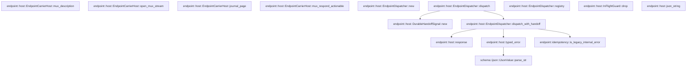

# endpoint::host

[Package atlas](index.md) · [Source](../../src/host.rs)

## Declarations

Visibility is the declaration spelling; trait members and reexports require their enclosing interface. `cfg` is not evaluated.

| Symbol | Kind | Visibility | Test / cfg |
|---|---|---|---|
| [endpoint::host::EndpointHostFuture](../../src/host.rs#L24) | type_item | `pub` |  |
| [endpoint::host::EndpointHostCall](../../src/host.rs#L27) | struct_item | `pub` |  |
| [endpoint::host::EndpointHost](../../src/host.rs#L42) | trait_item | `pub` |  |
| [endpoint::host::EndpointHost::capabilities](../../src/host.rs#L43) | function_signature_item | `private` |  |
| [endpoint::host::EndpointHost::extension_capabilities](../../src/host.rs#L48) | function_item | `private` |  |
| [endpoint::host::EndpointHost::method_class](../../src/host.rs#L52) | function_item | `private` |  |
| [endpoint::host::EndpointHost::validate_request](../../src/host.rs#L62) | function_item | `private` |  |
| [endpoint::host::EndpointHost::reconcile_legacy_internal_prompt](../../src/host.rs#L69) | function_item | `private` |  |
| [endpoint::host::EndpointHost::call](../../src/host.rs#L77) | function_signature_item | `private` |  |
| [endpoint::host::CarrierHostFuture](../../src/host.rs#L80) | type_item | `pub` |  |
| [endpoint::host::HostReadiness](../../src/host.rs#L83) | enum_item | `pub` |  |
| [endpoint::host::MethodClass](../../src/host.rs#L89) | enum_item | `pub` |  |
| [endpoint::host::StreamChannel](../../src/host.rs#L96) | enum_item | `pub` |  |
| [endpoint::host::StreamChannel::method](../../src/host.rs#L103) | function_item | `pub` |  |
| [endpoint::host::StreamChannel::frame_types](../../src/host.rs#L111) | function_item | `pub(crate)` |  |
| [endpoint::host::StreamErrorCode](../../src/host.rs#L143) | enum_item | `pub` |  |
| [endpoint::host::StreamErrorCode::code](../../src/host.rs#L153) | function_item | `pub` |  |
| [endpoint::host::StreamErrorCode::close_code](../../src/host.rs#L164) | function_item | `pub` |  |
| [endpoint::host::CallContext](../../src/host.rs#L175) | struct_item | `pub` |  |
| [endpoint::host::DrainSignal](../../src/host.rs#L184) | struct_item | `pub` |  |
| [endpoint::host::DrainSignal::new](../../src/host.rs#L188) | function_item | `pub` |  |
| [endpoint::host::DrainSignal::is_draining](../../src/host.rs#L193) | function_item | `pub` |  |
| [endpoint::host::DurableHandoffProof](../../src/host.rs#L199) | struct_item | `pub` |  |
| [endpoint::host::DurableHandoffState](../../src/host.rs#L205) | struct_item | `private` |  |
| [endpoint::host::DurableHandoffSignal](../../src/host.rs#L211) | struct_item | `pub` |  |
| [endpoint::host::DurableHandoffSignal::new](../../src/host.rs#L215) | function_item | `pub` |  |
| [endpoint::host::DurableHandoffSignal::mark_durable](../../src/host.rs#L223) | function_item | `pub` |  |
| [endpoint::host::DurableHandoffSignal::mark_handed_off](../../src/host.rs#L229) | function_item | `pub` |  |
| [endpoint::host::DurableHandoffSignal::proof](../../src/host.rs#L257) | function_item | `private` |  |
| [endpoint::host::DurableHandoffSignal::is_durable](../../src/host.rs#L267) | function_item | `pub` |  |
| [endpoint::host::DurableHandoffError](../../src/host.rs#L273) | enum_item | `pub` |  |
| [endpoint::host::EndpointStream](../../src/host.rs#L286) | trait_item | `pub` |  |
| [endpoint::host::EndpointStream::recv](../../src/host.rs#L287) | function_signature_item | `private` |  |
| [endpoint::host::EndpointStreamReceiver](../../src/host.rs#L290) | type_item | `pub` |  |
| [endpoint::host::SessionStream](../../src/host.rs#L292) | trait_item | `pub` |  |
| [endpoint::host::SessionStream::recv](../../src/host.rs#L293) | function_signature_item | `private` |  |
| [endpoint::host::SessionStreamReceiver](../../src/host.rs#L296) | type_item | `pub` |  |
| [endpoint::host::StreamFailure](../../src/host.rs#L302) | struct_item | `pub` |  |
| [endpoint::host::StreamFailure::new](../../src/host.rs#L309) | function_item | `pub` |  |
| [endpoint::host::StreamFailure::internal](../../src/host.rs#L317) | function_item | `pub` |  |
| [endpoint::host::StreamFailure::code](../../src/host.rs#L325) | function_item | `pub` |  |
| [endpoint::host::StreamFailure::diagnostic](../../src/host.rs#L330) | function_item | `pub` |  |
| [endpoint::host::EndpointCarrierHost](../../src/host.rs#L338) | trait_item | `pub` |  |
| [endpoint::host::EndpointCarrierHost::readiness](../../src/host.rs#L339) | function_signature_item | `private` |  |
| [endpoint::host::EndpointCarrierHost::registered_methods](../../src/host.rs#L344) | function_signature_item | `private` |  |
| [endpoint::host::EndpointCarrierHost::advertised_extension_methods](../../src/host.rs#L349) | function_item | `private` |  |
| [endpoint::host::EndpointCarrierHost::classify_method](../../src/host.rs#L353) | function_signature_item | `private` |  |
| [endpoint::host::EndpointCarrierHost::unary](../../src/host.rs#L355) | function_signature_item | `private` |  |
| [endpoint::host::EndpointCarrierHost::respond](../../src/host.rs#L361) | function_signature_item | `private` |  |
| [endpoint::host::EndpointCarrierHost::open_stream](../../src/host.rs#L369) | function_signature_item | `private` |  |
| [endpoint::host::EndpointCarrierHost::stream_error](../../src/host.rs#L376) | function_signature_item | `private` |  |
| [endpoint::host::EndpointCarrierHost::mux_description](../../src/host.rs#L382) | function_item | `private` |  |
| [endpoint::host::EndpointCarrierHost::open_mux_stream](../../src/host.rs#L388) | function_item | `private` |  |
| [endpoint::host::EndpointCarrierHost::journal_page](../../src/host.rs#L398) | function_item | `private` |  |
| [endpoint::host::EndpointCarrierHost::mux_respond_actionable](../../src/host.rs#L407) | function_item | `private` |  |
| [endpoint::host::HostFailure](../../src/host.rs#L419) | enum_item | `pub` |  |
| [endpoint::host::SessionHostDescription](../../src/host.rs#L441) | struct_item | `pub` |  |
| [endpoint::host::EndpointDispatcher](../../src/host.rs#L457) | struct_item | `pub` |  |
| [endpoint::host::EndpointDispatcher::new](../../src/host.rs#L464) | function_item | `pub` |  |
| [endpoint::host::EndpointDispatcher::dispatch](../../src/host.rs#L471) | function_item | `pub` |  |
| [endpoint::host::EndpointDispatcher::dispatch_with_handoff](../../src/host.rs#L480) | function_item | `pub` |  |
| [endpoint::host::EndpointDispatcher::registry](../../src/host.rs#L623) | function_item | `pub` |  |
| [endpoint::host::InFlightGuard](../../src/host.rs#L628) | struct_item | `private` |  |
| [endpoint::host::InFlightGuard::drop](../../src/host.rs#L634) | function_item | `private` |  |
| [endpoint::host::response](../../src/host.rs#L641) | function_item | `private` |  |
| [endpoint::host::typed_error](../../src/host.rs#L649) | function_item | `private` |  |
| [endpoint::host::json_string](../../src/host.rs#L665) | function_item | `private` |  |
| [endpoint::host::EndpointDispatchError](../../src/host.rs#L670) | enum_item | `pub` |  |

## Imports / reexports

| Local name | Source path | Visibility |
|---|---|---|
| `BTreeSet` | `std::collections::BTreeSet` | `private` |
| `HashSet` | `std::collections::HashSet` | `private` |
| `Future` | `std::future::Future` | `private` |
| `Pin` | `std::pin::Pin` | `private` |
| `AtomicBool` | `std::sync::atomic::AtomicBool` | `private` |
| `Ordering` | `std::sync::atomic::Ordering` | `private` |
| `Arc` | `std::sync::Arc` | `private` |
| `Mutex` | `std::sync::Mutex` | `private` |
| `Instant` | `std::time::Instant` | `private` |
| `IJsonValue` | `schema::IJsonValue` | `private` |
| `Deserialize` | `serde::Deserialize` | `private` |
| `Serialize` | `serde::Serialize` | `private` |
| `Error` | `thiserror::Error` | `private` |
| `RpcBegin` | `crate::idempotency::RpcBegin` | `private` |
| `RpcClaim` | `crate::idempotency::RpcClaim` | `private` |
| `RpcDurableIdentity` | `crate::idempotency::RpcDurableIdentity` | `private` |
| `RpcRegistry` | `crate::idempotency::RpcRegistry` | `private` |
| `RpcRegistryError` | `crate::idempotency::RpcRegistryError` | `private` |
| `is_legacy_internal_error` | `crate::idempotency::is_legacy_internal_error` | `private` |
| `MuxHostDescription` | `crate::mux::MuxHostDescription` | `private` |
| `SessionJournalPage` | `crate::mux::SessionJournalPage` | `private` |
| `SessionMuxClientFrame` | `crate::mux::SessionMuxClientFrame` | `private` |
| `SessionStreamTarget` | `crate::mux::SessionStreamTarget` | `private` |
| `SessionSyncFrame` | `crate::mux::SessionSyncFrame` | `private` |
| `ClientRequest` | `crate::rpc::ClientRequest` | `private` |
| `ClientResponse` | `crate::rpc::ClientResponse` | `private` |
| `RequestError` | `crate::rpc::RequestError` | `private` |
| `RespondReceipt` | `crate::rpc::RespondReceipt` | `private` |
| `RpcError` | `crate::rpc::RpcError` | `private` |
| `RpcResult` | `crate::rpc::RpcResult` | `private` |
| `ServerRequest` | `crate::rpc::ServerRequest` | `private` |
| `ServerResponse` | `crate::rpc::ServerResponse` | `private` |

## Module declarations

| Module | Visibility | Attributes |
|---|---|---|

## Function call graphs

Edges below are syntactically resolved calls only, including private functions. Graphs partition callers into groups of 20; they are not execution order. All unresolved sites are listed below and in the JSON inventory.

Functions 1–20: 1 direct edges

Functions 21–32: 6 direct edges

## Call sites

Includes test functions (marked in declarations). Receiver-type-required sites need type analysis/manual tracing. Calls in closures are attributed to their enclosing function; their occurrence here does not mean the closure executes immediately.

| Caller | Callee expression | Source lines | Target / classification |
|---|---|---|---|
| `extension_capabilities` | `BTreeSet::new` | [49](../../src/host.rs#L49) | external-constructor-callback-or-unresolved |
| `method_class` | `self.capabilities().contains` | [53](../../src/host.rs#L53) | receiver-type-required |
| `method_class` | `self.capabilities` | [53](../../src/host.rs#L53) | receiver-type-required |
| `validate_request` | `Ok` | [63](../../src/host.rs#L63) | external-constructor-callback-or-unresolved |
| `new` | `Self` | [189](../../src/host.rs#L189) | external-constructor-callback-or-unresolved |
| `is_draining` | `self.0.load` | [194](../../src/host.rs#L194) | receiver-type-required |
| `new` | `Self::default` | [216](../../src/host.rs#L216) | external-constructor-callback-or-unresolved |
| `mark_durable` | `self.0.durable.store` | [224](../../src/host.rs#L224) | receiver-type-required |
| `mark_handed_off` | `proof.delivery.is_empty` | [230](../../src/host.rs#L230) | receiver-type-required |
| `mark_handed_off` | `Err` | [231](../../src/host.rs#L231), [238](../../src/host.rs#L238), [247](../../src/host.rs#L247) | external-constructor-callback-or-unresolved |
| `mark_handed_off` | `proof             .durable_identity             .as_ref()             .is_some_and` | [233](../../src/host.rs#L233) | receiver-type-required |
| `mark_handed_off` | `proof             .durable_identity             .as_ref` | [233](../../src/host.rs#L233) | receiver-type-required |
| `mark_handed_off` | `identity.kind.is_empty` | [236](../../src/host.rs#L236) | receiver-type-required |
| `mark_handed_off` | `identity.id.is_empty` | [236](../../src/host.rs#L236) | receiver-type-required |
| `mark_handed_off` | `self             .0             .proof             .lock()             .map_err` | [240](../../src/host.rs#L240) | receiver-type-required |
| `mark_handed_off` | `self             .0             .proof             .lock` | [240](../../src/host.rs#L240) | receiver-type-required |
| `mark_handed_off` | `current.as_ref` | [245](../../src/host.rs#L245) | receiver-type-required |
| `mark_handed_off` | `Some` | [250](../../src/host.rs#L250) | external-constructor-callback-or-unresolved |
| `mark_handed_off` | `drop` | [252](../../src/host.rs#L252) | external-constructor-callback-or-unresolved |
| `mark_handed_off` | `self.mark_durable` | [253](../../src/host.rs#L253) | [endpoint::host::DurableHandoffSignal::mark_durable](../../src/host.rs#L223) |
| `mark_handed_off` | `Ok` | [254](../../src/host.rs#L254) | external-constructor-callback-or-unresolved |
| `proof` | `self.0             .proof             .lock()             .map(&#124;proof&#124; proof.clone())             .map_err` | [258](../../src/host.rs#L258) | receiver-type-required |
| `proof` | `self.0             .proof             .lock()             .map` | [258](../../src/host.rs#L258) | receiver-type-required |
| `proof` | `self.0             .proof             .lock` | [258](../../src/host.rs#L258) | receiver-type-required |
| `proof` | `proof.clone` | [261](../../src/host.rs#L261) | receiver-type-required |
| `is_durable` | `self.0.durable.load` | [268](../../src/host.rs#L268) | receiver-type-required |
| `internal` | `Some` | [320](../../src/host.rs#L320) | external-constructor-callback-or-unresolved |
| `internal` | `diagnostic.into` | [320](../../src/host.rs#L320) | receiver-type-required |
| `diagnostic` | `self.diagnostic.as_deref` | [331](../../src/host.rs#L331) | receiver-type-required |
| `advertised_extension_methods` | `BTreeSet::new` | [350](../../src/host.rs#L350) | external-constructor-callback-or-unresolved |
| `mux_description` | `Err` | [383](../../src/host.rs#L383) | external-constructor-callback-or-unresolved |
| `mux_description` | `HostFailure::Protocol` | [383](../../src/host.rs#L383) | external-constructor-callback-or-unresolved |
| `mux_description` | `"Session Endpoint V3 is unavailable".to_owned` | [384](../../src/host.rs#L384) | receiver-type-required |
| `open_mux_stream` | `Box::pin` | [393](../../src/host.rs#L393) | external-constructor-callback-or-unresolved |
| `open_mux_stream` | `std::future::ready` | [393](../../src/host.rs#L393) | external-constructor-callback-or-unresolved |
| `open_mux_stream` | `Err` | [393](../../src/host.rs#L393) | external-constructor-callback-or-unresolved |
| `open_mux_stream` | `HostFailure::Protocol` | [393](../../src/host.rs#L393) | external-constructor-callback-or-unresolved |
| `open_mux_stream` | `"Session Endpoint V3 stream is unavailable".to_owned` | [394](../../src/host.rs#L394) | receiver-type-required |
| `journal_page` | `Box::pin` | [402](../../src/host.rs#L402) | external-constructor-callback-or-unresolved |
| `journal_page` | `std::future::ready` | [402](../../src/host.rs#L402) | external-constructor-callback-or-unresolved |
| `journal_page` | `Err` | [402](../../src/host.rs#L402) | external-constructor-callback-or-unresolved |
| `journal_page` | `HostFailure::Protocol` | [402](../../src/host.rs#L402) | external-constructor-callback-or-unresolved |
| `journal_page` | `"Session Endpoint V3 journal page is unavailable".to_owned` | [403](../../src/host.rs#L403) | receiver-type-required |
| `mux_respond_actionable` | `Box::pin` | [412](../../src/host.rs#L412) | external-constructor-callback-or-unresolved |
| `mux_respond_actionable` | `std::future::ready` | [412](../../src/host.rs#L412) | external-constructor-callback-or-unresolved |
| `mux_respond_actionable` | `Err` | [412](../../src/host.rs#L412) | external-constructor-callback-or-unresolved |
| `mux_respond_actionable` | `HostFailure::Protocol` | [412](../../src/host.rs#L412) | external-constructor-callback-or-unresolved |
| `mux_respond_actionable` | `"Session Endpoint V3 actionable response is unavailable".to_owned` | [413](../../src/host.rs#L413) | receiver-type-required |
| `new` | `Mutex::new` | [467](../../src/host.rs#L467) | external-constructor-callback-or-unresolved |
| `new` | `HashSet::new` | [467](../../src/host.rs#L467) | external-constructor-callback-or-unresolved |
| `dispatch` | `self.dispatch_with_handoff` | [476](../../src/host.rs#L476) | [endpoint::host::EndpointDispatcher::dispatch_with_handoff](../../src/host.rs#L480) |
| `dispatch` | `DurableHandoffSignal::new` | [476](../../src/host.rs#L476) | [endpoint::host::DurableHandoffSignal::new](../../src/host.rs#L215) |
| `dispatch_with_handoff` | `request.rpc_id.clone` | [486](../../src/host.rs#L486) | receiver-type-required |
| `dispatch_with_handoff` | `Err` | [488](../../src/host.rs#L488), [547](../../src/host.rs#L547), [603](../../src/host.rs#L603) | external-constructor-callback-or-unresolved |
| `dispatch_with_handoff` | `EndpointDispatchError::Request` | [488](../../src/host.rs#L488) | external-constructor-callback-or-unresolved |
| `dispatch_with_handoff` | `host.capabilities().contains` | [490](../../src/host.rs#L490) | receiver-type-required |
| `dispatch_with_handoff` | `host.capabilities` | [490](../../src/host.rs#L490) | receiver-type-required |
| `dispatch_with_handoff` | `typed_error` | [491](../../src/host.rs#L491), [507](../../src/host.rs#L507), [536](../../src/host.rs#L536), [575](../../src/host.rs#L575) | [endpoint::host::typed_error](../../src/host.rs#L649) |
| `dispatch_with_handoff` | `Ok` | [496](../../src/host.rs#L496), [505](../../src/host.rs#L505), [528](../../src/host.rs#L528), [534](../../src/host.rs#L534), [564](../../src/host.rs#L564), [573](../../src/host.rs#L573), [615](../../src/host.rs#L615), [619](../../src/host.rs#L619) | external-constructor-callback-or-unresolved |
| `dispatch_with_handoff` | `response` | [496](../../src/host.rs#L496), [505](../../src/host.rs#L505), [528](../../src/host.rs#L528), [534](../../src/host.rs#L534), [564](../../src/host.rs#L564), [573](../../src/host.rs#L573), [615](../../src/host.rs#L615), [619](../../src/host.rs#L619) | [endpoint::host::response](../../src/host.rs#L641) |
| `dispatch_with_handoff` | `host.method_class` | [498](../../src/host.rs#L498) | receiver-type-required |
| `dispatch_with_handoff` | `self                     .in_flight                     .lock()                     .map_err` | [500](../../src/host.rs#L500) | receiver-type-required |
| `dispatch_with_handoff` | `self                     .in_flight                     .lock` | [500](../../src/host.rs#L500) | receiver-type-required |
| `dispatch_with_handoff` | `in_flight.insert` | [504](../../src/host.rs#L504), [572](../../src/host.rs#L572) | receiver-type-required |
| `dispatch_with_handoff` | `rpc_id.clone` | [504](../../src/host.rs#L504), [517](../../src/host.rs#L517), [535](../../src/host.rs#L535), [572](../../src/host.rs#L572), [585](../../src/host.rs#L585) | receiver-type-required |
| `dispatch_with_handoff` | `"{}".to_owned` | [510](../../src/host.rs#L510), [578](../../src/host.rs#L578) | receiver-type-required |
| `dispatch_with_handoff` | `host                 .call` | [519](../../src/host.rs#L519) | receiver-type-required |
| `dispatch_with_handoff` | `self.registry.begin` | [530](../../src/host.rs#L530) | receiver-type-required |
| `dispatch_with_handoff` | `request.method.clone` | [533](../../src/host.rs#L533) | receiver-type-required |
| `dispatch_with_handoff` | `error.into` | [547](../../src/host.rs#L547) | receiver-type-required |
| `dispatch_with_handoff` | `is_legacy_internal_error` | [553](../../src/host.rs#L553) | [endpoint::idempotency::is_legacy_internal_error](../../src/idempotency.rs#L892) |
| `dispatch_with_handoff` | `self.registry                     .reconcile_legacy_internal_complete(&request, &#124;claim&#124; {                         host.reconcile_legacy_internal_prompt(claim, &request)                     })?                     .unwrap_or` | [555](../../src/host.rs#L555) | receiver-type-required |
| `dispatch_with_handoff` | `self.registry                     .reconcile_legacy_internal_complete` | [555](../../src/host.rs#L555) | receiver-type-required |
| `dispatch_with_handoff` | `host.reconcile_legacy_internal_prompt` | [557](../../src/host.rs#L557) | receiver-type-required |
| `dispatch_with_handoff` | `handoff.mark_durable` | [563](../../src/host.rs#L563), [618](../../src/host.rs#L618) | receiver-type-required |
| `dispatch_with_handoff` | `self                 .in_flight                 .lock()                 .map_err` | [568](../../src/host.rs#L568) | receiver-type-required |
| `dispatch_with_handoff` | `self                 .in_flight                 .lock` | [568](../../src/host.rs#L568) | receiver-type-required |
| `dispatch_with_handoff` | `host             .call` | [588](../../src/host.rs#L588) | receiver-type-required |
| `dispatch_with_handoff` | `handoff.clone` | [594](../../src/host.rs#L594) | receiver-type-required |
| `dispatch_with_handoff` | `handoff.proof` | [597](../../src/host.rs#L597) | receiver-type-required |
| `dispatch_with_handoff` | `self.registry                     .mark_handed_off` | [599](../../src/host.rs#L599) | receiver-type-required |
| `dispatch_with_handoff` | `handoff.is_durable` | [602](../../src/host.rs#L602), [614](../../src/host.rs#L614) | receiver-type-required |
| `dispatch_with_handoff` | `result.error.as_ref().is_some_and` | [608](../../src/host.rs#L608) | receiver-type-required |
| `dispatch_with_handoff` | `result.error.as_ref` | [608](../../src/host.rs#L608) | receiver-type-required |
| `dispatch_with_handoff` | `self.registry.complete` | [617](../../src/host.rs#L617) | receiver-type-required |
| `drop` | `self.set.lock` | [635](../../src/host.rs#L635) | receiver-type-required |
| `drop` | `set.remove` | [636](../../src/host.rs#L636) | receiver-type-required |
| `response` | `"server-response".to_owned` | [643](../../src/host.rs#L643) | receiver-type-required |
| `typed_error` | `Ok` | [654](../../src/host.rs#L654) | external-constructor-callback-or-unresolved |
| `typed_error` | `Some` | [657](../../src/host.rs#L657) | external-constructor-callback-or-unresolved |
| `typed_error` | `code.to_owned` | [658](../../src/host.rs#L658) | receiver-type-required |
| `typed_error` | `message.to_owned` | [659](../../src/host.rs#L659) | receiver-type-required |
| `typed_error` | `IJsonValue::parse_str` | [660](../../src/host.rs#L660) | [schema::ijson::IJsonValue::parse_str](../../../schema/src/ijson.rs#L23) |
| `json_string` | `serde_json::to_string(value).expect` | [666](../../src/host.rs#L666) | receiver-type-required |
| `json_string` | `serde_json::to_string` | [666](../../src/host.rs#L666) | external-constructor-callback-or-unresolved |
