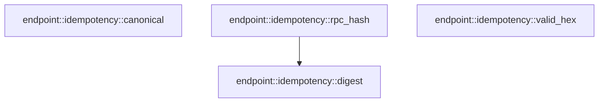

# endpoint::idempotency

[Package atlas](index.md) · [Source](../../src/idempotency.rs)

## Declarations

Visibility is the declaration spelling; trait members and reexports require their enclosing interface. `cfg` is not evaluated.

| Symbol | Kind | Visibility | Test / cfg |
|---|---|---|---|
| [endpoint::idempotency::VERSION](../../src/idempotency.rs#L16) | const_item | `private` |  |
| [endpoint::idempotency::RpcClaim](../../src/idempotency.rs#L19) | struct_item | `pub` |  |
| [endpoint::idempotency::RpcClaim::rpc_id](../../src/idempotency.rs#L29) | function_item | `pub` |  |
| [endpoint::idempotency::RpcClaim::method](../../src/idempotency.rs#L34) | function_item | `pub` |  |
| [endpoint::idempotency::RpcBegin](../../src/idempotency.rs#L40) | enum_item | `pub` |  |
| [endpoint::idempotency::RpcLookup](../../src/idempotency.rs#L46) | enum_item | `pub` |  |
| [endpoint::idempotency::Phase](../../src/idempotency.rs#L54) | enum_item | `private` |  |
| [endpoint::idempotency::ProjectionMetadata](../../src/idempotency.rs#L63) | struct_item | `private` |  |
| [endpoint::idempotency::RpcDurableIdentity](../../src/idempotency.rs#L69) | struct_item | `pub` |  |
| [endpoint::idempotency::Record](../../src/idempotency.rs#L78) | struct_item | `private` |  |
| [endpoint::idempotency::Entry](../../src/idempotency.rs#L104) | enum_item | `private` |  |
| [endpoint::idempotency::RpcRegistry](../../src/idempotency.rs#L116) | struct_item | `pub` |  |
| [endpoint::idempotency::RpcRegistry::open](../../src/idempotency.rs#L123) | function_item | `pub` |  |
| [endpoint::idempotency::RpcRegistry::path](../../src/idempotency.rs#L146) | function_item | `pub` |  |
| [endpoint::idempotency::RpcRegistry::begin](../../src/idempotency.rs#L150) | function_item | `pub` |  |
| [endpoint::idempotency::RpcRegistry::lookup](../../src/idempotency.rs#L179) | function_item | `pub` |  |
| [endpoint::idempotency::RpcRegistry::handoff](../../src/idempotency.rs#L199) | function_item | `pub` |  |
| [endpoint::idempotency::RpcRegistry::complete](../../src/idempotency.rs#L219) | function_item | `pub` |  |
| [endpoint::idempotency::RpcRegistry::mark_handed_off](../../src/idempotency.rs#L315) | function_item | `pub` |  |
| [endpoint::idempotency::RpcRegistry::publish_prepared](../../src/idempotency.rs#L377) | function_item | `private` |  |
| [endpoint::idempotency::RpcRegistry::append](../../src/idempotency.rs#L416) | function_item | `private` |  |
| [endpoint::idempotency::RpcRegistry::read_unlocked](../../src/idempotency.rs#L427) | function_item | `private` |  |
| [endpoint::idempotency::RpcRegistry::repair_all](../../src/idempotency.rs#L440) | function_item | `private` |  |
| [endpoint::idempotency::RpcRegistry::record_path](../../src/idempotency.rs#L486) | function_item | `private` |  |
| [endpoint::idempotency::make_claim](../../src/idempotency.rs#L491) | function_item | `private` |  |
| [endpoint::idempotency::same_claim](../../src/idempotency.rs#L527) | function_item | `private` |  |
| [endpoint::idempotency::parse](../../src/idempotency.rs#L535) | function_item | `private` |  |
| [endpoint::idempotency::decode_response](../../src/idempotency.rs#L689) | function_item | `private` |  |
| [endpoint::idempotency::parse_cached_result](../../src/idempotency.rs#L702) | function_item | `private` |  |
| [endpoint::idempotency::validate_durable_identity](../../src/idempotency.rs#L734) | function_item | `private` |  |
| [endpoint::idempotency::canonical](../../src/idempotency.rs#L744) | function_item | `private` |  |
| [endpoint::idempotency::rpc_hash](../../src/idempotency.rs#L749) | function_item | `private` |  |
| [endpoint::idempotency::digest](../../src/idempotency.rs#L753) | function_item | `private` |  |
| [endpoint::idempotency::valid_hex](../../src/idempotency.rs#L757) | function_item | `private` |  |
| [endpoint::idempotency::RpcRegistryError](../../src/idempotency.rs#L770) | enum_item | `pub` |  |

## Imports / reexports

| Local name | Source path | Visibility |
|---|---|---|
| `fs` | `std::fs` | `private` |
| `OpenOptions` | `std::fs::OpenOptions` | `private` |
| `Write` | `std::io::Write` | `private` |
| `Path` | `std::path::Path` | `private` |
| `PathBuf` | `std::path::PathBuf` | `private` |
| `Engine` | `base64::Engine` | `private` |
| `BASE64` | `base64::engine::general_purpose::STANDARD` | `private` |
| `Deserialize` | `serde::Deserialize` | `private` |
| `Serialize` | `serde::Serialize` | `private` |
| `Digest` | `sha2::Digest` | `private` |
| `Sha256` | `sha2::Sha256` | `private` |
| `FullSync` | `store::FullSync` | `private` |
| `NamedLock` | `store::NamedLock` | `private` |
| `Error` | `thiserror::Error` | `private` |
| `ClientRequest` | `crate::ClientRequest` | `private` |
| `RespondReceipt` | `crate::RespondReceipt` | `private` |
| `RpcResult` | `crate::RpcResult` | `private` |
| `ServerResponse` | `crate::ServerResponse` | `private` |
| `validate_response` | `crate::validate_response` | `private` |
| `validate_rpc_id` | `crate::validate_rpc_id` | `private` |

## Module declarations

| Module | Visibility | Attributes |
|---|---|---|

## Function call graphs

Edges below are syntactically resolved calls only, including private functions. Graphs partition callers into groups of 20; they are not execution order. All unresolved sites are listed below and in the JSON inventory.

```mermaid
flowchart TD
  n0["endpoint::idempotency::RpcRegistry::open"]
  n1["endpoint::idempotency::RpcRegistry::path"]
  n2["endpoint::idempotency::RpcRegistry::begin"]
  n3["endpoint::idempotency::RpcRegistry::lookup"]
  n4["endpoint::idempotency::RpcRegistry::handoff"]
  n5["endpoint::idempotency::RpcRegistry::complete"]
  n6["endpoint::idempotency::RpcClaim::rpc_id"]
  n7["endpoint::idempotency::RpcRegistry::mark_handed_off"]
  n8["endpoint::idempotency::RpcClaim::method"]
  n9["endpoint::idempotency::RpcRegistry::publish_prepared"]
  n10["endpoint::idempotency::RpcRegistry::append"]
  n11["endpoint::idempotency::RpcRegistry::read_unlocked"]
  n12["endpoint::idempotency::RpcRegistry::repair_all"]
  n13["endpoint::idempotency::RpcRegistry::record_path"]
  n14["endpoint::idempotency::make_claim"]
  n15["endpoint::idempotency::same_claim"]
  n16["endpoint::idempotency::parse"]
  n17["endpoint::idempotency::decode_response"]
  n18["endpoint::idempotency::parse_cached_result"]
  n19["endpoint::idempotency::validate_durable_identity"]
  n20["endpoint::idempotency::canonical"]
  n21["endpoint::idempotency::rpc_hash"]
  n22["endpoint::idempotency::digest"]
  n23["endpoint::idempotency::valid_hex"]
  n24["endpoint::rpc::validate_response"]
  n25["endpoint::rpc::validate_rpc_id"]
  n26["schema::ijson::IJsonValue::parse"]
  n27["store::management_root::endpoint_management_root"]
  n28["store::platform::NamedLock::exclusive"]
  n29["store::platform::FullSync::full_sync"]
  n30["store::platform::NamedLock::shared"]
  n0 --> n27
  n2 --> n9
  n2 --> n11
  n2 --> n14
  n2 --> n15
  n2 --> n28
  n3 --> n11
  n3 --> n14
  n3 --> n15
  n3 --> n30
  n4 --> n11
  n4 --> n15
  n4 --> n30
  n5 --> n10
  n5 --> n11
  n5 --> n15
  n5 --> n22
  n5 --> n28
  n7 --> n10
  n7 --> n11
  n7 --> n15
  n7 --> n19
  n7 --> n28
  n9 --> n13
  n9 --> n20
  n9 --> n21
  n9 --> n29
  n10 --> n13
  n10 --> n20
  n10 --> n21
  n10 --> n29
  n11 --> n13
  n11 --> n16
  n11 --> n21
  n12 --> n13
  n12 --> n16
  n12 --> n28
  n12 --> n29
  n14 --> n22
  n14 --> n25
  n16 --> n17
  n16 --> n18
  n16 --> n19
  n16 --> n20
  n16 --> n21
  n16 --> n22
  n16 --> n23
  n16 --> n25
  n18 --> n24
  n18 --> n26
```

Functions 1–20: 50 direct edges

Functions 21–24: 1 direct edges

## Call sites

Includes test functions (marked in declarations). Receiver-type-required sites need type analysis/manual tracing. Calls in closures are attributed to their enclosing function; their occurrence here does not mean the closure executes immediately.

| Caller | Callee expression | Source lines | Target / classification |
|---|---|---|---|
| `open` | `store::endpoint_management_root` | [124](../../src/idempotency.rs#L124) | [store::management_root::endpoint_management_root](../../../store/src/management_root.rs#L47) |
| `open` | `endpoint_root.as_ref` | [124](../../src/idempotency.rs#L124) | receiver-type-required |
| `open` | `root.join` | [125](../../src/idempotency.rs#L125), [127](../../src/idempotency.rs#L127) | receiver-type-required |
| `open` | `fs::create_dir_all` | [126](../../src/idempotency.rs#L126) | external-constructor-callback-or-unresolved |
| `open` | `lock_path.exists` | [128](../../src/idempotency.rs#L128) | receiver-type-required |
| `open` | `OpenOptions::new()             .create(true)             .append(true)             .open` | [129](../../src/idempotency.rs#L129) | receiver-type-required |
| `open` | `OpenOptions::new()             .create(true)             .append` | [129](../../src/idempotency.rs#L129) | receiver-type-required |
| `open` | `OpenOptions::new()             .create` | [129](../../src/idempotency.rs#L129) | receiver-type-required |
| `open` | `OpenOptions::new` | [129](../../src/idempotency.rs#L129) | external-constructor-callback-or-unresolved |
| `open` | `fs::File::open(&root)?.sync_all` | [134](../../src/idempotency.rs#L134) | receiver-type-required |
| `open` | `fs::File::open` | [134](../../src/idempotency.rs#L134) | external-constructor-callback-or-unresolved |
| `open` | `registry.repair_all` | [141](../../src/idempotency.rs#L141) | receiver-type-required |
| `open` | `Ok` | [142](../../src/idempotency.rs#L142) | external-constructor-callback-or-unresolved |
| `begin` | `make_claim` | [151](../../src/idempotency.rs#L151) | [endpoint::idempotency::make_claim](../../src/idempotency.rs#L491) |
| `begin` | `NamedLock::exclusive` | [152](../../src/idempotency.rs#L152) | [store::platform::NamedLock::exclusive](../../../store/src/platform.rs#L103) |
| `begin` | `self.read_unlocked` | [153](../../src/idempotency.rs#L153) | [endpoint::idempotency::RpcRegistry::read_unlocked](../../src/idempotency.rs#L427) |
| `begin` | `same_claim` | [159](../../src/idempotency.rs#L159) | [endpoint::idempotency::same_claim](../../src/idempotency.rs#L527) |
| `begin` | `Ok` | [160](../../src/idempotency.rs#L160), [171](../../src/idempotency.rs#L171) | external-constructor-callback-or-unresolved |
| `begin` | `RpcBegin::Completed` | [161](../../src/idempotency.rs#L161) | external-constructor-callback-or-unresolved |
| `begin` | `Err` | [168](../../src/idempotency.rs#L168) | external-constructor-callback-or-unresolved |
| `begin` | `RpcRegistryError::Conflict` | [168](../../src/idempotency.rs#L168) | external-constructor-callback-or-unresolved |
| `begin` | `self.publish_prepared` | [170](../../src/idempotency.rs#L170) | [endpoint::idempotency::RpcRegistry::publish_prepared](../../src/idempotency.rs#L377) |
| `lookup` | `make_claim` | [180](../../src/idempotency.rs#L180) | [endpoint::idempotency::make_claim](../../src/idempotency.rs#L491) |
| `lookup` | `NamedLock::shared` | [181](../../src/idempotency.rs#L181) | [store::platform::NamedLock::shared](../../../store/src/platform.rs#L99) |
| `lookup` | `self.read_unlocked` | [182](../../src/idempotency.rs#L182) | [endpoint::idempotency::RpcRegistry::read_unlocked](../../src/idempotency.rs#L427) |
| `lookup` | `Ok` | [183](../../src/idempotency.rs#L183), [191](../../src/idempotency.rs#L191) | external-constructor-callback-or-unresolved |
| `lookup` | `Err` | [184](../../src/idempotency.rs#L184) | external-constructor-callback-or-unresolved |
| `lookup` | `RpcRegistryError::Conflict` | [184](../../src/idempotency.rs#L184) | external-constructor-callback-or-unresolved |
| `lookup` | `same_claim` | [190](../../src/idempotency.rs#L190) | [endpoint::idempotency::same_claim](../../src/idempotency.rs#L527) |
| `lookup` | `RpcLookup::Completed` | [192](../../src/idempotency.rs#L192) | external-constructor-callback-or-unresolved |
| `lookup` | `RpcLookup::Pending` | [193](../../src/idempotency.rs#L193) | external-constructor-callback-or-unresolved |
| `handoff` | `NamedLock::shared` | [203](../../src/idempotency.rs#L203) | [store::platform::NamedLock::shared](../../../store/src/platform.rs#L99) |
| `handoff` | `self             .read_unlocked(&claim.rpc_id, false)?             .ok_or_else` | [204](../../src/idempotency.rs#L204) | receiver-type-required |
| `handoff` | `self             .read_unlocked` | [204](../../src/idempotency.rs#L204) | [endpoint::idempotency::RpcRegistry::read_unlocked](../../src/idempotency.rs#L427) |
| `handoff` | `RpcRegistryError::MissingClaim` | [206](../../src/idempotency.rs#L206) | external-constructor-callback-or-unresolved |
| `handoff` | `claim.rpc_id.clone` | [206](../../src/idempotency.rs#L206), [213](../../src/idempotency.rs#L213) | receiver-type-required |
| `handoff` | `Err` | [213](../../src/idempotency.rs#L213) | external-constructor-callback-or-unresolved |
| `handoff` | `RpcRegistryError::Conflict` | [213](../../src/idempotency.rs#L213) | external-constructor-callback-or-unresolved |
| `handoff` | `same_claim` | [215](../../src/idempotency.rs#L215) | [endpoint::idempotency::same_claim](../../src/idempotency.rs#L527) |
| `handoff` | `Ok` | [216](../../src/idempotency.rs#L216) | external-constructor-callback-or-unresolved |
| `complete` | `result.validate` | [224](../../src/idempotency.rs#L224) | receiver-type-required |
| `complete` | `NamedLock::exclusive` | [225](../../src/idempotency.rs#L225) | [store::platform::NamedLock::exclusive](../../../store/src/platform.rs#L103) |
| `complete` | `self             .read_unlocked(&claim.rpc_id, false)?             .ok_or_else` | [226](../../src/idempotency.rs#L226) | receiver-type-required |
| `complete` | `self             .read_unlocked` | [226](../../src/idempotency.rs#L226) | [endpoint::idempotency::RpcRegistry::read_unlocked](../../src/idempotency.rs#L427) |
| `complete` | `RpcRegistryError::MissingClaim` | [228](../../src/idempotency.rs#L228) | external-constructor-callback-or-unresolved |
| `complete` | `claim.rpc_id.clone` | [228](../../src/idempotency.rs#L228), [236](../../src/idempotency.rs#L236), [243](../../src/idempotency.rs#L243), [266](../../src/idempotency.rs#L266), [299](../../src/idempotency.rs#L299) | receiver-type-required |
| `complete` | `Err` | [236](../../src/idempotency.rs#L236), [243](../../src/idempotency.rs#L243), [247](../../src/idempotency.rs#L247), [258](../../src/idempotency.rs#L258), [289](../../src/idempotency.rs#L289) | external-constructor-callback-or-unresolved |
| `complete` | `RpcRegistryError::Conflict` | [236](../../src/idempotency.rs#L236) | external-constructor-callback-or-unresolved |
| `complete` | `same_claim` | [238](../../src/idempotency.rs#L238) | [endpoint::idempotency::same_claim](../../src/idempotency.rs#L527) |
| `complete` | `Ok` | [241](../../src/idempotency.rs#L241), [312](../../src/idempotency.rs#L312) | external-constructor-callback-or-unresolved |
| `complete` | `RpcRegistryError::ResultConflict` | [243](../../src/idempotency.rs#L243) | external-constructor-callback-or-unresolved |
| `complete` | `RpcRegistryError::Corruption` | [247](../../src/idempotency.rs#L247), [253](../../src/idempotency.rs#L253), [258](../../src/idempotency.rs#L258), [289](../../src/idempotency.rs#L289) | external-constructor-callback-or-unresolved |
| `complete` | `"unsupported completion phase".to_owned` | [248](../../src/idempotency.rs#L248) | receiver-type-required |
| `complete` | `result.value.as_ref().ok_or_else` | [252](../../src/idempotency.rs#L252) | receiver-type-required |
| `complete` | `result.value.as_ref` | [252](../../src/idempotency.rs#L252) | receiver-type-required |
| `complete` | `"respond completion omitted receipt".to_owned` | [253](../../src/idempotency.rs#L253) | receiver-type-required |
| `complete` | `value.canonical_bytes` | [255](../../src/idempotency.rs#L255) | receiver-type-required |
| `complete` | `serde_json::from_slice` | [256](../../src/idempotency.rs#L256) | external-constructor-callback-or-unresolved |
| `complete` | `receipt.reason.is_some` | [257](../../src/idempotency.rs#L257) | receiver-type-required |
| `complete` | `"respond carrier may cache only accepted:true".to_owned` | [259](../../src/idempotency.rs#L259) | receiver-type-required |
| `complete` | `serde_json_canonicalizer::to_vec(&ServerResponse {                 envelope_type: "server-response".to_owned(),                 rpc_id: claim.rpc_id.clone(),                 result: result.clone(),             })             .map_err` | [264](../../src/idempotency.rs#L264) | receiver-type-required |
| `complete` | `serde_json_canonicalizer::to_vec` | [264](../../src/idempotency.rs#L264) | external-constructor-callback-or-unresolved |
| `complete` | `"server-response".to_owned` | [265](../../src/idempotency.rs#L265) | receiver-type-required |
| `complete` | `result.clone` | [267](../../src/idempotency.rs#L267), [312](../../src/idempotency.rs#L312) | receiver-type-required |
| `complete` | `RpcRegistryError::Canonical` | [269](../../src/idempotency.rs#L269) | external-constructor-callback-or-unresolved |
| `complete` | `error.to_string` | [269](../../src/idempotency.rs#L269) | receiver-type-required |
| `complete` | `"rpc-result".to_owned` | [275](../../src/idempotency.rs#L275), [283](../../src/idempotency.rs#L283) | receiver-type-required |
| `complete` | `digest` | [276](../../src/idempotency.rs#L276), [284](../../src/idempotency.rs#L284) | [endpoint::idempotency::digest](../../src/idempotency.rs#L753) |
| `complete` | `Some` | [281](../../src/idempotency.rs#L281), [299](../../src/idempotency.rs#L299), [306](../../src/idempotency.rs#L306), [308](../../src/idempotency.rs#L308) | external-constructor-callback-or-unresolved |
| `complete` | `durable_identity.unwrap_or_else` | [282](../../src/idempotency.rs#L282) | receiver-type-required |
| `complete` | `"rpc phase omitted its handoff proof".to_owned` | [290](../../src/idempotency.rs#L290) | receiver-type-required |
| `complete` | `self.append` | [294](../../src/idempotency.rs#L294) | [endpoint::idempotency::RpcRegistry::append](../../src/idempotency.rs#L416) |
| `complete` | `claim.operation.clone` | [301](../../src/idempotency.rs#L301) | receiver-type-required |
| `complete` | `claim.request_sha256.clone` | [302](../../src/idempotency.rs#L302) | receiver-type-required |
| `complete` | `claim.target_session.clone` | [303](../../src/idempotency.rs#L303) | receiver-type-required |
| `complete` | `claim.projection_metadata.clone` | [307](../../src/idempotency.rs#L307) | receiver-type-required |
| `complete` | `BASE64.encode` | [308](../../src/idempotency.rs#L308) | receiver-type-required |
| `mark_handed_off` | `delivery.is_empty` | [321](../../src/idempotency.rs#L321) | receiver-type-required |
| `mark_handed_off` | `Err` | [322](../../src/idempotency.rs#L322), [340](../../src/idempotency.rs#L340), [347](../../src/idempotency.rs#L347), [353](../../src/idempotency.rs#L353) | external-constructor-callback-or-unresolved |
| `mark_handed_off` | `RpcRegistryError::Corruption` | [322](../../src/idempotency.rs#L322), [347](../../src/idempotency.rs#L347), [353](../../src/idempotency.rs#L353) | external-constructor-callback-or-unresolved |
| `mark_handed_off` | `"handoff delivery must be nonempty".to_owned` | [323](../../src/idempotency.rs#L323) | receiver-type-required |
| `mark_handed_off` | `durable_identity.as_ref` | [326](../../src/idempotency.rs#L326) | receiver-type-required |
| `mark_handed_off` | `validate_durable_identity` | [327](../../src/idempotency.rs#L327) | [endpoint::idempotency::validate_durable_identity](../../src/idempotency.rs#L734) |
| `mark_handed_off` | `NamedLock::exclusive` | [329](../../src/idempotency.rs#L329) | [store::platform::NamedLock::exclusive](../../../store/src/platform.rs#L103) |
| `mark_handed_off` | `self             .read_unlocked(&claim.rpc_id, false)?             .ok_or_else` | [330](../../src/idempotency.rs#L330) | receiver-type-required |
| `mark_handed_off` | `self             .read_unlocked` | [330](../../src/idempotency.rs#L330) | [endpoint::idempotency::RpcRegistry::read_unlocked](../../src/idempotency.rs#L427) |
| `mark_handed_off` | `RpcRegistryError::MissingClaim` | [332](../../src/idempotency.rs#L332) | external-constructor-callback-or-unresolved |
| `mark_handed_off` | `claim.rpc_id.clone` | [332](../../src/idempotency.rs#L332), [340](../../src/idempotency.rs#L340), [362](../../src/idempotency.rs#L362) | receiver-type-required |
| `mark_handed_off` | `RpcRegistryError::Conflict` | [340](../../src/idempotency.rs#L340) | external-constructor-callback-or-unresolved |
| `mark_handed_off` | `same_claim` | [342](../../src/idempotency.rs#L342) | [endpoint::idempotency::same_claim](../../src/idempotency.rs#L527) |
| `mark_handed_off` | `Some` | [344](../../src/idempotency.rs#L344), [362](../../src/idempotency.rs#L362), [368](../../src/idempotency.rs#L368) | external-constructor-callback-or-unresolved |
| `mark_handed_off` | `delivery.to_owned` | [344](../../src/idempotency.rs#L344), [368](../../src/idempotency.rs#L368) | receiver-type-required |
| `mark_handed_off` | `Ok` | [345](../../src/idempotency.rs#L345) | external-constructor-callback-or-unresolved |
| `mark_handed_off` | `"handoff proof changed during retry".to_owned` | [348](../../src/idempotency.rs#L348) | receiver-type-required |
| `mark_handed_off` | `"handoff cannot follow terminal completion".to_owned` | [354](../../src/idempotency.rs#L354) | receiver-type-required |
| `mark_handed_off` | `self.append` | [357](../../src/idempotency.rs#L357) | [endpoint::idempotency::RpcRegistry::append](../../src/idempotency.rs#L416) |
| `mark_handed_off` | `claim.operation.clone` | [364](../../src/idempotency.rs#L364) | receiver-type-required |
| `mark_handed_off` | `claim.request_sha256.clone` | [365](../../src/idempotency.rs#L365) | receiver-type-required |
| `mark_handed_off` | `claim.target_session.clone` | [366](../../src/idempotency.rs#L366) | receiver-type-required |
| `mark_handed_off` | `claim.projection_metadata.clone` | [370](../../src/idempotency.rs#L370) | receiver-type-required |
| `publish_prepared` | `rpc_hash` | [378](../../src/idempotency.rs#L378) | [endpoint::idempotency::rpc_hash](../../src/idempotency.rs#L749) |
| `publish_prepared` | `self.rpc_root.join` | [379](../../src/idempotency.rs#L379) | receiver-type-required |
| `publish_prepared` | `shard.exists` | [380](../../src/idempotency.rs#L380) | receiver-type-required |
| `publish_prepared` | `fs::create_dir_all` | [381](../../src/idempotency.rs#L381) | external-constructor-callback-or-unresolved |
| `publish_prepared` | `fs::File::open(&self.rpc_root)?.sync_all` | [383](../../src/idempotency.rs#L383) | receiver-type-required |
| `publish_prepared` | `fs::File::open` | [383](../../src/idempotency.rs#L383), [412](../../src/idempotency.rs#L412) | external-constructor-callback-or-unresolved |
| `publish_prepared` | `self.record_path` | [385](../../src/idempotency.rs#L385) | [endpoint::idempotency::RpcRegistry::record_path](../../src/idempotency.rs#L486) |
| `publish_prepared` | `Some` | [389](../../src/idempotency.rs#L389) | external-constructor-callback-or-unresolved |
| `publish_prepared` | `claim.rpc_id.clone` | [389](../../src/idempotency.rs#L389) | receiver-type-required |
| `publish_prepared` | `claim.operation.clone` | [391](../../src/idempotency.rs#L391) | receiver-type-required |
| `publish_prepared` | `claim.request_sha256.clone` | [392](../../src/idempotency.rs#L392) | receiver-type-required |
| `publish_prepared` | `claim.target_session.clone` | [393](../../src/idempotency.rs#L393) | receiver-type-required |
| `publish_prepared` | `claim.projection_metadata.clone` | [397](../../src/idempotency.rs#L397) | receiver-type-required |
| `publish_prepared` | `canonical` | [401](../../src/idempotency.rs#L401) | [endpoint::idempotency::canonical](../../src/idempotency.rs#L744) |
| `publish_prepared` | `bytes.push` | [402](../../src/idempotency.rs#L402) | receiver-type-required |
| `publish_prepared` | `shard.join` | [403](../../src/idempotency.rs#L403) | receiver-type-required |
| `publish_prepared` | `OpenOptions::new()             .write(true)             .create_new(true)             .open` | [404](../../src/idempotency.rs#L404) | receiver-type-required |
| `publish_prepared` | `OpenOptions::new()             .write(true)             .create_new` | [404](../../src/idempotency.rs#L404) | receiver-type-required |
| `publish_prepared` | `OpenOptions::new()             .write` | [404](../../src/idempotency.rs#L404) | receiver-type-required |
| `publish_prepared` | `OpenOptions::new` | [404](../../src/idempotency.rs#L404) | external-constructor-callback-or-unresolved |
| `publish_prepared` | `file.write_all` | [408](../../src/idempotency.rs#L408) | receiver-type-required |
| `publish_prepared` | `FullSync::full_sync` | [409](../../src/idempotency.rs#L409) | [store::platform::FullSync::full_sync](../../../store/src/platform.rs#L31) |
| `publish_prepared` | `drop` | [410](../../src/idempotency.rs#L410) | external-constructor-callback-or-unresolved |
| `publish_prepared` | `fs::rename` | [411](../../src/idempotency.rs#L411) | external-constructor-callback-or-unresolved |
| `publish_prepared` | `fs::File::open(shard)?.sync_all` | [412](../../src/idempotency.rs#L412) | receiver-type-required |
| `publish_prepared` | `Ok` | [413](../../src/idempotency.rs#L413) | external-constructor-callback-or-unresolved |
| `append` | `canonical` | [417](../../src/idempotency.rs#L417) | [endpoint::idempotency::canonical](../../src/idempotency.rs#L744) |
| `append` | `bytes.push` | [418](../../src/idempotency.rs#L418) | receiver-type-required |
| `append` | `OpenOptions::new()             .append(true)             .open` | [419](../../src/idempotency.rs#L419) | receiver-type-required |
| `append` | `OpenOptions::new()             .append` | [419](../../src/idempotency.rs#L419) | receiver-type-required |
| `append` | `OpenOptions::new` | [419](../../src/idempotency.rs#L419) | external-constructor-callback-or-unresolved |
| `append` | `self.record_path` | [421](../../src/idempotency.rs#L421) | [endpoint::idempotency::RpcRegistry::record_path](../../src/idempotency.rs#L486) |
| `append` | `rpc_hash` | [421](../../src/idempotency.rs#L421) | [endpoint::idempotency::rpc_hash](../../src/idempotency.rs#L749) |
| `append` | `file.write_all` | [422](../../src/idempotency.rs#L422) | receiver-type-required |
| `append` | `FullSync::full_sync` | [423](../../src/idempotency.rs#L423) | [store::platform::FullSync::full_sync](../../../store/src/platform.rs#L31) |
| `append` | `Ok` | [424](../../src/idempotency.rs#L424) | external-constructor-callback-or-unresolved |
| `read_unlocked` | `rpc_hash` | [432](../../src/idempotency.rs#L432) | [endpoint::idempotency::rpc_hash](../../src/idempotency.rs#L749) |
| `read_unlocked` | `self.record_path` | [433](../../src/idempotency.rs#L433) | [endpoint::idempotency::RpcRegistry::record_path](../../src/idempotency.rs#L486) |
| `read_unlocked` | `path.exists` | [434](../../src/idempotency.rs#L434) | receiver-type-required |
| `read_unlocked` | `Ok` | [435](../../src/idempotency.rs#L435), [437](../../src/idempotency.rs#L437) | external-constructor-callback-or-unresolved |
| `read_unlocked` | `Some` | [437](../../src/idempotency.rs#L437) | external-constructor-callback-or-unresolved |
| `read_unlocked` | `parse` | [437](../../src/idempotency.rs#L437) | [endpoint::idempotency::parse](../../src/idempotency.rs#L535) |
| `read_unlocked` | `fs::read` | [437](../../src/idempotency.rs#L437) | external-constructor-callback-or-unresolved |
| `repair_all` | `NamedLock::exclusive` | [441](../../src/idempotency.rs#L441) | [store::platform::NamedLock::exclusive](../../../store/src/platform.rs#L103) |
| `repair_all` | `fs::read_dir` | [442](../../src/idempotency.rs#L442), [449](../../src/idempotency.rs#L449) | external-constructor-callback-or-unresolved |
| `repair_all` | `shard.file_type()?.is_dir` | [444](../../src/idempotency.rs#L444) | receiver-type-required |
| `repair_all` | `shard.file_type` | [444](../../src/idempotency.rs#L444) | receiver-type-required |
| `repair_all` | `Err` | [445](../../src/idempotency.rs#L445), [459](../../src/idempotency.rs#L459) | external-constructor-callback-or-unresolved |
| `repair_all` | `RpcRegistryError::Corruption` | [445](../../src/idempotency.rs#L445), [459](../../src/idempotency.rs#L459), [472](../../src/idempotency.rs#L472) | external-constructor-callback-or-unresolved |
| `repair_all` | `"rpc root contains non-shard entry".to_owned` | [446](../../src/idempotency.rs#L446) | receiver-type-required |
| `repair_all` | `shard.path` | [449](../../src/idempotency.rs#L449), [468](../../src/idempotency.rs#L468) | receiver-type-required |
| `repair_all` | `file.file_name().to_string_lossy().into_owned` | [451](../../src/idempotency.rs#L451) | receiver-type-required |
| `repair_all` | `file.file_name().to_string_lossy` | [451](../../src/idempotency.rs#L451) | receiver-type-required |
| `repair_all` | `file.file_name` | [451](../../src/idempotency.rs#L451) | receiver-type-required |
| `repair_all` | `name                     .strip_prefix('.')                     .and_then` | [452](../../src/idempotency.rs#L452) | receiver-type-required |
| `repair_all` | `name                     .strip_prefix` | [452](../../src/idempotency.rs#L452) | receiver-type-required |
| `repair_all` | `name.strip_suffix` | [454](../../src/idempotency.rs#L454), [471](../../src/idempotency.rs#L471) | receiver-type-required |
| `repair_all` | `fs::read` | [456](../../src/idempotency.rs#L456), [474](../../src/idempotency.rs#L474) | external-constructor-callback-or-unresolved |
| `repair_all` | `file.path` | [456](../../src/idempotency.rs#L456), [464](../../src/idempotency.rs#L464), [466](../../src/idempotency.rs#L466), [474](../../src/idempotency.rs#L474), [477](../../src/idempotency.rs#L477) | receiver-type-required |
| `repair_all` | `self.record_path` | [457](../../src/idempotency.rs#L457) | [endpoint::idempotency::RpcRegistry::record_path](../../src/idempotency.rs#L486) |
| `repair_all` | `target.exists` | [458](../../src/idempotency.rs#L458) | receiver-type-required |
| `repair_all` | `"rpc temp and published carrier coexist".to_owned` | [460](../../src/idempotency.rs#L460) | receiver-type-required |
| `repair_all` | `bytes.last` | [463](../../src/idempotency.rs#L463) | receiver-type-required |
| `repair_all` | `Some` | [463](../../src/idempotency.rs#L463) | external-constructor-callback-or-unresolved |
| `repair_all` | `parse(&bytes, hash, false).is_ok` | [463](../../src/idempotency.rs#L463) | receiver-type-required |
| `repair_all` | `parse` | [463](../../src/idempotency.rs#L463), [475](../../src/idempotency.rs#L475) | [endpoint::idempotency::parse](../../src/idempotency.rs#L535) |
| `repair_all` | `fs::rename` | [464](../../src/idempotency.rs#L464) | external-constructor-callback-or-unresolved |
| `repair_all` | `fs::remove_file` | [466](../../src/idempotency.rs#L466) | external-constructor-callback-or-unresolved |
| `repair_all` | `fs::File::open(shard.path())?.sync_all` | [468](../../src/idempotency.rs#L468) | receiver-type-required |
| `repair_all` | `fs::File::open` | [468](../../src/idempotency.rs#L468) | external-constructor-callback-or-unresolved |
| `repair_all` | `name.strip_suffix(".jsonl").ok_or_else` | [471](../../src/idempotency.rs#L471) | receiver-type-required |
| `repair_all` | `"rpc shard contains unknown entry".to_owned` | [472](../../src/idempotency.rs#L472) | receiver-type-required |
| `repair_all` | `bytes.len` | [476](../../src/idempotency.rs#L476) | receiver-type-required |
| `repair_all` | `OpenOptions::new().write(true).open` | [477](../../src/idempotency.rs#L477) | receiver-type-required |
| `repair_all` | `OpenOptions::new().write` | [477](../../src/idempotency.rs#L477) | receiver-type-required |
| `repair_all` | `OpenOptions::new` | [477](../../src/idempotency.rs#L477) | external-constructor-callback-or-unresolved |
| `repair_all` | `handle.set_len` | [478](../../src/idempotency.rs#L478) | receiver-type-required |
| `repair_all` | `FullSync::full_sync` | [479](../../src/idempotency.rs#L479) | [store::platform::FullSync::full_sync](../../../store/src/platform.rs#L31) |
| `repair_all` | `Ok` | [483](../../src/idempotency.rs#L483) | external-constructor-callback-or-unresolved |
| `record_path` | `self.rpc_root.join(&hash[..2]).join` | [487](../../src/idempotency.rs#L487) | receiver-type-required |
| `record_path` | `self.rpc_root.join` | [487](../../src/idempotency.rs#L487) | receiver-type-required |
| `make_claim` | `Err` | [493](../../src/idempotency.rs#L493), [497](../../src/idempotency.rs#L497) | external-constructor-callback-or-unresolved |
| `make_claim` | `crate::rpc::RequestError::Envelope.into` | [493](../../src/idempotency.rs#L493) | receiver-type-required |
| `make_claim` | `validate_rpc_id` | [495](../../src/idempotency.rs#L495) | [endpoint::rpc::validate_rpc_id](../../src/rpc.rs#L186) |
| `make_claim` | `request.method.is_empty` | [496](../../src/idempotency.rs#L496) | receiver-type-required |
| `make_claim` | `serde_json_canonicalizer::to_vec(request)         .map_err` | [499](../../src/idempotency.rs#L499) | receiver-type-required |
| `make_claim` | `serde_json_canonicalizer::to_vec` | [499](../../src/idempotency.rs#L499) | external-constructor-callback-or-unresolved |
| `make_claim` | `RpcRegistryError::Canonical` | [500](../../src/idempotency.rs#L500) | external-constructor-callback-or-unresolved |
| `make_claim` | `error.to_string` | [500](../../src/idempotency.rs#L500) | receiver-type-required |
| `make_claim` | `serde_json::from_slice` | [501](../../src/idempotency.rs#L501) | external-constructor-callback-or-unresolved |
| `make_claim` | `request.payload.canonical_bytes` | [501](../../src/idempotency.rs#L501) | receiver-type-required |
| `make_claim` | `payload         .get("sessionId")         .or_else(&#124;&#124; payload.pointer("/result/value/sessionId"))         .and_then(serde_json::Value::as_str)         .filter(&#124;value&#124; uuid::Uuid::parse_str(value).is_ok())         .map` | [502](../../src/idempotency.rs#L502) | receiver-type-required |
| `make_claim` | `payload         .get("sessionId")         .or_else(&#124;&#124; payload.pointer("/result/value/sessionId"))         .and_then(serde_json::Value::as_str)         .filter` | [502](../../src/idempotency.rs#L502) | receiver-type-required |
| `make_claim` | `payload         .get("sessionId")         .or_else(&#124;&#124; payload.pointer("/result/value/sessionId"))         .and_then` | [502](../../src/idempotency.rs#L502) | receiver-type-required |
| `make_claim` | `payload         .get("sessionId")         .or_else` | [502](../../src/idempotency.rs#L502) | receiver-type-required |
| `make_claim` | `payload         .get` | [502](../../src/idempotency.rs#L502) | receiver-type-required |
| `make_claim` | `payload.pointer` | [504](../../src/idempotency.rs#L504) | receiver-type-required |
| `make_claim` | `uuid::Uuid::parse_str(value).is_ok` | [506](../../src/idempotency.rs#L506) | receiver-type-required |
| `make_claim` | `uuid::Uuid::parse_str` | [506](../../src/idempotency.rs#L506) | external-constructor-callback-or-unresolved |
| `make_claim` | `(request.method == "session.prompt")         .then(&#124;&#124; {             payload                 .get("clientTimeZone")                 .and_then(serde_json::Value::as_str)                 .map(&#124;value&#124; ProjectionMetadata {                     client_time_zone: value.to_owned(),                 })         })         .flatten` | [508](../../src/idempotency.rs#L508) | receiver-type-required |
| `make_claim` | `(request.method == "session.prompt")         .then` | [508](../../src/idempotency.rs#L508) | receiver-type-required |
| `make_claim` | `payload                 .get("clientTimeZone")                 .and_then(serde_json::Value::as_str)                 .map` | [510](../../src/idempotency.rs#L510) | receiver-type-required |
| `make_claim` | `payload                 .get("clientTimeZone")                 .and_then` | [510](../../src/idempotency.rs#L510) | receiver-type-required |
| `make_claim` | `payload                 .get` | [510](../../src/idempotency.rs#L510) | receiver-type-required |
| `make_claim` | `value.to_owned` | [514](../../src/idempotency.rs#L514) | receiver-type-required |
| `make_claim` | `Ok` | [518](../../src/idempotency.rs#L518) | external-constructor-callback-or-unresolved |
| `make_claim` | `request.rpc_id.clone` | [519](../../src/idempotency.rs#L519) | receiver-type-required |
| `make_claim` | `request.method.clone` | [520](../../src/idempotency.rs#L520) | receiver-type-required |
| `make_claim` | `digest` | [521](../../src/idempotency.rs#L521) | [endpoint::idempotency::digest](../../src/idempotency.rs#L753) |
| `same_claim` | `Ok` | [529](../../src/idempotency.rs#L529) | external-constructor-callback-or-unresolved |
| `same_claim` | `Err` | [531](../../src/idempotency.rs#L531) | external-constructor-callback-or-unresolved |
| `same_claim` | `RpcRegistryError::Conflict` | [531](../../src/idempotency.rs#L531) | external-constructor-callback-or-unresolved |
| `same_claim` | `right.rpc_id.clone` | [531](../../src/idempotency.rs#L531) | receiver-type-required |
| `parse` | `Vec::new` | [540](../../src/idempotency.rs#L540) | external-constructor-callback-or-unresolved |
| `parse` | `bytes.len` | [542](../../src/idempotency.rs#L542) | receiver-type-required |
| `parse` | `bytes[offset..].iter().position` | [543](../../src/idempotency.rs#L543) | receiver-type-required |
| `parse` | `bytes[offset..].iter` | [543](../../src/idempotency.rs#L543) | receiver-type-required |
| `parse` | `rows.is_empty` | [544](../../src/idempotency.rs#L544) | receiver-type-required |
| `parse` | `Err` | [547](../../src/idempotency.rs#L547), [553](../../src/idempotency.rs#L553), [564](../../src/idempotency.rs#L564), [577](../../src/idempotency.rs#L577), [588](../../src/idempotency.rs#L588), [598](../../src/idempotency.rs#L598), [623](../../src/idempotency.rs#L623), [651](../../src/idempotency.rs#L651), [671](../../src/idempotency.rs#L671) | external-constructor-callback-or-unresolved |
| `parse` | `RpcRegistryError::Corruption` | [547](../../src/idempotency.rs#L547), [553](../../src/idempotency.rs#L553), [562](../../src/idempotency.rs#L562), [564](../../src/idempotency.rs#L564), [577](../../src/idempotency.rs#L577), [588](../../src/idempotency.rs#L588), [595](../../src/idempotency.rs#L595), [598](../../src/idempotency.rs#L598), [623](../../src/idempotency.rs#L623), [651](../../src/idempotency.rs#L651), [671](../../src/idempotency.rs#L671) | external-constructor-callback-or-unresolved |
| `parse` | `"partial rpc tail".to_owned` | [547](../../src/idempotency.rs#L547) | receiver-type-required |
| `parse` | `serde_json::from_slice` | [551](../../src/idempotency.rs#L551) | external-constructor-callback-or-unresolved |
| `parse` | `line.is_empty` | [552](../../src/idempotency.rs#L552) | receiver-type-required |
| `parse` | `canonical` | [552](../../src/idempotency.rs#L552) | [endpoint::idempotency::canonical](../../src/idempotency.rs#L744) |
| `parse` | `rows.len` | [552](../../src/idempotency.rs#L552), [569](../../src/idempotency.rs#L569) | receiver-type-required |
| `parse` | `"noncanonical row or ordinal gap".to_owned` | [554](../../src/idempotency.rs#L554) | receiver-type-required |
| `parse` | `rows.push` | [557](../../src/idempotency.rs#L557) | receiver-type-required |
| `parse` | `rows         .first()         .ok_or_else` | [560](../../src/idempotency.rs#L560) | receiver-type-required |
| `parse` | `rows         .first` | [560](../../src/idempotency.rs#L560) | receiver-type-required |
| `parse` | `"empty rpc carrier".to_owned` | [562](../../src/idempotency.rs#L562) | receiver-type-required |
| `parse` | `"unsupported rpc version".to_owned` | [565](../../src/idempotency.rs#L565) | receiver-type-required |
| `parse` | `first.rpc_id.is_none` | [570](../../src/idempotency.rs#L570) | receiver-type-required |
| `parse` | `first.rpc_sha256.as_deref` | [571](../../src/idempotency.rs#L571) | receiver-type-required |
| `parse` | `Some` | [571](../../src/idempotency.rs#L571), [572](../../src/idempotency.rs#L572), [615](../../src/idempotency.rs#L615), [635](../../src/idempotency.rs#L635), [655](../../src/idempotency.rs#L655), [659](../../src/idempotency.rs#L659), [662](../../src/idempotency.rs#L662), [668](../../src/idempotency.rs#L668) | external-constructor-callback-or-unresolved |
| `parse` | `first.retired_reason.as_deref` | [572](../../src/idempotency.rs#L572) | receiver-type-required |
| `parse` | `first.response_b64.is_none` | [573](../../src/idempotency.rs#L573) | receiver-type-required |
| `parse` | `Ok` | [575](../../src/idempotency.rs#L575), [678](../../src/idempotency.rs#L678) | external-constructor-callback-or-unresolved |
| `parse` | `"invalid retired rpc".to_owned` | [578](../../src/idempotency.rs#L578) | receiver-type-required |
| `parse` | `first.rpc_sha256.is_some` | [582](../../src/idempotency.rs#L582) | receiver-type-required |
| `parse` | `first.delivery.is_some` | [583](../../src/idempotency.rs#L583) | receiver-type-required |
| `parse` | `first.durable_identity.is_some` | [584](../../src/idempotency.rs#L584) | receiver-type-required |
| `parse` | `first.response_b64.is_some` | [585](../../src/idempotency.rs#L585) | receiver-type-required |
| `parse` | `first.retired_reason.is_some` | [586](../../src/idempotency.rs#L586) | receiver-type-required |
| `parse` | `"invalid prepared row".to_owned` | [589](../../src/idempotency.rs#L589) | receiver-type-required |
| `parse` | `first         .rpc_id         .as_ref()         .ok_or_else` | [592](../../src/idempotency.rs#L592) | receiver-type-required |
| `parse` | `first         .rpc_id         .as_ref` | [592](../../src/idempotency.rs#L592) | receiver-type-required |
| `parse` | `"prepared omitted rpc_id".to_owned` | [595](../../src/idempotency.rs#L595) | receiver-type-required |
| `parse` | `validate_rpc_id` | [596](../../src/idempotency.rs#L596) | [endpoint::rpc::validate_rpc_id](../../src/rpc.rs#L186) |
| `parse` | `rpc_hash` | [597](../../src/idempotency.rs#L597) | [endpoint::idempotency::rpc_hash](../../src/idempotency.rs#L749) |
| `parse` | `"rpc filename mismatch".to_owned` | [599](../../src/idempotency.rs#L599) | receiver-type-required |
| `parse` | `valid_hex` | [602](../../src/idempotency.rs#L602) | [endpoint::idempotency::valid_hex](../../src/idempotency.rs#L757) |
| `parse` | `rpc_id.clone` | [604](../../src/idempotency.rs#L604) | receiver-type-required |
| `parse` | `first.operation.clone` | [605](../../src/idempotency.rs#L605) | receiver-type-required |
| `parse` | `first.request_sha256.clone` | [606](../../src/idempotency.rs#L606) | receiver-type-required |
| `parse` | `first.target_session.clone` | [607](../../src/idempotency.rs#L607) | receiver-type-required |
| `parse` | `first.projection_metadata.clone` | [608](../../src/idempotency.rs#L608) | receiver-type-required |
| `parse` | `rows.iter().skip` | [613](../../src/idempotency.rs#L613) | receiver-type-required |
| `parse` | `rows.iter` | [613](../../src/idempotency.rs#L613) | receiver-type-required |
| `parse` | `row.rpc_id.as_deref` | [615](../../src/idempotency.rs#L615) | receiver-type-required |
| `parse` | `row.rpc_sha256.is_some` | [616](../../src/idempotency.rs#L616) | receiver-type-required |
| `parse` | `row.retired_reason.is_some` | [621](../../src/idempotency.rs#L621) | receiver-type-required |
| `parse` | `"rpc fields changed".to_owned` | [624](../../src/idempotency.rs#L624) | receiver-type-required |
| `parse` | `row                     .delivery                     .as_deref()                     .is_some_and` | [629](../../src/idempotency.rs#L629) | receiver-type-required |
| `parse` | `row                     .delivery                     .as_deref` | [629](../../src/idempotency.rs#L629) | receiver-type-required |
| `parse` | `delivery.is_empty` | [632](../../src/idempotency.rs#L632) | receiver-type-required |
| `parse` | `row.response_b64.is_none` | [633](../../src/idempotency.rs#L633) | receiver-type-required |
| `parse` | `row.delivery.clone().expect` | [636](../../src/idempotency.rs#L636) | receiver-type-required |
| `parse` | `row.delivery.clone` | [636](../../src/idempotency.rs#L636) | receiver-type-required |
| `parse` | `row.durable_identity.clone` | [637](../../src/idempotency.rs#L637) | receiver-type-required |
| `parse` | `row.delivery.is_none` | [641](../../src/idempotency.rs#L641) | receiver-type-required |
| `parse` | `row.durable_identity.is_some` | [642](../../src/idempotency.rs#L642), [663](../../src/idempotency.rs#L663) | receiver-type-required |
| `parse` | `row.response_b64.is_some` | [643](../../src/idempotency.rs#L643), [664](../../src/idempotency.rs#L664) | receiver-type-required |
| `parse` | `decode_response` | [645](../../src/idempotency.rs#L645), [667](../../src/idempotency.rs#L667) | [endpoint::idempotency::decode_response](../../src/idempotency.rs#L689) |
| `parse` | `row.durable_identity.as_ref().expect` | [646](../../src/idempotency.rs#L646), [666](../../src/idempotency.rs#L666) | receiver-type-required |
| `parse` | `row.durable_identity.as_ref` | [646](../../src/idempotency.rs#L646), [662](../../src/idempotency.rs#L662), [666](../../src/idempotency.rs#L666) | receiver-type-required |
| `parse` | `digest` | [648](../../src/idempotency.rs#L648) | [endpoint::idempotency::digest](../../src/idempotency.rs#L753) |
| `parse` | `identity.seq.is_some` | [649](../../src/idempotency.rs#L649) | receiver-type-required |
| `parse` | `"response identity mismatch".to_owned` | [652](../../src/idempotency.rs#L652) | receiver-type-required |
| `parse` | `parse_cached_result` | [655](../../src/idempotency.rs#L655), [668](../../src/idempotency.rs#L668) | [endpoint::idempotency::parse_cached_result](../../src/idempotency.rs#L702) |
| `parse` | `handoff.as_ref().is_some_and` | [658](../../src/idempotency.rs#L658) | receiver-type-required |
| `parse` | `handoff.as_ref` | [658](../../src/idempotency.rs#L658) | receiver-type-required |
| `parse` | `row.delivery.as_deref` | [659](../../src/idempotency.rs#L659) | receiver-type-required |
| `parse` | `identity                             .as_ref()                             .is_none_or` | [660](../../src/idempotency.rs#L660) | receiver-type-required |
| `parse` | `identity                             .as_ref` | [660](../../src/idempotency.rs#L660) | receiver-type-required |
| `parse` | `validate_durable_identity` | [666](../../src/idempotency.rs#L666) | [endpoint::idempotency::validate_durable_identity](../../src/idempotency.rs#L734) |
| `parse` | `"invalid phase transition".to_owned` | [672](../../src/idempotency.rs#L672) | receiver-type-required |
| `parse` | `Box::new` | [680](../../src/idempotency.rs#L680) | external-constructor-callback-or-unresolved |
| `decode_response` | `row.response_b64.as_ref().expect` | [690](../../src/idempotency.rs#L690) | receiver-type-required |
| `decode_response` | `row.response_b64.as_ref` | [690](../../src/idempotency.rs#L690) | receiver-type-required |
| `decode_response` | `BASE64         .decode(encoded)         .map_err` | [691](../../src/idempotency.rs#L691) | receiver-type-required |
| `decode_response` | `BASE64         .decode` | [691](../../src/idempotency.rs#L691) | receiver-type-required |
| `decode_response` | `RpcRegistryError::Corruption` | [693](../../src/idempotency.rs#L693), [695](../../src/idempotency.rs#L695) | external-constructor-callback-or-unresolved |
| `decode_response` | `"invalid response base64".to_owned` | [693](../../src/idempotency.rs#L693) | receiver-type-required |
| `decode_response` | `BASE64.encode` | [694](../../src/idempotency.rs#L694) | receiver-type-required |
| `decode_response` | `Err` | [695](../../src/idempotency.rs#L695) | external-constructor-callback-or-unresolved |
| `decode_response` | `"noncanonical base64".to_owned` | [696](../../src/idempotency.rs#L696) | receiver-type-required |
| `decode_response` | `Ok` | [699](../../src/idempotency.rs#L699) | external-constructor-callback-or-unresolved |
| `parse_cached_result` | `schema::IJsonValue::parse` | [707](../../src/idempotency.rs#L707) | [schema::ijson::IJsonValue::parse](../../../schema/src/ijson.rs#L16) |
| `parse_cached_result` | `serde_json::from_slice` | [708](../../src/idempotency.rs#L708), [720](../../src/idempotency.rs#L720) | external-constructor-callback-or-unresolved |
| `parse_cached_result` | `receipt.reason.is_some` | [709](../../src/idempotency.rs#L709) | receiver-type-required |
| `parse_cached_result` | `Err` | [710](../../src/idempotency.rs#L710), [726](../../src/idempotency.rs#L726) | external-constructor-callback-or-unresolved |
| `parse_cached_result` | `RpcRegistryError::Corruption` | [710](../../src/idempotency.rs#L710), [726](../../src/idempotency.rs#L726) | external-constructor-callback-or-unresolved |
| `parse_cached_result` | `"invalid cached respond receipt".to_owned` | [711](../../src/idempotency.rs#L711) | receiver-type-required |
| `parse_cached_result` | `Ok` | [714](../../src/idempotency.rs#L714), [730](../../src/idempotency.rs#L730) | external-constructor-callback-or-unresolved |
| `parse_cached_result` | `Some` | [716](../../src/idempotency.rs#L716) | external-constructor-callback-or-unresolved |
| `parse_cached_result` | `validate_response` | [721](../../src/idempotency.rs#L721) | [endpoint::rpc::validate_response](../../src/rpc.rs#L159) |
| `parse_cached_result` | `serde_json_canonicalizer::to_vec(&response)             .map_err` | [722](../../src/idempotency.rs#L722) | receiver-type-required |
| `parse_cached_result` | `serde_json_canonicalizer::to_vec` | [722](../../src/idempotency.rs#L722) | external-constructor-callback-or-unresolved |
| `parse_cached_result` | `RpcRegistryError::Canonical` | [723](../../src/idempotency.rs#L723) | external-constructor-callback-or-unresolved |
| `parse_cached_result` | `error.to_string` | [723](../../src/idempotency.rs#L723) | receiver-type-required |
| `parse_cached_result` | `"noncanonical cached response".to_owned` | [727](../../src/idempotency.rs#L727) | receiver-type-required |
| `validate_durable_identity` | `identity.kind.is_empty` | [735](../../src/idempotency.rs#L735) | receiver-type-required |
| `validate_durable_identity` | `identity.id.is_empty` | [735](../../src/idempotency.rs#L735) | receiver-type-required |
| `validate_durable_identity` | `Err` | [736](../../src/idempotency.rs#L736) | external-constructor-callback-or-unresolved |
| `validate_durable_identity` | `RpcRegistryError::Corruption` | [736](../../src/idempotency.rs#L736) | external-constructor-callback-or-unresolved |
| `validate_durable_identity` | `"durable identity fields must be nonempty".to_owned` | [737](../../src/idempotency.rs#L737) | receiver-type-required |
| `validate_durable_identity` | `Ok` | [740](../../src/idempotency.rs#L740) | external-constructor-callback-or-unresolved |
| `canonical` | `serde_json_canonicalizer::to_vec(record)         .map_err` | [745](../../src/idempotency.rs#L745) | receiver-type-required |
| `canonical` | `serde_json_canonicalizer::to_vec` | [745](../../src/idempotency.rs#L745) | external-constructor-callback-or-unresolved |
| `canonical` | `RpcRegistryError::Canonical` | [746](../../src/idempotency.rs#L746) | external-constructor-callback-or-unresolved |
| `canonical` | `error.to_string` | [746](../../src/idempotency.rs#L746) | receiver-type-required |
| `rpc_hash` | `digest` | [750](../../src/idempotency.rs#L750) | [endpoint::idempotency::digest](../../src/idempotency.rs#L753) |
| `rpc_hash` | `value.as_bytes` | [750](../../src/idempotency.rs#L750) | receiver-type-required |
| `valid_hex` | `value.len` | [758](../../src/idempotency.rs#L758) | receiver-type-required |
| `valid_hex` | `value             .bytes()             .all` | [759](../../src/idempotency.rs#L759) | receiver-type-required |
| `valid_hex` | `value             .bytes` | [759](../../src/idempotency.rs#L759) | receiver-type-required |
| `valid_hex` | `byte.is_ascii_hexdigit` | [761](../../src/idempotency.rs#L761) | receiver-type-required |
| `valid_hex` | `byte.is_ascii_uppercase` | [761](../../src/idempotency.rs#L761) | receiver-type-required |
| `valid_hex` | `Ok` | [763](../../src/idempotency.rs#L763) | external-constructor-callback-or-unresolved |
| `valid_hex` | `Err` | [765](../../src/idempotency.rs#L765) | external-constructor-callback-or-unresolved |
| `valid_hex` | `RpcRegistryError::Corruption` | [765](../../src/idempotency.rs#L765) | external-constructor-callback-or-unresolved |
| `valid_hex` | `"invalid sha256".to_owned` | [765](../../src/idempotency.rs#L765) | receiver-type-required |
