# endpoint::idempotency

[Package atlas](index.md) · [Source](../../src/idempotency.rs)

## Declarations

Visibility is the declaration spelling; trait members and reexports require their enclosing interface. `cfg` is not evaluated.

| Symbol | Kind | Visibility | Test / cfg |
|---|---|---|---|
| [endpoint::idempotency::VERSION](../../src/idempotency.rs#L18) | const_item | `private` |  |
| [endpoint::idempotency::RECONCILED_LEDGER_DELIVERY](../../src/idempotency.rs#L19) | const_item | `private` |  |
| [endpoint::idempotency::RpcClaim](../../src/idempotency.rs#L22) | struct_item | `pub` |  |
| [endpoint::idempotency::RpcClaim::rpc_id](../../src/idempotency.rs#L32) | function_item | `pub` |  |
| [endpoint::idempotency::RpcClaim::method](../../src/idempotency.rs#L37) | function_item | `pub` |  |
| [endpoint::idempotency::RpcClaim::request_sha256](../../src/idempotency.rs#L42) | function_item | `pub` |  |
| [endpoint::idempotency::RpcClaim::target_session](../../src/idempotency.rs#L47) | function_item | `pub` |  |
| [endpoint::idempotency::RpcBegin](../../src/idempotency.rs#L53) | enum_item | `pub` |  |
| [endpoint::idempotency::RpcLookup](../../src/idempotency.rs#L59) | enum_item | `pub` |  |
| [endpoint::idempotency::Phase](../../src/idempotency.rs#L67) | enum_item | `private` |  |
| [endpoint::idempotency::ProjectionMetadata](../../src/idempotency.rs#L76) | struct_item | `private` |  |
| [endpoint::idempotency::RpcDurableIdentity](../../src/idempotency.rs#L82) | struct_item | `pub` |  |
| [endpoint::idempotency::Record](../../src/idempotency.rs#L91) | struct_item | `private` |  |
| [endpoint::idempotency::Entry](../../src/idempotency.rs#L117) | enum_item | `private` |  |
| [endpoint::idempotency::RpcRegistry](../../src/idempotency.rs#L129) | struct_item | `pub` |  |
| [endpoint::idempotency::RpcRegistry::open](../../src/idempotency.rs#L138) | function_item | `pub` |  |
| [endpoint::idempotency::RpcRegistry::open_with_sync](../../src/idempotency.rs#L162) | function_item | `pub` |  |
| [endpoint::idempotency::RpcRegistry::path](../../src/idempotency.rs#L172) | function_item | `pub` |  |
| [endpoint::idempotency::RpcRegistry::begin](../../src/idempotency.rs#L176) | function_item | `pub` |  |
| [endpoint::idempotency::RpcRegistry::lookup](../../src/idempotency.rs#L217) | function_item | `pub` |  |
| [endpoint::idempotency::RpcRegistry::handoff](../../src/idempotency.rs#L243) | function_item | `pub` |  |
| [endpoint::idempotency::RpcRegistry::complete](../../src/idempotency.rs#L263) | function_item | `pub` |  |
| [endpoint::idempotency::RpcRegistry::mark_handed_off](../../src/idempotency.rs#L360) | function_item | `pub` |  |
| [endpoint::idempotency::RpcRegistry::reconcile_legacy_internal_complete](../../src/idempotency.rs#L426) | function_item | `pub` |  |
| [endpoint::idempotency::RpcRegistry::publish_prepared](../../src/idempotency.rs#L507) | function_item | `private` |  |
| [endpoint::idempotency::RpcRegistry::append](../../src/idempotency.rs#L547) | function_item | `private` |  |
| [endpoint::idempotency::RpcRegistry::ensure_carrier_synced_unlocked](../../src/idempotency.rs#L569) | function_item | `private` |  |
| [endpoint::idempotency::RpcRegistry::record_synced_len](../../src/idempotency.rs#L590) | function_item | `private` |  |
| [endpoint::idempotency::RpcRegistry::invalidate_synced_len](../../src/idempotency.rs#L596) | function_item | `private` |  |
| [endpoint::idempotency::RpcRegistry::read_unlocked](../../src/idempotency.rs#L602) | function_item | `private` |  |
| [endpoint::idempotency::RpcRegistry::repair_all](../../src/idempotency.rs#L617) | function_item | `private` |  |
| [endpoint::idempotency::RpcRegistry::record_path](../../src/idempotency.rs#L664) | function_item | `private` |  |
| [endpoint::idempotency::make_claim](../../src/idempotency.rs#L669) | function_item | `private` |  |
| [endpoint::idempotency::same_claim](../../src/idempotency.rs#L705) | function_item | `private` |  |
| [endpoint::idempotency::parse](../../src/idempotency.rs#L713) | function_item | `private` |  |
| [endpoint::idempotency::is_legacy_internal_error](../../src/idempotency.rs#L892) | function_item | `pub(crate)` |  |
| [endpoint::idempotency::is_accepted_prompt_result](../../src/idempotency.rs#L901) | function_item | `private` |  |
| [endpoint::idempotency::decode_response](../../src/idempotency.rs#L912) | function_item | `private` |  |
| [endpoint::idempotency::parse_cached_result](../../src/idempotency.rs#L925) | function_item | `private` |  |
| [endpoint::idempotency::validate_durable_identity](../../src/idempotency.rs#L957) | function_item | `private` |  |
| [endpoint::idempotency::canonical](../../src/idempotency.rs#L967) | function_item | `private` |  |
| [endpoint::idempotency::rpc_hash](../../src/idempotency.rs#L972) | function_item | `private` |  |
| [endpoint::idempotency::digest](../../src/idempotency.rs#L976) | function_item | `private` |  |
| [endpoint::idempotency::valid_hex](../../src/idempotency.rs#L980) | function_item | `private` |  |
| [endpoint::idempotency::RpcRegistryError](../../src/idempotency.rs#L993) | enum_item | `pub` |  |

## Imports / reexports

| Local name | Source path | Visibility |
|---|---|---|
| `HashMap` | `std::collections::HashMap` | `private` |
| `fs` | `std::fs` | `private` |
| `OpenOptions` | `std::fs::OpenOptions` | `private` |
| `Seek` | `std::io::Seek` | `private` |
| `SeekFrom` | `std::io::SeekFrom` | `private` |
| `Write` | `std::io::Write` | `private` |
| `Path` | `std::path::Path` | `private` |
| `PathBuf` | `std::path::PathBuf` | `private` |
| `Arc` | `std::sync::Arc` | `private` |
| `Mutex` | `std::sync::Mutex` | `private` |
| `Engine` | `base64::Engine` | `private` |
| `BASE64` | `base64::engine::general_purpose::STANDARD` | `private` |
| `Deserialize` | `serde::Deserialize` | `private` |
| `Serialize` | `serde::Serialize` | `private` |
| `Digest` | `sha2::Digest` | `private` |
| `Sha256` | `sha2::Sha256` | `private` |
| `NamedLock` | `store::NamedLock` | `private` |
| `SyncPolicy` | `store::SyncPolicy` | `private` |
| `SystemSync` | `store::SystemSync` | `private` |
| `Error` | `thiserror::Error` | `private` |
| `ClientRequest` | `crate::ClientRequest` | `private` |
| `RespondReceipt` | `crate::RespondReceipt` | `private` |
| `RpcResult` | `crate::RpcResult` | `private` |
| `ServerResponse` | `crate::ServerResponse` | `private` |
| `validate_response` | `crate::validate_response` | `private` |
| `validate_rpc_id` | `crate::validate_rpc_id` | `private` |

## Module declarations

| Module | Visibility | Attributes |
|---|---|---|

## Function call graphs

Edges below are syntactically resolved calls only, including private functions. Graphs partition callers into groups of 20; they are not execution order. All unresolved sites are listed below and in the JSON inventory.

Functions 1–20: 59 direct edges

Functions 21–33: 14 direct edges

```mermaid
flowchart TD
  n0["endpoint::idempotency::RpcRegistry::record_path"]
  n1["endpoint::idempotency::make_claim"]
  n2["endpoint::idempotency::same_claim"]
  n3["endpoint::idempotency::parse"]
  n4["endpoint::idempotency::is_legacy_internal_error"]
  n5["endpoint::idempotency::is_accepted_prompt_result"]
  n6["endpoint::idempotency::decode_response"]
  n7["endpoint::idempotency::parse_cached_result"]
  n8["endpoint::idempotency::validate_durable_identity"]
  n9["endpoint::idempotency::canonical"]
  n10["endpoint::idempotency::rpc_hash"]
  n11["endpoint::idempotency::digest"]
  n12["endpoint::idempotency::valid_hex"]
  n13["endpoint::rpc::validate_response"]
  n14["endpoint::rpc::validate_rpc_id"]
  n15["schema::ijson::IJsonValue::parse"]
  n1 --> n11
  n1 --> n14
  n3 --> n5
  n3 --> n6
  n3 --> n7
  n3 --> n8
  n3 --> n9
  n3 --> n10
  n3 --> n11
  n3 --> n12
  n3 --> n14
  n7 --> n13
  n7 --> n15
  n10 --> n11
```

## Call sites

Includes test functions (marked in declarations). Receiver-type-required sites need type analysis/manual tracing. Calls in closures are attributed to their enclosing function; their occurrence here does not mean the closure executes immediately.

| Caller | Callee expression | Source lines | Target / classification |
|---|---|---|---|
| `target_session` | `self.target_session.as_deref` | [48](../../src/idempotency.rs#L48) | receiver-type-required |
| `open` | `store::endpoint_rpc_root` | [139](../../src/idempotency.rs#L139) | [store::management_root::endpoint_rpc_root](../../../store/src/management_root.rs#L40) |
| `open` | `endpoint_root.as_ref` | [139](../../src/idempotency.rs#L139) | receiver-type-required |
| `open` | `root.join` | [140](../../src/idempotency.rs#L140), [142](../../src/idempotency.rs#L142) | receiver-type-required |
| `open` | `fs::create_dir_all` | [141](../../src/idempotency.rs#L141) | external-constructor-callback-or-unresolved |
| `open` | `lock_path.exists` | [143](../../src/idempotency.rs#L143) | receiver-type-required |
| `open` | `OpenOptions::new()             .create(true)             .append(true)             .open` | [144](../../src/idempotency.rs#L144) | receiver-type-required |
| `open` | `OpenOptions::new()             .create(true)             .append` | [144](../../src/idempotency.rs#L144) | receiver-type-required |
| `open` | `OpenOptions::new()             .create` | [144](../../src/idempotency.rs#L144) | receiver-type-required |
| `open` | `OpenOptions::new` | [144](../../src/idempotency.rs#L144) | external-constructor-callback-or-unresolved |
| `open` | `fs::File::open(&root)?.sync_all` | [149](../../src/idempotency.rs#L149) | receiver-type-required |
| `open` | `fs::File::open` | [149](../../src/idempotency.rs#L149) | external-constructor-callback-or-unresolved |
| `open` | `Arc::new` | [155](../../src/idempotency.rs#L155) | external-constructor-callback-or-unresolved |
| `open` | `Mutex::new` | [156](../../src/idempotency.rs#L156) | external-constructor-callback-or-unresolved |
| `open` | `HashMap::new` | [156](../../src/idempotency.rs#L156) | external-constructor-callback-or-unresolved |
| `open` | `registry.repair_all` | [158](../../src/idempotency.rs#L158) | receiver-type-required |
| `open` | `Ok` | [159](../../src/idempotency.rs#L159) | external-constructor-callback-or-unresolved |
| `open_with_sync` | `Self::open` | [166](../../src/idempotency.rs#L166) | [endpoint::idempotency::RpcRegistry::open](../../src/idempotency.rs#L138) |
| `open_with_sync` | `Ok` | [168](../../src/idempotency.rs#L168) | external-constructor-callback-or-unresolved |
| `begin` | `make_claim` | [177](../../src/idempotency.rs#L177) | [endpoint::idempotency::make_claim](../../src/idempotency.rs#L669) |
| `begin` | `NamedLock::exclusive` | [178](../../src/idempotency.rs#L178) | [store::platform::NamedLock::exclusive](../../../store/src/platform.rs#L103) |
| `begin` | `self.read_unlocked` | [179](../../src/idempotency.rs#L179) | [endpoint::idempotency::RpcRegistry::read_unlocked](../../src/idempotency.rs#L602) |
| `begin` | `same_claim` | [189](../../src/idempotency.rs#L189) | [endpoint::idempotency::same_claim](../../src/idempotency.rs#L705) |
| `begin` | `handoff.is_none` | [193](../../src/idempotency.rs#L193) | receiver-type-required |
| `begin` | `is_legacy_internal_error` | [194](../../src/idempotency.rs#L194) | [endpoint::idempotency::is_legacy_internal_error](../../src/idempotency.rs#L892) |
| `begin` | `self.ensure_carrier_synced_unlocked` | [196](../../src/idempotency.rs#L196) | [endpoint::idempotency::RpcRegistry::ensure_carrier_synced_unlocked](../../src/idempotency.rs#L569) |
| `begin` | `rpc_hash` | [196](../../src/idempotency.rs#L196) | [endpoint::idempotency::rpc_hash](../../src/idempotency.rs#L972) |
| `begin` | `Ok` | [198](../../src/idempotency.rs#L198), [200](../../src/idempotency.rs#L200), [209](../../src/idempotency.rs#L209) | external-constructor-callback-or-unresolved |
| `begin` | `RpcBegin::Completed` | [198](../../src/idempotency.rs#L198) | external-constructor-callback-or-unresolved |
| `begin` | `Err` | [206](../../src/idempotency.rs#L206) | external-constructor-callback-or-unresolved |
| `begin` | `RpcRegistryError::Conflict` | [206](../../src/idempotency.rs#L206) | external-constructor-callback-or-unresolved |
| `begin` | `self.publish_prepared` | [208](../../src/idempotency.rs#L208) | [endpoint::idempotency::RpcRegistry::publish_prepared](../../src/idempotency.rs#L507) |
| `lookup` | `make_claim` | [218](../../src/idempotency.rs#L218) | [endpoint::idempotency::make_claim](../../src/idempotency.rs#L669) |
| `lookup` | `NamedLock::shared` | [219](../../src/idempotency.rs#L219) | [store::platform::NamedLock::shared](../../../store/src/platform.rs#L99) |
| `lookup` | `self.read_unlocked` | [220](../../src/idempotency.rs#L220) | [endpoint::idempotency::RpcRegistry::read_unlocked](../../src/idempotency.rs#L602) |
| `lookup` | `Ok` | [221](../../src/idempotency.rs#L221), [235](../../src/idempotency.rs#L235), [237](../../src/idempotency.rs#L237) | external-constructor-callback-or-unresolved |
| `lookup` | `Err` | [222](../../src/idempotency.rs#L222) | external-constructor-callback-or-unresolved |
| `lookup` | `RpcRegistryError::Conflict` | [222](../../src/idempotency.rs#L222) | external-constructor-callback-or-unresolved |
| `lookup` | `same_claim` | [231](../../src/idempotency.rs#L231) | [endpoint::idempotency::same_claim](../../src/idempotency.rs#L705) |
| `lookup` | `self.ensure_carrier_synced_unlocked` | [234](../../src/idempotency.rs#L234) | [endpoint::idempotency::RpcRegistry::ensure_carrier_synced_unlocked](../../src/idempotency.rs#L569) |
| `lookup` | `rpc_hash` | [234](../../src/idempotency.rs#L234) | [endpoint::idempotency::rpc_hash](../../src/idempotency.rs#L972) |
| `lookup` | `RpcLookup::Completed` | [235](../../src/idempotency.rs#L235) | external-constructor-callback-or-unresolved |
| `lookup` | `RpcLookup::Pending` | [237](../../src/idempotency.rs#L237) | external-constructor-callback-or-unresolved |
| `handoff` | `NamedLock::shared` | [247](../../src/idempotency.rs#L247) | [store::platform::NamedLock::shared](../../../store/src/platform.rs#L99) |
| `handoff` | `self             .read_unlocked(&claim.rpc_id, false)?             .ok_or_else` | [248](../../src/idempotency.rs#L248) | receiver-type-required |
| `handoff` | `self             .read_unlocked` | [248](../../src/idempotency.rs#L248) | [endpoint::idempotency::RpcRegistry::read_unlocked](../../src/idempotency.rs#L602) |
| `handoff` | `RpcRegistryError::MissingClaim` | [250](../../src/idempotency.rs#L250) | external-constructor-callback-or-unresolved |
| `handoff` | `claim.rpc_id.clone` | [250](../../src/idempotency.rs#L250), [257](../../src/idempotency.rs#L257) | receiver-type-required |
| `handoff` | `Err` | [257](../../src/idempotency.rs#L257) | external-constructor-callback-or-unresolved |
| `handoff` | `RpcRegistryError::Conflict` | [257](../../src/idempotency.rs#L257) | external-constructor-callback-or-unresolved |
| `handoff` | `same_claim` | [259](../../src/idempotency.rs#L259) | [endpoint::idempotency::same_claim](../../src/idempotency.rs#L705) |
| `handoff` | `Ok` | [260](../../src/idempotency.rs#L260) | external-constructor-callback-or-unresolved |
| `complete` | `result.validate` | [268](../../src/idempotency.rs#L268) | receiver-type-required |
| `complete` | `NamedLock::exclusive` | [269](../../src/idempotency.rs#L269) | [store::platform::NamedLock::exclusive](../../../store/src/platform.rs#L103) |
| `complete` | `self             .read_unlocked(&claim.rpc_id, false)?             .ok_or_else` | [270](../../src/idempotency.rs#L270) | receiver-type-required |
| `complete` | `self             .read_unlocked` | [270](../../src/idempotency.rs#L270) | [endpoint::idempotency::RpcRegistry::read_unlocked](../../src/idempotency.rs#L602) |
| `complete` | `RpcRegistryError::MissingClaim` | [272](../../src/idempotency.rs#L272) | external-constructor-callback-or-unresolved |
| `complete` | `claim.rpc_id.clone` | [272](../../src/idempotency.rs#L272), [280](../../src/idempotency.rs#L280), [288](../../src/idempotency.rs#L288), [311](../../src/idempotency.rs#L311), [344](../../src/idempotency.rs#L344) | receiver-type-required |
| `complete` | `Err` | [280](../../src/idempotency.rs#L280), [288](../../src/idempotency.rs#L288), [292](../../src/idempotency.rs#L292), [303](../../src/idempotency.rs#L303), [334](../../src/idempotency.rs#L334) | external-constructor-callback-or-unresolved |
| `complete` | `RpcRegistryError::Conflict` | [280](../../src/idempotency.rs#L280) | external-constructor-callback-or-unresolved |
| `complete` | `same_claim` | [282](../../src/idempotency.rs#L282) | [endpoint::idempotency::same_claim](../../src/idempotency.rs#L705) |
| `complete` | `self.ensure_carrier_synced_unlocked` | [285](../../src/idempotency.rs#L285) | [endpoint::idempotency::RpcRegistry::ensure_carrier_synced_unlocked](../../src/idempotency.rs#L569) |
| `complete` | `rpc_hash` | [285](../../src/idempotency.rs#L285) | [endpoint::idempotency::rpc_hash](../../src/idempotency.rs#L972) |
| `complete` | `Ok` | [286](../../src/idempotency.rs#L286), [357](../../src/idempotency.rs#L357) | external-constructor-callback-or-unresolved |
| `complete` | `RpcRegistryError::ResultConflict` | [288](../../src/idempotency.rs#L288) | external-constructor-callback-or-unresolved |
| `complete` | `RpcRegistryError::Corruption` | [292](../../src/idempotency.rs#L292), [298](../../src/idempotency.rs#L298), [303](../../src/idempotency.rs#L303), [334](../../src/idempotency.rs#L334) | external-constructor-callback-or-unresolved |
| `complete` | `"unsupported completion phase".to_owned` | [293](../../src/idempotency.rs#L293) | receiver-type-required |
| `complete` | `result.value.as_ref().ok_or_else` | [297](../../src/idempotency.rs#L297) | receiver-type-required |
| `complete` | `result.value.as_ref` | [297](../../src/idempotency.rs#L297) | receiver-type-required |
| `complete` | `"respond completion omitted receipt".to_owned` | [298](../../src/idempotency.rs#L298) | receiver-type-required |
| `complete` | `value.canonical_bytes` | [300](../../src/idempotency.rs#L300) | receiver-type-required |
| `complete` | `serde_json::from_slice` | [301](../../src/idempotency.rs#L301) | external-constructor-callback-or-unresolved |
| `complete` | `receipt.reason.is_some` | [302](../../src/idempotency.rs#L302) | receiver-type-required |
| `complete` | `"respond carrier may cache only accepted:true".to_owned` | [304](../../src/idempotency.rs#L304) | receiver-type-required |
| `complete` | `serde_json_canonicalizer::to_vec(&ServerResponse {                 envelope_type: "server-response".to_owned(),                 rpc_id: claim.rpc_id.clone(),                 result: result.clone(),             })             .map_err` | [309](../../src/idempotency.rs#L309) | receiver-type-required |
| `complete` | `serde_json_canonicalizer::to_vec` | [309](../../src/idempotency.rs#L309) | external-constructor-callback-or-unresolved |
| `complete` | `"server-response".to_owned` | [310](../../src/idempotency.rs#L310) | receiver-type-required |
| `complete` | `result.clone` | [312](../../src/idempotency.rs#L312), [357](../../src/idempotency.rs#L357) | receiver-type-required |
| `complete` | `RpcRegistryError::Canonical` | [314](../../src/idempotency.rs#L314) | external-constructor-callback-or-unresolved |
| `complete` | `error.to_string` | [314](../../src/idempotency.rs#L314) | receiver-type-required |
| `complete` | `"rpc-result".to_owned` | [320](../../src/idempotency.rs#L320), [328](../../src/idempotency.rs#L328) | receiver-type-required |
| `complete` | `digest` | [321](../../src/idempotency.rs#L321), [329](../../src/idempotency.rs#L329) | [endpoint::idempotency::digest](../../src/idempotency.rs#L976) |
| `complete` | `Some` | [326](../../src/idempotency.rs#L326), [344](../../src/idempotency.rs#L344), [351](../../src/idempotency.rs#L351), [353](../../src/idempotency.rs#L353) | external-constructor-callback-or-unresolved |
| `complete` | `durable_identity.unwrap_or_else` | [327](../../src/idempotency.rs#L327) | receiver-type-required |
| `complete` | `"rpc phase omitted its handoff proof".to_owned` | [335](../../src/idempotency.rs#L335) | receiver-type-required |
| `complete` | `self.append` | [339](../../src/idempotency.rs#L339) | [endpoint::idempotency::RpcRegistry::append](../../src/idempotency.rs#L547) |
| `complete` | `claim.operation.clone` | [346](../../src/idempotency.rs#L346) | receiver-type-required |
| `complete` | `claim.request_sha256.clone` | [347](../../src/idempotency.rs#L347) | receiver-type-required |
| `complete` | `claim.target_session.clone` | [348](../../src/idempotency.rs#L348) | receiver-type-required |
| `complete` | `claim.projection_metadata.clone` | [352](../../src/idempotency.rs#L352) | receiver-type-required |
| `complete` | `BASE64.encode` | [353](../../src/idempotency.rs#L353) | receiver-type-required |
| `mark_handed_off` | `delivery.is_empty` | [366](../../src/idempotency.rs#L366) | receiver-type-required |
| `mark_handed_off` | `Err` | [367](../../src/idempotency.rs#L367), [385](../../src/idempotency.rs#L385), [392](../../src/idempotency.rs#L392), [398](../../src/idempotency.rs#L398) | external-constructor-callback-or-unresolved |
| `mark_handed_off` | `RpcRegistryError::Corruption` | [367](../../src/idempotency.rs#L367), [392](../../src/idempotency.rs#L392), [398](../../src/idempotency.rs#L398) | external-constructor-callback-or-unresolved |
| `mark_handed_off` | `"handoff delivery must be nonempty".to_owned` | [368](../../src/idempotency.rs#L368) | receiver-type-required |
| `mark_handed_off` | `durable_identity.as_ref` | [371](../../src/idempotency.rs#L371) | receiver-type-required |
| `mark_handed_off` | `validate_durable_identity` | [372](../../src/idempotency.rs#L372) | [endpoint::idempotency::validate_durable_identity](../../src/idempotency.rs#L957) |
| `mark_handed_off` | `NamedLock::exclusive` | [374](../../src/idempotency.rs#L374) | [store::platform::NamedLock::exclusive](../../../store/src/platform.rs#L103) |
| `mark_handed_off` | `self             .read_unlocked(&claim.rpc_id, false)?             .ok_or_else` | [375](../../src/idempotency.rs#L375) | receiver-type-required |
| `mark_handed_off` | `self             .read_unlocked` | [375](../../src/idempotency.rs#L375) | [endpoint::idempotency::RpcRegistry::read_unlocked](../../src/idempotency.rs#L602) |
| `mark_handed_off` | `RpcRegistryError::MissingClaim` | [377](../../src/idempotency.rs#L377) | external-constructor-callback-or-unresolved |
| `mark_handed_off` | `claim.rpc_id.clone` | [377](../../src/idempotency.rs#L377), [385](../../src/idempotency.rs#L385), [407](../../src/idempotency.rs#L407) | receiver-type-required |
| `mark_handed_off` | `RpcRegistryError::Conflict` | [385](../../src/idempotency.rs#L385) | external-constructor-callback-or-unresolved |
| `mark_handed_off` | `same_claim` | [387](../../src/idempotency.rs#L387) | [endpoint::idempotency::same_claim](../../src/idempotency.rs#L705) |
| `mark_handed_off` | `Some` | [389](../../src/idempotency.rs#L389), [407](../../src/idempotency.rs#L407), [413](../../src/idempotency.rs#L413) | external-constructor-callback-or-unresolved |
| `mark_handed_off` | `delivery.to_owned` | [389](../../src/idempotency.rs#L389), [413](../../src/idempotency.rs#L413) | receiver-type-required |
| `mark_handed_off` | `Ok` | [390](../../src/idempotency.rs#L390) | external-constructor-callback-or-unresolved |
| `mark_handed_off` | `"handoff proof changed during retry".to_owned` | [393](../../src/idempotency.rs#L393) | receiver-type-required |
| `mark_handed_off` | `"handoff cannot follow terminal completion".to_owned` | [399](../../src/idempotency.rs#L399) | receiver-type-required |
| `mark_handed_off` | `self.append` | [402](../../src/idempotency.rs#L402) | [endpoint::idempotency::RpcRegistry::append](../../src/idempotency.rs#L547) |
| `mark_handed_off` | `claim.operation.clone` | [409](../../src/idempotency.rs#L409) | receiver-type-required |
| `mark_handed_off` | `claim.request_sha256.clone` | [410](../../src/idempotency.rs#L410) | receiver-type-required |
| `mark_handed_off` | `claim.target_session.clone` | [411](../../src/idempotency.rs#L411) | receiver-type-required |
| `mark_handed_off` | `claim.projection_metadata.clone` | [415](../../src/idempotency.rs#L415) | receiver-type-required |
| `reconcile_legacy_internal_complete` | `make_claim` | [434](../../src/idempotency.rs#L434) | [endpoint::idempotency::make_claim](../../src/idempotency.rs#L669) |
| `reconcile_legacy_internal_complete` | `claim.target_session.is_none` | [435](../../src/idempotency.rs#L435) | receiver-type-required |
| `reconcile_legacy_internal_complete` | `Ok` | [436](../../src/idempotency.rs#L436), [450](../../src/idempotency.rs#L450), [455](../../src/idempotency.rs#L455), [458](../../src/idempotency.rs#L458), [462](../../src/idempotency.rs#L462), [465](../../src/idempotency.rs#L465), [468](../../src/idempotency.rs#L468), [504](../../src/idempotency.rs#L504) | external-constructor-callback-or-unresolved |
| `reconcile_legacy_internal_complete` | `NamedLock::exclusive` | [438](../../src/idempotency.rs#L438) | [store::platform::NamedLock::exclusive](../../../store/src/platform.rs#L103) |
| `reconcile_legacy_internal_complete` | `self.read_unlocked` | [439](../../src/idempotency.rs#L439) | [endpoint::idempotency::RpcRegistry::read_unlocked](../../src/idempotency.rs#L602) |
| `reconcile_legacy_internal_complete` | `Err` | [449](../../src/idempotency.rs#L449) | external-constructor-callback-or-unresolved |
| `reconcile_legacy_internal_complete` | `RpcRegistryError::Conflict` | [449](../../src/idempotency.rs#L449) | external-constructor-callback-or-unresolved |
| `reconcile_legacy_internal_complete` | `same_claim` | [453](../../src/idempotency.rs#L453) | [endpoint::idempotency::same_claim](../../src/idempotency.rs#L705) |
| `reconcile_legacy_internal_complete` | `handoff.is_some` | [460](../../src/idempotency.rs#L460), [464](../../src/idempotency.rs#L464) | receiver-type-required |
| `reconcile_legacy_internal_complete` | `is_accepted_prompt_result` | [460](../../src/idempotency.rs#L460) | [endpoint::idempotency::is_accepted_prompt_result](../../src/idempotency.rs#L901) |
| `reconcile_legacy_internal_complete` | `self.ensure_carrier_synced_unlocked` | [461](../../src/idempotency.rs#L461) | [endpoint::idempotency::RpcRegistry::ensure_carrier_synced_unlocked](../../src/idempotency.rs#L569) |
| `reconcile_legacy_internal_complete` | `rpc_hash` | [461](../../src/idempotency.rs#L461) | [endpoint::idempotency::rpc_hash](../../src/idempotency.rs#L972) |
| `reconcile_legacy_internal_complete` | `Some` | [462](../../src/idempotency.rs#L462), [472](../../src/idempotency.rs#L472), [487](../../src/idempotency.rs#L487), [493](../../src/idempotency.rs#L493), [494](../../src/idempotency.rs#L494), [497](../../src/idempotency.rs#L497), [500](../../src/idempotency.rs#L500), [504](../../src/idempotency.rs#L504) | external-constructor-callback-or-unresolved |
| `reconcile_legacy_internal_complete` | `is_legacy_internal_error` | [464](../../src/idempotency.rs#L464) | [endpoint::idempotency::is_legacy_internal_error](../../src/idempotency.rs#L892) |
| `reconcile_legacy_internal_complete` | `probe` | [467](../../src/idempotency.rs#L467) | external-constructor-callback-or-unresolved |
| `reconcile_legacy_internal_complete` | `schema::IJsonValue::parse_str` | [472](../../src/idempotency.rs#L472) | [schema::ijson::IJsonValue::parse_str](../../../schema/src/ijson.rs#L23) |
| `reconcile_legacy_internal_complete` | `accepted.validate` | [475](../../src/idempotency.rs#L475) | receiver-type-required |
| `reconcile_legacy_internal_complete` | `serde_json_canonicalizer::to_vec(&ServerResponse {             envelope_type: "server-response".to_owned(),             rpc_id: claim.rpc_id.clone(),             result: accepted.clone(),         })         .map_err` | [476](../../src/idempotency.rs#L476) | receiver-type-required |
| `reconcile_legacy_internal_complete` | `serde_json_canonicalizer::to_vec` | [476](../../src/idempotency.rs#L476) | external-constructor-callback-or-unresolved |
| `reconcile_legacy_internal_complete` | `"server-response".to_owned` | [477](../../src/idempotency.rs#L477) | receiver-type-required |
| `reconcile_legacy_internal_complete` | `claim.rpc_id.clone` | [478](../../src/idempotency.rs#L478), [487](../../src/idempotency.rs#L487), [496](../../src/idempotency.rs#L496) | receiver-type-required |
| `reconcile_legacy_internal_complete` | `accepted.clone` | [479](../../src/idempotency.rs#L479) | receiver-type-required |
| `reconcile_legacy_internal_complete` | `RpcRegistryError::Canonical` | [481](../../src/idempotency.rs#L481) | external-constructor-callback-or-unresolved |
| `reconcile_legacy_internal_complete` | `error.to_string` | [481](../../src/idempotency.rs#L481) | receiver-type-required |
| `reconcile_legacy_internal_complete` | `self.append` | [482](../../src/idempotency.rs#L482) | [endpoint::idempotency::RpcRegistry::append](../../src/idempotency.rs#L547) |
| `reconcile_legacy_internal_complete` | `claim.operation.clone` | [489](../../src/idempotency.rs#L489) | receiver-type-required |
| `reconcile_legacy_internal_complete` | `claim.request_sha256.clone` | [490](../../src/idempotency.rs#L490) | receiver-type-required |
| `reconcile_legacy_internal_complete` | `claim.target_session.clone` | [491](../../src/idempotency.rs#L491) | receiver-type-required |
| `reconcile_legacy_internal_complete` | `RECONCILED_LEDGER_DELIVERY.to_owned` | [493](../../src/idempotency.rs#L493) | receiver-type-required |
| `reconcile_legacy_internal_complete` | `"event-origin".to_owned` | [495](../../src/idempotency.rs#L495) | receiver-type-required |
| `reconcile_legacy_internal_complete` | `claim.projection_metadata.clone` | [499](../../src/idempotency.rs#L499) | receiver-type-required |
| `reconcile_legacy_internal_complete` | `BASE64.encode` | [500](../../src/idempotency.rs#L500) | receiver-type-required |
| `publish_prepared` | `rpc_hash` | [508](../../src/idempotency.rs#L508) | [endpoint::idempotency::rpc_hash](../../src/idempotency.rs#L972) |
| `publish_prepared` | `self.rpc_root.join` | [509](../../src/idempotency.rs#L509) | receiver-type-required |
| `publish_prepared` | `shard.exists` | [510](../../src/idempotency.rs#L510) | receiver-type-required |
| `publish_prepared` | `fs::create_dir_all` | [511](../../src/idempotency.rs#L511) | external-constructor-callback-or-unresolved |
| `publish_prepared` | `fs::File::open(&self.rpc_root)?.sync_all` | [513](../../src/idempotency.rs#L513) | receiver-type-required |
| `publish_prepared` | `fs::File::open` | [513](../../src/idempotency.rs#L513), [542](../../src/idempotency.rs#L542) | external-constructor-callback-or-unresolved |
| `publish_prepared` | `self.record_path` | [515](../../src/idempotency.rs#L515) | [endpoint::idempotency::RpcRegistry::record_path](../../src/idempotency.rs#L664) |
| `publish_prepared` | `Some` | [519](../../src/idempotency.rs#L519) | external-constructor-callback-or-unresolved |
| `publish_prepared` | `claim.rpc_id.clone` | [519](../../src/idempotency.rs#L519) | receiver-type-required |
| `publish_prepared` | `claim.operation.clone` | [521](../../src/idempotency.rs#L521) | receiver-type-required |
| `publish_prepared` | `claim.request_sha256.clone` | [522](../../src/idempotency.rs#L522) | receiver-type-required |
| `publish_prepared` | `claim.target_session.clone` | [523](../../src/idempotency.rs#L523) | receiver-type-required |
| `publish_prepared` | `claim.projection_metadata.clone` | [527](../../src/idempotency.rs#L527) | receiver-type-required |
| `publish_prepared` | `canonical` | [531](../../src/idempotency.rs#L531) | [endpoint::idempotency::canonical](../../src/idempotency.rs#L967) |
| `publish_prepared` | `bytes.push` | [532](../../src/idempotency.rs#L532) | receiver-type-required |
| `publish_prepared` | `shard.join` | [533](../../src/idempotency.rs#L533) | receiver-type-required |
| `publish_prepared` | `OpenOptions::new()             .write(true)             .create_new(true)             .open` | [534](../../src/idempotency.rs#L534) | receiver-type-required |
| `publish_prepared` | `OpenOptions::new()             .write(true)             .create_new` | [534](../../src/idempotency.rs#L534) | receiver-type-required |
| `publish_prepared` | `OpenOptions::new()             .write` | [534](../../src/idempotency.rs#L534) | receiver-type-required |
| `publish_prepared` | `OpenOptions::new` | [534](../../src/idempotency.rs#L534) | external-constructor-callback-or-unresolved |
| `publish_prepared` | `file.write_all` | [538](../../src/idempotency.rs#L538) | receiver-type-required |
| `publish_prepared` | `self.sync.full_sync` | [539](../../src/idempotency.rs#L539) | receiver-type-required |
| `publish_prepared` | `drop` | [540](../../src/idempotency.rs#L540) | external-constructor-callback-or-unresolved |
| `publish_prepared` | `fs::rename` | [541](../../src/idempotency.rs#L541) | external-constructor-callback-or-unresolved |
| `publish_prepared` | `fs::File::open(shard)?.sync_all` | [542](../../src/idempotency.rs#L542) | receiver-type-required |
| `publish_prepared` | `self.record_synced_len` | [543](../../src/idempotency.rs#L543) | [endpoint::idempotency::RpcRegistry::record_synced_len](../../src/idempotency.rs#L590) |
| `publish_prepared` | `bytes.len` | [543](../../src/idempotency.rs#L543) | receiver-type-required |
| `publish_prepared` | `Ok` | [544](../../src/idempotency.rs#L544) | external-constructor-callback-or-unresolved |
| `append` | `canonical` | [548](../../src/idempotency.rs#L548) | [endpoint::idempotency::canonical](../../src/idempotency.rs#L967) |
| `append` | `bytes.push` | [549](../../src/idempotency.rs#L549) | receiver-type-required |
| `append` | `rpc_hash` | [550](../../src/idempotency.rs#L550) | [endpoint::idempotency::rpc_hash](../../src/idempotency.rs#L972) |
| `append` | `self.record_path` | [551](../../src/idempotency.rs#L551) | [endpoint::idempotency::RpcRegistry::record_path](../../src/idempotency.rs#L664) |
| `append` | `OpenOptions::new().read(true).write(true).open` | [552](../../src/idempotency.rs#L552) | receiver-type-required |
| `append` | `OpenOptions::new().read(true).write` | [552](../../src/idempotency.rs#L552) | receiver-type-required |
| `append` | `OpenOptions::new().read` | [552](../../src/idempotency.rs#L552) | receiver-type-required |
| `append` | `OpenOptions::new` | [552](../../src/idempotency.rs#L552) | external-constructor-callback-or-unresolved |
| `append` | `file.metadata()?.len` | [553](../../src/idempotency.rs#L553) | receiver-type-required |
| `append` | `file.metadata` | [553](../../src/idempotency.rs#L553) | receiver-type-required |
| `append` | `file.seek` | [554](../../src/idempotency.rs#L554) | receiver-type-required |
| `append` | `SeekFrom::End` | [554](../../src/idempotency.rs#L554) | external-constructor-callback-or-unresolved |
| `append` | `file             .write_all(&bytes)             .and_then` | [555](../../src/idempotency.rs#L555) | receiver-type-required |
| `append` | `file             .write_all` | [555](../../src/idempotency.rs#L555) | receiver-type-required |
| `append` | `self.sync.full_sync` | [557](../../src/idempotency.rs#L557) | receiver-type-required |
| `append` | `file.set_len` | [561](../../src/idempotency.rs#L561) | receiver-type-required |
| `append` | `self.invalidate_synced_len` | [562](../../src/idempotency.rs#L562) | [endpoint::idempotency::RpcRegistry::invalidate_synced_len](../../src/idempotency.rs#L596) |
| `append` | `Err` | [563](../../src/idempotency.rs#L563) | external-constructor-callback-or-unresolved |
| `append` | `error.into` | [563](../../src/idempotency.rs#L563) | receiver-type-required |
| `append` | `self.record_synced_len` | [565](../../src/idempotency.rs#L565) | [endpoint::idempotency::RpcRegistry::record_synced_len](../../src/idempotency.rs#L590) |
| `append` | `bytes.len` | [565](../../src/idempotency.rs#L565) | receiver-type-required |
| `append` | `Ok` | [566](../../src/idempotency.rs#L566) | external-constructor-callback-or-unresolved |
| `ensure_carrier_synced_unlocked` | `self             .synced_lengths             .lock()             .ok()             .and_then` | [570](../../src/idempotency.rs#L570) | receiver-type-required |
| `ensure_carrier_synced_unlocked` | `self             .synced_lengths             .lock()             .ok` | [570](../../src/idempotency.rs#L570) | receiver-type-required |
| `ensure_carrier_synced_unlocked` | `self             .synced_lengths             .lock` | [570](../../src/idempotency.rs#L570) | receiver-type-required |
| `ensure_carrier_synced_unlocked` | `synced.get(hash).copied` | [574](../../src/idempotency.rs#L574) | receiver-type-required |
| `ensure_carrier_synced_unlocked` | `synced.get` | [574](../../src/idempotency.rs#L574) | receiver-type-required |
| `ensure_carrier_synced_unlocked` | `Some` | [575](../../src/idempotency.rs#L575) | external-constructor-callback-or-unresolved |
| `ensure_carrier_synced_unlocked` | `Ok` | [577](../../src/idempotency.rs#L577), [587](../../src/idempotency.rs#L587) | external-constructor-callback-or-unresolved |
| `ensure_carrier_synced_unlocked` | `fs::File::open` | [579](../../src/idempotency.rs#L579) | external-constructor-callback-or-unresolved |
| `ensure_carrier_synced_unlocked` | `self.record_path` | [579](../../src/idempotency.rs#L579) | [endpoint::idempotency::RpcRegistry::record_path](../../src/idempotency.rs#L664) |
| `ensure_carrier_synced_unlocked` | `file.metadata()?.len` | [580](../../src/idempotency.rs#L580) | receiver-type-required |
| `ensure_carrier_synced_unlocked` | `file.metadata` | [580](../../src/idempotency.rs#L580) | receiver-type-required |
| `ensure_carrier_synced_unlocked` | `Err` | [581](../../src/idempotency.rs#L581) | external-constructor-callback-or-unresolved |
| `ensure_carrier_synced_unlocked` | `RpcRegistryError::Corruption` | [581](../../src/idempotency.rs#L581) | external-constructor-callback-or-unresolved |
| `ensure_carrier_synced_unlocked` | `"rpc carrier length changed unexpectedly".to_owned` | [582](../../src/idempotency.rs#L582) | receiver-type-required |
| `ensure_carrier_synced_unlocked` | `self.sync.full_sync` | [585](../../src/idempotency.rs#L585) | receiver-type-required |
| `ensure_carrier_synced_unlocked` | `self.record_synced_len` | [586](../../src/idempotency.rs#L586) | [endpoint::idempotency::RpcRegistry::record_synced_len](../../src/idempotency.rs#L590) |
| `record_synced_len` | `self.synced_lengths.lock` | [591](../../src/idempotency.rs#L591) | receiver-type-required |
| `record_synced_len` | `synced.insert` | [592](../../src/idempotency.rs#L592) | receiver-type-required |
| `record_synced_len` | `hash.to_owned` | [592](../../src/idempotency.rs#L592) | receiver-type-required |
| `invalidate_synced_len` | `self.synced_lengths.lock` | [597](../../src/idempotency.rs#L597) | receiver-type-required |
| `invalidate_synced_len` | `synced.remove` | [598](../../src/idempotency.rs#L598) | receiver-type-required |
| `read_unlocked` | `rpc_hash` | [607](../../src/idempotency.rs#L607) | [endpoint::idempotency::rpc_hash](../../src/idempotency.rs#L972) |
| `read_unlocked` | `self.record_path` | [608](../../src/idempotency.rs#L608) | [endpoint::idempotency::RpcRegistry::record_path](../../src/idempotency.rs#L664) |
| `read_unlocked` | `path.exists` | [609](../../src/idempotency.rs#L609) | receiver-type-required |
| `read_unlocked` | `Ok` | [610](../../src/idempotency.rs#L610), [614](../../src/idempotency.rs#L614) | external-constructor-callback-or-unresolved |
| `read_unlocked` | `fs::read` | [612](../../src/idempotency.rs#L612) | external-constructor-callback-or-unresolved |
| `read_unlocked` | `bytes.len` | [613](../../src/idempotency.rs#L613) | receiver-type-required |
| `read_unlocked` | `Some` | [614](../../src/idempotency.rs#L614) | external-constructor-callback-or-unresolved |
| `read_unlocked` | `parse` | [614](../../src/idempotency.rs#L614) | [endpoint::idempotency::parse](../../src/idempotency.rs#L713) |
| `repair_all` | `NamedLock::exclusive` | [618](../../src/idempotency.rs#L618) | [store::platform::NamedLock::exclusive](../../../store/src/platform.rs#L103) |
| `repair_all` | `fs::read_dir` | [619](../../src/idempotency.rs#L619), [626](../../src/idempotency.rs#L626) | external-constructor-callback-or-unresolved |
| `repair_all` | `shard.file_type()?.is_dir` | [621](../../src/idempotency.rs#L621) | receiver-type-required |
| `repair_all` | `shard.file_type` | [621](../../src/idempotency.rs#L621) | receiver-type-required |
| `repair_all` | `Err` | [622](../../src/idempotency.rs#L622), [636](../../src/idempotency.rs#L636) | external-constructor-callback-or-unresolved |
| `repair_all` | `RpcRegistryError::Corruption` | [622](../../src/idempotency.rs#L622), [636](../../src/idempotency.rs#L636), [649](../../src/idempotency.rs#L649) | external-constructor-callback-or-unresolved |
| `repair_all` | `"rpc root contains non-shard entry".to_owned` | [623](../../src/idempotency.rs#L623) | receiver-type-required |
| `repair_all` | `shard.path` | [626](../../src/idempotency.rs#L626), [645](../../src/idempotency.rs#L645) | receiver-type-required |
| `repair_all` | `file.file_name().to_string_lossy().into_owned` | [628](../../src/idempotency.rs#L628) | receiver-type-required |
| `repair_all` | `file.file_name().to_string_lossy` | [628](../../src/idempotency.rs#L628) | receiver-type-required |
| `repair_all` | `file.file_name` | [628](../../src/idempotency.rs#L628) | receiver-type-required |
| `repair_all` | `name                     .strip_prefix('.')                     .and_then` | [629](../../src/idempotency.rs#L629) | receiver-type-required |
| `repair_all` | `name                     .strip_prefix` | [629](../../src/idempotency.rs#L629) | receiver-type-required |
| `repair_all` | `name.strip_suffix` | [631](../../src/idempotency.rs#L631), [648](../../src/idempotency.rs#L648) | receiver-type-required |
| `repair_all` | `fs::read` | [633](../../src/idempotency.rs#L633), [651](../../src/idempotency.rs#L651) | external-constructor-callback-or-unresolved |
| `repair_all` | `file.path` | [633](../../src/idempotency.rs#L633), [641](../../src/idempotency.rs#L641), [643](../../src/idempotency.rs#L643), [651](../../src/idempotency.rs#L651), [654](../../src/idempotency.rs#L654) | receiver-type-required |
| `repair_all` | `self.record_path` | [634](../../src/idempotency.rs#L634) | [endpoint::idempotency::RpcRegistry::record_path](../../src/idempotency.rs#L664) |
| `repair_all` | `target.exists` | [635](../../src/idempotency.rs#L635) | receiver-type-required |
| `repair_all` | `"rpc temp and published carrier coexist".to_owned` | [637](../../src/idempotency.rs#L637) | receiver-type-required |
| `repair_all` | `bytes.last` | [640](../../src/idempotency.rs#L640) | receiver-type-required |
| `repair_all` | `Some` | [640](../../src/idempotency.rs#L640) | external-constructor-callback-or-unresolved |
| `repair_all` | `parse(&bytes, hash, false).is_ok` | [640](../../src/idempotency.rs#L640) | receiver-type-required |
| `repair_all` | `parse` | [640](../../src/idempotency.rs#L640), [652](../../src/idempotency.rs#L652) | [endpoint::idempotency::parse](../../src/idempotency.rs#L713) |
| `repair_all` | `fs::rename` | [641](../../src/idempotency.rs#L641) | external-constructor-callback-or-unresolved |
| `repair_all` | `fs::remove_file` | [643](../../src/idempotency.rs#L643) | external-constructor-callback-or-unresolved |
| `repair_all` | `fs::File::open(shard.path())?.sync_all` | [645](../../src/idempotency.rs#L645) | receiver-type-required |
| `repair_all` | `fs::File::open` | [645](../../src/idempotency.rs#L645) | external-constructor-callback-or-unresolved |
| `repair_all` | `name.strip_suffix(".jsonl").ok_or_else` | [648](../../src/idempotency.rs#L648) | receiver-type-required |
| `repair_all` | `"rpc shard contains unknown entry".to_owned` | [649](../../src/idempotency.rs#L649) | receiver-type-required |
| `repair_all` | `bytes.len` | [653](../../src/idempotency.rs#L653) | receiver-type-required |
| `repair_all` | `OpenOptions::new().write(true).open` | [654](../../src/idempotency.rs#L654) | receiver-type-required |
| `repair_all` | `OpenOptions::new().write` | [654](../../src/idempotency.rs#L654) | receiver-type-required |
| `repair_all` | `OpenOptions::new` | [654](../../src/idempotency.rs#L654) | external-constructor-callback-or-unresolved |
| `repair_all` | `handle.set_len` | [655](../../src/idempotency.rs#L655) | receiver-type-required |
| `repair_all` | `self.sync.full_sync` | [656](../../src/idempotency.rs#L656) | receiver-type-required |
| `repair_all` | `self.record_synced_len` | [657](../../src/idempotency.rs#L657) | [endpoint::idempotency::RpcRegistry::record_synced_len](../../src/idempotency.rs#L590) |
| `repair_all` | `Ok` | [661](../../src/idempotency.rs#L661) | external-constructor-callback-or-unresolved |
| `record_path` | `self.rpc_root.join(&hash[..2]).join` | [665](../../src/idempotency.rs#L665) | receiver-type-required |
| `record_path` | `self.rpc_root.join` | [665](../../src/idempotency.rs#L665) | receiver-type-required |
| `make_claim` | `Err` | [671](../../src/idempotency.rs#L671), [675](../../src/idempotency.rs#L675) | external-constructor-callback-or-unresolved |
| `make_claim` | `crate::rpc::RequestError::Envelope.into` | [671](../../src/idempotency.rs#L671) | receiver-type-required |
| `make_claim` | `validate_rpc_id` | [673](../../src/idempotency.rs#L673) | [endpoint::rpc::validate_rpc_id](../../src/rpc.rs#L186) |
| `make_claim` | `request.method.is_empty` | [674](../../src/idempotency.rs#L674) | receiver-type-required |
| `make_claim` | `serde_json_canonicalizer::to_vec(request)         .map_err` | [677](../../src/idempotency.rs#L677) | receiver-type-required |
| `make_claim` | `serde_json_canonicalizer::to_vec` | [677](../../src/idempotency.rs#L677) | external-constructor-callback-or-unresolved |
| `make_claim` | `RpcRegistryError::Canonical` | [678](../../src/idempotency.rs#L678) | external-constructor-callback-or-unresolved |
| `make_claim` | `error.to_string` | [678](../../src/idempotency.rs#L678) | receiver-type-required |
| `make_claim` | `serde_json::from_slice` | [679](../../src/idempotency.rs#L679) | external-constructor-callback-or-unresolved |
| `make_claim` | `request.payload.canonical_bytes` | [679](../../src/idempotency.rs#L679) | receiver-type-required |
| `make_claim` | `payload         .get("sessionId")         .or_else(&#124;&#124; payload.pointer("/result/value/sessionId"))         .and_then(serde_json::Value::as_str)         .filter(&#124;value&#124; uuid::Uuid::parse_str(value).is_ok())         .map` | [680](../../src/idempotency.rs#L680) | receiver-type-required |
| `make_claim` | `payload         .get("sessionId")         .or_else(&#124;&#124; payload.pointer("/result/value/sessionId"))         .and_then(serde_json::Value::as_str)         .filter` | [680](../../src/idempotency.rs#L680) | receiver-type-required |
| `make_claim` | `payload         .get("sessionId")         .or_else(&#124;&#124; payload.pointer("/result/value/sessionId"))         .and_then` | [680](../../src/idempotency.rs#L680) | receiver-type-required |
| `make_claim` | `payload         .get("sessionId")         .or_else` | [680](../../src/idempotency.rs#L680) | receiver-type-required |
| `make_claim` | `payload         .get` | [680](../../src/idempotency.rs#L680) | receiver-type-required |
| `make_claim` | `payload.pointer` | [682](../../src/idempotency.rs#L682) | receiver-type-required |
| `make_claim` | `uuid::Uuid::parse_str(value).is_ok` | [684](../../src/idempotency.rs#L684) | receiver-type-required |
| `make_claim` | `uuid::Uuid::parse_str` | [684](../../src/idempotency.rs#L684) | external-constructor-callback-or-unresolved |
| `make_claim` | `(request.method == "session.prompt")         .then(&#124;&#124; {             payload                 .get("clientTimeZone")                 .and_then(serde_json::Value::as_str)                 .map(&#124;value&#124; ProjectionMetadata {                     client_time_zone: value.to_owned(),                 })         })         .flatten` | [686](../../src/idempotency.rs#L686) | receiver-type-required |
| `make_claim` | `(request.method == "session.prompt")         .then` | [686](../../src/idempotency.rs#L686) | receiver-type-required |
| `make_claim` | `payload                 .get("clientTimeZone")                 .and_then(serde_json::Value::as_str)                 .map` | [688](../../src/idempotency.rs#L688) | receiver-type-required |
| `make_claim` | `payload                 .get("clientTimeZone")                 .and_then` | [688](../../src/idempotency.rs#L688) | receiver-type-required |
| `make_claim` | `payload                 .get` | [688](../../src/idempotency.rs#L688) | receiver-type-required |
| `make_claim` | `value.to_owned` | [692](../../src/idempotency.rs#L692) | receiver-type-required |
| `make_claim` | `Ok` | [696](../../src/idempotency.rs#L696) | external-constructor-callback-or-unresolved |
| `make_claim` | `request.rpc_id.clone` | [697](../../src/idempotency.rs#L697) | receiver-type-required |
| `make_claim` | `request.method.clone` | [698](../../src/idempotency.rs#L698) | receiver-type-required |
| `make_claim` | `digest` | [699](../../src/idempotency.rs#L699) | [endpoint::idempotency::digest](../../src/idempotency.rs#L976) |
| `same_claim` | `Ok` | [707](../../src/idempotency.rs#L707) | external-constructor-callback-or-unresolved |
| `same_claim` | `Err` | [709](../../src/idempotency.rs#L709) | external-constructor-callback-or-unresolved |
| `same_claim` | `RpcRegistryError::Conflict` | [709](../../src/idempotency.rs#L709) | external-constructor-callback-or-unresolved |
| `same_claim` | `right.rpc_id.clone` | [709](../../src/idempotency.rs#L709) | receiver-type-required |
| `parse` | `Vec::new` | [718](../../src/idempotency.rs#L718) | external-constructor-callback-or-unresolved |
| `parse` | `bytes.len` | [720](../../src/idempotency.rs#L720) | receiver-type-required |
| `parse` | `bytes[offset..].iter().position` | [721](../../src/idempotency.rs#L721) | receiver-type-required |
| `parse` | `bytes[offset..].iter` | [721](../../src/idempotency.rs#L721) | receiver-type-required |
| `parse` | `rows.is_empty` | [722](../../src/idempotency.rs#L722) | receiver-type-required |
| `parse` | `Err` | [725](../../src/idempotency.rs#L725), [731](../../src/idempotency.rs#L731), [742](../../src/idempotency.rs#L742), [755](../../src/idempotency.rs#L755), [766](../../src/idempotency.rs#L766), [776](../../src/idempotency.rs#L776), [801](../../src/idempotency.rs#L801), [829](../../src/idempotency.rs#L829), [863](../../src/idempotency.rs#L863), [874](../../src/idempotency.rs#L874) | external-constructor-callback-or-unresolved |
| `parse` | `RpcRegistryError::Corruption` | [725](../../src/idempotency.rs#L725), [731](../../src/idempotency.rs#L731), [740](../../src/idempotency.rs#L740), [742](../../src/idempotency.rs#L742), [755](../../src/idempotency.rs#L755), [766](../../src/idempotency.rs#L766), [773](../../src/idempotency.rs#L773), [776](../../src/idempotency.rs#L776), [801](../../src/idempotency.rs#L801), [829](../../src/idempotency.rs#L829), [863](../../src/idempotency.rs#L863), [874](../../src/idempotency.rs#L874) | external-constructor-callback-or-unresolved |
| `parse` | `"partial rpc tail".to_owned` | [725](../../src/idempotency.rs#L725) | receiver-type-required |
| `parse` | `serde_json::from_slice` | [729](../../src/idempotency.rs#L729) | external-constructor-callback-or-unresolved |
| `parse` | `line.is_empty` | [730](../../src/idempotency.rs#L730) | receiver-type-required |
| `parse` | `canonical` | [730](../../src/idempotency.rs#L730) | [endpoint::idempotency::canonical](../../src/idempotency.rs#L967) |
| `parse` | `rows.len` | [730](../../src/idempotency.rs#L730), [747](../../src/idempotency.rs#L747) | receiver-type-required |
| `parse` | `"noncanonical row or ordinal gap".to_owned` | [732](../../src/idempotency.rs#L732) | receiver-type-required |
| `parse` | `rows.push` | [735](../../src/idempotency.rs#L735) | receiver-type-required |
| `parse` | `rows         .first()         .ok_or_else` | [738](../../src/idempotency.rs#L738) | receiver-type-required |
| `parse` | `rows         .first` | [738](../../src/idempotency.rs#L738) | receiver-type-required |
| `parse` | `"empty rpc carrier".to_owned` | [740](../../src/idempotency.rs#L740) | receiver-type-required |
| `parse` | `"unsupported rpc version".to_owned` | [743](../../src/idempotency.rs#L743) | receiver-type-required |
| `parse` | `first.rpc_id.is_none` | [748](../../src/idempotency.rs#L748) | receiver-type-required |
| `parse` | `first.rpc_sha256.as_deref` | [749](../../src/idempotency.rs#L749) | receiver-type-required |
| `parse` | `Some` | [749](../../src/idempotency.rs#L749), [750](../../src/idempotency.rs#L750), [793](../../src/idempotency.rs#L793), [813](../../src/idempotency.rs#L813), [833](../../src/idempotency.rs#L833), [837](../../src/idempotency.rs#L837), [840](../../src/idempotency.rs#L840), [846](../../src/idempotency.rs#L846), [852](../../src/idempotency.rs#L852), [867](../../src/idempotency.rs#L867), [871](../../src/idempotency.rs#L871) | external-constructor-callback-or-unresolved |
| `parse` | `first.retired_reason.as_deref` | [750](../../src/idempotency.rs#L750) | receiver-type-required |
| `parse` | `first.response_b64.is_none` | [751](../../src/idempotency.rs#L751) | receiver-type-required |
| `parse` | `Ok` | [753](../../src/idempotency.rs#L753), [881](../../src/idempotency.rs#L881) | external-constructor-callback-or-unresolved |
| `parse` | `"invalid retired rpc".to_owned` | [756](../../src/idempotency.rs#L756) | receiver-type-required |
| `parse` | `first.rpc_sha256.is_some` | [760](../../src/idempotency.rs#L760) | receiver-type-required |
| `parse` | `first.delivery.is_some` | [761](../../src/idempotency.rs#L761) | receiver-type-required |
| `parse` | `first.durable_identity.is_some` | [762](../../src/idempotency.rs#L762) | receiver-type-required |
| `parse` | `first.response_b64.is_some` | [763](../../src/idempotency.rs#L763) | receiver-type-required |
| `parse` | `first.retired_reason.is_some` | [764](../../src/idempotency.rs#L764) | receiver-type-required |
| `parse` | `"invalid prepared row".to_owned` | [767](../../src/idempotency.rs#L767) | receiver-type-required |
| `parse` | `first         .rpc_id         .as_ref()         .ok_or_else` | [770](../../src/idempotency.rs#L770) | receiver-type-required |
| `parse` | `first         .rpc_id         .as_ref` | [770](../../src/idempotency.rs#L770) | receiver-type-required |
| `parse` | `"prepared omitted rpc_id".to_owned` | [773](../../src/idempotency.rs#L773) | receiver-type-required |
| `parse` | `validate_rpc_id` | [774](../../src/idempotency.rs#L774) | [endpoint::rpc::validate_rpc_id](../../src/rpc.rs#L186) |
| `parse` | `rpc_hash` | [775](../../src/idempotency.rs#L775) | [endpoint::idempotency::rpc_hash](../../src/idempotency.rs#L972) |
| `parse` | `"rpc filename mismatch".to_owned` | [777](../../src/idempotency.rs#L777) | receiver-type-required |
| `parse` | `valid_hex` | [780](../../src/idempotency.rs#L780) | [endpoint::idempotency::valid_hex](../../src/idempotency.rs#L980) |
| `parse` | `rpc_id.clone` | [782](../../src/idempotency.rs#L782) | receiver-type-required |
| `parse` | `first.operation.clone` | [783](../../src/idempotency.rs#L783) | receiver-type-required |
| `parse` | `first.request_sha256.clone` | [784](../../src/idempotency.rs#L784) | receiver-type-required |
| `parse` | `first.target_session.clone` | [785](../../src/idempotency.rs#L785) | receiver-type-required |
| `parse` | `first.projection_metadata.clone` | [786](../../src/idempotency.rs#L786) | receiver-type-required |
| `parse` | `rows.iter().skip` | [791](../../src/idempotency.rs#L791) | receiver-type-required |
| `parse` | `rows.iter` | [791](../../src/idempotency.rs#L791) | receiver-type-required |
| `parse` | `row.rpc_id.as_deref` | [793](../../src/idempotency.rs#L793) | receiver-type-required |
| `parse` | `row.rpc_sha256.is_some` | [794](../../src/idempotency.rs#L794) | receiver-type-required |
| `parse` | `row.retired_reason.is_some` | [799](../../src/idempotency.rs#L799) | receiver-type-required |
| `parse` | `"rpc fields changed".to_owned` | [802](../../src/idempotency.rs#L802) | receiver-type-required |
| `parse` | `row                     .delivery                     .as_deref()                     .is_some_and` | [807](../../src/idempotency.rs#L807) | receiver-type-required |
| `parse` | `row                     .delivery                     .as_deref` | [807](../../src/idempotency.rs#L807) | receiver-type-required |
| `parse` | `delivery.is_empty` | [810](../../src/idempotency.rs#L810) | receiver-type-required |
| `parse` | `row.response_b64.is_none` | [811](../../src/idempotency.rs#L811) | receiver-type-required |
| `parse` | `row.delivery.clone().expect` | [814](../../src/idempotency.rs#L814), [868](../../src/idempotency.rs#L868) | receiver-type-required |
| `parse` | `row.delivery.clone` | [814](../../src/idempotency.rs#L814), [868](../../src/idempotency.rs#L868) | receiver-type-required |
| `parse` | `row.durable_identity.clone` | [815](../../src/idempotency.rs#L815), [869](../../src/idempotency.rs#L869) | receiver-type-required |
| `parse` | `row.delivery.is_none` | [819](../../src/idempotency.rs#L819) | receiver-type-required |
| `parse` | `row.durable_identity.is_some` | [820](../../src/idempotency.rs#L820), [841](../../src/idempotency.rs#L841) | receiver-type-required |
| `parse` | `row.response_b64.is_some` | [821](../../src/idempotency.rs#L821), [842](../../src/idempotency.rs#L842), [858](../../src/idempotency.rs#L858) | receiver-type-required |
| `parse` | `decode_response` | [823](../../src/idempotency.rs#L823), [845](../../src/idempotency.rs#L845), [860](../../src/idempotency.rs#L860) | [endpoint::idempotency::decode_response](../../src/idempotency.rs#L912) |
| `parse` | `row.durable_identity.as_ref().expect` | [824](../../src/idempotency.rs#L824), [844](../../src/idempotency.rs#L844) | receiver-type-required |
| `parse` | `row.durable_identity.as_ref` | [824](../../src/idempotency.rs#L824), [840](../../src/idempotency.rs#L840), [844](../../src/idempotency.rs#L844), [853](../../src/idempotency.rs#L853) | receiver-type-required |
| `parse` | `digest` | [826](../../src/idempotency.rs#L826) | [endpoint::idempotency::digest](../../src/idempotency.rs#L976) |
| `parse` | `identity.seq.is_some` | [827](../../src/idempotency.rs#L827), [856](../../src/idempotency.rs#L856) | receiver-type-required |
| `parse` | `"response identity mismatch".to_owned` | [830](../../src/idempotency.rs#L830) | receiver-type-required |
| `parse` | `parse_cached_result` | [833](../../src/idempotency.rs#L833), [846](../../src/idempotency.rs#L846), [861](../../src/idempotency.rs#L861) | [endpoint::idempotency::parse_cached_result](../../src/idempotency.rs#L925) |
| `parse` | `handoff.as_ref().is_some_and` | [836](../../src/idempotency.rs#L836) | receiver-type-required |
| `parse` | `handoff.as_ref` | [836](../../src/idempotency.rs#L836) | receiver-type-required |
| `parse` | `row.delivery.as_deref` | [837](../../src/idempotency.rs#L837), [852](../../src/idempotency.rs#L852) | receiver-type-required |
| `parse` | `identity                             .as_ref()                             .is_none_or` | [838](../../src/idempotency.rs#L838) | receiver-type-required |
| `parse` | `identity                             .as_ref` | [838](../../src/idempotency.rs#L838) | receiver-type-required |
| `parse` | `validate_durable_identity` | [844](../../src/idempotency.rs#L844) | [endpoint::idempotency::validate_durable_identity](../../src/idempotency.rs#L957) |
| `parse` | `handoff.is_none` | [850](../../src/idempotency.rs#L850) | receiver-type-required |
| `parse` | `result.as_ref().is_some_and` | [851](../../src/idempotency.rs#L851) | receiver-type-required |
| `parse` | `result.as_ref` | [851](../../src/idempotency.rs#L851) | receiver-type-required |
| `parse` | `row.durable_identity.as_ref().is_some_and` | [853](../../src/idempotency.rs#L853) | receiver-type-required |
| `parse` | `is_accepted_prompt_result` | [862](../../src/idempotency.rs#L862) | [endpoint::idempotency::is_accepted_prompt_result](../../src/idempotency.rs#L901) |
| `parse` | `"reconciled complete row must cache accepted:true".to_owned` | [864](../../src/idempotency.rs#L864) | receiver-type-required |
| `parse` | `"invalid phase transition".to_owned` | [875](../../src/idempotency.rs#L875) | receiver-type-required |
| `parse` | `Box::new` | [883](../../src/idempotency.rs#L883) | external-constructor-callback-or-unresolved |
| `is_legacy_internal_error` | `result.value.is_none` | [894](../../src/idempotency.rs#L894) | receiver-type-required |
| `is_legacy_internal_error` | `result             .error             .as_ref()             .is_some_and` | [895](../../src/idempotency.rs#L895) | receiver-type-required |
| `is_legacy_internal_error` | `result             .error             .as_ref` | [895](../../src/idempotency.rs#L895) | receiver-type-required |
| `is_accepted_prompt_result` | `result.error.is_none` | [903](../../src/idempotency.rs#L903) | receiver-type-required |
| `is_accepted_prompt_result` | `result             .value             .as_ref()             .and_then(&#124;value&#124; value.canonical_bytes().ok())             .as_deref` | [904](../../src/idempotency.rs#L904) | receiver-type-required |
| `is_accepted_prompt_result` | `result             .value             .as_ref()             .and_then` | [904](../../src/idempotency.rs#L904) | receiver-type-required |
| `is_accepted_prompt_result` | `result             .value             .as_ref` | [904](../../src/idempotency.rs#L904) | receiver-type-required |
| `is_accepted_prompt_result` | `value.canonical_bytes().ok` | [907](../../src/idempotency.rs#L907) | receiver-type-required |
| `is_accepted_prompt_result` | `value.canonical_bytes` | [907](../../src/idempotency.rs#L907) | receiver-type-required |
| `is_accepted_prompt_result` | `Some` | [909](../../src/idempotency.rs#L909) | external-constructor-callback-or-unresolved |
| `decode_response` | `row.response_b64.as_ref().expect` | [913](../../src/idempotency.rs#L913) | receiver-type-required |
| `decode_response` | `row.response_b64.as_ref` | [913](../../src/idempotency.rs#L913) | receiver-type-required |
| `decode_response` | `BASE64         .decode(encoded)         .map_err` | [914](../../src/idempotency.rs#L914) | receiver-type-required |
| `decode_response` | `BASE64         .decode` | [914](../../src/idempotency.rs#L914) | receiver-type-required |
| `decode_response` | `RpcRegistryError::Corruption` | [916](../../src/idempotency.rs#L916), [918](../../src/idempotency.rs#L918) | external-constructor-callback-or-unresolved |
| `decode_response` | `"invalid response base64".to_owned` | [916](../../src/idempotency.rs#L916) | receiver-type-required |
| `decode_response` | `BASE64.encode` | [917](../../src/idempotency.rs#L917) | receiver-type-required |
| `decode_response` | `Err` | [918](../../src/idempotency.rs#L918) | external-constructor-callback-or-unresolved |
| `decode_response` | `"noncanonical base64".to_owned` | [919](../../src/idempotency.rs#L919) | receiver-type-required |
| `decode_response` | `Ok` | [922](../../src/idempotency.rs#L922) | external-constructor-callback-or-unresolved |
| `parse_cached_result` | `schema::IJsonValue::parse` | [930](../../src/idempotency.rs#L930) | [schema::ijson::IJsonValue::parse](../../../schema/src/ijson.rs#L16) |
| `parse_cached_result` | `serde_json::from_slice` | [931](../../src/idempotency.rs#L931), [943](../../src/idempotency.rs#L943) | external-constructor-callback-or-unresolved |
| `parse_cached_result` | `receipt.reason.is_some` | [932](../../src/idempotency.rs#L932) | receiver-type-required |
| `parse_cached_result` | `Err` | [933](../../src/idempotency.rs#L933), [949](../../src/idempotency.rs#L949) | external-constructor-callback-or-unresolved |
| `parse_cached_result` | `RpcRegistryError::Corruption` | [933](../../src/idempotency.rs#L933), [949](../../src/idempotency.rs#L949) | external-constructor-callback-or-unresolved |
| `parse_cached_result` | `"invalid cached respond receipt".to_owned` | [934](../../src/idempotency.rs#L934) | receiver-type-required |
| `parse_cached_result` | `Ok` | [937](../../src/idempotency.rs#L937), [953](../../src/idempotency.rs#L953) | external-constructor-callback-or-unresolved |
| `parse_cached_result` | `Some` | [939](../../src/idempotency.rs#L939) | external-constructor-callback-or-unresolved |
| `parse_cached_result` | `validate_response` | [944](../../src/idempotency.rs#L944) | [endpoint::rpc::validate_response](../../src/rpc.rs#L159) |
| `parse_cached_result` | `serde_json_canonicalizer::to_vec(&response)             .map_err` | [945](../../src/idempotency.rs#L945) | receiver-type-required |
| `parse_cached_result` | `serde_json_canonicalizer::to_vec` | [945](../../src/idempotency.rs#L945) | external-constructor-callback-or-unresolved |
| `parse_cached_result` | `RpcRegistryError::Canonical` | [946](../../src/idempotency.rs#L946) | external-constructor-callback-or-unresolved |
| `parse_cached_result` | `error.to_string` | [946](../../src/idempotency.rs#L946) | receiver-type-required |
| `parse_cached_result` | `"noncanonical cached response".to_owned` | [950](../../src/idempotency.rs#L950) | receiver-type-required |
| `validate_durable_identity` | `identity.kind.is_empty` | [958](../../src/idempotency.rs#L958) | receiver-type-required |
| `validate_durable_identity` | `identity.id.is_empty` | [958](../../src/idempotency.rs#L958) | receiver-type-required |
| `validate_durable_identity` | `Err` | [959](../../src/idempotency.rs#L959) | external-constructor-callback-or-unresolved |
| `validate_durable_identity` | `RpcRegistryError::Corruption` | [959](../../src/idempotency.rs#L959) | external-constructor-callback-or-unresolved |
| `validate_durable_identity` | `"durable identity fields must be nonempty".to_owned` | [960](../../src/idempotency.rs#L960) | receiver-type-required |
| `validate_durable_identity` | `Ok` | [963](../../src/idempotency.rs#L963) | external-constructor-callback-or-unresolved |
| `canonical` | `serde_json_canonicalizer::to_vec(record)         .map_err` | [968](../../src/idempotency.rs#L968) | receiver-type-required |
| `canonical` | `serde_json_canonicalizer::to_vec` | [968](../../src/idempotency.rs#L968) | external-constructor-callback-or-unresolved |
| `canonical` | `RpcRegistryError::Canonical` | [969](../../src/idempotency.rs#L969) | external-constructor-callback-or-unresolved |
| `canonical` | `error.to_string` | [969](../../src/idempotency.rs#L969) | receiver-type-required |
| `rpc_hash` | `digest` | [973](../../src/idempotency.rs#L973) | [endpoint::idempotency::digest](../../src/idempotency.rs#L976) |
| `rpc_hash` | `value.as_bytes` | [973](../../src/idempotency.rs#L973) | receiver-type-required |
| `valid_hex` | `value.len` | [981](../../src/idempotency.rs#L981) | receiver-type-required |
| `valid_hex` | `value             .bytes()             .all` | [982](../../src/idempotency.rs#L982) | receiver-type-required |
| `valid_hex` | `value             .bytes` | [982](../../src/idempotency.rs#L982) | receiver-type-required |
| `valid_hex` | `byte.is_ascii_hexdigit` | [984](../../src/idempotency.rs#L984) | receiver-type-required |
| `valid_hex` | `byte.is_ascii_uppercase` | [984](../../src/idempotency.rs#L984) | receiver-type-required |
| `valid_hex` | `Ok` | [986](../../src/idempotency.rs#L986) | external-constructor-callback-or-unresolved |
| `valid_hex` | `Err` | [988](../../src/idempotency.rs#L988) | external-constructor-callback-or-unresolved |
| `valid_hex` | `RpcRegistryError::Corruption` | [988](../../src/idempotency.rs#L988) | external-constructor-callback-or-unresolved |
| `valid_hex` | `"invalid sha256".to_owned` | [988](../../src/idempotency.rs#L988) | receiver-type-required |
