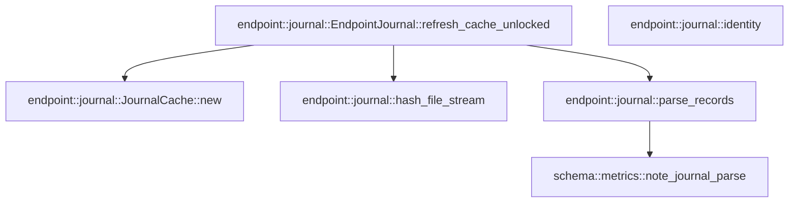

# endpoint::journal

[Package atlas](index.md) · [Source](../../src/journal.rs)

## Declarations

Visibility is the declaration spelling; trait members and reexports require their enclosing interface. `cfg` is not evaluated.

| Symbol | Kind | Visibility | Test / cfg |
|---|---|---|---|
| [endpoint::journal::JOURNAL_RECORD_VERSION](../../src/journal.rs#L18) | const_item | `pub` |  |
| [endpoint::journal::JournalRecord](../../src/journal.rs#L22) | struct_item | `pub` |  |
| [endpoint::journal::JournalRecord::validate](../../src/journal.rs#L30) | function_item | `pub` |  |
| [endpoint::journal::JournalRecord::canonical_bytes](../../src/journal.rs#L53) | function_item | `pub` |  |
| [endpoint::journal::JOURNAL_FILE](../../src/journal.rs#L61) | const_item | `pub` |  |
| [endpoint::journal::LOCK_FILE](../../src/journal.rs#L62) | const_item | `pub` |  |
| [endpoint::journal::retire_outdated_journal](../../src/journal.rs#L74) | function_item | `private` |  |
| [endpoint::journal::retire_legacy_journal](../../src/journal.rs#L99) | function_item | `private` |  |
| [endpoint::journal::JournalTail](../../src/journal.rs#L124) | struct_item | `pub` |  |
| [endpoint::journal::EndpointJournal](../../src/journal.rs#L135) | struct_item | `pub` |  |
| [endpoint::journal::JournalCache](../../src/journal.rs#L142) | struct_item | `private` |  |
| [endpoint::journal::JournalCache::new](../../src/journal.rs#L151) | function_item | `private` |  |
| [endpoint::journal::JournalStreamHash](../../src/journal.rs#L176) | struct_item | `private` |  |
| [endpoint::journal::hash_file_stream](../../src/journal.rs#L182) | function_item | `private` |  |
| [endpoint::journal::EndpointJournal::open](../../src/journal.rs#L225) | function_item | `pub` |  |
| [endpoint::journal::EndpointJournal::path](../../src/journal.rs#L259) | function_item | `pub` |  |
| [endpoint::journal::EndpointJournal::thread_folder](../../src/journal.rs#L264) | function_item | `pub` |  |
| [endpoint::journal::EndpointJournal::records](../../src/journal.rs#L270) | function_item | `pub` |  |
| [endpoint::journal::EndpointJournal::event](../../src/journal.rs#L283) | function_item | `pub` |  |
| [endpoint::journal::EndpointJournal::last_seq](../../src/journal.rs#L301) | function_item | `pub` |  |
| [endpoint::journal::EndpointJournal::tail_summary](../../src/journal.rs#L307) | function_item | `pub` |  |
| [endpoint::journal::EndpointJournal::last_settled_endpoint_seq](../../src/journal.rs#L336) | function_item | `pub` |  |
| [endpoint::journal::EndpointJournal::kernel_anchor_for_endpoint_seq](../../src/journal.rs#L369) | function_item | `pub` |  |
| [endpoint::journal::EndpointJournal::append_kernel](../../src/journal.rs#L388) | function_item | `pub` |  |
| [endpoint::journal::EndpointJournal::append_kernel_batch](../../src/journal.rs#L401) | function_item | `pub` |  |
| [endpoint::journal::EndpointJournal::append_batch](../../src/journal.rs#L429) | function_item | `private` |  |
| [endpoint::journal::EndpointJournal::replace_verified](../../src/journal.rs#L488) | function_item | `pub` |  |
| [endpoint::journal::EndpointJournal::repair_tail](../../src/journal.rs#L521) | function_item | `private` |  |
| [endpoint::journal::EndpointJournal::refresh_cache_unlocked](../../src/journal.rs#L542) | function_item | `private` |  |
| [endpoint::journal::parse_records](../../src/journal.rs#L571) | function_item | `private` |  |
| [endpoint::journal::identity](../../src/journal.rs#L610) | function_item | `private` |  |
| [endpoint::journal::JournalError](../../src/journal.rs#L618) | enum_item | `pub` |  |
| [endpoint::journal::tests::event](../../src/journal.rs#L645) | function_item | `private` | test; #[cfg(test)] |
| [endpoint::journal::tests::append_is_durable_and_idempotent](../../src/journal.rs#L658) | function_item | `private` | test; #[cfg(test)] |
| [endpoint::journal::tests::an_outdated_record_version_retires_the_journal_on_open](../../src/journal.rs#L673) | function_item | `private` | test; #[cfg(test)] |
| [endpoint::journal::tests::a_legacy_journal_is_retired_on_open_and_rebuilt_from_the_ledger](../../src/journal.rs#L692) | function_item | `private` | test; #[cfg(test)] |
| [endpoint::journal::tests::partial_tail_is_truncated](../../src/journal.rs#L704) | function_item | `private` | test; #[cfg(test)] |
| [endpoint::journal::tests::fork_anchor_requires_the_last_projection_slot](../../src/journal.rs#L721) | function_item | `private` | test; #[cfg(test)] |
| [endpoint::journal::repair_cache_tests::open_keeps_the_validated_records_so_the_first_use_does_not_parse_again](../../src/journal.rs#L748) | function_item | `private` | test; #[cfg(test)] |
| [endpoint::journal::repair_cache_tests::tail_summary_length_and_rows_come_from_one_snapshot](../../src/journal.rs#L784) | function_item | `private` | test; #[cfg(test)] |
| [endpoint::journal::repair_cache_tests::same_length_in_place_mutation_is_detected_by_prefix_checksum](../../src/journal.rs#L813) | function_item | `private` | test; #[cfg(test)] |

## Imports / reexports

| Local name | Source path | Visibility |
|---|---|---|
| `HashMap` | `std::collections::HashMap` | `private` |
| `HashSet` | `std::collections::HashSet` | `private` |
| `fs` | `std::fs` | `private` |
| `OpenOptions` | `std::fs::OpenOptions` | `private` |
| `Read` | `std::io::Read` | `private` |
| `Write` | `std::io::Write` | `private` |
| `Path` | `std::path::Path` | `private` |
| `PathBuf` | `std::path::PathBuf` | `private` |
| `Mutex` | `std::sync::Mutex` | `private` |
| `Deserialize` | `serde::Deserialize` | `private` |
| `Serialize` | `serde::Serialize` | `private` |
| `Digest` | `sha2::Digest` | `private` |
| `Sha256` | `sha2::Sha256` | `private` |
| `DirectoryLock` | `store::DirectoryLock` | `private` |
| `FullSync` | `store::FullSync` | `private` |
| `NamedLock` | `store::NamedLock` | `private` |
| `Error` | `thiserror::Error` | `private` |
| `EndpointTypeError` | `crate::types::EndpointTypeError` | `private` |
| `MAX_SAFE_SEQUENCE` | `crate::types::MAX_SAFE_SEQUENCE` | `private` |
| `SessionEvent` | `crate::types::SessionEvent` | `private` |
| `IJsonValue` | `schema::IJsonValue` | `private` |
| `*` | `super::*` | `private` |
| `*` | `super::*` | `private` |

## Module declarations

| Module | Visibility | Attributes |
|---|---|---|
| `endpoint::journal::tests` | `private` | #[cfg(test)] |
| `endpoint::journal::repair_cache_tests` | `private` | #[cfg(test)] |

## Function call graphs

Edges below are syntactically resolved calls only, including private functions. Graphs partition callers into groups of 20; they are not execution order. All unresolved sites are listed below and in the JSON inventory.

```mermaid
flowchart TD
  n0["endpoint::journal::JournalCache::new"]
  n1["endpoint::journal::hash_file_stream"]
  n2["endpoint::journal::EndpointJournal::open"]
  n3["endpoint::journal::EndpointJournal::path"]
  n4["endpoint::journal::EndpointJournal::thread_folder"]
  n5["endpoint::journal::EndpointJournal::records"]
  n6["endpoint::journal::EndpointJournal::event"]
  n7["endpoint::journal::EndpointJournal::last_seq"]
  n8["endpoint::journal::EndpointJournal::tail_summary"]
  n9["endpoint::journal::JournalRecord::validate"]
  n10["endpoint::journal::EndpointJournal::last_settled_endpoint_seq"]
  n11["endpoint::journal::EndpointJournal::kernel_anchor_for_endpoint_seq"]
  n12["endpoint::journal::EndpointJournal::append_kernel"]
  n13["endpoint::journal::EndpointJournal::append_kernel_batch"]
  n14["endpoint::journal::EndpointJournal::append_batch"]
  n15["endpoint::journal::EndpointJournal::replace_verified"]
  n16["endpoint::journal::EndpointJournal::repair_tail"]
  n17["endpoint::journal::JournalRecord::canonical_bytes"]
  n18["endpoint::journal::EndpointJournal::refresh_cache_unlocked"]
  n19["endpoint::journal::parse_records"]
  n20["endpoint::journal::identity"]
  n21["endpoint::journal::retire_outdated_journal"]
  n22["endpoint::journal::retire_legacy_journal"]
  n23["store::platform::NamedLock::exclusive"]
  n24["store::platform::FullSync::full_sync"]
  n25["store::platform::DirectoryLock::shared"]
  n26["store::platform::NamedLock::shared"]
  n2 --> n21
  n2 --> n22
  n2 --> n25
  n5 --> n18
  n5 --> n26
  n6 --> n18
  n6 --> n26
  n7 --> n8
  n8 --> n18
  n8 --> n26
  n10 --> n5
  n11 --> n5
  n12 --> n13
  n13 --> n14
  n14 --> n18
  n14 --> n20
  n14 --> n23
  n14 --> n24
  n15 --> n0
  n15 --> n4
  n15 --> n23
  n15 --> n24
  n16 --> n0
  n16 --> n19
  n16 --> n23
  n16 --> n24
```

Functions 1–20: 26 direct edges

Functions 21–23: 4 direct edges

## Call sites

Includes test functions (marked in declarations). Receiver-type-required sites need type analysis/manual tracing. Calls in closures are attributed to their enclosing function; their occurrence here does not mean the closure executes immediately.

| Caller | Callee expression | Source lines | Target / classification |
|---|---|---|---|
| `validate` | `Err` | [32](../../src/journal.rs#L32), [41](../../src/journal.rs#L41), [46](../../src/journal.rs#L46) | external-constructor-callback-or-unresolved |
| `validate` | `JournalError::Corruption` | [32](../../src/journal.rs#L32), [41](../../src/journal.rs#L41), [46](../../src/journal.rs#L46) | external-constructor-callback-or-unresolved |
| `validate` | `self.event.validate` | [37](../../src/journal.rs#L37) | receiver-type-required |
| `validate` | `self.kernel_seqs.iter().any` | [38](../../src/journal.rs#L38) | receiver-type-required |
| `validate` | `self.kernel_seqs.iter` | [38](../../src/journal.rs#L38) | receiver-type-required |
| `validate` | `self.kernel_seqs.windows(2).any` | [39](../../src/journal.rs#L39) | receiver-type-required |
| `validate` | `self.kernel_seqs.windows` | [39](../../src/journal.rs#L39) | receiver-type-required |
| `validate` | `"kernel_seqs must be sorted and unique".to_owned` | [42](../../src/journal.rs#L42) | receiver-type-required |
| `validate` | `self.slot.is_empty` | [45](../../src/journal.rs#L45) | receiver-type-required |
| `validate` | `self.kernel_seqs.is_empty` | [45](../../src/journal.rs#L45) | receiver-type-required |
| `validate` | `"record must name its kernel slot and causal seqs".to_owned` | [47](../../src/journal.rs#L47) | receiver-type-required |
| `validate` | `Ok` | [50](../../src/journal.rs#L50) | external-constructor-callback-or-unresolved |
| `canonical_bytes` | `serde_json_canonicalizer::to_vec(self)             .map_err` | [54](../../src/journal.rs#L54) | receiver-type-required |
| `canonical_bytes` | `serde_json_canonicalizer::to_vec` | [54](../../src/journal.rs#L54) | external-constructor-callback-or-unresolved |
| `canonical_bytes` | `JournalError::Canonical` | [55](../../src/journal.rs#L55) | external-constructor-callback-or-unresolved |
| `canonical_bytes` | `error.to_string` | [55](../../src/journal.rs#L55) | receiver-type-required |
| `retire_outdated_journal` | `journal.exists` | [75](../../src/journal.rs#L75) | receiver-type-required |
| `retire_outdated_journal` | `Ok` | [76](../../src/journal.rs#L76), [83](../../src/journal.rs#L83), [89](../../src/journal.rs#L89), [96](../../src/journal.rs#L96) | external-constructor-callback-or-unresolved |
| `retire_outdated_journal` | `fs::read` | [78](../../src/journal.rs#L78) | external-constructor-callback-or-unresolved |
| `retire_outdated_journal` | `bytes         .split(&#124;byte&#124; *byte == b'\n')         .find` | [79](../../src/journal.rs#L79) | receiver-type-required |
| `retire_outdated_journal` | `bytes         .split` | [79](../../src/journal.rs#L79) | receiver-type-required |
| `retire_outdated_journal` | `line.is_empty` | [81](../../src/journal.rs#L81) | receiver-type-required |
| `retire_outdated_journal` | `serde_json::from_slice::<serde_json::Value>(first)         .ok()         .and_then` | [85](../../src/journal.rs#L85) | receiver-type-required |
| `retire_outdated_journal` | `serde_json::from_slice::<serde_json::Value>(first)         .ok` | [85](../../src/journal.rs#L85) | receiver-type-required |
| `retire_outdated_journal` | `serde_json::from_slice::<serde_json::Value>` | [85](../../src/journal.rs#L85) | external-constructor-callback-or-unresolved |
| `retire_outdated_journal` | `value.get("v").and_then` | [87](../../src/journal.rs#L87) | receiver-type-required |
| `retire_outdated_journal` | `value.get` | [87](../../src/journal.rs#L87) | receiver-type-required |
| `retire_outdated_journal` | `Some` | [88](../../src/journal.rs#L88) | external-constructor-callback-or-unresolved |
| `retire_outdated_journal` | `fs::remove_file` | [91](../../src/journal.rs#L91), [93](../../src/journal.rs#L93) | external-constructor-callback-or-unresolved |
| `retire_outdated_journal` | `lock.exists` | [92](../../src/journal.rs#L92) | receiver-type-required |
| `retire_outdated_journal` | `fs::File::open(folder)?.sync_all` | [95](../../src/journal.rs#L95) | receiver-type-required |
| `retire_outdated_journal` | `fs::File::open` | [95](../../src/journal.rs#L95) | external-constructor-callback-or-unresolved |
| `retire_legacy_journal` | `journal.exists` | [100](../../src/journal.rs#L100) | receiver-type-required |
| `retire_legacy_journal` | `Ok` | [101](../../src/journal.rs#L101), [119](../../src/journal.rs#L119) | external-constructor-callback-or-unresolved |
| `retire_legacy_journal` | `folder.join` | [110](../../src/journal.rs#L110) | receiver-type-required |
| `retire_legacy_journal` | `legacy.exists` | [111](../../src/journal.rs#L111) | receiver-type-required |
| `retire_legacy_journal` | `fs::remove_file` | [112](../../src/journal.rs#L112) | external-constructor-callback-or-unresolved |
| `retire_legacy_journal` | `fs::File::open(folder)?.sync_all` | [117](../../src/journal.rs#L117) | receiver-type-required |
| `retire_legacy_journal` | `fs::File::open` | [117](../../src/journal.rs#L117) | external-constructor-callback-or-unresolved |
| `new` | `HashMap::with_capacity` | [156](../../src/journal.rs#L156) | external-constructor-callback-or-unresolved |
| `new` | `records.len` | [156](../../src/journal.rs#L156) | receiver-type-required |
| `new` | `records.iter().enumerate` | [157](../../src/journal.rs#L157) | receiver-type-required |
| `new` | `records.iter` | [157](../../src/journal.rs#L157) | receiver-type-required |
| `new` | `identity` | [158](../../src/journal.rs#L158) | external-constructor-callback-or-unresolved |
| `new` | `identities.insert(identity, index).is_some` | [159](../../src/journal.rs#L159) | receiver-type-required |
| `new` | `identities.insert` | [159](../../src/journal.rs#L159) | receiver-type-required |
| `new` | `Err` | [160](../../src/journal.rs#L160) | external-constructor-callback-or-unresolved |
| `new` | `JournalError::Corruption` | [160](../../src/journal.rs#L160) | external-constructor-callback-or-unresolved |
| `new` | `"duplicate projection identity".to_owned` | [161](../../src/journal.rs#L161) | receiver-type-required |
| `new` | `hasher.clone().finalize().into` | [165](../../src/journal.rs#L165) | receiver-type-required |
| `new` | `hasher.clone().finalize` | [165](../../src/journal.rs#L165) | receiver-type-required |
| `new` | `hasher.clone` | [165](../../src/journal.rs#L165) | receiver-type-required |
| `new` | `Ok` | [166](../../src/journal.rs#L166) | external-constructor-callback-or-unresolved |
| `hash_file_stream` | `fs::File::open` | [186](../../src/journal.rs#L186) | external-constructor-callback-or-unresolved |
| `hash_file_stream` | `Sha256::new` | [187](../../src/journal.rs#L187) | external-constructor-callback-or-unresolved |
| `hash_file_stream` | `prefix_len.and_then` | [189](../../src/journal.rs#L189) | receiver-type-required |
| `hash_file_stream` | `(limit == 0).then` | [189](../../src/journal.rs#L189) | receiver-type-required |
| `hash_file_stream` | `Sha256::digest([]).into` | [189](../../src/journal.rs#L189) | receiver-type-required |
| `hash_file_stream` | `Sha256::digest` | [189](../../src/journal.rs#L189) | external-constructor-callback-or-unresolved |
| `hash_file_stream` | `file.read` | [193](../../src/journal.rs#L193) | receiver-type-required |
| `hash_file_stream` | `prefix_hash.is_none` | [199](../../src/journal.rs#L199) | receiver-type-required |
| `hash_file_stream` | `usize::try_from(limit - total).unwrap_or` | [202](../../src/journal.rs#L202) | receiver-type-required |
| `hash_file_stream` | `usize::try_from` | [202](../../src/journal.rs#L202) | external-constructor-callback-or-unresolved |
| `hash_file_stream` | `hasher.update` | [204](../../src/journal.rs#L204), [207](../../src/journal.rs#L207), [210](../../src/journal.rs#L210), [213](../../src/journal.rs#L213) | receiver-type-required |
| `hash_file_stream` | `Some` | [205](../../src/journal.rs#L205) | external-constructor-callback-or-unresolved |
| `hash_file_stream` | `hasher.clone().finalize().into` | [205](../../src/journal.rs#L205) | receiver-type-required |
| `hash_file_stream` | `hasher.clone().finalize` | [205](../../src/journal.rs#L205) | receiver-type-required |
| `hash_file_stream` | `hasher.clone` | [205](../../src/journal.rs#L205) | receiver-type-required |
| `hash_file_stream` | `total.saturating_add` | [215](../../src/journal.rs#L215) | receiver-type-required |
| `hash_file_stream` | `Ok` | [217](../../src/journal.rs#L217) | external-constructor-callback-or-unresolved |
| `hash_file_stream` | `hasher.finalize().into` | [220](../../src/journal.rs#L220) | receiver-type-required |
| `hash_file_stream` | `hasher.finalize` | [220](../../src/journal.rs#L220) | receiver-type-required |
| `open` | `thread_folder.as_ref` | [226](../../src/journal.rs#L226) | receiver-type-required |
| `open` | `folder.is_dir` | [227](../../src/journal.rs#L227) | receiver-type-required |
| `open` | `Err` | [228](../../src/journal.rs#L228) | external-constructor-callback-or-unresolved |
| `open` | `JournalError::Corruption` | [228](../../src/journal.rs#L228) | external-constructor-callback-or-unresolved |
| `open` | `DirectoryLock::shared` | [233](../../src/journal.rs#L233) | [store::platform::DirectoryLock::shared](../../../store/src/platform.rs#L58) |
| `open` | `folder.join` | [234](../../src/journal.rs#L234), [235](../../src/journal.rs#L235) | receiver-type-required |
| `open` | `retire_legacy_journal` | [236](../../src/journal.rs#L236) | [endpoint::journal::retire_legacy_journal](../../src/journal.rs#L99) |
| `open` | `retire_outdated_journal` | [237](../../src/journal.rs#L237) | [endpoint::journal::retire_outdated_journal](../../src/journal.rs#L74) |
| `open` | `path.exists` | [238](../../src/journal.rs#L238) | receiver-type-required |
| `open` | `lock_path.exists` | [239](../../src/journal.rs#L239) | receiver-type-required |
| `open` | `OpenOptions::new().create(true).append(true).open` | [240](../../src/journal.rs#L240) | receiver-type-required |
| `open` | `OpenOptions::new().create(true).append` | [240](../../src/journal.rs#L240) | receiver-type-required |
| `open` | `OpenOptions::new().create` | [240](../../src/journal.rs#L240) | receiver-type-required |
| `open` | `OpenOptions::new` | [240](../../src/journal.rs#L240), [241](../../src/journal.rs#L241) | external-constructor-callback-or-unresolved |
| `open` | `OpenOptions::new()             .create(true)             .append(true)             .open` | [241](../../src/journal.rs#L241) | receiver-type-required |
| `open` | `OpenOptions::new()             .create(true)             .append` | [241](../../src/journal.rs#L241) | receiver-type-required |
| `open` | `OpenOptions::new()             .create` | [241](../../src/journal.rs#L241) | receiver-type-required |
| `open` | `std::fs::File::open(folder)?.sync_all` | [246](../../src/journal.rs#L246) | receiver-type-required |
| `open` | `std::fs::File::open` | [246](../../src/journal.rs#L246) | external-constructor-callback-or-unresolved |
| `open` | `Mutex::new` | [252](../../src/journal.rs#L252) | external-constructor-callback-or-unresolved |
| `open` | `journal.repair_tail` | [254](../../src/journal.rs#L254) | receiver-type-required |
| `open` | `Ok` | [255](../../src/journal.rs#L255) | external-constructor-callback-or-unresolved |
| `thread_folder` | `self.path             .parent()             .expect` | [265](../../src/journal.rs#L265) | receiver-type-required |
| `thread_folder` | `self.path             .parent` | [265](../../src/journal.rs#L265) | receiver-type-required |
| `records` | `NamedLock::shared` | [271](../../src/journal.rs#L271) | [store::platform::NamedLock::shared](../../../store/src/platform.rs#L99) |
| `records` | `self             .cache             .lock()             .unwrap_or_else` | [272](../../src/journal.rs#L272) | receiver-type-required |
| `records` | `self             .cache             .lock` | [272](../../src/journal.rs#L272) | receiver-type-required |
| `records` | `self.refresh_cache_unlocked` | [276](../../src/journal.rs#L276) | [endpoint::journal::EndpointJournal::refresh_cache_unlocked](../../src/journal.rs#L542) |
| `records` | `Ok` | [277](../../src/journal.rs#L277) | external-constructor-callback-or-unresolved |
| `records` | `cache.as_ref().expect("cache was refreshed").records.clone` | [277](../../src/journal.rs#L277) | receiver-type-required |
| `records` | `cache.as_ref().expect` | [277](../../src/journal.rs#L277) | receiver-type-required |
| `records` | `cache.as_ref` | [277](../../src/journal.rs#L277) | receiver-type-required |
| `event` | `NamedLock::shared` | [284](../../src/journal.rs#L284) | [store::platform::NamedLock::shared](../../../store/src/platform.rs#L99) |
| `event` | `self             .cache             .lock()             .unwrap_or_else` | [285](../../src/journal.rs#L285) | receiver-type-required |
| `event` | `self             .cache             .lock` | [285](../../src/journal.rs#L285) | receiver-type-required |
| `event` | `self.refresh_cache_unlocked` | [289](../../src/journal.rs#L289) | [endpoint::journal::EndpointJournal::refresh_cache_unlocked](../../src/journal.rs#L542) |
| `event` | `usize::try_from` | [290](../../src/journal.rs#L290) | external-constructor-callback-or-unresolved |
| `event` | `Ok` | [291](../../src/journal.rs#L291), [293](../../src/journal.rs#L293) | external-constructor-callback-or-unresolved |
| `event` | `cache             .as_ref()             .expect("cache was refreshed")             .records             .get(index)             .map` | [293](../../src/journal.rs#L293) | receiver-type-required |
| `event` | `cache             .as_ref()             .expect("cache was refreshed")             .records             .get` | [293](../../src/journal.rs#L293) | receiver-type-required |
| `event` | `cache             .as_ref()             .expect` | [293](../../src/journal.rs#L293) | receiver-type-required |
| `event` | `cache             .as_ref` | [293](../../src/journal.rs#L293) | receiver-type-required |
| `event` | `record.event.clone` | [298](../../src/journal.rs#L298) | receiver-type-required |
| `last_seq` | `Ok` | [302](../../src/journal.rs#L302) | external-constructor-callback-or-unresolved |
| `last_seq` | `self.tail_summary` | [302](../../src/journal.rs#L302) | [endpoint::journal::EndpointJournal::tail_summary](../../src/journal.rs#L307) |
| `tail_summary` | `NamedLock::shared` | [308](../../src/journal.rs#L308) | [store::platform::NamedLock::shared](../../../store/src/platform.rs#L99) |
| `tail_summary` | `self             .cache             .lock()             .unwrap_or_else` | [309](../../src/journal.rs#L309) | receiver-type-required |
| `tail_summary` | `self             .cache             .lock` | [309](../../src/journal.rs#L309) | receiver-type-required |
| `tail_summary` | `self.refresh_cache_unlocked` | [313](../../src/journal.rs#L313) | [endpoint::journal::EndpointJournal::refresh_cache_unlocked](../../src/journal.rs#L542) |
| `tail_summary` | `cache.as_ref().expect` | [314](../../src/journal.rs#L314) | receiver-type-required |
| `tail_summary` | `cache.as_ref` | [314](../../src/journal.rs#L314) | receiver-type-required |
| `tail_summary` | `records.last` | [316](../../src/journal.rs#L316) | receiver-type-required |
| `tail_summary` | `Ok` | [317](../../src/journal.rs#L317) | external-constructor-callback-or-unresolved |
| `tail_summary` | `records.len` | [319](../../src/journal.rs#L319) | receiver-type-required |
| `tail_summary` | `last.map` | [320](../../src/journal.rs#L320) | receiver-type-required |
| `tail_summary` | `last                 .and_then(&#124;record&#124; record.kernel_seqs.last().copied())                 .unwrap_or` | [321](../../src/journal.rs#L321) | receiver-type-required |
| `tail_summary` | `last                 .and_then` | [321](../../src/journal.rs#L321) | receiver-type-required |
| `tail_summary` | `record.kernel_seqs.last().copied` | [322](../../src/journal.rs#L322) | receiver-type-required |
| `tail_summary` | `record.kernel_seqs.last` | [322](../../src/journal.rs#L322) | receiver-type-required |
| `last_settled_endpoint_seq` | `self.records` | [337](../../src/journal.rs#L337) | [endpoint::journal::EndpointJournal::records](../../src/journal.rs#L270) |
| `last_settled_endpoint_seq` | `records.last` | [338](../../src/journal.rs#L338) | receiver-type-required |
| `last_settled_endpoint_seq` | `Ok` | [339](../../src/journal.rs#L339), [353](../../src/journal.rs#L353), [356](../../src/journal.rs#L356), [366](../../src/journal.rs#L366) | external-constructor-callback-or-unresolved |
| `last_settled_endpoint_seq` | `records             .iter()             .rposition` | [341](../../src/journal.rs#L341), [344](../../src/journal.rs#L344) | receiver-type-required |
| `last_settled_endpoint_seq` | `records             .iter` | [341](../../src/journal.rs#L341), [344](../../src/journal.rs#L344) | receiver-type-required |
| `last_settled_endpoint_seq` | `Some` | [353](../../src/journal.rs#L353), [366](../../src/journal.rs#L366) | external-constructor-callback-or-unresolved |
| `last_settled_endpoint_seq` | `records[end].kernel_seqs.last().copied` | [358](../../src/journal.rs#L358) | receiver-type-required |
| `last_settled_endpoint_seq` | `records[end].kernel_seqs.last` | [358](../../src/journal.rs#L358) | receiver-type-required |
| `last_settled_endpoint_seq` | `records             .get(index + 1)             .is_some_and` | [360](../../src/journal.rs#L360) | receiver-type-required |
| `last_settled_endpoint_seq` | `records             .get` | [360](../../src/journal.rs#L360) | receiver-type-required |
| `last_settled_endpoint_seq` | `next.kernel_seqs.last().copied` | [362](../../src/journal.rs#L362) | receiver-type-required |
| `last_settled_endpoint_seq` | `next.kernel_seqs.last` | [362](../../src/journal.rs#L362) | receiver-type-required |
| `kernel_anchor_for_endpoint_seq` | `self.records` | [370](../../src/journal.rs#L370) | [endpoint::journal::EndpointJournal::records](../../src/journal.rs#L270) |
| `kernel_anchor_for_endpoint_seq` | `usize::try_from(endpoint_seq)             .map_err` | [371](../../src/journal.rs#L371) | receiver-type-required |
| `kernel_anchor_for_endpoint_seq` | `usize::try_from` | [371](../../src/journal.rs#L371) | external-constructor-callback-or-unresolved |
| `kernel_anchor_for_endpoint_seq` | `JournalError::EndpointSeqNotFound` | [372](../../src/journal.rs#L372), [375](../../src/journal.rs#L375) | external-constructor-callback-or-unresolved |
| `kernel_anchor_for_endpoint_seq` | `records             .get(index)             .ok_or` | [373](../../src/journal.rs#L373) | receiver-type-required |
| `kernel_anchor_for_endpoint_seq` | `records             .get` | [373](../../src/journal.rs#L373), [379](../../src/journal.rs#L379) | receiver-type-required |
| `kernel_anchor_for_endpoint_seq` | `record.kernel_seqs.last().copied().ok_or_else` | [376](../../src/journal.rs#L376) | receiver-type-required |
| `kernel_anchor_for_endpoint_seq` | `record.kernel_seqs.last().copied` | [376](../../src/journal.rs#L376) | receiver-type-required |
| `kernel_anchor_for_endpoint_seq` | `record.kernel_seqs.last` | [376](../../src/journal.rs#L376) | receiver-type-required |
| `kernel_anchor_for_endpoint_seq` | `JournalError::Corruption` | [377](../../src/journal.rs#L377) | external-constructor-callback-or-unresolved |
| `kernel_anchor_for_endpoint_seq` | `"kernel projection lacks causal anchor".to_owned` | [377](../../src/journal.rs#L377) | receiver-type-required |
| `kernel_anchor_for_endpoint_seq` | `records             .get(index + 1)             .is_some_and` | [379](../../src/journal.rs#L379) | receiver-type-required |
| `kernel_anchor_for_endpoint_seq` | `next.kernel_seqs.last().copied` | [381](../../src/journal.rs#L381) | receiver-type-required |
| `kernel_anchor_for_endpoint_seq` | `next.kernel_seqs.last` | [381](../../src/journal.rs#L381) | receiver-type-required |
| `kernel_anchor_for_endpoint_seq` | `Some` | [381](../../src/journal.rs#L381) | external-constructor-callback-or-unresolved |
| `kernel_anchor_for_endpoint_seq` | `Err` | [383](../../src/journal.rs#L383) | external-constructor-callback-or-unresolved |
| `kernel_anchor_for_endpoint_seq` | `JournalError::IncompleteProjectionGroup` | [383](../../src/journal.rs#L383) | external-constructor-callback-or-unresolved |
| `kernel_anchor_for_endpoint_seq` | `Ok` | [385](../../src/journal.rs#L385) | external-constructor-callback-or-unresolved |
| `append_kernel` | `self.append_kernel_batch(vec![(kernel_seqs, slot.into(), event)])             .map` | [394](../../src/journal.rs#L394) | receiver-type-required |
| `append_kernel` | `self.append_kernel_batch` | [394](../../src/journal.rs#L394) | [endpoint::journal::EndpointJournal::append_kernel_batch](../../src/journal.rs#L401) |
| `append_kernel` | `events.remove` | [395](../../src/journal.rs#L395) | receiver-type-required |
| `append_kernel_batch` | `projections.is_empty` | [405](../../src/journal.rs#L405) | receiver-type-required |
| `append_kernel_batch` | `Ok` | [406](../../src/journal.rs#L406) | external-constructor-callback-or-unresolved |
| `append_kernel_batch` | `Vec::new` | [406](../../src/journal.rs#L406) | external-constructor-callback-or-unresolved |
| `append_kernel_batch` | `projections             .iter()             .map` | [408](../../src/journal.rs#L408) | receiver-type-required |
| `append_kernel_batch` | `projections             .iter` | [408](../../src/journal.rs#L408) | receiver-type-required |
| `append_kernel_batch` | `kernel_seqs.last().copied` | [410](../../src/journal.rs#L410) | receiver-type-required |
| `append_kernel_batch` | `kernel_seqs.last` | [410](../../src/journal.rs#L410) | receiver-type-required |
| `append_kernel_batch` | `anchors.next().flatten` | [411](../../src/journal.rs#L411) | receiver-type-required |
| `append_kernel_batch` | `anchors.next` | [411](../../src/journal.rs#L411) | receiver-type-required |
| `append_kernel_batch` | `anchor.is_none` | [412](../../src/journal.rs#L412) | receiver-type-required |
| `append_kernel_batch` | `anchors.any` | [412](../../src/journal.rs#L412) | receiver-type-required |
| `append_kernel_batch` | `Err` | [413](../../src/journal.rs#L413) | external-constructor-callback-or-unresolved |
| `append_kernel_batch` | `JournalError::Corruption` | [413](../../src/journal.rs#L413) | external-constructor-callback-or-unresolved |
| `append_kernel_batch` | `"kernel projection batch must share one causal anchor".to_owned` | [414](../../src/journal.rs#L414) | receiver-type-required |
| `append_kernel_batch` | `projections             .into_iter()             .map(&#124;(kernel_seqs, slot, event)&#124; JournalRecord {                 v: JOURNAL_RECORD_VERSION,                 event,                 kernel_seqs,                 slot,             })             .collect` | [417](../../src/journal.rs#L417) | receiver-type-required |
| `append_kernel_batch` | `projections             .into_iter()             .map` | [417](../../src/journal.rs#L417) | receiver-type-required |
| `append_kernel_batch` | `projections             .into_iter` | [417](../../src/journal.rs#L417) | receiver-type-required |
| `append_kernel_batch` | `self.append_batch` | [426](../../src/journal.rs#L426) | [endpoint::journal::EndpointJournal::append_batch](../../src/journal.rs#L429) |
| `append_batch` | `candidates.is_empty` | [433](../../src/journal.rs#L433) | receiver-type-required |
| `append_batch` | `Ok` | [434](../../src/journal.rs#L434), [483](../../src/journal.rs#L483) | external-constructor-callback-or-unresolved |
| `append_batch` | `Vec::new` | [434](../../src/journal.rs#L434), [444](../../src/journal.rs#L444) | external-constructor-callback-or-unresolved |
| `append_batch` | `NamedLock::exclusive` | [436](../../src/journal.rs#L436) | [store::platform::NamedLock::exclusive](../../../store/src/platform.rs#L103) |
| `append_batch` | `self             .cache             .lock()             .unwrap_or_else` | [437](../../src/journal.rs#L437) | receiver-type-required |
| `append_batch` | `self             .cache             .lock` | [437](../../src/journal.rs#L437) | receiver-type-required |
| `append_batch` | `self.refresh_cache_unlocked` | [441](../../src/journal.rs#L441) | [endpoint::journal::EndpointJournal::refresh_cache_unlocked](../../src/journal.rs#L542) |
| `append_batch` | `cache_slot.as_mut().expect` | [442](../../src/journal.rs#L442) | receiver-type-required |
| `append_batch` | `cache_slot.as_mut` | [442](../../src/journal.rs#L442) | receiver-type-required |
| `append_batch` | `Vec::with_capacity` | [443](../../src/journal.rs#L443) | external-constructor-callback-or-unresolved |
| `append_batch` | `candidates.len` | [443](../../src/journal.rs#L443) | receiver-type-required |
| `append_batch` | `candidates.drain` | [446](../../src/journal.rs#L446) | receiver-type-required |
| `append_batch` | `identity` | [447](../../src/journal.rs#L447) | [endpoint::journal::identity](../../src/journal.rs#L610) |
| `append_batch` | `cache.identities.get(&candidate_identity).copied` | [448](../../src/journal.rs#L448) | receiver-type-required |
| `append_batch` | `cache.identities.get` | [448](../../src/journal.rs#L448) | receiver-type-required |
| `append_batch` | `Err` | [451](../../src/journal.rs#L451), [457](../../src/journal.rs#L457) | external-constructor-callback-or-unresolved |
| `append_batch` | `JournalError::Corruption` | [451](../../src/journal.rs#L451), [464](../../src/journal.rs#L464) | external-constructor-callback-or-unresolved |
| `append_batch` | `"projection batch has an existing slot after a missing slot".to_owned` | [452](../../src/journal.rs#L452) | receiver-type-required |
| `append_batch` | `candidate.canonical_bytes` | [456](../../src/journal.rs#L456), [466](../../src/journal.rs#L466) | receiver-type-required |
| `append_batch` | `existing.canonical_bytes` | [456](../../src/journal.rs#L456) | receiver-type-required |
| `append_batch` | `JournalError::IdentityConflict` | [457](../../src/journal.rs#L457) | external-constructor-callback-or-unresolved |
| `append_batch` | `results.push` | [459](../../src/journal.rs#L459), [469](../../src/journal.rs#L469) | receiver-type-required |
| `append_batch` | `existing.event.clone` | [459](../../src/journal.rs#L459) | receiver-type-required |
| `append_batch` | `u64::try_from(cache.records.len())                 .map_err` | [463](../../src/journal.rs#L463) | receiver-type-required |
| `append_batch` | `u64::try_from` | [463](../../src/journal.rs#L463) | external-constructor-callback-or-unresolved |
| `append_batch` | `cache.records.len` | [463](../../src/journal.rs#L463), [472](../../src/journal.rs#L472) | receiver-type-required |
| `append_batch` | `"journal length overflow".to_owned` | [464](../../src/journal.rs#L464) | receiver-type-required |
| `append_batch` | `candidate.validate` | [465](../../src/journal.rs#L465) | receiver-type-required |
| `append_batch` | `line.push` | [467](../../src/journal.rs#L467) | receiver-type-required |
| `append_batch` | `bytes.extend_from_slice` | [468](../../src/journal.rs#L468) | receiver-type-required |
| `append_batch` | `candidate.event.clone` | [469](../../src/journal.rs#L469) | receiver-type-required |
| `append_batch` | `cache                 .identities                 .insert` | [470](../../src/journal.rs#L470) | receiver-type-required |
| `append_batch` | `cache.records.push` | [473](../../src/journal.rs#L473) | receiver-type-required |
| `append_batch` | `bytes.is_empty` | [475](../../src/journal.rs#L475) | receiver-type-required |
| `append_batch` | `OpenOptions::new().append(true).open` | [476](../../src/journal.rs#L476) | receiver-type-required |
| `append_batch` | `OpenOptions::new().append` | [476](../../src/journal.rs#L476) | receiver-type-required |
| `append_batch` | `OpenOptions::new` | [476](../../src/journal.rs#L476) | external-constructor-callback-or-unresolved |
| `append_batch` | `file.write_all` | [477](../../src/journal.rs#L477) | receiver-type-required |
| `append_batch` | `FullSync::full_sync` | [478](../../src/journal.rs#L478) | [store::platform::FullSync::full_sync](../../../store/src/platform.rs#L31) |
| `append_batch` | `cache.file_len.saturating_add` | [479](../../src/journal.rs#L479) | receiver-type-required |
| `append_batch` | `bytes.len` | [479](../../src/journal.rs#L479) | receiver-type-required |
| `append_batch` | `cache.hasher.update` | [480](../../src/journal.rs#L480) | receiver-type-required |
| `append_batch` | `cache.hasher.clone().finalize().into` | [481](../../src/journal.rs#L481) | receiver-type-required |
| `append_batch` | `cache.hasher.clone().finalize` | [481](../../src/journal.rs#L481) | receiver-type-required |
| `append_batch` | `cache.hasher.clone` | [481](../../src/journal.rs#L481) | receiver-type-required |
| `replace_verified` | `NamedLock::exclusive` | [489](../../src/journal.rs#L489) | [store::platform::NamedLock::exclusive](../../../store/src/platform.rs#L103) |
| `replace_verified` | `Vec::new` | [490](../../src/journal.rs#L490) | external-constructor-callback-or-unresolved |
| `replace_verified` | `records.iter().enumerate` | [491](../../src/journal.rs#L491) | receiver-type-required |
| `replace_verified` | `records.iter` | [491](../../src/journal.rs#L491) | receiver-type-required |
| `replace_verified` | `record.validate` | [492](../../src/journal.rs#L492) | receiver-type-required |
| `replace_verified` | `record.canonical_bytes` | [493](../../src/journal.rs#L493) | receiver-type-required |
| `replace_verified` | `line.push` | [494](../../src/journal.rs#L494) | receiver-type-required |
| `replace_verified` | `bytes.extend_from_slice` | [495](../../src/journal.rs#L495) | receiver-type-required |
| `replace_verified` | `Sha256::new` | [497](../../src/journal.rs#L497) | external-constructor-callback-or-unresolved |
| `replace_verified` | `hasher.update` | [498](../../src/journal.rs#L498) | receiver-type-required |
| `replace_verified` | `JournalCache::new` | [499](../../src/journal.rs#L499) | [endpoint::journal::JournalCache::new](../../src/journal.rs#L151) |
| `replace_verified` | `bytes.len` | [499](../../src/journal.rs#L499) | receiver-type-required |
| `replace_verified` | `self             .thread_folder()             .join` | [500](../../src/journal.rs#L500) | receiver-type-required |
| `replace_verified` | `self             .thread_folder` | [500](../../src/journal.rs#L500) | [endpoint::journal::EndpointJournal::thread_folder](../../src/journal.rs#L264) |
| `replace_verified` | `OpenOptions::new()                 .write(true)                 .create(true)                 .truncate(true)                 .open` | [504](../../src/journal.rs#L504) | receiver-type-required |
| `replace_verified` | `OpenOptions::new()                 .write(true)                 .create(true)                 .truncate` | [504](../../src/journal.rs#L504) | receiver-type-required |
| `replace_verified` | `OpenOptions::new()                 .write(true)                 .create` | [504](../../src/journal.rs#L504) | receiver-type-required |
| `replace_verified` | `OpenOptions::new()                 .write` | [504](../../src/journal.rs#L504) | receiver-type-required |
| `replace_verified` | `OpenOptions::new` | [504](../../src/journal.rs#L504) | external-constructor-callback-or-unresolved |
| `replace_verified` | `file.write_all` | [509](../../src/journal.rs#L509) | receiver-type-required |
| `replace_verified` | `FullSync::full_sync` | [510](../../src/journal.rs#L510) | [store::platform::FullSync::full_sync](../../../store/src/platform.rs#L31) |
| `replace_verified` | `fs::rename` | [512](../../src/journal.rs#L512) | external-constructor-callback-or-unresolved |
| `replace_verified` | `fs::File::open(self.thread_folder())?.sync_all` | [513](../../src/journal.rs#L513) | receiver-type-required |
| `replace_verified` | `fs::File::open` | [513](../../src/journal.rs#L513) | external-constructor-callback-or-unresolved |
| `replace_verified` | `self.thread_folder` | [513](../../src/journal.rs#L513) | [endpoint::journal::EndpointJournal::thread_folder](../../src/journal.rs#L264) |
| `replace_verified` | `self             .cache             .lock()             .unwrap_or_else` | [514](../../src/journal.rs#L514) | receiver-type-required |
| `replace_verified` | `self             .cache             .lock` | [514](../../src/journal.rs#L514) | receiver-type-required |
| `replace_verified` | `Some` | [517](../../src/journal.rs#L517) | external-constructor-callback-or-unresolved |
| `replace_verified` | `Ok` | [518](../../src/journal.rs#L518) | external-constructor-callback-or-unresolved |
| `repair_tail` | `NamedLock::exclusive` | [522](../../src/journal.rs#L522) | [store::platform::NamedLock::exclusive](../../../store/src/platform.rs#L103) |
| `repair_tail` | `fs::read` | [523](../../src/journal.rs#L523) | external-constructor-callback-or-unresolved |
| `repair_tail` | `parse_records` | [524](../../src/journal.rs#L524) | [endpoint::journal::parse_records](../../src/journal.rs#L571) |
| `repair_tail` | `bytes.len` | [525](../../src/journal.rs#L525) | receiver-type-required |
| `repair_tail` | `OpenOptions::new().write(true).open` | [526](../../src/journal.rs#L526) | receiver-type-required |
| `repair_tail` | `OpenOptions::new().write` | [526](../../src/journal.rs#L526) | receiver-type-required |
| `repair_tail` | `OpenOptions::new` | [526](../../src/journal.rs#L526) | external-constructor-callback-or-unresolved |
| `repair_tail` | `file.set_len` | [527](../../src/journal.rs#L527) | receiver-type-required |
| `repair_tail` | `FullSync::full_sync` | [528](../../src/journal.rs#L528) | [store::platform::FullSync::full_sync](../../../store/src/platform.rs#L31) |
| `repair_tail` | `Sha256::new` | [532](../../src/journal.rs#L532) | external-constructor-callback-or-unresolved |
| `repair_tail` | `hasher.update` | [533](../../src/journal.rs#L533) | receiver-type-required |
| `repair_tail` | `JournalCache::new` | [534](../../src/journal.rs#L534) | [endpoint::journal::JournalCache::new](../../src/journal.rs#L151) |
| `repair_tail` | `self             .cache             .lock()             .unwrap_or_else` | [535](../../src/journal.rs#L535) | receiver-type-required |
| `repair_tail` | `self             .cache             .lock` | [535](../../src/journal.rs#L535) | receiver-type-required |
| `repair_tail` | `Some` | [538](../../src/journal.rs#L538) | external-constructor-callback-or-unresolved |
| `repair_tail` | `Ok` | [539](../../src/journal.rs#L539) | external-constructor-callback-or-unresolved |
| `refresh_cache_unlocked` | `cache.as_ref` | [543](../../src/journal.rs#L543) | receiver-type-required |
| `refresh_cache_unlocked` | `hash_file_stream` | [544](../../src/journal.rs#L544) | [endpoint::journal::hash_file_stream](../../src/journal.rs#L182) |
| `refresh_cache_unlocked` | `Some` | [544](../../src/journal.rs#L544), [553](../../src/journal.rs#L553), [566](../../src/journal.rs#L566) | external-constructor-callback-or-unresolved |
| `refresh_cache_unlocked` | `Ok` | [547](../../src/journal.rs#L547), [567](../../src/journal.rs#L567) | external-constructor-callback-or-unresolved |
| `refresh_cache_unlocked` | `Err` | [549](../../src/journal.rs#L549), [554](../../src/journal.rs#L554), [562](../../src/journal.rs#L562) | external-constructor-callback-or-unresolved |
| `refresh_cache_unlocked` | `JournalError::Corruption` | [549](../../src/journal.rs#L549), [554](../../src/journal.rs#L554), [562](../../src/journal.rs#L562) | external-constructor-callback-or-unresolved |
| `refresh_cache_unlocked` | `"endpoint journal prefix checksum mismatch".to_owned` | [550](../../src/journal.rs#L550), [555](../../src/journal.rs#L555) | receiver-type-required |
| `refresh_cache_unlocked` | `fs::read` | [559](../../src/journal.rs#L559) | external-constructor-callback-or-unresolved |
| `refresh_cache_unlocked` | `parse_records` | [560](../../src/journal.rs#L560) | [endpoint::journal::parse_records](../../src/journal.rs#L571) |
| `refresh_cache_unlocked` | `bytes.len` | [561](../../src/journal.rs#L561), [566](../../src/journal.rs#L566) | receiver-type-required |
| `refresh_cache_unlocked` | `"partial journal tail".to_owned` | [562](../../src/journal.rs#L562) | receiver-type-required |
| `refresh_cache_unlocked` | `Sha256::new` | [564](../../src/journal.rs#L564) | external-constructor-callback-or-unresolved |
| `refresh_cache_unlocked` | `hasher.update` | [565](../../src/journal.rs#L565) | receiver-type-required |
| `refresh_cache_unlocked` | `JournalCache::new` | [566](../../src/journal.rs#L566) | [endpoint::journal::JournalCache::new](../../src/journal.rs#L151) |
| `parse_records` | `schema::metrics::note_journal_parse` | [575](../../src/journal.rs#L575) | [schema::metrics::note_journal_parse](../../../schema/src/metrics.rs#L56) |
| `parse_records` | `bytes.len` | [575](../../src/journal.rs#L575), [579](../../src/journal.rs#L579) | receiver-type-required |
| `parse_records` | `Vec::new` | [576](../../src/journal.rs#L576) | external-constructor-callback-or-unresolved |
| `parse_records` | `HashSet::new` | [578](../../src/journal.rs#L578) | external-constructor-callback-or-unresolved |
| `parse_records` | `bytes[offset..].iter().position` | [580](../../src/journal.rs#L580) | receiver-type-required |
| `parse_records` | `bytes[offset..].iter` | [580](../../src/journal.rs#L580) | receiver-type-required |
| `parse_records` | `Ok` | [582](../../src/journal.rs#L582), [607](../../src/journal.rs#L607) | external-constructor-callback-or-unresolved |
| `parse_records` | `Err` | [584](../../src/journal.rs#L584), [588](../../src/journal.rs#L588), [593](../../src/journal.rs#L593), [600](../../src/journal.rs#L600) | external-constructor-callback-or-unresolved |
| `parse_records` | `JournalError::Corruption` | [584](../../src/journal.rs#L584), [588](../../src/journal.rs#L588), [593](../../src/journal.rs#L593), [600](../../src/journal.rs#L600) | external-constructor-callback-or-unresolved |
| `parse_records` | `"partial journal tail".to_owned` | [584](../../src/journal.rs#L584) | receiver-type-required |
| `parse_records` | `"blank journal line".to_owned` | [588](../../src/journal.rs#L588) | receiver-type-required |
| `parse_records` | `serde_json::from_slice` | [591](../../src/journal.rs#L591) | external-constructor-callback-or-unresolved |
| `parse_records` | `record.canonical_bytes` | [592](../../src/journal.rs#L592) | receiver-type-required |
| `parse_records` | `"journal line is not canonical JSON".to_owned` | [594](../../src/journal.rs#L594) | receiver-type-required |
| `parse_records` | `record.validate` | [597](../../src/journal.rs#L597) | receiver-type-required |
| `parse_records` | `records.len` | [597](../../src/journal.rs#L597) | receiver-type-required |
| `parse_records` | `identity` | [598](../../src/journal.rs#L598) | external-constructor-callback-or-unresolved |
| `parse_records` | `identities.insert` | [599](../../src/journal.rs#L599) | receiver-type-required |
| `parse_records` | `"duplicate projection identity".to_owned` | [601](../../src/journal.rs#L601) | receiver-type-required |
| `parse_records` | `records.push` | [604](../../src/journal.rs#L604) | receiver-type-required |
| `identity` | `record.kernel_seqs.last().ok_or_else` | [611](../../src/journal.rs#L611) | receiver-type-required |
| `identity` | `record.kernel_seqs.last` | [611](../../src/journal.rs#L611) | receiver-type-required |
| `identity` | `JournalError::Corruption` | [612](../../src/journal.rs#L612) | external-constructor-callback-or-unresolved |
| `identity` | `"kernel projection lacks causal anchor".to_owned` | [612](../../src/journal.rs#L612) | receiver-type-required |
| `identity` | `Ok` | [614](../../src/journal.rs#L614) | external-constructor-callback-or-unresolved |
| `event` | `event_type.to_owned` | [647](../../src/journal.rs#L647) | receiver-type-required |
| `event` | `IJsonValue::parse_str("{}").expect` | [650](../../src/journal.rs#L650) | receiver-type-required |
| `event` | `IJsonValue::parse_str` | [650](../../src/journal.rs#L650) | [schema::ijson::IJsonValue::parse_str](../../../schema/src/ijson.rs#L23) |
| `append_is_durable_and_idempotent` | `tempfile::tempdir().expect` | [659](../../src/journal.rs#L659) | receiver-type-required |
| `append_is_durable_and_idempotent` | `tempfile::tempdir` | [659](../../src/journal.rs#L659) | external-constructor-callback-or-unresolved |
| `append_is_durable_and_idempotent` | `EndpointJournal::open(folder.path()).expect` | [660](../../src/journal.rs#L660) | receiver-type-required |
| `append_is_durable_and_idempotent` | `EndpointJournal::open` | [660](../../src/journal.rs#L660) | external-constructor-callback-or-unresolved |
| `append_is_durable_and_idempotent` | `folder.path` | [660](../../src/journal.rs#L660) | receiver-type-required |
| `append_is_durable_and_idempotent` | `journal             .append_kernel(vec![3], "turn-start", event("turn/start"))             .expect` | [661](../../src/journal.rs#L661), [665](../../src/journal.rs#L665) | receiver-type-required |
| `append_is_durable_and_idempotent` | `journal             .append_kernel` | [661](../../src/journal.rs#L661), [665](../../src/journal.rs#L665) | receiver-type-required |
| `append_is_durable_and_idempotent` | `event` | [662](../../src/journal.rs#L662), [666](../../src/journal.rs#L666) | [endpoint::journal::tests::event](../../src/journal.rs#L645) |
| `an_outdated_record_version_retires_the_journal_on_open` | `tempfile::tempdir().expect` | [674](../../src/journal.rs#L674) | receiver-type-required |
| `an_outdated_record_version_retires_the_journal_on_open` | `tempfile::tempdir` | [674](../../src/journal.rs#L674) | external-constructor-callback-or-unresolved |
| `an_outdated_record_version_retires_the_journal_on_open` | `fs::write(             folder.path().join(JOURNAL_FILE),             b"{\"event\":{\"data\":{},\"eventType\":\"turn/start\",\"seq\":0,\"time\":1.0},\"kernel_seqs\":[1],\"slot\":\"turn-start\",\"v\":2}\n",         )         .expect` | [675](../../src/journal.rs#L675) | receiver-type-required |
| `an_outdated_record_version_retires_the_journal_on_open` | `fs::write` | [675](../../src/journal.rs#L675), [680](../../src/journal.rs#L680) | external-constructor-callback-or-unresolved |
| `an_outdated_record_version_retires_the_journal_on_open` | `folder.path().join` | [676](../../src/journal.rs#L676), [680](../../src/journal.rs#L680) | receiver-type-required |
| `an_outdated_record_version_retires_the_journal_on_open` | `folder.path` | [676](../../src/journal.rs#L676), [680](../../src/journal.rs#L680), [681](../../src/journal.rs#L681), [687](../../src/journal.rs#L687) | receiver-type-required |
| `an_outdated_record_version_retires_the_journal_on_open` | `fs::write(folder.path().join(LOCK_FILE), b"").expect` | [680](../../src/journal.rs#L680) | receiver-type-required |
| `an_outdated_record_version_retires_the_journal_on_open` | `EndpointJournal::open(folder.path()).expect` | [681](../../src/journal.rs#L681), [687](../../src/journal.rs#L687) | receiver-type-required |
| `an_outdated_record_version_retires_the_journal_on_open` | `EndpointJournal::open` | [681](../../src/journal.rs#L681), [687](../../src/journal.rs#L687) | external-constructor-callback-or-unresolved |
| `an_outdated_record_version_retires_the_journal_on_open` | `drop` | [686](../../src/journal.rs#L686) | external-constructor-callback-or-unresolved |
| `a_legacy_journal_is_retired_on_open_and_rebuilt_from_the_ledger` | `tempfile::tempdir().expect` | [693](../../src/journal.rs#L693) | receiver-type-required |
| `a_legacy_journal_is_retired_on_open_and_rebuilt_from_the_ledger` | `tempfile::tempdir` | [693](../../src/journal.rs#L693) | external-constructor-callback-or-unresolved |
| `a_legacy_journal_is_retired_on_open_and_rebuilt_from_the_ledger` | `fs::write(folder.path().join("endpoint-v2.jsonl"), b"{\"v\":2}\n").expect` | [694](../../src/journal.rs#L694) | receiver-type-required |
| `a_legacy_journal_is_retired_on_open_and_rebuilt_from_the_ledger` | `fs::write` | [694](../../src/journal.rs#L694), [695](../../src/journal.rs#L695) | external-constructor-callback-or-unresolved |
| `a_legacy_journal_is_retired_on_open_and_rebuilt_from_the_ledger` | `folder.path().join` | [694](../../src/journal.rs#L694), [695](../../src/journal.rs#L695) | receiver-type-required |
| `a_legacy_journal_is_retired_on_open_and_rebuilt_from_the_ledger` | `folder.path` | [694](../../src/journal.rs#L694), [695](../../src/journal.rs#L695), [696](../../src/journal.rs#L696) | receiver-type-required |
| `a_legacy_journal_is_retired_on_open_and_rebuilt_from_the_ledger` | `fs::write(folder.path().join("endpoint-v2.lock"), b"").expect` | [695](../../src/journal.rs#L695) | receiver-type-required |
| `a_legacy_journal_is_retired_on_open_and_rebuilt_from_the_ledger` | `EndpointJournal::open(folder.path()).expect` | [696](../../src/journal.rs#L696) | receiver-type-required |
| `a_legacy_journal_is_retired_on_open_and_rebuilt_from_the_ledger` | `EndpointJournal::open` | [696](../../src/journal.rs#L696) | external-constructor-callback-or-unresolved |
| `partial_tail_is_truncated` | `tempfile::tempdir().expect` | [705](../../src/journal.rs#L705) | receiver-type-required |
| `partial_tail_is_truncated` | `tempfile::tempdir` | [705](../../src/journal.rs#L705) | external-constructor-callback-or-unresolved |
| `partial_tail_is_truncated` | `EndpointJournal::open(folder.path()).expect` | [706](../../src/journal.rs#L706), [716](../../src/journal.rs#L716) | receiver-type-required |
| `partial_tail_is_truncated` | `EndpointJournal::open` | [706](../../src/journal.rs#L706), [716](../../src/journal.rs#L716) | external-constructor-callback-or-unresolved |
| `partial_tail_is_truncated` | `folder.path` | [706](../../src/journal.rs#L706), [716](../../src/journal.rs#L716) | receiver-type-required |
| `partial_tail_is_truncated` | `journal             .append_kernel(vec![3], "turn-start", event("turn/start"))             .expect` | [707](../../src/journal.rs#L707) | receiver-type-required |
| `partial_tail_is_truncated` | `journal             .append_kernel` | [707](../../src/journal.rs#L707) | receiver-type-required |
| `partial_tail_is_truncated` | `event` | [708](../../src/journal.rs#L708) | [endpoint::journal::tests::event](../../src/journal.rs#L645) |
| `partial_tail_is_truncated` | `OpenOptions::new()             .append(true)             .open(journal.path())             .expect` | [710](../../src/journal.rs#L710) | receiver-type-required |
| `partial_tail_is_truncated` | `OpenOptions::new()             .append(true)             .open` | [710](../../src/journal.rs#L710) | receiver-type-required |
| `partial_tail_is_truncated` | `OpenOptions::new()             .append` | [710](../../src/journal.rs#L710) | receiver-type-required |
| `partial_tail_is_truncated` | `OpenOptions::new` | [710](../../src/journal.rs#L710) | external-constructor-callback-or-unresolved |
| `partial_tail_is_truncated` | `journal.path` | [712](../../src/journal.rs#L712) | receiver-type-required |
| `partial_tail_is_truncated` | `file.write_all(b"{\"v\":2").expect` | [714](../../src/journal.rs#L714) | receiver-type-required |
| `partial_tail_is_truncated` | `file.write_all` | [714](../../src/journal.rs#L714) | receiver-type-required |
| `partial_tail_is_truncated` | `drop` | [715](../../src/journal.rs#L715) | external-constructor-callback-or-unresolved |
| `fork_anchor_requires_the_last_projection_slot` | `tempfile::tempdir().expect` | [722](../../src/journal.rs#L722) | receiver-type-required |
| `fork_anchor_requires_the_last_projection_slot` | `tempfile::tempdir` | [722](../../src/journal.rs#L722) | external-constructor-callback-or-unresolved |
| `fork_anchor_requires_the_last_projection_slot` | `EndpointJournal::open(folder.path()).expect` | [723](../../src/journal.rs#L723) | receiver-type-required |
| `fork_anchor_requires_the_last_projection_slot` | `EndpointJournal::open` | [723](../../src/journal.rs#L723) | external-constructor-callback-or-unresolved |
| `fork_anchor_requires_the_last_projection_slot` | `folder.path` | [723](../../src/journal.rs#L723) | receiver-type-required |
| `fork_anchor_requires_the_last_projection_slot` | `journal             .append_kernel_batch(vec![                 (vec![3, 4], "turn-start".to_owned(), event("turn/start")),                 (vec![3, 4], "user-message".to_owned(), event("user/message")),             ])             .expect` | [724](../../src/journal.rs#L724) | receiver-type-required |
| `fork_anchor_requires_the_last_projection_slot` | `journal             .append_kernel_batch` | [724](../../src/journal.rs#L724) | receiver-type-required |
| `open_keeps_the_validated_records_so_the_first_use_does_not_parse_again` | `tempfile::tempdir().unwrap` | [749](../../src/journal.rs#L749) | receiver-type-required |
| `open_keeps_the_validated_records_so_the_first_use_does_not_parse_again` | `tempfile::tempdir` | [749](../../src/journal.rs#L749) | external-constructor-callback-or-unresolved |
| `open_keeps_the_validated_records_so_the_first_use_does_not_parse_again` | `EndpointJournal::open(folder.path()).unwrap` | [751](../../src/journal.rs#L751), [775](../../src/journal.rs#L775) | receiver-type-required |
| `open_keeps_the_validated_records_so_the_first_use_does_not_parse_again` | `EndpointJournal::open` | [751](../../src/journal.rs#L751), [775](../../src/journal.rs#L775) | external-constructor-callback-or-unresolved |
| `open_keeps_the_validated_records_so_the_first_use_does_not_parse_again` | `folder.path` | [751](../../src/journal.rs#L751), [771](../../src/journal.rs#L771), [775](../../src/journal.rs#L775) | receiver-type-required |
| `open_keeps_the_validated_records_so_the_first_use_does_not_parse_again` | `journal                     .append_kernel(                         vec![index + 1],                         format!("slot-{index}"),                         SessionEvent {                             event_type: "turn/start".to_owned(),                             seq: 0,                             time: 1.0,                             data: schema::IJsonValue::parse_str(r#"{"turn":0}"#).unwrap(),                             ignorable: None,                             source_event_seqs: None,                             surface_op: None,                         },                     )                     .unwrap` | [753](../../src/journal.rs#L753) | receiver-type-required |
| `open_keeps_the_validated_records_so_the_first_use_does_not_parse_again` | `journal                     .append_kernel` | [753](../../src/journal.rs#L753) | receiver-type-required |
| `open_keeps_the_validated_records_so_the_first_use_does_not_parse_again` | `"turn/start".to_owned` | [758](../../src/journal.rs#L758) | receiver-type-required |
| `open_keeps_the_validated_records_so_the_first_use_does_not_parse_again` | `schema::IJsonValue::parse_str(r#"{"turn":0}"#).unwrap` | [761](../../src/journal.rs#L761) | receiver-type-required |
| `open_keeps_the_validated_records_so_the_first_use_does_not_parse_again` | `schema::IJsonValue::parse_str` | [761](../../src/journal.rs#L761) | [schema::ijson::IJsonValue::parse_str](../../../schema/src/ijson.rs#L23) |
| `open_keeps_the_validated_records_so_the_first_use_does_not_parse_again` | `folder.path().join` | [771](../../src/journal.rs#L771) | receiver-type-required |
| `open_keeps_the_validated_records_so_the_first_use_does_not_parse_again` | `std::fs::read(&path).unwrap` | [772](../../src/journal.rs#L772) | receiver-type-required |
| `open_keeps_the_validated_records_so_the_first_use_does_not_parse_again` | `std::fs::read` | [772](../../src/journal.rs#L772) | external-constructor-callback-or-unresolved |
| `open_keeps_the_validated_records_so_the_first_use_does_not_parse_again` | `bytes.extend_from_slice` | [773](../../src/journal.rs#L773) | receiver-type-required |
| `open_keeps_the_validated_records_so_the_first_use_does_not_parse_again` | `std::fs::write(&path, bytes).unwrap` | [774](../../src/journal.rs#L774) | receiver-type-required |
| `open_keeps_the_validated_records_so_the_first_use_does_not_parse_again` | `std::fs::write` | [774](../../src/journal.rs#L774) | external-constructor-callback-or-unresolved |
| `tail_summary_length_and_rows_come_from_one_snapshot` | `tempfile::tempdir().unwrap` | [785](../../src/journal.rs#L785) | receiver-type-required |
| `tail_summary_length_and_rows_come_from_one_snapshot` | `tempfile::tempdir` | [785](../../src/journal.rs#L785) | external-constructor-callback-or-unresolved |
| `tail_summary_length_and_rows_come_from_one_snapshot` | `EndpointJournal::open(folder.path()).unwrap` | [786](../../src/journal.rs#L786) | receiver-type-required |
| `tail_summary_length_and_rows_come_from_one_snapshot` | `EndpointJournal::open` | [786](../../src/journal.rs#L786) | external-constructor-callback-or-unresolved |
| `tail_summary_length_and_rows_come_from_one_snapshot` | `folder.path` | [786](../../src/journal.rs#L786), [787](../../src/journal.rs#L787) | receiver-type-required |
| `tail_summary_length_and_rows_come_from_one_snapshot` | `folder.path().join` | [787](../../src/journal.rs#L787) | receiver-type-required |
| `tail_summary_length_and_rows_come_from_one_snapshot` | `journal                 .append_kernel(                     vec![index + 1],                     format!("slot-{index}"),                     SessionEvent {                         event_type: "turn/start".to_owned(),                         seq: 0,                         time: 1.0,                         data: schema::IJsonValue::parse_str(r#"{"turn":0}"#).unwrap(),                         ignorable: None,                         source_event_seqs: None,                         surface_op: None,                     },                 )                 .unwrap` | [789](../../src/journal.rs#L789) | receiver-type-required |
| `tail_summary_length_and_rows_come_from_one_snapshot` | `journal                 .append_kernel` | [789](../../src/journal.rs#L789) | receiver-type-required |
| `tail_summary_length_and_rows_come_from_one_snapshot` | `"turn/start".to_owned` | [794](../../src/journal.rs#L794) | receiver-type-required |
| `tail_summary_length_and_rows_come_from_one_snapshot` | `schema::IJsonValue::parse_str(r#"{"turn":0}"#).unwrap` | [797](../../src/journal.rs#L797) | receiver-type-required |
| `tail_summary_length_and_rows_come_from_one_snapshot` | `schema::IJsonValue::parse_str` | [797](../../src/journal.rs#L797) | [schema::ijson::IJsonValue::parse_str](../../../schema/src/ijson.rs#L23) |
| `tail_summary_length_and_rows_come_from_one_snapshot` | `journal.tail_summary().unwrap` | [804](../../src/journal.rs#L804) | receiver-type-required |
| `tail_summary_length_and_rows_come_from_one_snapshot` | `journal.tail_summary` | [804](../../src/journal.rs#L804) | receiver-type-required |
| `same_length_in_place_mutation_is_detected_by_prefix_checksum` | `tempfile::tempdir().unwrap` | [814](../../src/journal.rs#L814) | receiver-type-required |
| `same_length_in_place_mutation_is_detected_by_prefix_checksum` | `tempfile::tempdir` | [814](../../src/journal.rs#L814) | external-constructor-callback-or-unresolved |
| `same_length_in_place_mutation_is_detected_by_prefix_checksum` | `EndpointJournal::open(folder.path()).unwrap` | [815](../../src/journal.rs#L815) | receiver-type-required |
| `same_length_in_place_mutation_is_detected_by_prefix_checksum` | `EndpointJournal::open` | [815](../../src/journal.rs#L815) | external-constructor-callback-or-unresolved |
| `same_length_in_place_mutation_is_detected_by_prefix_checksum` | `folder.path` | [815](../../src/journal.rs#L815), [833](../../src/journal.rs#L833) | receiver-type-required |
| `same_length_in_place_mutation_is_detected_by_prefix_checksum` | `journal                 .append_kernel(                     vec![index + 1],                     format!("slot-{index}"),                     SessionEvent {                         event_type: "turn/start".to_owned(),                         seq: 0,                         time: 1.0,                         data: schema::IJsonValue::parse_str(r#"{"turn":0}"#).unwrap(),                         ignorable: None,                         source_event_seqs: None,                         surface_op: None,                     },                 )                 .unwrap` | [817](../../src/journal.rs#L817) | receiver-type-required |
| `same_length_in_place_mutation_is_detected_by_prefix_checksum` | `journal                 .append_kernel` | [817](../../src/journal.rs#L817) | receiver-type-required |
| `same_length_in_place_mutation_is_detected_by_prefix_checksum` | `"turn/start".to_owned` | [822](../../src/journal.rs#L822) | receiver-type-required |
| `same_length_in_place_mutation_is_detected_by_prefix_checksum` | `schema::IJsonValue::parse_str(r#"{"turn":0}"#).unwrap` | [825](../../src/journal.rs#L825) | receiver-type-required |
| `same_length_in_place_mutation_is_detected_by_prefix_checksum` | `schema::IJsonValue::parse_str` | [825](../../src/journal.rs#L825) | [schema::ijson::IJsonValue::parse_str](../../../schema/src/ijson.rs#L23) |
| `same_length_in_place_mutation_is_detected_by_prefix_checksum` | `folder.path().join` | [833](../../src/journal.rs#L833) | receiver-type-required |
| `same_length_in_place_mutation_is_detected_by_prefix_checksum` | `std::fs::read(&path).unwrap` | [834](../../src/journal.rs#L834) | receiver-type-required |
| `same_length_in_place_mutation_is_detected_by_prefix_checksum` | `std::fs::read` | [834](../../src/journal.rs#L834) | external-constructor-callback-or-unresolved |
| `same_length_in_place_mutation_is_detected_by_prefix_checksum` | `original.clone` | [835](../../src/journal.rs#L835) | receiver-type-required |
| `same_length_in_place_mutation_is_detected_by_prefix_checksum` | `mutated             .windows(b"slot-1".len())             .position(&#124;window&#124; window == b"slot-1")             .expect` | [836](../../src/journal.rs#L836) | receiver-type-required |
| `same_length_in_place_mutation_is_detected_by_prefix_checksum` | `mutated             .windows(b"slot-1".len())             .position` | [836](../../src/journal.rs#L836) | receiver-type-required |
| `same_length_in_place_mutation_is_detected_by_prefix_checksum` | `mutated             .windows` | [836](../../src/journal.rs#L836) | receiver-type-required |
| `same_length_in_place_mutation_is_detected_by_prefix_checksum` | `b"slot-1".len` | [837](../../src/journal.rs#L837) | receiver-type-required |
| `same_length_in_place_mutation_is_detected_by_prefix_checksum` | `mutated[pos..pos + 6].copy_from_slice` | [840](../../src/journal.rs#L840) | receiver-type-required |
| `same_length_in_place_mutation_is_detected_by_prefix_checksum` | `std::fs::write(&path, &mutated).unwrap` | [842](../../src/journal.rs#L842) | receiver-type-required |
| `same_length_in_place_mutation_is_detected_by_prefix_checksum` | `std::fs::write` | [842](../../src/journal.rs#L842) | external-constructor-callback-or-unresolved |
| `same_length_in_place_mutation_is_detected_by_prefix_checksum` | `journal             .tail_summary()             .expect_err` | [844](../../src/journal.rs#L844) | receiver-type-required |
| `same_length_in_place_mutation_is_detected_by_prefix_checksum` | `journal             .tail_summary` | [844](../../src/journal.rs#L844) | receiver-type-required |
