# endpoint::journal

[Package atlas](index.md) · [Source](../../src/journal.rs)

## Declarations

Visibility is the declaration spelling; trait members and reexports require their enclosing interface. `cfg` is not evaluated.

| Symbol | Kind | Visibility | Test / cfg |
|---|---|---|---|
| [endpoint::journal::JOURNAL_RECORD_VERSION](../../src/journal.rs#L17) | const_item | `pub` |  |
| [endpoint::journal::JournalRecord](../../src/journal.rs#L21) | struct_item | `pub` |  |
| [endpoint::journal::JournalRecord::validate](../../src/journal.rs#L29) | function_item | `pub` |  |
| [endpoint::journal::JournalRecord::canonical_bytes](../../src/journal.rs#L52) | function_item | `pub` |  |
| [endpoint::journal::JOURNAL_FILE](../../src/journal.rs#L60) | const_item | `pub` |  |
| [endpoint::journal::LOCK_FILE](../../src/journal.rs#L61) | const_item | `pub` |  |
| [endpoint::journal::retire_outdated_journal](../../src/journal.rs#L73) | function_item | `private` |  |
| [endpoint::journal::retire_legacy_journal](../../src/journal.rs#L98) | function_item | `private` |  |
| [endpoint::journal::JournalTail](../../src/journal.rs#L123) | struct_item | `pub` |  |
| [endpoint::journal::EndpointJournal](../../src/journal.rs#L132) | struct_item | `pub` |  |
| [endpoint::journal::JournalCache](../../src/journal.rs#L139) | struct_item | `private` |  |
| [endpoint::journal::JournalCache::new](../../src/journal.rs#L146) | function_item | `private` |  |
| [endpoint::journal::EndpointJournal::open](../../src/journal.rs#L165) | function_item | `pub` |  |
| [endpoint::journal::EndpointJournal::path](../../src/journal.rs#L199) | function_item | `pub` |  |
| [endpoint::journal::EndpointJournal::thread_folder](../../src/journal.rs#L204) | function_item | `pub` |  |
| [endpoint::journal::EndpointJournal::records](../../src/journal.rs#L210) | function_item | `pub` |  |
| [endpoint::journal::EndpointJournal::event](../../src/journal.rs#L223) | function_item | `pub` |  |
| [endpoint::journal::EndpointJournal::last_seq](../../src/journal.rs#L241) | function_item | `pub` |  |
| [endpoint::journal::EndpointJournal::tail_summary](../../src/journal.rs#L247) | function_item | `pub` |  |
| [endpoint::journal::EndpointJournal::last_settled_endpoint_seq](../../src/journal.rs#L275) | function_item | `pub` |  |
| [endpoint::journal::EndpointJournal::kernel_anchor_for_endpoint_seq](../../src/journal.rs#L308) | function_item | `pub` |  |
| [endpoint::journal::EndpointJournal::append_kernel](../../src/journal.rs#L327) | function_item | `pub` |  |
| [endpoint::journal::EndpointJournal::append_kernel_batch](../../src/journal.rs#L340) | function_item | `pub` |  |
| [endpoint::journal::EndpointJournal::append_batch](../../src/journal.rs#L368) | function_item | `private` |  |
| [endpoint::journal::EndpointJournal::repair_tail](../../src/journal.rs#L423) | function_item | `private` |  |
| [endpoint::journal::EndpointJournal::refresh_cache_unlocked](../../src/journal.rs#L442) | function_item | `private` |  |
| [endpoint::journal::parse_records](../../src/journal.rs#L460) | function_item | `private` |  |
| [endpoint::journal::identity](../../src/journal.rs#L499) | function_item | `private` |  |
| [endpoint::journal::JournalError](../../src/journal.rs#L507) | enum_item | `pub` |  |
| [endpoint::journal::tests::event](../../src/journal.rs#L534) | function_item | `private` | test; #[cfg(test)] |
| [endpoint::journal::tests::append_is_durable_and_idempotent](../../src/journal.rs#L547) | function_item | `private` | test; #[cfg(test)] |
| [endpoint::journal::tests::an_outdated_record_version_retires_the_journal_on_open](../../src/journal.rs#L562) | function_item | `private` | test; #[cfg(test)] |
| [endpoint::journal::tests::a_legacy_journal_is_retired_on_open_and_rebuilt_from_the_ledger](../../src/journal.rs#L581) | function_item | `private` | test; #[cfg(test)] |
| [endpoint::journal::tests::partial_tail_is_truncated](../../src/journal.rs#L593) | function_item | `private` | test; #[cfg(test)] |
| [endpoint::journal::tests::fork_anchor_requires_the_last_projection_slot](../../src/journal.rs#L610) | function_item | `private` | test; #[cfg(test)] |
| [endpoint::journal::repair_cache_tests::open_keeps_the_validated_records_so_the_first_use_does_not_parse_again](../../src/journal.rs#L637) | function_item | `private` | test; #[cfg(test)] |
| [endpoint::journal::repair_cache_tests::tail_summary_length_and_rows_come_from_one_snapshot](../../src/journal.rs#L673) | function_item | `private` | test; #[cfg(test)] |

## Imports / reexports

| Local name | Source path | Visibility |
|---|---|---|
| `HashMap` | `std::collections::HashMap` | `private` |
| `HashSet` | `std::collections::HashSet` | `private` |
| `fs` | `std::fs` | `private` |
| `OpenOptions` | `std::fs::OpenOptions` | `private` |
| `Write` | `std::io::Write` | `private` |
| `Path` | `std::path::Path` | `private` |
| `PathBuf` | `std::path::PathBuf` | `private` |
| `Mutex` | `std::sync::Mutex` | `private` |
| `Deserialize` | `serde::Deserialize` | `private` |
| `Serialize` | `serde::Serialize` | `private` |
| `DirectoryLock` | `store::DirectoryLock` | `private` |
| `FullSync` | `store::FullSync` | `private` |
| `NamedLock` | `store::NamedLock` | `private` |
| `Error` | `thiserror::Error` | `private` |
| `EndpointTypeError` | `crate::types::EndpointTypeError` | `private` |
| `MAX_SAFE_SEQUENCE` | `crate::types::MAX_SAFE_SEQUENCE` | `private` |
| `SessionEvent` | `crate::types::SessionEvent` | `private` |
| `IJsonValue` | `schema::IJsonValue` | `private` |
| `*` | `super::*` | `private` |
| `*` | `super::*` | `private` |

## Module declarations

| Module | Visibility | Attributes |
|---|---|---|
| `endpoint::journal::tests` | `private` | #[cfg(test)] |
| `endpoint::journal::repair_cache_tests` | `private` | #[cfg(test)] |

## Function call graphs

Edges below are syntactically resolved calls only, including private functions. Graphs partition callers into groups of 20; they are not execution order. All unresolved sites are listed below and in the JSON inventory.

```mermaid
flowchart TD
  n0["endpoint::journal::JournalCache::new"]
  n1["endpoint::journal::EndpointJournal::open"]
  n2["endpoint::journal::EndpointJournal::path"]
  n3["endpoint::journal::EndpointJournal::thread_folder"]
  n4["endpoint::journal::EndpointJournal::records"]
  n5["endpoint::journal::EndpointJournal::event"]
  n6["endpoint::journal::EndpointJournal::last_seq"]
  n7["endpoint::journal::EndpointJournal::tail_summary"]
  n8["endpoint::journal::EndpointJournal::last_settled_endpoint_seq"]
  n9["endpoint::journal::JournalRecord::validate"]
  n10["endpoint::journal::EndpointJournal::kernel_anchor_for_endpoint_seq"]
  n11["endpoint::journal::EndpointJournal::append_kernel"]
  n12["endpoint::journal::EndpointJournal::append_kernel_batch"]
  n13["endpoint::journal::EndpointJournal::append_batch"]
  n14["endpoint::journal::EndpointJournal::repair_tail"]
  n15["endpoint::journal::EndpointJournal::refresh_cache_unlocked"]
  n16["endpoint::journal::parse_records"]
  n17["endpoint::journal::identity"]
  n18["endpoint::journal::JournalRecord::canonical_bytes"]
  n19["endpoint::journal::retire_outdated_journal"]
  n20["endpoint::journal::retire_legacy_journal"]
  n21["schema::metrics::note_journal_parse"]
  n22["store::platform::NamedLock::exclusive"]
  n23["store::platform::FullSync::full_sync"]
  n24["store::platform::DirectoryLock::shared"]
  n25["store::platform::NamedLock::shared"]
  n1 --> n19
  n1 --> n20
  n1 --> n24
  n4 --> n15
  n4 --> n25
  n5 --> n15
  n5 --> n25
  n6 --> n7
  n7 --> n15
  n7 --> n25
  n8 --> n4
  n10 --> n4
  n11 --> n12
  n12 --> n13
  n13 --> n15
  n13 --> n17
  n13 --> n22
  n13 --> n23
  n14 --> n0
  n14 --> n16
  n14 --> n22
  n14 --> n23
  n15 --> n0
  n15 --> n16
  n16 --> n21
```

Functions 1–20: 25 direct edges

Functions 21–21: 0 direct edges

## Call sites

Includes test functions (marked in declarations). Receiver-type-required sites need type analysis/manual tracing. Calls in closures are attributed to their enclosing function; their occurrence here does not mean the closure executes immediately.

| Caller | Callee expression | Source lines | Target / classification |
|---|---|---|---|
| `validate` | `Err` | [31](../../src/journal.rs#L31), [40](../../src/journal.rs#L40), [45](../../src/journal.rs#L45) | external-constructor-callback-or-unresolved |
| `validate` | `JournalError::Corruption` | [31](../../src/journal.rs#L31), [40](../../src/journal.rs#L40), [45](../../src/journal.rs#L45) | external-constructor-callback-or-unresolved |
| `validate` | `self.event.validate` | [36](../../src/journal.rs#L36) | receiver-type-required |
| `validate` | `self.kernel_seqs.iter().any` | [37](../../src/journal.rs#L37) | receiver-type-required |
| `validate` | `self.kernel_seqs.iter` | [37](../../src/journal.rs#L37) | receiver-type-required |
| `validate` | `self.kernel_seqs.windows(2).any` | [38](../../src/journal.rs#L38) | receiver-type-required |
| `validate` | `self.kernel_seqs.windows` | [38](../../src/journal.rs#L38) | receiver-type-required |
| `validate` | `"kernel_seqs must be sorted and unique".to_owned` | [41](../../src/journal.rs#L41) | receiver-type-required |
| `validate` | `self.slot.is_empty` | [44](../../src/journal.rs#L44) | receiver-type-required |
| `validate` | `self.kernel_seqs.is_empty` | [44](../../src/journal.rs#L44) | receiver-type-required |
| `validate` | `"record must name its kernel slot and causal seqs".to_owned` | [46](../../src/journal.rs#L46) | receiver-type-required |
| `validate` | `Ok` | [49](../../src/journal.rs#L49) | external-constructor-callback-or-unresolved |
| `canonical_bytes` | `serde_json_canonicalizer::to_vec(self)             .map_err` | [53](../../src/journal.rs#L53) | receiver-type-required |
| `canonical_bytes` | `serde_json_canonicalizer::to_vec` | [53](../../src/journal.rs#L53) | external-constructor-callback-or-unresolved |
| `canonical_bytes` | `JournalError::Canonical` | [54](../../src/journal.rs#L54) | external-constructor-callback-or-unresolved |
| `canonical_bytes` | `error.to_string` | [54](../../src/journal.rs#L54) | receiver-type-required |
| `retire_outdated_journal` | `journal.exists` | [74](../../src/journal.rs#L74) | receiver-type-required |
| `retire_outdated_journal` | `Ok` | [75](../../src/journal.rs#L75), [82](../../src/journal.rs#L82), [88](../../src/journal.rs#L88), [95](../../src/journal.rs#L95) | external-constructor-callback-or-unresolved |
| `retire_outdated_journal` | `fs::read` | [77](../../src/journal.rs#L77) | external-constructor-callback-or-unresolved |
| `retire_outdated_journal` | `bytes         .split(&#124;byte&#124; *byte == b'\n')         .find` | [78](../../src/journal.rs#L78) | receiver-type-required |
| `retire_outdated_journal` | `bytes         .split` | [78](../../src/journal.rs#L78) | receiver-type-required |
| `retire_outdated_journal` | `line.is_empty` | [80](../../src/journal.rs#L80) | receiver-type-required |
| `retire_outdated_journal` | `serde_json::from_slice::<serde_json::Value>(first)         .ok()         .and_then` | [84](../../src/journal.rs#L84) | receiver-type-required |
| `retire_outdated_journal` | `serde_json::from_slice::<serde_json::Value>(first)         .ok` | [84](../../src/journal.rs#L84) | receiver-type-required |
| `retire_outdated_journal` | `serde_json::from_slice::<serde_json::Value>` | [84](../../src/journal.rs#L84) | external-constructor-callback-or-unresolved |
| `retire_outdated_journal` | `value.get("v").and_then` | [86](../../src/journal.rs#L86) | receiver-type-required |
| `retire_outdated_journal` | `value.get` | [86](../../src/journal.rs#L86) | receiver-type-required |
| `retire_outdated_journal` | `Some` | [87](../../src/journal.rs#L87) | external-constructor-callback-or-unresolved |
| `retire_outdated_journal` | `fs::remove_file` | [90](../../src/journal.rs#L90), [92](../../src/journal.rs#L92) | external-constructor-callback-or-unresolved |
| `retire_outdated_journal` | `lock.exists` | [91](../../src/journal.rs#L91) | receiver-type-required |
| `retire_outdated_journal` | `fs::File::open(folder)?.sync_all` | [94](../../src/journal.rs#L94) | receiver-type-required |
| `retire_outdated_journal` | `fs::File::open` | [94](../../src/journal.rs#L94) | external-constructor-callback-or-unresolved |
| `retire_legacy_journal` | `journal.exists` | [99](../../src/journal.rs#L99) | receiver-type-required |
| `retire_legacy_journal` | `Ok` | [100](../../src/journal.rs#L100), [118](../../src/journal.rs#L118) | external-constructor-callback-or-unresolved |
| `retire_legacy_journal` | `folder.join` | [109](../../src/journal.rs#L109) | receiver-type-required |
| `retire_legacy_journal` | `legacy.exists` | [110](../../src/journal.rs#L110) | receiver-type-required |
| `retire_legacy_journal` | `fs::remove_file` | [111](../../src/journal.rs#L111) | external-constructor-callback-or-unresolved |
| `retire_legacy_journal` | `fs::File::open(folder)?.sync_all` | [116](../../src/journal.rs#L116) | receiver-type-required |
| `retire_legacy_journal` | `fs::File::open` | [116](../../src/journal.rs#L116) | external-constructor-callback-or-unresolved |
| `new` | `HashMap::with_capacity` | [147](../../src/journal.rs#L147) | external-constructor-callback-or-unresolved |
| `new` | `records.len` | [147](../../src/journal.rs#L147) | receiver-type-required |
| `new` | `records.iter().enumerate` | [148](../../src/journal.rs#L148) | receiver-type-required |
| `new` | `records.iter` | [148](../../src/journal.rs#L148) | receiver-type-required |
| `new` | `identity` | [149](../../src/journal.rs#L149) | external-constructor-callback-or-unresolved |
| `new` | `identities.insert(identity, index).is_some` | [150](../../src/journal.rs#L150) | receiver-type-required |
| `new` | `identities.insert` | [150](../../src/journal.rs#L150) | receiver-type-required |
| `new` | `Err` | [151](../../src/journal.rs#L151) | external-constructor-callback-or-unresolved |
| `new` | `JournalError::Corruption` | [151](../../src/journal.rs#L151) | external-constructor-callback-or-unresolved |
| `new` | `"duplicate projection identity".to_owned` | [152](../../src/journal.rs#L152) | receiver-type-required |
| `new` | `Ok` | [156](../../src/journal.rs#L156) | external-constructor-callback-or-unresolved |
| `open` | `thread_folder.as_ref` | [166](../../src/journal.rs#L166) | receiver-type-required |
| `open` | `folder.is_dir` | [167](../../src/journal.rs#L167) | receiver-type-required |
| `open` | `Err` | [168](../../src/journal.rs#L168) | external-constructor-callback-or-unresolved |
| `open` | `JournalError::Corruption` | [168](../../src/journal.rs#L168) | external-constructor-callback-or-unresolved |
| `open` | `DirectoryLock::shared` | [173](../../src/journal.rs#L173) | [store::platform::DirectoryLock::shared](../../../store/src/platform.rs#L58) |
| `open` | `folder.join` | [174](../../src/journal.rs#L174), [175](../../src/journal.rs#L175) | receiver-type-required |
| `open` | `retire_legacy_journal` | [176](../../src/journal.rs#L176) | [endpoint::journal::retire_legacy_journal](../../src/journal.rs#L98) |
| `open` | `retire_outdated_journal` | [177](../../src/journal.rs#L177) | [endpoint::journal::retire_outdated_journal](../../src/journal.rs#L73) |
| `open` | `path.exists` | [178](../../src/journal.rs#L178) | receiver-type-required |
| `open` | `lock_path.exists` | [179](../../src/journal.rs#L179) | receiver-type-required |
| `open` | `OpenOptions::new().create(true).append(true).open` | [180](../../src/journal.rs#L180) | receiver-type-required |
| `open` | `OpenOptions::new().create(true).append` | [180](../../src/journal.rs#L180) | receiver-type-required |
| `open` | `OpenOptions::new().create` | [180](../../src/journal.rs#L180) | receiver-type-required |
| `open` | `OpenOptions::new` | [180](../../src/journal.rs#L180), [181](../../src/journal.rs#L181) | external-constructor-callback-or-unresolved |
| `open` | `OpenOptions::new()             .create(true)             .append(true)             .open` | [181](../../src/journal.rs#L181) | receiver-type-required |
| `open` | `OpenOptions::new()             .create(true)             .append` | [181](../../src/journal.rs#L181) | receiver-type-required |
| `open` | `OpenOptions::new()             .create` | [181](../../src/journal.rs#L181) | receiver-type-required |
| `open` | `std::fs::File::open(folder)?.sync_all` | [186](../../src/journal.rs#L186) | receiver-type-required |
| `open` | `std::fs::File::open` | [186](../../src/journal.rs#L186) | external-constructor-callback-or-unresolved |
| `open` | `Mutex::new` | [192](../../src/journal.rs#L192) | external-constructor-callback-or-unresolved |
| `open` | `journal.repair_tail` | [194](../../src/journal.rs#L194) | receiver-type-required |
| `open` | `Ok` | [195](../../src/journal.rs#L195) | external-constructor-callback-or-unresolved |
| `thread_folder` | `self.path             .parent()             .expect` | [205](../../src/journal.rs#L205) | receiver-type-required |
| `thread_folder` | `self.path             .parent` | [205](../../src/journal.rs#L205) | receiver-type-required |
| `records` | `NamedLock::shared` | [211](../../src/journal.rs#L211) | [store::platform::NamedLock::shared](../../../store/src/platform.rs#L99) |
| `records` | `self             .cache             .lock()             .unwrap_or_else` | [212](../../src/journal.rs#L212) | receiver-type-required |
| `records` | `self             .cache             .lock` | [212](../../src/journal.rs#L212) | receiver-type-required |
| `records` | `self.refresh_cache_unlocked` | [216](../../src/journal.rs#L216) | [endpoint::journal::EndpointJournal::refresh_cache_unlocked](../../src/journal.rs#L442) |
| `records` | `Ok` | [217](../../src/journal.rs#L217) | external-constructor-callback-or-unresolved |
| `records` | `cache.as_ref().expect("cache was refreshed").records.clone` | [217](../../src/journal.rs#L217) | receiver-type-required |
| `records` | `cache.as_ref().expect` | [217](../../src/journal.rs#L217) | receiver-type-required |
| `records` | `cache.as_ref` | [217](../../src/journal.rs#L217) | receiver-type-required |
| `event` | `NamedLock::shared` | [224](../../src/journal.rs#L224) | [store::platform::NamedLock::shared](../../../store/src/platform.rs#L99) |
| `event` | `self             .cache             .lock()             .unwrap_or_else` | [225](../../src/journal.rs#L225) | receiver-type-required |
| `event` | `self             .cache             .lock` | [225](../../src/journal.rs#L225) | receiver-type-required |
| `event` | `self.refresh_cache_unlocked` | [229](../../src/journal.rs#L229) | [endpoint::journal::EndpointJournal::refresh_cache_unlocked](../../src/journal.rs#L442) |
| `event` | `usize::try_from` | [230](../../src/journal.rs#L230) | external-constructor-callback-or-unresolved |
| `event` | `Ok` | [231](../../src/journal.rs#L231), [233](../../src/journal.rs#L233) | external-constructor-callback-or-unresolved |
| `event` | `cache             .as_ref()             .expect("cache was refreshed")             .records             .get(index)             .map` | [233](../../src/journal.rs#L233) | receiver-type-required |
| `event` | `cache             .as_ref()             .expect("cache was refreshed")             .records             .get` | [233](../../src/journal.rs#L233) | receiver-type-required |
| `event` | `cache             .as_ref()             .expect` | [233](../../src/journal.rs#L233) | receiver-type-required |
| `event` | `cache             .as_ref` | [233](../../src/journal.rs#L233) | receiver-type-required |
| `event` | `record.event.clone` | [238](../../src/journal.rs#L238) | receiver-type-required |
| `last_seq` | `Ok` | [242](../../src/journal.rs#L242) | external-constructor-callback-or-unresolved |
| `last_seq` | `self.tail_summary` | [242](../../src/journal.rs#L242) | [endpoint::journal::EndpointJournal::tail_summary](../../src/journal.rs#L247) |
| `tail_summary` | `NamedLock::shared` | [248](../../src/journal.rs#L248) | [store::platform::NamedLock::shared](../../../store/src/platform.rs#L99) |
| `tail_summary` | `self             .cache             .lock()             .unwrap_or_else` | [249](../../src/journal.rs#L249) | receiver-type-required |
| `tail_summary` | `self             .cache             .lock` | [249](../../src/journal.rs#L249) | receiver-type-required |
| `tail_summary` | `self.refresh_cache_unlocked` | [253](../../src/journal.rs#L253) | [endpoint::journal::EndpointJournal::refresh_cache_unlocked](../../src/journal.rs#L442) |
| `tail_summary` | `cache.as_ref().expect` | [254](../../src/journal.rs#L254) | receiver-type-required |
| `tail_summary` | `cache.as_ref` | [254](../../src/journal.rs#L254) | receiver-type-required |
| `tail_summary` | `records.last` | [256](../../src/journal.rs#L256) | receiver-type-required |
| `tail_summary` | `Ok` | [257](../../src/journal.rs#L257) | external-constructor-callback-or-unresolved |
| `tail_summary` | `records.len` | [259](../../src/journal.rs#L259) | receiver-type-required |
| `tail_summary` | `last.map` | [260](../../src/journal.rs#L260) | receiver-type-required |
| `tail_summary` | `last                 .and_then(&#124;record&#124; record.kernel_seqs.last().copied())                 .unwrap_or` | [261](../../src/journal.rs#L261) | receiver-type-required |
| `tail_summary` | `last                 .and_then` | [261](../../src/journal.rs#L261) | receiver-type-required |
| `tail_summary` | `record.kernel_seqs.last().copied` | [262](../../src/journal.rs#L262) | receiver-type-required |
| `tail_summary` | `record.kernel_seqs.last` | [262](../../src/journal.rs#L262) | receiver-type-required |
| `last_settled_endpoint_seq` | `self.records` | [276](../../src/journal.rs#L276) | [endpoint::journal::EndpointJournal::records](../../src/journal.rs#L210) |
| `last_settled_endpoint_seq` | `records.last` | [277](../../src/journal.rs#L277) | receiver-type-required |
| `last_settled_endpoint_seq` | `Ok` | [278](../../src/journal.rs#L278), [292](../../src/journal.rs#L292), [295](../../src/journal.rs#L295), [305](../../src/journal.rs#L305) | external-constructor-callback-or-unresolved |
| `last_settled_endpoint_seq` | `records             .iter()             .rposition` | [280](../../src/journal.rs#L280), [283](../../src/journal.rs#L283) | receiver-type-required |
| `last_settled_endpoint_seq` | `records             .iter` | [280](../../src/journal.rs#L280), [283](../../src/journal.rs#L283) | receiver-type-required |
| `last_settled_endpoint_seq` | `Some` | [292](../../src/journal.rs#L292), [305](../../src/journal.rs#L305) | external-constructor-callback-or-unresolved |
| `last_settled_endpoint_seq` | `records[end].kernel_seqs.last().copied` | [297](../../src/journal.rs#L297) | receiver-type-required |
| `last_settled_endpoint_seq` | `records[end].kernel_seqs.last` | [297](../../src/journal.rs#L297) | receiver-type-required |
| `last_settled_endpoint_seq` | `records             .get(index + 1)             .is_some_and` | [299](../../src/journal.rs#L299) | receiver-type-required |
| `last_settled_endpoint_seq` | `records             .get` | [299](../../src/journal.rs#L299) | receiver-type-required |
| `last_settled_endpoint_seq` | `next.kernel_seqs.last().copied` | [301](../../src/journal.rs#L301) | receiver-type-required |
| `last_settled_endpoint_seq` | `next.kernel_seqs.last` | [301](../../src/journal.rs#L301) | receiver-type-required |
| `kernel_anchor_for_endpoint_seq` | `self.records` | [309](../../src/journal.rs#L309) | [endpoint::journal::EndpointJournal::records](../../src/journal.rs#L210) |
| `kernel_anchor_for_endpoint_seq` | `usize::try_from(endpoint_seq)             .map_err` | [310](../../src/journal.rs#L310) | receiver-type-required |
| `kernel_anchor_for_endpoint_seq` | `usize::try_from` | [310](../../src/journal.rs#L310) | external-constructor-callback-or-unresolved |
| `kernel_anchor_for_endpoint_seq` | `JournalError::EndpointSeqNotFound` | [311](../../src/journal.rs#L311), [314](../../src/journal.rs#L314) | external-constructor-callback-or-unresolved |
| `kernel_anchor_for_endpoint_seq` | `records             .get(index)             .ok_or` | [312](../../src/journal.rs#L312) | receiver-type-required |
| `kernel_anchor_for_endpoint_seq` | `records             .get` | [312](../../src/journal.rs#L312), [318](../../src/journal.rs#L318) | receiver-type-required |
| `kernel_anchor_for_endpoint_seq` | `record.kernel_seqs.last().copied().ok_or_else` | [315](../../src/journal.rs#L315) | receiver-type-required |
| `kernel_anchor_for_endpoint_seq` | `record.kernel_seqs.last().copied` | [315](../../src/journal.rs#L315) | receiver-type-required |
| `kernel_anchor_for_endpoint_seq` | `record.kernel_seqs.last` | [315](../../src/journal.rs#L315) | receiver-type-required |
| `kernel_anchor_for_endpoint_seq` | `JournalError::Corruption` | [316](../../src/journal.rs#L316) | external-constructor-callback-or-unresolved |
| `kernel_anchor_for_endpoint_seq` | `"kernel projection lacks causal anchor".to_owned` | [316](../../src/journal.rs#L316) | receiver-type-required |
| `kernel_anchor_for_endpoint_seq` | `records             .get(index + 1)             .is_some_and` | [318](../../src/journal.rs#L318) | receiver-type-required |
| `kernel_anchor_for_endpoint_seq` | `next.kernel_seqs.last().copied` | [320](../../src/journal.rs#L320) | receiver-type-required |
| `kernel_anchor_for_endpoint_seq` | `next.kernel_seqs.last` | [320](../../src/journal.rs#L320) | receiver-type-required |
| `kernel_anchor_for_endpoint_seq` | `Some` | [320](../../src/journal.rs#L320) | external-constructor-callback-or-unresolved |
| `kernel_anchor_for_endpoint_seq` | `Err` | [322](../../src/journal.rs#L322) | external-constructor-callback-or-unresolved |
| `kernel_anchor_for_endpoint_seq` | `JournalError::IncompleteProjectionGroup` | [322](../../src/journal.rs#L322) | external-constructor-callback-or-unresolved |
| `kernel_anchor_for_endpoint_seq` | `Ok` | [324](../../src/journal.rs#L324) | external-constructor-callback-or-unresolved |
| `append_kernel` | `self.append_kernel_batch(vec![(kernel_seqs, slot.into(), event)])             .map` | [333](../../src/journal.rs#L333) | receiver-type-required |
| `append_kernel` | `self.append_kernel_batch` | [333](../../src/journal.rs#L333) | [endpoint::journal::EndpointJournal::append_kernel_batch](../../src/journal.rs#L340) |
| `append_kernel` | `events.remove` | [334](../../src/journal.rs#L334) | receiver-type-required |
| `append_kernel_batch` | `projections.is_empty` | [344](../../src/journal.rs#L344) | receiver-type-required |
| `append_kernel_batch` | `Ok` | [345](../../src/journal.rs#L345) | external-constructor-callback-or-unresolved |
| `append_kernel_batch` | `Vec::new` | [345](../../src/journal.rs#L345) | external-constructor-callback-or-unresolved |
| `append_kernel_batch` | `projections             .iter()             .map` | [347](../../src/journal.rs#L347) | receiver-type-required |
| `append_kernel_batch` | `projections             .iter` | [347](../../src/journal.rs#L347) | receiver-type-required |
| `append_kernel_batch` | `kernel_seqs.last().copied` | [349](../../src/journal.rs#L349) | receiver-type-required |
| `append_kernel_batch` | `kernel_seqs.last` | [349](../../src/journal.rs#L349) | receiver-type-required |
| `append_kernel_batch` | `anchors.next().flatten` | [350](../../src/journal.rs#L350) | receiver-type-required |
| `append_kernel_batch` | `anchors.next` | [350](../../src/journal.rs#L350) | receiver-type-required |
| `append_kernel_batch` | `anchor.is_none` | [351](../../src/journal.rs#L351) | receiver-type-required |
| `append_kernel_batch` | `anchors.any` | [351](../../src/journal.rs#L351) | receiver-type-required |
| `append_kernel_batch` | `Err` | [352](../../src/journal.rs#L352) | external-constructor-callback-or-unresolved |
| `append_kernel_batch` | `JournalError::Corruption` | [352](../../src/journal.rs#L352) | external-constructor-callback-or-unresolved |
| `append_kernel_batch` | `"kernel projection batch must share one causal anchor".to_owned` | [353](../../src/journal.rs#L353) | receiver-type-required |
| `append_kernel_batch` | `projections             .into_iter()             .map(&#124;(kernel_seqs, slot, event)&#124; JournalRecord {                 v: JOURNAL_RECORD_VERSION,                 event,                 kernel_seqs,                 slot,             })             .collect` | [356](../../src/journal.rs#L356) | receiver-type-required |
| `append_kernel_batch` | `projections             .into_iter()             .map` | [356](../../src/journal.rs#L356) | receiver-type-required |
| `append_kernel_batch` | `projections             .into_iter` | [356](../../src/journal.rs#L356) | receiver-type-required |
| `append_kernel_batch` | `self.append_batch` | [365](../../src/journal.rs#L365) | [endpoint::journal::EndpointJournal::append_batch](../../src/journal.rs#L368) |
| `append_batch` | `candidates.is_empty` | [372](../../src/journal.rs#L372) | receiver-type-required |
| `append_batch` | `Ok` | [373](../../src/journal.rs#L373), [420](../../src/journal.rs#L420) | external-constructor-callback-or-unresolved |
| `append_batch` | `Vec::new` | [373](../../src/journal.rs#L373), [383](../../src/journal.rs#L383) | external-constructor-callback-or-unresolved |
| `append_batch` | `NamedLock::exclusive` | [375](../../src/journal.rs#L375) | [store::platform::NamedLock::exclusive](../../../store/src/platform.rs#L103) |
| `append_batch` | `self             .cache             .lock()             .unwrap_or_else` | [376](../../src/journal.rs#L376) | receiver-type-required |
| `append_batch` | `self             .cache             .lock` | [376](../../src/journal.rs#L376) | receiver-type-required |
| `append_batch` | `self.refresh_cache_unlocked` | [380](../../src/journal.rs#L380) | [endpoint::journal::EndpointJournal::refresh_cache_unlocked](../../src/journal.rs#L442) |
| `append_batch` | `cache_slot.as_mut().expect` | [381](../../src/journal.rs#L381) | receiver-type-required |
| `append_batch` | `cache_slot.as_mut` | [381](../../src/journal.rs#L381) | receiver-type-required |
| `append_batch` | `Vec::with_capacity` | [382](../../src/journal.rs#L382) | external-constructor-callback-or-unresolved |
| `append_batch` | `candidates.len` | [382](../../src/journal.rs#L382) | receiver-type-required |
| `append_batch` | `candidates.drain` | [385](../../src/journal.rs#L385) | receiver-type-required |
| `append_batch` | `identity` | [386](../../src/journal.rs#L386) | [endpoint::journal::identity](../../src/journal.rs#L499) |
| `append_batch` | `cache.identities.get(&candidate_identity).copied` | [387](../../src/journal.rs#L387) | receiver-type-required |
| `append_batch` | `cache.identities.get` | [387](../../src/journal.rs#L387) | receiver-type-required |
| `append_batch` | `Err` | [390](../../src/journal.rs#L390), [396](../../src/journal.rs#L396) | external-constructor-callback-or-unresolved |
| `append_batch` | `JournalError::Corruption` | [390](../../src/journal.rs#L390), [403](../../src/journal.rs#L403) | external-constructor-callback-or-unresolved |
| `append_batch` | `"projection batch has an existing slot after a missing slot".to_owned` | [391](../../src/journal.rs#L391) | receiver-type-required |
| `append_batch` | `candidate.canonical_bytes` | [395](../../src/journal.rs#L395), [405](../../src/journal.rs#L405) | receiver-type-required |
| `append_batch` | `existing.canonical_bytes` | [395](../../src/journal.rs#L395) | receiver-type-required |
| `append_batch` | `JournalError::IdentityConflict` | [396](../../src/journal.rs#L396) | external-constructor-callback-or-unresolved |
| `append_batch` | `results.push` | [398](../../src/journal.rs#L398), [408](../../src/journal.rs#L408) | receiver-type-required |
| `append_batch` | `existing.event.clone` | [398](../../src/journal.rs#L398) | receiver-type-required |
| `append_batch` | `u64::try_from(cache.records.len())                 .map_err` | [402](../../src/journal.rs#L402) | receiver-type-required |
| `append_batch` | `u64::try_from` | [402](../../src/journal.rs#L402) | external-constructor-callback-or-unresolved |
| `append_batch` | `cache.records.len` | [402](../../src/journal.rs#L402), [411](../../src/journal.rs#L411) | receiver-type-required |
| `append_batch` | `"journal length overflow".to_owned` | [403](../../src/journal.rs#L403) | receiver-type-required |
| `append_batch` | `candidate.validate` | [404](../../src/journal.rs#L404) | receiver-type-required |
| `append_batch` | `line.push` | [406](../../src/journal.rs#L406) | receiver-type-required |
| `append_batch` | `bytes.extend_from_slice` | [407](../../src/journal.rs#L407) | receiver-type-required |
| `append_batch` | `candidate.event.clone` | [408](../../src/journal.rs#L408) | receiver-type-required |
| `append_batch` | `cache                 .identities                 .insert` | [409](../../src/journal.rs#L409) | receiver-type-required |
| `append_batch` | `cache.records.push` | [412](../../src/journal.rs#L412) | receiver-type-required |
| `append_batch` | `bytes.is_empty` | [414](../../src/journal.rs#L414) | receiver-type-required |
| `append_batch` | `OpenOptions::new().append(true).open` | [415](../../src/journal.rs#L415) | receiver-type-required |
| `append_batch` | `OpenOptions::new().append` | [415](../../src/journal.rs#L415) | receiver-type-required |
| `append_batch` | `OpenOptions::new` | [415](../../src/journal.rs#L415) | external-constructor-callback-or-unresolved |
| `append_batch` | `file.write_all` | [416](../../src/journal.rs#L416) | receiver-type-required |
| `append_batch` | `FullSync::full_sync` | [417](../../src/journal.rs#L417) | [store::platform::FullSync::full_sync](../../../store/src/platform.rs#L31) |
| `append_batch` | `cache.file_len.saturating_add` | [418](../../src/journal.rs#L418) | receiver-type-required |
| `append_batch` | `bytes.len` | [418](../../src/journal.rs#L418) | receiver-type-required |
| `repair_tail` | `NamedLock::exclusive` | [424](../../src/journal.rs#L424) | [store::platform::NamedLock::exclusive](../../../store/src/platform.rs#L103) |
| `repair_tail` | `fs::read` | [425](../../src/journal.rs#L425) | external-constructor-callback-or-unresolved |
| `repair_tail` | `parse_records` | [426](../../src/journal.rs#L426) | [endpoint::journal::parse_records](../../src/journal.rs#L460) |
| `repair_tail` | `bytes.len` | [427](../../src/journal.rs#L427) | receiver-type-required |
| `repair_tail` | `OpenOptions::new().write(true).open` | [428](../../src/journal.rs#L428) | receiver-type-required |
| `repair_tail` | `OpenOptions::new().write` | [428](../../src/journal.rs#L428) | receiver-type-required |
| `repair_tail` | `OpenOptions::new` | [428](../../src/journal.rs#L428) | external-constructor-callback-or-unresolved |
| `repair_tail` | `file.set_len` | [429](../../src/journal.rs#L429) | receiver-type-required |
| `repair_tail` | `FullSync::full_sync` | [430](../../src/journal.rs#L430) | [store::platform::FullSync::full_sync](../../../store/src/platform.rs#L31) |
| `repair_tail` | `JournalCache::new` | [434](../../src/journal.rs#L434) | [endpoint::journal::JournalCache::new](../../src/journal.rs#L146) |
| `repair_tail` | `self             .cache             .lock()             .unwrap_or_else` | [435](../../src/journal.rs#L435) | receiver-type-required |
| `repair_tail` | `self             .cache             .lock` | [435](../../src/journal.rs#L435) | receiver-type-required |
| `repair_tail` | `Some` | [438](../../src/journal.rs#L438) | external-constructor-callback-or-unresolved |
| `repair_tail` | `Ok` | [439](../../src/journal.rs#L439) | external-constructor-callback-or-unresolved |
| `refresh_cache_unlocked` | `fs::metadata(&self.path)?.len` | [443](../../src/journal.rs#L443) | receiver-type-required |
| `refresh_cache_unlocked` | `fs::metadata` | [443](../../src/journal.rs#L443) | external-constructor-callback-or-unresolved |
| `refresh_cache_unlocked` | `cache             .as_ref()             .is_some_and` | [444](../../src/journal.rs#L444) | receiver-type-required |
| `refresh_cache_unlocked` | `cache             .as_ref` | [444](../../src/journal.rs#L444) | receiver-type-required |
| `refresh_cache_unlocked` | `Ok` | [448](../../src/journal.rs#L448), [456](../../src/journal.rs#L456) | external-constructor-callback-or-unresolved |
| `refresh_cache_unlocked` | `fs::read` | [450](../../src/journal.rs#L450) | external-constructor-callback-or-unresolved |
| `refresh_cache_unlocked` | `parse_records` | [451](../../src/journal.rs#L451) | [endpoint::journal::parse_records](../../src/journal.rs#L460) |
| `refresh_cache_unlocked` | `bytes.len` | [452](../../src/journal.rs#L452) | receiver-type-required |
| `refresh_cache_unlocked` | `Err` | [453](../../src/journal.rs#L453) | external-constructor-callback-or-unresolved |
| `refresh_cache_unlocked` | `JournalError::Corruption` | [453](../../src/journal.rs#L453) | external-constructor-callback-or-unresolved |
| `refresh_cache_unlocked` | `"partial journal tail".to_owned` | [453](../../src/journal.rs#L453) | receiver-type-required |
| `refresh_cache_unlocked` | `Some` | [455](../../src/journal.rs#L455) | external-constructor-callback-or-unresolved |
| `refresh_cache_unlocked` | `JournalCache::new` | [455](../../src/journal.rs#L455) | [endpoint::journal::JournalCache::new](../../src/journal.rs#L146) |
| `parse_records` | `schema::metrics::note_journal_parse` | [464](../../src/journal.rs#L464) | [schema::metrics::note_journal_parse](../../../schema/src/metrics.rs#L56) |
| `parse_records` | `bytes.len` | [464](../../src/journal.rs#L464), [468](../../src/journal.rs#L468) | receiver-type-required |
| `parse_records` | `Vec::new` | [465](../../src/journal.rs#L465) | external-constructor-callback-or-unresolved |
| `parse_records` | `HashSet::new` | [467](../../src/journal.rs#L467) | external-constructor-callback-or-unresolved |
| `parse_records` | `bytes[offset..].iter().position` | [469](../../src/journal.rs#L469) | receiver-type-required |
| `parse_records` | `bytes[offset..].iter` | [469](../../src/journal.rs#L469) | receiver-type-required |
| `parse_records` | `Ok` | [471](../../src/journal.rs#L471), [496](../../src/journal.rs#L496) | external-constructor-callback-or-unresolved |
| `parse_records` | `Err` | [473](../../src/journal.rs#L473), [477](../../src/journal.rs#L477), [482](../../src/journal.rs#L482), [489](../../src/journal.rs#L489) | external-constructor-callback-or-unresolved |
| `parse_records` | `JournalError::Corruption` | [473](../../src/journal.rs#L473), [477](../../src/journal.rs#L477), [482](../../src/journal.rs#L482), [489](../../src/journal.rs#L489) | external-constructor-callback-or-unresolved |
| `parse_records` | `"partial journal tail".to_owned` | [473](../../src/journal.rs#L473) | receiver-type-required |
| `parse_records` | `"blank journal line".to_owned` | [477](../../src/journal.rs#L477) | receiver-type-required |
| `parse_records` | `serde_json::from_slice` | [480](../../src/journal.rs#L480) | external-constructor-callback-or-unresolved |
| `parse_records` | `record.canonical_bytes` | [481](../../src/journal.rs#L481) | receiver-type-required |
| `parse_records` | `"journal line is not canonical JSON".to_owned` | [483](../../src/journal.rs#L483) | receiver-type-required |
| `parse_records` | `record.validate` | [486](../../src/journal.rs#L486) | receiver-type-required |
| `parse_records` | `records.len` | [486](../../src/journal.rs#L486) | receiver-type-required |
| `parse_records` | `identity` | [487](../../src/journal.rs#L487) | external-constructor-callback-or-unresolved |
| `parse_records` | `identities.insert` | [488](../../src/journal.rs#L488) | receiver-type-required |
| `parse_records` | `"duplicate projection identity".to_owned` | [490](../../src/journal.rs#L490) | receiver-type-required |
| `parse_records` | `records.push` | [493](../../src/journal.rs#L493) | receiver-type-required |
| `identity` | `record.kernel_seqs.last().ok_or_else` | [500](../../src/journal.rs#L500) | receiver-type-required |
| `identity` | `record.kernel_seqs.last` | [500](../../src/journal.rs#L500) | receiver-type-required |
| `identity` | `JournalError::Corruption` | [501](../../src/journal.rs#L501) | external-constructor-callback-or-unresolved |
| `identity` | `"kernel projection lacks causal anchor".to_owned` | [501](../../src/journal.rs#L501) | receiver-type-required |
| `identity` | `Ok` | [503](../../src/journal.rs#L503) | external-constructor-callback-or-unresolved |
| `event` | `event_type.to_owned` | [536](../../src/journal.rs#L536) | receiver-type-required |
| `event` | `IJsonValue::parse_str("{}").expect` | [539](../../src/journal.rs#L539) | receiver-type-required |
| `event` | `IJsonValue::parse_str` | [539](../../src/journal.rs#L539) | [schema::ijson::IJsonValue::parse_str](../../../schema/src/ijson.rs#L23) |
| `append_is_durable_and_idempotent` | `tempfile::tempdir().expect` | [548](../../src/journal.rs#L548) | receiver-type-required |
| `append_is_durable_and_idempotent` | `tempfile::tempdir` | [548](../../src/journal.rs#L548) | external-constructor-callback-or-unresolved |
| `append_is_durable_and_idempotent` | `EndpointJournal::open(folder.path()).expect` | [549](../../src/journal.rs#L549) | receiver-type-required |
| `append_is_durable_and_idempotent` | `EndpointJournal::open` | [549](../../src/journal.rs#L549) | external-constructor-callback-or-unresolved |
| `append_is_durable_and_idempotent` | `folder.path` | [549](../../src/journal.rs#L549) | receiver-type-required |
| `append_is_durable_and_idempotent` | `journal             .append_kernel(vec![3], "turn-start", event("turn/start"))             .expect` | [550](../../src/journal.rs#L550), [554](../../src/journal.rs#L554) | receiver-type-required |
| `append_is_durable_and_idempotent` | `journal             .append_kernel` | [550](../../src/journal.rs#L550), [554](../../src/journal.rs#L554) | receiver-type-required |
| `append_is_durable_and_idempotent` | `event` | [551](../../src/journal.rs#L551), [555](../../src/journal.rs#L555) | [endpoint::journal::tests::event](../../src/journal.rs#L534) |
| `an_outdated_record_version_retires_the_journal_on_open` | `tempfile::tempdir().expect` | [563](../../src/journal.rs#L563) | receiver-type-required |
| `an_outdated_record_version_retires_the_journal_on_open` | `tempfile::tempdir` | [563](../../src/journal.rs#L563) | external-constructor-callback-or-unresolved |
| `an_outdated_record_version_retires_the_journal_on_open` | `fs::write(             folder.path().join(JOURNAL_FILE),             b"{\"event\":{\"data\":{},\"eventType\":\"turn/start\",\"seq\":0,\"time\":1.0},\"kernel_seqs\":[1],\"slot\":\"turn-start\",\"v\":2}\n",         )         .expect` | [564](../../src/journal.rs#L564) | receiver-type-required |
| `an_outdated_record_version_retires_the_journal_on_open` | `fs::write` | [564](../../src/journal.rs#L564), [569](../../src/journal.rs#L569) | external-constructor-callback-or-unresolved |
| `an_outdated_record_version_retires_the_journal_on_open` | `folder.path().join` | [565](../../src/journal.rs#L565), [569](../../src/journal.rs#L569) | receiver-type-required |
| `an_outdated_record_version_retires_the_journal_on_open` | `folder.path` | [565](../../src/journal.rs#L565), [569](../../src/journal.rs#L569), [570](../../src/journal.rs#L570), [576](../../src/journal.rs#L576) | receiver-type-required |
| `an_outdated_record_version_retires_the_journal_on_open` | `fs::write(folder.path().join(LOCK_FILE), b"").expect` | [569](../../src/journal.rs#L569) | receiver-type-required |
| `an_outdated_record_version_retires_the_journal_on_open` | `EndpointJournal::open(folder.path()).expect` | [570](../../src/journal.rs#L570), [576](../../src/journal.rs#L576) | receiver-type-required |
| `an_outdated_record_version_retires_the_journal_on_open` | `EndpointJournal::open` | [570](../../src/journal.rs#L570), [576](../../src/journal.rs#L576) | external-constructor-callback-or-unresolved |
| `an_outdated_record_version_retires_the_journal_on_open` | `drop` | [575](../../src/journal.rs#L575) | external-constructor-callback-or-unresolved |
| `a_legacy_journal_is_retired_on_open_and_rebuilt_from_the_ledger` | `tempfile::tempdir().expect` | [582](../../src/journal.rs#L582) | receiver-type-required |
| `a_legacy_journal_is_retired_on_open_and_rebuilt_from_the_ledger` | `tempfile::tempdir` | [582](../../src/journal.rs#L582) | external-constructor-callback-or-unresolved |
| `a_legacy_journal_is_retired_on_open_and_rebuilt_from_the_ledger` | `fs::write(folder.path().join("endpoint-v2.jsonl"), b"{\"v\":2}\n").expect` | [583](../../src/journal.rs#L583) | receiver-type-required |
| `a_legacy_journal_is_retired_on_open_and_rebuilt_from_the_ledger` | `fs::write` | [583](../../src/journal.rs#L583), [584](../../src/journal.rs#L584) | external-constructor-callback-or-unresolved |
| `a_legacy_journal_is_retired_on_open_and_rebuilt_from_the_ledger` | `folder.path().join` | [583](../../src/journal.rs#L583), [584](../../src/journal.rs#L584) | receiver-type-required |
| `a_legacy_journal_is_retired_on_open_and_rebuilt_from_the_ledger` | `folder.path` | [583](../../src/journal.rs#L583), [584](../../src/journal.rs#L584), [585](../../src/journal.rs#L585) | receiver-type-required |
| `a_legacy_journal_is_retired_on_open_and_rebuilt_from_the_ledger` | `fs::write(folder.path().join("endpoint-v2.lock"), b"").expect` | [584](../../src/journal.rs#L584) | receiver-type-required |
| `a_legacy_journal_is_retired_on_open_and_rebuilt_from_the_ledger` | `EndpointJournal::open(folder.path()).expect` | [585](../../src/journal.rs#L585) | receiver-type-required |
| `a_legacy_journal_is_retired_on_open_and_rebuilt_from_the_ledger` | `EndpointJournal::open` | [585](../../src/journal.rs#L585) | external-constructor-callback-or-unresolved |
| `partial_tail_is_truncated` | `tempfile::tempdir().expect` | [594](../../src/journal.rs#L594) | receiver-type-required |
| `partial_tail_is_truncated` | `tempfile::tempdir` | [594](../../src/journal.rs#L594) | external-constructor-callback-or-unresolved |
| `partial_tail_is_truncated` | `EndpointJournal::open(folder.path()).expect` | [595](../../src/journal.rs#L595), [605](../../src/journal.rs#L605) | receiver-type-required |
| `partial_tail_is_truncated` | `EndpointJournal::open` | [595](../../src/journal.rs#L595), [605](../../src/journal.rs#L605) | external-constructor-callback-or-unresolved |
| `partial_tail_is_truncated` | `folder.path` | [595](../../src/journal.rs#L595), [605](../../src/journal.rs#L605) | receiver-type-required |
| `partial_tail_is_truncated` | `journal             .append_kernel(vec![3], "turn-start", event("turn/start"))             .expect` | [596](../../src/journal.rs#L596) | receiver-type-required |
| `partial_tail_is_truncated` | `journal             .append_kernel` | [596](../../src/journal.rs#L596) | receiver-type-required |
| `partial_tail_is_truncated` | `event` | [597](../../src/journal.rs#L597) | [endpoint::journal::tests::event](../../src/journal.rs#L534) |
| `partial_tail_is_truncated` | `OpenOptions::new()             .append(true)             .open(journal.path())             .expect` | [599](../../src/journal.rs#L599) | receiver-type-required |
| `partial_tail_is_truncated` | `OpenOptions::new()             .append(true)             .open` | [599](../../src/journal.rs#L599) | receiver-type-required |
| `partial_tail_is_truncated` | `OpenOptions::new()             .append` | [599](../../src/journal.rs#L599) | receiver-type-required |
| `partial_tail_is_truncated` | `OpenOptions::new` | [599](../../src/journal.rs#L599) | external-constructor-callback-or-unresolved |
| `partial_tail_is_truncated` | `journal.path` | [601](../../src/journal.rs#L601) | receiver-type-required |
| `partial_tail_is_truncated` | `file.write_all(b"{\"v\":2").expect` | [603](../../src/journal.rs#L603) | receiver-type-required |
| `partial_tail_is_truncated` | `file.write_all` | [603](../../src/journal.rs#L603) | receiver-type-required |
| `partial_tail_is_truncated` | `drop` | [604](../../src/journal.rs#L604) | external-constructor-callback-or-unresolved |
| `fork_anchor_requires_the_last_projection_slot` | `tempfile::tempdir().expect` | [611](../../src/journal.rs#L611) | receiver-type-required |
| `fork_anchor_requires_the_last_projection_slot` | `tempfile::tempdir` | [611](../../src/journal.rs#L611) | external-constructor-callback-or-unresolved |
| `fork_anchor_requires_the_last_projection_slot` | `EndpointJournal::open(folder.path()).expect` | [612](../../src/journal.rs#L612) | receiver-type-required |
| `fork_anchor_requires_the_last_projection_slot` | `EndpointJournal::open` | [612](../../src/journal.rs#L612) | external-constructor-callback-or-unresolved |
| `fork_anchor_requires_the_last_projection_slot` | `folder.path` | [612](../../src/journal.rs#L612) | receiver-type-required |
| `fork_anchor_requires_the_last_projection_slot` | `journal             .append_kernel_batch(vec![                 (vec![3, 4], "turn-start".to_owned(), event("turn/start")),                 (vec![3, 4], "user-message".to_owned(), event("user/message")),             ])             .expect` | [613](../../src/journal.rs#L613) | receiver-type-required |
| `fork_anchor_requires_the_last_projection_slot` | `journal             .append_kernel_batch` | [613](../../src/journal.rs#L613) | receiver-type-required |
| `open_keeps_the_validated_records_so_the_first_use_does_not_parse_again` | `tempfile::tempdir().unwrap` | [638](../../src/journal.rs#L638) | receiver-type-required |
| `open_keeps_the_validated_records_so_the_first_use_does_not_parse_again` | `tempfile::tempdir` | [638](../../src/journal.rs#L638) | external-constructor-callback-or-unresolved |
| `open_keeps_the_validated_records_so_the_first_use_does_not_parse_again` | `EndpointJournal::open(folder.path()).unwrap` | [640](../../src/journal.rs#L640), [664](../../src/journal.rs#L664) | receiver-type-required |
| `open_keeps_the_validated_records_so_the_first_use_does_not_parse_again` | `EndpointJournal::open` | [640](../../src/journal.rs#L640), [664](../../src/journal.rs#L664) | external-constructor-callback-or-unresolved |
| `open_keeps_the_validated_records_so_the_first_use_does_not_parse_again` | `folder.path` | [640](../../src/journal.rs#L640), [660](../../src/journal.rs#L660), [664](../../src/journal.rs#L664) | receiver-type-required |
| `open_keeps_the_validated_records_so_the_first_use_does_not_parse_again` | `journal                     .append_kernel(                         vec![index + 1],                         format!("slot-{index}"),                         SessionEvent {                             event_type: "turn/start".to_owned(),                             seq: 0,                             time: 1.0,                             data: schema::IJsonValue::parse_str(r#"{"turn":0}"#).unwrap(),                             ignorable: None,                             source_event_seqs: None,                             surface_op: None,                         },                     )                     .unwrap` | [642](../../src/journal.rs#L642) | receiver-type-required |
| `open_keeps_the_validated_records_so_the_first_use_does_not_parse_again` | `journal                     .append_kernel` | [642](../../src/journal.rs#L642) | receiver-type-required |
| `open_keeps_the_validated_records_so_the_first_use_does_not_parse_again` | `"turn/start".to_owned` | [647](../../src/journal.rs#L647) | receiver-type-required |
| `open_keeps_the_validated_records_so_the_first_use_does_not_parse_again` | `schema::IJsonValue::parse_str(r#"{"turn":0}"#).unwrap` | [650](../../src/journal.rs#L650) | receiver-type-required |
| `open_keeps_the_validated_records_so_the_first_use_does_not_parse_again` | `schema::IJsonValue::parse_str` | [650](../../src/journal.rs#L650) | [schema::ijson::IJsonValue::parse_str](../../../schema/src/ijson.rs#L23) |
| `open_keeps_the_validated_records_so_the_first_use_does_not_parse_again` | `folder.path().join` | [660](../../src/journal.rs#L660) | receiver-type-required |
| `open_keeps_the_validated_records_so_the_first_use_does_not_parse_again` | `std::fs::read(&path).unwrap` | [661](../../src/journal.rs#L661) | receiver-type-required |
| `open_keeps_the_validated_records_so_the_first_use_does_not_parse_again` | `std::fs::read` | [661](../../src/journal.rs#L661) | external-constructor-callback-or-unresolved |
| `open_keeps_the_validated_records_so_the_first_use_does_not_parse_again` | `bytes.extend_from_slice` | [662](../../src/journal.rs#L662) | receiver-type-required |
| `open_keeps_the_validated_records_so_the_first_use_does_not_parse_again` | `std::fs::write(&path, bytes).unwrap` | [663](../../src/journal.rs#L663) | receiver-type-required |
| `open_keeps_the_validated_records_so_the_first_use_does_not_parse_again` | `std::fs::write` | [663](../../src/journal.rs#L663) | external-constructor-callback-or-unresolved |
| `tail_summary_length_and_rows_come_from_one_snapshot` | `tempfile::tempdir().unwrap` | [674](../../src/journal.rs#L674) | receiver-type-required |
| `tail_summary_length_and_rows_come_from_one_snapshot` | `tempfile::tempdir` | [674](../../src/journal.rs#L674) | external-constructor-callback-or-unresolved |
| `tail_summary_length_and_rows_come_from_one_snapshot` | `EndpointJournal::open(folder.path()).unwrap` | [675](../../src/journal.rs#L675) | receiver-type-required |
| `tail_summary_length_and_rows_come_from_one_snapshot` | `EndpointJournal::open` | [675](../../src/journal.rs#L675) | external-constructor-callback-or-unresolved |
| `tail_summary_length_and_rows_come_from_one_snapshot` | `folder.path` | [675](../../src/journal.rs#L675), [676](../../src/journal.rs#L676) | receiver-type-required |
| `tail_summary_length_and_rows_come_from_one_snapshot` | `folder.path().join` | [676](../../src/journal.rs#L676) | receiver-type-required |
| `tail_summary_length_and_rows_come_from_one_snapshot` | `journal                 .append_kernel(                     vec![index + 1],                     format!("slot-{index}"),                     SessionEvent {                         event_type: "turn/start".to_owned(),                         seq: 0,                         time: 1.0,                         data: schema::IJsonValue::parse_str(r#"{"turn":0}"#).unwrap(),                         ignorable: None,                         source_event_seqs: None,                         surface_op: None,                     },                 )                 .unwrap` | [678](../../src/journal.rs#L678) | receiver-type-required |
| `tail_summary_length_and_rows_come_from_one_snapshot` | `journal                 .append_kernel` | [678](../../src/journal.rs#L678) | receiver-type-required |
| `tail_summary_length_and_rows_come_from_one_snapshot` | `"turn/start".to_owned` | [683](../../src/journal.rs#L683) | receiver-type-required |
| `tail_summary_length_and_rows_come_from_one_snapshot` | `schema::IJsonValue::parse_str(r#"{"turn":0}"#).unwrap` | [686](../../src/journal.rs#L686) | receiver-type-required |
| `tail_summary_length_and_rows_come_from_one_snapshot` | `schema::IJsonValue::parse_str` | [686](../../src/journal.rs#L686) | [schema::ijson::IJsonValue::parse_str](../../../schema/src/ijson.rs#L23) |
| `tail_summary_length_and_rows_come_from_one_snapshot` | `journal.tail_summary().unwrap` | [693](../../src/journal.rs#L693) | receiver-type-required |
| `tail_summary_length_and_rows_come_from_one_snapshot` | `journal.tail_summary` | [693](../../src/journal.rs#L693) | receiver-type-required |
