```mermaid
flowchart TD
  n0["endpoint::management::is_endpoint_origin_client"]
  n1["endpoint::management::ManagementStore::remove_recordless_payload"]
  n2["endpoint::management::ManagementStore::drive_folder_move"]
  n3["endpoint::management::ManagementStore::operation_paths"]
  n4["endpoint::management::ManagementStore::operation_path"]
  n5["endpoint::management::ManagementStore::operation_payload_path"]
  n6["endpoint::management::ManagementStore::metadata_path"]
  n7["endpoint::management::ManagementStore::read_metadata"]
  n8["endpoint::management::ManagementStore::read_metadata_optional"]
  n9["endpoint::management::primary_path"]
  n10["endpoint::management::binding_for_path"]
  n11["endpoint::management::binding_for_canonical_path"]
  n12["endpoint::management::execution_path_from_snapshot"]
  n13["endpoint::management::folder_binding_matches_snapshot"]
  n14["endpoint::management::resolve_session_workspace"]
  n15["endpoint::management::existing_session_cwd"]
  n16["endpoint::management::session_preset"]
  n17["endpoint::management::create_genesis"]
  n18["endpoint::management::canonical_event_line"]
  n19["endpoint::management::read_canonical_event"]
  n20["endpoint::management::verify_session_create_genesis"]
  n21["endpoint::management::canonical_workspace_path"]
  n22["endpoint::management::publish_canonical"]
  n23["endpoint::management::decode_canonical"]
  n24["endpoint::management::folder_move_intent"]
  n25["endpoint::management::verify_folder_reservation"]
  n26["endpoint::management::folder_workspace"]
  n27["endpoint::management::hex_digest"]
  n28["schema::event::Event::decode_canonical"]
  n29["schema::event::Event::from_value"]
  n30["schema::ijson::IJsonValue::parse"]
  n31["store::folder::move_thread_folder"]
  n32["store::platform::DirectoryLock::try_exclusive"]
  n33["tools::preset::ResolvedPreset::resolve_request"]
  n34["tools::preset::ResolvedPreset::from_identity"]
  n1 --> n4
  n1 --> n5
  n2 --> n6
  n2 --> n8
  n2 --> n22
  n2 --> n24
  n2 --> n25
  n2 --> n26
  n2 --> n30
  n2 --> n31
  n2 --> n32
  n4 --> n27
  n5 --> n27
  n7 --> n8
  n8 --> n6
  n8 --> n23
  n11 --> n10
  n11 --> n21
  n14 --> n9
  n14 --> n10
  n14 --> n11
  n14 --> n21
  n15 --> n26
  n16 --> n33
  n16 --> n34
  n17 --> n29
  n17 --> n30
  n19 --> n28
  n20 --> n0
```

```mermaid
flowchart TD
  n0["endpoint::management::is_hex_digest"]
  n1["endpoint::management::publish_canonical"]
  n2["endpoint::management::read_canonical"]
  n3["endpoint::management::decode_canonical"]
  n4["endpoint::management::canonical_line"]
  n5["endpoint::management::to_ijson"]
  n6["endpoint::management::intent_kind"]
  n7["endpoint::management::workspace_intent"]
  n8["endpoint::management::discard_intent"]
  n9["endpoint::management::folder_is_ephemeral"]
  n10["endpoint::management::folder_move_intent"]
  n11["endpoint::management::session_create_intent"]
  n12["endpoint::management::select_model_intent"]
  n13["endpoint::management::fork_intent"]
  n14["endpoint::management::queue_transaction_intent"]
  n15["endpoint::management::pending_queue_transaction"]
  n16["endpoint::management::verify_queue_payload"]
  n17["endpoint::management::completion_for_decision"]
  n18["endpoint::management::queue_completion_value"]
  n19["endpoint::management::queue_completion_from_record"]
  n20["endpoint::management::operation_target_session"]
  n21["endpoint::management::is_uid_principal"]
  n22["endpoint::types::validate_session_id"]
  n23["schema::ijson::IJsonValue::parse"]
  n24["store::atomic::AtomicPublisher::replace"]
  n25["store::tail::read_genesis"]
  n1 --> n4
  n1 --> n24
  n2 --> n3
  n3 --> n23
  n5 --> n23
  n8 --> n22
  n9 --> n25
  n11 --> n0
  n11 --> n22
  n12 --> n22
  n13 --> n21
  n13 --> n22
  n14 --> n22
  n15 --> n14
  n16 --> n2
  n18 --> n5
  n19 --> n14
  n19 --> n18
  n20 --> n6
  n20 --> n10
  n20 --> n11
  n20 --> n12
  n20 --> n13
  n20 --> n14
```

# endpoint::management

[Package atlas](index.md) · [Source](../../src/management.rs)

## Declarations

Visibility is the declaration spelling; trait members and reexports require their enclosing interface. `cfg` is not evaluated.

| Symbol | Kind | Visibility | Test / cfg |
|---|---|---|---|
| [endpoint::management::VERSION](../../src/management.rs#L28) | const_item | `private` |  |
| [endpoint::management::WorkspaceView](../../src/management.rs#L32) | struct_item | `pub` |  |
| [endpoint::management::WorkspaceFolderView](../../src/management.rs#L44) | struct_item | `pub` |  |
| [endpoint::management::WorkspaceFolders](../../src/management.rs#L52) | struct_item | `pub` |  |
| [endpoint::management::WorkspaceList](../../src/management.rs#L59) | struct_item | `pub` |  |
| [endpoint::management::WorkspaceMetadata](../../src/management.rs#L66) | struct_item | `private` |  |
| [endpoint::management::OperationPhase](../../src/management.rs#L77) | enum_item | `private` |  |
| [endpoint::management::WorkspaceIntent](../../src/management.rs#L87) | struct_item | `private` |  |
| [endpoint::management::FolderMoveIntent](../../src/management.rs#L108) | struct_item | `private` |  |
| [endpoint::management::DiscardIntent](../../src/management.rs#L120) | struct_item | `private` |  |
| [endpoint::management::SessionCreateIntent](../../src/management.rs#L129) | struct_item | `private` |  |
| [endpoint::management::SelectModelIntent](../../src/management.rs#L146) | struct_item | `private` |  |
| [endpoint::management::ForkIntent](../../src/management.rs#L159) | struct_item | `private` |  |
| [endpoint::management::QueueTransactionIntent](../../src/management.rs#L178) | struct_item | `private` |  |
| [endpoint::management::QueueTailSnapshot](../../src/management.rs#L191) | struct_item | `private` |  |
| [endpoint::management::ORIGIN_CLIENT](../../src/management.rs#L199) | const_item | `pub` |  |
| [endpoint::management::LEGACY_ORIGIN_CLIENT](../../src/management.rs#L202) | const_item | `pub` |  |
| [endpoint::management::is_endpoint_origin_client](../../src/management.rs#L205) | function_item | `pub` |  |
| [endpoint::management::OperationRecord](../../src/management.rs#L211) | struct_item | `private` |  |
| [endpoint::management::WorkspaceOperationWrite](../../src/management.rs#L223) | struct_item | `private` |  |
| [endpoint::management::PresetMcpSource](../../src/management.rs#L238) | trait_item | `pub` |  |
| [endpoint::management::PresetMcpSource::server_digest](../../src/management.rs#L241) | function_signature_item | `private` |  |
| [endpoint::management::PresetMcpSource::tool_name](../../src/management.rs#L243) | function_signature_item | `private` |  |
| [endpoint::management::SessionPresetEnvironment](../../src/management.rs#L249) | struct_item | `pub` |  |
| [endpoint::management::SessionPresetEnvironment::new](../../src/management.rs#L258) | function_item | `pub` |  |
| [endpoint::management::SessionPresetEnvironment::permitted_tools](../../src/management.rs#L278) | function_item | `private` |  |
| [endpoint::management::SessionPresetEnvironment::mcp_server_digest](../../src/management.rs#L282) | function_item | `private` |  |
| [endpoint::management::SessionPresetEnvironment::mcp_tool_name](../../src/management.rs#L286) | function_item | `private` |  |
| [endpoint::management::SessionPresetEnvironment::skill_known](../../src/management.rs#L290) | function_item | `private` |  |
| [endpoint::management::SessionCreateOperation](../../src/management.rs#L295) | struct_item | `pub` |  |
| [endpoint::management::SelectModelOperation](../../src/management.rs#L311) | struct_item | `pub` |  |
| [endpoint::management::ForkSessionOperation](../../src/management.rs#L321) | struct_item | `pub` |  |
| [endpoint::management::ForkLineage](../../src/management.rs#L339) | struct_item | `pub` |  |
| [endpoint::management::QueueTransactionOperation](../../src/management.rs#L344) | struct_item | `pub` |  |
| [endpoint::management::PendingQueueTransaction](../../src/management.rs#L357) | struct_item | `pub` |  |
| [endpoint::management::QueueTransactionDecision](../../src/management.rs#L368) | enum_item | `pub` |  |
| [endpoint::management::QueueTransactionCompletion](../../src/management.rs#L377) | enum_item | `pub` |  |
| [endpoint::management::QueueTransactionState](../../src/management.rs#L388) | enum_item | `pub` |  |
| [endpoint::management::QueueRecoveryDriver](../../src/management.rs#L393) | trait_item | `pub` |  |
| [endpoint::management::QueueRecoveryDriver::execute](../../src/management.rs#L394) | function_signature_item | `private` |  |
| [endpoint::management::SelectedModel](../../src/management.rs#L401) | struct_item | `pub` |  |
| [endpoint::management::CompleteOperations](../../src/management.rs#L410) | struct_item | `pub` |  |
| [endpoint::management::file_identity](../../src/management.rs#L414) | function_item | `private` |  |
| [endpoint::management::ManagementStore](../../src/management.rs#L420) | struct_item | `pub` |  |
| [endpoint::management::ManagementStore::open_at](../../src/management.rs#L431) | function_item | `pub(crate)` | test; #[cfg(test)] |
| [endpoint::management::ManagementStore::open_at_with_queue_driver](../../src/management.rs#L438) | function_item | `pub` |  |
| [endpoint::management::ManagementStore::open_recovering_again](../../src/management.rs#L449) | function_item | `pub` |  |
| [endpoint::management::ManagementStore::open_recovering](../../src/management.rs#L463) | function_item | `private` |  |
| [endpoint::management::ManagementStore::open_light](../../src/management.rs#L498) | function_item | `pub` |  |
| [endpoint::management::ManagementStore::open_light_at](../../src/management.rs#L502) | function_item | `pub` |  |
| [endpoint::management::ManagementStore::heal_workspace_metadata_locked](../../src/management.rs#L533) | function_item | `private` |  |
| [endpoint::management::ManagementStore::lock_exclusive](../../src/management.rs#L570) | function_item | `pub` |  |
| [endpoint::management::ManagementStore::root](../../src/management.rs#L577) | function_item | `pub` |  |
| [endpoint::management::ManagementStore::recover](../../src/management.rs#L582) | function_item | `pub` |  |
| [endpoint::management::ManagementStore::recover_with_queue_driver](../../src/management.rs#L586) | function_item | `pub` |  |
| [endpoint::management::ManagementStore::recover_skipping](../../src/management.rs#L593) | function_item | `private` |  |
| [endpoint::management::ManagementStore::recover_record](../../src/management.rs#L618) | function_item | `private` |  |
| [endpoint::management::ManagementStore::quarantine_corrupt_workspace](../../src/management.rs#L760) | function_item | `private` |  |
| [endpoint::management::ManagementStore::quarantine_operation](../../src/management.rs#L777) | function_item | `private` |  |
| [endpoint::management::ManagementStore::seed_missing_workspace_policies](../../src/management.rs#L826) | function_item | `private` |  |
| [endpoint::management::ManagementStore::reconcile_workspace_metadata](../../src/management.rs#L848) | function_item | `private` |  |
| [endpoint::management::ManagementStore::list_workspaces](../../src/management.rs#L853) | function_item | `pub` |  |
| [endpoint::management::ManagementStore::workspace_paths](../../src/management.rs#L915) | function_item | `pub` |  |
| [endpoint::management::ManagementStore::workspace_path](../../src/management.rs#L925) | function_item | `pub` |  |
| [endpoint::management::ManagementStore::create_session](../../src/management.rs#L938) | function_item | `pub` |  |
| [endpoint::management::ManagementStore::select_model](../../src/management.rs#L1072) | function_item | `pub` |  |
| [endpoint::management::ManagementStore::fork_session](../../src/management.rs#L1154) | function_item | `pub` |  |
| [endpoint::management::ManagementStore::resolve_fork_preset](../../src/management.rs#L1249) | function_item | `private` |  |
| [endpoint::management::ManagementStore::prepare_queue_transaction](../../src/management.rs#L1290) | function_item | `pub` |  |
| [endpoint::management::ManagementStore::complete_queue_transaction](../../src/management.rs#L1391) | function_item | `pub` |  |
| [endpoint::management::ManagementStore::has_incomplete_session_operation](../../src/management.rs#L1407) | function_item | `pub` |  |
| [endpoint::management::ManagementStore::completed_fork_lineage](../../src/management.rs#L1424) | function_item | `pub` |  |
| [endpoint::management::ManagementStore::create_workspace](../../src/management.rs#L1445) | function_item | `pub` |  |
| [endpoint::management::ManagementStore::rename_workspace](../../src/management.rs#L1519) | function_item | `pub` |  |
| [endpoint::management::ManagementStore::relocate_workspace](../../src/management.rs#L1565) | function_item | `pub` |  |
| [endpoint::management::ManagementStore::workspace_folders](../../src/management.rs#L1640) | function_item | `pub` |  |
| [endpoint::management::ManagementStore::add_workspace_folder](../../src/management.rs#L1655) | function_item | `pub` |  |
| [endpoint::management::ManagementStore::remove_workspace_folder](../../src/management.rs#L1716) | function_item | `pub` |  |
| [endpoint::management::ManagementStore::resume_folder_operation](../../src/management.rs#L1774) | function_item | `private` |  |
| [endpoint::management::ManagementStore::drive_folder_operation](../../src/management.rs#L1798) | function_item | `private` |  |
| [endpoint::management::ManagementStore::workspace_session_bindings](../../src/management.rs#L1808) | function_item | `private` |  |
| [endpoint::management::ManagementStore::archive_session](../../src/management.rs#L1871) | function_item | `pub` |  |
| [endpoint::management::ManagementStore::unarchive_session](../../src/management.rs#L1901) | function_item | `pub` |  |
| [endpoint::management::ManagementStore::discard_session](../../src/management.rs#L1922) | function_item | `pub` |  |
| [endpoint::management::ManagementStore::drive_discard](../../src/management.rs#L1983) | function_item | `private` |  |
| [endpoint::management::ManagementStore::folder_move](../../src/management.rs#L2038) | function_item | `private` |  |
| [endpoint::management::ManagementStore::begin_workspace_operation](../../src/management.rs#L2114) | function_item | `private` |  |
| [endpoint::management::ManagementStore::drive_workspace_operation](../../src/management.rs#L2171) | function_item | `private` |  |
| [endpoint::management::ManagementStore::workspace_configs](../../src/management.rs#L2278) | function_item | `private` |  |
| [endpoint::management::ManagementStore::operation_created](../../src/management.rs#L2290) | function_item | `private` |  |
| [endpoint::management::ManagementStore::rebuild_candidate](../../src/management.rs#L2324) | function_item | `private` |  |
| [endpoint::management::ManagementStore::drive_session_create](../../src/management.rs#L2449) | function_item | `private` |  |
| [endpoint::management::ManagementStore::session_id_from_response](../../src/management.rs#L2517) | function_item | `private` |  |
| [endpoint::management::ManagementStore::drive_select_model](../../src/management.rs#L2531) | function_item | `private` |  |
| [endpoint::management::ManagementStore::fork_was_quarantined](../../src/management.rs#L2597) | function_item | `private` |  |
| [endpoint::management::ManagementStore::drive_fork](../../src/management.rs#L2626) | function_item | `private` |  |
| [endpoint::management::ManagementStore::drive_queue_completion](../../src/management.rs#L2710) | function_item | `private` |  |
| [endpoint::management::ManagementStore::remove_recordless_payloads](../../src/management.rs#L2769) | function_item | `private` |  |
| [endpoint::management::ManagementStore::remove_recordless_payload](../../src/management.rs#L2796) | function_item | `private` |  |
| [endpoint::management::ManagementStore::drive_folder_move](../../src/management.rs#L2815) | function_item | `private` |  |
| [endpoint::management::ManagementStore::operation_paths](../../src/management.rs#L2885) | function_item | `private` |  |
| [endpoint::management::ManagementStore::operation_path](../../src/management.rs#L2905) | function_item | `private` |  |
| [endpoint::management::ManagementStore::operation_payload_path](../../src/management.rs#L2913) | function_item | `private` |  |
| [endpoint::management::ManagementStore::metadata_path](../../src/management.rs#L2922) | function_item | `private` |  |
| [endpoint::management::ManagementStore::read_metadata](../../src/management.rs#L2928) | function_item | `private` |  |
| [endpoint::management::ManagementStore::read_metadata_optional](../../src/management.rs#L2936) | function_item | `private` |  |
| [endpoint::management::primary_path](../../src/management.rs#L2949) | function_item | `private` |  |
| [endpoint::management::binding_for_path](../../src/management.rs#L2958) | function_item | `private` |  |
| [endpoint::management::binding_for_canonical_path](../../src/management.rs#L2964) | function_item | `private` |  |
| [endpoint::management::execution_path_from_snapshot](../../src/management.rs#L2979) | function_item | `private` |  |
| [endpoint::management::folder_binding_matches_snapshot](../../src/management.rs#L2985) | function_item | `private` |  |
| [endpoint::management::resolve_session_workspace](../../src/management.rs#L2989) | function_item | `private` |  |
| [endpoint::management::existing_session_cwd](../../src/management.rs#L3051) | function_item | `private` |  |
| [endpoint::management::session_preset](../../src/management.rs#L3074) | function_item | `private` |  |
| [endpoint::management::create_genesis](../../src/management.rs#L3098) | function_item | `private` |  |
| [endpoint::management::canonical_event_line](../../src/management.rs#L3138) | function_item | `private` |  |
| [endpoint::management::read_canonical_event](../../src/management.rs#L3144) | function_item | `private` |  |
| [endpoint::management::verify_session_create_genesis](../../src/management.rs#L3155) | function_item | `private` |  |
| [endpoint::management::copy_payload_tree](../../src/management.rs#L3206) | function_item | `private` |  |
| [endpoint::management::sync_operation_payload](../../src/management.rs#L3227) | function_item | `private` |  |
| [endpoint::management::is_hex_digest](../../src/management.rs#L3240) | function_item | `private` |  |
| [endpoint::management::default_workspace_policy](../../src/management.rs#L3254) | function_item | `pub` |  |
| [endpoint::management::relocate_policy_roots](../../src/management.rs#L3269) | function_item | `private` |  |
| [endpoint::management::materialized_folders](../../src/management.rs#L3294) | function_item | `private` |  |
| [endpoint::management::next_folder_id](../../src/management.rs#L3310) | function_item | `private` |  |
| [endpoint::management::with_added_folder](../../src/management.rs#L3321) | function_item | `private` |  |
| [endpoint::management::with_removed_folder](../../src/management.rs#L3345) | function_item | `private` |  |
| [endpoint::management::folders_view](../../src/management.rs#L3378) | function_item | `private` |  |
| [endpoint::management::folder_response](../../src/management.rs#L3392) | function_item | `private` |  |
| [endpoint::management::canonical_workspace_path](../../src/management.rs#L3404) | function_item | `private` |  |
| [endpoint::management::unavailable_absolute_path](../../src/management.rs#L3413) | function_item | `private` |  |
| [endpoint::management::allocate_uuid_v7](../../src/management.rs#L3418) | function_item | `private` |  |
| [endpoint::management::current_timestamp](../../src/management.rs#L3437) | function_item | `private` |  |
| [endpoint::management::validate_title](../../src/management.rs#L3446) | function_item | `private` |  |
| [endpoint::management::ensure_unique_title](../../src/management.rs#L3458) | function_item | `private` |  |
| [endpoint::management::verify_metadata](../../src/management.rs#L3472) | function_item | `private` |  |
| [endpoint::management::workspace_view](../../src/management.rs#L3490) | function_item | `private` |  |
| [endpoint::management::timestamp_from_millis](../../src/management.rs#L3516) | function_item | `private` |  |
| [endpoint::management::publish_canonical](../../src/management.rs#L3540) | function_item | `private` |  |
| [endpoint::management::read_canonical](../../src/management.rs#L3545) | function_item | `private` |  |
| [endpoint::management::decode_canonical](../../src/management.rs#L3549) | function_item | `private` |  |
| [endpoint::management::canonical_line](../../src/management.rs#L3570) | function_item | `private` |  |
| [endpoint::management::to_ijson](../../src/management.rs#L3577) | function_item | `private` |  |
| [endpoint::management::intent_kind](../../src/management.rs#L3585) | function_item | `private` |  |
| [endpoint::management::workspace_intent](../../src/management.rs#L3596) | function_item | `private` |  |
| [endpoint::management::discard_intent](../../src/management.rs#L3628) | function_item | `private` |  |
| [endpoint::management::folder_is_ephemeral](../../src/management.rs#L3640) | function_item | `private` |  |
| [endpoint::management::folder_move_intent](../../src/management.rs#L3646) | function_item | `private` |  |
| [endpoint::management::session_create_intent](../../src/management.rs#L3657) | function_item | `private` |  |
| [endpoint::management::select_model_intent](../../src/management.rs#L3682) | function_item | `private` |  |
| [endpoint::management::fork_intent](../../src/management.rs#L3702) | function_item | `private` |  |
| [endpoint::management::queue_transaction_intent](../../src/management.rs#L3719) | function_item | `private` |  |
| [endpoint::management::pending_queue_transaction](../../src/management.rs#L3747) | function_item | `private` |  |
| [endpoint::management::verify_queue_payload](../../src/management.rs#L3762) | function_item | `private` |  |
| [endpoint::management::completion_for_decision](../../src/management.rs#L3797) | function_item | `private` |  |
| [endpoint::management::queue_completion_value](../../src/management.rs#L3809) | function_item | `private` |  |
| [endpoint::management::queue_completion_from_record](../../src/management.rs#L3847) | function_item | `private` |  |
| [endpoint::management::operation_target_session](../../src/management.rs#L3894) | function_item | `private` |  |
| [endpoint::management::is_uid_principal](../../src/management.rs#L3910) | function_item | `private` |  |
| [endpoint::management::fork_id_from_response](../../src/management.rs#L3916) | function_item | `private` |  |
| [endpoint::management::selected_model_from_response](../../src/management.rs#L3928) | function_item | `private` |  |
| [endpoint::management::active_session_folder](../../src/management.rs#L3966) | function_item | `private` |  |
| [endpoint::management::valid_folder_projection](../../src/management.rs#L3977) | function_item | `private` |  |
| [endpoint::management::folder_reservation](../../src/management.rs#L3990) | function_item | `private` |  |
| [endpoint::management::verify_folder_reservation](../../src/management.rs#L4007) | function_item | `private` |  |
| [endpoint::management::folder_workspace](../../src/management.rs#L4020) | function_item | `private` |  |
| [endpoint::management::active_session_count](../../src/management.rs#L4032) | function_item | `private` |  |
| [endpoint::management::hex_digest](../../src/management.rs#L4042) | function_item | `private` |  |
| [endpoint::management::ManagementError](../../src/management.rs#L4047) | enum_item | `pub` |  |
| [endpoint::management::tests::omitted_identity_is_auto_but_explicit_and_legacy_identity_stay_fixed](../../src/management.rs#L4146) | function_item | `private` | test; #[cfg(test)] |
| [endpoint::management::tests::preset_genesis_replaces_identity_and_needs_reader_two](../../src/management.rs#L4180) | function_item | `private` | test; #[cfg(test)] |
| [endpoint::management::tests::legacy_session_create_without_folder_binding_remains_recoverable](../../src/management.rs#L4267) | function_item | `private` | test; #[cfg(test)] |
| [endpoint::management::tests::quarantined_fork_does_not_block_recovery_or_claim_success](../../src/management.rs#L4282) | function_item | `private` | test; #[cfg(test)] |
| [endpoint::management::tests::open_light_heals_metadata_after_any_config_writer_without_reading_threads](../../src/management.rs#L4357) | function_item | `private` | test; #[cfg(test)] |
| [endpoint::management::tests::unavailable_workspace_keeps_its_management_operation_pending](../../src/management.rs#L4446) | function_item | `private` | test; #[cfg(test)] |
| [endpoint::management::tests::a_select_model_payload_staged_before_the_rename_is_read_on_recovery](../../src/management.rs#L4485) | function_item | `private` | test; #[cfg(test)] |
| [endpoint::management::tests::a_created_workspace_starts_with_the_interactive_fixed_catalog_writable_in_its_folder](../../src/management.rs#L4553) | function_item | `private` | test; #[cfg(test)] |
| [endpoint::management::tests::opening_the_store_seeds_a_policy_for_a_policy_less_workspace_once](../../src/management.rs#L4597) | function_item | `private` | test; #[cfg(test)] |
| [endpoint::management::tests::relocation_moves_writable_roots_with_their_folder](../../src/management.rs#L4645) | function_item | `private` | test; #[cfg(test)] |
| [endpoint::management::tests::folder_store](../../src/management.rs#L4680) | function_item | `private` | test; #[cfg(test)] |
| [endpoint::management::tests::sibling](../../src/management.rs#L4697) | function_item | `private` | test; #[cfg(test)] |
| [endpoint::management::tests::write_session](../../src/management.rs#L4708) | function_item | `private` | test; #[cfg(test)] |
| [endpoint::management::tests::folders_are_added_listed_and_removed_with_their_writable_roots](../../src/management.rs#L4750) | function_item | `private` | test; #[cfg(test)] |
| [endpoint::management::tests::a_folder_bound_to_a_session_is_not_removed](../../src/management.rs#L4865) | function_item | `private` | test; #[cfg(test)] |
| [endpoint::management::tests::a_legacy_unbound_session_blocks_a_second_folder](../../src/management.rs#L4911) | function_item | `private` | test; #[cfg(test)] |
| [endpoint::management::tests::folder_edits_materialize_a_legacy_cwd_workspace_with_its_synthesized_ids](../../src/management.rs#L4939) | function_item | `private` | test; #[cfg(test)] |
| [endpoint::management::tests::completed_workspace_operation_never_reopens_its_old_path](../../src/management.rs#L4971) | function_item | `private` | test; #[cfg(test)] |
| [endpoint::management::k1_management_race::BOOT](../../src/management.rs#L5002) | const_item | `private` | test; #[cfg(test)] |
| [endpoint::management::k1_management_race::TICK](../../src/management.rs#L5003) | const_item | `private` | test; #[cfg(test)] |
| [endpoint::management::k1_management_race::LATER](../../src/management.rs#L5004) | const_item | `private` | test; #[cfg(test)] |
| [endpoint::management::k1_management_race::WORKSPACE](../../src/management.rs#L5005) | const_item | `private` | test; #[cfg(test)] |
| [endpoint::management::k1_management_race::fixture](../../src/management.rs#L5007) | function_item | `private` | test; #[cfg(test)] |
| [endpoint::management::k1_management_race::policy_with](../../src/management.rs#L5032) | function_item | `private` | test; #[cfg(test)] |
| [endpoint::management::k1_management_race::set_policy](../../src/management.rs#L5038) | function_item | `private` | test; #[cfg(test)] |
| [endpoint::management::k1_management_race::quarantine_root](../../src/management.rs#L5045) | function_item | `private` | test; #[cfg(test)] |
| [endpoint::management::k1_management_race::stale_metadata](../../src/management.rs#L5051) | function_item | `private` | test; #[cfg(test)] |
| [endpoint::management::k1_management_race::metadata_matches](../../src/management.rs#L5058) | function_item | `private` | test; #[cfg(test)] |
| [endpoint::management::k1_management_race::stuck_carriers_record](../../src/management.rs#L5065) | function_item | `private` | test; #[cfg(test)] |
| [endpoint::management::k1_management_race::tick_heals_stale_metadata_without_staging_an_operation](../../src/management.rs#L5099) | function_item | `private` | test; #[cfg(test)] |
| [endpoint::management::k1_management_race::tick_never_fails_while_policy_set_publishes](../../src/management.rs#L5129) | function_item | `private` | test; #[cfg(test)] |
| [endpoint::management::k1_management_race::parked_synthetic_rename](../../src/management.rs#L5174) | function_item | `private` | test; #[cfg(test)] |
| [endpoint::management::k1_management_race::boot_quarantines_the_parked_carriers_record_and_succeeds](../../src/management.rs#L5223) | function_item | `private` | test; #[cfg(test)] |
| [endpoint::management::k1_management_race::record_of_another_version_is_left_in_place_not_quarantined](../../src/management.rs#L5278) | function_item | `private` | test; #[cfg(test)] |
| [endpoint::management::k1_management_race::quarantine_keeps_the_payload_and_never_redrives_the_operation](../../src/management.rs#L5300) | function_item | `private` | test; #[cfg(test)] |
| [endpoint::management::k1_management_race::complete_workspace_record_without_response_is_quarantined](../../src/management.rs#L5363) | function_item | `private` | test; #[cfg(test)] |
| [endpoint::management::k1_management_race::one_failing_record_does_not_stop_the_others_from_recovering](../../src/management.rs#L5399) | function_item | `private` | test; #[cfg(test)] |

## Imports / reexports

| Local name | Source path | Visibility |
|---|---|---|
| `BTreeMap` | `std::collections::BTreeMap` | `private` |
| `fs` | `std::fs` | `private` |
| `File` | `std::fs::File` | `private` |
| `Read` | `std::io::Read` | `private` |
| `MetadataExt` | `std::os::unix::fs::MetadataExt` | `private` |
| `Path` | `std::path::Path` | `private` |
| `PathBuf` | `std::path::PathBuf` | `private` |
| `SystemTime` | `std::time::SystemTime` | `private` |
| `UNIX_EPOCH` | `std::time::UNIX_EPOCH` | `private` |
| `ConfigRepository` | `profile::ConfigRepository` | `private` |
| `InstructionResolver` | `profile::InstructionResolver` | `private` |
| `WorkspaceConfig` | `profile::WorkspaceConfig` | `private` |
| `WorkspaceFolder` | `profile::WorkspaceFolder` | `private` |
| `WorkspacePolicy` | `profile::WorkspacePolicy` | `private` |
| `Event` | `schema::Event` | `private` |
| `IJsonValue` | `schema::IJsonValue` | `private` |
| `OriginTuple` | `schema::OriginTuple` | `private` |
| `ResumePolicy` | `schema::ResumePolicy` | `private` |
| `Deserialize` | `serde::Deserialize` | `private` |
| `Serialize` | `serde::Serialize` | `private` |
| `Value` | `serde_json::Value` | `private` |
| `json` | `serde_json::json` | `private` |
| `Digest` | `sha2::Digest` | `private` |
| `Sha256` | `sha2::Sha256` | `private` |
| `AssetStore` | `store::AssetStore` | `private` |
| `AtomicPublisher` | `store::AtomicPublisher` | `private` |
| `DirectoryLock` | `store::DirectoryLock` | `private` |
| `NamedLock` | `store::NamedLock` | `private` |
| `ThreadStore` | `store::ThreadStore` | `private` |
| `scan_valid_prefix` | `store::scan_valid_prefix` | `private` |
| `Error` | `thiserror::Error` | `private` |
| `Uuid` | `uuid::Uuid` | `private` |
| `SessionInventoryItem` | `crate::SessionInventoryItem` | `private` |
| `ForkIntent` | `super::ForkIntent` | `private` |
| `ManagementError` | `super::ManagementError` | `private` |
| `ManagementStore` | `super::ManagementStore` | `private` |
| `OperationPhase` | `super::OperationPhase` | `private` |
| `OperationRecord` | `super::OperationRecord` | `private` |
| `VERSION` | `super::VERSION` | `private` |
| `WorkspaceMetadata` | `super::WorkspaceMetadata` | `private` |
| `WorkspaceOperationWrite` | `super::WorkspaceOperationWrite` | `private` |
| `WorkspaceView` | `super::WorkspaceView` | `private` |
| `canonical_event_line` | `super::canonical_event_line` | `private` |
| `create_genesis` | `super::create_genesis` | `private` |
| `default_workspace_policy` | `super::default_workspace_policy` | `private` |
| `folder_binding_matches_snapshot` | `super::folder_binding_matches_snapshot` | `private` |
| `publish_canonical` | `super::publish_canonical` | `private` |
| `read_canonical` | `super::read_canonical` | `private` |
| `session_preset` | `super::session_preset` | `private` |
| `to_ijson` | `super::to_ijson` | `private` |
| `SessionInventoryItem` | `crate::SessionInventoryItem` | `private` |
| `ConfigRepository` | `profile::ConfigRepository` | `private` |
| `WorkspaceConfig` | `profile::WorkspaceConfig` | `private` |
| `WorkspaceFolder` | `profile::WorkspaceFolder` | `private` |
| `Value` | `serde_json::Value` | `private` |
| `json` | `serde_json::json` | `private` |
| `fs` | `std::fs` | `private` |
| `Path` | `std::path::Path` | `private` |
| `ThreadStore` | `store::ThreadStore` | `private` |
| `*` | `super::*` | `private` |
| `ConfigRepository` | `profile::ConfigRepository` | `private` |
| `WorkspaceConfig` | `profile::WorkspaceConfig` | `private` |
| `WorkspaceFolder` | `profile::WorkspaceFolder` | `private` |
| `Arc` | `std::sync::Arc` | `private` |
| `AtomicBool` | `std::sync::atomic::AtomicBool` | `private` |
| `Ordering` | `std::sync::atomic::Ordering` | `private` |

## Module declarations

| Module | Visibility | Attributes |
|---|---|---|
| `endpoint::management::tests` | `private` | #[cfg(test)] |
| `endpoint::management::k1_management_race` | `private` | #[cfg(test)] |

## Function call graphs

Edges below are syntactically resolved calls only, including private functions. Graphs partition callers into groups of 20; they are not execution order. All unresolved sites are listed below and in the JSON inventory.

```mermaid
flowchart TD
  n0["endpoint::management::is_endpoint_origin_client"]
  n1["endpoint::management::ManagementStore::drive_workspace_operation"]
  n2["endpoint::management::ManagementStore::workspace_configs"]
  n3["endpoint::management::ManagementStore::drive_session_create"]
  n4["endpoint::management::ManagementStore::drive_select_model"]
  n5["endpoint::management::ManagementStore::fork_was_quarantined"]
  n6["endpoint::management::SessionPresetEnvironment::new"]
  n7["endpoint::management::ManagementStore::drive_fork"]
  n8["endpoint::management::ManagementStore::drive_queue_completion"]
  n9["endpoint::management::ManagementStore::remove_recordless_payloads"]
  n10["endpoint::management::ManagementStore::drive_folder_move"]
  n11["endpoint::management::SessionPresetEnvironment::permitted_tools"]
  n12["endpoint::management::SessionPresetEnvironment::mcp_server_digest"]
  n13["endpoint::management::ManagementStore::operation_paths"]
  n14["endpoint::management::SessionPresetEnvironment::mcp_tool_name"]
  n15["endpoint::management::ManagementStore::operation_payload_path"]
  n16["endpoint::management::ManagementStore::metadata_path"]
  n17["endpoint::management::SessionPresetEnvironment::skill_known"]
  n18["endpoint::management::ManagementStore::read_metadata_optional"]
  n19["endpoint::management::primary_path"]
  n20["endpoint::management::unavailable_absolute_path"]
  n21["endpoint::management::current_timestamp"]
  n22["endpoint::management::verify_metadata"]
  n23["endpoint::management::publish_canonical"]
  n24["endpoint::management::read_canonical"]
  n25["endpoint::management::canonical_line"]
  n26["endpoint::management::intent_kind"]
  n27["endpoint::management::workspace_intent"]
  n28["endpoint::management::folder_move_intent"]
  n29["endpoint::management::session_create_intent"]
  n30["endpoint::management::select_model_intent"]
  n31["endpoint::management::fork_intent"]
  n32["endpoint::management::queue_transaction_intent"]
  n33["endpoint::management::pending_queue_transaction"]
  n34["endpoint::management::verify_queue_payload"]
  n35["endpoint::management::queue_completion_from_record"]
  n36["endpoint::management::hex_digest"]
  n37["endpoint::management::file_identity"]
  n38["endpoint::management::ManagementStore::open_at_with_queue_driver"]
  n39["endpoint::management::ManagementStore::open_recovering_again"]
  n40["endpoint::management::ManagementStore::open_recovering"]
  n41["endpoint::management::ManagementStore::open_light"]
  n42["endpoint::management::ManagementStore::open_light_at"]
  n43["endpoint::management::ManagementStore::heal_workspace_metadata_locked"]
  n44["endpoint::management::ManagementStore::lock_exclusive"]
  n45["endpoint::management::ManagementStore::root"]
  n46["endpoint::management::ManagementStore::recover"]
  n47["endpoint::management::ManagementStore::recover_with_queue_driver"]
  n48["endpoint::management::ManagementStore::recover_skipping"]
  n49["endpoint::management::ManagementStore::recover_record"]
  n50["endpoint::management::ManagementStore::quarantine_corrupt_workspace"]
  n51["endpoint::management::ManagementStore::quarantine_operation"]
  n52["profile::config::ConfigRepository::open"]
  n53["store::folder::ThreadStore::open"]
  n54["store::management_root::endpoint_management_root"]
  n55["store::platform::NamedLock::exclusive"]
  n56["store::platform::NamedLock::shared"]
  n38 --> n40
  n39 --> n40
  n40 --> n52
  n40 --> n53
  n40 --> n54
  n41 --> n21
  n41 --> n42
  n42 --> n52
  n42 --> n54
  n42 --> n55
  n43 --> n2
  n43 --> n16
  n43 --> n18
  n43 --> n19
  n43 --> n22
  n43 --> n23
  n43 --> n25
  n43 --> n36
  n43 --> n56
  n44 --> n54
  n44 --> n55
  n46 --> n47
  n47 --> n48
  n48 --> n9
  n48 --> n13
  n48 --> n49
  n48 --> n55
  n49 --> n1
  n49 --> n3
  n49 --> n4
  n49 --> n5
  n49 --> n7
  n49 --> n8
  n49 --> n10
  n49 --> n15
  n49 --> n20
  n49 --> n24
  n49 --> n26
  n49 --> n27
  n49 --> n28
  n49 --> n29
  n49 --> n30
  n49 --> n31
  n49 --> n32
  n49 --> n33
  n49 --> n34
  n49 --> n35
  n49 --> n37
  n49 --> n50
  n49 --> n55
  n50 --> n51
```

Functions 1–20: 51 direct edges

Functions 21–40: 154 direct edges

Functions 41–60: 118 direct edges

Functions 61–80: 29 direct edges

Functions 81–100: 11 direct edges

Functions 101–120: 24 direct edges

Functions 121–130: 4 direct edges

## Call sites

Includes test functions (marked in declarations). Receiver-type-required sites need type analysis/manual tracing. Calls in closures are attributed to their enclosing function; their occurrence here does not mean the closure executes immediately.

| Caller | Callee expression | Source lines | Target / classification |
|---|---|---|---|
| `new` | `instruction                 .effective                 .policy                 .allowed_tools                 .as_ref()                 .map` | [265](../../src/management.rs#L265) | receiver-type-required |
| `new` | `instruction                 .effective                 .policy                 .allowed_tools                 .as_ref` | [265](../../src/management.rs#L265) | receiver-type-required |
| `new` | `tools.iter().cloned().collect` | [270](../../src/management.rs#L270) | receiver-type-required |
| `new` | `tools.iter().cloned` | [270](../../src/management.rs#L270) | receiver-type-required |
| `new` | `tools.iter` | [270](../../src/management.rs#L270) | receiver-type-required |
| `permitted_tools` | `self.permitted.as_ref` | [279](../../src/management.rs#L279) | receiver-type-required |
| `mcp_server_digest` | `self.mcp?.server_digest` | [283](../../src/management.rs#L283) | receiver-type-required |
| `mcp_tool_name` | `self.mcp?.tool_name` | [287](../../src/management.rs#L287) | receiver-type-required |
| `skill_known` | `self.skills.contains_key` | [291](../../src/management.rs#L291) | receiver-type-required |
| `file_identity` | `fs::metadata(path).ok` | [415](../../src/management.rs#L415) | receiver-type-required |
| `file_identity` | `fs::metadata` | [415](../../src/management.rs#L415) | external-constructor-callback-or-unresolved |
| `file_identity` | `Some` | [416](../../src/management.rs#L416) | external-constructor-callback-or-unresolved |
| `file_identity` | `metadata.len` | [416](../../src/management.rs#L416) | receiver-type-required |
| `file_identity` | `metadata.modified().ok` | [416](../../src/management.rs#L416) | receiver-type-required |
| `file_identity` | `metadata.modified` | [416](../../src/management.rs#L416) | receiver-type-required |
| `open_at` | `Self::open_at_with_queue_driver` | [435](../../src/management.rs#L435) | [endpoint::management::ManagementStore::open_at_with_queue_driver](../../src/management.rs#L438) |
| `open_at_with_queue_driver` | `Self::open_recovering` | [443](../../src/management.rs#L443) | [endpoint::management::ManagementStore::open_recovering](../../src/management.rs#L463) |
| `open_recovering_again` | `Self::open_recovering` | [455](../../src/management.rs#L455) | [endpoint::management::ManagementStore::open_recovering](../../src/management.rs#L463) |
| `open_recovering_again` | `Some` | [459](../../src/management.rs#L459) | external-constructor-callback-or-unresolved |
| `open_recovering` | `storage_root.as_ref().to_path_buf` | [469](../../src/management.rs#L469) | receiver-type-required |
| `open_recovering` | `storage_root.as_ref` | [469](../../src/management.rs#L469) | receiver-type-required |
| `open_recovering` | `ThreadStore::open` | [470](../../src/management.rs#L470) | [store::folder::ThreadStore::open](../../../store/src/folder.rs#L36) |
| `open_recovering` | `store::endpoint_management_root` | [471](../../src/management.rs#L471) | [store::management_root::endpoint_management_root](../../../store/src/management_root.rs#L47) |
| `open_recovering` | `fs::create_dir_all` | [472](../../src/management.rs#L472), [473](../../src/management.rs#L473) | external-constructor-callback-or-unresolved |
| `open_recovering` | `root.join` | [472](../../src/management.rs#L472), [473](../../src/management.rs#L473), [477](../../src/management.rs#L477) | receiver-type-required |
| `open_recovering` | `fs::OpenOptions::new()             .create(true)             .append(true)             .open` | [474](../../src/management.rs#L474) | receiver-type-required |
| `open_recovering` | `fs::OpenOptions::new()             .create(true)             .append` | [474](../../src/management.rs#L474) | receiver-type-required |
| `open_recovering` | `fs::OpenOptions::new()             .create` | [474](../../src/management.rs#L474) | receiver-type-required |
| `open_recovering` | `fs::OpenOptions::new` | [474](../../src/management.rs#L474) | external-constructor-callback-or-unresolved |
| `open_recovering` | `ConfigRepository::open` | [479](../../src/management.rs#L479) | [profile::config::ConfigRepository::open](../../../profile/src/config.rs#L688) |
| `open_recovering` | `store.recover_skipping` | [483](../../src/management.rs#L483) | receiver-type-required |
| `open_recovering` | `store.seed_missing_workspace_policies` | [484](../../src/management.rs#L484) | receiver-type-required |
| `open_recovering` | `store.reconcile_workspace_metadata` | [485](../../src/management.rs#L485) | receiver-type-required |
| `open_recovering` | `Ok` | [489](../../src/management.rs#L489) | external-constructor-callback-or-unresolved |
| `open_light` | `Self::open_light_at` | [499](../../src/management.rs#L499) | [endpoint::management::ManagementStore::open_light_at](../../src/management.rs#L502) |
| `open_light` | `current_timestamp` | [499](../../src/management.rs#L499) | [endpoint::management::current_timestamp](../../src/management.rs#L3437) |
| `open_light_at` | `storage_root.as_ref().to_path_buf` | [506](../../src/management.rs#L506) | receiver-type-required |
| `open_light_at` | `storage_root.as_ref` | [506](../../src/management.rs#L506) | receiver-type-required |
| `open_light_at` | `store::endpoint_management_root` | [507](../../src/management.rs#L507) | [store::management_root::endpoint_management_root](../../../store/src/management_root.rs#L47) |
| `open_light_at` | `fs::create_dir_all` | [508](../../src/management.rs#L508), [509](../../src/management.rs#L509) | external-constructor-callback-or-unresolved |
| `open_light_at` | `root.join` | [508](../../src/management.rs#L508), [509](../../src/management.rs#L509), [513](../../src/management.rs#L513) | receiver-type-required |
| `open_light_at` | `fs::OpenOptions::new()             .create(true)             .append(true)             .open` | [510](../../src/management.rs#L510) | receiver-type-required |
| `open_light_at` | `fs::OpenOptions::new()             .create(true)             .append` | [510](../../src/management.rs#L510) | receiver-type-required |
| `open_light_at` | `fs::OpenOptions::new()             .create` | [510](../../src/management.rs#L510) | receiver-type-required |
| `open_light_at` | `fs::OpenOptions::new` | [510](../../src/management.rs#L510) | external-constructor-callback-or-unresolved |
| `open_light_at` | `ConfigRepository::open` | [515](../../src/management.rs#L515) | [profile::config::ConfigRepository::open](../../../profile/src/config.rs#L688) |
| `open_light_at` | `NamedLock::exclusive` | [519](../../src/management.rs#L519) | [store::platform::NamedLock::exclusive](../../../store/src/platform.rs#L103) |
| `open_light_at` | `store.root.join` | [519](../../src/management.rs#L519) | receiver-type-required |
| `open_light_at` | `store.heal_workspace_metadata_locked` | [520](../../src/management.rs#L520) | receiver-type-required |
| `open_light_at` | `drop` | [521](../../src/management.rs#L521) | external-constructor-callback-or-unresolved |
| `open_light_at` | `Ok` | [522](../../src/management.rs#L522) | external-constructor-callback-or-unresolved |
| `heal_workspace_metadata_locked` | `NamedLock::shared` | [534](../../src/management.rs#L534) | [store::platform::NamedLock::shared](../../../store/src/platform.rs#L99) |
| `heal_workspace_metadata_locked` | `self.storage_root.join` | [534](../../src/management.rs#L534) | receiver-type-required |
| `heal_workspace_metadata_locked` | `self.workspace_configs()?.into_values` | [535](../../src/management.rs#L535) | receiver-type-required |
| `heal_workspace_metadata_locked` | `self.workspace_configs` | [535](../../src/management.rs#L535) | [endpoint::management::ManagementStore::workspace_configs](../../src/management.rs#L2278) |
| `heal_workspace_metadata_locked` | `primary_path(&config).map` | [537](../../src/management.rs#L537) | receiver-type-required |
| `heal_workspace_metadata_locked` | `primary_path` | [537](../../src/management.rs#L537) | [endpoint::management::primary_path](../../src/management.rs#L2949) |
| `heal_workspace_metadata_locked` | `self.read_metadata_optional` | [544](../../src/management.rs#L544) | [endpoint::management::ManagementStore::read_metadata_optional](../../src/management.rs#L2936) |
| `heal_workspace_metadata_locked` | `existing                 .as_ref()                 .is_some_and` | [545](../../src/management.rs#L545) | receiver-type-required |
| `heal_workspace_metadata_locked` | `existing                 .as_ref` | [545](../../src/management.rs#L545) | receiver-type-required |
| `heal_workspace_metadata_locked` | `verify_metadata(&config, metadata).is_ok` | [547](../../src/management.rs#L547) | receiver-type-required |
| `heal_workspace_metadata_locked` | `verify_metadata` | [547](../../src/management.rs#L547) | [endpoint::management::verify_metadata](../../src/management.rs#L3472) |
| `heal_workspace_metadata_locked` | `config.id.clone` | [553](../../src/management.rs#L553) | receiver-type-required |
| `heal_workspace_metadata_locked` | `existing                     .map_or_else` | [555](../../src/management.rs#L555) | receiver-type-required |
| `heal_workspace_metadata_locked` | `started_at.to_owned` | [556](../../src/management.rs#L556), [557](../../src/management.rs#L557) | receiver-type-required |
| `heal_workspace_metadata_locked` | `hex_digest` | [558](../../src/management.rs#L558) | [endpoint::management::hex_digest](../../src/management.rs#L4042) |
| `heal_workspace_metadata_locked` | `canonical_line` | [558](../../src/management.rs#L558) | [endpoint::management::canonical_line](../../src/management.rs#L3570) |
| `heal_workspace_metadata_locked` | `publish_canonical` | [560](../../src/management.rs#L560) | [endpoint::management::publish_canonical](../../src/management.rs#L3540) |
| `heal_workspace_metadata_locked` | `self.metadata_path` | [560](../../src/management.rs#L560) | [endpoint::management::ManagementStore::metadata_path](../../src/management.rs#L2922) |
| `heal_workspace_metadata_locked` | `Ok` | [562](../../src/management.rs#L562) | external-constructor-callback-or-unresolved |
| `lock_exclusive` | `store::endpoint_management_root` | [571](../../src/management.rs#L571) | [store::management_root::endpoint_management_root](../../../store/src/management_root.rs#L47) |
| `lock_exclusive` | `storage_root.as_ref` | [571](../../src/management.rs#L571) | receiver-type-required |
| `lock_exclusive` | `fs::create_dir_all` | [572](../../src/management.rs#L572) | external-constructor-callback-or-unresolved |
| `lock_exclusive` | `Ok` | [573](../../src/management.rs#L573) | external-constructor-callback-or-unresolved |
| `lock_exclusive` | `NamedLock::exclusive` | [573](../../src/management.rs#L573) | [store::platform::NamedLock::exclusive](../../../store/src/platform.rs#L103) |
| `lock_exclusive` | `root.join` | [573](../../src/management.rs#L573) | receiver-type-required |
| `recover` | `self.recover_with_queue_driver` | [583](../../src/management.rs#L583) | [endpoint::management::ManagementStore::recover_with_queue_driver](../../src/management.rs#L586) |
| `recover_with_queue_driver` | `self.recover_skipping` | [590](../../src/management.rs#L590) | [endpoint::management::ManagementStore::recover_skipping](../../src/management.rs#L593) |
| `recover_skipping` | `NamedLock::exclusive` | [602](../../src/management.rs#L602) | [store::platform::NamedLock::exclusive](../../../store/src/platform.rs#L103) |
| `recover_skipping` | `self.root.join` | [602](../../src/management.rs#L602) | receiver-type-required |
| `recover_skipping` | `self.remove_recordless_payloads` | [603](../../src/management.rs#L603) | [endpoint::management::ManagementStore::remove_recordless_payloads](../../src/management.rs#L2769) |
| `recover_skipping` | `self.operation_paths` | [604](../../src/management.rs#L604) | [endpoint::management::ManagementStore::operation_paths](../../src/management.rs#L2885) |
| `recover_skipping` | `self.recover_record` | [610](../../src/management.rs#L610) | [endpoint::management::ManagementStore::recover_record](../../src/management.rs#L618) |
| `recover_skipping` | `validated.as_deref_mut` | [610](../../src/management.rs#L610) | receiver-type-required |
| `recover_skipping` | `first_error.get_or_insert` | [611](../../src/management.rs#L611) | receiver-type-required |
| `recover_skipping` | `first_error.map_or` | [614](../../src/management.rs#L614) | receiver-type-required |
| `recover_skipping` | `Ok` | [614](../../src/management.rs#L614) | external-constructor-callback-or-unresolved |
| `recover_record` | `Some` | [624](../../src/management.rs#L624), [727](../../src/management.rs#L727) | external-constructor-callback-or-unresolved |
| `recover_record` | `NamedLock::exclusive` | [624](../../src/management.rs#L624), [727](../../src/management.rs#L727) | [store::platform::NamedLock::exclusive](../../../store/src/platform.rs#L103) |
| `recover_record` | `self.root.join` | [624](../../src/management.rs#L624), [727](../../src/management.rs#L727) | receiver-type-required |
| `recover_record` | `path.exists` | [625](../../src/management.rs#L625) | receiver-type-required |
| `recover_record` | `Ok` | [626](../../src/management.rs#L626), [632](../../src/management.rs#L632), [644](../../src/management.rs#L644), [672](../../src/management.rs#L672), [690](../../src/management.rs#L690), [712](../../src/management.rs#L712), [730](../../src/management.rs#L730), [757](../../src/management.rs#L757) | external-constructor-callback-or-unresolved |
| `recover_record` | `file_identity` | [628](../../src/management.rs#L628) | [endpoint::management::file_identity](../../src/management.rs#L414) |
| `recover_record` | `validated.as_deref` | [629](../../src/management.rs#L629) | receiver-type-required |
| `recover_record` | `identity.as_ref` | [629](../../src/management.rs#L629) | receiver-type-required |
| `recover_record` | `known.0.contains` | [630](../../src/management.rs#L630) | receiver-type-required |
| `recover_record` | `path.clone` | [630](../../src/management.rs#L630), [648](../../src/management.rs#L648) | receiver-type-required |
| `recover_record` | `read_canonical::<OperationRecord>` | [634](../../src/management.rs#L634), [728](../../src/management.rs#L728) | [endpoint::management::read_canonical](../../src/management.rs#L3545) |
| `recover_record` | `intent_kind` | [635](../../src/management.rs#L635) | [endpoint::management::intent_kind](../../src/management.rs#L3585) |
| `recover_record` | `known.0.insert` | [648](../../src/management.rs#L648) | receiver-type-required |
| `recover_record` | `kind.as_str` | [650](../../src/management.rs#L650), [692](../../src/management.rs#L692) | receiver-type-required |
| `recover_record` | `workspace_intent` | [652](../../src/management.rs#L652), [693](../../src/management.rs#L693) | [endpoint::management::workspace_intent](../../src/management.rs#L3596) |
| `recover_record` | `self.quarantine_corrupt_workspace` | [653](../../src/management.rs#L653), [685](../../src/management.rs#L685), [753](../../src/management.rs#L753) | [endpoint::management::ManagementStore::quarantine_corrupt_workspace](../../src/management.rs#L760) |
| `recover_record` | `folder_move_intent` | [657](../../src/management.rs#L657), [697](../../src/management.rs#L697) | [endpoint::management::folder_move_intent](../../src/management.rs#L3646) |
| `recover_record` | `session_create_intent` | [660](../../src/management.rs#L660), [701](../../src/management.rs#L701) | [endpoint::management::session_create_intent](../../src/management.rs#L3657) |
| `recover_record` | `select_model_intent` | [663](../../src/management.rs#L663), [705](../../src/management.rs#L705) | [endpoint::management::select_model_intent](../../src/management.rs#L3682) |
| `recover_record` | `fork_intent` | [666](../../src/management.rs#L666) | [endpoint::management::fork_intent](../../src/management.rs#L3702) |
| `recover_record` | `queue_transaction_intent` | [669](../../src/management.rs#L669), [717](../../src/management.rs#L717) | [endpoint::management::queue_transaction_intent](../../src/management.rs#L3719) |
| `recover_record` | `verify_queue_payload` | [670](../../src/management.rs#L670), [718](../../src/management.rs#L718) | [endpoint::management::verify_queue_payload](../../src/management.rs#L3762) |
| `recover_record` | `self.operation_payload_path` | [670](../../src/management.rs#L670), [718](../../src/management.rs#L718) | [endpoint::management::ManagementStore::operation_payload_path](../../src/management.rs#L2913) |
| `recover_record` | `queue_completion_from_record` | [671](../../src/management.rs#L671) | [endpoint::management::queue_completion_from_record](../../src/management.rs#L3847) |
| `recover_record` | `Err` | [675](../../src/management.rs#L675), [687](../../src/management.rs#L687), [736](../../src/management.rs#L736), [755](../../src/management.rs#L755) | external-constructor-callback-or-unresolved |
| `recover_record` | `ManagementError::CorruptOperation` | [675](../../src/management.rs#L675), [681](../../src/management.rs#L681), [736](../../src/management.rs#L736) | external-constructor-callback-or-unresolved |
| `recover_record` | `record.response.is_none` | [680](../../src/management.rs#L680) | receiver-type-required |
| `recover_record` | `"complete operation lacks response".to_owned` | [682](../../src/management.rs#L682) | receiver-type-required |
| `recover_record` | `workspace_intent(&record)                 .and_then(&#124;_&#124; self.drive_workspace_operation(&path, record))                 .map` | [693](../../src/management.rs#L693) | receiver-type-required |
| `recover_record` | `workspace_intent(&record)                 .and_then` | [693](../../src/management.rs#L693) | receiver-type-required |
| `recover_record` | `self.drive_workspace_operation` | [694](../../src/management.rs#L694) | [endpoint::management::ManagementStore::drive_workspace_operation](../../src/management.rs#L2171) |
| `recover_record` | `self.drive_folder_move(&path, record, None).map` | [698](../../src/management.rs#L698) | receiver-type-required |
| `recover_record` | `self.drive_folder_move` | [698](../../src/management.rs#L698) | [endpoint::management::ManagementStore::drive_folder_move](../../src/management.rs#L2815) |
| `recover_record` | `self.drive_session_create(&path, record).map` | [702](../../src/management.rs#L702) | receiver-type-required |
| `recover_record` | `self.drive_session_create` | [702](../../src/management.rs#L702) | [endpoint::management::ManagementStore::drive_session_create](../../src/management.rs#L2449) |
| `recover_record` | `self.drive_select_model(&path, record).map` | [706](../../src/management.rs#L706) | receiver-type-required |
| `recover_record` | `self.drive_select_model` | [706](../../src/management.rs#L706) | [endpoint::management::ManagementStore::drive_select_model](../../src/management.rs#L2531) |
| `recover_record` | `self.fork_was_quarantined` | [709](../../src/management.rs#L709) | [endpoint::management::ManagementStore::fork_was_quarantined](../../src/management.rs#L2597) |
| `recover_record` | `self.drive_fork(&path, record).map` | [714](../../src/management.rs#L714) | receiver-type-required |
| `recover_record` | `self.drive_fork` | [714](../../src/management.rs#L714) | [endpoint::management::ManagementStore::drive_fork](../../src/management.rs#L2626) |
| `recover_record` | `pending_queue_transaction` | [719](../../src/management.rs#L719) | [endpoint::management::pending_queue_transaction](../../src/management.rs#L3747) |
| `recover_record` | `queue_driver.ok_or_else` | [720](../../src/management.rs#L720) | receiver-type-required |
| `recover_record` | `ManagementError::QueueRecoveryRequired` | [721](../../src/management.rs#L721) | external-constructor-callback-or-unresolved |
| `recover_record` | `pending.session_id.clone` | [721](../../src/management.rs#L721) | receiver-type-required |
| `recover_record` | `drop` | [725](../../src/management.rs#L725) | external-constructor-callback-or-unresolved |
| `recover_record` | `lock.take` | [725](../../src/management.rs#L725) | receiver-type-required |
| `recover_record` | `driver.execute` | [726](../../src/management.rs#L726) | receiver-type-required |
| `recover_record` | `self.drive_queue_completion(&path, record, decision)                     .map` | [732](../../src/management.rs#L732) | receiver-type-required |
| `recover_record` | `self.drive_queue_completion` | [732](../../src/management.rs#L732) | [endpoint::management::ManagementStore::drive_queue_completion](../../src/management.rs#L2710) |
| `recover_record` | `unavailable_absolute_path` | [744](../../src/management.rs#L744) | [endpoint::management::unavailable_absolute_path](../../src/management.rs#L3413) |
| `quarantine_corrupt_workspace` | `self.quarantine_operation` | [766](../../src/management.rs#L766) | [endpoint::management::ManagementStore::quarantine_operation](../../src/management.rs#L777) |
| `quarantine_corrupt_workspace` | `Err` | [767](../../src/management.rs#L767) | external-constructor-callback-or-unresolved |
| `quarantine_operation` | `path             .file_stem()             .and_then(&#124;value&#124; value.to_str())             .filter(&#124;value&#124; is_hex_digest(value))             .ok_or_else(&#124;&#124; {                 ManagementError::CorruptOperation("operation record has no digest name".to_owned())             })?             .to_owned` | [778](../../src/management.rs#L778) | receiver-type-required |
| `quarantine_operation` | `path             .file_stem()             .and_then(&#124;value&#124; value.to_str())             .filter(&#124;value&#124; is_hex_digest(value))             .ok_or_else` | [778](../../src/management.rs#L778) | receiver-type-required |
| `quarantine_operation` | `path             .file_stem()             .and_then(&#124;value&#124; value.to_str())             .filter` | [778](../../src/management.rs#L778) | receiver-type-required |
| `quarantine_operation` | `path             .file_stem()             .and_then` | [778](../../src/management.rs#L778) | receiver-type-required |
| `quarantine_operation` | `path             .file_stem` | [778](../../src/management.rs#L778) | receiver-type-required |
| `quarantine_operation` | `value.to_str` | [780](../../src/management.rs#L780) | receiver-type-required |
| `quarantine_operation` | `is_hex_digest` | [781](../../src/management.rs#L781) | [endpoint::management::is_hex_digest](../../src/management.rs#L3240) |
| `quarantine_operation` | `ManagementError::CorruptOperation` | [783](../../src/management.rs#L783), [810](../../src/management.rs#L810) | external-constructor-callback-or-unresolved |
| `quarantine_operation` | `"operation record has no digest name".to_owned` | [783](../../src/management.rs#L783) | receiver-type-required |
| `quarantine_operation` | `self.root.join` | [786](../../src/management.rs#L786) | receiver-type-required |
| `quarantine_operation` | `fs::create_dir_all` | [787](../../src/management.rs#L787), [799](../../src/management.rs#L799) | external-constructor-callback-or-unresolved |
| `quarantine_operation` | `quarantine.join` | [789](../../src/management.rs#L789), [792](../../src/management.rs#L792) | receiver-type-required |
| `quarantine_operation` | `target.join("record.json").exists` | [791](../../src/management.rs#L791) | receiver-type-required |
| `quarantine_operation` | `target.join` | [791](../../src/management.rs#L791), [802](../../src/management.rs#L802), [804](../../src/management.rs#L804), [807](../../src/management.rs#L807) | receiver-type-required |
| `quarantine_operation` | `target.exists` | [796](../../src/management.rs#L796) | receiver-type-required |
| `quarantine_operation` | `fs::remove_dir_all` | [797](../../src/management.rs#L797), [814](../../src/management.rs#L814) | external-constructor-callback-or-unresolved |
| `quarantine_operation` | `path.with_extension` | [800](../../src/management.rs#L800) | receiver-type-required |
| `quarantine_operation` | `payload_root.is_dir` | [801](../../src/management.rs#L801), [813](../../src/management.rs#L813) | receiver-type-required |
| `quarantine_operation` | `copy_payload_tree` | [802](../../src/management.rs#L802) | [endpoint::management::copy_payload_tree](../../src/management.rs#L3206) |
| `quarantine_operation` | `AtomicPublisher::replace` | [804](../../src/management.rs#L804) | [store::atomic::AtomicPublisher::replace](../../../store/src/atomic.rs#L16) |
| `quarantine_operation` | `reason.as_bytes` | [804](../../src/management.rs#L804) | receiver-type-required |
| `quarantine_operation` | `File::open(&target)?.sync_all` | [805](../../src/management.rs#L805), [808](../../src/management.rs#L808) | receiver-type-required |
| `quarantine_operation` | `File::open` | [805](../../src/management.rs#L805), [806](../../src/management.rs#L806), [808](../../src/management.rs#L808), [812](../../src/management.rs#L812), [815](../../src/management.rs#L815) | external-constructor-callback-or-unresolved |
| `quarantine_operation` | `File::open(&quarantine)?.sync_all` | [806](../../src/management.rs#L806) | receiver-type-required |
| `quarantine_operation` | `fs::rename` | [807](../../src/management.rs#L807) | external-constructor-callback-or-unresolved |
| `quarantine_operation` | `path.parent().ok_or_else` | [809](../../src/management.rs#L809) | receiver-type-required |
| `quarantine_operation` | `path.parent` | [809](../../src/management.rs#L809) | receiver-type-required |
| `quarantine_operation` | `"operation record has no prefix".to_owned` | [810](../../src/management.rs#L810) | receiver-type-required |
| `quarantine_operation` | `File::open(prefix)?.sync_all` | [812](../../src/management.rs#L812), [815](../../src/management.rs#L815) | receiver-type-required |
| `quarantine_operation` | `Ok` | [818](../../src/management.rs#L818) | external-constructor-callback-or-unresolved |
| `seed_missing_workspace_policies` | `NamedLock::exclusive` | [827](../../src/management.rs#L827) | [store::platform::NamedLock::exclusive](../../../store/src/platform.rs#L103) |
| `seed_missing_workspace_policies` | `self.root.join` | [827](../../src/management.rs#L827) | receiver-type-required |
| `seed_missing_workspace_policies` | `self.workspace_configs()?.into_values` | [828](../../src/management.rs#L828) | receiver-type-required |
| `seed_missing_workspace_policies` | `self.workspace_configs` | [828](../../src/management.rs#L828) | [endpoint::management::ManagementStore::workspace_configs](../../src/management.rs#L2278) |
| `seed_missing_workspace_policies` | `config.policy.is_some` | [829](../../src/management.rs#L829) | receiver-type-required |
| `seed_missing_workspace_policies` | `primary_path(&config).map` | [832](../../src/management.rs#L832) | receiver-type-required |
| `seed_missing_workspace_policies` | `primary_path` | [832](../../src/management.rs#L832) | [endpoint::management::primary_path](../../src/management.rs#L2949) |
| `seed_missing_workspace_policies` | `self.config.publish_workspace_policy` | [835](../../src/management.rs#L835) | receiver-type-required |
| `seed_missing_workspace_policies` | `default_workspace_policy` | [838](../../src/management.rs#L838) | [endpoint::management::default_workspace_policy](../../src/management.rs#L3254) |
| `seed_missing_workspace_policies` | `Ok` | [841](../../src/management.rs#L841) | external-constructor-callback-or-unresolved |
| `reconcile_workspace_metadata` | `NamedLock::exclusive` | [849](../../src/management.rs#L849) | [store::platform::NamedLock::exclusive](../../../store/src/platform.rs#L103) |
| `reconcile_workspace_metadata` | `self.root.join` | [849](../../src/management.rs#L849) | receiver-type-required |
| `reconcile_workspace_metadata` | `self.heal_workspace_metadata_locked` | [850](../../src/management.rs#L850) | [endpoint::management::ManagementStore::heal_workspace_metadata_locked](../../src/management.rs#L533) |
| `list_workspaces` | `NamedLock::exclusive` | [857](../../src/management.rs#L857) | [store::platform::NamedLock::exclusive](../../../store/src/platform.rs#L103) |
| `list_workspaces` | `self.root.join` | [857](../../src/management.rs#L857) | receiver-type-required |
| `list_workspaces` | `self.workspace_configs` | [858](../../src/management.rs#L858), [891](../../src/management.rs#L891) | [endpoint::management::ManagementStore::workspace_configs](../../src/management.rs#L2278) |
| `list_workspaces` | `configs.retain` | [859](../../src/management.rs#L859) | receiver-type-required |
| `list_workspaces` | `primary_path(config).is_ok` | [860](../../src/management.rs#L860), [892](../../src/management.rs#L892) | receiver-type-required |
| `list_workspaces` | `primary_path` | [860](../../src/management.rs#L860), [892](../../src/management.rs#L892) | [endpoint::management::primary_path](../../src/management.rs#L2949) |
| `list_workspaces` | `BTreeMap::<String, Vec<&SessionInventoryItem>>::new` | [866](../../src/management.rs#L866) | external-constructor-callback-or-unresolved |
| `list_workspaces` | `Vec::new` | [867](../../src/management.rs#L867) | external-constructor-callback-or-unresolved |
| `list_workspaces` | `archived_session_ids.push` | [870](../../src/management.rs#L870) | receiver-type-required |
| `list_workspaces` | `session.session_id.clone` | [870](../../src/management.rs#L870) | receiver-type-required |
| `list_workspaces` | `active                     .entry(session.workspace_id.clone())                     .or_default()                     .push` | [872](../../src/management.rs#L872) | receiver-type-required |
| `list_workspaces` | `active                     .entry(session.workspace_id.clone())                     .or_default` | [872](../../src/management.rs#L872) | receiver-type-required |
| `list_workspaces` | `active                     .entry` | [872](../../src/management.rs#L872) | receiver-type-required |
| `list_workspaces` | `session.workspace_id.clone` | [873](../../src/management.rs#L873) | receiver-type-required |
| `list_workspaces` | `archived_session_ids.sort` | [878](../../src/management.rs#L878) | receiver-type-required |
| `list_workspaces` | `configs.values().all` | [882](../../src/management.rs#L882) | receiver-type-required |
| `list_workspaces` | `configs.values` | [882](../../src/management.rs#L882), [896](../../src/management.rs#L896) | receiver-type-required |
| `list_workspaces` | `self.read_metadata_optional(&config.id)                 .ok()                 .flatten()                 .is_some_and` | [883](../../src/management.rs#L883) | receiver-type-required |
| `list_workspaces` | `self.read_metadata_optional(&config.id)                 .ok()                 .flatten` | [883](../../src/management.rs#L883) | receiver-type-required |
| `list_workspaces` | `self.read_metadata_optional(&config.id)                 .ok` | [883](../../src/management.rs#L883) | receiver-type-required |
| `list_workspaces` | `self.read_metadata_optional` | [883](../../src/management.rs#L883) | [endpoint::management::ManagementStore::read_metadata_optional](../../src/management.rs#L2936) |
| `list_workspaces` | `verify_metadata(config, &metadata).is_ok` | [886](../../src/management.rs#L886) | receiver-type-required |
| `list_workspaces` | `verify_metadata` | [886](../../src/management.rs#L886), [898](../../src/management.rs#L898) | [endpoint::management::verify_metadata](../../src/management.rs#L3472) |
| `list_workspaces` | `self.heal_workspace_metadata_locked` | [890](../../src/management.rs#L890) | [endpoint::management::ManagementStore::heal_workspace_metadata_locked](../../src/management.rs#L533) |
| `list_workspaces` | `current_timestamp` | [890](../../src/management.rs#L890) | [endpoint::management::current_timestamp](../../src/management.rs#L3437) |
| `list_workspaces` | `healed.retain` | [892](../../src/management.rs#L892) | receiver-type-required |
| `list_workspaces` | `Vec::with_capacity` | [895](../../src/management.rs#L895) | external-constructor-callback-or-unresolved |
| `list_workspaces` | `configs.len` | [895](../../src/management.rs#L895) | receiver-type-required |
| `list_workspaces` | `self.read_metadata` | [897](../../src/management.rs#L897) | [endpoint::management::ManagementStore::read_metadata](../../src/management.rs#L2928) |
| `list_workspaces` | `items.push` | [899](../../src/management.rs#L899) | receiver-type-required |
| `list_workspaces` | `workspace_view` | [899](../../src/management.rs#L899) | [endpoint::management::workspace_view](../../src/management.rs#L3490) |
| `list_workspaces` | `active.get(&config.id).cloned().unwrap_or_default` | [902](../../src/management.rs#L902) | receiver-type-required |
| `list_workspaces` | `active.get(&config.id).cloned` | [902](../../src/management.rs#L902) | receiver-type-required |
| `list_workspaces` | `active.get` | [902](../../src/management.rs#L902) | receiver-type-required |
| `list_workspaces` | `items.sort_by` | [905](../../src/management.rs#L905) | receiver-type-required |
| `list_workspaces` | `left.workspace_id.cmp` | [905](../../src/management.rs#L905) | receiver-type-required |
| `list_workspaces` | `Ok` | [906](../../src/management.rs#L906) | external-constructor-callback-or-unresolved |
| `workspace_paths` | `NamedLock::shared` | [916](../../src/management.rs#L916) | [store::platform::NamedLock::shared](../../../store/src/platform.rs#L99) |
| `workspace_paths` | `self.root.join` | [916](../../src/management.rs#L916) | receiver-type-required |
| `workspace_paths` | `Ok` | [918](../../src/management.rs#L918) | external-constructor-callback-or-unresolved |
| `workspace_paths` | `self             .workspace_configs()?             .into_iter()             .filter_map(&#124;(id, config)&#124; primary_path(&config).ok().map(&#124;path&#124; (id, path.to_owned())))             .collect` | [918](../../src/management.rs#L918) | receiver-type-required |
| `workspace_paths` | `self             .workspace_configs()?             .into_iter()             .filter_map` | [918](../../src/management.rs#L918) | receiver-type-required |
| `workspace_paths` | `self             .workspace_configs()?             .into_iter` | [918](../../src/management.rs#L918) | receiver-type-required |
| `workspace_paths` | `self             .workspace_configs` | [918](../../src/management.rs#L918) | [endpoint::management::ManagementStore::workspace_configs](../../src/management.rs#L2278) |
| `workspace_paths` | `primary_path(&config).ok().map` | [921](../../src/management.rs#L921) | receiver-type-required |
| `workspace_paths` | `primary_path(&config).ok` | [921](../../src/management.rs#L921) | receiver-type-required |
| `workspace_paths` | `primary_path` | [921](../../src/management.rs#L921) | [endpoint::management::primary_path](../../src/management.rs#L2949) |
| `workspace_paths` | `path.to_owned` | [921](../../src/management.rs#L921) | receiver-type-required |
| `workspace_path` | `NamedLock::exclusive` | [926](../../src/management.rs#L926) | [store::platform::NamedLock::exclusive](../../../store/src/platform.rs#L103) |
| `workspace_path` | `self.root.join` | [926](../../src/management.rs#L926) | receiver-type-required |
| `workspace_path` | `self             .workspace_configs()?             .remove(workspace_id)             .ok_or_else` | [927](../../src/management.rs#L927) | receiver-type-required |
| `workspace_path` | `self             .workspace_configs()?             .remove` | [927](../../src/management.rs#L927) | receiver-type-required |
| `workspace_path` | `self             .workspace_configs` | [927](../../src/management.rs#L927) | [endpoint::management::ManagementStore::workspace_configs](../../src/management.rs#L2278) |
| `workspace_path` | `ManagementError::WorkspaceNotFound` | [930](../../src/management.rs#L930) | external-constructor-callback-or-unresolved |
| `workspace_path` | `workspace_id.to_owned` | [930](../../src/management.rs#L930) | receiver-type-required |
| `workspace_path` | `Ok` | [931](../../src/management.rs#L931) | external-constructor-callback-or-unresolved |
| `workspace_path` | `primary_path(&config)?.to_owned` | [931](../../src/management.rs#L931) | receiver-type-required |
| `workspace_path` | `primary_path` | [931](../../src/management.rs#L931) | [endpoint::management::primary_path](../../src/management.rs#L2949) |
| `create_session` | `NamedLock::exclusive` | [942](../../src/management.rs#L942) | [store::platform::NamedLock::exclusive](../../../store/src/platform.rs#L103) |
| `create_session` | `self.root.join` | [942](../../src/management.rs#L942) | receiver-type-required |
| `create_session` | `self.operation_path` | [943](../../src/management.rs#L943) | [endpoint::management::ManagementStore::operation_path](../../src/management.rs#L2905) |
| `create_session` | `operation_path.exists` | [944](../../src/management.rs#L944) | receiver-type-required |
| `create_session` | `read_canonical::<OperationRecord>` | [945](../../src/management.rs#L945) | [endpoint::management::read_canonical](../../src/management.rs#L3545) |
| `create_session` | `Err` | [950](../../src/management.rs#L950), [960](../../src/management.rs#L960), [975](../../src/management.rs#L975), [1036](../../src/management.rs#L1036) | external-constructor-callback-or-unresolved |
| `create_session` | `request.rpc_id.to_owned` | [951](../../src/management.rs#L951), [1014](../../src/management.rs#L1014), [1045](../../src/management.rs#L1045) | receiver-type-required |
| `create_session` | `"session.create".to_owned` | [952](../../src/management.rs#L952), [1013](../../src/management.rs#L1013), [1046](../../src/management.rs#L1046) | receiver-type-required |
| `create_session` | `self                 .session_id_from_response` | [955](../../src/management.rs#L955) | [endpoint::management::ManagementStore::session_id_from_response](../../src/management.rs#L2517) |
| `create_session` | `self.drive_session_create` | [956](../../src/management.rs#L956), [1069](../../src/management.rs#L1069) | [endpoint::management::ManagementStore::drive_session_create](../../src/management.rs#L2449) |
| `create_session` | `active_session_count` | [959](../../src/management.rs#L959) | [endpoint::management::active_session_count](../../src/management.rs#L4032) |
| `create_session` | `self.workspace_configs` | [962](../../src/management.rs#L962) | [endpoint::management::ManagementStore::workspace_configs](../../src/management.rs#L2278) |
| `create_session` | `resolve_session_workspace` | [964](../../src/management.rs#L964) | [endpoint::management::resolve_session_workspace](../../src/management.rs#L2989) |
| `create_session` | `crate::validate_session_id` | [967](../../src/management.rs#L967) | [endpoint::types::validate_session_id](../../src/types.rs#L130) |
| `create_session` | `value.to_owned` | [968](../../src/management.rs#L968) | receiver-type-required |
| `create_session` | `allocate_uuid_v7` | [970](../../src/management.rs#L970) | [endpoint::management::allocate_uuid_v7](../../src/management.rs#L3418) |
| `create_session` | `self.storage_root.join("threads").join` | [972](../../src/management.rs#L972) | receiver-type-required |
| `create_session` | `self.storage_root.join` | [972](../../src/management.rs#L972), [973](../../src/management.rs#L973) | receiver-type-required |
| `create_session` | `self.storage_root.join("archive").join` | [973](../../src/management.rs#L973) | receiver-type-required |
| `create_session` | `active.exists` | [974](../../src/management.rs#L974) | receiver-type-required |
| `create_session` | `archived.exists` | [974](../../src/management.rs#L974) | receiver-type-required |
| `create_session` | `existing_session_cwd` | [978](../../src/management.rs#L978) | [endpoint::management::existing_session_cwd](../../src/management.rs#L3051) |
| `create_session` | `self             .config             .resolve_for_binding` | [982](../../src/management.rs#L982) | receiver-type-required |
| `create_session` | `InstructionResolver::new_scoped(             request.user_agent_dir,             request                 .user_agent_dir                 .join("workspaces")                 .join(&workspace.id),             config.workspace.cwd.iter().map(Path::new),         )         .capture` | [985](../../src/management.rs#L985) | receiver-type-required |
| `create_session` | `InstructionResolver::new_scoped` | [985](../../src/management.rs#L985) | [profile::instruction::InstructionResolver::new_scoped](../../../profile/src/instruction.rs#L300) |
| `create_session` | `request                 .user_agent_dir                 .join("workspaces")                 .join` | [987](../../src/management.rs#L987) | receiver-type-required |
| `create_session` | `request                 .user_agent_dir                 .join` | [987](../../src/management.rs#L987) | receiver-type-required |
| `create_session` | `config.workspace.cwd.iter().map` | [991](../../src/management.rs#L991) | receiver-type-required |
| `create_session` | `config.workspace.cwd.iter` | [991](../../src/management.rs#L991) | receiver-type-required |
| `create_session` | `instruction.validate_against_config` | [994](../../src/management.rs#L994) | receiver-type-required |
| `create_session` | `SessionPresetEnvironment::new` | [996](../../src/management.rs#L996) | [endpoint::management::SessionPresetEnvironment::new](../../src/management.rs#L258) |
| `create_session` | `session_preset` | [997](../../src/management.rs#L997) | [endpoint::management::session_preset](../../src/management.rs#L3074) |
| `create_session` | `config.workspace.policy.base.unwrap_or_default` | [1000](../../src/management.rs#L1000) | receiver-type-required |
| `create_session` | `config.canonical_bytes` | [1003](../../src/management.rs#L1003) | receiver-type-required |
| `create_session` | `instruction.canonical_bytes` | [1004](../../src/management.rs#L1004) | receiver-type-required |
| `create_session` | `hex_digest` | [1005](../../src/management.rs#L1005), [1006](../../src/management.rs#L1006) | [endpoint::management::hex_digest](../../src/management.rs#L4042) |
| `create_session` | `request.principal.to_owned` | [1010](../../src/management.rs#L1010) | receiver-type-required |
| `create_session` | `ORIGIN_CLIENT.to_owned` | [1011](../../src/management.rs#L1011) | receiver-type-required |
| `create_session` | `session_id.clone` | [1012](../../src/management.rs#L1012), [1052](../../src/management.rs#L1052) | receiver-type-required |
| `create_session` | `create_genesis` | [1016](../../src/management.rs#L1016) | [endpoint::management::create_genesis](../../src/management.rs#L3098) |
| `create_session` | `preset.as_ref` | [1023](../../src/management.rs#L1023), [1064](../../src/management.rs#L1064) | receiver-type-required |
| `create_session` | `canonical_event_line` | [1027](../../src/management.rs#L1027) | [endpoint::management::canonical_event_line](../../src/management.rs#L3138) |
| `create_session` | `self.operation_payload_path` | [1028](../../src/management.rs#L1028) | [endpoint::management::ManagementStore::operation_payload_path](../../src/management.rs#L2913) |
| `create_session` | `self.remove_recordless_payload` | [1029](../../src/management.rs#L1029) | [endpoint::management::ManagementStore::remove_recordless_payload](../../src/management.rs#L2796) |
| `create_session` | `AssetStore::new` | [1030](../../src/management.rs#L1030) | [store::asset::AssetStore::new](../../../store/src/asset.rs#L27) |
| `create_session` | `payload.join` | [1030](../../src/management.rs#L1030), [1040](../../src/management.rs#L1040) | receiver-type-required |
| `create_session` | `assets.publish` | [1031](../../src/management.rs#L1031), [1032](../../src/management.rs#L1032) | receiver-type-required |
| `create_session` | `ManagementError::CorruptOperation` | [1036](../../src/management.rs#L1036) | external-constructor-callback-or-unresolved |
| `create_session` | `"session snapshot publication changed digest identity".to_owned` | [1037](../../src/management.rs#L1037) | receiver-type-required |
| `create_session` | `AtomicPublisher::replace` | [1040](../../src/management.rs#L1040) | [store::atomic::AtomicPublisher::replace](../../../store/src/atomic.rs#L16) |
| `create_session` | `sync_operation_payload` | [1041](../../src/management.rs#L1041) | [endpoint::management::sync_operation_payload](../../src/management.rs#L3227) |
| `create_session` | `request.request_sha256.to_owned` | [1047](../../src/management.rs#L1047) | receiver-type-required |
| `create_session` | `request.started_at.to_owned` | [1049](../../src/management.rs#L1049) | receiver-type-required |
| `create_session` | `to_ijson` | [1050](../../src/management.rs#L1050) | [endpoint::management::to_ijson](../../src/management.rs#L3577) |
| `create_session` | `"session-create".to_owned` | [1051](../../src/management.rs#L1051) | receiver-type-required |
| `create_session` | `workspace.id.clone` | [1053](../../src/management.rs#L1053) | receiver-type-required |
| `create_session` | `preset.is_none().then` | [1058](../../src/management.rs#L1058) | receiver-type-required |
| `create_session` | `preset.is_none` | [1058](../../src/management.rs#L1058) | receiver-type-required |
| `create_session` | `request                         .identity_profile                         .map_or("auto", tools::IdentityProfile::as_str)                         .to_owned` | [1059](../../src/management.rs#L1059) | receiver-type-required |
| `create_session` | `request                         .identity_profile                         .map_or` | [1059](../../src/management.rs#L1059) | receiver-type-required |
| `create_session` | `preset.as_ref().map` | [1064](../../src/management.rs#L1064) | receiver-type-required |
| `create_session` | `preset.digest.clone` | [1064](../../src/management.rs#L1064) | receiver-type-required |
| `create_session` | `publish_canonical` | [1068](../../src/management.rs#L1068) | [endpoint::management::publish_canonical](../../src/management.rs#L3540) |
| `create_session` | `self.session_id_from_response` | [1069](../../src/management.rs#L1069) | [endpoint::management::ManagementStore::session_id_from_response](../../src/management.rs#L2517) |
| `select_model` | `crate::validate_session_id` | [1076](../../src/management.rs#L1076) | [endpoint::types::validate_session_id](../../src/types.rs#L130) |
| `select_model` | `NamedLock::exclusive` | [1077](../../src/management.rs#L1077) | [store::platform::NamedLock::exclusive](../../../store/src/platform.rs#L103) |
| `select_model` | `self.root.join` | [1077](../../src/management.rs#L1077) | receiver-type-required |
| `select_model` | `self.operation_path` | [1078](../../src/management.rs#L1078) | [endpoint::management::ManagementStore::operation_path](../../src/management.rs#L2905) |
| `select_model` | `operation_path.exists` | [1079](../../src/management.rs#L1079) | receiver-type-required |
| `select_model` | `read_canonical::<OperationRecord>` | [1080](../../src/management.rs#L1080) | [endpoint::management::read_canonical](../../src/management.rs#L3545) |
| `select_model` | `Err` | [1085](../../src/management.rs#L1085), [1096](../../src/management.rs#L1096), [1114](../../src/management.rs#L1114) | external-constructor-callback-or-unresolved |
| `select_model` | `request.rpc_id.to_owned` | [1086](../../src/management.rs#L1086), [1134](../../src/management.rs#L1134) | receiver-type-required |
| `select_model` | `"session.selectModel".to_owned` | [1087](../../src/management.rs#L1087), [1135](../../src/management.rs#L1135) | receiver-type-required |
| `select_model` | `selected_model_from_response` | [1090](../../src/management.rs#L1090), [1151](../../src/management.rs#L1151) | [endpoint::management::selected_model_from_response](../../src/management.rs#L3928) |
| `select_model` | `self.drive_select_model` | [1090](../../src/management.rs#L1090), [1151](../../src/management.rs#L1151) | [endpoint::management::ManagementStore::drive_select_model](../../src/management.rs#L2531) |
| `select_model` | `active_session_folder` | [1092](../../src/management.rs#L1092) | [endpoint::management::active_session_folder](../../src/management.rs#L3966) |
| `select_model` | `ThreadStore::open(&self.storage_root)?             .session_has_live_line_holder` | [1093](../../src/management.rs#L1093) | receiver-type-required |
| `select_model` | `ThreadStore::open` | [1093](../../src/management.rs#L1093) | [store::folder::ThreadStore::open](../../../store/src/folder.rs#L36) |
| `select_model` | `ManagementError::SessionRunning` | [1096](../../src/management.rs#L1096), [1114](../../src/management.rs#L1114) | external-constructor-callback-or-unresolved |
| `select_model` | `request.session_id.to_owned` | [1097](../../src/management.rs#L1097), [1115](../../src/management.rs#L1115), [1141](../../src/management.rs#L1141) | receiver-type-required |
| `select_model` | `valid_folder_projection` | [1100](../../src/management.rs#L1100) | [endpoint::management::valid_folder_projection](../../src/management.rs#L3977) |
| `select_model` | `projection.lifecycle.latest_turn.is_some` | [1106](../../src/management.rs#L1106) | receiver-type-required |
| `select_model` | `projection.lifecycle.live_inputs.is_empty` | [1111](../../src/management.rs#L1111) | receiver-type-required |
| `select_model` | `self.config.session_settings` | [1118](../../src/management.rs#L1118) | receiver-type-required |
| `select_model` | `current.as_ref().map_or` | [1119](../../src/management.rs#L1119) | receiver-type-required |
| `select_model` | `current.as_ref` | [1119](../../src/management.rs#L1119) | receiver-type-required |
| `select_model` | `request.provider.to_owned` | [1123](../../src/management.rs#L1123) | receiver-type-required |
| `select_model` | `request.model.to_owned` | [1124](../../src/management.rs#L1124) | receiver-type-required |
| `select_model` | `request.reasoning_effort.map` | [1125](../../src/management.rs#L1125) | receiver-type-required |
| `select_model` | `candidate.canonical_bytes` | [1127](../../src/management.rs#L1127) | receiver-type-required |
| `select_model` | `self.remove_recordless_payload` | [1128](../../src/management.rs#L1128) | [endpoint::management::ManagementStore::remove_recordless_payload](../../src/management.rs#L2796) |
| `select_model` | `self.operation_payload_path` | [1129](../../src/management.rs#L1129) | [endpoint::management::ManagementStore::operation_payload_path](../../src/management.rs#L2913) |
| `select_model` | `AtomicPublisher::replace` | [1130](../../src/management.rs#L1130) | [store::atomic::AtomicPublisher::replace](../../../store/src/atomic.rs#L16) |
| `select_model` | `payload.join` | [1130](../../src/management.rs#L1130) | receiver-type-required |
| `select_model` | `sync_operation_payload` | [1131](../../src/management.rs#L1131) | [endpoint::management::sync_operation_payload](../../src/management.rs#L3227) |
| `select_model` | `request.request_sha256.to_owned` | [1136](../../src/management.rs#L1136) | receiver-type-required |
| `select_model` | `request.started_at.to_owned` | [1138](../../src/management.rs#L1138) | receiver-type-required |
| `select_model` | `to_ijson` | [1139](../../src/management.rs#L1139) | [endpoint::management::to_ijson](../../src/management.rs#L3577) |
| `select_model` | `"select-model".to_owned` | [1140](../../src/management.rs#L1140) | receiver-type-required |
| `select_model` | `candidate.provider.clone` | [1144](../../src/management.rs#L1144) | receiver-type-required |
| `select_model` | `candidate.model.clone` | [1145](../../src/management.rs#L1145) | receiver-type-required |
| `select_model` | `candidate.reasoning_effort.clone` | [1146](../../src/management.rs#L1146) | receiver-type-required |
| `select_model` | `publish_canonical` | [1150](../../src/management.rs#L1150) | [endpoint::management::publish_canonical](../../src/management.rs#L3540) |
| `fork_session` | `crate::validate_session_id` | [1158](../../src/management.rs#L1158) | [endpoint::types::validate_session_id](../../src/types.rs#L130) |
| `fork_session` | `NamedLock::exclusive` | [1159](../../src/management.rs#L1159) | [store::platform::NamedLock::exclusive](../../../store/src/platform.rs#L103) |
| `fork_session` | `self.root.join` | [1159](../../src/management.rs#L1159) | receiver-type-required |
| `fork_session` | `self.operation_path` | [1160](../../src/management.rs#L1160) | [endpoint::management::ManagementStore::operation_path](../../src/management.rs#L2905) |
| `fork_session` | `operation_path.exists` | [1161](../../src/management.rs#L1161) | receiver-type-required |
| `fork_session` | `read_canonical::<OperationRecord>` | [1162](../../src/management.rs#L1162) | [endpoint::management::read_canonical](../../src/management.rs#L3545) |
| `fork_session` | `Err` | [1167](../../src/management.rs#L1167), [1175](../../src/management.rs#L1175) | external-constructor-callback-or-unresolved |
| `fork_session` | `request.rpc_id.to_owned` | [1168](../../src/management.rs#L1168), [1234](../../src/management.rs#L1234) | receiver-type-required |
| `fork_session` | `"session.fork".to_owned` | [1169](../../src/management.rs#L1169), [1235](../../src/management.rs#L1235) | receiver-type-required |
| `fork_session` | `fork_id_from_response` | [1172](../../src/management.rs#L1172), [1244](../../src/management.rs#L1244) | [endpoint::management::fork_id_from_response](../../src/management.rs#L3916) |
| `fork_session` | `self.drive_fork` | [1172](../../src/management.rs#L1172), [1243](../../src/management.rs#L1243) | [endpoint::management::ManagementStore::drive_fork](../../src/management.rs#L2626) |
| `fork_session` | `active_session_count` | [1174](../../src/management.rs#L1174) | [endpoint::management::active_session_count](../../src/management.rs#L4032) |
| `fork_session` | `active_session_folder` | [1177](../../src/management.rs#L1177) | [endpoint::management::active_session_folder](../../src/management.rs#L3966) |
| `fork_session` | `crate::NativeEndpoint::open(&self.storage_root)?             .reconcile_projection` | [1178](../../src/management.rs#L1178) | receiver-type-required |
| `fork_session` | `crate::NativeEndpoint::open` | [1178](../../src/management.rs#L1178) | [endpoint::service::NativeEndpoint::open](../../src/service.rs#L263) |
| `fork_session` | `crate::EndpointJournal::open` | [1180](../../src/management.rs#L1180) | [endpoint::journal::EndpointJournal::open](../../src/journal.rs#L165) |
| `fork_session` | `journal.last_settled_endpoint_seq()?.ok_or_else` | [1186](../../src/management.rs#L1186) | receiver-type-required |
| `fork_session` | `journal.last_settled_endpoint_seq` | [1186](../../src/management.rs#L1186) | receiver-type-required |
| `fork_session` | `request.source_session_id.to_owned` | [1188](../../src/management.rs#L1188), [1199](../../src/management.rs#L1199), [1223](../../src/management.rs#L1223) | receiver-type-required |
| `fork_session` | `journal             .kernel_anchor_for_endpoint_seq(selected_endpoint_seq)             .map_err` | [1193](../../src/management.rs#L1193) | receiver-type-required |
| `fork_session` | `journal             .kernel_anchor_for_endpoint_seq` | [1193](../../src/management.rs#L1193) | receiver-type-required |
| `fork_session` | `ManagementError::Journal` | [1203](../../src/management.rs#L1203) | external-constructor-callback-or-unresolved |
| `fork_session` | `drop` | [1207](../../src/management.rs#L1207) | external-constructor-callback-or-unresolved |
| `fork_session` | `request             .preset             .map(&#124;raw&#124; {                 self.resolve_fork_preset(                     &source_folder,                     raw,                     request.user_agent_dir,                     request.preset_mcp,                 )             })             .transpose` | [1208](../../src/management.rs#L1208) | receiver-type-required |
| `fork_session` | `request             .preset             .map` | [1208](../../src/management.rs#L1208) | receiver-type-required |
| `fork_session` | `self.resolve_fork_preset` | [1211](../../src/management.rs#L1211) | [endpoint::management::ManagementStore::resolve_fork_preset](../../src/management.rs#L1249) |
| `fork_session` | `allocate_uuid_v7` | [1219](../../src/management.rs#L1219) | [endpoint::management::allocate_uuid_v7](../../src/management.rs#L3418) |
| `fork_session` | `"fork".to_owned` | [1222](../../src/management.rs#L1222) | receiver-type-required |
| `fork_session` | `destination.clone` | [1224](../../src/management.rs#L1224) | receiver-type-required |
| `fork_session` | `request.principal.to_owned` | [1228](../../src/management.rs#L1228) | receiver-type-required |
| `fork_session` | `request.request_sha256.to_owned` | [1236](../../src/management.rs#L1236) | receiver-type-required |
| `fork_session` | `request.started_at.to_owned` | [1238](../../src/management.rs#L1238) | receiver-type-required |
| `fork_session` | `to_ijson` | [1239](../../src/management.rs#L1239) | [endpoint::management::to_ijson](../../src/management.rs#L3577) |
| `fork_session` | `publish_canonical` | [1242](../../src/management.rs#L1242) | [endpoint::management::publish_canonical](../../src/management.rs#L3540) |
| `resolve_fork_preset` | `store::read_genesis(source_folder.join("main.jsonl"))?.ok_or_else` | [1256](../../src/management.rs#L1256) | receiver-type-required |
| `resolve_fork_preset` | `store::read_genesis` | [1256](../../src/management.rs#L1256) | [store::tail::read_genesis](../../../store/src/tail.rs#L86) |
| `resolve_fork_preset` | `source_folder.join` | [1256](../../src/management.rs#L1256) | receiver-type-required |
| `resolve_fork_preset` | `ManagementError::CorruptOperation` | [1257](../../src/management.rs#L1257), [1262](../../src/management.rs#L1262), [1284](../../src/management.rs#L1284) | external-constructor-callback-or-unresolved |
| `resolve_fork_preset` | `"fork source has no genesis".to_owned` | [1257](../../src/management.rs#L1257) | receiver-type-required |
| `resolve_fork_preset` | `genesis             .string_field("workspace")             .ok_or_else(&#124;&#124; {                 ManagementError::CorruptOperation(                     "fork source genesis lacks a workspace".to_owned(),                 )             })?             .to_owned` | [1259](../../src/management.rs#L1259) | receiver-type-required |
| `resolve_fork_preset` | `genesis             .string_field("workspace")             .ok_or_else` | [1259](../../src/management.rs#L1259) | receiver-type-required |
| `resolve_fork_preset` | `genesis             .string_field` | [1259](../../src/management.rs#L1259) | receiver-type-required |
| `resolve_fork_preset` | `"fork source genesis lacks a workspace".to_owned` | [1263](../../src/management.rs#L1263) | receiver-type-required |
| `resolve_fork_preset` | `genesis.string_field` | [1267](../../src/management.rs#L1267) | receiver-type-required |
| `resolve_fork_preset` | `self.config.resolve_for_binding` | [1268](../../src/management.rs#L1268) | receiver-type-required |
| `resolve_fork_preset` | `self.config.resolve` | [1269](../../src/management.rs#L1269) | receiver-type-required |
| `resolve_fork_preset` | `InstructionResolver::new_scoped(             user_agent_dir,             user_agent_dir.join("workspaces").join(&workspace_id),             config.workspace.cwd.iter().map(Path::new),         )         .capture` | [1271](../../src/management.rs#L1271) | receiver-type-required |
| `resolve_fork_preset` | `InstructionResolver::new_scoped` | [1271](../../src/management.rs#L1271) | [profile::instruction::InstructionResolver::new_scoped](../../../profile/src/instruction.rs#L300) |
| `resolve_fork_preset` | `user_agent_dir.join("workspaces").join` | [1273](../../src/management.rs#L1273) | receiver-type-required |
| `resolve_fork_preset` | `user_agent_dir.join` | [1273](../../src/management.rs#L1273) | receiver-type-required |
| `resolve_fork_preset` | `config.workspace.cwd.iter().map` | [1274](../../src/management.rs#L1274) | receiver-type-required |
| `resolve_fork_preset` | `config.workspace.cwd.iter` | [1274](../../src/management.rs#L1274) | receiver-type-required |
| `resolve_fork_preset` | `SessionPresetEnvironment::new` | [1277](../../src/management.rs#L1277) | [endpoint::management::SessionPresetEnvironment::new](../../src/management.rs#L258) |
| `resolve_fork_preset` | `session_preset(             Some(raw),             None,             config.workspace.policy.base.unwrap_or_default(),             &environment,         )?         .ok_or_else` | [1278](../../src/management.rs#L1278) | receiver-type-required |
| `resolve_fork_preset` | `session_preset` | [1278](../../src/management.rs#L1278) | [endpoint::management::session_preset](../../src/management.rs#L3074) |
| `resolve_fork_preset` | `Some` | [1279](../../src/management.rs#L1279) | external-constructor-callback-or-unresolved |
| `resolve_fork_preset` | `config.workspace.policy.base.unwrap_or_default` | [1281](../../src/management.rs#L1281) | receiver-type-required |
| `resolve_fork_preset` | `"fork preset did not resolve".to_owned` | [1284](../../src/management.rs#L1284) | receiver-type-required |
| `prepare_queue_transaction` | `crate::validate_session_id` | [1294](../../src/management.rs#L1294) | [endpoint::types::validate_session_id](../../src/types.rs#L130) |
| `prepare_queue_transaction` | `request.replacement_origin.is_some_and` | [1299](../../src/management.rs#L1299) | receiver-type-required |
| `prepare_queue_transaction` | `Err` | [1305](../../src/management.rs#L1305), [1317](../../src/management.rs#L1317) | external-constructor-callback-or-unresolved |
| `prepare_queue_transaction` | `ManagementError::CorruptOperation` | [1305](../../src/management.rs#L1305), [1341](../../src/management.rs#L1341), [1346](../../src/management.rs#L1346) | external-constructor-callback-or-unresolved |
| `prepare_queue_transaction` | `"queue transaction binding is invalid".to_owned` | [1306](../../src/management.rs#L1306) | receiver-type-required |
| `prepare_queue_transaction` | `NamedLock::exclusive` | [1309](../../src/management.rs#L1309) | [store::platform::NamedLock::exclusive](../../../store/src/platform.rs#L103) |
| `prepare_queue_transaction` | `self.root.join` | [1309](../../src/management.rs#L1309) | receiver-type-required |
| `prepare_queue_transaction` | `self.operation_path` | [1310](../../src/management.rs#L1310) | [endpoint::management::ManagementStore::operation_path](../../src/management.rs#L2905) |
| `prepare_queue_transaction` | `operation_path.exists` | [1311](../../src/management.rs#L1311) | receiver-type-required |
| `prepare_queue_transaction` | `read_canonical::<OperationRecord>` | [1312](../../src/management.rs#L1312) | [endpoint::management::read_canonical](../../src/management.rs#L3545) |
| `prepare_queue_transaction` | `request.rpc_id.to_owned` | [1318](../../src/management.rs#L1318), [1376](../../src/management.rs#L1376) | receiver-type-required |
| `prepare_queue_transaction` | `"session.updateQueue".to_owned` | [1319](../../src/management.rs#L1319), [1377](../../src/management.rs#L1377) | receiver-type-required |
| `prepare_queue_transaction` | `verify_queue_payload` | [1323](../../src/management.rs#L1323), [1385](../../src/management.rs#L1385) | [endpoint::management::verify_queue_payload](../../src/management.rs#L3762) |
| `prepare_queue_transaction` | `self.operation_payload_path` | [1324](../../src/management.rs#L1324), [1348](../../src/management.rs#L1348) | [endpoint::management::ManagementStore::operation_payload_path](../../src/management.rs#L2913) |
| `prepare_queue_transaction` | `queue_transaction_intent` | [1325](../../src/management.rs#L1325) | [endpoint::management::queue_transaction_intent](../../src/management.rs#L3719) |
| `prepare_queue_transaction` | `Ok` | [1327](../../src/management.rs#L1327), [1331](../../src/management.rs#L1331), [1386](../../src/management.rs#L1386) | external-constructor-callback-or-unresolved |
| `prepare_queue_transaction` | `QueueTransactionState::Complete` | [1327](../../src/management.rs#L1327) | external-constructor-callback-or-unresolved |
| `prepare_queue_transaction` | `queue_completion_from_record` | [1328](../../src/management.rs#L1328) | [endpoint::management::queue_completion_from_record](../../src/management.rs#L3847) |
| `prepare_queue_transaction` | `QueueTransactionState::Pending` | [1331](../../src/management.rs#L1331), [1386](../../src/management.rs#L1386) | external-constructor-callback-or-unresolved |
| `prepare_queue_transaction` | `pending_queue_transaction` | [1331](../../src/management.rs#L1331), [1386](../../src/management.rs#L1386) | [endpoint::management::pending_queue_transaction](../../src/management.rs#L3747) |
| `prepare_queue_transaction` | `active_session_folder` | [1337](../../src/management.rs#L1337) | [endpoint::management::active_session_folder](../../src/management.rs#L3966) |
| `prepare_queue_transaction` | `fs::read` | [1338](../../src/management.rs#L1338) | external-constructor-callback-or-unresolved |
| `prepare_queue_transaction` | `folder.join` | [1338](../../src/management.rs#L1338) | receiver-type-required |
| `prepare_queue_transaction` | `scan_valid_prefix` | [1339](../../src/management.rs#L1339) | [store::tail::scan_valid_prefix](../../../store/src/tail.rs#L37) |
| `prepare_queue_transaction` | `scan.projection.ok_or_else` | [1340](../../src/management.rs#L1340) | receiver-type-required |
| `prepare_queue_transaction` | `"queue target has no valid semantic ledger prefix".to_owned` | [1342](../../src/management.rs#L1342) | receiver-type-required |
| `prepare_queue_transaction` | `usize::try_from(scan.valid_bytes).map_err` | [1345](../../src/management.rs#L1345) | receiver-type-required |
| `prepare_queue_transaction` | `usize::try_from` | [1345](../../src/management.rs#L1345) | external-constructor-callback-or-unresolved |
| `prepare_queue_transaction` | `"queue tail length exceeds this host".to_owned` | [1346](../../src/management.rs#L1346) | receiver-type-required |
| `prepare_queue_transaction` | `self.remove_recordless_payload` | [1349](../../src/management.rs#L1349) | [endpoint::management::ManagementStore::remove_recordless_payload](../../src/management.rs#L2796) |
| `prepare_queue_transaction` | `AtomicPublisher::replace` | [1350](../../src/management.rs#L1350), [1354](../../src/management.rs#L1354) | [store::atomic::AtomicPublisher::replace](../../../store/src/atomic.rs#L16) |
| `prepare_queue_transaction` | `payload.join` | [1351](../../src/management.rs#L1351), [1355](../../src/management.rs#L1355) | receiver-type-required |
| `prepare_queue_transaction` | `request.action.canonical_bytes` | [1352](../../src/management.rs#L1352) | receiver-type-required |
| `prepare_queue_transaction` | `canonical_line` | [1356](../../src/management.rs#L1356) | [endpoint::management::canonical_line](../../src/management.rs#L3570) |
| `prepare_queue_transaction` | `request.session_id.to_owned` | [1358](../../src/management.rs#L1358), [1367](../../src/management.rs#L1367) | receiver-type-required |
| `prepare_queue_transaction` | `sync_operation_payload` | [1364](../../src/management.rs#L1364) | [endpoint::management::sync_operation_payload](../../src/management.rs#L3227) |
| `prepare_queue_transaction` | `"queue-transaction".to_owned` | [1366](../../src/management.rs#L1366) | receiver-type-required |
| `prepare_queue_transaction` | `request.action.clone` | [1369](../../src/management.rs#L1369) | receiver-type-required |
| `prepare_queue_transaction` | `request.retract_origin.clone` | [1370](../../src/management.rs#L1370) | receiver-type-required |
| `prepare_queue_transaction` | `request.replacement_origin.cloned` | [1371](../../src/management.rs#L1371) | receiver-type-required |
| `prepare_queue_transaction` | `request.asset_digests.to_vec` | [1372](../../src/management.rs#L1372) | receiver-type-required |
| `prepare_queue_transaction` | `request.request_sha256.to_owned` | [1378](../../src/management.rs#L1378) | receiver-type-required |
| `prepare_queue_transaction` | `request.started_at.to_owned` | [1380](../../src/management.rs#L1380) | receiver-type-required |
| `prepare_queue_transaction` | `to_ijson` | [1381](../../src/management.rs#L1381) | [endpoint::management::to_ijson](../../src/management.rs#L3577) |
| `prepare_queue_transaction` | `publish_canonical` | [1384](../../src/management.rs#L1384) | [endpoint::management::publish_canonical](../../src/management.rs#L3540) |
| `complete_queue_transaction` | `NamedLock::exclusive` | [1396](../../src/management.rs#L1396) | [store::platform::NamedLock::exclusive](../../../store/src/platform.rs#L103) |
| `complete_queue_transaction` | `self.root.join` | [1396](../../src/management.rs#L1396) | receiver-type-required |
| `complete_queue_transaction` | `self.operation_path` | [1397](../../src/management.rs#L1397) | [endpoint::management::ManagementStore::operation_path](../../src/management.rs#L2905) |
| `complete_queue_transaction` | `read_canonical::<OperationRecord>` | [1398](../../src/management.rs#L1398) | [endpoint::management::read_canonical](../../src/management.rs#L3545) |
| `complete_queue_transaction` | `Err` | [1400](../../src/management.rs#L1400) | external-constructor-callback-or-unresolved |
| `complete_queue_transaction` | `ManagementError::CorruptOperation` | [1400](../../src/management.rs#L1400) | external-constructor-callback-or-unresolved |
| `complete_queue_transaction` | `"queue completion does not match its operation".to_owned` | [1401](../../src/management.rs#L1401) | receiver-type-required |
| `complete_queue_transaction` | `self.drive_queue_completion` | [1404](../../src/management.rs#L1404) | [endpoint::management::ManagementStore::drive_queue_completion](../../src/management.rs#L2710) |
| `has_incomplete_session_operation` | `crate::validate_session_id` | [1411](../../src/management.rs#L1411) | [endpoint::types::validate_session_id](../../src/types.rs#L130) |
| `has_incomplete_session_operation` | `NamedLock::shared` | [1412](../../src/management.rs#L1412) | [store::platform::NamedLock::shared](../../../store/src/platform.rs#L99) |
| `has_incomplete_session_operation` | `self.root.join` | [1412](../../src/management.rs#L1412) | receiver-type-required |
| `has_incomplete_session_operation` | `self.operation_paths` | [1413](../../src/management.rs#L1413) | [endpoint::management::ManagementStore::operation_paths](../../src/management.rs#L2885) |
| `has_incomplete_session_operation` | `read_canonical::<OperationRecord>` | [1414](../../src/management.rs#L1414) | [endpoint::management::read_canonical](../../src/management.rs#L3545) |
| `has_incomplete_session_operation` | `operation_target_session(&record)?.as_deref` | [1416](../../src/management.rs#L1416) | receiver-type-required |
| `has_incomplete_session_operation` | `operation_target_session` | [1416](../../src/management.rs#L1416) | [endpoint::management::operation_target_session](../../src/management.rs#L3894) |
| `has_incomplete_session_operation` | `Some` | [1416](../../src/management.rs#L1416) | external-constructor-callback-or-unresolved |
| `has_incomplete_session_operation` | `Ok` | [1418](../../src/management.rs#L1418), [1421](../../src/management.rs#L1421) | external-constructor-callback-or-unresolved |
| `completed_fork_lineage` | `NamedLock::shared` | [1425](../../src/management.rs#L1425) | [store::platform::NamedLock::shared](../../../store/src/platform.rs#L99) |
| `completed_fork_lineage` | `self.root.join` | [1425](../../src/management.rs#L1425) | receiver-type-required |
| `completed_fork_lineage` | `BTreeMap::new` | [1426](../../src/management.rs#L1426) | external-constructor-callback-or-unresolved |
| `completed_fork_lineage` | `self.operation_paths` | [1427](../../src/management.rs#L1427) | [endpoint::management::ManagementStore::operation_paths](../../src/management.rs#L2885) |
| `completed_fork_lineage` | `read_canonical::<OperationRecord>` | [1428](../../src/management.rs#L1428) | [endpoint::management::read_canonical](../../src/management.rs#L3545) |
| `completed_fork_lineage` | `intent_kind` | [1429](../../src/management.rs#L1429) | [endpoint::management::intent_kind](../../src/management.rs#L3585) |
| `completed_fork_lineage` | `fork_intent` | [1430](../../src/management.rs#L1430) | [endpoint::management::fork_intent](../../src/management.rs#L3702) |
| `completed_fork_lineage` | `lineage.insert(intent.dest, entry).is_some` | [1435](../../src/management.rs#L1435) | receiver-type-required |
| `completed_fork_lineage` | `lineage.insert` | [1435](../../src/management.rs#L1435) | receiver-type-required |
| `completed_fork_lineage` | `Err` | [1436](../../src/management.rs#L1436) | external-constructor-callback-or-unresolved |
| `completed_fork_lineage` | `ManagementError::CorruptOperation` | [1436](../../src/management.rs#L1436) | external-constructor-callback-or-unresolved |
| `completed_fork_lineage` | `"fork destination has more than one completed lineage".to_owned` | [1437](../../src/management.rs#L1437) | receiver-type-required |
| `completed_fork_lineage` | `Ok` | [1442](../../src/management.rs#L1442) | external-constructor-callback-or-unresolved |
| `create_workspace` | `NamedLock::exclusive` | [1452](../../src/management.rs#L1452) | [store::platform::NamedLock::exclusive](../../../store/src/platform.rs#L103) |
| `create_workspace` | `self.root.join` | [1452](../../src/management.rs#L1452) | receiver-type-required |
| `create_workspace` | `canonical_workspace_path` | [1453](../../src/management.rs#L1453) | [endpoint::management::canonical_workspace_path](../../src/management.rs#L3404) |
| `create_workspace` | `canonical.to_string_lossy().into_owned` | [1454](../../src/management.rs#L1454) | receiver-type-required |
| `create_workspace` | `canonical.to_string_lossy` | [1454](../../src/management.rs#L1454) | receiver-type-required |
| `create_workspace` | `self.workspace_configs` | [1455](../../src/management.rs#L1455) | [endpoint::management::ManagementStore::workspace_configs](../../src/management.rs#L2278) |
| `create_workspace` | `configs             .values()             .find` | [1456](../../src/management.rs#L1456) | receiver-type-required |
| `create_workspace` | `configs             .values` | [1456](../../src/management.rs#L1456) | receiver-type-required |
| `create_workspace` | `primary_path(config).ok` | [1458](../../src/management.rs#L1458) | receiver-type-required |
| `create_workspace` | `primary_path` | [1458](../../src/management.rs#L1458) | [endpoint::management::primary_path](../../src/management.rs#L2949) |
| `create_workspace` | `Some` | [1458](../../src/management.rs#L1458), [1483](../../src/management.rs#L1483), [1500](../../src/management.rs#L1500) | external-constructor-callback-or-unresolved |
| `create_workspace` | `canonical_string.as_str` | [1458](../../src/management.rs#L1458), [1465](../../src/management.rs#L1465) | receiver-type-required |
| `create_workspace` | `config.clone` | [1460](../../src/management.rs#L1460) | receiver-type-required |
| `create_workspace` | `configs                 .values()                 .any` | [1463](../../src/management.rs#L1463) | receiver-type-required |
| `create_workspace` | `configs                 .values` | [1463](../../src/management.rs#L1463) | receiver-type-required |
| `create_workspace` | `config.folder_paths().contains` | [1465](../../src/management.rs#L1465) | receiver-type-required |
| `create_workspace` | `config.folder_paths` | [1465](../../src/management.rs#L1465) | receiver-type-required |
| `create_workspace` | `Err` | [1467](../../src/management.rs#L1467) | external-constructor-callback-or-unresolved |
| `create_workspace` | `ManagementError::InvalidPath` | [1467](../../src/management.rs#L1467) | external-constructor-callback-or-unresolved |
| `create_workspace` | `path.to_owned` | [1467](../../src/management.rs#L1467), [1473](../../src/management.rs#L1473) | receiver-type-required |
| `create_workspace` | `canonical                     .file_name()                     .and_then(&#124;name&#124; name.to_str())                     .ok_or_else` | [1470](../../src/management.rs#L1470) | receiver-type-required |
| `create_workspace` | `canonical                     .file_name()                     .and_then` | [1470](../../src/management.rs#L1470) | receiver-type-required |
| `create_workspace` | `canonical                     .file_name` | [1470](../../src/management.rs#L1470) | receiver-type-required |
| `create_workspace` | `name.to_str` | [1472](../../src/management.rs#L1472) | receiver-type-required |
| `create_workspace` | `ManagementError::InvalidTitle` | [1473](../../src/management.rs#L1473) | external-constructor-callback-or-unresolved |
| `create_workspace` | `validate_title` | [1474](../../src/management.rs#L1474) | [endpoint::management::validate_title](../../src/management.rs#L3446) |
| `create_workspace` | `ensure_unique_title` | [1475](../../src/management.rs#L1475) | [endpoint::management::ensure_unique_title](../../src/management.rs#L3458) |
| `create_workspace` | `allocate_uuid_v7` | [1480](../../src/management.rs#L1480) | [endpoint::management::allocate_uuid_v7](../../src/management.rs#L3418) |
| `create_workspace` | `title.to_owned` | [1481](../../src/management.rs#L1481) | receiver-type-required |
| `create_workspace` | `Vec::new` | [1482](../../src/management.rs#L1482) | external-constructor-callback-or-unresolved |
| `create_workspace` | `default_workspace_policy` | [1483](../../src/management.rs#L1483) | [endpoint::management::default_workspace_policy](../../src/management.rs#L3254) |
| `create_workspace` | `self.begin_workspace_operation` | [1493](../../src/management.rs#L1493) | [endpoint::management::ManagementStore::begin_workspace_operation](../../src/management.rs#L2114) |
| `create_workspace` | `self.drive_workspace_operation` | [1504](../../src/management.rs#L1504) | [endpoint::management::ManagementStore::drive_workspace_operation](../../src/management.rs#L2171) |
| `create_workspace` | `response             .get("workspace")             .ok_or` | [1505](../../src/management.rs#L1505) | receiver-type-required |
| `create_workspace` | `response             .get` | [1505](../../src/management.rs#L1505), [1510](../../src/management.rs#L1510) | receiver-type-required |
| `create_workspace` | `ManagementError::CorruptOperation` | [1507](../../src/management.rs#L1507), [1514](../../src/management.rs#L1514) | external-constructor-callback-or-unresolved |
| `create_workspace` | `"missing workspace response".to_owned` | [1508](../../src/management.rs#L1508) | receiver-type-required |
| `create_workspace` | `response             .get("created")             .and_then(Value::as_bool)             .ok_or_else` | [1510](../../src/management.rs#L1510) | receiver-type-required |
| `create_workspace` | `response             .get("created")             .and_then` | [1510](../../src/management.rs#L1510) | receiver-type-required |
| `create_workspace` | `"missing create decision".to_owned` | [1514](../../src/management.rs#L1514) | receiver-type-required |
| `create_workspace` | `Ok` | [1516](../../src/management.rs#L1516) | external-constructor-callback-or-unresolved |
| `create_workspace` | `serde_json::from_value` | [1516](../../src/management.rs#L1516) | external-constructor-callback-or-unresolved |
| `create_workspace` | `workspace.clone` | [1516](../../src/management.rs#L1516) | receiver-type-required |
| `rename_workspace` | `validate_title` | [1527](../../src/management.rs#L1527) | [endpoint::management::validate_title](../../src/management.rs#L3446) |
| `rename_workspace` | `NamedLock::exclusive` | [1528](../../src/management.rs#L1528) | [store::platform::NamedLock::exclusive](../../../store/src/platform.rs#L103) |
| `rename_workspace` | `self.root.join` | [1528](../../src/management.rs#L1528) | receiver-type-required |
| `rename_workspace` | `self.workspace_configs` | [1529](../../src/management.rs#L1529) | [endpoint::management::ManagementStore::workspace_configs](../../src/management.rs#L2278) |
| `rename_workspace` | `ensure_unique_title` | [1530](../../src/management.rs#L1530) | [endpoint::management::ensure_unique_title](../../src/management.rs#L3458) |
| `rename_workspace` | `Some` | [1530](../../src/management.rs#L1530) | external-constructor-callback-or-unresolved |
| `rename_workspace` | `configs             .get(workspace_id)             .ok_or_else` | [1531](../../src/management.rs#L1531) | receiver-type-required |
| `rename_workspace` | `configs             .get` | [1531](../../src/management.rs#L1531) | receiver-type-required |
| `rename_workspace` | `ManagementError::WorkspaceNotFound` | [1533](../../src/management.rs#L1533) | external-constructor-callback-or-unresolved |
| `rename_workspace` | `workspace_id.to_owned` | [1533](../../src/management.rs#L1533) | receiver-type-required |
| `rename_workspace` | `current.id.clone` | [1537](../../src/management.rs#L1537) | receiver-type-required |
| `rename_workspace` | `title.to_owned` | [1538](../../src/management.rs#L1538) | receiver-type-required |
| `rename_workspace` | `current.cwd.clone` | [1539](../../src/management.rs#L1539) | receiver-type-required |
| `rename_workspace` | `current.folders.clone` | [1540](../../src/management.rs#L1540) | receiver-type-required |
| `rename_workspace` | `current.policy.clone` | [1541](../../src/management.rs#L1541) | receiver-type-required |
| `rename_workspace` | `self.begin_workspace_operation` | [1543](../../src/management.rs#L1543) | [endpoint::management::ManagementStore::begin_workspace_operation](../../src/management.rs#L2114) |
| `rename_workspace` | `self.drive_workspace_operation` | [1554](../../src/management.rs#L1554) | [endpoint::management::ManagementStore::drive_workspace_operation](../../src/management.rs#L2171) |
| `rename_workspace` | `serde_json::from_value(response.get("workspace").cloned().ok_or_else(&#124;&#124; {             ManagementError::CorruptOperation("missing workspace response".to_owned())         })?)         .map_err` | [1555](../../src/management.rs#L1555) | receiver-type-required |
| `rename_workspace` | `serde_json::from_value` | [1555](../../src/management.rs#L1555) | external-constructor-callback-or-unresolved |
| `rename_workspace` | `response.get("workspace").cloned().ok_or_else` | [1555](../../src/management.rs#L1555) | receiver-type-required |
| `rename_workspace` | `response.get("workspace").cloned` | [1555](../../src/management.rs#L1555) | receiver-type-required |
| `rename_workspace` | `response.get` | [1555](../../src/management.rs#L1555) | receiver-type-required |
| `rename_workspace` | `ManagementError::CorruptOperation` | [1556](../../src/management.rs#L1556) | external-constructor-callback-or-unresolved |
| `rename_workspace` | `"missing workspace response".to_owned` | [1556](../../src/management.rs#L1556) | receiver-type-required |
| `relocate_workspace` | `canonical_workspace_path` | [1574](../../src/management.rs#L1574) | [endpoint::management::canonical_workspace_path](../../src/management.rs#L3404) |
| `relocate_workspace` | `canonical.to_string_lossy().into_owned` | [1575](../../src/management.rs#L1575) | receiver-type-required |
| `relocate_workspace` | `canonical.to_string_lossy` | [1575](../../src/management.rs#L1575) | receiver-type-required |
| `relocate_workspace` | `NamedLock::exclusive` | [1576](../../src/management.rs#L1576) | [store::platform::NamedLock::exclusive](../../../store/src/platform.rs#L103) |
| `relocate_workspace` | `self.root.join` | [1576](../../src/management.rs#L1576) | receiver-type-required |
| `relocate_workspace` | `self.workspace_configs` | [1577](../../src/management.rs#L1577) | [endpoint::management::ManagementStore::workspace_configs](../../src/management.rs#L2278) |
| `relocate_workspace` | `configs             .get(workspace_id)             .ok_or_else` | [1578](../../src/management.rs#L1578) | receiver-type-required |
| `relocate_workspace` | `configs             .get` | [1578](../../src/management.rs#L1578) | receiver-type-required |
| `relocate_workspace` | `ManagementError::WorkspaceNotFound` | [1580](../../src/management.rs#L1580) | external-constructor-callback-or-unresolved |
| `relocate_workspace` | `workspace_id.to_owned` | [1580](../../src/management.rs#L1580) | receiver-type-required |
| `relocate_workspace` | `current.folders.clone` | [1582](../../src/management.rs#L1582) | receiver-type-required |
| `relocate_workspace` | `folders             .iter_mut()             .find(&#124;folder&#124; folder.path == previous_path)             .ok_or_else` | [1583](../../src/management.rs#L1583) | receiver-type-required |
| `relocate_workspace` | `folders             .iter_mut()             .find` | [1583](../../src/management.rs#L1583) | receiver-type-required |
| `relocate_workspace` | `folders             .iter_mut` | [1583](../../src/management.rs#L1583) | receiver-type-required |
| `relocate_workspace` | `ManagementError::InvalidPath` | [1586](../../src/management.rs#L1586) | external-constructor-callback-or-unresolved |
| `relocate_workspace` | `previous_path.to_owned` | [1586](../../src/management.rs#L1586) | receiver-type-required |
| `relocate_workspace` | `target.id.clone` | [1587](../../src/management.rs#L1587) | receiver-type-required |
| `relocate_workspace` | `configs.values().any` | [1588](../../src/management.rs#L1588) | receiver-type-required |
| `relocate_workspace` | `configs.values` | [1588](../../src/management.rs#L1588) | receiver-type-required |
| `relocate_workspace` | `config.folders.iter().any` | [1589](../../src/management.rs#L1589) | receiver-type-required |
| `relocate_workspace` | `config.folders.iter` | [1589](../../src/management.rs#L1589) | receiver-type-required |
| `relocate_workspace` | `Err` | [1594](../../src/management.rs#L1594) | external-constructor-callback-or-unresolved |
| `relocate_workspace` | `ManagementError::WorkspaceAmbiguous` | [1594](../../src/management.rs#L1594) | external-constructor-callback-or-unresolved |
| `relocate_workspace` | `canonical_string.clone` | [1596](../../src/management.rs#L1596), [1602](../../src/management.rs#L1602) | receiver-type-required |
| `relocate_workspace` | `current             .cwd             .iter()             .map(&#124;candidate&#124; {                 if candidate == previous_path {                     canonical_string.clone()                 } else {                     candidate.clone()                 }             })             .collect` | [1597](../../src/management.rs#L1597) | receiver-type-required |
| `relocate_workspace` | `current             .cwd             .iter()             .map` | [1597](../../src/management.rs#L1597) | receiver-type-required |
| `relocate_workspace` | `current             .cwd             .iter` | [1597](../../src/management.rs#L1597) | receiver-type-required |
| `relocate_workspace` | `candidate.clone` | [1604](../../src/management.rs#L1604) | receiver-type-required |
| `relocate_workspace` | `current.id.clone` | [1611](../../src/management.rs#L1611) | receiver-type-required |
| `relocate_workspace` | `current.name.clone` | [1612](../../src/management.rs#L1612) | receiver-type-required |
| `relocate_workspace` | `current                 .policy                 .clone()                 .map` | [1615](../../src/management.rs#L1615) | receiver-type-required |
| `relocate_workspace` | `current                 .policy                 .clone` | [1615](../../src/management.rs#L1615) | receiver-type-required |
| `relocate_workspace` | `relocate_policy_roots` | [1618](../../src/management.rs#L1618) | [endpoint::management::relocate_policy_roots](../../src/management.rs#L3269) |
| `relocate_workspace` | `self.begin_workspace_operation` | [1620](../../src/management.rs#L1620) | [endpoint::management::ManagementStore::begin_workspace_operation](../../src/management.rs#L2114) |
| `relocate_workspace` | `Some` | [1628](../../src/management.rs#L1628) | external-constructor-callback-or-unresolved |
| `relocate_workspace` | `self.drive_workspace_operation` | [1631](../../src/management.rs#L1631) | [endpoint::management::ManagementStore::drive_workspace_operation](../../src/management.rs#L2171) |
| `relocate_workspace` | `serde_json::from_value(response.get("workspace").cloned().ok_or_else(&#124;&#124; {             ManagementError::CorruptOperation("missing workspace response".to_owned())         })?)         .map_err` | [1632](../../src/management.rs#L1632) | receiver-type-required |
| `relocate_workspace` | `serde_json::from_value` | [1632](../../src/management.rs#L1632) | external-constructor-callback-or-unresolved |
| `relocate_workspace` | `response.get("workspace").cloned().ok_or_else` | [1632](../../src/management.rs#L1632) | receiver-type-required |
| `relocate_workspace` | `response.get("workspace").cloned` | [1632](../../src/management.rs#L1632) | receiver-type-required |
| `relocate_workspace` | `response.get` | [1632](../../src/management.rs#L1632) | receiver-type-required |
| `relocate_workspace` | `ManagementError::CorruptOperation` | [1633](../../src/management.rs#L1633) | external-constructor-callback-or-unresolved |
| `relocate_workspace` | `"missing workspace response".to_owned` | [1633](../../src/management.rs#L1633) | receiver-type-required |
| `workspace_folders` | `self             .workspace_configs()?             .remove(workspace_id)             .ok_or_else` | [1644](../../src/management.rs#L1644) | receiver-type-required |
| `workspace_folders` | `self             .workspace_configs()?             .remove` | [1644](../../src/management.rs#L1644) | receiver-type-required |
| `workspace_folders` | `self             .workspace_configs` | [1644](../../src/management.rs#L1644) | [endpoint::management::ManagementStore::workspace_configs](../../src/management.rs#L2278) |
| `workspace_folders` | `ManagementError::WorkspaceNotFound` | [1647](../../src/management.rs#L1647) | external-constructor-callback-or-unresolved |
| `workspace_folders` | `workspace_id.to_owned` | [1647](../../src/management.rs#L1647) | receiver-type-required |
| `workspace_folders` | `Ok` | [1648](../../src/management.rs#L1648) | external-constructor-callback-or-unresolved |
| `workspace_folders` | `folders_view` | [1648](../../src/management.rs#L1648) | [endpoint::management::folders_view](../../src/management.rs#L3378) |
| `add_workspace_folder` | `NamedLock::exclusive` | [1663](../../src/management.rs#L1663) | [store::platform::NamedLock::exclusive](../../../store/src/platform.rs#L103) |
| `add_workspace_folder` | `self.root.join` | [1663](../../src/management.rs#L1663) | receiver-type-required |
| `add_workspace_folder` | `self.resume_folder_operation` | [1665](../../src/management.rs#L1665) | [endpoint::management::ManagementStore::resume_folder_operation](../../src/management.rs#L1774) |
| `add_workspace_folder` | `folder_response` | [1667](../../src/management.rs#L1667) | [endpoint::management::folder_response](../../src/management.rs#L3392) |
| `add_workspace_folder` | `canonical_workspace_path(path)?             .to_string_lossy()             .into_owned` | [1669](../../src/management.rs#L1669) | receiver-type-required |
| `add_workspace_folder` | `canonical_workspace_path(path)?             .to_string_lossy` | [1669](../../src/management.rs#L1669) | receiver-type-required |
| `add_workspace_folder` | `canonical_workspace_path` | [1669](../../src/management.rs#L1669) | [endpoint::management::canonical_workspace_path](../../src/management.rs#L3404) |
| `add_workspace_folder` | `self.workspace_configs` | [1672](../../src/management.rs#L1672) | [endpoint::management::ManagementStore::workspace_configs](../../src/management.rs#L2278) |
| `add_workspace_folder` | `configs             .get(workspace_id)             .ok_or_else` | [1673](../../src/management.rs#L1673) | receiver-type-required |
| `add_workspace_folder` | `configs             .get` | [1673](../../src/management.rs#L1673) | receiver-type-required |
| `add_workspace_folder` | `ManagementError::WorkspaceNotFound` | [1675](../../src/management.rs#L1675) | external-constructor-callback-or-unresolved |
| `add_workspace_folder` | `workspace_id.to_owned` | [1675](../../src/management.rs#L1675), [1692](../../src/management.rs#L1692) | receiver-type-required |
| `add_workspace_folder` | `configs             .values()             .any` | [1676](../../src/management.rs#L1676) | receiver-type-required |
| `add_workspace_folder` | `configs             .values` | [1676](../../src/management.rs#L1676) | receiver-type-required |
| `add_workspace_folder` | `config.folder_paths().contains` | [1678](../../src/management.rs#L1678) | receiver-type-required |
| `add_workspace_folder` | `config.folder_paths` | [1678](../../src/management.rs#L1678) | receiver-type-required |
| `add_workspace_folder` | `canonical.as_str` | [1678](../../src/management.rs#L1678) | receiver-type-required |
| `add_workspace_folder` | `Err` | [1680](../../src/management.rs#L1680), [1691](../../src/management.rs#L1691) | external-constructor-callback-or-unresolved |
| `add_workspace_folder` | `ManagementError::WorkspaceAmbiguous` | [1680](../../src/management.rs#L1680) | external-constructor-callback-or-unresolved |
| `add_workspace_folder` | `self             .workspace_session_bindings(workspace_id)?             .into_iter()             .filter(&#124;(_, binding)&#124; binding.is_none())             .map(&#124;(session_id, _)&#124; session_id)             .collect::<Vec<_>>` | [1684](../../src/management.rs#L1684) | receiver-type-required |
| `add_workspace_folder` | `self             .workspace_session_bindings(workspace_id)?             .into_iter()             .filter(&#124;(_, binding)&#124; binding.is_none())             .map` | [1684](../../src/management.rs#L1684) | receiver-type-required |
| `add_workspace_folder` | `self             .workspace_session_bindings(workspace_id)?             .into_iter()             .filter` | [1684](../../src/management.rs#L1684) | receiver-type-required |
| `add_workspace_folder` | `self             .workspace_session_bindings(workspace_id)?             .into_iter` | [1684](../../src/management.rs#L1684) | receiver-type-required |
| `add_workspace_folder` | `self             .workspace_session_bindings` | [1684](../../src/management.rs#L1684) | [endpoint::management::ManagementStore::workspace_session_bindings](../../src/management.rs#L1808) |
| `add_workspace_folder` | `binding.is_none` | [1687](../../src/management.rs#L1687) | receiver-type-required |
| `add_workspace_folder` | `legacy.is_empty` | [1690](../../src/management.rs#L1690) | receiver-type-required |
| `add_workspace_folder` | `next_folder_id` | [1696](../../src/management.rs#L1696) | [endpoint::management::next_folder_id](../../src/management.rs#L3310) |
| `add_workspace_folder` | `materialized_folders` | [1696](../../src/management.rs#L1696) | [endpoint::management::materialized_folders](../../src/management.rs#L3294) |
| `add_workspace_folder` | `with_added_folder` | [1697](../../src/management.rs#L1697) | [endpoint::management::with_added_folder](../../src/management.rs#L3321) |
| `add_workspace_folder` | `self.drive_folder_operation` | [1698](../../src/management.rs#L1698) | [endpoint::management::ManagementStore::drive_folder_operation](../../src/management.rs#L1798) |
| `add_workspace_folder` | `Some` | [1707](../../src/management.rs#L1707) | external-constructor-callback-or-unresolved |
| `remove_workspace_folder` | `NamedLock::exclusive` | [1724](../../src/management.rs#L1724) | [store::platform::NamedLock::exclusive](../../../store/src/platform.rs#L103) |
| `remove_workspace_folder` | `self.root.join` | [1724](../../src/management.rs#L1724) | receiver-type-required |
| `remove_workspace_folder` | `self.resume_folder_operation` | [1726](../../src/management.rs#L1726) | [endpoint::management::ManagementStore::resume_folder_operation](../../src/management.rs#L1774) |
| `remove_workspace_folder` | `folder_response` | [1728](../../src/management.rs#L1728) | [endpoint::management::folder_response](../../src/management.rs#L3392) |
| `remove_workspace_folder` | `self.workspace_configs` | [1730](../../src/management.rs#L1730) | [endpoint::management::ManagementStore::workspace_configs](../../src/management.rs#L2278) |
| `remove_workspace_folder` | `configs             .get(workspace_id)             .ok_or_else` | [1731](../../src/management.rs#L1731) | receiver-type-required |
| `remove_workspace_folder` | `configs             .get` | [1731](../../src/management.rs#L1731) | receiver-type-required |
| `remove_workspace_folder` | `ManagementError::WorkspaceNotFound` | [1733](../../src/management.rs#L1733) | external-constructor-callback-or-unresolved |
| `remove_workspace_folder` | `workspace_id.to_owned` | [1733](../../src/management.rs#L1733), [1741](../../src/management.rs#L1741), [1751](../../src/management.rs#L1751) | receiver-type-required |
| `remove_workspace_folder` | `materialized_folders` | [1734](../../src/management.rs#L1734) | [endpoint::management::materialized_folders](../../src/management.rs#L3294) |
| `remove_workspace_folder` | `folders             .iter()             .find(&#124;folder&#124; folder.path == path)             .map(&#124;folder&#124; folder.id.clone())             .ok_or_else` | [1735](../../src/management.rs#L1735) | receiver-type-required |
| `remove_workspace_folder` | `folders             .iter()             .find(&#124;folder&#124; folder.path == path)             .map` | [1735](../../src/management.rs#L1735) | receiver-type-required |
| `remove_workspace_folder` | `folders             .iter()             .find` | [1735](../../src/management.rs#L1735) | receiver-type-required |
| `remove_workspace_folder` | `folders             .iter` | [1735](../../src/management.rs#L1735) | receiver-type-required |
| `remove_workspace_folder` | `folder.id.clone` | [1738](../../src/management.rs#L1738) | receiver-type-required |
| `remove_workspace_folder` | `ManagementError::InvalidPath` | [1739](../../src/management.rs#L1739) | external-constructor-callback-or-unresolved |
| `remove_workspace_folder` | `path.to_owned` | [1739](../../src/management.rs#L1739), [1752](../../src/management.rs#L1752) | receiver-type-required |
| `remove_workspace_folder` | `folders.len` | [1740](../../src/management.rs#L1740) | receiver-type-required |
| `remove_workspace_folder` | `Err` | [1741](../../src/management.rs#L1741), [1750](../../src/management.rs#L1750) | external-constructor-callback-or-unresolved |
| `remove_workspace_folder` | `ManagementError::LastFolder` | [1741](../../src/management.rs#L1741) | external-constructor-callback-or-unresolved |
| `remove_workspace_folder` | `self             .workspace_session_bindings(workspace_id)?             .into_iter()             .filter(&#124;(_, binding)&#124; binding.as_deref() == Some(folder_id.as_str()))             .map(&#124;(session_id, _)&#124; session_id)             .collect::<Vec<_>>` | [1743](../../src/management.rs#L1743) | receiver-type-required |
| `remove_workspace_folder` | `self             .workspace_session_bindings(workspace_id)?             .into_iter()             .filter(&#124;(_, binding)&#124; binding.as_deref() == Some(folder_id.as_str()))             .map` | [1743](../../src/management.rs#L1743) | receiver-type-required |
| `remove_workspace_folder` | `self             .workspace_session_bindings(workspace_id)?             .into_iter()             .filter` | [1743](../../src/management.rs#L1743) | receiver-type-required |
| `remove_workspace_folder` | `self             .workspace_session_bindings(workspace_id)?             .into_iter` | [1743](../../src/management.rs#L1743) | receiver-type-required |
| `remove_workspace_folder` | `self             .workspace_session_bindings` | [1743](../../src/management.rs#L1743) | [endpoint::management::ManagementStore::workspace_session_bindings](../../src/management.rs#L1808) |
| `remove_workspace_folder` | `binding.as_deref` | [1746](../../src/management.rs#L1746) | receiver-type-required |
| `remove_workspace_folder` | `Some` | [1746](../../src/management.rs#L1746), [1768](../../src/management.rs#L1768) | external-constructor-callback-or-unresolved |
| `remove_workspace_folder` | `folder_id.as_str` | [1746](../../src/management.rs#L1746) | receiver-type-required |
| `remove_workspace_folder` | `bound.is_empty` | [1749](../../src/management.rs#L1749) | receiver-type-required |
| `remove_workspace_folder` | `with_removed_folder(current, &folder_id, path).ok_or_else` | [1756](../../src/management.rs#L1756) | receiver-type-required |
| `remove_workspace_folder` | `with_removed_folder` | [1756](../../src/management.rs#L1756) | [endpoint::management::with_removed_folder](../../src/management.rs#L3345) |
| `remove_workspace_folder` | `ManagementError::CorruptOperation` | [1757](../../src/management.rs#L1757) | external-constructor-callback-or-unresolved |
| `remove_workspace_folder` | `"located folder vanished".to_owned` | [1757](../../src/management.rs#L1757) | receiver-type-required |
| `remove_workspace_folder` | `self.drive_folder_operation` | [1759](../../src/management.rs#L1759) | [endpoint::management::ManagementStore::drive_folder_operation](../../src/management.rs#L1798) |
| `resume_folder_operation` | `self.operation_path` | [1780](../../src/management.rs#L1780) | [endpoint::management::ManagementStore::operation_path](../../src/management.rs#L2905) |
| `resume_folder_operation` | `operation_path.exists` | [1781](../../src/management.rs#L1781) | receiver-type-required |
| `resume_folder_operation` | `Ok` | [1782](../../src/management.rs#L1782) | external-constructor-callback-or-unresolved |
| `resume_folder_operation` | `read_canonical::<OperationRecord>` | [1784](../../src/management.rs#L1784) | [endpoint::management::read_canonical](../../src/management.rs#L3545) |
| `resume_folder_operation` | `Err` | [1789](../../src/management.rs#L1789) | external-constructor-callback-or-unresolved |
| `resume_folder_operation` | `rpc_id.to_owned` | [1790](../../src/management.rs#L1790) | receiver-type-required |
| `resume_folder_operation` | `operation.to_owned` | [1791](../../src/management.rs#L1791) | receiver-type-required |
| `resume_folder_operation` | `self.drive_workspace_operation(&operation_path, record)             .map` | [1794](../../src/management.rs#L1794) | receiver-type-required |
| `resume_folder_operation` | `self.drive_workspace_operation` | [1794](../../src/management.rs#L1794) | [endpoint::management::ManagementStore::drive_workspace_operation](../../src/management.rs#L2171) |
| `drive_folder_operation` | `self.begin_workspace_operation` | [1802](../../src/management.rs#L1802) | [endpoint::management::ManagementStore::begin_workspace_operation](../../src/management.rs#L2114) |
| `drive_folder_operation` | `folder_response` | [1803](../../src/management.rs#L1803) | [endpoint::management::folder_response](../../src/management.rs#L3392) |
| `drive_folder_operation` | `self.drive_workspace_operation` | [1803](../../src/management.rs#L1803) | [endpoint::management::ManagementStore::drive_workspace_operation](../../src/management.rs#L2171) |
| `workspace_session_bindings` | `Vec::new` | [1812](../../src/management.rs#L1812), [1829](../../src/management.rs#L1829) | external-constructor-callback-or-unresolved |
| `workspace_session_bindings` | `fs::read_dir` | [1814](../../src/management.rs#L1814) | external-constructor-callback-or-unresolved |
| `workspace_session_bindings` | `self.storage_root.join` | [1814](../../src/management.rs#L1814) | receiver-type-required |
| `workspace_session_bindings` | `error.kind` | [1816](../../src/management.rs#L1816), [1838](../../src/management.rs#L1838) | receiver-type-required |
| `workspace_session_bindings` | `Err` | [1817](../../src/management.rs#L1817), [1839](../../src/management.rs#L1839) | external-constructor-callback-or-unresolved |
| `workspace_session_bindings` | `error.into` | [1817](../../src/management.rs#L1817), [1839](../../src/management.rs#L1839) | receiver-type-required |
| `workspace_session_bindings` | `entry.file_name().to_str().map` | [1821](../../src/management.rs#L1821) | receiver-type-required |
| `workspace_session_bindings` | `entry.file_name().to_str` | [1821](../../src/management.rs#L1821) | receiver-type-required |
| `workspace_session_bindings` | `entry.file_name` | [1821](../../src/management.rs#L1821) | receiver-type-required |
| `workspace_session_bindings` | `entry.file_type()?.is_dir` | [1824](../../src/management.rs#L1824) | receiver-type-required |
| `workspace_session_bindings` | `entry.file_type` | [1824](../../src/management.rs#L1824) | receiver-type-required |
| `workspace_session_bindings` | `crate::validate_session_id(&session_id).is_err` | [1824](../../src/management.rs#L1824) | receiver-type-required |
| `workspace_session_bindings` | `crate::validate_session_id` | [1824](../../src/management.rs#L1824) | [endpoint::types::validate_session_id](../../src/types.rs#L130) |
| `workspace_session_bindings` | `fs::File::open` | [1830](../../src/management.rs#L1830) | external-constructor-callback-or-unresolved |
| `workspace_session_bindings` | `entry.path().join` | [1830](../../src/management.rs#L1830) | receiver-type-required |
| `workspace_session_bindings` | `entry.path` | [1830](../../src/management.rs#L1830) | receiver-type-required |
| `workspace_session_bindings` | `std::io::BufRead::read_until` | [1832](../../src/management.rs#L1832) | external-constructor-callback-or-unresolved |
| `workspace_session_bindings` | `std::io::BufReader::new` | [1833](../../src/management.rs#L1833) | external-constructor-callback-or-unresolved |
| `workspace_session_bindings` | `scan_valid_prefix(&bytes, schema::READER_VERSION)                     .projection                     .ok_or_else` | [1841](../../src/management.rs#L1841) | receiver-type-required |
| `workspace_session_bindings` | `scan_valid_prefix` | [1841](../../src/management.rs#L1841) | [store::tail::scan_valid_prefix](../../../store/src/tail.rs#L37) |
| `workspace_session_bindings` | `ManagementError::CorruptOperation` | [1844](../../src/management.rs#L1844), [1847](../../src/management.rs#L1847) | external-constructor-callback-or-unresolved |
| `workspace_session_bindings` | `"session ledger lacks genesis".to_owned` | [1844](../../src/management.rs#L1844), [1847](../../src/management.rs#L1847) | receiver-type-required |
| `workspace_session_bindings` | `projection.events.first().ok_or_else` | [1846](../../src/management.rs#L1846) | receiver-type-required |
| `workspace_session_bindings` | `projection.events.first` | [1846](../../src/management.rs#L1846) | receiver-type-required |
| `workspace_session_bindings` | `genesis.string_field` | [1849](../../src/management.rs#L1849), [1850](../../src/management.rs#L1850) | receiver-type-required |
| `workspace_session_bindings` | `Some` | [1849](../../src/management.rs#L1849) | external-constructor-callback-or-unresolved |
| `workspace_session_bindings` | `genesis.string_field("folder_binding").map` | [1850](../../src/management.rs#L1850) | receiver-type-required |
| `workspace_session_bindings` | `sessions.push` | [1851](../../src/management.rs#L1851), [1863](../../src/management.rs#L1863) | receiver-type-required |
| `workspace_session_bindings` | `self.operation_paths` | [1855](../../src/management.rs#L1855) | [endpoint::management::ManagementStore::operation_paths](../../src/management.rs#L2885) |
| `workspace_session_bindings` | `read_canonical::<OperationRecord>` | [1856](../../src/management.rs#L1856) | [endpoint::management::read_canonical](../../src/management.rs#L3545) |
| `workspace_session_bindings` | `session_create_intent` | [1860](../../src/management.rs#L1860) | [endpoint::management::session_create_intent](../../src/management.rs#L3657) |
| `workspace_session_bindings` | `(!intent.folder_binding.is_empty()).then_some` | [1862](../../src/management.rs#L1862) | receiver-type-required |
| `workspace_session_bindings` | `intent.folder_binding.is_empty` | [1862](../../src/management.rs#L1862) | receiver-type-required |
| `workspace_session_bindings` | `sessions.sort` | [1866](../../src/management.rs#L1866) | receiver-type-required |
| `workspace_session_bindings` | `sessions.dedup` | [1867](../../src/management.rs#L1867) | receiver-type-required |
| `workspace_session_bindings` | `Ok` | [1868](../../src/management.rs#L1868) | external-constructor-callback-or-unresolved |
| `archive_session` | `self.folder_move` | [1878](../../src/management.rs#L1878) | [endpoint::management::ManagementStore::folder_move](../../src/management.rs#L2038) |
| `archive_session` | `value             .get("archivedSessionIds")             .and_then(Value::as_array)             .map(&#124;values&#124; {                 values                     .iter()                     .map(&#124;value&#124; {                         value.as_str().map(str::to_owned).ok_or_else(&#124;&#124; {                             ManagementError::CorruptOperation(                                 "archive response contains a non-string id".to_owned(),                             )                         })                     })                     .collect()             })             .ok_or_else` | [1879](../../src/management.rs#L1879) | receiver-type-required |
| `archive_session` | `value             .get("archivedSessionIds")             .and_then(Value::as_array)             .map` | [1879](../../src/management.rs#L1879) | receiver-type-required |
| `archive_session` | `value             .get("archivedSessionIds")             .and_then` | [1879](../../src/management.rs#L1879) | receiver-type-required |
| `archive_session` | `value             .get` | [1879](../../src/management.rs#L1879) | receiver-type-required |
| `archive_session` | `values                     .iter()                     .map(&#124;value&#124; {                         value.as_str().map(str::to_owned).ok_or_else(&#124;&#124; {                             ManagementError::CorruptOperation(                                 "archive response contains a non-string id".to_owned(),                             )                         })                     })                     .collect` | [1883](../../src/management.rs#L1883) | receiver-type-required |
| `archive_session` | `values                     .iter()                     .map` | [1883](../../src/management.rs#L1883) | receiver-type-required |
| `archive_session` | `values                     .iter` | [1883](../../src/management.rs#L1883) | receiver-type-required |
| `archive_session` | `value.as_str().map(str::to_owned).ok_or_else` | [1886](../../src/management.rs#L1886) | receiver-type-required |
| `archive_session` | `value.as_str().map` | [1886](../../src/management.rs#L1886) | receiver-type-required |
| `archive_session` | `value.as_str` | [1886](../../src/management.rs#L1886) | receiver-type-required |
| `archive_session` | `ManagementError::CorruptOperation` | [1887](../../src/management.rs#L1887), [1895](../../src/management.rs#L1895) | external-constructor-callback-or-unresolved |
| `archive_session` | `"archive response contains a non-string id".to_owned` | [1888](../../src/management.rs#L1888) | receiver-type-required |
| `archive_session` | `"archive response lacks archivedSessionIds".to_owned` | [1896](../../src/management.rs#L1896) | receiver-type-required |
| `unarchive_session` | `self.folder_move` | [1909](../../src/management.rs#L1909) | [endpoint::management::ManagementStore::folder_move](../../src/management.rs#L2038) |
| `unarchive_session` | `value             .get("sessionId")             .and_then(Value::as_str)             .map(str::to_owned)             .ok_or_else` | [1910](../../src/management.rs#L1910) | receiver-type-required |
| `unarchive_session` | `value             .get("sessionId")             .and_then(Value::as_str)             .map` | [1910](../../src/management.rs#L1910) | receiver-type-required |
| `unarchive_session` | `value             .get("sessionId")             .and_then` | [1910](../../src/management.rs#L1910) | receiver-type-required |
| `unarchive_session` | `value             .get` | [1910](../../src/management.rs#L1910) | receiver-type-required |
| `unarchive_session` | `ManagementError::CorruptOperation` | [1915](../../src/management.rs#L1915) | external-constructor-callback-or-unresolved |
| `unarchive_session` | `"unarchive response lacks sessionId".to_owned` | [1915](../../src/management.rs#L1915) | receiver-type-required |
| `discard_session` | `crate::validate_session_id` | [1929](../../src/management.rs#L1929) | [endpoint::types::validate_session_id](../../src/types.rs#L130) |
| `discard_session` | `NamedLock::exclusive` | [1930](../../src/management.rs#L1930) | [store::platform::NamedLock::exclusive](../../../store/src/platform.rs#L103) |
| `discard_session` | `self.root.join` | [1930](../../src/management.rs#L1930) | receiver-type-required |
| `discard_session` | `self.operation_path` | [1931](../../src/management.rs#L1931) | [endpoint::management::ManagementStore::operation_path](../../src/management.rs#L2905) |
| `discard_session` | `operation_path.exists` | [1932](../../src/management.rs#L1932) | receiver-type-required |
| `discard_session` | `read_canonical::<OperationRecord>` | [1933](../../src/management.rs#L1933) | [endpoint::management::read_canonical](../../src/management.rs#L3545) |
| `discard_session` | `Err` | [1938](../../src/management.rs#L1938), [1946](../../src/management.rs#L1946), [1950](../../src/management.rs#L1950), [1953](../../src/management.rs#L1953), [1960](../../src/management.rs#L1960) | external-constructor-callback-or-unresolved |
| `discard_session` | `rpc_id.to_owned` | [1939](../../src/management.rs#L1939), [1966](../../src/management.rs#L1966) | receiver-type-required |
| `discard_session` | `"session.discard".to_owned` | [1940](../../src/management.rs#L1940), [1967](../../src/management.rs#L1967) | receiver-type-required |
| `discard_session` | `self.drive_discard` | [1943](../../src/management.rs#L1943), [1980](../../src/management.rs#L1980) | [endpoint::management::ManagementStore::drive_discard](../../src/management.rs#L1983) |
| `discard_session` | `self.storage_root.join("archive").join(session_id).is_dir` | [1945](../../src/management.rs#L1945) | receiver-type-required |
| `discard_session` | `self.storage_root.join("archive").join` | [1945](../../src/management.rs#L1945) | receiver-type-required |
| `discard_session` | `self.storage_root.join` | [1945](../../src/management.rs#L1945), [1948](../../src/management.rs#L1948) | receiver-type-required |
| `discard_session` | `ManagementError::SessionArchived` | [1946](../../src/management.rs#L1946) | external-constructor-callback-or-unresolved |
| `discard_session` | `session_id.to_owned` | [1946](../../src/management.rs#L1946), [1950](../../src/management.rs#L1950), [1953](../../src/management.rs#L1953), [1956](../../src/management.rs#L1956), [1960](../../src/management.rs#L1960), [1973](../../src/management.rs#L1973) | receiver-type-required |
| `discard_session` | `self.storage_root.join("threads").join` | [1948](../../src/management.rs#L1948) | receiver-type-required |
| `discard_session` | `source.is_dir` | [1949](../../src/management.rs#L1949) | receiver-type-required |
| `discard_session` | `ManagementError::SessionNotFound` | [1950](../../src/management.rs#L1950) | external-constructor-callback-or-unresolved |
| `discard_session` | `folder_is_ephemeral` | [1952](../../src/management.rs#L1952) | [endpoint::management::folder_is_ephemeral](../../src/management.rs#L3640) |
| `discard_session` | `ManagementError::SessionNotEphemeral` | [1953](../../src/management.rs#L1953) | external-constructor-callback-or-unresolved |
| `discard_session` | `DirectoryLock::try_exclusive(&source).map_err` | [1955](../../src/management.rs#L1955) | receiver-type-required |
| `discard_session` | `DirectoryLock::try_exclusive` | [1955](../../src/management.rs#L1955) | [store::platform::DirectoryLock::try_exclusive](../../../store/src/platform.rs#L66) |
| `discard_session` | `ManagementError::SessionRunning` | [1956](../../src/management.rs#L1956), [1960](../../src/management.rs#L1960) | external-constructor-callback-or-unresolved |
| `discard_session` | `ManagementError::Store` | [1957](../../src/management.rs#L1957) | external-constructor-callback-or-unresolved |
| `discard_session` | `ThreadStore::open(&self.storage_root)?.session_has_live_line_holder` | [1959](../../src/management.rs#L1959) | receiver-type-required |
| `discard_session` | `ThreadStore::open` | [1959](../../src/management.rs#L1959) | [store::folder::ThreadStore::open](../../../store/src/folder.rs#L36) |
| `discard_session` | `folder_reservation` | [1962](../../src/management.rs#L1962) | [endpoint::management::folder_reservation](../../src/management.rs#L3990) |
| `discard_session` | `drop` | [1963](../../src/management.rs#L1963) | external-constructor-callback-or-unresolved |
| `discard_session` | `request_sha256.to_owned` | [1968](../../src/management.rs#L1968) | receiver-type-required |
| `discard_session` | `started_at.to_owned` | [1970](../../src/management.rs#L1970) | receiver-type-required |
| `discard_session` | `to_ijson` | [1971](../../src/management.rs#L1971) | [endpoint::management::to_ijson](../../src/management.rs#L3577) |
| `discard_session` | `"discard".to_owned` | [1972](../../src/management.rs#L1972) | receiver-type-required |
| `discard_session` | `publish_canonical` | [1979](../../src/management.rs#L1979) | [endpoint::management::publish_canonical](../../src/management.rs#L3540) |
| `drive_discard` | `discard_intent` | [1988](../../src/management.rs#L1988) | [endpoint::management::discard_intent](../../src/management.rs#L3628) |
| `drive_discard` | `Err` | [1990](../../src/management.rs#L1990), [2003](../../src/management.rs#L2003) | external-constructor-callback-or-unresolved |
| `drive_discard` | `ManagementError::CorruptOperation` | [1990](../../src/management.rs#L1990), [2003](../../src/management.rs#L2003), [2033](../../src/management.rs#L2033) | external-constructor-callback-or-unresolved |
| `drive_discard` | `"unsupported discard operation".to_owned` | [1991](../../src/management.rs#L1991) | receiver-type-required |
| `drive_discard` | `publish_canonical` | [1996](../../src/management.rs#L1996), [2020](../../src/management.rs#L2020), [2025](../../src/management.rs#L2025), [2030](../../src/management.rs#L2030) | [endpoint::management::publish_canonical](../../src/management.rs#L3540) |
| `drive_discard` | `self.storage_root.join("threads").join` | [1999](../../src/management.rs#L1999) | receiver-type-required |
| `drive_discard` | `self.storage_root.join` | [1999](../../src/management.rs#L1999) | receiver-type-required |
| `drive_discard` | `source.is_dir` | [2000](../../src/management.rs#L2000) | receiver-type-required |
| `drive_discard` | `folder_reservation` | [2001](../../src/management.rs#L2001) | [endpoint::management::folder_reservation](../../src/management.rs#L3990) |
| `drive_discard` | `"discard reservation no longer matches target".to_owned` | [2004](../../src/management.rs#L2004) | receiver-type-required |
| `drive_discard` | `ThreadStore::open(&self.storage_root)?                     .discard_ephemeral(&intent.session_id)                     .map_err` | [2007](../../src/management.rs#L2007) | receiver-type-required |
| `drive_discard` | `ThreadStore::open(&self.storage_root)?                     .discard_ephemeral` | [2007](../../src/management.rs#L2007) | receiver-type-required |
| `drive_discard` | `ThreadStore::open` | [2007](../../src/management.rs#L2007) | [store::folder::ThreadStore::open](../../../store/src/folder.rs#L36) |
| `drive_discard` | `ManagementError::SessionRunning` | [2011](../../src/management.rs#L2011) | external-constructor-callback-or-unresolved |
| `drive_discard` | `intent.session_id.clone` | [2011](../../src/management.rs#L2011), [2014](../../src/management.rs#L2014) | receiver-type-required |
| `drive_discard` | `ManagementError::SessionNotEphemeral` | [2014](../../src/management.rs#L2014) | external-constructor-callback-or-unresolved |
| `drive_discard` | `ManagementError::Store` | [2016](../../src/management.rs#L2016) | external-constructor-callback-or-unresolved |
| `drive_discard` | `Some` | [2029](../../src/management.rs#L2029) | external-constructor-callback-or-unresolved |
| `drive_discard` | `to_ijson` | [2029](../../src/management.rs#L2029) | [endpoint::management::to_ijson](../../src/management.rs#L3577) |
| `drive_discard` | `record.response.ok_or_else` | [2032](../../src/management.rs#L2032) | receiver-type-required |
| `drive_discard` | `"complete discard lacks response".to_owned` | [2033](../../src/management.rs#L2033) | receiver-type-required |
| `drive_discard` | `fork_id_from_response` | [2035](../../src/management.rs#L2035) | [endpoint::management::fork_id_from_response](../../src/management.rs#L3916) |
| `drive_discard` | `serde_json::from_slice` | [2035](../../src/management.rs#L2035) | external-constructor-callback-or-unresolved |
| `drive_discard` | `response.canonical_bytes` | [2035](../../src/management.rs#L2035) | receiver-type-required |
| `folder_move` | `crate::validate_session_id` | [2046](../../src/management.rs#L2046) | [endpoint::types::validate_session_id](../../src/types.rs#L130) |
| `folder_move` | `NamedLock::exclusive` | [2047](../../src/management.rs#L2047) | [store::platform::NamedLock::exclusive](../../../store/src/platform.rs#L103) |
| `folder_move` | `self.root.join` | [2047](../../src/management.rs#L2047) | receiver-type-required |
| `folder_move` | `self.operation_path` | [2048](../../src/management.rs#L2048) | [endpoint::management::ManagementStore::operation_path](../../src/management.rs#L2905) |
| `folder_move` | `operation_path.exists` | [2054](../../src/management.rs#L2054) | receiver-type-required |
| `folder_move` | `read_canonical::<OperationRecord>` | [2055](../../src/management.rs#L2055) | [endpoint::management::read_canonical](../../src/management.rs#L3545) |
| `folder_move` | `Err` | [2060](../../src/management.rs#L2060), [2068](../../src/management.rs#L2068), [2077](../../src/management.rs#L2077), [2080](../../src/management.rs#L2080) | external-constructor-callback-or-unresolved |
| `folder_move` | `rpc_id.to_owned` | [2061](../../src/management.rs#L2061), [2089](../../src/management.rs#L2089) | receiver-type-required |
| `folder_move` | `requested_operation.to_owned` | [2062](../../src/management.rs#L2062) | receiver-type-required |
| `folder_move` | `self.drive_folder_move` | [2065](../../src/management.rs#L2065), [2111](../../src/management.rs#L2111) | [endpoint::management::ManagementStore::drive_folder_move](../../src/management.rs#L2815) |
| `folder_move` | `active_session_count` | [2067](../../src/management.rs#L2067) | [endpoint::management::active_session_count](../../src/management.rs#L4032) |
| `folder_move` | `self.storage_root.join(source_area).join` | [2075](../../src/management.rs#L2075) | receiver-type-required |
| `folder_move` | `self.storage_root.join` | [2075](../../src/management.rs#L2075) | receiver-type-required |
| `folder_move` | `source.is_dir` | [2076](../../src/management.rs#L2076) | receiver-type-required |
| `folder_move` | `ManagementError::SessionNotFound` | [2077](../../src/management.rs#L2077) | external-constructor-callback-or-unresolved |
| `folder_move` | `session_id.to_owned` | [2077](../../src/management.rs#L2077), [2080](../../src/management.rs#L2080), [2083](../../src/management.rs#L2083), [2097](../../src/management.rs#L2097) | receiver-type-required |
| `folder_move` | `folder_is_ephemeral` | [2079](../../src/management.rs#L2079) | [endpoint::management::folder_is_ephemeral](../../src/management.rs#L3640) |
| `folder_move` | `ManagementError::SessionEphemeral` | [2080](../../src/management.rs#L2080) | external-constructor-callback-or-unresolved |
| `folder_move` | `DirectoryLock::try_exclusive(&source).map_err` | [2082](../../src/management.rs#L2082) | receiver-type-required |
| `folder_move` | `DirectoryLock::try_exclusive` | [2082](../../src/management.rs#L2082) | [store::platform::DirectoryLock::try_exclusive](../../../store/src/platform.rs#L66) |
| `folder_move` | `ManagementError::SessionRunning` | [2083](../../src/management.rs#L2083) | external-constructor-callback-or-unresolved |
| `folder_move` | `ManagementError::Store` | [2084](../../src/management.rs#L2084) | external-constructor-callback-or-unresolved |
| `folder_move` | `folder_reservation` | [2086](../../src/management.rs#L2086) | [endpoint::management::folder_reservation](../../src/management.rs#L3990) |
| `folder_move` | `operation.to_owned` | [2090](../../src/management.rs#L2090) | receiver-type-required |
| `folder_move` | `request_sha256.to_owned` | [2091](../../src/management.rs#L2091) | receiver-type-required |
| `folder_move` | `started_at.to_owned` | [2093](../../src/management.rs#L2093) | receiver-type-required |
| `folder_move` | `to_ijson` | [2094](../../src/management.rs#L2094) | [endpoint::management::to_ijson](../../src/management.rs#L3577) |
| `folder_move` | `"folder-move".to_owned` | [2095](../../src/management.rs#L2095) | receiver-type-required |
| `folder_move` | `action.to_owned` | [2096](../../src/management.rs#L2096) | receiver-type-required |
| `folder_move` | `source.to_string_lossy().into_owned` | [2098](../../src/management.rs#L2098) | receiver-type-required |
| `folder_move` | `source.to_string_lossy` | [2098](../../src/management.rs#L2098) | receiver-type-required |
| `folder_move` | `self                     .storage_root                     .join(destination_area)                     .join(session_id)                     .to_string_lossy()                     .into_owned` | [2099](../../src/management.rs#L2099) | receiver-type-required |
| `folder_move` | `self                     .storage_root                     .join(destination_area)                     .join(session_id)                     .to_string_lossy` | [2099](../../src/management.rs#L2099) | receiver-type-required |
| `folder_move` | `self                     .storage_root                     .join(destination_area)                     .join` | [2099](../../src/management.rs#L2099) | receiver-type-required |
| `folder_move` | `self                     .storage_root                     .join` | [2099](../../src/management.rs#L2099) | receiver-type-required |
| `folder_move` | `publish_canonical` | [2110](../../src/management.rs#L2110) | [endpoint::management::publish_canonical](../../src/management.rs#L3540) |
| `folder_move` | `Some` | [2111](../../src/management.rs#L2111) | external-constructor-callback-or-unresolved |
| `begin_workspace_operation` | `self.operation_path` | [2118](../../src/management.rs#L2118) | [endpoint::management::ManagementStore::operation_path](../../src/management.rs#L2905) |
| `begin_workspace_operation` | `operation_path.exists` | [2119](../../src/management.rs#L2119) | receiver-type-required |
| `begin_workspace_operation` | `read_canonical::<OperationRecord>` | [2120](../../src/management.rs#L2120) | [endpoint::management::read_canonical](../../src/management.rs#L3545) |
| `begin_workspace_operation` | `Err` | [2125](../../src/management.rs#L2125) | external-constructor-callback-or-unresolved |
| `begin_workspace_operation` | `write.rpc_id.to_owned` | [2126](../../src/management.rs#L2126), [2147](../../src/management.rs#L2147) | receiver-type-required |
| `begin_workspace_operation` | `write.operation.to_owned` | [2127](../../src/management.rs#L2127), [2148](../../src/management.rs#L2148) | receiver-type-required |
| `begin_workspace_operation` | `Ok` | [2130](../../src/management.rs#L2130), [2168](../../src/management.rs#L2168) | external-constructor-callback-or-unresolved |
| `begin_workspace_operation` | `canonical_line` | [2132](../../src/management.rs#L2132) | [endpoint::management::canonical_line](../../src/management.rs#L3570) |
| `begin_workspace_operation` | `hex_digest` | [2133](../../src/management.rs#L2133) | [endpoint::management::hex_digest](../../src/management.rs#L4042) |
| `begin_workspace_operation` | `self.remove_recordless_payload` | [2134](../../src/management.rs#L2134) | [endpoint::management::ManagementStore::remove_recordless_payload](../../src/management.rs#L2796) |
| `begin_workspace_operation` | `self.operation_payload_path` | [2135](../../src/management.rs#L2135) | [endpoint::management::ManagementStore::operation_payload_path](../../src/management.rs#L2913) |
| `begin_workspace_operation` | `payload.join` | [2136](../../src/management.rs#L2136), [2140](../../src/management.rs#L2140) | receiver-type-required |
| `begin_workspace_operation` | `AtomicPublisher::replace` | [2137](../../src/management.rs#L2137) | [store::atomic::AtomicPublisher::replace](../../../store/src/atomic.rs#L16) |
| `begin_workspace_operation` | `publish_canonical` | [2139](../../src/management.rs#L2139), [2167](../../src/management.rs#L2167) | [endpoint::management::publish_canonical](../../src/management.rs#L3540) |
| `begin_workspace_operation` | `sync_operation_payload` | [2144](../../src/management.rs#L2144) | [endpoint::management::sync_operation_payload](../../src/management.rs#L3227) |
| `begin_workspace_operation` | `write.request_sha256.to_owned` | [2149](../../src/management.rs#L2149) | receiver-type-required |
| `begin_workspace_operation` | `write.started_at.to_owned` | [2151](../../src/management.rs#L2151) | receiver-type-required |
| `begin_workspace_operation` | `to_ijson` | [2152](../../src/management.rs#L2152) | [endpoint::management::to_ijson](../../src/management.rs#L3577) |
| `begin_workspace_operation` | `"workspace".to_owned` | [2153](../../src/management.rs#L2153) | receiver-type-required |
| `begin_workspace_operation` | `write.action.to_owned` | [2154](../../src/management.rs#L2154) | receiver-type-required |
| `begin_workspace_operation` | `write.config.id.clone` | [2155](../../src/management.rs#L2155) | receiver-type-required |
| `begin_workspace_operation` | `primary_path(write.config)?.to_owned` | [2156](../../src/management.rs#L2156) | receiver-type-required |
| `begin_workspace_operation` | `primary_path` | [2156](../../src/management.rs#L2156) | [endpoint::management::primary_path](../../src/management.rs#L2949) |
| `begin_workspace_operation` | `write.config.name.clone` | [2157](../../src/management.rs#L2157) | receiver-type-required |
| `begin_workspace_operation` | `write.relocation.map` | [2159](../../src/management.rs#L2159), [2160](../../src/management.rs#L2160), [2161](../../src/management.rs#L2161) | receiver-type-required |
| `begin_workspace_operation` | `value.0.to_owned` | [2159](../../src/management.rs#L2159), [2162](../../src/management.rs#L2162) | receiver-type-required |
| `begin_workspace_operation` | `value.1.to_owned` | [2160](../../src/management.rs#L2160), [2163](../../src/management.rs#L2163) | receiver-type-required |
| `begin_workspace_operation` | `value.2.to_owned` | [2161](../../src/management.rs#L2161) | receiver-type-required |
| `begin_workspace_operation` | `write.folder.map` | [2162](../../src/management.rs#L2162), [2163](../../src/management.rs#L2163) | receiver-type-required |
| `drive_workspace_operation` | `Err` | [2177](../../src/management.rs#L2177), [2192](../../src/management.rs#L2192), [2199](../../src/management.rs#L2199), [2216](../../src/management.rs#L2216) | external-constructor-callback-or-unresolved |
| `drive_workspace_operation` | `ManagementError::CorruptOperation` | [2177](../../src/management.rs#L2177), [2199](../../src/management.rs#L2199), [2216](../../src/management.rs#L2216), [2273](../../src/management.rs#L2273) | external-constructor-callback-or-unresolved |
| `drive_workspace_operation` | `"unsupported management operation record".to_owned` | [2178](../../src/management.rs#L2178) | receiver-type-required |
| `drive_workspace_operation` | `workspace_intent` | [2181](../../src/management.rs#L2181) | [endpoint::management::workspace_intent](../../src/management.rs#L3596) |
| `drive_workspace_operation` | `self             .operation_payload_path(&record.rpc_id)             .join` | [2182](../../src/management.rs#L2182) | receiver-type-required |
| `drive_workspace_operation` | `self             .operation_payload_path` | [2182](../../src/management.rs#L2182) | [endpoint::management::ManagementStore::operation_payload_path](../../src/management.rs#L2913) |
| `drive_workspace_operation` | `fs::read` | [2185](../../src/management.rs#L2185) | external-constructor-callback-or-unresolved |
| `drive_workspace_operation` | `WorkspaceConfig::decode` | [2186](../../src/management.rs#L2186) | external-constructor-callback-or-unresolved |
| `drive_workspace_operation` | `error.kind` | [2187](../../src/management.rs#L2187) | receiver-type-required |
| `drive_workspace_operation` | `self.rebuild_candidate` | [2188](../../src/management.rs#L2188) | [endpoint::management::ManagementStore::rebuild_candidate](../../src/management.rs#L2324) |
| `drive_workspace_operation` | `AtomicPublisher::replace` | [2189](../../src/management.rs#L2189) | [store::atomic::AtomicPublisher::replace](../../../store/src/atomic.rs#L16) |
| `drive_workspace_operation` | `canonical_line` | [2189](../../src/management.rs#L2189), [2197](../../src/management.rs#L2197) | [endpoint::management::canonical_line](../../src/management.rs#L3570) |
| `drive_workspace_operation` | `error.into` | [2192](../../src/management.rs#L2192) | receiver-type-required |
| `drive_workspace_operation` | `primary_path` | [2196](../../src/management.rs#L2196), [2231](../../src/management.rs#L2231), [2239](../../src/management.rs#L2239) | [endpoint::management::primary_path](../../src/management.rs#L2949) |
| `drive_workspace_operation` | `hex_digest` | [2197](../../src/management.rs#L2197) | [endpoint::management::hex_digest](../../src/management.rs#L4042) |
| `drive_workspace_operation` | `"staged workspace does not match immutable intent".to_owned` | [2200](../../src/management.rs#L2200) | receiver-type-required |
| `drive_workspace_operation` | `publish_canonical` | [2205](../../src/management.rs#L2205), [2222](../../src/management.rs#L2222), [2245](../../src/management.rs#L2245), [2247](../../src/management.rs#L2247), [2270](../../src/management.rs#L2270) | [endpoint::management::publish_canonical](../../src/management.rs#L3540) |
| `drive_workspace_operation` | `self.workspace_configs` | [2208](../../src/management.rs#L2208) | [endpoint::management::ManagementStore::workspace_configs](../../src/management.rs#L2278) |
| `drive_workspace_operation` | `configs.get` | [2209](../../src/management.rs#L2209) | receiver-type-required |
| `drive_workspace_operation` | `self.config.publish_workspace` | [2212](../../src/management.rs#L2212), [2214](../../src/management.rs#L2214) | receiver-type-required |
| `drive_workspace_operation` | `"workspace publication does not match prepared revision".to_owned` | [2217](../../src/management.rs#L2217) | receiver-type-required |
| `drive_workspace_operation` | `self.operation_created` | [2225](../../src/management.rs#L2225), [2261](../../src/management.rs#L2261) | [endpoint::management::ManagementStore::operation_created](../../src/management.rs#L2290) |
| `drive_workspace_operation` | `self.read_metadata_optional` | [2226](../../src/management.rs#L2226) | [endpoint::management::ManagementStore::read_metadata_optional](../../src/management.rs#L2936) |
| `drive_workspace_operation` | `config.id.clone` | [2230](../../src/management.rs#L2230), [2238](../../src/management.rs#L2238) | receiver-type-required |
| `drive_workspace_operation` | `primary_path(&config)?.to_owned` | [2231](../../src/management.rs#L2231), [2239](../../src/management.rs#L2239) | receiver-type-required |
| `drive_workspace_operation` | `record.started_at.clone` | [2233](../../src/management.rs#L2233), [2240](../../src/management.rs#L2240), [2241](../../src/management.rs#L2241) | receiver-type-required |
| `drive_workspace_operation` | `intent.config_digest.clone` | [2234](../../src/management.rs#L2234), [2242](../../src/management.rs#L2242) | receiver-type-required |
| `drive_workspace_operation` | `self.metadata_path` | [2245](../../src/management.rs#L2245) | [endpoint::management::ManagementStore::metadata_path](../../src/management.rs#L2922) |
| `drive_workspace_operation` | `self.read_metadata` | [2250](../../src/management.rs#L2250) | [endpoint::management::ManagementStore::read_metadata](../../src/management.rs#L2928) |
| `drive_workspace_operation` | `crate::NativeEndpoint::open(&self.storage_root)?                 .list_sessions` | [2251](../../src/management.rs#L2251) | receiver-type-required |
| `drive_workspace_operation` | `crate::NativeEndpoint::open` | [2251](../../src/management.rs#L2251) | [endpoint::service::NativeEndpoint::open](../../src/service.rs#L263) |
| `drive_workspace_operation` | `std::collections::HashSet::new` | [2252](../../src/management.rs#L2252) | external-constructor-callback-or-unresolved |
| `drive_workspace_operation` | `sessions                 .iter()                 .filter(&#124;session&#124; !session.archived && session.workspace_id == config.id)                 .collect::<Vec<_>>` | [2253](../../src/management.rs#L2253) | receiver-type-required |
| `drive_workspace_operation` | `sessions                 .iter()                 .filter` | [2253](../../src/management.rs#L2253) | receiver-type-required |
| `drive_workspace_operation` | `sessions                 .iter` | [2253](../../src/management.rs#L2253) | receiver-type-required |
| `drive_workspace_operation` | `workspace_view` | [2257](../../src/management.rs#L2257) | [endpoint::management::workspace_view](../../src/management.rs#L3490) |
| `drive_workspace_operation` | `intent.folder_id.is_some` | [2263](../../src/management.rs#L2263) | receiver-type-required |
| `drive_workspace_operation` | `Some` | [2269](../../src/management.rs#L2269) | external-constructor-callback-or-unresolved |
| `drive_workspace_operation` | `IJsonValue::parse` | [2269](../../src/management.rs#L2269) | [schema::ijson::IJsonValue::parse](../../../schema/src/ijson.rs#L16) |
| `drive_workspace_operation` | `serde_json::to_vec` | [2269](../../src/management.rs#L2269) | external-constructor-callback-or-unresolved |
| `drive_workspace_operation` | `record.response.ok_or_else` | [2272](../../src/management.rs#L2272) | receiver-type-required |
| `drive_workspace_operation` | `"complete operation lacks response".to_owned` | [2273](../../src/management.rs#L2273) | receiver-type-required |
| `drive_workspace_operation` | `serde_json::from_slice(&response.canonical_bytes()?).map_err` | [2275](../../src/management.rs#L2275) | receiver-type-required |
| `drive_workspace_operation` | `serde_json::from_slice` | [2275](../../src/management.rs#L2275) | external-constructor-callback-or-unresolved |
| `drive_workspace_operation` | `response.canonical_bytes` | [2275](../../src/management.rs#L2275) | receiver-type-required |
| `workspace_configs` | `BTreeMap::new` | [2279](../../src/management.rs#L2279) | external-constructor-callback-or-unresolved |
| `workspace_configs` | `self.config.workspaces` | [2280](../../src/management.rs#L2280) | receiver-type-required |
| `workspace_configs` | `values.insert(config.id.clone(), config).is_some` | [2281](../../src/management.rs#L2281) | receiver-type-required |
| `workspace_configs` | `values.insert` | [2281](../../src/management.rs#L2281) | receiver-type-required |
| `workspace_configs` | `config.id.clone` | [2281](../../src/management.rs#L2281) | receiver-type-required |
| `workspace_configs` | `Err` | [2282](../../src/management.rs#L2282) | external-constructor-callback-or-unresolved |
| `workspace_configs` | `ManagementError::CorruptOperation` | [2282](../../src/management.rs#L2282) | external-constructor-callback-or-unresolved |
| `workspace_configs` | `"duplicate workspace id".to_owned` | [2283](../../src/management.rs#L2283) | receiver-type-required |
| `workspace_configs` | `Ok` | [2287](../../src/management.rs#L2287) | external-constructor-callback-or-unresolved |
| `operation_created` | `Ok` | [2296](../../src/management.rs#L2296) | external-constructor-callback-or-unresolved |
| `operation_created` | `self             .operation_payload_path(&record.rpc_id)             .join` | [2298](../../src/management.rs#L2298) | receiver-type-required |
| `operation_created` | `self             .operation_payload_path` | [2298](../../src/management.rs#L2298) | [endpoint::management::ManagementStore::operation_payload_path](../../src/management.rs#L2913) |
| `operation_created` | `fs::read` | [2301](../../src/management.rs#L2301) | external-constructor-callback-or-unresolved |
| `operation_created` | `decode_canonical::<Value>` | [2302](../../src/management.rs#L2302) | [endpoint::management::decode_canonical](../../src/management.rs#L3549) |
| `operation_created` | `error.kind` | [2303](../../src/management.rs#L2303) | receiver-type-required |
| `operation_created` | `self.workspace_configs()?.get(&intent.workspace_id).cloned` | [2304](../../src/management.rs#L2304) | receiver-type-required |
| `operation_created` | `self.workspace_configs()?.get` | [2304](../../src/management.rs#L2304) | receiver-type-required |
| `operation_created` | `self.workspace_configs` | [2304](../../src/management.rs#L2304) | [endpoint::management::ManagementStore::workspace_configs](../../src/management.rs#L2278) |
| `operation_created` | `existing.is_none` | [2305](../../src/management.rs#L2305) | receiver-type-required |
| `operation_created` | `publish_canonical` | [2307](../../src/management.rs#L2307) | [endpoint::management::publish_canonical](../../src/management.rs#L3540) |
| `operation_created` | `Err` | [2310](../../src/management.rs#L2310) | external-constructor-callback-or-unresolved |
| `operation_created` | `error.into` | [2310](../../src/management.rs#L2310) | receiver-type-required |
| `operation_created` | `value             .as_object()             .filter(&#124;object&#124; object.len() == 1)             .and_then(&#124;object&#124; object.get("created"))             .and_then(Value::as_bool)             .ok_or_else` | [2312](../../src/management.rs#L2312) | receiver-type-required |
| `operation_created` | `value             .as_object()             .filter(&#124;object&#124; object.len() == 1)             .and_then(&#124;object&#124; object.get("created"))             .and_then` | [2312](../../src/management.rs#L2312) | receiver-type-required |
| `operation_created` | `value             .as_object()             .filter(&#124;object&#124; object.len() == 1)             .and_then` | [2312](../../src/management.rs#L2312) | receiver-type-required |
| `operation_created` | `value             .as_object()             .filter` | [2312](../../src/management.rs#L2312) | receiver-type-required |
| `operation_created` | `value             .as_object` | [2312](../../src/management.rs#L2312) | receiver-type-required |
| `operation_created` | `object.len` | [2314](../../src/management.rs#L2314) | receiver-type-required |
| `operation_created` | `object.get` | [2315](../../src/management.rs#L2315) | receiver-type-required |
| `operation_created` | `ManagementError::CorruptOperation` | [2318](../../src/management.rs#L2318) | external-constructor-callback-or-unresolved |
| `operation_created` | `"workspace create stage lacks exact created decision".to_owned` | [2319](../../src/management.rs#L2319) | receiver-type-required |
| `rebuild_candidate` | `intent.workspace_id.clone` | [2332](../../src/management.rs#L2332) | receiver-type-required |
| `rebuild_candidate` | `intent.title.clone` | [2333](../../src/management.rs#L2333), [2359](../../src/management.rs#L2359) | receiver-type-required |
| `rebuild_candidate` | `Vec::new` | [2334](../../src/management.rs#L2334) | external-constructor-callback-or-unresolved |
| `rebuild_candidate` | `self                 .workspace_configs()?                 .remove(&intent.workspace_id)                 .ok_or_else` | [2342](../../src/management.rs#L2342), [2366](../../src/management.rs#L2366), [2409](../../src/management.rs#L2409) | receiver-type-required |
| `rebuild_candidate` | `self                 .workspace_configs()?                 .remove` | [2342](../../src/management.rs#L2342), [2366](../../src/management.rs#L2366), [2409](../../src/management.rs#L2409) | receiver-type-required |
| `rebuild_candidate` | `self                 .workspace_configs` | [2342](../../src/management.rs#L2342), [2366](../../src/management.rs#L2366), [2409](../../src/management.rs#L2409) | [endpoint::management::ManagementStore::workspace_configs](../../src/management.rs#L2278) |
| `rebuild_candidate` | `ManagementError::CorruptOperation` | [2346](../../src/management.rs#L2346), [2370](../../src/management.rs#L2370), [2378](../../src/management.rs#L2378), [2381](../../src/management.rs#L2381), [2386](../../src/management.rs#L2386), [2395](../../src/management.rs#L2395), [2413](../../src/management.rs#L2413), [2422](../../src/management.rs#L2422), [2430](../../src/management.rs#L2430), [2437](../../src/management.rs#L2437), [2442](../../src/management.rs#L2442) | external-constructor-callback-or-unresolved |
| `rebuild_candidate` | `"rename recovery cannot find source workspace".to_owned` | [2347](../../src/management.rs#L2347) | receiver-type-required |
| `rebuild_candidate` | `hex_digest` | [2351](../../src/management.rs#L2351), [2374](../../src/management.rs#L2374), [2417](../../src/management.rs#L2417), [2441](../../src/management.rs#L2441) | [endpoint::management::hex_digest](../../src/management.rs#L4042) |
| `rebuild_candidate` | `canonical_line` | [2351](../../src/management.rs#L2351), [2374](../../src/management.rs#L2374), [2417](../../src/management.rs#L2417), [2441](../../src/management.rs#L2441) | [endpoint::management::canonical_line](../../src/management.rs#L3570) |
| `rebuild_candidate` | `"relocate recovery cannot find source workspace".to_owned` | [2371](../../src/management.rs#L2371) | receiver-type-required |
| `rebuild_candidate` | `intent.relocate_folder_id.as_deref().ok_or_else` | [2377](../../src/management.rs#L2377) | receiver-type-required |
| `rebuild_candidate` | `intent.relocate_folder_id.as_deref` | [2377](../../src/management.rs#L2377) | receiver-type-required |
| `rebuild_candidate` | `"relocate intent lacks folder id".to_owned` | [2378](../../src/management.rs#L2378) | receiver-type-required |
| `rebuild_candidate` | `intent.previous_path.as_deref().ok_or_else` | [2380](../../src/management.rs#L2380) | receiver-type-required |
| `rebuild_candidate` | `intent.previous_path.as_deref` | [2380](../../src/management.rs#L2380) | receiver-type-required |
| `rebuild_candidate` | `"relocate intent lacks previous path".to_owned` | [2382](../../src/management.rs#L2382) | receiver-type-required |
| `rebuild_candidate` | `intent.relocated_path.as_deref().ok_or_else` | [2385](../../src/management.rs#L2385) | receiver-type-required |
| `rebuild_candidate` | `intent.relocated_path.as_deref` | [2385](../../src/management.rs#L2385) | receiver-type-required |
| `rebuild_candidate` | `"relocate intent lacks destination path".to_owned` | [2387](../../src/management.rs#L2387) | receiver-type-required |
| `rebuild_candidate` | `current                     .folders                     .iter_mut()                     .find(&#124;folder&#124; folder.id == folder_id && folder.path == previous_path)                     .ok_or_else` | [2390](../../src/management.rs#L2390) | receiver-type-required |
| `rebuild_candidate` | `current                     .folders                     .iter_mut()                     .find` | [2390](../../src/management.rs#L2390) | receiver-type-required |
| `rebuild_candidate` | `current                     .folders                     .iter_mut` | [2390](../../src/management.rs#L2390) | receiver-type-required |
| `rebuild_candidate` | `"relocate recovery source no longer matches intent".to_owned` | [2396](../../src/management.rs#L2396) | receiver-type-required |
| `rebuild_candidate` | `relocated_path.to_owned` | [2399](../../src/management.rs#L2399), [2402](../../src/management.rs#L2402) | receiver-type-required |
| `rebuild_candidate` | `"folder recovery cannot find source workspace".to_owned` | [2414](../../src/management.rs#L2414) | receiver-type-required |
| `rebuild_candidate` | `Err` | [2422](../../src/management.rs#L2422), [2437](../../src/management.rs#L2437), [2442](../../src/management.rs#L2442) | external-constructor-callback-or-unresolved |
| `rebuild_candidate` | `"folder intent lacks its folder".to_owned` | [2423](../../src/management.rs#L2423) | receiver-type-required |
| `rebuild_candidate` | `with_added_folder` | [2427](../../src/management.rs#L2427) | [endpoint::management::with_added_folder](../../src/management.rs#L3321) |
| `rebuild_candidate` | `with_removed_folder(&current, folder_id, folder_path).ok_or_else` | [2429](../../src/management.rs#L2429) | receiver-type-required |
| `rebuild_candidate` | `with_removed_folder` | [2429](../../src/management.rs#L2429) | [endpoint::management::with_removed_folder](../../src/management.rs#L3345) |
| `rebuild_candidate` | `"folder removal recovery source no longer matches intent".to_owned` | [2431](../../src/management.rs#L2431) | receiver-type-required |
| `rebuild_candidate` | `"unknown workspace action".to_owned` | [2438](../../src/management.rs#L2438) | receiver-type-required |
| `rebuild_candidate` | `"rebuilt candidate does not match prepared digest".to_owned` | [2443](../../src/management.rs#L2443) | receiver-type-required |
| `rebuild_candidate` | `Ok` | [2446](../../src/management.rs#L2446) | external-constructor-callback-or-unresolved |
| `drive_session_create` | `session_create_intent` | [2454](../../src/management.rs#L2454) | [endpoint::management::session_create_intent](../../src/management.rs#L3657) |
| `drive_session_create` | `Err` | [2456](../../src/management.rs#L2456), [2476](../../src/management.rs#L2476) | external-constructor-callback-or-unresolved |
| `drive_session_create` | `ManagementError::CorruptOperation` | [2456](../../src/management.rs#L2456), [2476](../../src/management.rs#L2476), [2510](../../src/management.rs#L2510) | external-constructor-callback-or-unresolved |
| `drive_session_create` | `"unsupported session-create operation".to_owned` | [2457](../../src/management.rs#L2457) | receiver-type-required |
| `drive_session_create` | `self.operation_payload_path` | [2460](../../src/management.rs#L2460) | [endpoint::management::ManagementStore::operation_payload_path](../../src/management.rs#L2913) |
| `drive_session_create` | `AssetStore::new` | [2461](../../src/management.rs#L2461) | [store::asset::AssetStore::new](../../../store/src/asset.rs#L27) |
| `drive_session_create` | `payload.join` | [2461](../../src/management.rs#L2461), [2480](../../src/management.rs#L2480) | receiver-type-required |
| `drive_session_create` | `asset_store.read_verified` | [2462](../../src/management.rs#L2462), [2463](../../src/management.rs#L2463) | receiver-type-required |
| `drive_session_create` | `profile::ConfigSnapshot::decode` | [2464](../../src/management.rs#L2464) | [profile::config::ConfigSnapshot::decode](../../../profile/src/config.rs#L293) |
| `drive_session_create` | `profile::InstructionSnapshot::decode` | [2465](../../src/management.rs#L2465) | [profile::instruction::InstructionSnapshot::decode](../../../profile/src/instruction.rs#L183) |
| `drive_session_create` | `instruction.validate_against_config` | [2466](../../src/management.rs#L2466) | receiver-type-required |
| `drive_session_create` | `execution_path_from_snapshot` | [2468](../../src/management.rs#L2468) | [endpoint::management::execution_path_from_snapshot](../../src/management.rs#L2979) |
| `drive_session_create` | `folder_binding_matches_snapshot` | [2469](../../src/management.rs#L2469) | [endpoint::management::folder_binding_matches_snapshot](../../src/management.rs#L2985) |
| `drive_session_create` | `config.workspace.folder_binding.as_deref` | [2470](../../src/management.rs#L2470) | receiver-type-required |
| `drive_session_create` | `"session-create snapshots disagree with immutable intent".to_owned` | [2477](../../src/management.rs#L2477) | receiver-type-required |
| `drive_session_create` | `read_canonical_event` | [2480](../../src/management.rs#L2480) | [endpoint::management::read_canonical_event](../../src/management.rs#L3144) |
| `drive_session_create` | `verify_session_create_genesis` | [2481](../../src/management.rs#L2481) | [endpoint::management::verify_session_create_genesis](../../src/management.rs#L3155) |
| `drive_session_create` | `publish_canonical` | [2485](../../src/management.rs#L2485), [2494](../../src/management.rs#L2494), [2499](../../src/management.rs#L2499), [2501](../../src/management.rs#L2501), [2507](../../src/management.rs#L2507) | [endpoint::management::publish_canonical](../../src/management.rs#L3540) |
| `drive_session_create` | `ThreadStore::open(&self.storage_root)?.create_thread_with_assets` | [2488](../../src/management.rs#L2488) | receiver-type-required |
| `drive_session_create` | `ThreadStore::open` | [2488](../../src/management.rs#L2488) | [store::folder::ThreadStore::open](../../../store/src/folder.rs#L36) |
| `drive_session_create` | `self.read_metadata` | [2497](../../src/management.rs#L2497) | [endpoint::management::ManagementStore::read_metadata](../../src/management.rs#L2928) |
| `drive_session_create` | `record.started_at.clone` | [2498](../../src/management.rs#L2498) | receiver-type-required |
| `drive_session_create` | `self.metadata_path` | [2499](../../src/management.rs#L2499) | [endpoint::management::ManagementStore::metadata_path](../../src/management.rs#L2922) |
| `drive_session_create` | `Some` | [2506](../../src/management.rs#L2506) | external-constructor-callback-or-unresolved |
| `drive_session_create` | `to_ijson` | [2506](../../src/management.rs#L2506) | [endpoint::management::to_ijson](../../src/management.rs#L3577) |
| `drive_session_create` | `record.response.ok_or_else` | [2509](../../src/management.rs#L2509) | receiver-type-required |
| `drive_session_create` | `"complete session-create operation lacks response".to_owned` | [2511](../../src/management.rs#L2511) | receiver-type-required |
| `drive_session_create` | `serde_json::from_slice(&response.canonical_bytes()?).map_err` | [2514](../../src/management.rs#L2514) | receiver-type-required |
| `drive_session_create` | `serde_json::from_slice` | [2514](../../src/management.rs#L2514) | external-constructor-callback-or-unresolved |
| `drive_session_create` | `response.canonical_bytes` | [2514](../../src/management.rs#L2514) | receiver-type-required |
| `session_id_from_response` | `response             .as_object()             .filter(&#124;object&#124; object.len() == 1)             .and_then(&#124;object&#124; object.get("sessionId"))             .and_then(Value::as_str)             .map(str::to_owned)             .ok_or_else` | [2518](../../src/management.rs#L2518) | receiver-type-required |
| `session_id_from_response` | `response             .as_object()             .filter(&#124;object&#124; object.len() == 1)             .and_then(&#124;object&#124; object.get("sessionId"))             .and_then(Value::as_str)             .map` | [2518](../../src/management.rs#L2518) | receiver-type-required |
| `session_id_from_response` | `response             .as_object()             .filter(&#124;object&#124; object.len() == 1)             .and_then(&#124;object&#124; object.get("sessionId"))             .and_then` | [2518](../../src/management.rs#L2518) | receiver-type-required |
| `session_id_from_response` | `response             .as_object()             .filter(&#124;object&#124; object.len() == 1)             .and_then` | [2518](../../src/management.rs#L2518) | receiver-type-required |
| `session_id_from_response` | `response             .as_object()             .filter` | [2518](../../src/management.rs#L2518) | receiver-type-required |
| `session_id_from_response` | `response             .as_object` | [2518](../../src/management.rs#L2518) | receiver-type-required |
| `session_id_from_response` | `object.len` | [2520](../../src/management.rs#L2520) | receiver-type-required |
| `session_id_from_response` | `object.get` | [2521](../../src/management.rs#L2521) | receiver-type-required |
| `session_id_from_response` | `ManagementError::CorruptOperation` | [2525](../../src/management.rs#L2525) | external-constructor-callback-or-unresolved |
| `session_id_from_response` | `"session-create response lacks exact sessionId".to_owned` | [2526](../../src/management.rs#L2526) | receiver-type-required |
| `drive_select_model` | `select_model_intent` | [2536](../../src/management.rs#L2536) | [endpoint::management::select_model_intent](../../src/management.rs#L3682) |
| `drive_select_model` | `Err` | [2538](../../src/management.rs#L2538), [2552](../../src/management.rs#L2552) | external-constructor-callback-or-unresolved |
| `drive_select_model` | `ManagementError::CorruptOperation` | [2538](../../src/management.rs#L2538), [2552](../../src/management.rs#L2552), [2590](../../src/management.rs#L2590) | external-constructor-callback-or-unresolved |
| `drive_select_model` | `"unsupported select-model operation".to_owned` | [2539](../../src/management.rs#L2539) | receiver-type-required |
| `drive_select_model` | `self.operation_payload_path` | [2542](../../src/management.rs#L2542) | [endpoint::management::ManagementStore::operation_payload_path](../../src/management.rs#L2913) |
| `drive_select_model` | `store::session_settings_path` | [2545](../../src/management.rs#L2545) | [store::management_root::session_settings_path](../../../store/src/management_root.rs#L57) |
| `drive_select_model` | `profile::SessionSettings::decode` | [2546](../../src/management.rs#L2546) | external-constructor-callback-or-unresolved |
| `drive_select_model` | `fs::read` | [2546](../../src/management.rs#L2546) | external-constructor-callback-or-unresolved |
| `drive_select_model` | `"select-model candidate disagrees with immutable intent".to_owned` | [2553](../../src/management.rs#L2553) | receiver-type-required |
| `drive_select_model` | `publish_canonical` | [2558](../../src/management.rs#L2558), [2565](../../src/management.rs#L2565), [2572](../../src/management.rs#L2572), [2574](../../src/management.rs#L2574), [2587](../../src/management.rs#L2587) | [endpoint::management::publish_canonical](../../src/management.rs#L3540) |
| `drive_select_model` | `active_session_folder` | [2561](../../src/management.rs#L2561), [2568](../../src/management.rs#L2568) | [endpoint::management::active_session_folder](../../src/management.rs#L3966) |
| `drive_select_model` | `self.config                 .publish_session_settings` | [2562](../../src/management.rs#L2562) | receiver-type-required |
| `drive_select_model` | `folder_workspace` | [2569](../../src/management.rs#L2569) | [endpoint::management::folder_workspace](../../src/management.rs#L4020) |
| `drive_select_model` | `self.read_metadata` | [2570](../../src/management.rs#L2570) | [endpoint::management::ManagementStore::read_metadata](../../src/management.rs#L2928) |
| `drive_select_model` | `record.started_at.clone` | [2571](../../src/management.rs#L2571) | receiver-type-required |
| `drive_select_model` | `self.metadata_path` | [2572](../../src/management.rs#L2572) | [endpoint::management::ManagementStore::metadata_path](../../src/management.rs#L2922) |
| `drive_select_model` | `Value::String` | [2582](../../src/management.rs#L2582) | external-constructor-callback-or-unresolved |
| `drive_select_model` | `Some` | [2586](../../src/management.rs#L2586) | external-constructor-callback-or-unresolved |
| `drive_select_model` | `to_ijson` | [2586](../../src/management.rs#L2586) | [endpoint::management::to_ijson](../../src/management.rs#L3577) |
| `drive_select_model` | `record.response.ok_or_else` | [2589](../../src/management.rs#L2589) | receiver-type-required |
| `drive_select_model` | `"complete select-model operation lacks response".to_owned` | [2591](../../src/management.rs#L2591) | receiver-type-required |
| `drive_select_model` | `serde_json::from_slice(&response.canonical_bytes()?).map_err` | [2594](../../src/management.rs#L2594) | receiver-type-required |
| `drive_select_model` | `serde_json::from_slice` | [2594](../../src/management.rs#L2594) | external-constructor-callback-or-unresolved |
| `drive_select_model` | `response.canonical_bytes` | [2594](../../src/management.rs#L2594) | receiver-type-required |
| `fork_was_quarantined` | `fork_intent` | [2598](../../src/management.rs#L2598) | [endpoint::management::fork_intent](../../src/management.rs#L3702) |
| `fork_was_quarantined` | `Ok` | [2603](../../src/management.rs#L2603), [2611](../../src/management.rs#L2611), [2614](../../src/management.rs#L2614) | external-constructor-callback-or-unresolved |
| `fork_was_quarantined` | `self             .storage_root             .join(".rewrite-quarantine")             .join(&intent.rewrite_op_id)             .join` | [2605](../../src/management.rs#L2605) | receiver-type-required |
| `fork_was_quarantined` | `self             .storage_root             .join(".rewrite-quarantine")             .join` | [2605](../../src/management.rs#L2605) | receiver-type-required |
| `fork_was_quarantined` | `self             .storage_root             .join` | [2605](../../src/management.rs#L2605) | receiver-type-required |
| `fork_was_quarantined` | `path.is_file` | [2610](../../src/management.rs#L2610) | receiver-type-required |
| `fork_was_quarantined` | `store::RewriteOperation::decode_canonical` | [2613](../../src/management.rs#L2613) | [store::rewrite::RewriteOperation::decode_canonical](../../../store/src/rewrite.rs#L107) |
| `fork_was_quarantined` | `fs::read` | [2613](../../src/management.rs#L2613) | external-constructor-callback-or-unresolved |
| `fork_was_quarantined` | `self                 .storage_root                 .join("threads")                 .join(&intent.dest)                 .exists` | [2619](../../src/management.rs#L2619) | receiver-type-required |
| `fork_was_quarantined` | `self                 .storage_root                 .join("threads")                 .join` | [2619](../../src/management.rs#L2619) | receiver-type-required |
| `fork_was_quarantined` | `self                 .storage_root                 .join` | [2619](../../src/management.rs#L2619) | receiver-type-required |
| `drive_fork` | `fork_intent` | [2631](../../src/management.rs#L2631) | [endpoint::management::fork_intent](../../src/management.rs#L3702) |
| `drive_fork` | `Err` | [2633](../../src/management.rs#L2633), [2638](../../src/management.rs#L2638), [2680](../../src/management.rs#L2680) | external-constructor-callback-or-unresolved |
| `drive_fork` | `ManagementError::CorruptOperation` | [2633](../../src/management.rs#L2633), [2638](../../src/management.rs#L2638), [2680](../../src/management.rs#L2680), [2705](../../src/management.rs#L2705) | external-constructor-callback-or-unresolved |
| `drive_fork` | `"unsupported fork operation".to_owned` | [2634](../../src/management.rs#L2634) | receiver-type-required |
| `drive_fork` | `self.fork_was_quarantined` | [2637](../../src/management.rs#L2637) | [endpoint::management::ManagementStore::fork_was_quarantined](../../src/management.rs#L2597) |
| `drive_fork` | `"fork could not recover its assets; operation preserved in .rewrite-quarantine"                     .to_owned` | [2639](../../src/management.rs#L2639) | receiver-type-required |
| `drive_fork` | `self             .storage_root             .join("staging")             .join` | [2643](../../src/management.rs#L2643) | receiver-type-required |
| `drive_fork` | `self             .storage_root             .join` | [2643](../../src/management.rs#L2643) | receiver-type-required |
| `drive_fork` | `self.storage_root.join("threads").join` | [2647](../../src/management.rs#L2647) | receiver-type-required |
| `drive_fork` | `self.storage_root.join` | [2647](../../src/management.rs#L2647) | receiver-type-required |
| `drive_fork` | `rewrite_stage.is_dir` | [2649](../../src/management.rs#L2649) | receiver-type-required |
| `drive_fork` | `destination.is_dir` | [2649](../../src/management.rs#L2649), [2679](../../src/management.rs#L2679) | receiver-type-required |
| `drive_fork` | `intent.principal.clone` | [2651](../../src/management.rs#L2651) | receiver-type-required |
| `drive_fork` | `ORIGIN_CLIENT.to_owned` | [2652](../../src/management.rs#L2652) | receiver-type-required |
| `drive_fork` | `intent.dest.clone` | [2653](../../src/management.rs#L2653), [2662](../../src/management.rs#L2662) | receiver-type-required |
| `drive_fork` | `"session.fork".to_owned` | [2654](../../src/management.rs#L2654) | receiver-type-required |
| `drive_fork` | `record.rpc_id.clone` | [2655](../../src/management.rs#L2655) | receiver-type-required |
| `drive_fork` | `ThreadStore::open(&self.storage_root)?.begin_fork_at_kernel_anchor` | [2657](../../src/management.rs#L2657) | receiver-type-required |
| `drive_fork` | `ThreadStore::open` | [2657](../../src/management.rs#L2657), [2678](../../src/management.rs#L2678) | [store::folder::ThreadStore::open](../../../store/src/folder.rs#L36) |
| `drive_fork` | `intent                             .preset                             .as_ref()                             .map(serde_json::to_value)                             .transpose` | [2665](../../src/management.rs#L2665) | receiver-type-required |
| `drive_fork` | `intent                             .preset                             .as_ref()                             .map` | [2665](../../src/management.rs#L2665) | receiver-type-required |
| `drive_fork` | `intent                             .preset                             .as_ref` | [2665](../../src/management.rs#L2665) | receiver-type-required |
| `drive_fork` | `publish_canonical` | [2675](../../src/management.rs#L2675), [2685](../../src/management.rs#L2685), [2694](../../src/management.rs#L2694), [2697](../../src/management.rs#L2697), [2702](../../src/management.rs#L2702) | [endpoint::management::publish_canonical](../../src/management.rs#L3540) |
| `drive_fork` | `ThreadStore::open(&self.storage_root)?.recover_rewrites` | [2678](../../src/management.rs#L2678) | receiver-type-required |
| `drive_fork` | `"fork rewrite did not publish its destination".to_owned` | [2681](../../src/management.rs#L2681) | receiver-type-required |
| `drive_fork` | `folder_workspace` | [2691](../../src/management.rs#L2691) | [endpoint::management::folder_workspace](../../src/management.rs#L4020) |
| `drive_fork` | `self.read_metadata` | [2692](../../src/management.rs#L2692) | [endpoint::management::ManagementStore::read_metadata](../../src/management.rs#L2928) |
| `drive_fork` | `record.started_at.clone` | [2693](../../src/management.rs#L2693) | receiver-type-required |
| `drive_fork` | `self.metadata_path` | [2694](../../src/management.rs#L2694) | [endpoint::management::ManagementStore::metadata_path](../../src/management.rs#L2922) |
| `drive_fork` | `Some` | [2701](../../src/management.rs#L2701) | external-constructor-callback-or-unresolved |
| `drive_fork` | `to_ijson` | [2701](../../src/management.rs#L2701) | [endpoint::management::to_ijson](../../src/management.rs#L3577) |
| `drive_fork` | `record.response.ok_or_else` | [2704](../../src/management.rs#L2704) | receiver-type-required |
| `drive_fork` | `"complete fork operation lacks response".to_owned` | [2705](../../src/management.rs#L2705) | receiver-type-required |
| `drive_fork` | `serde_json::from_slice(&response.canonical_bytes()?).map_err` | [2707](../../src/management.rs#L2707) | receiver-type-required |
| `drive_fork` | `serde_json::from_slice` | [2707](../../src/management.rs#L2707) | external-constructor-callback-or-unresolved |
| `drive_fork` | `response.canonical_bytes` | [2707](../../src/management.rs#L2707) | receiver-type-required |
| `drive_queue_completion` | `queue_transaction_intent` | [2716](../../src/management.rs#L2716) | [endpoint::management::queue_transaction_intent](../../src/management.rs#L3719) |
| `drive_queue_completion` | `Err` | [2718](../../src/management.rs#L2718), [2725](../../src/management.rs#L2725), [2735](../../src/management.rs#L2735) | external-constructor-callback-or-unresolved |
| `drive_queue_completion` | `ManagementError::CorruptOperation` | [2718](../../src/management.rs#L2718), [2725](../../src/management.rs#L2725), [2735](../../src/management.rs#L2735) | external-constructor-callback-or-unresolved |
| `drive_queue_completion` | `"unsupported queue transaction operation".to_owned` | [2719](../../src/management.rs#L2719) | receiver-type-required |
| `drive_queue_completion` | `queue_completion_from_record` | [2723](../../src/management.rs#L2723), [2764](../../src/management.rs#L2764) | [endpoint::management::queue_completion_from_record](../../src/management.rs#L3847) |
| `drive_queue_completion` | `completion_for_decision` | [2724](../../src/management.rs#L2724) | [endpoint::management::completion_for_decision](../../src/management.rs#L3797) |
| `drive_queue_completion` | `"queue completion decision changed after durability".to_owned` | [2726](../../src/management.rs#L2726) | receiver-type-required |
| `drive_queue_completion` | `Ok` | [2729](../../src/management.rs#L2729), [2743](../../src/management.rs#L2743) | external-constructor-callback-or-unresolved |
| `drive_queue_completion` | `verify_queue_payload` | [2731](../../src/management.rs#L2731) | [endpoint::management::verify_queue_payload](../../src/management.rs#L3762) |
| `drive_queue_completion` | `self.operation_payload_path` | [2731](../../src/management.rs#L2731) | [endpoint::management::ManagementStore::operation_payload_path](../../src/management.rs#L2913) |
| `drive_queue_completion` | `"rejected queue transaction advanced before its decision".to_owned` | [2736](../../src/management.rs#L2736) | receiver-type-required |
| `drive_queue_completion` | `Some` | [2741](../../src/management.rs#L2741), [2761](../../src/management.rs#L2761) | external-constructor-callback-or-unresolved |
| `drive_queue_completion` | `queue_completion_value` | [2741](../../src/management.rs#L2741), [2761](../../src/management.rs#L2761) | [endpoint::management::queue_completion_value](../../src/management.rs#L3809) |
| `drive_queue_completion` | `publish_canonical` | [2742](../../src/management.rs#L2742), [2748](../../src/management.rs#L2748), [2752](../../src/management.rs#L2752), [2756](../../src/management.rs#L2756), [2762](../../src/management.rs#L2762) | [endpoint::management::publish_canonical](../../src/management.rs#L3540) |
| `remove_recordless_payloads` | `self.root.join` | [2770](../../src/management.rs#L2770) | receiver-type-required |
| `remove_recordless_payloads` | `fs::read_dir` | [2771](../../src/management.rs#L2771), [2776](../../src/management.rs#L2776) | external-constructor-callback-or-unresolved |
| `remove_recordless_payloads` | `prefix.file_type()?.is_dir` | [2773](../../src/management.rs#L2773) | receiver-type-required |
| `remove_recordless_payloads` | `prefix.file_type` | [2773](../../src/management.rs#L2773) | receiver-type-required |
| `remove_recordless_payloads` | `prefix.path` | [2776](../../src/management.rs#L2776), [2787](../../src/management.rs#L2787), [2789](../../src/management.rs#L2789) | receiver-type-required |
| `remove_recordless_payloads` | `entry.file_type()?.is_dir` | [2778](../../src/management.rs#L2778) | receiver-type-required |
| `remove_recordless_payloads` | `entry.file_type` | [2778](../../src/management.rs#L2778) | receiver-type-required |
| `remove_recordless_payloads` | `entry.file_name().to_string_lossy().into_owned` | [2781](../../src/management.rs#L2781) | receiver-type-required |
| `remove_recordless_payloads` | `entry.file_name().to_string_lossy` | [2781](../../src/management.rs#L2781) | receiver-type-required |
| `remove_recordless_payloads` | `entry.file_name` | [2781](../../src/management.rs#L2781) | receiver-type-required |
| `remove_recordless_payloads` | `is_hex_digest` | [2782](../../src/management.rs#L2782) | [endpoint::management::is_hex_digest](../../src/management.rs#L3240) |
| `remove_recordless_payloads` | `Err` | [2783](../../src/management.rs#L2783) | external-constructor-callback-or-unresolved |
| `remove_recordless_payloads` | `ManagementError::CorruptOperation` | [2783](../../src/management.rs#L2783) | external-constructor-callback-or-unresolved |
| `remove_recordless_payloads` | `"operation payload directory has invalid digest name".to_owned` | [2784](../../src/management.rs#L2784) | receiver-type-required |
| `remove_recordless_payloads` | `prefix.path().join(format!("{digest}.json")).is_file` | [2787](../../src/management.rs#L2787) | receiver-type-required |
| `remove_recordless_payloads` | `prefix.path().join` | [2787](../../src/management.rs#L2787) | receiver-type-required |
| `remove_recordless_payloads` | `fs::remove_dir_all` | [2788](../../src/management.rs#L2788) | external-constructor-callback-or-unresolved |
| `remove_recordless_payloads` | `entry.path` | [2788](../../src/management.rs#L2788) | receiver-type-required |
| `remove_recordless_payloads` | `File::open(prefix.path())?.sync_all` | [2789](../../src/management.rs#L2789) | receiver-type-required |
| `remove_recordless_payloads` | `File::open` | [2789](../../src/management.rs#L2789) | external-constructor-callback-or-unresolved |
| `remove_recordless_payloads` | `Ok` | [2793](../../src/management.rs#L2793) | external-constructor-callback-or-unresolved |
| `remove_recordless_payload` | `self.operation_path` | [2797](../../src/management.rs#L2797) | [endpoint::management::ManagementStore::operation_path](../../src/management.rs#L2905) |
| `remove_recordless_payload` | `self             .operation_payload_path(rpc_id)             .parent()             .ok_or_else(&#124;&#124; {                 ManagementError::CorruptOperation("operation payload has no root".to_owned())             })?             .to_path_buf` | [2798](../../src/management.rs#L2798) | receiver-type-required |
| `remove_recordless_payload` | `self             .operation_payload_path(rpc_id)             .parent()             .ok_or_else` | [2798](../../src/management.rs#L2798) | receiver-type-required |
| `remove_recordless_payload` | `self             .operation_payload_path(rpc_id)             .parent` | [2798](../../src/management.rs#L2798) | receiver-type-required |
| `remove_recordless_payload` | `self             .operation_payload_path` | [2798](../../src/management.rs#L2798) | [endpoint::management::ManagementStore::operation_payload_path](../../src/management.rs#L2913) |
| `remove_recordless_payload` | `ManagementError::CorruptOperation` | [2802](../../src/management.rs#L2802), [2808](../../src/management.rs#L2808) | external-constructor-callback-or-unresolved |
| `remove_recordless_payload` | `"operation payload has no root".to_owned` | [2802](../../src/management.rs#L2802) | receiver-type-required |
| `remove_recordless_payload` | `operation_path.exists` | [2805](../../src/management.rs#L2805) | receiver-type-required |
| `remove_recordless_payload` | `payload_root.exists` | [2805](../../src/management.rs#L2805) | receiver-type-required |
| `remove_recordless_payload` | `fs::remove_dir_all` | [2806](../../src/management.rs#L2806) | external-constructor-callback-or-unresolved |
| `remove_recordless_payload` | `File::open(payload_root.parent().ok_or_else(&#124;&#124; {                 ManagementError::CorruptOperation("operation payload has no prefix".to_owned())             })?)?             .sync_all` | [2807](../../src/management.rs#L2807) | receiver-type-required |
| `remove_recordless_payload` | `File::open` | [2807](../../src/management.rs#L2807) | external-constructor-callback-or-unresolved |
| `remove_recordless_payload` | `payload_root.parent().ok_or_else` | [2807](../../src/management.rs#L2807) | receiver-type-required |
| `remove_recordless_payload` | `payload_root.parent` | [2807](../../src/management.rs#L2807) | receiver-type-required |
| `remove_recordless_payload` | `"operation payload has no prefix".to_owned` | [2808](../../src/management.rs#L2808) | receiver-type-required |
| `remove_recordless_payload` | `Ok` | [2812](../../src/management.rs#L2812) | external-constructor-callback-or-unresolved |
| `drive_folder_move` | `folder_move_intent` | [2821](../../src/management.rs#L2821) | [endpoint::management::folder_move_intent](../../src/management.rs#L3646) |
| `drive_folder_move` | `Err` | [2823](../../src/management.rs#L2823), [2841](../../src/management.rs#L2841), [2852](../../src/management.rs#L2852) | external-constructor-callback-or-unresolved |
| `drive_folder_move` | `ManagementError::CorruptOperation` | [2823](../../src/management.rs#L2823), [2841](../../src/management.rs#L2841), [2852](../../src/management.rs#L2852), [2880](../../src/management.rs#L2880) | external-constructor-callback-or-unresolved |
| `drive_folder_move` | `"unsupported folder move operation".to_owned` | [2824](../../src/management.rs#L2824) | receiver-type-required |
| `drive_folder_move` | `publish_canonical` | [2829](../../src/management.rs#L2829), [2857](../../src/management.rs#L2857), [2864](../../src/management.rs#L2864), [2867](../../src/management.rs#L2867), [2877](../../src/management.rs#L2877) | [endpoint::management::publish_canonical](../../src/management.rs#L3540) |
| `drive_folder_move` | `Path::new` | [2832](../../src/management.rs#L2832), [2833](../../src/management.rs#L2833), [2860](../../src/management.rs#L2860) | external-constructor-callback-or-unresolved |
| `drive_folder_move` | `source.is_dir` | [2834](../../src/management.rs#L2834) | receiver-type-required |
| `drive_folder_move` | `DirectoryLock::try_exclusive` | [2837](../../src/management.rs#L2837) | [store::platform::DirectoryLock::try_exclusive](../../../store/src/platform.rs#L66) |
| `drive_folder_move` | `verify_folder_reservation` | [2839](../../src/management.rs#L2839), [2850](../../src/management.rs#L2850) | [endpoint::management::verify_folder_reservation](../../src/management.rs#L4007) |
| `drive_folder_move` | `destination.exists` | [2840](../../src/management.rs#L2840) | receiver-type-required |
| `drive_folder_move` | `"folder move destination already exists".to_owned` | [2842](../../src/management.rs#L2842) | receiver-type-required |
| `drive_folder_move` | `store::move_thread_folder` | [2847](../../src/management.rs#L2847) | [store::folder::move_thread_folder](../../../store/src/folder.rs#L986) |
| `drive_folder_move` | `drop` | [2848](../../src/management.rs#L2848) | external-constructor-callback-or-unresolved |
| `drive_folder_move` | `destination.is_dir` | [2849](../../src/management.rs#L2849) | receiver-type-required |
| `drive_folder_move` | `"folder move lost both source and destination".to_owned` | [2853](../../src/management.rs#L2853) | receiver-type-required |
| `drive_folder_move` | `folder_workspace` | [2861](../../src/management.rs#L2861) | [endpoint::management::folder_workspace](../../src/management.rs#L4020) |
| `drive_folder_move` | `self.read_metadata_optional` | [2862](../../src/management.rs#L2862) | [endpoint::management::ManagementStore::read_metadata_optional](../../src/management.rs#L2936) |
| `drive_folder_move` | `record.started_at.clone` | [2863](../../src/management.rs#L2863) | receiver-type-required |
| `drive_folder_move` | `self.metadata_path` | [2864](../../src/management.rs#L2864) | [endpoint::management::ManagementStore::metadata_path](../../src/management.rs#L2922) |
| `drive_folder_move` | `Some` | [2876](../../src/management.rs#L2876) | external-constructor-callback-or-unresolved |
| `drive_folder_move` | `IJsonValue::parse` | [2876](../../src/management.rs#L2876) | [schema::ijson::IJsonValue::parse](../../../schema/src/ijson.rs#L16) |
| `drive_folder_move` | `serde_json::to_vec` | [2876](../../src/management.rs#L2876) | external-constructor-callback-or-unresolved |
| `drive_folder_move` | `record.response.ok_or_else` | [2879](../../src/management.rs#L2879) | receiver-type-required |
| `drive_folder_move` | `"complete folder move lacks response".to_owned` | [2880](../../src/management.rs#L2880) | receiver-type-required |
| `drive_folder_move` | `serde_json::from_slice(&response.canonical_bytes()?).map_err` | [2882](../../src/management.rs#L2882) | receiver-type-required |
| `drive_folder_move` | `serde_json::from_slice` | [2882](../../src/management.rs#L2882) | external-constructor-callback-or-unresolved |
| `drive_folder_move` | `response.canonical_bytes` | [2882](../../src/management.rs#L2882) | receiver-type-required |
| `operation_paths` | `Vec::new` | [2886](../../src/management.rs#L2886) | external-constructor-callback-or-unresolved |
| `operation_paths` | `fs::read_dir` | [2887](../../src/management.rs#L2887), [2892](../../src/management.rs#L2892) | external-constructor-callback-or-unresolved |
| `operation_paths` | `self.root.join` | [2887](../../src/management.rs#L2887) | receiver-type-required |
| `operation_paths` | `prefix.file_type()?.is_dir` | [2889](../../src/management.rs#L2889) | receiver-type-required |
| `operation_paths` | `prefix.file_type` | [2889](../../src/management.rs#L2889) | receiver-type-required |
| `operation_paths` | `prefix.path` | [2892](../../src/management.rs#L2892) | receiver-type-required |
| `operation_paths` | `entry.file_type()?.is_file` | [2894](../../src/management.rs#L2894) | receiver-type-required |
| `operation_paths` | `entry.file_type` | [2894](../../src/management.rs#L2894) | receiver-type-required |
| `operation_paths` | `entry.path().extension().and_then` | [2895](../../src/management.rs#L2895) | receiver-type-required |
| `operation_paths` | `entry.path().extension` | [2895](../../src/management.rs#L2895) | receiver-type-required |
| `operation_paths` | `entry.path` | [2895](../../src/management.rs#L2895), [2897](../../src/management.rs#L2897) | receiver-type-required |
| `operation_paths` | `value.to_str` | [2895](../../src/management.rs#L2895) | receiver-type-required |
| `operation_paths` | `Some` | [2895](../../src/management.rs#L2895) | external-constructor-callback-or-unresolved |
| `operation_paths` | `paths.push` | [2897](../../src/management.rs#L2897) | receiver-type-required |
| `operation_paths` | `paths.sort` | [2901](../../src/management.rs#L2901) | receiver-type-required |
| `operation_paths` | `Ok` | [2902](../../src/management.rs#L2902) | external-constructor-callback-or-unresolved |
| `operation_path` | `hex_digest` | [2906](../../src/management.rs#L2906) | [endpoint::management::hex_digest](../../src/management.rs#L4042) |
| `operation_path` | `rpc_id.as_bytes` | [2906](../../src/management.rs#L2906) | receiver-type-required |
| `operation_path` | `self.root             .join("operations")             .join(&digest[..2])             .join` | [2907](../../src/management.rs#L2907) | receiver-type-required |
| `operation_path` | `self.root             .join("operations")             .join` | [2907](../../src/management.rs#L2907) | receiver-type-required |
| `operation_path` | `self.root             .join` | [2907](../../src/management.rs#L2907) | receiver-type-required |
| `operation_payload_path` | `hex_digest` | [2914](../../src/management.rs#L2914) | [endpoint::management::hex_digest](../../src/management.rs#L4042) |
| `operation_payload_path` | `rpc_id.as_bytes` | [2914](../../src/management.rs#L2914) | receiver-type-required |
| `operation_payload_path` | `self.root             .join("operations")             .join(&digest[..2])             .join(digest)             .join` | [2915](../../src/management.rs#L2915) | receiver-type-required |
| `operation_payload_path` | `self.root             .join("operations")             .join(&digest[..2])             .join` | [2915](../../src/management.rs#L2915) | receiver-type-required |
| `operation_payload_path` | `self.root             .join("operations")             .join` | [2915](../../src/management.rs#L2915) | receiver-type-required |
| `operation_payload_path` | `self.root             .join` | [2915](../../src/management.rs#L2915) | receiver-type-required |
| `metadata_path` | `self.root             .join("workspaces")             .join` | [2923](../../src/management.rs#L2923) | receiver-type-required |
| `metadata_path` | `self.root             .join` | [2923](../../src/management.rs#L2923) | receiver-type-required |
| `read_metadata` | `self.read_metadata_optional(workspace_id)?.ok_or_else` | [2929](../../src/management.rs#L2929) | receiver-type-required |
| `read_metadata` | `self.read_metadata_optional` | [2929](../../src/management.rs#L2929) | [endpoint::management::ManagementStore::read_metadata_optional](../../src/management.rs#L2936) |
| `read_metadata` | `ManagementError::CorruptOperation` | [2930](../../src/management.rs#L2930) | external-constructor-callback-or-unresolved |
| `read_metadata_optional` | `self.metadata_path` | [2940](../../src/management.rs#L2940) | [endpoint::management::ManagementStore::metadata_path](../../src/management.rs#L2922) |
| `read_metadata_optional` | `fs::read` | [2941](../../src/management.rs#L2941) | external-constructor-callback-or-unresolved |
| `read_metadata_optional` | `Ok` | [2942](../../src/management.rs#L2942), [2943](../../src/management.rs#L2943) | external-constructor-callback-or-unresolved |
| `read_metadata_optional` | `Some` | [2942](../../src/management.rs#L2942) | external-constructor-callback-or-unresolved |
| `read_metadata_optional` | `decode_canonical` | [2942](../../src/management.rs#L2942) | [endpoint::management::decode_canonical](../../src/management.rs#L3549) |
| `read_metadata_optional` | `error.kind` | [2943](../../src/management.rs#L2943) | receiver-type-required |
| `read_metadata_optional` | `Err` | [2944](../../src/management.rs#L2944) | external-constructor-callback-or-unresolved |
| `read_metadata_optional` | `error.into` | [2944](../../src/management.rs#L2944) | receiver-type-required |
| `primary_path` | `config         .folders         .first()         .map(&#124;folder&#124; folder.path.as_str())         .or_else(&#124;&#124; config.cwd.first().map(String::as_str))         .ok_or_else` | [2950](../../src/management.rs#L2950) | receiver-type-required |
| `primary_path` | `config         .folders         .first()         .map(&#124;folder&#124; folder.path.as_str())         .or_else` | [2950](../../src/management.rs#L2950) | receiver-type-required |
| `primary_path` | `config         .folders         .first()         .map` | [2950](../../src/management.rs#L2950) | receiver-type-required |
| `primary_path` | `config         .folders         .first` | [2950](../../src/management.rs#L2950) | receiver-type-required |
| `primary_path` | `folder.path.as_str` | [2953](../../src/management.rs#L2953) | receiver-type-required |
| `primary_path` | `config.cwd.first().map` | [2954](../../src/management.rs#L2954) | receiver-type-required |
| `primary_path` | `config.cwd.first` | [2954](../../src/management.rs#L2954) | receiver-type-required |
| `primary_path` | `ManagementError::CorruptOperation` | [2955](../../src/management.rs#L2955) | external-constructor-callback-or-unresolved |
| `primary_path` | `"workspace cwd is empty".to_owned` | [2955](../../src/management.rs#L2955) | receiver-type-required |
| `binding_for_path` | `config.binding_for_path(path).ok_or_else` | [2959](../../src/management.rs#L2959) | receiver-type-required |
| `binding_for_path` | `config.binding_for_path` | [2959](../../src/management.rs#L2959) | receiver-type-required |
| `binding_for_path` | `ManagementError::CorruptOperation` | [2960](../../src/management.rs#L2960) | external-constructor-callback-or-unresolved |
| `binding_for_path` | `"workspace path has no folder binding".to_owned` | [2960](../../src/management.rs#L2960) | receiver-type-required |
| `binding_for_canonical_path` | `config.folder_paths` | [2968](../../src/management.rs#L2968) | receiver-type-required |
| `binding_for_canonical_path` | `canonical_workspace_path(authored)?             .to_string_lossy()             .into_owned` | [2969](../../src/management.rs#L2969) | receiver-type-required |
| `binding_for_canonical_path` | `canonical_workspace_path(authored)?             .to_string_lossy` | [2969](../../src/management.rs#L2969) | receiver-type-required |
| `binding_for_canonical_path` | `canonical_workspace_path` | [2969](../../src/management.rs#L2969) | [endpoint::management::canonical_workspace_path](../../src/management.rs#L3404) |
| `binding_for_canonical_path` | `binding_for_path(config, authored).map` | [2973](../../src/management.rs#L2973) | receiver-type-required |
| `binding_for_canonical_path` | `binding_for_path` | [2973](../../src/management.rs#L2973) | [endpoint::management::binding_for_path](../../src/management.rs#L2958) |
| `binding_for_canonical_path` | `Ok` | [2976](../../src/management.rs#L2976) | external-constructor-callback-or-unresolved |
| `execution_path_from_snapshot` | `config.execution_cwd().ok_or_else` | [2980](../../src/management.rs#L2980) | receiver-type-required |
| `execution_path_from_snapshot` | `config.execution_cwd` | [2980](../../src/management.rs#L2980) | receiver-type-required |
| `execution_path_from_snapshot` | `ManagementError::CorruptOperation` | [2981](../../src/management.rs#L2981) | external-constructor-callback-or-unresolved |
| `execution_path_from_snapshot` | `"snapshot workspace cwd is empty".to_owned` | [2981](../../src/management.rs#L2981) | receiver-type-required |
| `folder_binding_matches_snapshot` | `intent.is_empty` | [2986](../../src/management.rs#L2986) | receiver-type-required |
| `folder_binding_matches_snapshot` | `Some` | [2986](../../src/management.rs#L2986) | external-constructor-callback-or-unresolved |
| `resolve_session_workspace` | `configs                 .get(workspace_id)                 .ok_or_else` | [2996](../../src/management.rs#L2996) | receiver-type-required |
| `resolve_session_workspace` | `configs                 .get` | [2996](../../src/management.rs#L2996) | receiver-type-required |
| `resolve_session_workspace` | `ManagementError::WorkspaceNotFound` | [2998](../../src/management.rs#L2998) | external-constructor-callback-or-unresolved |
| `resolve_session_workspace` | `workspace_id.to_owned` | [2998](../../src/management.rs#L2998) | receiver-type-required |
| `resolve_session_workspace` | `primary_path` | [2999](../../src/management.rs#L2999), [3039](../../src/management.rs#L3039) | [endpoint::management::primary_path](../../src/management.rs#L2949) |
| `resolve_session_workspace` | `canonical_workspace_path(cwd)?                     .to_string_lossy()                     .into_owned` | [3001](../../src/management.rs#L3001) | receiver-type-required |
| `resolve_session_workspace` | `canonical_workspace_path(cwd)?                     .to_string_lossy` | [3001](../../src/management.rs#L3001) | receiver-type-required |
| `resolve_session_workspace` | `canonical_workspace_path` | [3001](../../src/management.rs#L3001), [3008](../../src/management.rs#L3008), [3022](../../src/management.rs#L3022), [3040](../../src/management.rs#L3040) | [endpoint::management::canonical_workspace_path](../../src/management.rs#L3404) |
| `resolve_session_workspace` | `binding_for_canonical_path(workspace, &canonical)?                     .ok_or_else` | [3004](../../src/management.rs#L3004) | receiver-type-required |
| `resolve_session_workspace` | `binding_for_canonical_path` | [3004](../../src/management.rs#L3004), [3014](../../src/management.rs#L3014), [3027](../../src/management.rs#L3027) | [endpoint::management::binding_for_canonical_path](../../src/management.rs#L2964) |
| `resolve_session_workspace` | `ManagementError::InvalidPath` | [3005](../../src/management.rs#L3005), [3033](../../src/management.rs#L3033) | external-constructor-callback-or-unresolved |
| `resolve_session_workspace` | `cwd.to_owned` | [3005](../../src/management.rs#L3005), [3033](../../src/management.rs#L3033) | receiver-type-required |
| `resolve_session_workspace` | `Ok` | [3006](../../src/management.rs#L3006), [3011](../../src/management.rs#L3011), [3032](../../src/management.rs#L3032), [3044](../../src/management.rs#L3044) | external-constructor-callback-or-unresolved |
| `resolve_session_workspace` | `canonical_workspace_path(primary)?                 .to_string_lossy()                 .into_owned` | [3008](../../src/management.rs#L3008) | receiver-type-required |
| `resolve_session_workspace` | `canonical_workspace_path(primary)?                 .to_string_lossy` | [3008](../../src/management.rs#L3008) | receiver-type-required |
| `resolve_session_workspace` | `primary.clone` | [3013](../../src/management.rs#L3013) | receiver-type-required |
| `resolve_session_workspace` | `binding_for_canonical_path(workspace, &primary)?.ok_or_else` | [3014](../../src/management.rs#L3014) | receiver-type-required |
| `resolve_session_workspace` | `ManagementError::CorruptOperation` | [3015](../../src/management.rs#L3015) | external-constructor-callback-or-unresolved |
| `resolve_session_workspace` | `"primary workspace path has no folder binding".to_owned` | [3016](../../src/management.rs#L3016) | receiver-type-required |
| `resolve_session_workspace` | `canonical_workspace_path(cwd)?                 .to_string_lossy()                 .into_owned` | [3022](../../src/management.rs#L3022) | receiver-type-required |
| `resolve_session_workspace` | `canonical_workspace_path(cwd)?                 .to_string_lossy` | [3022](../../src/management.rs#L3022) | receiver-type-required |
| `resolve_session_workspace` | `Vec::new` | [3025](../../src/management.rs#L3025) | external-constructor-callback-or-unresolved |
| `resolve_session_workspace` | `configs.values` | [3026](../../src/management.rs#L3026), [3037](../../src/management.rs#L3037) | receiver-type-required |
| `resolve_session_workspace` | `matches.push` | [3028](../../src/management.rs#L3028) | receiver-type-required |
| `resolve_session_workspace` | `matches.as_slice` | [3031](../../src/management.rs#L3031) | receiver-type-required |
| `resolve_session_workspace` | `binding.clone` | [3032](../../src/management.rs#L3032) | receiver-type-required |
| `resolve_session_workspace` | `Err` | [3033](../../src/management.rs#L3033), [3034](../../src/management.rs#L3034), [3046](../../src/management.rs#L3046) | external-constructor-callback-or-unresolved |
| `resolve_session_workspace` | `ManagementError::WorkspaceAmbiguous` | [3034](../../src/management.rs#L3034) | external-constructor-callback-or-unresolved |
| `resolve_session_workspace` | `configs.values().collect::<Vec<_>>().as_slice` | [3037](../../src/management.rs#L3037) | receiver-type-required |
| `resolve_session_workspace` | `configs.values().collect::<Vec<_>>` | [3037](../../src/management.rs#L3037) | receiver-type-required |
| `resolve_session_workspace` | `canonical_workspace_path(authored)?                     .to_string_lossy()                     .into_owned` | [3040](../../src/management.rs#L3040) | receiver-type-required |
| `resolve_session_workspace` | `canonical_workspace_path(authored)?                     .to_string_lossy` | [3040](../../src/management.rs#L3040) | receiver-type-required |
| `resolve_session_workspace` | `binding_for_path` | [3043](../../src/management.rs#L3043) | [endpoint::management::binding_for_path](../../src/management.rs#L2958) |
| `existing_session_cwd` | `active.is_dir` | [3056](../../src/management.rs#L3056) | receiver-type-required |
| `existing_session_cwd` | `archived.is_dir` | [3058](../../src/management.rs#L3058) | receiver-type-required |
| `existing_session_cwd` | `Ok` | [3061](../../src/management.rs#L3061) | external-constructor-callback-or-unresolved |
| `existing_session_cwd` | `folder_workspace` | [3063](../../src/management.rs#L3063) | [endpoint::management::folder_workspace](../../src/management.rs#L4020) |
| `existing_session_cwd` | `configs         .get(&workspace_id)         .map(primary_path)         .transpose()         .map` | [3064](../../src/management.rs#L3064) | receiver-type-required |
| `existing_session_cwd` | `configs         .get(&workspace_id)         .map(primary_path)         .transpose` | [3064](../../src/management.rs#L3064) | receiver-type-required |
| `existing_session_cwd` | `configs         .get(&workspace_id)         .map` | [3064](../../src/management.rs#L3064) | receiver-type-required |
| `existing_session_cwd` | `configs         .get` | [3064](../../src/management.rs#L3064) | receiver-type-required |
| `existing_session_cwd` | `value.map` | [3068](../../src/management.rs#L3068) | receiver-type-required |
| `session_preset` | `tools::ResolvedPreset::resolve_request(request, base, environment)             .map(Some)             .map_err` | [3081](../../src/management.rs#L3081) | receiver-type-required |
| `session_preset` | `tools::ResolvedPreset::resolve_request(request, base, environment)             .map` | [3081](../../src/management.rs#L3081) | receiver-type-required |
| `session_preset` | `tools::ResolvedPreset::resolve_request` | [3081](../../src/management.rs#L3081) | [tools::preset::ResolvedPreset::resolve_request](../../../tools/src/preset.rs#L655) |
| `session_preset` | `ManagementError::PresetBadRequest` | [3085](../../src/management.rs#L3085) | external-constructor-callback-or-unresolved |
| `session_preset` | `ManagementError::PresetInvalid` | [3087](../../src/management.rs#L3087) | external-constructor-callback-or-unresolved |
| `session_preset` | `Ok` | [3089](../../src/management.rs#L3089), [3093](../../src/management.rs#L3093) | external-constructor-callback-or-unresolved |
| `session_preset` | `Some` | [3089](../../src/management.rs#L3089) | external-constructor-callback-or-unresolved |
| `session_preset` | `tools::ResolvedPreset::from_identity` | [3089](../../src/management.rs#L3089) | [tools::preset::ResolvedPreset::from_identity](../../../tools/src/preset.rs#L699) |
| `create_genesis` | `value.as_object_mut().expect` | [3130](../../src/management.rs#L3130) | receiver-type-required |
| `create_genesis` | `value.as_object_mut` | [3130](../../src/management.rs#L3130) | receiver-type-required |
| `create_genesis` | `object.remove` | [3131](../../src/management.rs#L3131) | receiver-type-required |
| `create_genesis` | `object.insert` | [3132](../../src/management.rs#L3132), [3133](../../src/management.rs#L3133) | receiver-type-required |
| `create_genesis` | `"min_reader".to_owned` | [3132](../../src/management.rs#L3132) | receiver-type-required |
| `create_genesis` | `"preset".to_owned` | [3133](../../src/management.rs#L3133) | receiver-type-required |
| `create_genesis` | `serde_json::to_value` | [3133](../../src/management.rs#L3133) | external-constructor-callback-or-unresolved |
| `create_genesis` | `Event::from_value(IJsonValue::parse(&serde_json::to_vec(&value)?)?).map_err` | [3135](../../src/management.rs#L3135) | receiver-type-required |
| `create_genesis` | `Event::from_value` | [3135](../../src/management.rs#L3135) | [schema::event::Event::from_value](../../../schema/src/event.rs#L179) |
| `create_genesis` | `IJsonValue::parse` | [3135](../../src/management.rs#L3135) | [schema::ijson::IJsonValue::parse](../../../schema/src/ijson.rs#L16) |
| `create_genesis` | `serde_json::to_vec` | [3135](../../src/management.rs#L3135) | external-constructor-callback-or-unresolved |
| `canonical_event_line` | `event.canonical_bytes` | [3139](../../src/management.rs#L3139) | receiver-type-required |
| `canonical_event_line` | `bytes.push` | [3140](../../src/management.rs#L3140) | receiver-type-required |
| `canonical_event_line` | `Ok` | [3141](../../src/management.rs#L3141) | external-constructor-callback-or-unresolved |
| `read_canonical_event` | `fs::read` | [3145](../../src/management.rs#L3145) | external-constructor-callback-or-unresolved |
| `read_canonical_event` | `bytes.ends_with` | [3146](../../src/management.rs#L3146) | receiver-type-required |
| `read_canonical_event` | `bytes.len` | [3146](../../src/management.rs#L3146), [3152](../../src/management.rs#L3152) | receiver-type-required |
| `read_canonical_event` | `Err` | [3147](../../src/management.rs#L3147) | external-constructor-callback-or-unresolved |
| `read_canonical_event` | `ManagementError::CorruptOperation` | [3147](../../src/management.rs#L3147) | external-constructor-callback-or-unresolved |
| `read_canonical_event` | `Event::decode_canonical(&bytes[..bytes.len() - 1]).map_err` | [3152](../../src/management.rs#L3152) | receiver-type-required |
| `read_canonical_event` | `Event::decode_canonical` | [3152](../../src/management.rs#L3152) | [schema::event::Event::decode_canonical](../../../schema/src/event.rs#L168) |
| `verify_session_create_genesis` | `genesis.origin_tuple()?.ok_or_else` | [3160](../../src/management.rs#L3160) | receiver-type-required |
| `verify_session_create_genesis` | `genesis.origin_tuple` | [3160](../../src/management.rs#L3160) | receiver-type-required |
| `verify_session_create_genesis` | `ManagementError::CorruptOperation` | [3161](../../src/management.rs#L3161), [3165](../../src/management.rs#L3165), [3198](../../src/management.rs#L3198) | external-constructor-callback-or-unresolved |
| `verify_session_create_genesis` | `"session-create genesis lacks origin".to_owned` | [3161](../../src/management.rs#L3161) | receiver-type-required |
| `verify_session_create_genesis` | `serde_json::from_slice` | [3163](../../src/management.rs#L3163) | external-constructor-callback-or-unresolved |
| `verify_session_create_genesis` | `genesis.canonical_bytes` | [3163](../../src/management.rs#L3163) | receiver-type-required |
| `verify_session_create_genesis` | `genesis_value.as_object().ok_or_else` | [3164](../../src/management.rs#L3164) | receiver-type-required |
| `verify_session_create_genesis` | `genesis_value.as_object` | [3164](../../src/management.rs#L3164) | receiver-type-required |
| `verify_session_create_genesis` | `"session-create genesis is not an object".to_owned` | [3165](../../src/management.rs#L3165) | receiver-type-required |
| `verify_session_create_genesis` | `object         .get("config")         .and_then(Value::as_object)         .and_then(&#124;value&#124; value.get("digest"))         .and_then` | [3167](../../src/management.rs#L3167) | receiver-type-required |
| `verify_session_create_genesis` | `object         .get("config")         .and_then(Value::as_object)         .and_then` | [3167](../../src/management.rs#L3167) | receiver-type-required |
| `verify_session_create_genesis` | `object         .get("config")         .and_then` | [3167](../../src/management.rs#L3167) | receiver-type-required |
| `verify_session_create_genesis` | `object         .get` | [3167](../../src/management.rs#L3167), [3172](../../src/management.rs#L3172) | receiver-type-required |
| `verify_session_create_genesis` | `value.get` | [3170](../../src/management.rs#L3170), [3175](../../src/management.rs#L3175) | receiver-type-required |
| `verify_session_create_genesis` | `object         .get("instruction")         .and_then(Value::as_object)         .and_then(&#124;value&#124; value.get("digest"))         .and_then` | [3172](../../src/management.rs#L3172) | receiver-type-required |
| `verify_session_create_genesis` | `object         .get("instruction")         .and_then(Value::as_object)         .and_then` | [3172](../../src/management.rs#L3172) | receiver-type-required |
| `verify_session_create_genesis` | `object         .get("instruction")         .and_then` | [3172](../../src/management.rs#L3172) | receiver-type-required |
| `verify_session_create_genesis` | `genesis.seq` | [3177](../../src/management.rs#L3177) | receiver-type-required |
| `verify_session_create_genesis` | `genesis.string_field` | [3178](../../src/management.rs#L3178), [3179](../../src/management.rs#L3179), [3181](../../src/management.rs#L3181), [3182](../../src/management.rs#L3182), [3186](../../src/management.rs#L3186) | receiver-type-required |
| `verify_session_create_genesis` | `Some` | [3178](../../src/management.rs#L3178), [3179](../../src/management.rs#L3179), [3181](../../src/management.rs#L3181), [3182](../../src/management.rs#L3182), [3186](../../src/management.rs#L3186) | external-constructor-callback-or-unresolved |
| `verify_session_create_genesis` | `intent.session_id.as_str` | [3178](../../src/management.rs#L3178) | receiver-type-required |
| `verify_session_create_genesis` | `intent.workspace_id.as_str` | [3179](../../src/management.rs#L3179) | receiver-type-required |
| `verify_session_create_genesis` | `intent.folder_binding.is_empty` | [3180](../../src/management.rs#L3180) | receiver-type-required |
| `verify_session_create_genesis` | `intent.folder_binding.as_str` | [3181](../../src/management.rs#L3181) | receiver-type-required |
| `verify_session_create_genesis` | `record.started_at.as_str` | [3182](../../src/management.rs#L3182) | receiver-type-required |
| `verify_session_create_genesis` | `intent.config_asset.strip_prefix` | [3183](../../src/management.rs#L3183) | receiver-type-required |
| `verify_session_create_genesis` | `intent.instruction_asset.strip_prefix` | [3184](../../src/management.rs#L3184) | receiver-type-required |
| `verify_session_create_genesis` | `intent.identity_profile.as_ref().is_some_and` | [3185](../../src/management.rs#L3185) | receiver-type-required |
| `verify_session_create_genesis` | `intent.identity_profile.as_ref` | [3185](../../src/management.rs#L3185) | receiver-type-required |
| `verify_session_create_genesis` | `profile.as_str` | [3186](../../src/management.rs#L3186) | receiver-type-required |
| `verify_session_create_genesis` | `intent.preset_digest.as_deref` | [3188](../../src/management.rs#L3188) | receiver-type-required |
| `verify_session_create_genesis` | `object                 .get("preset")                 .and_then(&#124;preset&#124; preset.get("digest"))                 .and_then` | [3189](../../src/management.rs#L3189) | receiver-type-required |
| `verify_session_create_genesis` | `object                 .get("preset")                 .and_then` | [3189](../../src/management.rs#L3189) | receiver-type-required |
| `verify_session_create_genesis` | `object                 .get` | [3189](../../src/management.rs#L3189) | receiver-type-required |
| `verify_session_create_genesis` | `preset.get` | [3191](../../src/management.rs#L3191) | receiver-type-required |
| `verify_session_create_genesis` | `is_endpoint_origin_client` | [3193](../../src/management.rs#L3193) | [endpoint::management::is_endpoint_origin_client](../../src/management.rs#L205) |
| `verify_session_create_genesis` | `Err` | [3198](../../src/management.rs#L3198) | external-constructor-callback-or-unresolved |
| `verify_session_create_genesis` | `"session-create genesis disagrees with immutable intent".to_owned` | [3199](../../src/management.rs#L3199) | receiver-type-required |
| `verify_session_create_genesis` | `Ok` | [3202](../../src/management.rs#L3202) | external-constructor-callback-or-unresolved |
| `copy_payload_tree` | `fs::create_dir_all` | [3207](../../src/management.rs#L3207) | external-constructor-callback-or-unresolved |
| `copy_payload_tree` | `fs::read_dir` | [3208](../../src/management.rs#L3208) | external-constructor-callback-or-unresolved |
| `copy_payload_tree` | `target.join` | [3210](../../src/management.rs#L3210) | receiver-type-required |
| `copy_payload_tree` | `entry.file_name` | [3210](../../src/management.rs#L3210) | receiver-type-required |
| `copy_payload_tree` | `entry.file_type` | [3211](../../src/management.rs#L3211) | receiver-type-required |
| `copy_payload_tree` | `kind.is_dir` | [3212](../../src/management.rs#L3212) | receiver-type-required |
| `copy_payload_tree` | `copy_payload_tree` | [3213](../../src/management.rs#L3213) | [endpoint::management::copy_payload_tree](../../src/management.rs#L3206) |
| `copy_payload_tree` | `entry.path` | [3213](../../src/management.rs#L3213), [3215](../../src/management.rs#L3215) | receiver-type-required |
| `copy_payload_tree` | `kind.is_file` | [3214](../../src/management.rs#L3214) | receiver-type-required |
| `copy_payload_tree` | `fs::copy` | [3215](../../src/management.rs#L3215) | external-constructor-callback-or-unresolved |
| `copy_payload_tree` | `File::open(&destination)?.sync_all` | [3216](../../src/management.rs#L3216) | receiver-type-required |
| `copy_payload_tree` | `File::open` | [3216](../../src/management.rs#L3216), [3223](../../src/management.rs#L3223) | external-constructor-callback-or-unresolved |
| `copy_payload_tree` | `Err` | [3218](../../src/management.rs#L3218) | external-constructor-callback-or-unresolved |
| `copy_payload_tree` | `ManagementError::CorruptOperation` | [3218](../../src/management.rs#L3218) | external-constructor-callback-or-unresolved |
| `copy_payload_tree` | `"operation payload holds a non-regular entry".to_owned` | [3219](../../src/management.rs#L3219) | receiver-type-required |
| `copy_payload_tree` | `File::open(target)?.sync_all` | [3223](../../src/management.rs#L3223) | receiver-type-required |
| `copy_payload_tree` | `Ok` | [3224](../../src/management.rs#L3224) | external-constructor-callback-or-unresolved |
| `sync_operation_payload` | `File::open(payload)?.sync_all` | [3228](../../src/management.rs#L3228) | receiver-type-required |
| `sync_operation_payload` | `File::open` | [3228](../../src/management.rs#L3228), [3232](../../src/management.rs#L3232), [3236](../../src/management.rs#L3236) | external-constructor-callback-or-unresolved |
| `sync_operation_payload` | `payload.parent().ok_or_else` | [3229](../../src/management.rs#L3229) | receiver-type-required |
| `sync_operation_payload` | `payload.parent` | [3229](../../src/management.rs#L3229) | receiver-type-required |
| `sync_operation_payload` | `ManagementError::CorruptOperation` | [3230](../../src/management.rs#L3230), [3234](../../src/management.rs#L3234) | external-constructor-callback-or-unresolved |
| `sync_operation_payload` | `"operation payload has no rpc root".to_owned` | [3230](../../src/management.rs#L3230) | receiver-type-required |
| `sync_operation_payload` | `File::open(rpc_root)?.sync_all` | [3232](../../src/management.rs#L3232) | receiver-type-required |
| `sync_operation_payload` | `rpc_root.parent().ok_or_else` | [3233](../../src/management.rs#L3233) | receiver-type-required |
| `sync_operation_payload` | `rpc_root.parent` | [3233](../../src/management.rs#L3233) | receiver-type-required |
| `sync_operation_payload` | `"operation payload has no prefix".to_owned` | [3234](../../src/management.rs#L3234) | receiver-type-required |
| `sync_operation_payload` | `File::open(prefix)?.sync_all` | [3236](../../src/management.rs#L3236) | receiver-type-required |
| `sync_operation_payload` | `Ok` | [3237](../../src/management.rs#L3237) | external-constructor-callback-or-unresolved |
| `is_hex_digest` | `value.len` | [3241](../../src/management.rs#L3241) | receiver-type-required |
| `is_hex_digest` | `value             .bytes()             .all` | [3242](../../src/management.rs#L3242) | receiver-type-required |
| `is_hex_digest` | `value             .bytes` | [3242](../../src/management.rs#L3242) | receiver-type-required |
| `is_hex_digest` | `byte.is_ascii_hexdigit` | [3244](../../src/management.rs#L3244) | receiver-type-required |
| `is_hex_digest` | `byte.is_ascii_uppercase` | [3244](../../src/management.rs#L3244) | receiver-type-required |
| `default_workspace_policy` | `Vec::new` | [3257](../../src/management.rs#L3257) | external-constructor-callback-or-unresolved |
| `default_workspace_policy` | `tools::BuiltinManifest::compiled().interactive_names` | [3259](../../src/management.rs#L3259) | receiver-type-required |
| `default_workspace_policy` | `tools::BuiltinManifest::compiled` | [3259](../../src/management.rs#L3259) | [tools::builtin::BuiltinManifest::compiled](../../../tools/src/builtin.rs#L315) |
| `relocate_policy_roots` | `Path::new` | [3274](../../src/management.rs#L3274), [3276](../../src/management.rs#L3276), [3280](../../src/management.rs#L3280) | external-constructor-callback-or-unresolved |
| `relocate_policy_roots` | `Path::new(root.as_str()).strip_prefix` | [3276](../../src/management.rs#L3276) | receiver-type-required |
| `relocate_policy_roots` | `root.as_str` | [3276](../../src/management.rs#L3276) | receiver-type-required |
| `relocate_policy_roots` | `suffix.as_os_str().is_empty` | [3277](../../src/management.rs#L3277) | receiver-type-required |
| `relocate_policy_roots` | `suffix.as_os_str` | [3277](../../src/management.rs#L3277) | receiver-type-required |
| `relocate_policy_roots` | `new_path.to_owned` | [3278](../../src/management.rs#L3278) | receiver-type-required |
| `relocate_policy_roots` | `Path::new(new_path)                     .join(suffix)                     .to_string_lossy()                     .into_owned` | [3280](../../src/management.rs#L3280) | receiver-type-required |
| `relocate_policy_roots` | `Path::new(new_path)                     .join(suffix)                     .to_string_lossy` | [3280](../../src/management.rs#L3280) | receiver-type-required |
| `relocate_policy_roots` | `Path::new(new_path)                     .join` | [3280](../../src/management.rs#L3280) | receiver-type-required |
| `relocate_policy_roots` | `policy.writable_roots.sort` | [3287](../../src/management.rs#L3287) | receiver-type-required |
| `relocate_policy_roots` | `policy.writable_roots.dedup` | [3288](../../src/management.rs#L3288) | receiver-type-required |
| `materialized_folders` | `config.folders.is_empty` | [3295](../../src/management.rs#L3295) | receiver-type-required |
| `materialized_folders` | `config             .cwd             .iter()             .enumerate()             .map(&#124;(index, path)&#124; WorkspaceFolder {                 id: format!("folder-{:04}", index + 1),                 path: path.clone(),             })             .collect` | [3296](../../src/management.rs#L3296) | receiver-type-required |
| `materialized_folders` | `config             .cwd             .iter()             .enumerate()             .map` | [3296](../../src/management.rs#L3296) | receiver-type-required |
| `materialized_folders` | `config             .cwd             .iter()             .enumerate` | [3296](../../src/management.rs#L3296) | receiver-type-required |
| `materialized_folders` | `config             .cwd             .iter` | [3296](../../src/management.rs#L3296) | receiver-type-required |
| `materialized_folders` | `path.clone` | [3302](../../src/management.rs#L3302) | receiver-type-required |
| `materialized_folders` | `config.folders.clone` | [3306](../../src/management.rs#L3306) | receiver-type-required |
| `next_folder_id` | `folders         .iter()         .filter_map(&#124;folder&#124; folder.id.strip_prefix("folder-")?.parse::<u64>().ok())         .max()         .unwrap_or(0)         .checked_add(1)         .ok_or_else` | [3311](../../src/management.rs#L3311) | receiver-type-required |
| `next_folder_id` | `folders         .iter()         .filter_map(&#124;folder&#124; folder.id.strip_prefix("folder-")?.parse::<u64>().ok())         .max()         .unwrap_or(0)         .checked_add` | [3311](../../src/management.rs#L3311) | receiver-type-required |
| `next_folder_id` | `folders         .iter()         .filter_map(&#124;folder&#124; folder.id.strip_prefix("folder-")?.parse::<u64>().ok())         .max()         .unwrap_or` | [3311](../../src/management.rs#L3311) | receiver-type-required |
| `next_folder_id` | `folders         .iter()         .filter_map(&#124;folder&#124; folder.id.strip_prefix("folder-")?.parse::<u64>().ok())         .max` | [3311](../../src/management.rs#L3311) | receiver-type-required |
| `next_folder_id` | `folders         .iter()         .filter_map` | [3311](../../src/management.rs#L3311) | receiver-type-required |
| `next_folder_id` | `folders         .iter` | [3311](../../src/management.rs#L3311) | receiver-type-required |
| `next_folder_id` | `folder.id.strip_prefix("folder-")?.parse::<u64>().ok` | [3313](../../src/management.rs#L3313) | receiver-type-required |
| `next_folder_id` | `folder.id.strip_prefix("folder-")?.parse::<u64>` | [3313](../../src/management.rs#L3313) | receiver-type-required |
| `next_folder_id` | `folder.id.strip_prefix` | [3313](../../src/management.rs#L3313) | receiver-type-required |
| `next_folder_id` | `ManagementError::CorruptOperation` | [3317](../../src/management.rs#L3317) | external-constructor-callback-or-unresolved |
| `next_folder_id` | `"folder ids are exhausted".to_owned` | [3317](../../src/management.rs#L3317) | receiver-type-required |
| `next_folder_id` | `Ok` | [3318](../../src/management.rs#L3318) | external-constructor-callback-or-unresolved |
| `with_added_folder` | `materialized_folders` | [3322](../../src/management.rs#L3322) | [endpoint::management::materialized_folders](../../src/management.rs#L3294) |
| `with_added_folder` | `folders.push` | [3323](../../src/management.rs#L3323) | receiver-type-required |
| `with_added_folder` | `folder_id.to_owned` | [3324](../../src/management.rs#L3324) | receiver-type-required |
| `with_added_folder` | `path.to_owned` | [3325](../../src/management.rs#L3325), [3328](../../src/management.rs#L3328) | receiver-type-required |
| `with_added_folder` | `current.policy.clone().map` | [3327](../../src/management.rs#L3327) | receiver-type-required |
| `with_added_folder` | `current.policy.clone` | [3327](../../src/management.rs#L3327) | receiver-type-required |
| `with_added_folder` | `policy.writable_roots.push` | [3328](../../src/management.rs#L3328) | receiver-type-required |
| `with_added_folder` | `policy.writable_roots.sort` | [3329](../../src/management.rs#L3329) | receiver-type-required |
| `with_added_folder` | `policy.writable_roots.dedup` | [3330](../../src/management.rs#L3330) | receiver-type-required |
| `with_added_folder` | `current.id.clone` | [3336](../../src/management.rs#L3336) | receiver-type-required |
| `with_added_folder` | `current.name.clone` | [3337](../../src/management.rs#L3337) | receiver-type-required |
| `with_added_folder` | `Vec::new` | [3338](../../src/management.rs#L3338) | external-constructor-callback-or-unresolved |
| `with_removed_folder` | `materialized_folders` | [3350](../../src/management.rs#L3350) | [endpoint::management::materialized_folders](../../src/management.rs#L3294) |
| `with_removed_folder` | `folders.len` | [3351](../../src/management.rs#L3351), [3353](../../src/management.rs#L3353) | receiver-type-required |
| `with_removed_folder` | `folders.retain` | [3352](../../src/management.rs#L3352) | receiver-type-required |
| `with_removed_folder` | `Path::new` | [3356](../../src/management.rs#L3356), [3359](../../src/management.rs#L3359), [3363](../../src/management.rs#L3363) | external-constructor-callback-or-unresolved |
| `with_removed_folder` | `current.policy.clone().map` | [3357](../../src/management.rs#L3357) | receiver-type-required |
| `with_removed_folder` | `current.policy.clone` | [3357](../../src/management.rs#L3357) | receiver-type-required |
| `with_removed_folder` | `policy.writable_roots.retain` | [3358](../../src/management.rs#L3358) | receiver-type-required |
| `with_removed_folder` | `root.as_str` | [3359](../../src/management.rs#L3359) | receiver-type-required |
| `with_removed_folder` | `root.starts_with` | [3360](../../src/management.rs#L3360), [3363](../../src/management.rs#L3363) | receiver-type-required |
| `with_removed_folder` | `folders                     .iter()                     .any` | [3361](../../src/management.rs#L3361) | receiver-type-required |
| `with_removed_folder` | `folders                     .iter` | [3361](../../src/management.rs#L3361) | receiver-type-required |
| `with_removed_folder` | `Some` | [3367](../../src/management.rs#L3367) | external-constructor-callback-or-unresolved |
| `with_removed_folder` | `current.id.clone` | [3370](../../src/management.rs#L3370) | receiver-type-required |
| `with_removed_folder` | `current.name.clone` | [3371](../../src/management.rs#L3371) | receiver-type-required |
| `with_removed_folder` | `Vec::new` | [3372](../../src/management.rs#L3372) | external-constructor-callback-or-unresolved |
| `folders_view` | `config.id.clone` | [3380](../../src/management.rs#L3380) | receiver-type-required |
| `folders_view` | `materialized_folders(config)             .into_iter()             .map(&#124;folder&#124; WorkspaceFolderView {                 folder_id: folder.id,                 path: folder.path,             })             .collect` | [3382](../../src/management.rs#L3382) | receiver-type-required |
| `folders_view` | `materialized_folders(config)             .into_iter()             .map` | [3382](../../src/management.rs#L3382) | receiver-type-required |
| `folders_view` | `materialized_folders(config)             .into_iter` | [3382](../../src/management.rs#L3382) | receiver-type-required |
| `folders_view` | `materialized_folders` | [3382](../../src/management.rs#L3382) | [endpoint::management::materialized_folders](../../src/management.rs#L3294) |
| `folder_response` | `response.get(name).cloned().ok_or_else` | [3394](../../src/management.rs#L3394) | receiver-type-required |
| `folder_response` | `response.get(name).cloned` | [3394](../../src/management.rs#L3394) | receiver-type-required |
| `folder_response` | `response.get` | [3394](../../src/management.rs#L3394) | receiver-type-required |
| `folder_response` | `ManagementError::CorruptOperation` | [3395](../../src/management.rs#L3395) | external-constructor-callback-or-unresolved |
| `folder_response` | `Ok` | [3398](../../src/management.rs#L3398) | external-constructor-callback-or-unresolved |
| `folder_response` | `serde_json::from_value` | [3399](../../src/management.rs#L3399), [3400](../../src/management.rs#L3400) | external-constructor-callback-or-unresolved |
| `folder_response` | `field` | [3399](../../src/management.rs#L3399), [3400](../../src/management.rs#L3400) | external-constructor-callback-or-unresolved |
| `canonical_workspace_path` | `Path::new` | [3405](../../src/management.rs#L3405) | external-constructor-callback-or-unresolved |
| `canonical_workspace_path` | `path.is_absolute` | [3406](../../src/management.rs#L3406) | receiver-type-required |
| `canonical_workspace_path` | `Err` | [3407](../../src/management.rs#L3407) | external-constructor-callback-or-unresolved |
| `canonical_workspace_path` | `ManagementError::InvalidPath` | [3407](../../src/management.rs#L3407), [3410](../../src/management.rs#L3410) | external-constructor-callback-or-unresolved |
| `canonical_workspace_path` | `value.to_owned` | [3407](../../src/management.rs#L3407), [3410](../../src/management.rs#L3410) | receiver-type-required |
| `canonical_workspace_path` | `path.canonicalize()         .map_err` | [3409](../../src/management.rs#L3409) | receiver-type-required |
| `canonical_workspace_path` | `path.canonicalize` | [3409](../../src/management.rs#L3409) | receiver-type-required |
| `unavailable_absolute_path` | `Path::new` | [3414](../../src/management.rs#L3414) | external-constructor-callback-or-unresolved |
| `unavailable_absolute_path` | `path.is_absolute` | [3415](../../src/management.rs#L3415) | receiver-type-required |
| `unavailable_absolute_path` | `path.exists` | [3415](../../src/management.rs#L3415) | receiver-type-required |
| `allocate_uuid_v7` | `SystemTime::now()         .duration_since(UNIX_EPOCH)         .map_err(&#124;error&#124; ManagementError::Clock(error.to_string()))?         .as_millis` | [3419](../../src/management.rs#L3419) | receiver-type-required |
| `allocate_uuid_v7` | `SystemTime::now()         .duration_since(UNIX_EPOCH)         .map_err` | [3419](../../src/management.rs#L3419) | receiver-type-required |
| `allocate_uuid_v7` | `SystemTime::now()         .duration_since` | [3419](../../src/management.rs#L3419) | receiver-type-required |
| `allocate_uuid_v7` | `SystemTime::now` | [3419](../../src/management.rs#L3419) | external-constructor-callback-or-unresolved |
| `allocate_uuid_v7` | `ManagementError::Clock` | [3421](../../src/management.rs#L3421), [3424](../../src/management.rs#L3424) | external-constructor-callback-or-unresolved |
| `allocate_uuid_v7` | `error.to_string` | [3421](../../src/management.rs#L3421) | receiver-type-required |
| `allocate_uuid_v7` | `u128::from` | [3423](../../src/management.rs#L3423) | external-constructor-callback-or-unresolved |
| `allocate_uuid_v7` | `Err` | [3424](../../src/management.rs#L3424) | external-constructor-callback-or-unresolved |
| `allocate_uuid_v7` | `"system clock exceeds UUIDv7 timestamp width".to_owned` | [3425](../../src/management.rs#L3425) | receiver-type-required |
| `allocate_uuid_v7` | `fs::File::open("/dev/urandom")?.read_exact` | [3429](../../src/management.rs#L3429) | receiver-type-required |
| `allocate_uuid_v7` | `fs::File::open` | [3429](../../src/management.rs#L3429) | external-constructor-callback-or-unresolved |
| `allocate_uuid_v7` | `(millis as u64).to_be_bytes` | [3430](../../src/management.rs#L3430) | receiver-type-required |
| `allocate_uuid_v7` | `bytes[..6].copy_from_slice` | [3431](../../src/management.rs#L3431) | receiver-type-required |
| `allocate_uuid_v7` | `Ok` | [3434](../../src/management.rs#L3434) | external-constructor-callback-or-unresolved |
| `allocate_uuid_v7` | `Uuid::from_bytes(bytes).hyphenated().to_string` | [3434](../../src/management.rs#L3434) | receiver-type-required |
| `allocate_uuid_v7` | `Uuid::from_bytes(bytes).hyphenated` | [3434](../../src/management.rs#L3434) | receiver-type-required |
| `allocate_uuid_v7` | `Uuid::from_bytes` | [3434](../../src/management.rs#L3434) | external-constructor-callback-or-unresolved |
| `current_timestamp` | `SystemTime::now()         .duration_since(UNIX_EPOCH)         .map_err` | [3438](../../src/management.rs#L3438) | receiver-type-required |
| `current_timestamp` | `SystemTime::now()         .duration_since` | [3438](../../src/management.rs#L3438) | receiver-type-required |
| `current_timestamp` | `SystemTime::now` | [3438](../../src/management.rs#L3438) | external-constructor-callback-or-unresolved |
| `current_timestamp` | `ManagementError::Clock` | [3440](../../src/management.rs#L3440), [3442](../../src/management.rs#L3442) | external-constructor-callback-or-unresolved |
| `current_timestamp` | `error.to_string` | [3440](../../src/management.rs#L3440) | receiver-type-required |
| `current_timestamp` | `timestamp_from_millis` | [3441](../../src/management.rs#L3441) | [endpoint::management::timestamp_from_millis](../../src/management.rs#L3516) |
| `current_timestamp` | `u64::try_from(duration.as_millis()).map_err` | [3441](../../src/management.rs#L3441) | receiver-type-required |
| `current_timestamp` | `u64::try_from` | [3441](../../src/management.rs#L3441) | external-constructor-callback-or-unresolved |
| `current_timestamp` | `duration.as_millis` | [3441](../../src/management.rs#L3441) | receiver-type-required |
| `current_timestamp` | `"system clock exceeds supported millisecond range".to_owned` | [3442](../../src/management.rs#L3442) | receiver-type-required |
| `validate_title` | `title.trim_matches` | [3447](../../src/management.rs#L3447) | receiver-type-required |
| `validate_title` | `title.is_empty` | [3449](../../src/management.rs#L3449) | receiver-type-required |
| `validate_title` | `title.len` | [3450](../../src/management.rs#L3450) | receiver-type-required |
| `validate_title` | `title.chars().any` | [3451](../../src/management.rs#L3451) | receiver-type-required |
| `validate_title` | `title.chars` | [3451](../../src/management.rs#L3451) | receiver-type-required |
| `validate_title` | `Err` | [3453](../../src/management.rs#L3453) | external-constructor-callback-or-unresolved |
| `validate_title` | `ManagementError::InvalidTitle` | [3453](../../src/management.rs#L3453) | external-constructor-callback-or-unresolved |
| `validate_title` | `title.to_owned` | [3453](../../src/management.rs#L3453) | receiver-type-required |
| `validate_title` | `Ok` | [3455](../../src/management.rs#L3455) | external-constructor-callback-or-unresolved |
| `ensure_unique_title` | `configs         .values()         .any` | [3463](../../src/management.rs#L3463) | receiver-type-required |
| `ensure_unique_title` | `configs         .values` | [3463](../../src/management.rs#L3463) | receiver-type-required |
| `ensure_unique_title` | `Some` | [3465](../../src/management.rs#L3465) | external-constructor-callback-or-unresolved |
| `ensure_unique_title` | `config.id.as_str` | [3465](../../src/management.rs#L3465) | receiver-type-required |
| `ensure_unique_title` | `Err` | [3467](../../src/management.rs#L3467) | external-constructor-callback-or-unresolved |
| `ensure_unique_title` | `ManagementError::NameConflict` | [3467](../../src/management.rs#L3467) | external-constructor-callback-or-unresolved |
| `ensure_unique_title` | `title.to_owned` | [3467](../../src/management.rs#L3467) | receiver-type-required |
| `ensure_unique_title` | `Ok` | [3469](../../src/management.rs#L3469) | external-constructor-callback-or-unresolved |
| `verify_metadata` | `hex_digest` | [3476](../../src/management.rs#L3476) | [endpoint::management::hex_digest](../../src/management.rs#L4042) |
| `verify_metadata` | `canonical_line` | [3476](../../src/management.rs#L3476) | [endpoint::management::canonical_line](../../src/management.rs#L3570) |
| `verify_metadata` | `primary_path` | [3479](../../src/management.rs#L3479) | [endpoint::management::primary_path](../../src/management.rs#L2949) |
| `verify_metadata` | `Err` | [3482](../../src/management.rs#L3482) | external-constructor-callback-or-unresolved |
| `verify_metadata` | `ManagementError::CorruptOperation` | [3482](../../src/management.rs#L3482) | external-constructor-callback-or-unresolved |
| `verify_metadata` | `Ok` | [3487](../../src/management.rs#L3487) | external-constructor-callback-or-unresolved |
| `workspace_view` | `members         .iter()         .map(&#124;session&#124; session.session_id.clone())         .collect::<Vec<_>>` | [3495](../../src/management.rs#L3495) | receiver-type-required |
| `workspace_view` | `members         .iter()         .map` | [3495](../../src/management.rs#L3495) | receiver-type-required |
| `workspace_view` | `members         .iter` | [3495](../../src/management.rs#L3495), [3500](../../src/management.rs#L3500) | receiver-type-required |
| `workspace_view` | `session.session_id.clone` | [3497](../../src/management.rs#L3497) | receiver-type-required |
| `workspace_view` | `session_ids.sort` | [3499](../../src/management.rs#L3499) | receiver-type-required |
| `workspace_view` | `members         .iter()         .filter_map(&#124;session&#124; timestamp_from_millis(session.updated_at).ok())         .chain(std::iter::once(metadata.metadata_updated_at.clone()))         .max()         .expect` | [3500](../../src/management.rs#L3500) | receiver-type-required |
| `workspace_view` | `members         .iter()         .filter_map(&#124;session&#124; timestamp_from_millis(session.updated_at).ok())         .chain(std::iter::once(metadata.metadata_updated_at.clone()))         .max` | [3500](../../src/management.rs#L3500) | receiver-type-required |
| `workspace_view` | `members         .iter()         .filter_map(&#124;session&#124; timestamp_from_millis(session.updated_at).ok())         .chain` | [3500](../../src/management.rs#L3500) | receiver-type-required |
| `workspace_view` | `members         .iter()         .filter_map` | [3500](../../src/management.rs#L3500) | receiver-type-required |
| `workspace_view` | `timestamp_from_millis(session.updated_at).ok` | [3502](../../src/management.rs#L3502) | receiver-type-required |
| `workspace_view` | `timestamp_from_millis` | [3502](../../src/management.rs#L3502) | [endpoint::management::timestamp_from_millis](../../src/management.rs#L3516) |
| `workspace_view` | `std::iter::once` | [3503](../../src/management.rs#L3503) | external-constructor-callback-or-unresolved |
| `workspace_view` | `metadata.metadata_updated_at.clone` | [3503](../../src/management.rs#L3503) | receiver-type-required |
| `workspace_view` | `Ok` | [3506](../../src/management.rs#L3506) | external-constructor-callback-or-unresolved |
| `workspace_view` | `config.id.clone` | [3507](../../src/management.rs#L3507) | receiver-type-required |
| `workspace_view` | `primary_path(config)?.to_owned` | [3508](../../src/management.rs#L3508) | receiver-type-required |
| `workspace_view` | `primary_path` | [3508](../../src/management.rs#L3508) | [endpoint::management::primary_path](../../src/management.rs#L2949) |
| `workspace_view` | `config.name.clone` | [3509](../../src/management.rs#L3509) | receiver-type-required |
| `timestamp_from_millis` | `i64::try_from(seconds / 86_400)         .map_err` | [3519](../../src/management.rs#L3519) | receiver-type-required |
| `timestamp_from_millis` | `i64::try_from` | [3519](../../src/management.rs#L3519) | external-constructor-callback-or-unresolved |
| `timestamp_from_millis` | `ManagementError::CorruptOperation` | [3520](../../src/management.rs#L3520) | external-constructor-callback-or-unresolved |
| `timestamp_from_millis` | `"timestamp overflow".to_owned` | [3520](../../src/management.rs#L3520) | receiver-type-required |
| `timestamp_from_millis` | `i64::from` | [3531](../../src/management.rs#L3531) | external-constructor-callback-or-unresolved |
| `timestamp_from_millis` | `Ok` | [3532](../../src/management.rs#L3532) | external-constructor-callback-or-unresolved |
| `publish_canonical` | `AtomicPublisher::replace` | [3541](../../src/management.rs#L3541) | [store::atomic::AtomicPublisher::replace](../../../store/src/atomic.rs#L16) |
| `publish_canonical` | `canonical_line` | [3541](../../src/management.rs#L3541) | [endpoint::management::canonical_line](../../src/management.rs#L3570) |
| `publish_canonical` | `Ok` | [3542](../../src/management.rs#L3542) | external-constructor-callback-or-unresolved |
| `read_canonical` | `decode_canonical` | [3546](../../src/management.rs#L3546) | [endpoint::management::decode_canonical](../../src/management.rs#L3549) |
| `read_canonical` | `fs::read` | [3546](../../src/management.rs#L3546) | external-constructor-callback-or-unresolved |
| `decode_canonical` | `bytes.ends_with` | [3553](../../src/management.rs#L3553) | receiver-type-required |
| `decode_canonical` | `bytes[..bytes.len().saturating_sub(1)].ends_with` | [3553](../../src/management.rs#L3553) | receiver-type-required |
| `decode_canonical` | `bytes.len().saturating_sub` | [3553](../../src/management.rs#L3553) | receiver-type-required |
| `decode_canonical` | `bytes.len` | [3553](../../src/management.rs#L3553), [3559](../../src/management.rs#L3559) | receiver-type-required |
| `decode_canonical` | `Err` | [3554](../../src/management.rs#L3554), [3562](../../src/management.rs#L3562) | external-constructor-callback-or-unresolved |
| `decode_canonical` | `ManagementError::CorruptOperation` | [3554](../../src/management.rs#L3554), [3562](../../src/management.rs#L3562) | external-constructor-callback-or-unresolved |
| `decode_canonical` | `IJsonValue::parse` | [3560](../../src/management.rs#L3560) | [schema::ijson::IJsonValue::parse](../../../schema/src/ijson.rs#L16) |
| `decode_canonical` | `value.canonical_bytes` | [3561](../../src/management.rs#L3561) | receiver-type-required |
| `decode_canonical` | `serde_json::from_slice(body).map_err` | [3567](../../src/management.rs#L3567) | receiver-type-required |
| `decode_canonical` | `serde_json::from_slice` | [3567](../../src/management.rs#L3567) | external-constructor-callback-or-unresolved |
| `canonical_line` | `serde_json_canonicalizer::to_vec(value)         .map_err` | [3571](../../src/management.rs#L3571) | receiver-type-required |
| `canonical_line` | `serde_json_canonicalizer::to_vec` | [3571](../../src/management.rs#L3571) | external-constructor-callback-or-unresolved |
| `canonical_line` | `ManagementError::Canonical` | [3572](../../src/management.rs#L3572) | external-constructor-callback-or-unresolved |
| `canonical_line` | `error.to_string` | [3572](../../src/management.rs#L3572) | receiver-type-required |
| `canonical_line` | `bytes.push` | [3573](../../src/management.rs#L3573) | receiver-type-required |
| `canonical_line` | `Ok` | [3574](../../src/management.rs#L3574) | external-constructor-callback-or-unresolved |
| `to_ijson` | `IJsonValue::parse(         &serde_json_canonicalizer::to_vec(value)             .map_err(&#124;error&#124; ManagementError::Canonical(error.to_string()))?,     )     .map_err` | [3578](../../src/management.rs#L3578) | receiver-type-required |
| `to_ijson` | `IJsonValue::parse` | [3578](../../src/management.rs#L3578) | [schema::ijson::IJsonValue::parse](../../../schema/src/ijson.rs#L16) |
| `to_ijson` | `serde_json_canonicalizer::to_vec(value)             .map_err` | [3579](../../src/management.rs#L3579) | receiver-type-required |
| `to_ijson` | `serde_json_canonicalizer::to_vec` | [3579](../../src/management.rs#L3579) | external-constructor-callback-or-unresolved |
| `to_ijson` | `ManagementError::Canonical` | [3580](../../src/management.rs#L3580) | external-constructor-callback-or-unresolved |
| `to_ijson` | `error.to_string` | [3580](../../src/management.rs#L3580) | receiver-type-required |
| `intent_kind` | `record.intent.canonical_bytes` | [3586](../../src/management.rs#L3586) | receiver-type-required |
| `intent_kind` | `serde_json::from_slice` | [3587](../../src/management.rs#L3587) | external-constructor-callback-or-unresolved |
| `intent_kind` | `value         .as_object()         .and_then(&#124;object&#124; object.get("kind"))         .and_then(Value::as_str)         .map(str::to_owned)         .ok_or_else` | [3588](../../src/management.rs#L3588) | receiver-type-required |
| `intent_kind` | `value         .as_object()         .and_then(&#124;object&#124; object.get("kind"))         .and_then(Value::as_str)         .map` | [3588](../../src/management.rs#L3588) | receiver-type-required |
| `intent_kind` | `value         .as_object()         .and_then(&#124;object&#124; object.get("kind"))         .and_then` | [3588](../../src/management.rs#L3588) | receiver-type-required |
| `intent_kind` | `value         .as_object()         .and_then` | [3588](../../src/management.rs#L3588) | receiver-type-required |
| `intent_kind` | `value         .as_object` | [3588](../../src/management.rs#L3588) | receiver-type-required |
| `intent_kind` | `object.get` | [3590](../../src/management.rs#L3590) | receiver-type-required |
| `intent_kind` | `ManagementError::CorruptOperation` | [3593](../../src/management.rs#L3593) | external-constructor-callback-or-unresolved |
| `intent_kind` | `"operation intent has no kind".to_owned` | [3593](../../src/management.rs#L3593) | receiver-type-required |
| `workspace_intent` | `record.intent.canonical_bytes` | [3597](../../src/management.rs#L3597) | receiver-type-required |
| `workspace_intent` | `serde_json::from_slice` | [3598](../../src/management.rs#L3598) | external-constructor-callback-or-unresolved |
| `workspace_intent` | `intent.action.as_str` | [3605](../../src/management.rs#L3605) | receiver-type-required |
| `workspace_intent` | `relocation.iter().all` | [3607](../../src/management.rs#L3607), [3611](../../src/management.rs#L3611), [3615](../../src/management.rs#L3615) | receiver-type-required |
| `workspace_intent` | `relocation.iter` | [3607](../../src/management.rs#L3607), [3611](../../src/management.rs#L3611), [3615](../../src/management.rs#L3615) | receiver-type-required |
| `workspace_intent` | `field.is_none` | [3607](../../src/management.rs#L3607), [3608](../../src/management.rs#L3608), [3612](../../src/management.rs#L3612), [3615](../../src/management.rs#L3615) | receiver-type-required |
| `workspace_intent` | `folder.iter().all` | [3608](../../src/management.rs#L3608), [3612](../../src/management.rs#L3612), [3616](../../src/management.rs#L3616) | receiver-type-required |
| `workspace_intent` | `folder.iter` | [3608](../../src/management.rs#L3608), [3612](../../src/management.rs#L3612), [3616](../../src/management.rs#L3616) | receiver-type-required |
| `workspace_intent` | `field.is_some` | [3611](../../src/management.rs#L3611), [3616](../../src/management.rs#L3616) | receiver-type-required |
| `workspace_intent` | `Err` | [3621](../../src/management.rs#L3621) | external-constructor-callback-or-unresolved |
| `workspace_intent` | `ManagementError::CorruptOperation` | [3621](../../src/management.rs#L3621) | external-constructor-callback-or-unresolved |
| `workspace_intent` | `"operation is not a workspace intent".to_owned` | [3622](../../src/management.rs#L3622) | receiver-type-required |
| `workspace_intent` | `Ok` | [3625](../../src/management.rs#L3625) | external-constructor-callback-or-unresolved |
| `discard_intent` | `record.intent.canonical_bytes` | [3629](../../src/management.rs#L3629) | receiver-type-required |
| `discard_intent` | `serde_json::from_slice` | [3630](../../src/management.rs#L3630) | external-constructor-callback-or-unresolved |
| `discard_intent` | `Err` | [3632](../../src/management.rs#L3632) | external-constructor-callback-or-unresolved |
| `discard_intent` | `ManagementError::CorruptOperation` | [3632](../../src/management.rs#L3632) | external-constructor-callback-or-unresolved |
| `discard_intent` | `"operation is not a discard intent".to_owned` | [3633](../../src/management.rs#L3633) | receiver-type-required |
| `discard_intent` | `crate::validate_session_id` | [3636](../../src/management.rs#L3636) | [endpoint::types::validate_session_id](../../src/types.rs#L130) |
| `discard_intent` | `Ok` | [3637](../../src/management.rs#L3637) | external-constructor-callback-or-unresolved |
| `folder_is_ephemeral` | `Ok` | [3641](../../src/management.rs#L3641) | external-constructor-callback-or-unresolved |
| `folder_is_ephemeral` | `store::read_genesis(folder.join("main.jsonl"))?         .as_ref()         .is_some_and` | [3641](../../src/management.rs#L3641) | receiver-type-required |
| `folder_is_ephemeral` | `store::read_genesis(folder.join("main.jsonl"))?         .as_ref` | [3641](../../src/management.rs#L3641) | receiver-type-required |
| `folder_is_ephemeral` | `store::read_genesis` | [3641](../../src/management.rs#L3641) | [store::tail::read_genesis](../../../store/src/tail.rs#L86) |
| `folder_is_ephemeral` | `folder.join` | [3641](../../src/management.rs#L3641) | receiver-type-required |
| `folder_move_intent` | `record.intent.canonical_bytes` | [3647](../../src/management.rs#L3647) | receiver-type-required |
| `folder_move_intent` | `serde_json::from_slice` | [3648](../../src/management.rs#L3648) | external-constructor-callback-or-unresolved |
| `folder_move_intent` | `Err` | [3650](../../src/management.rs#L3650) | external-constructor-callback-or-unresolved |
| `folder_move_intent` | `ManagementError::CorruptOperation` | [3650](../../src/management.rs#L3650) | external-constructor-callback-or-unresolved |
| `folder_move_intent` | `"operation is not a folder-move intent".to_owned` | [3651](../../src/management.rs#L3651) | receiver-type-required |
| `folder_move_intent` | `Ok` | [3654](../../src/management.rs#L3654) | external-constructor-callback-or-unresolved |
| `session_create_intent` | `record.intent.canonical_bytes` | [3658](../../src/management.rs#L3658) | receiver-type-required |
| `session_create_intent` | `serde_json::from_slice` | [3659](../../src/management.rs#L3659) | external-constructor-callback-or-unresolved |
| `session_create_intent` | `is_hex_digest` | [3661](../../src/management.rs#L3661), [3667](../../src/management.rs#L3667) | [endpoint::management::is_hex_digest](../../src/management.rs#L3240) |
| `session_create_intent` | `intent                 .config_asset                 .strip_prefix("sha256-")                 .unwrap_or_default` | [3662](../../src/management.rs#L3662) | receiver-type-required |
| `session_create_intent` | `intent                 .config_asset                 .strip_prefix` | [3662](../../src/management.rs#L3662) | receiver-type-required |
| `session_create_intent` | `intent                 .instruction_asset                 .strip_prefix("sha256-")                 .unwrap_or_default` | [3668](../../src/management.rs#L3668) | receiver-type-required |
| `session_create_intent` | `intent                 .instruction_asset                 .strip_prefix` | [3668](../../src/management.rs#L3668) | receiver-type-required |
| `session_create_intent` | `Err` | [3674](../../src/management.rs#L3674) | external-constructor-callback-or-unresolved |
| `session_create_intent` | `ManagementError::CorruptOperation` | [3674](../../src/management.rs#L3674) | external-constructor-callback-or-unresolved |
| `session_create_intent` | `"operation is not a valid session-create intent".to_owned` | [3675](../../src/management.rs#L3675) | receiver-type-required |
| `session_create_intent` | `crate::validate_session_id` | [3678](../../src/management.rs#L3678) | [endpoint::types::validate_session_id](../../src/types.rs#L130) |
| `session_create_intent` | `Ok` | [3679](../../src/management.rs#L3679) | external-constructor-callback-or-unresolved |
| `select_model_intent` | `record.intent.canonical_bytes` | [3683](../../src/management.rs#L3683) | receiver-type-required |
| `select_model_intent` | `serde_json::from_slice` | [3684](../../src/management.rs#L3684) | external-constructor-callback-or-unresolved |
| `select_model_intent` | `intent.provider.is_empty` | [3687](../../src/management.rs#L3687) | receiver-type-required |
| `select_model_intent` | `intent.model.is_empty` | [3688](../../src/management.rs#L3688) | receiver-type-required |
| `select_model_intent` | `intent             .reasoning_effort             .as_deref()             .is_some_and` | [3689](../../src/management.rs#L3689) | receiver-type-required |
| `select_model_intent` | `intent             .reasoning_effort             .as_deref` | [3689](../../src/management.rs#L3689) | receiver-type-required |
| `select_model_intent` | `Err` | [3694](../../src/management.rs#L3694) | external-constructor-callback-or-unresolved |
| `select_model_intent` | `ManagementError::CorruptOperation` | [3694](../../src/management.rs#L3694) | external-constructor-callback-or-unresolved |
| `select_model_intent` | `"operation is not a valid select-model intent".to_owned` | [3695](../../src/management.rs#L3695) | receiver-type-required |
| `select_model_intent` | `crate::validate_session_id` | [3698](../../src/management.rs#L3698) | [endpoint::types::validate_session_id](../../src/types.rs#L130) |
| `select_model_intent` | `Ok` | [3699](../../src/management.rs#L3699) | external-constructor-callback-or-unresolved |
| `fork_intent` | `record.intent.canonical_bytes` | [3703](../../src/management.rs#L3703) | receiver-type-required |
| `fork_intent` | `serde_json::from_slice` | [3704](../../src/management.rs#L3704) | external-constructor-callback-or-unresolved |
| `fork_intent` | `intent.rewrite_op_id.is_empty` | [3707](../../src/management.rs#L3707) | receiver-type-required |
| `fork_intent` | `is_uid_principal` | [3708](../../src/management.rs#L3708) | [endpoint::management::is_uid_principal](../../src/management.rs#L3910) |
| `fork_intent` | `Err` | [3710](../../src/management.rs#L3710) | external-constructor-callback-or-unresolved |
| `fork_intent` | `ManagementError::CorruptOperation` | [3710](../../src/management.rs#L3710) | external-constructor-callback-or-unresolved |
| `fork_intent` | `"operation is not a valid fork intent".to_owned` | [3711](../../src/management.rs#L3711) | receiver-type-required |
| `fork_intent` | `crate::validate_session_id` | [3714](../../src/management.rs#L3714), [3715](../../src/management.rs#L3715) | [endpoint::types::validate_session_id](../../src/types.rs#L130) |
| `fork_intent` | `Ok` | [3716](../../src/management.rs#L3716) | external-constructor-callback-or-unresolved |
| `queue_transaction_intent` | `record.intent.canonical_bytes` | [3722](../../src/management.rs#L3722) | receiver-type-required |
| `queue_transaction_intent` | `serde_json::from_slice` | [3723](../../src/management.rs#L3723) | external-constructor-callback-or-unresolved |
| `queue_transaction_intent` | `intent.replacement_origin.as_ref().is_some_and` | [3729](../../src/management.rs#L3729) | receiver-type-required |
| `queue_transaction_intent` | `intent.replacement_origin.as_ref` | [3729](../../src/management.rs#L3729) | receiver-type-required |
| `queue_transaction_intent` | `intent             .asset_digests             .iter()             .any` | [3734](../../src/management.rs#L3734) | receiver-type-required |
| `queue_transaction_intent` | `intent             .asset_digests             .iter` | [3734](../../src/management.rs#L3734) | receiver-type-required |
| `queue_transaction_intent` | `asset.strip_prefix("sha256-").is_some_and` | [3737](../../src/management.rs#L3737) | receiver-type-required |
| `queue_transaction_intent` | `asset.strip_prefix` | [3737](../../src/management.rs#L3737) | receiver-type-required |
| `queue_transaction_intent` | `Err` | [3739](../../src/management.rs#L3739) | external-constructor-callback-or-unresolved |
| `queue_transaction_intent` | `ManagementError::CorruptOperation` | [3739](../../src/management.rs#L3739) | external-constructor-callback-or-unresolved |
| `queue_transaction_intent` | `"operation is not a valid queue-transaction intent".to_owned` | [3740](../../src/management.rs#L3740) | receiver-type-required |
| `queue_transaction_intent` | `crate::validate_session_id` | [3743](../../src/management.rs#L3743) | [endpoint::types::validate_session_id](../../src/types.rs#L130) |
| `queue_transaction_intent` | `Ok` | [3744](../../src/management.rs#L3744) | external-constructor-callback-or-unresolved |
| `pending_queue_transaction` | `queue_transaction_intent` | [3750](../../src/management.rs#L3750) | [endpoint::management::queue_transaction_intent](../../src/management.rs#L3719) |
| `pending_queue_transaction` | `Ok` | [3751](../../src/management.rs#L3751) | external-constructor-callback-or-unresolved |
| `pending_queue_transaction` | `record.rpc_id.clone` | [3752](../../src/management.rs#L3752) | receiver-type-required |
| `verify_queue_payload` | `payload.join` | [3766](../../src/management.rs#L3766), [3773](../../src/management.rs#L3773), [3788](../../src/management.rs#L3788) | receiver-type-required |
| `verify_queue_payload` | `fs::read` | [3767](../../src/management.rs#L3767) | external-constructor-callback-or-unresolved |
| `verify_queue_payload` | `intent.action.canonical_bytes` | [3768](../../src/management.rs#L3768) | receiver-type-required |
| `verify_queue_payload` | `Err` | [3769](../../src/management.rs#L3769), [3783](../../src/management.rs#L3783), [3789](../../src/management.rs#L3789) | external-constructor-callback-or-unresolved |
| `verify_queue_payload` | `ManagementError::CorruptOperation` | [3769](../../src/management.rs#L3769), [3783](../../src/management.rs#L3783), [3789](../../src/management.rs#L3789) | external-constructor-callback-or-unresolved |
| `verify_queue_payload` | `"queue action staging bytes disagree with prepared intent".to_owned` | [3770](../../src/management.rs#L3770) | receiver-type-required |
| `verify_queue_payload` | `read_canonical` | [3773](../../src/management.rs#L3773) | [endpoint::management::read_canonical](../../src/management.rs#L3545) |
| `verify_queue_payload` | `snapshot             .valid_prefix_digest             .strip_prefix("sha256-")             .is_some_and` | [3778](../../src/management.rs#L3778) | receiver-type-required |
| `verify_queue_payload` | `snapshot             .valid_prefix_digest             .strip_prefix` | [3778](../../src/management.rs#L3778) | receiver-type-required |
| `verify_queue_payload` | `"queue tail snapshot disagrees with prepared intent".to_owned` | [3784](../../src/management.rs#L3784) | receiver-type-required |
| `verify_queue_payload` | `payload.join("assets").join(asset).is_file` | [3788](../../src/management.rs#L3788) | receiver-type-required |
| `verify_queue_payload` | `payload.join("assets").join` | [3788](../../src/management.rs#L3788) | receiver-type-required |
| `verify_queue_payload` | `Ok` | [3794](../../src/management.rs#L3794) | external-constructor-callback-or-unresolved |
| `completion_for_decision` | `code.clone` | [3802](../../src/management.rs#L3802) | receiver-type-required |
| `completion_for_decision` | `reason.clone` | [3803](../../src/management.rs#L3803) | receiver-type-required |
| `queue_completion_value` | `code.as_str` | [3820](../../src/management.rs#L3820) | receiver-type-required |
| `queue_completion_value` | `reason.as_deref` | [3820](../../src/management.rs#L3820) | receiver-type-required |
| `queue_completion_value` | `reason.is_empty` | [3829](../../src/management.rs#L3829) | receiver-type-required |
| `queue_completion_value` | `Err` | [3833](../../src/management.rs#L3833) | external-constructor-callback-or-unresolved |
| `queue_completion_value` | `ManagementError::CorruptOperation` | [3833](../../src/management.rs#L3833) | external-constructor-callback-or-unresolved |
| `queue_completion_value` | `"queue rejection is outside the closed union".to_owned` | [3834](../../src/management.rs#L3834) | receiver-type-required |
| `queue_completion_value` | `to_ijson` | [3844](../../src/management.rs#L3844) | [endpoint::management::to_ijson](../../src/management.rs#L3577) |
| `queue_completion_from_record` | `Err` | [3851](../../src/management.rs#L3851), [3887](../../src/management.rs#L3887) | external-constructor-callback-or-unresolved |
| `queue_completion_from_record` | `ManagementError::CorruptOperation` | [3851](../../src/management.rs#L3851), [3857](../../src/management.rs#L3857), [3868](../../src/management.rs#L3868), [3873](../../src/management.rs#L3873), [3887](../../src/management.rs#L3887) | external-constructor-callback-or-unresolved |
| `queue_completion_from_record` | `"queue operation is not complete".to_owned` | [3852](../../src/management.rs#L3852) | receiver-type-required |
| `queue_completion_from_record` | `queue_transaction_intent` | [3855](../../src/management.rs#L3855) | [endpoint::management::queue_transaction_intent](../../src/management.rs#L3719) |
| `queue_completion_from_record` | `record.response.as_ref().ok_or_else` | [3856](../../src/management.rs#L3856) | receiver-type-required |
| `queue_completion_from_record` | `record.response.as_ref` | [3856](../../src/management.rs#L3856) | receiver-type-required |
| `queue_completion_from_record` | `"complete queue operation lacks response".to_owned` | [3857](../../src/management.rs#L3857) | receiver-type-required |
| `queue_completion_from_record` | `response.canonical_bytes` | [3859](../../src/management.rs#L3859) | receiver-type-required |
| `queue_completion_from_record` | `serde_json::from_slice` | [3860](../../src/management.rs#L3860) | external-constructor-callback-or-unresolved |
| `queue_completion_from_record` | `value.get` | [3861](../../src/management.rs#L3861) | receiver-type-required |
| `queue_completion_from_record` | `Some` | [3861](../../src/management.rs#L3861) | external-constructor-callback-or-unresolved |
| `queue_completion_from_record` | `Value::Bool` | [3861](../../src/management.rs#L3861) | external-constructor-callback-or-unresolved |
| `queue_completion_from_record` | `value             .get("error")             .and_then(Value::as_object)             .ok_or_else` | [3864](../../src/management.rs#L3864) | receiver-type-required |
| `queue_completion_from_record` | `value             .get("error")             .and_then` | [3864](../../src/management.rs#L3864) | receiver-type-required |
| `queue_completion_from_record` | `value             .get` | [3864](../../src/management.rs#L3864) | receiver-type-required |
| `queue_completion_from_record` | `"queue completion lacks its exact error".to_owned` | [3869](../../src/management.rs#L3869) | receiver-type-required |
| `queue_completion_from_record` | `error.get("code").and_then(Value::as_str).ok_or_else` | [3872](../../src/management.rs#L3872) | receiver-type-required |
| `queue_completion_from_record` | `error.get("code").and_then` | [3872](../../src/management.rs#L3872) | receiver-type-required |
| `queue_completion_from_record` | `error.get` | [3872](../../src/management.rs#L3872) | receiver-type-required |
| `queue_completion_from_record` | `"queue completion lacks error code".to_owned` | [3873](../../src/management.rs#L3873) | receiver-type-required |
| `queue_completion_from_record` | `error             .get("details")             .and_then(Value::as_object)             .and_then(&#124;details&#124; details.get("reason"))             .and_then(Value::as_str)             .map` | [3875](../../src/management.rs#L3875) | receiver-type-required |
| `queue_completion_from_record` | `error             .get("details")             .and_then(Value::as_object)             .and_then(&#124;details&#124; details.get("reason"))             .and_then` | [3875](../../src/management.rs#L3875) | receiver-type-required |
| `queue_completion_from_record` | `error             .get("details")             .and_then(Value::as_object)             .and_then` | [3875](../../src/management.rs#L3875) | receiver-type-required |
| `queue_completion_from_record` | `error             .get("details")             .and_then` | [3875](../../src/management.rs#L3875) | receiver-type-required |
| `queue_completion_from_record` | `error             .get` | [3875](../../src/management.rs#L3875) | receiver-type-required |
| `queue_completion_from_record` | `details.get` | [3878](../../src/management.rs#L3878) | receiver-type-required |
| `queue_completion_from_record` | `code.to_owned` | [3882](../../src/management.rs#L3882) | receiver-type-required |
| `queue_completion_from_record` | `queue_completion_value` | [3886](../../src/management.rs#L3886) | [endpoint::management::queue_completion_value](../../src/management.rs#L3809) |
| `queue_completion_from_record` | `"queue completion response is not exact".to_owned` | [3888](../../src/management.rs#L3888) | receiver-type-required |
| `queue_completion_from_record` | `Ok` | [3891](../../src/management.rs#L3891) | external-constructor-callback-or-unresolved |
| `operation_target_session` | `Ok` | [3895](../../src/management.rs#L3895) | external-constructor-callback-or-unresolved |
| `operation_target_session` | `intent_kind(record)?.as_str` | [3895](../../src/management.rs#L3895) | receiver-type-required |
| `operation_target_session` | `intent_kind` | [3895](../../src/management.rs#L3895) | [endpoint::management::intent_kind](../../src/management.rs#L3585) |
| `operation_target_session` | `Some` | [3896](../../src/management.rs#L3896), [3897](../../src/management.rs#L3897), [3898](../../src/management.rs#L3898), [3899](../../src/management.rs#L3899), [3900](../../src/management.rs#L3900) | external-constructor-callback-or-unresolved |
| `operation_target_session` | `session_create_intent` | [3896](../../src/management.rs#L3896) | [endpoint::management::session_create_intent](../../src/management.rs#L3657) |
| `operation_target_session` | `select_model_intent` | [3897](../../src/management.rs#L3897) | [endpoint::management::select_model_intent](../../src/management.rs#L3682) |
| `operation_target_session` | `folder_move_intent` | [3898](../../src/management.rs#L3898) | [endpoint::management::folder_move_intent](../../src/management.rs#L3646) |
| `operation_target_session` | `fork_intent` | [3899](../../src/management.rs#L3899) | [endpoint::management::fork_intent](../../src/management.rs#L3702) |
| `operation_target_session` | `queue_transaction_intent` | [3900](../../src/management.rs#L3900) | [endpoint::management::queue_transaction_intent](../../src/management.rs#L3719) |
| `operation_target_session` | `Err` | [3903](../../src/management.rs#L3903) | external-constructor-callback-or-unresolved |
| `operation_target_session` | `ManagementError::CorruptOperation` | [3903](../../src/management.rs#L3903) | external-constructor-callback-or-unresolved |
| `is_uid_principal` | `value.strip_prefix("uid:").is_some_and` | [3911](../../src/management.rs#L3911) | receiver-type-required |
| `is_uid_principal` | `value.strip_prefix` | [3911](../../src/management.rs#L3911) | receiver-type-required |
| `is_uid_principal` | `digits.is_empty` | [3912](../../src/management.rs#L3912) | receiver-type-required |
| `is_uid_principal` | `digits.bytes().all` | [3912](../../src/management.rs#L3912) | receiver-type-required |
| `is_uid_principal` | `digits.bytes` | [3912](../../src/management.rs#L3912) | receiver-type-required |
| `is_uid_principal` | `byte.is_ascii_digit` | [3912](../../src/management.rs#L3912) | receiver-type-required |
| `fork_id_from_response` | `response         .as_object()         .filter(&#124;object&#124; object.len() == 1)         .and_then(&#124;object&#124; object.get("sessionId"))         .and_then(Value::as_str)         .map(str::to_owned)         .ok_or_else` | [3917](../../src/management.rs#L3917) | receiver-type-required |
| `fork_id_from_response` | `response         .as_object()         .filter(&#124;object&#124; object.len() == 1)         .and_then(&#124;object&#124; object.get("sessionId"))         .and_then(Value::as_str)         .map` | [3917](../../src/management.rs#L3917) | receiver-type-required |
| `fork_id_from_response` | `response         .as_object()         .filter(&#124;object&#124; object.len() == 1)         .and_then(&#124;object&#124; object.get("sessionId"))         .and_then` | [3917](../../src/management.rs#L3917) | receiver-type-required |
| `fork_id_from_response` | `response         .as_object()         .filter(&#124;object&#124; object.len() == 1)         .and_then` | [3917](../../src/management.rs#L3917) | receiver-type-required |
| `fork_id_from_response` | `response         .as_object()         .filter` | [3917](../../src/management.rs#L3917) | receiver-type-required |
| `fork_id_from_response` | `response         .as_object` | [3917](../../src/management.rs#L3917) | receiver-type-required |
| `fork_id_from_response` | `object.len` | [3919](../../src/management.rs#L3919) | receiver-type-required |
| `fork_id_from_response` | `object.get` | [3920](../../src/management.rs#L3920) | receiver-type-required |
| `fork_id_from_response` | `ManagementError::CorruptOperation` | [3924](../../src/management.rs#L3924) | external-constructor-callback-or-unresolved |
| `fork_id_from_response` | `"fork response lacks exact sessionId".to_owned` | [3924](../../src/management.rs#L3924) | receiver-type-required |
| `selected_model_from_response` | `response         .as_object()         .filter(&#124;object&#124; object.len() == 1)         .and_then(&#124;object&#124; object.get("selected"))         .and_then(Value::as_object)         .ok_or_else` | [3929](../../src/management.rs#L3929) | receiver-type-required |
| `selected_model_from_response` | `response         .as_object()         .filter(&#124;object&#124; object.len() == 1)         .and_then(&#124;object&#124; object.get("selected"))         .and_then` | [3929](../../src/management.rs#L3929) | receiver-type-required |
| `selected_model_from_response` | `response         .as_object()         .filter(&#124;object&#124; object.len() == 1)         .and_then` | [3929](../../src/management.rs#L3929) | receiver-type-required |
| `selected_model_from_response` | `response         .as_object()         .filter` | [3929](../../src/management.rs#L3929) | receiver-type-required |
| `selected_model_from_response` | `response         .as_object` | [3929](../../src/management.rs#L3929) | receiver-type-required |
| `selected_model_from_response` | `object.len` | [3931](../../src/management.rs#L3931) | receiver-type-required |
| `selected_model_from_response` | `object.get` | [3932](../../src/management.rs#L3932) | receiver-type-required |
| `selected_model_from_response` | `ManagementError::CorruptOperation` | [3935](../../src/management.rs#L3935), [3943](../../src/management.rs#L3943), [3948](../../src/management.rs#L3948), [3953](../../src/management.rs#L3953) | external-constructor-callback-or-unresolved |
| `selected_model_from_response` | `"select-model response lacks exact selected value".to_owned` | [3936](../../src/management.rs#L3936) | receiver-type-required |
| `selected_model_from_response` | `selected         .get("provider")         .and_then(Value::as_str)         .ok_or_else` | [3939](../../src/management.rs#L3939) | receiver-type-required |
| `selected_model_from_response` | `selected         .get("provider")         .and_then` | [3939](../../src/management.rs#L3939) | receiver-type-required |
| `selected_model_from_response` | `selected         .get` | [3939](../../src/management.rs#L3939), [3945](../../src/management.rs#L3945), [3949](../../src/management.rs#L3949) | receiver-type-required |
| `selected_model_from_response` | `"selected provider is missing".to_owned` | [3943](../../src/management.rs#L3943) | receiver-type-required |
| `selected_model_from_response` | `selected         .get("model")         .and_then(Value::as_str)         .ok_or_else` | [3945](../../src/management.rs#L3945) | receiver-type-required |
| `selected_model_from_response` | `selected         .get("model")         .and_then` | [3945](../../src/management.rs#L3945) | receiver-type-required |
| `selected_model_from_response` | `"selected model is missing".to_owned` | [3948](../../src/management.rs#L3948) | receiver-type-required |
| `selected_model_from_response` | `selected         .get("reasoningEffort")         .map(&#124;value&#124; {             value.as_str().map(str::to_owned).ok_or_else(&#124;&#124; {                 ManagementError::CorruptOperation(                     "selected reasoning effort is not a string".to_owned(),                 )             })         })         .transpose` | [3949](../../src/management.rs#L3949) | receiver-type-required |
| `selected_model_from_response` | `selected         .get("reasoningEffort")         .map` | [3949](../../src/management.rs#L3949) | receiver-type-required |
| `selected_model_from_response` | `value.as_str().map(str::to_owned).ok_or_else` | [3952](../../src/management.rs#L3952) | receiver-type-required |
| `selected_model_from_response` | `value.as_str().map` | [3952](../../src/management.rs#L3952) | receiver-type-required |
| `selected_model_from_response` | `value.as_str` | [3952](../../src/management.rs#L3952) | receiver-type-required |
| `selected_model_from_response` | `"selected reasoning effort is not a string".to_owned` | [3954](../../src/management.rs#L3954) | receiver-type-required |
| `selected_model_from_response` | `Ok` | [3959](../../src/management.rs#L3959) | external-constructor-callback-or-unresolved |
| `selected_model_from_response` | `provider.to_owned` | [3960](../../src/management.rs#L3960) | receiver-type-required |
| `selected_model_from_response` | `model.to_owned` | [3961](../../src/management.rs#L3961) | receiver-type-required |
| `active_session_folder` | `root.join("archive").join(session_id).is_dir` | [3967](../../src/management.rs#L3967) | receiver-type-required |
| `active_session_folder` | `root.join("archive").join` | [3967](../../src/management.rs#L3967) | receiver-type-required |
| `active_session_folder` | `root.join` | [3967](../../src/management.rs#L3967), [3970](../../src/management.rs#L3970) | receiver-type-required |
| `active_session_folder` | `Err` | [3968](../../src/management.rs#L3968), [3972](../../src/management.rs#L3972) | external-constructor-callback-or-unresolved |
| `active_session_folder` | `ManagementError::SessionArchived` | [3968](../../src/management.rs#L3968) | external-constructor-callback-or-unresolved |
| `active_session_folder` | `session_id.to_owned` | [3968](../../src/management.rs#L3968), [3972](../../src/management.rs#L3972) | receiver-type-required |
| `active_session_folder` | `root.join("threads").join` | [3970](../../src/management.rs#L3970) | receiver-type-required |
| `active_session_folder` | `folder.is_dir` | [3971](../../src/management.rs#L3971) | receiver-type-required |
| `active_session_folder` | `ManagementError::SessionNotFound` | [3972](../../src/management.rs#L3972) | external-constructor-callback-or-unresolved |
| `active_session_folder` | `Ok` | [3974](../../src/management.rs#L3974) | external-constructor-callback-or-unresolved |
| `valid_folder_projection` | `store::read_ledger_repaired` | [3979](../../src/management.rs#L3979) | [store::tail::read_ledger_repaired](../../../store/src/tail.rs#L651) |
| `valid_folder_projection` | `folder.join` | [3979](../../src/management.rs#L3979) | receiver-type-required |
| `valid_folder_projection` | `Err` | [3981](../../src/management.rs#L3981) | external-constructor-callback-or-unresolved |
| `valid_folder_projection` | `ManagementError::CorruptOperation` | [3981](../../src/management.rs#L3981), [3986](../../src/management.rs#L3986) | external-constructor-callback-or-unresolved |
| `valid_folder_projection` | `"session ledger has a torn or invalid tail".to_owned` | [3982](../../src/management.rs#L3982) | receiver-type-required |
| `valid_folder_projection` | `scan.projection.ok_or_else` | [3985](../../src/management.rs#L3985) | receiver-type-required |
| `valid_folder_projection` | `"session ledger has no valid genesis".to_owned` | [3986](../../src/management.rs#L3986) | receiver-type-required |
| `folder_reservation` | `fs::metadata` | [3991](../../src/management.rs#L3991) | external-constructor-callback-or-unresolved |
| `folder_reservation` | `store::read_ledger_repaired` | [3992](../../src/management.rs#L3992) | [store::tail::read_ledger_repaired](../../../store/src/tail.rs#L651) |
| `folder_reservation` | `folder.join` | [3992](../../src/management.rs#L3992) | receiver-type-required |
| `folder_reservation` | `scan.projection.is_none` | [3993](../../src/management.rs#L3993) | receiver-type-required |
| `folder_reservation` | `Err` | [3994](../../src/management.rs#L3994) | external-constructor-callback-or-unresolved |
| `folder_reservation` | `ManagementError::CorruptOperation` | [3994](../../src/management.rs#L3994), [3999](../../src/management.rs#L3999) | external-constructor-callback-or-unresolved |
| `folder_reservation` | `"folder move source has no complete valid ledger prefix".to_owned` | [3995](../../src/management.rs#L3995) | receiver-type-required |
| `folder_reservation` | `usize::try_from(scan.valid_bytes).map_err` | [3998](../../src/management.rs#L3998) | receiver-type-required |
| `folder_reservation` | `usize::try_from` | [3998](../../src/management.rs#L3998) | external-constructor-callback-or-unresolved |
| `folder_reservation` | `"valid prefix length exceeds usize".to_owned` | [3999](../../src/management.rs#L3999) | receiver-type-required |
| `folder_reservation` | `Ok` | [4001](../../src/management.rs#L4001) | external-constructor-callback-or-unresolved |
| `verify_folder_reservation` | `folder_reservation` | [4011](../../src/management.rs#L4011) | [endpoint::management::folder_reservation](../../src/management.rs#L3990) |
| `verify_folder_reservation` | `Err` | [4013](../../src/management.rs#L4013) | external-constructor-callback-or-unresolved |
| `verify_folder_reservation` | `ManagementError::CorruptOperation` | [4013](../../src/management.rs#L4013) | external-constructor-callback-or-unresolved |
| `verify_folder_reservation` | `"folder move reservation no longer matches target".to_owned` | [4014](../../src/management.rs#L4014) | receiver-type-required |
| `verify_folder_reservation` | `Ok` | [4017](../../src/management.rs#L4017) | external-constructor-callback-or-unresolved |
| `folder_workspace` | `store::read_genesis(folder.join("main.jsonl"))?.ok_or_else` | [4021](../../src/management.rs#L4021) | receiver-type-required |
| `folder_workspace` | `store::read_genesis` | [4021](../../src/management.rs#L4021) | [store::tail::read_genesis](../../../store/src/tail.rs#L86) |
| `folder_workspace` | `folder.join` | [4021](../../src/management.rs#L4021) | receiver-type-required |
| `folder_workspace` | `ManagementError::CorruptOperation` | [4022](../../src/management.rs#L4022), [4028](../../src/management.rs#L4028) | external-constructor-callback-or-unresolved |
| `folder_workspace` | `"folder ledger lacks genesis".to_owned` | [4022](../../src/management.rs#L4022) | receiver-type-required |
| `folder_workspace` | `genesis         .string_field("workspace")         .map(str::to_owned)         .ok_or_else` | [4024](../../src/management.rs#L4024) | receiver-type-required |
| `folder_workspace` | `genesis         .string_field("workspace")         .map` | [4024](../../src/management.rs#L4024) | receiver-type-required |
| `folder_workspace` | `genesis         .string_field` | [4024](../../src/management.rs#L4024) | receiver-type-required |
| `folder_workspace` | `"folder genesis lacks workspace".to_owned` | [4028](../../src/management.rs#L4028) | receiver-type-required |
| `active_session_count` | `fs::read_dir` | [4034](../../src/management.rs#L4034) | external-constructor-callback-or-unresolved |
| `active_session_count` | `root.join` | [4034](../../src/management.rs#L4034) | receiver-type-required |
| `active_session_count` | `entry?.file_type()?.is_dir` | [4035](../../src/management.rs#L4035) | receiver-type-required |
| `active_session_count` | `entry?.file_type` | [4035](../../src/management.rs#L4035) | receiver-type-required |
| `active_session_count` | `Ok` | [4039](../../src/management.rs#L4039) | external-constructor-callback-or-unresolved |
| `omitted_identity_is_auto_but_explicit_and_legacy_identity_stay_fixed` | `"test".to_owned` | [4148](../../src/management.rs#L4148) | receiver-type-required |
| `omitted_identity_is_auto_but_explicit_and_legacy_identity_stay_fixed` | `"session-endpoint".to_owned` | [4149](../../src/management.rs#L4149) | receiver-type-required |
| `omitted_identity_is_auto_but_explicit_and_legacy_identity_stay_fixed` | `"018f0000-0000-7000-8000-000000000003".to_owned` | [4150](../../src/management.rs#L4150) | receiver-type-required |
| `omitted_identity_is_auto_but_explicit_and_legacy_identity_stay_fixed` | `"session.create".to_owned` | [4151](../../src/management.rs#L4151) | receiver-type-required |
| `omitted_identity_is_auto_but_explicit_and_legacy_identity_stay_fixed` | `"create".to_owned` | [4152](../../src/management.rs#L4152) | receiver-type-required |
| `omitted_identity_is_auto_but_explicit_and_legacy_identity_stay_fixed` | `create_genesis(                 &origin.target,                 "ws",                 "folder-1",                 "cfg",                 "ins",                 identity,                 None,                 "2026-09-27T00:00:00.000Z",                 &origin,             )             .unwrap` | [4155](../../src/management.rs#L4155) | receiver-type-required |
| `omitted_identity_is_auto_but_explicit_and_legacy_identity_stay_fixed` | `create_genesis` | [4155](../../src/management.rs#L4155) | [endpoint::management::create_genesis](../../src/management.rs#L3098) |
| `preset_genesis_replaces_identity_and_needs_reader_two` | `"test".to_owned` | [4182](../../src/management.rs#L4182) | receiver-type-required |
| `preset_genesis_replaces_identity_and_needs_reader_two` | `"session-endpoint".to_owned` | [4183](../../src/management.rs#L4183) | receiver-type-required |
| `preset_genesis_replaces_identity_and_needs_reader_two` | `"018f0000-0000-7000-8000-000000000003".to_owned` | [4184](../../src/management.rs#L4184) | receiver-type-required |
| `preset_genesis_replaces_identity_and_needs_reader_two` | `"session.create".to_owned` | [4185](../../src/management.rs#L4185) | receiver-type-required |
| `preset_genesis_replaces_identity_and_needs_reader_two` | `"create".to_owned` | [4186](../../src/management.rs#L4186) | receiver-type-required |
| `preset_genesis_replaces_identity_and_needs_reader_two` | `session_preset(             Some(&request),             None,             tools::PresetBase::General,             &tools::NoPresetEnvironment,         )         .unwrap()         .expect` | [4190](../../src/management.rs#L4190) | receiver-type-required |
| `preset_genesis_replaces_identity_and_needs_reader_two` | `session_preset(             Some(&request),             None,             tools::PresetBase::General,             &tools::NoPresetEnvironment,         )         .unwrap` | [4190](../../src/management.rs#L4190) | receiver-type-required |
| `preset_genesis_replaces_identity_and_needs_reader_two` | `session_preset` | [4190](../../src/management.rs#L4190) | [endpoint::management::session_preset](../../src/management.rs#L3074) |
| `preset_genesis_replaces_identity_and_needs_reader_two` | `Some` | [4191](../../src/management.rs#L4191), [4205](../../src/management.rs#L4205) | external-constructor-callback-or-unresolved |
| `preset_genesis_replaces_identity_and_needs_reader_two` | `create_genesis(             &origin.target,             "ws",             "folder-1",             "cfg",             "ins",             None,             Some(&preset),             "2026-09-27T00:00:00.000Z",             &origin,         )         .unwrap` | [4198](../../src/management.rs#L4198) | receiver-type-required |
| `preset_genesis_replaces_identity_and_needs_reader_two` | `create_genesis` | [4198](../../src/management.rs#L4198) | [endpoint::management::create_genesis](../../src/management.rs#L3098) |
| `preset_genesis_replaces_identity_and_needs_reader_two` | `serde_json::from_slice(&genesis.canonical_bytes().unwrap()).unwrap` | [4212](../../src/management.rs#L4212) | receiver-type-required |
| `preset_genesis_replaces_identity_and_needs_reader_two` | `serde_json::from_slice` | [4212](../../src/management.rs#L4212) | external-constructor-callback-or-unresolved |
| `preset_genesis_replaces_identity_and_needs_reader_two` | `genesis.canonical_bytes().unwrap` | [4212](../../src/management.rs#L4212) | receiver-type-required |
| `preset_genesis_replaces_identity_and_needs_reader_two` | `genesis.canonical_bytes` | [4212](../../src/management.rs#L4212) | receiver-type-required |
| `quarantined_fork_does_not_block_recovery_or_claim_success` | `tempfile::tempdir().unwrap` | [4283](../../src/management.rs#L4283) | receiver-type-required |
| `quarantined_fork_does_not_block_recovery_or_claim_success` | `tempfile::tempdir` | [4283](../../src/management.rs#L4283) | external-constructor-callback-or-unresolved |
| `quarantined_fork_does_not_block_recovery_or_claim_success` | `ManagementStore::open_at(root.path(), timestamp).unwrap` | [4285](../../src/management.rs#L4285), [4338](../../src/management.rs#L4338) | receiver-type-required |
| `quarantined_fork_does_not_block_recovery_or_claim_success` | `ManagementStore::open_at` | [4285](../../src/management.rs#L4285), [4338](../../src/management.rs#L4338) | [endpoint::management::ManagementStore::open_at](../../src/management.rs#L431) |
| `quarantined_fork_does_not_block_recovery_or_claim_success` | `root.path` | [4285](../../src/management.rs#L4285), [4286](../../src/management.rs#L4286), [4289](../../src/management.rs#L4289), [4338](../../src/management.rs#L4338) | receiver-type-required |
| `quarantined_fork_does_not_block_recovery_or_claim_success` | `ThreadStore::open(root.path()).unwrap` | [4286](../../src/management.rs#L4286) | receiver-type-required |
| `quarantined_fork_does_not_block_recovery_or_claim_success` | `ThreadStore::open` | [4286](../../src/management.rs#L4286) | [store::folder::ThreadStore::open](../../../store/src/folder.rs#L36) |
| `quarantined_fork_does_not_block_recovery_or_claim_success` | `root.path().join("threads").join` | [4289](../../src/management.rs#L4289) | receiver-type-required |
| `quarantined_fork_does_not_block_recovery_or_claim_success` | `root.path().join` | [4289](../../src/management.rs#L4289) | receiver-type-required |
| `quarantined_fork_does_not_block_recovery_or_claim_success` | `fs::create_dir(&folder).unwrap` | [4290](../../src/management.rs#L4290) | receiver-type-required |
| `quarantined_fork_does_not_block_recovery_or_claim_success` | `fs::create_dir` | [4290](../../src/management.rs#L4290) | external-constructor-callback-or-unresolved |
| `quarantined_fork_does_not_block_recovery_or_claim_success` | `baseline             .split(&#124;b&#124; *b == b'\n')             .filter(&#124;line&#124; !line.is_empty())             .map(&#124;line&#124; serde_json::from_slice(line).unwrap())             .collect` | [4292](../../src/management.rs#L4292) | receiver-type-required |
| `quarantined_fork_does_not_block_recovery_or_claim_success` | `baseline             .split(&#124;b&#124; *b == b'\n')             .filter(&#124;line&#124; !line.is_empty())             .map` | [4292](../../src/management.rs#L4292) | receiver-type-required |
| `quarantined_fork_does_not_block_recovery_or_claim_success` | `baseline             .split(&#124;b&#124; *b == b'\n')             .filter` | [4292](../../src/management.rs#L4292) | receiver-type-required |
| `quarantined_fork_does_not_block_recovery_or_claim_success` | `baseline             .split` | [4292](../../src/management.rs#L4292) | receiver-type-required |
| `quarantined_fork_does_not_block_recovery_or_claim_success` | `line.is_empty` | [4294](../../src/management.rs#L4294) | receiver-type-required |
| `quarantined_fork_does_not_block_recovery_or_claim_success` | `serde_json::from_slice(line).unwrap` | [4295](../../src/management.rs#L4295) | receiver-type-required |
| `quarantined_fork_does_not_block_recovery_or_claim_success` | `serde_json::from_slice` | [4295](../../src/management.rs#L4295) | external-constructor-callback-or-unresolved |
| `quarantined_fork_does_not_block_recovery_or_claim_success` | `events             .iter_mut()             .find(&#124;event&#124; event["kind"] == "run_start")             .unwrap()             .as_object_mut()             .unwrap()             .insert` | [4297](../../src/management.rs#L4297) | receiver-type-required |
| `quarantined_fork_does_not_block_recovery_or_claim_success` | `events             .iter_mut()             .find(&#124;event&#124; event["kind"] == "run_start")             .unwrap()             .as_object_mut()             .unwrap` | [4297](../../src/management.rs#L4297) | receiver-type-required |
| `quarantined_fork_does_not_block_recovery_or_claim_success` | `events             .iter_mut()             .find(&#124;event&#124; event["kind"] == "run_start")             .unwrap()             .as_object_mut` | [4297](../../src/management.rs#L4297) | receiver-type-required |
| `quarantined_fork_does_not_block_recovery_or_claim_success` | `events             .iter_mut()             .find(&#124;event&#124; event["kind"] == "run_start")             .unwrap` | [4297](../../src/management.rs#L4297) | receiver-type-required |
| `quarantined_fork_does_not_block_recovery_or_claim_success` | `events             .iter_mut()             .find` | [4297](../../src/management.rs#L4297) | receiver-type-required |
| `quarantined_fork_does_not_block_recovery_or_claim_success` | `events             .iter_mut` | [4297](../../src/management.rs#L4297) | receiver-type-required |
| `quarantined_fork_does_not_block_recovery_or_claim_success` | `"launch_bindings_digest".into` | [4303](../../src/management.rs#L4303) | receiver-type-required |
| `quarantined_fork_does_not_block_recovery_or_claim_success` | `Vec::new` | [4304](../../src/management.rs#L4304) | external-constructor-callback-or-unresolved |
| `quarantined_fork_does_not_block_recovery_or_claim_success` | `ledger.extend` | [4306](../../src/management.rs#L4306) | receiver-type-required |
| `quarantined_fork_does_not_block_recovery_or_claim_success` | `serde_json_canonicalizer::to_vec(&event).unwrap` | [4306](../../src/management.rs#L4306) | receiver-type-required |
| `quarantined_fork_does_not_block_recovery_or_claim_success` | `serde_json_canonicalizer::to_vec` | [4306](../../src/management.rs#L4306) | external-constructor-callback-or-unresolved |
| `quarantined_fork_does_not_block_recovery_or_claim_success` | `ledger.push` | [4307](../../src/management.rs#L4307) | receiver-type-required |
| `quarantined_fork_does_not_block_recovery_or_claim_success` | `fs::write(folder.join("main.jsonl"), &ledger).unwrap` | [4309](../../src/management.rs#L4309) | receiver-type-required |
| `quarantined_fork_does_not_block_recovery_or_claim_success` | `fs::write` | [4309](../../src/management.rs#L4309) | external-constructor-callback-or-unresolved |
| `quarantined_fork_does_not_block_recovery_or_claim_success` | `folder.join` | [4309](../../src/management.rs#L4309) | receiver-type-required |
| `quarantined_fork_does_not_block_recovery_or_claim_success` | `store             .begin_fork("failed-fork", source, dest, timestamp)             .unwrap` | [4310](../../src/management.rs#L4310) | receiver-type-required |
| `quarantined_fork_does_not_block_recovery_or_claim_success` | `store             .begin_fork` | [4310](../../src/management.rs#L4310) | receiver-type-required |
| `quarantined_fork_does_not_block_recovery_or_claim_success` | `"failed-fork-rpc".into` | [4315](../../src/management.rs#L4315) | receiver-type-required |
| `quarantined_fork_does_not_block_recovery_or_claim_success` | `"session.fork".into` | [4316](../../src/management.rs#L4316) | receiver-type-required |
| `quarantined_fork_does_not_block_recovery_or_claim_success` | `"0".repeat` | [4317](../../src/management.rs#L4317) | receiver-type-required |
| `quarantined_fork_does_not_block_recovery_or_claim_success` | `timestamp.into` | [4319](../../src/management.rs#L4319) | receiver-type-required |
| `quarantined_fork_does_not_block_recovery_or_claim_success` | `to_ijson(&ForkIntent {                 kind: "fork".into(),                 source: source.into(),                 dest: dest.into(),                 at_endpoint_seq: None,                 kernel_anchor: 8,                 rewrite_op_id: "failed-fork".into(),                 principal: "uid:501".into(),                 ephemeral: false,                 preset: None,             })             .unwrap` | [4321](../../src/management.rs#L4321) | receiver-type-required |
| `quarantined_fork_does_not_block_recovery_or_claim_success` | `to_ijson` | [4321](../../src/management.rs#L4321) | [endpoint::management::to_ijson](../../src/management.rs#L3577) |
| `quarantined_fork_does_not_block_recovery_or_claim_success` | `"fork".into` | [4322](../../src/management.rs#L4322) | receiver-type-required |
| `quarantined_fork_does_not_block_recovery_or_claim_success` | `source.into` | [4323](../../src/management.rs#L4323) | receiver-type-required |
| `quarantined_fork_does_not_block_recovery_or_claim_success` | `dest.into` | [4324](../../src/management.rs#L4324) | receiver-type-required |
| `quarantined_fork_does_not_block_recovery_or_claim_success` | `"failed-fork".into` | [4327](../../src/management.rs#L4327) | receiver-type-required |
| `quarantined_fork_does_not_block_recovery_or_claim_success` | `"uid:501".into` | [4328](../../src/management.rs#L4328) | receiver-type-required |
| `quarantined_fork_does_not_block_recovery_or_claim_success` | `management.operation_path` | [4334](../../src/management.rs#L4334) | receiver-type-required |
| `quarantined_fork_does_not_block_recovery_or_claim_success` | `publish_canonical(&path, &record).unwrap` | [4335](../../src/management.rs#L4335) | receiver-type-required |
| `quarantined_fork_does_not_block_recovery_or_claim_success` | `publish_canonical` | [4335](../../src/management.rs#L4335) | [endpoint::management::publish_canonical](../../src/management.rs#L3540) |
| `quarantined_fork_does_not_block_recovery_or_claim_success` | `store.recover_rewrites_for_startup().unwrap` | [4336](../../src/management.rs#L4336) | receiver-type-required |
| `quarantined_fork_does_not_block_recovery_or_claim_success` | `store.recover_rewrites_for_startup` | [4336](../../src/management.rs#L4336) | receiver-type-required |
| `quarantined_fork_does_not_block_recovery_or_claim_success` | `management.recover().unwrap` | [4337](../../src/management.rs#L4337) | receiver-type-required |
| `quarantined_fork_does_not_block_recovery_or_claim_success` | `management.recover` | [4337](../../src/management.rs#L4337) | receiver-type-required |
| `open_light_heals_metadata_after_any_config_writer_without_reading_threads` | `tempfile::tempdir().expect` | [4359](../../src/management.rs#L4359) | receiver-type-required |
| `open_light_heals_metadata_after_any_config_writer_without_reading_threads` | `tempfile::tempdir` | [4359](../../src/management.rs#L4359) | external-constructor-callback-or-unresolved |
| `open_light_heals_metadata_after_any_config_writer_without_reading_threads` | `root.path().join` | [4360](../../src/management.rs#L4360) | receiver-type-required |
| `open_light_heals_metadata_after_any_config_writer_without_reading_threads` | `root.path` | [4360](../../src/management.rs#L4360), [4374](../../src/management.rs#L4374), [4377](../../src/management.rs#L4377), [4400](../../src/management.rs#L4400), [4413](../../src/management.rs#L4413), [4423](../../src/management.rs#L4423), [4436](../../src/management.rs#L4436) | receiver-type-required |
| `open_light_heals_metadata_after_any_config_writer_without_reading_threads` | `std::fs::create_dir(&project).expect` | [4361](../../src/management.rs#L4361) | receiver-type-required |
| `open_light_heals_metadata_after_any_config_writer_without_reading_threads` | `std::fs::create_dir` | [4361](../../src/management.rs#L4361) | external-constructor-callback-or-unresolved |
| `open_light_heals_metadata_after_any_config_writer_without_reading_threads` | `"ws-light".to_owned` | [4365](../../src/management.rs#L4365) | receiver-type-required |
| `open_light_heals_metadata_after_any_config_writer_without_reading_threads` | `"Light".to_owned` | [4366](../../src/management.rs#L4366) | receiver-type-required |
| `open_light_heals_metadata_after_any_config_writer_without_reading_threads` | `Vec::new` | [4367](../../src/management.rs#L4367), [4379](../../src/management.rs#L4379) | external-constructor-callback-or-unresolved |
| `open_light_heals_metadata_after_any_config_writer_without_reading_threads` | `ConfigRepository::open(root.path()).expect` | [4374](../../src/management.rs#L4374) | receiver-type-required |
| `open_light_heals_metadata_after_any_config_writer_without_reading_threads` | `ConfigRepository::open` | [4374](../../src/management.rs#L4374) | [profile::config::ConfigRepository::open](../../../profile/src/config.rs#L688) |
| `open_light_heals_metadata_after_any_config_writer_without_reading_threads` | `repository.publish_workspace(0, &config).expect` | [4375](../../src/management.rs#L4375) | receiver-type-required |
| `open_light_heals_metadata_after_any_config_writer_without_reading_threads` | `repository.publish_workspace` | [4375](../../src/management.rs#L4375) | receiver-type-required |
| `open_light_heals_metadata_after_any_config_writer_without_reading_threads` | `ManagementStore::open_at(root.path(), "2026-10-12T00:00:00.000Z")             .expect` | [4377](../../src/management.rs#L4377) | receiver-type-required |
| `open_light_heals_metadata_after_any_config_writer_without_reading_threads` | `ManagementStore::open_at` | [4377](../../src/management.rs#L4377) | [endpoint::management::ManagementStore::open_at](../../src/management.rs#L431) |
| `open_light_heals_metadata_after_any_config_writer_without_reading_threads` | `recovering             .list_workspaces(&sessions)             .expect` | [4380](../../src/management.rs#L4380) | receiver-type-required |
| `open_light_heals_metadata_after_any_config_writer_without_reading_threads` | `recovering             .list_workspaces` | [4380](../../src/management.rs#L4380) | receiver-type-required |
| `open_light_heals_metadata_after_any_config_writer_without_reading_threads` | `root             .path()             .join` | [4385](../../src/management.rs#L4385) | receiver-type-required |
| `open_light_heals_metadata_after_any_config_writer_without_reading_threads` | `root             .path` | [4385](../../src/management.rs#L4385) | receiver-type-required |
| `open_light_heals_metadata_after_any_config_writer_without_reading_threads` | `std::fs::create_dir_all(&trap).expect` | [4388](../../src/management.rs#L4388) | receiver-type-required |
| `open_light_heals_metadata_after_any_config_writer_without_reading_threads` | `std::fs::create_dir_all` | [4388](../../src/management.rs#L4388) | external-constructor-callback-or-unresolved |
| `open_light_heals_metadata_after_any_config_writer_without_reading_threads` | `std::fs::set_permissions(&trap, std::fs::Permissions::from_mode(0o000)).expect` | [4389](../../src/management.rs#L4389) | receiver-type-required |
| `open_light_heals_metadata_after_any_config_writer_without_reading_threads` | `std::fs::set_permissions` | [4389](../../src/management.rs#L4389), [4442](../../src/management.rs#L4442) | external-constructor-callback-or-unresolved |
| `open_light_heals_metadata_after_any_config_writer_without_reading_threads` | `std::fs::Permissions::from_mode` | [4389](../../src/management.rs#L4389), [4442](../../src/management.rs#L4442) | external-constructor-callback-or-unresolved |
| `open_light_heals_metadata_after_any_config_writer_without_reading_threads` | `repository.workspace("ws-light").expect` | [4392](../../src/management.rs#L4392), [4407](../../src/management.rs#L4407), [4420](../../src/management.rs#L4420) | receiver-type-required |
| `open_light_heals_metadata_after_any_config_writer_without_reading_threads` | `repository.workspace` | [4392](../../src/management.rs#L4392), [4407](../../src/management.rs#L4407), [4420](../../src/management.rs#L4420) | receiver-type-required |
| `open_light_heals_metadata_after_any_config_writer_without_reading_threads` | `repository             .publish_workspace_policy(                 "ws-light",                 current.revision,                 default_workspace_policy(project.to_str().unwrap()),             )             .expect` | [4393](../../src/management.rs#L4393) | receiver-type-required |
| `open_light_heals_metadata_after_any_config_writer_without_reading_threads` | `repository             .publish_workspace_policy` | [4393](../../src/management.rs#L4393) | receiver-type-required |
| `open_light_heals_metadata_after_any_config_writer_without_reading_threads` | `default_workspace_policy` | [4397](../../src/management.rs#L4397) | [endpoint::management::default_workspace_policy](../../src/management.rs#L3254) |
| `open_light_heals_metadata_after_any_config_writer_without_reading_threads` | `project.to_str().unwrap` | [4397](../../src/management.rs#L4397) | receiver-type-required |
| `open_light_heals_metadata_after_any_config_writer_without_reading_threads` | `project.to_str` | [4397](../../src/management.rs#L4397) | receiver-type-required |
| `open_light_heals_metadata_after_any_config_writer_without_reading_threads` | `ManagementStore::open_light(root.path()).expect` | [4400](../../src/management.rs#L4400), [4423](../../src/management.rs#L4423) | receiver-type-required |
| `open_light_heals_metadata_after_any_config_writer_without_reading_threads` | `ManagementStore::open_light` | [4400](../../src/management.rs#L4400), [4413](../../src/management.rs#L4413), [4423](../../src/management.rs#L4423) | [endpoint::management::ManagementStore::open_light](../../src/management.rs#L498) |
| `open_light_heals_metadata_after_any_config_writer_without_reading_threads` | `light             .list_workspaces(&sessions)             .expect` | [4401](../../src/management.rs#L4401) | receiver-type-required |
| `open_light_heals_metadata_after_any_config_writer_without_reading_threads` | `light             .list_workspaces` | [4401](../../src/management.rs#L4401) | receiver-type-required |
| `open_light_heals_metadata_after_any_config_writer_without_reading_threads` | `"Renamed".to_owned` | [4408](../../src/management.rs#L4408) | receiver-type-required |
| `open_light_heals_metadata_after_any_config_writer_without_reading_threads` | `repository             .publish_workspace(renamed.revision - 1, &renamed)             .expect` | [4410](../../src/management.rs#L4410) | receiver-type-required |
| `open_light_heals_metadata_after_any_config_writer_without_reading_threads` | `repository             .publish_workspace` | [4410](../../src/management.rs#L4410), [4424](../../src/management.rs#L4424) | receiver-type-required |
| `open_light_heals_metadata_after_any_config_writer_without_reading_threads` | `ManagementStore::open_light(root.path())             .expect("light open")             .list_workspaces(&sessions)             .expect` | [4413](../../src/management.rs#L4413) | receiver-type-required |
| `open_light_heals_metadata_after_any_config_writer_without_reading_threads` | `ManagementStore::open_light(root.path())             .expect("light open")             .list_workspaces` | [4413](../../src/management.rs#L4413) | receiver-type-required |
| `open_light_heals_metadata_after_any_config_writer_without_reading_threads` | `ManagementStore::open_light(root.path())             .expect` | [4413](../../src/management.rs#L4413) | receiver-type-required |
| `open_light_heals_metadata_after_any_config_writer_without_reading_threads` | `"Third".to_owned` | [4421](../../src/management.rs#L4421) | receiver-type-required |
| `open_light_heals_metadata_after_any_config_writer_without_reading_threads` | `repository             .publish_workspace(third.revision - 1, &third)             .expect` | [4424](../../src/management.rs#L4424) | receiver-type-required |
| `open_light_heals_metadata_after_any_config_writer_without_reading_threads` | `stale_view             .list_workspaces(&sessions)             .expect` | [4427](../../src/management.rs#L4427) | receiver-type-required |
| `open_light_heals_metadata_after_any_config_writer_without_reading_threads` | `stale_view             .list_workspaces` | [4427](../../src/management.rs#L4427) | receiver-type-required |
| `open_light_heals_metadata_after_any_config_writer_without_reading_threads` | `light.metadata_path` | [4433](../../src/management.rs#L4433) | receiver-type-required |
| `open_light_heals_metadata_after_any_config_writer_without_reading_threads` | `read_canonical(&metadata_path).expect` | [4434](../../src/management.rs#L4434) | receiver-type-required |
| `open_light_heals_metadata_after_any_config_writer_without_reading_threads` | `read_canonical` | [4434](../../src/management.rs#L4434) | [endpoint::management::read_canonical](../../src/management.rs#L3545) |
| `open_light_heals_metadata_after_any_config_writer_without_reading_threads` | `std::fs::remove_file(&metadata_path).expect` | [4435](../../src/management.rs#L4435) | receiver-type-required |
| `open_light_heals_metadata_after_any_config_writer_without_reading_threads` | `std::fs::remove_file` | [4435](../../src/management.rs#L4435) | external-constructor-callback-or-unresolved |
| `open_light_heals_metadata_after_any_config_writer_without_reading_threads` | `ManagementStore::open_light_at(root.path(), "2026-10-12T05:00:00.000Z")             .expect("light open")             .read_metadata("ws-light")             .expect` | [4436](../../src/management.rs#L4436) | receiver-type-required |
| `open_light_heals_metadata_after_any_config_writer_without_reading_threads` | `ManagementStore::open_light_at(root.path(), "2026-10-12T05:00:00.000Z")             .expect("light open")             .read_metadata` | [4436](../../src/management.rs#L4436) | receiver-type-required |
| `open_light_heals_metadata_after_any_config_writer_without_reading_threads` | `ManagementStore::open_light_at(root.path(), "2026-10-12T05:00:00.000Z")             .expect` | [4436](../../src/management.rs#L4436) | receiver-type-required |
| `open_light_heals_metadata_after_any_config_writer_without_reading_threads` | `ManagementStore::open_light_at` | [4436](../../src/management.rs#L4436) | [endpoint::management::ManagementStore::open_light_at](../../src/management.rs#L502) |
| `open_light_heals_metadata_after_any_config_writer_without_reading_threads` | `std::fs::set_permissions(&trap, std::fs::Permissions::from_mode(0o700)).expect` | [4442](../../src/management.rs#L4442) | receiver-type-required |
| `unavailable_workspace_keeps_its_management_operation_pending` | `tempfile::tempdir().expect` | [4447](../../src/management.rs#L4447) | receiver-type-required |
| `unavailable_workspace_keeps_its_management_operation_pending` | `tempfile::tempdir` | [4447](../../src/management.rs#L4447) | external-constructor-callback-or-unresolved |
| `unavailable_workspace_keeps_its_management_operation_pending` | `root.path().join` | [4448](../../src/management.rs#L4448) | receiver-type-required |
| `unavailable_workspace_keeps_its_management_operation_pending` | `root.path` | [4448](../../src/management.rs#L4448), [4450](../../src/management.rs#L4450), [4479](../../src/management.rs#L4479) | receiver-type-required |
| `unavailable_workspace_keeps_its_management_operation_pending` | `std::fs::create_dir(&project).expect` | [4449](../../src/management.rs#L4449) | receiver-type-required |
| `unavailable_workspace_keeps_its_management_operation_pending` | `std::fs::create_dir` | [4449](../../src/management.rs#L4449) | external-constructor-callback-or-unresolved |
| `unavailable_workspace_keeps_its_management_operation_pending` | `ManagementStore::open_at(root.path(), "2026-09-01T00:00:00.000Z")             .expect` | [4450](../../src/management.rs#L4450) | receiver-type-required |
| `unavailable_workspace_keeps_its_management_operation_pending` | `ManagementStore::open_at` | [4450](../../src/management.rs#L4450), [4479](../../src/management.rs#L4479) | [endpoint::management::ManagementStore::open_at](../../src/management.rs#L431) |
| `unavailable_workspace_keeps_its_management_operation_pending` | `"workspace-offline".to_owned` | [4455](../../src/management.rs#L4455) | receiver-type-required |
| `unavailable_workspace_keeps_its_management_operation_pending` | `"Offline".to_owned` | [4456](../../src/management.rs#L4456) | receiver-type-required |
| `unavailable_workspace_keeps_its_management_operation_pending` | `Vec::new` | [4457](../../src/management.rs#L4457) | external-constructor-callback-or-unresolved |
| `unavailable_workspace_keeps_its_management_operation_pending` | `store             .begin_workspace_operation(WorkspaceOperationWrite {                 rpc_id: "workspace-offline-create",                 request_sha256: &"0".repeat(64),                 operation: "workspace.create",                 action: "create",                 config: &config,                 started_at: "2026-09-01T00:00:00.000Z",                 created: Some(true),                 relocation: None,                 folder: None,             })             .expect` | [4464](../../src/management.rs#L4464) | receiver-type-required |
| `unavailable_workspace_keeps_its_management_operation_pending` | `store             .begin_workspace_operation` | [4464](../../src/management.rs#L4464) | receiver-type-required |
| `unavailable_workspace_keeps_its_management_operation_pending` | `"0".repeat` | [4467](../../src/management.rs#L4467) | receiver-type-required |
| `unavailable_workspace_keeps_its_management_operation_pending` | `Some` | [4472](../../src/management.rs#L4472) | external-constructor-callback-or-unresolved |
| `unavailable_workspace_keeps_its_management_operation_pending` | `std::fs::remove_dir(&project).expect` | [4477](../../src/management.rs#L4477) | receiver-type-required |
| `unavailable_workspace_keeps_its_management_operation_pending` | `std::fs::remove_dir` | [4477](../../src/management.rs#L4477) | external-constructor-callback-or-unresolved |
| `unavailable_workspace_keeps_its_management_operation_pending` | `ManagementStore::open_at(root.path(), "2026-09-01T00:00:01.000Z")             .expect` | [4479](../../src/management.rs#L4479) | receiver-type-required |
| `a_select_model_payload_staged_before_the_rename_is_read_on_recovery` | `tempfile::tempdir().expect` | [4486](../../src/management.rs#L4486) | receiver-type-required |
| `a_select_model_payload_staged_before_the_rename_is_read_on_recovery` | `tempfile::tempdir` | [4486](../../src/management.rs#L4486) | external-constructor-callback-or-unresolved |
| `a_select_model_payload_staged_before_the_rename_is_read_on_recovery` | `ManagementStore::open_at(root.path(), "2026-09-01T00:00:00.000Z")             .expect` | [4487](../../src/management.rs#L4487) | receiver-type-required |
| `a_select_model_payload_staged_before_the_rename_is_read_on_recovery` | `ManagementStore::open_at` | [4487](../../src/management.rs#L4487), [4529](../../src/management.rs#L4529) | [endpoint::management::ManagementStore::open_at](../../src/management.rs#L431) |
| `a_select_model_payload_staged_before_the_rename_is_read_on_recovery` | `root.path` | [4487](../../src/management.rs#L4487), [4529](../../src/management.rs#L4529) | receiver-type-required |
| `a_select_model_payload_staged_before_the_rename_is_read_on_recovery` | `store.operation_payload_path` | [4490](../../src/management.rs#L4490) | receiver-type-required |
| `a_select_model_payload_staged_before_the_rename_is_read_on_recovery` | `std::fs::create_dir_all(&payload).expect` | [4491](../../src/management.rs#L4491) | receiver-type-required |
| `a_select_model_payload_staged_before_the_rename_is_read_on_recovery` | `std::fs::create_dir_all` | [4491](../../src/management.rs#L4491), [4521](../../src/management.rs#L4521) | external-constructor-callback-or-unresolved |
| `a_select_model_payload_staged_before_the_rename_is_read_on_recovery` | `serde_json_canonicalizer::to_vec(&candidate).expect` | [4498](../../src/management.rs#L4498) | receiver-type-required |
| `a_select_model_payload_staged_before_the_rename_is_read_on_recovery` | `serde_json_canonicalizer::to_vec` | [4498](../../src/management.rs#L4498), [4522](../../src/management.rs#L4522) | external-constructor-callback-or-unresolved |
| `a_select_model_payload_staged_before_the_rename_is_read_on_recovery` | `bytes.push` | [4499](../../src/management.rs#L4499) | receiver-type-required |
| `a_select_model_payload_staged_before_the_rename_is_read_on_recovery` | `std::fs::write(payload.join("session-settings-v1.json"), &candidate_bytes)             .expect` | [4502](../../src/management.rs#L4502) | receiver-type-required |
| `a_select_model_payload_staged_before_the_rename_is_read_on_recovery` | `std::fs::write` | [4502](../../src/management.rs#L4502), [4524](../../src/management.rs#L4524) | external-constructor-callback-or-unresolved |
| `a_select_model_payload_staged_before_the_rename_is_read_on_recovery` | `payload.join` | [4502](../../src/management.rs#L4502) | receiver-type-required |
| `a_select_model_payload_staged_before_the_rename_is_read_on_recovery` | `store.operation_path` | [4520](../../src/management.rs#L4520) | receiver-type-required |
| `a_select_model_payload_staged_before_the_rename_is_read_on_recovery` | `std::fs::create_dir_all(operation_path.parent().expect("prefix")).expect` | [4521](../../src/management.rs#L4521) | receiver-type-required |
| `a_select_model_payload_staged_before_the_rename_is_read_on_recovery` | `operation_path.parent().expect` | [4521](../../src/management.rs#L4521) | receiver-type-required |
| `a_select_model_payload_staged_before_the_rename_is_read_on_recovery` | `operation_path.parent` | [4521](../../src/management.rs#L4521) | receiver-type-required |
| `a_select_model_payload_staged_before_the_rename_is_read_on_recovery` | `serde_json_canonicalizer::to_vec(&record).expect` | [4522](../../src/management.rs#L4522) | receiver-type-required |
| `a_select_model_payload_staged_before_the_rename_is_read_on_recovery` | `record_bytes.push` | [4523](../../src/management.rs#L4523) | receiver-type-required |
| `a_select_model_payload_staged_before_the_rename_is_read_on_recovery` | `std::fs::write(&operation_path, &record_bytes).expect` | [4524](../../src/management.rs#L4524) | receiver-type-required |
| `a_select_model_payload_staged_before_the_rename_is_read_on_recovery` | `recovered             .err()             .map(&#124;error&#124; error.to_string())             .unwrap_or_default` | [4532](../../src/management.rs#L4532) | receiver-type-required |
| `a_select_model_payload_staged_before_the_rename_is_read_on_recovery` | `recovered             .err()             .map` | [4532](../../src/management.rs#L4532) | receiver-type-required |
| `a_select_model_payload_staged_before_the_rename_is_read_on_recovery` | `recovered             .err` | [4532](../../src/management.rs#L4532) | receiver-type-required |
| `a_select_model_payload_staged_before_the_rename_is_read_on_recovery` | `error.to_string` | [4534](../../src/management.rs#L4534) | receiver-type-required |
| `a_created_workspace_starts_with_the_interactive_fixed_catalog_writable_in_its_folder` | `tempfile::tempdir().expect` | [4554](../../src/management.rs#L4554) | receiver-type-required |
| `a_created_workspace_starts_with_the_interactive_fixed_catalog_writable_in_its_folder` | `tempfile::tempdir` | [4554](../../src/management.rs#L4554) | external-constructor-callback-or-unresolved |
| `a_created_workspace_starts_with_the_interactive_fixed_catalog_writable_in_its_folder` | `root.path().join` | [4555](../../src/management.rs#L4555) | receiver-type-required |
| `a_created_workspace_starts_with_the_interactive_fixed_catalog_writable_in_its_folder` | `root.path` | [4555](../../src/management.rs#L4555), [4557](../../src/management.rs#L4557), [4582](../../src/management.rs#L4582) | receiver-type-required |
| `a_created_workspace_starts_with_the_interactive_fixed_catalog_writable_in_its_folder` | `std::fs::create_dir(&project).expect` | [4556](../../src/management.rs#L4556) | receiver-type-required |
| `a_created_workspace_starts_with_the_interactive_fixed_catalog_writable_in_its_folder` | `std::fs::create_dir` | [4556](../../src/management.rs#L4556) | external-constructor-callback-or-unresolved |
| `a_created_workspace_starts_with_the_interactive_fixed_catalog_writable_in_its_folder` | `ManagementStore::open_at(root.path(), "2026-09-14T00:00:00.000Z")             .expect` | [4557](../../src/management.rs#L4557) | receiver-type-required |
| `a_created_workspace_starts_with_the_interactive_fixed_catalog_writable_in_its_folder` | `ManagementStore::open_at` | [4557](../../src/management.rs#L4557) | [endpoint::management::ManagementStore::open_at](../../src/management.rs#L431) |
| `a_created_workspace_starts_with_the_interactive_fixed_catalog_writable_in_its_folder` | `store             .create_workspace(                 "seeded-create",                 &"2".repeat(64),                 &project.to_string_lossy(),                 "2026-09-14T00:00:00.000Z",             )             .expect` | [4559](../../src/management.rs#L4559) | receiver-type-required |
| `a_created_workspace_starts_with_the_interactive_fixed_catalog_writable_in_its_folder` | `store             .create_workspace` | [4559](../../src/management.rs#L4559) | receiver-type-required |
| `a_created_workspace_starts_with_the_interactive_fixed_catalog_writable_in_its_folder` | `"2".repeat` | [4562](../../src/management.rs#L4562) | receiver-type-required |
| `a_created_workspace_starts_with_the_interactive_fixed_catalog_writable_in_its_folder` | `project.to_string_lossy` | [4563](../../src/management.rs#L4563) | receiver-type-required |
| `a_created_workspace_starts_with_the_interactive_fixed_catalog_writable_in_its_folder` | `store.workspace_configs().expect("configs")[&view.workspace_id].clone` | [4568](../../src/management.rs#L4568) | receiver-type-required |
| `a_created_workspace_starts_with_the_interactive_fixed_catalog_writable_in_its_folder` | `store.workspace_configs().expect` | [4568](../../src/management.rs#L4568) | receiver-type-required |
| `a_created_workspace_starts_with_the_interactive_fixed_catalog_writable_in_its_folder` | `store.workspace_configs` | [4568](../../src/management.rs#L4568) | receiver-type-required |
| `a_created_workspace_starts_with_the_interactive_fixed_catalog_writable_in_its_folder` | `config.policy.expect` | [4569](../../src/management.rs#L4569) | receiver-type-required |
| `a_created_workspace_starts_with_the_interactive_fixed_catalog_writable_in_its_folder` | `profile::ConfigRepository::open(root.path())             .expect("repository")             .resolve(&view.workspace_id)             .expect` | [4582](../../src/management.rs#L4582) | receiver-type-required |
| `a_created_workspace_starts_with_the_interactive_fixed_catalog_writable_in_its_folder` | `profile::ConfigRepository::open(root.path())             .expect("repository")             .resolve` | [4582](../../src/management.rs#L4582) | receiver-type-required |
| `a_created_workspace_starts_with_the_interactive_fixed_catalog_writable_in_its_folder` | `profile::ConfigRepository::open(root.path())             .expect` | [4582](../../src/management.rs#L4582) | receiver-type-required |
| `a_created_workspace_starts_with_the_interactive_fixed_catalog_writable_in_its_folder` | `profile::ConfigRepository::open` | [4582](../../src/management.rs#L4582) | [profile::config::ConfigRepository::open](../../../profile/src/config.rs#L688) |
| `opening_the_store_seeds_a_policy_for_a_policy_less_workspace_once` | `tempfile::tempdir().expect` | [4598](../../src/management.rs#L4598) | receiver-type-required |
| `opening_the_store_seeds_a_policy_for_a_policy_less_workspace_once` | `tempfile::tempdir` | [4598](../../src/management.rs#L4598) | external-constructor-callback-or-unresolved |
| `opening_the_store_seeds_a_policy_for_a_policy_less_workspace_once` | `root.path().join` | [4599](../../src/management.rs#L4599) | receiver-type-required |
| `opening_the_store_seeds_a_policy_for_a_policy_less_workspace_once` | `root.path` | [4599](../../src/management.rs#L4599), [4601](../../src/management.rs#L4601), [4625](../../src/management.rs#L4625), [4638](../../src/management.rs#L4638) | receiver-type-required |
| `opening_the_store_seeds_a_policy_for_a_policy_less_workspace_once` | `std::fs::create_dir(&project).expect` | [4600](../../src/management.rs#L4600) | receiver-type-required |
| `opening_the_store_seeds_a_policy_for_a_policy_less_workspace_once` | `std::fs::create_dir` | [4600](../../src/management.rs#L4600) | external-constructor-callback-or-unresolved |
| `opening_the_store_seeds_a_policy_for_a_policy_less_workspace_once` | `ManagementStore::open_at(root.path(), "2026-09-14T00:00:00.000Z")             .expect` | [4601](../../src/management.rs#L4601) | receiver-type-required |
| `opening_the_store_seeds_a_policy_for_a_policy_less_workspace_once` | `ManagementStore::open_at` | [4601](../../src/management.rs#L4601), [4625](../../src/management.rs#L4625), [4638](../../src/management.rs#L4638) | [endpoint::management::ManagementStore::open_at](../../src/management.rs#L431) |
| `opening_the_store_seeds_a_policy_for_a_policy_less_workspace_once` | `store             .create_workspace(                 "legacy-create",                 &"5".repeat(64),                 &project.to_string_lossy(),                 "2026-09-14T00:00:00.000Z",             )             .expect` | [4603](../../src/management.rs#L4603) | receiver-type-required |
| `opening_the_store_seeds_a_policy_for_a_policy_less_workspace_once` | `store             .create_workspace` | [4603](../../src/management.rs#L4603) | receiver-type-required |
| `opening_the_store_seeds_a_policy_for_a_policy_less_workspace_once` | `"5".repeat` | [4606](../../src/management.rs#L4606) | receiver-type-required |
| `opening_the_store_seeds_a_policy_for_a_policy_less_workspace_once` | `project.to_string_lossy` | [4607](../../src/management.rs#L4607) | receiver-type-required |
| `opening_the_store_seeds_a_policy_for_a_policy_less_workspace_once` | `root             .path()             .join("workspaces")             .join(&view.workspace_id)             .join` | [4612](../../src/management.rs#L4612) | receiver-type-required |
| `opening_the_store_seeds_a_policy_for_a_policy_less_workspace_once` | `root             .path()             .join("workspaces")             .join` | [4612](../../src/management.rs#L4612) | receiver-type-required |
| `opening_the_store_seeds_a_policy_for_a_policy_less_workspace_once` | `root             .path()             .join` | [4612](../../src/management.rs#L4612) | receiver-type-required |
| `opening_the_store_seeds_a_policy_for_a_policy_less_workspace_once` | `root             .path` | [4612](../../src/management.rs#L4612) | receiver-type-required |
| `opening_the_store_seeds_a_policy_for_a_policy_less_workspace_once` | `serde_json::from_slice(&std::fs::read(&path).expect("document")).expect` | [4618](../../src/management.rs#L4618) | receiver-type-required |
| `opening_the_store_seeds_a_policy_for_a_policy_less_workspace_once` | `serde_json::from_slice` | [4618](../../src/management.rs#L4618) | external-constructor-callback-or-unresolved |
| `opening_the_store_seeds_a_policy_for_a_policy_less_workspace_once` | `std::fs::read(&path).expect` | [4618](../../src/management.rs#L4618) | receiver-type-required |
| `opening_the_store_seeds_a_policy_for_a_policy_less_workspace_once` | `std::fs::read` | [4618](../../src/management.rs#L4618) | external-constructor-callback-or-unresolved |
| `opening_the_store_seeds_a_policy_for_a_policy_less_workspace_once` | `document.as_object_mut().expect("object").remove` | [4619](../../src/management.rs#L4619) | receiver-type-required |
| `opening_the_store_seeds_a_policy_for_a_policy_less_workspace_once` | `document.as_object_mut().expect` | [4619](../../src/management.rs#L4619) | receiver-type-required |
| `opening_the_store_seeds_a_policy_for_a_policy_less_workspace_once` | `document.as_object_mut` | [4619](../../src/management.rs#L4619) | receiver-type-required |
| `opening_the_store_seeds_a_policy_for_a_policy_less_workspace_once` | `serde_json_canonicalizer::to_vec(&document).expect` | [4620](../../src/management.rs#L4620) | receiver-type-required |
| `opening_the_store_seeds_a_policy_for_a_policy_less_workspace_once` | `serde_json_canonicalizer::to_vec` | [4620](../../src/management.rs#L4620) | external-constructor-callback-or-unresolved |
| `opening_the_store_seeds_a_policy_for_a_policy_less_workspace_once` | `bytes.push` | [4621](../../src/management.rs#L4621) | receiver-type-required |
| `opening_the_store_seeds_a_policy_for_a_policy_less_workspace_once` | `std::fs::write(&path, bytes).expect` | [4622](../../src/management.rs#L4622) | receiver-type-required |
| `opening_the_store_seeds_a_policy_for_a_policy_less_workspace_once` | `std::fs::write` | [4622](../../src/management.rs#L4622) | external-constructor-callback-or-unresolved |
| `opening_the_store_seeds_a_policy_for_a_policy_less_workspace_once` | `drop` | [4623](../../src/management.rs#L4623), [4635](../../src/management.rs#L4635) | external-constructor-callback-or-unresolved |
| `opening_the_store_seeds_a_policy_for_a_policy_less_workspace_once` | `ManagementStore::open_at(root.path(), "2026-09-14T00:00:01.000Z")             .expect` | [4625](../../src/management.rs#L4625) | receiver-type-required |
| `opening_the_store_seeds_a_policy_for_a_policy_less_workspace_once` | `reopened.workspace_configs().expect("configs")[&view.workspace_id].clone` | [4627](../../src/management.rs#L4627) | receiver-type-required |
| `opening_the_store_seeds_a_policy_for_a_policy_less_workspace_once` | `reopened.workspace_configs().expect` | [4627](../../src/management.rs#L4627) | receiver-type-required |
| `opening_the_store_seeds_a_policy_for_a_policy_less_workspace_once` | `reopened.workspace_configs` | [4627](../../src/management.rs#L4627) | receiver-type-required |
| `opening_the_store_seeds_a_policy_for_a_policy_less_workspace_once` | `config.policy.expect` | [4628](../../src/management.rs#L4628) | receiver-type-required |
| `opening_the_store_seeds_a_policy_for_a_policy_less_workspace_once` | `ManagementStore::open_at(root.path(), "2026-09-14T00:00:02.000Z")             .expect` | [4638](../../src/management.rs#L4638) | receiver-type-required |
| `opening_the_store_seeds_a_policy_for_a_policy_less_workspace_once` | `again.workspace_configs().expect("configs")[&view.workspace_id].clone` | [4640](../../src/management.rs#L4640) | receiver-type-required |
| `opening_the_store_seeds_a_policy_for_a_policy_less_workspace_once` | `again.workspace_configs().expect` | [4640](../../src/management.rs#L4640) | receiver-type-required |
| `opening_the_store_seeds_a_policy_for_a_policy_less_workspace_once` | `again.workspace_configs` | [4640](../../src/management.rs#L4640) | receiver-type-required |
| `relocation_moves_writable_roots_with_their_folder` | `tempfile::tempdir().expect` | [4646](../../src/management.rs#L4646) | receiver-type-required |
| `relocation_moves_writable_roots_with_their_folder` | `tempfile::tempdir` | [4646](../../src/management.rs#L4646) | external-constructor-callback-or-unresolved |
| `relocation_moves_writable_roots_with_their_folder` | `root.path().join` | [4647](../../src/management.rs#L4647), [4659](../../src/management.rs#L4659) | receiver-type-required |
| `relocation_moves_writable_roots_with_their_folder` | `root.path` | [4647](../../src/management.rs#L4647), [4649](../../src/management.rs#L4649), [4659](../../src/management.rs#L4659) | receiver-type-required |
| `relocation_moves_writable_roots_with_their_folder` | `std::fs::create_dir(&before).expect` | [4648](../../src/management.rs#L4648) | receiver-type-required |
| `relocation_moves_writable_roots_with_their_folder` | `std::fs::create_dir` | [4648](../../src/management.rs#L4648) | external-constructor-callback-or-unresolved |
| `relocation_moves_writable_roots_with_their_folder` | `ManagementStore::open_at(root.path(), "2026-09-14T00:00:00.000Z")             .expect` | [4649](../../src/management.rs#L4649) | receiver-type-required |
| `relocation_moves_writable_roots_with_their_folder` | `ManagementStore::open_at` | [4649](../../src/management.rs#L4649) | [endpoint::management::ManagementStore::open_at](../../src/management.rs#L431) |
| `relocation_moves_writable_roots_with_their_folder` | `store             .create_workspace(                 "relocate-create",                 &"3".repeat(64),                 &before.to_string_lossy(),                 "2026-09-14T00:00:00.000Z",             )             .expect` | [4651](../../src/management.rs#L4651) | receiver-type-required |
| `relocation_moves_writable_roots_with_their_folder` | `store             .create_workspace` | [4651](../../src/management.rs#L4651) | receiver-type-required |
| `relocation_moves_writable_roots_with_their_folder` | `"3".repeat` | [4654](../../src/management.rs#L4654) | receiver-type-required |
| `relocation_moves_writable_roots_with_their_folder` | `before.to_string_lossy` | [4655](../../src/management.rs#L4655) | receiver-type-required |
| `relocation_moves_writable_roots_with_their_folder` | `std::fs::rename(&before, &after).expect` | [4660](../../src/management.rs#L4660) | receiver-type-required |
| `relocation_moves_writable_roots_with_their_folder` | `std::fs::rename` | [4660](../../src/management.rs#L4660) | external-constructor-callback-or-unresolved |
| `relocation_moves_writable_roots_with_their_folder` | `store             .relocate_workspace(                 "relocate-move",                 &"4".repeat(64),                 &view.workspace_id,                 &view.path,                 &after.to_string_lossy(),                 "2026-09-14T00:00:01.000Z",             )             .expect` | [4661](../../src/management.rs#L4661) | receiver-type-required |
| `relocation_moves_writable_roots_with_their_folder` | `store             .relocate_workspace` | [4661](../../src/management.rs#L4661) | receiver-type-required |
| `relocation_moves_writable_roots_with_their_folder` | `"4".repeat` | [4664](../../src/management.rs#L4664) | receiver-type-required |
| `relocation_moves_writable_roots_with_their_folder` | `after.to_string_lossy` | [4667](../../src/management.rs#L4667) | receiver-type-required |
| `relocation_moves_writable_roots_with_their_folder` | `store.workspace_configs().expect("configs")[&view.workspace_id].clone` | [4671](../../src/management.rs#L4671) | receiver-type-required |
| `relocation_moves_writable_roots_with_their_folder` | `store.workspace_configs().expect` | [4671](../../src/management.rs#L4671) | receiver-type-required |
| `relocation_moves_writable_roots_with_their_folder` | `store.workspace_configs` | [4671](../../src/management.rs#L4671) | receiver-type-required |
| `relocation_moves_writable_roots_with_their_folder` | `config.policy.expect` | [4672](../../src/management.rs#L4672) | receiver-type-required |
| `folder_store` | `tempfile::tempdir().expect` | [4681](../../src/management.rs#L4681) | receiver-type-required |
| `folder_store` | `tempfile::tempdir` | [4681](../../src/management.rs#L4681) | external-constructor-callback-or-unresolved |
| `folder_store` | `root.path().join` | [4682](../../src/management.rs#L4682) | receiver-type-required |
| `folder_store` | `root.path` | [4682](../../src/management.rs#L4682), [4684](../../src/management.rs#L4684) | receiver-type-required |
| `folder_store` | `std::fs::create_dir(&project).expect` | [4683](../../src/management.rs#L4683) | receiver-type-required |
| `folder_store` | `std::fs::create_dir` | [4683](../../src/management.rs#L4683) | external-constructor-callback-or-unresolved |
| `folder_store` | `ManagementStore::open_at(root.path(), "2026-10-08T00:00:00.000Z")             .expect` | [4684](../../src/management.rs#L4684) | receiver-type-required |
| `folder_store` | `ManagementStore::open_at` | [4684](../../src/management.rs#L4684) | [endpoint::management::ManagementStore::open_at](../../src/management.rs#L431) |
| `folder_store` | `store             .create_workspace(                 &format!("{name}-create"),                 &"5".repeat(64),                 &project.to_string_lossy(),                 "2026-10-08T00:00:00.000Z",             )             .expect` | [4686](../../src/management.rs#L4686) | receiver-type-required |
| `folder_store` | `store             .create_workspace` | [4686](../../src/management.rs#L4686) | receiver-type-required |
| `folder_store` | `"5".repeat` | [4689](../../src/management.rs#L4689) | receiver-type-required |
| `folder_store` | `project.to_string_lossy` | [4690](../../src/management.rs#L4690) | receiver-type-required |
| `sibling` | `root.path().join` | [4698](../../src/management.rs#L4698) | receiver-type-required |
| `sibling` | `root.path` | [4698](../../src/management.rs#L4698) | receiver-type-required |
| `sibling` | `std::fs::create_dir_all(&path).expect` | [4699](../../src/management.rs#L4699) | receiver-type-required |
| `sibling` | `std::fs::create_dir_all` | [4699](../../src/management.rs#L4699) | external-constructor-callback-or-unresolved |
| `sibling` | `path.canonicalize()             .expect("canonical")             .to_string_lossy()             .into_owned` | [4700](../../src/management.rs#L4700) | receiver-type-required |
| `sibling` | `path.canonicalize()             .expect("canonical")             .to_string_lossy` | [4700](../../src/management.rs#L4700) | receiver-type-required |
| `sibling` | `path.canonicalize()             .expect` | [4700](../../src/management.rs#L4700) | receiver-type-required |
| `sibling` | `path.canonicalize` | [4700](../../src/management.rs#L4700) | receiver-type-required |
| `write_session` | `"test".to_owned` | [4710](../../src/management.rs#L4710) | receiver-type-required |
| `write_session` | `"session-endpoint".to_owned` | [4711](../../src/management.rs#L4711) | receiver-type-required |
| `write_session` | `session_id.to_owned` | [4712](../../src/management.rs#L4712), [4714](../../src/management.rs#L4714) | receiver-type-required |
| `write_session` | `"session.create".to_owned` | [4713](../../src/management.rs#L4713) | receiver-type-required |
| `write_session` | `create_genesis(             session_id,             workspace_id,             binding.unwrap_or("folder-0001"),             &format!("sha256-{}", "a".repeat(64)),             &format!("sha256-{}", "b".repeat(64)),             None,             None,             "2026-10-08T00:00:00.000Z",             &origin,         )         .expect` | [4716](../../src/management.rs#L4716) | receiver-type-required |
| `write_session` | `create_genesis` | [4716](../../src/management.rs#L4716) | [endpoint::management::create_genesis](../../src/management.rs#L3098) |
| `write_session` | `binding.unwrap_or` | [4719](../../src/management.rs#L4719) | receiver-type-required |
| `write_session` | `serde_json::from_slice(&genesis.canonical_bytes().expect("bytes")).expect` | [4729](../../src/management.rs#L4729) | receiver-type-required |
| `write_session` | `serde_json::from_slice` | [4729](../../src/management.rs#L4729) | external-constructor-callback-or-unresolved |
| `write_session` | `genesis.canonical_bytes().expect` | [4729](../../src/management.rs#L4729) | receiver-type-required |
| `write_session` | `genesis.canonical_bytes` | [4729](../../src/management.rs#L4729) | receiver-type-required |
| `write_session` | `binding.is_none` | [4730](../../src/management.rs#L4730) | receiver-type-required |
| `write_session` | `value                 .as_object_mut()                 .expect("object")                 .remove` | [4731](../../src/management.rs#L4731) | receiver-type-required |
| `write_session` | `value                 .as_object_mut()                 .expect` | [4731](../../src/management.rs#L4731) | receiver-type-required |
| `write_session` | `value                 .as_object_mut` | [4731](../../src/management.rs#L4731) | receiver-type-required |
| `write_session` | `schema::Event::from_value(             schema::IJsonValue::parse(&serde_json::to_vec(&value).expect("json")).expect("ijson"),         )         .expect` | [4736](../../src/management.rs#L4736) | receiver-type-required |
| `write_session` | `schema::Event::from_value` | [4736](../../src/management.rs#L4736) | [schema::event::Event::from_value](../../../schema/src/event.rs#L179) |
| `write_session` | `schema::IJsonValue::parse(&serde_json::to_vec(&value).expect("json")).expect` | [4737](../../src/management.rs#L4737) | receiver-type-required |
| `write_session` | `schema::IJsonValue::parse` | [4737](../../src/management.rs#L4737) | [schema::ijson::IJsonValue::parse](../../../schema/src/ijson.rs#L16) |
| `write_session` | `serde_json::to_vec(&value).expect` | [4737](../../src/management.rs#L4737) | receiver-type-required |
| `write_session` | `serde_json::to_vec` | [4737](../../src/management.rs#L4737) | external-constructor-callback-or-unresolved |
| `write_session` | `root.join("threads").join` | [4740](../../src/management.rs#L4740) | receiver-type-required |
| `write_session` | `root.join` | [4740](../../src/management.rs#L4740) | receiver-type-required |
| `write_session` | `std::fs::create_dir_all(&folder).expect` | [4741](../../src/management.rs#L4741) | receiver-type-required |
| `write_session` | `std::fs::create_dir_all` | [4741](../../src/management.rs#L4741) | external-constructor-callback-or-unresolved |
| `write_session` | `std::fs::write(             folder.join("main.jsonl"),             canonical_event_line(&event).expect("line"),         )         .expect` | [4742](../../src/management.rs#L4742) | receiver-type-required |
| `write_session` | `std::fs::write` | [4742](../../src/management.rs#L4742) | external-constructor-callback-or-unresolved |
| `write_session` | `folder.join` | [4743](../../src/management.rs#L4743) | receiver-type-required |
| `write_session` | `canonical_event_line(&event).expect` | [4744](../../src/management.rs#L4744) | receiver-type-required |
| `write_session` | `canonical_event_line` | [4744](../../src/management.rs#L4744) | [endpoint::management::canonical_event_line](../../src/management.rs#L3138) |
| `folders_are_added_listed_and_removed_with_their_writable_roots` | `folder_store` | [4751](../../src/management.rs#L4751) | [endpoint::management::tests::folder_store](../../src/management.rs#L4680) |
| `folders_are_added_listed_and_removed_with_their_writable_roots` | `sibling` | [4752](../../src/management.rs#L4752) | [endpoint::management::tests::sibling](../../src/management.rs#L4697) |
| `folders_are_added_listed_and_removed_with_their_writable_roots` | `store             .add_workspace_folder(                 "folders-add",                 &"6".repeat(64),                 &view.workspace_id,                 &second,                 "2026-10-08T00:00:01.000Z",             )             .expect` | [4753](../../src/management.rs#L4753) | receiver-type-required |
| `folders_are_added_listed_and_removed_with_their_writable_roots` | `store             .add_workspace_folder` | [4753](../../src/management.rs#L4753), [4786](../../src/management.rs#L4786) | receiver-type-required |
| `folders_are_added_listed_and_removed_with_their_writable_roots` | `"6".repeat` | [4756](../../src/management.rs#L4756), [4789](../../src/management.rs#L4789) | receiver-type-required |
| `folders_are_added_listed_and_removed_with_their_writable_roots` | `store.workspace_configs().unwrap()[&view.workspace_id].clone` | [4779](../../src/management.rs#L4779), [4841](../../src/management.rs#L4841) | receiver-type-required |
| `folders_are_added_listed_and_removed_with_their_writable_roots` | `store.workspace_configs().unwrap` | [4779](../../src/management.rs#L4779), [4841](../../src/management.rs#L4841) | receiver-type-required |
| `folders_are_added_listed_and_removed_with_their_writable_roots` | `store.workspace_configs` | [4779](../../src/management.rs#L4779), [4841](../../src/management.rs#L4841) | receiver-type-required |
| `folders_are_added_listed_and_removed_with_their_writable_roots` | `expected_roots.sort` | [4781](../../src/management.rs#L4781) | receiver-type-required |
| `folders_are_added_listed_and_removed_with_their_writable_roots` | `store             .add_workspace_folder(                 "folders-add",                 &"6".repeat(64),                 &view.workspace_id,                 &second,                 "2026-10-08T00:00:09.000Z",             )             .expect` | [4786](../../src/management.rs#L4786) | receiver-type-required |
| `folders_are_added_listed_and_removed_with_their_writable_roots` | `store             .remove_workspace_folder(                 "folders-remove",                 &"a".repeat(64),                 &view.workspace_id,                 &view.path,                 "2026-10-08T00:00:03.000Z",             )             .expect` | [4828](../../src/management.rs#L4828) | receiver-type-required |
| `folders_are_added_listed_and_removed_with_their_writable_roots` | `store             .remove_workspace_folder` | [4828](../../src/management.rs#L4828) | receiver-type-required |
| `folders_are_added_listed_and_removed_with_their_writable_roots` | `"a".repeat` | [4831](../../src/management.rs#L4831) | receiver-type-required |
| `folders_are_added_listed_and_removed_with_their_writable_roots` | `drop` | [4855](../../src/management.rs#L4855) | external-constructor-callback-or-unresolved |
| `folders_are_added_listed_and_removed_with_their_writable_roots` | `ManagementStore::open_at(root.path(), "2026-10-08T00:01:00.000Z").expect` | [4857](../../src/management.rs#L4857) | receiver-type-required |
| `folders_are_added_listed_and_removed_with_their_writable_roots` | `ManagementStore::open_at` | [4857](../../src/management.rs#L4857) | [endpoint::management::ManagementStore::open_at](../../src/management.rs#L431) |
| `folders_are_added_listed_and_removed_with_their_writable_roots` | `root.path` | [4857](../../src/management.rs#L4857) | receiver-type-required |
| `a_folder_bound_to_a_session_is_not_removed` | `folder_store` | [4866](../../src/management.rs#L4866) | [endpoint::management::tests::folder_store](../../src/management.rs#L4680) |
| `a_folder_bound_to_a_session_is_not_removed` | `sibling` | [4867](../../src/management.rs#L4867) | [endpoint::management::tests::sibling](../../src/management.rs#L4697) |
| `a_folder_bound_to_a_session_is_not_removed` | `store             .add_workspace_folder(                 "bound-add",                 &"6".repeat(64),                 &view.workspace_id,                 &second,                 "2026-10-08T00:00:01.000Z",             )             .expect` | [4868](../../src/management.rs#L4868) | receiver-type-required |
| `a_folder_bound_to_a_session_is_not_removed` | `store             .add_workspace_folder` | [4868](../../src/management.rs#L4868) | receiver-type-required |
| `a_folder_bound_to_a_session_is_not_removed` | `"6".repeat` | [4871](../../src/management.rs#L4871) | receiver-type-required |
| `a_folder_bound_to_a_session_is_not_removed` | `write_session` | [4878](../../src/management.rs#L4878) | [endpoint::management::tests::write_session](../../src/management.rs#L4708) |
| `a_folder_bound_to_a_session_is_not_removed` | `root.path` | [4879](../../src/management.rs#L4879) | receiver-type-required |
| `a_folder_bound_to_a_session_is_not_removed` | `Some` | [4882](../../src/management.rs#L4882) | external-constructor-callback-or-unresolved |
| `a_folder_bound_to_a_session_is_not_removed` | `store.remove_workspace_folder` | [4884](../../src/management.rs#L4884) | receiver-type-required |
| `a_folder_bound_to_a_session_is_not_removed` | `"a".repeat` | [4886](../../src/management.rs#L4886) | receiver-type-required |
| `a_legacy_unbound_session_blocks_a_second_folder` | `folder_store` | [4912](../../src/management.rs#L4912) | [endpoint::management::tests::folder_store](../../src/management.rs#L4680) |
| `a_legacy_unbound_session_blocks_a_second_folder` | `sibling` | [4913](../../src/management.rs#L4913) | [endpoint::management::tests::sibling](../../src/management.rs#L4697) |
| `a_legacy_unbound_session_blocks_a_second_folder` | `write_session` | [4915](../../src/management.rs#L4915) | [endpoint::management::tests::write_session](../../src/management.rs#L4708) |
| `a_legacy_unbound_session_blocks_a_second_folder` | `root.path` | [4915](../../src/management.rs#L4915) | receiver-type-required |
| `a_legacy_unbound_session_blocks_a_second_folder` | `store.add_workspace_folder` | [4916](../../src/management.rs#L4916) | receiver-type-required |
| `a_legacy_unbound_session_blocks_a_second_folder` | `"6".repeat` | [4918](../../src/management.rs#L4918) | receiver-type-required |
| `folder_edits_materialize_a_legacy_cwd_workspace_with_its_synthesized_ids` | `"legacy".to_owned` | [4943](../../src/management.rs#L4943), [4944](../../src/management.rs#L4944) | receiver-type-required |
| `folder_edits_materialize_a_legacy_cwd_workspace_with_its_synthesized_ids` | `Vec::new` | [4946](../../src/management.rs#L4946) | external-constructor-callback-or-unresolved |
| `folder_edits_materialize_a_legacy_cwd_workspace_with_its_synthesized_ids` | `super::with_added_folder` | [4949](../../src/management.rs#L4949) | [endpoint::management::with_added_folder](../../src/management.rs#L3321) |
| `completed_workspace_operation_never_reopens_its_old_path` | `tempfile::tempdir().expect` | [4972](../../src/management.rs#L4972) | receiver-type-required |
| `completed_workspace_operation_never_reopens_its_old_path` | `tempfile::tempdir` | [4972](../../src/management.rs#L4972) | external-constructor-callback-or-unresolved |
| `completed_workspace_operation_never_reopens_its_old_path` | `root.path().join` | [4973](../../src/management.rs#L4973) | receiver-type-required |
| `completed_workspace_operation_never_reopens_its_old_path` | `root.path` | [4973](../../src/management.rs#L4973), [4975](../../src/management.rs#L4975), [4987](../../src/management.rs#L4987) | receiver-type-required |
| `completed_workspace_operation_never_reopens_its_old_path` | `std::fs::create_dir(&project).expect` | [4974](../../src/management.rs#L4974) | receiver-type-required |
| `completed_workspace_operation_never_reopens_its_old_path` | `std::fs::create_dir` | [4974](../../src/management.rs#L4974) | external-constructor-callback-or-unresolved |
| `completed_workspace_operation_never_reopens_its_old_path` | `ManagementStore::open_at(root.path(), "2026-09-01T00:00:00.000Z")             .expect` | [4975](../../src/management.rs#L4975) | receiver-type-required |
| `completed_workspace_operation_never_reopens_its_old_path` | `ManagementStore::open_at` | [4975](../../src/management.rs#L4975), [4987](../../src/management.rs#L4987) | [endpoint::management::ManagementStore::open_at](../../src/management.rs#L431) |
| `completed_workspace_operation_never_reopens_its_old_path` | `store             .create_workspace(                 "completed-workspace-create",                 &"1".repeat(64),                 &project.to_string_lossy(),                 "2026-09-01T00:00:00.000Z",             )             .expect` | [4977](../../src/management.rs#L4977) | receiver-type-required |
| `completed_workspace_operation_never_reopens_its_old_path` | `store             .create_workspace` | [4977](../../src/management.rs#L4977) | receiver-type-required |
| `completed_workspace_operation_never_reopens_its_old_path` | `"1".repeat` | [4980](../../src/management.rs#L4980) | receiver-type-required |
| `completed_workspace_operation_never_reopens_its_old_path` | `project.to_string_lossy` | [4981](../../src/management.rs#L4981) | receiver-type-required |
| `completed_workspace_operation_never_reopens_its_old_path` | `std::fs::remove_dir(&project).expect` | [4985](../../src/management.rs#L4985) | receiver-type-required |
| `completed_workspace_operation_never_reopens_its_old_path` | `std::fs::remove_dir` | [4985](../../src/management.rs#L4985) | external-constructor-callback-or-unresolved |
| `completed_workspace_operation_never_reopens_its_old_path` | `ManagementStore::open_at(root.path(), "2026-09-01T00:00:01.000Z")             .expect` | [4987](../../src/management.rs#L4987) | receiver-type-required |
| `fixture` | `root.join` | [5008](../../src/management.rs#L5008) | receiver-type-required |
| `fixture` | `fs::create_dir(&project).expect` | [5009](../../src/management.rs#L5009) | receiver-type-required |
| `fixture` | `fs::create_dir` | [5009](../../src/management.rs#L5009) | external-constructor-callback-or-unresolved |
| `fixture` | `project.to_string_lossy().into_owned` | [5010](../../src/management.rs#L5010) | receiver-type-required |
| `fixture` | `project.to_string_lossy` | [5010](../../src/management.rs#L5010) | receiver-type-required |
| `fixture` | `ConfigRepository::open(root).expect` | [5011](../../src/management.rs#L5011) | receiver-type-required |
| `fixture` | `ConfigRepository::open` | [5011](../../src/management.rs#L5011) | [profile::config::ConfigRepository::open](../../../profile/src/config.rs#L688) |
| `fixture` | `repository             .publish_workspace(                 0,                 &WorkspaceConfig {                     format: 1,                     revision: 1,                     id: WORKSPACE.to_owned(),                     name: "K1".to_owned(),                     cwd: Vec::new(),                     folders: vec![WorkspaceFolder {                         id: "folder-0001".to_owned(),                         path: folder.clone(),                     }],                     policy: Some(default_workspace_policy(&folder)),                 },             )             .expect` | [5012](../../src/management.rs#L5012) | receiver-type-required |
| `fixture` | `repository             .publish_workspace` | [5012](../../src/management.rs#L5012) | receiver-type-required |
| `fixture` | `WORKSPACE.to_owned` | [5018](../../src/management.rs#L5018) | receiver-type-required |
| `fixture` | `"K1".to_owned` | [5019](../../src/management.rs#L5019) | receiver-type-required |
| `fixture` | `Vec::new` | [5020](../../src/management.rs#L5020) | external-constructor-callback-or-unresolved |
| `fixture` | `Some` | [5025](../../src/management.rs#L5025) | external-constructor-callback-or-unresolved |
| `fixture` | `default_workspace_policy` | [5025](../../src/management.rs#L5025) | external-constructor-callback-or-unresolved |
| `policy_with` | `default_workspace_policy` | [5033](../../src/management.rs#L5033) | external-constructor-callback-or-unresolved |
| `policy_with` | `project.to_string_lossy` | [5033](../../src/management.rs#L5033) | receiver-type-required |
| `policy_with` | `policy.allowed_tools.push` | [5034](../../src/management.rs#L5034) | receiver-type-required |
| `policy_with` | `extra.to_owned` | [5034](../../src/management.rs#L5034) | receiver-type-required |
| `set_policy` | `repository.workspace(WORKSPACE).expect` | [5039](../../src/management.rs#L5039) | receiver-type-required |
| `set_policy` | `repository.workspace` | [5039](../../src/management.rs#L5039) | receiver-type-required |
| `set_policy` | `repository             .publish_workspace_policy(WORKSPACE, revision, policy_with(project, extra))             .expect` | [5040](../../src/management.rs#L5040) | receiver-type-required |
| `set_policy` | `repository             .publish_workspace_policy` | [5040](../../src/management.rs#L5040) | receiver-type-required |
| `set_policy` | `policy_with` | [5041](../../src/management.rs#L5041) | [endpoint::management::k1_management_race::policy_with](../../src/management.rs#L5032) |
| `quarantine_root` | `store::endpoint_management_root(root)             .expect("management root")             .join` | [5046](../../src/management.rs#L5046) | receiver-type-required |
| `quarantine_root` | `store::endpoint_management_root(root)             .expect` | [5046](../../src/management.rs#L5046) | receiver-type-required |
| `quarantine_root` | `store::endpoint_management_root` | [5046](../../src/management.rs#L5046) | [store::management_root::endpoint_management_root](../../../store/src/management_root.rs#L47) |
| `stale_metadata` | `store.metadata_path` | [5052](../../src/management.rs#L5052) | receiver-type-required |
| `stale_metadata` | `read_canonical(&path).expect` | [5053](../../src/management.rs#L5053) | receiver-type-required |
| `stale_metadata` | `read_canonical` | [5053](../../src/management.rs#L5053) | external-constructor-callback-or-unresolved |
| `stale_metadata` | `"0".repeat` | [5054](../../src/management.rs#L5054) | receiver-type-required |
| `stale_metadata` | `publish_canonical(&path, &metadata).expect` | [5055](../../src/management.rs#L5055) | receiver-type-required |
| `stale_metadata` | `publish_canonical` | [5055](../../src/management.rs#L5055) | external-constructor-callback-or-unresolved |
| `metadata_matches` | `store.workspace_configs().expect("configs")[id].clone` | [5059](../../src/management.rs#L5059) | receiver-type-required |
| `metadata_matches` | `store.workspace_configs().expect` | [5059](../../src/management.rs#L5059) | receiver-type-required |
| `metadata_matches` | `store.workspace_configs` | [5059](../../src/management.rs#L5059) | receiver-type-required |
| `metadata_matches` | `verify_metadata(&config, &store.read_metadata(id).expect("metadata")).is_ok` | [5060](../../src/management.rs#L5060) | receiver-type-required |
| `metadata_matches` | `verify_metadata` | [5060](../../src/management.rs#L5060) | external-constructor-callback-or-unresolved |
| `metadata_matches` | `store.read_metadata(id).expect` | [5060](../../src/management.rs#L5060) | receiver-type-required |
| `metadata_matches` | `store.read_metadata` | [5060](../../src/management.rs#L5060) | receiver-type-required |
| `stuck_carriers_record` | `store.workspace_configs().expect("configs")[WORKSPACE].clone` | [5071](../../src/management.rs#L5071) | receiver-type-required |
| `stuck_carriers_record` | `store.workspace_configs().expect` | [5071](../../src/management.rs#L5071) | receiver-type-required |
| `stuck_carriers_record` | `store.workspace_configs` | [5071](../../src/management.rs#L5071) | receiver-type-required |
| `stuck_carriers_record` | `"K1 renamed".to_owned` | [5073](../../src/management.rs#L5073) | receiver-type-required |
| `stuck_carriers_record` | `hex_digest` | [5074](../../src/management.rs#L5074) | external-constructor-callback-or-unresolved |
| `stuck_carriers_record` | `canonical_line(&config).expect` | [5074](../../src/management.rs#L5074) | receiver-type-required |
| `stuck_carriers_record` | `canonical_line` | [5074](../../src/management.rs#L5074) | external-constructor-callback-or-unresolved |
| `stuck_carriers_record` | `store             .begin_workspace_operation(WorkspaceOperationWrite {                 rpc_id,                 request_sha256: &digest,                 operation: "workspace.rename",                 action: "rename",                 config: &config,                 started_at: TICK,                 created: None,                 relocation: None,                 folder: None,             })             .expect` | [5075](../../src/management.rs#L5075) | receiver-type-required |
| `stuck_carriers_record` | `store             .begin_workspace_operation` | [5075](../../src/management.rs#L5075) | receiver-type-required |
| `stuck_carriers_record` | `publish_canonical(&path, &record).expect` | [5089](../../src/management.rs#L5089) | receiver-type-required |
| `stuck_carriers_record` | `publish_canonical` | [5089](../../src/management.rs#L5089) | external-constructor-callback-or-unresolved |
| `stuck_carriers_record` | `set_policy` | [5090](../../src/management.rs#L5090), [5091](../../src/management.rs#L5091) | [endpoint::management::k1_management_race::set_policy](../../src/management.rs#L5038) |
| `tick_heals_stale_metadata_without_staging_an_operation` | `tempfile::tempdir().expect` | [5100](../../src/management.rs#L5100) | receiver-type-required |
| `tick_heals_stale_metadata_without_staging_an_operation` | `tempfile::tempdir` | [5100](../../src/management.rs#L5100) | external-constructor-callback-or-unresolved |
| `tick_heals_stale_metadata_without_staging_an_operation` | `fixture` | [5101](../../src/management.rs#L5101) | [endpoint::management::k1_management_race::fixture](../../src/management.rs#L5007) |
| `tick_heals_stale_metadata_without_staging_an_operation` | `root.path` | [5101](../../src/management.rs#L5101), [5102](../../src/management.rs#L5102), [5109](../../src/management.rs#L5109), [5123](../../src/management.rs#L5123) | receiver-type-required |
| `tick_heals_stale_metadata_without_staging_an_operation` | `ManagementStore::open_at(root.path(), BOOT).expect` | [5102](../../src/management.rs#L5102) | receiver-type-required |
| `tick_heals_stale_metadata_without_staging_an_operation` | `ManagementStore::open_at` | [5102](../../src/management.rs#L5102) | external-constructor-callback-or-unresolved |
| `tick_heals_stale_metadata_without_staging_an_operation` | `store.operation_paths().expect` | [5103](../../src/management.rs#L5103) | receiver-type-required |
| `tick_heals_stale_metadata_without_staging_an_operation` | `store.operation_paths` | [5103](../../src/management.rs#L5103) | receiver-type-required |
| `tick_heals_stale_metadata_without_staging_an_operation` | `set_policy` | [5104](../../src/management.rs#L5104), [5122](../../src/management.rs#L5122) | [endpoint::management::k1_management_race::set_policy](../../src/management.rs#L5038) |
| `tick_heals_stale_metadata_without_staging_an_operation` | `stale_metadata` | [5105](../../src/management.rs#L5105) | [endpoint::management::k1_management_race::stale_metadata](../../src/management.rs#L5051) |
| `tick_heals_stale_metadata_without_staging_an_operation` | `CompleteOperations::default` | [5108](../../src/management.rs#L5108) | external-constructor-callback-or-unresolved |
| `tick_heals_stale_metadata_without_staging_an_operation` | `ManagementStore::open_recovering_again(root.path(), TICK, None, &mut validated)             .expect` | [5109](../../src/management.rs#L5109) | receiver-type-required |
| `tick_heals_stale_metadata_without_staging_an_operation` | `ManagementStore::open_recovering_again` | [5109](../../src/management.rs#L5109) | external-constructor-callback-or-unresolved |
| `tick_heals_stale_metadata_without_staging_an_operation` | `ManagementStore::open_at_with_queue_driver(root.path(), LATER, None).expect` | [5123](../../src/management.rs#L5123) | receiver-type-required |
| `tick_heals_stale_metadata_without_staging_an_operation` | `ManagementStore::open_at_with_queue_driver` | [5123](../../src/management.rs#L5123) | external-constructor-callback-or-unresolved |
| `tick_never_fails_while_policy_set_publishes` | `tempfile::tempdir().expect` | [5130](../../src/management.rs#L5130) | receiver-type-required |
| `tick_never_fails_while_policy_set_publishes` | `tempfile::tempdir` | [5130](../../src/management.rs#L5130) | external-constructor-callback-or-unresolved |
| `tick_never_fails_while_policy_set_publishes` | `fixture` | [5131](../../src/management.rs#L5131) | [endpoint::management::k1_management_race::fixture](../../src/management.rs#L5007) |
| `tick_never_fails_while_policy_set_publishes` | `root.path` | [5131](../../src/management.rs#L5131), [5132](../../src/management.rs#L5132), [5136](../../src/management.rs#L5136), [5155](../../src/management.rs#L5155), [5166](../../src/management.rs#L5166) | receiver-type-required |
| `tick_never_fails_while_policy_set_publishes` | `ManagementStore::open_at(root.path(), BOOT).expect` | [5132](../../src/management.rs#L5132) | receiver-type-required |
| `tick_never_fails_while_policy_set_publishes` | `ManagementStore::open_at` | [5132](../../src/management.rs#L5132) | external-constructor-callback-or-unresolved |
| `tick_never_fails_while_policy_set_publishes` | `Arc::new` | [5133](../../src/management.rs#L5133) | external-constructor-callback-or-unresolved |
| `tick_never_fails_while_policy_set_publishes` | `AtomicBool::new` | [5133](../../src/management.rs#L5133) | external-constructor-callback-or-unresolved |
| `tick_never_fails_while_policy_set_publishes` | `Arc::clone` | [5135](../../src/management.rs#L5135) | external-constructor-callback-or-unresolved |
| `tick_never_fails_while_policy_set_publishes` | `root.path().to_path_buf` | [5136](../../src/management.rs#L5136) | receiver-type-required |
| `tick_never_fails_while_policy_set_publishes` | `std::thread::spawn` | [5137](../../src/management.rs#L5137) | external-constructor-callback-or-unresolved |
| `tick_never_fails_while_policy_set_publishes` | `ConfigRepository::open(&root).expect` | [5138](../../src/management.rs#L5138) | receiver-type-required |
| `tick_never_fails_while_policy_set_publishes` | `ConfigRepository::open` | [5138](../../src/management.rs#L5138) | [profile::config::ConfigRepository::open](../../../profile/src/config.rs#L688) |
| `tick_never_fails_while_policy_set_publishes` | `stop.load` | [5140](../../src/management.rs#L5140) | receiver-type-required |
| `tick_never_fails_while_policy_set_publishes` | `repository.workspace(WORKSPACE).expect` | [5141](../../src/management.rs#L5141) | receiver-type-required |
| `tick_never_fails_while_policy_set_publishes` | `repository.workspace` | [5141](../../src/management.rs#L5141) | receiver-type-required |
| `tick_never_fails_while_policy_set_publishes` | `repository.publish_workspace_policy` | [5142](../../src/management.rs#L5142) | receiver-type-required |
| `tick_never_fails_while_policy_set_publishes` | `policy_with` | [5145](../../src/management.rs#L5145) | [endpoint::management::k1_management_race::policy_with](../../src/management.rs#L5032) |
| `tick_never_fails_while_policy_set_publishes` | `CompleteOperations::default` | [5152](../../src/management.rs#L5152) | external-constructor-callback-or-unresolved |
| `tick_never_fails_while_policy_set_publishes` | `ManagementStore::open_recovering_again(root.path(), TICK, None, &mut validated)                 .is_err` | [5155](../../src/management.rs#L5155) | receiver-type-required |
| `tick_never_fails_while_policy_set_publishes` | `ManagementStore::open_recovering_again` | [5155](../../src/management.rs#L5155) | external-constructor-callback-or-unresolved |
| `tick_never_fails_while_policy_set_publishes` | `stop.store` | [5161](../../src/management.rs#L5161) | receiver-type-required |
| `tick_never_fails_while_policy_set_publishes` | `writer.join().expect` | [5162](../../src/management.rs#L5162) | receiver-type-required |
| `tick_never_fails_while_policy_set_publishes` | `writer.join` | [5162](../../src/management.rs#L5162) | receiver-type-required |
| `tick_never_fails_while_policy_set_publishes` | `ManagementStore::open_at_with_queue_driver(root.path(), LATER, None).expect` | [5166](../../src/management.rs#L5166) | receiver-type-required |
| `tick_never_fails_while_policy_set_publishes` | `ManagementStore::open_at_with_queue_driver` | [5166](../../src/management.rs#L5166) | external-constructor-callback-or-unresolved |
| `parked_synthetic_rename` | `fixture` | [5175](../../src/management.rs#L5175) | [endpoint::management::k1_management_race::fixture](../../src/management.rs#L5007) |
| `parked_synthetic_rename` | `ManagementStore::open_at(root, BOOT).expect` | [5176](../../src/management.rs#L5176) | receiver-type-required |
| `parked_synthetic_rename` | `ManagementStore::open_at` | [5176](../../src/management.rs#L5176) | external-constructor-callback-or-unresolved |
| `parked_synthetic_rename` | `default_workspace_policy` | [5178](../../src/management.rs#L5178) | external-constructor-callback-or-unresolved |
| `parked_synthetic_rename` | `project.to_string_lossy` | [5178](../../src/management.rs#L5178) | receiver-type-required |
| `parked_synthetic_rename` | `(0..232)             .map(&#124;index&#124; format!("mcp__fixture_server__tool_{index:03}"))             .collect` | [5179](../../src/management.rs#L5179) | receiver-type-required |
| `parked_synthetic_rename` | `(0..232)             .map` | [5179](../../src/management.rs#L5179) | receiver-type-required |
| `parked_synthetic_rename` | `repository.workspace(WORKSPACE).expect` | [5182](../../src/management.rs#L5182) | receiver-type-required |
| `parked_synthetic_rename` | `repository.workspace` | [5182](../../src/management.rs#L5182) | receiver-type-required |
| `parked_synthetic_rename` | `repository             .publish_workspace_policy(WORKSPACE, revision, policy)             .expect` | [5183](../../src/management.rs#L5183) | receiver-type-required |
| `parked_synthetic_rename` | `repository             .publish_workspace_policy` | [5183](../../src/management.rs#L5183) | receiver-type-required |
| `parked_synthetic_rename` | `stale_metadata` | [5186](../../src/management.rs#L5186) | [endpoint::management::k1_management_race::stale_metadata](../../src/management.rs#L5051) |
| `parked_synthetic_rename` | `store.workspace_configs().expect("configs")[WORKSPACE].clone` | [5187](../../src/management.rs#L5187) | receiver-type-required |
| `parked_synthetic_rename` | `store.workspace_configs().expect` | [5187](../../src/management.rs#L5187) | receiver-type-required |
| `parked_synthetic_rename` | `store.workspace_configs` | [5187](../../src/management.rs#L5187) | receiver-type-required |
| `parked_synthetic_rename` | `hex_digest` | [5189](../../src/management.rs#L5189) | external-constructor-callback-or-unresolved |
| `parked_synthetic_rename` | `canonical_line(&config).expect` | [5189](../../src/management.rs#L5189) | receiver-type-required |
| `parked_synthetic_rename` | `canonical_line` | [5189](../../src/management.rs#L5189) | external-constructor-callback-or-unresolved |
| `parked_synthetic_rename` | `store             .begin_workspace_operation(WorkspaceOperationWrite {                 rpc_id: &rpc_id,                 request_sha256: &digest,                 operation: "workspace.rename",                 action: "rename",                 config: &config,                 started_at: TICK,                 created: None,                 relocation: None,                 folder: None,             })             .expect` | [5192](../../src/management.rs#L5192) | receiver-type-required |
| `parked_synthetic_rename` | `store             .begin_workspace_operation` | [5192](../../src/management.rs#L5192) | receiver-type-required |
| `parked_synthetic_rename` | `publish_canonical(&path, &record).expect` | [5206](../../src/management.rs#L5206) | receiver-type-required |
| `parked_synthetic_rename` | `publish_canonical` | [5206](../../src/management.rs#L5206) | external-constructor-callback-or-unresolved |
| `parked_synthetic_rename` | `set_policy` | [5212](../../src/management.rs#L5212) | [endpoint::management::k1_management_race::set_policy](../../src/management.rs#L5038) |
| `parked_synthetic_rename` | `fs::read(store.operation_payload_path(&rpc_id).join("workspace.json")).expect` | [5215](../../src/management.rs#L5215) | receiver-type-required |
| `parked_synthetic_rename` | `fs::read` | [5215](../../src/management.rs#L5215), [5216](../../src/management.rs#L5216) | external-constructor-callback-or-unresolved |
| `parked_synthetic_rename` | `store.operation_payload_path(&rpc_id).join` | [5215](../../src/management.rs#L5215) | receiver-type-required |
| `parked_synthetic_rename` | `store.operation_payload_path` | [5215](../../src/management.rs#L5215) | receiver-type-required |
| `parked_synthetic_rename` | `fs::read(&path).expect` | [5216](../../src/management.rs#L5216) | receiver-type-required |
| `boot_quarantines_the_parked_carriers_record_and_succeeds` | `tempfile::tempdir().expect` | [5224](../../src/management.rs#L5224) | receiver-type-required |
| `boot_quarantines_the_parked_carriers_record_and_succeeds` | `tempfile::tempdir` | [5224](../../src/management.rs#L5224) | external-constructor-callback-or-unresolved |
| `boot_quarantines_the_parked_carriers_record_and_succeeds` | `parked_synthetic_rename` | [5225](../../src/management.rs#L5225) | [endpoint::management::k1_management_race::parked_synthetic_rename](../../src/management.rs#L5174) |
| `boot_quarantines_the_parked_carriers_record_and_succeeds` | `root.path` | [5225](../../src/management.rs#L5225), [5226](../../src/management.rs#L5226), [5235](../../src/management.rs#L5235), [5239](../../src/management.rs#L5239), [5266](../../src/management.rs#L5266) | receiver-type-required |
| `boot_quarantines_the_parked_carriers_record_and_succeeds` | `ConfigRepository::open(root.path()).expect` | [5226](../../src/management.rs#L5226) | receiver-type-required |
| `boot_quarantines_the_parked_carriers_record_and_succeeds` | `ConfigRepository::open` | [5226](../../src/management.rs#L5226) | [profile::config::ConfigRepository::open](../../../profile/src/config.rs#L688) |
| `boot_quarantines_the_parked_carriers_record_and_succeeds` | `path             .file_stem()             .expect("stem")             .to_string_lossy()             .into_owned` | [5228](../../src/management.rs#L5228) | receiver-type-required |
| `boot_quarantines_the_parked_carriers_record_and_succeeds` | `path             .file_stem()             .expect("stem")             .to_string_lossy` | [5228](../../src/management.rs#L5228) | receiver-type-required |
| `boot_quarantines_the_parked_carriers_record_and_succeeds` | `path             .file_stem()             .expect` | [5228](../../src/management.rs#L5228) | receiver-type-required |
| `boot_quarantines_the_parked_carriers_record_and_succeeds` | `path             .file_stem` | [5228](../../src/management.rs#L5228) | receiver-type-required |
| `boot_quarantines_the_parked_carriers_record_and_succeeds` | `ManagementStore::open_at_with_queue_driver(root.path(), LATER, None)             .expect` | [5235](../../src/management.rs#L5235) | receiver-type-required |
| `boot_quarantines_the_parked_carriers_record_and_succeeds` | `ManagementStore::open_at_with_queue_driver` | [5235](../../src/management.rs#L5235), [5266](../../src/management.rs#L5266) | external-constructor-callback-or-unresolved |
| `boot_quarantines_the_parked_carriers_record_and_succeeds` | `quarantine_root(root.path()).join` | [5239](../../src/management.rs#L5239) | receiver-type-required |
| `boot_quarantines_the_parked_carriers_record_and_succeeds` | `quarantine_root` | [5239](../../src/management.rs#L5239) | [endpoint::management::k1_management_race::quarantine_root](../../src/management.rs#L5045) |
| `boot_quarantines_the_parked_carriers_record_and_succeeds` | `ManagementStore::open_at_with_queue_driver(root.path(), LATER, None).expect` | [5266](../../src/management.rs#L5266) | receiver-type-required |
| `record_of_another_version_is_left_in_place_not_quarantined` | `tempfile::tempdir().expect` | [5279](../../src/management.rs#L5279) | receiver-type-required |
| `record_of_another_version_is_left_in_place_not_quarantined` | `tempfile::tempdir` | [5279](../../src/management.rs#L5279) | external-constructor-callback-or-unresolved |
| `record_of_another_version_is_left_in_place_not_quarantined` | `parked_synthetic_rename` | [5280](../../src/management.rs#L5280) | [endpoint::management::k1_management_race::parked_synthetic_rename](../../src/management.rs#L5174) |
| `record_of_another_version_is_left_in_place_not_quarantined` | `root.path` | [5280](../../src/management.rs#L5280), [5286](../../src/management.rs#L5286) | receiver-type-required |
| `record_of_another_version_is_left_in_place_not_quarantined` | `read_canonical(&path).expect` | [5281](../../src/management.rs#L5281) | receiver-type-required |
| `record_of_another_version_is_left_in_place_not_quarantined` | `read_canonical` | [5281](../../src/management.rs#L5281) | external-constructor-callback-or-unresolved |
| `record_of_another_version_is_left_in_place_not_quarantined` | `publish_canonical(&path, &record).expect` | [5283](../../src/management.rs#L5283) | receiver-type-required |
| `record_of_another_version_is_left_in_place_not_quarantined` | `publish_canonical` | [5283](../../src/management.rs#L5283) | external-constructor-callback-or-unresolved |
| `record_of_another_version_is_left_in_place_not_quarantined` | `fs::read(&path).expect` | [5284](../../src/management.rs#L5284) | receiver-type-required |
| `record_of_another_version_is_left_in_place_not_quarantined` | `fs::read` | [5284](../../src/management.rs#L5284) | external-constructor-callback-or-unresolved |
| `record_of_another_version_is_left_in_place_not_quarantined` | `ManagementStore::open_at_with_queue_driver(root.path(), LATER, None)             .expect` | [5286](../../src/management.rs#L5286) | receiver-type-required |
| `record_of_another_version_is_left_in_place_not_quarantined` | `ManagementStore::open_at_with_queue_driver` | [5286](../../src/management.rs#L5286) | external-constructor-callback-or-unresolved |
| `quarantine_keeps_the_payload_and_never_redrives_the_operation` | `tempfile::tempdir().expect` | [5301](../../src/management.rs#L5301) | receiver-type-required |
| `quarantine_keeps_the_payload_and_never_redrives_the_operation` | `tempfile::tempdir` | [5301](../../src/management.rs#L5301) | external-constructor-callback-or-unresolved |
| `quarantine_keeps_the_payload_and_never_redrives_the_operation` | `fixture` | [5302](../../src/management.rs#L5302) | [endpoint::management::k1_management_race::fixture](../../src/management.rs#L5007) |
| `quarantine_keeps_the_payload_and_never_redrives_the_operation` | `root.path` | [5302](../../src/management.rs#L5302), [5303](../../src/management.rs#L5303), [5318](../../src/management.rs#L5318), [5323](../../src/management.rs#L5323), [5325](../../src/management.rs#L5325), [5342](../../src/management.rs#L5342), [5351](../../src/management.rs#L5351), [5352](../../src/management.rs#L5352) | receiver-type-required |
| `quarantine_keeps_the_payload_and_never_redrives_the_operation` | `ManagementStore::open_at(root.path(), BOOT).expect` | [5303](../../src/management.rs#L5303) | receiver-type-required |
| `quarantine_keeps_the_payload_and_never_redrives_the_operation` | `ManagementStore::open_at` | [5303](../../src/management.rs#L5303) | external-constructor-callback-or-unresolved |
| `quarantine_keeps_the_payload_and_never_redrives_the_operation` | `stuck_carriers_record` | [5304](../../src/management.rs#L5304), [5349](../../src/management.rs#L5349) | [endpoint::management::k1_management_race::stuck_carriers_record](../../src/management.rs#L5065) |
| `quarantine_keeps_the_payload_and_never_redrives_the_operation` | `path             .file_stem()             .expect("stem")             .to_string_lossy()             .into_owned` | [5305](../../src/management.rs#L5305) | receiver-type-required |
| `quarantine_keeps_the_payload_and_never_redrives_the_operation` | `path             .file_stem()             .expect("stem")             .to_string_lossy` | [5305](../../src/management.rs#L5305) | receiver-type-required |
| `quarantine_keeps_the_payload_and_never_redrives_the_operation` | `path             .file_stem()             .expect` | [5305](../../src/management.rs#L5305) | receiver-type-required |
| `quarantine_keeps_the_payload_and_never_redrives_the_operation` | `path             .file_stem` | [5305](../../src/management.rs#L5305) | receiver-type-required |
| `quarantine_keeps_the_payload_and_never_redrives_the_operation` | `fs::read(&path).expect` | [5310](../../src/management.rs#L5310) | receiver-type-required |
| `quarantine_keeps_the_payload_and_never_redrives_the_operation` | `fs::read` | [5310](../../src/management.rs#L5310), [5311](../../src/management.rs#L5311) | external-constructor-callback-or-unresolved |
| `quarantine_keeps_the_payload_and_never_redrives_the_operation` | `fs::read(             store                 .operation_payload_path("rpc-stuck")                 .join("workspace.json"),         )         .expect` | [5311](../../src/management.rs#L5311) | receiver-type-required |
| `quarantine_keeps_the_payload_and_never_redrives_the_operation` | `store                 .operation_payload_path("rpc-stuck")                 .join` | [5312](../../src/management.rs#L5312) | receiver-type-required |
| `quarantine_keeps_the_payload_and_never_redrives_the_operation` | `store                 .operation_payload_path` | [5312](../../src/management.rs#L5312) | receiver-type-required |
| `quarantine_keeps_the_payload_and_never_redrives_the_operation` | `quarantine_root(root.path()).join` | [5318](../../src/management.rs#L5318), [5325](../../src/management.rs#L5325), [5352](../../src/management.rs#L5352) | receiver-type-required |
| `quarantine_keeps_the_payload_and_never_redrives_the_operation` | `quarantine_root` | [5318](../../src/management.rs#L5318), [5325](../../src/management.rs#L5325), [5352](../../src/management.rs#L5352) | [endpoint::management::k1_management_race::quarantine_root](../../src/management.rs#L5045) |
| `quarantine_keeps_the_payload_and_never_redrives_the_operation` | `fs::create_dir_all(partial.join("payload-root/stale")).expect` | [5319](../../src/management.rs#L5319) | receiver-type-required |
| `quarantine_keeps_the_payload_and_never_redrives_the_operation` | `fs::create_dir_all` | [5319](../../src/management.rs#L5319) | external-constructor-callback-or-unresolved |
| `quarantine_keeps_the_payload_and_never_redrives_the_operation` | `partial.join` | [5319](../../src/management.rs#L5319), [5320](../../src/management.rs#L5320) | receiver-type-required |
| `quarantine_keeps_the_payload_and_never_redrives_the_operation` | `fs::write(partial.join("payload-root/stale/leftover"), b"x").expect` | [5320](../../src/management.rs#L5320) | receiver-type-required |
| `quarantine_keeps_the_payload_and_never_redrives_the_operation` | `fs::write` | [5320](../../src/management.rs#L5320) | external-constructor-callback-or-unresolved |
| `quarantine_keeps_the_payload_and_never_redrives_the_operation` | `repository.workspace(WORKSPACE).expect` | [5321](../../src/management.rs#L5321) | receiver-type-required |
| `quarantine_keeps_the_payload_and_never_redrives_the_operation` | `repository.workspace` | [5321](../../src/management.rs#L5321) | receiver-type-required |
| `quarantine_keeps_the_payload_and_never_redrives_the_operation` | `ManagementStore::open_at_with_queue_driver(root.path(), LATER, None).expect` | [5323](../../src/management.rs#L5323), [5342](../../src/management.rs#L5342), [5351](../../src/management.rs#L5351) | receiver-type-required |
| `quarantine_keeps_the_payload_and_never_redrives_the_operation` | `ManagementStore::open_at_with_queue_driver` | [5323](../../src/management.rs#L5323), [5342](../../src/management.rs#L5342), [5351](../../src/management.rs#L5351) | external-constructor-callback-or-unresolved |
| `complete_workspace_record_without_response_is_quarantined` | `tempfile::tempdir().expect` | [5364](../../src/management.rs#L5364) | receiver-type-required |
| `complete_workspace_record_without_response_is_quarantined` | `tempfile::tempdir` | [5364](../../src/management.rs#L5364) | external-constructor-callback-or-unresolved |
| `complete_workspace_record_without_response_is_quarantined` | `fixture` | [5365](../../src/management.rs#L5365) | [endpoint::management::k1_management_race::fixture](../../src/management.rs#L5007) |
| `complete_workspace_record_without_response_is_quarantined` | `root.path` | [5365](../../src/management.rs#L5365), [5366](../../src/management.rs#L5366), [5384](../../src/management.rs#L5384) | receiver-type-required |
| `complete_workspace_record_without_response_is_quarantined` | `ManagementStore::open_at(root.path(), BOOT).expect` | [5366](../../src/management.rs#L5366) | receiver-type-required |
| `complete_workspace_record_without_response_is_quarantined` | `ManagementStore::open_at` | [5366](../../src/management.rs#L5366) | external-constructor-callback-or-unresolved |
| `complete_workspace_record_without_response_is_quarantined` | `store.workspace_configs().expect("configs")[WORKSPACE].clone` | [5367](../../src/management.rs#L5367) | receiver-type-required |
| `complete_workspace_record_without_response_is_quarantined` | `store.workspace_configs().expect` | [5367](../../src/management.rs#L5367) | receiver-type-required |
| `complete_workspace_record_without_response_is_quarantined` | `store.workspace_configs` | [5367](../../src/management.rs#L5367) | receiver-type-required |
| `complete_workspace_record_without_response_is_quarantined` | `store             .begin_workspace_operation(WorkspaceOperationWrite {                 rpc_id: "rpc-complete",                 request_sha256: &"1".repeat(64),                 operation: "workspace.rename",                 action: "rename",                 config: &config,                 started_at: TICK,                 created: None,                 relocation: None,                 folder: None,             })             .expect` | [5368](../../src/management.rs#L5368) | receiver-type-required |
| `complete_workspace_record_without_response_is_quarantined` | `store             .begin_workspace_operation` | [5368](../../src/management.rs#L5368) | receiver-type-required |
| `complete_workspace_record_without_response_is_quarantined` | `"1".repeat` | [5371](../../src/management.rs#L5371) | receiver-type-required |
| `complete_workspace_record_without_response_is_quarantined` | `publish_canonical(&path, &record).expect` | [5382](../../src/management.rs#L5382) | receiver-type-required |
| `complete_workspace_record_without_response_is_quarantined` | `publish_canonical` | [5382](../../src/management.rs#L5382) | external-constructor-callback-or-unresolved |
| `complete_workspace_record_without_response_is_quarantined` | `ManagementStore::open_at_with_queue_driver(root.path(), LATER, None).expect` | [5384](../../src/management.rs#L5384) | receiver-type-required |
| `complete_workspace_record_without_response_is_quarantined` | `ManagementStore::open_at_with_queue_driver` | [5384](../../src/management.rs#L5384) | external-constructor-callback-or-unresolved |
| `complete_workspace_record_without_response_is_quarantined` | `path.file_stem().expect` | [5387](../../src/management.rs#L5387) | receiver-type-required |
| `complete_workspace_record_without_response_is_quarantined` | `path.file_stem` | [5387](../../src/management.rs#L5387) | receiver-type-required |
| `one_failing_record_does_not_stop_the_others_from_recovering` | `tempfile::tempdir().expect` | [5400](../../src/management.rs#L5400) | receiver-type-required |
| `one_failing_record_does_not_stop_the_others_from_recovering` | `tempfile::tempdir` | [5400](../../src/management.rs#L5400) | external-constructor-callback-or-unresolved |
| `one_failing_record_does_not_stop_the_others_from_recovering` | `fixture` | [5401](../../src/management.rs#L5401) | [endpoint::management::k1_management_race::fixture](../../src/management.rs#L5007) |
| `one_failing_record_does_not_stop_the_others_from_recovering` | `root.path` | [5401](../../src/management.rs#L5401), [5402](../../src/management.rs#L5402) | receiver-type-required |
| `one_failing_record_does_not_stop_the_others_from_recovering` | `ManagementStore::open_at(root.path(), BOOT).expect` | [5402](../../src/management.rs#L5402) | receiver-type-required |
| `one_failing_record_does_not_stop_the_others_from_recovering` | `ManagementStore::open_at` | [5402](../../src/management.rs#L5402) | external-constructor-callback-or-unresolved |
| `one_failing_record_does_not_stop_the_others_from_recovering` | `store.workspace_configs().expect("configs")[WORKSPACE].clone` | [5403](../../src/management.rs#L5403) | receiver-type-required |
| `one_failing_record_does_not_stop_the_others_from_recovering` | `store.workspace_configs().expect` | [5403](../../src/management.rs#L5403) | receiver-type-required |
| `one_failing_record_does_not_stop_the_others_from_recovering` | `store.workspace_configs` | [5403](../../src/management.rs#L5403) | receiver-type-required |
| `one_failing_record_does_not_stop_the_others_from_recovering` | `"K1 recovered".to_owned` | [5405](../../src/management.rs#L5405) | receiver-type-required |
| `one_failing_record_does_not_stop_the_others_from_recovering` | `hex_digest` | [5406](../../src/management.rs#L5406) | external-constructor-callback-or-unresolved |
| `one_failing_record_does_not_stop_the_others_from_recovering` | `canonical_line(&config).expect` | [5406](../../src/management.rs#L5406) | receiver-type-required |
| `one_failing_record_does_not_stop_the_others_from_recovering` | `canonical_line` | [5406](../../src/management.rs#L5406) | external-constructor-callback-or-unresolved |
| `one_failing_record_does_not_stop_the_others_from_recovering` | `store             .begin_workspace_operation(WorkspaceOperationWrite {                 rpc_id: "rpc-pending",                 request_sha256: &digest,                 operation: "workspace.rename",                 action: "rename",                 config: &config,                 started_at: TICK,                 created: None,                 relocation: None,                 folder: None,             })             .expect` | [5407](../../src/management.rs#L5407) | receiver-type-required |
| `one_failing_record_does_not_stop_the_others_from_recovering` | `store             .begin_workspace_operation` | [5407](../../src/management.rs#L5407) | receiver-type-required |
| `one_failing_record_does_not_stop_the_others_from_recovering` | `(0..)             .map(&#124;index&#124; format!("rpc-bogus-{index}"))             .find(&#124;rpc_id&#124; store.operation_path(rpc_id) < pending)             .expect` | [5421](../../src/management.rs#L5421) | receiver-type-required |
| `one_failing_record_does_not_stop_the_others_from_recovering` | `(0..)             .map(&#124;index&#124; format!("rpc-bogus-{index}"))             .find` | [5421](../../src/management.rs#L5421) | receiver-type-required |
| `one_failing_record_does_not_stop_the_others_from_recovering` | `(0..)             .map` | [5421](../../src/management.rs#L5421) | receiver-type-required |
| `one_failing_record_does_not_stop_the_others_from_recovering` | `store.operation_path` | [5423](../../src/management.rs#L5423), [5425](../../src/management.rs#L5425) | receiver-type-required |
| `one_failing_record_does_not_stop_the_others_from_recovering` | `fs::create_dir_all(bogus_path.parent().expect("prefix")).expect` | [5426](../../src/management.rs#L5426) | receiver-type-required |
| `one_failing_record_does_not_stop_the_others_from_recovering` | `fs::create_dir_all` | [5426](../../src/management.rs#L5426) | external-constructor-callback-or-unresolved |
| `one_failing_record_does_not_stop_the_others_from_recovering` | `bogus_path.parent().expect` | [5426](../../src/management.rs#L5426) | receiver-type-required |
| `one_failing_record_does_not_stop_the_others_from_recovering` | `bogus_path.parent` | [5426](../../src/management.rs#L5426) | receiver-type-required |
| `one_failing_record_does_not_stop_the_others_from_recovering` | `publish_canonical(             &bogus_path,             &OperationRecord {                 v: VERSION,                 rpc_id: bogus,                 operation: "bogus".to_owned(),                 request_sha256: "0".repeat(64),                 phase: OperationPhase::Prepared,                 started_at: TICK.to_owned(),                 intent: to_ijson(&json!({"kind":"bogus"})).expect("intent"),                 response: None,             },         )         .expect` | [5427](../../src/management.rs#L5427) | receiver-type-required |
| `one_failing_record_does_not_stop_the_others_from_recovering` | `publish_canonical` | [5427](../../src/management.rs#L5427) | external-constructor-callback-or-unresolved |
| `one_failing_record_does_not_stop_the_others_from_recovering` | `"bogus".to_owned` | [5432](../../src/management.rs#L5432) | receiver-type-required |
| `one_failing_record_does_not_stop_the_others_from_recovering` | `"0".repeat` | [5433](../../src/management.rs#L5433) | receiver-type-required |
| `one_failing_record_does_not_stop_the_others_from_recovering` | `TICK.to_owned` | [5435](../../src/management.rs#L5435) | receiver-type-required |
| `one_failing_record_does_not_stop_the_others_from_recovering` | `to_ijson(&json!({"kind":"bogus"})).expect` | [5436](../../src/management.rs#L5436) | receiver-type-required |
| `one_failing_record_does_not_stop_the_others_from_recovering` | `to_ijson` | [5436](../../src/management.rs#L5436) | external-constructor-callback-or-unresolved |
| `one_failing_record_does_not_stop_the_others_from_recovering` | `store             .recover()             .expect_err` | [5442](../../src/management.rs#L5442) | receiver-type-required |
| `one_failing_record_does_not_stop_the_others_from_recovering` | `store             .recover` | [5442](../../src/management.rs#L5442) | receiver-type-required |
| `one_failing_record_does_not_stop_the_others_from_recovering` | `read_canonical(&pending).expect` | [5452](../../src/management.rs#L5452) | receiver-type-required |
| `one_failing_record_does_not_stop_the_others_from_recovering` | `read_canonical` | [5452](../../src/management.rs#L5452) | external-constructor-callback-or-unresolved |
