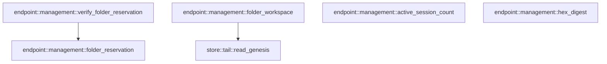

```mermaid
flowchart TD
  n0["endpoint::management::is_hex_digest"]
  n1["endpoint::management::read_canonical"]
  n2["endpoint::management::to_ijson"]
  n3["endpoint::management::intent_kind"]
  n4["endpoint::management::workspace_intent"]
  n5["endpoint::management::discard_intent"]
  n6["endpoint::management::folder_is_ephemeral"]
  n7["endpoint::management::folder_move_intent"]
  n8["endpoint::management::session_create_intent"]
  n9["endpoint::management::select_model_intent"]
  n10["endpoint::management::fork_intent"]
  n11["endpoint::management::queue_transaction_intent"]
  n12["endpoint::management::pending_queue_transaction"]
  n13["endpoint::management::verify_queue_payload"]
  n14["endpoint::management::completion_for_decision"]
  n15["endpoint::management::queue_completion_value"]
  n16["endpoint::management::queue_completion_from_record"]
  n17["endpoint::management::operation_target_session"]
  n18["endpoint::management::is_uid_principal"]
  n19["endpoint::management::fork_id_from_response"]
  n20["endpoint::management::selected_model_from_response"]
  n21["endpoint::management::active_session_folder"]
  n22["endpoint::management::valid_folder_projection"]
  n23["endpoint::management::folder_reservation"]
  n24["endpoint::types::validate_session_id"]
  n25["store::tail::read_ledger_repaired"]
  n26["store::tail::read_genesis"]
  n5 --> n24
  n6 --> n26
  n8 --> n0
  n8 --> n24
  n9 --> n24
  n10 --> n18
  n10 --> n24
  n11 --> n24
  n12 --> n11
  n13 --> n1
  n15 --> n2
  n16 --> n11
  n16 --> n15
  n17 --> n3
  n17 --> n7
  n17 --> n8
  n17 --> n9
  n17 --> n10
  n17 --> n11
  n22 --> n25
  n23 --> n25
```

# endpoint::management

[Package atlas](index.md) · [Source](../../src/management.rs)

## Declarations

Visibility is the declaration spelling; trait members and reexports require their enclosing interface. `cfg` is not evaluated.

| Symbol | Kind | Visibility | Test / cfg |
|---|---|---|---|
| [endpoint::management::VERSION](../../src/management.rs#L28) | const_item | `private` |  |
| [endpoint::management::WorkspaceView](../../src/management.rs#L32) | struct_item | `pub` |  |
| [endpoint::management::WorkspaceFolderView](../../src/management.rs#L44) | struct_item | `pub` |  |
| [endpoint::management::WorkspaceFolders](../../src/management.rs#L52) | struct_item | `pub` |  |
| [endpoint::management::WorkspaceList](../../src/management.rs#L59) | struct_item | `pub` |  |
| [endpoint::management::WorkspaceMetadata](../../src/management.rs#L66) | struct_item | `private` |  |
| [endpoint::management::OperationPhase](../../src/management.rs#L77) | enum_item | `private` |  |
| [endpoint::management::WorkspaceIntent](../../src/management.rs#L87) | struct_item | `private` |  |
| [endpoint::management::FolderMoveIntent](../../src/management.rs#L108) | struct_item | `private` |  |
| [endpoint::management::DiscardIntent](../../src/management.rs#L120) | struct_item | `private` |  |
| [endpoint::management::SessionCreateIntent](../../src/management.rs#L129) | struct_item | `private` |  |
| [endpoint::management::SelectModelIntent](../../src/management.rs#L146) | struct_item | `private` |  |
| [endpoint::management::ForkIntent](../../src/management.rs#L159) | struct_item | `private` |  |
| [endpoint::management::QueueTransactionIntent](../../src/management.rs#L174) | struct_item | `private` |  |
| [endpoint::management::QueueTailSnapshot](../../src/management.rs#L187) | struct_item | `private` |  |
| [endpoint::management::ORIGIN_CLIENT](../../src/management.rs#L195) | const_item | `pub` |  |
| [endpoint::management::LEGACY_ORIGIN_CLIENT](../../src/management.rs#L198) | const_item | `pub` |  |
| [endpoint::management::is_endpoint_origin_client](../../src/management.rs#L201) | function_item | `pub` |  |
| [endpoint::management::OperationRecord](../../src/management.rs#L207) | struct_item | `private` |  |
| [endpoint::management::WorkspaceOperationWrite](../../src/management.rs#L219) | struct_item | `private` |  |
| [endpoint::management::SessionCreateOperation](../../src/management.rs#L232) | struct_item | `pub` |  |
| [endpoint::management::SelectModelOperation](../../src/management.rs#L246) | struct_item | `pub` |  |
| [endpoint::management::ForkSessionOperation](../../src/management.rs#L256) | struct_item | `pub` |  |
| [endpoint::management::ForkLineage](../../src/management.rs#L269) | struct_item | `pub` |  |
| [endpoint::management::QueueTransactionOperation](../../src/management.rs#L274) | struct_item | `pub` |  |
| [endpoint::management::PendingQueueTransaction](../../src/management.rs#L287) | struct_item | `pub` |  |
| [endpoint::management::QueueTransactionDecision](../../src/management.rs#L298) | enum_item | `pub` |  |
| [endpoint::management::QueueTransactionCompletion](../../src/management.rs#L307) | enum_item | `pub` |  |
| [endpoint::management::QueueTransactionState](../../src/management.rs#L318) | enum_item | `pub` |  |
| [endpoint::management::QueueRecoveryDriver](../../src/management.rs#L323) | trait_item | `pub` |  |
| [endpoint::management::QueueRecoveryDriver::execute](../../src/management.rs#L324) | function_signature_item | `private` |  |
| [endpoint::management::SelectedModel](../../src/management.rs#L331) | struct_item | `pub` |  |
| [endpoint::management::CompleteOperations](../../src/management.rs#L340) | struct_item | `pub` |  |
| [endpoint::management::file_identity](../../src/management.rs#L344) | function_item | `private` |  |
| [endpoint::management::ManagementStore](../../src/management.rs#L350) | struct_item | `pub` |  |
| [endpoint::management::ManagementStore::open_at](../../src/management.rs#L361) | function_item | `pub(crate)` | test; #[cfg(test)] |
| [endpoint::management::ManagementStore::open_at_with_queue_driver](../../src/management.rs#L368) | function_item | `pub` |  |
| [endpoint::management::ManagementStore::open_recovering_again](../../src/management.rs#L379) | function_item | `pub` |  |
| [endpoint::management::ManagementStore::open_recovering](../../src/management.rs#L393) | function_item | `private` |  |
| [endpoint::management::ManagementStore::open_light](../../src/management.rs#L428) | function_item | `pub` |  |
| [endpoint::management::ManagementStore::open_light_at](../../src/management.rs#L432) | function_item | `pub` |  |
| [endpoint::management::ManagementStore::heal_workspace_metadata_locked](../../src/management.rs#L463) | function_item | `private` |  |
| [endpoint::management::ManagementStore::lock_exclusive](../../src/management.rs#L500) | function_item | `pub` |  |
| [endpoint::management::ManagementStore::root](../../src/management.rs#L507) | function_item | `pub` |  |
| [endpoint::management::ManagementStore::recover](../../src/management.rs#L512) | function_item | `pub` |  |
| [endpoint::management::ManagementStore::recover_with_queue_driver](../../src/management.rs#L516) | function_item | `pub` |  |
| [endpoint::management::ManagementStore::recover_skipping](../../src/management.rs#L523) | function_item | `private` |  |
| [endpoint::management::ManagementStore::recover_record](../../src/management.rs#L548) | function_item | `private` |  |
| [endpoint::management::ManagementStore::quarantine_corrupt_workspace](../../src/management.rs#L690) | function_item | `private` |  |
| [endpoint::management::ManagementStore::quarantine_operation](../../src/management.rs#L707) | function_item | `private` |  |
| [endpoint::management::ManagementStore::seed_missing_workspace_policies](../../src/management.rs#L756) | function_item | `private` |  |
| [endpoint::management::ManagementStore::reconcile_workspace_metadata](../../src/management.rs#L778) | function_item | `private` |  |
| [endpoint::management::ManagementStore::list_workspaces](../../src/management.rs#L783) | function_item | `pub` |  |
| [endpoint::management::ManagementStore::workspace_paths](../../src/management.rs#L845) | function_item | `pub` |  |
| [endpoint::management::ManagementStore::workspace_path](../../src/management.rs#L855) | function_item | `pub` |  |
| [endpoint::management::ManagementStore::create_session](../../src/management.rs#L868) | function_item | `pub` |  |
| [endpoint::management::ManagementStore::select_model](../../src/management.rs#L999) | function_item | `pub` |  |
| [endpoint::management::ManagementStore::fork_session](../../src/management.rs#L1081) | function_item | `pub` |  |
| [endpoint::management::ManagementStore::prepare_queue_transaction](../../src/management.rs#L1165) | function_item | `pub` |  |
| [endpoint::management::ManagementStore::complete_queue_transaction](../../src/management.rs#L1266) | function_item | `pub` |  |
| [endpoint::management::ManagementStore::has_incomplete_session_operation](../../src/management.rs#L1282) | function_item | `pub` |  |
| [endpoint::management::ManagementStore::completed_fork_lineage](../../src/management.rs#L1299) | function_item | `pub` |  |
| [endpoint::management::ManagementStore::create_workspace](../../src/management.rs#L1320) | function_item | `pub` |  |
| [endpoint::management::ManagementStore::rename_workspace](../../src/management.rs#L1394) | function_item | `pub` |  |
| [endpoint::management::ManagementStore::relocate_workspace](../../src/management.rs#L1440) | function_item | `pub` |  |
| [endpoint::management::ManagementStore::workspace_folders](../../src/management.rs#L1515) | function_item | `pub` |  |
| [endpoint::management::ManagementStore::add_workspace_folder](../../src/management.rs#L1530) | function_item | `pub` |  |
| [endpoint::management::ManagementStore::remove_workspace_folder](../../src/management.rs#L1591) | function_item | `pub` |  |
| [endpoint::management::ManagementStore::resume_folder_operation](../../src/management.rs#L1649) | function_item | `private` |  |
| [endpoint::management::ManagementStore::drive_folder_operation](../../src/management.rs#L1673) | function_item | `private` |  |
| [endpoint::management::ManagementStore::workspace_session_bindings](../../src/management.rs#L1683) | function_item | `private` |  |
| [endpoint::management::ManagementStore::archive_session](../../src/management.rs#L1746) | function_item | `pub` |  |
| [endpoint::management::ManagementStore::unarchive_session](../../src/management.rs#L1776) | function_item | `pub` |  |
| [endpoint::management::ManagementStore::discard_session](../../src/management.rs#L1797) | function_item | `pub` |  |
| [endpoint::management::ManagementStore::drive_discard](../../src/management.rs#L1858) | function_item | `private` |  |
| [endpoint::management::ManagementStore::folder_move](../../src/management.rs#L1913) | function_item | `private` |  |
| [endpoint::management::ManagementStore::begin_workspace_operation](../../src/management.rs#L1989) | function_item | `private` |  |
| [endpoint::management::ManagementStore::drive_workspace_operation](../../src/management.rs#L2046) | function_item | `private` |  |
| [endpoint::management::ManagementStore::workspace_configs](../../src/management.rs#L2153) | function_item | `private` |  |
| [endpoint::management::ManagementStore::operation_created](../../src/management.rs#L2165) | function_item | `private` |  |
| [endpoint::management::ManagementStore::rebuild_candidate](../../src/management.rs#L2199) | function_item | `private` |  |
| [endpoint::management::ManagementStore::drive_session_create](../../src/management.rs#L2324) | function_item | `private` |  |
| [endpoint::management::ManagementStore::session_id_from_response](../../src/management.rs#L2392) | function_item | `private` |  |
| [endpoint::management::ManagementStore::drive_select_model](../../src/management.rs#L2406) | function_item | `private` |  |
| [endpoint::management::ManagementStore::fork_was_quarantined](../../src/management.rs#L2472) | function_item | `private` |  |
| [endpoint::management::ManagementStore::drive_fork](../../src/management.rs#L2501) | function_item | `private` |  |
| [endpoint::management::ManagementStore::drive_queue_completion](../../src/management.rs#L2580) | function_item | `private` |  |
| [endpoint::management::ManagementStore::remove_recordless_payloads](../../src/management.rs#L2639) | function_item | `private` |  |
| [endpoint::management::ManagementStore::remove_recordless_payload](../../src/management.rs#L2666) | function_item | `private` |  |
| [endpoint::management::ManagementStore::drive_folder_move](../../src/management.rs#L2685) | function_item | `private` |  |
| [endpoint::management::ManagementStore::operation_paths](../../src/management.rs#L2755) | function_item | `private` |  |
| [endpoint::management::ManagementStore::operation_path](../../src/management.rs#L2775) | function_item | `private` |  |
| [endpoint::management::ManagementStore::operation_payload_path](../../src/management.rs#L2783) | function_item | `private` |  |
| [endpoint::management::ManagementStore::metadata_path](../../src/management.rs#L2792) | function_item | `private` |  |
| [endpoint::management::ManagementStore::read_metadata](../../src/management.rs#L2798) | function_item | `private` |  |
| [endpoint::management::ManagementStore::read_metadata_optional](../../src/management.rs#L2806) | function_item | `private` |  |
| [endpoint::management::primary_path](../../src/management.rs#L2819) | function_item | `private` |  |
| [endpoint::management::binding_for_path](../../src/management.rs#L2828) | function_item | `private` |  |
| [endpoint::management::binding_for_canonical_path](../../src/management.rs#L2834) | function_item | `private` |  |
| [endpoint::management::execution_path_from_snapshot](../../src/management.rs#L2849) | function_item | `private` |  |
| [endpoint::management::folder_binding_matches_snapshot](../../src/management.rs#L2855) | function_item | `private` |  |
| [endpoint::management::resolve_session_workspace](../../src/management.rs#L2859) | function_item | `private` |  |
| [endpoint::management::existing_session_cwd](../../src/management.rs#L2921) | function_item | `private` |  |
| [endpoint::management::session_preset](../../src/management.rs#L2944) | function_item | `private` |  |
| [endpoint::management::create_genesis](../../src/management.rs#L2967) | function_item | `private` |  |
| [endpoint::management::canonical_event_line](../../src/management.rs#L3007) | function_item | `private` |  |
| [endpoint::management::read_canonical_event](../../src/management.rs#L3013) | function_item | `private` |  |
| [endpoint::management::verify_session_create_genesis](../../src/management.rs#L3024) | function_item | `private` |  |
| [endpoint::management::copy_payload_tree](../../src/management.rs#L3075) | function_item | `private` |  |
| [endpoint::management::sync_operation_payload](../../src/management.rs#L3096) | function_item | `private` |  |
| [endpoint::management::is_hex_digest](../../src/management.rs#L3109) | function_item | `private` |  |
| [endpoint::management::default_workspace_policy](../../src/management.rs#L3123) | function_item | `pub` |  |
| [endpoint::management::relocate_policy_roots](../../src/management.rs#L3138) | function_item | `private` |  |
| [endpoint::management::materialized_folders](../../src/management.rs#L3163) | function_item | `private` |  |
| [endpoint::management::next_folder_id](../../src/management.rs#L3179) | function_item | `private` |  |
| [endpoint::management::with_added_folder](../../src/management.rs#L3190) | function_item | `private` |  |
| [endpoint::management::with_removed_folder](../../src/management.rs#L3214) | function_item | `private` |  |
| [endpoint::management::folders_view](../../src/management.rs#L3247) | function_item | `private` |  |
| [endpoint::management::folder_response](../../src/management.rs#L3261) | function_item | `private` |  |
| [endpoint::management::canonical_workspace_path](../../src/management.rs#L3273) | function_item | `private` |  |
| [endpoint::management::unavailable_absolute_path](../../src/management.rs#L3282) | function_item | `private` |  |
| [endpoint::management::allocate_uuid_v7](../../src/management.rs#L3287) | function_item | `private` |  |
| [endpoint::management::current_timestamp](../../src/management.rs#L3306) | function_item | `private` |  |
| [endpoint::management::validate_title](../../src/management.rs#L3315) | function_item | `private` |  |
| [endpoint::management::ensure_unique_title](../../src/management.rs#L3327) | function_item | `private` |  |
| [endpoint::management::verify_metadata](../../src/management.rs#L3341) | function_item | `private` |  |
| [endpoint::management::workspace_view](../../src/management.rs#L3359) | function_item | `private` |  |
| [endpoint::management::timestamp_from_millis](../../src/management.rs#L3385) | function_item | `private` |  |
| [endpoint::management::publish_canonical](../../src/management.rs#L3409) | function_item | `private` |  |
| [endpoint::management::read_canonical](../../src/management.rs#L3414) | function_item | `private` |  |
| [endpoint::management::decode_canonical](../../src/management.rs#L3418) | function_item | `private` |  |
| [endpoint::management::canonical_line](../../src/management.rs#L3439) | function_item | `private` |  |
| [endpoint::management::to_ijson](../../src/management.rs#L3446) | function_item | `private` |  |
| [endpoint::management::intent_kind](../../src/management.rs#L3454) | function_item | `private` |  |
| [endpoint::management::workspace_intent](../../src/management.rs#L3465) | function_item | `private` |  |
| [endpoint::management::discard_intent](../../src/management.rs#L3497) | function_item | `private` |  |
| [endpoint::management::folder_is_ephemeral](../../src/management.rs#L3509) | function_item | `private` |  |
| [endpoint::management::folder_move_intent](../../src/management.rs#L3515) | function_item | `private` |  |
| [endpoint::management::session_create_intent](../../src/management.rs#L3526) | function_item | `private` |  |
| [endpoint::management::select_model_intent](../../src/management.rs#L3551) | function_item | `private` |  |
| [endpoint::management::fork_intent](../../src/management.rs#L3571) | function_item | `private` |  |
| [endpoint::management::queue_transaction_intent](../../src/management.rs#L3588) | function_item | `private` |  |
| [endpoint::management::pending_queue_transaction](../../src/management.rs#L3616) | function_item | `private` |  |
| [endpoint::management::verify_queue_payload](../../src/management.rs#L3631) | function_item | `private` |  |
| [endpoint::management::completion_for_decision](../../src/management.rs#L3666) | function_item | `private` |  |
| [endpoint::management::queue_completion_value](../../src/management.rs#L3678) | function_item | `private` |  |
| [endpoint::management::queue_completion_from_record](../../src/management.rs#L3716) | function_item | `private` |  |
| [endpoint::management::operation_target_session](../../src/management.rs#L3763) | function_item | `private` |  |
| [endpoint::management::is_uid_principal](../../src/management.rs#L3779) | function_item | `private` |  |
| [endpoint::management::fork_id_from_response](../../src/management.rs#L3785) | function_item | `private` |  |
| [endpoint::management::selected_model_from_response](../../src/management.rs#L3797) | function_item | `private` |  |
| [endpoint::management::active_session_folder](../../src/management.rs#L3835) | function_item | `private` |  |
| [endpoint::management::valid_folder_projection](../../src/management.rs#L3846) | function_item | `private` |  |
| [endpoint::management::folder_reservation](../../src/management.rs#L3859) | function_item | `private` |  |
| [endpoint::management::verify_folder_reservation](../../src/management.rs#L3876) | function_item | `private` |  |
| [endpoint::management::folder_workspace](../../src/management.rs#L3889) | function_item | `private` |  |
| [endpoint::management::active_session_count](../../src/management.rs#L3901) | function_item | `private` |  |
| [endpoint::management::hex_digest](../../src/management.rs#L3911) | function_item | `private` |  |
| [endpoint::management::ManagementError](../../src/management.rs#L3916) | enum_item | `pub` |  |
| [endpoint::management::tests::omitted_identity_is_auto_but_explicit_and_legacy_identity_stay_fixed](../../src/management.rs#L4015) | function_item | `private` | test; #[cfg(test)] |
| [endpoint::management::tests::preset_genesis_replaces_identity_and_needs_reader_two](../../src/management.rs#L4049) | function_item | `private` | test; #[cfg(test)] |
| [endpoint::management::tests::legacy_session_create_without_folder_binding_remains_recoverable](../../src/management.rs#L4113) | function_item | `private` | test; #[cfg(test)] |
| [endpoint::management::tests::quarantined_fork_does_not_block_recovery_or_claim_success](../../src/management.rs#L4128) | function_item | `private` | test; #[cfg(test)] |
| [endpoint::management::tests::open_light_heals_metadata_after_any_config_writer_without_reading_threads](../../src/management.rs#L4202) | function_item | `private` | test; #[cfg(test)] |
| [endpoint::management::tests::unavailable_workspace_keeps_its_management_operation_pending](../../src/management.rs#L4291) | function_item | `private` | test; #[cfg(test)] |
| [endpoint::management::tests::a_select_model_payload_staged_before_the_rename_is_read_on_recovery](../../src/management.rs#L4330) | function_item | `private` | test; #[cfg(test)] |
| [endpoint::management::tests::a_created_workspace_starts_with_the_interactive_fixed_catalog_writable_in_its_folder](../../src/management.rs#L4398) | function_item | `private` | test; #[cfg(test)] |
| [endpoint::management::tests::opening_the_store_seeds_a_policy_for_a_policy_less_workspace_once](../../src/management.rs#L4442) | function_item | `private` | test; #[cfg(test)] |
| [endpoint::management::tests::relocation_moves_writable_roots_with_their_folder](../../src/management.rs#L4490) | function_item | `private` | test; #[cfg(test)] |
| [endpoint::management::tests::folder_store](../../src/management.rs#L4525) | function_item | `private` | test; #[cfg(test)] |
| [endpoint::management::tests::sibling](../../src/management.rs#L4542) | function_item | `private` | test; #[cfg(test)] |
| [endpoint::management::tests::write_session](../../src/management.rs#L4553) | function_item | `private` | test; #[cfg(test)] |
| [endpoint::management::tests::folders_are_added_listed_and_removed_with_their_writable_roots](../../src/management.rs#L4595) | function_item | `private` | test; #[cfg(test)] |
| [endpoint::management::tests::a_folder_bound_to_a_session_is_not_removed](../../src/management.rs#L4710) | function_item | `private` | test; #[cfg(test)] |
| [endpoint::management::tests::a_legacy_unbound_session_blocks_a_second_folder](../../src/management.rs#L4756) | function_item | `private` | test; #[cfg(test)] |
| [endpoint::management::tests::folder_edits_materialize_a_legacy_cwd_workspace_with_its_synthesized_ids](../../src/management.rs#L4784) | function_item | `private` | test; #[cfg(test)] |
| [endpoint::management::tests::completed_workspace_operation_never_reopens_its_old_path](../../src/management.rs#L4816) | function_item | `private` | test; #[cfg(test)] |
| [endpoint::management::k1_management_race::BOOT](../../src/management.rs#L4847) | const_item | `private` | test; #[cfg(test)] |
| [endpoint::management::k1_management_race::TICK](../../src/management.rs#L4848) | const_item | `private` | test; #[cfg(test)] |
| [endpoint::management::k1_management_race::LATER](../../src/management.rs#L4849) | const_item | `private` | test; #[cfg(test)] |
| [endpoint::management::k1_management_race::WORKSPACE](../../src/management.rs#L4850) | const_item | `private` | test; #[cfg(test)] |
| [endpoint::management::k1_management_race::fixture](../../src/management.rs#L4852) | function_item | `private` | test; #[cfg(test)] |
| [endpoint::management::k1_management_race::policy_with](../../src/management.rs#L4877) | function_item | `private` | test; #[cfg(test)] |
| [endpoint::management::k1_management_race::set_policy](../../src/management.rs#L4883) | function_item | `private` | test; #[cfg(test)] |
| [endpoint::management::k1_management_race::quarantine_root](../../src/management.rs#L4890) | function_item | `private` | test; #[cfg(test)] |
| [endpoint::management::k1_management_race::stale_metadata](../../src/management.rs#L4896) | function_item | `private` | test; #[cfg(test)] |
| [endpoint::management::k1_management_race::metadata_matches](../../src/management.rs#L4903) | function_item | `private` | test; #[cfg(test)] |
| [endpoint::management::k1_management_race::stuck_carriers_record](../../src/management.rs#L4910) | function_item | `private` | test; #[cfg(test)] |
| [endpoint::management::k1_management_race::tick_heals_stale_metadata_without_staging_an_operation](../../src/management.rs#L4944) | function_item | `private` | test; #[cfg(test)] |
| [endpoint::management::k1_management_race::tick_never_fails_while_policy_set_publishes](../../src/management.rs#L4974) | function_item | `private` | test; #[cfg(test)] |
| [endpoint::management::k1_management_race::parked_synthetic_rename](../../src/management.rs#L5019) | function_item | `private` | test; #[cfg(test)] |
| [endpoint::management::k1_management_race::boot_quarantines_the_parked_carriers_record_and_succeeds](../../src/management.rs#L5068) | function_item | `private` | test; #[cfg(test)] |
| [endpoint::management::k1_management_race::record_of_another_version_is_left_in_place_not_quarantined](../../src/management.rs#L5123) | function_item | `private` | test; #[cfg(test)] |
| [endpoint::management::k1_management_race::quarantine_keeps_the_payload_and_never_redrives_the_operation](../../src/management.rs#L5145) | function_item | `private` | test; #[cfg(test)] |
| [endpoint::management::k1_management_race::complete_workspace_record_without_response_is_quarantined](../../src/management.rs#L5208) | function_item | `private` | test; #[cfg(test)] |
| [endpoint::management::k1_management_race::one_failing_record_does_not_stop_the_others_from_recovering](../../src/management.rs#L5244) | function_item | `private` | test; #[cfg(test)] |

## Imports / reexports

| Local name | Source path | Visibility |
|---|---|---|
| `BTreeMap` | `std::collections::BTreeMap` | `private` |
| `fs` | `std::fs` | `private` |
| `File` | `std::fs::File` | `private` |
| `Read` | `std::io::Read` | `private` |
| `MetadataExt` | `std::os::unix::fs::MetadataExt` | `private` |
| `Path` | `std::path::Path` | `private` |
| `PathBuf` | `std::path::PathBuf` | `private` |
| `SystemTime` | `std::time::SystemTime` | `private` |
| `UNIX_EPOCH` | `std::time::UNIX_EPOCH` | `private` |
| `ConfigRepository` | `profile::ConfigRepository` | `private` |
| `InstructionResolver` | `profile::InstructionResolver` | `private` |
| `WorkspaceConfig` | `profile::WorkspaceConfig` | `private` |
| `WorkspaceFolder` | `profile::WorkspaceFolder` | `private` |
| `WorkspacePolicy` | `profile::WorkspacePolicy` | `private` |
| `Event` | `schema::Event` | `private` |
| `IJsonValue` | `schema::IJsonValue` | `private` |
| `OriginTuple` | `schema::OriginTuple` | `private` |
| `ResumePolicy` | `schema::ResumePolicy` | `private` |
| `Deserialize` | `serde::Deserialize` | `private` |
| `Serialize` | `serde::Serialize` | `private` |
| `Value` | `serde_json::Value` | `private` |
| `json` | `serde_json::json` | `private` |
| `Digest` | `sha2::Digest` | `private` |
| `Sha256` | `sha2::Sha256` | `private` |
| `AssetStore` | `store::AssetStore` | `private` |
| `AtomicPublisher` | `store::AtomicPublisher` | `private` |
| `DirectoryLock` | `store::DirectoryLock` | `private` |
| `NamedLock` | `store::NamedLock` | `private` |
| `ThreadStore` | `store::ThreadStore` | `private` |
| `scan_valid_prefix` | `store::scan_valid_prefix` | `private` |
| `Error` | `thiserror::Error` | `private` |
| `Uuid` | `uuid::Uuid` | `private` |
| `SessionInventoryItem` | `crate::SessionInventoryItem` | `private` |
| `ForkIntent` | `super::ForkIntent` | `private` |
| `ManagementError` | `super::ManagementError` | `private` |
| `ManagementStore` | `super::ManagementStore` | `private` |
| `OperationPhase` | `super::OperationPhase` | `private` |
| `OperationRecord` | `super::OperationRecord` | `private` |
| `VERSION` | `super::VERSION` | `private` |
| `WorkspaceMetadata` | `super::WorkspaceMetadata` | `private` |
| `WorkspaceOperationWrite` | `super::WorkspaceOperationWrite` | `private` |
| `WorkspaceView` | `super::WorkspaceView` | `private` |
| `canonical_event_line` | `super::canonical_event_line` | `private` |
| `create_genesis` | `super::create_genesis` | `private` |
| `default_workspace_policy` | `super::default_workspace_policy` | `private` |
| `folder_binding_matches_snapshot` | `super::folder_binding_matches_snapshot` | `private` |
| `publish_canonical` | `super::publish_canonical` | `private` |
| `read_canonical` | `super::read_canonical` | `private` |
| `session_preset` | `super::session_preset` | `private` |
| `to_ijson` | `super::to_ijson` | `private` |
| `SessionInventoryItem` | `crate::SessionInventoryItem` | `private` |
| `ConfigRepository` | `profile::ConfigRepository` | `private` |
| `WorkspaceConfig` | `profile::WorkspaceConfig` | `private` |
| `WorkspaceFolder` | `profile::WorkspaceFolder` | `private` |
| `Value` | `serde_json::Value` | `private` |
| `json` | `serde_json::json` | `private` |
| `fs` | `std::fs` | `private` |
| `Path` | `std::path::Path` | `private` |
| `ThreadStore` | `store::ThreadStore` | `private` |
| `*` | `super::*` | `private` |
| `ConfigRepository` | `profile::ConfigRepository` | `private` |
| `WorkspaceConfig` | `profile::WorkspaceConfig` | `private` |
| `WorkspaceFolder` | `profile::WorkspaceFolder` | `private` |
| `Arc` | `std::sync::Arc` | `private` |
| `AtomicBool` | `std::sync::atomic::AtomicBool` | `private` |
| `Ordering` | `std::sync::atomic::Ordering` | `private` |

## Module declarations

| Module | Visibility | Attributes |
|---|---|---|
| `endpoint::management::tests` | `private` | #[cfg(test)] |
| `endpoint::management::k1_management_race` | `private` | #[cfg(test)] |

## Function call graphs

Edges below are syntactically resolved calls only, including private functions. Graphs partition callers into groups of 20; they are not execution order. All unresolved sites are listed below and in the JSON inventory.

Functions 1–20: 72 direct edges

Functions 21–40: 151 direct edges

Functions 41–60: 107 direct edges

Functions 61–80: 18 direct edges

Functions 81–100: 14 direct edges

Functions 101–120: 21 direct edges

Functions 121–124: 2 direct edges

## Call sites

Includes test functions (marked in declarations). Receiver-type-required sites need type analysis/manual tracing. Calls in closures are attributed to their enclosing function; their occurrence here does not mean the closure executes immediately.

| Caller | Callee expression | Source lines | Target / classification |
|---|---|---|---|
| `file_identity` | `fs::metadata(path).ok` | [345](../../src/management.rs#L345) | receiver-type-required |
| `file_identity` | `fs::metadata` | [345](../../src/management.rs#L345) | external-constructor-callback-or-unresolved |
| `file_identity` | `Some` | [346](../../src/management.rs#L346) | external-constructor-callback-or-unresolved |
| `file_identity` | `metadata.len` | [346](../../src/management.rs#L346) | receiver-type-required |
| `file_identity` | `metadata.modified().ok` | [346](../../src/management.rs#L346) | receiver-type-required |
| `file_identity` | `metadata.modified` | [346](../../src/management.rs#L346) | receiver-type-required |
| `open_at` | `Self::open_at_with_queue_driver` | [365](../../src/management.rs#L365) | [endpoint::management::ManagementStore::open_at_with_queue_driver](../../src/management.rs#L368) |
| `open_at_with_queue_driver` | `Self::open_recovering` | [373](../../src/management.rs#L373) | [endpoint::management::ManagementStore::open_recovering](../../src/management.rs#L393) |
| `open_recovering_again` | `Self::open_recovering` | [385](../../src/management.rs#L385) | [endpoint::management::ManagementStore::open_recovering](../../src/management.rs#L393) |
| `open_recovering_again` | `Some` | [389](../../src/management.rs#L389) | external-constructor-callback-or-unresolved |
| `open_recovering` | `storage_root.as_ref().to_path_buf` | [399](../../src/management.rs#L399) | receiver-type-required |
| `open_recovering` | `storage_root.as_ref` | [399](../../src/management.rs#L399) | receiver-type-required |
| `open_recovering` | `ThreadStore::open` | [400](../../src/management.rs#L400) | [store::folder::ThreadStore::open](../../../store/src/folder.rs#L36) |
| `open_recovering` | `store::endpoint_management_root` | [401](../../src/management.rs#L401) | [store::management_root::endpoint_management_root](../../../store/src/management_root.rs#L47) |
| `open_recovering` | `fs::create_dir_all` | [402](../../src/management.rs#L402), [403](../../src/management.rs#L403) | external-constructor-callback-or-unresolved |
| `open_recovering` | `root.join` | [402](../../src/management.rs#L402), [403](../../src/management.rs#L403), [407](../../src/management.rs#L407) | receiver-type-required |
| `open_recovering` | `fs::OpenOptions::new()             .create(true)             .append(true)             .open` | [404](../../src/management.rs#L404) | receiver-type-required |
| `open_recovering` | `fs::OpenOptions::new()             .create(true)             .append` | [404](../../src/management.rs#L404) | receiver-type-required |
| `open_recovering` | `fs::OpenOptions::new()             .create` | [404](../../src/management.rs#L404) | receiver-type-required |
| `open_recovering` | `fs::OpenOptions::new` | [404](../../src/management.rs#L404) | external-constructor-callback-or-unresolved |
| `open_recovering` | `ConfigRepository::open` | [409](../../src/management.rs#L409) | [profile::config::ConfigRepository::open](../../../profile/src/config.rs#L688) |
| `open_recovering` | `store.recover_skipping` | [413](../../src/management.rs#L413) | receiver-type-required |
| `open_recovering` | `store.seed_missing_workspace_policies` | [414](../../src/management.rs#L414) | receiver-type-required |
| `open_recovering` | `store.reconcile_workspace_metadata` | [415](../../src/management.rs#L415) | receiver-type-required |
| `open_recovering` | `Ok` | [419](../../src/management.rs#L419) | external-constructor-callback-or-unresolved |
| `open_light` | `Self::open_light_at` | [429](../../src/management.rs#L429) | [endpoint::management::ManagementStore::open_light_at](../../src/management.rs#L432) |
| `open_light` | `current_timestamp` | [429](../../src/management.rs#L429) | [endpoint::management::current_timestamp](../../src/management.rs#L3306) |
| `open_light_at` | `storage_root.as_ref().to_path_buf` | [436](../../src/management.rs#L436) | receiver-type-required |
| `open_light_at` | `storage_root.as_ref` | [436](../../src/management.rs#L436) | receiver-type-required |
| `open_light_at` | `store::endpoint_management_root` | [437](../../src/management.rs#L437) | [store::management_root::endpoint_management_root](../../../store/src/management_root.rs#L47) |
| `open_light_at` | `fs::create_dir_all` | [438](../../src/management.rs#L438), [439](../../src/management.rs#L439) | external-constructor-callback-or-unresolved |
| `open_light_at` | `root.join` | [438](../../src/management.rs#L438), [439](../../src/management.rs#L439), [443](../../src/management.rs#L443) | receiver-type-required |
| `open_light_at` | `fs::OpenOptions::new()             .create(true)             .append(true)             .open` | [440](../../src/management.rs#L440) | receiver-type-required |
| `open_light_at` | `fs::OpenOptions::new()             .create(true)             .append` | [440](../../src/management.rs#L440) | receiver-type-required |
| `open_light_at` | `fs::OpenOptions::new()             .create` | [440](../../src/management.rs#L440) | receiver-type-required |
| `open_light_at` | `fs::OpenOptions::new` | [440](../../src/management.rs#L440) | external-constructor-callback-or-unresolved |
| `open_light_at` | `ConfigRepository::open` | [445](../../src/management.rs#L445) | [profile::config::ConfigRepository::open](../../../profile/src/config.rs#L688) |
| `open_light_at` | `NamedLock::exclusive` | [449](../../src/management.rs#L449) | [store::platform::NamedLock::exclusive](../../../store/src/platform.rs#L103) |
| `open_light_at` | `store.root.join` | [449](../../src/management.rs#L449) | receiver-type-required |
| `open_light_at` | `store.heal_workspace_metadata_locked` | [450](../../src/management.rs#L450) | receiver-type-required |
| `open_light_at` | `drop` | [451](../../src/management.rs#L451) | external-constructor-callback-or-unresolved |
| `open_light_at` | `Ok` | [452](../../src/management.rs#L452) | external-constructor-callback-or-unresolved |
| `heal_workspace_metadata_locked` | `NamedLock::shared` | [464](../../src/management.rs#L464) | [store::platform::NamedLock::shared](../../../store/src/platform.rs#L99) |
| `heal_workspace_metadata_locked` | `self.storage_root.join` | [464](../../src/management.rs#L464) | receiver-type-required |
| `heal_workspace_metadata_locked` | `self.workspace_configs()?.into_values` | [465](../../src/management.rs#L465) | receiver-type-required |
| `heal_workspace_metadata_locked` | `self.workspace_configs` | [465](../../src/management.rs#L465) | [endpoint::management::ManagementStore::workspace_configs](../../src/management.rs#L2153) |
| `heal_workspace_metadata_locked` | `primary_path(&config).map` | [467](../../src/management.rs#L467) | receiver-type-required |
| `heal_workspace_metadata_locked` | `primary_path` | [467](../../src/management.rs#L467) | [endpoint::management::primary_path](../../src/management.rs#L2819) |
| `heal_workspace_metadata_locked` | `self.read_metadata_optional` | [474](../../src/management.rs#L474) | [endpoint::management::ManagementStore::read_metadata_optional](../../src/management.rs#L2806) |
| `heal_workspace_metadata_locked` | `existing                 .as_ref()                 .is_some_and` | [475](../../src/management.rs#L475) | receiver-type-required |
| `heal_workspace_metadata_locked` | `existing                 .as_ref` | [475](../../src/management.rs#L475) | receiver-type-required |
| `heal_workspace_metadata_locked` | `verify_metadata(&config, metadata).is_ok` | [477](../../src/management.rs#L477) | receiver-type-required |
| `heal_workspace_metadata_locked` | `verify_metadata` | [477](../../src/management.rs#L477) | [endpoint::management::verify_metadata](../../src/management.rs#L3341) |
| `heal_workspace_metadata_locked` | `config.id.clone` | [483](../../src/management.rs#L483) | receiver-type-required |
| `heal_workspace_metadata_locked` | `existing                     .map_or_else` | [485](../../src/management.rs#L485) | receiver-type-required |
| `heal_workspace_metadata_locked` | `started_at.to_owned` | [486](../../src/management.rs#L486), [487](../../src/management.rs#L487) | receiver-type-required |
| `heal_workspace_metadata_locked` | `hex_digest` | [488](../../src/management.rs#L488) | [endpoint::management::hex_digest](../../src/management.rs#L3911) |
| `heal_workspace_metadata_locked` | `canonical_line` | [488](../../src/management.rs#L488) | [endpoint::management::canonical_line](../../src/management.rs#L3439) |
| `heal_workspace_metadata_locked` | `publish_canonical` | [490](../../src/management.rs#L490) | [endpoint::management::publish_canonical](../../src/management.rs#L3409) |
| `heal_workspace_metadata_locked` | `self.metadata_path` | [490](../../src/management.rs#L490) | [endpoint::management::ManagementStore::metadata_path](../../src/management.rs#L2792) |
| `heal_workspace_metadata_locked` | `Ok` | [492](../../src/management.rs#L492) | external-constructor-callback-or-unresolved |
| `lock_exclusive` | `store::endpoint_management_root` | [501](../../src/management.rs#L501) | [store::management_root::endpoint_management_root](../../../store/src/management_root.rs#L47) |
| `lock_exclusive` | `storage_root.as_ref` | [501](../../src/management.rs#L501) | receiver-type-required |
| `lock_exclusive` | `fs::create_dir_all` | [502](../../src/management.rs#L502) | external-constructor-callback-or-unresolved |
| `lock_exclusive` | `Ok` | [503](../../src/management.rs#L503) | external-constructor-callback-or-unresolved |
| `lock_exclusive` | `NamedLock::exclusive` | [503](../../src/management.rs#L503) | [store::platform::NamedLock::exclusive](../../../store/src/platform.rs#L103) |
| `lock_exclusive` | `root.join` | [503](../../src/management.rs#L503) | receiver-type-required |
| `recover` | `self.recover_with_queue_driver` | [513](../../src/management.rs#L513) | [endpoint::management::ManagementStore::recover_with_queue_driver](../../src/management.rs#L516) |
| `recover_with_queue_driver` | `self.recover_skipping` | [520](../../src/management.rs#L520) | [endpoint::management::ManagementStore::recover_skipping](../../src/management.rs#L523) |
| `recover_skipping` | `NamedLock::exclusive` | [532](../../src/management.rs#L532) | [store::platform::NamedLock::exclusive](../../../store/src/platform.rs#L103) |
| `recover_skipping` | `self.root.join` | [532](../../src/management.rs#L532) | receiver-type-required |
| `recover_skipping` | `self.remove_recordless_payloads` | [533](../../src/management.rs#L533) | [endpoint::management::ManagementStore::remove_recordless_payloads](../../src/management.rs#L2639) |
| `recover_skipping` | `self.operation_paths` | [534](../../src/management.rs#L534) | [endpoint::management::ManagementStore::operation_paths](../../src/management.rs#L2755) |
| `recover_skipping` | `self.recover_record` | [540](../../src/management.rs#L540) | [endpoint::management::ManagementStore::recover_record](../../src/management.rs#L548) |
| `recover_skipping` | `validated.as_deref_mut` | [540](../../src/management.rs#L540) | receiver-type-required |
| `recover_skipping` | `first_error.get_or_insert` | [541](../../src/management.rs#L541) | receiver-type-required |
| `recover_skipping` | `first_error.map_or` | [544](../../src/management.rs#L544) | receiver-type-required |
| `recover_skipping` | `Ok` | [544](../../src/management.rs#L544) | external-constructor-callback-or-unresolved |
| `recover_record` | `Some` | [554](../../src/management.rs#L554), [657](../../src/management.rs#L657) | external-constructor-callback-or-unresolved |
| `recover_record` | `NamedLock::exclusive` | [554](../../src/management.rs#L554), [657](../../src/management.rs#L657) | [store::platform::NamedLock::exclusive](../../../store/src/platform.rs#L103) |
| `recover_record` | `self.root.join` | [554](../../src/management.rs#L554), [657](../../src/management.rs#L657) | receiver-type-required |
| `recover_record` | `path.exists` | [555](../../src/management.rs#L555) | receiver-type-required |
| `recover_record` | `Ok` | [556](../../src/management.rs#L556), [562](../../src/management.rs#L562), [574](../../src/management.rs#L574), [602](../../src/management.rs#L602), [620](../../src/management.rs#L620), [642](../../src/management.rs#L642), [660](../../src/management.rs#L660), [687](../../src/management.rs#L687) | external-constructor-callback-or-unresolved |
| `recover_record` | `file_identity` | [558](../../src/management.rs#L558) | [endpoint::management::file_identity](../../src/management.rs#L344) |
| `recover_record` | `validated.as_deref` | [559](../../src/management.rs#L559) | receiver-type-required |
| `recover_record` | `identity.as_ref` | [559](../../src/management.rs#L559) | receiver-type-required |
| `recover_record` | `known.0.contains` | [560](../../src/management.rs#L560) | receiver-type-required |
| `recover_record` | `path.clone` | [560](../../src/management.rs#L560), [578](../../src/management.rs#L578) | receiver-type-required |
| `recover_record` | `read_canonical::<OperationRecord>` | [564](../../src/management.rs#L564), [658](../../src/management.rs#L658) | [endpoint::management::read_canonical](../../src/management.rs#L3414) |
| `recover_record` | `intent_kind` | [565](../../src/management.rs#L565) | [endpoint::management::intent_kind](../../src/management.rs#L3454) |
| `recover_record` | `known.0.insert` | [578](../../src/management.rs#L578) | receiver-type-required |
| `recover_record` | `kind.as_str` | [580](../../src/management.rs#L580), [622](../../src/management.rs#L622) | receiver-type-required |
| `recover_record` | `workspace_intent` | [582](../../src/management.rs#L582), [623](../../src/management.rs#L623) | [endpoint::management::workspace_intent](../../src/management.rs#L3465) |
| `recover_record` | `self.quarantine_corrupt_workspace` | [583](../../src/management.rs#L583), [615](../../src/management.rs#L615), [683](../../src/management.rs#L683) | [endpoint::management::ManagementStore::quarantine_corrupt_workspace](../../src/management.rs#L690) |
| `recover_record` | `folder_move_intent` | [587](../../src/management.rs#L587), [627](../../src/management.rs#L627) | [endpoint::management::folder_move_intent](../../src/management.rs#L3515) |
| `recover_record` | `session_create_intent` | [590](../../src/management.rs#L590), [631](../../src/management.rs#L631) | [endpoint::management::session_create_intent](../../src/management.rs#L3526) |
| `recover_record` | `select_model_intent` | [593](../../src/management.rs#L593), [635](../../src/management.rs#L635) | [endpoint::management::select_model_intent](../../src/management.rs#L3551) |
| `recover_record` | `fork_intent` | [596](../../src/management.rs#L596) | [endpoint::management::fork_intent](../../src/management.rs#L3571) |
| `recover_record` | `queue_transaction_intent` | [599](../../src/management.rs#L599), [647](../../src/management.rs#L647) | [endpoint::management::queue_transaction_intent](../../src/management.rs#L3588) |
| `recover_record` | `verify_queue_payload` | [600](../../src/management.rs#L600), [648](../../src/management.rs#L648) | [endpoint::management::verify_queue_payload](../../src/management.rs#L3631) |
| `recover_record` | `self.operation_payload_path` | [600](../../src/management.rs#L600), [648](../../src/management.rs#L648) | [endpoint::management::ManagementStore::operation_payload_path](../../src/management.rs#L2783) |
| `recover_record` | `queue_completion_from_record` | [601](../../src/management.rs#L601) | [endpoint::management::queue_completion_from_record](../../src/management.rs#L3716) |
| `recover_record` | `Err` | [605](../../src/management.rs#L605), [617](../../src/management.rs#L617), [666](../../src/management.rs#L666), [685](../../src/management.rs#L685) | external-constructor-callback-or-unresolved |
| `recover_record` | `ManagementError::CorruptOperation` | [605](../../src/management.rs#L605), [611](../../src/management.rs#L611), [666](../../src/management.rs#L666) | external-constructor-callback-or-unresolved |
| `recover_record` | `record.response.is_none` | [610](../../src/management.rs#L610) | receiver-type-required |
| `recover_record` | `"complete operation lacks response".to_owned` | [612](../../src/management.rs#L612) | receiver-type-required |
| `recover_record` | `workspace_intent(&record)                 .and_then(&#124;_&#124; self.drive_workspace_operation(&path, record))                 .map` | [623](../../src/management.rs#L623) | receiver-type-required |
| `recover_record` | `workspace_intent(&record)                 .and_then` | [623](../../src/management.rs#L623) | receiver-type-required |
| `recover_record` | `self.drive_workspace_operation` | [624](../../src/management.rs#L624) | [endpoint::management::ManagementStore::drive_workspace_operation](../../src/management.rs#L2046) |
| `recover_record` | `self.drive_folder_move(&path, record, None).map` | [628](../../src/management.rs#L628) | receiver-type-required |
| `recover_record` | `self.drive_folder_move` | [628](../../src/management.rs#L628) | [endpoint::management::ManagementStore::drive_folder_move](../../src/management.rs#L2685) |
| `recover_record` | `self.drive_session_create(&path, record).map` | [632](../../src/management.rs#L632) | receiver-type-required |
| `recover_record` | `self.drive_session_create` | [632](../../src/management.rs#L632) | [endpoint::management::ManagementStore::drive_session_create](../../src/management.rs#L2324) |
| `recover_record` | `self.drive_select_model(&path, record).map` | [636](../../src/management.rs#L636) | receiver-type-required |
| `recover_record` | `self.drive_select_model` | [636](../../src/management.rs#L636) | [endpoint::management::ManagementStore::drive_select_model](../../src/management.rs#L2406) |
| `recover_record` | `self.fork_was_quarantined` | [639](../../src/management.rs#L639) | [endpoint::management::ManagementStore::fork_was_quarantined](../../src/management.rs#L2472) |
| `recover_record` | `self.drive_fork(&path, record).map` | [644](../../src/management.rs#L644) | receiver-type-required |
| `recover_record` | `self.drive_fork` | [644](../../src/management.rs#L644) | [endpoint::management::ManagementStore::drive_fork](../../src/management.rs#L2501) |
| `recover_record` | `pending_queue_transaction` | [649](../../src/management.rs#L649) | [endpoint::management::pending_queue_transaction](../../src/management.rs#L3616) |
| `recover_record` | `queue_driver.ok_or_else` | [650](../../src/management.rs#L650) | receiver-type-required |
| `recover_record` | `ManagementError::QueueRecoveryRequired` | [651](../../src/management.rs#L651) | external-constructor-callback-or-unresolved |
| `recover_record` | `pending.session_id.clone` | [651](../../src/management.rs#L651) | receiver-type-required |
| `recover_record` | `drop` | [655](../../src/management.rs#L655) | external-constructor-callback-or-unresolved |
| `recover_record` | `lock.take` | [655](../../src/management.rs#L655) | receiver-type-required |
| `recover_record` | `driver.execute` | [656](../../src/management.rs#L656) | receiver-type-required |
| `recover_record` | `self.drive_queue_completion(&path, record, decision)                     .map` | [662](../../src/management.rs#L662) | receiver-type-required |
| `recover_record` | `self.drive_queue_completion` | [662](../../src/management.rs#L662) | [endpoint::management::ManagementStore::drive_queue_completion](../../src/management.rs#L2580) |
| `recover_record` | `unavailable_absolute_path` | [674](../../src/management.rs#L674) | [endpoint::management::unavailable_absolute_path](../../src/management.rs#L3282) |
| `quarantine_corrupt_workspace` | `self.quarantine_operation` | [696](../../src/management.rs#L696) | [endpoint::management::ManagementStore::quarantine_operation](../../src/management.rs#L707) |
| `quarantine_corrupt_workspace` | `Err` | [697](../../src/management.rs#L697) | external-constructor-callback-or-unresolved |
| `quarantine_operation` | `path             .file_stem()             .and_then(&#124;value&#124; value.to_str())             .filter(&#124;value&#124; is_hex_digest(value))             .ok_or_else(&#124;&#124; {                 ManagementError::CorruptOperation("operation record has no digest name".to_owned())             })?             .to_owned` | [708](../../src/management.rs#L708) | receiver-type-required |
| `quarantine_operation` | `path             .file_stem()             .and_then(&#124;value&#124; value.to_str())             .filter(&#124;value&#124; is_hex_digest(value))             .ok_or_else` | [708](../../src/management.rs#L708) | receiver-type-required |
| `quarantine_operation` | `path             .file_stem()             .and_then(&#124;value&#124; value.to_str())             .filter` | [708](../../src/management.rs#L708) | receiver-type-required |
| `quarantine_operation` | `path             .file_stem()             .and_then` | [708](../../src/management.rs#L708) | receiver-type-required |
| `quarantine_operation` | `path             .file_stem` | [708](../../src/management.rs#L708) | receiver-type-required |
| `quarantine_operation` | `value.to_str` | [710](../../src/management.rs#L710) | receiver-type-required |
| `quarantine_operation` | `is_hex_digest` | [711](../../src/management.rs#L711) | [endpoint::management::is_hex_digest](../../src/management.rs#L3109) |
| `quarantine_operation` | `ManagementError::CorruptOperation` | [713](../../src/management.rs#L713), [740](../../src/management.rs#L740) | external-constructor-callback-or-unresolved |
| `quarantine_operation` | `"operation record has no digest name".to_owned` | [713](../../src/management.rs#L713) | receiver-type-required |
| `quarantine_operation` | `self.root.join` | [716](../../src/management.rs#L716) | receiver-type-required |
| `quarantine_operation` | `fs::create_dir_all` | [717](../../src/management.rs#L717), [729](../../src/management.rs#L729) | external-constructor-callback-or-unresolved |
| `quarantine_operation` | `quarantine.join` | [719](../../src/management.rs#L719), [722](../../src/management.rs#L722) | receiver-type-required |
| `quarantine_operation` | `target.join("record.json").exists` | [721](../../src/management.rs#L721) | receiver-type-required |
| `quarantine_operation` | `target.join` | [721](../../src/management.rs#L721), [732](../../src/management.rs#L732), [734](../../src/management.rs#L734), [737](../../src/management.rs#L737) | receiver-type-required |
| `quarantine_operation` | `target.exists` | [726](../../src/management.rs#L726) | receiver-type-required |
| `quarantine_operation` | `fs::remove_dir_all` | [727](../../src/management.rs#L727), [744](../../src/management.rs#L744) | external-constructor-callback-or-unresolved |
| `quarantine_operation` | `path.with_extension` | [730](../../src/management.rs#L730) | receiver-type-required |
| `quarantine_operation` | `payload_root.is_dir` | [731](../../src/management.rs#L731), [743](../../src/management.rs#L743) | receiver-type-required |
| `quarantine_operation` | `copy_payload_tree` | [732](../../src/management.rs#L732) | [endpoint::management::copy_payload_tree](../../src/management.rs#L3075) |
| `quarantine_operation` | `AtomicPublisher::replace` | [734](../../src/management.rs#L734) | [store::atomic::AtomicPublisher::replace](../../../store/src/atomic.rs#L16) |
| `quarantine_operation` | `reason.as_bytes` | [734](../../src/management.rs#L734) | receiver-type-required |
| `quarantine_operation` | `File::open(&target)?.sync_all` | [735](../../src/management.rs#L735), [738](../../src/management.rs#L738) | receiver-type-required |
| `quarantine_operation` | `File::open` | [735](../../src/management.rs#L735), [736](../../src/management.rs#L736), [738](../../src/management.rs#L738), [742](../../src/management.rs#L742), [745](../../src/management.rs#L745) | external-constructor-callback-or-unresolved |
| `quarantine_operation` | `File::open(&quarantine)?.sync_all` | [736](../../src/management.rs#L736) | receiver-type-required |
| `quarantine_operation` | `fs::rename` | [737](../../src/management.rs#L737) | external-constructor-callback-or-unresolved |
| `quarantine_operation` | `path.parent().ok_or_else` | [739](../../src/management.rs#L739) | receiver-type-required |
| `quarantine_operation` | `path.parent` | [739](../../src/management.rs#L739) | receiver-type-required |
| `quarantine_operation` | `"operation record has no prefix".to_owned` | [740](../../src/management.rs#L740) | receiver-type-required |
| `quarantine_operation` | `File::open(prefix)?.sync_all` | [742](../../src/management.rs#L742), [745](../../src/management.rs#L745) | receiver-type-required |
| `quarantine_operation` | `Ok` | [748](../../src/management.rs#L748) | external-constructor-callback-or-unresolved |
| `seed_missing_workspace_policies` | `NamedLock::exclusive` | [757](../../src/management.rs#L757) | [store::platform::NamedLock::exclusive](../../../store/src/platform.rs#L103) |
| `seed_missing_workspace_policies` | `self.root.join` | [757](../../src/management.rs#L757) | receiver-type-required |
| `seed_missing_workspace_policies` | `self.workspace_configs()?.into_values` | [758](../../src/management.rs#L758) | receiver-type-required |
| `seed_missing_workspace_policies` | `self.workspace_configs` | [758](../../src/management.rs#L758) | [endpoint::management::ManagementStore::workspace_configs](../../src/management.rs#L2153) |
| `seed_missing_workspace_policies` | `config.policy.is_some` | [759](../../src/management.rs#L759) | receiver-type-required |
| `seed_missing_workspace_policies` | `primary_path(&config).map` | [762](../../src/management.rs#L762) | receiver-type-required |
| `seed_missing_workspace_policies` | `primary_path` | [762](../../src/management.rs#L762) | [endpoint::management::primary_path](../../src/management.rs#L2819) |
| `seed_missing_workspace_policies` | `self.config.publish_workspace_policy` | [765](../../src/management.rs#L765) | receiver-type-required |
| `seed_missing_workspace_policies` | `default_workspace_policy` | [768](../../src/management.rs#L768) | [endpoint::management::default_workspace_policy](../../src/management.rs#L3123) |
| `seed_missing_workspace_policies` | `Ok` | [771](../../src/management.rs#L771) | external-constructor-callback-or-unresolved |
| `reconcile_workspace_metadata` | `NamedLock::exclusive` | [779](../../src/management.rs#L779) | [store::platform::NamedLock::exclusive](../../../store/src/platform.rs#L103) |
| `reconcile_workspace_metadata` | `self.root.join` | [779](../../src/management.rs#L779) | receiver-type-required |
| `reconcile_workspace_metadata` | `self.heal_workspace_metadata_locked` | [780](../../src/management.rs#L780) | [endpoint::management::ManagementStore::heal_workspace_metadata_locked](../../src/management.rs#L463) |
| `list_workspaces` | `NamedLock::exclusive` | [787](../../src/management.rs#L787) | [store::platform::NamedLock::exclusive](../../../store/src/platform.rs#L103) |
| `list_workspaces` | `self.root.join` | [787](../../src/management.rs#L787) | receiver-type-required |
| `list_workspaces` | `self.workspace_configs` | [788](../../src/management.rs#L788), [821](../../src/management.rs#L821) | [endpoint::management::ManagementStore::workspace_configs](../../src/management.rs#L2153) |
| `list_workspaces` | `configs.retain` | [789](../../src/management.rs#L789) | receiver-type-required |
| `list_workspaces` | `primary_path(config).is_ok` | [790](../../src/management.rs#L790), [822](../../src/management.rs#L822) | receiver-type-required |
| `list_workspaces` | `primary_path` | [790](../../src/management.rs#L790), [822](../../src/management.rs#L822) | [endpoint::management::primary_path](../../src/management.rs#L2819) |
| `list_workspaces` | `BTreeMap::<String, Vec<&SessionInventoryItem>>::new` | [796](../../src/management.rs#L796) | external-constructor-callback-or-unresolved |
| `list_workspaces` | `Vec::new` | [797](../../src/management.rs#L797) | external-constructor-callback-or-unresolved |
| `list_workspaces` | `archived_session_ids.push` | [800](../../src/management.rs#L800) | receiver-type-required |
| `list_workspaces` | `session.session_id.clone` | [800](../../src/management.rs#L800) | receiver-type-required |
| `list_workspaces` | `active                     .entry(session.workspace_id.clone())                     .or_default()                     .push` | [802](../../src/management.rs#L802) | receiver-type-required |
| `list_workspaces` | `active                     .entry(session.workspace_id.clone())                     .or_default` | [802](../../src/management.rs#L802) | receiver-type-required |
| `list_workspaces` | `active                     .entry` | [802](../../src/management.rs#L802) | receiver-type-required |
| `list_workspaces` | `session.workspace_id.clone` | [803](../../src/management.rs#L803) | receiver-type-required |
| `list_workspaces` | `archived_session_ids.sort` | [808](../../src/management.rs#L808) | receiver-type-required |
| `list_workspaces` | `configs.values().all` | [812](../../src/management.rs#L812) | receiver-type-required |
| `list_workspaces` | `configs.values` | [812](../../src/management.rs#L812), [826](../../src/management.rs#L826) | receiver-type-required |
| `list_workspaces` | `self.read_metadata_optional(&config.id)                 .ok()                 .flatten()                 .is_some_and` | [813](../../src/management.rs#L813) | receiver-type-required |
| `list_workspaces` | `self.read_metadata_optional(&config.id)                 .ok()                 .flatten` | [813](../../src/management.rs#L813) | receiver-type-required |
| `list_workspaces` | `self.read_metadata_optional(&config.id)                 .ok` | [813](../../src/management.rs#L813) | receiver-type-required |
| `list_workspaces` | `self.read_metadata_optional` | [813](../../src/management.rs#L813) | [endpoint::management::ManagementStore::read_metadata_optional](../../src/management.rs#L2806) |
| `list_workspaces` | `verify_metadata(config, &metadata).is_ok` | [816](../../src/management.rs#L816) | receiver-type-required |
| `list_workspaces` | `verify_metadata` | [816](../../src/management.rs#L816), [828](../../src/management.rs#L828) | [endpoint::management::verify_metadata](../../src/management.rs#L3341) |
| `list_workspaces` | `self.heal_workspace_metadata_locked` | [820](../../src/management.rs#L820) | [endpoint::management::ManagementStore::heal_workspace_metadata_locked](../../src/management.rs#L463) |
| `list_workspaces` | `current_timestamp` | [820](../../src/management.rs#L820) | [endpoint::management::current_timestamp](../../src/management.rs#L3306) |
| `list_workspaces` | `healed.retain` | [822](../../src/management.rs#L822) | receiver-type-required |
| `list_workspaces` | `Vec::with_capacity` | [825](../../src/management.rs#L825) | external-constructor-callback-or-unresolved |
| `list_workspaces` | `configs.len` | [825](../../src/management.rs#L825) | receiver-type-required |
| `list_workspaces` | `self.read_metadata` | [827](../../src/management.rs#L827) | [endpoint::management::ManagementStore::read_metadata](../../src/management.rs#L2798) |
| `list_workspaces` | `items.push` | [829](../../src/management.rs#L829) | receiver-type-required |
| `list_workspaces` | `workspace_view` | [829](../../src/management.rs#L829) | [endpoint::management::workspace_view](../../src/management.rs#L3359) |
| `list_workspaces` | `active.get(&config.id).cloned().unwrap_or_default` | [832](../../src/management.rs#L832) | receiver-type-required |
| `list_workspaces` | `active.get(&config.id).cloned` | [832](../../src/management.rs#L832) | receiver-type-required |
| `list_workspaces` | `active.get` | [832](../../src/management.rs#L832) | receiver-type-required |
| `list_workspaces` | `items.sort_by` | [835](../../src/management.rs#L835) | receiver-type-required |
| `list_workspaces` | `left.workspace_id.cmp` | [835](../../src/management.rs#L835) | receiver-type-required |
| `list_workspaces` | `Ok` | [836](../../src/management.rs#L836) | external-constructor-callback-or-unresolved |
| `workspace_paths` | `NamedLock::shared` | [846](../../src/management.rs#L846) | [store::platform::NamedLock::shared](../../../store/src/platform.rs#L99) |
| `workspace_paths` | `self.root.join` | [846](../../src/management.rs#L846) | receiver-type-required |
| `workspace_paths` | `Ok` | [848](../../src/management.rs#L848) | external-constructor-callback-or-unresolved |
| `workspace_paths` | `self             .workspace_configs()?             .into_iter()             .filter_map(&#124;(id, config)&#124; primary_path(&config).ok().map(&#124;path&#124; (id, path.to_owned())))             .collect` | [848](../../src/management.rs#L848) | receiver-type-required |
| `workspace_paths` | `self             .workspace_configs()?             .into_iter()             .filter_map` | [848](../../src/management.rs#L848) | receiver-type-required |
| `workspace_paths` | `self             .workspace_configs()?             .into_iter` | [848](../../src/management.rs#L848) | receiver-type-required |
| `workspace_paths` | `self             .workspace_configs` | [848](../../src/management.rs#L848) | [endpoint::management::ManagementStore::workspace_configs](../../src/management.rs#L2153) |
| `workspace_paths` | `primary_path(&config).ok().map` | [851](../../src/management.rs#L851) | receiver-type-required |
| `workspace_paths` | `primary_path(&config).ok` | [851](../../src/management.rs#L851) | receiver-type-required |
| `workspace_paths` | `primary_path` | [851](../../src/management.rs#L851) | [endpoint::management::primary_path](../../src/management.rs#L2819) |
| `workspace_paths` | `path.to_owned` | [851](../../src/management.rs#L851) | receiver-type-required |
| `workspace_path` | `NamedLock::exclusive` | [856](../../src/management.rs#L856) | [store::platform::NamedLock::exclusive](../../../store/src/platform.rs#L103) |
| `workspace_path` | `self.root.join` | [856](../../src/management.rs#L856) | receiver-type-required |
| `workspace_path` | `self             .workspace_configs()?             .remove(workspace_id)             .ok_or_else` | [857](../../src/management.rs#L857) | receiver-type-required |
| `workspace_path` | `self             .workspace_configs()?             .remove` | [857](../../src/management.rs#L857) | receiver-type-required |
| `workspace_path` | `self             .workspace_configs` | [857](../../src/management.rs#L857) | [endpoint::management::ManagementStore::workspace_configs](../../src/management.rs#L2153) |
| `workspace_path` | `ManagementError::WorkspaceNotFound` | [860](../../src/management.rs#L860) | external-constructor-callback-or-unresolved |
| `workspace_path` | `workspace_id.to_owned` | [860](../../src/management.rs#L860) | receiver-type-required |
| `workspace_path` | `Ok` | [861](../../src/management.rs#L861) | external-constructor-callback-or-unresolved |
| `workspace_path` | `primary_path(&config)?.to_owned` | [861](../../src/management.rs#L861) | receiver-type-required |
| `workspace_path` | `primary_path` | [861](../../src/management.rs#L861) | [endpoint::management::primary_path](../../src/management.rs#L2819) |
| `create_session` | `NamedLock::exclusive` | [872](../../src/management.rs#L872) | [store::platform::NamedLock::exclusive](../../../store/src/platform.rs#L103) |
| `create_session` | `self.root.join` | [872](../../src/management.rs#L872) | receiver-type-required |
| `create_session` | `self.operation_path` | [873](../../src/management.rs#L873) | [endpoint::management::ManagementStore::operation_path](../../src/management.rs#L2775) |
| `create_session` | `operation_path.exists` | [874](../../src/management.rs#L874) | receiver-type-required |
| `create_session` | `read_canonical::<OperationRecord>` | [875](../../src/management.rs#L875) | [endpoint::management::read_canonical](../../src/management.rs#L3414) |
| `create_session` | `Err` | [880](../../src/management.rs#L880), [890](../../src/management.rs#L890), [905](../../src/management.rs#L905), [963](../../src/management.rs#L963) | external-constructor-callback-or-unresolved |
| `create_session` | `request.rpc_id.to_owned` | [881](../../src/management.rs#L881), [941](../../src/management.rs#L941), [972](../../src/management.rs#L972) | receiver-type-required |
| `create_session` | `"session.create".to_owned` | [882](../../src/management.rs#L882), [940](../../src/management.rs#L940), [973](../../src/management.rs#L973) | receiver-type-required |
| `create_session` | `self                 .session_id_from_response` | [885](../../src/management.rs#L885) | [endpoint::management::ManagementStore::session_id_from_response](../../src/management.rs#L2392) |
| `create_session` | `self.drive_session_create` | [886](../../src/management.rs#L886), [996](../../src/management.rs#L996) | [endpoint::management::ManagementStore::drive_session_create](../../src/management.rs#L2324) |
| `create_session` | `active_session_count` | [889](../../src/management.rs#L889) | [endpoint::management::active_session_count](../../src/management.rs#L3901) |
| `create_session` | `self.workspace_configs` | [892](../../src/management.rs#L892) | [endpoint::management::ManagementStore::workspace_configs](../../src/management.rs#L2153) |
| `create_session` | `resolve_session_workspace` | [894](../../src/management.rs#L894) | [endpoint::management::resolve_session_workspace](../../src/management.rs#L2859) |
| `create_session` | `crate::validate_session_id` | [897](../../src/management.rs#L897) | [endpoint::types::validate_session_id](../../src/types.rs#L130) |
| `create_session` | `value.to_owned` | [898](../../src/management.rs#L898) | receiver-type-required |
| `create_session` | `allocate_uuid_v7` | [900](../../src/management.rs#L900) | [endpoint::management::allocate_uuid_v7](../../src/management.rs#L3287) |
| `create_session` | `self.storage_root.join("threads").join` | [902](../../src/management.rs#L902) | receiver-type-required |
| `create_session` | `self.storage_root.join` | [902](../../src/management.rs#L902), [903](../../src/management.rs#L903) | receiver-type-required |
| `create_session` | `self.storage_root.join("archive").join` | [903](../../src/management.rs#L903) | receiver-type-required |
| `create_session` | `active.exists` | [904](../../src/management.rs#L904) | receiver-type-required |
| `create_session` | `archived.exists` | [904](../../src/management.rs#L904) | receiver-type-required |
| `create_session` | `existing_session_cwd` | [908](../../src/management.rs#L908) | [endpoint::management::existing_session_cwd](../../src/management.rs#L2921) |
| `create_session` | `self             .config             .resolve_for_binding` | [912](../../src/management.rs#L912) | receiver-type-required |
| `create_session` | `InstructionResolver::new_scoped(             request.user_agent_dir,             request                 .user_agent_dir                 .join("workspaces")                 .join(&workspace.id),             config.workspace.cwd.iter().map(Path::new),         )         .capture` | [915](../../src/management.rs#L915) | receiver-type-required |
| `create_session` | `InstructionResolver::new_scoped` | [915](../../src/management.rs#L915) | [profile::instruction::InstructionResolver::new_scoped](../../../profile/src/instruction.rs#L300) |
| `create_session` | `request                 .user_agent_dir                 .join("workspaces")                 .join` | [917](../../src/management.rs#L917) | receiver-type-required |
| `create_session` | `request                 .user_agent_dir                 .join` | [917](../../src/management.rs#L917) | receiver-type-required |
| `create_session` | `config.workspace.cwd.iter().map` | [921](../../src/management.rs#L921) | receiver-type-required |
| `create_session` | `config.workspace.cwd.iter` | [921](../../src/management.rs#L921) | receiver-type-required |
| `create_session` | `instruction.validate_against_config` | [924](../../src/management.rs#L924) | receiver-type-required |
| `create_session` | `session_preset` | [925](../../src/management.rs#L925) | [endpoint::management::session_preset](../../src/management.rs#L2944) |
| `create_session` | `config.workspace.policy.base.unwrap_or_default` | [928](../../src/management.rs#L928) | receiver-type-required |
| `create_session` | `config.canonical_bytes` | [930](../../src/management.rs#L930) | receiver-type-required |
| `create_session` | `instruction.canonical_bytes` | [931](../../src/management.rs#L931) | receiver-type-required |
| `create_session` | `hex_digest` | [932](../../src/management.rs#L932), [933](../../src/management.rs#L933) | [endpoint::management::hex_digest](../../src/management.rs#L3911) |
| `create_session` | `request.principal.to_owned` | [937](../../src/management.rs#L937) | receiver-type-required |
| `create_session` | `ORIGIN_CLIENT.to_owned` | [938](../../src/management.rs#L938) | receiver-type-required |
| `create_session` | `session_id.clone` | [939](../../src/management.rs#L939), [979](../../src/management.rs#L979) | receiver-type-required |
| `create_session` | `create_genesis` | [943](../../src/management.rs#L943) | [endpoint::management::create_genesis](../../src/management.rs#L2967) |
| `create_session` | `preset.as_ref` | [950](../../src/management.rs#L950), [991](../../src/management.rs#L991) | receiver-type-required |
| `create_session` | `canonical_event_line` | [954](../../src/management.rs#L954) | [endpoint::management::canonical_event_line](../../src/management.rs#L3007) |
| `create_session` | `self.operation_payload_path` | [955](../../src/management.rs#L955) | [endpoint::management::ManagementStore::operation_payload_path](../../src/management.rs#L2783) |
| `create_session` | `self.remove_recordless_payload` | [956](../../src/management.rs#L956) | [endpoint::management::ManagementStore::remove_recordless_payload](../../src/management.rs#L2666) |
| `create_session` | `AssetStore::new` | [957](../../src/management.rs#L957) | [store::asset::AssetStore::new](../../../store/src/asset.rs#L27) |
| `create_session` | `payload.join` | [957](../../src/management.rs#L957), [967](../../src/management.rs#L967) | receiver-type-required |
| `create_session` | `assets.publish` | [958](../../src/management.rs#L958), [959](../../src/management.rs#L959) | receiver-type-required |
| `create_session` | `ManagementError::CorruptOperation` | [963](../../src/management.rs#L963) | external-constructor-callback-or-unresolved |
| `create_session` | `"session snapshot publication changed digest identity".to_owned` | [964](../../src/management.rs#L964) | receiver-type-required |
| `create_session` | `AtomicPublisher::replace` | [967](../../src/management.rs#L967) | [store::atomic::AtomicPublisher::replace](../../../store/src/atomic.rs#L16) |
| `create_session` | `sync_operation_payload` | [968](../../src/management.rs#L968) | [endpoint::management::sync_operation_payload](../../src/management.rs#L3096) |
| `create_session` | `request.request_sha256.to_owned` | [974](../../src/management.rs#L974) | receiver-type-required |
| `create_session` | `request.started_at.to_owned` | [976](../../src/management.rs#L976) | receiver-type-required |
| `create_session` | `to_ijson` | [977](../../src/management.rs#L977) | [endpoint::management::to_ijson](../../src/management.rs#L3446) |
| `create_session` | `"session-create".to_owned` | [978](../../src/management.rs#L978) | receiver-type-required |
| `create_session` | `workspace.id.clone` | [980](../../src/management.rs#L980) | receiver-type-required |
| `create_session` | `preset.is_none().then` | [985](../../src/management.rs#L985) | receiver-type-required |
| `create_session` | `preset.is_none` | [985](../../src/management.rs#L985) | receiver-type-required |
| `create_session` | `request                         .identity_profile                         .map_or("auto", tools::IdentityProfile::as_str)                         .to_owned` | [986](../../src/management.rs#L986) | receiver-type-required |
| `create_session` | `request                         .identity_profile                         .map_or` | [986](../../src/management.rs#L986) | receiver-type-required |
| `create_session` | `preset.as_ref().map` | [991](../../src/management.rs#L991) | receiver-type-required |
| `create_session` | `preset.digest.clone` | [991](../../src/management.rs#L991) | receiver-type-required |
| `create_session` | `publish_canonical` | [995](../../src/management.rs#L995) | [endpoint::management::publish_canonical](../../src/management.rs#L3409) |
| `create_session` | `self.session_id_from_response` | [996](../../src/management.rs#L996) | [endpoint::management::ManagementStore::session_id_from_response](../../src/management.rs#L2392) |
| `select_model` | `crate::validate_session_id` | [1003](../../src/management.rs#L1003) | [endpoint::types::validate_session_id](../../src/types.rs#L130) |
| `select_model` | `NamedLock::exclusive` | [1004](../../src/management.rs#L1004) | [store::platform::NamedLock::exclusive](../../../store/src/platform.rs#L103) |
| `select_model` | `self.root.join` | [1004](../../src/management.rs#L1004) | receiver-type-required |
| `select_model` | `self.operation_path` | [1005](../../src/management.rs#L1005) | [endpoint::management::ManagementStore::operation_path](../../src/management.rs#L2775) |
| `select_model` | `operation_path.exists` | [1006](../../src/management.rs#L1006) | receiver-type-required |
| `select_model` | `read_canonical::<OperationRecord>` | [1007](../../src/management.rs#L1007) | [endpoint::management::read_canonical](../../src/management.rs#L3414) |
| `select_model` | `Err` | [1012](../../src/management.rs#L1012), [1023](../../src/management.rs#L1023), [1041](../../src/management.rs#L1041) | external-constructor-callback-or-unresolved |
| `select_model` | `request.rpc_id.to_owned` | [1013](../../src/management.rs#L1013), [1061](../../src/management.rs#L1061) | receiver-type-required |
| `select_model` | `"session.selectModel".to_owned` | [1014](../../src/management.rs#L1014), [1062](../../src/management.rs#L1062) | receiver-type-required |
| `select_model` | `selected_model_from_response` | [1017](../../src/management.rs#L1017), [1078](../../src/management.rs#L1078) | [endpoint::management::selected_model_from_response](../../src/management.rs#L3797) |
| `select_model` | `self.drive_select_model` | [1017](../../src/management.rs#L1017), [1078](../../src/management.rs#L1078) | [endpoint::management::ManagementStore::drive_select_model](../../src/management.rs#L2406) |
| `select_model` | `active_session_folder` | [1019](../../src/management.rs#L1019) | [endpoint::management::active_session_folder](../../src/management.rs#L3835) |
| `select_model` | `ThreadStore::open(&self.storage_root)?             .session_has_live_line_holder` | [1020](../../src/management.rs#L1020) | receiver-type-required |
| `select_model` | `ThreadStore::open` | [1020](../../src/management.rs#L1020) | [store::folder::ThreadStore::open](../../../store/src/folder.rs#L36) |
| `select_model` | `ManagementError::SessionRunning` | [1023](../../src/management.rs#L1023), [1041](../../src/management.rs#L1041) | external-constructor-callback-or-unresolved |
| `select_model` | `request.session_id.to_owned` | [1024](../../src/management.rs#L1024), [1042](../../src/management.rs#L1042), [1068](../../src/management.rs#L1068) | receiver-type-required |
| `select_model` | `valid_folder_projection` | [1027](../../src/management.rs#L1027) | [endpoint::management::valid_folder_projection](../../src/management.rs#L3846) |
| `select_model` | `projection.lifecycle.latest_turn.is_some` | [1033](../../src/management.rs#L1033) | receiver-type-required |
| `select_model` | `projection.lifecycle.live_inputs.is_empty` | [1038](../../src/management.rs#L1038) | receiver-type-required |
| `select_model` | `self.config.session_settings` | [1045](../../src/management.rs#L1045) | receiver-type-required |
| `select_model` | `current.as_ref().map_or` | [1046](../../src/management.rs#L1046) | receiver-type-required |
| `select_model` | `current.as_ref` | [1046](../../src/management.rs#L1046) | receiver-type-required |
| `select_model` | `request.provider.to_owned` | [1050](../../src/management.rs#L1050) | receiver-type-required |
| `select_model` | `request.model.to_owned` | [1051](../../src/management.rs#L1051) | receiver-type-required |
| `select_model` | `request.reasoning_effort.map` | [1052](../../src/management.rs#L1052) | receiver-type-required |
| `select_model` | `candidate.canonical_bytes` | [1054](../../src/management.rs#L1054) | receiver-type-required |
| `select_model` | `self.remove_recordless_payload` | [1055](../../src/management.rs#L1055) | [endpoint::management::ManagementStore::remove_recordless_payload](../../src/management.rs#L2666) |
| `select_model` | `self.operation_payload_path` | [1056](../../src/management.rs#L1056) | [endpoint::management::ManagementStore::operation_payload_path](../../src/management.rs#L2783) |
| `select_model` | `AtomicPublisher::replace` | [1057](../../src/management.rs#L1057) | [store::atomic::AtomicPublisher::replace](../../../store/src/atomic.rs#L16) |
| `select_model` | `payload.join` | [1057](../../src/management.rs#L1057) | receiver-type-required |
| `select_model` | `sync_operation_payload` | [1058](../../src/management.rs#L1058) | [endpoint::management::sync_operation_payload](../../src/management.rs#L3096) |
| `select_model` | `request.request_sha256.to_owned` | [1063](../../src/management.rs#L1063) | receiver-type-required |
| `select_model` | `request.started_at.to_owned` | [1065](../../src/management.rs#L1065) | receiver-type-required |
| `select_model` | `to_ijson` | [1066](../../src/management.rs#L1066) | [endpoint::management::to_ijson](../../src/management.rs#L3446) |
| `select_model` | `"select-model".to_owned` | [1067](../../src/management.rs#L1067) | receiver-type-required |
| `select_model` | `candidate.provider.clone` | [1071](../../src/management.rs#L1071) | receiver-type-required |
| `select_model` | `candidate.model.clone` | [1072](../../src/management.rs#L1072) | receiver-type-required |
| `select_model` | `candidate.reasoning_effort.clone` | [1073](../../src/management.rs#L1073) | receiver-type-required |
| `select_model` | `publish_canonical` | [1077](../../src/management.rs#L1077) | [endpoint::management::publish_canonical](../../src/management.rs#L3409) |
| `fork_session` | `crate::validate_session_id` | [1085](../../src/management.rs#L1085) | [endpoint::types::validate_session_id](../../src/types.rs#L130) |
| `fork_session` | `NamedLock::exclusive` | [1086](../../src/management.rs#L1086) | [store::platform::NamedLock::exclusive](../../../store/src/platform.rs#L103) |
| `fork_session` | `self.root.join` | [1086](../../src/management.rs#L1086) | receiver-type-required |
| `fork_session` | `self.operation_path` | [1087](../../src/management.rs#L1087) | [endpoint::management::ManagementStore::operation_path](../../src/management.rs#L2775) |
| `fork_session` | `operation_path.exists` | [1088](../../src/management.rs#L1088) | receiver-type-required |
| `fork_session` | `read_canonical::<OperationRecord>` | [1089](../../src/management.rs#L1089) | [endpoint::management::read_canonical](../../src/management.rs#L3414) |
| `fork_session` | `Err` | [1094](../../src/management.rs#L1094), [1102](../../src/management.rs#L1102) | external-constructor-callback-or-unresolved |
| `fork_session` | `request.rpc_id.to_owned` | [1095](../../src/management.rs#L1095), [1149](../../src/management.rs#L1149) | receiver-type-required |
| `fork_session` | `"session.fork".to_owned` | [1096](../../src/management.rs#L1096), [1150](../../src/management.rs#L1150) | receiver-type-required |
| `fork_session` | `fork_id_from_response` | [1099](../../src/management.rs#L1099), [1159](../../src/management.rs#L1159) | [endpoint::management::fork_id_from_response](../../src/management.rs#L3785) |
| `fork_session` | `self.drive_fork` | [1099](../../src/management.rs#L1099), [1158](../../src/management.rs#L1158) | [endpoint::management::ManagementStore::drive_fork](../../src/management.rs#L2501) |
| `fork_session` | `active_session_count` | [1101](../../src/management.rs#L1101) | [endpoint::management::active_session_count](../../src/management.rs#L3901) |
| `fork_session` | `active_session_folder` | [1104](../../src/management.rs#L1104) | [endpoint::management::active_session_folder](../../src/management.rs#L3835) |
| `fork_session` | `crate::NativeEndpoint::open(&self.storage_root)?             .reconcile_projection` | [1105](../../src/management.rs#L1105) | receiver-type-required |
| `fork_session` | `crate::NativeEndpoint::open` | [1105](../../src/management.rs#L1105) | [endpoint::service::NativeEndpoint::open](../../src/service.rs#L263) |
| `fork_session` | `crate::EndpointJournal::open` | [1107](../../src/management.rs#L1107) | [endpoint::journal::EndpointJournal::open](../../src/journal.rs#L165) |
| `fork_session` | `journal.last_settled_endpoint_seq()?.ok_or_else` | [1113](../../src/management.rs#L1113) | receiver-type-required |
| `fork_session` | `journal.last_settled_endpoint_seq` | [1113](../../src/management.rs#L1113) | receiver-type-required |
| `fork_session` | `request.source_session_id.to_owned` | [1115](../../src/management.rs#L1115), [1126](../../src/management.rs#L1126), [1139](../../src/management.rs#L1139) | receiver-type-required |
| `fork_session` | `journal             .kernel_anchor_for_endpoint_seq(selected_endpoint_seq)             .map_err` | [1120](../../src/management.rs#L1120) | receiver-type-required |
| `fork_session` | `journal             .kernel_anchor_for_endpoint_seq` | [1120](../../src/management.rs#L1120) | receiver-type-required |
| `fork_session` | `ManagementError::Journal` | [1130](../../src/management.rs#L1130) | external-constructor-callback-or-unresolved |
| `fork_session` | `drop` | [1134](../../src/management.rs#L1134) | external-constructor-callback-or-unresolved |
| `fork_session` | `allocate_uuid_v7` | [1135](../../src/management.rs#L1135) | [endpoint::management::allocate_uuid_v7](../../src/management.rs#L3287) |
| `fork_session` | `"fork".to_owned` | [1138](../../src/management.rs#L1138) | receiver-type-required |
| `fork_session` | `destination.clone` | [1140](../../src/management.rs#L1140) | receiver-type-required |
| `fork_session` | `request.principal.to_owned` | [1144](../../src/management.rs#L1144) | receiver-type-required |
| `fork_session` | `request.request_sha256.to_owned` | [1151](../../src/management.rs#L1151) | receiver-type-required |
| `fork_session` | `request.started_at.to_owned` | [1153](../../src/management.rs#L1153) | receiver-type-required |
| `fork_session` | `to_ijson` | [1154](../../src/management.rs#L1154) | [endpoint::management::to_ijson](../../src/management.rs#L3446) |
| `fork_session` | `publish_canonical` | [1157](../../src/management.rs#L1157) | [endpoint::management::publish_canonical](../../src/management.rs#L3409) |
| `prepare_queue_transaction` | `crate::validate_session_id` | [1169](../../src/management.rs#L1169) | [endpoint::types::validate_session_id](../../src/types.rs#L130) |
| `prepare_queue_transaction` | `request.replacement_origin.is_some_and` | [1174](../../src/management.rs#L1174) | receiver-type-required |
| `prepare_queue_transaction` | `Err` | [1180](../../src/management.rs#L1180), [1192](../../src/management.rs#L1192) | external-constructor-callback-or-unresolved |
| `prepare_queue_transaction` | `ManagementError::CorruptOperation` | [1180](../../src/management.rs#L1180), [1216](../../src/management.rs#L1216), [1221](../../src/management.rs#L1221) | external-constructor-callback-or-unresolved |
| `prepare_queue_transaction` | `"queue transaction binding is invalid".to_owned` | [1181](../../src/management.rs#L1181) | receiver-type-required |
| `prepare_queue_transaction` | `NamedLock::exclusive` | [1184](../../src/management.rs#L1184) | [store::platform::NamedLock::exclusive](../../../store/src/platform.rs#L103) |
| `prepare_queue_transaction` | `self.root.join` | [1184](../../src/management.rs#L1184) | receiver-type-required |
| `prepare_queue_transaction` | `self.operation_path` | [1185](../../src/management.rs#L1185) | [endpoint::management::ManagementStore::operation_path](../../src/management.rs#L2775) |
| `prepare_queue_transaction` | `operation_path.exists` | [1186](../../src/management.rs#L1186) | receiver-type-required |
| `prepare_queue_transaction` | `read_canonical::<OperationRecord>` | [1187](../../src/management.rs#L1187) | [endpoint::management::read_canonical](../../src/management.rs#L3414) |
| `prepare_queue_transaction` | `request.rpc_id.to_owned` | [1193](../../src/management.rs#L1193), [1251](../../src/management.rs#L1251) | receiver-type-required |
| `prepare_queue_transaction` | `"session.updateQueue".to_owned` | [1194](../../src/management.rs#L1194), [1252](../../src/management.rs#L1252) | receiver-type-required |
| `prepare_queue_transaction` | `verify_queue_payload` | [1198](../../src/management.rs#L1198), [1260](../../src/management.rs#L1260) | [endpoint::management::verify_queue_payload](../../src/management.rs#L3631) |
| `prepare_queue_transaction` | `self.operation_payload_path` | [1199](../../src/management.rs#L1199), [1223](../../src/management.rs#L1223) | [endpoint::management::ManagementStore::operation_payload_path](../../src/management.rs#L2783) |
| `prepare_queue_transaction` | `queue_transaction_intent` | [1200](../../src/management.rs#L1200) | [endpoint::management::queue_transaction_intent](../../src/management.rs#L3588) |
| `prepare_queue_transaction` | `Ok` | [1202](../../src/management.rs#L1202), [1206](../../src/management.rs#L1206), [1261](../../src/management.rs#L1261) | external-constructor-callback-or-unresolved |
| `prepare_queue_transaction` | `QueueTransactionState::Complete` | [1202](../../src/management.rs#L1202) | external-constructor-callback-or-unresolved |
| `prepare_queue_transaction` | `queue_completion_from_record` | [1203](../../src/management.rs#L1203) | [endpoint::management::queue_completion_from_record](../../src/management.rs#L3716) |
| `prepare_queue_transaction` | `QueueTransactionState::Pending` | [1206](../../src/management.rs#L1206), [1261](../../src/management.rs#L1261) | external-constructor-callback-or-unresolved |
| `prepare_queue_transaction` | `pending_queue_transaction` | [1206](../../src/management.rs#L1206), [1261](../../src/management.rs#L1261) | [endpoint::management::pending_queue_transaction](../../src/management.rs#L3616) |
| `prepare_queue_transaction` | `active_session_folder` | [1212](../../src/management.rs#L1212) | [endpoint::management::active_session_folder](../../src/management.rs#L3835) |
| `prepare_queue_transaction` | `fs::read` | [1213](../../src/management.rs#L1213) | external-constructor-callback-or-unresolved |
| `prepare_queue_transaction` | `folder.join` | [1213](../../src/management.rs#L1213) | receiver-type-required |
| `prepare_queue_transaction` | `scan_valid_prefix` | [1214](../../src/management.rs#L1214) | [store::tail::scan_valid_prefix](../../../store/src/tail.rs#L37) |
| `prepare_queue_transaction` | `scan.projection.ok_or_else` | [1215](../../src/management.rs#L1215) | receiver-type-required |
| `prepare_queue_transaction` | `"queue target has no valid semantic ledger prefix".to_owned` | [1217](../../src/management.rs#L1217) | receiver-type-required |
| `prepare_queue_transaction` | `usize::try_from(scan.valid_bytes).map_err` | [1220](../../src/management.rs#L1220) | receiver-type-required |
| `prepare_queue_transaction` | `usize::try_from` | [1220](../../src/management.rs#L1220) | external-constructor-callback-or-unresolved |
| `prepare_queue_transaction` | `"queue tail length exceeds this host".to_owned` | [1221](../../src/management.rs#L1221) | receiver-type-required |
| `prepare_queue_transaction` | `self.remove_recordless_payload` | [1224](../../src/management.rs#L1224) | [endpoint::management::ManagementStore::remove_recordless_payload](../../src/management.rs#L2666) |
| `prepare_queue_transaction` | `AtomicPublisher::replace` | [1225](../../src/management.rs#L1225), [1229](../../src/management.rs#L1229) | [store::atomic::AtomicPublisher::replace](../../../store/src/atomic.rs#L16) |
| `prepare_queue_transaction` | `payload.join` | [1226](../../src/management.rs#L1226), [1230](../../src/management.rs#L1230) | receiver-type-required |
| `prepare_queue_transaction` | `request.action.canonical_bytes` | [1227](../../src/management.rs#L1227) | receiver-type-required |
| `prepare_queue_transaction` | `canonical_line` | [1231](../../src/management.rs#L1231) | [endpoint::management::canonical_line](../../src/management.rs#L3439) |
| `prepare_queue_transaction` | `request.session_id.to_owned` | [1233](../../src/management.rs#L1233), [1242](../../src/management.rs#L1242) | receiver-type-required |
| `prepare_queue_transaction` | `sync_operation_payload` | [1239](../../src/management.rs#L1239) | [endpoint::management::sync_operation_payload](../../src/management.rs#L3096) |
| `prepare_queue_transaction` | `"queue-transaction".to_owned` | [1241](../../src/management.rs#L1241) | receiver-type-required |
| `prepare_queue_transaction` | `request.action.clone` | [1244](../../src/management.rs#L1244) | receiver-type-required |
| `prepare_queue_transaction` | `request.retract_origin.clone` | [1245](../../src/management.rs#L1245) | receiver-type-required |
| `prepare_queue_transaction` | `request.replacement_origin.cloned` | [1246](../../src/management.rs#L1246) | receiver-type-required |
| `prepare_queue_transaction` | `request.asset_digests.to_vec` | [1247](../../src/management.rs#L1247) | receiver-type-required |
| `prepare_queue_transaction` | `request.request_sha256.to_owned` | [1253](../../src/management.rs#L1253) | receiver-type-required |
| `prepare_queue_transaction` | `request.started_at.to_owned` | [1255](../../src/management.rs#L1255) | receiver-type-required |
| `prepare_queue_transaction` | `to_ijson` | [1256](../../src/management.rs#L1256) | [endpoint::management::to_ijson](../../src/management.rs#L3446) |
| `prepare_queue_transaction` | `publish_canonical` | [1259](../../src/management.rs#L1259) | [endpoint::management::publish_canonical](../../src/management.rs#L3409) |
| `complete_queue_transaction` | `NamedLock::exclusive` | [1271](../../src/management.rs#L1271) | [store::platform::NamedLock::exclusive](../../../store/src/platform.rs#L103) |
| `complete_queue_transaction` | `self.root.join` | [1271](../../src/management.rs#L1271) | receiver-type-required |
| `complete_queue_transaction` | `self.operation_path` | [1272](../../src/management.rs#L1272) | [endpoint::management::ManagementStore::operation_path](../../src/management.rs#L2775) |
| `complete_queue_transaction` | `read_canonical::<OperationRecord>` | [1273](../../src/management.rs#L1273) | [endpoint::management::read_canonical](../../src/management.rs#L3414) |
| `complete_queue_transaction` | `Err` | [1275](../../src/management.rs#L1275) | external-constructor-callback-or-unresolved |
| `complete_queue_transaction` | `ManagementError::CorruptOperation` | [1275](../../src/management.rs#L1275) | external-constructor-callback-or-unresolved |
| `complete_queue_transaction` | `"queue completion does not match its operation".to_owned` | [1276](../../src/management.rs#L1276) | receiver-type-required |
| `complete_queue_transaction` | `self.drive_queue_completion` | [1279](../../src/management.rs#L1279) | [endpoint::management::ManagementStore::drive_queue_completion](../../src/management.rs#L2580) |
| `has_incomplete_session_operation` | `crate::validate_session_id` | [1286](../../src/management.rs#L1286) | [endpoint::types::validate_session_id](../../src/types.rs#L130) |
| `has_incomplete_session_operation` | `NamedLock::shared` | [1287](../../src/management.rs#L1287) | [store::platform::NamedLock::shared](../../../store/src/platform.rs#L99) |
| `has_incomplete_session_operation` | `self.root.join` | [1287](../../src/management.rs#L1287) | receiver-type-required |
| `has_incomplete_session_operation` | `self.operation_paths` | [1288](../../src/management.rs#L1288) | [endpoint::management::ManagementStore::operation_paths](../../src/management.rs#L2755) |
| `has_incomplete_session_operation` | `read_canonical::<OperationRecord>` | [1289](../../src/management.rs#L1289) | [endpoint::management::read_canonical](../../src/management.rs#L3414) |
| `has_incomplete_session_operation` | `operation_target_session(&record)?.as_deref` | [1291](../../src/management.rs#L1291) | receiver-type-required |
| `has_incomplete_session_operation` | `operation_target_session` | [1291](../../src/management.rs#L1291) | [endpoint::management::operation_target_session](../../src/management.rs#L3763) |
| `has_incomplete_session_operation` | `Some` | [1291](../../src/management.rs#L1291) | external-constructor-callback-or-unresolved |
| `has_incomplete_session_operation` | `Ok` | [1293](../../src/management.rs#L1293), [1296](../../src/management.rs#L1296) | external-constructor-callback-or-unresolved |
| `completed_fork_lineage` | `NamedLock::shared` | [1300](../../src/management.rs#L1300) | [store::platform::NamedLock::shared](../../../store/src/platform.rs#L99) |
| `completed_fork_lineage` | `self.root.join` | [1300](../../src/management.rs#L1300) | receiver-type-required |
| `completed_fork_lineage` | `BTreeMap::new` | [1301](../../src/management.rs#L1301) | external-constructor-callback-or-unresolved |
| `completed_fork_lineage` | `self.operation_paths` | [1302](../../src/management.rs#L1302) | [endpoint::management::ManagementStore::operation_paths](../../src/management.rs#L2755) |
| `completed_fork_lineage` | `read_canonical::<OperationRecord>` | [1303](../../src/management.rs#L1303) | [endpoint::management::read_canonical](../../src/management.rs#L3414) |
| `completed_fork_lineage` | `intent_kind` | [1304](../../src/management.rs#L1304) | [endpoint::management::intent_kind](../../src/management.rs#L3454) |
| `completed_fork_lineage` | `fork_intent` | [1305](../../src/management.rs#L1305) | [endpoint::management::fork_intent](../../src/management.rs#L3571) |
| `completed_fork_lineage` | `lineage.insert(intent.dest, entry).is_some` | [1310](../../src/management.rs#L1310) | receiver-type-required |
| `completed_fork_lineage` | `lineage.insert` | [1310](../../src/management.rs#L1310) | receiver-type-required |
| `completed_fork_lineage` | `Err` | [1311](../../src/management.rs#L1311) | external-constructor-callback-or-unresolved |
| `completed_fork_lineage` | `ManagementError::CorruptOperation` | [1311](../../src/management.rs#L1311) | external-constructor-callback-or-unresolved |
| `completed_fork_lineage` | `"fork destination has more than one completed lineage".to_owned` | [1312](../../src/management.rs#L1312) | receiver-type-required |
| `completed_fork_lineage` | `Ok` | [1317](../../src/management.rs#L1317) | external-constructor-callback-or-unresolved |
| `create_workspace` | `NamedLock::exclusive` | [1327](../../src/management.rs#L1327) | [store::platform::NamedLock::exclusive](../../../store/src/platform.rs#L103) |
| `create_workspace` | `self.root.join` | [1327](../../src/management.rs#L1327) | receiver-type-required |
| `create_workspace` | `canonical_workspace_path` | [1328](../../src/management.rs#L1328) | [endpoint::management::canonical_workspace_path](../../src/management.rs#L3273) |
| `create_workspace` | `canonical.to_string_lossy().into_owned` | [1329](../../src/management.rs#L1329) | receiver-type-required |
| `create_workspace` | `canonical.to_string_lossy` | [1329](../../src/management.rs#L1329) | receiver-type-required |
| `create_workspace` | `self.workspace_configs` | [1330](../../src/management.rs#L1330) | [endpoint::management::ManagementStore::workspace_configs](../../src/management.rs#L2153) |
| `create_workspace` | `configs             .values()             .find` | [1331](../../src/management.rs#L1331) | receiver-type-required |
| `create_workspace` | `configs             .values` | [1331](../../src/management.rs#L1331) | receiver-type-required |
| `create_workspace` | `primary_path(config).ok` | [1333](../../src/management.rs#L1333) | receiver-type-required |
| `create_workspace` | `primary_path` | [1333](../../src/management.rs#L1333) | [endpoint::management::primary_path](../../src/management.rs#L2819) |
| `create_workspace` | `Some` | [1333](../../src/management.rs#L1333), [1358](../../src/management.rs#L1358), [1375](../../src/management.rs#L1375) | external-constructor-callback-or-unresolved |
| `create_workspace` | `canonical_string.as_str` | [1333](../../src/management.rs#L1333), [1340](../../src/management.rs#L1340) | receiver-type-required |
| `create_workspace` | `config.clone` | [1335](../../src/management.rs#L1335) | receiver-type-required |
| `create_workspace` | `configs                 .values()                 .any` | [1338](../../src/management.rs#L1338) | receiver-type-required |
| `create_workspace` | `configs                 .values` | [1338](../../src/management.rs#L1338) | receiver-type-required |
| `create_workspace` | `config.folder_paths().contains` | [1340](../../src/management.rs#L1340) | receiver-type-required |
| `create_workspace` | `config.folder_paths` | [1340](../../src/management.rs#L1340) | receiver-type-required |
| `create_workspace` | `Err` | [1342](../../src/management.rs#L1342) | external-constructor-callback-or-unresolved |
| `create_workspace` | `ManagementError::InvalidPath` | [1342](../../src/management.rs#L1342) | external-constructor-callback-or-unresolved |
| `create_workspace` | `path.to_owned` | [1342](../../src/management.rs#L1342), [1348](../../src/management.rs#L1348) | receiver-type-required |
| `create_workspace` | `canonical                     .file_name()                     .and_then(&#124;name&#124; name.to_str())                     .ok_or_else` | [1345](../../src/management.rs#L1345) | receiver-type-required |
| `create_workspace` | `canonical                     .file_name()                     .and_then` | [1345](../../src/management.rs#L1345) | receiver-type-required |
| `create_workspace` | `canonical                     .file_name` | [1345](../../src/management.rs#L1345) | receiver-type-required |
| `create_workspace` | `name.to_str` | [1347](../../src/management.rs#L1347) | receiver-type-required |
| `create_workspace` | `ManagementError::InvalidTitle` | [1348](../../src/management.rs#L1348) | external-constructor-callback-or-unresolved |
| `create_workspace` | `validate_title` | [1349](../../src/management.rs#L1349) | [endpoint::management::validate_title](../../src/management.rs#L3315) |
| `create_workspace` | `ensure_unique_title` | [1350](../../src/management.rs#L1350) | [endpoint::management::ensure_unique_title](../../src/management.rs#L3327) |
| `create_workspace` | `allocate_uuid_v7` | [1355](../../src/management.rs#L1355) | [endpoint::management::allocate_uuid_v7](../../src/management.rs#L3287) |
| `create_workspace` | `title.to_owned` | [1356](../../src/management.rs#L1356) | receiver-type-required |
| `create_workspace` | `Vec::new` | [1357](../../src/management.rs#L1357) | external-constructor-callback-or-unresolved |
| `create_workspace` | `default_workspace_policy` | [1358](../../src/management.rs#L1358) | [endpoint::management::default_workspace_policy](../../src/management.rs#L3123) |
| `create_workspace` | `self.begin_workspace_operation` | [1368](../../src/management.rs#L1368) | [endpoint::management::ManagementStore::begin_workspace_operation](../../src/management.rs#L1989) |
| `create_workspace` | `self.drive_workspace_operation` | [1379](../../src/management.rs#L1379) | [endpoint::management::ManagementStore::drive_workspace_operation](../../src/management.rs#L2046) |
| `create_workspace` | `response             .get("workspace")             .ok_or` | [1380](../../src/management.rs#L1380) | receiver-type-required |
| `create_workspace` | `response             .get` | [1380](../../src/management.rs#L1380), [1385](../../src/management.rs#L1385) | receiver-type-required |
| `create_workspace` | `ManagementError::CorruptOperation` | [1382](../../src/management.rs#L1382), [1389](../../src/management.rs#L1389) | external-constructor-callback-or-unresolved |
| `create_workspace` | `"missing workspace response".to_owned` | [1383](../../src/management.rs#L1383) | receiver-type-required |
| `create_workspace` | `response             .get("created")             .and_then(Value::as_bool)             .ok_or_else` | [1385](../../src/management.rs#L1385) | receiver-type-required |
| `create_workspace` | `response             .get("created")             .and_then` | [1385](../../src/management.rs#L1385) | receiver-type-required |
| `create_workspace` | `"missing create decision".to_owned` | [1389](../../src/management.rs#L1389) | receiver-type-required |
| `create_workspace` | `Ok` | [1391](../../src/management.rs#L1391) | external-constructor-callback-or-unresolved |
| `create_workspace` | `serde_json::from_value` | [1391](../../src/management.rs#L1391) | external-constructor-callback-or-unresolved |
| `create_workspace` | `workspace.clone` | [1391](../../src/management.rs#L1391) | receiver-type-required |
| `rename_workspace` | `validate_title` | [1402](../../src/management.rs#L1402) | [endpoint::management::validate_title](../../src/management.rs#L3315) |
| `rename_workspace` | `NamedLock::exclusive` | [1403](../../src/management.rs#L1403) | [store::platform::NamedLock::exclusive](../../../store/src/platform.rs#L103) |
| `rename_workspace` | `self.root.join` | [1403](../../src/management.rs#L1403) | receiver-type-required |
| `rename_workspace` | `self.workspace_configs` | [1404](../../src/management.rs#L1404) | [endpoint::management::ManagementStore::workspace_configs](../../src/management.rs#L2153) |
| `rename_workspace` | `ensure_unique_title` | [1405](../../src/management.rs#L1405) | [endpoint::management::ensure_unique_title](../../src/management.rs#L3327) |
| `rename_workspace` | `Some` | [1405](../../src/management.rs#L1405) | external-constructor-callback-or-unresolved |
| `rename_workspace` | `configs             .get(workspace_id)             .ok_or_else` | [1406](../../src/management.rs#L1406) | receiver-type-required |
| `rename_workspace` | `configs             .get` | [1406](../../src/management.rs#L1406) | receiver-type-required |
| `rename_workspace` | `ManagementError::WorkspaceNotFound` | [1408](../../src/management.rs#L1408) | external-constructor-callback-or-unresolved |
| `rename_workspace` | `workspace_id.to_owned` | [1408](../../src/management.rs#L1408) | receiver-type-required |
| `rename_workspace` | `current.id.clone` | [1412](../../src/management.rs#L1412) | receiver-type-required |
| `rename_workspace` | `title.to_owned` | [1413](../../src/management.rs#L1413) | receiver-type-required |
| `rename_workspace` | `current.cwd.clone` | [1414](../../src/management.rs#L1414) | receiver-type-required |
| `rename_workspace` | `current.folders.clone` | [1415](../../src/management.rs#L1415) | receiver-type-required |
| `rename_workspace` | `current.policy.clone` | [1416](../../src/management.rs#L1416) | receiver-type-required |
| `rename_workspace` | `self.begin_workspace_operation` | [1418](../../src/management.rs#L1418) | [endpoint::management::ManagementStore::begin_workspace_operation](../../src/management.rs#L1989) |
| `rename_workspace` | `self.drive_workspace_operation` | [1429](../../src/management.rs#L1429) | [endpoint::management::ManagementStore::drive_workspace_operation](../../src/management.rs#L2046) |
| `rename_workspace` | `serde_json::from_value(response.get("workspace").cloned().ok_or_else(&#124;&#124; {             ManagementError::CorruptOperation("missing workspace response".to_owned())         })?)         .map_err` | [1430](../../src/management.rs#L1430) | receiver-type-required |
| `rename_workspace` | `serde_json::from_value` | [1430](../../src/management.rs#L1430) | external-constructor-callback-or-unresolved |
| `rename_workspace` | `response.get("workspace").cloned().ok_or_else` | [1430](../../src/management.rs#L1430) | receiver-type-required |
| `rename_workspace` | `response.get("workspace").cloned` | [1430](../../src/management.rs#L1430) | receiver-type-required |
| `rename_workspace` | `response.get` | [1430](../../src/management.rs#L1430) | receiver-type-required |
| `rename_workspace` | `ManagementError::CorruptOperation` | [1431](../../src/management.rs#L1431) | external-constructor-callback-or-unresolved |
| `rename_workspace` | `"missing workspace response".to_owned` | [1431](../../src/management.rs#L1431) | receiver-type-required |
| `relocate_workspace` | `canonical_workspace_path` | [1449](../../src/management.rs#L1449) | [endpoint::management::canonical_workspace_path](../../src/management.rs#L3273) |
| `relocate_workspace` | `canonical.to_string_lossy().into_owned` | [1450](../../src/management.rs#L1450) | receiver-type-required |
| `relocate_workspace` | `canonical.to_string_lossy` | [1450](../../src/management.rs#L1450) | receiver-type-required |
| `relocate_workspace` | `NamedLock::exclusive` | [1451](../../src/management.rs#L1451) | [store::platform::NamedLock::exclusive](../../../store/src/platform.rs#L103) |
| `relocate_workspace` | `self.root.join` | [1451](../../src/management.rs#L1451) | receiver-type-required |
| `relocate_workspace` | `self.workspace_configs` | [1452](../../src/management.rs#L1452) | [endpoint::management::ManagementStore::workspace_configs](../../src/management.rs#L2153) |
| `relocate_workspace` | `configs             .get(workspace_id)             .ok_or_else` | [1453](../../src/management.rs#L1453) | receiver-type-required |
| `relocate_workspace` | `configs             .get` | [1453](../../src/management.rs#L1453) | receiver-type-required |
| `relocate_workspace` | `ManagementError::WorkspaceNotFound` | [1455](../../src/management.rs#L1455) | external-constructor-callback-or-unresolved |
| `relocate_workspace` | `workspace_id.to_owned` | [1455](../../src/management.rs#L1455) | receiver-type-required |
| `relocate_workspace` | `current.folders.clone` | [1457](../../src/management.rs#L1457) | receiver-type-required |
| `relocate_workspace` | `folders             .iter_mut()             .find(&#124;folder&#124; folder.path == previous_path)             .ok_or_else` | [1458](../../src/management.rs#L1458) | receiver-type-required |
| `relocate_workspace` | `folders             .iter_mut()             .find` | [1458](../../src/management.rs#L1458) | receiver-type-required |
| `relocate_workspace` | `folders             .iter_mut` | [1458](../../src/management.rs#L1458) | receiver-type-required |
| `relocate_workspace` | `ManagementError::InvalidPath` | [1461](../../src/management.rs#L1461) | external-constructor-callback-or-unresolved |
| `relocate_workspace` | `previous_path.to_owned` | [1461](../../src/management.rs#L1461) | receiver-type-required |
| `relocate_workspace` | `target.id.clone` | [1462](../../src/management.rs#L1462) | receiver-type-required |
| `relocate_workspace` | `configs.values().any` | [1463](../../src/management.rs#L1463) | receiver-type-required |
| `relocate_workspace` | `configs.values` | [1463](../../src/management.rs#L1463) | receiver-type-required |
| `relocate_workspace` | `config.folders.iter().any` | [1464](../../src/management.rs#L1464) | receiver-type-required |
| `relocate_workspace` | `config.folders.iter` | [1464](../../src/management.rs#L1464) | receiver-type-required |
| `relocate_workspace` | `Err` | [1469](../../src/management.rs#L1469) | external-constructor-callback-or-unresolved |
| `relocate_workspace` | `ManagementError::WorkspaceAmbiguous` | [1469](../../src/management.rs#L1469) | external-constructor-callback-or-unresolved |
| `relocate_workspace` | `canonical_string.clone` | [1471](../../src/management.rs#L1471), [1477](../../src/management.rs#L1477) | receiver-type-required |
| `relocate_workspace` | `current             .cwd             .iter()             .map(&#124;candidate&#124; {                 if candidate == previous_path {                     canonical_string.clone()                 } else {                     candidate.clone()                 }             })             .collect` | [1472](../../src/management.rs#L1472) | receiver-type-required |
| `relocate_workspace` | `current             .cwd             .iter()             .map` | [1472](../../src/management.rs#L1472) | receiver-type-required |
| `relocate_workspace` | `current             .cwd             .iter` | [1472](../../src/management.rs#L1472) | receiver-type-required |
| `relocate_workspace` | `candidate.clone` | [1479](../../src/management.rs#L1479) | receiver-type-required |
| `relocate_workspace` | `current.id.clone` | [1486](../../src/management.rs#L1486) | receiver-type-required |
| `relocate_workspace` | `current.name.clone` | [1487](../../src/management.rs#L1487) | receiver-type-required |
| `relocate_workspace` | `current                 .policy                 .clone()                 .map` | [1490](../../src/management.rs#L1490) | receiver-type-required |
| `relocate_workspace` | `current                 .policy                 .clone` | [1490](../../src/management.rs#L1490) | receiver-type-required |
| `relocate_workspace` | `relocate_policy_roots` | [1493](../../src/management.rs#L1493) | [endpoint::management::relocate_policy_roots](../../src/management.rs#L3138) |
| `relocate_workspace` | `self.begin_workspace_operation` | [1495](../../src/management.rs#L1495) | [endpoint::management::ManagementStore::begin_workspace_operation](../../src/management.rs#L1989) |
| `relocate_workspace` | `Some` | [1503](../../src/management.rs#L1503) | external-constructor-callback-or-unresolved |
| `relocate_workspace` | `self.drive_workspace_operation` | [1506](../../src/management.rs#L1506) | [endpoint::management::ManagementStore::drive_workspace_operation](../../src/management.rs#L2046) |
| `relocate_workspace` | `serde_json::from_value(response.get("workspace").cloned().ok_or_else(&#124;&#124; {             ManagementError::CorruptOperation("missing workspace response".to_owned())         })?)         .map_err` | [1507](../../src/management.rs#L1507) | receiver-type-required |
| `relocate_workspace` | `serde_json::from_value` | [1507](../../src/management.rs#L1507) | external-constructor-callback-or-unresolved |
| `relocate_workspace` | `response.get("workspace").cloned().ok_or_else` | [1507](../../src/management.rs#L1507) | receiver-type-required |
| `relocate_workspace` | `response.get("workspace").cloned` | [1507](../../src/management.rs#L1507) | receiver-type-required |
| `relocate_workspace` | `response.get` | [1507](../../src/management.rs#L1507) | receiver-type-required |
| `relocate_workspace` | `ManagementError::CorruptOperation` | [1508](../../src/management.rs#L1508) | external-constructor-callback-or-unresolved |
| `relocate_workspace` | `"missing workspace response".to_owned` | [1508](../../src/management.rs#L1508) | receiver-type-required |
| `workspace_folders` | `self             .workspace_configs()?             .remove(workspace_id)             .ok_or_else` | [1519](../../src/management.rs#L1519) | receiver-type-required |
| `workspace_folders` | `self             .workspace_configs()?             .remove` | [1519](../../src/management.rs#L1519) | receiver-type-required |
| `workspace_folders` | `self             .workspace_configs` | [1519](../../src/management.rs#L1519) | [endpoint::management::ManagementStore::workspace_configs](../../src/management.rs#L2153) |
| `workspace_folders` | `ManagementError::WorkspaceNotFound` | [1522](../../src/management.rs#L1522) | external-constructor-callback-or-unresolved |
| `workspace_folders` | `workspace_id.to_owned` | [1522](../../src/management.rs#L1522) | receiver-type-required |
| `workspace_folders` | `Ok` | [1523](../../src/management.rs#L1523) | external-constructor-callback-or-unresolved |
| `workspace_folders` | `folders_view` | [1523](../../src/management.rs#L1523) | [endpoint::management::folders_view](../../src/management.rs#L3247) |
| `add_workspace_folder` | `NamedLock::exclusive` | [1538](../../src/management.rs#L1538) | [store::platform::NamedLock::exclusive](../../../store/src/platform.rs#L103) |
| `add_workspace_folder` | `self.root.join` | [1538](../../src/management.rs#L1538) | receiver-type-required |
| `add_workspace_folder` | `self.resume_folder_operation` | [1540](../../src/management.rs#L1540) | [endpoint::management::ManagementStore::resume_folder_operation](../../src/management.rs#L1649) |
| `add_workspace_folder` | `folder_response` | [1542](../../src/management.rs#L1542) | [endpoint::management::folder_response](../../src/management.rs#L3261) |
| `add_workspace_folder` | `canonical_workspace_path(path)?             .to_string_lossy()             .into_owned` | [1544](../../src/management.rs#L1544) | receiver-type-required |
| `add_workspace_folder` | `canonical_workspace_path(path)?             .to_string_lossy` | [1544](../../src/management.rs#L1544) | receiver-type-required |
| `add_workspace_folder` | `canonical_workspace_path` | [1544](../../src/management.rs#L1544) | [endpoint::management::canonical_workspace_path](../../src/management.rs#L3273) |
| `add_workspace_folder` | `self.workspace_configs` | [1547](../../src/management.rs#L1547) | [endpoint::management::ManagementStore::workspace_configs](../../src/management.rs#L2153) |
| `add_workspace_folder` | `configs             .get(workspace_id)             .ok_or_else` | [1548](../../src/management.rs#L1548) | receiver-type-required |
| `add_workspace_folder` | `configs             .get` | [1548](../../src/management.rs#L1548) | receiver-type-required |
| `add_workspace_folder` | `ManagementError::WorkspaceNotFound` | [1550](../../src/management.rs#L1550) | external-constructor-callback-or-unresolved |
| `add_workspace_folder` | `workspace_id.to_owned` | [1550](../../src/management.rs#L1550), [1567](../../src/management.rs#L1567) | receiver-type-required |
| `add_workspace_folder` | `configs             .values()             .any` | [1551](../../src/management.rs#L1551) | receiver-type-required |
| `add_workspace_folder` | `configs             .values` | [1551](../../src/management.rs#L1551) | receiver-type-required |
| `add_workspace_folder` | `config.folder_paths().contains` | [1553](../../src/management.rs#L1553) | receiver-type-required |
| `add_workspace_folder` | `config.folder_paths` | [1553](../../src/management.rs#L1553) | receiver-type-required |
| `add_workspace_folder` | `canonical.as_str` | [1553](../../src/management.rs#L1553) | receiver-type-required |
| `add_workspace_folder` | `Err` | [1555](../../src/management.rs#L1555), [1566](../../src/management.rs#L1566) | external-constructor-callback-or-unresolved |
| `add_workspace_folder` | `ManagementError::WorkspaceAmbiguous` | [1555](../../src/management.rs#L1555) | external-constructor-callback-or-unresolved |
| `add_workspace_folder` | `self             .workspace_session_bindings(workspace_id)?             .into_iter()             .filter(&#124;(_, binding)&#124; binding.is_none())             .map(&#124;(session_id, _)&#124; session_id)             .collect::<Vec<_>>` | [1559](../../src/management.rs#L1559) | receiver-type-required |
| `add_workspace_folder` | `self             .workspace_session_bindings(workspace_id)?             .into_iter()             .filter(&#124;(_, binding)&#124; binding.is_none())             .map` | [1559](../../src/management.rs#L1559) | receiver-type-required |
| `add_workspace_folder` | `self             .workspace_session_bindings(workspace_id)?             .into_iter()             .filter` | [1559](../../src/management.rs#L1559) | receiver-type-required |
| `add_workspace_folder` | `self             .workspace_session_bindings(workspace_id)?             .into_iter` | [1559](../../src/management.rs#L1559) | receiver-type-required |
| `add_workspace_folder` | `self             .workspace_session_bindings` | [1559](../../src/management.rs#L1559) | [endpoint::management::ManagementStore::workspace_session_bindings](../../src/management.rs#L1683) |
| `add_workspace_folder` | `binding.is_none` | [1562](../../src/management.rs#L1562) | receiver-type-required |
| `add_workspace_folder` | `legacy.is_empty` | [1565](../../src/management.rs#L1565) | receiver-type-required |
| `add_workspace_folder` | `next_folder_id` | [1571](../../src/management.rs#L1571) | [endpoint::management::next_folder_id](../../src/management.rs#L3179) |
| `add_workspace_folder` | `materialized_folders` | [1571](../../src/management.rs#L1571) | [endpoint::management::materialized_folders](../../src/management.rs#L3163) |
| `add_workspace_folder` | `with_added_folder` | [1572](../../src/management.rs#L1572) | [endpoint::management::with_added_folder](../../src/management.rs#L3190) |
| `add_workspace_folder` | `self.drive_folder_operation` | [1573](../../src/management.rs#L1573) | [endpoint::management::ManagementStore::drive_folder_operation](../../src/management.rs#L1673) |
| `add_workspace_folder` | `Some` | [1582](../../src/management.rs#L1582) | external-constructor-callback-or-unresolved |
| `remove_workspace_folder` | `NamedLock::exclusive` | [1599](../../src/management.rs#L1599) | [store::platform::NamedLock::exclusive](../../../store/src/platform.rs#L103) |
| `remove_workspace_folder` | `self.root.join` | [1599](../../src/management.rs#L1599) | receiver-type-required |
| `remove_workspace_folder` | `self.resume_folder_operation` | [1601](../../src/management.rs#L1601) | [endpoint::management::ManagementStore::resume_folder_operation](../../src/management.rs#L1649) |
| `remove_workspace_folder` | `folder_response` | [1603](../../src/management.rs#L1603) | [endpoint::management::folder_response](../../src/management.rs#L3261) |
| `remove_workspace_folder` | `self.workspace_configs` | [1605](../../src/management.rs#L1605) | [endpoint::management::ManagementStore::workspace_configs](../../src/management.rs#L2153) |
| `remove_workspace_folder` | `configs             .get(workspace_id)             .ok_or_else` | [1606](../../src/management.rs#L1606) | receiver-type-required |
| `remove_workspace_folder` | `configs             .get` | [1606](../../src/management.rs#L1606) | receiver-type-required |
| `remove_workspace_folder` | `ManagementError::WorkspaceNotFound` | [1608](../../src/management.rs#L1608) | external-constructor-callback-or-unresolved |
| `remove_workspace_folder` | `workspace_id.to_owned` | [1608](../../src/management.rs#L1608), [1616](../../src/management.rs#L1616), [1626](../../src/management.rs#L1626) | receiver-type-required |
| `remove_workspace_folder` | `materialized_folders` | [1609](../../src/management.rs#L1609) | [endpoint::management::materialized_folders](../../src/management.rs#L3163) |
| `remove_workspace_folder` | `folders             .iter()             .find(&#124;folder&#124; folder.path == path)             .map(&#124;folder&#124; folder.id.clone())             .ok_or_else` | [1610](../../src/management.rs#L1610) | receiver-type-required |
| `remove_workspace_folder` | `folders             .iter()             .find(&#124;folder&#124; folder.path == path)             .map` | [1610](../../src/management.rs#L1610) | receiver-type-required |
| `remove_workspace_folder` | `folders             .iter()             .find` | [1610](../../src/management.rs#L1610) | receiver-type-required |
| `remove_workspace_folder` | `folders             .iter` | [1610](../../src/management.rs#L1610) | receiver-type-required |
| `remove_workspace_folder` | `folder.id.clone` | [1613](../../src/management.rs#L1613) | receiver-type-required |
| `remove_workspace_folder` | `ManagementError::InvalidPath` | [1614](../../src/management.rs#L1614) | external-constructor-callback-or-unresolved |
| `remove_workspace_folder` | `path.to_owned` | [1614](../../src/management.rs#L1614), [1627](../../src/management.rs#L1627) | receiver-type-required |
| `remove_workspace_folder` | `folders.len` | [1615](../../src/management.rs#L1615) | receiver-type-required |
| `remove_workspace_folder` | `Err` | [1616](../../src/management.rs#L1616), [1625](../../src/management.rs#L1625) | external-constructor-callback-or-unresolved |
| `remove_workspace_folder` | `ManagementError::LastFolder` | [1616](../../src/management.rs#L1616) | external-constructor-callback-or-unresolved |
| `remove_workspace_folder` | `self             .workspace_session_bindings(workspace_id)?             .into_iter()             .filter(&#124;(_, binding)&#124; binding.as_deref() == Some(folder_id.as_str()))             .map(&#124;(session_id, _)&#124; session_id)             .collect::<Vec<_>>` | [1618](../../src/management.rs#L1618) | receiver-type-required |
| `remove_workspace_folder` | `self             .workspace_session_bindings(workspace_id)?             .into_iter()             .filter(&#124;(_, binding)&#124; binding.as_deref() == Some(folder_id.as_str()))             .map` | [1618](../../src/management.rs#L1618) | receiver-type-required |
| `remove_workspace_folder` | `self             .workspace_session_bindings(workspace_id)?             .into_iter()             .filter` | [1618](../../src/management.rs#L1618) | receiver-type-required |
| `remove_workspace_folder` | `self             .workspace_session_bindings(workspace_id)?             .into_iter` | [1618](../../src/management.rs#L1618) | receiver-type-required |
| `remove_workspace_folder` | `self             .workspace_session_bindings` | [1618](../../src/management.rs#L1618) | [endpoint::management::ManagementStore::workspace_session_bindings](../../src/management.rs#L1683) |
| `remove_workspace_folder` | `binding.as_deref` | [1621](../../src/management.rs#L1621) | receiver-type-required |
| `remove_workspace_folder` | `Some` | [1621](../../src/management.rs#L1621), [1643](../../src/management.rs#L1643) | external-constructor-callback-or-unresolved |
| `remove_workspace_folder` | `folder_id.as_str` | [1621](../../src/management.rs#L1621) | receiver-type-required |
| `remove_workspace_folder` | `bound.is_empty` | [1624](../../src/management.rs#L1624) | receiver-type-required |
| `remove_workspace_folder` | `with_removed_folder(current, &folder_id, path).ok_or_else` | [1631](../../src/management.rs#L1631) | receiver-type-required |
| `remove_workspace_folder` | `with_removed_folder` | [1631](../../src/management.rs#L1631) | [endpoint::management::with_removed_folder](../../src/management.rs#L3214) |
| `remove_workspace_folder` | `ManagementError::CorruptOperation` | [1632](../../src/management.rs#L1632) | external-constructor-callback-or-unresolved |
| `remove_workspace_folder` | `"located folder vanished".to_owned` | [1632](../../src/management.rs#L1632) | receiver-type-required |
| `remove_workspace_folder` | `self.drive_folder_operation` | [1634](../../src/management.rs#L1634) | [endpoint::management::ManagementStore::drive_folder_operation](../../src/management.rs#L1673) |
| `resume_folder_operation` | `self.operation_path` | [1655](../../src/management.rs#L1655) | [endpoint::management::ManagementStore::operation_path](../../src/management.rs#L2775) |
| `resume_folder_operation` | `operation_path.exists` | [1656](../../src/management.rs#L1656) | receiver-type-required |
| `resume_folder_operation` | `Ok` | [1657](../../src/management.rs#L1657) | external-constructor-callback-or-unresolved |
| `resume_folder_operation` | `read_canonical::<OperationRecord>` | [1659](../../src/management.rs#L1659) | [endpoint::management::read_canonical](../../src/management.rs#L3414) |
| `resume_folder_operation` | `Err` | [1664](../../src/management.rs#L1664) | external-constructor-callback-or-unresolved |
| `resume_folder_operation` | `rpc_id.to_owned` | [1665](../../src/management.rs#L1665) | receiver-type-required |
| `resume_folder_operation` | `operation.to_owned` | [1666](../../src/management.rs#L1666) | receiver-type-required |
| `resume_folder_operation` | `self.drive_workspace_operation(&operation_path, record)             .map` | [1669](../../src/management.rs#L1669) | receiver-type-required |
| `resume_folder_operation` | `self.drive_workspace_operation` | [1669](../../src/management.rs#L1669) | [endpoint::management::ManagementStore::drive_workspace_operation](../../src/management.rs#L2046) |
| `drive_folder_operation` | `self.begin_workspace_operation` | [1677](../../src/management.rs#L1677) | [endpoint::management::ManagementStore::begin_workspace_operation](../../src/management.rs#L1989) |
| `drive_folder_operation` | `folder_response` | [1678](../../src/management.rs#L1678) | [endpoint::management::folder_response](../../src/management.rs#L3261) |
| `drive_folder_operation` | `self.drive_workspace_operation` | [1678](../../src/management.rs#L1678) | [endpoint::management::ManagementStore::drive_workspace_operation](../../src/management.rs#L2046) |
| `workspace_session_bindings` | `Vec::new` | [1687](../../src/management.rs#L1687), [1704](../../src/management.rs#L1704) | external-constructor-callback-or-unresolved |
| `workspace_session_bindings` | `fs::read_dir` | [1689](../../src/management.rs#L1689) | external-constructor-callback-or-unresolved |
| `workspace_session_bindings` | `self.storage_root.join` | [1689](../../src/management.rs#L1689) | receiver-type-required |
| `workspace_session_bindings` | `error.kind` | [1691](../../src/management.rs#L1691), [1713](../../src/management.rs#L1713) | receiver-type-required |
| `workspace_session_bindings` | `Err` | [1692](../../src/management.rs#L1692), [1714](../../src/management.rs#L1714) | external-constructor-callback-or-unresolved |
| `workspace_session_bindings` | `error.into` | [1692](../../src/management.rs#L1692), [1714](../../src/management.rs#L1714) | receiver-type-required |
| `workspace_session_bindings` | `entry.file_name().to_str().map` | [1696](../../src/management.rs#L1696) | receiver-type-required |
| `workspace_session_bindings` | `entry.file_name().to_str` | [1696](../../src/management.rs#L1696) | receiver-type-required |
| `workspace_session_bindings` | `entry.file_name` | [1696](../../src/management.rs#L1696) | receiver-type-required |
| `workspace_session_bindings` | `entry.file_type()?.is_dir` | [1699](../../src/management.rs#L1699) | receiver-type-required |
| `workspace_session_bindings` | `entry.file_type` | [1699](../../src/management.rs#L1699) | receiver-type-required |
| `workspace_session_bindings` | `crate::validate_session_id(&session_id).is_err` | [1699](../../src/management.rs#L1699) | receiver-type-required |
| `workspace_session_bindings` | `crate::validate_session_id` | [1699](../../src/management.rs#L1699) | [endpoint::types::validate_session_id](../../src/types.rs#L130) |
| `workspace_session_bindings` | `fs::File::open` | [1705](../../src/management.rs#L1705) | external-constructor-callback-or-unresolved |
| `workspace_session_bindings` | `entry.path().join` | [1705](../../src/management.rs#L1705) | receiver-type-required |
| `workspace_session_bindings` | `entry.path` | [1705](../../src/management.rs#L1705) | receiver-type-required |
| `workspace_session_bindings` | `std::io::BufRead::read_until` | [1707](../../src/management.rs#L1707) | external-constructor-callback-or-unresolved |
| `workspace_session_bindings` | `std::io::BufReader::new` | [1708](../../src/management.rs#L1708) | external-constructor-callback-or-unresolved |
| `workspace_session_bindings` | `scan_valid_prefix(&bytes, schema::READER_VERSION)                     .projection                     .ok_or_else` | [1716](../../src/management.rs#L1716) | receiver-type-required |
| `workspace_session_bindings` | `scan_valid_prefix` | [1716](../../src/management.rs#L1716) | [store::tail::scan_valid_prefix](../../../store/src/tail.rs#L37) |
| `workspace_session_bindings` | `ManagementError::CorruptOperation` | [1719](../../src/management.rs#L1719), [1722](../../src/management.rs#L1722) | external-constructor-callback-or-unresolved |
| `workspace_session_bindings` | `"session ledger lacks genesis".to_owned` | [1719](../../src/management.rs#L1719), [1722](../../src/management.rs#L1722) | receiver-type-required |
| `workspace_session_bindings` | `projection.events.first().ok_or_else` | [1721](../../src/management.rs#L1721) | receiver-type-required |
| `workspace_session_bindings` | `projection.events.first` | [1721](../../src/management.rs#L1721) | receiver-type-required |
| `workspace_session_bindings` | `genesis.string_field` | [1724](../../src/management.rs#L1724), [1725](../../src/management.rs#L1725) | receiver-type-required |
| `workspace_session_bindings` | `Some` | [1724](../../src/management.rs#L1724) | external-constructor-callback-or-unresolved |
| `workspace_session_bindings` | `genesis.string_field("folder_binding").map` | [1725](../../src/management.rs#L1725) | receiver-type-required |
| `workspace_session_bindings` | `sessions.push` | [1726](../../src/management.rs#L1726), [1738](../../src/management.rs#L1738) | receiver-type-required |
| `workspace_session_bindings` | `self.operation_paths` | [1730](../../src/management.rs#L1730) | [endpoint::management::ManagementStore::operation_paths](../../src/management.rs#L2755) |
| `workspace_session_bindings` | `read_canonical::<OperationRecord>` | [1731](../../src/management.rs#L1731) | [endpoint::management::read_canonical](../../src/management.rs#L3414) |
| `workspace_session_bindings` | `session_create_intent` | [1735](../../src/management.rs#L1735) | [endpoint::management::session_create_intent](../../src/management.rs#L3526) |
| `workspace_session_bindings` | `(!intent.folder_binding.is_empty()).then_some` | [1737](../../src/management.rs#L1737) | receiver-type-required |
| `workspace_session_bindings` | `intent.folder_binding.is_empty` | [1737](../../src/management.rs#L1737) | receiver-type-required |
| `workspace_session_bindings` | `sessions.sort` | [1741](../../src/management.rs#L1741) | receiver-type-required |
| `workspace_session_bindings` | `sessions.dedup` | [1742](../../src/management.rs#L1742) | receiver-type-required |
| `workspace_session_bindings` | `Ok` | [1743](../../src/management.rs#L1743) | external-constructor-callback-or-unresolved |
| `archive_session` | `self.folder_move` | [1753](../../src/management.rs#L1753) | [endpoint::management::ManagementStore::folder_move](../../src/management.rs#L1913) |
| `archive_session` | `value             .get("archivedSessionIds")             .and_then(Value::as_array)             .map(&#124;values&#124; {                 values                     .iter()                     .map(&#124;value&#124; {                         value.as_str().map(str::to_owned).ok_or_else(&#124;&#124; {                             ManagementError::CorruptOperation(                                 "archive response contains a non-string id".to_owned(),                             )                         })                     })                     .collect()             })             .ok_or_else` | [1754](../../src/management.rs#L1754) | receiver-type-required |
| `archive_session` | `value             .get("archivedSessionIds")             .and_then(Value::as_array)             .map` | [1754](../../src/management.rs#L1754) | receiver-type-required |
| `archive_session` | `value             .get("archivedSessionIds")             .and_then` | [1754](../../src/management.rs#L1754) | receiver-type-required |
| `archive_session` | `value             .get` | [1754](../../src/management.rs#L1754) | receiver-type-required |
| `archive_session` | `values                     .iter()                     .map(&#124;value&#124; {                         value.as_str().map(str::to_owned).ok_or_else(&#124;&#124; {                             ManagementError::CorruptOperation(                                 "archive response contains a non-string id".to_owned(),                             )                         })                     })                     .collect` | [1758](../../src/management.rs#L1758) | receiver-type-required |
| `archive_session` | `values                     .iter()                     .map` | [1758](../../src/management.rs#L1758) | receiver-type-required |
| `archive_session` | `values                     .iter` | [1758](../../src/management.rs#L1758) | receiver-type-required |
| `archive_session` | `value.as_str().map(str::to_owned).ok_or_else` | [1761](../../src/management.rs#L1761) | receiver-type-required |
| `archive_session` | `value.as_str().map` | [1761](../../src/management.rs#L1761) | receiver-type-required |
| `archive_session` | `value.as_str` | [1761](../../src/management.rs#L1761) | receiver-type-required |
| `archive_session` | `ManagementError::CorruptOperation` | [1762](../../src/management.rs#L1762), [1770](../../src/management.rs#L1770) | external-constructor-callback-or-unresolved |
| `archive_session` | `"archive response contains a non-string id".to_owned` | [1763](../../src/management.rs#L1763) | receiver-type-required |
| `archive_session` | `"archive response lacks archivedSessionIds".to_owned` | [1771](../../src/management.rs#L1771) | receiver-type-required |
| `unarchive_session` | `self.folder_move` | [1784](../../src/management.rs#L1784) | [endpoint::management::ManagementStore::folder_move](../../src/management.rs#L1913) |
| `unarchive_session` | `value             .get("sessionId")             .and_then(Value::as_str)             .map(str::to_owned)             .ok_or_else` | [1785](../../src/management.rs#L1785) | receiver-type-required |
| `unarchive_session` | `value             .get("sessionId")             .and_then(Value::as_str)             .map` | [1785](../../src/management.rs#L1785) | receiver-type-required |
| `unarchive_session` | `value             .get("sessionId")             .and_then` | [1785](../../src/management.rs#L1785) | receiver-type-required |
| `unarchive_session` | `value             .get` | [1785](../../src/management.rs#L1785) | receiver-type-required |
| `unarchive_session` | `ManagementError::CorruptOperation` | [1790](../../src/management.rs#L1790) | external-constructor-callback-or-unresolved |
| `unarchive_session` | `"unarchive response lacks sessionId".to_owned` | [1790](../../src/management.rs#L1790) | receiver-type-required |
| `discard_session` | `crate::validate_session_id` | [1804](../../src/management.rs#L1804) | [endpoint::types::validate_session_id](../../src/types.rs#L130) |
| `discard_session` | `NamedLock::exclusive` | [1805](../../src/management.rs#L1805) | [store::platform::NamedLock::exclusive](../../../store/src/platform.rs#L103) |
| `discard_session` | `self.root.join` | [1805](../../src/management.rs#L1805) | receiver-type-required |
| `discard_session` | `self.operation_path` | [1806](../../src/management.rs#L1806) | [endpoint::management::ManagementStore::operation_path](../../src/management.rs#L2775) |
| `discard_session` | `operation_path.exists` | [1807](../../src/management.rs#L1807) | receiver-type-required |
| `discard_session` | `read_canonical::<OperationRecord>` | [1808](../../src/management.rs#L1808) | [endpoint::management::read_canonical](../../src/management.rs#L3414) |
| `discard_session` | `Err` | [1813](../../src/management.rs#L1813), [1821](../../src/management.rs#L1821), [1825](../../src/management.rs#L1825), [1828](../../src/management.rs#L1828), [1835](../../src/management.rs#L1835) | external-constructor-callback-or-unresolved |
| `discard_session` | `rpc_id.to_owned` | [1814](../../src/management.rs#L1814), [1841](../../src/management.rs#L1841) | receiver-type-required |
| `discard_session` | `"session.discard".to_owned` | [1815](../../src/management.rs#L1815), [1842](../../src/management.rs#L1842) | receiver-type-required |
| `discard_session` | `self.drive_discard` | [1818](../../src/management.rs#L1818), [1855](../../src/management.rs#L1855) | [endpoint::management::ManagementStore::drive_discard](../../src/management.rs#L1858) |
| `discard_session` | `self.storage_root.join("archive").join(session_id).is_dir` | [1820](../../src/management.rs#L1820) | receiver-type-required |
| `discard_session` | `self.storage_root.join("archive").join` | [1820](../../src/management.rs#L1820) | receiver-type-required |
| `discard_session` | `self.storage_root.join` | [1820](../../src/management.rs#L1820), [1823](../../src/management.rs#L1823) | receiver-type-required |
| `discard_session` | `ManagementError::SessionArchived` | [1821](../../src/management.rs#L1821) | external-constructor-callback-or-unresolved |
| `discard_session` | `session_id.to_owned` | [1821](../../src/management.rs#L1821), [1825](../../src/management.rs#L1825), [1828](../../src/management.rs#L1828), [1831](../../src/management.rs#L1831), [1835](../../src/management.rs#L1835), [1848](../../src/management.rs#L1848) | receiver-type-required |
| `discard_session` | `self.storage_root.join("threads").join` | [1823](../../src/management.rs#L1823) | receiver-type-required |
| `discard_session` | `source.is_dir` | [1824](../../src/management.rs#L1824) | receiver-type-required |
| `discard_session` | `ManagementError::SessionNotFound` | [1825](../../src/management.rs#L1825) | external-constructor-callback-or-unresolved |
| `discard_session` | `folder_is_ephemeral` | [1827](../../src/management.rs#L1827) | [endpoint::management::folder_is_ephemeral](../../src/management.rs#L3509) |
| `discard_session` | `ManagementError::SessionNotEphemeral` | [1828](../../src/management.rs#L1828) | external-constructor-callback-or-unresolved |
| `discard_session` | `DirectoryLock::try_exclusive(&source).map_err` | [1830](../../src/management.rs#L1830) | receiver-type-required |
| `discard_session` | `DirectoryLock::try_exclusive` | [1830](../../src/management.rs#L1830) | [store::platform::DirectoryLock::try_exclusive](../../../store/src/platform.rs#L66) |
| `discard_session` | `ManagementError::SessionRunning` | [1831](../../src/management.rs#L1831), [1835](../../src/management.rs#L1835) | external-constructor-callback-or-unresolved |
| `discard_session` | `ManagementError::Store` | [1832](../../src/management.rs#L1832) | external-constructor-callback-or-unresolved |
| `discard_session` | `ThreadStore::open(&self.storage_root)?.session_has_live_line_holder` | [1834](../../src/management.rs#L1834) | receiver-type-required |
| `discard_session` | `ThreadStore::open` | [1834](../../src/management.rs#L1834) | [store::folder::ThreadStore::open](../../../store/src/folder.rs#L36) |
| `discard_session` | `folder_reservation` | [1837](../../src/management.rs#L1837) | [endpoint::management::folder_reservation](../../src/management.rs#L3859) |
| `discard_session` | `drop` | [1838](../../src/management.rs#L1838) | external-constructor-callback-or-unresolved |
| `discard_session` | `request_sha256.to_owned` | [1843](../../src/management.rs#L1843) | receiver-type-required |
| `discard_session` | `started_at.to_owned` | [1845](../../src/management.rs#L1845) | receiver-type-required |
| `discard_session` | `to_ijson` | [1846](../../src/management.rs#L1846) | [endpoint::management::to_ijson](../../src/management.rs#L3446) |
| `discard_session` | `"discard".to_owned` | [1847](../../src/management.rs#L1847) | receiver-type-required |
| `discard_session` | `publish_canonical` | [1854](../../src/management.rs#L1854) | [endpoint::management::publish_canonical](../../src/management.rs#L3409) |
| `drive_discard` | `discard_intent` | [1863](../../src/management.rs#L1863) | [endpoint::management::discard_intent](../../src/management.rs#L3497) |
| `drive_discard` | `Err` | [1865](../../src/management.rs#L1865), [1878](../../src/management.rs#L1878) | external-constructor-callback-or-unresolved |
| `drive_discard` | `ManagementError::CorruptOperation` | [1865](../../src/management.rs#L1865), [1878](../../src/management.rs#L1878), [1908](../../src/management.rs#L1908) | external-constructor-callback-or-unresolved |
| `drive_discard` | `"unsupported discard operation".to_owned` | [1866](../../src/management.rs#L1866) | receiver-type-required |
| `drive_discard` | `publish_canonical` | [1871](../../src/management.rs#L1871), [1895](../../src/management.rs#L1895), [1900](../../src/management.rs#L1900), [1905](../../src/management.rs#L1905) | [endpoint::management::publish_canonical](../../src/management.rs#L3409) |
| `drive_discard` | `self.storage_root.join("threads").join` | [1874](../../src/management.rs#L1874) | receiver-type-required |
| `drive_discard` | `self.storage_root.join` | [1874](../../src/management.rs#L1874) | receiver-type-required |
| `drive_discard` | `source.is_dir` | [1875](../../src/management.rs#L1875) | receiver-type-required |
| `drive_discard` | `folder_reservation` | [1876](../../src/management.rs#L1876) | [endpoint::management::folder_reservation](../../src/management.rs#L3859) |
| `drive_discard` | `"discard reservation no longer matches target".to_owned` | [1879](../../src/management.rs#L1879) | receiver-type-required |
| `drive_discard` | `ThreadStore::open(&self.storage_root)?                     .discard_ephemeral(&intent.session_id)                     .map_err` | [1882](../../src/management.rs#L1882) | receiver-type-required |
| `drive_discard` | `ThreadStore::open(&self.storage_root)?                     .discard_ephemeral` | [1882](../../src/management.rs#L1882) | receiver-type-required |
| `drive_discard` | `ThreadStore::open` | [1882](../../src/management.rs#L1882) | [store::folder::ThreadStore::open](../../../store/src/folder.rs#L36) |
| `drive_discard` | `ManagementError::SessionRunning` | [1886](../../src/management.rs#L1886) | external-constructor-callback-or-unresolved |
| `drive_discard` | `intent.session_id.clone` | [1886](../../src/management.rs#L1886), [1889](../../src/management.rs#L1889) | receiver-type-required |
| `drive_discard` | `ManagementError::SessionNotEphemeral` | [1889](../../src/management.rs#L1889) | external-constructor-callback-or-unresolved |
| `drive_discard` | `ManagementError::Store` | [1891](../../src/management.rs#L1891) | external-constructor-callback-or-unresolved |
| `drive_discard` | `Some` | [1904](../../src/management.rs#L1904) | external-constructor-callback-or-unresolved |
| `drive_discard` | `to_ijson` | [1904](../../src/management.rs#L1904) | [endpoint::management::to_ijson](../../src/management.rs#L3446) |
| `drive_discard` | `record.response.ok_or_else` | [1907](../../src/management.rs#L1907) | receiver-type-required |
| `drive_discard` | `"complete discard lacks response".to_owned` | [1908](../../src/management.rs#L1908) | receiver-type-required |
| `drive_discard` | `fork_id_from_response` | [1910](../../src/management.rs#L1910) | [endpoint::management::fork_id_from_response](../../src/management.rs#L3785) |
| `drive_discard` | `serde_json::from_slice` | [1910](../../src/management.rs#L1910) | external-constructor-callback-or-unresolved |
| `drive_discard` | `response.canonical_bytes` | [1910](../../src/management.rs#L1910) | receiver-type-required |
| `folder_move` | `crate::validate_session_id` | [1921](../../src/management.rs#L1921) | [endpoint::types::validate_session_id](../../src/types.rs#L130) |
| `folder_move` | `NamedLock::exclusive` | [1922](../../src/management.rs#L1922) | [store::platform::NamedLock::exclusive](../../../store/src/platform.rs#L103) |
| `folder_move` | `self.root.join` | [1922](../../src/management.rs#L1922) | receiver-type-required |
| `folder_move` | `self.operation_path` | [1923](../../src/management.rs#L1923) | [endpoint::management::ManagementStore::operation_path](../../src/management.rs#L2775) |
| `folder_move` | `operation_path.exists` | [1929](../../src/management.rs#L1929) | receiver-type-required |
| `folder_move` | `read_canonical::<OperationRecord>` | [1930](../../src/management.rs#L1930) | [endpoint::management::read_canonical](../../src/management.rs#L3414) |
| `folder_move` | `Err` | [1935](../../src/management.rs#L1935), [1943](../../src/management.rs#L1943), [1952](../../src/management.rs#L1952), [1955](../../src/management.rs#L1955) | external-constructor-callback-or-unresolved |
| `folder_move` | `rpc_id.to_owned` | [1936](../../src/management.rs#L1936), [1964](../../src/management.rs#L1964) | receiver-type-required |
| `folder_move` | `requested_operation.to_owned` | [1937](../../src/management.rs#L1937) | receiver-type-required |
| `folder_move` | `self.drive_folder_move` | [1940](../../src/management.rs#L1940), [1986](../../src/management.rs#L1986) | [endpoint::management::ManagementStore::drive_folder_move](../../src/management.rs#L2685) |
| `folder_move` | `active_session_count` | [1942](../../src/management.rs#L1942) | [endpoint::management::active_session_count](../../src/management.rs#L3901) |
| `folder_move` | `self.storage_root.join(source_area).join` | [1950](../../src/management.rs#L1950) | receiver-type-required |
| `folder_move` | `self.storage_root.join` | [1950](../../src/management.rs#L1950) | receiver-type-required |
| `folder_move` | `source.is_dir` | [1951](../../src/management.rs#L1951) | receiver-type-required |
| `folder_move` | `ManagementError::SessionNotFound` | [1952](../../src/management.rs#L1952) | external-constructor-callback-or-unresolved |
| `folder_move` | `session_id.to_owned` | [1952](../../src/management.rs#L1952), [1955](../../src/management.rs#L1955), [1958](../../src/management.rs#L1958), [1972](../../src/management.rs#L1972) | receiver-type-required |
| `folder_move` | `folder_is_ephemeral` | [1954](../../src/management.rs#L1954) | [endpoint::management::folder_is_ephemeral](../../src/management.rs#L3509) |
| `folder_move` | `ManagementError::SessionEphemeral` | [1955](../../src/management.rs#L1955) | external-constructor-callback-or-unresolved |
| `folder_move` | `DirectoryLock::try_exclusive(&source).map_err` | [1957](../../src/management.rs#L1957) | receiver-type-required |
| `folder_move` | `DirectoryLock::try_exclusive` | [1957](../../src/management.rs#L1957) | [store::platform::DirectoryLock::try_exclusive](../../../store/src/platform.rs#L66) |
| `folder_move` | `ManagementError::SessionRunning` | [1958](../../src/management.rs#L1958) | external-constructor-callback-or-unresolved |
| `folder_move` | `ManagementError::Store` | [1959](../../src/management.rs#L1959) | external-constructor-callback-or-unresolved |
| `folder_move` | `folder_reservation` | [1961](../../src/management.rs#L1961) | [endpoint::management::folder_reservation](../../src/management.rs#L3859) |
| `folder_move` | `operation.to_owned` | [1965](../../src/management.rs#L1965) | receiver-type-required |
| `folder_move` | `request_sha256.to_owned` | [1966](../../src/management.rs#L1966) | receiver-type-required |
| `folder_move` | `started_at.to_owned` | [1968](../../src/management.rs#L1968) | receiver-type-required |
| `folder_move` | `to_ijson` | [1969](../../src/management.rs#L1969) | [endpoint::management::to_ijson](../../src/management.rs#L3446) |
| `folder_move` | `"folder-move".to_owned` | [1970](../../src/management.rs#L1970) | receiver-type-required |
| `folder_move` | `action.to_owned` | [1971](../../src/management.rs#L1971) | receiver-type-required |
| `folder_move` | `source.to_string_lossy().into_owned` | [1973](../../src/management.rs#L1973) | receiver-type-required |
| `folder_move` | `source.to_string_lossy` | [1973](../../src/management.rs#L1973) | receiver-type-required |
| `folder_move` | `self                     .storage_root                     .join(destination_area)                     .join(session_id)                     .to_string_lossy()                     .into_owned` | [1974](../../src/management.rs#L1974) | receiver-type-required |
| `folder_move` | `self                     .storage_root                     .join(destination_area)                     .join(session_id)                     .to_string_lossy` | [1974](../../src/management.rs#L1974) | receiver-type-required |
| `folder_move` | `self                     .storage_root                     .join(destination_area)                     .join` | [1974](../../src/management.rs#L1974) | receiver-type-required |
| `folder_move` | `self                     .storage_root                     .join` | [1974](../../src/management.rs#L1974) | receiver-type-required |
| `folder_move` | `publish_canonical` | [1985](../../src/management.rs#L1985) | [endpoint::management::publish_canonical](../../src/management.rs#L3409) |
| `folder_move` | `Some` | [1986](../../src/management.rs#L1986) | external-constructor-callback-or-unresolved |
| `begin_workspace_operation` | `self.operation_path` | [1993](../../src/management.rs#L1993) | [endpoint::management::ManagementStore::operation_path](../../src/management.rs#L2775) |
| `begin_workspace_operation` | `operation_path.exists` | [1994](../../src/management.rs#L1994) | receiver-type-required |
| `begin_workspace_operation` | `read_canonical::<OperationRecord>` | [1995](../../src/management.rs#L1995) | [endpoint::management::read_canonical](../../src/management.rs#L3414) |
| `begin_workspace_operation` | `Err` | [2000](../../src/management.rs#L2000) | external-constructor-callback-or-unresolved |
| `begin_workspace_operation` | `write.rpc_id.to_owned` | [2001](../../src/management.rs#L2001), [2022](../../src/management.rs#L2022) | receiver-type-required |
| `begin_workspace_operation` | `write.operation.to_owned` | [2002](../../src/management.rs#L2002), [2023](../../src/management.rs#L2023) | receiver-type-required |
| `begin_workspace_operation` | `Ok` | [2005](../../src/management.rs#L2005), [2043](../../src/management.rs#L2043) | external-constructor-callback-or-unresolved |
| `begin_workspace_operation` | `canonical_line` | [2007](../../src/management.rs#L2007) | [endpoint::management::canonical_line](../../src/management.rs#L3439) |
| `begin_workspace_operation` | `hex_digest` | [2008](../../src/management.rs#L2008) | [endpoint::management::hex_digest](../../src/management.rs#L3911) |
| `begin_workspace_operation` | `self.remove_recordless_payload` | [2009](../../src/management.rs#L2009) | [endpoint::management::ManagementStore::remove_recordless_payload](../../src/management.rs#L2666) |
| `begin_workspace_operation` | `self.operation_payload_path` | [2010](../../src/management.rs#L2010) | [endpoint::management::ManagementStore::operation_payload_path](../../src/management.rs#L2783) |
| `begin_workspace_operation` | `payload.join` | [2011](../../src/management.rs#L2011), [2015](../../src/management.rs#L2015) | receiver-type-required |
| `begin_workspace_operation` | `AtomicPublisher::replace` | [2012](../../src/management.rs#L2012) | [store::atomic::AtomicPublisher::replace](../../../store/src/atomic.rs#L16) |
| `begin_workspace_operation` | `publish_canonical` | [2014](../../src/management.rs#L2014), [2042](../../src/management.rs#L2042) | [endpoint::management::publish_canonical](../../src/management.rs#L3409) |
| `begin_workspace_operation` | `sync_operation_payload` | [2019](../../src/management.rs#L2019) | [endpoint::management::sync_operation_payload](../../src/management.rs#L3096) |
| `begin_workspace_operation` | `write.request_sha256.to_owned` | [2024](../../src/management.rs#L2024) | receiver-type-required |
| `begin_workspace_operation` | `write.started_at.to_owned` | [2026](../../src/management.rs#L2026) | receiver-type-required |
| `begin_workspace_operation` | `to_ijson` | [2027](../../src/management.rs#L2027) | [endpoint::management::to_ijson](../../src/management.rs#L3446) |
| `begin_workspace_operation` | `"workspace".to_owned` | [2028](../../src/management.rs#L2028) | receiver-type-required |
| `begin_workspace_operation` | `write.action.to_owned` | [2029](../../src/management.rs#L2029) | receiver-type-required |
| `begin_workspace_operation` | `write.config.id.clone` | [2030](../../src/management.rs#L2030) | receiver-type-required |
| `begin_workspace_operation` | `primary_path(write.config)?.to_owned` | [2031](../../src/management.rs#L2031) | receiver-type-required |
| `begin_workspace_operation` | `primary_path` | [2031](../../src/management.rs#L2031) | [endpoint::management::primary_path](../../src/management.rs#L2819) |
| `begin_workspace_operation` | `write.config.name.clone` | [2032](../../src/management.rs#L2032) | receiver-type-required |
| `begin_workspace_operation` | `write.relocation.map` | [2034](../../src/management.rs#L2034), [2035](../../src/management.rs#L2035), [2036](../../src/management.rs#L2036) | receiver-type-required |
| `begin_workspace_operation` | `value.0.to_owned` | [2034](../../src/management.rs#L2034), [2037](../../src/management.rs#L2037) | receiver-type-required |
| `begin_workspace_operation` | `value.1.to_owned` | [2035](../../src/management.rs#L2035), [2038](../../src/management.rs#L2038) | receiver-type-required |
| `begin_workspace_operation` | `value.2.to_owned` | [2036](../../src/management.rs#L2036) | receiver-type-required |
| `begin_workspace_operation` | `write.folder.map` | [2037](../../src/management.rs#L2037), [2038](../../src/management.rs#L2038) | receiver-type-required |
| `drive_workspace_operation` | `Err` | [2052](../../src/management.rs#L2052), [2067](../../src/management.rs#L2067), [2074](../../src/management.rs#L2074), [2091](../../src/management.rs#L2091) | external-constructor-callback-or-unresolved |
| `drive_workspace_operation` | `ManagementError::CorruptOperation` | [2052](../../src/management.rs#L2052), [2074](../../src/management.rs#L2074), [2091](../../src/management.rs#L2091), [2148](../../src/management.rs#L2148) | external-constructor-callback-or-unresolved |
| `drive_workspace_operation` | `"unsupported management operation record".to_owned` | [2053](../../src/management.rs#L2053) | receiver-type-required |
| `drive_workspace_operation` | `workspace_intent` | [2056](../../src/management.rs#L2056) | [endpoint::management::workspace_intent](../../src/management.rs#L3465) |
| `drive_workspace_operation` | `self             .operation_payload_path(&record.rpc_id)             .join` | [2057](../../src/management.rs#L2057) | receiver-type-required |
| `drive_workspace_operation` | `self             .operation_payload_path` | [2057](../../src/management.rs#L2057) | [endpoint::management::ManagementStore::operation_payload_path](../../src/management.rs#L2783) |
| `drive_workspace_operation` | `fs::read` | [2060](../../src/management.rs#L2060) | external-constructor-callback-or-unresolved |
| `drive_workspace_operation` | `WorkspaceConfig::decode` | [2061](../../src/management.rs#L2061) | external-constructor-callback-or-unresolved |
| `drive_workspace_operation` | `error.kind` | [2062](../../src/management.rs#L2062) | receiver-type-required |
| `drive_workspace_operation` | `self.rebuild_candidate` | [2063](../../src/management.rs#L2063) | [endpoint::management::ManagementStore::rebuild_candidate](../../src/management.rs#L2199) |
| `drive_workspace_operation` | `AtomicPublisher::replace` | [2064](../../src/management.rs#L2064) | [store::atomic::AtomicPublisher::replace](../../../store/src/atomic.rs#L16) |
| `drive_workspace_operation` | `canonical_line` | [2064](../../src/management.rs#L2064), [2072](../../src/management.rs#L2072) | [endpoint::management::canonical_line](../../src/management.rs#L3439) |
| `drive_workspace_operation` | `error.into` | [2067](../../src/management.rs#L2067) | receiver-type-required |
| `drive_workspace_operation` | `primary_path` | [2071](../../src/management.rs#L2071), [2106](../../src/management.rs#L2106), [2114](../../src/management.rs#L2114) | [endpoint::management::primary_path](../../src/management.rs#L2819) |
| `drive_workspace_operation` | `hex_digest` | [2072](../../src/management.rs#L2072) | [endpoint::management::hex_digest](../../src/management.rs#L3911) |
| `drive_workspace_operation` | `"staged workspace does not match immutable intent".to_owned` | [2075](../../src/management.rs#L2075) | receiver-type-required |
| `drive_workspace_operation` | `publish_canonical` | [2080](../../src/management.rs#L2080), [2097](../../src/management.rs#L2097), [2120](../../src/management.rs#L2120), [2122](../../src/management.rs#L2122), [2145](../../src/management.rs#L2145) | [endpoint::management::publish_canonical](../../src/management.rs#L3409) |
| `drive_workspace_operation` | `self.workspace_configs` | [2083](../../src/management.rs#L2083) | [endpoint::management::ManagementStore::workspace_configs](../../src/management.rs#L2153) |
| `drive_workspace_operation` | `configs.get` | [2084](../../src/management.rs#L2084) | receiver-type-required |
| `drive_workspace_operation` | `self.config.publish_workspace` | [2087](../../src/management.rs#L2087), [2089](../../src/management.rs#L2089) | receiver-type-required |
| `drive_workspace_operation` | `"workspace publication does not match prepared revision".to_owned` | [2092](../../src/management.rs#L2092) | receiver-type-required |
| `drive_workspace_operation` | `self.operation_created` | [2100](../../src/management.rs#L2100), [2136](../../src/management.rs#L2136) | [endpoint::management::ManagementStore::operation_created](../../src/management.rs#L2165) |
| `drive_workspace_operation` | `self.read_metadata_optional` | [2101](../../src/management.rs#L2101) | [endpoint::management::ManagementStore::read_metadata_optional](../../src/management.rs#L2806) |
| `drive_workspace_operation` | `config.id.clone` | [2105](../../src/management.rs#L2105), [2113](../../src/management.rs#L2113) | receiver-type-required |
| `drive_workspace_operation` | `primary_path(&config)?.to_owned` | [2106](../../src/management.rs#L2106), [2114](../../src/management.rs#L2114) | receiver-type-required |
| `drive_workspace_operation` | `record.started_at.clone` | [2108](../../src/management.rs#L2108), [2115](../../src/management.rs#L2115), [2116](../../src/management.rs#L2116) | receiver-type-required |
| `drive_workspace_operation` | `intent.config_digest.clone` | [2109](../../src/management.rs#L2109), [2117](../../src/management.rs#L2117) | receiver-type-required |
| `drive_workspace_operation` | `self.metadata_path` | [2120](../../src/management.rs#L2120) | [endpoint::management::ManagementStore::metadata_path](../../src/management.rs#L2792) |
| `drive_workspace_operation` | `self.read_metadata` | [2125](../../src/management.rs#L2125) | [endpoint::management::ManagementStore::read_metadata](../../src/management.rs#L2798) |
| `drive_workspace_operation` | `crate::NativeEndpoint::open(&self.storage_root)?                 .list_sessions` | [2126](../../src/management.rs#L2126) | receiver-type-required |
| `drive_workspace_operation` | `crate::NativeEndpoint::open` | [2126](../../src/management.rs#L2126) | [endpoint::service::NativeEndpoint::open](../../src/service.rs#L263) |
| `drive_workspace_operation` | `std::collections::HashSet::new` | [2127](../../src/management.rs#L2127) | external-constructor-callback-or-unresolved |
| `drive_workspace_operation` | `sessions                 .iter()                 .filter(&#124;session&#124; !session.archived && session.workspace_id == config.id)                 .collect::<Vec<_>>` | [2128](../../src/management.rs#L2128) | receiver-type-required |
| `drive_workspace_operation` | `sessions                 .iter()                 .filter` | [2128](../../src/management.rs#L2128) | receiver-type-required |
| `drive_workspace_operation` | `sessions                 .iter` | [2128](../../src/management.rs#L2128) | receiver-type-required |
| `drive_workspace_operation` | `workspace_view` | [2132](../../src/management.rs#L2132) | [endpoint::management::workspace_view](../../src/management.rs#L3359) |
| `drive_workspace_operation` | `intent.folder_id.is_some` | [2138](../../src/management.rs#L2138) | receiver-type-required |
| `drive_workspace_operation` | `Some` | [2144](../../src/management.rs#L2144) | external-constructor-callback-or-unresolved |
| `drive_workspace_operation` | `IJsonValue::parse` | [2144](../../src/management.rs#L2144) | [schema::ijson::IJsonValue::parse](../../../schema/src/ijson.rs#L16) |
| `drive_workspace_operation` | `serde_json::to_vec` | [2144](../../src/management.rs#L2144) | external-constructor-callback-or-unresolved |
| `drive_workspace_operation` | `record.response.ok_or_else` | [2147](../../src/management.rs#L2147) | receiver-type-required |
| `drive_workspace_operation` | `"complete operation lacks response".to_owned` | [2148](../../src/management.rs#L2148) | receiver-type-required |
| `drive_workspace_operation` | `serde_json::from_slice(&response.canonical_bytes()?).map_err` | [2150](../../src/management.rs#L2150) | receiver-type-required |
| `drive_workspace_operation` | `serde_json::from_slice` | [2150](../../src/management.rs#L2150) | external-constructor-callback-or-unresolved |
| `drive_workspace_operation` | `response.canonical_bytes` | [2150](../../src/management.rs#L2150) | receiver-type-required |
| `workspace_configs` | `BTreeMap::new` | [2154](../../src/management.rs#L2154) | external-constructor-callback-or-unresolved |
| `workspace_configs` | `self.config.workspaces` | [2155](../../src/management.rs#L2155) | receiver-type-required |
| `workspace_configs` | `values.insert(config.id.clone(), config).is_some` | [2156](../../src/management.rs#L2156) | receiver-type-required |
| `workspace_configs` | `values.insert` | [2156](../../src/management.rs#L2156) | receiver-type-required |
| `workspace_configs` | `config.id.clone` | [2156](../../src/management.rs#L2156) | receiver-type-required |
| `workspace_configs` | `Err` | [2157](../../src/management.rs#L2157) | external-constructor-callback-or-unresolved |
| `workspace_configs` | `ManagementError::CorruptOperation` | [2157](../../src/management.rs#L2157) | external-constructor-callback-or-unresolved |
| `workspace_configs` | `"duplicate workspace id".to_owned` | [2158](../../src/management.rs#L2158) | receiver-type-required |
| `workspace_configs` | `Ok` | [2162](../../src/management.rs#L2162) | external-constructor-callback-or-unresolved |
| `operation_created` | `Ok` | [2171](../../src/management.rs#L2171) | external-constructor-callback-or-unresolved |
| `operation_created` | `self             .operation_payload_path(&record.rpc_id)             .join` | [2173](../../src/management.rs#L2173) | receiver-type-required |
| `operation_created` | `self             .operation_payload_path` | [2173](../../src/management.rs#L2173) | [endpoint::management::ManagementStore::operation_payload_path](../../src/management.rs#L2783) |
| `operation_created` | `fs::read` | [2176](../../src/management.rs#L2176) | external-constructor-callback-or-unresolved |
| `operation_created` | `decode_canonical::<Value>` | [2177](../../src/management.rs#L2177) | [endpoint::management::decode_canonical](../../src/management.rs#L3418) |
| `operation_created` | `error.kind` | [2178](../../src/management.rs#L2178) | receiver-type-required |
| `operation_created` | `self.workspace_configs()?.get(&intent.workspace_id).cloned` | [2179](../../src/management.rs#L2179) | receiver-type-required |
| `operation_created` | `self.workspace_configs()?.get` | [2179](../../src/management.rs#L2179) | receiver-type-required |
| `operation_created` | `self.workspace_configs` | [2179](../../src/management.rs#L2179) | [endpoint::management::ManagementStore::workspace_configs](../../src/management.rs#L2153) |
| `operation_created` | `existing.is_none` | [2180](../../src/management.rs#L2180) | receiver-type-required |
| `operation_created` | `publish_canonical` | [2182](../../src/management.rs#L2182) | [endpoint::management::publish_canonical](../../src/management.rs#L3409) |
| `operation_created` | `Err` | [2185](../../src/management.rs#L2185) | external-constructor-callback-or-unresolved |
| `operation_created` | `error.into` | [2185](../../src/management.rs#L2185) | receiver-type-required |
| `operation_created` | `value             .as_object()             .filter(&#124;object&#124; object.len() == 1)             .and_then(&#124;object&#124; object.get("created"))             .and_then(Value::as_bool)             .ok_or_else` | [2187](../../src/management.rs#L2187) | receiver-type-required |
| `operation_created` | `value             .as_object()             .filter(&#124;object&#124; object.len() == 1)             .and_then(&#124;object&#124; object.get("created"))             .and_then` | [2187](../../src/management.rs#L2187) | receiver-type-required |
| `operation_created` | `value             .as_object()             .filter(&#124;object&#124; object.len() == 1)             .and_then` | [2187](../../src/management.rs#L2187) | receiver-type-required |
| `operation_created` | `value             .as_object()             .filter` | [2187](../../src/management.rs#L2187) | receiver-type-required |
| `operation_created` | `value             .as_object` | [2187](../../src/management.rs#L2187) | receiver-type-required |
| `operation_created` | `object.len` | [2189](../../src/management.rs#L2189) | receiver-type-required |
| `operation_created` | `object.get` | [2190](../../src/management.rs#L2190) | receiver-type-required |
| `operation_created` | `ManagementError::CorruptOperation` | [2193](../../src/management.rs#L2193) | external-constructor-callback-or-unresolved |
| `operation_created` | `"workspace create stage lacks exact created decision".to_owned` | [2194](../../src/management.rs#L2194) | receiver-type-required |
| `rebuild_candidate` | `intent.workspace_id.clone` | [2207](../../src/management.rs#L2207) | receiver-type-required |
| `rebuild_candidate` | `intent.title.clone` | [2208](../../src/management.rs#L2208), [2234](../../src/management.rs#L2234) | receiver-type-required |
| `rebuild_candidate` | `Vec::new` | [2209](../../src/management.rs#L2209) | external-constructor-callback-or-unresolved |
| `rebuild_candidate` | `self                 .workspace_configs()?                 .remove(&intent.workspace_id)                 .ok_or_else` | [2217](../../src/management.rs#L2217), [2241](../../src/management.rs#L2241), [2284](../../src/management.rs#L2284) | receiver-type-required |
| `rebuild_candidate` | `self                 .workspace_configs()?                 .remove` | [2217](../../src/management.rs#L2217), [2241](../../src/management.rs#L2241), [2284](../../src/management.rs#L2284) | receiver-type-required |
| `rebuild_candidate` | `self                 .workspace_configs` | [2217](../../src/management.rs#L2217), [2241](../../src/management.rs#L2241), [2284](../../src/management.rs#L2284) | [endpoint::management::ManagementStore::workspace_configs](../../src/management.rs#L2153) |
| `rebuild_candidate` | `ManagementError::CorruptOperation` | [2221](../../src/management.rs#L2221), [2245](../../src/management.rs#L2245), [2253](../../src/management.rs#L2253), [2256](../../src/management.rs#L2256), [2261](../../src/management.rs#L2261), [2270](../../src/management.rs#L2270), [2288](../../src/management.rs#L2288), [2297](../../src/management.rs#L2297), [2305](../../src/management.rs#L2305), [2312](../../src/management.rs#L2312), [2317](../../src/management.rs#L2317) | external-constructor-callback-or-unresolved |
| `rebuild_candidate` | `"rename recovery cannot find source workspace".to_owned` | [2222](../../src/management.rs#L2222) | receiver-type-required |
| `rebuild_candidate` | `hex_digest` | [2226](../../src/management.rs#L2226), [2249](../../src/management.rs#L2249), [2292](../../src/management.rs#L2292), [2316](../../src/management.rs#L2316) | [endpoint::management::hex_digest](../../src/management.rs#L3911) |
| `rebuild_candidate` | `canonical_line` | [2226](../../src/management.rs#L2226), [2249](../../src/management.rs#L2249), [2292](../../src/management.rs#L2292), [2316](../../src/management.rs#L2316) | [endpoint::management::canonical_line](../../src/management.rs#L3439) |
| `rebuild_candidate` | `"relocate recovery cannot find source workspace".to_owned` | [2246](../../src/management.rs#L2246) | receiver-type-required |
| `rebuild_candidate` | `intent.relocate_folder_id.as_deref().ok_or_else` | [2252](../../src/management.rs#L2252) | receiver-type-required |
| `rebuild_candidate` | `intent.relocate_folder_id.as_deref` | [2252](../../src/management.rs#L2252) | receiver-type-required |
| `rebuild_candidate` | `"relocate intent lacks folder id".to_owned` | [2253](../../src/management.rs#L2253) | receiver-type-required |
| `rebuild_candidate` | `intent.previous_path.as_deref().ok_or_else` | [2255](../../src/management.rs#L2255) | receiver-type-required |
| `rebuild_candidate` | `intent.previous_path.as_deref` | [2255](../../src/management.rs#L2255) | receiver-type-required |
| `rebuild_candidate` | `"relocate intent lacks previous path".to_owned` | [2257](../../src/management.rs#L2257) | receiver-type-required |
| `rebuild_candidate` | `intent.relocated_path.as_deref().ok_or_else` | [2260](../../src/management.rs#L2260) | receiver-type-required |
| `rebuild_candidate` | `intent.relocated_path.as_deref` | [2260](../../src/management.rs#L2260) | receiver-type-required |
| `rebuild_candidate` | `"relocate intent lacks destination path".to_owned` | [2262](../../src/management.rs#L2262) | receiver-type-required |
| `rebuild_candidate` | `current                     .folders                     .iter_mut()                     .find(&#124;folder&#124; folder.id == folder_id && folder.path == previous_path)                     .ok_or_else` | [2265](../../src/management.rs#L2265) | receiver-type-required |
| `rebuild_candidate` | `current                     .folders                     .iter_mut()                     .find` | [2265](../../src/management.rs#L2265) | receiver-type-required |
| `rebuild_candidate` | `current                     .folders                     .iter_mut` | [2265](../../src/management.rs#L2265) | receiver-type-required |
| `rebuild_candidate` | `"relocate recovery source no longer matches intent".to_owned` | [2271](../../src/management.rs#L2271) | receiver-type-required |
| `rebuild_candidate` | `relocated_path.to_owned` | [2274](../../src/management.rs#L2274), [2277](../../src/management.rs#L2277) | receiver-type-required |
| `rebuild_candidate` | `"folder recovery cannot find source workspace".to_owned` | [2289](../../src/management.rs#L2289) | receiver-type-required |
| `rebuild_candidate` | `Err` | [2297](../../src/management.rs#L2297), [2312](../../src/management.rs#L2312), [2317](../../src/management.rs#L2317) | external-constructor-callback-or-unresolved |
| `rebuild_candidate` | `"folder intent lacks its folder".to_owned` | [2298](../../src/management.rs#L2298) | receiver-type-required |
| `rebuild_candidate` | `with_added_folder` | [2302](../../src/management.rs#L2302) | [endpoint::management::with_added_folder](../../src/management.rs#L3190) |
| `rebuild_candidate` | `with_removed_folder(&current, folder_id, folder_path).ok_or_else` | [2304](../../src/management.rs#L2304) | receiver-type-required |
| `rebuild_candidate` | `with_removed_folder` | [2304](../../src/management.rs#L2304) | [endpoint::management::with_removed_folder](../../src/management.rs#L3214) |
| `rebuild_candidate` | `"folder removal recovery source no longer matches intent".to_owned` | [2306](../../src/management.rs#L2306) | receiver-type-required |
| `rebuild_candidate` | `"unknown workspace action".to_owned` | [2313](../../src/management.rs#L2313) | receiver-type-required |
| `rebuild_candidate` | `"rebuilt candidate does not match prepared digest".to_owned` | [2318](../../src/management.rs#L2318) | receiver-type-required |
| `rebuild_candidate` | `Ok` | [2321](../../src/management.rs#L2321) | external-constructor-callback-or-unresolved |
| `drive_session_create` | `session_create_intent` | [2329](../../src/management.rs#L2329) | [endpoint::management::session_create_intent](../../src/management.rs#L3526) |
| `drive_session_create` | `Err` | [2331](../../src/management.rs#L2331), [2351](../../src/management.rs#L2351) | external-constructor-callback-or-unresolved |
| `drive_session_create` | `ManagementError::CorruptOperation` | [2331](../../src/management.rs#L2331), [2351](../../src/management.rs#L2351), [2385](../../src/management.rs#L2385) | external-constructor-callback-or-unresolved |
| `drive_session_create` | `"unsupported session-create operation".to_owned` | [2332](../../src/management.rs#L2332) | receiver-type-required |
| `drive_session_create` | `self.operation_payload_path` | [2335](../../src/management.rs#L2335) | [endpoint::management::ManagementStore::operation_payload_path](../../src/management.rs#L2783) |
| `drive_session_create` | `AssetStore::new` | [2336](../../src/management.rs#L2336) | [store::asset::AssetStore::new](../../../store/src/asset.rs#L27) |
| `drive_session_create` | `payload.join` | [2336](../../src/management.rs#L2336), [2355](../../src/management.rs#L2355) | receiver-type-required |
| `drive_session_create` | `asset_store.read_verified` | [2337](../../src/management.rs#L2337), [2338](../../src/management.rs#L2338) | receiver-type-required |
| `drive_session_create` | `profile::ConfigSnapshot::decode` | [2339](../../src/management.rs#L2339) | [profile::config::ConfigSnapshot::decode](../../../profile/src/config.rs#L293) |
| `drive_session_create` | `profile::InstructionSnapshot::decode` | [2340](../../src/management.rs#L2340) | [profile::instruction::InstructionSnapshot::decode](../../../profile/src/instruction.rs#L183) |
| `drive_session_create` | `instruction.validate_against_config` | [2341](../../src/management.rs#L2341) | receiver-type-required |
| `drive_session_create` | `execution_path_from_snapshot` | [2343](../../src/management.rs#L2343) | [endpoint::management::execution_path_from_snapshot](../../src/management.rs#L2849) |
| `drive_session_create` | `folder_binding_matches_snapshot` | [2344](../../src/management.rs#L2344) | [endpoint::management::folder_binding_matches_snapshot](../../src/management.rs#L2855) |
| `drive_session_create` | `config.workspace.folder_binding.as_deref` | [2345](../../src/management.rs#L2345) | receiver-type-required |
| `drive_session_create` | `"session-create snapshots disagree with immutable intent".to_owned` | [2352](../../src/management.rs#L2352) | receiver-type-required |
| `drive_session_create` | `read_canonical_event` | [2355](../../src/management.rs#L2355) | [endpoint::management::read_canonical_event](../../src/management.rs#L3013) |
| `drive_session_create` | `verify_session_create_genesis` | [2356](../../src/management.rs#L2356) | [endpoint::management::verify_session_create_genesis](../../src/management.rs#L3024) |
| `drive_session_create` | `publish_canonical` | [2360](../../src/management.rs#L2360), [2369](../../src/management.rs#L2369), [2374](../../src/management.rs#L2374), [2376](../../src/management.rs#L2376), [2382](../../src/management.rs#L2382) | [endpoint::management::publish_canonical](../../src/management.rs#L3409) |
| `drive_session_create` | `ThreadStore::open(&self.storage_root)?.create_thread_with_assets` | [2363](../../src/management.rs#L2363) | receiver-type-required |
| `drive_session_create` | `ThreadStore::open` | [2363](../../src/management.rs#L2363) | [store::folder::ThreadStore::open](../../../store/src/folder.rs#L36) |
| `drive_session_create` | `self.read_metadata` | [2372](../../src/management.rs#L2372) | [endpoint::management::ManagementStore::read_metadata](../../src/management.rs#L2798) |
| `drive_session_create` | `record.started_at.clone` | [2373](../../src/management.rs#L2373) | receiver-type-required |
| `drive_session_create` | `self.metadata_path` | [2374](../../src/management.rs#L2374) | [endpoint::management::ManagementStore::metadata_path](../../src/management.rs#L2792) |
| `drive_session_create` | `Some` | [2381](../../src/management.rs#L2381) | external-constructor-callback-or-unresolved |
| `drive_session_create` | `to_ijson` | [2381](../../src/management.rs#L2381) | [endpoint::management::to_ijson](../../src/management.rs#L3446) |
| `drive_session_create` | `record.response.ok_or_else` | [2384](../../src/management.rs#L2384) | receiver-type-required |
| `drive_session_create` | `"complete session-create operation lacks response".to_owned` | [2386](../../src/management.rs#L2386) | receiver-type-required |
| `drive_session_create` | `serde_json::from_slice(&response.canonical_bytes()?).map_err` | [2389](../../src/management.rs#L2389) | receiver-type-required |
| `drive_session_create` | `serde_json::from_slice` | [2389](../../src/management.rs#L2389) | external-constructor-callback-or-unresolved |
| `drive_session_create` | `response.canonical_bytes` | [2389](../../src/management.rs#L2389) | receiver-type-required |
| `session_id_from_response` | `response             .as_object()             .filter(&#124;object&#124; object.len() == 1)             .and_then(&#124;object&#124; object.get("sessionId"))             .and_then(Value::as_str)             .map(str::to_owned)             .ok_or_else` | [2393](../../src/management.rs#L2393) | receiver-type-required |
| `session_id_from_response` | `response             .as_object()             .filter(&#124;object&#124; object.len() == 1)             .and_then(&#124;object&#124; object.get("sessionId"))             .and_then(Value::as_str)             .map` | [2393](../../src/management.rs#L2393) | receiver-type-required |
| `session_id_from_response` | `response             .as_object()             .filter(&#124;object&#124; object.len() == 1)             .and_then(&#124;object&#124; object.get("sessionId"))             .and_then` | [2393](../../src/management.rs#L2393) | receiver-type-required |
| `session_id_from_response` | `response             .as_object()             .filter(&#124;object&#124; object.len() == 1)             .and_then` | [2393](../../src/management.rs#L2393) | receiver-type-required |
| `session_id_from_response` | `response             .as_object()             .filter` | [2393](../../src/management.rs#L2393) | receiver-type-required |
| `session_id_from_response` | `response             .as_object` | [2393](../../src/management.rs#L2393) | receiver-type-required |
| `session_id_from_response` | `object.len` | [2395](../../src/management.rs#L2395) | receiver-type-required |
| `session_id_from_response` | `object.get` | [2396](../../src/management.rs#L2396) | receiver-type-required |
| `session_id_from_response` | `ManagementError::CorruptOperation` | [2400](../../src/management.rs#L2400) | external-constructor-callback-or-unresolved |
| `session_id_from_response` | `"session-create response lacks exact sessionId".to_owned` | [2401](../../src/management.rs#L2401) | receiver-type-required |
| `drive_select_model` | `select_model_intent` | [2411](../../src/management.rs#L2411) | [endpoint::management::select_model_intent](../../src/management.rs#L3551) |
| `drive_select_model` | `Err` | [2413](../../src/management.rs#L2413), [2427](../../src/management.rs#L2427) | external-constructor-callback-or-unresolved |
| `drive_select_model` | `ManagementError::CorruptOperation` | [2413](../../src/management.rs#L2413), [2427](../../src/management.rs#L2427), [2465](../../src/management.rs#L2465) | external-constructor-callback-or-unresolved |
| `drive_select_model` | `"unsupported select-model operation".to_owned` | [2414](../../src/management.rs#L2414) | receiver-type-required |
| `drive_select_model` | `self.operation_payload_path` | [2417](../../src/management.rs#L2417) | [endpoint::management::ManagementStore::operation_payload_path](../../src/management.rs#L2783) |
| `drive_select_model` | `store::session_settings_path` | [2420](../../src/management.rs#L2420) | [store::management_root::session_settings_path](../../../store/src/management_root.rs#L57) |
| `drive_select_model` | `profile::SessionSettings::decode` | [2421](../../src/management.rs#L2421) | external-constructor-callback-or-unresolved |
| `drive_select_model` | `fs::read` | [2421](../../src/management.rs#L2421) | external-constructor-callback-or-unresolved |
| `drive_select_model` | `"select-model candidate disagrees with immutable intent".to_owned` | [2428](../../src/management.rs#L2428) | receiver-type-required |
| `drive_select_model` | `publish_canonical` | [2433](../../src/management.rs#L2433), [2440](../../src/management.rs#L2440), [2447](../../src/management.rs#L2447), [2449](../../src/management.rs#L2449), [2462](../../src/management.rs#L2462) | [endpoint::management::publish_canonical](../../src/management.rs#L3409) |
| `drive_select_model` | `active_session_folder` | [2436](../../src/management.rs#L2436), [2443](../../src/management.rs#L2443) | [endpoint::management::active_session_folder](../../src/management.rs#L3835) |
| `drive_select_model` | `self.config                 .publish_session_settings` | [2437](../../src/management.rs#L2437) | receiver-type-required |
| `drive_select_model` | `folder_workspace` | [2444](../../src/management.rs#L2444) | [endpoint::management::folder_workspace](../../src/management.rs#L3889) |
| `drive_select_model` | `self.read_metadata` | [2445](../../src/management.rs#L2445) | [endpoint::management::ManagementStore::read_metadata](../../src/management.rs#L2798) |
| `drive_select_model` | `record.started_at.clone` | [2446](../../src/management.rs#L2446) | receiver-type-required |
| `drive_select_model` | `self.metadata_path` | [2447](../../src/management.rs#L2447) | [endpoint::management::ManagementStore::metadata_path](../../src/management.rs#L2792) |
| `drive_select_model` | `Value::String` | [2457](../../src/management.rs#L2457) | external-constructor-callback-or-unresolved |
| `drive_select_model` | `Some` | [2461](../../src/management.rs#L2461) | external-constructor-callback-or-unresolved |
| `drive_select_model` | `to_ijson` | [2461](../../src/management.rs#L2461) | [endpoint::management::to_ijson](../../src/management.rs#L3446) |
| `drive_select_model` | `record.response.ok_or_else` | [2464](../../src/management.rs#L2464) | receiver-type-required |
| `drive_select_model` | `"complete select-model operation lacks response".to_owned` | [2466](../../src/management.rs#L2466) | receiver-type-required |
| `drive_select_model` | `serde_json::from_slice(&response.canonical_bytes()?).map_err` | [2469](../../src/management.rs#L2469) | receiver-type-required |
| `drive_select_model` | `serde_json::from_slice` | [2469](../../src/management.rs#L2469) | external-constructor-callback-or-unresolved |
| `drive_select_model` | `response.canonical_bytes` | [2469](../../src/management.rs#L2469) | receiver-type-required |
| `fork_was_quarantined` | `fork_intent` | [2473](../../src/management.rs#L2473) | [endpoint::management::fork_intent](../../src/management.rs#L3571) |
| `fork_was_quarantined` | `Ok` | [2478](../../src/management.rs#L2478), [2486](../../src/management.rs#L2486), [2489](../../src/management.rs#L2489) | external-constructor-callback-or-unresolved |
| `fork_was_quarantined` | `self             .storage_root             .join(".rewrite-quarantine")             .join(&intent.rewrite_op_id)             .join` | [2480](../../src/management.rs#L2480) | receiver-type-required |
| `fork_was_quarantined` | `self             .storage_root             .join(".rewrite-quarantine")             .join` | [2480](../../src/management.rs#L2480) | receiver-type-required |
| `fork_was_quarantined` | `self             .storage_root             .join` | [2480](../../src/management.rs#L2480) | receiver-type-required |
| `fork_was_quarantined` | `path.is_file` | [2485](../../src/management.rs#L2485) | receiver-type-required |
| `fork_was_quarantined` | `store::RewriteOperation::decode_canonical` | [2488](../../src/management.rs#L2488) | [store::rewrite::RewriteOperation::decode_canonical](../../../store/src/rewrite.rs#L101) |
| `fork_was_quarantined` | `fs::read` | [2488](../../src/management.rs#L2488) | external-constructor-callback-or-unresolved |
| `fork_was_quarantined` | `self                 .storage_root                 .join("threads")                 .join(&intent.dest)                 .exists` | [2494](../../src/management.rs#L2494) | receiver-type-required |
| `fork_was_quarantined` | `self                 .storage_root                 .join("threads")                 .join` | [2494](../../src/management.rs#L2494) | receiver-type-required |
| `fork_was_quarantined` | `self                 .storage_root                 .join` | [2494](../../src/management.rs#L2494) | receiver-type-required |
| `drive_fork` | `fork_intent` | [2506](../../src/management.rs#L2506) | [endpoint::management::fork_intent](../../src/management.rs#L3571) |
| `drive_fork` | `Err` | [2508](../../src/management.rs#L2508), [2513](../../src/management.rs#L2513), [2550](../../src/management.rs#L2550) | external-constructor-callback-or-unresolved |
| `drive_fork` | `ManagementError::CorruptOperation` | [2508](../../src/management.rs#L2508), [2513](../../src/management.rs#L2513), [2550](../../src/management.rs#L2550), [2575](../../src/management.rs#L2575) | external-constructor-callback-or-unresolved |
| `drive_fork` | `"unsupported fork operation".to_owned` | [2509](../../src/management.rs#L2509) | receiver-type-required |
| `drive_fork` | `self.fork_was_quarantined` | [2512](../../src/management.rs#L2512) | [endpoint::management::ManagementStore::fork_was_quarantined](../../src/management.rs#L2472) |
| `drive_fork` | `"fork could not recover its assets; operation preserved in .rewrite-quarantine"                     .to_owned` | [2514](../../src/management.rs#L2514) | receiver-type-required |
| `drive_fork` | `self             .storage_root             .join("staging")             .join` | [2518](../../src/management.rs#L2518) | receiver-type-required |
| `drive_fork` | `self             .storage_root             .join` | [2518](../../src/management.rs#L2518) | receiver-type-required |
| `drive_fork` | `self.storage_root.join("threads").join` | [2522](../../src/management.rs#L2522) | receiver-type-required |
| `drive_fork` | `self.storage_root.join` | [2522](../../src/management.rs#L2522) | receiver-type-required |
| `drive_fork` | `rewrite_stage.is_dir` | [2524](../../src/management.rs#L2524) | receiver-type-required |
| `drive_fork` | `destination.is_dir` | [2524](../../src/management.rs#L2524), [2549](../../src/management.rs#L2549) | receiver-type-required |
| `drive_fork` | `intent.principal.clone` | [2526](../../src/management.rs#L2526) | receiver-type-required |
| `drive_fork` | `ORIGIN_CLIENT.to_owned` | [2527](../../src/management.rs#L2527) | receiver-type-required |
| `drive_fork` | `intent.dest.clone` | [2528](../../src/management.rs#L2528), [2537](../../src/management.rs#L2537) | receiver-type-required |
| `drive_fork` | `"session.fork".to_owned` | [2529](../../src/management.rs#L2529) | receiver-type-required |
| `drive_fork` | `record.rpc_id.clone` | [2530](../../src/management.rs#L2530) | receiver-type-required |
| `drive_fork` | `ThreadStore::open(&self.storage_root)?.begin_fork_at_kernel_anchor` | [2532](../../src/management.rs#L2532) | receiver-type-required |
| `drive_fork` | `ThreadStore::open` | [2532](../../src/management.rs#L2532), [2548](../../src/management.rs#L2548) | [store::folder::ThreadStore::open](../../../store/src/folder.rs#L36) |
| `drive_fork` | `publish_canonical` | [2545](../../src/management.rs#L2545), [2555](../../src/management.rs#L2555), [2564](../../src/management.rs#L2564), [2567](../../src/management.rs#L2567), [2572](../../src/management.rs#L2572) | [endpoint::management::publish_canonical](../../src/management.rs#L3409) |
| `drive_fork` | `ThreadStore::open(&self.storage_root)?.recover_rewrites` | [2548](../../src/management.rs#L2548) | receiver-type-required |
| `drive_fork` | `"fork rewrite did not publish its destination".to_owned` | [2551](../../src/management.rs#L2551) | receiver-type-required |
| `drive_fork` | `folder_workspace` | [2561](../../src/management.rs#L2561) | [endpoint::management::folder_workspace](../../src/management.rs#L3889) |
| `drive_fork` | `self.read_metadata` | [2562](../../src/management.rs#L2562) | [endpoint::management::ManagementStore::read_metadata](../../src/management.rs#L2798) |
| `drive_fork` | `record.started_at.clone` | [2563](../../src/management.rs#L2563) | receiver-type-required |
| `drive_fork` | `self.metadata_path` | [2564](../../src/management.rs#L2564) | [endpoint::management::ManagementStore::metadata_path](../../src/management.rs#L2792) |
| `drive_fork` | `Some` | [2571](../../src/management.rs#L2571) | external-constructor-callback-or-unresolved |
| `drive_fork` | `to_ijson` | [2571](../../src/management.rs#L2571) | [endpoint::management::to_ijson](../../src/management.rs#L3446) |
| `drive_fork` | `record.response.ok_or_else` | [2574](../../src/management.rs#L2574) | receiver-type-required |
| `drive_fork` | `"complete fork operation lacks response".to_owned` | [2575](../../src/management.rs#L2575) | receiver-type-required |
| `drive_fork` | `serde_json::from_slice(&response.canonical_bytes()?).map_err` | [2577](../../src/management.rs#L2577) | receiver-type-required |
| `drive_fork` | `serde_json::from_slice` | [2577](../../src/management.rs#L2577) | external-constructor-callback-or-unresolved |
| `drive_fork` | `response.canonical_bytes` | [2577](../../src/management.rs#L2577) | receiver-type-required |
| `drive_queue_completion` | `queue_transaction_intent` | [2586](../../src/management.rs#L2586) | [endpoint::management::queue_transaction_intent](../../src/management.rs#L3588) |
| `drive_queue_completion` | `Err` | [2588](../../src/management.rs#L2588), [2595](../../src/management.rs#L2595), [2605](../../src/management.rs#L2605) | external-constructor-callback-or-unresolved |
| `drive_queue_completion` | `ManagementError::CorruptOperation` | [2588](../../src/management.rs#L2588), [2595](../../src/management.rs#L2595), [2605](../../src/management.rs#L2605) | external-constructor-callback-or-unresolved |
| `drive_queue_completion` | `"unsupported queue transaction operation".to_owned` | [2589](../../src/management.rs#L2589) | receiver-type-required |
| `drive_queue_completion` | `queue_completion_from_record` | [2593](../../src/management.rs#L2593), [2634](../../src/management.rs#L2634) | [endpoint::management::queue_completion_from_record](../../src/management.rs#L3716) |
| `drive_queue_completion` | `completion_for_decision` | [2594](../../src/management.rs#L2594) | [endpoint::management::completion_for_decision](../../src/management.rs#L3666) |
| `drive_queue_completion` | `"queue completion decision changed after durability".to_owned` | [2596](../../src/management.rs#L2596) | receiver-type-required |
| `drive_queue_completion` | `Ok` | [2599](../../src/management.rs#L2599), [2613](../../src/management.rs#L2613) | external-constructor-callback-or-unresolved |
| `drive_queue_completion` | `verify_queue_payload` | [2601](../../src/management.rs#L2601) | [endpoint::management::verify_queue_payload](../../src/management.rs#L3631) |
| `drive_queue_completion` | `self.operation_payload_path` | [2601](../../src/management.rs#L2601) | [endpoint::management::ManagementStore::operation_payload_path](../../src/management.rs#L2783) |
| `drive_queue_completion` | `"rejected queue transaction advanced before its decision".to_owned` | [2606](../../src/management.rs#L2606) | receiver-type-required |
| `drive_queue_completion` | `Some` | [2611](../../src/management.rs#L2611), [2631](../../src/management.rs#L2631) | external-constructor-callback-or-unresolved |
| `drive_queue_completion` | `queue_completion_value` | [2611](../../src/management.rs#L2611), [2631](../../src/management.rs#L2631) | [endpoint::management::queue_completion_value](../../src/management.rs#L3678) |
| `drive_queue_completion` | `publish_canonical` | [2612](../../src/management.rs#L2612), [2618](../../src/management.rs#L2618), [2622](../../src/management.rs#L2622), [2626](../../src/management.rs#L2626), [2632](../../src/management.rs#L2632) | [endpoint::management::publish_canonical](../../src/management.rs#L3409) |
| `remove_recordless_payloads` | `self.root.join` | [2640](../../src/management.rs#L2640) | receiver-type-required |
| `remove_recordless_payloads` | `fs::read_dir` | [2641](../../src/management.rs#L2641), [2646](../../src/management.rs#L2646) | external-constructor-callback-or-unresolved |
| `remove_recordless_payloads` | `prefix.file_type()?.is_dir` | [2643](../../src/management.rs#L2643) | receiver-type-required |
| `remove_recordless_payloads` | `prefix.file_type` | [2643](../../src/management.rs#L2643) | receiver-type-required |
| `remove_recordless_payloads` | `prefix.path` | [2646](../../src/management.rs#L2646), [2657](../../src/management.rs#L2657), [2659](../../src/management.rs#L2659) | receiver-type-required |
| `remove_recordless_payloads` | `entry.file_type()?.is_dir` | [2648](../../src/management.rs#L2648) | receiver-type-required |
| `remove_recordless_payloads` | `entry.file_type` | [2648](../../src/management.rs#L2648) | receiver-type-required |
| `remove_recordless_payloads` | `entry.file_name().to_string_lossy().into_owned` | [2651](../../src/management.rs#L2651) | receiver-type-required |
| `remove_recordless_payloads` | `entry.file_name().to_string_lossy` | [2651](../../src/management.rs#L2651) | receiver-type-required |
| `remove_recordless_payloads` | `entry.file_name` | [2651](../../src/management.rs#L2651) | receiver-type-required |
| `remove_recordless_payloads` | `is_hex_digest` | [2652](../../src/management.rs#L2652) | [endpoint::management::is_hex_digest](../../src/management.rs#L3109) |
| `remove_recordless_payloads` | `Err` | [2653](../../src/management.rs#L2653) | external-constructor-callback-or-unresolved |
| `remove_recordless_payloads` | `ManagementError::CorruptOperation` | [2653](../../src/management.rs#L2653) | external-constructor-callback-or-unresolved |
| `remove_recordless_payloads` | `"operation payload directory has invalid digest name".to_owned` | [2654](../../src/management.rs#L2654) | receiver-type-required |
| `remove_recordless_payloads` | `prefix.path().join(format!("{digest}.json")).is_file` | [2657](../../src/management.rs#L2657) | receiver-type-required |
| `remove_recordless_payloads` | `prefix.path().join` | [2657](../../src/management.rs#L2657) | receiver-type-required |
| `remove_recordless_payloads` | `fs::remove_dir_all` | [2658](../../src/management.rs#L2658) | external-constructor-callback-or-unresolved |
| `remove_recordless_payloads` | `entry.path` | [2658](../../src/management.rs#L2658) | receiver-type-required |
| `remove_recordless_payloads` | `File::open(prefix.path())?.sync_all` | [2659](../../src/management.rs#L2659) | receiver-type-required |
| `remove_recordless_payloads` | `File::open` | [2659](../../src/management.rs#L2659) | external-constructor-callback-or-unresolved |
| `remove_recordless_payloads` | `Ok` | [2663](../../src/management.rs#L2663) | external-constructor-callback-or-unresolved |
| `remove_recordless_payload` | `self.operation_path` | [2667](../../src/management.rs#L2667) | [endpoint::management::ManagementStore::operation_path](../../src/management.rs#L2775) |
| `remove_recordless_payload` | `self             .operation_payload_path(rpc_id)             .parent()             .ok_or_else(&#124;&#124; {                 ManagementError::CorruptOperation("operation payload has no root".to_owned())             })?             .to_path_buf` | [2668](../../src/management.rs#L2668) | receiver-type-required |
| `remove_recordless_payload` | `self             .operation_payload_path(rpc_id)             .parent()             .ok_or_else` | [2668](../../src/management.rs#L2668) | receiver-type-required |
| `remove_recordless_payload` | `self             .operation_payload_path(rpc_id)             .parent` | [2668](../../src/management.rs#L2668) | receiver-type-required |
| `remove_recordless_payload` | `self             .operation_payload_path` | [2668](../../src/management.rs#L2668) | [endpoint::management::ManagementStore::operation_payload_path](../../src/management.rs#L2783) |
| `remove_recordless_payload` | `ManagementError::CorruptOperation` | [2672](../../src/management.rs#L2672), [2678](../../src/management.rs#L2678) | external-constructor-callback-or-unresolved |
| `remove_recordless_payload` | `"operation payload has no root".to_owned` | [2672](../../src/management.rs#L2672) | receiver-type-required |
| `remove_recordless_payload` | `operation_path.exists` | [2675](../../src/management.rs#L2675) | receiver-type-required |
| `remove_recordless_payload` | `payload_root.exists` | [2675](../../src/management.rs#L2675) | receiver-type-required |
| `remove_recordless_payload` | `fs::remove_dir_all` | [2676](../../src/management.rs#L2676) | external-constructor-callback-or-unresolved |
| `remove_recordless_payload` | `File::open(payload_root.parent().ok_or_else(&#124;&#124; {                 ManagementError::CorruptOperation("operation payload has no prefix".to_owned())             })?)?             .sync_all` | [2677](../../src/management.rs#L2677) | receiver-type-required |
| `remove_recordless_payload` | `File::open` | [2677](../../src/management.rs#L2677) | external-constructor-callback-or-unresolved |
| `remove_recordless_payload` | `payload_root.parent().ok_or_else` | [2677](../../src/management.rs#L2677) | receiver-type-required |
| `remove_recordless_payload` | `payload_root.parent` | [2677](../../src/management.rs#L2677) | receiver-type-required |
| `remove_recordless_payload` | `"operation payload has no prefix".to_owned` | [2678](../../src/management.rs#L2678) | receiver-type-required |
| `remove_recordless_payload` | `Ok` | [2682](../../src/management.rs#L2682) | external-constructor-callback-or-unresolved |
| `drive_folder_move` | `folder_move_intent` | [2691](../../src/management.rs#L2691) | [endpoint::management::folder_move_intent](../../src/management.rs#L3515) |
| `drive_folder_move` | `Err` | [2693](../../src/management.rs#L2693), [2711](../../src/management.rs#L2711), [2722](../../src/management.rs#L2722) | external-constructor-callback-or-unresolved |
| `drive_folder_move` | `ManagementError::CorruptOperation` | [2693](../../src/management.rs#L2693), [2711](../../src/management.rs#L2711), [2722](../../src/management.rs#L2722), [2750](../../src/management.rs#L2750) | external-constructor-callback-or-unresolved |
| `drive_folder_move` | `"unsupported folder move operation".to_owned` | [2694](../../src/management.rs#L2694) | receiver-type-required |
| `drive_folder_move` | `publish_canonical` | [2699](../../src/management.rs#L2699), [2727](../../src/management.rs#L2727), [2734](../../src/management.rs#L2734), [2737](../../src/management.rs#L2737), [2747](../../src/management.rs#L2747) | [endpoint::management::publish_canonical](../../src/management.rs#L3409) |
| `drive_folder_move` | `Path::new` | [2702](../../src/management.rs#L2702), [2703](../../src/management.rs#L2703), [2730](../../src/management.rs#L2730) | external-constructor-callback-or-unresolved |
| `drive_folder_move` | `source.is_dir` | [2704](../../src/management.rs#L2704) | receiver-type-required |
| `drive_folder_move` | `DirectoryLock::try_exclusive` | [2707](../../src/management.rs#L2707) | [store::platform::DirectoryLock::try_exclusive](../../../store/src/platform.rs#L66) |
| `drive_folder_move` | `verify_folder_reservation` | [2709](../../src/management.rs#L2709), [2720](../../src/management.rs#L2720) | [endpoint::management::verify_folder_reservation](../../src/management.rs#L3876) |
| `drive_folder_move` | `destination.exists` | [2710](../../src/management.rs#L2710) | receiver-type-required |
| `drive_folder_move` | `"folder move destination already exists".to_owned` | [2712](../../src/management.rs#L2712) | receiver-type-required |
| `drive_folder_move` | `store::move_thread_folder` | [2717](../../src/management.rs#L2717) | [store::folder::move_thread_folder](../../../store/src/folder.rs#L986) |
| `drive_folder_move` | `drop` | [2718](../../src/management.rs#L2718) | external-constructor-callback-or-unresolved |
| `drive_folder_move` | `destination.is_dir` | [2719](../../src/management.rs#L2719) | receiver-type-required |
| `drive_folder_move` | `"folder move lost both source and destination".to_owned` | [2723](../../src/management.rs#L2723) | receiver-type-required |
| `drive_folder_move` | `folder_workspace` | [2731](../../src/management.rs#L2731) | [endpoint::management::folder_workspace](../../src/management.rs#L3889) |
| `drive_folder_move` | `self.read_metadata_optional` | [2732](../../src/management.rs#L2732) | [endpoint::management::ManagementStore::read_metadata_optional](../../src/management.rs#L2806) |
| `drive_folder_move` | `record.started_at.clone` | [2733](../../src/management.rs#L2733) | receiver-type-required |
| `drive_folder_move` | `self.metadata_path` | [2734](../../src/management.rs#L2734) | [endpoint::management::ManagementStore::metadata_path](../../src/management.rs#L2792) |
| `drive_folder_move` | `Some` | [2746](../../src/management.rs#L2746) | external-constructor-callback-or-unresolved |
| `drive_folder_move` | `IJsonValue::parse` | [2746](../../src/management.rs#L2746) | [schema::ijson::IJsonValue::parse](../../../schema/src/ijson.rs#L16) |
| `drive_folder_move` | `serde_json::to_vec` | [2746](../../src/management.rs#L2746) | external-constructor-callback-or-unresolved |
| `drive_folder_move` | `record.response.ok_or_else` | [2749](../../src/management.rs#L2749) | receiver-type-required |
| `drive_folder_move` | `"complete folder move lacks response".to_owned` | [2750](../../src/management.rs#L2750) | receiver-type-required |
| `drive_folder_move` | `serde_json::from_slice(&response.canonical_bytes()?).map_err` | [2752](../../src/management.rs#L2752) | receiver-type-required |
| `drive_folder_move` | `serde_json::from_slice` | [2752](../../src/management.rs#L2752) | external-constructor-callback-or-unresolved |
| `drive_folder_move` | `response.canonical_bytes` | [2752](../../src/management.rs#L2752) | receiver-type-required |
| `operation_paths` | `Vec::new` | [2756](../../src/management.rs#L2756) | external-constructor-callback-or-unresolved |
| `operation_paths` | `fs::read_dir` | [2757](../../src/management.rs#L2757), [2762](../../src/management.rs#L2762) | external-constructor-callback-or-unresolved |
| `operation_paths` | `self.root.join` | [2757](../../src/management.rs#L2757) | receiver-type-required |
| `operation_paths` | `prefix.file_type()?.is_dir` | [2759](../../src/management.rs#L2759) | receiver-type-required |
| `operation_paths` | `prefix.file_type` | [2759](../../src/management.rs#L2759) | receiver-type-required |
| `operation_paths` | `prefix.path` | [2762](../../src/management.rs#L2762) | receiver-type-required |
| `operation_paths` | `entry.file_type()?.is_file` | [2764](../../src/management.rs#L2764) | receiver-type-required |
| `operation_paths` | `entry.file_type` | [2764](../../src/management.rs#L2764) | receiver-type-required |
| `operation_paths` | `entry.path().extension().and_then` | [2765](../../src/management.rs#L2765) | receiver-type-required |
| `operation_paths` | `entry.path().extension` | [2765](../../src/management.rs#L2765) | receiver-type-required |
| `operation_paths` | `entry.path` | [2765](../../src/management.rs#L2765), [2767](../../src/management.rs#L2767) | receiver-type-required |
| `operation_paths` | `value.to_str` | [2765](../../src/management.rs#L2765) | receiver-type-required |
| `operation_paths` | `Some` | [2765](../../src/management.rs#L2765) | external-constructor-callback-or-unresolved |
| `operation_paths` | `paths.push` | [2767](../../src/management.rs#L2767) | receiver-type-required |
| `operation_paths` | `paths.sort` | [2771](../../src/management.rs#L2771) | receiver-type-required |
| `operation_paths` | `Ok` | [2772](../../src/management.rs#L2772) | external-constructor-callback-or-unresolved |
| `operation_path` | `hex_digest` | [2776](../../src/management.rs#L2776) | [endpoint::management::hex_digest](../../src/management.rs#L3911) |
| `operation_path` | `rpc_id.as_bytes` | [2776](../../src/management.rs#L2776) | receiver-type-required |
| `operation_path` | `self.root             .join("operations")             .join(&digest[..2])             .join` | [2777](../../src/management.rs#L2777) | receiver-type-required |
| `operation_path` | `self.root             .join("operations")             .join` | [2777](../../src/management.rs#L2777) | receiver-type-required |
| `operation_path` | `self.root             .join` | [2777](../../src/management.rs#L2777) | receiver-type-required |
| `operation_payload_path` | `hex_digest` | [2784](../../src/management.rs#L2784) | [endpoint::management::hex_digest](../../src/management.rs#L3911) |
| `operation_payload_path` | `rpc_id.as_bytes` | [2784](../../src/management.rs#L2784) | receiver-type-required |
| `operation_payload_path` | `self.root             .join("operations")             .join(&digest[..2])             .join(digest)             .join` | [2785](../../src/management.rs#L2785) | receiver-type-required |
| `operation_payload_path` | `self.root             .join("operations")             .join(&digest[..2])             .join` | [2785](../../src/management.rs#L2785) | receiver-type-required |
| `operation_payload_path` | `self.root             .join("operations")             .join` | [2785](../../src/management.rs#L2785) | receiver-type-required |
| `operation_payload_path` | `self.root             .join` | [2785](../../src/management.rs#L2785) | receiver-type-required |
| `metadata_path` | `self.root             .join("workspaces")             .join` | [2793](../../src/management.rs#L2793) | receiver-type-required |
| `metadata_path` | `self.root             .join` | [2793](../../src/management.rs#L2793) | receiver-type-required |
| `read_metadata` | `self.read_metadata_optional(workspace_id)?.ok_or_else` | [2799](../../src/management.rs#L2799) | receiver-type-required |
| `read_metadata` | `self.read_metadata_optional` | [2799](../../src/management.rs#L2799) | [endpoint::management::ManagementStore::read_metadata_optional](../../src/management.rs#L2806) |
| `read_metadata` | `ManagementError::CorruptOperation` | [2800](../../src/management.rs#L2800) | external-constructor-callback-or-unresolved |
| `read_metadata_optional` | `self.metadata_path` | [2810](../../src/management.rs#L2810) | [endpoint::management::ManagementStore::metadata_path](../../src/management.rs#L2792) |
| `read_metadata_optional` | `fs::read` | [2811](../../src/management.rs#L2811) | external-constructor-callback-or-unresolved |
| `read_metadata_optional` | `Ok` | [2812](../../src/management.rs#L2812), [2813](../../src/management.rs#L2813) | external-constructor-callback-or-unresolved |
| `read_metadata_optional` | `Some` | [2812](../../src/management.rs#L2812) | external-constructor-callback-or-unresolved |
| `read_metadata_optional` | `decode_canonical` | [2812](../../src/management.rs#L2812) | [endpoint::management::decode_canonical](../../src/management.rs#L3418) |
| `read_metadata_optional` | `error.kind` | [2813](../../src/management.rs#L2813) | receiver-type-required |
| `read_metadata_optional` | `Err` | [2814](../../src/management.rs#L2814) | external-constructor-callback-or-unresolved |
| `read_metadata_optional` | `error.into` | [2814](../../src/management.rs#L2814) | receiver-type-required |
| `primary_path` | `config         .folders         .first()         .map(&#124;folder&#124; folder.path.as_str())         .or_else(&#124;&#124; config.cwd.first().map(String::as_str))         .ok_or_else` | [2820](../../src/management.rs#L2820) | receiver-type-required |
| `primary_path` | `config         .folders         .first()         .map(&#124;folder&#124; folder.path.as_str())         .or_else` | [2820](../../src/management.rs#L2820) | receiver-type-required |
| `primary_path` | `config         .folders         .first()         .map` | [2820](../../src/management.rs#L2820) | receiver-type-required |
| `primary_path` | `config         .folders         .first` | [2820](../../src/management.rs#L2820) | receiver-type-required |
| `primary_path` | `folder.path.as_str` | [2823](../../src/management.rs#L2823) | receiver-type-required |
| `primary_path` | `config.cwd.first().map` | [2824](../../src/management.rs#L2824) | receiver-type-required |
| `primary_path` | `config.cwd.first` | [2824](../../src/management.rs#L2824) | receiver-type-required |
| `primary_path` | `ManagementError::CorruptOperation` | [2825](../../src/management.rs#L2825) | external-constructor-callback-or-unresolved |
| `primary_path` | `"workspace cwd is empty".to_owned` | [2825](../../src/management.rs#L2825) | receiver-type-required |
| `binding_for_path` | `config.binding_for_path(path).ok_or_else` | [2829](../../src/management.rs#L2829) | receiver-type-required |
| `binding_for_path` | `config.binding_for_path` | [2829](../../src/management.rs#L2829) | receiver-type-required |
| `binding_for_path` | `ManagementError::CorruptOperation` | [2830](../../src/management.rs#L2830) | external-constructor-callback-or-unresolved |
| `binding_for_path` | `"workspace path has no folder binding".to_owned` | [2830](../../src/management.rs#L2830) | receiver-type-required |
| `binding_for_canonical_path` | `config.folder_paths` | [2838](../../src/management.rs#L2838) | receiver-type-required |
| `binding_for_canonical_path` | `canonical_workspace_path(authored)?             .to_string_lossy()             .into_owned` | [2839](../../src/management.rs#L2839) | receiver-type-required |
| `binding_for_canonical_path` | `canonical_workspace_path(authored)?             .to_string_lossy` | [2839](../../src/management.rs#L2839) | receiver-type-required |
| `binding_for_canonical_path` | `canonical_workspace_path` | [2839](../../src/management.rs#L2839) | [endpoint::management::canonical_workspace_path](../../src/management.rs#L3273) |
| `binding_for_canonical_path` | `binding_for_path(config, authored).map` | [2843](../../src/management.rs#L2843) | receiver-type-required |
| `binding_for_canonical_path` | `binding_for_path` | [2843](../../src/management.rs#L2843) | [endpoint::management::binding_for_path](../../src/management.rs#L2828) |
| `binding_for_canonical_path` | `Ok` | [2846](../../src/management.rs#L2846) | external-constructor-callback-or-unresolved |
| `execution_path_from_snapshot` | `config.execution_cwd().ok_or_else` | [2850](../../src/management.rs#L2850) | receiver-type-required |
| `execution_path_from_snapshot` | `config.execution_cwd` | [2850](../../src/management.rs#L2850) | receiver-type-required |
| `execution_path_from_snapshot` | `ManagementError::CorruptOperation` | [2851](../../src/management.rs#L2851) | external-constructor-callback-or-unresolved |
| `execution_path_from_snapshot` | `"snapshot workspace cwd is empty".to_owned` | [2851](../../src/management.rs#L2851) | receiver-type-required |
| `folder_binding_matches_snapshot` | `intent.is_empty` | [2856](../../src/management.rs#L2856) | receiver-type-required |
| `folder_binding_matches_snapshot` | `Some` | [2856](../../src/management.rs#L2856) | external-constructor-callback-or-unresolved |
| `resolve_session_workspace` | `configs                 .get(workspace_id)                 .ok_or_else` | [2866](../../src/management.rs#L2866) | receiver-type-required |
| `resolve_session_workspace` | `configs                 .get` | [2866](../../src/management.rs#L2866) | receiver-type-required |
| `resolve_session_workspace` | `ManagementError::WorkspaceNotFound` | [2868](../../src/management.rs#L2868) | external-constructor-callback-or-unresolved |
| `resolve_session_workspace` | `workspace_id.to_owned` | [2868](../../src/management.rs#L2868) | receiver-type-required |
| `resolve_session_workspace` | `primary_path` | [2869](../../src/management.rs#L2869), [2909](../../src/management.rs#L2909) | [endpoint::management::primary_path](../../src/management.rs#L2819) |
| `resolve_session_workspace` | `canonical_workspace_path(cwd)?                     .to_string_lossy()                     .into_owned` | [2871](../../src/management.rs#L2871) | receiver-type-required |
| `resolve_session_workspace` | `canonical_workspace_path(cwd)?                     .to_string_lossy` | [2871](../../src/management.rs#L2871) | receiver-type-required |
| `resolve_session_workspace` | `canonical_workspace_path` | [2871](../../src/management.rs#L2871), [2878](../../src/management.rs#L2878), [2892](../../src/management.rs#L2892), [2910](../../src/management.rs#L2910) | [endpoint::management::canonical_workspace_path](../../src/management.rs#L3273) |
| `resolve_session_workspace` | `binding_for_canonical_path(workspace, &canonical)?                     .ok_or_else` | [2874](../../src/management.rs#L2874) | receiver-type-required |
| `resolve_session_workspace` | `binding_for_canonical_path` | [2874](../../src/management.rs#L2874), [2884](../../src/management.rs#L2884), [2897](../../src/management.rs#L2897) | [endpoint::management::binding_for_canonical_path](../../src/management.rs#L2834) |
| `resolve_session_workspace` | `ManagementError::InvalidPath` | [2875](../../src/management.rs#L2875), [2903](../../src/management.rs#L2903) | external-constructor-callback-or-unresolved |
| `resolve_session_workspace` | `cwd.to_owned` | [2875](../../src/management.rs#L2875), [2903](../../src/management.rs#L2903) | receiver-type-required |
| `resolve_session_workspace` | `Ok` | [2876](../../src/management.rs#L2876), [2881](../../src/management.rs#L2881), [2902](../../src/management.rs#L2902), [2914](../../src/management.rs#L2914) | external-constructor-callback-or-unresolved |
| `resolve_session_workspace` | `canonical_workspace_path(primary)?                 .to_string_lossy()                 .into_owned` | [2878](../../src/management.rs#L2878) | receiver-type-required |
| `resolve_session_workspace` | `canonical_workspace_path(primary)?                 .to_string_lossy` | [2878](../../src/management.rs#L2878) | receiver-type-required |
| `resolve_session_workspace` | `primary.clone` | [2883](../../src/management.rs#L2883) | receiver-type-required |
| `resolve_session_workspace` | `binding_for_canonical_path(workspace, &primary)?.ok_or_else` | [2884](../../src/management.rs#L2884) | receiver-type-required |
| `resolve_session_workspace` | `ManagementError::CorruptOperation` | [2885](../../src/management.rs#L2885) | external-constructor-callback-or-unresolved |
| `resolve_session_workspace` | `"primary workspace path has no folder binding".to_owned` | [2886](../../src/management.rs#L2886) | receiver-type-required |
| `resolve_session_workspace` | `canonical_workspace_path(cwd)?                 .to_string_lossy()                 .into_owned` | [2892](../../src/management.rs#L2892) | receiver-type-required |
| `resolve_session_workspace` | `canonical_workspace_path(cwd)?                 .to_string_lossy` | [2892](../../src/management.rs#L2892) | receiver-type-required |
| `resolve_session_workspace` | `Vec::new` | [2895](../../src/management.rs#L2895) | external-constructor-callback-or-unresolved |
| `resolve_session_workspace` | `configs.values` | [2896](../../src/management.rs#L2896), [2907](../../src/management.rs#L2907) | receiver-type-required |
| `resolve_session_workspace` | `matches.push` | [2898](../../src/management.rs#L2898) | receiver-type-required |
| `resolve_session_workspace` | `matches.as_slice` | [2901](../../src/management.rs#L2901) | receiver-type-required |
| `resolve_session_workspace` | `binding.clone` | [2902](../../src/management.rs#L2902) | receiver-type-required |
| `resolve_session_workspace` | `Err` | [2903](../../src/management.rs#L2903), [2904](../../src/management.rs#L2904), [2916](../../src/management.rs#L2916) | external-constructor-callback-or-unresolved |
| `resolve_session_workspace` | `ManagementError::WorkspaceAmbiguous` | [2904](../../src/management.rs#L2904) | external-constructor-callback-or-unresolved |
| `resolve_session_workspace` | `configs.values().collect::<Vec<_>>().as_slice` | [2907](../../src/management.rs#L2907) | receiver-type-required |
| `resolve_session_workspace` | `configs.values().collect::<Vec<_>>` | [2907](../../src/management.rs#L2907) | receiver-type-required |
| `resolve_session_workspace` | `canonical_workspace_path(authored)?                     .to_string_lossy()                     .into_owned` | [2910](../../src/management.rs#L2910) | receiver-type-required |
| `resolve_session_workspace` | `canonical_workspace_path(authored)?                     .to_string_lossy` | [2910](../../src/management.rs#L2910) | receiver-type-required |
| `resolve_session_workspace` | `binding_for_path` | [2913](../../src/management.rs#L2913) | [endpoint::management::binding_for_path](../../src/management.rs#L2828) |
| `existing_session_cwd` | `active.is_dir` | [2926](../../src/management.rs#L2926) | receiver-type-required |
| `existing_session_cwd` | `archived.is_dir` | [2928](../../src/management.rs#L2928) | receiver-type-required |
| `existing_session_cwd` | `Ok` | [2931](../../src/management.rs#L2931) | external-constructor-callback-or-unresolved |
| `existing_session_cwd` | `folder_workspace` | [2933](../../src/management.rs#L2933) | [endpoint::management::folder_workspace](../../src/management.rs#L3889) |
| `existing_session_cwd` | `configs         .get(&workspace_id)         .map(primary_path)         .transpose()         .map` | [2934](../../src/management.rs#L2934) | receiver-type-required |
| `existing_session_cwd` | `configs         .get(&workspace_id)         .map(primary_path)         .transpose` | [2934](../../src/management.rs#L2934) | receiver-type-required |
| `existing_session_cwd` | `configs         .get(&workspace_id)         .map` | [2934](../../src/management.rs#L2934) | receiver-type-required |
| `existing_session_cwd` | `configs         .get` | [2934](../../src/management.rs#L2934) | receiver-type-required |
| `existing_session_cwd` | `value.map` | [2938](../../src/management.rs#L2938) | receiver-type-required |
| `session_preset` | `tools::ResolvedPreset::resolve_request(request, base)             .map(Some)             .map_err` | [2950](../../src/management.rs#L2950) | receiver-type-required |
| `session_preset` | `tools::ResolvedPreset::resolve_request(request, base)             .map` | [2950](../../src/management.rs#L2950) | receiver-type-required |
| `session_preset` | `tools::ResolvedPreset::resolve_request` | [2950](../../src/management.rs#L2950) | [tools::preset::ResolvedPreset::resolve_request](../../../tools/src/preset.rs#L382) |
| `session_preset` | `ManagementError::PresetBadRequest` | [2954](../../src/management.rs#L2954) | external-constructor-callback-or-unresolved |
| `session_preset` | `ManagementError::PresetInvalid` | [2956](../../src/management.rs#L2956) | external-constructor-callback-or-unresolved |
| `session_preset` | `Ok` | [2958](../../src/management.rs#L2958), [2962](../../src/management.rs#L2962) | external-constructor-callback-or-unresolved |
| `session_preset` | `Some` | [2958](../../src/management.rs#L2958) | external-constructor-callback-or-unresolved |
| `session_preset` | `tools::ResolvedPreset::from_identity` | [2958](../../src/management.rs#L2958) | [tools::preset::ResolvedPreset::from_identity](../../../tools/src/preset.rs#L421) |
| `create_genesis` | `value.as_object_mut().expect` | [2999](../../src/management.rs#L2999) | receiver-type-required |
| `create_genesis` | `value.as_object_mut` | [2999](../../src/management.rs#L2999) | receiver-type-required |
| `create_genesis` | `object.remove` | [3000](../../src/management.rs#L3000) | receiver-type-required |
| `create_genesis` | `object.insert` | [3001](../../src/management.rs#L3001), [3002](../../src/management.rs#L3002) | receiver-type-required |
| `create_genesis` | `"min_reader".to_owned` | [3001](../../src/management.rs#L3001) | receiver-type-required |
| `create_genesis` | `"preset".to_owned` | [3002](../../src/management.rs#L3002) | receiver-type-required |
| `create_genesis` | `serde_json::to_value` | [3002](../../src/management.rs#L3002) | external-constructor-callback-or-unresolved |
| `create_genesis` | `Event::from_value(IJsonValue::parse(&serde_json::to_vec(&value)?)?).map_err` | [3004](../../src/management.rs#L3004) | receiver-type-required |
| `create_genesis` | `Event::from_value` | [3004](../../src/management.rs#L3004) | [schema::event::Event::from_value](../../../schema/src/event.rs#L179) |
| `create_genesis` | `IJsonValue::parse` | [3004](../../src/management.rs#L3004) | [schema::ijson::IJsonValue::parse](../../../schema/src/ijson.rs#L16) |
| `create_genesis` | `serde_json::to_vec` | [3004](../../src/management.rs#L3004) | external-constructor-callback-or-unresolved |
| `canonical_event_line` | `event.canonical_bytes` | [3008](../../src/management.rs#L3008) | receiver-type-required |
| `canonical_event_line` | `bytes.push` | [3009](../../src/management.rs#L3009) | receiver-type-required |
| `canonical_event_line` | `Ok` | [3010](../../src/management.rs#L3010) | external-constructor-callback-or-unresolved |
| `read_canonical_event` | `fs::read` | [3014](../../src/management.rs#L3014) | external-constructor-callback-or-unresolved |
| `read_canonical_event` | `bytes.ends_with` | [3015](../../src/management.rs#L3015) | receiver-type-required |
| `read_canonical_event` | `bytes.len` | [3015](../../src/management.rs#L3015), [3021](../../src/management.rs#L3021) | receiver-type-required |
| `read_canonical_event` | `Err` | [3016](../../src/management.rs#L3016) | external-constructor-callback-or-unresolved |
| `read_canonical_event` | `ManagementError::CorruptOperation` | [3016](../../src/management.rs#L3016) | external-constructor-callback-or-unresolved |
| `read_canonical_event` | `Event::decode_canonical(&bytes[..bytes.len() - 1]).map_err` | [3021](../../src/management.rs#L3021) | receiver-type-required |
| `read_canonical_event` | `Event::decode_canonical` | [3021](../../src/management.rs#L3021) | [schema::event::Event::decode_canonical](../../../schema/src/event.rs#L168) |
| `verify_session_create_genesis` | `genesis.origin_tuple()?.ok_or_else` | [3029](../../src/management.rs#L3029) | receiver-type-required |
| `verify_session_create_genesis` | `genesis.origin_tuple` | [3029](../../src/management.rs#L3029) | receiver-type-required |
| `verify_session_create_genesis` | `ManagementError::CorruptOperation` | [3030](../../src/management.rs#L3030), [3034](../../src/management.rs#L3034), [3067](../../src/management.rs#L3067) | external-constructor-callback-or-unresolved |
| `verify_session_create_genesis` | `"session-create genesis lacks origin".to_owned` | [3030](../../src/management.rs#L3030) | receiver-type-required |
| `verify_session_create_genesis` | `serde_json::from_slice` | [3032](../../src/management.rs#L3032) | external-constructor-callback-or-unresolved |
| `verify_session_create_genesis` | `genesis.canonical_bytes` | [3032](../../src/management.rs#L3032) | receiver-type-required |
| `verify_session_create_genesis` | `genesis_value.as_object().ok_or_else` | [3033](../../src/management.rs#L3033) | receiver-type-required |
| `verify_session_create_genesis` | `genesis_value.as_object` | [3033](../../src/management.rs#L3033) | receiver-type-required |
| `verify_session_create_genesis` | `"session-create genesis is not an object".to_owned` | [3034](../../src/management.rs#L3034) | receiver-type-required |
| `verify_session_create_genesis` | `object         .get("config")         .and_then(Value::as_object)         .and_then(&#124;value&#124; value.get("digest"))         .and_then` | [3036](../../src/management.rs#L3036) | receiver-type-required |
| `verify_session_create_genesis` | `object         .get("config")         .and_then(Value::as_object)         .and_then` | [3036](../../src/management.rs#L3036) | receiver-type-required |
| `verify_session_create_genesis` | `object         .get("config")         .and_then` | [3036](../../src/management.rs#L3036) | receiver-type-required |
| `verify_session_create_genesis` | `object         .get` | [3036](../../src/management.rs#L3036), [3041](../../src/management.rs#L3041) | receiver-type-required |
| `verify_session_create_genesis` | `value.get` | [3039](../../src/management.rs#L3039), [3044](../../src/management.rs#L3044) | receiver-type-required |
| `verify_session_create_genesis` | `object         .get("instruction")         .and_then(Value::as_object)         .and_then(&#124;value&#124; value.get("digest"))         .and_then` | [3041](../../src/management.rs#L3041) | receiver-type-required |
| `verify_session_create_genesis` | `object         .get("instruction")         .and_then(Value::as_object)         .and_then` | [3041](../../src/management.rs#L3041) | receiver-type-required |
| `verify_session_create_genesis` | `object         .get("instruction")         .and_then` | [3041](../../src/management.rs#L3041) | receiver-type-required |
| `verify_session_create_genesis` | `genesis.seq` | [3046](../../src/management.rs#L3046) | receiver-type-required |
| `verify_session_create_genesis` | `genesis.string_field` | [3047](../../src/management.rs#L3047), [3048](../../src/management.rs#L3048), [3050](../../src/management.rs#L3050), [3051](../../src/management.rs#L3051), [3055](../../src/management.rs#L3055) | receiver-type-required |
| `verify_session_create_genesis` | `Some` | [3047](../../src/management.rs#L3047), [3048](../../src/management.rs#L3048), [3050](../../src/management.rs#L3050), [3051](../../src/management.rs#L3051), [3055](../../src/management.rs#L3055) | external-constructor-callback-or-unresolved |
| `verify_session_create_genesis` | `intent.session_id.as_str` | [3047](../../src/management.rs#L3047) | receiver-type-required |
| `verify_session_create_genesis` | `intent.workspace_id.as_str` | [3048](../../src/management.rs#L3048) | receiver-type-required |
| `verify_session_create_genesis` | `intent.folder_binding.is_empty` | [3049](../../src/management.rs#L3049) | receiver-type-required |
| `verify_session_create_genesis` | `intent.folder_binding.as_str` | [3050](../../src/management.rs#L3050) | receiver-type-required |
| `verify_session_create_genesis` | `record.started_at.as_str` | [3051](../../src/management.rs#L3051) | receiver-type-required |
| `verify_session_create_genesis` | `intent.config_asset.strip_prefix` | [3052](../../src/management.rs#L3052) | receiver-type-required |
| `verify_session_create_genesis` | `intent.instruction_asset.strip_prefix` | [3053](../../src/management.rs#L3053) | receiver-type-required |
| `verify_session_create_genesis` | `intent.identity_profile.as_ref().is_some_and` | [3054](../../src/management.rs#L3054) | receiver-type-required |
| `verify_session_create_genesis` | `intent.identity_profile.as_ref` | [3054](../../src/management.rs#L3054) | receiver-type-required |
| `verify_session_create_genesis` | `profile.as_str` | [3055](../../src/management.rs#L3055) | receiver-type-required |
| `verify_session_create_genesis` | `intent.preset_digest.as_deref` | [3057](../../src/management.rs#L3057) | receiver-type-required |
| `verify_session_create_genesis` | `object                 .get("preset")                 .and_then(&#124;preset&#124; preset.get("digest"))                 .and_then` | [3058](../../src/management.rs#L3058) | receiver-type-required |
| `verify_session_create_genesis` | `object                 .get("preset")                 .and_then` | [3058](../../src/management.rs#L3058) | receiver-type-required |
| `verify_session_create_genesis` | `object                 .get` | [3058](../../src/management.rs#L3058) | receiver-type-required |
| `verify_session_create_genesis` | `preset.get` | [3060](../../src/management.rs#L3060) | receiver-type-required |
| `verify_session_create_genesis` | `is_endpoint_origin_client` | [3062](../../src/management.rs#L3062) | [endpoint::management::is_endpoint_origin_client](../../src/management.rs#L201) |
| `verify_session_create_genesis` | `Err` | [3067](../../src/management.rs#L3067) | external-constructor-callback-or-unresolved |
| `verify_session_create_genesis` | `"session-create genesis disagrees with immutable intent".to_owned` | [3068](../../src/management.rs#L3068) | receiver-type-required |
| `verify_session_create_genesis` | `Ok` | [3071](../../src/management.rs#L3071) | external-constructor-callback-or-unresolved |
| `copy_payload_tree` | `fs::create_dir_all` | [3076](../../src/management.rs#L3076) | external-constructor-callback-or-unresolved |
| `copy_payload_tree` | `fs::read_dir` | [3077](../../src/management.rs#L3077) | external-constructor-callback-or-unresolved |
| `copy_payload_tree` | `target.join` | [3079](../../src/management.rs#L3079) | receiver-type-required |
| `copy_payload_tree` | `entry.file_name` | [3079](../../src/management.rs#L3079) | receiver-type-required |
| `copy_payload_tree` | `entry.file_type` | [3080](../../src/management.rs#L3080) | receiver-type-required |
| `copy_payload_tree` | `kind.is_dir` | [3081](../../src/management.rs#L3081) | receiver-type-required |
| `copy_payload_tree` | `copy_payload_tree` | [3082](../../src/management.rs#L3082) | [endpoint::management::copy_payload_tree](../../src/management.rs#L3075) |
| `copy_payload_tree` | `entry.path` | [3082](../../src/management.rs#L3082), [3084](../../src/management.rs#L3084) | receiver-type-required |
| `copy_payload_tree` | `kind.is_file` | [3083](../../src/management.rs#L3083) | receiver-type-required |
| `copy_payload_tree` | `fs::copy` | [3084](../../src/management.rs#L3084) | external-constructor-callback-or-unresolved |
| `copy_payload_tree` | `File::open(&destination)?.sync_all` | [3085](../../src/management.rs#L3085) | receiver-type-required |
| `copy_payload_tree` | `File::open` | [3085](../../src/management.rs#L3085), [3092](../../src/management.rs#L3092) | external-constructor-callback-or-unresolved |
| `copy_payload_tree` | `Err` | [3087](../../src/management.rs#L3087) | external-constructor-callback-or-unresolved |
| `copy_payload_tree` | `ManagementError::CorruptOperation` | [3087](../../src/management.rs#L3087) | external-constructor-callback-or-unresolved |
| `copy_payload_tree` | `"operation payload holds a non-regular entry".to_owned` | [3088](../../src/management.rs#L3088) | receiver-type-required |
| `copy_payload_tree` | `File::open(target)?.sync_all` | [3092](../../src/management.rs#L3092) | receiver-type-required |
| `copy_payload_tree` | `Ok` | [3093](../../src/management.rs#L3093) | external-constructor-callback-or-unresolved |
| `sync_operation_payload` | `File::open(payload)?.sync_all` | [3097](../../src/management.rs#L3097) | receiver-type-required |
| `sync_operation_payload` | `File::open` | [3097](../../src/management.rs#L3097), [3101](../../src/management.rs#L3101), [3105](../../src/management.rs#L3105) | external-constructor-callback-or-unresolved |
| `sync_operation_payload` | `payload.parent().ok_or_else` | [3098](../../src/management.rs#L3098) | receiver-type-required |
| `sync_operation_payload` | `payload.parent` | [3098](../../src/management.rs#L3098) | receiver-type-required |
| `sync_operation_payload` | `ManagementError::CorruptOperation` | [3099](../../src/management.rs#L3099), [3103](../../src/management.rs#L3103) | external-constructor-callback-or-unresolved |
| `sync_operation_payload` | `"operation payload has no rpc root".to_owned` | [3099](../../src/management.rs#L3099) | receiver-type-required |
| `sync_operation_payload` | `File::open(rpc_root)?.sync_all` | [3101](../../src/management.rs#L3101) | receiver-type-required |
| `sync_operation_payload` | `rpc_root.parent().ok_or_else` | [3102](../../src/management.rs#L3102) | receiver-type-required |
| `sync_operation_payload` | `rpc_root.parent` | [3102](../../src/management.rs#L3102) | receiver-type-required |
| `sync_operation_payload` | `"operation payload has no prefix".to_owned` | [3103](../../src/management.rs#L3103) | receiver-type-required |
| `sync_operation_payload` | `File::open(prefix)?.sync_all` | [3105](../../src/management.rs#L3105) | receiver-type-required |
| `sync_operation_payload` | `Ok` | [3106](../../src/management.rs#L3106) | external-constructor-callback-or-unresolved |
| `is_hex_digest` | `value.len` | [3110](../../src/management.rs#L3110) | receiver-type-required |
| `is_hex_digest` | `value             .bytes()             .all` | [3111](../../src/management.rs#L3111) | receiver-type-required |
| `is_hex_digest` | `value             .bytes` | [3111](../../src/management.rs#L3111) | receiver-type-required |
| `is_hex_digest` | `byte.is_ascii_hexdigit` | [3113](../../src/management.rs#L3113) | receiver-type-required |
| `is_hex_digest` | `byte.is_ascii_uppercase` | [3113](../../src/management.rs#L3113) | receiver-type-required |
| `default_workspace_policy` | `Vec::new` | [3126](../../src/management.rs#L3126) | external-constructor-callback-or-unresolved |
| `default_workspace_policy` | `tools::BuiltinManifest::compiled().interactive_names` | [3128](../../src/management.rs#L3128) | receiver-type-required |
| `default_workspace_policy` | `tools::BuiltinManifest::compiled` | [3128](../../src/management.rs#L3128) | [tools::builtin::BuiltinManifest::compiled](../../../tools/src/builtin.rs#L315) |
| `relocate_policy_roots` | `Path::new` | [3143](../../src/management.rs#L3143), [3145](../../src/management.rs#L3145), [3149](../../src/management.rs#L3149) | external-constructor-callback-or-unresolved |
| `relocate_policy_roots` | `Path::new(root.as_str()).strip_prefix` | [3145](../../src/management.rs#L3145) | receiver-type-required |
| `relocate_policy_roots` | `root.as_str` | [3145](../../src/management.rs#L3145) | receiver-type-required |
| `relocate_policy_roots` | `suffix.as_os_str().is_empty` | [3146](../../src/management.rs#L3146) | receiver-type-required |
| `relocate_policy_roots` | `suffix.as_os_str` | [3146](../../src/management.rs#L3146) | receiver-type-required |
| `relocate_policy_roots` | `new_path.to_owned` | [3147](../../src/management.rs#L3147) | receiver-type-required |
| `relocate_policy_roots` | `Path::new(new_path)                     .join(suffix)                     .to_string_lossy()                     .into_owned` | [3149](../../src/management.rs#L3149) | receiver-type-required |
| `relocate_policy_roots` | `Path::new(new_path)                     .join(suffix)                     .to_string_lossy` | [3149](../../src/management.rs#L3149) | receiver-type-required |
| `relocate_policy_roots` | `Path::new(new_path)                     .join` | [3149](../../src/management.rs#L3149) | receiver-type-required |
| `relocate_policy_roots` | `policy.writable_roots.sort` | [3156](../../src/management.rs#L3156) | receiver-type-required |
| `relocate_policy_roots` | `policy.writable_roots.dedup` | [3157](../../src/management.rs#L3157) | receiver-type-required |
| `materialized_folders` | `config.folders.is_empty` | [3164](../../src/management.rs#L3164) | receiver-type-required |
| `materialized_folders` | `config             .cwd             .iter()             .enumerate()             .map(&#124;(index, path)&#124; WorkspaceFolder {                 id: format!("folder-{:04}", index + 1),                 path: path.clone(),             })             .collect` | [3165](../../src/management.rs#L3165) | receiver-type-required |
| `materialized_folders` | `config             .cwd             .iter()             .enumerate()             .map` | [3165](../../src/management.rs#L3165) | receiver-type-required |
| `materialized_folders` | `config             .cwd             .iter()             .enumerate` | [3165](../../src/management.rs#L3165) | receiver-type-required |
| `materialized_folders` | `config             .cwd             .iter` | [3165](../../src/management.rs#L3165) | receiver-type-required |
| `materialized_folders` | `path.clone` | [3171](../../src/management.rs#L3171) | receiver-type-required |
| `materialized_folders` | `config.folders.clone` | [3175](../../src/management.rs#L3175) | receiver-type-required |
| `next_folder_id` | `folders         .iter()         .filter_map(&#124;folder&#124; folder.id.strip_prefix("folder-")?.parse::<u64>().ok())         .max()         .unwrap_or(0)         .checked_add(1)         .ok_or_else` | [3180](../../src/management.rs#L3180) | receiver-type-required |
| `next_folder_id` | `folders         .iter()         .filter_map(&#124;folder&#124; folder.id.strip_prefix("folder-")?.parse::<u64>().ok())         .max()         .unwrap_or(0)         .checked_add` | [3180](../../src/management.rs#L3180) | receiver-type-required |
| `next_folder_id` | `folders         .iter()         .filter_map(&#124;folder&#124; folder.id.strip_prefix("folder-")?.parse::<u64>().ok())         .max()         .unwrap_or` | [3180](../../src/management.rs#L3180) | receiver-type-required |
| `next_folder_id` | `folders         .iter()         .filter_map(&#124;folder&#124; folder.id.strip_prefix("folder-")?.parse::<u64>().ok())         .max` | [3180](../../src/management.rs#L3180) | receiver-type-required |
| `next_folder_id` | `folders         .iter()         .filter_map` | [3180](../../src/management.rs#L3180) | receiver-type-required |
| `next_folder_id` | `folders         .iter` | [3180](../../src/management.rs#L3180) | receiver-type-required |
| `next_folder_id` | `folder.id.strip_prefix("folder-")?.parse::<u64>().ok` | [3182](../../src/management.rs#L3182) | receiver-type-required |
| `next_folder_id` | `folder.id.strip_prefix("folder-")?.parse::<u64>` | [3182](../../src/management.rs#L3182) | receiver-type-required |
| `next_folder_id` | `folder.id.strip_prefix` | [3182](../../src/management.rs#L3182) | receiver-type-required |
| `next_folder_id` | `ManagementError::CorruptOperation` | [3186](../../src/management.rs#L3186) | external-constructor-callback-or-unresolved |
| `next_folder_id` | `"folder ids are exhausted".to_owned` | [3186](../../src/management.rs#L3186) | receiver-type-required |
| `next_folder_id` | `Ok` | [3187](../../src/management.rs#L3187) | external-constructor-callback-or-unresolved |
| `with_added_folder` | `materialized_folders` | [3191](../../src/management.rs#L3191) | [endpoint::management::materialized_folders](../../src/management.rs#L3163) |
| `with_added_folder` | `folders.push` | [3192](../../src/management.rs#L3192) | receiver-type-required |
| `with_added_folder` | `folder_id.to_owned` | [3193](../../src/management.rs#L3193) | receiver-type-required |
| `with_added_folder` | `path.to_owned` | [3194](../../src/management.rs#L3194), [3197](../../src/management.rs#L3197) | receiver-type-required |
| `with_added_folder` | `current.policy.clone().map` | [3196](../../src/management.rs#L3196) | receiver-type-required |
| `with_added_folder` | `current.policy.clone` | [3196](../../src/management.rs#L3196) | receiver-type-required |
| `with_added_folder` | `policy.writable_roots.push` | [3197](../../src/management.rs#L3197) | receiver-type-required |
| `with_added_folder` | `policy.writable_roots.sort` | [3198](../../src/management.rs#L3198) | receiver-type-required |
| `with_added_folder` | `policy.writable_roots.dedup` | [3199](../../src/management.rs#L3199) | receiver-type-required |
| `with_added_folder` | `current.id.clone` | [3205](../../src/management.rs#L3205) | receiver-type-required |
| `with_added_folder` | `current.name.clone` | [3206](../../src/management.rs#L3206) | receiver-type-required |
| `with_added_folder` | `Vec::new` | [3207](../../src/management.rs#L3207) | external-constructor-callback-or-unresolved |
| `with_removed_folder` | `materialized_folders` | [3219](../../src/management.rs#L3219) | [endpoint::management::materialized_folders](../../src/management.rs#L3163) |
| `with_removed_folder` | `folders.len` | [3220](../../src/management.rs#L3220), [3222](../../src/management.rs#L3222) | receiver-type-required |
| `with_removed_folder` | `folders.retain` | [3221](../../src/management.rs#L3221) | receiver-type-required |
| `with_removed_folder` | `Path::new` | [3225](../../src/management.rs#L3225), [3228](../../src/management.rs#L3228), [3232](../../src/management.rs#L3232) | external-constructor-callback-or-unresolved |
| `with_removed_folder` | `current.policy.clone().map` | [3226](../../src/management.rs#L3226) | receiver-type-required |
| `with_removed_folder` | `current.policy.clone` | [3226](../../src/management.rs#L3226) | receiver-type-required |
| `with_removed_folder` | `policy.writable_roots.retain` | [3227](../../src/management.rs#L3227) | receiver-type-required |
| `with_removed_folder` | `root.as_str` | [3228](../../src/management.rs#L3228) | receiver-type-required |
| `with_removed_folder` | `root.starts_with` | [3229](../../src/management.rs#L3229), [3232](../../src/management.rs#L3232) | receiver-type-required |
| `with_removed_folder` | `folders                     .iter()                     .any` | [3230](../../src/management.rs#L3230) | receiver-type-required |
| `with_removed_folder` | `folders                     .iter` | [3230](../../src/management.rs#L3230) | receiver-type-required |
| `with_removed_folder` | `Some` | [3236](../../src/management.rs#L3236) | external-constructor-callback-or-unresolved |
| `with_removed_folder` | `current.id.clone` | [3239](../../src/management.rs#L3239) | receiver-type-required |
| `with_removed_folder` | `current.name.clone` | [3240](../../src/management.rs#L3240) | receiver-type-required |
| `with_removed_folder` | `Vec::new` | [3241](../../src/management.rs#L3241) | external-constructor-callback-or-unresolved |
| `folders_view` | `config.id.clone` | [3249](../../src/management.rs#L3249) | receiver-type-required |
| `folders_view` | `materialized_folders(config)             .into_iter()             .map(&#124;folder&#124; WorkspaceFolderView {                 folder_id: folder.id,                 path: folder.path,             })             .collect` | [3251](../../src/management.rs#L3251) | receiver-type-required |
| `folders_view` | `materialized_folders(config)             .into_iter()             .map` | [3251](../../src/management.rs#L3251) | receiver-type-required |
| `folders_view` | `materialized_folders(config)             .into_iter` | [3251](../../src/management.rs#L3251) | receiver-type-required |
| `folders_view` | `materialized_folders` | [3251](../../src/management.rs#L3251) | [endpoint::management::materialized_folders](../../src/management.rs#L3163) |
| `folder_response` | `response.get(name).cloned().ok_or_else` | [3263](../../src/management.rs#L3263) | receiver-type-required |
| `folder_response` | `response.get(name).cloned` | [3263](../../src/management.rs#L3263) | receiver-type-required |
| `folder_response` | `response.get` | [3263](../../src/management.rs#L3263) | receiver-type-required |
| `folder_response` | `ManagementError::CorruptOperation` | [3264](../../src/management.rs#L3264) | external-constructor-callback-or-unresolved |
| `folder_response` | `Ok` | [3267](../../src/management.rs#L3267) | external-constructor-callback-or-unresolved |
| `folder_response` | `serde_json::from_value` | [3268](../../src/management.rs#L3268), [3269](../../src/management.rs#L3269) | external-constructor-callback-or-unresolved |
| `folder_response` | `field` | [3268](../../src/management.rs#L3268), [3269](../../src/management.rs#L3269) | external-constructor-callback-or-unresolved |
| `canonical_workspace_path` | `Path::new` | [3274](../../src/management.rs#L3274) | external-constructor-callback-or-unresolved |
| `canonical_workspace_path` | `path.is_absolute` | [3275](../../src/management.rs#L3275) | receiver-type-required |
| `canonical_workspace_path` | `Err` | [3276](../../src/management.rs#L3276) | external-constructor-callback-or-unresolved |
| `canonical_workspace_path` | `ManagementError::InvalidPath` | [3276](../../src/management.rs#L3276), [3279](../../src/management.rs#L3279) | external-constructor-callback-or-unresolved |
| `canonical_workspace_path` | `value.to_owned` | [3276](../../src/management.rs#L3276), [3279](../../src/management.rs#L3279) | receiver-type-required |
| `canonical_workspace_path` | `path.canonicalize()         .map_err` | [3278](../../src/management.rs#L3278) | receiver-type-required |
| `canonical_workspace_path` | `path.canonicalize` | [3278](../../src/management.rs#L3278) | receiver-type-required |
| `unavailable_absolute_path` | `Path::new` | [3283](../../src/management.rs#L3283) | external-constructor-callback-or-unresolved |
| `unavailable_absolute_path` | `path.is_absolute` | [3284](../../src/management.rs#L3284) | receiver-type-required |
| `unavailable_absolute_path` | `path.exists` | [3284](../../src/management.rs#L3284) | receiver-type-required |
| `allocate_uuid_v7` | `SystemTime::now()         .duration_since(UNIX_EPOCH)         .map_err(&#124;error&#124; ManagementError::Clock(error.to_string()))?         .as_millis` | [3288](../../src/management.rs#L3288) | receiver-type-required |
| `allocate_uuid_v7` | `SystemTime::now()         .duration_since(UNIX_EPOCH)         .map_err` | [3288](../../src/management.rs#L3288) | receiver-type-required |
| `allocate_uuid_v7` | `SystemTime::now()         .duration_since` | [3288](../../src/management.rs#L3288) | receiver-type-required |
| `allocate_uuid_v7` | `SystemTime::now` | [3288](../../src/management.rs#L3288) | external-constructor-callback-or-unresolved |
| `allocate_uuid_v7` | `ManagementError::Clock` | [3290](../../src/management.rs#L3290), [3293](../../src/management.rs#L3293) | external-constructor-callback-or-unresolved |
| `allocate_uuid_v7` | `error.to_string` | [3290](../../src/management.rs#L3290) | receiver-type-required |
| `allocate_uuid_v7` | `u128::from` | [3292](../../src/management.rs#L3292) | external-constructor-callback-or-unresolved |
| `allocate_uuid_v7` | `Err` | [3293](../../src/management.rs#L3293) | external-constructor-callback-or-unresolved |
| `allocate_uuid_v7` | `"system clock exceeds UUIDv7 timestamp width".to_owned` | [3294](../../src/management.rs#L3294) | receiver-type-required |
| `allocate_uuid_v7` | `fs::File::open("/dev/urandom")?.read_exact` | [3298](../../src/management.rs#L3298) | receiver-type-required |
| `allocate_uuid_v7` | `fs::File::open` | [3298](../../src/management.rs#L3298) | external-constructor-callback-or-unresolved |
| `allocate_uuid_v7` | `(millis as u64).to_be_bytes` | [3299](../../src/management.rs#L3299) | receiver-type-required |
| `allocate_uuid_v7` | `bytes[..6].copy_from_slice` | [3300](../../src/management.rs#L3300) | receiver-type-required |
| `allocate_uuid_v7` | `Ok` | [3303](../../src/management.rs#L3303) | external-constructor-callback-or-unresolved |
| `allocate_uuid_v7` | `Uuid::from_bytes(bytes).hyphenated().to_string` | [3303](../../src/management.rs#L3303) | receiver-type-required |
| `allocate_uuid_v7` | `Uuid::from_bytes(bytes).hyphenated` | [3303](../../src/management.rs#L3303) | receiver-type-required |
| `allocate_uuid_v7` | `Uuid::from_bytes` | [3303](../../src/management.rs#L3303) | external-constructor-callback-or-unresolved |
| `current_timestamp` | `SystemTime::now()         .duration_since(UNIX_EPOCH)         .map_err` | [3307](../../src/management.rs#L3307) | receiver-type-required |
| `current_timestamp` | `SystemTime::now()         .duration_since` | [3307](../../src/management.rs#L3307) | receiver-type-required |
| `current_timestamp` | `SystemTime::now` | [3307](../../src/management.rs#L3307) | external-constructor-callback-or-unresolved |
| `current_timestamp` | `ManagementError::Clock` | [3309](../../src/management.rs#L3309), [3311](../../src/management.rs#L3311) | external-constructor-callback-or-unresolved |
| `current_timestamp` | `error.to_string` | [3309](../../src/management.rs#L3309) | receiver-type-required |
| `current_timestamp` | `timestamp_from_millis` | [3310](../../src/management.rs#L3310) | [endpoint::management::timestamp_from_millis](../../src/management.rs#L3385) |
| `current_timestamp` | `u64::try_from(duration.as_millis()).map_err` | [3310](../../src/management.rs#L3310) | receiver-type-required |
| `current_timestamp` | `u64::try_from` | [3310](../../src/management.rs#L3310) | external-constructor-callback-or-unresolved |
| `current_timestamp` | `duration.as_millis` | [3310](../../src/management.rs#L3310) | receiver-type-required |
| `current_timestamp` | `"system clock exceeds supported millisecond range".to_owned` | [3311](../../src/management.rs#L3311) | receiver-type-required |
| `validate_title` | `title.trim_matches` | [3316](../../src/management.rs#L3316) | receiver-type-required |
| `validate_title` | `title.is_empty` | [3318](../../src/management.rs#L3318) | receiver-type-required |
| `validate_title` | `title.len` | [3319](../../src/management.rs#L3319) | receiver-type-required |
| `validate_title` | `title.chars().any` | [3320](../../src/management.rs#L3320) | receiver-type-required |
| `validate_title` | `title.chars` | [3320](../../src/management.rs#L3320) | receiver-type-required |
| `validate_title` | `Err` | [3322](../../src/management.rs#L3322) | external-constructor-callback-or-unresolved |
| `validate_title` | `ManagementError::InvalidTitle` | [3322](../../src/management.rs#L3322) | external-constructor-callback-or-unresolved |
| `validate_title` | `title.to_owned` | [3322](../../src/management.rs#L3322) | receiver-type-required |
| `validate_title` | `Ok` | [3324](../../src/management.rs#L3324) | external-constructor-callback-or-unresolved |
| `ensure_unique_title` | `configs         .values()         .any` | [3332](../../src/management.rs#L3332) | receiver-type-required |
| `ensure_unique_title` | `configs         .values` | [3332](../../src/management.rs#L3332) | receiver-type-required |
| `ensure_unique_title` | `Some` | [3334](../../src/management.rs#L3334) | external-constructor-callback-or-unresolved |
| `ensure_unique_title` | `config.id.as_str` | [3334](../../src/management.rs#L3334) | receiver-type-required |
| `ensure_unique_title` | `Err` | [3336](../../src/management.rs#L3336) | external-constructor-callback-or-unresolved |
| `ensure_unique_title` | `ManagementError::NameConflict` | [3336](../../src/management.rs#L3336) | external-constructor-callback-or-unresolved |
| `ensure_unique_title` | `title.to_owned` | [3336](../../src/management.rs#L3336) | receiver-type-required |
| `ensure_unique_title` | `Ok` | [3338](../../src/management.rs#L3338) | external-constructor-callback-or-unresolved |
| `verify_metadata` | `hex_digest` | [3345](../../src/management.rs#L3345) | [endpoint::management::hex_digest](../../src/management.rs#L3911) |
| `verify_metadata` | `canonical_line` | [3345](../../src/management.rs#L3345) | [endpoint::management::canonical_line](../../src/management.rs#L3439) |
| `verify_metadata` | `primary_path` | [3348](../../src/management.rs#L3348) | [endpoint::management::primary_path](../../src/management.rs#L2819) |
| `verify_metadata` | `Err` | [3351](../../src/management.rs#L3351) | external-constructor-callback-or-unresolved |
| `verify_metadata` | `ManagementError::CorruptOperation` | [3351](../../src/management.rs#L3351) | external-constructor-callback-or-unresolved |
| `verify_metadata` | `Ok` | [3356](../../src/management.rs#L3356) | external-constructor-callback-or-unresolved |
| `workspace_view` | `members         .iter()         .map(&#124;session&#124; session.session_id.clone())         .collect::<Vec<_>>` | [3364](../../src/management.rs#L3364) | receiver-type-required |
| `workspace_view` | `members         .iter()         .map` | [3364](../../src/management.rs#L3364) | receiver-type-required |
| `workspace_view` | `members         .iter` | [3364](../../src/management.rs#L3364), [3369](../../src/management.rs#L3369) | receiver-type-required |
| `workspace_view` | `session.session_id.clone` | [3366](../../src/management.rs#L3366) | receiver-type-required |
| `workspace_view` | `session_ids.sort` | [3368](../../src/management.rs#L3368) | receiver-type-required |
| `workspace_view` | `members         .iter()         .filter_map(&#124;session&#124; timestamp_from_millis(session.updated_at).ok())         .chain(std::iter::once(metadata.metadata_updated_at.clone()))         .max()         .expect` | [3369](../../src/management.rs#L3369) | receiver-type-required |
| `workspace_view` | `members         .iter()         .filter_map(&#124;session&#124; timestamp_from_millis(session.updated_at).ok())         .chain(std::iter::once(metadata.metadata_updated_at.clone()))         .max` | [3369](../../src/management.rs#L3369) | receiver-type-required |
| `workspace_view` | `members         .iter()         .filter_map(&#124;session&#124; timestamp_from_millis(session.updated_at).ok())         .chain` | [3369](../../src/management.rs#L3369) | receiver-type-required |
| `workspace_view` | `members         .iter()         .filter_map` | [3369](../../src/management.rs#L3369) | receiver-type-required |
| `workspace_view` | `timestamp_from_millis(session.updated_at).ok` | [3371](../../src/management.rs#L3371) | receiver-type-required |
| `workspace_view` | `timestamp_from_millis` | [3371](../../src/management.rs#L3371) | [endpoint::management::timestamp_from_millis](../../src/management.rs#L3385) |
| `workspace_view` | `std::iter::once` | [3372](../../src/management.rs#L3372) | external-constructor-callback-or-unresolved |
| `workspace_view` | `metadata.metadata_updated_at.clone` | [3372](../../src/management.rs#L3372) | receiver-type-required |
| `workspace_view` | `Ok` | [3375](../../src/management.rs#L3375) | external-constructor-callback-or-unresolved |
| `workspace_view` | `config.id.clone` | [3376](../../src/management.rs#L3376) | receiver-type-required |
| `workspace_view` | `primary_path(config)?.to_owned` | [3377](../../src/management.rs#L3377) | receiver-type-required |
| `workspace_view` | `primary_path` | [3377](../../src/management.rs#L3377) | [endpoint::management::primary_path](../../src/management.rs#L2819) |
| `workspace_view` | `config.name.clone` | [3378](../../src/management.rs#L3378) | receiver-type-required |
| `timestamp_from_millis` | `i64::try_from(seconds / 86_400)         .map_err` | [3388](../../src/management.rs#L3388) | receiver-type-required |
| `timestamp_from_millis` | `i64::try_from` | [3388](../../src/management.rs#L3388) | external-constructor-callback-or-unresolved |
| `timestamp_from_millis` | `ManagementError::CorruptOperation` | [3389](../../src/management.rs#L3389) | external-constructor-callback-or-unresolved |
| `timestamp_from_millis` | `"timestamp overflow".to_owned` | [3389](../../src/management.rs#L3389) | receiver-type-required |
| `timestamp_from_millis` | `i64::from` | [3400](../../src/management.rs#L3400) | external-constructor-callback-or-unresolved |
| `timestamp_from_millis` | `Ok` | [3401](../../src/management.rs#L3401) | external-constructor-callback-or-unresolved |
| `publish_canonical` | `AtomicPublisher::replace` | [3410](../../src/management.rs#L3410) | [store::atomic::AtomicPublisher::replace](../../../store/src/atomic.rs#L16) |
| `publish_canonical` | `canonical_line` | [3410](../../src/management.rs#L3410) | [endpoint::management::canonical_line](../../src/management.rs#L3439) |
| `publish_canonical` | `Ok` | [3411](../../src/management.rs#L3411) | external-constructor-callback-or-unresolved |
| `read_canonical` | `decode_canonical` | [3415](../../src/management.rs#L3415) | [endpoint::management::decode_canonical](../../src/management.rs#L3418) |
| `read_canonical` | `fs::read` | [3415](../../src/management.rs#L3415) | external-constructor-callback-or-unresolved |
| `decode_canonical` | `bytes.ends_with` | [3422](../../src/management.rs#L3422) | receiver-type-required |
| `decode_canonical` | `bytes[..bytes.len().saturating_sub(1)].ends_with` | [3422](../../src/management.rs#L3422) | receiver-type-required |
| `decode_canonical` | `bytes.len().saturating_sub` | [3422](../../src/management.rs#L3422) | receiver-type-required |
| `decode_canonical` | `bytes.len` | [3422](../../src/management.rs#L3422), [3428](../../src/management.rs#L3428) | receiver-type-required |
| `decode_canonical` | `Err` | [3423](../../src/management.rs#L3423), [3431](../../src/management.rs#L3431) | external-constructor-callback-or-unresolved |
| `decode_canonical` | `ManagementError::CorruptOperation` | [3423](../../src/management.rs#L3423), [3431](../../src/management.rs#L3431) | external-constructor-callback-or-unresolved |
| `decode_canonical` | `IJsonValue::parse` | [3429](../../src/management.rs#L3429) | [schema::ijson::IJsonValue::parse](../../../schema/src/ijson.rs#L16) |
| `decode_canonical` | `value.canonical_bytes` | [3430](../../src/management.rs#L3430) | receiver-type-required |
| `decode_canonical` | `serde_json::from_slice(body).map_err` | [3436](../../src/management.rs#L3436) | receiver-type-required |
| `decode_canonical` | `serde_json::from_slice` | [3436](../../src/management.rs#L3436) | external-constructor-callback-or-unresolved |
| `canonical_line` | `serde_json_canonicalizer::to_vec(value)         .map_err` | [3440](../../src/management.rs#L3440) | receiver-type-required |
| `canonical_line` | `serde_json_canonicalizer::to_vec` | [3440](../../src/management.rs#L3440) | external-constructor-callback-or-unresolved |
| `canonical_line` | `ManagementError::Canonical` | [3441](../../src/management.rs#L3441) | external-constructor-callback-or-unresolved |
| `canonical_line` | `error.to_string` | [3441](../../src/management.rs#L3441) | receiver-type-required |
| `canonical_line` | `bytes.push` | [3442](../../src/management.rs#L3442) | receiver-type-required |
| `canonical_line` | `Ok` | [3443](../../src/management.rs#L3443) | external-constructor-callback-or-unresolved |
| `to_ijson` | `IJsonValue::parse(         &serde_json_canonicalizer::to_vec(value)             .map_err(&#124;error&#124; ManagementError::Canonical(error.to_string()))?,     )     .map_err` | [3447](../../src/management.rs#L3447) | receiver-type-required |
| `to_ijson` | `IJsonValue::parse` | [3447](../../src/management.rs#L3447) | [schema::ijson::IJsonValue::parse](../../../schema/src/ijson.rs#L16) |
| `to_ijson` | `serde_json_canonicalizer::to_vec(value)             .map_err` | [3448](../../src/management.rs#L3448) | receiver-type-required |
| `to_ijson` | `serde_json_canonicalizer::to_vec` | [3448](../../src/management.rs#L3448) | external-constructor-callback-or-unresolved |
| `to_ijson` | `ManagementError::Canonical` | [3449](../../src/management.rs#L3449) | external-constructor-callback-or-unresolved |
| `to_ijson` | `error.to_string` | [3449](../../src/management.rs#L3449) | receiver-type-required |
| `intent_kind` | `record.intent.canonical_bytes` | [3455](../../src/management.rs#L3455) | receiver-type-required |
| `intent_kind` | `serde_json::from_slice` | [3456](../../src/management.rs#L3456) | external-constructor-callback-or-unresolved |
| `intent_kind` | `value         .as_object()         .and_then(&#124;object&#124; object.get("kind"))         .and_then(Value::as_str)         .map(str::to_owned)         .ok_or_else` | [3457](../../src/management.rs#L3457) | receiver-type-required |
| `intent_kind` | `value         .as_object()         .and_then(&#124;object&#124; object.get("kind"))         .and_then(Value::as_str)         .map` | [3457](../../src/management.rs#L3457) | receiver-type-required |
| `intent_kind` | `value         .as_object()         .and_then(&#124;object&#124; object.get("kind"))         .and_then` | [3457](../../src/management.rs#L3457) | receiver-type-required |
| `intent_kind` | `value         .as_object()         .and_then` | [3457](../../src/management.rs#L3457) | receiver-type-required |
| `intent_kind` | `value         .as_object` | [3457](../../src/management.rs#L3457) | receiver-type-required |
| `intent_kind` | `object.get` | [3459](../../src/management.rs#L3459) | receiver-type-required |
| `intent_kind` | `ManagementError::CorruptOperation` | [3462](../../src/management.rs#L3462) | external-constructor-callback-or-unresolved |
| `intent_kind` | `"operation intent has no kind".to_owned` | [3462](../../src/management.rs#L3462) | receiver-type-required |
| `workspace_intent` | `record.intent.canonical_bytes` | [3466](../../src/management.rs#L3466) | receiver-type-required |
| `workspace_intent` | `serde_json::from_slice` | [3467](../../src/management.rs#L3467) | external-constructor-callback-or-unresolved |
| `workspace_intent` | `intent.action.as_str` | [3474](../../src/management.rs#L3474) | receiver-type-required |
| `workspace_intent` | `relocation.iter().all` | [3476](../../src/management.rs#L3476), [3480](../../src/management.rs#L3480), [3484](../../src/management.rs#L3484) | receiver-type-required |
| `workspace_intent` | `relocation.iter` | [3476](../../src/management.rs#L3476), [3480](../../src/management.rs#L3480), [3484](../../src/management.rs#L3484) | receiver-type-required |
| `workspace_intent` | `field.is_none` | [3476](../../src/management.rs#L3476), [3477](../../src/management.rs#L3477), [3481](../../src/management.rs#L3481), [3484](../../src/management.rs#L3484) | receiver-type-required |
| `workspace_intent` | `folder.iter().all` | [3477](../../src/management.rs#L3477), [3481](../../src/management.rs#L3481), [3485](../../src/management.rs#L3485) | receiver-type-required |
| `workspace_intent` | `folder.iter` | [3477](../../src/management.rs#L3477), [3481](../../src/management.rs#L3481), [3485](../../src/management.rs#L3485) | receiver-type-required |
| `workspace_intent` | `field.is_some` | [3480](../../src/management.rs#L3480), [3485](../../src/management.rs#L3485) | receiver-type-required |
| `workspace_intent` | `Err` | [3490](../../src/management.rs#L3490) | external-constructor-callback-or-unresolved |
| `workspace_intent` | `ManagementError::CorruptOperation` | [3490](../../src/management.rs#L3490) | external-constructor-callback-or-unresolved |
| `workspace_intent` | `"operation is not a workspace intent".to_owned` | [3491](../../src/management.rs#L3491) | receiver-type-required |
| `workspace_intent` | `Ok` | [3494](../../src/management.rs#L3494) | external-constructor-callback-or-unresolved |
| `discard_intent` | `record.intent.canonical_bytes` | [3498](../../src/management.rs#L3498) | receiver-type-required |
| `discard_intent` | `serde_json::from_slice` | [3499](../../src/management.rs#L3499) | external-constructor-callback-or-unresolved |
| `discard_intent` | `Err` | [3501](../../src/management.rs#L3501) | external-constructor-callback-or-unresolved |
| `discard_intent` | `ManagementError::CorruptOperation` | [3501](../../src/management.rs#L3501) | external-constructor-callback-or-unresolved |
| `discard_intent` | `"operation is not a discard intent".to_owned` | [3502](../../src/management.rs#L3502) | receiver-type-required |
| `discard_intent` | `crate::validate_session_id` | [3505](../../src/management.rs#L3505) | [endpoint::types::validate_session_id](../../src/types.rs#L130) |
| `discard_intent` | `Ok` | [3506](../../src/management.rs#L3506) | external-constructor-callback-or-unresolved |
| `folder_is_ephemeral` | `Ok` | [3510](../../src/management.rs#L3510) | external-constructor-callback-or-unresolved |
| `folder_is_ephemeral` | `store::read_genesis(folder.join("main.jsonl"))?         .as_ref()         .is_some_and` | [3510](../../src/management.rs#L3510) | receiver-type-required |
| `folder_is_ephemeral` | `store::read_genesis(folder.join("main.jsonl"))?         .as_ref` | [3510](../../src/management.rs#L3510) | receiver-type-required |
| `folder_is_ephemeral` | `store::read_genesis` | [3510](../../src/management.rs#L3510) | [store::tail::read_genesis](../../../store/src/tail.rs#L86) |
| `folder_is_ephemeral` | `folder.join` | [3510](../../src/management.rs#L3510) | receiver-type-required |
| `folder_move_intent` | `record.intent.canonical_bytes` | [3516](../../src/management.rs#L3516) | receiver-type-required |
| `folder_move_intent` | `serde_json::from_slice` | [3517](../../src/management.rs#L3517) | external-constructor-callback-or-unresolved |
| `folder_move_intent` | `Err` | [3519](../../src/management.rs#L3519) | external-constructor-callback-or-unresolved |
| `folder_move_intent` | `ManagementError::CorruptOperation` | [3519](../../src/management.rs#L3519) | external-constructor-callback-or-unresolved |
| `folder_move_intent` | `"operation is not a folder-move intent".to_owned` | [3520](../../src/management.rs#L3520) | receiver-type-required |
| `folder_move_intent` | `Ok` | [3523](../../src/management.rs#L3523) | external-constructor-callback-or-unresolved |
| `session_create_intent` | `record.intent.canonical_bytes` | [3527](../../src/management.rs#L3527) | receiver-type-required |
| `session_create_intent` | `serde_json::from_slice` | [3528](../../src/management.rs#L3528) | external-constructor-callback-or-unresolved |
| `session_create_intent` | `is_hex_digest` | [3530](../../src/management.rs#L3530), [3536](../../src/management.rs#L3536) | [endpoint::management::is_hex_digest](../../src/management.rs#L3109) |
| `session_create_intent` | `intent                 .config_asset                 .strip_prefix("sha256-")                 .unwrap_or_default` | [3531](../../src/management.rs#L3531) | receiver-type-required |
| `session_create_intent` | `intent                 .config_asset                 .strip_prefix` | [3531](../../src/management.rs#L3531) | receiver-type-required |
| `session_create_intent` | `intent                 .instruction_asset                 .strip_prefix("sha256-")                 .unwrap_or_default` | [3537](../../src/management.rs#L3537) | receiver-type-required |
| `session_create_intent` | `intent                 .instruction_asset                 .strip_prefix` | [3537](../../src/management.rs#L3537) | receiver-type-required |
| `session_create_intent` | `Err` | [3543](../../src/management.rs#L3543) | external-constructor-callback-or-unresolved |
| `session_create_intent` | `ManagementError::CorruptOperation` | [3543](../../src/management.rs#L3543) | external-constructor-callback-or-unresolved |
| `session_create_intent` | `"operation is not a valid session-create intent".to_owned` | [3544](../../src/management.rs#L3544) | receiver-type-required |
| `session_create_intent` | `crate::validate_session_id` | [3547](../../src/management.rs#L3547) | [endpoint::types::validate_session_id](../../src/types.rs#L130) |
| `session_create_intent` | `Ok` | [3548](../../src/management.rs#L3548) | external-constructor-callback-or-unresolved |
| `select_model_intent` | `record.intent.canonical_bytes` | [3552](../../src/management.rs#L3552) | receiver-type-required |
| `select_model_intent` | `serde_json::from_slice` | [3553](../../src/management.rs#L3553) | external-constructor-callback-or-unresolved |
| `select_model_intent` | `intent.provider.is_empty` | [3556](../../src/management.rs#L3556) | receiver-type-required |
| `select_model_intent` | `intent.model.is_empty` | [3557](../../src/management.rs#L3557) | receiver-type-required |
| `select_model_intent` | `intent             .reasoning_effort             .as_deref()             .is_some_and` | [3558](../../src/management.rs#L3558) | receiver-type-required |
| `select_model_intent` | `intent             .reasoning_effort             .as_deref` | [3558](../../src/management.rs#L3558) | receiver-type-required |
| `select_model_intent` | `Err` | [3563](../../src/management.rs#L3563) | external-constructor-callback-or-unresolved |
| `select_model_intent` | `ManagementError::CorruptOperation` | [3563](../../src/management.rs#L3563) | external-constructor-callback-or-unresolved |
| `select_model_intent` | `"operation is not a valid select-model intent".to_owned` | [3564](../../src/management.rs#L3564) | receiver-type-required |
| `select_model_intent` | `crate::validate_session_id` | [3567](../../src/management.rs#L3567) | [endpoint::types::validate_session_id](../../src/types.rs#L130) |
| `select_model_intent` | `Ok` | [3568](../../src/management.rs#L3568) | external-constructor-callback-or-unresolved |
| `fork_intent` | `record.intent.canonical_bytes` | [3572](../../src/management.rs#L3572) | receiver-type-required |
| `fork_intent` | `serde_json::from_slice` | [3573](../../src/management.rs#L3573) | external-constructor-callback-or-unresolved |
| `fork_intent` | `intent.rewrite_op_id.is_empty` | [3576](../../src/management.rs#L3576) | receiver-type-required |
| `fork_intent` | `is_uid_principal` | [3577](../../src/management.rs#L3577) | [endpoint::management::is_uid_principal](../../src/management.rs#L3779) |
| `fork_intent` | `Err` | [3579](../../src/management.rs#L3579) | external-constructor-callback-or-unresolved |
| `fork_intent` | `ManagementError::CorruptOperation` | [3579](../../src/management.rs#L3579) | external-constructor-callback-or-unresolved |
| `fork_intent` | `"operation is not a valid fork intent".to_owned` | [3580](../../src/management.rs#L3580) | receiver-type-required |
| `fork_intent` | `crate::validate_session_id` | [3583](../../src/management.rs#L3583), [3584](../../src/management.rs#L3584) | [endpoint::types::validate_session_id](../../src/types.rs#L130) |
| `fork_intent` | `Ok` | [3585](../../src/management.rs#L3585) | external-constructor-callback-or-unresolved |
| `queue_transaction_intent` | `record.intent.canonical_bytes` | [3591](../../src/management.rs#L3591) | receiver-type-required |
| `queue_transaction_intent` | `serde_json::from_slice` | [3592](../../src/management.rs#L3592) | external-constructor-callback-or-unresolved |
| `queue_transaction_intent` | `intent.replacement_origin.as_ref().is_some_and` | [3598](../../src/management.rs#L3598) | receiver-type-required |
| `queue_transaction_intent` | `intent.replacement_origin.as_ref` | [3598](../../src/management.rs#L3598) | receiver-type-required |
| `queue_transaction_intent` | `intent             .asset_digests             .iter()             .any` | [3603](../../src/management.rs#L3603) | receiver-type-required |
| `queue_transaction_intent` | `intent             .asset_digests             .iter` | [3603](../../src/management.rs#L3603) | receiver-type-required |
| `queue_transaction_intent` | `asset.strip_prefix("sha256-").is_some_and` | [3606](../../src/management.rs#L3606) | receiver-type-required |
| `queue_transaction_intent` | `asset.strip_prefix` | [3606](../../src/management.rs#L3606) | receiver-type-required |
| `queue_transaction_intent` | `Err` | [3608](../../src/management.rs#L3608) | external-constructor-callback-or-unresolved |
| `queue_transaction_intent` | `ManagementError::CorruptOperation` | [3608](../../src/management.rs#L3608) | external-constructor-callback-or-unresolved |
| `queue_transaction_intent` | `"operation is not a valid queue-transaction intent".to_owned` | [3609](../../src/management.rs#L3609) | receiver-type-required |
| `queue_transaction_intent` | `crate::validate_session_id` | [3612](../../src/management.rs#L3612) | [endpoint::types::validate_session_id](../../src/types.rs#L130) |
| `queue_transaction_intent` | `Ok` | [3613](../../src/management.rs#L3613) | external-constructor-callback-or-unresolved |
| `pending_queue_transaction` | `queue_transaction_intent` | [3619](../../src/management.rs#L3619) | [endpoint::management::queue_transaction_intent](../../src/management.rs#L3588) |
| `pending_queue_transaction` | `Ok` | [3620](../../src/management.rs#L3620) | external-constructor-callback-or-unresolved |
| `pending_queue_transaction` | `record.rpc_id.clone` | [3621](../../src/management.rs#L3621) | receiver-type-required |
| `verify_queue_payload` | `payload.join` | [3635](../../src/management.rs#L3635), [3642](../../src/management.rs#L3642), [3657](../../src/management.rs#L3657) | receiver-type-required |
| `verify_queue_payload` | `fs::read` | [3636](../../src/management.rs#L3636) | external-constructor-callback-or-unresolved |
| `verify_queue_payload` | `intent.action.canonical_bytes` | [3637](../../src/management.rs#L3637) | receiver-type-required |
| `verify_queue_payload` | `Err` | [3638](../../src/management.rs#L3638), [3652](../../src/management.rs#L3652), [3658](../../src/management.rs#L3658) | external-constructor-callback-or-unresolved |
| `verify_queue_payload` | `ManagementError::CorruptOperation` | [3638](../../src/management.rs#L3638), [3652](../../src/management.rs#L3652), [3658](../../src/management.rs#L3658) | external-constructor-callback-or-unresolved |
| `verify_queue_payload` | `"queue action staging bytes disagree with prepared intent".to_owned` | [3639](../../src/management.rs#L3639) | receiver-type-required |
| `verify_queue_payload` | `read_canonical` | [3642](../../src/management.rs#L3642) | [endpoint::management::read_canonical](../../src/management.rs#L3414) |
| `verify_queue_payload` | `snapshot             .valid_prefix_digest             .strip_prefix("sha256-")             .is_some_and` | [3647](../../src/management.rs#L3647) | receiver-type-required |
| `verify_queue_payload` | `snapshot             .valid_prefix_digest             .strip_prefix` | [3647](../../src/management.rs#L3647) | receiver-type-required |
| `verify_queue_payload` | `"queue tail snapshot disagrees with prepared intent".to_owned` | [3653](../../src/management.rs#L3653) | receiver-type-required |
| `verify_queue_payload` | `payload.join("assets").join(asset).is_file` | [3657](../../src/management.rs#L3657) | receiver-type-required |
| `verify_queue_payload` | `payload.join("assets").join` | [3657](../../src/management.rs#L3657) | receiver-type-required |
| `verify_queue_payload` | `Ok` | [3663](../../src/management.rs#L3663) | external-constructor-callback-or-unresolved |
| `completion_for_decision` | `code.clone` | [3671](../../src/management.rs#L3671) | receiver-type-required |
| `completion_for_decision` | `reason.clone` | [3672](../../src/management.rs#L3672) | receiver-type-required |
| `queue_completion_value` | `code.as_str` | [3689](../../src/management.rs#L3689) | receiver-type-required |
| `queue_completion_value` | `reason.as_deref` | [3689](../../src/management.rs#L3689) | receiver-type-required |
| `queue_completion_value` | `reason.is_empty` | [3698](../../src/management.rs#L3698) | receiver-type-required |
| `queue_completion_value` | `Err` | [3702](../../src/management.rs#L3702) | external-constructor-callback-or-unresolved |
| `queue_completion_value` | `ManagementError::CorruptOperation` | [3702](../../src/management.rs#L3702) | external-constructor-callback-or-unresolved |
| `queue_completion_value` | `"queue rejection is outside the closed union".to_owned` | [3703](../../src/management.rs#L3703) | receiver-type-required |
| `queue_completion_value` | `to_ijson` | [3713](../../src/management.rs#L3713) | [endpoint::management::to_ijson](../../src/management.rs#L3446) |
| `queue_completion_from_record` | `Err` | [3720](../../src/management.rs#L3720), [3756](../../src/management.rs#L3756) | external-constructor-callback-or-unresolved |
| `queue_completion_from_record` | `ManagementError::CorruptOperation` | [3720](../../src/management.rs#L3720), [3726](../../src/management.rs#L3726), [3737](../../src/management.rs#L3737), [3742](../../src/management.rs#L3742), [3756](../../src/management.rs#L3756) | external-constructor-callback-or-unresolved |
| `queue_completion_from_record` | `"queue operation is not complete".to_owned` | [3721](../../src/management.rs#L3721) | receiver-type-required |
| `queue_completion_from_record` | `queue_transaction_intent` | [3724](../../src/management.rs#L3724) | [endpoint::management::queue_transaction_intent](../../src/management.rs#L3588) |
| `queue_completion_from_record` | `record.response.as_ref().ok_or_else` | [3725](../../src/management.rs#L3725) | receiver-type-required |
| `queue_completion_from_record` | `record.response.as_ref` | [3725](../../src/management.rs#L3725) | receiver-type-required |
| `queue_completion_from_record` | `"complete queue operation lacks response".to_owned` | [3726](../../src/management.rs#L3726) | receiver-type-required |
| `queue_completion_from_record` | `response.canonical_bytes` | [3728](../../src/management.rs#L3728) | receiver-type-required |
| `queue_completion_from_record` | `serde_json::from_slice` | [3729](../../src/management.rs#L3729) | external-constructor-callback-or-unresolved |
| `queue_completion_from_record` | `value.get` | [3730](../../src/management.rs#L3730) | receiver-type-required |
| `queue_completion_from_record` | `Some` | [3730](../../src/management.rs#L3730) | external-constructor-callback-or-unresolved |
| `queue_completion_from_record` | `Value::Bool` | [3730](../../src/management.rs#L3730) | external-constructor-callback-or-unresolved |
| `queue_completion_from_record` | `value             .get("error")             .and_then(Value::as_object)             .ok_or_else` | [3733](../../src/management.rs#L3733) | receiver-type-required |
| `queue_completion_from_record` | `value             .get("error")             .and_then` | [3733](../../src/management.rs#L3733) | receiver-type-required |
| `queue_completion_from_record` | `value             .get` | [3733](../../src/management.rs#L3733) | receiver-type-required |
| `queue_completion_from_record` | `"queue completion lacks its exact error".to_owned` | [3738](../../src/management.rs#L3738) | receiver-type-required |
| `queue_completion_from_record` | `error.get("code").and_then(Value::as_str).ok_or_else` | [3741](../../src/management.rs#L3741) | receiver-type-required |
| `queue_completion_from_record` | `error.get("code").and_then` | [3741](../../src/management.rs#L3741) | receiver-type-required |
| `queue_completion_from_record` | `error.get` | [3741](../../src/management.rs#L3741) | receiver-type-required |
| `queue_completion_from_record` | `"queue completion lacks error code".to_owned` | [3742](../../src/management.rs#L3742) | receiver-type-required |
| `queue_completion_from_record` | `error             .get("details")             .and_then(Value::as_object)             .and_then(&#124;details&#124; details.get("reason"))             .and_then(Value::as_str)             .map` | [3744](../../src/management.rs#L3744) | receiver-type-required |
| `queue_completion_from_record` | `error             .get("details")             .and_then(Value::as_object)             .and_then(&#124;details&#124; details.get("reason"))             .and_then` | [3744](../../src/management.rs#L3744) | receiver-type-required |
| `queue_completion_from_record` | `error             .get("details")             .and_then(Value::as_object)             .and_then` | [3744](../../src/management.rs#L3744) | receiver-type-required |
| `queue_completion_from_record` | `error             .get("details")             .and_then` | [3744](../../src/management.rs#L3744) | receiver-type-required |
| `queue_completion_from_record` | `error             .get` | [3744](../../src/management.rs#L3744) | receiver-type-required |
| `queue_completion_from_record` | `details.get` | [3747](../../src/management.rs#L3747) | receiver-type-required |
| `queue_completion_from_record` | `code.to_owned` | [3751](../../src/management.rs#L3751) | receiver-type-required |
| `queue_completion_from_record` | `queue_completion_value` | [3755](../../src/management.rs#L3755) | [endpoint::management::queue_completion_value](../../src/management.rs#L3678) |
| `queue_completion_from_record` | `"queue completion response is not exact".to_owned` | [3757](../../src/management.rs#L3757) | receiver-type-required |
| `queue_completion_from_record` | `Ok` | [3760](../../src/management.rs#L3760) | external-constructor-callback-or-unresolved |
| `operation_target_session` | `Ok` | [3764](../../src/management.rs#L3764) | external-constructor-callback-or-unresolved |
| `operation_target_session` | `intent_kind(record)?.as_str` | [3764](../../src/management.rs#L3764) | receiver-type-required |
| `operation_target_session` | `intent_kind` | [3764](../../src/management.rs#L3764) | [endpoint::management::intent_kind](../../src/management.rs#L3454) |
| `operation_target_session` | `Some` | [3765](../../src/management.rs#L3765), [3766](../../src/management.rs#L3766), [3767](../../src/management.rs#L3767), [3768](../../src/management.rs#L3768), [3769](../../src/management.rs#L3769) | external-constructor-callback-or-unresolved |
| `operation_target_session` | `session_create_intent` | [3765](../../src/management.rs#L3765) | [endpoint::management::session_create_intent](../../src/management.rs#L3526) |
| `operation_target_session` | `select_model_intent` | [3766](../../src/management.rs#L3766) | [endpoint::management::select_model_intent](../../src/management.rs#L3551) |
| `operation_target_session` | `folder_move_intent` | [3767](../../src/management.rs#L3767) | [endpoint::management::folder_move_intent](../../src/management.rs#L3515) |
| `operation_target_session` | `fork_intent` | [3768](../../src/management.rs#L3768) | [endpoint::management::fork_intent](../../src/management.rs#L3571) |
| `operation_target_session` | `queue_transaction_intent` | [3769](../../src/management.rs#L3769) | [endpoint::management::queue_transaction_intent](../../src/management.rs#L3588) |
| `operation_target_session` | `Err` | [3772](../../src/management.rs#L3772) | external-constructor-callback-or-unresolved |
| `operation_target_session` | `ManagementError::CorruptOperation` | [3772](../../src/management.rs#L3772) | external-constructor-callback-or-unresolved |
| `is_uid_principal` | `value.strip_prefix("uid:").is_some_and` | [3780](../../src/management.rs#L3780) | receiver-type-required |
| `is_uid_principal` | `value.strip_prefix` | [3780](../../src/management.rs#L3780) | receiver-type-required |
| `is_uid_principal` | `digits.is_empty` | [3781](../../src/management.rs#L3781) | receiver-type-required |
| `is_uid_principal` | `digits.bytes().all` | [3781](../../src/management.rs#L3781) | receiver-type-required |
| `is_uid_principal` | `digits.bytes` | [3781](../../src/management.rs#L3781) | receiver-type-required |
| `is_uid_principal` | `byte.is_ascii_digit` | [3781](../../src/management.rs#L3781) | receiver-type-required |
| `fork_id_from_response` | `response         .as_object()         .filter(&#124;object&#124; object.len() == 1)         .and_then(&#124;object&#124; object.get("sessionId"))         .and_then(Value::as_str)         .map(str::to_owned)         .ok_or_else` | [3786](../../src/management.rs#L3786) | receiver-type-required |
| `fork_id_from_response` | `response         .as_object()         .filter(&#124;object&#124; object.len() == 1)         .and_then(&#124;object&#124; object.get("sessionId"))         .and_then(Value::as_str)         .map` | [3786](../../src/management.rs#L3786) | receiver-type-required |
| `fork_id_from_response` | `response         .as_object()         .filter(&#124;object&#124; object.len() == 1)         .and_then(&#124;object&#124; object.get("sessionId"))         .and_then` | [3786](../../src/management.rs#L3786) | receiver-type-required |
| `fork_id_from_response` | `response         .as_object()         .filter(&#124;object&#124; object.len() == 1)         .and_then` | [3786](../../src/management.rs#L3786) | receiver-type-required |
| `fork_id_from_response` | `response         .as_object()         .filter` | [3786](../../src/management.rs#L3786) | receiver-type-required |
| `fork_id_from_response` | `response         .as_object` | [3786](../../src/management.rs#L3786) | receiver-type-required |
| `fork_id_from_response` | `object.len` | [3788](../../src/management.rs#L3788) | receiver-type-required |
| `fork_id_from_response` | `object.get` | [3789](../../src/management.rs#L3789) | receiver-type-required |
| `fork_id_from_response` | `ManagementError::CorruptOperation` | [3793](../../src/management.rs#L3793) | external-constructor-callback-or-unresolved |
| `fork_id_from_response` | `"fork response lacks exact sessionId".to_owned` | [3793](../../src/management.rs#L3793) | receiver-type-required |
| `selected_model_from_response` | `response         .as_object()         .filter(&#124;object&#124; object.len() == 1)         .and_then(&#124;object&#124; object.get("selected"))         .and_then(Value::as_object)         .ok_or_else` | [3798](../../src/management.rs#L3798) | receiver-type-required |
| `selected_model_from_response` | `response         .as_object()         .filter(&#124;object&#124; object.len() == 1)         .and_then(&#124;object&#124; object.get("selected"))         .and_then` | [3798](../../src/management.rs#L3798) | receiver-type-required |
| `selected_model_from_response` | `response         .as_object()         .filter(&#124;object&#124; object.len() == 1)         .and_then` | [3798](../../src/management.rs#L3798) | receiver-type-required |
| `selected_model_from_response` | `response         .as_object()         .filter` | [3798](../../src/management.rs#L3798) | receiver-type-required |
| `selected_model_from_response` | `response         .as_object` | [3798](../../src/management.rs#L3798) | receiver-type-required |
| `selected_model_from_response` | `object.len` | [3800](../../src/management.rs#L3800) | receiver-type-required |
| `selected_model_from_response` | `object.get` | [3801](../../src/management.rs#L3801) | receiver-type-required |
| `selected_model_from_response` | `ManagementError::CorruptOperation` | [3804](../../src/management.rs#L3804), [3812](../../src/management.rs#L3812), [3817](../../src/management.rs#L3817), [3822](../../src/management.rs#L3822) | external-constructor-callback-or-unresolved |
| `selected_model_from_response` | `"select-model response lacks exact selected value".to_owned` | [3805](../../src/management.rs#L3805) | receiver-type-required |
| `selected_model_from_response` | `selected         .get("provider")         .and_then(Value::as_str)         .ok_or_else` | [3808](../../src/management.rs#L3808) | receiver-type-required |
| `selected_model_from_response` | `selected         .get("provider")         .and_then` | [3808](../../src/management.rs#L3808) | receiver-type-required |
| `selected_model_from_response` | `selected         .get` | [3808](../../src/management.rs#L3808), [3814](../../src/management.rs#L3814), [3818](../../src/management.rs#L3818) | receiver-type-required |
| `selected_model_from_response` | `"selected provider is missing".to_owned` | [3812](../../src/management.rs#L3812) | receiver-type-required |
| `selected_model_from_response` | `selected         .get("model")         .and_then(Value::as_str)         .ok_or_else` | [3814](../../src/management.rs#L3814) | receiver-type-required |
| `selected_model_from_response` | `selected         .get("model")         .and_then` | [3814](../../src/management.rs#L3814) | receiver-type-required |
| `selected_model_from_response` | `"selected model is missing".to_owned` | [3817](../../src/management.rs#L3817) | receiver-type-required |
| `selected_model_from_response` | `selected         .get("reasoningEffort")         .map(&#124;value&#124; {             value.as_str().map(str::to_owned).ok_or_else(&#124;&#124; {                 ManagementError::CorruptOperation(                     "selected reasoning effort is not a string".to_owned(),                 )             })         })         .transpose` | [3818](../../src/management.rs#L3818) | receiver-type-required |
| `selected_model_from_response` | `selected         .get("reasoningEffort")         .map` | [3818](../../src/management.rs#L3818) | receiver-type-required |
| `selected_model_from_response` | `value.as_str().map(str::to_owned).ok_or_else` | [3821](../../src/management.rs#L3821) | receiver-type-required |
| `selected_model_from_response` | `value.as_str().map` | [3821](../../src/management.rs#L3821) | receiver-type-required |
| `selected_model_from_response` | `value.as_str` | [3821](../../src/management.rs#L3821) | receiver-type-required |
| `selected_model_from_response` | `"selected reasoning effort is not a string".to_owned` | [3823](../../src/management.rs#L3823) | receiver-type-required |
| `selected_model_from_response` | `Ok` | [3828](../../src/management.rs#L3828) | external-constructor-callback-or-unresolved |
| `selected_model_from_response` | `provider.to_owned` | [3829](../../src/management.rs#L3829) | receiver-type-required |
| `selected_model_from_response` | `model.to_owned` | [3830](../../src/management.rs#L3830) | receiver-type-required |
| `active_session_folder` | `root.join("archive").join(session_id).is_dir` | [3836](../../src/management.rs#L3836) | receiver-type-required |
| `active_session_folder` | `root.join("archive").join` | [3836](../../src/management.rs#L3836) | receiver-type-required |
| `active_session_folder` | `root.join` | [3836](../../src/management.rs#L3836), [3839](../../src/management.rs#L3839) | receiver-type-required |
| `active_session_folder` | `Err` | [3837](../../src/management.rs#L3837), [3841](../../src/management.rs#L3841) | external-constructor-callback-or-unresolved |
| `active_session_folder` | `ManagementError::SessionArchived` | [3837](../../src/management.rs#L3837) | external-constructor-callback-or-unresolved |
| `active_session_folder` | `session_id.to_owned` | [3837](../../src/management.rs#L3837), [3841](../../src/management.rs#L3841) | receiver-type-required |
| `active_session_folder` | `root.join("threads").join` | [3839](../../src/management.rs#L3839) | receiver-type-required |
| `active_session_folder` | `folder.is_dir` | [3840](../../src/management.rs#L3840) | receiver-type-required |
| `active_session_folder` | `ManagementError::SessionNotFound` | [3841](../../src/management.rs#L3841) | external-constructor-callback-or-unresolved |
| `active_session_folder` | `Ok` | [3843](../../src/management.rs#L3843) | external-constructor-callback-or-unresolved |
| `valid_folder_projection` | `store::read_ledger_repaired` | [3848](../../src/management.rs#L3848) | [store::tail::read_ledger_repaired](../../../store/src/tail.rs#L651) |
| `valid_folder_projection` | `folder.join` | [3848](../../src/management.rs#L3848) | receiver-type-required |
| `valid_folder_projection` | `Err` | [3850](../../src/management.rs#L3850) | external-constructor-callback-or-unresolved |
| `valid_folder_projection` | `ManagementError::CorruptOperation` | [3850](../../src/management.rs#L3850), [3855](../../src/management.rs#L3855) | external-constructor-callback-or-unresolved |
| `valid_folder_projection` | `"session ledger has a torn or invalid tail".to_owned` | [3851](../../src/management.rs#L3851) | receiver-type-required |
| `valid_folder_projection` | `scan.projection.ok_or_else` | [3854](../../src/management.rs#L3854) | receiver-type-required |
| `valid_folder_projection` | `"session ledger has no valid genesis".to_owned` | [3855](../../src/management.rs#L3855) | receiver-type-required |
| `folder_reservation` | `fs::metadata` | [3860](../../src/management.rs#L3860) | external-constructor-callback-or-unresolved |
| `folder_reservation` | `store::read_ledger_repaired` | [3861](../../src/management.rs#L3861) | [store::tail::read_ledger_repaired](../../../store/src/tail.rs#L651) |
| `folder_reservation` | `folder.join` | [3861](../../src/management.rs#L3861) | receiver-type-required |
| `folder_reservation` | `scan.projection.is_none` | [3862](../../src/management.rs#L3862) | receiver-type-required |
| `folder_reservation` | `Err` | [3863](../../src/management.rs#L3863) | external-constructor-callback-or-unresolved |
| `folder_reservation` | `ManagementError::CorruptOperation` | [3863](../../src/management.rs#L3863), [3868](../../src/management.rs#L3868) | external-constructor-callback-or-unresolved |
| `folder_reservation` | `"folder move source has no complete valid ledger prefix".to_owned` | [3864](../../src/management.rs#L3864) | receiver-type-required |
| `folder_reservation` | `usize::try_from(scan.valid_bytes).map_err` | [3867](../../src/management.rs#L3867) | receiver-type-required |
| `folder_reservation` | `usize::try_from` | [3867](../../src/management.rs#L3867) | external-constructor-callback-or-unresolved |
| `folder_reservation` | `"valid prefix length exceeds usize".to_owned` | [3868](../../src/management.rs#L3868) | receiver-type-required |
| `folder_reservation` | `Ok` | [3870](../../src/management.rs#L3870) | external-constructor-callback-or-unresolved |
| `verify_folder_reservation` | `folder_reservation` | [3880](../../src/management.rs#L3880) | [endpoint::management::folder_reservation](../../src/management.rs#L3859) |
| `verify_folder_reservation` | `Err` | [3882](../../src/management.rs#L3882) | external-constructor-callback-or-unresolved |
| `verify_folder_reservation` | `ManagementError::CorruptOperation` | [3882](../../src/management.rs#L3882) | external-constructor-callback-or-unresolved |
| `verify_folder_reservation` | `"folder move reservation no longer matches target".to_owned` | [3883](../../src/management.rs#L3883) | receiver-type-required |
| `verify_folder_reservation` | `Ok` | [3886](../../src/management.rs#L3886) | external-constructor-callback-or-unresolved |
| `folder_workspace` | `store::read_genesis(folder.join("main.jsonl"))?.ok_or_else` | [3890](../../src/management.rs#L3890) | receiver-type-required |
| `folder_workspace` | `store::read_genesis` | [3890](../../src/management.rs#L3890) | [store::tail::read_genesis](../../../store/src/tail.rs#L86) |
| `folder_workspace` | `folder.join` | [3890](../../src/management.rs#L3890) | receiver-type-required |
| `folder_workspace` | `ManagementError::CorruptOperation` | [3891](../../src/management.rs#L3891), [3897](../../src/management.rs#L3897) | external-constructor-callback-or-unresolved |
| `folder_workspace` | `"folder ledger lacks genesis".to_owned` | [3891](../../src/management.rs#L3891) | receiver-type-required |
| `folder_workspace` | `genesis         .string_field("workspace")         .map(str::to_owned)         .ok_or_else` | [3893](../../src/management.rs#L3893) | receiver-type-required |
| `folder_workspace` | `genesis         .string_field("workspace")         .map` | [3893](../../src/management.rs#L3893) | receiver-type-required |
| `folder_workspace` | `genesis         .string_field` | [3893](../../src/management.rs#L3893) | receiver-type-required |
| `folder_workspace` | `"folder genesis lacks workspace".to_owned` | [3897](../../src/management.rs#L3897) | receiver-type-required |
| `active_session_count` | `fs::read_dir` | [3903](../../src/management.rs#L3903) | external-constructor-callback-or-unresolved |
| `active_session_count` | `root.join` | [3903](../../src/management.rs#L3903) | receiver-type-required |
| `active_session_count` | `entry?.file_type()?.is_dir` | [3904](../../src/management.rs#L3904) | receiver-type-required |
| `active_session_count` | `entry?.file_type` | [3904](../../src/management.rs#L3904) | receiver-type-required |
| `active_session_count` | `Ok` | [3908](../../src/management.rs#L3908) | external-constructor-callback-or-unresolved |
| `omitted_identity_is_auto_but_explicit_and_legacy_identity_stay_fixed` | `"test".to_owned` | [4017](../../src/management.rs#L4017) | receiver-type-required |
| `omitted_identity_is_auto_but_explicit_and_legacy_identity_stay_fixed` | `"session-endpoint".to_owned` | [4018](../../src/management.rs#L4018) | receiver-type-required |
| `omitted_identity_is_auto_but_explicit_and_legacy_identity_stay_fixed` | `"018f0000-0000-7000-8000-000000000003".to_owned` | [4019](../../src/management.rs#L4019) | receiver-type-required |
| `omitted_identity_is_auto_but_explicit_and_legacy_identity_stay_fixed` | `"session.create".to_owned` | [4020](../../src/management.rs#L4020) | receiver-type-required |
| `omitted_identity_is_auto_but_explicit_and_legacy_identity_stay_fixed` | `"create".to_owned` | [4021](../../src/management.rs#L4021) | receiver-type-required |
| `omitted_identity_is_auto_but_explicit_and_legacy_identity_stay_fixed` | `create_genesis(                 &origin.target,                 "ws",                 "folder-1",                 "cfg",                 "ins",                 identity,                 None,                 "2026-09-27T00:00:00.000Z",                 &origin,             )             .unwrap` | [4024](../../src/management.rs#L4024) | receiver-type-required |
| `omitted_identity_is_auto_but_explicit_and_legacy_identity_stay_fixed` | `create_genesis` | [4024](../../src/management.rs#L4024) | [endpoint::management::create_genesis](../../src/management.rs#L2967) |
| `preset_genesis_replaces_identity_and_needs_reader_two` | `"test".to_owned` | [4051](../../src/management.rs#L4051) | receiver-type-required |
| `preset_genesis_replaces_identity_and_needs_reader_two` | `"session-endpoint".to_owned` | [4052](../../src/management.rs#L4052) | receiver-type-required |
| `preset_genesis_replaces_identity_and_needs_reader_two` | `"018f0000-0000-7000-8000-000000000003".to_owned` | [4053](../../src/management.rs#L4053) | receiver-type-required |
| `preset_genesis_replaces_identity_and_needs_reader_two` | `"session.create".to_owned` | [4054](../../src/management.rs#L4054) | receiver-type-required |
| `preset_genesis_replaces_identity_and_needs_reader_two` | `"create".to_owned` | [4055](../../src/management.rs#L4055) | receiver-type-required |
| `preset_genesis_replaces_identity_and_needs_reader_two` | `session_preset(Some(&request), None, tools::PresetBase::General)             .unwrap()             .expect` | [4059](../../src/management.rs#L4059) | receiver-type-required |
| `preset_genesis_replaces_identity_and_needs_reader_two` | `session_preset(Some(&request), None, tools::PresetBase::General)             .unwrap` | [4059](../../src/management.rs#L4059) | receiver-type-required |
| `preset_genesis_replaces_identity_and_needs_reader_two` | `session_preset` | [4059](../../src/management.rs#L4059) | [endpoint::management::session_preset](../../src/management.rs#L2944) |
| `preset_genesis_replaces_identity_and_needs_reader_two` | `Some` | [4059](../../src/management.rs#L4059), [4069](../../src/management.rs#L4069) | external-constructor-callback-or-unresolved |
| `preset_genesis_replaces_identity_and_needs_reader_two` | `create_genesis(             &origin.target,             "ws",             "folder-1",             "cfg",             "ins",             None,             Some(&preset),             "2026-09-27T00:00:00.000Z",             &origin,         )         .unwrap` | [4062](../../src/management.rs#L4062) | receiver-type-required |
| `preset_genesis_replaces_identity_and_needs_reader_two` | `create_genesis` | [4062](../../src/management.rs#L4062) | [endpoint::management::create_genesis](../../src/management.rs#L2967) |
| `preset_genesis_replaces_identity_and_needs_reader_two` | `serde_json::from_slice(&genesis.canonical_bytes().unwrap()).unwrap` | [4076](../../src/management.rs#L4076) | receiver-type-required |
| `preset_genesis_replaces_identity_and_needs_reader_two` | `serde_json::from_slice` | [4076](../../src/management.rs#L4076) | external-constructor-callback-or-unresolved |
| `preset_genesis_replaces_identity_and_needs_reader_two` | `genesis.canonical_bytes().unwrap` | [4076](../../src/management.rs#L4076) | receiver-type-required |
| `preset_genesis_replaces_identity_and_needs_reader_two` | `genesis.canonical_bytes` | [4076](../../src/management.rs#L4076) | receiver-type-required |
| `quarantined_fork_does_not_block_recovery_or_claim_success` | `tempfile::tempdir().unwrap` | [4129](../../src/management.rs#L4129) | receiver-type-required |
| `quarantined_fork_does_not_block_recovery_or_claim_success` | `tempfile::tempdir` | [4129](../../src/management.rs#L4129) | external-constructor-callback-or-unresolved |
| `quarantined_fork_does_not_block_recovery_or_claim_success` | `ManagementStore::open_at(root.path(), timestamp).unwrap` | [4131](../../src/management.rs#L4131), [4183](../../src/management.rs#L4183) | receiver-type-required |
| `quarantined_fork_does_not_block_recovery_or_claim_success` | `ManagementStore::open_at` | [4131](../../src/management.rs#L4131), [4183](../../src/management.rs#L4183) | [endpoint::management::ManagementStore::open_at](../../src/management.rs#L361) |
| `quarantined_fork_does_not_block_recovery_or_claim_success` | `root.path` | [4131](../../src/management.rs#L4131), [4132](../../src/management.rs#L4132), [4135](../../src/management.rs#L4135), [4183](../../src/management.rs#L4183) | receiver-type-required |
| `quarantined_fork_does_not_block_recovery_or_claim_success` | `ThreadStore::open(root.path()).unwrap` | [4132](../../src/management.rs#L4132) | receiver-type-required |
| `quarantined_fork_does_not_block_recovery_or_claim_success` | `ThreadStore::open` | [4132](../../src/management.rs#L4132) | [store::folder::ThreadStore::open](../../../store/src/folder.rs#L36) |
| `quarantined_fork_does_not_block_recovery_or_claim_success` | `root.path().join("threads").join` | [4135](../../src/management.rs#L4135) | receiver-type-required |
| `quarantined_fork_does_not_block_recovery_or_claim_success` | `root.path().join` | [4135](../../src/management.rs#L4135) | receiver-type-required |
| `quarantined_fork_does_not_block_recovery_or_claim_success` | `fs::create_dir(&folder).unwrap` | [4136](../../src/management.rs#L4136) | receiver-type-required |
| `quarantined_fork_does_not_block_recovery_or_claim_success` | `fs::create_dir` | [4136](../../src/management.rs#L4136) | external-constructor-callback-or-unresolved |
| `quarantined_fork_does_not_block_recovery_or_claim_success` | `baseline             .split(&#124;b&#124; *b == b'\n')             .filter(&#124;line&#124; !line.is_empty())             .map(&#124;line&#124; serde_json::from_slice(line).unwrap())             .collect` | [4138](../../src/management.rs#L4138) | receiver-type-required |
| `quarantined_fork_does_not_block_recovery_or_claim_success` | `baseline             .split(&#124;b&#124; *b == b'\n')             .filter(&#124;line&#124; !line.is_empty())             .map` | [4138](../../src/management.rs#L4138) | receiver-type-required |
| `quarantined_fork_does_not_block_recovery_or_claim_success` | `baseline             .split(&#124;b&#124; *b == b'\n')             .filter` | [4138](../../src/management.rs#L4138) | receiver-type-required |
| `quarantined_fork_does_not_block_recovery_or_claim_success` | `baseline             .split` | [4138](../../src/management.rs#L4138) | receiver-type-required |
| `quarantined_fork_does_not_block_recovery_or_claim_success` | `line.is_empty` | [4140](../../src/management.rs#L4140) | receiver-type-required |
| `quarantined_fork_does_not_block_recovery_or_claim_success` | `serde_json::from_slice(line).unwrap` | [4141](../../src/management.rs#L4141) | receiver-type-required |
| `quarantined_fork_does_not_block_recovery_or_claim_success` | `serde_json::from_slice` | [4141](../../src/management.rs#L4141) | external-constructor-callback-or-unresolved |
| `quarantined_fork_does_not_block_recovery_or_claim_success` | `events             .iter_mut()             .find(&#124;event&#124; event["kind"] == "run_start")             .unwrap()             .as_object_mut()             .unwrap()             .insert` | [4143](../../src/management.rs#L4143) | receiver-type-required |
| `quarantined_fork_does_not_block_recovery_or_claim_success` | `events             .iter_mut()             .find(&#124;event&#124; event["kind"] == "run_start")             .unwrap()             .as_object_mut()             .unwrap` | [4143](../../src/management.rs#L4143) | receiver-type-required |
| `quarantined_fork_does_not_block_recovery_or_claim_success` | `events             .iter_mut()             .find(&#124;event&#124; event["kind"] == "run_start")             .unwrap()             .as_object_mut` | [4143](../../src/management.rs#L4143) | receiver-type-required |
| `quarantined_fork_does_not_block_recovery_or_claim_success` | `events             .iter_mut()             .find(&#124;event&#124; event["kind"] == "run_start")             .unwrap` | [4143](../../src/management.rs#L4143) | receiver-type-required |
| `quarantined_fork_does_not_block_recovery_or_claim_success` | `events             .iter_mut()             .find` | [4143](../../src/management.rs#L4143) | receiver-type-required |
| `quarantined_fork_does_not_block_recovery_or_claim_success` | `events             .iter_mut` | [4143](../../src/management.rs#L4143) | receiver-type-required |
| `quarantined_fork_does_not_block_recovery_or_claim_success` | `"launch_bindings_digest".into` | [4149](../../src/management.rs#L4149) | receiver-type-required |
| `quarantined_fork_does_not_block_recovery_or_claim_success` | `Vec::new` | [4150](../../src/management.rs#L4150) | external-constructor-callback-or-unresolved |
| `quarantined_fork_does_not_block_recovery_or_claim_success` | `ledger.extend` | [4152](../../src/management.rs#L4152) | receiver-type-required |
| `quarantined_fork_does_not_block_recovery_or_claim_success` | `serde_json_canonicalizer::to_vec(&event).unwrap` | [4152](../../src/management.rs#L4152) | receiver-type-required |
| `quarantined_fork_does_not_block_recovery_or_claim_success` | `serde_json_canonicalizer::to_vec` | [4152](../../src/management.rs#L4152) | external-constructor-callback-or-unresolved |
| `quarantined_fork_does_not_block_recovery_or_claim_success` | `ledger.push` | [4153](../../src/management.rs#L4153) | receiver-type-required |
| `quarantined_fork_does_not_block_recovery_or_claim_success` | `fs::write(folder.join("main.jsonl"), &ledger).unwrap` | [4155](../../src/management.rs#L4155) | receiver-type-required |
| `quarantined_fork_does_not_block_recovery_or_claim_success` | `fs::write` | [4155](../../src/management.rs#L4155) | external-constructor-callback-or-unresolved |
| `quarantined_fork_does_not_block_recovery_or_claim_success` | `folder.join` | [4155](../../src/management.rs#L4155) | receiver-type-required |
| `quarantined_fork_does_not_block_recovery_or_claim_success` | `store             .begin_fork("failed-fork", source, dest, timestamp)             .unwrap` | [4156](../../src/management.rs#L4156) | receiver-type-required |
| `quarantined_fork_does_not_block_recovery_or_claim_success` | `store             .begin_fork` | [4156](../../src/management.rs#L4156) | receiver-type-required |
| `quarantined_fork_does_not_block_recovery_or_claim_success` | `"failed-fork-rpc".into` | [4161](../../src/management.rs#L4161) | receiver-type-required |
| `quarantined_fork_does_not_block_recovery_or_claim_success` | `"session.fork".into` | [4162](../../src/management.rs#L4162) | receiver-type-required |
| `quarantined_fork_does_not_block_recovery_or_claim_success` | `"0".repeat` | [4163](../../src/management.rs#L4163) | receiver-type-required |
| `quarantined_fork_does_not_block_recovery_or_claim_success` | `timestamp.into` | [4165](../../src/management.rs#L4165) | receiver-type-required |
| `quarantined_fork_does_not_block_recovery_or_claim_success` | `to_ijson(&ForkIntent {                 kind: "fork".into(),                 source: source.into(),                 dest: dest.into(),                 at_endpoint_seq: None,                 kernel_anchor: 8,                 rewrite_op_id: "failed-fork".into(),                 principal: "uid:501".into(),                 ephemeral: false,             })             .unwrap` | [4167](../../src/management.rs#L4167) | receiver-type-required |
| `quarantined_fork_does_not_block_recovery_or_claim_success` | `to_ijson` | [4167](../../src/management.rs#L4167) | [endpoint::management::to_ijson](../../src/management.rs#L3446) |
| `quarantined_fork_does_not_block_recovery_or_claim_success` | `"fork".into` | [4168](../../src/management.rs#L4168) | receiver-type-required |
| `quarantined_fork_does_not_block_recovery_or_claim_success` | `source.into` | [4169](../../src/management.rs#L4169) | receiver-type-required |
| `quarantined_fork_does_not_block_recovery_or_claim_success` | `dest.into` | [4170](../../src/management.rs#L4170) | receiver-type-required |
| `quarantined_fork_does_not_block_recovery_or_claim_success` | `"failed-fork".into` | [4173](../../src/management.rs#L4173) | receiver-type-required |
| `quarantined_fork_does_not_block_recovery_or_claim_success` | `"uid:501".into` | [4174](../../src/management.rs#L4174) | receiver-type-required |
| `quarantined_fork_does_not_block_recovery_or_claim_success` | `management.operation_path` | [4179](../../src/management.rs#L4179) | receiver-type-required |
| `quarantined_fork_does_not_block_recovery_or_claim_success` | `publish_canonical(&path, &record).unwrap` | [4180](../../src/management.rs#L4180) | receiver-type-required |
| `quarantined_fork_does_not_block_recovery_or_claim_success` | `publish_canonical` | [4180](../../src/management.rs#L4180) | [endpoint::management::publish_canonical](../../src/management.rs#L3409) |
| `quarantined_fork_does_not_block_recovery_or_claim_success` | `store.recover_rewrites_for_startup().unwrap` | [4181](../../src/management.rs#L4181) | receiver-type-required |
| `quarantined_fork_does_not_block_recovery_or_claim_success` | `store.recover_rewrites_for_startup` | [4181](../../src/management.rs#L4181) | receiver-type-required |
| `quarantined_fork_does_not_block_recovery_or_claim_success` | `management.recover().unwrap` | [4182](../../src/management.rs#L4182) | receiver-type-required |
| `quarantined_fork_does_not_block_recovery_or_claim_success` | `management.recover` | [4182](../../src/management.rs#L4182) | receiver-type-required |
| `open_light_heals_metadata_after_any_config_writer_without_reading_threads` | `tempfile::tempdir().expect` | [4204](../../src/management.rs#L4204) | receiver-type-required |
| `open_light_heals_metadata_after_any_config_writer_without_reading_threads` | `tempfile::tempdir` | [4204](../../src/management.rs#L4204) | external-constructor-callback-or-unresolved |
| `open_light_heals_metadata_after_any_config_writer_without_reading_threads` | `root.path().join` | [4205](../../src/management.rs#L4205) | receiver-type-required |
| `open_light_heals_metadata_after_any_config_writer_without_reading_threads` | `root.path` | [4205](../../src/management.rs#L4205), [4219](../../src/management.rs#L4219), [4222](../../src/management.rs#L4222), [4245](../../src/management.rs#L4245), [4258](../../src/management.rs#L4258), [4268](../../src/management.rs#L4268), [4281](../../src/management.rs#L4281) | receiver-type-required |
| `open_light_heals_metadata_after_any_config_writer_without_reading_threads` | `std::fs::create_dir(&project).expect` | [4206](../../src/management.rs#L4206) | receiver-type-required |
| `open_light_heals_metadata_after_any_config_writer_without_reading_threads` | `std::fs::create_dir` | [4206](../../src/management.rs#L4206) | external-constructor-callback-or-unresolved |
| `open_light_heals_metadata_after_any_config_writer_without_reading_threads` | `"ws-light".to_owned` | [4210](../../src/management.rs#L4210) | receiver-type-required |
| `open_light_heals_metadata_after_any_config_writer_without_reading_threads` | `"Light".to_owned` | [4211](../../src/management.rs#L4211) | receiver-type-required |
| `open_light_heals_metadata_after_any_config_writer_without_reading_threads` | `Vec::new` | [4212](../../src/management.rs#L4212), [4224](../../src/management.rs#L4224) | external-constructor-callback-or-unresolved |
| `open_light_heals_metadata_after_any_config_writer_without_reading_threads` | `ConfigRepository::open(root.path()).expect` | [4219](../../src/management.rs#L4219) | receiver-type-required |
| `open_light_heals_metadata_after_any_config_writer_without_reading_threads` | `ConfigRepository::open` | [4219](../../src/management.rs#L4219) | [profile::config::ConfigRepository::open](../../../profile/src/config.rs#L688) |
| `open_light_heals_metadata_after_any_config_writer_without_reading_threads` | `repository.publish_workspace(0, &config).expect` | [4220](../../src/management.rs#L4220) | receiver-type-required |
| `open_light_heals_metadata_after_any_config_writer_without_reading_threads` | `repository.publish_workspace` | [4220](../../src/management.rs#L4220) | receiver-type-required |
| `open_light_heals_metadata_after_any_config_writer_without_reading_threads` | `ManagementStore::open_at(root.path(), "2026-10-12T00:00:00.000Z")             .expect` | [4222](../../src/management.rs#L4222) | receiver-type-required |
| `open_light_heals_metadata_after_any_config_writer_without_reading_threads` | `ManagementStore::open_at` | [4222](../../src/management.rs#L4222) | [endpoint::management::ManagementStore::open_at](../../src/management.rs#L361) |
| `open_light_heals_metadata_after_any_config_writer_without_reading_threads` | `recovering             .list_workspaces(&sessions)             .expect` | [4225](../../src/management.rs#L4225) | receiver-type-required |
| `open_light_heals_metadata_after_any_config_writer_without_reading_threads` | `recovering             .list_workspaces` | [4225](../../src/management.rs#L4225) | receiver-type-required |
| `open_light_heals_metadata_after_any_config_writer_without_reading_threads` | `root             .path()             .join` | [4230](../../src/management.rs#L4230) | receiver-type-required |
| `open_light_heals_metadata_after_any_config_writer_without_reading_threads` | `root             .path` | [4230](../../src/management.rs#L4230) | receiver-type-required |
| `open_light_heals_metadata_after_any_config_writer_without_reading_threads` | `std::fs::create_dir_all(&trap).expect` | [4233](../../src/management.rs#L4233) | receiver-type-required |
| `open_light_heals_metadata_after_any_config_writer_without_reading_threads` | `std::fs::create_dir_all` | [4233](../../src/management.rs#L4233) | external-constructor-callback-or-unresolved |
| `open_light_heals_metadata_after_any_config_writer_without_reading_threads` | `std::fs::set_permissions(&trap, std::fs::Permissions::from_mode(0o000)).expect` | [4234](../../src/management.rs#L4234) | receiver-type-required |
| `open_light_heals_metadata_after_any_config_writer_without_reading_threads` | `std::fs::set_permissions` | [4234](../../src/management.rs#L4234), [4287](../../src/management.rs#L4287) | external-constructor-callback-or-unresolved |
| `open_light_heals_metadata_after_any_config_writer_without_reading_threads` | `std::fs::Permissions::from_mode` | [4234](../../src/management.rs#L4234), [4287](../../src/management.rs#L4287) | external-constructor-callback-or-unresolved |
| `open_light_heals_metadata_after_any_config_writer_without_reading_threads` | `repository.workspace("ws-light").expect` | [4237](../../src/management.rs#L4237), [4252](../../src/management.rs#L4252), [4265](../../src/management.rs#L4265) | receiver-type-required |
| `open_light_heals_metadata_after_any_config_writer_without_reading_threads` | `repository.workspace` | [4237](../../src/management.rs#L4237), [4252](../../src/management.rs#L4252), [4265](../../src/management.rs#L4265) | receiver-type-required |
| `open_light_heals_metadata_after_any_config_writer_without_reading_threads` | `repository             .publish_workspace_policy(                 "ws-light",                 current.revision,                 default_workspace_policy(project.to_str().unwrap()),             )             .expect` | [4238](../../src/management.rs#L4238) | receiver-type-required |
| `open_light_heals_metadata_after_any_config_writer_without_reading_threads` | `repository             .publish_workspace_policy` | [4238](../../src/management.rs#L4238) | receiver-type-required |
| `open_light_heals_metadata_after_any_config_writer_without_reading_threads` | `default_workspace_policy` | [4242](../../src/management.rs#L4242) | [endpoint::management::default_workspace_policy](../../src/management.rs#L3123) |
| `open_light_heals_metadata_after_any_config_writer_without_reading_threads` | `project.to_str().unwrap` | [4242](../../src/management.rs#L4242) | receiver-type-required |
| `open_light_heals_metadata_after_any_config_writer_without_reading_threads` | `project.to_str` | [4242](../../src/management.rs#L4242) | receiver-type-required |
| `open_light_heals_metadata_after_any_config_writer_without_reading_threads` | `ManagementStore::open_light(root.path()).expect` | [4245](../../src/management.rs#L4245), [4268](../../src/management.rs#L4268) | receiver-type-required |
| `open_light_heals_metadata_after_any_config_writer_without_reading_threads` | `ManagementStore::open_light` | [4245](../../src/management.rs#L4245), [4258](../../src/management.rs#L4258), [4268](../../src/management.rs#L4268) | [endpoint::management::ManagementStore::open_light](../../src/management.rs#L428) |
| `open_light_heals_metadata_after_any_config_writer_without_reading_threads` | `light             .list_workspaces(&sessions)             .expect` | [4246](../../src/management.rs#L4246) | receiver-type-required |
| `open_light_heals_metadata_after_any_config_writer_without_reading_threads` | `light             .list_workspaces` | [4246](../../src/management.rs#L4246) | receiver-type-required |
| `open_light_heals_metadata_after_any_config_writer_without_reading_threads` | `"Renamed".to_owned` | [4253](../../src/management.rs#L4253) | receiver-type-required |
| `open_light_heals_metadata_after_any_config_writer_without_reading_threads` | `repository             .publish_workspace(renamed.revision - 1, &renamed)             .expect` | [4255](../../src/management.rs#L4255) | receiver-type-required |
| `open_light_heals_metadata_after_any_config_writer_without_reading_threads` | `repository             .publish_workspace` | [4255](../../src/management.rs#L4255), [4269](../../src/management.rs#L4269) | receiver-type-required |
| `open_light_heals_metadata_after_any_config_writer_without_reading_threads` | `ManagementStore::open_light(root.path())             .expect("light open")             .list_workspaces(&sessions)             .expect` | [4258](../../src/management.rs#L4258) | receiver-type-required |
| `open_light_heals_metadata_after_any_config_writer_without_reading_threads` | `ManagementStore::open_light(root.path())             .expect("light open")             .list_workspaces` | [4258](../../src/management.rs#L4258) | receiver-type-required |
| `open_light_heals_metadata_after_any_config_writer_without_reading_threads` | `ManagementStore::open_light(root.path())             .expect` | [4258](../../src/management.rs#L4258) | receiver-type-required |
| `open_light_heals_metadata_after_any_config_writer_without_reading_threads` | `"Third".to_owned` | [4266](../../src/management.rs#L4266) | receiver-type-required |
| `open_light_heals_metadata_after_any_config_writer_without_reading_threads` | `repository             .publish_workspace(third.revision - 1, &third)             .expect` | [4269](../../src/management.rs#L4269) | receiver-type-required |
| `open_light_heals_metadata_after_any_config_writer_without_reading_threads` | `stale_view             .list_workspaces(&sessions)             .expect` | [4272](../../src/management.rs#L4272) | receiver-type-required |
| `open_light_heals_metadata_after_any_config_writer_without_reading_threads` | `stale_view             .list_workspaces` | [4272](../../src/management.rs#L4272) | receiver-type-required |
| `open_light_heals_metadata_after_any_config_writer_without_reading_threads` | `light.metadata_path` | [4278](../../src/management.rs#L4278) | receiver-type-required |
| `open_light_heals_metadata_after_any_config_writer_without_reading_threads` | `read_canonical(&metadata_path).expect` | [4279](../../src/management.rs#L4279) | receiver-type-required |
| `open_light_heals_metadata_after_any_config_writer_without_reading_threads` | `read_canonical` | [4279](../../src/management.rs#L4279) | [endpoint::management::read_canonical](../../src/management.rs#L3414) |
| `open_light_heals_metadata_after_any_config_writer_without_reading_threads` | `std::fs::remove_file(&metadata_path).expect` | [4280](../../src/management.rs#L4280) | receiver-type-required |
| `open_light_heals_metadata_after_any_config_writer_without_reading_threads` | `std::fs::remove_file` | [4280](../../src/management.rs#L4280) | external-constructor-callback-or-unresolved |
| `open_light_heals_metadata_after_any_config_writer_without_reading_threads` | `ManagementStore::open_light_at(root.path(), "2026-10-12T05:00:00.000Z")             .expect("light open")             .read_metadata("ws-light")             .expect` | [4281](../../src/management.rs#L4281) | receiver-type-required |
| `open_light_heals_metadata_after_any_config_writer_without_reading_threads` | `ManagementStore::open_light_at(root.path(), "2026-10-12T05:00:00.000Z")             .expect("light open")             .read_metadata` | [4281](../../src/management.rs#L4281) | receiver-type-required |
| `open_light_heals_metadata_after_any_config_writer_without_reading_threads` | `ManagementStore::open_light_at(root.path(), "2026-10-12T05:00:00.000Z")             .expect` | [4281](../../src/management.rs#L4281) | receiver-type-required |
| `open_light_heals_metadata_after_any_config_writer_without_reading_threads` | `ManagementStore::open_light_at` | [4281](../../src/management.rs#L4281) | [endpoint::management::ManagementStore::open_light_at](../../src/management.rs#L432) |
| `open_light_heals_metadata_after_any_config_writer_without_reading_threads` | `std::fs::set_permissions(&trap, std::fs::Permissions::from_mode(0o700)).expect` | [4287](../../src/management.rs#L4287) | receiver-type-required |
| `unavailable_workspace_keeps_its_management_operation_pending` | `tempfile::tempdir().expect` | [4292](../../src/management.rs#L4292) | receiver-type-required |
| `unavailable_workspace_keeps_its_management_operation_pending` | `tempfile::tempdir` | [4292](../../src/management.rs#L4292) | external-constructor-callback-or-unresolved |
| `unavailable_workspace_keeps_its_management_operation_pending` | `root.path().join` | [4293](../../src/management.rs#L4293) | receiver-type-required |
| `unavailable_workspace_keeps_its_management_operation_pending` | `root.path` | [4293](../../src/management.rs#L4293), [4295](../../src/management.rs#L4295), [4324](../../src/management.rs#L4324) | receiver-type-required |
| `unavailable_workspace_keeps_its_management_operation_pending` | `std::fs::create_dir(&project).expect` | [4294](../../src/management.rs#L4294) | receiver-type-required |
| `unavailable_workspace_keeps_its_management_operation_pending` | `std::fs::create_dir` | [4294](../../src/management.rs#L4294) | external-constructor-callback-or-unresolved |
| `unavailable_workspace_keeps_its_management_operation_pending` | `ManagementStore::open_at(root.path(), "2026-09-01T00:00:00.000Z")             .expect` | [4295](../../src/management.rs#L4295) | receiver-type-required |
| `unavailable_workspace_keeps_its_management_operation_pending` | `ManagementStore::open_at` | [4295](../../src/management.rs#L4295), [4324](../../src/management.rs#L4324) | [endpoint::management::ManagementStore::open_at](../../src/management.rs#L361) |
| `unavailable_workspace_keeps_its_management_operation_pending` | `"workspace-offline".to_owned` | [4300](../../src/management.rs#L4300) | receiver-type-required |
| `unavailable_workspace_keeps_its_management_operation_pending` | `"Offline".to_owned` | [4301](../../src/management.rs#L4301) | receiver-type-required |
| `unavailable_workspace_keeps_its_management_operation_pending` | `Vec::new` | [4302](../../src/management.rs#L4302) | external-constructor-callback-or-unresolved |
| `unavailable_workspace_keeps_its_management_operation_pending` | `store             .begin_workspace_operation(WorkspaceOperationWrite {                 rpc_id: "workspace-offline-create",                 request_sha256: &"0".repeat(64),                 operation: "workspace.create",                 action: "create",                 config: &config,                 started_at: "2026-09-01T00:00:00.000Z",                 created: Some(true),                 relocation: None,                 folder: None,             })             .expect` | [4309](../../src/management.rs#L4309) | receiver-type-required |
| `unavailable_workspace_keeps_its_management_operation_pending` | `store             .begin_workspace_operation` | [4309](../../src/management.rs#L4309) | receiver-type-required |
| `unavailable_workspace_keeps_its_management_operation_pending` | `"0".repeat` | [4312](../../src/management.rs#L4312) | receiver-type-required |
| `unavailable_workspace_keeps_its_management_operation_pending` | `Some` | [4317](../../src/management.rs#L4317) | external-constructor-callback-or-unresolved |
| `unavailable_workspace_keeps_its_management_operation_pending` | `std::fs::remove_dir(&project).expect` | [4322](../../src/management.rs#L4322) | receiver-type-required |
| `unavailable_workspace_keeps_its_management_operation_pending` | `std::fs::remove_dir` | [4322](../../src/management.rs#L4322) | external-constructor-callback-or-unresolved |
| `unavailable_workspace_keeps_its_management_operation_pending` | `ManagementStore::open_at(root.path(), "2026-09-01T00:00:01.000Z")             .expect` | [4324](../../src/management.rs#L4324) | receiver-type-required |
| `a_select_model_payload_staged_before_the_rename_is_read_on_recovery` | `tempfile::tempdir().expect` | [4331](../../src/management.rs#L4331) | receiver-type-required |
| `a_select_model_payload_staged_before_the_rename_is_read_on_recovery` | `tempfile::tempdir` | [4331](../../src/management.rs#L4331) | external-constructor-callback-or-unresolved |
| `a_select_model_payload_staged_before_the_rename_is_read_on_recovery` | `ManagementStore::open_at(root.path(), "2026-09-01T00:00:00.000Z")             .expect` | [4332](../../src/management.rs#L4332) | receiver-type-required |
| `a_select_model_payload_staged_before_the_rename_is_read_on_recovery` | `ManagementStore::open_at` | [4332](../../src/management.rs#L4332), [4374](../../src/management.rs#L4374) | [endpoint::management::ManagementStore::open_at](../../src/management.rs#L361) |
| `a_select_model_payload_staged_before_the_rename_is_read_on_recovery` | `root.path` | [4332](../../src/management.rs#L4332), [4374](../../src/management.rs#L4374) | receiver-type-required |
| `a_select_model_payload_staged_before_the_rename_is_read_on_recovery` | `store.operation_payload_path` | [4335](../../src/management.rs#L4335) | receiver-type-required |
| `a_select_model_payload_staged_before_the_rename_is_read_on_recovery` | `std::fs::create_dir_all(&payload).expect` | [4336](../../src/management.rs#L4336) | receiver-type-required |
| `a_select_model_payload_staged_before_the_rename_is_read_on_recovery` | `std::fs::create_dir_all` | [4336](../../src/management.rs#L4336), [4366](../../src/management.rs#L4366) | external-constructor-callback-or-unresolved |
| `a_select_model_payload_staged_before_the_rename_is_read_on_recovery` | `serde_json_canonicalizer::to_vec(&candidate).expect` | [4343](../../src/management.rs#L4343) | receiver-type-required |
| `a_select_model_payload_staged_before_the_rename_is_read_on_recovery` | `serde_json_canonicalizer::to_vec` | [4343](../../src/management.rs#L4343), [4367](../../src/management.rs#L4367) | external-constructor-callback-or-unresolved |
| `a_select_model_payload_staged_before_the_rename_is_read_on_recovery` | `bytes.push` | [4344](../../src/management.rs#L4344) | receiver-type-required |
| `a_select_model_payload_staged_before_the_rename_is_read_on_recovery` | `std::fs::write(payload.join("session-settings-v1.json"), &candidate_bytes)             .expect` | [4347](../../src/management.rs#L4347) | receiver-type-required |
| `a_select_model_payload_staged_before_the_rename_is_read_on_recovery` | `std::fs::write` | [4347](../../src/management.rs#L4347), [4369](../../src/management.rs#L4369) | external-constructor-callback-or-unresolved |
| `a_select_model_payload_staged_before_the_rename_is_read_on_recovery` | `payload.join` | [4347](../../src/management.rs#L4347) | receiver-type-required |
| `a_select_model_payload_staged_before_the_rename_is_read_on_recovery` | `store.operation_path` | [4365](../../src/management.rs#L4365) | receiver-type-required |
| `a_select_model_payload_staged_before_the_rename_is_read_on_recovery` | `std::fs::create_dir_all(operation_path.parent().expect("prefix")).expect` | [4366](../../src/management.rs#L4366) | receiver-type-required |
| `a_select_model_payload_staged_before_the_rename_is_read_on_recovery` | `operation_path.parent().expect` | [4366](../../src/management.rs#L4366) | receiver-type-required |
| `a_select_model_payload_staged_before_the_rename_is_read_on_recovery` | `operation_path.parent` | [4366](../../src/management.rs#L4366) | receiver-type-required |
| `a_select_model_payload_staged_before_the_rename_is_read_on_recovery` | `serde_json_canonicalizer::to_vec(&record).expect` | [4367](../../src/management.rs#L4367) | receiver-type-required |
| `a_select_model_payload_staged_before_the_rename_is_read_on_recovery` | `record_bytes.push` | [4368](../../src/management.rs#L4368) | receiver-type-required |
| `a_select_model_payload_staged_before_the_rename_is_read_on_recovery` | `std::fs::write(&operation_path, &record_bytes).expect` | [4369](../../src/management.rs#L4369) | receiver-type-required |
| `a_select_model_payload_staged_before_the_rename_is_read_on_recovery` | `recovered             .err()             .map(&#124;error&#124; error.to_string())             .unwrap_or_default` | [4377](../../src/management.rs#L4377) | receiver-type-required |
| `a_select_model_payload_staged_before_the_rename_is_read_on_recovery` | `recovered             .err()             .map` | [4377](../../src/management.rs#L4377) | receiver-type-required |
| `a_select_model_payload_staged_before_the_rename_is_read_on_recovery` | `recovered             .err` | [4377](../../src/management.rs#L4377) | receiver-type-required |
| `a_select_model_payload_staged_before_the_rename_is_read_on_recovery` | `error.to_string` | [4379](../../src/management.rs#L4379) | receiver-type-required |
| `a_created_workspace_starts_with_the_interactive_fixed_catalog_writable_in_its_folder` | `tempfile::tempdir().expect` | [4399](../../src/management.rs#L4399) | receiver-type-required |
| `a_created_workspace_starts_with_the_interactive_fixed_catalog_writable_in_its_folder` | `tempfile::tempdir` | [4399](../../src/management.rs#L4399) | external-constructor-callback-or-unresolved |
| `a_created_workspace_starts_with_the_interactive_fixed_catalog_writable_in_its_folder` | `root.path().join` | [4400](../../src/management.rs#L4400) | receiver-type-required |
| `a_created_workspace_starts_with_the_interactive_fixed_catalog_writable_in_its_folder` | `root.path` | [4400](../../src/management.rs#L4400), [4402](../../src/management.rs#L4402), [4427](../../src/management.rs#L4427) | receiver-type-required |
| `a_created_workspace_starts_with_the_interactive_fixed_catalog_writable_in_its_folder` | `std::fs::create_dir(&project).expect` | [4401](../../src/management.rs#L4401) | receiver-type-required |
| `a_created_workspace_starts_with_the_interactive_fixed_catalog_writable_in_its_folder` | `std::fs::create_dir` | [4401](../../src/management.rs#L4401) | external-constructor-callback-or-unresolved |
| `a_created_workspace_starts_with_the_interactive_fixed_catalog_writable_in_its_folder` | `ManagementStore::open_at(root.path(), "2026-09-14T00:00:00.000Z")             .expect` | [4402](../../src/management.rs#L4402) | receiver-type-required |
| `a_created_workspace_starts_with_the_interactive_fixed_catalog_writable_in_its_folder` | `ManagementStore::open_at` | [4402](../../src/management.rs#L4402) | [endpoint::management::ManagementStore::open_at](../../src/management.rs#L361) |
| `a_created_workspace_starts_with_the_interactive_fixed_catalog_writable_in_its_folder` | `store             .create_workspace(                 "seeded-create",                 &"2".repeat(64),                 &project.to_string_lossy(),                 "2026-09-14T00:00:00.000Z",             )             .expect` | [4404](../../src/management.rs#L4404) | receiver-type-required |
| `a_created_workspace_starts_with_the_interactive_fixed_catalog_writable_in_its_folder` | `store             .create_workspace` | [4404](../../src/management.rs#L4404) | receiver-type-required |
| `a_created_workspace_starts_with_the_interactive_fixed_catalog_writable_in_its_folder` | `"2".repeat` | [4407](../../src/management.rs#L4407) | receiver-type-required |
| `a_created_workspace_starts_with_the_interactive_fixed_catalog_writable_in_its_folder` | `project.to_string_lossy` | [4408](../../src/management.rs#L4408) | receiver-type-required |
| `a_created_workspace_starts_with_the_interactive_fixed_catalog_writable_in_its_folder` | `store.workspace_configs().expect("configs")[&view.workspace_id].clone` | [4413](../../src/management.rs#L4413) | receiver-type-required |
| `a_created_workspace_starts_with_the_interactive_fixed_catalog_writable_in_its_folder` | `store.workspace_configs().expect` | [4413](../../src/management.rs#L4413) | receiver-type-required |
| `a_created_workspace_starts_with_the_interactive_fixed_catalog_writable_in_its_folder` | `store.workspace_configs` | [4413](../../src/management.rs#L4413) | receiver-type-required |
| `a_created_workspace_starts_with_the_interactive_fixed_catalog_writable_in_its_folder` | `config.policy.expect` | [4414](../../src/management.rs#L4414) | receiver-type-required |
| `a_created_workspace_starts_with_the_interactive_fixed_catalog_writable_in_its_folder` | `profile::ConfigRepository::open(root.path())             .expect("repository")             .resolve(&view.workspace_id)             .expect` | [4427](../../src/management.rs#L4427) | receiver-type-required |
| `a_created_workspace_starts_with_the_interactive_fixed_catalog_writable_in_its_folder` | `profile::ConfigRepository::open(root.path())             .expect("repository")             .resolve` | [4427](../../src/management.rs#L4427) | receiver-type-required |
| `a_created_workspace_starts_with_the_interactive_fixed_catalog_writable_in_its_folder` | `profile::ConfigRepository::open(root.path())             .expect` | [4427](../../src/management.rs#L4427) | receiver-type-required |
| `a_created_workspace_starts_with_the_interactive_fixed_catalog_writable_in_its_folder` | `profile::ConfigRepository::open` | [4427](../../src/management.rs#L4427) | [profile::config::ConfigRepository::open](../../../profile/src/config.rs#L688) |
| `opening_the_store_seeds_a_policy_for_a_policy_less_workspace_once` | `tempfile::tempdir().expect` | [4443](../../src/management.rs#L4443) | receiver-type-required |
| `opening_the_store_seeds_a_policy_for_a_policy_less_workspace_once` | `tempfile::tempdir` | [4443](../../src/management.rs#L4443) | external-constructor-callback-or-unresolved |
| `opening_the_store_seeds_a_policy_for_a_policy_less_workspace_once` | `root.path().join` | [4444](../../src/management.rs#L4444) | receiver-type-required |
| `opening_the_store_seeds_a_policy_for_a_policy_less_workspace_once` | `root.path` | [4444](../../src/management.rs#L4444), [4446](../../src/management.rs#L4446), [4470](../../src/management.rs#L4470), [4483](../../src/management.rs#L4483) | receiver-type-required |
| `opening_the_store_seeds_a_policy_for_a_policy_less_workspace_once` | `std::fs::create_dir(&project).expect` | [4445](../../src/management.rs#L4445) | receiver-type-required |
| `opening_the_store_seeds_a_policy_for_a_policy_less_workspace_once` | `std::fs::create_dir` | [4445](../../src/management.rs#L4445) | external-constructor-callback-or-unresolved |
| `opening_the_store_seeds_a_policy_for_a_policy_less_workspace_once` | `ManagementStore::open_at(root.path(), "2026-09-14T00:00:00.000Z")             .expect` | [4446](../../src/management.rs#L4446) | receiver-type-required |
| `opening_the_store_seeds_a_policy_for_a_policy_less_workspace_once` | `ManagementStore::open_at` | [4446](../../src/management.rs#L4446), [4470](../../src/management.rs#L4470), [4483](../../src/management.rs#L4483) | [endpoint::management::ManagementStore::open_at](../../src/management.rs#L361) |
| `opening_the_store_seeds_a_policy_for_a_policy_less_workspace_once` | `store             .create_workspace(                 "legacy-create",                 &"5".repeat(64),                 &project.to_string_lossy(),                 "2026-09-14T00:00:00.000Z",             )             .expect` | [4448](../../src/management.rs#L4448) | receiver-type-required |
| `opening_the_store_seeds_a_policy_for_a_policy_less_workspace_once` | `store             .create_workspace` | [4448](../../src/management.rs#L4448) | receiver-type-required |
| `opening_the_store_seeds_a_policy_for_a_policy_less_workspace_once` | `"5".repeat` | [4451](../../src/management.rs#L4451) | receiver-type-required |
| `opening_the_store_seeds_a_policy_for_a_policy_less_workspace_once` | `project.to_string_lossy` | [4452](../../src/management.rs#L4452) | receiver-type-required |
| `opening_the_store_seeds_a_policy_for_a_policy_less_workspace_once` | `root             .path()             .join("workspaces")             .join(&view.workspace_id)             .join` | [4457](../../src/management.rs#L4457) | receiver-type-required |
| `opening_the_store_seeds_a_policy_for_a_policy_less_workspace_once` | `root             .path()             .join("workspaces")             .join` | [4457](../../src/management.rs#L4457) | receiver-type-required |
| `opening_the_store_seeds_a_policy_for_a_policy_less_workspace_once` | `root             .path()             .join` | [4457](../../src/management.rs#L4457) | receiver-type-required |
| `opening_the_store_seeds_a_policy_for_a_policy_less_workspace_once` | `root             .path` | [4457](../../src/management.rs#L4457) | receiver-type-required |
| `opening_the_store_seeds_a_policy_for_a_policy_less_workspace_once` | `serde_json::from_slice(&std::fs::read(&path).expect("document")).expect` | [4463](../../src/management.rs#L4463) | receiver-type-required |
| `opening_the_store_seeds_a_policy_for_a_policy_less_workspace_once` | `serde_json::from_slice` | [4463](../../src/management.rs#L4463) | external-constructor-callback-or-unresolved |
| `opening_the_store_seeds_a_policy_for_a_policy_less_workspace_once` | `std::fs::read(&path).expect` | [4463](../../src/management.rs#L4463) | receiver-type-required |
| `opening_the_store_seeds_a_policy_for_a_policy_less_workspace_once` | `std::fs::read` | [4463](../../src/management.rs#L4463) | external-constructor-callback-or-unresolved |
| `opening_the_store_seeds_a_policy_for_a_policy_less_workspace_once` | `document.as_object_mut().expect("object").remove` | [4464](../../src/management.rs#L4464) | receiver-type-required |
| `opening_the_store_seeds_a_policy_for_a_policy_less_workspace_once` | `document.as_object_mut().expect` | [4464](../../src/management.rs#L4464) | receiver-type-required |
| `opening_the_store_seeds_a_policy_for_a_policy_less_workspace_once` | `document.as_object_mut` | [4464](../../src/management.rs#L4464) | receiver-type-required |
| `opening_the_store_seeds_a_policy_for_a_policy_less_workspace_once` | `serde_json_canonicalizer::to_vec(&document).expect` | [4465](../../src/management.rs#L4465) | receiver-type-required |
| `opening_the_store_seeds_a_policy_for_a_policy_less_workspace_once` | `serde_json_canonicalizer::to_vec` | [4465](../../src/management.rs#L4465) | external-constructor-callback-or-unresolved |
| `opening_the_store_seeds_a_policy_for_a_policy_less_workspace_once` | `bytes.push` | [4466](../../src/management.rs#L4466) | receiver-type-required |
| `opening_the_store_seeds_a_policy_for_a_policy_less_workspace_once` | `std::fs::write(&path, bytes).expect` | [4467](../../src/management.rs#L4467) | receiver-type-required |
| `opening_the_store_seeds_a_policy_for_a_policy_less_workspace_once` | `std::fs::write` | [4467](../../src/management.rs#L4467) | external-constructor-callback-or-unresolved |
| `opening_the_store_seeds_a_policy_for_a_policy_less_workspace_once` | `drop` | [4468](../../src/management.rs#L4468), [4480](../../src/management.rs#L4480) | external-constructor-callback-or-unresolved |
| `opening_the_store_seeds_a_policy_for_a_policy_less_workspace_once` | `ManagementStore::open_at(root.path(), "2026-09-14T00:00:01.000Z")             .expect` | [4470](../../src/management.rs#L4470) | receiver-type-required |
| `opening_the_store_seeds_a_policy_for_a_policy_less_workspace_once` | `reopened.workspace_configs().expect("configs")[&view.workspace_id].clone` | [4472](../../src/management.rs#L4472) | receiver-type-required |
| `opening_the_store_seeds_a_policy_for_a_policy_less_workspace_once` | `reopened.workspace_configs().expect` | [4472](../../src/management.rs#L4472) | receiver-type-required |
| `opening_the_store_seeds_a_policy_for_a_policy_less_workspace_once` | `reopened.workspace_configs` | [4472](../../src/management.rs#L4472) | receiver-type-required |
| `opening_the_store_seeds_a_policy_for_a_policy_less_workspace_once` | `config.policy.expect` | [4473](../../src/management.rs#L4473) | receiver-type-required |
| `opening_the_store_seeds_a_policy_for_a_policy_less_workspace_once` | `ManagementStore::open_at(root.path(), "2026-09-14T00:00:02.000Z")             .expect` | [4483](../../src/management.rs#L4483) | receiver-type-required |
| `opening_the_store_seeds_a_policy_for_a_policy_less_workspace_once` | `again.workspace_configs().expect("configs")[&view.workspace_id].clone` | [4485](../../src/management.rs#L4485) | receiver-type-required |
| `opening_the_store_seeds_a_policy_for_a_policy_less_workspace_once` | `again.workspace_configs().expect` | [4485](../../src/management.rs#L4485) | receiver-type-required |
| `opening_the_store_seeds_a_policy_for_a_policy_less_workspace_once` | `again.workspace_configs` | [4485](../../src/management.rs#L4485) | receiver-type-required |
| `relocation_moves_writable_roots_with_their_folder` | `tempfile::tempdir().expect` | [4491](../../src/management.rs#L4491) | receiver-type-required |
| `relocation_moves_writable_roots_with_their_folder` | `tempfile::tempdir` | [4491](../../src/management.rs#L4491) | external-constructor-callback-or-unresolved |
| `relocation_moves_writable_roots_with_their_folder` | `root.path().join` | [4492](../../src/management.rs#L4492), [4504](../../src/management.rs#L4504) | receiver-type-required |
| `relocation_moves_writable_roots_with_their_folder` | `root.path` | [4492](../../src/management.rs#L4492), [4494](../../src/management.rs#L4494), [4504](../../src/management.rs#L4504) | receiver-type-required |
| `relocation_moves_writable_roots_with_their_folder` | `std::fs::create_dir(&before).expect` | [4493](../../src/management.rs#L4493) | receiver-type-required |
| `relocation_moves_writable_roots_with_their_folder` | `std::fs::create_dir` | [4493](../../src/management.rs#L4493) | external-constructor-callback-or-unresolved |
| `relocation_moves_writable_roots_with_their_folder` | `ManagementStore::open_at(root.path(), "2026-09-14T00:00:00.000Z")             .expect` | [4494](../../src/management.rs#L4494) | receiver-type-required |
| `relocation_moves_writable_roots_with_their_folder` | `ManagementStore::open_at` | [4494](../../src/management.rs#L4494) | [endpoint::management::ManagementStore::open_at](../../src/management.rs#L361) |
| `relocation_moves_writable_roots_with_their_folder` | `store             .create_workspace(                 "relocate-create",                 &"3".repeat(64),                 &before.to_string_lossy(),                 "2026-09-14T00:00:00.000Z",             )             .expect` | [4496](../../src/management.rs#L4496) | receiver-type-required |
| `relocation_moves_writable_roots_with_their_folder` | `store             .create_workspace` | [4496](../../src/management.rs#L4496) | receiver-type-required |
| `relocation_moves_writable_roots_with_their_folder` | `"3".repeat` | [4499](../../src/management.rs#L4499) | receiver-type-required |
| `relocation_moves_writable_roots_with_their_folder` | `before.to_string_lossy` | [4500](../../src/management.rs#L4500) | receiver-type-required |
| `relocation_moves_writable_roots_with_their_folder` | `std::fs::rename(&before, &after).expect` | [4505](../../src/management.rs#L4505) | receiver-type-required |
| `relocation_moves_writable_roots_with_their_folder` | `std::fs::rename` | [4505](../../src/management.rs#L4505) | external-constructor-callback-or-unresolved |
| `relocation_moves_writable_roots_with_their_folder` | `store             .relocate_workspace(                 "relocate-move",                 &"4".repeat(64),                 &view.workspace_id,                 &view.path,                 &after.to_string_lossy(),                 "2026-09-14T00:00:01.000Z",             )             .expect` | [4506](../../src/management.rs#L4506) | receiver-type-required |
| `relocation_moves_writable_roots_with_their_folder` | `store             .relocate_workspace` | [4506](../../src/management.rs#L4506) | receiver-type-required |
| `relocation_moves_writable_roots_with_their_folder` | `"4".repeat` | [4509](../../src/management.rs#L4509) | receiver-type-required |
| `relocation_moves_writable_roots_with_their_folder` | `after.to_string_lossy` | [4512](../../src/management.rs#L4512) | receiver-type-required |
| `relocation_moves_writable_roots_with_their_folder` | `store.workspace_configs().expect("configs")[&view.workspace_id].clone` | [4516](../../src/management.rs#L4516) | receiver-type-required |
| `relocation_moves_writable_roots_with_their_folder` | `store.workspace_configs().expect` | [4516](../../src/management.rs#L4516) | receiver-type-required |
| `relocation_moves_writable_roots_with_their_folder` | `store.workspace_configs` | [4516](../../src/management.rs#L4516) | receiver-type-required |
| `relocation_moves_writable_roots_with_their_folder` | `config.policy.expect` | [4517](../../src/management.rs#L4517) | receiver-type-required |
| `folder_store` | `tempfile::tempdir().expect` | [4526](../../src/management.rs#L4526) | receiver-type-required |
| `folder_store` | `tempfile::tempdir` | [4526](../../src/management.rs#L4526) | external-constructor-callback-or-unresolved |
| `folder_store` | `root.path().join` | [4527](../../src/management.rs#L4527) | receiver-type-required |
| `folder_store` | `root.path` | [4527](../../src/management.rs#L4527), [4529](../../src/management.rs#L4529) | receiver-type-required |
| `folder_store` | `std::fs::create_dir(&project).expect` | [4528](../../src/management.rs#L4528) | receiver-type-required |
| `folder_store` | `std::fs::create_dir` | [4528](../../src/management.rs#L4528) | external-constructor-callback-or-unresolved |
| `folder_store` | `ManagementStore::open_at(root.path(), "2026-10-08T00:00:00.000Z")             .expect` | [4529](../../src/management.rs#L4529) | receiver-type-required |
| `folder_store` | `ManagementStore::open_at` | [4529](../../src/management.rs#L4529) | [endpoint::management::ManagementStore::open_at](../../src/management.rs#L361) |
| `folder_store` | `store             .create_workspace(                 &format!("{name}-create"),                 &"5".repeat(64),                 &project.to_string_lossy(),                 "2026-10-08T00:00:00.000Z",             )             .expect` | [4531](../../src/management.rs#L4531) | receiver-type-required |
| `folder_store` | `store             .create_workspace` | [4531](../../src/management.rs#L4531) | receiver-type-required |
| `folder_store` | `"5".repeat` | [4534](../../src/management.rs#L4534) | receiver-type-required |
| `folder_store` | `project.to_string_lossy` | [4535](../../src/management.rs#L4535) | receiver-type-required |
| `sibling` | `root.path().join` | [4543](../../src/management.rs#L4543) | receiver-type-required |
| `sibling` | `root.path` | [4543](../../src/management.rs#L4543) | receiver-type-required |
| `sibling` | `std::fs::create_dir_all(&path).expect` | [4544](../../src/management.rs#L4544) | receiver-type-required |
| `sibling` | `std::fs::create_dir_all` | [4544](../../src/management.rs#L4544) | external-constructor-callback-or-unresolved |
| `sibling` | `path.canonicalize()             .expect("canonical")             .to_string_lossy()             .into_owned` | [4545](../../src/management.rs#L4545) | receiver-type-required |
| `sibling` | `path.canonicalize()             .expect("canonical")             .to_string_lossy` | [4545](../../src/management.rs#L4545) | receiver-type-required |
| `sibling` | `path.canonicalize()             .expect` | [4545](../../src/management.rs#L4545) | receiver-type-required |
| `sibling` | `path.canonicalize` | [4545](../../src/management.rs#L4545) | receiver-type-required |
| `write_session` | `"test".to_owned` | [4555](../../src/management.rs#L4555) | receiver-type-required |
| `write_session` | `"session-endpoint".to_owned` | [4556](../../src/management.rs#L4556) | receiver-type-required |
| `write_session` | `session_id.to_owned` | [4557](../../src/management.rs#L4557), [4559](../../src/management.rs#L4559) | receiver-type-required |
| `write_session` | `"session.create".to_owned` | [4558](../../src/management.rs#L4558) | receiver-type-required |
| `write_session` | `create_genesis(             session_id,             workspace_id,             binding.unwrap_or("folder-0001"),             &format!("sha256-{}", "a".repeat(64)),             &format!("sha256-{}", "b".repeat(64)),             None,             None,             "2026-10-08T00:00:00.000Z",             &origin,         )         .expect` | [4561](../../src/management.rs#L4561) | receiver-type-required |
| `write_session` | `create_genesis` | [4561](../../src/management.rs#L4561) | [endpoint::management::create_genesis](../../src/management.rs#L2967) |
| `write_session` | `binding.unwrap_or` | [4564](../../src/management.rs#L4564) | receiver-type-required |
| `write_session` | `serde_json::from_slice(&genesis.canonical_bytes().expect("bytes")).expect` | [4574](../../src/management.rs#L4574) | receiver-type-required |
| `write_session` | `serde_json::from_slice` | [4574](../../src/management.rs#L4574) | external-constructor-callback-or-unresolved |
| `write_session` | `genesis.canonical_bytes().expect` | [4574](../../src/management.rs#L4574) | receiver-type-required |
| `write_session` | `genesis.canonical_bytes` | [4574](../../src/management.rs#L4574) | receiver-type-required |
| `write_session` | `binding.is_none` | [4575](../../src/management.rs#L4575) | receiver-type-required |
| `write_session` | `value                 .as_object_mut()                 .expect("object")                 .remove` | [4576](../../src/management.rs#L4576) | receiver-type-required |
| `write_session` | `value                 .as_object_mut()                 .expect` | [4576](../../src/management.rs#L4576) | receiver-type-required |
| `write_session` | `value                 .as_object_mut` | [4576](../../src/management.rs#L4576) | receiver-type-required |
| `write_session` | `schema::Event::from_value(             schema::IJsonValue::parse(&serde_json::to_vec(&value).expect("json")).expect("ijson"),         )         .expect` | [4581](../../src/management.rs#L4581) | receiver-type-required |
| `write_session` | `schema::Event::from_value` | [4581](../../src/management.rs#L4581) | [schema::event::Event::from_value](../../../schema/src/event.rs#L179) |
| `write_session` | `schema::IJsonValue::parse(&serde_json::to_vec(&value).expect("json")).expect` | [4582](../../src/management.rs#L4582) | receiver-type-required |
| `write_session` | `schema::IJsonValue::parse` | [4582](../../src/management.rs#L4582) | [schema::ijson::IJsonValue::parse](../../../schema/src/ijson.rs#L16) |
| `write_session` | `serde_json::to_vec(&value).expect` | [4582](../../src/management.rs#L4582) | receiver-type-required |
| `write_session` | `serde_json::to_vec` | [4582](../../src/management.rs#L4582) | external-constructor-callback-or-unresolved |
| `write_session` | `root.join("threads").join` | [4585](../../src/management.rs#L4585) | receiver-type-required |
| `write_session` | `root.join` | [4585](../../src/management.rs#L4585) | receiver-type-required |
| `write_session` | `std::fs::create_dir_all(&folder).expect` | [4586](../../src/management.rs#L4586) | receiver-type-required |
| `write_session` | `std::fs::create_dir_all` | [4586](../../src/management.rs#L4586) | external-constructor-callback-or-unresolved |
| `write_session` | `std::fs::write(             folder.join("main.jsonl"),             canonical_event_line(&event).expect("line"),         )         .expect` | [4587](../../src/management.rs#L4587) | receiver-type-required |
| `write_session` | `std::fs::write` | [4587](../../src/management.rs#L4587) | external-constructor-callback-or-unresolved |
| `write_session` | `folder.join` | [4588](../../src/management.rs#L4588) | receiver-type-required |
| `write_session` | `canonical_event_line(&event).expect` | [4589](../../src/management.rs#L4589) | receiver-type-required |
| `write_session` | `canonical_event_line` | [4589](../../src/management.rs#L4589) | [endpoint::management::canonical_event_line](../../src/management.rs#L3007) |
| `folders_are_added_listed_and_removed_with_their_writable_roots` | `folder_store` | [4596](../../src/management.rs#L4596) | [endpoint::management::tests::folder_store](../../src/management.rs#L4525) |
| `folders_are_added_listed_and_removed_with_their_writable_roots` | `sibling` | [4597](../../src/management.rs#L4597) | [endpoint::management::tests::sibling](../../src/management.rs#L4542) |
| `folders_are_added_listed_and_removed_with_their_writable_roots` | `store             .add_workspace_folder(                 "folders-add",                 &"6".repeat(64),                 &view.workspace_id,                 &second,                 "2026-10-08T00:00:01.000Z",             )             .expect` | [4598](../../src/management.rs#L4598) | receiver-type-required |
| `folders_are_added_listed_and_removed_with_their_writable_roots` | `store             .add_workspace_folder` | [4598](../../src/management.rs#L4598), [4631](../../src/management.rs#L4631) | receiver-type-required |
| `folders_are_added_listed_and_removed_with_their_writable_roots` | `"6".repeat` | [4601](../../src/management.rs#L4601), [4634](../../src/management.rs#L4634) | receiver-type-required |
| `folders_are_added_listed_and_removed_with_their_writable_roots` | `store.workspace_configs().unwrap()[&view.workspace_id].clone` | [4624](../../src/management.rs#L4624), [4686](../../src/management.rs#L4686) | receiver-type-required |
| `folders_are_added_listed_and_removed_with_their_writable_roots` | `store.workspace_configs().unwrap` | [4624](../../src/management.rs#L4624), [4686](../../src/management.rs#L4686) | receiver-type-required |
| `folders_are_added_listed_and_removed_with_their_writable_roots` | `store.workspace_configs` | [4624](../../src/management.rs#L4624), [4686](../../src/management.rs#L4686) | receiver-type-required |
| `folders_are_added_listed_and_removed_with_their_writable_roots` | `expected_roots.sort` | [4626](../../src/management.rs#L4626) | receiver-type-required |
| `folders_are_added_listed_and_removed_with_their_writable_roots` | `store             .add_workspace_folder(                 "folders-add",                 &"6".repeat(64),                 &view.workspace_id,                 &second,                 "2026-10-08T00:00:09.000Z",             )             .expect` | [4631](../../src/management.rs#L4631) | receiver-type-required |
| `folders_are_added_listed_and_removed_with_their_writable_roots` | `store             .remove_workspace_folder(                 "folders-remove",                 &"a".repeat(64),                 &view.workspace_id,                 &view.path,                 "2026-10-08T00:00:03.000Z",             )             .expect` | [4673](../../src/management.rs#L4673) | receiver-type-required |
| `folders_are_added_listed_and_removed_with_their_writable_roots` | `store             .remove_workspace_folder` | [4673](../../src/management.rs#L4673) | receiver-type-required |
| `folders_are_added_listed_and_removed_with_their_writable_roots` | `"a".repeat` | [4676](../../src/management.rs#L4676) | receiver-type-required |
| `folders_are_added_listed_and_removed_with_their_writable_roots` | `drop` | [4700](../../src/management.rs#L4700) | external-constructor-callback-or-unresolved |
| `folders_are_added_listed_and_removed_with_their_writable_roots` | `ManagementStore::open_at(root.path(), "2026-10-08T00:01:00.000Z").expect` | [4702](../../src/management.rs#L4702) | receiver-type-required |
| `folders_are_added_listed_and_removed_with_their_writable_roots` | `ManagementStore::open_at` | [4702](../../src/management.rs#L4702) | [endpoint::management::ManagementStore::open_at](../../src/management.rs#L361) |
| `folders_are_added_listed_and_removed_with_their_writable_roots` | `root.path` | [4702](../../src/management.rs#L4702) | receiver-type-required |
| `a_folder_bound_to_a_session_is_not_removed` | `folder_store` | [4711](../../src/management.rs#L4711) | [endpoint::management::tests::folder_store](../../src/management.rs#L4525) |
| `a_folder_bound_to_a_session_is_not_removed` | `sibling` | [4712](../../src/management.rs#L4712) | [endpoint::management::tests::sibling](../../src/management.rs#L4542) |
| `a_folder_bound_to_a_session_is_not_removed` | `store             .add_workspace_folder(                 "bound-add",                 &"6".repeat(64),                 &view.workspace_id,                 &second,                 "2026-10-08T00:00:01.000Z",             )             .expect` | [4713](../../src/management.rs#L4713) | receiver-type-required |
| `a_folder_bound_to_a_session_is_not_removed` | `store             .add_workspace_folder` | [4713](../../src/management.rs#L4713) | receiver-type-required |
| `a_folder_bound_to_a_session_is_not_removed` | `"6".repeat` | [4716](../../src/management.rs#L4716) | receiver-type-required |
| `a_folder_bound_to_a_session_is_not_removed` | `write_session` | [4723](../../src/management.rs#L4723) | [endpoint::management::tests::write_session](../../src/management.rs#L4553) |
| `a_folder_bound_to_a_session_is_not_removed` | `root.path` | [4724](../../src/management.rs#L4724) | receiver-type-required |
| `a_folder_bound_to_a_session_is_not_removed` | `Some` | [4727](../../src/management.rs#L4727) | external-constructor-callback-or-unresolved |
| `a_folder_bound_to_a_session_is_not_removed` | `store.remove_workspace_folder` | [4729](../../src/management.rs#L4729) | receiver-type-required |
| `a_folder_bound_to_a_session_is_not_removed` | `"a".repeat` | [4731](../../src/management.rs#L4731) | receiver-type-required |
| `a_legacy_unbound_session_blocks_a_second_folder` | `folder_store` | [4757](../../src/management.rs#L4757) | [endpoint::management::tests::folder_store](../../src/management.rs#L4525) |
| `a_legacy_unbound_session_blocks_a_second_folder` | `sibling` | [4758](../../src/management.rs#L4758) | [endpoint::management::tests::sibling](../../src/management.rs#L4542) |
| `a_legacy_unbound_session_blocks_a_second_folder` | `write_session` | [4760](../../src/management.rs#L4760) | [endpoint::management::tests::write_session](../../src/management.rs#L4553) |
| `a_legacy_unbound_session_blocks_a_second_folder` | `root.path` | [4760](../../src/management.rs#L4760) | receiver-type-required |
| `a_legacy_unbound_session_blocks_a_second_folder` | `store.add_workspace_folder` | [4761](../../src/management.rs#L4761) | receiver-type-required |
| `a_legacy_unbound_session_blocks_a_second_folder` | `"6".repeat` | [4763](../../src/management.rs#L4763) | receiver-type-required |
| `folder_edits_materialize_a_legacy_cwd_workspace_with_its_synthesized_ids` | `"legacy".to_owned` | [4788](../../src/management.rs#L4788), [4789](../../src/management.rs#L4789) | receiver-type-required |
| `folder_edits_materialize_a_legacy_cwd_workspace_with_its_synthesized_ids` | `Vec::new` | [4791](../../src/management.rs#L4791) | external-constructor-callback-or-unresolved |
| `folder_edits_materialize_a_legacy_cwd_workspace_with_its_synthesized_ids` | `super::with_added_folder` | [4794](../../src/management.rs#L4794) | [endpoint::management::with_added_folder](../../src/management.rs#L3190) |
| `completed_workspace_operation_never_reopens_its_old_path` | `tempfile::tempdir().expect` | [4817](../../src/management.rs#L4817) | receiver-type-required |
| `completed_workspace_operation_never_reopens_its_old_path` | `tempfile::tempdir` | [4817](../../src/management.rs#L4817) | external-constructor-callback-or-unresolved |
| `completed_workspace_operation_never_reopens_its_old_path` | `root.path().join` | [4818](../../src/management.rs#L4818) | receiver-type-required |
| `completed_workspace_operation_never_reopens_its_old_path` | `root.path` | [4818](../../src/management.rs#L4818), [4820](../../src/management.rs#L4820), [4832](../../src/management.rs#L4832) | receiver-type-required |
| `completed_workspace_operation_never_reopens_its_old_path` | `std::fs::create_dir(&project).expect` | [4819](../../src/management.rs#L4819) | receiver-type-required |
| `completed_workspace_operation_never_reopens_its_old_path` | `std::fs::create_dir` | [4819](../../src/management.rs#L4819) | external-constructor-callback-or-unresolved |
| `completed_workspace_operation_never_reopens_its_old_path` | `ManagementStore::open_at(root.path(), "2026-09-01T00:00:00.000Z")             .expect` | [4820](../../src/management.rs#L4820) | receiver-type-required |
| `completed_workspace_operation_never_reopens_its_old_path` | `ManagementStore::open_at` | [4820](../../src/management.rs#L4820), [4832](../../src/management.rs#L4832) | [endpoint::management::ManagementStore::open_at](../../src/management.rs#L361) |
| `completed_workspace_operation_never_reopens_its_old_path` | `store             .create_workspace(                 "completed-workspace-create",                 &"1".repeat(64),                 &project.to_string_lossy(),                 "2026-09-01T00:00:00.000Z",             )             .expect` | [4822](../../src/management.rs#L4822) | receiver-type-required |
| `completed_workspace_operation_never_reopens_its_old_path` | `store             .create_workspace` | [4822](../../src/management.rs#L4822) | receiver-type-required |
| `completed_workspace_operation_never_reopens_its_old_path` | `"1".repeat` | [4825](../../src/management.rs#L4825) | receiver-type-required |
| `completed_workspace_operation_never_reopens_its_old_path` | `project.to_string_lossy` | [4826](../../src/management.rs#L4826) | receiver-type-required |
| `completed_workspace_operation_never_reopens_its_old_path` | `std::fs::remove_dir(&project).expect` | [4830](../../src/management.rs#L4830) | receiver-type-required |
| `completed_workspace_operation_never_reopens_its_old_path` | `std::fs::remove_dir` | [4830](../../src/management.rs#L4830) | external-constructor-callback-or-unresolved |
| `completed_workspace_operation_never_reopens_its_old_path` | `ManagementStore::open_at(root.path(), "2026-09-01T00:00:01.000Z")             .expect` | [4832](../../src/management.rs#L4832) | receiver-type-required |
| `fixture` | `root.join` | [4853](../../src/management.rs#L4853) | receiver-type-required |
| `fixture` | `fs::create_dir(&project).expect` | [4854](../../src/management.rs#L4854) | receiver-type-required |
| `fixture` | `fs::create_dir` | [4854](../../src/management.rs#L4854) | external-constructor-callback-or-unresolved |
| `fixture` | `project.to_string_lossy().into_owned` | [4855](../../src/management.rs#L4855) | receiver-type-required |
| `fixture` | `project.to_string_lossy` | [4855](../../src/management.rs#L4855) | receiver-type-required |
| `fixture` | `ConfigRepository::open(root).expect` | [4856](../../src/management.rs#L4856) | receiver-type-required |
| `fixture` | `ConfigRepository::open` | [4856](../../src/management.rs#L4856) | [profile::config::ConfigRepository::open](../../../profile/src/config.rs#L688) |
| `fixture` | `repository             .publish_workspace(                 0,                 &WorkspaceConfig {                     format: 1,                     revision: 1,                     id: WORKSPACE.to_owned(),                     name: "K1".to_owned(),                     cwd: Vec::new(),                     folders: vec![WorkspaceFolder {                         id: "folder-0001".to_owned(),                         path: folder.clone(),                     }],                     policy: Some(default_workspace_policy(&folder)),                 },             )             .expect` | [4857](../../src/management.rs#L4857) | receiver-type-required |
| `fixture` | `repository             .publish_workspace` | [4857](../../src/management.rs#L4857) | receiver-type-required |
| `fixture` | `WORKSPACE.to_owned` | [4863](../../src/management.rs#L4863) | receiver-type-required |
| `fixture` | `"K1".to_owned` | [4864](../../src/management.rs#L4864) | receiver-type-required |
| `fixture` | `Vec::new` | [4865](../../src/management.rs#L4865) | external-constructor-callback-or-unresolved |
| `fixture` | `Some` | [4870](../../src/management.rs#L4870) | external-constructor-callback-or-unresolved |
| `fixture` | `default_workspace_policy` | [4870](../../src/management.rs#L4870) | external-constructor-callback-or-unresolved |
| `policy_with` | `default_workspace_policy` | [4878](../../src/management.rs#L4878) | external-constructor-callback-or-unresolved |
| `policy_with` | `project.to_string_lossy` | [4878](../../src/management.rs#L4878) | receiver-type-required |
| `policy_with` | `policy.allowed_tools.push` | [4879](../../src/management.rs#L4879) | receiver-type-required |
| `policy_with` | `extra.to_owned` | [4879](../../src/management.rs#L4879) | receiver-type-required |
| `set_policy` | `repository.workspace(WORKSPACE).expect` | [4884](../../src/management.rs#L4884) | receiver-type-required |
| `set_policy` | `repository.workspace` | [4884](../../src/management.rs#L4884) | receiver-type-required |
| `set_policy` | `repository             .publish_workspace_policy(WORKSPACE, revision, policy_with(project, extra))             .expect` | [4885](../../src/management.rs#L4885) | receiver-type-required |
| `set_policy` | `repository             .publish_workspace_policy` | [4885](../../src/management.rs#L4885) | receiver-type-required |
| `set_policy` | `policy_with` | [4886](../../src/management.rs#L4886) | [endpoint::management::k1_management_race::policy_with](../../src/management.rs#L4877) |
| `quarantine_root` | `store::endpoint_management_root(root)             .expect("management root")             .join` | [4891](../../src/management.rs#L4891) | receiver-type-required |
| `quarantine_root` | `store::endpoint_management_root(root)             .expect` | [4891](../../src/management.rs#L4891) | receiver-type-required |
| `quarantine_root` | `store::endpoint_management_root` | [4891](../../src/management.rs#L4891) | [store::management_root::endpoint_management_root](../../../store/src/management_root.rs#L47) |
| `stale_metadata` | `store.metadata_path` | [4897](../../src/management.rs#L4897) | receiver-type-required |
| `stale_metadata` | `read_canonical(&path).expect` | [4898](../../src/management.rs#L4898) | receiver-type-required |
| `stale_metadata` | `read_canonical` | [4898](../../src/management.rs#L4898) | external-constructor-callback-or-unresolved |
| `stale_metadata` | `"0".repeat` | [4899](../../src/management.rs#L4899) | receiver-type-required |
| `stale_metadata` | `publish_canonical(&path, &metadata).expect` | [4900](../../src/management.rs#L4900) | receiver-type-required |
| `stale_metadata` | `publish_canonical` | [4900](../../src/management.rs#L4900) | external-constructor-callback-or-unresolved |
| `metadata_matches` | `store.workspace_configs().expect("configs")[id].clone` | [4904](../../src/management.rs#L4904) | receiver-type-required |
| `metadata_matches` | `store.workspace_configs().expect` | [4904](../../src/management.rs#L4904) | receiver-type-required |
| `metadata_matches` | `store.workspace_configs` | [4904](../../src/management.rs#L4904) | receiver-type-required |
| `metadata_matches` | `verify_metadata(&config, &store.read_metadata(id).expect("metadata")).is_ok` | [4905](../../src/management.rs#L4905) | receiver-type-required |
| `metadata_matches` | `verify_metadata` | [4905](../../src/management.rs#L4905) | external-constructor-callback-or-unresolved |
| `metadata_matches` | `store.read_metadata(id).expect` | [4905](../../src/management.rs#L4905) | receiver-type-required |
| `metadata_matches` | `store.read_metadata` | [4905](../../src/management.rs#L4905) | receiver-type-required |
| `stuck_carriers_record` | `store.workspace_configs().expect("configs")[WORKSPACE].clone` | [4916](../../src/management.rs#L4916) | receiver-type-required |
| `stuck_carriers_record` | `store.workspace_configs().expect` | [4916](../../src/management.rs#L4916) | receiver-type-required |
| `stuck_carriers_record` | `store.workspace_configs` | [4916](../../src/management.rs#L4916) | receiver-type-required |
| `stuck_carriers_record` | `"K1 renamed".to_owned` | [4918](../../src/management.rs#L4918) | receiver-type-required |
| `stuck_carriers_record` | `hex_digest` | [4919](../../src/management.rs#L4919) | external-constructor-callback-or-unresolved |
| `stuck_carriers_record` | `canonical_line(&config).expect` | [4919](../../src/management.rs#L4919) | receiver-type-required |
| `stuck_carriers_record` | `canonical_line` | [4919](../../src/management.rs#L4919) | external-constructor-callback-or-unresolved |
| `stuck_carriers_record` | `store             .begin_workspace_operation(WorkspaceOperationWrite {                 rpc_id,                 request_sha256: &digest,                 operation: "workspace.rename",                 action: "rename",                 config: &config,                 started_at: TICK,                 created: None,                 relocation: None,                 folder: None,             })             .expect` | [4920](../../src/management.rs#L4920) | receiver-type-required |
| `stuck_carriers_record` | `store             .begin_workspace_operation` | [4920](../../src/management.rs#L4920) | receiver-type-required |
| `stuck_carriers_record` | `publish_canonical(&path, &record).expect` | [4934](../../src/management.rs#L4934) | receiver-type-required |
| `stuck_carriers_record` | `publish_canonical` | [4934](../../src/management.rs#L4934) | external-constructor-callback-or-unresolved |
| `stuck_carriers_record` | `set_policy` | [4935](../../src/management.rs#L4935), [4936](../../src/management.rs#L4936) | [endpoint::management::k1_management_race::set_policy](../../src/management.rs#L4883) |
| `tick_heals_stale_metadata_without_staging_an_operation` | `tempfile::tempdir().expect` | [4945](../../src/management.rs#L4945) | receiver-type-required |
| `tick_heals_stale_metadata_without_staging_an_operation` | `tempfile::tempdir` | [4945](../../src/management.rs#L4945) | external-constructor-callback-or-unresolved |
| `tick_heals_stale_metadata_without_staging_an_operation` | `fixture` | [4946](../../src/management.rs#L4946) | [endpoint::management::k1_management_race::fixture](../../src/management.rs#L4852) |
| `tick_heals_stale_metadata_without_staging_an_operation` | `root.path` | [4946](../../src/management.rs#L4946), [4947](../../src/management.rs#L4947), [4954](../../src/management.rs#L4954), [4968](../../src/management.rs#L4968) | receiver-type-required |
| `tick_heals_stale_metadata_without_staging_an_operation` | `ManagementStore::open_at(root.path(), BOOT).expect` | [4947](../../src/management.rs#L4947) | receiver-type-required |
| `tick_heals_stale_metadata_without_staging_an_operation` | `ManagementStore::open_at` | [4947](../../src/management.rs#L4947) | external-constructor-callback-or-unresolved |
| `tick_heals_stale_metadata_without_staging_an_operation` | `store.operation_paths().expect` | [4948](../../src/management.rs#L4948) | receiver-type-required |
| `tick_heals_stale_metadata_without_staging_an_operation` | `store.operation_paths` | [4948](../../src/management.rs#L4948) | receiver-type-required |
| `tick_heals_stale_metadata_without_staging_an_operation` | `set_policy` | [4949](../../src/management.rs#L4949), [4967](../../src/management.rs#L4967) | [endpoint::management::k1_management_race::set_policy](../../src/management.rs#L4883) |
| `tick_heals_stale_metadata_without_staging_an_operation` | `stale_metadata` | [4950](../../src/management.rs#L4950) | [endpoint::management::k1_management_race::stale_metadata](../../src/management.rs#L4896) |
| `tick_heals_stale_metadata_without_staging_an_operation` | `CompleteOperations::default` | [4953](../../src/management.rs#L4953) | external-constructor-callback-or-unresolved |
| `tick_heals_stale_metadata_without_staging_an_operation` | `ManagementStore::open_recovering_again(root.path(), TICK, None, &mut validated)             .expect` | [4954](../../src/management.rs#L4954) | receiver-type-required |
| `tick_heals_stale_metadata_without_staging_an_operation` | `ManagementStore::open_recovering_again` | [4954](../../src/management.rs#L4954) | external-constructor-callback-or-unresolved |
| `tick_heals_stale_metadata_without_staging_an_operation` | `ManagementStore::open_at_with_queue_driver(root.path(), LATER, None).expect` | [4968](../../src/management.rs#L4968) | receiver-type-required |
| `tick_heals_stale_metadata_without_staging_an_operation` | `ManagementStore::open_at_with_queue_driver` | [4968](../../src/management.rs#L4968) | external-constructor-callback-or-unresolved |
| `tick_never_fails_while_policy_set_publishes` | `tempfile::tempdir().expect` | [4975](../../src/management.rs#L4975) | receiver-type-required |
| `tick_never_fails_while_policy_set_publishes` | `tempfile::tempdir` | [4975](../../src/management.rs#L4975) | external-constructor-callback-or-unresolved |
| `tick_never_fails_while_policy_set_publishes` | `fixture` | [4976](../../src/management.rs#L4976) | [endpoint::management::k1_management_race::fixture](../../src/management.rs#L4852) |
| `tick_never_fails_while_policy_set_publishes` | `root.path` | [4976](../../src/management.rs#L4976), [4977](../../src/management.rs#L4977), [4981](../../src/management.rs#L4981), [5000](../../src/management.rs#L5000), [5011](../../src/management.rs#L5011) | receiver-type-required |
| `tick_never_fails_while_policy_set_publishes` | `ManagementStore::open_at(root.path(), BOOT).expect` | [4977](../../src/management.rs#L4977) | receiver-type-required |
| `tick_never_fails_while_policy_set_publishes` | `ManagementStore::open_at` | [4977](../../src/management.rs#L4977) | external-constructor-callback-or-unresolved |
| `tick_never_fails_while_policy_set_publishes` | `Arc::new` | [4978](../../src/management.rs#L4978) | external-constructor-callback-or-unresolved |
| `tick_never_fails_while_policy_set_publishes` | `AtomicBool::new` | [4978](../../src/management.rs#L4978) | external-constructor-callback-or-unresolved |
| `tick_never_fails_while_policy_set_publishes` | `Arc::clone` | [4980](../../src/management.rs#L4980) | external-constructor-callback-or-unresolved |
| `tick_never_fails_while_policy_set_publishes` | `root.path().to_path_buf` | [4981](../../src/management.rs#L4981) | receiver-type-required |
| `tick_never_fails_while_policy_set_publishes` | `std::thread::spawn` | [4982](../../src/management.rs#L4982) | external-constructor-callback-or-unresolved |
| `tick_never_fails_while_policy_set_publishes` | `ConfigRepository::open(&root).expect` | [4983](../../src/management.rs#L4983) | receiver-type-required |
| `tick_never_fails_while_policy_set_publishes` | `ConfigRepository::open` | [4983](../../src/management.rs#L4983) | [profile::config::ConfigRepository::open](../../../profile/src/config.rs#L688) |
| `tick_never_fails_while_policy_set_publishes` | `stop.load` | [4985](../../src/management.rs#L4985) | receiver-type-required |
| `tick_never_fails_while_policy_set_publishes` | `repository.workspace(WORKSPACE).expect` | [4986](../../src/management.rs#L4986) | receiver-type-required |
| `tick_never_fails_while_policy_set_publishes` | `repository.workspace` | [4986](../../src/management.rs#L4986) | receiver-type-required |
| `tick_never_fails_while_policy_set_publishes` | `repository.publish_workspace_policy` | [4987](../../src/management.rs#L4987) | receiver-type-required |
| `tick_never_fails_while_policy_set_publishes` | `policy_with` | [4990](../../src/management.rs#L4990) | [endpoint::management::k1_management_race::policy_with](../../src/management.rs#L4877) |
| `tick_never_fails_while_policy_set_publishes` | `CompleteOperations::default` | [4997](../../src/management.rs#L4997) | external-constructor-callback-or-unresolved |
| `tick_never_fails_while_policy_set_publishes` | `ManagementStore::open_recovering_again(root.path(), TICK, None, &mut validated)                 .is_err` | [5000](../../src/management.rs#L5000) | receiver-type-required |
| `tick_never_fails_while_policy_set_publishes` | `ManagementStore::open_recovering_again` | [5000](../../src/management.rs#L5000) | external-constructor-callback-or-unresolved |
| `tick_never_fails_while_policy_set_publishes` | `stop.store` | [5006](../../src/management.rs#L5006) | receiver-type-required |
| `tick_never_fails_while_policy_set_publishes` | `writer.join().expect` | [5007](../../src/management.rs#L5007) | receiver-type-required |
| `tick_never_fails_while_policy_set_publishes` | `writer.join` | [5007](../../src/management.rs#L5007) | receiver-type-required |
| `tick_never_fails_while_policy_set_publishes` | `ManagementStore::open_at_with_queue_driver(root.path(), LATER, None).expect` | [5011](../../src/management.rs#L5011) | receiver-type-required |
| `tick_never_fails_while_policy_set_publishes` | `ManagementStore::open_at_with_queue_driver` | [5011](../../src/management.rs#L5011) | external-constructor-callback-or-unresolved |
| `parked_synthetic_rename` | `fixture` | [5020](../../src/management.rs#L5020) | [endpoint::management::k1_management_race::fixture](../../src/management.rs#L4852) |
| `parked_synthetic_rename` | `ManagementStore::open_at(root, BOOT).expect` | [5021](../../src/management.rs#L5021) | receiver-type-required |
| `parked_synthetic_rename` | `ManagementStore::open_at` | [5021](../../src/management.rs#L5021) | external-constructor-callback-or-unresolved |
| `parked_synthetic_rename` | `default_workspace_policy` | [5023](../../src/management.rs#L5023) | external-constructor-callback-or-unresolved |
| `parked_synthetic_rename` | `project.to_string_lossy` | [5023](../../src/management.rs#L5023) | receiver-type-required |
| `parked_synthetic_rename` | `(0..232)             .map(&#124;index&#124; format!("mcp__fixture_server__tool_{index:03}"))             .collect` | [5024](../../src/management.rs#L5024) | receiver-type-required |
| `parked_synthetic_rename` | `(0..232)             .map` | [5024](../../src/management.rs#L5024) | receiver-type-required |
| `parked_synthetic_rename` | `repository.workspace(WORKSPACE).expect` | [5027](../../src/management.rs#L5027) | receiver-type-required |
| `parked_synthetic_rename` | `repository.workspace` | [5027](../../src/management.rs#L5027) | receiver-type-required |
| `parked_synthetic_rename` | `repository             .publish_workspace_policy(WORKSPACE, revision, policy)             .expect` | [5028](../../src/management.rs#L5028) | receiver-type-required |
| `parked_synthetic_rename` | `repository             .publish_workspace_policy` | [5028](../../src/management.rs#L5028) | receiver-type-required |
| `parked_synthetic_rename` | `stale_metadata` | [5031](../../src/management.rs#L5031) | [endpoint::management::k1_management_race::stale_metadata](../../src/management.rs#L4896) |
| `parked_synthetic_rename` | `store.workspace_configs().expect("configs")[WORKSPACE].clone` | [5032](../../src/management.rs#L5032) | receiver-type-required |
| `parked_synthetic_rename` | `store.workspace_configs().expect` | [5032](../../src/management.rs#L5032) | receiver-type-required |
| `parked_synthetic_rename` | `store.workspace_configs` | [5032](../../src/management.rs#L5032) | receiver-type-required |
| `parked_synthetic_rename` | `hex_digest` | [5034](../../src/management.rs#L5034) | external-constructor-callback-or-unresolved |
| `parked_synthetic_rename` | `canonical_line(&config).expect` | [5034](../../src/management.rs#L5034) | receiver-type-required |
| `parked_synthetic_rename` | `canonical_line` | [5034](../../src/management.rs#L5034) | external-constructor-callback-or-unresolved |
| `parked_synthetic_rename` | `store             .begin_workspace_operation(WorkspaceOperationWrite {                 rpc_id: &rpc_id,                 request_sha256: &digest,                 operation: "workspace.rename",                 action: "rename",                 config: &config,                 started_at: TICK,                 created: None,                 relocation: None,                 folder: None,             })             .expect` | [5037](../../src/management.rs#L5037) | receiver-type-required |
| `parked_synthetic_rename` | `store             .begin_workspace_operation` | [5037](../../src/management.rs#L5037) | receiver-type-required |
| `parked_synthetic_rename` | `publish_canonical(&path, &record).expect` | [5051](../../src/management.rs#L5051) | receiver-type-required |
| `parked_synthetic_rename` | `publish_canonical` | [5051](../../src/management.rs#L5051) | external-constructor-callback-or-unresolved |
| `parked_synthetic_rename` | `set_policy` | [5057](../../src/management.rs#L5057) | [endpoint::management::k1_management_race::set_policy](../../src/management.rs#L4883) |
| `parked_synthetic_rename` | `fs::read(store.operation_payload_path(&rpc_id).join("workspace.json")).expect` | [5060](../../src/management.rs#L5060) | receiver-type-required |
| `parked_synthetic_rename` | `fs::read` | [5060](../../src/management.rs#L5060), [5061](../../src/management.rs#L5061) | external-constructor-callback-or-unresolved |
| `parked_synthetic_rename` | `store.operation_payload_path(&rpc_id).join` | [5060](../../src/management.rs#L5060) | receiver-type-required |
| `parked_synthetic_rename` | `store.operation_payload_path` | [5060](../../src/management.rs#L5060) | receiver-type-required |
| `parked_synthetic_rename` | `fs::read(&path).expect` | [5061](../../src/management.rs#L5061) | receiver-type-required |
| `boot_quarantines_the_parked_carriers_record_and_succeeds` | `tempfile::tempdir().expect` | [5069](../../src/management.rs#L5069) | receiver-type-required |
| `boot_quarantines_the_parked_carriers_record_and_succeeds` | `tempfile::tempdir` | [5069](../../src/management.rs#L5069) | external-constructor-callback-or-unresolved |
| `boot_quarantines_the_parked_carriers_record_and_succeeds` | `parked_synthetic_rename` | [5070](../../src/management.rs#L5070) | [endpoint::management::k1_management_race::parked_synthetic_rename](../../src/management.rs#L5019) |
| `boot_quarantines_the_parked_carriers_record_and_succeeds` | `root.path` | [5070](../../src/management.rs#L5070), [5071](../../src/management.rs#L5071), [5080](../../src/management.rs#L5080), [5084](../../src/management.rs#L5084), [5111](../../src/management.rs#L5111) | receiver-type-required |
| `boot_quarantines_the_parked_carriers_record_and_succeeds` | `ConfigRepository::open(root.path()).expect` | [5071](../../src/management.rs#L5071) | receiver-type-required |
| `boot_quarantines_the_parked_carriers_record_and_succeeds` | `ConfigRepository::open` | [5071](../../src/management.rs#L5071) | [profile::config::ConfigRepository::open](../../../profile/src/config.rs#L688) |
| `boot_quarantines_the_parked_carriers_record_and_succeeds` | `path             .file_stem()             .expect("stem")             .to_string_lossy()             .into_owned` | [5073](../../src/management.rs#L5073) | receiver-type-required |
| `boot_quarantines_the_parked_carriers_record_and_succeeds` | `path             .file_stem()             .expect("stem")             .to_string_lossy` | [5073](../../src/management.rs#L5073) | receiver-type-required |
| `boot_quarantines_the_parked_carriers_record_and_succeeds` | `path             .file_stem()             .expect` | [5073](../../src/management.rs#L5073) | receiver-type-required |
| `boot_quarantines_the_parked_carriers_record_and_succeeds` | `path             .file_stem` | [5073](../../src/management.rs#L5073) | receiver-type-required |
| `boot_quarantines_the_parked_carriers_record_and_succeeds` | `ManagementStore::open_at_with_queue_driver(root.path(), LATER, None)             .expect` | [5080](../../src/management.rs#L5080) | receiver-type-required |
| `boot_quarantines_the_parked_carriers_record_and_succeeds` | `ManagementStore::open_at_with_queue_driver` | [5080](../../src/management.rs#L5080), [5111](../../src/management.rs#L5111) | external-constructor-callback-or-unresolved |
| `boot_quarantines_the_parked_carriers_record_and_succeeds` | `quarantine_root(root.path()).join` | [5084](../../src/management.rs#L5084) | receiver-type-required |
| `boot_quarantines_the_parked_carriers_record_and_succeeds` | `quarantine_root` | [5084](../../src/management.rs#L5084) | [endpoint::management::k1_management_race::quarantine_root](../../src/management.rs#L4890) |
| `boot_quarantines_the_parked_carriers_record_and_succeeds` | `ManagementStore::open_at_with_queue_driver(root.path(), LATER, None).expect` | [5111](../../src/management.rs#L5111) | receiver-type-required |
| `record_of_another_version_is_left_in_place_not_quarantined` | `tempfile::tempdir().expect` | [5124](../../src/management.rs#L5124) | receiver-type-required |
| `record_of_another_version_is_left_in_place_not_quarantined` | `tempfile::tempdir` | [5124](../../src/management.rs#L5124) | external-constructor-callback-or-unresolved |
| `record_of_another_version_is_left_in_place_not_quarantined` | `parked_synthetic_rename` | [5125](../../src/management.rs#L5125) | [endpoint::management::k1_management_race::parked_synthetic_rename](../../src/management.rs#L5019) |
| `record_of_another_version_is_left_in_place_not_quarantined` | `root.path` | [5125](../../src/management.rs#L5125), [5131](../../src/management.rs#L5131) | receiver-type-required |
| `record_of_another_version_is_left_in_place_not_quarantined` | `read_canonical(&path).expect` | [5126](../../src/management.rs#L5126) | receiver-type-required |
| `record_of_another_version_is_left_in_place_not_quarantined` | `read_canonical` | [5126](../../src/management.rs#L5126) | external-constructor-callback-or-unresolved |
| `record_of_another_version_is_left_in_place_not_quarantined` | `publish_canonical(&path, &record).expect` | [5128](../../src/management.rs#L5128) | receiver-type-required |
| `record_of_another_version_is_left_in_place_not_quarantined` | `publish_canonical` | [5128](../../src/management.rs#L5128) | external-constructor-callback-or-unresolved |
| `record_of_another_version_is_left_in_place_not_quarantined` | `fs::read(&path).expect` | [5129](../../src/management.rs#L5129) | receiver-type-required |
| `record_of_another_version_is_left_in_place_not_quarantined` | `fs::read` | [5129](../../src/management.rs#L5129) | external-constructor-callback-or-unresolved |
| `record_of_another_version_is_left_in_place_not_quarantined` | `ManagementStore::open_at_with_queue_driver(root.path(), LATER, None)             .expect` | [5131](../../src/management.rs#L5131) | receiver-type-required |
| `record_of_another_version_is_left_in_place_not_quarantined` | `ManagementStore::open_at_with_queue_driver` | [5131](../../src/management.rs#L5131) | external-constructor-callback-or-unresolved |
| `quarantine_keeps_the_payload_and_never_redrives_the_operation` | `tempfile::tempdir().expect` | [5146](../../src/management.rs#L5146) | receiver-type-required |
| `quarantine_keeps_the_payload_and_never_redrives_the_operation` | `tempfile::tempdir` | [5146](../../src/management.rs#L5146) | external-constructor-callback-or-unresolved |
| `quarantine_keeps_the_payload_and_never_redrives_the_operation` | `fixture` | [5147](../../src/management.rs#L5147) | [endpoint::management::k1_management_race::fixture](../../src/management.rs#L4852) |
| `quarantine_keeps_the_payload_and_never_redrives_the_operation` | `root.path` | [5147](../../src/management.rs#L5147), [5148](../../src/management.rs#L5148), [5163](../../src/management.rs#L5163), [5168](../../src/management.rs#L5168), [5170](../../src/management.rs#L5170), [5187](../../src/management.rs#L5187), [5196](../../src/management.rs#L5196), [5197](../../src/management.rs#L5197) | receiver-type-required |
| `quarantine_keeps_the_payload_and_never_redrives_the_operation` | `ManagementStore::open_at(root.path(), BOOT).expect` | [5148](../../src/management.rs#L5148) | receiver-type-required |
| `quarantine_keeps_the_payload_and_never_redrives_the_operation` | `ManagementStore::open_at` | [5148](../../src/management.rs#L5148) | external-constructor-callback-or-unresolved |
| `quarantine_keeps_the_payload_and_never_redrives_the_operation` | `stuck_carriers_record` | [5149](../../src/management.rs#L5149), [5194](../../src/management.rs#L5194) | [endpoint::management::k1_management_race::stuck_carriers_record](../../src/management.rs#L4910) |
| `quarantine_keeps_the_payload_and_never_redrives_the_operation` | `path             .file_stem()             .expect("stem")             .to_string_lossy()             .into_owned` | [5150](../../src/management.rs#L5150) | receiver-type-required |
| `quarantine_keeps_the_payload_and_never_redrives_the_operation` | `path             .file_stem()             .expect("stem")             .to_string_lossy` | [5150](../../src/management.rs#L5150) | receiver-type-required |
| `quarantine_keeps_the_payload_and_never_redrives_the_operation` | `path             .file_stem()             .expect` | [5150](../../src/management.rs#L5150) | receiver-type-required |
| `quarantine_keeps_the_payload_and_never_redrives_the_operation` | `path             .file_stem` | [5150](../../src/management.rs#L5150) | receiver-type-required |
| `quarantine_keeps_the_payload_and_never_redrives_the_operation` | `fs::read(&path).expect` | [5155](../../src/management.rs#L5155) | receiver-type-required |
| `quarantine_keeps_the_payload_and_never_redrives_the_operation` | `fs::read` | [5155](../../src/management.rs#L5155), [5156](../../src/management.rs#L5156) | external-constructor-callback-or-unresolved |
| `quarantine_keeps_the_payload_and_never_redrives_the_operation` | `fs::read(             store                 .operation_payload_path("rpc-stuck")                 .join("workspace.json"),         )         .expect` | [5156](../../src/management.rs#L5156) | receiver-type-required |
| `quarantine_keeps_the_payload_and_never_redrives_the_operation` | `store                 .operation_payload_path("rpc-stuck")                 .join` | [5157](../../src/management.rs#L5157) | receiver-type-required |
| `quarantine_keeps_the_payload_and_never_redrives_the_operation` | `store                 .operation_payload_path` | [5157](../../src/management.rs#L5157) | receiver-type-required |
| `quarantine_keeps_the_payload_and_never_redrives_the_operation` | `quarantine_root(root.path()).join` | [5163](../../src/management.rs#L5163), [5170](../../src/management.rs#L5170), [5197](../../src/management.rs#L5197) | receiver-type-required |
| `quarantine_keeps_the_payload_and_never_redrives_the_operation` | `quarantine_root` | [5163](../../src/management.rs#L5163), [5170](../../src/management.rs#L5170), [5197](../../src/management.rs#L5197) | [endpoint::management::k1_management_race::quarantine_root](../../src/management.rs#L4890) |
| `quarantine_keeps_the_payload_and_never_redrives_the_operation` | `fs::create_dir_all(partial.join("payload-root/stale")).expect` | [5164](../../src/management.rs#L5164) | receiver-type-required |
| `quarantine_keeps_the_payload_and_never_redrives_the_operation` | `fs::create_dir_all` | [5164](../../src/management.rs#L5164) | external-constructor-callback-or-unresolved |
| `quarantine_keeps_the_payload_and_never_redrives_the_operation` | `partial.join` | [5164](../../src/management.rs#L5164), [5165](../../src/management.rs#L5165) | receiver-type-required |
| `quarantine_keeps_the_payload_and_never_redrives_the_operation` | `fs::write(partial.join("payload-root/stale/leftover"), b"x").expect` | [5165](../../src/management.rs#L5165) | receiver-type-required |
| `quarantine_keeps_the_payload_and_never_redrives_the_operation` | `fs::write` | [5165](../../src/management.rs#L5165) | external-constructor-callback-or-unresolved |
| `quarantine_keeps_the_payload_and_never_redrives_the_operation` | `repository.workspace(WORKSPACE).expect` | [5166](../../src/management.rs#L5166) | receiver-type-required |
| `quarantine_keeps_the_payload_and_never_redrives_the_operation` | `repository.workspace` | [5166](../../src/management.rs#L5166) | receiver-type-required |
| `quarantine_keeps_the_payload_and_never_redrives_the_operation` | `ManagementStore::open_at_with_queue_driver(root.path(), LATER, None).expect` | [5168](../../src/management.rs#L5168), [5187](../../src/management.rs#L5187), [5196](../../src/management.rs#L5196) | receiver-type-required |
| `quarantine_keeps_the_payload_and_never_redrives_the_operation` | `ManagementStore::open_at_with_queue_driver` | [5168](../../src/management.rs#L5168), [5187](../../src/management.rs#L5187), [5196](../../src/management.rs#L5196) | external-constructor-callback-or-unresolved |
| `complete_workspace_record_without_response_is_quarantined` | `tempfile::tempdir().expect` | [5209](../../src/management.rs#L5209) | receiver-type-required |
| `complete_workspace_record_without_response_is_quarantined` | `tempfile::tempdir` | [5209](../../src/management.rs#L5209) | external-constructor-callback-or-unresolved |
| `complete_workspace_record_without_response_is_quarantined` | `fixture` | [5210](../../src/management.rs#L5210) | [endpoint::management::k1_management_race::fixture](../../src/management.rs#L4852) |
| `complete_workspace_record_without_response_is_quarantined` | `root.path` | [5210](../../src/management.rs#L5210), [5211](../../src/management.rs#L5211), [5229](../../src/management.rs#L5229) | receiver-type-required |
| `complete_workspace_record_without_response_is_quarantined` | `ManagementStore::open_at(root.path(), BOOT).expect` | [5211](../../src/management.rs#L5211) | receiver-type-required |
| `complete_workspace_record_without_response_is_quarantined` | `ManagementStore::open_at` | [5211](../../src/management.rs#L5211) | external-constructor-callback-or-unresolved |
| `complete_workspace_record_without_response_is_quarantined` | `store.workspace_configs().expect("configs")[WORKSPACE].clone` | [5212](../../src/management.rs#L5212) | receiver-type-required |
| `complete_workspace_record_without_response_is_quarantined` | `store.workspace_configs().expect` | [5212](../../src/management.rs#L5212) | receiver-type-required |
| `complete_workspace_record_without_response_is_quarantined` | `store.workspace_configs` | [5212](../../src/management.rs#L5212) | receiver-type-required |
| `complete_workspace_record_without_response_is_quarantined` | `store             .begin_workspace_operation(WorkspaceOperationWrite {                 rpc_id: "rpc-complete",                 request_sha256: &"1".repeat(64),                 operation: "workspace.rename",                 action: "rename",                 config: &config,                 started_at: TICK,                 created: None,                 relocation: None,                 folder: None,             })             .expect` | [5213](../../src/management.rs#L5213) | receiver-type-required |
| `complete_workspace_record_without_response_is_quarantined` | `store             .begin_workspace_operation` | [5213](../../src/management.rs#L5213) | receiver-type-required |
| `complete_workspace_record_without_response_is_quarantined` | `"1".repeat` | [5216](../../src/management.rs#L5216) | receiver-type-required |
| `complete_workspace_record_without_response_is_quarantined` | `publish_canonical(&path, &record).expect` | [5227](../../src/management.rs#L5227) | receiver-type-required |
| `complete_workspace_record_without_response_is_quarantined` | `publish_canonical` | [5227](../../src/management.rs#L5227) | external-constructor-callback-or-unresolved |
| `complete_workspace_record_without_response_is_quarantined` | `ManagementStore::open_at_with_queue_driver(root.path(), LATER, None).expect` | [5229](../../src/management.rs#L5229) | receiver-type-required |
| `complete_workspace_record_without_response_is_quarantined` | `ManagementStore::open_at_with_queue_driver` | [5229](../../src/management.rs#L5229) | external-constructor-callback-or-unresolved |
| `complete_workspace_record_without_response_is_quarantined` | `path.file_stem().expect` | [5232](../../src/management.rs#L5232) | receiver-type-required |
| `complete_workspace_record_without_response_is_quarantined` | `path.file_stem` | [5232](../../src/management.rs#L5232) | receiver-type-required |
| `one_failing_record_does_not_stop_the_others_from_recovering` | `tempfile::tempdir().expect` | [5245](../../src/management.rs#L5245) | receiver-type-required |
| `one_failing_record_does_not_stop_the_others_from_recovering` | `tempfile::tempdir` | [5245](../../src/management.rs#L5245) | external-constructor-callback-or-unresolved |
| `one_failing_record_does_not_stop_the_others_from_recovering` | `fixture` | [5246](../../src/management.rs#L5246) | [endpoint::management::k1_management_race::fixture](../../src/management.rs#L4852) |
| `one_failing_record_does_not_stop_the_others_from_recovering` | `root.path` | [5246](../../src/management.rs#L5246), [5247](../../src/management.rs#L5247) | receiver-type-required |
| `one_failing_record_does_not_stop_the_others_from_recovering` | `ManagementStore::open_at(root.path(), BOOT).expect` | [5247](../../src/management.rs#L5247) | receiver-type-required |
| `one_failing_record_does_not_stop_the_others_from_recovering` | `ManagementStore::open_at` | [5247](../../src/management.rs#L5247) | external-constructor-callback-or-unresolved |
| `one_failing_record_does_not_stop_the_others_from_recovering` | `store.workspace_configs().expect("configs")[WORKSPACE].clone` | [5248](../../src/management.rs#L5248) | receiver-type-required |
| `one_failing_record_does_not_stop_the_others_from_recovering` | `store.workspace_configs().expect` | [5248](../../src/management.rs#L5248) | receiver-type-required |
| `one_failing_record_does_not_stop_the_others_from_recovering` | `store.workspace_configs` | [5248](../../src/management.rs#L5248) | receiver-type-required |
| `one_failing_record_does_not_stop_the_others_from_recovering` | `"K1 recovered".to_owned` | [5250](../../src/management.rs#L5250) | receiver-type-required |
| `one_failing_record_does_not_stop_the_others_from_recovering` | `hex_digest` | [5251](../../src/management.rs#L5251) | external-constructor-callback-or-unresolved |
| `one_failing_record_does_not_stop_the_others_from_recovering` | `canonical_line(&config).expect` | [5251](../../src/management.rs#L5251) | receiver-type-required |
| `one_failing_record_does_not_stop_the_others_from_recovering` | `canonical_line` | [5251](../../src/management.rs#L5251) | external-constructor-callback-or-unresolved |
| `one_failing_record_does_not_stop_the_others_from_recovering` | `store             .begin_workspace_operation(WorkspaceOperationWrite {                 rpc_id: "rpc-pending",                 request_sha256: &digest,                 operation: "workspace.rename",                 action: "rename",                 config: &config,                 started_at: TICK,                 created: None,                 relocation: None,                 folder: None,             })             .expect` | [5252](../../src/management.rs#L5252) | receiver-type-required |
| `one_failing_record_does_not_stop_the_others_from_recovering` | `store             .begin_workspace_operation` | [5252](../../src/management.rs#L5252) | receiver-type-required |
| `one_failing_record_does_not_stop_the_others_from_recovering` | `(0..)             .map(&#124;index&#124; format!("rpc-bogus-{index}"))             .find(&#124;rpc_id&#124; store.operation_path(rpc_id) < pending)             .expect` | [5266](../../src/management.rs#L5266) | receiver-type-required |
| `one_failing_record_does_not_stop_the_others_from_recovering` | `(0..)             .map(&#124;index&#124; format!("rpc-bogus-{index}"))             .find` | [5266](../../src/management.rs#L5266) | receiver-type-required |
| `one_failing_record_does_not_stop_the_others_from_recovering` | `(0..)             .map` | [5266](../../src/management.rs#L5266) | receiver-type-required |
| `one_failing_record_does_not_stop_the_others_from_recovering` | `store.operation_path` | [5268](../../src/management.rs#L5268), [5270](../../src/management.rs#L5270) | receiver-type-required |
| `one_failing_record_does_not_stop_the_others_from_recovering` | `fs::create_dir_all(bogus_path.parent().expect("prefix")).expect` | [5271](../../src/management.rs#L5271) | receiver-type-required |
| `one_failing_record_does_not_stop_the_others_from_recovering` | `fs::create_dir_all` | [5271](../../src/management.rs#L5271) | external-constructor-callback-or-unresolved |
| `one_failing_record_does_not_stop_the_others_from_recovering` | `bogus_path.parent().expect` | [5271](../../src/management.rs#L5271) | receiver-type-required |
| `one_failing_record_does_not_stop_the_others_from_recovering` | `bogus_path.parent` | [5271](../../src/management.rs#L5271) | receiver-type-required |
| `one_failing_record_does_not_stop_the_others_from_recovering` | `publish_canonical(             &bogus_path,             &OperationRecord {                 v: VERSION,                 rpc_id: bogus,                 operation: "bogus".to_owned(),                 request_sha256: "0".repeat(64),                 phase: OperationPhase::Prepared,                 started_at: TICK.to_owned(),                 intent: to_ijson(&json!({"kind":"bogus"})).expect("intent"),                 response: None,             },         )         .expect` | [5272](../../src/management.rs#L5272) | receiver-type-required |
| `one_failing_record_does_not_stop_the_others_from_recovering` | `publish_canonical` | [5272](../../src/management.rs#L5272) | external-constructor-callback-or-unresolved |
| `one_failing_record_does_not_stop_the_others_from_recovering` | `"bogus".to_owned` | [5277](../../src/management.rs#L5277) | receiver-type-required |
| `one_failing_record_does_not_stop_the_others_from_recovering` | `"0".repeat` | [5278](../../src/management.rs#L5278) | receiver-type-required |
| `one_failing_record_does_not_stop_the_others_from_recovering` | `TICK.to_owned` | [5280](../../src/management.rs#L5280) | receiver-type-required |
| `one_failing_record_does_not_stop_the_others_from_recovering` | `to_ijson(&json!({"kind":"bogus"})).expect` | [5281](../../src/management.rs#L5281) | receiver-type-required |
| `one_failing_record_does_not_stop_the_others_from_recovering` | `to_ijson` | [5281](../../src/management.rs#L5281) | external-constructor-callback-or-unresolved |
| `one_failing_record_does_not_stop_the_others_from_recovering` | `store             .recover()             .expect_err` | [5287](../../src/management.rs#L5287) | receiver-type-required |
| `one_failing_record_does_not_stop_the_others_from_recovering` | `store             .recover` | [5287](../../src/management.rs#L5287) | receiver-type-required |
| `one_failing_record_does_not_stop_the_others_from_recovering` | `read_canonical(&pending).expect` | [5297](../../src/management.rs#L5297) | receiver-type-required |
| `one_failing_record_does_not_stop_the_others_from_recovering` | `read_canonical` | [5297](../../src/management.rs#L5297) | external-constructor-callback-or-unresolved |
