```mermaid
flowchart TD
  n0["endpoint::management::ManagementStore::create_workspace_locked"]
  n1["endpoint::management::ManagementStore::guard_folder_entry"]
  n2["endpoint::management::ManagementStore::register_session_cwd"]
  n3["endpoint::management::ManagementStore::rename_workspace"]
  n4["endpoint::management::ManagementStore::relocation_workspace"]
  n5["endpoint::management::ManagementStore::relocate_workspace"]
  n6["endpoint::management::ManagementStore::workspace_folders"]
  n7["endpoint::management::ManagementStore::add_workspace_folder"]
  n8["endpoint::management::ManagementStore::remove_workspace_folder"]
  n9["endpoint::management::ManagementStore::resume_folder_operation"]
  n10["endpoint::management::ManagementStore::drive_folder_operation"]
  n11["endpoint::management::ManagementStore::workspace_session_bindings"]
  n12["endpoint::management::ManagementStore::archive_session"]
  n13["endpoint::management::ManagementStore::unarchive_session"]
  n14["endpoint::management::ManagementStore::discard_session"]
  n15["endpoint::management::ManagementStore::drive_discard"]
  n16["endpoint::management::ManagementStore::folder_move"]
  n17["endpoint::management::ManagementStore::begin_workspace_operation"]
  n18["endpoint::management::ManagementStore::drive_workspace_operation"]
  n19["endpoint::management::ManagementStore::workspace_configs"]
  n20["endpoint::management::ManagementStore::operation_created"]
  n21["endpoint::management::ManagementStore::rebuild_candidate"]
  n22["endpoint::management::ManagementStore::remove_recordless_payload"]
  n23["endpoint::management::ManagementStore::drive_folder_move"]
  n24["endpoint::management::ManagementStore::operation_paths"]
  n25["endpoint::management::ManagementStore::operation_path"]
  n26["endpoint::management::ManagementStore::operation_payload_path"]
  n27["endpoint::management::ManagementStore::metadata_path"]
  n28["endpoint::management::ManagementStore::read_metadata"]
  n29["endpoint::management::ManagementStore::read_metadata_optional"]
  n30["endpoint::management::primary_path"]
  n31["endpoint::management::binding_for_canonical_path"]
  n32["endpoint::management::sync_operation_payload"]
  n33["endpoint::management::authored_folders"]
  n34["endpoint::management::relocate_policy_roots"]
  n35["endpoint::management::materialized_folders"]
  n36["endpoint::management::next_folder_id"]
  n37["endpoint::management::with_added_folder"]
  n38["endpoint::management::with_removed_folder"]
  n39["endpoint::management::folders_view"]
  n40["endpoint::management::folder_response"]
  n41["endpoint::management::canonical_workspace_path"]
  n42["endpoint::management::validate_title"]
  n43["endpoint::management::ensure_unique_title"]
  n44["endpoint::management::workspace_view"]
  n45["endpoint::management::publish_canonical"]
  n46["endpoint::management::read_canonical"]
  n47["endpoint::management::decode_canonical"]
  n48["endpoint::management::canonical_line"]
  n49["endpoint::management::to_ijson"]
  n50["endpoint::management::workspace_intent"]
  n51["endpoint::management::discard_intent"]
  n52["endpoint::management::folder_is_ephemeral"]
  n53["endpoint::management::session_create_intent"]
  n54["endpoint::management::fork_id_from_response"]
  n55["endpoint::management::folder_reservation"]
  n56["endpoint::management::active_session_count"]
  n57["endpoint::management::hex_digest"]
  n58["endpoint::service::NativeEndpoint::open"]
  n59["endpoint::types::validate_session_id"]
  n60["profile::folder_catalog::FolderCatalog::new"]
  n61["schema::ijson::IJsonValue::parse"]
  n62["store::atomic::AtomicPublisher::replace"]
  n63["store::folder::ThreadStore::open"]
  n64["store::platform::NamedLock::exclusive"]
  n65["store::platform::DirectoryLock::try_exclusive"]
  n66["store::platform::NamedLock::shared"]
  n67["store::tail::scan_valid_prefix"]
  n68["tools::sandbox::kernel_protected_roots"]
  n69["tools::sandbox::protected_root_containing"]
  n1 --> n68
  n1 --> n69
  n2 --> n0
  n2 --> n31
  n2 --> n41
  n3 --> n17
  n3 --> n18
  n3 --> n19
  n3 --> n42
  n3 --> n43
  n3 --> n64
  n4 --> n19
  n4 --> n25
  n4 --> n46
  n4 --> n50
  n4 --> n66
  n5 --> n1
  n5 --> n9
  n5 --> n17
  n5 --> n18
  n5 --> n19
  n5 --> n33
  n5 --> n34
  n5 --> n41
  n5 --> n60
  n5 --> n64
  n6 --> n19
  n6 --> n39
  n7 --> n1
  n7 --> n9
  n7 --> n10
  n7 --> n11
  n7 --> n19
  n7 --> n35
  n7 --> n36
  n7 --> n37
  n7 --> n40
  n7 --> n41
  n7 --> n64
  n8 --> n9
  n8 --> n10
  n8 --> n11
  n8 --> n19
  n8 --> n35
  n8 --> n38
  n8 --> n40
  n8 --> n64
  n9 --> n18
  n9 --> n25
  n9 --> n46
  n10 --> n17
  n10 --> n18
  n10 --> n40
  n11 --> n24
  n11 --> n46
  n11 --> n53
  n11 --> n59
  n11 --> n67
  n12 --> n16
  n13 --> n16
  n14 --> n15
  n14 --> n25
  n14 --> n45
  n14 --> n46
  n14 --> n49
  n14 --> n52
  n14 --> n55
  n14 --> n59
  n14 --> n63
  n14 --> n64
  n14 --> n65
  n15 --> n45
  n15 --> n49
  n15 --> n51
  n15 --> n54
  n15 --> n55
  n15 --> n63
  n16 --> n23
  n16 --> n25
  n16 --> n45
  n16 --> n46
  n16 --> n49
  n16 --> n52
  n16 --> n55
  n16 --> n56
  n16 --> n59
  n16 --> n64
  n16 --> n65
  n17 --> n22
  n17 --> n25
  n17 --> n26
  n17 --> n30
  n17 --> n32
  n17 --> n45
  n17 --> n46
  n17 --> n48
  n17 --> n49
  n17 --> n57
  n17 --> n62
  n18 --> n19
  n18 --> n20
  n18 --> n21
  n18 --> n26
  n18 --> n27
  n18 --> n28
  n18 --> n29
  n18 --> n30
  n18 --> n44
  n18 --> n45
  n18 --> n48
  n18 --> n50
  n18 --> n57
  n18 --> n58
  n18 --> n60
  n18 --> n61
  n18 --> n62
  n20 --> n19
  n20 --> n26
  n20 --> n45
  n20 --> n47
```

```mermaid
flowchart TD
  n0["endpoint::management::is_hex_digest"]
  n1["endpoint::management::read_canonical"]
  n2["endpoint::management::to_ijson"]
  n3["endpoint::management::intent_kind"]
  n4["endpoint::management::folder_is_ephemeral"]
  n5["endpoint::management::folder_move_intent"]
  n6["endpoint::management::session_create_intent"]
  n7["endpoint::management::select_model_intent"]
  n8["endpoint::management::fork_intent"]
  n9["endpoint::management::queue_transaction_intent"]
  n10["endpoint::management::pending_queue_transaction"]
  n11["endpoint::management::verify_queue_payload"]
  n12["endpoint::management::completion_for_decision"]
  n13["endpoint::management::queue_completion_value"]
  n14["endpoint::management::queue_completion_from_record"]
  n15["endpoint::management::operation_target_session"]
  n16["endpoint::management::is_uid_principal"]
  n17["endpoint::management::fork_id_from_response"]
  n18["endpoint::management::selected_model_from_response"]
  n19["endpoint::management::active_session_folder"]
  n20["endpoint::management::valid_folder_projection"]
  n21["endpoint::management::folder_reservation"]
  n22["endpoint::management::verify_folder_reservation"]
  n23["endpoint::management::folder_workspace"]
  n24["endpoint::types::validate_session_id"]
  n25["store::tail::read_ledger_repaired"]
  n26["store::tail::read_genesis"]
  n4 --> n26
  n6 --> n0
  n6 --> n24
  n7 --> n24
  n8 --> n16
  n8 --> n24
  n9 --> n24
  n10 --> n9
  n11 --> n1
  n13 --> n2
  n14 --> n9
  n14 --> n13
  n15 --> n3
  n15 --> n5
  n15 --> n6
  n15 --> n7
  n15 --> n8
  n15 --> n9
  n20 --> n25
  n21 --> n25
  n22 --> n21
  n23 --> n26
```

# endpoint::management

[Package atlas](index.md) · [Source](../../src/management.rs)

## Declarations

Visibility is the declaration spelling; trait members and reexports require their enclosing interface. `cfg` is not evaluated.

| Symbol | Kind | Visibility | Test / cfg |
|---|---|---|---|
| [endpoint::management::VERSION](../../src/management.rs#L26) | const_item | `private` |  |
| [endpoint::management::WorkspaceView](../../src/management.rs#L30) | struct_item | `pub` |  |
| [endpoint::management::WorkspaceFolderView](../../src/management.rs#L42) | struct_item | `pub` |  |
| [endpoint::management::WorkspaceFolders](../../src/management.rs#L50) | struct_item | `pub` |  |
| [endpoint::management::WorkspaceList](../../src/management.rs#L57) | struct_item | `pub` |  |
| [endpoint::management::WorkspaceMetadata](../../src/management.rs#L64) | struct_item | `private` |  |
| [endpoint::management::OperationPhase](../../src/management.rs#L75) | enum_item | `private` |  |
| [endpoint::management::WorkspaceIntent](../../src/management.rs#L85) | struct_item | `private` |  |
| [endpoint::management::FolderMoveIntent](../../src/management.rs#L106) | struct_item | `private` |  |
| [endpoint::management::DiscardIntent](../../src/management.rs#L118) | struct_item | `private` |  |
| [endpoint::management::SessionCreateIntent](../../src/management.rs#L127) | struct_item | `private` |  |
| [endpoint::management::SelectModelIntent](../../src/management.rs#L146) | struct_item | `private` |  |
| [endpoint::management::ForkIntent](../../src/management.rs#L159) | struct_item | `private` |  |
| [endpoint::management::QueueTransactionIntent](../../src/management.rs#L178) | struct_item | `private` |  |
| [endpoint::management::QueueTailSnapshot](../../src/management.rs#L191) | struct_item | `private` |  |
| [endpoint::management::ORIGIN_CLIENT](../../src/management.rs#L199) | const_item | `pub` |  |
| [endpoint::management::LEGACY_ORIGIN_CLIENT](../../src/management.rs#L202) | const_item | `pub` |  |
| [endpoint::management::is_endpoint_origin_client](../../src/management.rs#L205) | function_item | `pub` |  |
| [endpoint::management::OperationRecord](../../src/management.rs#L211) | struct_item | `private` |  |
| [endpoint::management::WorkspaceOperationWrite](../../src/management.rs#L223) | struct_item | `private` |  |
| [endpoint::management::PresetMcpSource](../../src/management.rs#L238) | trait_item | `pub` |  |
| [endpoint::management::PresetMcpSource::server_digest](../../src/management.rs#L241) | function_signature_item | `private` |  |
| [endpoint::management::PresetMcpSource::tool_name](../../src/management.rs#L243) | function_signature_item | `private` |  |
| [endpoint::management::PresetModelSource](../../src/management.rs#L248) | trait_item | `pub` |  |
| [endpoint::management::PresetModelSource::model_available](../../src/management.rs#L251) | function_signature_item | `private` |  |
| [endpoint::management::SessionPresetEnvironment](../../src/management.rs#L263) | struct_item | `pub` |  |
| [endpoint::management::SessionPresetEnvironment::new](../../src/management.rs#L275) | function_item | `pub` |  |
| [endpoint::management::SessionPresetEnvironment::with_models](../../src/management.rs#L296) | function_item | `pub` |  |
| [endpoint::management::SessionPresetEnvironment::permitted_tools](../../src/management.rs#L307) | function_item | `private` |  |
| [endpoint::management::SessionPresetEnvironment::mcp_server_digest](../../src/management.rs#L311) | function_item | `private` |  |
| [endpoint::management::SessionPresetEnvironment::mcp_tool_name](../../src/management.rs#L315) | function_item | `private` |  |
| [endpoint::management::SessionPresetEnvironment::skill_known](../../src/management.rs#L319) | function_item | `private` |  |
| [endpoint::management::SessionPresetEnvironment::model_available](../../src/management.rs#L323) | function_item | `private` |  |
| [endpoint::management::SessionCreateOperation](../../src/management.rs#L329) | struct_item | `pub` |  |
| [endpoint::management::SelectModelOperation](../../src/management.rs#L348) | struct_item | `pub` |  |
| [endpoint::management::ForkSessionOperation](../../src/management.rs#L358) | struct_item | `pub` |  |
| [endpoint::management::ForkLineage](../../src/management.rs#L377) | struct_item | `pub` |  |
| [endpoint::management::QueueTransactionOperation](../../src/management.rs#L382) | struct_item | `pub` |  |
| [endpoint::management::PendingQueueTransaction](../../src/management.rs#L395) | struct_item | `pub` |  |
| [endpoint::management::QueueTransactionDecision](../../src/management.rs#L406) | enum_item | `pub` |  |
| [endpoint::management::QueueTransactionCompletion](../../src/management.rs#L415) | enum_item | `pub` |  |
| [endpoint::management::QueueTransactionState](../../src/management.rs#L426) | enum_item | `pub` |  |
| [endpoint::management::QueueRecoveryDriver](../../src/management.rs#L431) | trait_item | `pub` |  |
| [endpoint::management::QueueRecoveryDriver::execute](../../src/management.rs#L432) | function_signature_item | `private` |  |
| [endpoint::management::SelectedModel](../../src/management.rs#L439) | struct_item | `pub` |  |
| [endpoint::management::CompleteOperations](../../src/management.rs#L448) | struct_item | `pub` |  |
| [endpoint::management::file_identity](../../src/management.rs#L452) | function_item | `private` |  |
| [endpoint::management::ManagementStore](../../src/management.rs#L458) | struct_item | `pub` |  |
| [endpoint::management::ManagementStore::open_at](../../src/management.rs#L469) | function_item | `pub(crate)` | test; #[cfg(test)] |
| [endpoint::management::ManagementStore::open_at_with_queue_driver](../../src/management.rs#L476) | function_item | `pub` |  |
| [endpoint::management::ManagementStore::open_recovering_again](../../src/management.rs#L487) | function_item | `pub` |  |
| [endpoint::management::ManagementStore::open_recovering](../../src/management.rs#L501) | function_item | `private` |  |
| [endpoint::management::ManagementStore::open_light](../../src/management.rs#L536) | function_item | `pub` |  |
| [endpoint::management::ManagementStore::open_light_at](../../src/management.rs#L540) | function_item | `pub` |  |
| [endpoint::management::ManagementStore::heal_workspace_metadata_locked](../../src/management.rs#L571) | function_item | `private` |  |
| [endpoint::management::ManagementStore::lock_exclusive](../../src/management.rs#L608) | function_item | `pub` |  |
| [endpoint::management::ManagementStore::root](../../src/management.rs#L615) | function_item | `pub` |  |
| [endpoint::management::ManagementStore::recover](../../src/management.rs#L620) | function_item | `pub` |  |
| [endpoint::management::ManagementStore::recover_with_queue_driver](../../src/management.rs#L624) | function_item | `pub` |  |
| [endpoint::management::ManagementStore::recover_skipping](../../src/management.rs#L631) | function_item | `private` |  |
| [endpoint::management::ManagementStore::recover_record](../../src/management.rs#L656) | function_item | `private` |  |
| [endpoint::management::ManagementStore::quarantine_corrupt_workspace](../../src/management.rs#L798) | function_item | `private` |  |
| [endpoint::management::ManagementStore::quarantine_operation](../../src/management.rs#L815) | function_item | `private` |  |
| [endpoint::management::ManagementStore::seed_missing_workspace_policies](../../src/management.rs#L864) | function_item | `private` |  |
| [endpoint::management::ManagementStore::reconcile_workspace_metadata](../../src/management.rs#L886) | function_item | `private` |  |
| [endpoint::management::ManagementStore::list_workspaces](../../src/management.rs#L891) | function_item | `pub` |  |
| [endpoint::management::ManagementStore::workspace_paths](../../src/management.rs#L953) | function_item | `pub` |  |
| [endpoint::management::ManagementStore::folder_paths](../../src/management.rs#L965) | function_item | `pub` |  |
| [endpoint::management::ManagementStore::workspace_path](../../src/management.rs#L988) | function_item | `pub` |  |
| [endpoint::management::ManagementStore::create_session](../../src/management.rs#L1001) | function_item | `pub` |  |
| [endpoint::management::ManagementStore::select_model](../../src/management.rs#L1192) | function_item | `pub` |  |
| [endpoint::management::ManagementStore::fork_session](../../src/management.rs#L1274) | function_item | `pub` |  |
| [endpoint::management::ManagementStore::apply_preset_defaults](../../src/management.rs#L1370) | function_item | `private` |  |
| [endpoint::management::ManagementStore::resolve_fork_preset](../../src/management.rs#L1400) | function_item | `private` |  |
| [endpoint::management::ManagementStore::prepare_queue_transaction](../../src/management.rs#L1428) | function_item | `pub` |  |
| [endpoint::management::ManagementStore::complete_queue_transaction](../../src/management.rs#L1529) | function_item | `pub` |  |
| [endpoint::management::ManagementStore::has_incomplete_session_operation](../../src/management.rs#L1545) | function_item | `pub` |  |
| [endpoint::management::ManagementStore::completed_fork_lineage](../../src/management.rs#L1562) | function_item | `pub` |  |
| [endpoint::management::ManagementStore::create_workspace](../../src/management.rs#L1583) | function_item | `pub` |  |
| [endpoint::management::ManagementStore::create_workspace_locked](../../src/management.rs#L1604) | function_item | `private` |  |
| [endpoint::management::ManagementStore::guard_folder_entry](../../src/management.rs#L1694) | function_item | `private` |  |
| [endpoint::management::ManagementStore::register_session_cwd](../../src/management.rs#L1710) | function_item | `private` |  |
| [endpoint::management::ManagementStore::rename_workspace](../../src/management.rs#L1739) | function_item | `pub` |  |
| [endpoint::management::ManagementStore::relocation_workspace](../../src/management.rs#L1783) | function_item | `pub` |  |
| [endpoint::management::ManagementStore::relocate_workspace](../../src/management.rs#L1823) | function_item | `pub` |  |
| [endpoint::management::ManagementStore::workspace_folders](../../src/management.rs#L1910) | function_item | `pub` |  |
| [endpoint::management::ManagementStore::add_workspace_folder](../../src/management.rs#L1925) | function_item | `pub` |  |
| [endpoint::management::ManagementStore::remove_workspace_folder](../../src/management.rs#L1986) | function_item | `pub` |  |
| [endpoint::management::ManagementStore::resume_folder_operation](../../src/management.rs#L2046) | function_item | `private` |  |
| [endpoint::management::ManagementStore::drive_folder_operation](../../src/management.rs#L2070) | function_item | `private` |  |
| [endpoint::management::ManagementStore::workspace_session_bindings](../../src/management.rs#L2080) | function_item | `private` |  |
| [endpoint::management::ManagementStore::archive_session](../../src/management.rs#L2168) | function_item | `pub` |  |
| [endpoint::management::ManagementStore::unarchive_session](../../src/management.rs#L2198) | function_item | `pub` |  |
| [endpoint::management::ManagementStore::discard_session](../../src/management.rs#L2219) | function_item | `pub` |  |
| [endpoint::management::ManagementStore::drive_discard](../../src/management.rs#L2280) | function_item | `private` |  |
| [endpoint::management::ManagementStore::folder_move](../../src/management.rs#L2335) | function_item | `private` |  |
| [endpoint::management::ManagementStore::begin_workspace_operation](../../src/management.rs#L2411) | function_item | `private` |  |
| [endpoint::management::ManagementStore::drive_workspace_operation](../../src/management.rs#L2468) | function_item | `private` |  |
| [endpoint::management::ManagementStore::workspace_configs](../../src/management.rs#L2583) | function_item | `private` |  |
| [endpoint::management::ManagementStore::operation_created](../../src/management.rs#L2595) | function_item | `private` |  |
| [endpoint::management::ManagementStore::rebuild_candidate](../../src/management.rs#L2629) | function_item | `private` |  |
| [endpoint::management::ManagementStore::drive_session_create](../../src/management.rs#L2754) | function_item | `private` |  |
| [endpoint::management::ManagementStore::session_id_from_response](../../src/management.rs#L2832) | function_item | `private` |  |
| [endpoint::management::ManagementStore::drive_select_model](../../src/management.rs#L2846) | function_item | `private` |  |
| [endpoint::management::ManagementStore::fork_was_quarantined](../../src/management.rs#L2912) | function_item | `private` |  |
| [endpoint::management::ManagementStore::drive_fork](../../src/management.rs#L2941) | function_item | `private` |  |
| [endpoint::management::ManagementStore::drive_queue_completion](../../src/management.rs#L3032) | function_item | `private` |  |
| [endpoint::management::ManagementStore::remove_recordless_payloads](../../src/management.rs#L3091) | function_item | `private` |  |
| [endpoint::management::ManagementStore::remove_recordless_payload](../../src/management.rs#L3118) | function_item | `private` |  |
| [endpoint::management::ManagementStore::drive_folder_move](../../src/management.rs#L3137) | function_item | `private` |  |
| [endpoint::management::ManagementStore::operation_paths](../../src/management.rs#L3207) | function_item | `private` |  |
| [endpoint::management::ManagementStore::operation_path](../../src/management.rs#L3227) | function_item | `private` |  |
| [endpoint::management::ManagementStore::operation_payload_path](../../src/management.rs#L3235) | function_item | `private` |  |
| [endpoint::management::ManagementStore::metadata_path](../../src/management.rs#L3244) | function_item | `private` |  |
| [endpoint::management::ManagementStore::read_metadata](../../src/management.rs#L3250) | function_item | `private` |  |
| [endpoint::management::ManagementStore::read_metadata_optional](../../src/management.rs#L3258) | function_item | `private` |  |
| [endpoint::management::primary_path](../../src/management.rs#L3271) | function_item | `private` |  |
| [endpoint::management::binding_for_path](../../src/management.rs#L3280) | function_item | `private` |  |
| [endpoint::management::binding_for_canonical_path](../../src/management.rs#L3286) | function_item | `private` |  |
| [endpoint::management::execution_path_from_snapshot](../../src/management.rs#L3301) | function_item | `private` |  |
| [endpoint::management::folder_binding_matches_snapshot](../../src/management.rs#L3307) | function_item | `private` |  |
| [endpoint::management::resolve_session_workspace](../../src/management.rs#L3311) | function_item | `private` |  |
| [endpoint::management::existing_session_cwd](../../src/management.rs#L3373) | function_item | `private` |  |
| [endpoint::management::session_preset](../../src/management.rs#L3396) | function_item | `private` |  |
| [endpoint::management::genesis_preset_defaults](../../src/management.rs#L3420) | function_item | `private` |  |
| [endpoint::management::create_genesis](../../src/management.rs#L3433) | function_item | `private` |  |
| [endpoint::management::canonical_event_line](../../src/management.rs#L3484) | function_item | `private` |  |
| [endpoint::management::read_canonical_event](../../src/management.rs#L3490) | function_item | `private` |  |
| [endpoint::management::verify_session_create_genesis](../../src/management.rs#L3501) | function_item | `private` |  |
| [endpoint::management::copy_payload_tree](../../src/management.rs#L3559) | function_item | `private` |  |
| [endpoint::management::sync_operation_payload](../../src/management.rs#L3580) | function_item | `private` |  |
| [endpoint::management::is_hex_digest](../../src/management.rs#L3593) | function_item | `private` |  |
| [endpoint::management::default_workspace_policy](../../src/management.rs#L3607) | function_item | `pub` |  |
| [endpoint::management::authored_folders](../../src/management.rs#L3620) | function_item | `private` |  |
| [endpoint::management::relocate_policy_roots](../../src/management.rs#L3634) | function_item | `private` |  |
| [endpoint::management::materialized_folders](../../src/management.rs#L3659) | function_item | `private` |  |
| [endpoint::management::next_folder_id](../../src/management.rs#L3675) | function_item | `private` |  |
| [endpoint::management::with_added_folder](../../src/management.rs#L3686) | function_item | `private` |  |
| [endpoint::management::with_removed_folder](../../src/management.rs#L3710) | function_item | `private` |  |
| [endpoint::management::folders_view](../../src/management.rs#L3743) | function_item | `private` |  |
| [endpoint::management::folder_response](../../src/management.rs#L3757) | function_item | `private` |  |
| [endpoint::management::canonical_workspace_path](../../src/management.rs#L3769) | function_item | `private` |  |
| [endpoint::management::unavailable_absolute_path](../../src/management.rs#L3778) | function_item | `private` |  |
| [endpoint::management::allocate_uuid_v7](../../src/management.rs#L3783) | function_item | `private` |  |
| [endpoint::management::current_timestamp](../../src/management.rs#L3802) | function_item | `private` |  |
| [endpoint::management::validate_title](../../src/management.rs#L3811) | function_item | `private` |  |
| [endpoint::management::SessionFolderUse](../../src/management.rs#L3825) | struct_item | `private` |  |
| [endpoint::management::SessionFolderUse::uses](../../src/management.rs#L3836) | function_item | `private` |  |
| [endpoint::management::TitleChoice](../../src/management.rs#L3847) | enum_item | `private` |  |
| [endpoint::management::WorkspaceCreate](../../src/management.rs#L3855) | struct_item | `private` |  |
| [endpoint::management::first_free_title](../../src/management.rs#L3864) | function_item | `private` |  |
| [endpoint::management::ensure_unique_title](../../src/management.rs#L3882) | function_item | `private` |  |
| [endpoint::management::verify_metadata](../../src/management.rs#L3896) | function_item | `private` |  |
| [endpoint::management::workspace_view](../../src/management.rs#L3914) | function_item | `private` |  |
| [endpoint::management::timestamp_from_millis](../../src/management.rs#L3940) | function_item | `private` |  |
| [endpoint::management::publish_canonical](../../src/management.rs#L3964) | function_item | `private` |  |
| [endpoint::management::read_canonical](../../src/management.rs#L3969) | function_item | `private` |  |
| [endpoint::management::decode_canonical](../../src/management.rs#L3973) | function_item | `private` |  |
| [endpoint::management::canonical_line](../../src/management.rs#L3994) | function_item | `private` |  |
| [endpoint::management::to_ijson](../../src/management.rs#L4001) | function_item | `private` |  |
| [endpoint::management::intent_kind](../../src/management.rs#L4009) | function_item | `private` |  |
| [endpoint::management::workspace_intent](../../src/management.rs#L4020) | function_item | `private` |  |
| [endpoint::management::discard_intent](../../src/management.rs#L4052) | function_item | `private` |  |
| [endpoint::management::folder_is_ephemeral](../../src/management.rs#L4064) | function_item | `private` |  |
| [endpoint::management::folder_move_intent](../../src/management.rs#L4070) | function_item | `private` |  |
| [endpoint::management::session_create_intent](../../src/management.rs#L4081) | function_item | `private` |  |
| [endpoint::management::select_model_intent](../../src/management.rs#L4106) | function_item | `private` |  |
| [endpoint::management::fork_intent](../../src/management.rs#L4126) | function_item | `private` |  |
| [endpoint::management::queue_transaction_intent](../../src/management.rs#L4143) | function_item | `private` |  |
| [endpoint::management::pending_queue_transaction](../../src/management.rs#L4171) | function_item | `private` |  |
| [endpoint::management::verify_queue_payload](../../src/management.rs#L4186) | function_item | `private` |  |
| [endpoint::management::completion_for_decision](../../src/management.rs#L4221) | function_item | `private` |  |
| [endpoint::management::queue_completion_value](../../src/management.rs#L4233) | function_item | `private` |  |
| [endpoint::management::queue_completion_from_record](../../src/management.rs#L4271) | function_item | `private` |  |
| [endpoint::management::operation_target_session](../../src/management.rs#L4318) | function_item | `private` |  |
| [endpoint::management::is_uid_principal](../../src/management.rs#L4334) | function_item | `private` |  |
| [endpoint::management::fork_id_from_response](../../src/management.rs#L4340) | function_item | `private` |  |
| [endpoint::management::selected_model_from_response](../../src/management.rs#L4352) | function_item | `private` |  |
| [endpoint::management::active_session_folder](../../src/management.rs#L4390) | function_item | `private` |  |
| [endpoint::management::valid_folder_projection](../../src/management.rs#L4401) | function_item | `private` |  |
| [endpoint::management::folder_reservation](../../src/management.rs#L4414) | function_item | `private` |  |
| [endpoint::management::verify_folder_reservation](../../src/management.rs#L4431) | function_item | `private` |  |
| [endpoint::management::folder_workspace](../../src/management.rs#L4444) | function_item | `private` |  |
| [endpoint::management::active_session_count](../../src/management.rs#L4456) | function_item | `private` |  |
| [endpoint::management::hex_digest](../../src/management.rs#L4466) | function_item | `private` |  |
| [endpoint::management::ManagementError](../../src/management.rs#L4471) | enum_item | `pub` |  |
| [endpoint::management::tests::omitted_identity_is_auto_but_explicit_and_legacy_identity_stay_fixed](../../src/management.rs#L4573) | function_item | `private` | test; #[cfg(test)] |
| [endpoint::management::tests::preset_genesis_replaces_identity_and_needs_reader_three](../../src/management.rs#L4611) | function_item | `private` | test; #[cfg(test)] |
| [endpoint::management::tests::preset_skills_resolve_against_package_names](../../src/management.rs#L4703) | function_item | `private` | test; #[cfg(test)] |
| [endpoint::management::tests::legacy_session_create_without_folder_binding_remains_recoverable](../../src/management.rs#L4738) | function_item | `private` | test; #[cfg(test)] |
| [endpoint::management::tests::quarantined_fork_does_not_block_recovery_or_claim_success](../../src/management.rs#L4753) | function_item | `private` | test; #[cfg(test)] |
| [endpoint::management::tests::open_light_heals_metadata_after_any_config_writer_without_reading_threads](../../src/management.rs#L4828) | function_item | `private` | test; #[cfg(test)] |
| [endpoint::management::tests::unavailable_workspace_keeps_its_management_operation_pending](../../src/management.rs#L4917) | function_item | `private` | test; #[cfg(test)] |
| [endpoint::management::tests::a_select_model_payload_staged_before_the_rename_is_read_on_recovery](../../src/management.rs#L4956) | function_item | `private` | test; #[cfg(test)] |
| [endpoint::management::tests::a_created_workspace_starts_with_the_interactive_fixed_catalog_writable_in_its_folder](../../src/management.rs#L5024) | function_item | `private` | test; #[cfg(test)] |
| [endpoint::management::tests::opening_the_store_seeds_a_policy_for_a_policy_less_workspace_once](../../src/management.rs#L5069) | function_item | `private` | test; #[cfg(test)] |
| [endpoint::management::tests::relocation_moves_writable_roots_with_their_folder](../../src/management.rs#L5121) | function_item | `private` | test; #[cfg(test)] |
| [endpoint::management::tests::legacy_folder_relocation_rebuilds_lost_staging_and_replays_without_destination](../../src/management.rs#L5158) | function_item | `private` | test; #[cfg(test)] |
| [endpoint::management::tests::folder_store](../../src/management.rs#L5219) | function_item | `private` | test; #[cfg(test)] |
| [endpoint::management::tests::sibling](../../src/management.rs#L5237) | function_item | `private` | test; #[cfg(test)] |
| [endpoint::management::tests::write_session](../../src/management.rs#L5248) | function_item | `private` | test; #[cfg(test)] |
| [endpoint::management::tests::folders_are_added_listed_and_removed_with_their_writable_roots](../../src/management.rs#L5295) | function_item | `private` | test; #[cfg(test)] |
| [endpoint::management::tests::a_folder_bound_to_a_session_is_not_removed](../../src/management.rs#L5411) | function_item | `private` | test; #[cfg(test)] |
| [endpoint::management::tests::a_legacy_unbound_session_blocks_a_second_folder](../../src/management.rs#L5457) | function_item | `private` | test; #[cfg(test)] |
| [endpoint::management::tests::folder_edits_materialize_a_legacy_cwd_workspace_with_its_synthesized_ids](../../src/management.rs#L5490) | function_item | `private` | test; #[cfg(test)] |
| [endpoint::management::tests::completed_workspace_operation_never_reopens_its_old_path](../../src/management.rs#L5522) | function_item | `private` | test; #[cfg(test)] |
| [endpoint::management::tests::create_in](../../src/management.rs#L5543) | function_item | `private` | test; #[cfg(test)] |
| [endpoint::management::tests::session_create_registers_an_unknown_cwd_once](../../src/management.rs#L5564) | function_item | `private` | test; #[cfg(test)] |
| [endpoint::management::tests::session_create_reads_workspace_skills_where_the_worker_launch_does](../../src/management.rs#L5631) | function_item | `private` | test; #[cfg(test)] |
| [endpoint::management::tests::session_folders_are_recorded_at_create_and_never_widened](../../src/management.rs#L5688) | function_item | `private` | test; #[cfg(test)] |
| [endpoint::management::tests::folders_never_name_the_filesystem_root_or_kernel_storage](../../src/management.rs#L5767) | function_item | `private` | test; #[cfg(test)] |
| [endpoint::management::k1_management_race::BOOT](../../src/management.rs#L5862) | const_item | `private` | test; #[cfg(test)] |
| [endpoint::management::k1_management_race::TICK](../../src/management.rs#L5863) | const_item | `private` | test; #[cfg(test)] |
| [endpoint::management::k1_management_race::LATER](../../src/management.rs#L5864) | const_item | `private` | test; #[cfg(test)] |
| [endpoint::management::k1_management_race::WORKSPACE](../../src/management.rs#L5865) | const_item | `private` | test; #[cfg(test)] |
| [endpoint::management::k1_management_race::fixture](../../src/management.rs#L5867) | function_item | `private` | test; #[cfg(test)] |
| [endpoint::management::k1_management_race::policy_with](../../src/management.rs#L5892) | function_item | `private` | test; #[cfg(test)] |
| [endpoint::management::k1_management_race::set_policy](../../src/management.rs#L5898) | function_item | `private` | test; #[cfg(test)] |
| [endpoint::management::k1_management_race::quarantine_root](../../src/management.rs#L5905) | function_item | `private` | test; #[cfg(test)] |
| [endpoint::management::k1_management_race::stale_metadata](../../src/management.rs#L5911) | function_item | `private` | test; #[cfg(test)] |
| [endpoint::management::k1_management_race::metadata_matches](../../src/management.rs#L5918) | function_item | `private` | test; #[cfg(test)] |
| [endpoint::management::k1_management_race::stuck_carriers_record](../../src/management.rs#L5925) | function_item | `private` | test; #[cfg(test)] |
| [endpoint::management::k1_management_race::tick_heals_stale_metadata_without_staging_an_operation](../../src/management.rs#L5959) | function_item | `private` | test; #[cfg(test)] |
| [endpoint::management::k1_management_race::tick_never_fails_while_policy_set_publishes](../../src/management.rs#L5989) | function_item | `private` | test; #[cfg(test)] |
| [endpoint::management::k1_management_race::parked_synthetic_rename](../../src/management.rs#L6034) | function_item | `private` | test; #[cfg(test)] |
| [endpoint::management::k1_management_race::boot_quarantines_the_parked_carriers_record_and_succeeds](../../src/management.rs#L6083) | function_item | `private` | test; #[cfg(test)] |
| [endpoint::management::k1_management_race::record_of_another_version_is_left_in_place_not_quarantined](../../src/management.rs#L6138) | function_item | `private` | test; #[cfg(test)] |
| [endpoint::management::k1_management_race::quarantine_keeps_the_payload_and_never_redrives_the_operation](../../src/management.rs#L6160) | function_item | `private` | test; #[cfg(test)] |
| [endpoint::management::k1_management_race::complete_workspace_record_without_response_is_quarantined](../../src/management.rs#L6223) | function_item | `private` | test; #[cfg(test)] |
| [endpoint::management::k1_management_race::one_failing_record_does_not_stop_the_others_from_recovering](../../src/management.rs#L6259) | function_item | `private` | test; #[cfg(test)] |

## Imports / reexports

| Local name | Source path | Visibility |
|---|---|---|
| `BTreeMap` | `std::collections::BTreeMap` | `private` |
| `fs` | `std::fs` | `private` |
| `File` | `std::fs::File` | `private` |
| `Read` | `std::io::Read` | `private` |
| `MetadataExt` | `std::os::unix::fs::MetadataExt` | `private` |
| `Path` | `std::path::Path` | `private` |
| `PathBuf` | `std::path::PathBuf` | `private` |
| `SystemTime` | `std::time::SystemTime` | `private` |
| `UNIX_EPOCH` | `std::time::UNIX_EPOCH` | `private` |
| `ConfigRepository` | `profile::ConfigRepository` | `private` |
| `WorkspaceConfig` | `profile::WorkspaceConfig` | `private` |
| `WorkspaceFolder` | `profile::WorkspaceFolder` | `private` |
| `WorkspacePolicy` | `profile::WorkspacePolicy` | `private` |
| `Event` | `schema::Event` | `private` |
| `IJsonValue` | `schema::IJsonValue` | `private` |
| `OriginTuple` | `schema::OriginTuple` | `private` |
| `ResumePolicy` | `schema::ResumePolicy` | `private` |
| `Deserialize` | `serde::Deserialize` | `private` |
| `Serialize` | `serde::Serialize` | `private` |
| `Value` | `serde_json::Value` | `private` |
| `json` | `serde_json::json` | `private` |
| `Digest` | `sha2::Digest` | `private` |
| `Sha256` | `sha2::Sha256` | `private` |
| `AssetStore` | `store::AssetStore` | `private` |
| `AtomicPublisher` | `store::AtomicPublisher` | `private` |
| `DirectoryLock` | `store::DirectoryLock` | `private` |
| `NamedLock` | `store::NamedLock` | `private` |
| `ThreadStore` | `store::ThreadStore` | `private` |
| `scan_valid_prefix` | `store::scan_valid_prefix` | `private` |
| `Error` | `thiserror::Error` | `private` |
| `Uuid` | `uuid::Uuid` | `private` |
| `SessionInventoryItem` | `crate::SessionInventoryItem` | `private` |
| `ForkIntent` | `super::ForkIntent` | `private` |
| `ManagementError` | `super::ManagementError` | `private` |
| `ManagementStore` | `super::ManagementStore` | `private` |
| `OperationPhase` | `super::OperationPhase` | `private` |
| `OperationRecord` | `super::OperationRecord` | `private` |
| `VERSION` | `super::VERSION` | `private` |
| `WorkspaceMetadata` | `super::WorkspaceMetadata` | `private` |
| `WorkspaceOperationWrite` | `super::WorkspaceOperationWrite` | `private` |
| `WorkspaceView` | `super::WorkspaceView` | `private` |
| `authored_folders` | `super::authored_folders` | `private` |
| `canonical_event_line` | `super::canonical_event_line` | `private` |
| `create_genesis` | `super::create_genesis` | `private` |
| `default_workspace_policy` | `super::default_workspace_policy` | `private` |
| `folder_binding_matches_snapshot` | `super::folder_binding_matches_snapshot` | `private` |
| `publish_canonical` | `super::publish_canonical` | `private` |
| `read_canonical` | `super::read_canonical` | `private` |
| `relocate_policy_roots` | `super::relocate_policy_roots` | `private` |
| `session_preset` | `super::session_preset` | `private` |
| `to_ijson` | `super::to_ijson` | `private` |
| `SessionInventoryItem` | `crate::SessionInventoryItem` | `private` |
| `ConfigRepository` | `profile::ConfigRepository` | `private` |
| `WorkspaceConfig` | `profile::WorkspaceConfig` | `private` |
| `WorkspaceFolder` | `profile::WorkspaceFolder` | `private` |
| `Value` | `serde_json::Value` | `private` |
| `json` | `serde_json::json` | `private` |
| `fs` | `std::fs` | `private` |
| `Path` | `std::path::Path` | `private` |
| `ThreadStore` | `store::ThreadStore` | `private` |
| `*` | `super::*` | `private` |
| `ConfigRepository` | `profile::ConfigRepository` | `private` |
| `WorkspaceConfig` | `profile::WorkspaceConfig` | `private` |
| `WorkspaceFolder` | `profile::WorkspaceFolder` | `private` |
| `Arc` | `std::sync::Arc` | `private` |
| `AtomicBool` | `std::sync::atomic::AtomicBool` | `private` |
| `Ordering` | `std::sync::atomic::Ordering` | `private` |

## Module declarations

| Module | Visibility | Attributes |
|---|---|---|
| `endpoint::management::tests` | `private` | #[cfg(test)] |
| `endpoint::management::k1_management_race` | `private` | #[cfg(test)] |

## Function call graphs

Edges below are syntactically resolved calls only, including private functions. Graphs partition callers into groups of 20; they are not execution order. All unresolved sites are listed below and in the JSON inventory.

```mermaid
flowchart TD
  n0["endpoint::management::is_endpoint_origin_client"]
  n1["endpoint::management::ManagementStore::workspace_configs"]
  n2["endpoint::management::SessionPresetEnvironment::new"]
  n3["endpoint::management::ManagementStore::remove_recordless_payloads"]
  n4["endpoint::management::SessionPresetEnvironment::with_models"]
  n5["endpoint::management::ManagementStore::operation_paths"]
  n6["endpoint::management::ManagementStore::metadata_path"]
  n7["endpoint::management::ManagementStore::read_metadata_optional"]
  n8["endpoint::management::primary_path"]
  n9["endpoint::management::SessionPresetEnvironment::permitted_tools"]
  n10["endpoint::management::SessionPresetEnvironment::mcp_server_digest"]
  n11["endpoint::management::SessionPresetEnvironment::mcp_tool_name"]
  n12["endpoint::management::SessionPresetEnvironment::skill_known"]
  n13["endpoint::management::SessionPresetEnvironment::model_available"]
  n14["endpoint::management::current_timestamp"]
  n15["endpoint::management::verify_metadata"]
  n16["endpoint::management::publish_canonical"]
  n17["endpoint::management::canonical_line"]
  n18["endpoint::management::hex_digest"]
  n19["endpoint::management::file_identity"]
  n20["endpoint::management::ManagementStore::open_at_with_queue_driver"]
  n21["endpoint::management::ManagementStore::open_recovering_again"]
  n22["endpoint::management::ManagementStore::open_recovering"]
  n23["endpoint::management::ManagementStore::open_light"]
  n24["endpoint::management::ManagementStore::open_light_at"]
  n25["endpoint::management::ManagementStore::heal_workspace_metadata_locked"]
  n26["endpoint::management::ManagementStore::lock_exclusive"]
  n27["endpoint::management::ManagementStore::root"]
  n28["endpoint::management::ManagementStore::recover"]
  n29["endpoint::management::ManagementStore::recover_with_queue_driver"]
  n30["endpoint::management::ManagementStore::recover_skipping"]
  n31["endpoint::management::ManagementStore::recover_record"]
  n32["profile::config::ConfigRepository::open"]
  n33["profile::resources::ResourceCatalog::skill_package_names"]
  n34["store::folder::ThreadStore::open"]
  n35["store::management_root::endpoint_management_root"]
  n36["store::platform::NamedLock::exclusive"]
  n37["store::platform::NamedLock::shared"]
  n2 --> n33
  n20 --> n22
  n21 --> n22
  n22 --> n32
  n22 --> n34
  n22 --> n35
  n23 --> n14
  n23 --> n24
  n24 --> n32
  n24 --> n35
  n24 --> n36
  n25 --> n1
  n25 --> n6
  n25 --> n7
  n25 --> n8
  n25 --> n15
  n25 --> n16
  n25 --> n17
  n25 --> n18
  n25 --> n37
  n26 --> n35
  n26 --> n36
  n28 --> n29
  n29 --> n30
  n30 --> n3
  n30 --> n5
  n30 --> n31
  n30 --> n36
```

Functions 1–20: 28 direct edges

Functions 21–40: 155 direct edges

Functions 41–60: 120 direct edges

Functions 61–80: 69 direct edges

Functions 81–100: 17 direct edges

Functions 101–120: 13 direct edges

Functions 121–140: 22 direct edges

Functions 141–142: 0 direct edges

## Call sites

Includes test functions (marked in declarations). Receiver-type-required sites need type analysis/manual tracing. Calls in closures are attributed to their enclosing function; their occurrence here does not mean the closure executes immediately.

| Caller | Callee expression | Source lines | Target / classification |
|---|---|---|---|
| `new` | `instruction                 .effective                 .policy                 .allowed_tools                 .as_ref()                 .map` | [282](../../src/management.rs#L282) | receiver-type-required |
| `new` | `instruction                 .effective                 .policy                 .allowed_tools                 .as_ref` | [282](../../src/management.rs#L282) | receiver-type-required |
| `new` | `tools.iter().cloned().collect` | [287](../../src/management.rs#L287) | receiver-type-required |
| `new` | `tools.iter().cloned` | [287](../../src/management.rs#L287) | receiver-type-required |
| `new` | `tools.iter` | [287](../../src/management.rs#L287) | receiver-type-required |
| `new` | `profile::ResourceCatalog::skill_package_names` | [288](../../src/management.rs#L288) | [profile::resources::ResourceCatalog::skill_package_names](../../../profile/src/resources.rs#L114) |
| `with_models` | `models.map` | [301](../../src/management.rs#L301) | receiver-type-required |
| `permitted_tools` | `self.permitted.as_ref` | [308](../../src/management.rs#L308) | receiver-type-required |
| `mcp_server_digest` | `self.mcp?.server_digest` | [312](../../src/management.rs#L312) | receiver-type-required |
| `mcp_tool_name` | `self.mcp?.tool_name` | [316](../../src/management.rs#L316) | receiver-type-required |
| `skill_known` | `self.skills.contains` | [320](../../src/management.rs#L320) | receiver-type-required |
| `model_available` | `self.models             .is_some_and` | [324](../../src/management.rs#L324) | receiver-type-required |
| `model_available` | `models.model_available` | [325](../../src/management.rs#L325) | receiver-type-required |
| `file_identity` | `fs::metadata(path).ok` | [453](../../src/management.rs#L453) | receiver-type-required |
| `file_identity` | `fs::metadata` | [453](../../src/management.rs#L453) | external-constructor-callback-or-unresolved |
| `file_identity` | `Some` | [454](../../src/management.rs#L454) | external-constructor-callback-or-unresolved |
| `file_identity` | `metadata.len` | [454](../../src/management.rs#L454) | receiver-type-required |
| `file_identity` | `metadata.modified().ok` | [454](../../src/management.rs#L454) | receiver-type-required |
| `file_identity` | `metadata.modified` | [454](../../src/management.rs#L454) | receiver-type-required |
| `open_at` | `Self::open_at_with_queue_driver` | [473](../../src/management.rs#L473) | [endpoint::management::ManagementStore::open_at_with_queue_driver](../../src/management.rs#L476) |
| `open_at_with_queue_driver` | `Self::open_recovering` | [481](../../src/management.rs#L481) | [endpoint::management::ManagementStore::open_recovering](../../src/management.rs#L501) |
| `open_recovering_again` | `Self::open_recovering` | [493](../../src/management.rs#L493) | [endpoint::management::ManagementStore::open_recovering](../../src/management.rs#L501) |
| `open_recovering_again` | `Some` | [497](../../src/management.rs#L497) | external-constructor-callback-or-unresolved |
| `open_recovering` | `storage_root.as_ref().to_path_buf` | [507](../../src/management.rs#L507) | receiver-type-required |
| `open_recovering` | `storage_root.as_ref` | [507](../../src/management.rs#L507) | receiver-type-required |
| `open_recovering` | `ThreadStore::open` | [508](../../src/management.rs#L508) | [store::folder::ThreadStore::open](../../../store/src/folder.rs#L36) |
| `open_recovering` | `store::endpoint_management_root` | [509](../../src/management.rs#L509) | [store::management_root::endpoint_management_root](../../../store/src/management_root.rs#L47) |
| `open_recovering` | `fs::create_dir_all` | [510](../../src/management.rs#L510), [511](../../src/management.rs#L511) | external-constructor-callback-or-unresolved |
| `open_recovering` | `root.join` | [510](../../src/management.rs#L510), [511](../../src/management.rs#L511), [515](../../src/management.rs#L515) | receiver-type-required |
| `open_recovering` | `fs::OpenOptions::new()             .create(true)             .append(true)             .open` | [512](../../src/management.rs#L512) | receiver-type-required |
| `open_recovering` | `fs::OpenOptions::new()             .create(true)             .append` | [512](../../src/management.rs#L512) | receiver-type-required |
| `open_recovering` | `fs::OpenOptions::new()             .create` | [512](../../src/management.rs#L512) | receiver-type-required |
| `open_recovering` | `fs::OpenOptions::new` | [512](../../src/management.rs#L512) | external-constructor-callback-or-unresolved |
| `open_recovering` | `ConfigRepository::open` | [517](../../src/management.rs#L517) | [profile::config::ConfigRepository::open](../../../profile/src/config.rs#L814) |
| `open_recovering` | `store.recover_skipping` | [521](../../src/management.rs#L521) | receiver-type-required |
| `open_recovering` | `store.seed_missing_workspace_policies` | [522](../../src/management.rs#L522) | receiver-type-required |
| `open_recovering` | `store.reconcile_workspace_metadata` | [523](../../src/management.rs#L523) | receiver-type-required |
| `open_recovering` | `Ok` | [527](../../src/management.rs#L527) | external-constructor-callback-or-unresolved |
| `open_light` | `Self::open_light_at` | [537](../../src/management.rs#L537) | [endpoint::management::ManagementStore::open_light_at](../../src/management.rs#L540) |
| `open_light` | `current_timestamp` | [537](../../src/management.rs#L537) | [endpoint::management::current_timestamp](../../src/management.rs#L3802) |
| `open_light_at` | `storage_root.as_ref().to_path_buf` | [544](../../src/management.rs#L544) | receiver-type-required |
| `open_light_at` | `storage_root.as_ref` | [544](../../src/management.rs#L544) | receiver-type-required |
| `open_light_at` | `store::endpoint_management_root` | [545](../../src/management.rs#L545) | [store::management_root::endpoint_management_root](../../../store/src/management_root.rs#L47) |
| `open_light_at` | `fs::create_dir_all` | [546](../../src/management.rs#L546), [547](../../src/management.rs#L547) | external-constructor-callback-or-unresolved |
| `open_light_at` | `root.join` | [546](../../src/management.rs#L546), [547](../../src/management.rs#L547), [551](../../src/management.rs#L551) | receiver-type-required |
| `open_light_at` | `fs::OpenOptions::new()             .create(true)             .append(true)             .open` | [548](../../src/management.rs#L548) | receiver-type-required |
| `open_light_at` | `fs::OpenOptions::new()             .create(true)             .append` | [548](../../src/management.rs#L548) | receiver-type-required |
| `open_light_at` | `fs::OpenOptions::new()             .create` | [548](../../src/management.rs#L548) | receiver-type-required |
| `open_light_at` | `fs::OpenOptions::new` | [548](../../src/management.rs#L548) | external-constructor-callback-or-unresolved |
| `open_light_at` | `ConfigRepository::open` | [553](../../src/management.rs#L553) | [profile::config::ConfigRepository::open](../../../profile/src/config.rs#L814) |
| `open_light_at` | `NamedLock::exclusive` | [557](../../src/management.rs#L557) | [store::platform::NamedLock::exclusive](../../../store/src/platform.rs#L103) |
| `open_light_at` | `store.root.join` | [557](../../src/management.rs#L557) | receiver-type-required |
| `open_light_at` | `store.heal_workspace_metadata_locked` | [558](../../src/management.rs#L558) | receiver-type-required |
| `open_light_at` | `drop` | [559](../../src/management.rs#L559) | external-constructor-callback-or-unresolved |
| `open_light_at` | `Ok` | [560](../../src/management.rs#L560) | external-constructor-callback-or-unresolved |
| `heal_workspace_metadata_locked` | `NamedLock::shared` | [572](../../src/management.rs#L572) | [store::platform::NamedLock::shared](../../../store/src/platform.rs#L99) |
| `heal_workspace_metadata_locked` | `self.storage_root.join` | [572](../../src/management.rs#L572) | receiver-type-required |
| `heal_workspace_metadata_locked` | `self.workspace_configs()?.into_values` | [573](../../src/management.rs#L573) | receiver-type-required |
| `heal_workspace_metadata_locked` | `self.workspace_configs` | [573](../../src/management.rs#L573) | [endpoint::management::ManagementStore::workspace_configs](../../src/management.rs#L2583) |
| `heal_workspace_metadata_locked` | `primary_path(&config).map` | [575](../../src/management.rs#L575) | receiver-type-required |
| `heal_workspace_metadata_locked` | `primary_path` | [575](../../src/management.rs#L575) | [endpoint::management::primary_path](../../src/management.rs#L3271) |
| `heal_workspace_metadata_locked` | `self.read_metadata_optional` | [582](../../src/management.rs#L582) | [endpoint::management::ManagementStore::read_metadata_optional](../../src/management.rs#L3258) |
| `heal_workspace_metadata_locked` | `existing                 .as_ref()                 .is_some_and` | [583](../../src/management.rs#L583) | receiver-type-required |
| `heal_workspace_metadata_locked` | `existing                 .as_ref` | [583](../../src/management.rs#L583) | receiver-type-required |
| `heal_workspace_metadata_locked` | `verify_metadata(&config, metadata).is_ok` | [585](../../src/management.rs#L585) | receiver-type-required |
| `heal_workspace_metadata_locked` | `verify_metadata` | [585](../../src/management.rs#L585) | [endpoint::management::verify_metadata](../../src/management.rs#L3896) |
| `heal_workspace_metadata_locked` | `config.id.clone` | [591](../../src/management.rs#L591) | receiver-type-required |
| `heal_workspace_metadata_locked` | `existing                     .map_or_else` | [593](../../src/management.rs#L593) | receiver-type-required |
| `heal_workspace_metadata_locked` | `started_at.to_owned` | [594](../../src/management.rs#L594), [595](../../src/management.rs#L595) | receiver-type-required |
| `heal_workspace_metadata_locked` | `hex_digest` | [596](../../src/management.rs#L596) | [endpoint::management::hex_digest](../../src/management.rs#L4466) |
| `heal_workspace_metadata_locked` | `canonical_line` | [596](../../src/management.rs#L596) | [endpoint::management::canonical_line](../../src/management.rs#L3994) |
| `heal_workspace_metadata_locked` | `publish_canonical` | [598](../../src/management.rs#L598) | [endpoint::management::publish_canonical](../../src/management.rs#L3964) |
| `heal_workspace_metadata_locked` | `self.metadata_path` | [598](../../src/management.rs#L598) | [endpoint::management::ManagementStore::metadata_path](../../src/management.rs#L3244) |
| `heal_workspace_metadata_locked` | `Ok` | [600](../../src/management.rs#L600) | external-constructor-callback-or-unresolved |
| `lock_exclusive` | `store::endpoint_management_root` | [609](../../src/management.rs#L609) | [store::management_root::endpoint_management_root](../../../store/src/management_root.rs#L47) |
| `lock_exclusive` | `storage_root.as_ref` | [609](../../src/management.rs#L609) | receiver-type-required |
| `lock_exclusive` | `fs::create_dir_all` | [610](../../src/management.rs#L610) | external-constructor-callback-or-unresolved |
| `lock_exclusive` | `Ok` | [611](../../src/management.rs#L611) | external-constructor-callback-or-unresolved |
| `lock_exclusive` | `NamedLock::exclusive` | [611](../../src/management.rs#L611) | [store::platform::NamedLock::exclusive](../../../store/src/platform.rs#L103) |
| `lock_exclusive` | `root.join` | [611](../../src/management.rs#L611) | receiver-type-required |
| `recover` | `self.recover_with_queue_driver` | [621](../../src/management.rs#L621) | [endpoint::management::ManagementStore::recover_with_queue_driver](../../src/management.rs#L624) |
| `recover_with_queue_driver` | `self.recover_skipping` | [628](../../src/management.rs#L628) | [endpoint::management::ManagementStore::recover_skipping](../../src/management.rs#L631) |
| `recover_skipping` | `NamedLock::exclusive` | [640](../../src/management.rs#L640) | [store::platform::NamedLock::exclusive](../../../store/src/platform.rs#L103) |
| `recover_skipping` | `self.root.join` | [640](../../src/management.rs#L640) | receiver-type-required |
| `recover_skipping` | `self.remove_recordless_payloads` | [641](../../src/management.rs#L641) | [endpoint::management::ManagementStore::remove_recordless_payloads](../../src/management.rs#L3091) |
| `recover_skipping` | `self.operation_paths` | [642](../../src/management.rs#L642) | [endpoint::management::ManagementStore::operation_paths](../../src/management.rs#L3207) |
| `recover_skipping` | `self.recover_record` | [648](../../src/management.rs#L648) | [endpoint::management::ManagementStore::recover_record](../../src/management.rs#L656) |
| `recover_skipping` | `validated.as_deref_mut` | [648](../../src/management.rs#L648) | receiver-type-required |
| `recover_skipping` | `first_error.get_or_insert` | [649](../../src/management.rs#L649) | receiver-type-required |
| `recover_skipping` | `first_error.map_or` | [652](../../src/management.rs#L652) | receiver-type-required |
| `recover_skipping` | `Ok` | [652](../../src/management.rs#L652) | external-constructor-callback-or-unresolved |
| `recover_record` | `Some` | [662](../../src/management.rs#L662), [765](../../src/management.rs#L765) | external-constructor-callback-or-unresolved |
| `recover_record` | `NamedLock::exclusive` | [662](../../src/management.rs#L662), [765](../../src/management.rs#L765) | [store::platform::NamedLock::exclusive](../../../store/src/platform.rs#L103) |
| `recover_record` | `self.root.join` | [662](../../src/management.rs#L662), [765](../../src/management.rs#L765) | receiver-type-required |
| `recover_record` | `path.exists` | [663](../../src/management.rs#L663) | receiver-type-required |
| `recover_record` | `Ok` | [664](../../src/management.rs#L664), [670](../../src/management.rs#L670), [682](../../src/management.rs#L682), [710](../../src/management.rs#L710), [728](../../src/management.rs#L728), [750](../../src/management.rs#L750), [768](../../src/management.rs#L768), [795](../../src/management.rs#L795) | external-constructor-callback-or-unresolved |
| `recover_record` | `file_identity` | [666](../../src/management.rs#L666) | [endpoint::management::file_identity](../../src/management.rs#L452) |
| `recover_record` | `validated.as_deref` | [667](../../src/management.rs#L667) | receiver-type-required |
| `recover_record` | `identity.as_ref` | [667](../../src/management.rs#L667) | receiver-type-required |
| `recover_record` | `known.0.contains` | [668](../../src/management.rs#L668) | receiver-type-required |
| `recover_record` | `path.clone` | [668](../../src/management.rs#L668), [686](../../src/management.rs#L686) | receiver-type-required |
| `recover_record` | `read_canonical::<OperationRecord>` | [672](../../src/management.rs#L672), [766](../../src/management.rs#L766) | [endpoint::management::read_canonical](../../src/management.rs#L3969) |
| `recover_record` | `intent_kind` | [673](../../src/management.rs#L673) | [endpoint::management::intent_kind](../../src/management.rs#L4009) |
| `recover_record` | `known.0.insert` | [686](../../src/management.rs#L686) | receiver-type-required |
| `recover_record` | `kind.as_str` | [688](../../src/management.rs#L688), [730](../../src/management.rs#L730) | receiver-type-required |
| `recover_record` | `workspace_intent` | [690](../../src/management.rs#L690), [731](../../src/management.rs#L731) | [endpoint::management::workspace_intent](../../src/management.rs#L4020) |
| `recover_record` | `self.quarantine_corrupt_workspace` | [691](../../src/management.rs#L691), [723](../../src/management.rs#L723), [791](../../src/management.rs#L791) | [endpoint::management::ManagementStore::quarantine_corrupt_workspace](../../src/management.rs#L798) |
| `recover_record` | `folder_move_intent` | [695](../../src/management.rs#L695), [735](../../src/management.rs#L735) | [endpoint::management::folder_move_intent](../../src/management.rs#L4070) |
| `recover_record` | `session_create_intent` | [698](../../src/management.rs#L698), [739](../../src/management.rs#L739) | [endpoint::management::session_create_intent](../../src/management.rs#L4081) |
| `recover_record` | `select_model_intent` | [701](../../src/management.rs#L701), [743](../../src/management.rs#L743) | [endpoint::management::select_model_intent](../../src/management.rs#L4106) |
| `recover_record` | `fork_intent` | [704](../../src/management.rs#L704) | [endpoint::management::fork_intent](../../src/management.rs#L4126) |
| `recover_record` | `queue_transaction_intent` | [707](../../src/management.rs#L707), [755](../../src/management.rs#L755) | [endpoint::management::queue_transaction_intent](../../src/management.rs#L4143) |
| `recover_record` | `verify_queue_payload` | [708](../../src/management.rs#L708), [756](../../src/management.rs#L756) | [endpoint::management::verify_queue_payload](../../src/management.rs#L4186) |
| `recover_record` | `self.operation_payload_path` | [708](../../src/management.rs#L708), [756](../../src/management.rs#L756) | [endpoint::management::ManagementStore::operation_payload_path](../../src/management.rs#L3235) |
| `recover_record` | `queue_completion_from_record` | [709](../../src/management.rs#L709) | [endpoint::management::queue_completion_from_record](../../src/management.rs#L4271) |
| `recover_record` | `Err` | [713](../../src/management.rs#L713), [725](../../src/management.rs#L725), [774](../../src/management.rs#L774), [793](../../src/management.rs#L793) | external-constructor-callback-or-unresolved |
| `recover_record` | `ManagementError::CorruptOperation` | [713](../../src/management.rs#L713), [719](../../src/management.rs#L719), [774](../../src/management.rs#L774) | external-constructor-callback-or-unresolved |
| `recover_record` | `record.response.is_none` | [718](../../src/management.rs#L718) | receiver-type-required |
| `recover_record` | `"complete operation lacks response".to_owned` | [720](../../src/management.rs#L720) | receiver-type-required |
| `recover_record` | `workspace_intent(&record)                 .and_then(&#124;_&#124; self.drive_workspace_operation(&path, record))                 .map` | [731](../../src/management.rs#L731) | receiver-type-required |
| `recover_record` | `workspace_intent(&record)                 .and_then` | [731](../../src/management.rs#L731) | receiver-type-required |
| `recover_record` | `self.drive_workspace_operation` | [732](../../src/management.rs#L732) | [endpoint::management::ManagementStore::drive_workspace_operation](../../src/management.rs#L2468) |
| `recover_record` | `self.drive_folder_move(&path, record, None).map` | [736](../../src/management.rs#L736) | receiver-type-required |
| `recover_record` | `self.drive_folder_move` | [736](../../src/management.rs#L736) | [endpoint::management::ManagementStore::drive_folder_move](../../src/management.rs#L3137) |
| `recover_record` | `self.drive_session_create(&path, record).map` | [740](../../src/management.rs#L740) | receiver-type-required |
| `recover_record` | `self.drive_session_create` | [740](../../src/management.rs#L740) | [endpoint::management::ManagementStore::drive_session_create](../../src/management.rs#L2754) |
| `recover_record` | `self.drive_select_model(&path, record).map` | [744](../../src/management.rs#L744) | receiver-type-required |
| `recover_record` | `self.drive_select_model` | [744](../../src/management.rs#L744) | [endpoint::management::ManagementStore::drive_select_model](../../src/management.rs#L2846) |
| `recover_record` | `self.fork_was_quarantined` | [747](../../src/management.rs#L747) | [endpoint::management::ManagementStore::fork_was_quarantined](../../src/management.rs#L2912) |
| `recover_record` | `self.drive_fork(&path, record).map` | [752](../../src/management.rs#L752) | receiver-type-required |
| `recover_record` | `self.drive_fork` | [752](../../src/management.rs#L752) | [endpoint::management::ManagementStore::drive_fork](../../src/management.rs#L2941) |
| `recover_record` | `pending_queue_transaction` | [757](../../src/management.rs#L757) | [endpoint::management::pending_queue_transaction](../../src/management.rs#L4171) |
| `recover_record` | `queue_driver.ok_or_else` | [758](../../src/management.rs#L758) | receiver-type-required |
| `recover_record` | `ManagementError::QueueRecoveryRequired` | [759](../../src/management.rs#L759) | external-constructor-callback-or-unresolved |
| `recover_record` | `pending.session_id.clone` | [759](../../src/management.rs#L759) | receiver-type-required |
| `recover_record` | `drop` | [763](../../src/management.rs#L763) | external-constructor-callback-or-unresolved |
| `recover_record` | `lock.take` | [763](../../src/management.rs#L763) | receiver-type-required |
| `recover_record` | `driver.execute` | [764](../../src/management.rs#L764) | receiver-type-required |
| `recover_record` | `self.drive_queue_completion(&path, record, decision)                     .map` | [770](../../src/management.rs#L770) | receiver-type-required |
| `recover_record` | `self.drive_queue_completion` | [770](../../src/management.rs#L770) | [endpoint::management::ManagementStore::drive_queue_completion](../../src/management.rs#L3032) |
| `recover_record` | `unavailable_absolute_path` | [782](../../src/management.rs#L782) | [endpoint::management::unavailable_absolute_path](../../src/management.rs#L3778) |
| `quarantine_corrupt_workspace` | `self.quarantine_operation` | [804](../../src/management.rs#L804) | [endpoint::management::ManagementStore::quarantine_operation](../../src/management.rs#L815) |
| `quarantine_corrupt_workspace` | `Err` | [805](../../src/management.rs#L805) | external-constructor-callback-or-unresolved |
| `quarantine_operation` | `path             .file_stem()             .and_then(&#124;value&#124; value.to_str())             .filter(&#124;value&#124; is_hex_digest(value))             .ok_or_else(&#124;&#124; {                 ManagementError::CorruptOperation("operation record has no digest name".to_owned())             })?             .to_owned` | [816](../../src/management.rs#L816) | receiver-type-required |
| `quarantine_operation` | `path             .file_stem()             .and_then(&#124;value&#124; value.to_str())             .filter(&#124;value&#124; is_hex_digest(value))             .ok_or_else` | [816](../../src/management.rs#L816) | receiver-type-required |
| `quarantine_operation` | `path             .file_stem()             .and_then(&#124;value&#124; value.to_str())             .filter` | [816](../../src/management.rs#L816) | receiver-type-required |
| `quarantine_operation` | `path             .file_stem()             .and_then` | [816](../../src/management.rs#L816) | receiver-type-required |
| `quarantine_operation` | `path             .file_stem` | [816](../../src/management.rs#L816) | receiver-type-required |
| `quarantine_operation` | `value.to_str` | [818](../../src/management.rs#L818) | receiver-type-required |
| `quarantine_operation` | `is_hex_digest` | [819](../../src/management.rs#L819) | [endpoint::management::is_hex_digest](../../src/management.rs#L3593) |
| `quarantine_operation` | `ManagementError::CorruptOperation` | [821](../../src/management.rs#L821), [848](../../src/management.rs#L848) | external-constructor-callback-or-unresolved |
| `quarantine_operation` | `"operation record has no digest name".to_owned` | [821](../../src/management.rs#L821) | receiver-type-required |
| `quarantine_operation` | `self.root.join` | [824](../../src/management.rs#L824) | receiver-type-required |
| `quarantine_operation` | `fs::create_dir_all` | [825](../../src/management.rs#L825), [837](../../src/management.rs#L837) | external-constructor-callback-or-unresolved |
| `quarantine_operation` | `quarantine.join` | [827](../../src/management.rs#L827), [830](../../src/management.rs#L830) | receiver-type-required |
| `quarantine_operation` | `target.join("record.json").exists` | [829](../../src/management.rs#L829) | receiver-type-required |
| `quarantine_operation` | `target.join` | [829](../../src/management.rs#L829), [840](../../src/management.rs#L840), [842](../../src/management.rs#L842), [845](../../src/management.rs#L845) | receiver-type-required |
| `quarantine_operation` | `target.exists` | [834](../../src/management.rs#L834) | receiver-type-required |
| `quarantine_operation` | `fs::remove_dir_all` | [835](../../src/management.rs#L835), [852](../../src/management.rs#L852) | external-constructor-callback-or-unresolved |
| `quarantine_operation` | `path.with_extension` | [838](../../src/management.rs#L838) | receiver-type-required |
| `quarantine_operation` | `payload_root.is_dir` | [839](../../src/management.rs#L839), [851](../../src/management.rs#L851) | receiver-type-required |
| `quarantine_operation` | `copy_payload_tree` | [840](../../src/management.rs#L840) | [endpoint::management::copy_payload_tree](../../src/management.rs#L3559) |
| `quarantine_operation` | `AtomicPublisher::replace` | [842](../../src/management.rs#L842) | [store::atomic::AtomicPublisher::replace](../../../store/src/atomic.rs#L16) |
| `quarantine_operation` | `reason.as_bytes` | [842](../../src/management.rs#L842) | receiver-type-required |
| `quarantine_operation` | `File::open(&target)?.sync_all` | [843](../../src/management.rs#L843), [846](../../src/management.rs#L846) | receiver-type-required |
| `quarantine_operation` | `File::open` | [843](../../src/management.rs#L843), [844](../../src/management.rs#L844), [846](../../src/management.rs#L846), [850](../../src/management.rs#L850), [853](../../src/management.rs#L853) | external-constructor-callback-or-unresolved |
| `quarantine_operation` | `File::open(&quarantine)?.sync_all` | [844](../../src/management.rs#L844) | receiver-type-required |
| `quarantine_operation` | `fs::rename` | [845](../../src/management.rs#L845) | external-constructor-callback-or-unresolved |
| `quarantine_operation` | `path.parent().ok_or_else` | [847](../../src/management.rs#L847) | receiver-type-required |
| `quarantine_operation` | `path.parent` | [847](../../src/management.rs#L847) | receiver-type-required |
| `quarantine_operation` | `"operation record has no prefix".to_owned` | [848](../../src/management.rs#L848) | receiver-type-required |
| `quarantine_operation` | `File::open(prefix)?.sync_all` | [850](../../src/management.rs#L850), [853](../../src/management.rs#L853) | receiver-type-required |
| `quarantine_operation` | `Ok` | [856](../../src/management.rs#L856) | external-constructor-callback-or-unresolved |
| `seed_missing_workspace_policies` | `NamedLock::exclusive` | [865](../../src/management.rs#L865) | [store::platform::NamedLock::exclusive](../../../store/src/platform.rs#L103) |
| `seed_missing_workspace_policies` | `self.root.join` | [865](../../src/management.rs#L865) | receiver-type-required |
| `seed_missing_workspace_policies` | `self.workspace_configs()?.into_values` | [866](../../src/management.rs#L866) | receiver-type-required |
| `seed_missing_workspace_policies` | `self.workspace_configs` | [866](../../src/management.rs#L866) | [endpoint::management::ManagementStore::workspace_configs](../../src/management.rs#L2583) |
| `seed_missing_workspace_policies` | `config.policy.is_some` | [867](../../src/management.rs#L867) | receiver-type-required |
| `seed_missing_workspace_policies` | `primary_path(&config).map` | [870](../../src/management.rs#L870) | receiver-type-required |
| `seed_missing_workspace_policies` | `primary_path` | [870](../../src/management.rs#L870) | [endpoint::management::primary_path](../../src/management.rs#L3271) |
| `seed_missing_workspace_policies` | `self.config.publish_workspace_policy` | [873](../../src/management.rs#L873) | receiver-type-required |
| `seed_missing_workspace_policies` | `default_workspace_policy` | [876](../../src/management.rs#L876) | [endpoint::management::default_workspace_policy](../../src/management.rs#L3607) |
| `seed_missing_workspace_policies` | `Ok` | [879](../../src/management.rs#L879) | external-constructor-callback-or-unresolved |
| `reconcile_workspace_metadata` | `NamedLock::exclusive` | [887](../../src/management.rs#L887) | [store::platform::NamedLock::exclusive](../../../store/src/platform.rs#L103) |
| `reconcile_workspace_metadata` | `self.root.join` | [887](../../src/management.rs#L887) | receiver-type-required |
| `reconcile_workspace_metadata` | `self.heal_workspace_metadata_locked` | [888](../../src/management.rs#L888) | [endpoint::management::ManagementStore::heal_workspace_metadata_locked](../../src/management.rs#L571) |
| `list_workspaces` | `NamedLock::exclusive` | [895](../../src/management.rs#L895) | [store::platform::NamedLock::exclusive](../../../store/src/platform.rs#L103) |
| `list_workspaces` | `self.root.join` | [895](../../src/management.rs#L895) | receiver-type-required |
| `list_workspaces` | `self.workspace_configs` | [896](../../src/management.rs#L896), [929](../../src/management.rs#L929) | [endpoint::management::ManagementStore::workspace_configs](../../src/management.rs#L2583) |
| `list_workspaces` | `configs.retain` | [897](../../src/management.rs#L897) | receiver-type-required |
| `list_workspaces` | `primary_path(config).is_ok` | [898](../../src/management.rs#L898), [930](../../src/management.rs#L930) | receiver-type-required |
| `list_workspaces` | `primary_path` | [898](../../src/management.rs#L898), [930](../../src/management.rs#L930) | [endpoint::management::primary_path](../../src/management.rs#L3271) |
| `list_workspaces` | `BTreeMap::<String, Vec<&SessionInventoryItem>>::new` | [904](../../src/management.rs#L904) | external-constructor-callback-or-unresolved |
| `list_workspaces` | `Vec::new` | [905](../../src/management.rs#L905) | external-constructor-callback-or-unresolved |
| `list_workspaces` | `archived_session_ids.push` | [908](../../src/management.rs#L908) | receiver-type-required |
| `list_workspaces` | `session.session_id.clone` | [908](../../src/management.rs#L908) | receiver-type-required |
| `list_workspaces` | `active                     .entry(session.workspace_id.clone())                     .or_default()                     .push` | [910](../../src/management.rs#L910) | receiver-type-required |
| `list_workspaces` | `active                     .entry(session.workspace_id.clone())                     .or_default` | [910](../../src/management.rs#L910) | receiver-type-required |
| `list_workspaces` | `active                     .entry` | [910](../../src/management.rs#L910) | receiver-type-required |
| `list_workspaces` | `session.workspace_id.clone` | [911](../../src/management.rs#L911) | receiver-type-required |
| `list_workspaces` | `archived_session_ids.sort` | [916](../../src/management.rs#L916) | receiver-type-required |
| `list_workspaces` | `configs.values().all` | [920](../../src/management.rs#L920) | receiver-type-required |
| `list_workspaces` | `configs.values` | [920](../../src/management.rs#L920), [934](../../src/management.rs#L934) | receiver-type-required |
| `list_workspaces` | `self.read_metadata_optional(&config.id)                 .ok()                 .flatten()                 .is_some_and` | [921](../../src/management.rs#L921) | receiver-type-required |
| `list_workspaces` | `self.read_metadata_optional(&config.id)                 .ok()                 .flatten` | [921](../../src/management.rs#L921) | receiver-type-required |
| `list_workspaces` | `self.read_metadata_optional(&config.id)                 .ok` | [921](../../src/management.rs#L921) | receiver-type-required |
| `list_workspaces` | `self.read_metadata_optional` | [921](../../src/management.rs#L921) | [endpoint::management::ManagementStore::read_metadata_optional](../../src/management.rs#L3258) |
| `list_workspaces` | `verify_metadata(config, &metadata).is_ok` | [924](../../src/management.rs#L924) | receiver-type-required |
| `list_workspaces` | `verify_metadata` | [924](../../src/management.rs#L924), [936](../../src/management.rs#L936) | [endpoint::management::verify_metadata](../../src/management.rs#L3896) |
| `list_workspaces` | `self.heal_workspace_metadata_locked` | [928](../../src/management.rs#L928) | [endpoint::management::ManagementStore::heal_workspace_metadata_locked](../../src/management.rs#L571) |
| `list_workspaces` | `current_timestamp` | [928](../../src/management.rs#L928) | [endpoint::management::current_timestamp](../../src/management.rs#L3802) |
| `list_workspaces` | `healed.retain` | [930](../../src/management.rs#L930) | receiver-type-required |
| `list_workspaces` | `Vec::with_capacity` | [933](../../src/management.rs#L933) | external-constructor-callback-or-unresolved |
| `list_workspaces` | `configs.len` | [933](../../src/management.rs#L933) | receiver-type-required |
| `list_workspaces` | `self.read_metadata` | [935](../../src/management.rs#L935) | [endpoint::management::ManagementStore::read_metadata](../../src/management.rs#L3250) |
| `list_workspaces` | `items.push` | [937](../../src/management.rs#L937) | receiver-type-required |
| `list_workspaces` | `workspace_view` | [937](../../src/management.rs#L937) | [endpoint::management::workspace_view](../../src/management.rs#L3914) |
| `list_workspaces` | `active.get(&config.id).cloned().unwrap_or_default` | [940](../../src/management.rs#L940) | receiver-type-required |
| `list_workspaces` | `active.get(&config.id).cloned` | [940](../../src/management.rs#L940) | receiver-type-required |
| `list_workspaces` | `active.get` | [940](../../src/management.rs#L940) | receiver-type-required |
| `list_workspaces` | `items.sort_by` | [943](../../src/management.rs#L943) | receiver-type-required |
| `list_workspaces` | `left.workspace_id.cmp` | [943](../../src/management.rs#L943) | receiver-type-required |
| `list_workspaces` | `Ok` | [944](../../src/management.rs#L944) | external-constructor-callback-or-unresolved |
| `workspace_paths` | `NamedLock::shared` | [954](../../src/management.rs#L954) | [store::platform::NamedLock::shared](../../../store/src/platform.rs#L99) |
| `workspace_paths` | `self.root.join` | [954](../../src/management.rs#L954) | receiver-type-required |
| `workspace_paths` | `Ok` | [956](../../src/management.rs#L956) | external-constructor-callback-or-unresolved |
| `workspace_paths` | `self             .workspace_configs()?             .into_iter()             .filter_map(&#124;(id, config)&#124; primary_path(&config).ok().map(&#124;path&#124; (id, path.to_owned())))             .collect` | [956](../../src/management.rs#L956) | receiver-type-required |
| `workspace_paths` | `self             .workspace_configs()?             .into_iter()             .filter_map` | [956](../../src/management.rs#L956) | receiver-type-required |
| `workspace_paths` | `self             .workspace_configs()?             .into_iter` | [956](../../src/management.rs#L956) | receiver-type-required |
| `workspace_paths` | `self             .workspace_configs` | [956](../../src/management.rs#L956) | [endpoint::management::ManagementStore::workspace_configs](../../src/management.rs#L2583) |
| `workspace_paths` | `primary_path(&config).ok().map` | [959](../../src/management.rs#L959) | receiver-type-required |
| `workspace_paths` | `primary_path(&config).ok` | [959](../../src/management.rs#L959) | receiver-type-required |
| `workspace_paths` | `primary_path` | [959](../../src/management.rs#L959) | [endpoint::management::primary_path](../../src/management.rs#L3271) |
| `workspace_paths` | `path.to_owned` | [959](../../src/management.rs#L959) | receiver-type-required |
| `folder_paths` | `NamedLock::shared` | [966](../../src/management.rs#L966) | [store::platform::NamedLock::shared](../../../store/src/platform.rs#L99) |
| `folder_paths` | `self.root.join` | [966](../../src/management.rs#L966) | receiver-type-required |
| `folder_paths` | `self             .workspace_configs()?             .into_values()             .flat_map(&#124;config&#124; {                 config                     .folder_ids()                     .into_iter()                     .zip(config.folder_paths())                     .map(&#124;(id, path)&#124; ((config.id.clone(), id), path.to_owned()))                     .collect::<Vec<_>>()             })             .collect::<BTreeMap<_, _>>` | [967](../../src/management.rs#L967) | receiver-type-required |
| `folder_paths` | `self             .workspace_configs()?             .into_values()             .flat_map` | [967](../../src/management.rs#L967) | receiver-type-required |
| `folder_paths` | `self             .workspace_configs()?             .into_values` | [967](../../src/management.rs#L967) | receiver-type-required |
| `folder_paths` | `self             .workspace_configs` | [967](../../src/management.rs#L967) | [endpoint::management::ManagementStore::workspace_configs](../../src/management.rs#L2583) |
| `folder_paths` | `config                     .folder_ids()                     .into_iter()                     .zip(config.folder_paths())                     .map(&#124;(id, path)&#124; ((config.id.clone(), id), path.to_owned()))                     .collect::<Vec<_>>` | [971](../../src/management.rs#L971) | receiver-type-required |
| `folder_paths` | `config                     .folder_ids()                     .into_iter()                     .zip(config.folder_paths())                     .map` | [971](../../src/management.rs#L971) | receiver-type-required |
| `folder_paths` | `config                     .folder_ids()                     .into_iter()                     .zip` | [971](../../src/management.rs#L971) | receiver-type-required |
| `folder_paths` | `config                     .folder_ids()                     .into_iter` | [971](../../src/management.rs#L971) | receiver-type-required |
| `folder_paths` | `config                     .folder_ids` | [971](../../src/management.rs#L971) | receiver-type-required |
| `folder_paths` | `config.folder_paths` | [974](../../src/management.rs#L974) | receiver-type-required |
| `folder_paths` | `config.id.clone` | [975](../../src/management.rs#L975) | receiver-type-required |
| `folder_paths` | `path.to_owned` | [975](../../src/management.rs#L975) | receiver-type-required |
| `folder_paths` | `profile::FolderCatalog::new(&self.storage_root).folders` | [979](../../src/management.rs#L979) | receiver-type-required |
| `folder_paths` | `profile::FolderCatalog::new` | [979](../../src/management.rs#L979) | [profile::folder_catalog::FolderCatalog::new](../../../profile/src/folder_catalog.rs#L68) |
| `folder_paths` | `paths.insert` | [980](../../src/management.rs#L980), [982](../../src/management.rs#L982) | receiver-type-required |
| `folder_paths` | `String::new` | [980](../../src/management.rs#L980) | external-constructor-callback-or-unresolved |
| `folder_paths` | `folder.id.clone` | [980](../../src/management.rs#L980) | receiver-type-required |
| `folder_paths` | `folder.path.clone` | [980](../../src/management.rs#L980), [982](../../src/management.rs#L982) | receiver-type-required |
| `folder_paths` | `Ok` | [985](../../src/management.rs#L985) | external-constructor-callback-or-unresolved |
| `workspace_path` | `NamedLock::exclusive` | [989](../../src/management.rs#L989) | [store::platform::NamedLock::exclusive](../../../store/src/platform.rs#L103) |
| `workspace_path` | `self.root.join` | [989](../../src/management.rs#L989) | receiver-type-required |
| `workspace_path` | `self             .workspace_configs()?             .remove(workspace_id)             .ok_or_else` | [990](../../src/management.rs#L990) | receiver-type-required |
| `workspace_path` | `self             .workspace_configs()?             .remove` | [990](../../src/management.rs#L990) | receiver-type-required |
| `workspace_path` | `self             .workspace_configs` | [990](../../src/management.rs#L990) | [endpoint::management::ManagementStore::workspace_configs](../../src/management.rs#L2583) |
| `workspace_path` | `ManagementError::WorkspaceNotFound` | [993](../../src/management.rs#L993) | external-constructor-callback-or-unresolved |
| `workspace_path` | `workspace_id.to_owned` | [993](../../src/management.rs#L993) | receiver-type-required |
| `workspace_path` | `Ok` | [994](../../src/management.rs#L994) | external-constructor-callback-or-unresolved |
| `workspace_path` | `primary_path(&config)?.to_owned` | [994](../../src/management.rs#L994) | receiver-type-required |
| `workspace_path` | `primary_path` | [994](../../src/management.rs#L994) | [endpoint::management::primary_path](../../src/management.rs#L3271) |
| `create_session` | `NamedLock::exclusive` | [1005](../../src/management.rs#L1005) | [store::platform::NamedLock::exclusive](../../../store/src/platform.rs#L103) |
| `create_session` | `self.root.join` | [1005](../../src/management.rs#L1005) | receiver-type-required |
| `create_session` | `self.operation_path` | [1006](../../src/management.rs#L1006) | [endpoint::management::ManagementStore::operation_path](../../src/management.rs#L3227) |
| `create_session` | `operation_path.exists` | [1007](../../src/management.rs#L1007) | receiver-type-required |
| `create_session` | `read_canonical::<OperationRecord>` | [1008](../../src/management.rs#L1008) | [endpoint::management::read_canonical](../../src/management.rs#L3969) |
| `create_session` | `Err` | [1013](../../src/management.rs#L1013), [1031](../../src/management.rs#L1031), [1037](../../src/management.rs#L1037), [1057](../../src/management.rs#L1057), [1155](../../src/management.rs#L1155) | external-constructor-callback-or-unresolved |
| `create_session` | `request.rpc_id.to_owned` | [1014](../../src/management.rs#L1014), [1129](../../src/management.rs#L1129), [1164](../../src/management.rs#L1164) | receiver-type-required |
| `create_session` | `"session.create".to_owned` | [1015](../../src/management.rs#L1015), [1128](../../src/management.rs#L1128), [1165](../../src/management.rs#L1165) | receiver-type-required |
| `create_session` | `self                 .session_id_from_response` | [1018](../../src/management.rs#L1018) | [endpoint::management::ManagementStore::session_id_from_response](../../src/management.rs#L2832) |
| `create_session` | `self.drive_session_create` | [1019](../../src/management.rs#L1019), [1189](../../src/management.rs#L1189) | [endpoint::management::ManagementStore::drive_session_create](../../src/management.rs#L2754) |
| `create_session` | `request.environment.unwrap_or` | [1024](../../src/management.rs#L1024) | receiver-type-required |
| `create_session` | `self             .config             .environments()?             .environment(selected_environment)             .is_none` | [1025](../../src/management.rs#L1025) | receiver-type-required |
| `create_session` | `self             .config             .environments()?             .environment` | [1025](../../src/management.rs#L1025) | receiver-type-required |
| `create_session` | `self             .config             .environments` | [1025](../../src/management.rs#L1025) | receiver-type-required |
| `create_session` | `ManagementError::EnvironmentNotFound` | [1031](../../src/management.rs#L1031) | external-constructor-callback-or-unresolved |
| `create_session` | `selected_environment.to_owned` | [1032](../../src/management.rs#L1032), [1184](../../src/management.rs#L1184) | receiver-type-required |
| `create_session` | `active_session_count` | [1036](../../src/management.rs#L1036) | [endpoint::management::active_session_count](../../src/management.rs#L4456) |
| `create_session` | `self.workspace_configs` | [1039](../../src/management.rs#L1039), [1043](../../src/management.rs#L1043) | [endpoint::management::ManagementStore::workspace_configs](../../src/management.rs#L2583) |
| `create_session` | `self.register_session_cwd` | [1041](../../src/management.rs#L1041) | [endpoint::management::ManagementStore::register_session_cwd](../../src/management.rs#L1710) |
| `create_session` | `resolve_session_workspace` | [1046](../../src/management.rs#L1046) | [endpoint::management::resolve_session_workspace](../../src/management.rs#L3311) |
| `create_session` | `crate::validate_session_id` | [1049](../../src/management.rs#L1049) | [endpoint::types::validate_session_id](../../src/types.rs#L130) |
| `create_session` | `value.to_owned` | [1050](../../src/management.rs#L1050) | receiver-type-required |
| `create_session` | `allocate_uuid_v7` | [1052](../../src/management.rs#L1052) | [endpoint::management::allocate_uuid_v7](../../src/management.rs#L3783) |
| `create_session` | `self.storage_root.join("threads").join` | [1054](../../src/management.rs#L1054) | receiver-type-required |
| `create_session` | `self.storage_root.join` | [1054](../../src/management.rs#L1054), [1055](../../src/management.rs#L1055) | receiver-type-required |
| `create_session` | `self.storage_root.join("archive").join` | [1055](../../src/management.rs#L1055) | receiver-type-required |
| `create_session` | `active.exists` | [1056](../../src/management.rs#L1056) | receiver-type-required |
| `create_session` | `archived.exists` | [1056](../../src/management.rs#L1056) | receiver-type-required |
| `create_session` | `existing_session_cwd` | [1060](../../src/management.rs#L1060) | [endpoint::management::existing_session_cwd](../../src/management.rs#L3373) |
| `create_session` | `workspace.clone` | [1069](../../src/management.rs#L1069) | receiver-type-required |
| `create_session` | `request.workspace_id.is_none` | [1070](../../src/management.rs#L1070) | receiver-type-required |
| `create_session` | `seed.cwd.clear` | [1071](../../src/management.rs#L1071) | receiver-type-required |
| `create_session` | `Some` | [1076](../../src/management.rs#L1076), [1084](../../src/management.rs#L1084), [1087](../../src/management.rs#L1087), [1140](../../src/management.rs#L1140), [1184](../../src/management.rs#L1184) | external-constructor-callback-or-unresolved |
| `create_session` | `default_workspace_policy` | [1076](../../src/management.rs#L1076) | [endpoint::management::default_workspace_policy](../../src/management.rs#L3607) |
| `create_session` | `profile::FolderCatalog::new(&self.storage_root).capture` | [1078](../../src/management.rs#L1078) | receiver-type-required |
| `create_session` | `profile::FolderCatalog::new` | [1078](../../src/management.rs#L1078) | [profile::folder_catalog::FolderCatalog::new](../../../profile/src/folder_catalog.rs#L68) |
| `create_session` | `request.workspace_id.is_some` | [1079](../../src/management.rs#L1079) | receiver-type-required |
| `create_session` | `seed.folder_ids` | [1080](../../src/management.rs#L1080) | receiver-type-required |
| `create_session` | `self.config.resolve_session_seed` | [1081](../../src/management.rs#L1081) | receiver-type-required |
| `create_session` | `if session_scope.compatibility_instructions {             profile::workspace_instructions(                 &self.config,                 &workspace.id,                 request.user_agent_dir,                 &config,             )?         } else {             profile::InstructionResolver::new_scoped(                 request.user_agent_dir,                 self.storage_root                     .join("session-instructions")                     .join(&session_id),                 config.workspace.cwd.iter().map(Path::new),             )             .with_folder_authority(&self.storage_root)         }         .capture` | [1090](../../src/management.rs#L1090) | receiver-type-required |
| `create_session` | `profile::workspace_instructions` | [1091](../../src/management.rs#L1091) | [profile::scope::workspace_instructions](../../../profile/src/scope.rs#L403) |
| `create_session` | `profile::InstructionResolver::new_scoped(                 request.user_agent_dir,                 self.storage_root                     .join("session-instructions")                     .join(&session_id),                 config.workspace.cwd.iter().map(Path::new),             )             .with_folder_authority` | [1098](../../src/management.rs#L1098) | receiver-type-required |
| `create_session` | `profile::InstructionResolver::new_scoped` | [1098](../../src/management.rs#L1098) | [profile::instruction::InstructionResolver::new_scoped](../../../profile/src/instruction.rs#L333) |
| `create_session` | `self.storage_root                     .join("session-instructions")                     .join` | [1100](../../src/management.rs#L1100) | receiver-type-required |
| `create_session` | `self.storage_root                     .join` | [1100](../../src/management.rs#L1100) | receiver-type-required |
| `create_session` | `config.workspace.cwd.iter().map` | [1103](../../src/management.rs#L1103) | receiver-type-required |
| `create_session` | `config.workspace.cwd.iter` | [1103](../../src/management.rs#L1103) | receiver-type-required |
| `create_session` | `instruction.validate_against_config` | [1108](../../src/management.rs#L1108) | receiver-type-required |
| `create_session` | `SessionPresetEnvironment::new(&workspace.id, &instruction, request.preset_mcp)                 .with_models` | [1110](../../src/management.rs#L1110) | receiver-type-required |
| `create_session` | `SessionPresetEnvironment::new` | [1110](../../src/management.rs#L1110) | [endpoint::management::SessionPresetEnvironment::new](../../src/management.rs#L275) |
| `create_session` | `session_preset` | [1112](../../src/management.rs#L1112) | [endpoint::management::session_preset](../../src/management.rs#L3396) |
| `create_session` | `config.workspace.policy.base.unwrap_or_default` | [1115](../../src/management.rs#L1115) | receiver-type-required |
| `create_session` | `config.canonical_bytes` | [1118](../../src/management.rs#L1118) | receiver-type-required |
| `create_session` | `instruction.canonical_bytes` | [1119](../../src/management.rs#L1119) | receiver-type-required |
| `create_session` | `hex_digest` | [1120](../../src/management.rs#L1120), [1121](../../src/management.rs#L1121) | [endpoint::management::hex_digest](../../src/management.rs#L4466) |
| `create_session` | `request.principal.to_owned` | [1125](../../src/management.rs#L1125) | receiver-type-required |
| `create_session` | `ORIGIN_CLIENT.to_owned` | [1126](../../src/management.rs#L1126) | receiver-type-required |
| `create_session` | `session_id.clone` | [1127](../../src/management.rs#L1127), [1171](../../src/management.rs#L1171) | receiver-type-required |
| `create_session` | `create_genesis` | [1131](../../src/management.rs#L1131) | [endpoint::management::create_genesis](../../src/management.rs#L3433) |
| `create_session` | `preset.as_ref` | [1142](../../src/management.rs#L1142), [1183](../../src/management.rs#L1183) | receiver-type-required |
| `create_session` | `canonical_event_line` | [1146](../../src/management.rs#L1146) | [endpoint::management::canonical_event_line](../../src/management.rs#L3484) |
| `create_session` | `self.operation_payload_path` | [1147](../../src/management.rs#L1147) | [endpoint::management::ManagementStore::operation_payload_path](../../src/management.rs#L3235) |
| `create_session` | `self.remove_recordless_payload` | [1148](../../src/management.rs#L1148) | [endpoint::management::ManagementStore::remove_recordless_payload](../../src/management.rs#L3118) |
| `create_session` | `AssetStore::new` | [1149](../../src/management.rs#L1149) | [store::asset::AssetStore::new](../../../store/src/asset.rs#L27) |
| `create_session` | `payload.join` | [1149](../../src/management.rs#L1149), [1159](../../src/management.rs#L1159) | receiver-type-required |
| `create_session` | `assets.publish` | [1150](../../src/management.rs#L1150), [1151](../../src/management.rs#L1151) | receiver-type-required |
| `create_session` | `ManagementError::CorruptOperation` | [1155](../../src/management.rs#L1155) | external-constructor-callback-or-unresolved |
| `create_session` | `"session snapshot publication changed digest identity".to_owned` | [1156](../../src/management.rs#L1156) | receiver-type-required |
| `create_session` | `AtomicPublisher::replace` | [1159](../../src/management.rs#L1159) | [store::atomic::AtomicPublisher::replace](../../../store/src/atomic.rs#L16) |
| `create_session` | `sync_operation_payload` | [1160](../../src/management.rs#L1160) | [endpoint::management::sync_operation_payload](../../src/management.rs#L3580) |
| `create_session` | `request.request_sha256.to_owned` | [1166](../../src/management.rs#L1166) | receiver-type-required |
| `create_session` | `request.started_at.to_owned` | [1168](../../src/management.rs#L1168) | receiver-type-required |
| `create_session` | `to_ijson` | [1169](../../src/management.rs#L1169) | [endpoint::management::to_ijson](../../src/management.rs#L4001) |
| `create_session` | `"session-create".to_owned` | [1170](../../src/management.rs#L1170) | receiver-type-required |
| `create_session` | `workspace.id.clone` | [1172](../../src/management.rs#L1172) | receiver-type-required |
| `create_session` | `preset.is_none().then` | [1177](../../src/management.rs#L1177) | receiver-type-required |
| `create_session` | `preset.is_none` | [1177](../../src/management.rs#L1177) | receiver-type-required |
| `create_session` | `request                         .identity_profile                         .map_or("auto", tools::IdentityProfile::as_str)                         .to_owned` | [1178](../../src/management.rs#L1178) | receiver-type-required |
| `create_session` | `request                         .identity_profile                         .map_or` | [1178](../../src/management.rs#L1178) | receiver-type-required |
| `create_session` | `preset.as_ref().map` | [1183](../../src/management.rs#L1183) | receiver-type-required |
| `create_session` | `preset.digest.clone` | [1183](../../src/management.rs#L1183) | receiver-type-required |
| `create_session` | `publish_canonical` | [1188](../../src/management.rs#L1188) | [endpoint::management::publish_canonical](../../src/management.rs#L3964) |
| `create_session` | `self.session_id_from_response` | [1189](../../src/management.rs#L1189) | [endpoint::management::ManagementStore::session_id_from_response](../../src/management.rs#L2832) |
| `select_model` | `crate::validate_session_id` | [1196](../../src/management.rs#L1196) | [endpoint::types::validate_session_id](../../src/types.rs#L130) |
| `select_model` | `NamedLock::exclusive` | [1197](../../src/management.rs#L1197) | [store::platform::NamedLock::exclusive](../../../store/src/platform.rs#L103) |
| `select_model` | `self.root.join` | [1197](../../src/management.rs#L1197) | receiver-type-required |
| `select_model` | `self.operation_path` | [1198](../../src/management.rs#L1198) | [endpoint::management::ManagementStore::operation_path](../../src/management.rs#L3227) |
| `select_model` | `operation_path.exists` | [1199](../../src/management.rs#L1199) | receiver-type-required |
| `select_model` | `read_canonical::<OperationRecord>` | [1200](../../src/management.rs#L1200) | [endpoint::management::read_canonical](../../src/management.rs#L3969) |
| `select_model` | `Err` | [1205](../../src/management.rs#L1205), [1216](../../src/management.rs#L1216), [1234](../../src/management.rs#L1234) | external-constructor-callback-or-unresolved |
| `select_model` | `request.rpc_id.to_owned` | [1206](../../src/management.rs#L1206), [1254](../../src/management.rs#L1254) | receiver-type-required |
| `select_model` | `"session.selectModel".to_owned` | [1207](../../src/management.rs#L1207), [1255](../../src/management.rs#L1255) | receiver-type-required |
| `select_model` | `selected_model_from_response` | [1210](../../src/management.rs#L1210), [1271](../../src/management.rs#L1271) | [endpoint::management::selected_model_from_response](../../src/management.rs#L4352) |
| `select_model` | `self.drive_select_model` | [1210](../../src/management.rs#L1210), [1271](../../src/management.rs#L1271) | [endpoint::management::ManagementStore::drive_select_model](../../src/management.rs#L2846) |
| `select_model` | `active_session_folder` | [1212](../../src/management.rs#L1212) | [endpoint::management::active_session_folder](../../src/management.rs#L4390) |
| `select_model` | `ThreadStore::open(&self.storage_root)?             .session_has_live_line_holder` | [1213](../../src/management.rs#L1213) | receiver-type-required |
| `select_model` | `ThreadStore::open` | [1213](../../src/management.rs#L1213) | [store::folder::ThreadStore::open](../../../store/src/folder.rs#L36) |
| `select_model` | `ManagementError::SessionRunning` | [1216](../../src/management.rs#L1216), [1234](../../src/management.rs#L1234) | external-constructor-callback-or-unresolved |
| `select_model` | `request.session_id.to_owned` | [1217](../../src/management.rs#L1217), [1235](../../src/management.rs#L1235), [1261](../../src/management.rs#L1261) | receiver-type-required |
| `select_model` | `valid_folder_projection` | [1220](../../src/management.rs#L1220) | [endpoint::management::valid_folder_projection](../../src/management.rs#L4401) |
| `select_model` | `projection.lifecycle.latest_turn.is_some` | [1226](../../src/management.rs#L1226) | receiver-type-required |
| `select_model` | `projection.lifecycle.live_inputs.is_empty` | [1231](../../src/management.rs#L1231) | receiver-type-required |
| `select_model` | `self.config.session_settings` | [1238](../../src/management.rs#L1238) | receiver-type-required |
| `select_model` | `current.as_ref().map_or` | [1239](../../src/management.rs#L1239) | receiver-type-required |
| `select_model` | `current.as_ref` | [1239](../../src/management.rs#L1239) | receiver-type-required |
| `select_model` | `request.provider.to_owned` | [1243](../../src/management.rs#L1243) | receiver-type-required |
| `select_model` | `request.model.to_owned` | [1244](../../src/management.rs#L1244) | receiver-type-required |
| `select_model` | `request.reasoning_effort.map` | [1245](../../src/management.rs#L1245) | receiver-type-required |
| `select_model` | `candidate.canonical_bytes` | [1247](../../src/management.rs#L1247) | receiver-type-required |
| `select_model` | `self.remove_recordless_payload` | [1248](../../src/management.rs#L1248) | [endpoint::management::ManagementStore::remove_recordless_payload](../../src/management.rs#L3118) |
| `select_model` | `self.operation_payload_path` | [1249](../../src/management.rs#L1249) | [endpoint::management::ManagementStore::operation_payload_path](../../src/management.rs#L3235) |
| `select_model` | `AtomicPublisher::replace` | [1250](../../src/management.rs#L1250) | [store::atomic::AtomicPublisher::replace](../../../store/src/atomic.rs#L16) |
| `select_model` | `payload.join` | [1250](../../src/management.rs#L1250) | receiver-type-required |
| `select_model` | `sync_operation_payload` | [1251](../../src/management.rs#L1251) | [endpoint::management::sync_operation_payload](../../src/management.rs#L3580) |
| `select_model` | `request.request_sha256.to_owned` | [1256](../../src/management.rs#L1256) | receiver-type-required |
| `select_model` | `request.started_at.to_owned` | [1258](../../src/management.rs#L1258) | receiver-type-required |
| `select_model` | `to_ijson` | [1259](../../src/management.rs#L1259) | [endpoint::management::to_ijson](../../src/management.rs#L4001) |
| `select_model` | `"select-model".to_owned` | [1260](../../src/management.rs#L1260) | receiver-type-required |
| `select_model` | `candidate.provider.clone` | [1264](../../src/management.rs#L1264) | receiver-type-required |
| `select_model` | `candidate.model.clone` | [1265](../../src/management.rs#L1265) | receiver-type-required |
| `select_model` | `candidate.reasoning_effort.clone` | [1266](../../src/management.rs#L1266) | receiver-type-required |
| `select_model` | `publish_canonical` | [1270](../../src/management.rs#L1270) | [endpoint::management::publish_canonical](../../src/management.rs#L3964) |
| `fork_session` | `crate::validate_session_id` | [1278](../../src/management.rs#L1278) | [endpoint::types::validate_session_id](../../src/types.rs#L130) |
| `fork_session` | `NamedLock::exclusive` | [1279](../../src/management.rs#L1279) | [store::platform::NamedLock::exclusive](../../../store/src/platform.rs#L103) |
| `fork_session` | `self.root.join` | [1279](../../src/management.rs#L1279) | receiver-type-required |
| `fork_session` | `self.operation_path` | [1280](../../src/management.rs#L1280) | [endpoint::management::ManagementStore::operation_path](../../src/management.rs#L3227) |
| `fork_session` | `operation_path.exists` | [1281](../../src/management.rs#L1281) | receiver-type-required |
| `fork_session` | `read_canonical::<OperationRecord>` | [1282](../../src/management.rs#L1282) | [endpoint::management::read_canonical](../../src/management.rs#L3969) |
| `fork_session` | `Err` | [1287](../../src/management.rs#L1287), [1295](../../src/management.rs#L1295) | external-constructor-callback-or-unresolved |
| `fork_session` | `request.rpc_id.to_owned` | [1288](../../src/management.rs#L1288), [1355](../../src/management.rs#L1355) | receiver-type-required |
| `fork_session` | `"session.fork".to_owned` | [1289](../../src/management.rs#L1289), [1356](../../src/management.rs#L1356) | receiver-type-required |
| `fork_session` | `fork_id_from_response` | [1292](../../src/management.rs#L1292), [1365](../../src/management.rs#L1365) | [endpoint::management::fork_id_from_response](../../src/management.rs#L4340) |
| `fork_session` | `self.drive_fork` | [1292](../../src/management.rs#L1292), [1364](../../src/management.rs#L1364) | [endpoint::management::ManagementStore::drive_fork](../../src/management.rs#L2941) |
| `fork_session` | `active_session_count` | [1294](../../src/management.rs#L1294) | [endpoint::management::active_session_count](../../src/management.rs#L4456) |
| `fork_session` | `active_session_folder` | [1297](../../src/management.rs#L1297) | [endpoint::management::active_session_folder](../../src/management.rs#L4390) |
| `fork_session` | `crate::NativeEndpoint::open(&self.storage_root)?             .reconcile_projection` | [1298](../../src/management.rs#L1298) | receiver-type-required |
| `fork_session` | `crate::NativeEndpoint::open` | [1298](../../src/management.rs#L1298) | [endpoint::service::NativeEndpoint::open](../../src/service.rs#L342) |
| `fork_session` | `crate::EndpointJournal::open` | [1300](../../src/management.rs#L1300) | [endpoint::journal::EndpointJournal::open](../../src/journal.rs#L165) |
| `fork_session` | `journal.last_settled_endpoint_seq()?.ok_or_else` | [1306](../../src/management.rs#L1306) | receiver-type-required |
| `fork_session` | `journal.last_settled_endpoint_seq` | [1306](../../src/management.rs#L1306) | receiver-type-required |
| `fork_session` | `request.source_session_id.to_owned` | [1308](../../src/management.rs#L1308), [1319](../../src/management.rs#L1319), [1344](../../src/management.rs#L1344) | receiver-type-required |
| `fork_session` | `journal             .kernel_anchor_for_endpoint_seq(selected_endpoint_seq)             .map_err` | [1313](../../src/management.rs#L1313) | receiver-type-required |
| `fork_session` | `journal             .kernel_anchor_for_endpoint_seq` | [1313](../../src/management.rs#L1313) | receiver-type-required |
| `fork_session` | `ManagementError::Journal` | [1323](../../src/management.rs#L1323) | external-constructor-callback-or-unresolved |
| `fork_session` | `drop` | [1327](../../src/management.rs#L1327) | external-constructor-callback-or-unresolved |
| `fork_session` | `request             .preset             .map(&#124;raw&#124; {                 self.resolve_fork_preset(                     &source_folder,                     raw,                     request.user_agent_dir,                     request.preset_mcp,                     request.preset_models,                 )             })             .transpose` | [1328](../../src/management.rs#L1328) | receiver-type-required |
| `fork_session` | `request             .preset             .map` | [1328](../../src/management.rs#L1328) | receiver-type-required |
| `fork_session` | `self.resolve_fork_preset` | [1331](../../src/management.rs#L1331) | [endpoint::management::ManagementStore::resolve_fork_preset](../../src/management.rs#L1400) |
| `fork_session` | `allocate_uuid_v7` | [1340](../../src/management.rs#L1340) | [endpoint::management::allocate_uuid_v7](../../src/management.rs#L3783) |
| `fork_session` | `"fork".to_owned` | [1343](../../src/management.rs#L1343) | receiver-type-required |
| `fork_session` | `destination.clone` | [1345](../../src/management.rs#L1345) | receiver-type-required |
| `fork_session` | `request.principal.to_owned` | [1349](../../src/management.rs#L1349) | receiver-type-required |
| `fork_session` | `request.request_sha256.to_owned` | [1357](../../src/management.rs#L1357) | receiver-type-required |
| `fork_session` | `request.started_at.to_owned` | [1359](../../src/management.rs#L1359) | receiver-type-required |
| `fork_session` | `to_ijson` | [1360](../../src/management.rs#L1360) | [endpoint::management::to_ijson](../../src/management.rs#L4001) |
| `fork_session` | `publish_canonical` | [1363](../../src/management.rs#L1363) | [endpoint::management::publish_canonical](../../src/management.rs#L3964) |
| `apply_preset_defaults` | `self.config.session_settings` | [1375](../../src/management.rs#L1375) | receiver-type-required |
| `apply_preset_defaults` | `current.as_ref().is_some_and` | [1376](../../src/management.rs#L1376) | receiver-type-required |
| `apply_preset_defaults` | `current.as_ref` | [1376](../../src/management.rs#L1376), [1383](../../src/management.rs#L1383) | receiver-type-required |
| `apply_preset_defaults` | `Ok` | [1381](../../src/management.rs#L1381), [1395](../../src/management.rs#L1395) | external-constructor-callback-or-unresolved |
| `apply_preset_defaults` | `current.as_ref().map_or` | [1383](../../src/management.rs#L1383) | receiver-type-required |
| `apply_preset_defaults` | `self.config.publish_session_settings` | [1384](../../src/management.rs#L1384) | receiver-type-required |
| `apply_preset_defaults` | `defaults.provider.clone` | [1390](../../src/management.rs#L1390) | receiver-type-required |
| `apply_preset_defaults` | `defaults.model.clone` | [1391](../../src/management.rs#L1391) | receiver-type-required |
| `apply_preset_defaults` | `defaults.reasoning_effort.clone` | [1392](../../src/management.rs#L1392) | receiver-type-required |
| `resolve_fork_preset` | `profile::SessionScope::for_session_folder` | [1408](../../src/management.rs#L1408) | [profile::scope::SessionScope::for_session_folder](../../../profile/src/scope.rs#L48) |
| `resolve_fork_preset` | `scope.workspace_id().to_owned` | [1409](../../src/management.rs#L1409) | receiver-type-required |
| `resolve_fork_preset` | `scope.workspace_id` | [1409](../../src/management.rs#L1409) | receiver-type-required |
| `resolve_fork_preset` | `scope.workspace_config` | [1410](../../src/management.rs#L1410) | receiver-type-required |
| `resolve_fork_preset` | `scope             .instructions(&self.config, user_agent_dir, &config)?             .capture` | [1411](../../src/management.rs#L1411) | receiver-type-required |
| `resolve_fork_preset` | `scope             .instructions` | [1411](../../src/management.rs#L1411) | receiver-type-required |
| `resolve_fork_preset` | `SessionPresetEnvironment::new(&workspace_id, &instruction, mcp)             .with_models` | [1414](../../src/management.rs#L1414) | receiver-type-required |
| `resolve_fork_preset` | `SessionPresetEnvironment::new` | [1414](../../src/management.rs#L1414) | [endpoint::management::SessionPresetEnvironment::new](../../src/management.rs#L275) |
| `resolve_fork_preset` | `session_preset(             Some(raw),             None,             config.workspace.policy.base.unwrap_or_default(),             &environment,         )?         .ok_or_else` | [1416](../../src/management.rs#L1416) | receiver-type-required |
| `resolve_fork_preset` | `session_preset` | [1416](../../src/management.rs#L1416) | [endpoint::management::session_preset](../../src/management.rs#L3396) |
| `resolve_fork_preset` | `Some` | [1417](../../src/management.rs#L1417) | external-constructor-callback-or-unresolved |
| `resolve_fork_preset` | `config.workspace.policy.base.unwrap_or_default` | [1419](../../src/management.rs#L1419) | receiver-type-required |
| `resolve_fork_preset` | `ManagementError::CorruptOperation` | [1422](../../src/management.rs#L1422) | external-constructor-callback-or-unresolved |
| `resolve_fork_preset` | `"fork preset did not resolve".to_owned` | [1422](../../src/management.rs#L1422) | receiver-type-required |
| `prepare_queue_transaction` | `crate::validate_session_id` | [1432](../../src/management.rs#L1432) | [endpoint::types::validate_session_id](../../src/types.rs#L130) |
| `prepare_queue_transaction` | `request.replacement_origin.is_some_and` | [1437](../../src/management.rs#L1437) | receiver-type-required |
| `prepare_queue_transaction` | `Err` | [1443](../../src/management.rs#L1443), [1455](../../src/management.rs#L1455) | external-constructor-callback-or-unresolved |
| `prepare_queue_transaction` | `ManagementError::CorruptOperation` | [1443](../../src/management.rs#L1443), [1479](../../src/management.rs#L1479), [1484](../../src/management.rs#L1484) | external-constructor-callback-or-unresolved |
| `prepare_queue_transaction` | `"queue transaction binding is invalid".to_owned` | [1444](../../src/management.rs#L1444) | receiver-type-required |
| `prepare_queue_transaction` | `NamedLock::exclusive` | [1447](../../src/management.rs#L1447) | [store::platform::NamedLock::exclusive](../../../store/src/platform.rs#L103) |
| `prepare_queue_transaction` | `self.root.join` | [1447](../../src/management.rs#L1447) | receiver-type-required |
| `prepare_queue_transaction` | `self.operation_path` | [1448](../../src/management.rs#L1448) | [endpoint::management::ManagementStore::operation_path](../../src/management.rs#L3227) |
| `prepare_queue_transaction` | `operation_path.exists` | [1449](../../src/management.rs#L1449) | receiver-type-required |
| `prepare_queue_transaction` | `read_canonical::<OperationRecord>` | [1450](../../src/management.rs#L1450) | [endpoint::management::read_canonical](../../src/management.rs#L3969) |
| `prepare_queue_transaction` | `request.rpc_id.to_owned` | [1456](../../src/management.rs#L1456), [1514](../../src/management.rs#L1514) | receiver-type-required |
| `prepare_queue_transaction` | `"session.updateQueue".to_owned` | [1457](../../src/management.rs#L1457), [1515](../../src/management.rs#L1515) | receiver-type-required |
| `prepare_queue_transaction` | `verify_queue_payload` | [1461](../../src/management.rs#L1461), [1523](../../src/management.rs#L1523) | [endpoint::management::verify_queue_payload](../../src/management.rs#L4186) |
| `prepare_queue_transaction` | `self.operation_payload_path` | [1462](../../src/management.rs#L1462), [1486](../../src/management.rs#L1486) | [endpoint::management::ManagementStore::operation_payload_path](../../src/management.rs#L3235) |
| `prepare_queue_transaction` | `queue_transaction_intent` | [1463](../../src/management.rs#L1463) | [endpoint::management::queue_transaction_intent](../../src/management.rs#L4143) |
| `prepare_queue_transaction` | `Ok` | [1465](../../src/management.rs#L1465), [1469](../../src/management.rs#L1469), [1524](../../src/management.rs#L1524) | external-constructor-callback-or-unresolved |
| `prepare_queue_transaction` | `QueueTransactionState::Complete` | [1465](../../src/management.rs#L1465) | external-constructor-callback-or-unresolved |
| `prepare_queue_transaction` | `queue_completion_from_record` | [1466](../../src/management.rs#L1466) | [endpoint::management::queue_completion_from_record](../../src/management.rs#L4271) |
| `prepare_queue_transaction` | `QueueTransactionState::Pending` | [1469](../../src/management.rs#L1469), [1524](../../src/management.rs#L1524) | external-constructor-callback-or-unresolved |
| `prepare_queue_transaction` | `pending_queue_transaction` | [1469](../../src/management.rs#L1469), [1524](../../src/management.rs#L1524) | [endpoint::management::pending_queue_transaction](../../src/management.rs#L4171) |
| `prepare_queue_transaction` | `active_session_folder` | [1475](../../src/management.rs#L1475) | [endpoint::management::active_session_folder](../../src/management.rs#L4390) |
| `prepare_queue_transaction` | `fs::read` | [1476](../../src/management.rs#L1476) | external-constructor-callback-or-unresolved |
| `prepare_queue_transaction` | `folder.join` | [1476](../../src/management.rs#L1476) | receiver-type-required |
| `prepare_queue_transaction` | `scan_valid_prefix` | [1477](../../src/management.rs#L1477) | [store::tail::scan_valid_prefix](../../../store/src/tail.rs#L37) |
| `prepare_queue_transaction` | `scan.projection.ok_or_else` | [1478](../../src/management.rs#L1478) | receiver-type-required |
| `prepare_queue_transaction` | `"queue target has no valid semantic ledger prefix".to_owned` | [1480](../../src/management.rs#L1480) | receiver-type-required |
| `prepare_queue_transaction` | `usize::try_from(scan.valid_bytes).map_err` | [1483](../../src/management.rs#L1483) | receiver-type-required |
| `prepare_queue_transaction` | `usize::try_from` | [1483](../../src/management.rs#L1483) | external-constructor-callback-or-unresolved |
| `prepare_queue_transaction` | `"queue tail length exceeds this host".to_owned` | [1484](../../src/management.rs#L1484) | receiver-type-required |
| `prepare_queue_transaction` | `self.remove_recordless_payload` | [1487](../../src/management.rs#L1487) | [endpoint::management::ManagementStore::remove_recordless_payload](../../src/management.rs#L3118) |
| `prepare_queue_transaction` | `AtomicPublisher::replace` | [1488](../../src/management.rs#L1488), [1492](../../src/management.rs#L1492) | [store::atomic::AtomicPublisher::replace](../../../store/src/atomic.rs#L16) |
| `prepare_queue_transaction` | `payload.join` | [1489](../../src/management.rs#L1489), [1493](../../src/management.rs#L1493) | receiver-type-required |
| `prepare_queue_transaction` | `request.action.canonical_bytes` | [1490](../../src/management.rs#L1490) | receiver-type-required |
| `prepare_queue_transaction` | `canonical_line` | [1494](../../src/management.rs#L1494) | [endpoint::management::canonical_line](../../src/management.rs#L3994) |
| `prepare_queue_transaction` | `request.session_id.to_owned` | [1496](../../src/management.rs#L1496), [1505](../../src/management.rs#L1505) | receiver-type-required |
| `prepare_queue_transaction` | `sync_operation_payload` | [1502](../../src/management.rs#L1502) | [endpoint::management::sync_operation_payload](../../src/management.rs#L3580) |
| `prepare_queue_transaction` | `"queue-transaction".to_owned` | [1504](../../src/management.rs#L1504) | receiver-type-required |
| `prepare_queue_transaction` | `request.action.clone` | [1507](../../src/management.rs#L1507) | receiver-type-required |
| `prepare_queue_transaction` | `request.retract_origin.clone` | [1508](../../src/management.rs#L1508) | receiver-type-required |
| `prepare_queue_transaction` | `request.replacement_origin.cloned` | [1509](../../src/management.rs#L1509) | receiver-type-required |
| `prepare_queue_transaction` | `request.asset_digests.to_vec` | [1510](../../src/management.rs#L1510) | receiver-type-required |
| `prepare_queue_transaction` | `request.request_sha256.to_owned` | [1516](../../src/management.rs#L1516) | receiver-type-required |
| `prepare_queue_transaction` | `request.started_at.to_owned` | [1518](../../src/management.rs#L1518) | receiver-type-required |
| `prepare_queue_transaction` | `to_ijson` | [1519](../../src/management.rs#L1519) | [endpoint::management::to_ijson](../../src/management.rs#L4001) |
| `prepare_queue_transaction` | `publish_canonical` | [1522](../../src/management.rs#L1522) | [endpoint::management::publish_canonical](../../src/management.rs#L3964) |
| `complete_queue_transaction` | `NamedLock::exclusive` | [1534](../../src/management.rs#L1534) | [store::platform::NamedLock::exclusive](../../../store/src/platform.rs#L103) |
| `complete_queue_transaction` | `self.root.join` | [1534](../../src/management.rs#L1534) | receiver-type-required |
| `complete_queue_transaction` | `self.operation_path` | [1535](../../src/management.rs#L1535) | [endpoint::management::ManagementStore::operation_path](../../src/management.rs#L3227) |
| `complete_queue_transaction` | `read_canonical::<OperationRecord>` | [1536](../../src/management.rs#L1536) | [endpoint::management::read_canonical](../../src/management.rs#L3969) |
| `complete_queue_transaction` | `Err` | [1538](../../src/management.rs#L1538) | external-constructor-callback-or-unresolved |
| `complete_queue_transaction` | `ManagementError::CorruptOperation` | [1538](../../src/management.rs#L1538) | external-constructor-callback-or-unresolved |
| `complete_queue_transaction` | `"queue completion does not match its operation".to_owned` | [1539](../../src/management.rs#L1539) | receiver-type-required |
| `complete_queue_transaction` | `self.drive_queue_completion` | [1542](../../src/management.rs#L1542) | [endpoint::management::ManagementStore::drive_queue_completion](../../src/management.rs#L3032) |
| `has_incomplete_session_operation` | `crate::validate_session_id` | [1549](../../src/management.rs#L1549) | [endpoint::types::validate_session_id](../../src/types.rs#L130) |
| `has_incomplete_session_operation` | `NamedLock::shared` | [1550](../../src/management.rs#L1550) | [store::platform::NamedLock::shared](../../../store/src/platform.rs#L99) |
| `has_incomplete_session_operation` | `self.root.join` | [1550](../../src/management.rs#L1550) | receiver-type-required |
| `has_incomplete_session_operation` | `self.operation_paths` | [1551](../../src/management.rs#L1551) | [endpoint::management::ManagementStore::operation_paths](../../src/management.rs#L3207) |
| `has_incomplete_session_operation` | `read_canonical::<OperationRecord>` | [1552](../../src/management.rs#L1552) | [endpoint::management::read_canonical](../../src/management.rs#L3969) |
| `has_incomplete_session_operation` | `operation_target_session(&record)?.as_deref` | [1554](../../src/management.rs#L1554) | receiver-type-required |
| `has_incomplete_session_operation` | `operation_target_session` | [1554](../../src/management.rs#L1554) | [endpoint::management::operation_target_session](../../src/management.rs#L4318) |
| `has_incomplete_session_operation` | `Some` | [1554](../../src/management.rs#L1554) | external-constructor-callback-or-unresolved |
| `has_incomplete_session_operation` | `Ok` | [1556](../../src/management.rs#L1556), [1559](../../src/management.rs#L1559) | external-constructor-callback-or-unresolved |
| `completed_fork_lineage` | `NamedLock::shared` | [1563](../../src/management.rs#L1563) | [store::platform::NamedLock::shared](../../../store/src/platform.rs#L99) |
| `completed_fork_lineage` | `self.root.join` | [1563](../../src/management.rs#L1563) | receiver-type-required |
| `completed_fork_lineage` | `BTreeMap::new` | [1564](../../src/management.rs#L1564) | external-constructor-callback-or-unresolved |
| `completed_fork_lineage` | `self.operation_paths` | [1565](../../src/management.rs#L1565) | [endpoint::management::ManagementStore::operation_paths](../../src/management.rs#L3207) |
| `completed_fork_lineage` | `read_canonical::<OperationRecord>` | [1566](../../src/management.rs#L1566) | [endpoint::management::read_canonical](../../src/management.rs#L3969) |
| `completed_fork_lineage` | `intent_kind` | [1567](../../src/management.rs#L1567) | [endpoint::management::intent_kind](../../src/management.rs#L4009) |
| `completed_fork_lineage` | `fork_intent` | [1568](../../src/management.rs#L1568) | [endpoint::management::fork_intent](../../src/management.rs#L4126) |
| `completed_fork_lineage` | `lineage.insert(intent.dest, entry).is_some` | [1573](../../src/management.rs#L1573) | receiver-type-required |
| `completed_fork_lineage` | `lineage.insert` | [1573](../../src/management.rs#L1573) | receiver-type-required |
| `completed_fork_lineage` | `Err` | [1574](../../src/management.rs#L1574) | external-constructor-callback-or-unresolved |
| `completed_fork_lineage` | `ManagementError::CorruptOperation` | [1574](../../src/management.rs#L1574) | external-constructor-callback-or-unresolved |
| `completed_fork_lineage` | `"fork destination has more than one completed lineage".to_owned` | [1575](../../src/management.rs#L1575) | receiver-type-required |
| `completed_fork_lineage` | `Ok` | [1580](../../src/management.rs#L1580) | external-constructor-callback-or-unresolved |
| `create_workspace` | `NamedLock::exclusive` | [1590](../../src/management.rs#L1590) | [store::platform::NamedLock::exclusive](../../../store/src/platform.rs#L103) |
| `create_workspace` | `self.root.join` | [1590](../../src/management.rs#L1590) | receiver-type-required |
| `create_workspace` | `canonical_workspace_path` | [1591](../../src/management.rs#L1591) | [endpoint::management::canonical_workspace_path](../../src/management.rs#L3769) |
| `create_workspace` | `self.create_workspace_locked` | [1592](../../src/management.rs#L1592) | [endpoint::management::ManagementStore::create_workspace_locked](../../src/management.rs#L1604) |
| `create_workspace_locked` | `canonical.to_string_lossy().into_owned` | [1616](../../src/management.rs#L1616) | receiver-type-required |
| `create_workspace_locked` | `canonical.to_string_lossy` | [1616](../../src/management.rs#L1616) | receiver-type-required |
| `create_workspace_locked` | `self.workspace_configs` | [1617](../../src/management.rs#L1617) | [endpoint::management::ManagementStore::workspace_configs](../../src/management.rs#L2583) |
| `create_workspace_locked` | `configs             .values()             .find` | [1618](../../src/management.rs#L1618) | receiver-type-required |
| `create_workspace_locked` | `configs             .values` | [1618](../../src/management.rs#L1618) | receiver-type-required |
| `create_workspace_locked` | `primary_path(config).ok` | [1620](../../src/management.rs#L1620) | receiver-type-required |
| `create_workspace_locked` | `primary_path` | [1620](../../src/management.rs#L1620) | [endpoint::management::primary_path](../../src/management.rs#L3271) |
| `create_workspace_locked` | `Some` | [1620](../../src/management.rs#L1620), [1653](../../src/management.rs#L1653), [1670](../../src/management.rs#L1670) | external-constructor-callback-or-unresolved |
| `create_workspace_locked` | `canonical_string.as_str` | [1620](../../src/management.rs#L1620), [1630](../../src/management.rs#L1630) | receiver-type-required |
| `create_workspace_locked` | `existing.is_none` | [1621](../../src/management.rs#L1621) | receiver-type-required |
| `create_workspace_locked` | `self.guard_folder_entry` | [1622](../../src/management.rs#L1622) | [endpoint::management::ManagementStore::guard_folder_entry](../../src/management.rs#L1694) |
| `create_workspace_locked` | `config.clone` | [1625](../../src/management.rs#L1625) | receiver-type-required |
| `create_workspace_locked` | `configs                 .values()                 .any` | [1628](../../src/management.rs#L1628) | receiver-type-required |
| `create_workspace_locked` | `configs                 .values` | [1628](../../src/management.rs#L1628) | receiver-type-required |
| `create_workspace_locked` | `config.folder_paths().contains` | [1630](../../src/management.rs#L1630) | receiver-type-required |
| `create_workspace_locked` | `config.folder_paths` | [1630](../../src/management.rs#L1630) | receiver-type-required |
| `create_workspace_locked` | `Err` | [1632](../../src/management.rs#L1632) | external-constructor-callback-or-unresolved |
| `create_workspace_locked` | `ManagementError::InvalidPath` | [1632](../../src/management.rs#L1632) | external-constructor-callback-or-unresolved |
| `create_workspace_locked` | `path.to_owned` | [1632](../../src/management.rs#L1632), [1639](../../src/management.rs#L1639) | receiver-type-required |
| `create_workspace_locked` | `canonical.file_name().and_then` | [1635](../../src/management.rs#L1635) | receiver-type-required |
| `create_workspace_locked` | `canonical.file_name` | [1635](../../src/management.rs#L1635) | receiver-type-required |
| `create_workspace_locked` | `name.to_str` | [1635](../../src/management.rs#L1635) | receiver-type-required |
| `create_workspace_locked` | `folder_name                             .ok_or_else` | [1638](../../src/management.rs#L1638) | receiver-type-required |
| `create_workspace_locked` | `ManagementError::InvalidTitle` | [1639](../../src/management.rs#L1639) | external-constructor-callback-or-unresolved |
| `create_workspace_locked` | `validate_title` | [1640](../../src/management.rs#L1640) | [endpoint::management::validate_title](../../src/management.rs#L3811) |
| `create_workspace_locked` | `ensure_unique_title` | [1641](../../src/management.rs#L1641) | [endpoint::management::ensure_unique_title](../../src/management.rs#L3882) |
| `create_workspace_locked` | `title.to_owned` | [1642](../../src/management.rs#L1642) | receiver-type-required |
| `create_workspace_locked` | `first_free_title` | [1644](../../src/management.rs#L1644) | [endpoint::management::first_free_title](../../src/management.rs#L3864) |
| `create_workspace_locked` | `allocate_uuid_v7` | [1650](../../src/management.rs#L1650) | [endpoint::management::allocate_uuid_v7](../../src/management.rs#L3783) |
| `create_workspace_locked` | `Vec::new` | [1652](../../src/management.rs#L1652) | external-constructor-callback-or-unresolved |
| `create_workspace_locked` | `default_workspace_policy` | [1653](../../src/management.rs#L1653) | [endpoint::management::default_workspace_policy](../../src/management.rs#L3607) |
| `create_workspace_locked` | `self.begin_workspace_operation` | [1663](../../src/management.rs#L1663) | [endpoint::management::ManagementStore::begin_workspace_operation](../../src/management.rs#L2411) |
| `create_workspace_locked` | `self.drive_workspace_operation` | [1674](../../src/management.rs#L1674) | [endpoint::management::ManagementStore::drive_workspace_operation](../../src/management.rs#L2468) |
| `create_workspace_locked` | `response             .get("workspace")             .ok_or` | [1675](../../src/management.rs#L1675) | receiver-type-required |
| `create_workspace_locked` | `response             .get` | [1675](../../src/management.rs#L1675), [1680](../../src/management.rs#L1680) | receiver-type-required |
| `create_workspace_locked` | `ManagementError::CorruptOperation` | [1677](../../src/management.rs#L1677), [1684](../../src/management.rs#L1684) | external-constructor-callback-or-unresolved |
| `create_workspace_locked` | `"missing workspace response".to_owned` | [1678](../../src/management.rs#L1678) | receiver-type-required |
| `create_workspace_locked` | `response             .get("created")             .and_then(Value::as_bool)             .ok_or_else` | [1680](../../src/management.rs#L1680) | receiver-type-required |
| `create_workspace_locked` | `response             .get("created")             .and_then` | [1680](../../src/management.rs#L1680) | receiver-type-required |
| `create_workspace_locked` | `"missing create decision".to_owned` | [1684](../../src/management.rs#L1684) | receiver-type-required |
| `create_workspace_locked` | `Ok` | [1686](../../src/management.rs#L1686) | external-constructor-callback-or-unresolved |
| `create_workspace_locked` | `serde_json::from_value` | [1686](../../src/management.rs#L1686) | external-constructor-callback-or-unresolved |
| `create_workspace_locked` | `workspace.clone` | [1686](../../src/management.rs#L1686) | receiver-type-required |
| `guard_folder_entry` | `tools::kernel_protected_roots` | [1695](../../src/management.rs#L1695) | [tools::sandbox::kernel_protected_roots](../../../tools/src/sandbox.rs#L151) |
| `guard_folder_entry` | `canonical.parent().is_none` | [1696](../../src/management.rs#L1696) | receiver-type-required |
| `guard_folder_entry` | `canonical.parent` | [1696](../../src/management.rs#L1696) | receiver-type-required |
| `guard_folder_entry` | `canonical.is_dir` | [1697](../../src/management.rs#L1697) | receiver-type-required |
| `guard_folder_entry` | `tools::protected_root_containing(&protected, canonical).is_some` | [1698](../../src/management.rs#L1698) | receiver-type-required |
| `guard_folder_entry` | `tools::protected_root_containing` | [1698](../../src/management.rs#L1698) | [tools::sandbox::protected_root_containing](../../../tools/src/sandbox.rs#L213) |
| `guard_folder_entry` | `Err` | [1700](../../src/management.rs#L1700) | external-constructor-callback-or-unresolved |
| `guard_folder_entry` | `ManagementError::InvalidPath` | [1700](../../src/management.rs#L1700) | external-constructor-callback-or-unresolved |
| `guard_folder_entry` | `requested.to_owned` | [1700](../../src/management.rs#L1700) | receiver-type-required |
| `guard_folder_entry` | `Ok` | [1702](../../src/management.rs#L1702) | external-constructor-callback-or-unresolved |
| `register_session_cwd` | `canonical_workspace_path` | [1716](../../src/management.rs#L1716) | [endpoint::management::canonical_workspace_path](../../src/management.rs#L3769) |
| `register_session_cwd` | `canonical.to_string_lossy().into_owned` | [1717](../../src/management.rs#L1717) | receiver-type-required |
| `register_session_cwd` | `canonical.to_string_lossy` | [1717](../../src/management.rs#L1717) | receiver-type-required |
| `register_session_cwd` | `configs.values` | [1718](../../src/management.rs#L1718) | receiver-type-required |
| `register_session_cwd` | `binding_for_canonical_path(workspace, &canonical_string)?.is_some` | [1719](../../src/management.rs#L1719) | receiver-type-required |
| `register_session_cwd` | `binding_for_canonical_path` | [1719](../../src/management.rs#L1719) | [endpoint::management::binding_for_canonical_path](../../src/management.rs#L3286) |
| `register_session_cwd` | `Ok` | [1720](../../src/management.rs#L1720), [1736](../../src/management.rs#L1736) | external-constructor-callback-or-unresolved |
| `register_session_cwd` | `self.create_workspace_locked` | [1728](../../src/management.rs#L1728) | [endpoint::management::ManagementStore::create_workspace_locked](../../src/management.rs#L1604) |
| `rename_workspace` | `validate_title` | [1747](../../src/management.rs#L1747) | [endpoint::management::validate_title](../../src/management.rs#L3811) |
| `rename_workspace` | `NamedLock::exclusive` | [1748](../../src/management.rs#L1748) | [store::platform::NamedLock::exclusive](../../../store/src/platform.rs#L103) |
| `rename_workspace` | `self.root.join` | [1748](../../src/management.rs#L1748) | receiver-type-required |
| `rename_workspace` | `self.workspace_configs` | [1749](../../src/management.rs#L1749) | [endpoint::management::ManagementStore::workspace_configs](../../src/management.rs#L2583) |
| `rename_workspace` | `ensure_unique_title` | [1750](../../src/management.rs#L1750) | [endpoint::management::ensure_unique_title](../../src/management.rs#L3882) |
| `rename_workspace` | `Some` | [1750](../../src/management.rs#L1750) | external-constructor-callback-or-unresolved |
| `rename_workspace` | `configs             .get(workspace_id)             .ok_or_else` | [1751](../../src/management.rs#L1751) | receiver-type-required |
| `rename_workspace` | `configs             .get` | [1751](../../src/management.rs#L1751) | receiver-type-required |
| `rename_workspace` | `ManagementError::WorkspaceNotFound` | [1753](../../src/management.rs#L1753) | external-constructor-callback-or-unresolved |
| `rename_workspace` | `workspace_id.to_owned` | [1753](../../src/management.rs#L1753) | receiver-type-required |
| `rename_workspace` | `current.id.clone` | [1757](../../src/management.rs#L1757) | receiver-type-required |
| `rename_workspace` | `title.to_owned` | [1758](../../src/management.rs#L1758) | receiver-type-required |
| `rename_workspace` | `current.cwd.clone` | [1759](../../src/management.rs#L1759) | receiver-type-required |
| `rename_workspace` | `current.folders.clone` | [1760](../../src/management.rs#L1760) | receiver-type-required |
| `rename_workspace` | `current.policy.clone` | [1761](../../src/management.rs#L1761) | receiver-type-required |
| `rename_workspace` | `self.begin_workspace_operation` | [1763](../../src/management.rs#L1763) | [endpoint::management::ManagementStore::begin_workspace_operation](../../src/management.rs#L2411) |
| `rename_workspace` | `self.drive_workspace_operation` | [1774](../../src/management.rs#L1774) | [endpoint::management::ManagementStore::drive_workspace_operation](../../src/management.rs#L2468) |
| `rename_workspace` | `serde_json::from_value(response.get("workspace").cloned().ok_or_else(&#124;&#124; {             ManagementError::CorruptOperation("missing workspace response".to_owned())         })?)         .map_err` | [1775](../../src/management.rs#L1775) | receiver-type-required |
| `rename_workspace` | `serde_json::from_value` | [1775](../../src/management.rs#L1775) | external-constructor-callback-or-unresolved |
| `rename_workspace` | `response.get("workspace").cloned().ok_or_else` | [1775](../../src/management.rs#L1775) | receiver-type-required |
| `rename_workspace` | `response.get("workspace").cloned` | [1775](../../src/management.rs#L1775) | receiver-type-required |
| `rename_workspace` | `response.get` | [1775](../../src/management.rs#L1775) | receiver-type-required |
| `rename_workspace` | `ManagementError::CorruptOperation` | [1776](../../src/management.rs#L1776) | external-constructor-callback-or-unresolved |
| `rename_workspace` | `"missing workspace response".to_owned` | [1776](../../src/management.rs#L1776) | receiver-type-required |
| `relocation_workspace` | `NamedLock::shared` | [1789](../../src/management.rs#L1789) | [store::platform::NamedLock::shared](../../../store/src/platform.rs#L99) |
| `relocation_workspace` | `self.root.join` | [1789](../../src/management.rs#L1789) | receiver-type-required |
| `relocation_workspace` | `self.operation_path` | [1790](../../src/management.rs#L1790) | [endpoint::management::ManagementStore::operation_path](../../src/management.rs#L3227) |
| `relocation_workspace` | `operation_path.exists` | [1791](../../src/management.rs#L1791) | receiver-type-required |
| `relocation_workspace` | `read_canonical::<OperationRecord>` | [1792](../../src/management.rs#L1792) | [endpoint::management::read_canonical](../../src/management.rs#L3969) |
| `relocation_workspace` | `Err` | [1797](../../src/management.rs#L1797), [1812](../../src/management.rs#L1812), [1813](../../src/management.rs#L1813) | external-constructor-callback-or-unresolved |
| `relocation_workspace` | `rpc_id.to_owned` | [1798](../../src/management.rs#L1798) | receiver-type-required |
| `relocation_workspace` | `"workspace.relocate".to_owned` | [1799](../../src/management.rs#L1799) | receiver-type-required |
| `relocation_workspace` | `Ok` | [1802](../../src/management.rs#L1802), [1811](../../src/management.rs#L1811) | external-constructor-callback-or-unresolved |
| `relocation_workspace` | `workspace_intent` | [1802](../../src/management.rs#L1802) | [endpoint::management::workspace_intent](../../src/management.rs#L4020) |
| `relocation_workspace` | `self             .workspace_configs()?             .into_values()             .filter(&#124;config&#124; config.folder_paths().contains(&previous_path))             .map(&#124;config&#124; config.id)             .collect::<Vec<_>>` | [1804](../../src/management.rs#L1804) | receiver-type-required |
| `relocation_workspace` | `self             .workspace_configs()?             .into_values()             .filter(&#124;config&#124; config.folder_paths().contains(&previous_path))             .map` | [1804](../../src/management.rs#L1804) | receiver-type-required |
| `relocation_workspace` | `self             .workspace_configs()?             .into_values()             .filter` | [1804](../../src/management.rs#L1804) | receiver-type-required |
| `relocation_workspace` | `self             .workspace_configs()?             .into_values` | [1804](../../src/management.rs#L1804) | receiver-type-required |
| `relocation_workspace` | `self             .workspace_configs` | [1804](../../src/management.rs#L1804) | [endpoint::management::ManagementStore::workspace_configs](../../src/management.rs#L2583) |
| `relocation_workspace` | `config.folder_paths().contains` | [1807](../../src/management.rs#L1807) | receiver-type-required |
| `relocation_workspace` | `config.folder_paths` | [1807](../../src/management.rs#L1807) | receiver-type-required |
| `relocation_workspace` | `matches.as_slice` | [1810](../../src/management.rs#L1810) | receiver-type-required |
| `relocation_workspace` | `id.clone` | [1811](../../src/management.rs#L1811) | receiver-type-required |
| `relocation_workspace` | `ManagementError::InvalidPath` | [1812](../../src/management.rs#L1812) | external-constructor-callback-or-unresolved |
| `relocation_workspace` | `previous_path.to_owned` | [1812](../../src/management.rs#L1812), [1814](../../src/management.rs#L1814) | receiver-type-required |
| `relocation_workspace` | `ManagementError::WorkspaceAmbiguous` | [1813](../../src/management.rs#L1813) | external-constructor-callback-or-unresolved |
| `relocate_workspace` | `NamedLock::exclusive` | [1832](../../src/management.rs#L1832) | [store::platform::NamedLock::exclusive](../../../store/src/platform.rs#L103) |
| `relocate_workspace` | `self.root.join` | [1832](../../src/management.rs#L1832) | receiver-type-required |
| `relocate_workspace` | `self.resume_folder_operation` | [1834](../../src/management.rs#L1834) | [endpoint::management::ManagementStore::resume_folder_operation](../../src/management.rs#L2046) |
| `relocate_workspace` | `serde_json::from_value(response.get("workspace").cloned().ok_or_else(                 &#124;&#124; ManagementError::CorruptOperation("missing workspace response".to_owned()),             )?)             .map_err` | [1836](../../src/management.rs#L1836) | receiver-type-required |
| `relocate_workspace` | `serde_json::from_value` | [1836](../../src/management.rs#L1836), [1902](../../src/management.rs#L1902) | external-constructor-callback-or-unresolved |
| `relocate_workspace` | `response.get("workspace").cloned().ok_or_else` | [1836](../../src/management.rs#L1836), [1902](../../src/management.rs#L1902) | receiver-type-required |
| `relocate_workspace` | `response.get("workspace").cloned` | [1836](../../src/management.rs#L1836), [1902](../../src/management.rs#L1902) | receiver-type-required |
| `relocate_workspace` | `response.get` | [1836](../../src/management.rs#L1836), [1902](../../src/management.rs#L1902) | receiver-type-required |
| `relocate_workspace` | `ManagementError::CorruptOperation` | [1837](../../src/management.rs#L1837), [1903](../../src/management.rs#L1903) | external-constructor-callback-or-unresolved |
| `relocate_workspace` | `"missing workspace response".to_owned` | [1837](../../src/management.rs#L1837), [1903](../../src/management.rs#L1903) | receiver-type-required |
| `relocate_workspace` | `canonical_workspace_path` | [1841](../../src/management.rs#L1841) | [endpoint::management::canonical_workspace_path](../../src/management.rs#L3769) |
| `relocate_workspace` | `self.guard_folder_entry` | [1842](../../src/management.rs#L1842) | [endpoint::management::ManagementStore::guard_folder_entry](../../src/management.rs#L1694) |
| `relocate_workspace` | `canonical.to_string_lossy().into_owned` | [1843](../../src/management.rs#L1843) | receiver-type-required |
| `relocate_workspace` | `canonical.to_string_lossy` | [1843](../../src/management.rs#L1843) | receiver-type-required |
| `relocate_workspace` | `self.workspace_configs` | [1844](../../src/management.rs#L1844) | [endpoint::management::ManagementStore::workspace_configs](../../src/management.rs#L2583) |
| `relocate_workspace` | `configs             .get(workspace_id)             .ok_or_else` | [1845](../../src/management.rs#L1845) | receiver-type-required |
| `relocate_workspace` | `configs             .get` | [1845](../../src/management.rs#L1845) | receiver-type-required |
| `relocate_workspace` | `ManagementError::WorkspaceNotFound` | [1847](../../src/management.rs#L1847) | external-constructor-callback-or-unresolved |
| `relocate_workspace` | `workspace_id.to_owned` | [1847](../../src/management.rs#L1847) | receiver-type-required |
| `relocate_workspace` | `authored_folders` | [1849](../../src/management.rs#L1849), [1869](../../src/management.rs#L1869) | [endpoint::management::authored_folders](../../src/management.rs#L3620) |
| `relocate_workspace` | `folders             .iter_mut()             .find(&#124;folder&#124; folder.path == previous_path)             .ok_or_else` | [1850](../../src/management.rs#L1850) | receiver-type-required |
| `relocate_workspace` | `folders             .iter_mut()             .find` | [1850](../../src/management.rs#L1850) | receiver-type-required |
| `relocate_workspace` | `folders             .iter_mut` | [1850](../../src/management.rs#L1850) | receiver-type-required |
| `relocate_workspace` | `ManagementError::InvalidPath` | [1853](../../src/management.rs#L1853) | external-constructor-callback-or-unresolved |
| `relocate_workspace` | `previous_path.to_owned` | [1853](../../src/management.rs#L1853) | receiver-type-required |
| `relocate_workspace` | `target.id.clone` | [1854](../../src/management.rs#L1854) | receiver-type-required |
| `relocate_workspace` | `profile::FolderCatalog::new` | [1857](../../src/management.rs#L1857) | [profile::folder_catalog::FolderCatalog::new](../../../profile/src/folder_catalog.rs#L68) |
| `relocate_workspace` | `catalog             .folders()?             .iter()             .any` | [1858](../../src/management.rs#L1858) | receiver-type-required |
| `relocate_workspace` | `catalog             .folders()?             .iter` | [1858](../../src/management.rs#L1858) | receiver-type-required |
| `relocate_workspace` | `catalog             .folders` | [1858](../../src/management.rs#L1858) | receiver-type-required |
| `relocate_workspace` | `Err` | [1863](../../src/management.rs#L1863), [1874](../../src/management.rs#L1874) | external-constructor-callback-or-unresolved |
| `relocate_workspace` | `ManagementError::WorkspaceAmbiguous` | [1863](../../src/management.rs#L1863), [1874](../../src/management.rs#L1874) | external-constructor-callback-or-unresolved |
| `relocate_workspace` | `catalog.capture` | [1867](../../src/management.rs#L1867) | receiver-type-required |
| `relocate_workspace` | `configs.values().any` | [1868](../../src/management.rs#L1868) | receiver-type-required |
| `relocate_workspace` | `configs.values` | [1868](../../src/management.rs#L1868) | receiver-type-required |
| `relocate_workspace` | `authored_folders(config).iter().any` | [1869](../../src/management.rs#L1869) | receiver-type-required |
| `relocate_workspace` | `authored_folders(config).iter` | [1869](../../src/management.rs#L1869) | receiver-type-required |
| `relocate_workspace` | `canonical_string.clone` | [1876](../../src/management.rs#L1876) | receiver-type-required |
| `relocate_workspace` | `Vec::new` | [1877](../../src/management.rs#L1877) | external-constructor-callback-or-unresolved |
| `relocate_workspace` | `current.id.clone` | [1881](../../src/management.rs#L1881) | receiver-type-required |
| `relocate_workspace` | `current.name.clone` | [1882](../../src/management.rs#L1882) | receiver-type-required |
| `relocate_workspace` | `current                 .policy                 .clone()                 .map` | [1885](../../src/management.rs#L1885) | receiver-type-required |
| `relocate_workspace` | `current                 .policy                 .clone` | [1885](../../src/management.rs#L1885) | receiver-type-required |
| `relocate_workspace` | `relocate_policy_roots` | [1888](../../src/management.rs#L1888) | [endpoint::management::relocate_policy_roots](../../src/management.rs#L3634) |
| `relocate_workspace` | `self.begin_workspace_operation` | [1890](../../src/management.rs#L1890) | [endpoint::management::ManagementStore::begin_workspace_operation](../../src/management.rs#L2411) |
| `relocate_workspace` | `Some` | [1898](../../src/management.rs#L1898) | external-constructor-callback-or-unresolved |
| `relocate_workspace` | `self.drive_workspace_operation` | [1901](../../src/management.rs#L1901) | [endpoint::management::ManagementStore::drive_workspace_operation](../../src/management.rs#L2468) |
| `relocate_workspace` | `serde_json::from_value(response.get("workspace").cloned().ok_or_else(&#124;&#124; {             ManagementError::CorruptOperation("missing workspace response".to_owned())         })?)         .map_err` | [1902](../../src/management.rs#L1902) | receiver-type-required |
| `workspace_folders` | `self             .workspace_configs()?             .remove(workspace_id)             .ok_or_else` | [1914](../../src/management.rs#L1914) | receiver-type-required |
| `workspace_folders` | `self             .workspace_configs()?             .remove` | [1914](../../src/management.rs#L1914) | receiver-type-required |
| `workspace_folders` | `self             .workspace_configs` | [1914](../../src/management.rs#L1914) | [endpoint::management::ManagementStore::workspace_configs](../../src/management.rs#L2583) |
| `workspace_folders` | `ManagementError::WorkspaceNotFound` | [1917](../../src/management.rs#L1917) | external-constructor-callback-or-unresolved |
| `workspace_folders` | `workspace_id.to_owned` | [1917](../../src/management.rs#L1917) | receiver-type-required |
| `workspace_folders` | `Ok` | [1918](../../src/management.rs#L1918) | external-constructor-callback-or-unresolved |
| `workspace_folders` | `folders_view` | [1918](../../src/management.rs#L1918) | [endpoint::management::folders_view](../../src/management.rs#L3743) |
| `add_workspace_folder` | `NamedLock::exclusive` | [1933](../../src/management.rs#L1933) | [store::platform::NamedLock::exclusive](../../../store/src/platform.rs#L103) |
| `add_workspace_folder` | `self.root.join` | [1933](../../src/management.rs#L1933) | receiver-type-required |
| `add_workspace_folder` | `self.resume_folder_operation` | [1935](../../src/management.rs#L1935) | [endpoint::management::ManagementStore::resume_folder_operation](../../src/management.rs#L2046) |
| `add_workspace_folder` | `folder_response` | [1937](../../src/management.rs#L1937) | [endpoint::management::folder_response](../../src/management.rs#L3757) |
| `add_workspace_folder` | `canonical_workspace_path` | [1939](../../src/management.rs#L1939) | [endpoint::management::canonical_workspace_path](../../src/management.rs#L3769) |
| `add_workspace_folder` | `self.guard_folder_entry` | [1940](../../src/management.rs#L1940) | [endpoint::management::ManagementStore::guard_folder_entry](../../src/management.rs#L1694) |
| `add_workspace_folder` | `canonical_path.to_string_lossy().into_owned` | [1941](../../src/management.rs#L1941) | receiver-type-required |
| `add_workspace_folder` | `canonical_path.to_string_lossy` | [1941](../../src/management.rs#L1941) | receiver-type-required |
| `add_workspace_folder` | `self.workspace_configs` | [1942](../../src/management.rs#L1942) | [endpoint::management::ManagementStore::workspace_configs](../../src/management.rs#L2583) |
| `add_workspace_folder` | `configs             .get(workspace_id)             .ok_or_else` | [1943](../../src/management.rs#L1943) | receiver-type-required |
| `add_workspace_folder` | `configs             .get` | [1943](../../src/management.rs#L1943) | receiver-type-required |
| `add_workspace_folder` | `ManagementError::WorkspaceNotFound` | [1945](../../src/management.rs#L1945) | external-constructor-callback-or-unresolved |
| `add_workspace_folder` | `workspace_id.to_owned` | [1945](../../src/management.rs#L1945), [1962](../../src/management.rs#L1962) | receiver-type-required |
| `add_workspace_folder` | `configs             .values()             .any` | [1946](../../src/management.rs#L1946) | receiver-type-required |
| `add_workspace_folder` | `configs             .values` | [1946](../../src/management.rs#L1946) | receiver-type-required |
| `add_workspace_folder` | `config.folder_paths().contains` | [1948](../../src/management.rs#L1948) | receiver-type-required |
| `add_workspace_folder` | `config.folder_paths` | [1948](../../src/management.rs#L1948) | receiver-type-required |
| `add_workspace_folder` | `canonical.as_str` | [1948](../../src/management.rs#L1948) | receiver-type-required |
| `add_workspace_folder` | `Err` | [1950](../../src/management.rs#L1950), [1961](../../src/management.rs#L1961) | external-constructor-callback-or-unresolved |
| `add_workspace_folder` | `ManagementError::WorkspaceAmbiguous` | [1950](../../src/management.rs#L1950) | external-constructor-callback-or-unresolved |
| `add_workspace_folder` | `self             .workspace_session_bindings(workspace_id)?             .into_iter()             .filter(&#124;session&#124; session.binding.is_none())             .map(&#124;session&#124; session.session_id)             .collect::<Vec<_>>` | [1954](../../src/management.rs#L1954) | receiver-type-required |
| `add_workspace_folder` | `self             .workspace_session_bindings(workspace_id)?             .into_iter()             .filter(&#124;session&#124; session.binding.is_none())             .map` | [1954](../../src/management.rs#L1954) | receiver-type-required |
| `add_workspace_folder` | `self             .workspace_session_bindings(workspace_id)?             .into_iter()             .filter` | [1954](../../src/management.rs#L1954) | receiver-type-required |
| `add_workspace_folder` | `self             .workspace_session_bindings(workspace_id)?             .into_iter` | [1954](../../src/management.rs#L1954) | receiver-type-required |
| `add_workspace_folder` | `self             .workspace_session_bindings` | [1954](../../src/management.rs#L1954) | [endpoint::management::ManagementStore::workspace_session_bindings](../../src/management.rs#L2080) |
| `add_workspace_folder` | `session.binding.is_none` | [1957](../../src/management.rs#L1957) | receiver-type-required |
| `add_workspace_folder` | `legacy.is_empty` | [1960](../../src/management.rs#L1960) | receiver-type-required |
| `add_workspace_folder` | `next_folder_id` | [1966](../../src/management.rs#L1966) | [endpoint::management::next_folder_id](../../src/management.rs#L3675) |
| `add_workspace_folder` | `materialized_folders` | [1966](../../src/management.rs#L1966) | [endpoint::management::materialized_folders](../../src/management.rs#L3659) |
| `add_workspace_folder` | `with_added_folder` | [1967](../../src/management.rs#L1967) | [endpoint::management::with_added_folder](../../src/management.rs#L3686) |
| `add_workspace_folder` | `self.drive_folder_operation` | [1968](../../src/management.rs#L1968) | [endpoint::management::ManagementStore::drive_folder_operation](../../src/management.rs#L2070) |
| `add_workspace_folder` | `Some` | [1977](../../src/management.rs#L1977) | external-constructor-callback-or-unresolved |
| `remove_workspace_folder` | `NamedLock::exclusive` | [1994](../../src/management.rs#L1994) | [store::platform::NamedLock::exclusive](../../../store/src/platform.rs#L103) |
| `remove_workspace_folder` | `self.root.join` | [1994](../../src/management.rs#L1994) | receiver-type-required |
| `remove_workspace_folder` | `self.resume_folder_operation` | [1996](../../src/management.rs#L1996) | [endpoint::management::ManagementStore::resume_folder_operation](../../src/management.rs#L2046) |
| `remove_workspace_folder` | `folder_response` | [1998](../../src/management.rs#L1998) | [endpoint::management::folder_response](../../src/management.rs#L3757) |
| `remove_workspace_folder` | `self.workspace_configs` | [2000](../../src/management.rs#L2000) | [endpoint::management::ManagementStore::workspace_configs](../../src/management.rs#L2583) |
| `remove_workspace_folder` | `configs             .get(workspace_id)             .ok_or_else` | [2001](../../src/management.rs#L2001) | receiver-type-required |
| `remove_workspace_folder` | `configs             .get` | [2001](../../src/management.rs#L2001) | receiver-type-required |
| `remove_workspace_folder` | `ManagementError::WorkspaceNotFound` | [2003](../../src/management.rs#L2003) | external-constructor-callback-or-unresolved |
| `remove_workspace_folder` | `workspace_id.to_owned` | [2003](../../src/management.rs#L2003), [2011](../../src/management.rs#L2011), [2023](../../src/management.rs#L2023) | receiver-type-required |
| `remove_workspace_folder` | `materialized_folders` | [2004](../../src/management.rs#L2004) | [endpoint::management::materialized_folders](../../src/management.rs#L3659) |
| `remove_workspace_folder` | `folders             .iter()             .find(&#124;folder&#124; folder.path == path)             .map(&#124;folder&#124; folder.id.clone())             .ok_or_else` | [2005](../../src/management.rs#L2005) | receiver-type-required |
| `remove_workspace_folder` | `folders             .iter()             .find(&#124;folder&#124; folder.path == path)             .map` | [2005](../../src/management.rs#L2005) | receiver-type-required |
| `remove_workspace_folder` | `folders             .iter()             .find` | [2005](../../src/management.rs#L2005) | receiver-type-required |
| `remove_workspace_folder` | `folders             .iter` | [2005](../../src/management.rs#L2005) | receiver-type-required |
| `remove_workspace_folder` | `folder.id.clone` | [2008](../../src/management.rs#L2008) | receiver-type-required |
| `remove_workspace_folder` | `ManagementError::InvalidPath` | [2009](../../src/management.rs#L2009) | external-constructor-callback-or-unresolved |
| `remove_workspace_folder` | `path.to_owned` | [2009](../../src/management.rs#L2009), [2024](../../src/management.rs#L2024) | receiver-type-required |
| `remove_workspace_folder` | `folders.len` | [2010](../../src/management.rs#L2010) | receiver-type-required |
| `remove_workspace_folder` | `Err` | [2011](../../src/management.rs#L2011), [2022](../../src/management.rs#L2022) | external-constructor-callback-or-unresolved |
| `remove_workspace_folder` | `ManagementError::LastFolder` | [2011](../../src/management.rs#L2011) | external-constructor-callback-or-unresolved |
| `remove_workspace_folder` | `self             .workspace_session_bindings(workspace_id)?             .into_iter()             .filter(&#124;session&#124; session.uses(&folder_id))             .map(&#124;session&#124; session.session_id)             .collect::<Vec<_>>` | [2015](../../src/management.rs#L2015) | receiver-type-required |
| `remove_workspace_folder` | `self             .workspace_session_bindings(workspace_id)?             .into_iter()             .filter(&#124;session&#124; session.uses(&folder_id))             .map` | [2015](../../src/management.rs#L2015) | receiver-type-required |
| `remove_workspace_folder` | `self             .workspace_session_bindings(workspace_id)?             .into_iter()             .filter` | [2015](../../src/management.rs#L2015) | receiver-type-required |
| `remove_workspace_folder` | `self             .workspace_session_bindings(workspace_id)?             .into_iter` | [2015](../../src/management.rs#L2015) | receiver-type-required |
| `remove_workspace_folder` | `self             .workspace_session_bindings` | [2015](../../src/management.rs#L2015) | [endpoint::management::ManagementStore::workspace_session_bindings](../../src/management.rs#L2080) |
| `remove_workspace_folder` | `session.uses` | [2018](../../src/management.rs#L2018) | receiver-type-required |
| `remove_workspace_folder` | `bound.is_empty` | [2021](../../src/management.rs#L2021) | receiver-type-required |
| `remove_workspace_folder` | `with_removed_folder(current, &folder_id, path).ok_or_else` | [2028](../../src/management.rs#L2028) | receiver-type-required |
| `remove_workspace_folder` | `with_removed_folder` | [2028](../../src/management.rs#L2028) | [endpoint::management::with_removed_folder](../../src/management.rs#L3710) |
| `remove_workspace_folder` | `ManagementError::CorruptOperation` | [2029](../../src/management.rs#L2029) | external-constructor-callback-or-unresolved |
| `remove_workspace_folder` | `"located folder vanished".to_owned` | [2029](../../src/management.rs#L2029) | receiver-type-required |
| `remove_workspace_folder` | `self.drive_folder_operation` | [2031](../../src/management.rs#L2031) | [endpoint::management::ManagementStore::drive_folder_operation](../../src/management.rs#L2070) |
| `remove_workspace_folder` | `Some` | [2040](../../src/management.rs#L2040) | external-constructor-callback-or-unresolved |
| `resume_folder_operation` | `self.operation_path` | [2052](../../src/management.rs#L2052) | [endpoint::management::ManagementStore::operation_path](../../src/management.rs#L3227) |
| `resume_folder_operation` | `operation_path.exists` | [2053](../../src/management.rs#L2053) | receiver-type-required |
| `resume_folder_operation` | `Ok` | [2054](../../src/management.rs#L2054) | external-constructor-callback-or-unresolved |
| `resume_folder_operation` | `read_canonical::<OperationRecord>` | [2056](../../src/management.rs#L2056) | [endpoint::management::read_canonical](../../src/management.rs#L3969) |
| `resume_folder_operation` | `Err` | [2061](../../src/management.rs#L2061) | external-constructor-callback-or-unresolved |
| `resume_folder_operation` | `rpc_id.to_owned` | [2062](../../src/management.rs#L2062) | receiver-type-required |
| `resume_folder_operation` | `operation.to_owned` | [2063](../../src/management.rs#L2063) | receiver-type-required |
| `resume_folder_operation` | `self.drive_workspace_operation(&operation_path, record)             .map` | [2066](../../src/management.rs#L2066) | receiver-type-required |
| `resume_folder_operation` | `self.drive_workspace_operation` | [2066](../../src/management.rs#L2066) | [endpoint::management::ManagementStore::drive_workspace_operation](../../src/management.rs#L2468) |
| `drive_folder_operation` | `self.begin_workspace_operation` | [2074](../../src/management.rs#L2074) | [endpoint::management::ManagementStore::begin_workspace_operation](../../src/management.rs#L2411) |
| `drive_folder_operation` | `folder_response` | [2075](../../src/management.rs#L2075) | [endpoint::management::folder_response](../../src/management.rs#L3757) |
| `drive_folder_operation` | `self.drive_workspace_operation` | [2075](../../src/management.rs#L2075) | [endpoint::management::ManagementStore::drive_workspace_operation](../../src/management.rs#L2468) |
| `workspace_session_bindings` | `Vec::new` | [2084](../../src/management.rs#L2084), [2101](../../src/management.rs#L2101) | external-constructor-callback-or-unresolved |
| `workspace_session_bindings` | `fs::read_dir` | [2086](../../src/management.rs#L2086) | external-constructor-callback-or-unresolved |
| `workspace_session_bindings` | `self.storage_root.join` | [2086](../../src/management.rs#L2086) | receiver-type-required |
| `workspace_session_bindings` | `error.kind` | [2088](../../src/management.rs#L2088), [2110](../../src/management.rs#L2110) | receiver-type-required |
| `workspace_session_bindings` | `Err` | [2089](../../src/management.rs#L2089), [2111](../../src/management.rs#L2111) | external-constructor-callback-or-unresolved |
| `workspace_session_bindings` | `error.into` | [2089](../../src/management.rs#L2089), [2111](../../src/management.rs#L2111) | receiver-type-required |
| `workspace_session_bindings` | `entry.file_name().to_str().map` | [2093](../../src/management.rs#L2093) | receiver-type-required |
| `workspace_session_bindings` | `entry.file_name().to_str` | [2093](../../src/management.rs#L2093) | receiver-type-required |
| `workspace_session_bindings` | `entry.file_name` | [2093](../../src/management.rs#L2093) | receiver-type-required |
| `workspace_session_bindings` | `entry.file_type()?.is_dir` | [2096](../../src/management.rs#L2096) | receiver-type-required |
| `workspace_session_bindings` | `entry.file_type` | [2096](../../src/management.rs#L2096) | receiver-type-required |
| `workspace_session_bindings` | `crate::validate_session_id(&session_id).is_err` | [2096](../../src/management.rs#L2096) | receiver-type-required |
| `workspace_session_bindings` | `crate::validate_session_id` | [2096](../../src/management.rs#L2096) | [endpoint::types::validate_session_id](../../src/types.rs#L130) |
| `workspace_session_bindings` | `fs::File::open` | [2102](../../src/management.rs#L2102) | external-constructor-callback-or-unresolved |
| `workspace_session_bindings` | `entry.path().join` | [2102](../../src/management.rs#L2102) | receiver-type-required |
| `workspace_session_bindings` | `entry.path` | [2102](../../src/management.rs#L2102) | receiver-type-required |
| `workspace_session_bindings` | `std::io::BufRead::read_until` | [2104](../../src/management.rs#L2104) | external-constructor-callback-or-unresolved |
| `workspace_session_bindings` | `std::io::BufReader::new` | [2105](../../src/management.rs#L2105) | external-constructor-callback-or-unresolved |
| `workspace_session_bindings` | `scan_valid_prefix(&bytes, schema::READER_VERSION)                     .projection                     .ok_or_else` | [2113](../../src/management.rs#L2113) | receiver-type-required |
| `workspace_session_bindings` | `scan_valid_prefix` | [2113](../../src/management.rs#L2113) | [store::tail::scan_valid_prefix](../../../store/src/tail.rs#L37) |
| `workspace_session_bindings` | `ManagementError::CorruptOperation` | [2116](../../src/management.rs#L2116), [2119](../../src/management.rs#L2119) | external-constructor-callback-or-unresolved |
| `workspace_session_bindings` | `"session ledger lacks genesis".to_owned` | [2116](../../src/management.rs#L2116), [2119](../../src/management.rs#L2119) | receiver-type-required |
| `workspace_session_bindings` | `projection.events.first().ok_or_else` | [2118](../../src/management.rs#L2118) | receiver-type-required |
| `workspace_session_bindings` | `projection.events.first` | [2118](../../src/management.rs#L2118) | receiver-type-required |
| `workspace_session_bindings` | `serde_json::to_value(genesis.raw())?                     .get("session_scope")                     .is_some` | [2121](../../src/management.rs#L2121) | receiver-type-required |
| `workspace_session_bindings` | `serde_json::to_value(genesis.raw())?                     .get` | [2121](../../src/management.rs#L2121) | receiver-type-required |
| `workspace_session_bindings` | `serde_json::to_value` | [2121](../../src/management.rs#L2121), [2129](../../src/management.rs#L2129) | external-constructor-callback-or-unresolved |
| `workspace_session_bindings` | `genesis.raw` | [2121](../../src/management.rs#L2121), [2129](../../src/management.rs#L2129) | receiver-type-required |
| `workspace_session_bindings` | `genesis.string_field` | [2127](../../src/management.rs#L2127), [2128](../../src/management.rs#L2128) | receiver-type-required |
| `workspace_session_bindings` | `Some` | [2127](../../src/management.rs#L2127) | external-constructor-callback-or-unresolved |
| `workspace_session_bindings` | `genesis.string_field("folder_binding").map` | [2128](../../src/management.rs#L2128) | receiver-type-required |
| `workspace_session_bindings` | `serde_json::to_value(genesis.raw())?                         .get("folders")                         .and_then(Value::as_array)                         .map` | [2129](../../src/management.rs#L2129) | receiver-type-required |
| `workspace_session_bindings` | `serde_json::to_value(genesis.raw())?                         .get("folders")                         .and_then` | [2129](../../src/management.rs#L2129) | receiver-type-required |
| `workspace_session_bindings` | `serde_json::to_value(genesis.raw())?                         .get` | [2129](../../src/management.rs#L2129) | receiver-type-required |
| `workspace_session_bindings` | `ids.iter()                                 .filter_map(Value::as_str)                                 .map(str::to_owned)                                 .collect` | [2133](../../src/management.rs#L2133) | receiver-type-required |
| `workspace_session_bindings` | `ids.iter()                                 .filter_map(Value::as_str)                                 .map` | [2133](../../src/management.rs#L2133) | receiver-type-required |
| `workspace_session_bindings` | `ids.iter()                                 .filter_map` | [2133](../../src/management.rs#L2133) | receiver-type-required |
| `workspace_session_bindings` | `ids.iter` | [2133](../../src/management.rs#L2133) | receiver-type-required |
| `workspace_session_bindings` | `sessions.push` | [2138](../../src/management.rs#L2138), [2155](../../src/management.rs#L2155) | receiver-type-required |
| `workspace_session_bindings` | `self.operation_paths` | [2147](../../src/management.rs#L2147) | [endpoint::management::ManagementStore::operation_paths](../../src/management.rs#L3207) |
| `workspace_session_bindings` | `read_canonical::<OperationRecord>` | [2148](../../src/management.rs#L2148) | [endpoint::management::read_canonical](../../src/management.rs#L3969) |
| `workspace_session_bindings` | `session_create_intent` | [2152](../../src/management.rs#L2152) | [endpoint::management::session_create_intent](../../src/management.rs#L4081) |
| `workspace_session_bindings` | `(!intent.folder_binding.is_empty()).then_some` | [2154](../../src/management.rs#L2154) | receiver-type-required |
| `workspace_session_bindings` | `intent.folder_binding.is_empty` | [2154](../../src/management.rs#L2154) | receiver-type-required |
| `workspace_session_bindings` | `sessions.sort_by` | [2163](../../src/management.rs#L2163) | receiver-type-required |
| `workspace_session_bindings` | `left.session_id.cmp` | [2163](../../src/management.rs#L2163) | receiver-type-required |
| `workspace_session_bindings` | `sessions.dedup_by` | [2164](../../src/management.rs#L2164) | receiver-type-required |
| `workspace_session_bindings` | `Ok` | [2165](../../src/management.rs#L2165) | external-constructor-callback-or-unresolved |
| `archive_session` | `self.folder_move` | [2175](../../src/management.rs#L2175) | [endpoint::management::ManagementStore::folder_move](../../src/management.rs#L2335) |
| `archive_session` | `value             .get("archivedSessionIds")             .and_then(Value::as_array)             .map(&#124;values&#124; {                 values                     .iter()                     .map(&#124;value&#124; {                         value.as_str().map(str::to_owned).ok_or_else(&#124;&#124; {                             ManagementError::CorruptOperation(                                 "archive response contains a non-string id".to_owned(),                             )                         })                     })                     .collect()             })             .ok_or_else` | [2176](../../src/management.rs#L2176) | receiver-type-required |
| `archive_session` | `value             .get("archivedSessionIds")             .and_then(Value::as_array)             .map` | [2176](../../src/management.rs#L2176) | receiver-type-required |
| `archive_session` | `value             .get("archivedSessionIds")             .and_then` | [2176](../../src/management.rs#L2176) | receiver-type-required |
| `archive_session` | `value             .get` | [2176](../../src/management.rs#L2176) | receiver-type-required |
| `archive_session` | `values                     .iter()                     .map(&#124;value&#124; {                         value.as_str().map(str::to_owned).ok_or_else(&#124;&#124; {                             ManagementError::CorruptOperation(                                 "archive response contains a non-string id".to_owned(),                             )                         })                     })                     .collect` | [2180](../../src/management.rs#L2180) | receiver-type-required |
| `archive_session` | `values                     .iter()                     .map` | [2180](../../src/management.rs#L2180) | receiver-type-required |
| `archive_session` | `values                     .iter` | [2180](../../src/management.rs#L2180) | receiver-type-required |
| `archive_session` | `value.as_str().map(str::to_owned).ok_or_else` | [2183](../../src/management.rs#L2183) | receiver-type-required |
| `archive_session` | `value.as_str().map` | [2183](../../src/management.rs#L2183) | receiver-type-required |
| `archive_session` | `value.as_str` | [2183](../../src/management.rs#L2183) | receiver-type-required |
| `archive_session` | `ManagementError::CorruptOperation` | [2184](../../src/management.rs#L2184), [2192](../../src/management.rs#L2192) | external-constructor-callback-or-unresolved |
| `archive_session` | `"archive response contains a non-string id".to_owned` | [2185](../../src/management.rs#L2185) | receiver-type-required |
| `archive_session` | `"archive response lacks archivedSessionIds".to_owned` | [2193](../../src/management.rs#L2193) | receiver-type-required |
| `unarchive_session` | `self.folder_move` | [2206](../../src/management.rs#L2206) | [endpoint::management::ManagementStore::folder_move](../../src/management.rs#L2335) |
| `unarchive_session` | `value             .get("sessionId")             .and_then(Value::as_str)             .map(str::to_owned)             .ok_or_else` | [2207](../../src/management.rs#L2207) | receiver-type-required |
| `unarchive_session` | `value             .get("sessionId")             .and_then(Value::as_str)             .map` | [2207](../../src/management.rs#L2207) | receiver-type-required |
| `unarchive_session` | `value             .get("sessionId")             .and_then` | [2207](../../src/management.rs#L2207) | receiver-type-required |
| `unarchive_session` | `value             .get` | [2207](../../src/management.rs#L2207) | receiver-type-required |
| `unarchive_session` | `ManagementError::CorruptOperation` | [2212](../../src/management.rs#L2212) | external-constructor-callback-or-unresolved |
| `unarchive_session` | `"unarchive response lacks sessionId".to_owned` | [2212](../../src/management.rs#L2212) | receiver-type-required |
| `discard_session` | `crate::validate_session_id` | [2226](../../src/management.rs#L2226) | [endpoint::types::validate_session_id](../../src/types.rs#L130) |
| `discard_session` | `NamedLock::exclusive` | [2227](../../src/management.rs#L2227) | [store::platform::NamedLock::exclusive](../../../store/src/platform.rs#L103) |
| `discard_session` | `self.root.join` | [2227](../../src/management.rs#L2227) | receiver-type-required |
| `discard_session` | `self.operation_path` | [2228](../../src/management.rs#L2228) | [endpoint::management::ManagementStore::operation_path](../../src/management.rs#L3227) |
| `discard_session` | `operation_path.exists` | [2229](../../src/management.rs#L2229) | receiver-type-required |
| `discard_session` | `read_canonical::<OperationRecord>` | [2230](../../src/management.rs#L2230) | [endpoint::management::read_canonical](../../src/management.rs#L3969) |
| `discard_session` | `Err` | [2235](../../src/management.rs#L2235), [2243](../../src/management.rs#L2243), [2247](../../src/management.rs#L2247), [2250](../../src/management.rs#L2250), [2257](../../src/management.rs#L2257) | external-constructor-callback-or-unresolved |
| `discard_session` | `rpc_id.to_owned` | [2236](../../src/management.rs#L2236), [2263](../../src/management.rs#L2263) | receiver-type-required |
| `discard_session` | `"session.discard".to_owned` | [2237](../../src/management.rs#L2237), [2264](../../src/management.rs#L2264) | receiver-type-required |
| `discard_session` | `self.drive_discard` | [2240](../../src/management.rs#L2240), [2277](../../src/management.rs#L2277) | [endpoint::management::ManagementStore::drive_discard](../../src/management.rs#L2280) |
| `discard_session` | `self.storage_root.join("archive").join(session_id).is_dir` | [2242](../../src/management.rs#L2242) | receiver-type-required |
| `discard_session` | `self.storage_root.join("archive").join` | [2242](../../src/management.rs#L2242) | receiver-type-required |
| `discard_session` | `self.storage_root.join` | [2242](../../src/management.rs#L2242), [2245](../../src/management.rs#L2245) | receiver-type-required |
| `discard_session` | `ManagementError::SessionArchived` | [2243](../../src/management.rs#L2243) | external-constructor-callback-or-unresolved |
| `discard_session` | `session_id.to_owned` | [2243](../../src/management.rs#L2243), [2247](../../src/management.rs#L2247), [2250](../../src/management.rs#L2250), [2253](../../src/management.rs#L2253), [2257](../../src/management.rs#L2257), [2270](../../src/management.rs#L2270) | receiver-type-required |
| `discard_session` | `self.storage_root.join("threads").join` | [2245](../../src/management.rs#L2245) | receiver-type-required |
| `discard_session` | `source.is_dir` | [2246](../../src/management.rs#L2246) | receiver-type-required |
| `discard_session` | `ManagementError::SessionNotFound` | [2247](../../src/management.rs#L2247) | external-constructor-callback-or-unresolved |
| `discard_session` | `folder_is_ephemeral` | [2249](../../src/management.rs#L2249) | [endpoint::management::folder_is_ephemeral](../../src/management.rs#L4064) |
| `discard_session` | `ManagementError::SessionNotEphemeral` | [2250](../../src/management.rs#L2250) | external-constructor-callback-or-unresolved |
| `discard_session` | `DirectoryLock::try_exclusive(&source).map_err` | [2252](../../src/management.rs#L2252) | receiver-type-required |
| `discard_session` | `DirectoryLock::try_exclusive` | [2252](../../src/management.rs#L2252) | [store::platform::DirectoryLock::try_exclusive](../../../store/src/platform.rs#L66) |
| `discard_session` | `ManagementError::SessionRunning` | [2253](../../src/management.rs#L2253), [2257](../../src/management.rs#L2257) | external-constructor-callback-or-unresolved |
| `discard_session` | `ManagementError::Store` | [2254](../../src/management.rs#L2254) | external-constructor-callback-or-unresolved |
| `discard_session` | `ThreadStore::open(&self.storage_root)?.session_has_live_line_holder` | [2256](../../src/management.rs#L2256) | receiver-type-required |
| `discard_session` | `ThreadStore::open` | [2256](../../src/management.rs#L2256) | [store::folder::ThreadStore::open](../../../store/src/folder.rs#L36) |
| `discard_session` | `folder_reservation` | [2259](../../src/management.rs#L2259) | [endpoint::management::folder_reservation](../../src/management.rs#L4414) |
| `discard_session` | `drop` | [2260](../../src/management.rs#L2260) | external-constructor-callback-or-unresolved |
| `discard_session` | `request_sha256.to_owned` | [2265](../../src/management.rs#L2265) | receiver-type-required |
| `discard_session` | `started_at.to_owned` | [2267](../../src/management.rs#L2267) | receiver-type-required |
| `discard_session` | `to_ijson` | [2268](../../src/management.rs#L2268) | [endpoint::management::to_ijson](../../src/management.rs#L4001) |
| `discard_session` | `"discard".to_owned` | [2269](../../src/management.rs#L2269) | receiver-type-required |
| `discard_session` | `publish_canonical` | [2276](../../src/management.rs#L2276) | [endpoint::management::publish_canonical](../../src/management.rs#L3964) |
| `drive_discard` | `discard_intent` | [2285](../../src/management.rs#L2285) | [endpoint::management::discard_intent](../../src/management.rs#L4052) |
| `drive_discard` | `Err` | [2287](../../src/management.rs#L2287), [2300](../../src/management.rs#L2300) | external-constructor-callback-or-unresolved |
| `drive_discard` | `ManagementError::CorruptOperation` | [2287](../../src/management.rs#L2287), [2300](../../src/management.rs#L2300), [2330](../../src/management.rs#L2330) | external-constructor-callback-or-unresolved |
| `drive_discard` | `"unsupported discard operation".to_owned` | [2288](../../src/management.rs#L2288) | receiver-type-required |
| `drive_discard` | `publish_canonical` | [2293](../../src/management.rs#L2293), [2317](../../src/management.rs#L2317), [2322](../../src/management.rs#L2322), [2327](../../src/management.rs#L2327) | [endpoint::management::publish_canonical](../../src/management.rs#L3964) |
| `drive_discard` | `self.storage_root.join("threads").join` | [2296](../../src/management.rs#L2296) | receiver-type-required |
| `drive_discard` | `self.storage_root.join` | [2296](../../src/management.rs#L2296) | receiver-type-required |
| `drive_discard` | `source.is_dir` | [2297](../../src/management.rs#L2297) | receiver-type-required |
| `drive_discard` | `folder_reservation` | [2298](../../src/management.rs#L2298) | [endpoint::management::folder_reservation](../../src/management.rs#L4414) |
| `drive_discard` | `"discard reservation no longer matches target".to_owned` | [2301](../../src/management.rs#L2301) | receiver-type-required |
| `drive_discard` | `ThreadStore::open(&self.storage_root)?                     .discard_ephemeral(&intent.session_id)                     .map_err` | [2304](../../src/management.rs#L2304) | receiver-type-required |
| `drive_discard` | `ThreadStore::open(&self.storage_root)?                     .discard_ephemeral` | [2304](../../src/management.rs#L2304) | receiver-type-required |
| `drive_discard` | `ThreadStore::open` | [2304](../../src/management.rs#L2304) | [store::folder::ThreadStore::open](../../../store/src/folder.rs#L36) |
| `drive_discard` | `ManagementError::SessionRunning` | [2308](../../src/management.rs#L2308) | external-constructor-callback-or-unresolved |
| `drive_discard` | `intent.session_id.clone` | [2308](../../src/management.rs#L2308), [2311](../../src/management.rs#L2311) | receiver-type-required |
| `drive_discard` | `ManagementError::SessionNotEphemeral` | [2311](../../src/management.rs#L2311) | external-constructor-callback-or-unresolved |
| `drive_discard` | `ManagementError::Store` | [2313](../../src/management.rs#L2313) | external-constructor-callback-or-unresolved |
| `drive_discard` | `Some` | [2326](../../src/management.rs#L2326) | external-constructor-callback-or-unresolved |
| `drive_discard` | `to_ijson` | [2326](../../src/management.rs#L2326) | [endpoint::management::to_ijson](../../src/management.rs#L4001) |
| `drive_discard` | `record.response.ok_or_else` | [2329](../../src/management.rs#L2329) | receiver-type-required |
| `drive_discard` | `"complete discard lacks response".to_owned` | [2330](../../src/management.rs#L2330) | receiver-type-required |
| `drive_discard` | `fork_id_from_response` | [2332](../../src/management.rs#L2332) | [endpoint::management::fork_id_from_response](../../src/management.rs#L4340) |
| `drive_discard` | `serde_json::from_slice` | [2332](../../src/management.rs#L2332) | external-constructor-callback-or-unresolved |
| `drive_discard` | `response.canonical_bytes` | [2332](../../src/management.rs#L2332) | receiver-type-required |
| `folder_move` | `crate::validate_session_id` | [2343](../../src/management.rs#L2343) | [endpoint::types::validate_session_id](../../src/types.rs#L130) |
| `folder_move` | `NamedLock::exclusive` | [2344](../../src/management.rs#L2344) | [store::platform::NamedLock::exclusive](../../../store/src/platform.rs#L103) |
| `folder_move` | `self.root.join` | [2344](../../src/management.rs#L2344) | receiver-type-required |
| `folder_move` | `self.operation_path` | [2345](../../src/management.rs#L2345) | [endpoint::management::ManagementStore::operation_path](../../src/management.rs#L3227) |
| `folder_move` | `operation_path.exists` | [2351](../../src/management.rs#L2351) | receiver-type-required |
| `folder_move` | `read_canonical::<OperationRecord>` | [2352](../../src/management.rs#L2352) | [endpoint::management::read_canonical](../../src/management.rs#L3969) |
| `folder_move` | `Err` | [2357](../../src/management.rs#L2357), [2365](../../src/management.rs#L2365), [2374](../../src/management.rs#L2374), [2377](../../src/management.rs#L2377) | external-constructor-callback-or-unresolved |
| `folder_move` | `rpc_id.to_owned` | [2358](../../src/management.rs#L2358), [2386](../../src/management.rs#L2386) | receiver-type-required |
| `folder_move` | `requested_operation.to_owned` | [2359](../../src/management.rs#L2359) | receiver-type-required |
| `folder_move` | `self.drive_folder_move` | [2362](../../src/management.rs#L2362), [2408](../../src/management.rs#L2408) | [endpoint::management::ManagementStore::drive_folder_move](../../src/management.rs#L3137) |
| `folder_move` | `active_session_count` | [2364](../../src/management.rs#L2364) | [endpoint::management::active_session_count](../../src/management.rs#L4456) |
| `folder_move` | `self.storage_root.join(source_area).join` | [2372](../../src/management.rs#L2372) | receiver-type-required |
| `folder_move` | `self.storage_root.join` | [2372](../../src/management.rs#L2372) | receiver-type-required |
| `folder_move` | `source.is_dir` | [2373](../../src/management.rs#L2373) | receiver-type-required |
| `folder_move` | `ManagementError::SessionNotFound` | [2374](../../src/management.rs#L2374) | external-constructor-callback-or-unresolved |
| `folder_move` | `session_id.to_owned` | [2374](../../src/management.rs#L2374), [2377](../../src/management.rs#L2377), [2380](../../src/management.rs#L2380), [2394](../../src/management.rs#L2394) | receiver-type-required |
| `folder_move` | `folder_is_ephemeral` | [2376](../../src/management.rs#L2376) | [endpoint::management::folder_is_ephemeral](../../src/management.rs#L4064) |
| `folder_move` | `ManagementError::SessionEphemeral` | [2377](../../src/management.rs#L2377) | external-constructor-callback-or-unresolved |
| `folder_move` | `DirectoryLock::try_exclusive(&source).map_err` | [2379](../../src/management.rs#L2379) | receiver-type-required |
| `folder_move` | `DirectoryLock::try_exclusive` | [2379](../../src/management.rs#L2379) | [store::platform::DirectoryLock::try_exclusive](../../../store/src/platform.rs#L66) |
| `folder_move` | `ManagementError::SessionRunning` | [2380](../../src/management.rs#L2380) | external-constructor-callback-or-unresolved |
| `folder_move` | `ManagementError::Store` | [2381](../../src/management.rs#L2381) | external-constructor-callback-or-unresolved |
| `folder_move` | `folder_reservation` | [2383](../../src/management.rs#L2383) | [endpoint::management::folder_reservation](../../src/management.rs#L4414) |
| `folder_move` | `operation.to_owned` | [2387](../../src/management.rs#L2387) | receiver-type-required |
| `folder_move` | `request_sha256.to_owned` | [2388](../../src/management.rs#L2388) | receiver-type-required |
| `folder_move` | `started_at.to_owned` | [2390](../../src/management.rs#L2390) | receiver-type-required |
| `folder_move` | `to_ijson` | [2391](../../src/management.rs#L2391) | [endpoint::management::to_ijson](../../src/management.rs#L4001) |
| `folder_move` | `"folder-move".to_owned` | [2392](../../src/management.rs#L2392) | receiver-type-required |
| `folder_move` | `action.to_owned` | [2393](../../src/management.rs#L2393) | receiver-type-required |
| `folder_move` | `source.to_string_lossy().into_owned` | [2395](../../src/management.rs#L2395) | receiver-type-required |
| `folder_move` | `source.to_string_lossy` | [2395](../../src/management.rs#L2395) | receiver-type-required |
| `folder_move` | `self                     .storage_root                     .join(destination_area)                     .join(session_id)                     .to_string_lossy()                     .into_owned` | [2396](../../src/management.rs#L2396) | receiver-type-required |
| `folder_move` | `self                     .storage_root                     .join(destination_area)                     .join(session_id)                     .to_string_lossy` | [2396](../../src/management.rs#L2396) | receiver-type-required |
| `folder_move` | `self                     .storage_root                     .join(destination_area)                     .join` | [2396](../../src/management.rs#L2396) | receiver-type-required |
| `folder_move` | `self                     .storage_root                     .join` | [2396](../../src/management.rs#L2396) | receiver-type-required |
| `folder_move` | `publish_canonical` | [2407](../../src/management.rs#L2407) | [endpoint::management::publish_canonical](../../src/management.rs#L3964) |
| `folder_move` | `Some` | [2408](../../src/management.rs#L2408) | external-constructor-callback-or-unresolved |
| `begin_workspace_operation` | `self.operation_path` | [2415](../../src/management.rs#L2415) | [endpoint::management::ManagementStore::operation_path](../../src/management.rs#L3227) |
| `begin_workspace_operation` | `operation_path.exists` | [2416](../../src/management.rs#L2416) | receiver-type-required |
| `begin_workspace_operation` | `read_canonical::<OperationRecord>` | [2417](../../src/management.rs#L2417) | [endpoint::management::read_canonical](../../src/management.rs#L3969) |
| `begin_workspace_operation` | `Err` | [2422](../../src/management.rs#L2422) | external-constructor-callback-or-unresolved |
| `begin_workspace_operation` | `write.rpc_id.to_owned` | [2423](../../src/management.rs#L2423), [2444](../../src/management.rs#L2444) | receiver-type-required |
| `begin_workspace_operation` | `write.operation.to_owned` | [2424](../../src/management.rs#L2424), [2445](../../src/management.rs#L2445) | receiver-type-required |
| `begin_workspace_operation` | `Ok` | [2427](../../src/management.rs#L2427), [2465](../../src/management.rs#L2465) | external-constructor-callback-or-unresolved |
| `begin_workspace_operation` | `canonical_line` | [2429](../../src/management.rs#L2429) | [endpoint::management::canonical_line](../../src/management.rs#L3994) |
| `begin_workspace_operation` | `hex_digest` | [2430](../../src/management.rs#L2430) | [endpoint::management::hex_digest](../../src/management.rs#L4466) |
| `begin_workspace_operation` | `self.remove_recordless_payload` | [2431](../../src/management.rs#L2431) | [endpoint::management::ManagementStore::remove_recordless_payload](../../src/management.rs#L3118) |
| `begin_workspace_operation` | `self.operation_payload_path` | [2432](../../src/management.rs#L2432) | [endpoint::management::ManagementStore::operation_payload_path](../../src/management.rs#L3235) |
| `begin_workspace_operation` | `payload.join` | [2433](../../src/management.rs#L2433), [2437](../../src/management.rs#L2437) | receiver-type-required |
| `begin_workspace_operation` | `AtomicPublisher::replace` | [2434](../../src/management.rs#L2434) | [store::atomic::AtomicPublisher::replace](../../../store/src/atomic.rs#L16) |
| `begin_workspace_operation` | `publish_canonical` | [2436](../../src/management.rs#L2436), [2464](../../src/management.rs#L2464) | [endpoint::management::publish_canonical](../../src/management.rs#L3964) |
| `begin_workspace_operation` | `sync_operation_payload` | [2441](../../src/management.rs#L2441) | [endpoint::management::sync_operation_payload](../../src/management.rs#L3580) |
| `begin_workspace_operation` | `write.request_sha256.to_owned` | [2446](../../src/management.rs#L2446) | receiver-type-required |
| `begin_workspace_operation` | `write.started_at.to_owned` | [2448](../../src/management.rs#L2448) | receiver-type-required |
| `begin_workspace_operation` | `to_ijson` | [2449](../../src/management.rs#L2449) | [endpoint::management::to_ijson](../../src/management.rs#L4001) |
| `begin_workspace_operation` | `"workspace".to_owned` | [2450](../../src/management.rs#L2450) | receiver-type-required |
| `begin_workspace_operation` | `write.action.to_owned` | [2451](../../src/management.rs#L2451) | receiver-type-required |
| `begin_workspace_operation` | `write.config.id.clone` | [2452](../../src/management.rs#L2452) | receiver-type-required |
| `begin_workspace_operation` | `primary_path(write.config)?.to_owned` | [2453](../../src/management.rs#L2453) | receiver-type-required |
| `begin_workspace_operation` | `primary_path` | [2453](../../src/management.rs#L2453) | [endpoint::management::primary_path](../../src/management.rs#L3271) |
| `begin_workspace_operation` | `write.config.name.clone` | [2454](../../src/management.rs#L2454) | receiver-type-required |
| `begin_workspace_operation` | `write.relocation.map` | [2456](../../src/management.rs#L2456), [2457](../../src/management.rs#L2457), [2458](../../src/management.rs#L2458) | receiver-type-required |
| `begin_workspace_operation` | `value.0.to_owned` | [2456](../../src/management.rs#L2456), [2459](../../src/management.rs#L2459) | receiver-type-required |
| `begin_workspace_operation` | `value.1.to_owned` | [2457](../../src/management.rs#L2457), [2460](../../src/management.rs#L2460) | receiver-type-required |
| `begin_workspace_operation` | `value.2.to_owned` | [2458](../../src/management.rs#L2458) | receiver-type-required |
| `begin_workspace_operation` | `write.folder.map` | [2459](../../src/management.rs#L2459), [2460](../../src/management.rs#L2460) | receiver-type-required |
| `drive_workspace_operation` | `Err` | [2474](../../src/management.rs#L2474), [2489](../../src/management.rs#L2489), [2496](../../src/management.rs#L2496), [2513](../../src/management.rs#L2513) | external-constructor-callback-or-unresolved |
| `drive_workspace_operation` | `ManagementError::CorruptOperation` | [2474](../../src/management.rs#L2474), [2496](../../src/management.rs#L2496), [2513](../../src/management.rs#L2513), [2578](../../src/management.rs#L2578) | external-constructor-callback-or-unresolved |
| `drive_workspace_operation` | `"unsupported management operation record".to_owned` | [2475](../../src/management.rs#L2475) | receiver-type-required |
| `drive_workspace_operation` | `workspace_intent` | [2478](../../src/management.rs#L2478) | [endpoint::management::workspace_intent](../../src/management.rs#L4020) |
| `drive_workspace_operation` | `self             .operation_payload_path(&record.rpc_id)             .join` | [2479](../../src/management.rs#L2479) | receiver-type-required |
| `drive_workspace_operation` | `self             .operation_payload_path` | [2479](../../src/management.rs#L2479) | [endpoint::management::ManagementStore::operation_payload_path](../../src/management.rs#L3235) |
| `drive_workspace_operation` | `fs::read` | [2482](../../src/management.rs#L2482) | external-constructor-callback-or-unresolved |
| `drive_workspace_operation` | `WorkspaceConfig::decode` | [2483](../../src/management.rs#L2483) | external-constructor-callback-or-unresolved |
| `drive_workspace_operation` | `error.kind` | [2484](../../src/management.rs#L2484) | receiver-type-required |
| `drive_workspace_operation` | `self.rebuild_candidate` | [2485](../../src/management.rs#L2485) | [endpoint::management::ManagementStore::rebuild_candidate](../../src/management.rs#L2629) |
| `drive_workspace_operation` | `AtomicPublisher::replace` | [2486](../../src/management.rs#L2486) | [store::atomic::AtomicPublisher::replace](../../../store/src/atomic.rs#L16) |
| `drive_workspace_operation` | `canonical_line` | [2486](../../src/management.rs#L2486), [2494](../../src/management.rs#L2494) | [endpoint::management::canonical_line](../../src/management.rs#L3994) |
| `drive_workspace_operation` | `error.into` | [2489](../../src/management.rs#L2489) | receiver-type-required |
| `drive_workspace_operation` | `primary_path` | [2493](../../src/management.rs#L2493), [2536](../../src/management.rs#L2536), [2544](../../src/management.rs#L2544) | [endpoint::management::primary_path](../../src/management.rs#L3271) |
| `drive_workspace_operation` | `hex_digest` | [2494](../../src/management.rs#L2494) | [endpoint::management::hex_digest](../../src/management.rs#L4466) |
| `drive_workspace_operation` | `"staged workspace does not match immutable intent".to_owned` | [2497](../../src/management.rs#L2497) | receiver-type-required |
| `drive_workspace_operation` | `publish_canonical` | [2502](../../src/management.rs#L2502), [2519](../../src/management.rs#L2519), [2550](../../src/management.rs#L2550), [2552](../../src/management.rs#L2552), [2575](../../src/management.rs#L2575) | [endpoint::management::publish_canonical](../../src/management.rs#L3964) |
| `drive_workspace_operation` | `self.workspace_configs` | [2505](../../src/management.rs#L2505) | [endpoint::management::ManagementStore::workspace_configs](../../src/management.rs#L2583) |
| `drive_workspace_operation` | `configs.get` | [2506](../../src/management.rs#L2506) | receiver-type-required |
| `drive_workspace_operation` | `self.config.publish_workspace` | [2509](../../src/management.rs#L2509), [2511](../../src/management.rs#L2511) | receiver-type-required |
| `drive_workspace_operation` | `"workspace publication does not match prepared revision".to_owned` | [2514](../../src/management.rs#L2514) | receiver-type-required |
| `drive_workspace_operation` | `profile::FolderCatalog::new(&self.storage_root)                     .relocate_alias` | [2527](../../src/management.rs#L2527) | receiver-type-required |
| `drive_workspace_operation` | `profile::FolderCatalog::new` | [2527](../../src/management.rs#L2527) | [profile::folder_catalog::FolderCatalog::new](../../../profile/src/folder_catalog.rs#L68) |
| `drive_workspace_operation` | `self.operation_created` | [2530](../../src/management.rs#L2530), [2566](../../src/management.rs#L2566) | [endpoint::management::ManagementStore::operation_created](../../src/management.rs#L2595) |
| `drive_workspace_operation` | `self.read_metadata_optional` | [2531](../../src/management.rs#L2531) | [endpoint::management::ManagementStore::read_metadata_optional](../../src/management.rs#L3258) |
| `drive_workspace_operation` | `config.id.clone` | [2535](../../src/management.rs#L2535), [2543](../../src/management.rs#L2543) | receiver-type-required |
| `drive_workspace_operation` | `primary_path(&config)?.to_owned` | [2536](../../src/management.rs#L2536), [2544](../../src/management.rs#L2544) | receiver-type-required |
| `drive_workspace_operation` | `record.started_at.clone` | [2538](../../src/management.rs#L2538), [2545](../../src/management.rs#L2545), [2546](../../src/management.rs#L2546) | receiver-type-required |
| `drive_workspace_operation` | `intent.config_digest.clone` | [2539](../../src/management.rs#L2539), [2547](../../src/management.rs#L2547) | receiver-type-required |
| `drive_workspace_operation` | `self.metadata_path` | [2550](../../src/management.rs#L2550) | [endpoint::management::ManagementStore::metadata_path](../../src/management.rs#L3244) |
| `drive_workspace_operation` | `self.read_metadata` | [2555](../../src/management.rs#L2555) | [endpoint::management::ManagementStore::read_metadata](../../src/management.rs#L3250) |
| `drive_workspace_operation` | `crate::NativeEndpoint::open(&self.storage_root)?                 .list_sessions` | [2556](../../src/management.rs#L2556) | receiver-type-required |
| `drive_workspace_operation` | `crate::NativeEndpoint::open` | [2556](../../src/management.rs#L2556) | [endpoint::service::NativeEndpoint::open](../../src/service.rs#L342) |
| `drive_workspace_operation` | `std::collections::HashSet::new` | [2557](../../src/management.rs#L2557) | external-constructor-callback-or-unresolved |
| `drive_workspace_operation` | `sessions                 .iter()                 .filter(&#124;session&#124; !session.archived && session.workspace_id == config.id)                 .collect::<Vec<_>>` | [2558](../../src/management.rs#L2558) | receiver-type-required |
| `drive_workspace_operation` | `sessions                 .iter()                 .filter` | [2558](../../src/management.rs#L2558) | receiver-type-required |
| `drive_workspace_operation` | `sessions                 .iter` | [2558](../../src/management.rs#L2558) | receiver-type-required |
| `drive_workspace_operation` | `workspace_view` | [2562](../../src/management.rs#L2562) | [endpoint::management::workspace_view](../../src/management.rs#L3914) |
| `drive_workspace_operation` | `intent.folder_id.is_some` | [2568](../../src/management.rs#L2568) | receiver-type-required |
| `drive_workspace_operation` | `Some` | [2574](../../src/management.rs#L2574) | external-constructor-callback-or-unresolved |
| `drive_workspace_operation` | `IJsonValue::parse` | [2574](../../src/management.rs#L2574) | [schema::ijson::IJsonValue::parse](../../../schema/src/ijson.rs#L16) |
| `drive_workspace_operation` | `serde_json::to_vec` | [2574](../../src/management.rs#L2574) | external-constructor-callback-or-unresolved |
| `drive_workspace_operation` | `record.response.ok_or_else` | [2577](../../src/management.rs#L2577) | receiver-type-required |
| `drive_workspace_operation` | `"complete operation lacks response".to_owned` | [2578](../../src/management.rs#L2578) | receiver-type-required |
| `drive_workspace_operation` | `serde_json::from_slice(&response.canonical_bytes()?).map_err` | [2580](../../src/management.rs#L2580) | receiver-type-required |
| `drive_workspace_operation` | `serde_json::from_slice` | [2580](../../src/management.rs#L2580) | external-constructor-callback-or-unresolved |
| `drive_workspace_operation` | `response.canonical_bytes` | [2580](../../src/management.rs#L2580) | receiver-type-required |
| `workspace_configs` | `BTreeMap::new` | [2584](../../src/management.rs#L2584) | external-constructor-callback-or-unresolved |
| `workspace_configs` | `self.config.workspaces` | [2585](../../src/management.rs#L2585) | receiver-type-required |
| `workspace_configs` | `values.insert(config.id.clone(), config).is_some` | [2586](../../src/management.rs#L2586) | receiver-type-required |
| `workspace_configs` | `values.insert` | [2586](../../src/management.rs#L2586) | receiver-type-required |
| `workspace_configs` | `config.id.clone` | [2586](../../src/management.rs#L2586) | receiver-type-required |
| `workspace_configs` | `Err` | [2587](../../src/management.rs#L2587) | external-constructor-callback-or-unresolved |
| `workspace_configs` | `ManagementError::CorruptOperation` | [2587](../../src/management.rs#L2587) | external-constructor-callback-or-unresolved |
| `workspace_configs` | `"duplicate workspace id".to_owned` | [2588](../../src/management.rs#L2588) | receiver-type-required |
| `workspace_configs` | `Ok` | [2592](../../src/management.rs#L2592) | external-constructor-callback-or-unresolved |
| `operation_created` | `Ok` | [2601](../../src/management.rs#L2601) | external-constructor-callback-or-unresolved |
| `operation_created` | `self             .operation_payload_path(&record.rpc_id)             .join` | [2603](../../src/management.rs#L2603) | receiver-type-required |
| `operation_created` | `self             .operation_payload_path` | [2603](../../src/management.rs#L2603) | [endpoint::management::ManagementStore::operation_payload_path](../../src/management.rs#L3235) |
| `operation_created` | `fs::read` | [2606](../../src/management.rs#L2606) | external-constructor-callback-or-unresolved |
| `operation_created` | `decode_canonical::<Value>` | [2607](../../src/management.rs#L2607) | [endpoint::management::decode_canonical](../../src/management.rs#L3973) |
| `operation_created` | `error.kind` | [2608](../../src/management.rs#L2608) | receiver-type-required |
| `operation_created` | `self.workspace_configs()?.get(&intent.workspace_id).cloned` | [2609](../../src/management.rs#L2609) | receiver-type-required |
| `operation_created` | `self.workspace_configs()?.get` | [2609](../../src/management.rs#L2609) | receiver-type-required |
| `operation_created` | `self.workspace_configs` | [2609](../../src/management.rs#L2609) | [endpoint::management::ManagementStore::workspace_configs](../../src/management.rs#L2583) |
| `operation_created` | `existing.is_none` | [2610](../../src/management.rs#L2610) | receiver-type-required |
| `operation_created` | `publish_canonical` | [2612](../../src/management.rs#L2612) | [endpoint::management::publish_canonical](../../src/management.rs#L3964) |
| `operation_created` | `Err` | [2615](../../src/management.rs#L2615) | external-constructor-callback-or-unresolved |
| `operation_created` | `error.into` | [2615](../../src/management.rs#L2615) | receiver-type-required |
| `operation_created` | `value             .as_object()             .filter(&#124;object&#124; object.len() == 1)             .and_then(&#124;object&#124; object.get("created"))             .and_then(Value::as_bool)             .ok_or_else` | [2617](../../src/management.rs#L2617) | receiver-type-required |
| `operation_created` | `value             .as_object()             .filter(&#124;object&#124; object.len() == 1)             .and_then(&#124;object&#124; object.get("created"))             .and_then` | [2617](../../src/management.rs#L2617) | receiver-type-required |
| `operation_created` | `value             .as_object()             .filter(&#124;object&#124; object.len() == 1)             .and_then` | [2617](../../src/management.rs#L2617) | receiver-type-required |
| `operation_created` | `value             .as_object()             .filter` | [2617](../../src/management.rs#L2617) | receiver-type-required |
| `operation_created` | `value             .as_object` | [2617](../../src/management.rs#L2617) | receiver-type-required |
| `operation_created` | `object.len` | [2619](../../src/management.rs#L2619) | receiver-type-required |
| `operation_created` | `object.get` | [2620](../../src/management.rs#L2620) | receiver-type-required |
| `operation_created` | `ManagementError::CorruptOperation` | [2623](../../src/management.rs#L2623) | external-constructor-callback-or-unresolved |
| `operation_created` | `"workspace create stage lacks exact created decision".to_owned` | [2624](../../src/management.rs#L2624) | receiver-type-required |
| `rebuild_candidate` | `intent.workspace_id.clone` | [2637](../../src/management.rs#L2637) | receiver-type-required |
| `rebuild_candidate` | `intent.title.clone` | [2638](../../src/management.rs#L2638), [2664](../../src/management.rs#L2664) | receiver-type-required |
| `rebuild_candidate` | `Vec::new` | [2639](../../src/management.rs#L2639) | external-constructor-callback-or-unresolved |
| `rebuild_candidate` | `self                 .workspace_configs()?                 .remove(&intent.workspace_id)                 .ok_or_else` | [2647](../../src/management.rs#L2647), [2671](../../src/management.rs#L2671), [2714](../../src/management.rs#L2714) | receiver-type-required |
| `rebuild_candidate` | `self                 .workspace_configs()?                 .remove` | [2647](../../src/management.rs#L2647), [2671](../../src/management.rs#L2671), [2714](../../src/management.rs#L2714) | receiver-type-required |
| `rebuild_candidate` | `self                 .workspace_configs` | [2647](../../src/management.rs#L2647), [2671](../../src/management.rs#L2671), [2714](../../src/management.rs#L2714) | [endpoint::management::ManagementStore::workspace_configs](../../src/management.rs#L2583) |
| `rebuild_candidate` | `ManagementError::CorruptOperation` | [2651](../../src/management.rs#L2651), [2675](../../src/management.rs#L2675), [2683](../../src/management.rs#L2683), [2686](../../src/management.rs#L2686), [2691](../../src/management.rs#L2691), [2701](../../src/management.rs#L2701), [2718](../../src/management.rs#L2718), [2727](../../src/management.rs#L2727), [2735](../../src/management.rs#L2735), [2742](../../src/management.rs#L2742), [2747](../../src/management.rs#L2747) | external-constructor-callback-or-unresolved |
| `rebuild_candidate` | `"rename recovery cannot find source workspace".to_owned` | [2652](../../src/management.rs#L2652) | receiver-type-required |
| `rebuild_candidate` | `hex_digest` | [2656](../../src/management.rs#L2656), [2679](../../src/management.rs#L2679), [2722](../../src/management.rs#L2722), [2746](../../src/management.rs#L2746) | [endpoint::management::hex_digest](../../src/management.rs#L4466) |
| `rebuild_candidate` | `canonical_line` | [2656](../../src/management.rs#L2656), [2679](../../src/management.rs#L2679), [2722](../../src/management.rs#L2722), [2746](../../src/management.rs#L2746) | [endpoint::management::canonical_line](../../src/management.rs#L3994) |
| `rebuild_candidate` | `"relocate recovery cannot find source workspace".to_owned` | [2676](../../src/management.rs#L2676) | receiver-type-required |
| `rebuild_candidate` | `intent.relocate_folder_id.as_deref().ok_or_else` | [2682](../../src/management.rs#L2682) | receiver-type-required |
| `rebuild_candidate` | `intent.relocate_folder_id.as_deref` | [2682](../../src/management.rs#L2682) | receiver-type-required |
| `rebuild_candidate` | `"relocate intent lacks folder id".to_owned` | [2683](../../src/management.rs#L2683) | receiver-type-required |
| `rebuild_candidate` | `intent.previous_path.as_deref().ok_or_else` | [2685](../../src/management.rs#L2685) | receiver-type-required |
| `rebuild_candidate` | `intent.previous_path.as_deref` | [2685](../../src/management.rs#L2685) | receiver-type-required |
| `rebuild_candidate` | `"relocate intent lacks previous path".to_owned` | [2687](../../src/management.rs#L2687) | receiver-type-required |
| `rebuild_candidate` | `intent.relocated_path.as_deref().ok_or_else` | [2690](../../src/management.rs#L2690) | receiver-type-required |
| `rebuild_candidate` | `intent.relocated_path.as_deref` | [2690](../../src/management.rs#L2690) | receiver-type-required |
| `rebuild_candidate` | `"relocate intent lacks destination path".to_owned` | [2692](../../src/management.rs#L2692) | receiver-type-required |
| `rebuild_candidate` | `authored_folders` | [2695](../../src/management.rs#L2695) | [endpoint::management::authored_folders](../../src/management.rs#L3620) |
| `rebuild_candidate` | `current                     .folders                     .iter_mut()                     .find(&#124;folder&#124; folder.id == folder_id && folder.path == previous_path)                     .ok_or_else` | [2696](../../src/management.rs#L2696) | receiver-type-required |
| `rebuild_candidate` | `current                     .folders                     .iter_mut()                     .find` | [2696](../../src/management.rs#L2696) | receiver-type-required |
| `rebuild_candidate` | `current                     .folders                     .iter_mut` | [2696](../../src/management.rs#L2696) | receiver-type-required |
| `rebuild_candidate` | `"relocate recovery source no longer matches intent".to_owned` | [2702](../../src/management.rs#L2702) | receiver-type-required |
| `rebuild_candidate` | `relocated_path.to_owned` | [2705](../../src/management.rs#L2705) | receiver-type-required |
| `rebuild_candidate` | `current.cwd.clear` | [2706](../../src/management.rs#L2706) | receiver-type-required |
| `rebuild_candidate` | `current                     .policy                     .map` | [2707](../../src/management.rs#L2707) | receiver-type-required |
| `rebuild_candidate` | `relocate_policy_roots` | [2709](../../src/management.rs#L2709) | [endpoint::management::relocate_policy_roots](../../src/management.rs#L3634) |
| `rebuild_candidate` | `"folder recovery cannot find source workspace".to_owned` | [2719](../../src/management.rs#L2719) | receiver-type-required |
| `rebuild_candidate` | `Err` | [2727](../../src/management.rs#L2727), [2742](../../src/management.rs#L2742), [2747](../../src/management.rs#L2747) | external-constructor-callback-or-unresolved |
| `rebuild_candidate` | `"folder intent lacks its folder".to_owned` | [2728](../../src/management.rs#L2728) | receiver-type-required |
| `rebuild_candidate` | `with_added_folder` | [2732](../../src/management.rs#L2732) | [endpoint::management::with_added_folder](../../src/management.rs#L3686) |
| `rebuild_candidate` | `with_removed_folder(&current, folder_id, folder_path).ok_or_else` | [2734](../../src/management.rs#L2734) | receiver-type-required |
| `rebuild_candidate` | `with_removed_folder` | [2734](../../src/management.rs#L2734) | [endpoint::management::with_removed_folder](../../src/management.rs#L3710) |
| `rebuild_candidate` | `"folder removal recovery source no longer matches intent".to_owned` | [2736](../../src/management.rs#L2736) | receiver-type-required |
| `rebuild_candidate` | `"unknown workspace action".to_owned` | [2743](../../src/management.rs#L2743) | receiver-type-required |
| `rebuild_candidate` | `"rebuilt candidate does not match prepared digest".to_owned` | [2748](../../src/management.rs#L2748) | receiver-type-required |
| `rebuild_candidate` | `Ok` | [2751](../../src/management.rs#L2751) | external-constructor-callback-or-unresolved |
| `drive_session_create` | `session_create_intent` | [2759](../../src/management.rs#L2759) | [endpoint::management::session_create_intent](../../src/management.rs#L4081) |
| `drive_session_create` | `Err` | [2761](../../src/management.rs#L2761), [2784](../../src/management.rs#L2784) | external-constructor-callback-or-unresolved |
| `drive_session_create` | `ManagementError::CorruptOperation` | [2761](../../src/management.rs#L2761), [2784](../../src/management.rs#L2784), [2825](../../src/management.rs#L2825) | external-constructor-callback-or-unresolved |
| `drive_session_create` | `"unsupported session-create operation".to_owned` | [2762](../../src/management.rs#L2762) | receiver-type-required |
| `drive_session_create` | `self.operation_payload_path` | [2765](../../src/management.rs#L2765) | [endpoint::management::ManagementStore::operation_payload_path](../../src/management.rs#L3235) |
| `drive_session_create` | `AssetStore::new` | [2766](../../src/management.rs#L2766) | [store::asset::AssetStore::new](../../../store/src/asset.rs#L27) |
| `drive_session_create` | `payload.join` | [2766](../../src/management.rs#L2766), [2788](../../src/management.rs#L2788) | receiver-type-required |
| `drive_session_create` | `asset_store.read_verified` | [2767](../../src/management.rs#L2767), [2768](../../src/management.rs#L2768) | receiver-type-required |
| `drive_session_create` | `profile::ConfigSnapshot::decode` | [2769](../../src/management.rs#L2769) | [profile::config::ConfigSnapshot::decode](../../../profile/src/config.rs#L419) |
| `drive_session_create` | `profile::InstructionSnapshot::decode` | [2770](../../src/management.rs#L2770) | [profile::instruction::InstructionSnapshot::decode](../../../profile/src/instruction.rs#L214) |
| `drive_session_create` | `instruction.validate_against_config` | [2771](../../src/management.rs#L2771) | receiver-type-required |
| `drive_session_create` | `execution_path_from_snapshot` | [2773](../../src/management.rs#L2773) | [endpoint::management::execution_path_from_snapshot](../../src/management.rs#L3301) |
| `drive_session_create` | `folder_binding_matches_snapshot` | [2774](../../src/management.rs#L2774) | [endpoint::management::folder_binding_matches_snapshot](../../src/management.rs#L3307) |
| `drive_session_create` | `config.workspace.folder_binding.as_deref` | [2775](../../src/management.rs#L2775) | receiver-type-required |
| `drive_session_create` | `intent.environment.as_ref().is_some_and` | [2778](../../src/management.rs#L2778) | receiver-type-required |
| `drive_session_create` | `intent.environment.as_ref` | [2778](../../src/management.rs#L2778) | receiver-type-required |
| `drive_session_create` | `config.workspace.environment.as_ref` | [2779](../../src/management.rs#L2779) | receiver-type-required |
| `drive_session_create` | `Some` | [2779](../../src/management.rs#L2779), [2821](../../src/management.rs#L2821) | external-constructor-callback-or-unresolved |
| `drive_session_create` | `"session-create snapshots disagree with immutable intent".to_owned` | [2785](../../src/management.rs#L2785) | receiver-type-required |
| `drive_session_create` | `read_canonical_event` | [2788](../../src/management.rs#L2788) | [endpoint::management::read_canonical_event](../../src/management.rs#L3490) |
| `drive_session_create` | `verify_session_create_genesis` | [2789](../../src/management.rs#L2789) | [endpoint::management::verify_session_create_genesis](../../src/management.rs#L3501) |
| `drive_session_create` | `genesis_preset_defaults` | [2790](../../src/management.rs#L2790) | [endpoint::management::genesis_preset_defaults](../../src/management.rs#L3420) |
| `drive_session_create` | `publish_canonical` | [2794](../../src/management.rs#L2794), [2803](../../src/management.rs#L2803), [2814](../../src/management.rs#L2814), [2816](../../src/management.rs#L2816), [2822](../../src/management.rs#L2822) | [endpoint::management::publish_canonical](../../src/management.rs#L3964) |
| `drive_session_create` | `ThreadStore::open(&self.storage_root)?.create_thread_with_assets` | [2797](../../src/management.rs#L2797) | receiver-type-required |
| `drive_session_create` | `ThreadStore::open` | [2797](../../src/management.rs#L2797) | [store::folder::ThreadStore::open](../../../store/src/folder.rs#L36) |
| `drive_session_create` | `self.apply_preset_defaults` | [2807](../../src/management.rs#L2807) | [endpoint::management::ManagementStore::apply_preset_defaults](../../src/management.rs#L1370) |
| `drive_session_create` | `self.storage_root.join("threads").join` | [2808](../../src/management.rs#L2808) | receiver-type-required |
| `drive_session_create` | `self.storage_root.join` | [2808](../../src/management.rs#L2808) | receiver-type-required |
| `drive_session_create` | `self.read_metadata` | [2812](../../src/management.rs#L2812) | [endpoint::management::ManagementStore::read_metadata](../../src/management.rs#L3250) |
| `drive_session_create` | `record.started_at.clone` | [2813](../../src/management.rs#L2813) | receiver-type-required |
| `drive_session_create` | `self.metadata_path` | [2814](../../src/management.rs#L2814) | [endpoint::management::ManagementStore::metadata_path](../../src/management.rs#L3244) |
| `drive_session_create` | `to_ijson` | [2821](../../src/management.rs#L2821) | [endpoint::management::to_ijson](../../src/management.rs#L4001) |
| `drive_session_create` | `record.response.ok_or_else` | [2824](../../src/management.rs#L2824) | receiver-type-required |
| `drive_session_create` | `"complete session-create operation lacks response".to_owned` | [2826](../../src/management.rs#L2826) | receiver-type-required |
| `drive_session_create` | `serde_json::from_slice(&response.canonical_bytes()?).map_err` | [2829](../../src/management.rs#L2829) | receiver-type-required |
| `drive_session_create` | `serde_json::from_slice` | [2829](../../src/management.rs#L2829) | external-constructor-callback-or-unresolved |
| `drive_session_create` | `response.canonical_bytes` | [2829](../../src/management.rs#L2829) | receiver-type-required |
| `session_id_from_response` | `response             .as_object()             .filter(&#124;object&#124; object.len() == 1)             .and_then(&#124;object&#124; object.get("sessionId"))             .and_then(Value::as_str)             .map(str::to_owned)             .ok_or_else` | [2833](../../src/management.rs#L2833) | receiver-type-required |
| `session_id_from_response` | `response             .as_object()             .filter(&#124;object&#124; object.len() == 1)             .and_then(&#124;object&#124; object.get("sessionId"))             .and_then(Value::as_str)             .map` | [2833](../../src/management.rs#L2833) | receiver-type-required |
| `session_id_from_response` | `response             .as_object()             .filter(&#124;object&#124; object.len() == 1)             .and_then(&#124;object&#124; object.get("sessionId"))             .and_then` | [2833](../../src/management.rs#L2833) | receiver-type-required |
| `session_id_from_response` | `response             .as_object()             .filter(&#124;object&#124; object.len() == 1)             .and_then` | [2833](../../src/management.rs#L2833) | receiver-type-required |
| `session_id_from_response` | `response             .as_object()             .filter` | [2833](../../src/management.rs#L2833) | receiver-type-required |
| `session_id_from_response` | `response             .as_object` | [2833](../../src/management.rs#L2833) | receiver-type-required |
| `session_id_from_response` | `object.len` | [2835](../../src/management.rs#L2835) | receiver-type-required |
| `session_id_from_response` | `object.get` | [2836](../../src/management.rs#L2836) | receiver-type-required |
| `session_id_from_response` | `ManagementError::CorruptOperation` | [2840](../../src/management.rs#L2840) | external-constructor-callback-or-unresolved |
| `session_id_from_response` | `"session-create response lacks exact sessionId".to_owned` | [2841](../../src/management.rs#L2841) | receiver-type-required |
| `drive_select_model` | `select_model_intent` | [2851](../../src/management.rs#L2851) | [endpoint::management::select_model_intent](../../src/management.rs#L4106) |
| `drive_select_model` | `Err` | [2853](../../src/management.rs#L2853), [2867](../../src/management.rs#L2867) | external-constructor-callback-or-unresolved |
| `drive_select_model` | `ManagementError::CorruptOperation` | [2853](../../src/management.rs#L2853), [2867](../../src/management.rs#L2867), [2905](../../src/management.rs#L2905) | external-constructor-callback-or-unresolved |
| `drive_select_model` | `"unsupported select-model operation".to_owned` | [2854](../../src/management.rs#L2854) | receiver-type-required |
| `drive_select_model` | `self.operation_payload_path` | [2857](../../src/management.rs#L2857) | [endpoint::management::ManagementStore::operation_payload_path](../../src/management.rs#L3235) |
| `drive_select_model` | `store::session_settings_path` | [2860](../../src/management.rs#L2860) | [store::management_root::session_settings_path](../../../store/src/management_root.rs#L57) |
| `drive_select_model` | `profile::SessionSettings::decode` | [2861](../../src/management.rs#L2861) | external-constructor-callback-or-unresolved |
| `drive_select_model` | `fs::read` | [2861](../../src/management.rs#L2861) | external-constructor-callback-or-unresolved |
| `drive_select_model` | `"select-model candidate disagrees with immutable intent".to_owned` | [2868](../../src/management.rs#L2868) | receiver-type-required |
| `drive_select_model` | `publish_canonical` | [2873](../../src/management.rs#L2873), [2880](../../src/management.rs#L2880), [2887](../../src/management.rs#L2887), [2889](../../src/management.rs#L2889), [2902](../../src/management.rs#L2902) | [endpoint::management::publish_canonical](../../src/management.rs#L3964) |
| `drive_select_model` | `active_session_folder` | [2876](../../src/management.rs#L2876), [2883](../../src/management.rs#L2883) | [endpoint::management::active_session_folder](../../src/management.rs#L4390) |
| `drive_select_model` | `self.config                 .publish_session_settings` | [2877](../../src/management.rs#L2877) | receiver-type-required |
| `drive_select_model` | `folder_workspace` | [2884](../../src/management.rs#L2884) | [endpoint::management::folder_workspace](../../src/management.rs#L4444) |
| `drive_select_model` | `self.read_metadata` | [2885](../../src/management.rs#L2885) | [endpoint::management::ManagementStore::read_metadata](../../src/management.rs#L3250) |
| `drive_select_model` | `record.started_at.clone` | [2886](../../src/management.rs#L2886) | receiver-type-required |
| `drive_select_model` | `self.metadata_path` | [2887](../../src/management.rs#L2887) | [endpoint::management::ManagementStore::metadata_path](../../src/management.rs#L3244) |
| `drive_select_model` | `Value::String` | [2897](../../src/management.rs#L2897) | external-constructor-callback-or-unresolved |
| `drive_select_model` | `Some` | [2901](../../src/management.rs#L2901) | external-constructor-callback-or-unresolved |
| `drive_select_model` | `to_ijson` | [2901](../../src/management.rs#L2901) | [endpoint::management::to_ijson](../../src/management.rs#L4001) |
| `drive_select_model` | `record.response.ok_or_else` | [2904](../../src/management.rs#L2904) | receiver-type-required |
| `drive_select_model` | `"complete select-model operation lacks response".to_owned` | [2906](../../src/management.rs#L2906) | receiver-type-required |
| `drive_select_model` | `serde_json::from_slice(&response.canonical_bytes()?).map_err` | [2909](../../src/management.rs#L2909) | receiver-type-required |
| `drive_select_model` | `serde_json::from_slice` | [2909](../../src/management.rs#L2909) | external-constructor-callback-or-unresolved |
| `drive_select_model` | `response.canonical_bytes` | [2909](../../src/management.rs#L2909) | receiver-type-required |
| `fork_was_quarantined` | `fork_intent` | [2913](../../src/management.rs#L2913) | [endpoint::management::fork_intent](../../src/management.rs#L4126) |
| `fork_was_quarantined` | `Ok` | [2918](../../src/management.rs#L2918), [2926](../../src/management.rs#L2926), [2929](../../src/management.rs#L2929) | external-constructor-callback-or-unresolved |
| `fork_was_quarantined` | `self             .storage_root             .join(".rewrite-quarantine")             .join(&intent.rewrite_op_id)             .join` | [2920](../../src/management.rs#L2920) | receiver-type-required |
| `fork_was_quarantined` | `self             .storage_root             .join(".rewrite-quarantine")             .join` | [2920](../../src/management.rs#L2920) | receiver-type-required |
| `fork_was_quarantined` | `self             .storage_root             .join` | [2920](../../src/management.rs#L2920) | receiver-type-required |
| `fork_was_quarantined` | `path.is_file` | [2925](../../src/management.rs#L2925) | receiver-type-required |
| `fork_was_quarantined` | `store::RewriteOperation::decode_canonical` | [2928](../../src/management.rs#L2928) | [store::rewrite::RewriteOperation::decode_canonical](../../../store/src/rewrite.rs#L107) |
| `fork_was_quarantined` | `fs::read` | [2928](../../src/management.rs#L2928) | external-constructor-callback-or-unresolved |
| `fork_was_quarantined` | `self                 .storage_root                 .join("threads")                 .join(&intent.dest)                 .exists` | [2934](../../src/management.rs#L2934) | receiver-type-required |
| `fork_was_quarantined` | `self                 .storage_root                 .join("threads")                 .join` | [2934](../../src/management.rs#L2934) | receiver-type-required |
| `fork_was_quarantined` | `self                 .storage_root                 .join` | [2934](../../src/management.rs#L2934) | receiver-type-required |
| `drive_fork` | `fork_intent` | [2946](../../src/management.rs#L2946) | [endpoint::management::fork_intent](../../src/management.rs#L4126) |
| `drive_fork` | `Err` | [2948](../../src/management.rs#L2948), [2953](../../src/management.rs#L2953), [2995](../../src/management.rs#L2995) | external-constructor-callback-or-unresolved |
| `drive_fork` | `ManagementError::CorruptOperation` | [2948](../../src/management.rs#L2948), [2953](../../src/management.rs#L2953), [2995](../../src/management.rs#L2995), [3027](../../src/management.rs#L3027) | external-constructor-callback-or-unresolved |
| `drive_fork` | `"unsupported fork operation".to_owned` | [2949](../../src/management.rs#L2949) | receiver-type-required |
| `drive_fork` | `self.fork_was_quarantined` | [2952](../../src/management.rs#L2952) | [endpoint::management::ManagementStore::fork_was_quarantined](../../src/management.rs#L2912) |
| `drive_fork` | `"fork could not recover its assets; operation preserved in .rewrite-quarantine"                     .to_owned` | [2954](../../src/management.rs#L2954) | receiver-type-required |
| `drive_fork` | `self             .storage_root             .join("staging")             .join` | [2958](../../src/management.rs#L2958) | receiver-type-required |
| `drive_fork` | `self             .storage_root             .join` | [2958](../../src/management.rs#L2958) | receiver-type-required |
| `drive_fork` | `self.storage_root.join("threads").join` | [2962](../../src/management.rs#L2962) | receiver-type-required |
| `drive_fork` | `self.storage_root.join` | [2962](../../src/management.rs#L2962) | receiver-type-required |
| `drive_fork` | `rewrite_stage.is_dir` | [2964](../../src/management.rs#L2964) | receiver-type-required |
| `drive_fork` | `destination.is_dir` | [2964](../../src/management.rs#L2964), [2994](../../src/management.rs#L2994) | receiver-type-required |
| `drive_fork` | `intent.principal.clone` | [2966](../../src/management.rs#L2966) | receiver-type-required |
| `drive_fork` | `ORIGIN_CLIENT.to_owned` | [2967](../../src/management.rs#L2967) | receiver-type-required |
| `drive_fork` | `intent.dest.clone` | [2968](../../src/management.rs#L2968), [2977](../../src/management.rs#L2977) | receiver-type-required |
| `drive_fork` | `"session.fork".to_owned` | [2969](../../src/management.rs#L2969) | receiver-type-required |
| `drive_fork` | `record.rpc_id.clone` | [2970](../../src/management.rs#L2970) | receiver-type-required |
| `drive_fork` | `ThreadStore::open(&self.storage_root)?.begin_fork_at_kernel_anchor` | [2972](../../src/management.rs#L2972) | receiver-type-required |
| `drive_fork` | `ThreadStore::open` | [2972](../../src/management.rs#L2972), [2993](../../src/management.rs#L2993) | [store::folder::ThreadStore::open](../../../store/src/folder.rs#L36) |
| `drive_fork` | `intent                             .preset                             .as_ref()                             .map(serde_json::to_value)                             .transpose` | [2980](../../src/management.rs#L2980) | receiver-type-required |
| `drive_fork` | `intent                             .preset                             .as_ref()                             .map` | [2980](../../src/management.rs#L2980) | receiver-type-required |
| `drive_fork` | `intent                             .preset                             .as_ref` | [2980](../../src/management.rs#L2980) | receiver-type-required |
| `drive_fork` | `publish_canonical` | [2990](../../src/management.rs#L2990), [3000](../../src/management.rs#L3000), [3016](../../src/management.rs#L3016), [3019](../../src/management.rs#L3019), [3024](../../src/management.rs#L3024) | [endpoint::management::publish_canonical](../../src/management.rs#L3964) |
| `drive_fork` | `ThreadStore::open(&self.storage_root)?.recover_rewrites` | [2993](../../src/management.rs#L2993) | receiver-type-required |
| `drive_fork` | `"fork rewrite did not publish its destination".to_owned` | [2996](../../src/management.rs#L2996) | receiver-type-required |
| `drive_fork` | `intent                 .preset                 .as_ref()                 .and_then` | [3003](../../src/management.rs#L3003) | receiver-type-required |
| `drive_fork` | `intent                 .preset                 .as_ref` | [3003](../../src/management.rs#L3003) | receiver-type-required |
| `drive_fork` | `preset.defaults.as_ref` | [3006](../../src/management.rs#L3006) | receiver-type-required |
| `drive_fork` | `self.apply_preset_defaults` | [3008](../../src/management.rs#L3008) | [endpoint::management::ManagementStore::apply_preset_defaults](../../src/management.rs#L1370) |
| `drive_fork` | `folder_workspace` | [3013](../../src/management.rs#L3013) | [endpoint::management::folder_workspace](../../src/management.rs#L4444) |
| `drive_fork` | `self.read_metadata` | [3014](../../src/management.rs#L3014) | [endpoint::management::ManagementStore::read_metadata](../../src/management.rs#L3250) |
| `drive_fork` | `record.started_at.clone` | [3015](../../src/management.rs#L3015) | receiver-type-required |
| `drive_fork` | `self.metadata_path` | [3016](../../src/management.rs#L3016) | [endpoint::management::ManagementStore::metadata_path](../../src/management.rs#L3244) |
| `drive_fork` | `Some` | [3023](../../src/management.rs#L3023) | external-constructor-callback-or-unresolved |
| `drive_fork` | `to_ijson` | [3023](../../src/management.rs#L3023) | [endpoint::management::to_ijson](../../src/management.rs#L4001) |
| `drive_fork` | `record.response.ok_or_else` | [3026](../../src/management.rs#L3026) | receiver-type-required |
| `drive_fork` | `"complete fork operation lacks response".to_owned` | [3027](../../src/management.rs#L3027) | receiver-type-required |
| `drive_fork` | `serde_json::from_slice(&response.canonical_bytes()?).map_err` | [3029](../../src/management.rs#L3029) | receiver-type-required |
| `drive_fork` | `serde_json::from_slice` | [3029](../../src/management.rs#L3029) | external-constructor-callback-or-unresolved |
| `drive_fork` | `response.canonical_bytes` | [3029](../../src/management.rs#L3029) | receiver-type-required |
| `drive_queue_completion` | `queue_transaction_intent` | [3038](../../src/management.rs#L3038) | [endpoint::management::queue_transaction_intent](../../src/management.rs#L4143) |
| `drive_queue_completion` | `Err` | [3040](../../src/management.rs#L3040), [3047](../../src/management.rs#L3047), [3057](../../src/management.rs#L3057) | external-constructor-callback-or-unresolved |
| `drive_queue_completion` | `ManagementError::CorruptOperation` | [3040](../../src/management.rs#L3040), [3047](../../src/management.rs#L3047), [3057](../../src/management.rs#L3057) | external-constructor-callback-or-unresolved |
| `drive_queue_completion` | `"unsupported queue transaction operation".to_owned` | [3041](../../src/management.rs#L3041) | receiver-type-required |
| `drive_queue_completion` | `queue_completion_from_record` | [3045](../../src/management.rs#L3045), [3086](../../src/management.rs#L3086) | [endpoint::management::queue_completion_from_record](../../src/management.rs#L4271) |
| `drive_queue_completion` | `completion_for_decision` | [3046](../../src/management.rs#L3046) | [endpoint::management::completion_for_decision](../../src/management.rs#L4221) |
| `drive_queue_completion` | `"queue completion decision changed after durability".to_owned` | [3048](../../src/management.rs#L3048) | receiver-type-required |
| `drive_queue_completion` | `Ok` | [3051](../../src/management.rs#L3051), [3065](../../src/management.rs#L3065) | external-constructor-callback-or-unresolved |
| `drive_queue_completion` | `verify_queue_payload` | [3053](../../src/management.rs#L3053) | [endpoint::management::verify_queue_payload](../../src/management.rs#L4186) |
| `drive_queue_completion` | `self.operation_payload_path` | [3053](../../src/management.rs#L3053) | [endpoint::management::ManagementStore::operation_payload_path](../../src/management.rs#L3235) |
| `drive_queue_completion` | `"rejected queue transaction advanced before its decision".to_owned` | [3058](../../src/management.rs#L3058) | receiver-type-required |
| `drive_queue_completion` | `Some` | [3063](../../src/management.rs#L3063), [3083](../../src/management.rs#L3083) | external-constructor-callback-or-unresolved |
| `drive_queue_completion` | `queue_completion_value` | [3063](../../src/management.rs#L3063), [3083](../../src/management.rs#L3083) | [endpoint::management::queue_completion_value](../../src/management.rs#L4233) |
| `drive_queue_completion` | `publish_canonical` | [3064](../../src/management.rs#L3064), [3070](../../src/management.rs#L3070), [3074](../../src/management.rs#L3074), [3078](../../src/management.rs#L3078), [3084](../../src/management.rs#L3084) | [endpoint::management::publish_canonical](../../src/management.rs#L3964) |
| `remove_recordless_payloads` | `self.root.join` | [3092](../../src/management.rs#L3092) | receiver-type-required |
| `remove_recordless_payloads` | `fs::read_dir` | [3093](../../src/management.rs#L3093), [3098](../../src/management.rs#L3098) | external-constructor-callback-or-unresolved |
| `remove_recordless_payloads` | `prefix.file_type()?.is_dir` | [3095](../../src/management.rs#L3095) | receiver-type-required |
| `remove_recordless_payloads` | `prefix.file_type` | [3095](../../src/management.rs#L3095) | receiver-type-required |
| `remove_recordless_payloads` | `prefix.path` | [3098](../../src/management.rs#L3098), [3109](../../src/management.rs#L3109), [3111](../../src/management.rs#L3111) | receiver-type-required |
| `remove_recordless_payloads` | `entry.file_type()?.is_dir` | [3100](../../src/management.rs#L3100) | receiver-type-required |
| `remove_recordless_payloads` | `entry.file_type` | [3100](../../src/management.rs#L3100) | receiver-type-required |
| `remove_recordless_payloads` | `entry.file_name().to_string_lossy().into_owned` | [3103](../../src/management.rs#L3103) | receiver-type-required |
| `remove_recordless_payloads` | `entry.file_name().to_string_lossy` | [3103](../../src/management.rs#L3103) | receiver-type-required |
| `remove_recordless_payloads` | `entry.file_name` | [3103](../../src/management.rs#L3103) | receiver-type-required |
| `remove_recordless_payloads` | `is_hex_digest` | [3104](../../src/management.rs#L3104) | [endpoint::management::is_hex_digest](../../src/management.rs#L3593) |
| `remove_recordless_payloads` | `Err` | [3105](../../src/management.rs#L3105) | external-constructor-callback-or-unresolved |
| `remove_recordless_payloads` | `ManagementError::CorruptOperation` | [3105](../../src/management.rs#L3105) | external-constructor-callback-or-unresolved |
| `remove_recordless_payloads` | `"operation payload directory has invalid digest name".to_owned` | [3106](../../src/management.rs#L3106) | receiver-type-required |
| `remove_recordless_payloads` | `prefix.path().join(format!("{digest}.json")).is_file` | [3109](../../src/management.rs#L3109) | receiver-type-required |
| `remove_recordless_payloads` | `prefix.path().join` | [3109](../../src/management.rs#L3109) | receiver-type-required |
| `remove_recordless_payloads` | `fs::remove_dir_all` | [3110](../../src/management.rs#L3110) | external-constructor-callback-or-unresolved |
| `remove_recordless_payloads` | `entry.path` | [3110](../../src/management.rs#L3110) | receiver-type-required |
| `remove_recordless_payloads` | `File::open(prefix.path())?.sync_all` | [3111](../../src/management.rs#L3111) | receiver-type-required |
| `remove_recordless_payloads` | `File::open` | [3111](../../src/management.rs#L3111) | external-constructor-callback-or-unresolved |
| `remove_recordless_payloads` | `Ok` | [3115](../../src/management.rs#L3115) | external-constructor-callback-or-unresolved |
| `remove_recordless_payload` | `self.operation_path` | [3119](../../src/management.rs#L3119) | [endpoint::management::ManagementStore::operation_path](../../src/management.rs#L3227) |
| `remove_recordless_payload` | `self             .operation_payload_path(rpc_id)             .parent()             .ok_or_else(&#124;&#124; {                 ManagementError::CorruptOperation("operation payload has no root".to_owned())             })?             .to_path_buf` | [3120](../../src/management.rs#L3120) | receiver-type-required |
| `remove_recordless_payload` | `self             .operation_payload_path(rpc_id)             .parent()             .ok_or_else` | [3120](../../src/management.rs#L3120) | receiver-type-required |
| `remove_recordless_payload` | `self             .operation_payload_path(rpc_id)             .parent` | [3120](../../src/management.rs#L3120) | receiver-type-required |
| `remove_recordless_payload` | `self             .operation_payload_path` | [3120](../../src/management.rs#L3120) | [endpoint::management::ManagementStore::operation_payload_path](../../src/management.rs#L3235) |
| `remove_recordless_payload` | `ManagementError::CorruptOperation` | [3124](../../src/management.rs#L3124), [3130](../../src/management.rs#L3130) | external-constructor-callback-or-unresolved |
| `remove_recordless_payload` | `"operation payload has no root".to_owned` | [3124](../../src/management.rs#L3124) | receiver-type-required |
| `remove_recordless_payload` | `operation_path.exists` | [3127](../../src/management.rs#L3127) | receiver-type-required |
| `remove_recordless_payload` | `payload_root.exists` | [3127](../../src/management.rs#L3127) | receiver-type-required |
| `remove_recordless_payload` | `fs::remove_dir_all` | [3128](../../src/management.rs#L3128) | external-constructor-callback-or-unresolved |
| `remove_recordless_payload` | `File::open(payload_root.parent().ok_or_else(&#124;&#124; {                 ManagementError::CorruptOperation("operation payload has no prefix".to_owned())             })?)?             .sync_all` | [3129](../../src/management.rs#L3129) | receiver-type-required |
| `remove_recordless_payload` | `File::open` | [3129](../../src/management.rs#L3129) | external-constructor-callback-or-unresolved |
| `remove_recordless_payload` | `payload_root.parent().ok_or_else` | [3129](../../src/management.rs#L3129) | receiver-type-required |
| `remove_recordless_payload` | `payload_root.parent` | [3129](../../src/management.rs#L3129) | receiver-type-required |
| `remove_recordless_payload` | `"operation payload has no prefix".to_owned` | [3130](../../src/management.rs#L3130) | receiver-type-required |
| `remove_recordless_payload` | `Ok` | [3134](../../src/management.rs#L3134) | external-constructor-callback-or-unresolved |
| `drive_folder_move` | `folder_move_intent` | [3143](../../src/management.rs#L3143) | [endpoint::management::folder_move_intent](../../src/management.rs#L4070) |
| `drive_folder_move` | `Err` | [3145](../../src/management.rs#L3145), [3163](../../src/management.rs#L3163), [3174](../../src/management.rs#L3174) | external-constructor-callback-or-unresolved |
| `drive_folder_move` | `ManagementError::CorruptOperation` | [3145](../../src/management.rs#L3145), [3163](../../src/management.rs#L3163), [3174](../../src/management.rs#L3174), [3202](../../src/management.rs#L3202) | external-constructor-callback-or-unresolved |
| `drive_folder_move` | `"unsupported folder move operation".to_owned` | [3146](../../src/management.rs#L3146) | receiver-type-required |
| `drive_folder_move` | `publish_canonical` | [3151](../../src/management.rs#L3151), [3179](../../src/management.rs#L3179), [3186](../../src/management.rs#L3186), [3189](../../src/management.rs#L3189), [3199](../../src/management.rs#L3199) | [endpoint::management::publish_canonical](../../src/management.rs#L3964) |
| `drive_folder_move` | `Path::new` | [3154](../../src/management.rs#L3154), [3155](../../src/management.rs#L3155), [3182](../../src/management.rs#L3182) | external-constructor-callback-or-unresolved |
| `drive_folder_move` | `source.is_dir` | [3156](../../src/management.rs#L3156) | receiver-type-required |
| `drive_folder_move` | `DirectoryLock::try_exclusive` | [3159](../../src/management.rs#L3159) | [store::platform::DirectoryLock::try_exclusive](../../../store/src/platform.rs#L66) |
| `drive_folder_move` | `verify_folder_reservation` | [3161](../../src/management.rs#L3161), [3172](../../src/management.rs#L3172) | [endpoint::management::verify_folder_reservation](../../src/management.rs#L4431) |
| `drive_folder_move` | `destination.exists` | [3162](../../src/management.rs#L3162) | receiver-type-required |
| `drive_folder_move` | `"folder move destination already exists".to_owned` | [3164](../../src/management.rs#L3164) | receiver-type-required |
| `drive_folder_move` | `store::move_thread_folder` | [3169](../../src/management.rs#L3169) | [store::folder::move_thread_folder](../../../store/src/folder.rs#L986) |
| `drive_folder_move` | `drop` | [3170](../../src/management.rs#L3170) | external-constructor-callback-or-unresolved |
| `drive_folder_move` | `destination.is_dir` | [3171](../../src/management.rs#L3171) | receiver-type-required |
| `drive_folder_move` | `"folder move lost both source and destination".to_owned` | [3175](../../src/management.rs#L3175) | receiver-type-required |
| `drive_folder_move` | `folder_workspace` | [3183](../../src/management.rs#L3183) | [endpoint::management::folder_workspace](../../src/management.rs#L4444) |
| `drive_folder_move` | `self.read_metadata_optional` | [3184](../../src/management.rs#L3184) | [endpoint::management::ManagementStore::read_metadata_optional](../../src/management.rs#L3258) |
| `drive_folder_move` | `record.started_at.clone` | [3185](../../src/management.rs#L3185) | receiver-type-required |
| `drive_folder_move` | `self.metadata_path` | [3186](../../src/management.rs#L3186) | [endpoint::management::ManagementStore::metadata_path](../../src/management.rs#L3244) |
| `drive_folder_move` | `Some` | [3198](../../src/management.rs#L3198) | external-constructor-callback-or-unresolved |
| `drive_folder_move` | `IJsonValue::parse` | [3198](../../src/management.rs#L3198) | [schema::ijson::IJsonValue::parse](../../../schema/src/ijson.rs#L16) |
| `drive_folder_move` | `serde_json::to_vec` | [3198](../../src/management.rs#L3198) | external-constructor-callback-or-unresolved |
| `drive_folder_move` | `record.response.ok_or_else` | [3201](../../src/management.rs#L3201) | receiver-type-required |
| `drive_folder_move` | `"complete folder move lacks response".to_owned` | [3202](../../src/management.rs#L3202) | receiver-type-required |
| `drive_folder_move` | `serde_json::from_slice(&response.canonical_bytes()?).map_err` | [3204](../../src/management.rs#L3204) | receiver-type-required |
| `drive_folder_move` | `serde_json::from_slice` | [3204](../../src/management.rs#L3204) | external-constructor-callback-or-unresolved |
| `drive_folder_move` | `response.canonical_bytes` | [3204](../../src/management.rs#L3204) | receiver-type-required |
| `operation_paths` | `Vec::new` | [3208](../../src/management.rs#L3208) | external-constructor-callback-or-unresolved |
| `operation_paths` | `fs::read_dir` | [3209](../../src/management.rs#L3209), [3214](../../src/management.rs#L3214) | external-constructor-callback-or-unresolved |
| `operation_paths` | `self.root.join` | [3209](../../src/management.rs#L3209) | receiver-type-required |
| `operation_paths` | `prefix.file_type()?.is_dir` | [3211](../../src/management.rs#L3211) | receiver-type-required |
| `operation_paths` | `prefix.file_type` | [3211](../../src/management.rs#L3211) | receiver-type-required |
| `operation_paths` | `prefix.path` | [3214](../../src/management.rs#L3214) | receiver-type-required |
| `operation_paths` | `entry.file_type()?.is_file` | [3216](../../src/management.rs#L3216) | receiver-type-required |
| `operation_paths` | `entry.file_type` | [3216](../../src/management.rs#L3216) | receiver-type-required |
| `operation_paths` | `entry.path().extension().and_then` | [3217](../../src/management.rs#L3217) | receiver-type-required |
| `operation_paths` | `entry.path().extension` | [3217](../../src/management.rs#L3217) | receiver-type-required |
| `operation_paths` | `entry.path` | [3217](../../src/management.rs#L3217), [3219](../../src/management.rs#L3219) | receiver-type-required |
| `operation_paths` | `value.to_str` | [3217](../../src/management.rs#L3217) | receiver-type-required |
| `operation_paths` | `Some` | [3217](../../src/management.rs#L3217) | external-constructor-callback-or-unresolved |
| `operation_paths` | `paths.push` | [3219](../../src/management.rs#L3219) | receiver-type-required |
| `operation_paths` | `paths.sort` | [3223](../../src/management.rs#L3223) | receiver-type-required |
| `operation_paths` | `Ok` | [3224](../../src/management.rs#L3224) | external-constructor-callback-or-unresolved |
| `operation_path` | `hex_digest` | [3228](../../src/management.rs#L3228) | [endpoint::management::hex_digest](../../src/management.rs#L4466) |
| `operation_path` | `rpc_id.as_bytes` | [3228](../../src/management.rs#L3228) | receiver-type-required |
| `operation_path` | `self.root             .join("operations")             .join(&digest[..2])             .join` | [3229](../../src/management.rs#L3229) | receiver-type-required |
| `operation_path` | `self.root             .join("operations")             .join` | [3229](../../src/management.rs#L3229) | receiver-type-required |
| `operation_path` | `self.root             .join` | [3229](../../src/management.rs#L3229) | receiver-type-required |
| `operation_payload_path` | `hex_digest` | [3236](../../src/management.rs#L3236) | [endpoint::management::hex_digest](../../src/management.rs#L4466) |
| `operation_payload_path` | `rpc_id.as_bytes` | [3236](../../src/management.rs#L3236) | receiver-type-required |
| `operation_payload_path` | `self.root             .join("operations")             .join(&digest[..2])             .join(digest)             .join` | [3237](../../src/management.rs#L3237) | receiver-type-required |
| `operation_payload_path` | `self.root             .join("operations")             .join(&digest[..2])             .join` | [3237](../../src/management.rs#L3237) | receiver-type-required |
| `operation_payload_path` | `self.root             .join("operations")             .join` | [3237](../../src/management.rs#L3237) | receiver-type-required |
| `operation_payload_path` | `self.root             .join` | [3237](../../src/management.rs#L3237) | receiver-type-required |
| `metadata_path` | `self.root             .join("workspaces")             .join` | [3245](../../src/management.rs#L3245) | receiver-type-required |
| `metadata_path` | `self.root             .join` | [3245](../../src/management.rs#L3245) | receiver-type-required |
| `read_metadata` | `self.read_metadata_optional(workspace_id)?.ok_or_else` | [3251](../../src/management.rs#L3251) | receiver-type-required |
| `read_metadata` | `self.read_metadata_optional` | [3251](../../src/management.rs#L3251) | [endpoint::management::ManagementStore::read_metadata_optional](../../src/management.rs#L3258) |
| `read_metadata` | `ManagementError::CorruptOperation` | [3252](../../src/management.rs#L3252) | external-constructor-callback-or-unresolved |
| `read_metadata_optional` | `self.metadata_path` | [3262](../../src/management.rs#L3262) | [endpoint::management::ManagementStore::metadata_path](../../src/management.rs#L3244) |
| `read_metadata_optional` | `fs::read` | [3263](../../src/management.rs#L3263) | external-constructor-callback-or-unresolved |
| `read_metadata_optional` | `Ok` | [3264](../../src/management.rs#L3264), [3265](../../src/management.rs#L3265) | external-constructor-callback-or-unresolved |
| `read_metadata_optional` | `Some` | [3264](../../src/management.rs#L3264) | external-constructor-callback-or-unresolved |
| `read_metadata_optional` | `decode_canonical` | [3264](../../src/management.rs#L3264) | [endpoint::management::decode_canonical](../../src/management.rs#L3973) |
| `read_metadata_optional` | `error.kind` | [3265](../../src/management.rs#L3265) | receiver-type-required |
| `read_metadata_optional` | `Err` | [3266](../../src/management.rs#L3266) | external-constructor-callback-or-unresolved |
| `read_metadata_optional` | `error.into` | [3266](../../src/management.rs#L3266) | receiver-type-required |
| `primary_path` | `config         .folders         .first()         .map(&#124;folder&#124; folder.path.as_str())         .or_else(&#124;&#124; config.cwd.first().map(String::as_str))         .ok_or_else` | [3272](../../src/management.rs#L3272) | receiver-type-required |
| `primary_path` | `config         .folders         .first()         .map(&#124;folder&#124; folder.path.as_str())         .or_else` | [3272](../../src/management.rs#L3272) | receiver-type-required |
| `primary_path` | `config         .folders         .first()         .map` | [3272](../../src/management.rs#L3272) | receiver-type-required |
| `primary_path` | `config         .folders         .first` | [3272](../../src/management.rs#L3272) | receiver-type-required |
| `primary_path` | `folder.path.as_str` | [3275](../../src/management.rs#L3275) | receiver-type-required |
| `primary_path` | `config.cwd.first().map` | [3276](../../src/management.rs#L3276) | receiver-type-required |
| `primary_path` | `config.cwd.first` | [3276](../../src/management.rs#L3276) | receiver-type-required |
| `primary_path` | `ManagementError::CorruptOperation` | [3277](../../src/management.rs#L3277) | external-constructor-callback-or-unresolved |
| `primary_path` | `"workspace cwd is empty".to_owned` | [3277](../../src/management.rs#L3277) | receiver-type-required |
| `binding_for_path` | `config.binding_for_path(path).ok_or_else` | [3281](../../src/management.rs#L3281) | receiver-type-required |
| `binding_for_path` | `config.binding_for_path` | [3281](../../src/management.rs#L3281) | receiver-type-required |
| `binding_for_path` | `ManagementError::CorruptOperation` | [3282](../../src/management.rs#L3282) | external-constructor-callback-or-unresolved |
| `binding_for_path` | `"workspace path has no folder binding".to_owned` | [3282](../../src/management.rs#L3282) | receiver-type-required |
| `binding_for_canonical_path` | `config.folder_paths` | [3290](../../src/management.rs#L3290) | receiver-type-required |
| `binding_for_canonical_path` | `canonical_workspace_path(authored)?             .to_string_lossy()             .into_owned` | [3291](../../src/management.rs#L3291) | receiver-type-required |
| `binding_for_canonical_path` | `canonical_workspace_path(authored)?             .to_string_lossy` | [3291](../../src/management.rs#L3291) | receiver-type-required |
| `binding_for_canonical_path` | `canonical_workspace_path` | [3291](../../src/management.rs#L3291) | [endpoint::management::canonical_workspace_path](../../src/management.rs#L3769) |
| `binding_for_canonical_path` | `binding_for_path(config, authored).map` | [3295](../../src/management.rs#L3295) | receiver-type-required |
| `binding_for_canonical_path` | `binding_for_path` | [3295](../../src/management.rs#L3295) | [endpoint::management::binding_for_path](../../src/management.rs#L3280) |
| `binding_for_canonical_path` | `Ok` | [3298](../../src/management.rs#L3298) | external-constructor-callback-or-unresolved |
| `execution_path_from_snapshot` | `config.execution_cwd().ok_or_else` | [3302](../../src/management.rs#L3302) | receiver-type-required |
| `execution_path_from_snapshot` | `config.execution_cwd` | [3302](../../src/management.rs#L3302) | receiver-type-required |
| `execution_path_from_snapshot` | `ManagementError::CorruptOperation` | [3303](../../src/management.rs#L3303) | external-constructor-callback-or-unresolved |
| `execution_path_from_snapshot` | `"snapshot workspace cwd is empty".to_owned` | [3303](../../src/management.rs#L3303) | receiver-type-required |
| `folder_binding_matches_snapshot` | `intent.is_empty` | [3308](../../src/management.rs#L3308) | receiver-type-required |
| `folder_binding_matches_snapshot` | `Some` | [3308](../../src/management.rs#L3308) | external-constructor-callback-or-unresolved |
| `resolve_session_workspace` | `configs                 .get(workspace_id)                 .ok_or_else` | [3318](../../src/management.rs#L3318) | receiver-type-required |
| `resolve_session_workspace` | `configs                 .get` | [3318](../../src/management.rs#L3318) | receiver-type-required |
| `resolve_session_workspace` | `ManagementError::WorkspaceNotFound` | [3320](../../src/management.rs#L3320) | external-constructor-callback-or-unresolved |
| `resolve_session_workspace` | `workspace_id.to_owned` | [3320](../../src/management.rs#L3320) | receiver-type-required |
| `resolve_session_workspace` | `primary_path` | [3321](../../src/management.rs#L3321), [3361](../../src/management.rs#L3361) | [endpoint::management::primary_path](../../src/management.rs#L3271) |
| `resolve_session_workspace` | `canonical_workspace_path(cwd)?                     .to_string_lossy()                     .into_owned` | [3323](../../src/management.rs#L3323) | receiver-type-required |
| `resolve_session_workspace` | `canonical_workspace_path(cwd)?                     .to_string_lossy` | [3323](../../src/management.rs#L3323) | receiver-type-required |
| `resolve_session_workspace` | `canonical_workspace_path` | [3323](../../src/management.rs#L3323), [3330](../../src/management.rs#L3330), [3344](../../src/management.rs#L3344), [3362](../../src/management.rs#L3362) | [endpoint::management::canonical_workspace_path](../../src/management.rs#L3769) |
| `resolve_session_workspace` | `binding_for_canonical_path(workspace, &canonical)?                     .ok_or_else` | [3326](../../src/management.rs#L3326) | receiver-type-required |
| `resolve_session_workspace` | `binding_for_canonical_path` | [3326](../../src/management.rs#L3326), [3336](../../src/management.rs#L3336), [3349](../../src/management.rs#L3349) | [endpoint::management::binding_for_canonical_path](../../src/management.rs#L3286) |
| `resolve_session_workspace` | `ManagementError::InvalidPath` | [3327](../../src/management.rs#L3327), [3355](../../src/management.rs#L3355) | external-constructor-callback-or-unresolved |
| `resolve_session_workspace` | `cwd.to_owned` | [3327](../../src/management.rs#L3327), [3355](../../src/management.rs#L3355) | receiver-type-required |
| `resolve_session_workspace` | `Ok` | [3328](../../src/management.rs#L3328), [3333](../../src/management.rs#L3333), [3354](../../src/management.rs#L3354), [3366](../../src/management.rs#L3366) | external-constructor-callback-or-unresolved |
| `resolve_session_workspace` | `canonical_workspace_path(primary)?                 .to_string_lossy()                 .into_owned` | [3330](../../src/management.rs#L3330) | receiver-type-required |
| `resolve_session_workspace` | `canonical_workspace_path(primary)?                 .to_string_lossy` | [3330](../../src/management.rs#L3330) | receiver-type-required |
| `resolve_session_workspace` | `primary.clone` | [3335](../../src/management.rs#L3335) | receiver-type-required |
| `resolve_session_workspace` | `binding_for_canonical_path(workspace, &primary)?.ok_or_else` | [3336](../../src/management.rs#L3336) | receiver-type-required |
| `resolve_session_workspace` | `ManagementError::CorruptOperation` | [3337](../../src/management.rs#L3337) | external-constructor-callback-or-unresolved |
| `resolve_session_workspace` | `"primary workspace path has no folder binding".to_owned` | [3338](../../src/management.rs#L3338) | receiver-type-required |
| `resolve_session_workspace` | `canonical_workspace_path(cwd)?                 .to_string_lossy()                 .into_owned` | [3344](../../src/management.rs#L3344) | receiver-type-required |
| `resolve_session_workspace` | `canonical_workspace_path(cwd)?                 .to_string_lossy` | [3344](../../src/management.rs#L3344) | receiver-type-required |
| `resolve_session_workspace` | `Vec::new` | [3347](../../src/management.rs#L3347) | external-constructor-callback-or-unresolved |
| `resolve_session_workspace` | `configs.values` | [3348](../../src/management.rs#L3348), [3359](../../src/management.rs#L3359) | receiver-type-required |
| `resolve_session_workspace` | `matches.push` | [3350](../../src/management.rs#L3350) | receiver-type-required |
| `resolve_session_workspace` | `matches.as_slice` | [3353](../../src/management.rs#L3353) | receiver-type-required |
| `resolve_session_workspace` | `binding.clone` | [3354](../../src/management.rs#L3354) | receiver-type-required |
| `resolve_session_workspace` | `Err` | [3355](../../src/management.rs#L3355), [3356](../../src/management.rs#L3356), [3368](../../src/management.rs#L3368) | external-constructor-callback-or-unresolved |
| `resolve_session_workspace` | `ManagementError::WorkspaceAmbiguous` | [3356](../../src/management.rs#L3356) | external-constructor-callback-or-unresolved |
| `resolve_session_workspace` | `configs.values().collect::<Vec<_>>().as_slice` | [3359](../../src/management.rs#L3359) | receiver-type-required |
| `resolve_session_workspace` | `configs.values().collect::<Vec<_>>` | [3359](../../src/management.rs#L3359) | receiver-type-required |
| `resolve_session_workspace` | `canonical_workspace_path(authored)?                     .to_string_lossy()                     .into_owned` | [3362](../../src/management.rs#L3362) | receiver-type-required |
| `resolve_session_workspace` | `canonical_workspace_path(authored)?                     .to_string_lossy` | [3362](../../src/management.rs#L3362) | receiver-type-required |
| `resolve_session_workspace` | `binding_for_path` | [3365](../../src/management.rs#L3365) | [endpoint::management::binding_for_path](../../src/management.rs#L3280) |
| `existing_session_cwd` | `active.is_dir` | [3378](../../src/management.rs#L3378) | receiver-type-required |
| `existing_session_cwd` | `archived.is_dir` | [3380](../../src/management.rs#L3380) | receiver-type-required |
| `existing_session_cwd` | `Ok` | [3383](../../src/management.rs#L3383) | external-constructor-callback-or-unresolved |
| `existing_session_cwd` | `folder_workspace` | [3385](../../src/management.rs#L3385) | [endpoint::management::folder_workspace](../../src/management.rs#L4444) |
| `existing_session_cwd` | `configs         .get(&workspace_id)         .map(primary_path)         .transpose()         .map` | [3386](../../src/management.rs#L3386) | receiver-type-required |
| `existing_session_cwd` | `configs         .get(&workspace_id)         .map(primary_path)         .transpose` | [3386](../../src/management.rs#L3386) | receiver-type-required |
| `existing_session_cwd` | `configs         .get(&workspace_id)         .map` | [3386](../../src/management.rs#L3386) | receiver-type-required |
| `existing_session_cwd` | `configs         .get` | [3386](../../src/management.rs#L3386) | receiver-type-required |
| `existing_session_cwd` | `value.map` | [3390](../../src/management.rs#L3390) | receiver-type-required |
| `session_preset` | `tools::ResolvedPreset::resolve_request(request, base, environment)             .map(Some)             .map_err` | [3403](../../src/management.rs#L3403) | receiver-type-required |
| `session_preset` | `tools::ResolvedPreset::resolve_request(request, base, environment)             .map` | [3403](../../src/management.rs#L3403) | receiver-type-required |
| `session_preset` | `tools::ResolvedPreset::resolve_request` | [3403](../../src/management.rs#L3403) | [tools::preset::ResolvedPreset::resolve_request](../../../tools/src/preset.rs#L721) |
| `session_preset` | `ManagementError::PresetBadRequest` | [3407](../../src/management.rs#L3407) | external-constructor-callback-or-unresolved |
| `session_preset` | `ManagementError::PresetInvalid` | [3409](../../src/management.rs#L3409) | external-constructor-callback-or-unresolved |
| `session_preset` | `Ok` | [3411](../../src/management.rs#L3411), [3415](../../src/management.rs#L3415) | external-constructor-callback-or-unresolved |
| `session_preset` | `Some` | [3411](../../src/management.rs#L3411) | external-constructor-callback-or-unresolved |
| `session_preset` | `tools::ResolvedPreset::from_identity` | [3411](../../src/management.rs#L3411) | [tools::preset::ResolvedPreset::from_identity](../../../tools/src/preset.rs#L770) |
| `genesis_preset_defaults` | `serde_json::from_slice` | [3423](../../src/management.rs#L3423) | external-constructor-callback-or-unresolved |
| `genesis_preset_defaults` | `genesis.canonical_bytes` | [3423](../../src/management.rs#L3423) | receiver-type-required |
| `genesis_preset_defaults` | `value.get` | [3424](../../src/management.rs#L3424) | receiver-type-required |
| `genesis_preset_defaults` | `Ok` | [3425](../../src/management.rs#L3425) | external-constructor-callback-or-unresolved |
| `genesis_preset_defaults` | `tools::ResolvedPreset::from_genesis(preset)         .map(&#124;preset&#124; preset.defaults)         .map_err` | [3427](../../src/management.rs#L3427) | receiver-type-required |
| `genesis_preset_defaults` | `tools::ResolvedPreset::from_genesis(preset)         .map` | [3427](../../src/management.rs#L3427) | receiver-type-required |
| `genesis_preset_defaults` | `tools::ResolvedPreset::from_genesis` | [3427](../../src/management.rs#L3427) | [tools::preset::ResolvedPreset::from_genesis](../../../tools/src/preset.rs#L855) |
| `create_genesis` | `serde_json::to_value` | [3473](../../src/management.rs#L3473), [3479](../../src/management.rs#L3479) | external-constructor-callback-or-unresolved |
| `create_genesis` | `value.as_object_mut().expect` | [3477](../../src/management.rs#L3477) | receiver-type-required |
| `create_genesis` | `value.as_object_mut` | [3477](../../src/management.rs#L3477) | receiver-type-required |
| `create_genesis` | `object.remove` | [3478](../../src/management.rs#L3478) | receiver-type-required |
| `create_genesis` | `object.insert` | [3479](../../src/management.rs#L3479) | receiver-type-required |
| `create_genesis` | `"preset".to_owned` | [3479](../../src/management.rs#L3479) | receiver-type-required |
| `create_genesis` | `Event::from_value(IJsonValue::parse(&serde_json::to_vec(&value)?)?).map_err` | [3481](../../src/management.rs#L3481) | receiver-type-required |
| `create_genesis` | `Event::from_value` | [3481](../../src/management.rs#L3481) | [schema::event::Event::from_value](../../../schema/src/event.rs#L179) |
| `create_genesis` | `IJsonValue::parse` | [3481](../../src/management.rs#L3481) | [schema::ijson::IJsonValue::parse](../../../schema/src/ijson.rs#L16) |
| `create_genesis` | `serde_json::to_vec` | [3481](../../src/management.rs#L3481) | external-constructor-callback-or-unresolved |
| `canonical_event_line` | `event.canonical_bytes` | [3485](../../src/management.rs#L3485) | receiver-type-required |
| `canonical_event_line` | `bytes.push` | [3486](../../src/management.rs#L3486) | receiver-type-required |
| `canonical_event_line` | `Ok` | [3487](../../src/management.rs#L3487) | external-constructor-callback-or-unresolved |
| `read_canonical_event` | `fs::read` | [3491](../../src/management.rs#L3491) | external-constructor-callback-or-unresolved |
| `read_canonical_event` | `bytes.ends_with` | [3492](../../src/management.rs#L3492) | receiver-type-required |
| `read_canonical_event` | `bytes.len` | [3492](../../src/management.rs#L3492), [3498](../../src/management.rs#L3498) | receiver-type-required |
| `read_canonical_event` | `Err` | [3493](../../src/management.rs#L3493) | external-constructor-callback-or-unresolved |
| `read_canonical_event` | `ManagementError::CorruptOperation` | [3493](../../src/management.rs#L3493) | external-constructor-callback-or-unresolved |
| `read_canonical_event` | `Event::decode_canonical(&bytes[..bytes.len() - 1]).map_err` | [3498](../../src/management.rs#L3498) | receiver-type-required |
| `read_canonical_event` | `Event::decode_canonical` | [3498](../../src/management.rs#L3498) | [schema::event::Event::decode_canonical](../../../schema/src/event.rs#L168) |
| `verify_session_create_genesis` | `genesis.origin_tuple()?.ok_or_else` | [3506](../../src/management.rs#L3506) | receiver-type-required |
| `verify_session_create_genesis` | `genesis.origin_tuple` | [3506](../../src/management.rs#L3506) | receiver-type-required |
| `verify_session_create_genesis` | `ManagementError::CorruptOperation` | [3507](../../src/management.rs#L3507), [3511](../../src/management.rs#L3511), [3551](../../src/management.rs#L3551) | external-constructor-callback-or-unresolved |
| `verify_session_create_genesis` | `"session-create genesis lacks origin".to_owned` | [3507](../../src/management.rs#L3507) | receiver-type-required |
| `verify_session_create_genesis` | `serde_json::from_slice` | [3509](../../src/management.rs#L3509) | external-constructor-callback-or-unresolved |
| `verify_session_create_genesis` | `genesis.canonical_bytes` | [3509](../../src/management.rs#L3509) | receiver-type-required |
| `verify_session_create_genesis` | `genesis_value.as_object().ok_or_else` | [3510](../../src/management.rs#L3510) | receiver-type-required |
| `verify_session_create_genesis` | `genesis_value.as_object` | [3510](../../src/management.rs#L3510) | receiver-type-required |
| `verify_session_create_genesis` | `"session-create genesis is not an object".to_owned` | [3511](../../src/management.rs#L3511) | receiver-type-required |
| `verify_session_create_genesis` | `object         .get("config")         .and_then(Value::as_object)         .and_then(&#124;value&#124; value.get("digest"))         .and_then` | [3513](../../src/management.rs#L3513) | receiver-type-required |
| `verify_session_create_genesis` | `object         .get("config")         .and_then(Value::as_object)         .and_then` | [3513](../../src/management.rs#L3513) | receiver-type-required |
| `verify_session_create_genesis` | `object         .get("config")         .and_then` | [3513](../../src/management.rs#L3513) | receiver-type-required |
| `verify_session_create_genesis` | `object         .get` | [3513](../../src/management.rs#L3513), [3518](../../src/management.rs#L3518) | receiver-type-required |
| `verify_session_create_genesis` | `value.get` | [3516](../../src/management.rs#L3516), [3521](../../src/management.rs#L3521) | receiver-type-required |
| `verify_session_create_genesis` | `object         .get("instruction")         .and_then(Value::as_object)         .and_then(&#124;value&#124; value.get("digest"))         .and_then` | [3518](../../src/management.rs#L3518) | receiver-type-required |
| `verify_session_create_genesis` | `object         .get("instruction")         .and_then(Value::as_object)         .and_then` | [3518](../../src/management.rs#L3518) | receiver-type-required |
| `verify_session_create_genesis` | `object         .get("instruction")         .and_then` | [3518](../../src/management.rs#L3518) | receiver-type-required |
| `verify_session_create_genesis` | `genesis.seq` | [3523](../../src/management.rs#L3523) | receiver-type-required |
| `verify_session_create_genesis` | `genesis.string_field` | [3524](../../src/management.rs#L3524), [3525](../../src/management.rs#L3525), [3530](../../src/management.rs#L3530), [3534](../../src/management.rs#L3534), [3535](../../src/management.rs#L3535), [3539](../../src/management.rs#L3539) | receiver-type-required |
| `verify_session_create_genesis` | `Some` | [3524](../../src/management.rs#L3524), [3525](../../src/management.rs#L3525), [3530](../../src/management.rs#L3530), [3534](../../src/management.rs#L3534), [3535](../../src/management.rs#L3535), [3539](../../src/management.rs#L3539) | external-constructor-callback-or-unresolved |
| `verify_session_create_genesis` | `intent.session_id.as_str` | [3524](../../src/management.rs#L3524) | receiver-type-required |
| `verify_session_create_genesis` | `intent.workspace_id.as_str` | [3525](../../src/management.rs#L3525) | receiver-type-required |
| `verify_session_create_genesis` | `genesis             .string_field("cwd")             .is_some_and` | [3526](../../src/management.rs#L3526) | receiver-type-required |
| `verify_session_create_genesis` | `genesis             .string_field` | [3526](../../src/management.rs#L3526) | receiver-type-required |
| `verify_session_create_genesis` | `intent.folder_binding.is_empty` | [3529](../../src/management.rs#L3529) | receiver-type-required |
| `verify_session_create_genesis` | `intent.folder_binding.as_str` | [3530](../../src/management.rs#L3530) | receiver-type-required |
| `verify_session_create_genesis` | `intent             .environment             .as_deref()             .is_some_and` | [3531](../../src/management.rs#L3531) | receiver-type-required |
| `verify_session_create_genesis` | `intent             .environment             .as_deref` | [3531](../../src/management.rs#L3531) | receiver-type-required |
| `verify_session_create_genesis` | `record.started_at.as_str` | [3535](../../src/management.rs#L3535) | receiver-type-required |
| `verify_session_create_genesis` | `intent.config_asset.strip_prefix` | [3536](../../src/management.rs#L3536) | receiver-type-required |
| `verify_session_create_genesis` | `intent.instruction_asset.strip_prefix` | [3537](../../src/management.rs#L3537) | receiver-type-required |
| `verify_session_create_genesis` | `intent.identity_profile.as_ref().is_some_and` | [3538](../../src/management.rs#L3538) | receiver-type-required |
| `verify_session_create_genesis` | `intent.identity_profile.as_ref` | [3538](../../src/management.rs#L3538) | receiver-type-required |
| `verify_session_create_genesis` | `profile.as_str` | [3539](../../src/management.rs#L3539) | receiver-type-required |
| `verify_session_create_genesis` | `intent.preset_digest.as_deref` | [3541](../../src/management.rs#L3541) | receiver-type-required |
| `verify_session_create_genesis` | `object                 .get("preset")                 .and_then(&#124;preset&#124; preset.get("digest"))                 .and_then` | [3542](../../src/management.rs#L3542) | receiver-type-required |
| `verify_session_create_genesis` | `object                 .get("preset")                 .and_then` | [3542](../../src/management.rs#L3542) | receiver-type-required |
| `verify_session_create_genesis` | `object                 .get` | [3542](../../src/management.rs#L3542) | receiver-type-required |
| `verify_session_create_genesis` | `preset.get` | [3544](../../src/management.rs#L3544) | receiver-type-required |
| `verify_session_create_genesis` | `is_endpoint_origin_client` | [3546](../../src/management.rs#L3546) | [endpoint::management::is_endpoint_origin_client](../../src/management.rs#L205) |
| `verify_session_create_genesis` | `Err` | [3551](../../src/management.rs#L3551) | external-constructor-callback-or-unresolved |
| `verify_session_create_genesis` | `"session-create genesis disagrees with immutable intent".to_owned` | [3552](../../src/management.rs#L3552) | receiver-type-required |
| `verify_session_create_genesis` | `Ok` | [3555](../../src/management.rs#L3555) | external-constructor-callback-or-unresolved |
| `copy_payload_tree` | `fs::create_dir_all` | [3560](../../src/management.rs#L3560) | external-constructor-callback-or-unresolved |
| `copy_payload_tree` | `fs::read_dir` | [3561](../../src/management.rs#L3561) | external-constructor-callback-or-unresolved |
| `copy_payload_tree` | `target.join` | [3563](../../src/management.rs#L3563) | receiver-type-required |
| `copy_payload_tree` | `entry.file_name` | [3563](../../src/management.rs#L3563) | receiver-type-required |
| `copy_payload_tree` | `entry.file_type` | [3564](../../src/management.rs#L3564) | receiver-type-required |
| `copy_payload_tree` | `kind.is_dir` | [3565](../../src/management.rs#L3565) | receiver-type-required |
| `copy_payload_tree` | `copy_payload_tree` | [3566](../../src/management.rs#L3566) | [endpoint::management::copy_payload_tree](../../src/management.rs#L3559) |
| `copy_payload_tree` | `entry.path` | [3566](../../src/management.rs#L3566), [3568](../../src/management.rs#L3568) | receiver-type-required |
| `copy_payload_tree` | `kind.is_file` | [3567](../../src/management.rs#L3567) | receiver-type-required |
| `copy_payload_tree` | `fs::copy` | [3568](../../src/management.rs#L3568) | external-constructor-callback-or-unresolved |
| `copy_payload_tree` | `File::open(&destination)?.sync_all` | [3569](../../src/management.rs#L3569) | receiver-type-required |
| `copy_payload_tree` | `File::open` | [3569](../../src/management.rs#L3569), [3576](../../src/management.rs#L3576) | external-constructor-callback-or-unresolved |
| `copy_payload_tree` | `Err` | [3571](../../src/management.rs#L3571) | external-constructor-callback-or-unresolved |
| `copy_payload_tree` | `ManagementError::CorruptOperation` | [3571](../../src/management.rs#L3571) | external-constructor-callback-or-unresolved |
| `copy_payload_tree` | `"operation payload holds a non-regular entry".to_owned` | [3572](../../src/management.rs#L3572) | receiver-type-required |
| `copy_payload_tree` | `File::open(target)?.sync_all` | [3576](../../src/management.rs#L3576) | receiver-type-required |
| `copy_payload_tree` | `Ok` | [3577](../../src/management.rs#L3577) | external-constructor-callback-or-unresolved |
| `sync_operation_payload` | `File::open(payload)?.sync_all` | [3581](../../src/management.rs#L3581) | receiver-type-required |
| `sync_operation_payload` | `File::open` | [3581](../../src/management.rs#L3581), [3585](../../src/management.rs#L3585), [3589](../../src/management.rs#L3589) | external-constructor-callback-or-unresolved |
| `sync_operation_payload` | `payload.parent().ok_or_else` | [3582](../../src/management.rs#L3582) | receiver-type-required |
| `sync_operation_payload` | `payload.parent` | [3582](../../src/management.rs#L3582) | receiver-type-required |
| `sync_operation_payload` | `ManagementError::CorruptOperation` | [3583](../../src/management.rs#L3583), [3587](../../src/management.rs#L3587) | external-constructor-callback-or-unresolved |
| `sync_operation_payload` | `"operation payload has no rpc root".to_owned` | [3583](../../src/management.rs#L3583) | receiver-type-required |
| `sync_operation_payload` | `File::open(rpc_root)?.sync_all` | [3585](../../src/management.rs#L3585) | receiver-type-required |
| `sync_operation_payload` | `rpc_root.parent().ok_or_else` | [3586](../../src/management.rs#L3586) | receiver-type-required |
| `sync_operation_payload` | `rpc_root.parent` | [3586](../../src/management.rs#L3586) | receiver-type-required |
| `sync_operation_payload` | `"operation payload has no prefix".to_owned` | [3587](../../src/management.rs#L3587) | receiver-type-required |
| `sync_operation_payload` | `File::open(prefix)?.sync_all` | [3589](../../src/management.rs#L3589) | receiver-type-required |
| `sync_operation_payload` | `Ok` | [3590](../../src/management.rs#L3590) | external-constructor-callback-or-unresolved |
| `is_hex_digest` | `value.len` | [3594](../../src/management.rs#L3594) | receiver-type-required |
| `is_hex_digest` | `value             .bytes()             .all` | [3595](../../src/management.rs#L3595) | receiver-type-required |
| `is_hex_digest` | `value             .bytes` | [3595](../../src/management.rs#L3595) | receiver-type-required |
| `is_hex_digest` | `byte.is_ascii_hexdigit` | [3597](../../src/management.rs#L3597) | receiver-type-required |
| `is_hex_digest` | `byte.is_ascii_uppercase` | [3597](../../src/management.rs#L3597) | receiver-type-required |
| `default_workspace_policy` | `Vec::new` | [3610](../../src/management.rs#L3610) | external-constructor-callback-or-unresolved |
| `default_workspace_policy` | `tools::BuiltinManifest::compiled().interactive_names` | [3612](../../src/management.rs#L3612) | receiver-type-required |
| `default_workspace_policy` | `tools::BuiltinManifest::compiled` | [3612](../../src/management.rs#L3612) | [tools::builtin::BuiltinManifest::compiled](../../../tools/src/builtin.rs#L315) |
| `authored_folders` | `config         .folder_ids()         .into_iter()         .zip(config.folder_paths())         .map(&#124;(id, path)&#124; WorkspaceFolder {             id,             path: path.to_owned(),         })         .collect` | [3621](../../src/management.rs#L3621) | receiver-type-required |
| `authored_folders` | `config         .folder_ids()         .into_iter()         .zip(config.folder_paths())         .map` | [3621](../../src/management.rs#L3621) | receiver-type-required |
| `authored_folders` | `config         .folder_ids()         .into_iter()         .zip` | [3621](../../src/management.rs#L3621) | receiver-type-required |
| `authored_folders` | `config         .folder_ids()         .into_iter` | [3621](../../src/management.rs#L3621) | receiver-type-required |
| `authored_folders` | `config         .folder_ids` | [3621](../../src/management.rs#L3621) | receiver-type-required |
| `authored_folders` | `config.folder_paths` | [3624](../../src/management.rs#L3624) | receiver-type-required |
| `authored_folders` | `path.to_owned` | [3627](../../src/management.rs#L3627) | receiver-type-required |
| `relocate_policy_roots` | `Path::new` | [3639](../../src/management.rs#L3639), [3641](../../src/management.rs#L3641), [3645](../../src/management.rs#L3645) | external-constructor-callback-or-unresolved |
| `relocate_policy_roots` | `Path::new(root.as_str()).strip_prefix` | [3641](../../src/management.rs#L3641) | receiver-type-required |
| `relocate_policy_roots` | `root.as_str` | [3641](../../src/management.rs#L3641) | receiver-type-required |
| `relocate_policy_roots` | `suffix.as_os_str().is_empty` | [3642](../../src/management.rs#L3642) | receiver-type-required |
| `relocate_policy_roots` | `suffix.as_os_str` | [3642](../../src/management.rs#L3642) | receiver-type-required |
| `relocate_policy_roots` | `new_path.to_owned` | [3643](../../src/management.rs#L3643) | receiver-type-required |
| `relocate_policy_roots` | `Path::new(new_path)                     .join(suffix)                     .to_string_lossy()                     .into_owned` | [3645](../../src/management.rs#L3645) | receiver-type-required |
| `relocate_policy_roots` | `Path::new(new_path)                     .join(suffix)                     .to_string_lossy` | [3645](../../src/management.rs#L3645) | receiver-type-required |
| `relocate_policy_roots` | `Path::new(new_path)                     .join` | [3645](../../src/management.rs#L3645) | receiver-type-required |
| `relocate_policy_roots` | `policy.writable_roots.sort` | [3652](../../src/management.rs#L3652) | receiver-type-required |
| `relocate_policy_roots` | `policy.writable_roots.dedup` | [3653](../../src/management.rs#L3653) | receiver-type-required |
| `materialized_folders` | `config.folders.is_empty` | [3660](../../src/management.rs#L3660) | receiver-type-required |
| `materialized_folders` | `config             .cwd             .iter()             .enumerate()             .map(&#124;(index, path)&#124; WorkspaceFolder {                 id: format!("folder-{:04}", index + 1),                 path: path.clone(),             })             .collect` | [3661](../../src/management.rs#L3661) | receiver-type-required |
| `materialized_folders` | `config             .cwd             .iter()             .enumerate()             .map` | [3661](../../src/management.rs#L3661) | receiver-type-required |
| `materialized_folders` | `config             .cwd             .iter()             .enumerate` | [3661](../../src/management.rs#L3661) | receiver-type-required |
| `materialized_folders` | `config             .cwd             .iter` | [3661](../../src/management.rs#L3661) | receiver-type-required |
| `materialized_folders` | `path.clone` | [3667](../../src/management.rs#L3667) | receiver-type-required |
| `materialized_folders` | `config.folders.clone` | [3671](../../src/management.rs#L3671) | receiver-type-required |
| `next_folder_id` | `folders         .iter()         .filter_map(&#124;folder&#124; folder.id.strip_prefix("folder-")?.parse::<u64>().ok())         .max()         .unwrap_or(0)         .checked_add(1)         .ok_or_else` | [3676](../../src/management.rs#L3676) | receiver-type-required |
| `next_folder_id` | `folders         .iter()         .filter_map(&#124;folder&#124; folder.id.strip_prefix("folder-")?.parse::<u64>().ok())         .max()         .unwrap_or(0)         .checked_add` | [3676](../../src/management.rs#L3676) | receiver-type-required |
| `next_folder_id` | `folders         .iter()         .filter_map(&#124;folder&#124; folder.id.strip_prefix("folder-")?.parse::<u64>().ok())         .max()         .unwrap_or` | [3676](../../src/management.rs#L3676) | receiver-type-required |
| `next_folder_id` | `folders         .iter()         .filter_map(&#124;folder&#124; folder.id.strip_prefix("folder-")?.parse::<u64>().ok())         .max` | [3676](../../src/management.rs#L3676) | receiver-type-required |
| `next_folder_id` | `folders         .iter()         .filter_map` | [3676](../../src/management.rs#L3676) | receiver-type-required |
| `next_folder_id` | `folders         .iter` | [3676](../../src/management.rs#L3676) | receiver-type-required |
| `next_folder_id` | `folder.id.strip_prefix("folder-")?.parse::<u64>().ok` | [3678](../../src/management.rs#L3678) | receiver-type-required |
| `next_folder_id` | `folder.id.strip_prefix("folder-")?.parse::<u64>` | [3678](../../src/management.rs#L3678) | receiver-type-required |
| `next_folder_id` | `folder.id.strip_prefix` | [3678](../../src/management.rs#L3678) | receiver-type-required |
| `next_folder_id` | `ManagementError::CorruptOperation` | [3682](../../src/management.rs#L3682) | external-constructor-callback-or-unresolved |
| `next_folder_id` | `"folder ids are exhausted".to_owned` | [3682](../../src/management.rs#L3682) | receiver-type-required |
| `next_folder_id` | `Ok` | [3683](../../src/management.rs#L3683) | external-constructor-callback-or-unresolved |
| `with_added_folder` | `materialized_folders` | [3687](../../src/management.rs#L3687) | [endpoint::management::materialized_folders](../../src/management.rs#L3659) |
| `with_added_folder` | `folders.push` | [3688](../../src/management.rs#L3688) | receiver-type-required |
| `with_added_folder` | `folder_id.to_owned` | [3689](../../src/management.rs#L3689) | receiver-type-required |
| `with_added_folder` | `path.to_owned` | [3690](../../src/management.rs#L3690), [3693](../../src/management.rs#L3693) | receiver-type-required |
| `with_added_folder` | `current.policy.clone().map` | [3692](../../src/management.rs#L3692) | receiver-type-required |
| `with_added_folder` | `current.policy.clone` | [3692](../../src/management.rs#L3692) | receiver-type-required |
| `with_added_folder` | `policy.writable_roots.push` | [3693](../../src/management.rs#L3693) | receiver-type-required |
| `with_added_folder` | `policy.writable_roots.sort` | [3694](../../src/management.rs#L3694) | receiver-type-required |
| `with_added_folder` | `policy.writable_roots.dedup` | [3695](../../src/management.rs#L3695) | receiver-type-required |
| `with_added_folder` | `current.id.clone` | [3701](../../src/management.rs#L3701) | receiver-type-required |
| `with_added_folder` | `current.name.clone` | [3702](../../src/management.rs#L3702) | receiver-type-required |
| `with_added_folder` | `Vec::new` | [3703](../../src/management.rs#L3703) | external-constructor-callback-or-unresolved |
| `with_removed_folder` | `materialized_folders` | [3715](../../src/management.rs#L3715) | [endpoint::management::materialized_folders](../../src/management.rs#L3659) |
| `with_removed_folder` | `folders.len` | [3716](../../src/management.rs#L3716), [3718](../../src/management.rs#L3718) | receiver-type-required |
| `with_removed_folder` | `folders.retain` | [3717](../../src/management.rs#L3717) | receiver-type-required |
| `with_removed_folder` | `Path::new` | [3721](../../src/management.rs#L3721), [3724](../../src/management.rs#L3724), [3728](../../src/management.rs#L3728) | external-constructor-callback-or-unresolved |
| `with_removed_folder` | `current.policy.clone().map` | [3722](../../src/management.rs#L3722) | receiver-type-required |
| `with_removed_folder` | `current.policy.clone` | [3722](../../src/management.rs#L3722) | receiver-type-required |
| `with_removed_folder` | `policy.writable_roots.retain` | [3723](../../src/management.rs#L3723) | receiver-type-required |
| `with_removed_folder` | `root.as_str` | [3724](../../src/management.rs#L3724) | receiver-type-required |
| `with_removed_folder` | `root.starts_with` | [3725](../../src/management.rs#L3725), [3728](../../src/management.rs#L3728) | receiver-type-required |
| `with_removed_folder` | `folders                     .iter()                     .any` | [3726](../../src/management.rs#L3726) | receiver-type-required |
| `with_removed_folder` | `folders                     .iter` | [3726](../../src/management.rs#L3726) | receiver-type-required |
| `with_removed_folder` | `Some` | [3732](../../src/management.rs#L3732) | external-constructor-callback-or-unresolved |
| `with_removed_folder` | `current.id.clone` | [3735](../../src/management.rs#L3735) | receiver-type-required |
| `with_removed_folder` | `current.name.clone` | [3736](../../src/management.rs#L3736) | receiver-type-required |
| `with_removed_folder` | `Vec::new` | [3737](../../src/management.rs#L3737) | external-constructor-callback-or-unresolved |
| `folders_view` | `config.id.clone` | [3745](../../src/management.rs#L3745) | receiver-type-required |
| `folders_view` | `materialized_folders(config)             .into_iter()             .map(&#124;folder&#124; WorkspaceFolderView {                 folder_id: folder.id,                 path: folder.path,             })             .collect` | [3747](../../src/management.rs#L3747) | receiver-type-required |
| `folders_view` | `materialized_folders(config)             .into_iter()             .map` | [3747](../../src/management.rs#L3747) | receiver-type-required |
| `folders_view` | `materialized_folders(config)             .into_iter` | [3747](../../src/management.rs#L3747) | receiver-type-required |
| `folders_view` | `materialized_folders` | [3747](../../src/management.rs#L3747) | [endpoint::management::materialized_folders](../../src/management.rs#L3659) |
| `folder_response` | `response.get(name).cloned().ok_or_else` | [3759](../../src/management.rs#L3759) | receiver-type-required |
| `folder_response` | `response.get(name).cloned` | [3759](../../src/management.rs#L3759) | receiver-type-required |
| `folder_response` | `response.get` | [3759](../../src/management.rs#L3759) | receiver-type-required |
| `folder_response` | `ManagementError::CorruptOperation` | [3760](../../src/management.rs#L3760) | external-constructor-callback-or-unresolved |
| `folder_response` | `Ok` | [3763](../../src/management.rs#L3763) | external-constructor-callback-or-unresolved |
| `folder_response` | `serde_json::from_value` | [3764](../../src/management.rs#L3764), [3765](../../src/management.rs#L3765) | external-constructor-callback-or-unresolved |
| `folder_response` | `field` | [3764](../../src/management.rs#L3764), [3765](../../src/management.rs#L3765) | external-constructor-callback-or-unresolved |
| `canonical_workspace_path` | `Path::new` | [3770](../../src/management.rs#L3770) | external-constructor-callback-or-unresolved |
| `canonical_workspace_path` | `path.is_absolute` | [3771](../../src/management.rs#L3771) | receiver-type-required |
| `canonical_workspace_path` | `Err` | [3772](../../src/management.rs#L3772) | external-constructor-callback-or-unresolved |
| `canonical_workspace_path` | `ManagementError::InvalidPath` | [3772](../../src/management.rs#L3772), [3775](../../src/management.rs#L3775) | external-constructor-callback-or-unresolved |
| `canonical_workspace_path` | `value.to_owned` | [3772](../../src/management.rs#L3772), [3775](../../src/management.rs#L3775) | receiver-type-required |
| `canonical_workspace_path` | `path.canonicalize()         .map_err` | [3774](../../src/management.rs#L3774) | receiver-type-required |
| `canonical_workspace_path` | `path.canonicalize` | [3774](../../src/management.rs#L3774) | receiver-type-required |
| `unavailable_absolute_path` | `Path::new` | [3779](../../src/management.rs#L3779) | external-constructor-callback-or-unresolved |
| `unavailable_absolute_path` | `path.is_absolute` | [3780](../../src/management.rs#L3780) | receiver-type-required |
| `unavailable_absolute_path` | `path.exists` | [3780](../../src/management.rs#L3780) | receiver-type-required |
| `allocate_uuid_v7` | `SystemTime::now()         .duration_since(UNIX_EPOCH)         .map_err(&#124;error&#124; ManagementError::Clock(error.to_string()))?         .as_millis` | [3784](../../src/management.rs#L3784) | receiver-type-required |
| `allocate_uuid_v7` | `SystemTime::now()         .duration_since(UNIX_EPOCH)         .map_err` | [3784](../../src/management.rs#L3784) | receiver-type-required |
| `allocate_uuid_v7` | `SystemTime::now()         .duration_since` | [3784](../../src/management.rs#L3784) | receiver-type-required |
| `allocate_uuid_v7` | `SystemTime::now` | [3784](../../src/management.rs#L3784) | external-constructor-callback-or-unresolved |
| `allocate_uuid_v7` | `ManagementError::Clock` | [3786](../../src/management.rs#L3786), [3789](../../src/management.rs#L3789) | external-constructor-callback-or-unresolved |
| `allocate_uuid_v7` | `error.to_string` | [3786](../../src/management.rs#L3786) | receiver-type-required |
| `allocate_uuid_v7` | `u128::from` | [3788](../../src/management.rs#L3788) | external-constructor-callback-or-unresolved |
| `allocate_uuid_v7` | `Err` | [3789](../../src/management.rs#L3789) | external-constructor-callback-or-unresolved |
| `allocate_uuid_v7` | `"system clock exceeds UUIDv7 timestamp width".to_owned` | [3790](../../src/management.rs#L3790) | receiver-type-required |
| `allocate_uuid_v7` | `fs::File::open("/dev/urandom")?.read_exact` | [3794](../../src/management.rs#L3794) | receiver-type-required |
| `allocate_uuid_v7` | `fs::File::open` | [3794](../../src/management.rs#L3794) | external-constructor-callback-or-unresolved |
| `allocate_uuid_v7` | `(millis as u64).to_be_bytes` | [3795](../../src/management.rs#L3795) | receiver-type-required |
| `allocate_uuid_v7` | `bytes[..6].copy_from_slice` | [3796](../../src/management.rs#L3796) | receiver-type-required |
| `allocate_uuid_v7` | `Ok` | [3799](../../src/management.rs#L3799) | external-constructor-callback-or-unresolved |
| `allocate_uuid_v7` | `Uuid::from_bytes(bytes).hyphenated().to_string` | [3799](../../src/management.rs#L3799) | receiver-type-required |
| `allocate_uuid_v7` | `Uuid::from_bytes(bytes).hyphenated` | [3799](../../src/management.rs#L3799) | receiver-type-required |
| `allocate_uuid_v7` | `Uuid::from_bytes` | [3799](../../src/management.rs#L3799) | external-constructor-callback-or-unresolved |
| `current_timestamp` | `SystemTime::now()         .duration_since(UNIX_EPOCH)         .map_err` | [3803](../../src/management.rs#L3803) | receiver-type-required |
| `current_timestamp` | `SystemTime::now()         .duration_since` | [3803](../../src/management.rs#L3803) | receiver-type-required |
| `current_timestamp` | `SystemTime::now` | [3803](../../src/management.rs#L3803) | external-constructor-callback-or-unresolved |
| `current_timestamp` | `ManagementError::Clock` | [3805](../../src/management.rs#L3805), [3807](../../src/management.rs#L3807) | external-constructor-callback-or-unresolved |
| `current_timestamp` | `error.to_string` | [3805](../../src/management.rs#L3805) | receiver-type-required |
| `current_timestamp` | `timestamp_from_millis` | [3806](../../src/management.rs#L3806) | [endpoint::management::timestamp_from_millis](../../src/management.rs#L3940) |
| `current_timestamp` | `u64::try_from(duration.as_millis()).map_err` | [3806](../../src/management.rs#L3806) | receiver-type-required |
| `current_timestamp` | `u64::try_from` | [3806](../../src/management.rs#L3806) | external-constructor-callback-or-unresolved |
| `current_timestamp` | `duration.as_millis` | [3806](../../src/management.rs#L3806) | receiver-type-required |
| `current_timestamp` | `"system clock exceeds supported millisecond range".to_owned` | [3807](../../src/management.rs#L3807) | receiver-type-required |
| `validate_title` | `title.trim_matches` | [3812](../../src/management.rs#L3812) | receiver-type-required |
| `validate_title` | `title.is_empty` | [3814](../../src/management.rs#L3814) | receiver-type-required |
| `validate_title` | `title.len` | [3815](../../src/management.rs#L3815) | receiver-type-required |
| `validate_title` | `title.chars().any` | [3816](../../src/management.rs#L3816) | receiver-type-required |
| `validate_title` | `title.chars` | [3816](../../src/management.rs#L3816) | receiver-type-required |
| `validate_title` | `Err` | [3818](../../src/management.rs#L3818) | external-constructor-callback-or-unresolved |
| `validate_title` | `ManagementError::InvalidTitle` | [3818](../../src/management.rs#L3818) | external-constructor-callback-or-unresolved |
| `validate_title` | `title.to_owned` | [3818](../../src/management.rs#L3818) | receiver-type-required |
| `validate_title` | `Ok` | [3820](../../src/management.rs#L3820) | external-constructor-callback-or-unresolved |
| `uses` | `self.binding.as_deref` | [3838](../../src/management.rs#L3838) | receiver-type-required |
| `uses` | `Some` | [3838](../../src/management.rs#L3838) | external-constructor-callback-or-unresolved |
| `uses` | `self                 .recorded                 .as_ref()                 .is_some_and` | [3839](../../src/management.rs#L3839) | receiver-type-required |
| `uses` | `self                 .recorded                 .as_ref` | [3839](../../src/management.rs#L3839) | receiver-type-required |
| `uses` | `ids.iter().any` | [3842](../../src/management.rs#L3842) | receiver-type-required |
| `uses` | `ids.iter` | [3842](../../src/management.rs#L3842) | receiver-type-required |
| `first_free_title` | `folder_name         .filter(&#124;name&#124; validate_title(name).is_ok())         .unwrap_or` | [3868](../../src/management.rs#L3868) | receiver-type-required |
| `first_free_title` | `folder_name         .filter` | [3868](../../src/management.rs#L3868) | receiver-type-required |
| `first_free_title` | `validate_title(name).is_ok` | [3869](../../src/management.rs#L3869) | receiver-type-required |
| `first_free_title` | `validate_title` | [3869](../../src/management.rs#L3869), [3877](../../src/management.rs#L3877) | [endpoint::management::validate_title](../../src/management.rs#L3811) |
| `first_free_title` | `(1..=configs.len() + 1)         .map(&#124;index&#124; match index {             1 => base.to_owned(),             index => format!("{base} ({index})"),         })         .find(&#124;title&#124; {             validate_title(title).is_ok() && !configs.values().any(&#124;config&#124; &config.name == title)         })         .ok_or_else` | [3871](../../src/management.rs#L3871) | receiver-type-required |
| `first_free_title` | `(1..=configs.len() + 1)         .map(&#124;index&#124; match index {             1 => base.to_owned(),             index => format!("{base} ({index})"),         })         .find` | [3871](../../src/management.rs#L3871) | receiver-type-required |
| `first_free_title` | `(1..=configs.len() + 1)         .map` | [3871](../../src/management.rs#L3871) | receiver-type-required |
| `first_free_title` | `configs.len` | [3871](../../src/management.rs#L3871) | receiver-type-required |
| `first_free_title` | `base.to_owned` | [3873](../../src/management.rs#L3873), [3879](../../src/management.rs#L3879) | receiver-type-required |
| `first_free_title` | `validate_title(title).is_ok` | [3877](../../src/management.rs#L3877) | receiver-type-required |
| `first_free_title` | `configs.values().any` | [3877](../../src/management.rs#L3877) | receiver-type-required |
| `first_free_title` | `configs.values` | [3877](../../src/management.rs#L3877) | receiver-type-required |
| `first_free_title` | `ManagementError::NameConflict` | [3879](../../src/management.rs#L3879) | external-constructor-callback-or-unresolved |
| `ensure_unique_title` | `configs         .values()         .any` | [3887](../../src/management.rs#L3887) | receiver-type-required |
| `ensure_unique_title` | `configs         .values` | [3887](../../src/management.rs#L3887) | receiver-type-required |
| `ensure_unique_title` | `Some` | [3889](../../src/management.rs#L3889) | external-constructor-callback-or-unresolved |
| `ensure_unique_title` | `config.id.as_str` | [3889](../../src/management.rs#L3889) | receiver-type-required |
| `ensure_unique_title` | `Err` | [3891](../../src/management.rs#L3891) | external-constructor-callback-or-unresolved |
| `ensure_unique_title` | `ManagementError::NameConflict` | [3891](../../src/management.rs#L3891) | external-constructor-callback-or-unresolved |
| `ensure_unique_title` | `title.to_owned` | [3891](../../src/management.rs#L3891) | receiver-type-required |
| `ensure_unique_title` | `Ok` | [3893](../../src/management.rs#L3893) | external-constructor-callback-or-unresolved |
| `verify_metadata` | `hex_digest` | [3900](../../src/management.rs#L3900) | [endpoint::management::hex_digest](../../src/management.rs#L4466) |
| `verify_metadata` | `canonical_line` | [3900](../../src/management.rs#L3900) | [endpoint::management::canonical_line](../../src/management.rs#L3994) |
| `verify_metadata` | `primary_path` | [3903](../../src/management.rs#L3903) | [endpoint::management::primary_path](../../src/management.rs#L3271) |
| `verify_metadata` | `Err` | [3906](../../src/management.rs#L3906) | external-constructor-callback-or-unresolved |
| `verify_metadata` | `ManagementError::CorruptOperation` | [3906](../../src/management.rs#L3906) | external-constructor-callback-or-unresolved |
| `verify_metadata` | `Ok` | [3911](../../src/management.rs#L3911) | external-constructor-callback-or-unresolved |
| `workspace_view` | `members         .iter()         .map(&#124;session&#124; session.session_id.clone())         .collect::<Vec<_>>` | [3919](../../src/management.rs#L3919) | receiver-type-required |
| `workspace_view` | `members         .iter()         .map` | [3919](../../src/management.rs#L3919) | receiver-type-required |
| `workspace_view` | `members         .iter` | [3919](../../src/management.rs#L3919), [3924](../../src/management.rs#L3924) | receiver-type-required |
| `workspace_view` | `session.session_id.clone` | [3921](../../src/management.rs#L3921) | receiver-type-required |
| `workspace_view` | `session_ids.sort` | [3923](../../src/management.rs#L3923) | receiver-type-required |
| `workspace_view` | `members         .iter()         .filter_map(&#124;session&#124; timestamp_from_millis(session.updated_at).ok())         .chain(std::iter::once(metadata.metadata_updated_at.clone()))         .max()         .expect` | [3924](../../src/management.rs#L3924) | receiver-type-required |
| `workspace_view` | `members         .iter()         .filter_map(&#124;session&#124; timestamp_from_millis(session.updated_at).ok())         .chain(std::iter::once(metadata.metadata_updated_at.clone()))         .max` | [3924](../../src/management.rs#L3924) | receiver-type-required |
| `workspace_view` | `members         .iter()         .filter_map(&#124;session&#124; timestamp_from_millis(session.updated_at).ok())         .chain` | [3924](../../src/management.rs#L3924) | receiver-type-required |
| `workspace_view` | `members         .iter()         .filter_map` | [3924](../../src/management.rs#L3924) | receiver-type-required |
| `workspace_view` | `timestamp_from_millis(session.updated_at).ok` | [3926](../../src/management.rs#L3926) | receiver-type-required |
| `workspace_view` | `timestamp_from_millis` | [3926](../../src/management.rs#L3926) | [endpoint::management::timestamp_from_millis](../../src/management.rs#L3940) |
| `workspace_view` | `std::iter::once` | [3927](../../src/management.rs#L3927) | external-constructor-callback-or-unresolved |
| `workspace_view` | `metadata.metadata_updated_at.clone` | [3927](../../src/management.rs#L3927) | receiver-type-required |
| `workspace_view` | `Ok` | [3930](../../src/management.rs#L3930) | external-constructor-callback-or-unresolved |
| `workspace_view` | `config.id.clone` | [3931](../../src/management.rs#L3931) | receiver-type-required |
| `workspace_view` | `primary_path(config)?.to_owned` | [3932](../../src/management.rs#L3932) | receiver-type-required |
| `workspace_view` | `primary_path` | [3932](../../src/management.rs#L3932) | [endpoint::management::primary_path](../../src/management.rs#L3271) |
| `workspace_view` | `config.name.clone` | [3933](../../src/management.rs#L3933) | receiver-type-required |
| `timestamp_from_millis` | `i64::try_from(seconds / 86_400)         .map_err` | [3943](../../src/management.rs#L3943) | receiver-type-required |
| `timestamp_from_millis` | `i64::try_from` | [3943](../../src/management.rs#L3943) | external-constructor-callback-or-unresolved |
| `timestamp_from_millis` | `ManagementError::CorruptOperation` | [3944](../../src/management.rs#L3944) | external-constructor-callback-or-unresolved |
| `timestamp_from_millis` | `"timestamp overflow".to_owned` | [3944](../../src/management.rs#L3944) | receiver-type-required |
| `timestamp_from_millis` | `i64::from` | [3955](../../src/management.rs#L3955) | external-constructor-callback-or-unresolved |
| `timestamp_from_millis` | `Ok` | [3956](../../src/management.rs#L3956) | external-constructor-callback-or-unresolved |
| `publish_canonical` | `AtomicPublisher::replace` | [3965](../../src/management.rs#L3965) | [store::atomic::AtomicPublisher::replace](../../../store/src/atomic.rs#L16) |
| `publish_canonical` | `canonical_line` | [3965](../../src/management.rs#L3965) | [endpoint::management::canonical_line](../../src/management.rs#L3994) |
| `publish_canonical` | `Ok` | [3966](../../src/management.rs#L3966) | external-constructor-callback-or-unresolved |
| `read_canonical` | `decode_canonical` | [3970](../../src/management.rs#L3970) | [endpoint::management::decode_canonical](../../src/management.rs#L3973) |
| `read_canonical` | `fs::read` | [3970](../../src/management.rs#L3970) | external-constructor-callback-or-unresolved |
| `decode_canonical` | `bytes.ends_with` | [3977](../../src/management.rs#L3977) | receiver-type-required |
| `decode_canonical` | `bytes[..bytes.len().saturating_sub(1)].ends_with` | [3977](../../src/management.rs#L3977) | receiver-type-required |
| `decode_canonical` | `bytes.len().saturating_sub` | [3977](../../src/management.rs#L3977) | receiver-type-required |
| `decode_canonical` | `bytes.len` | [3977](../../src/management.rs#L3977), [3983](../../src/management.rs#L3983) | receiver-type-required |
| `decode_canonical` | `Err` | [3978](../../src/management.rs#L3978), [3986](../../src/management.rs#L3986) | external-constructor-callback-or-unresolved |
| `decode_canonical` | `ManagementError::CorruptOperation` | [3978](../../src/management.rs#L3978), [3986](../../src/management.rs#L3986) | external-constructor-callback-or-unresolved |
| `decode_canonical` | `IJsonValue::parse` | [3984](../../src/management.rs#L3984) | [schema::ijson::IJsonValue::parse](../../../schema/src/ijson.rs#L16) |
| `decode_canonical` | `value.canonical_bytes` | [3985](../../src/management.rs#L3985) | receiver-type-required |
| `decode_canonical` | `serde_json::from_slice(body).map_err` | [3991](../../src/management.rs#L3991) | receiver-type-required |
| `decode_canonical` | `serde_json::from_slice` | [3991](../../src/management.rs#L3991) | external-constructor-callback-or-unresolved |
| `canonical_line` | `serde_json_canonicalizer::to_vec(value)         .map_err` | [3995](../../src/management.rs#L3995) | receiver-type-required |
| `canonical_line` | `serde_json_canonicalizer::to_vec` | [3995](../../src/management.rs#L3995) | external-constructor-callback-or-unresolved |
| `canonical_line` | `ManagementError::Canonical` | [3996](../../src/management.rs#L3996) | external-constructor-callback-or-unresolved |
| `canonical_line` | `error.to_string` | [3996](../../src/management.rs#L3996) | receiver-type-required |
| `canonical_line` | `bytes.push` | [3997](../../src/management.rs#L3997) | receiver-type-required |
| `canonical_line` | `Ok` | [3998](../../src/management.rs#L3998) | external-constructor-callback-or-unresolved |
| `to_ijson` | `IJsonValue::parse(         &serde_json_canonicalizer::to_vec(value)             .map_err(&#124;error&#124; ManagementError::Canonical(error.to_string()))?,     )     .map_err` | [4002](../../src/management.rs#L4002) | receiver-type-required |
| `to_ijson` | `IJsonValue::parse` | [4002](../../src/management.rs#L4002) | [schema::ijson::IJsonValue::parse](../../../schema/src/ijson.rs#L16) |
| `to_ijson` | `serde_json_canonicalizer::to_vec(value)             .map_err` | [4003](../../src/management.rs#L4003) | receiver-type-required |
| `to_ijson` | `serde_json_canonicalizer::to_vec` | [4003](../../src/management.rs#L4003) | external-constructor-callback-or-unresolved |
| `to_ijson` | `ManagementError::Canonical` | [4004](../../src/management.rs#L4004) | external-constructor-callback-or-unresolved |
| `to_ijson` | `error.to_string` | [4004](../../src/management.rs#L4004) | receiver-type-required |
| `intent_kind` | `record.intent.canonical_bytes` | [4010](../../src/management.rs#L4010) | receiver-type-required |
| `intent_kind` | `serde_json::from_slice` | [4011](../../src/management.rs#L4011) | external-constructor-callback-or-unresolved |
| `intent_kind` | `value         .as_object()         .and_then(&#124;object&#124; object.get("kind"))         .and_then(Value::as_str)         .map(str::to_owned)         .ok_or_else` | [4012](../../src/management.rs#L4012) | receiver-type-required |
| `intent_kind` | `value         .as_object()         .and_then(&#124;object&#124; object.get("kind"))         .and_then(Value::as_str)         .map` | [4012](../../src/management.rs#L4012) | receiver-type-required |
| `intent_kind` | `value         .as_object()         .and_then(&#124;object&#124; object.get("kind"))         .and_then` | [4012](../../src/management.rs#L4012) | receiver-type-required |
| `intent_kind` | `value         .as_object()         .and_then` | [4012](../../src/management.rs#L4012) | receiver-type-required |
| `intent_kind` | `value         .as_object` | [4012](../../src/management.rs#L4012) | receiver-type-required |
| `intent_kind` | `object.get` | [4014](../../src/management.rs#L4014) | receiver-type-required |
| `intent_kind` | `ManagementError::CorruptOperation` | [4017](../../src/management.rs#L4017) | external-constructor-callback-or-unresolved |
| `intent_kind` | `"operation intent has no kind".to_owned` | [4017](../../src/management.rs#L4017) | receiver-type-required |
| `workspace_intent` | `record.intent.canonical_bytes` | [4021](../../src/management.rs#L4021) | receiver-type-required |
| `workspace_intent` | `serde_json::from_slice` | [4022](../../src/management.rs#L4022) | external-constructor-callback-or-unresolved |
| `workspace_intent` | `intent.action.as_str` | [4029](../../src/management.rs#L4029) | receiver-type-required |
| `workspace_intent` | `relocation.iter().all` | [4031](../../src/management.rs#L4031), [4035](../../src/management.rs#L4035), [4039](../../src/management.rs#L4039) | receiver-type-required |
| `workspace_intent` | `relocation.iter` | [4031](../../src/management.rs#L4031), [4035](../../src/management.rs#L4035), [4039](../../src/management.rs#L4039) | receiver-type-required |
| `workspace_intent` | `field.is_none` | [4031](../../src/management.rs#L4031), [4032](../../src/management.rs#L4032), [4036](../../src/management.rs#L4036), [4039](../../src/management.rs#L4039) | receiver-type-required |
| `workspace_intent` | `folder.iter().all` | [4032](../../src/management.rs#L4032), [4036](../../src/management.rs#L4036), [4040](../../src/management.rs#L4040) | receiver-type-required |
| `workspace_intent` | `folder.iter` | [4032](../../src/management.rs#L4032), [4036](../../src/management.rs#L4036), [4040](../../src/management.rs#L4040) | receiver-type-required |
| `workspace_intent` | `field.is_some` | [4035](../../src/management.rs#L4035), [4040](../../src/management.rs#L4040) | receiver-type-required |
| `workspace_intent` | `Err` | [4045](../../src/management.rs#L4045) | external-constructor-callback-or-unresolved |
| `workspace_intent` | `ManagementError::CorruptOperation` | [4045](../../src/management.rs#L4045) | external-constructor-callback-or-unresolved |
| `workspace_intent` | `"operation is not a workspace intent".to_owned` | [4046](../../src/management.rs#L4046) | receiver-type-required |
| `workspace_intent` | `Ok` | [4049](../../src/management.rs#L4049) | external-constructor-callback-or-unresolved |
| `discard_intent` | `record.intent.canonical_bytes` | [4053](../../src/management.rs#L4053) | receiver-type-required |
| `discard_intent` | `serde_json::from_slice` | [4054](../../src/management.rs#L4054) | external-constructor-callback-or-unresolved |
| `discard_intent` | `Err` | [4056](../../src/management.rs#L4056) | external-constructor-callback-or-unresolved |
| `discard_intent` | `ManagementError::CorruptOperation` | [4056](../../src/management.rs#L4056) | external-constructor-callback-or-unresolved |
| `discard_intent` | `"operation is not a discard intent".to_owned` | [4057](../../src/management.rs#L4057) | receiver-type-required |
| `discard_intent` | `crate::validate_session_id` | [4060](../../src/management.rs#L4060) | [endpoint::types::validate_session_id](../../src/types.rs#L130) |
| `discard_intent` | `Ok` | [4061](../../src/management.rs#L4061) | external-constructor-callback-or-unresolved |
| `folder_is_ephemeral` | `Ok` | [4065](../../src/management.rs#L4065) | external-constructor-callback-or-unresolved |
| `folder_is_ephemeral` | `store::read_genesis(folder.join("main.jsonl"))?         .as_ref()         .is_some_and` | [4065](../../src/management.rs#L4065) | receiver-type-required |
| `folder_is_ephemeral` | `store::read_genesis(folder.join("main.jsonl"))?         .as_ref` | [4065](../../src/management.rs#L4065) | receiver-type-required |
| `folder_is_ephemeral` | `store::read_genesis` | [4065](../../src/management.rs#L4065) | [store::tail::read_genesis](../../../store/src/tail.rs#L86) |
| `folder_is_ephemeral` | `folder.join` | [4065](../../src/management.rs#L4065) | receiver-type-required |
| `folder_move_intent` | `record.intent.canonical_bytes` | [4071](../../src/management.rs#L4071) | receiver-type-required |
| `folder_move_intent` | `serde_json::from_slice` | [4072](../../src/management.rs#L4072) | external-constructor-callback-or-unresolved |
| `folder_move_intent` | `Err` | [4074](../../src/management.rs#L4074) | external-constructor-callback-or-unresolved |
| `folder_move_intent` | `ManagementError::CorruptOperation` | [4074](../../src/management.rs#L4074) | external-constructor-callback-or-unresolved |
| `folder_move_intent` | `"operation is not a folder-move intent".to_owned` | [4075](../../src/management.rs#L4075) | receiver-type-required |
| `folder_move_intent` | `Ok` | [4078](../../src/management.rs#L4078) | external-constructor-callback-or-unresolved |
| `session_create_intent` | `record.intent.canonical_bytes` | [4082](../../src/management.rs#L4082) | receiver-type-required |
| `session_create_intent` | `serde_json::from_slice` | [4083](../../src/management.rs#L4083) | external-constructor-callback-or-unresolved |
| `session_create_intent` | `is_hex_digest` | [4085](../../src/management.rs#L4085), [4091](../../src/management.rs#L4091) | [endpoint::management::is_hex_digest](../../src/management.rs#L3593) |
| `session_create_intent` | `intent                 .config_asset                 .strip_prefix("sha256-")                 .unwrap_or_default` | [4086](../../src/management.rs#L4086) | receiver-type-required |
| `session_create_intent` | `intent                 .config_asset                 .strip_prefix` | [4086](../../src/management.rs#L4086) | receiver-type-required |
| `session_create_intent` | `intent                 .instruction_asset                 .strip_prefix("sha256-")                 .unwrap_or_default` | [4092](../../src/management.rs#L4092) | receiver-type-required |
| `session_create_intent` | `intent                 .instruction_asset                 .strip_prefix` | [4092](../../src/management.rs#L4092) | receiver-type-required |
| `session_create_intent` | `Err` | [4098](../../src/management.rs#L4098) | external-constructor-callback-or-unresolved |
| `session_create_intent` | `ManagementError::CorruptOperation` | [4098](../../src/management.rs#L4098) | external-constructor-callback-or-unresolved |
| `session_create_intent` | `"operation is not a valid session-create intent".to_owned` | [4099](../../src/management.rs#L4099) | receiver-type-required |
| `session_create_intent` | `crate::validate_session_id` | [4102](../../src/management.rs#L4102) | [endpoint::types::validate_session_id](../../src/types.rs#L130) |
| `session_create_intent` | `Ok` | [4103](../../src/management.rs#L4103) | external-constructor-callback-or-unresolved |
| `select_model_intent` | `record.intent.canonical_bytes` | [4107](../../src/management.rs#L4107) | receiver-type-required |
| `select_model_intent` | `serde_json::from_slice` | [4108](../../src/management.rs#L4108) | external-constructor-callback-or-unresolved |
| `select_model_intent` | `intent.provider.is_empty` | [4111](../../src/management.rs#L4111) | receiver-type-required |
| `select_model_intent` | `intent.model.is_empty` | [4112](../../src/management.rs#L4112) | receiver-type-required |
| `select_model_intent` | `intent             .reasoning_effort             .as_deref()             .is_some_and` | [4113](../../src/management.rs#L4113) | receiver-type-required |
| `select_model_intent` | `intent             .reasoning_effort             .as_deref` | [4113](../../src/management.rs#L4113) | receiver-type-required |
| `select_model_intent` | `Err` | [4118](../../src/management.rs#L4118) | external-constructor-callback-or-unresolved |
| `select_model_intent` | `ManagementError::CorruptOperation` | [4118](../../src/management.rs#L4118) | external-constructor-callback-or-unresolved |
| `select_model_intent` | `"operation is not a valid select-model intent".to_owned` | [4119](../../src/management.rs#L4119) | receiver-type-required |
| `select_model_intent` | `crate::validate_session_id` | [4122](../../src/management.rs#L4122) | [endpoint::types::validate_session_id](../../src/types.rs#L130) |
| `select_model_intent` | `Ok` | [4123](../../src/management.rs#L4123) | external-constructor-callback-or-unresolved |
| `fork_intent` | `record.intent.canonical_bytes` | [4127](../../src/management.rs#L4127) | receiver-type-required |
| `fork_intent` | `serde_json::from_slice` | [4128](../../src/management.rs#L4128) | external-constructor-callback-or-unresolved |
| `fork_intent` | `intent.rewrite_op_id.is_empty` | [4131](../../src/management.rs#L4131) | receiver-type-required |
| `fork_intent` | `is_uid_principal` | [4132](../../src/management.rs#L4132) | [endpoint::management::is_uid_principal](../../src/management.rs#L4334) |
| `fork_intent` | `Err` | [4134](../../src/management.rs#L4134) | external-constructor-callback-or-unresolved |
| `fork_intent` | `ManagementError::CorruptOperation` | [4134](../../src/management.rs#L4134) | external-constructor-callback-or-unresolved |
| `fork_intent` | `"operation is not a valid fork intent".to_owned` | [4135](../../src/management.rs#L4135) | receiver-type-required |
| `fork_intent` | `crate::validate_session_id` | [4138](../../src/management.rs#L4138), [4139](../../src/management.rs#L4139) | [endpoint::types::validate_session_id](../../src/types.rs#L130) |
| `fork_intent` | `Ok` | [4140](../../src/management.rs#L4140) | external-constructor-callback-or-unresolved |
| `queue_transaction_intent` | `record.intent.canonical_bytes` | [4146](../../src/management.rs#L4146) | receiver-type-required |
| `queue_transaction_intent` | `serde_json::from_slice` | [4147](../../src/management.rs#L4147) | external-constructor-callback-or-unresolved |
| `queue_transaction_intent` | `intent.replacement_origin.as_ref().is_some_and` | [4153](../../src/management.rs#L4153) | receiver-type-required |
| `queue_transaction_intent` | `intent.replacement_origin.as_ref` | [4153](../../src/management.rs#L4153) | receiver-type-required |
| `queue_transaction_intent` | `intent             .asset_digests             .iter()             .any` | [4158](../../src/management.rs#L4158) | receiver-type-required |
| `queue_transaction_intent` | `intent             .asset_digests             .iter` | [4158](../../src/management.rs#L4158) | receiver-type-required |
| `queue_transaction_intent` | `asset.strip_prefix("sha256-").is_some_and` | [4161](../../src/management.rs#L4161) | receiver-type-required |
| `queue_transaction_intent` | `asset.strip_prefix` | [4161](../../src/management.rs#L4161) | receiver-type-required |
| `queue_transaction_intent` | `Err` | [4163](../../src/management.rs#L4163) | external-constructor-callback-or-unresolved |
| `queue_transaction_intent` | `ManagementError::CorruptOperation` | [4163](../../src/management.rs#L4163) | external-constructor-callback-or-unresolved |
| `queue_transaction_intent` | `"operation is not a valid queue-transaction intent".to_owned` | [4164](../../src/management.rs#L4164) | receiver-type-required |
| `queue_transaction_intent` | `crate::validate_session_id` | [4167](../../src/management.rs#L4167) | [endpoint::types::validate_session_id](../../src/types.rs#L130) |
| `queue_transaction_intent` | `Ok` | [4168](../../src/management.rs#L4168) | external-constructor-callback-or-unresolved |
| `pending_queue_transaction` | `queue_transaction_intent` | [4174](../../src/management.rs#L4174) | [endpoint::management::queue_transaction_intent](../../src/management.rs#L4143) |
| `pending_queue_transaction` | `Ok` | [4175](../../src/management.rs#L4175) | external-constructor-callback-or-unresolved |
| `pending_queue_transaction` | `record.rpc_id.clone` | [4176](../../src/management.rs#L4176) | receiver-type-required |
| `verify_queue_payload` | `payload.join` | [4190](../../src/management.rs#L4190), [4197](../../src/management.rs#L4197), [4212](../../src/management.rs#L4212) | receiver-type-required |
| `verify_queue_payload` | `fs::read` | [4191](../../src/management.rs#L4191) | external-constructor-callback-or-unresolved |
| `verify_queue_payload` | `intent.action.canonical_bytes` | [4192](../../src/management.rs#L4192) | receiver-type-required |
| `verify_queue_payload` | `Err` | [4193](../../src/management.rs#L4193), [4207](../../src/management.rs#L4207), [4213](../../src/management.rs#L4213) | external-constructor-callback-or-unresolved |
| `verify_queue_payload` | `ManagementError::CorruptOperation` | [4193](../../src/management.rs#L4193), [4207](../../src/management.rs#L4207), [4213](../../src/management.rs#L4213) | external-constructor-callback-or-unresolved |
| `verify_queue_payload` | `"queue action staging bytes disagree with prepared intent".to_owned` | [4194](../../src/management.rs#L4194) | receiver-type-required |
| `verify_queue_payload` | `read_canonical` | [4197](../../src/management.rs#L4197) | [endpoint::management::read_canonical](../../src/management.rs#L3969) |
| `verify_queue_payload` | `snapshot             .valid_prefix_digest             .strip_prefix("sha256-")             .is_some_and` | [4202](../../src/management.rs#L4202) | receiver-type-required |
| `verify_queue_payload` | `snapshot             .valid_prefix_digest             .strip_prefix` | [4202](../../src/management.rs#L4202) | receiver-type-required |
| `verify_queue_payload` | `"queue tail snapshot disagrees with prepared intent".to_owned` | [4208](../../src/management.rs#L4208) | receiver-type-required |
| `verify_queue_payload` | `payload.join("assets").join(asset).is_file` | [4212](../../src/management.rs#L4212) | receiver-type-required |
| `verify_queue_payload` | `payload.join("assets").join` | [4212](../../src/management.rs#L4212) | receiver-type-required |
| `verify_queue_payload` | `Ok` | [4218](../../src/management.rs#L4218) | external-constructor-callback-or-unresolved |
| `completion_for_decision` | `code.clone` | [4226](../../src/management.rs#L4226) | receiver-type-required |
| `completion_for_decision` | `reason.clone` | [4227](../../src/management.rs#L4227) | receiver-type-required |
| `queue_completion_value` | `code.as_str` | [4244](../../src/management.rs#L4244) | receiver-type-required |
| `queue_completion_value` | `reason.as_deref` | [4244](../../src/management.rs#L4244) | receiver-type-required |
| `queue_completion_value` | `reason.is_empty` | [4253](../../src/management.rs#L4253) | receiver-type-required |
| `queue_completion_value` | `Err` | [4257](../../src/management.rs#L4257) | external-constructor-callback-or-unresolved |
| `queue_completion_value` | `ManagementError::CorruptOperation` | [4257](../../src/management.rs#L4257) | external-constructor-callback-or-unresolved |
| `queue_completion_value` | `"queue rejection is outside the closed union".to_owned` | [4258](../../src/management.rs#L4258) | receiver-type-required |
| `queue_completion_value` | `to_ijson` | [4268](../../src/management.rs#L4268) | [endpoint::management::to_ijson](../../src/management.rs#L4001) |
| `queue_completion_from_record` | `Err` | [4275](../../src/management.rs#L4275), [4311](../../src/management.rs#L4311) | external-constructor-callback-or-unresolved |
| `queue_completion_from_record` | `ManagementError::CorruptOperation` | [4275](../../src/management.rs#L4275), [4281](../../src/management.rs#L4281), [4292](../../src/management.rs#L4292), [4297](../../src/management.rs#L4297), [4311](../../src/management.rs#L4311) | external-constructor-callback-or-unresolved |
| `queue_completion_from_record` | `"queue operation is not complete".to_owned` | [4276](../../src/management.rs#L4276) | receiver-type-required |
| `queue_completion_from_record` | `queue_transaction_intent` | [4279](../../src/management.rs#L4279) | [endpoint::management::queue_transaction_intent](../../src/management.rs#L4143) |
| `queue_completion_from_record` | `record.response.as_ref().ok_or_else` | [4280](../../src/management.rs#L4280) | receiver-type-required |
| `queue_completion_from_record` | `record.response.as_ref` | [4280](../../src/management.rs#L4280) | receiver-type-required |
| `queue_completion_from_record` | `"complete queue operation lacks response".to_owned` | [4281](../../src/management.rs#L4281) | receiver-type-required |
| `queue_completion_from_record` | `response.canonical_bytes` | [4283](../../src/management.rs#L4283) | receiver-type-required |
| `queue_completion_from_record` | `serde_json::from_slice` | [4284](../../src/management.rs#L4284) | external-constructor-callback-or-unresolved |
| `queue_completion_from_record` | `value.get` | [4285](../../src/management.rs#L4285) | receiver-type-required |
| `queue_completion_from_record` | `Some` | [4285](../../src/management.rs#L4285) | external-constructor-callback-or-unresolved |
| `queue_completion_from_record` | `Value::Bool` | [4285](../../src/management.rs#L4285) | external-constructor-callback-or-unresolved |
| `queue_completion_from_record` | `value             .get("error")             .and_then(Value::as_object)             .ok_or_else` | [4288](../../src/management.rs#L4288) | receiver-type-required |
| `queue_completion_from_record` | `value             .get("error")             .and_then` | [4288](../../src/management.rs#L4288) | receiver-type-required |
| `queue_completion_from_record` | `value             .get` | [4288](../../src/management.rs#L4288) | receiver-type-required |
| `queue_completion_from_record` | `"queue completion lacks its exact error".to_owned` | [4293](../../src/management.rs#L4293) | receiver-type-required |
| `queue_completion_from_record` | `error.get("code").and_then(Value::as_str).ok_or_else` | [4296](../../src/management.rs#L4296) | receiver-type-required |
| `queue_completion_from_record` | `error.get("code").and_then` | [4296](../../src/management.rs#L4296) | receiver-type-required |
| `queue_completion_from_record` | `error.get` | [4296](../../src/management.rs#L4296) | receiver-type-required |
| `queue_completion_from_record` | `"queue completion lacks error code".to_owned` | [4297](../../src/management.rs#L4297) | receiver-type-required |
| `queue_completion_from_record` | `error             .get("details")             .and_then(Value::as_object)             .and_then(&#124;details&#124; details.get("reason"))             .and_then(Value::as_str)             .map` | [4299](../../src/management.rs#L4299) | receiver-type-required |
| `queue_completion_from_record` | `error             .get("details")             .and_then(Value::as_object)             .and_then(&#124;details&#124; details.get("reason"))             .and_then` | [4299](../../src/management.rs#L4299) | receiver-type-required |
| `queue_completion_from_record` | `error             .get("details")             .and_then(Value::as_object)             .and_then` | [4299](../../src/management.rs#L4299) | receiver-type-required |
| `queue_completion_from_record` | `error             .get("details")             .and_then` | [4299](../../src/management.rs#L4299) | receiver-type-required |
| `queue_completion_from_record` | `error             .get` | [4299](../../src/management.rs#L4299) | receiver-type-required |
| `queue_completion_from_record` | `details.get` | [4302](../../src/management.rs#L4302) | receiver-type-required |
| `queue_completion_from_record` | `code.to_owned` | [4306](../../src/management.rs#L4306) | receiver-type-required |
| `queue_completion_from_record` | `queue_completion_value` | [4310](../../src/management.rs#L4310) | [endpoint::management::queue_completion_value](../../src/management.rs#L4233) |
| `queue_completion_from_record` | `"queue completion response is not exact".to_owned` | [4312](../../src/management.rs#L4312) | receiver-type-required |
| `queue_completion_from_record` | `Ok` | [4315](../../src/management.rs#L4315) | external-constructor-callback-or-unresolved |
| `operation_target_session` | `Ok` | [4319](../../src/management.rs#L4319) | external-constructor-callback-or-unresolved |
| `operation_target_session` | `intent_kind(record)?.as_str` | [4319](../../src/management.rs#L4319) | receiver-type-required |
| `operation_target_session` | `intent_kind` | [4319](../../src/management.rs#L4319) | [endpoint::management::intent_kind](../../src/management.rs#L4009) |
| `operation_target_session` | `Some` | [4320](../../src/management.rs#L4320), [4321](../../src/management.rs#L4321), [4322](../../src/management.rs#L4322), [4323](../../src/management.rs#L4323), [4324](../../src/management.rs#L4324) | external-constructor-callback-or-unresolved |
| `operation_target_session` | `session_create_intent` | [4320](../../src/management.rs#L4320) | [endpoint::management::session_create_intent](../../src/management.rs#L4081) |
| `operation_target_session` | `select_model_intent` | [4321](../../src/management.rs#L4321) | [endpoint::management::select_model_intent](../../src/management.rs#L4106) |
| `operation_target_session` | `folder_move_intent` | [4322](../../src/management.rs#L4322) | [endpoint::management::folder_move_intent](../../src/management.rs#L4070) |
| `operation_target_session` | `fork_intent` | [4323](../../src/management.rs#L4323) | [endpoint::management::fork_intent](../../src/management.rs#L4126) |
| `operation_target_session` | `queue_transaction_intent` | [4324](../../src/management.rs#L4324) | [endpoint::management::queue_transaction_intent](../../src/management.rs#L4143) |
| `operation_target_session` | `Err` | [4327](../../src/management.rs#L4327) | external-constructor-callback-or-unresolved |
| `operation_target_session` | `ManagementError::CorruptOperation` | [4327](../../src/management.rs#L4327) | external-constructor-callback-or-unresolved |
| `is_uid_principal` | `value.strip_prefix("uid:").is_some_and` | [4335](../../src/management.rs#L4335) | receiver-type-required |
| `is_uid_principal` | `value.strip_prefix` | [4335](../../src/management.rs#L4335) | receiver-type-required |
| `is_uid_principal` | `digits.is_empty` | [4336](../../src/management.rs#L4336) | receiver-type-required |
| `is_uid_principal` | `digits.bytes().all` | [4336](../../src/management.rs#L4336) | receiver-type-required |
| `is_uid_principal` | `digits.bytes` | [4336](../../src/management.rs#L4336) | receiver-type-required |
| `is_uid_principal` | `byte.is_ascii_digit` | [4336](../../src/management.rs#L4336) | receiver-type-required |
| `fork_id_from_response` | `response         .as_object()         .filter(&#124;object&#124; object.len() == 1)         .and_then(&#124;object&#124; object.get("sessionId"))         .and_then(Value::as_str)         .map(str::to_owned)         .ok_or_else` | [4341](../../src/management.rs#L4341) | receiver-type-required |
| `fork_id_from_response` | `response         .as_object()         .filter(&#124;object&#124; object.len() == 1)         .and_then(&#124;object&#124; object.get("sessionId"))         .and_then(Value::as_str)         .map` | [4341](../../src/management.rs#L4341) | receiver-type-required |
| `fork_id_from_response` | `response         .as_object()         .filter(&#124;object&#124; object.len() == 1)         .and_then(&#124;object&#124; object.get("sessionId"))         .and_then` | [4341](../../src/management.rs#L4341) | receiver-type-required |
| `fork_id_from_response` | `response         .as_object()         .filter(&#124;object&#124; object.len() == 1)         .and_then` | [4341](../../src/management.rs#L4341) | receiver-type-required |
| `fork_id_from_response` | `response         .as_object()         .filter` | [4341](../../src/management.rs#L4341) | receiver-type-required |
| `fork_id_from_response` | `response         .as_object` | [4341](../../src/management.rs#L4341) | receiver-type-required |
| `fork_id_from_response` | `object.len` | [4343](../../src/management.rs#L4343) | receiver-type-required |
| `fork_id_from_response` | `object.get` | [4344](../../src/management.rs#L4344) | receiver-type-required |
| `fork_id_from_response` | `ManagementError::CorruptOperation` | [4348](../../src/management.rs#L4348) | external-constructor-callback-or-unresolved |
| `fork_id_from_response` | `"fork response lacks exact sessionId".to_owned` | [4348](../../src/management.rs#L4348) | receiver-type-required |
| `selected_model_from_response` | `response         .as_object()         .filter(&#124;object&#124; object.len() == 1)         .and_then(&#124;object&#124; object.get("selected"))         .and_then(Value::as_object)         .ok_or_else` | [4353](../../src/management.rs#L4353) | receiver-type-required |
| `selected_model_from_response` | `response         .as_object()         .filter(&#124;object&#124; object.len() == 1)         .and_then(&#124;object&#124; object.get("selected"))         .and_then` | [4353](../../src/management.rs#L4353) | receiver-type-required |
| `selected_model_from_response` | `response         .as_object()         .filter(&#124;object&#124; object.len() == 1)         .and_then` | [4353](../../src/management.rs#L4353) | receiver-type-required |
| `selected_model_from_response` | `response         .as_object()         .filter` | [4353](../../src/management.rs#L4353) | receiver-type-required |
| `selected_model_from_response` | `response         .as_object` | [4353](../../src/management.rs#L4353) | receiver-type-required |
| `selected_model_from_response` | `object.len` | [4355](../../src/management.rs#L4355) | receiver-type-required |
| `selected_model_from_response` | `object.get` | [4356](../../src/management.rs#L4356) | receiver-type-required |
| `selected_model_from_response` | `ManagementError::CorruptOperation` | [4359](../../src/management.rs#L4359), [4367](../../src/management.rs#L4367), [4372](../../src/management.rs#L4372), [4377](../../src/management.rs#L4377) | external-constructor-callback-or-unresolved |
| `selected_model_from_response` | `"select-model response lacks exact selected value".to_owned` | [4360](../../src/management.rs#L4360) | receiver-type-required |
| `selected_model_from_response` | `selected         .get("provider")         .and_then(Value::as_str)         .ok_or_else` | [4363](../../src/management.rs#L4363) | receiver-type-required |
| `selected_model_from_response` | `selected         .get("provider")         .and_then` | [4363](../../src/management.rs#L4363) | receiver-type-required |
| `selected_model_from_response` | `selected         .get` | [4363](../../src/management.rs#L4363), [4369](../../src/management.rs#L4369), [4373](../../src/management.rs#L4373) | receiver-type-required |
| `selected_model_from_response` | `"selected provider is missing".to_owned` | [4367](../../src/management.rs#L4367) | receiver-type-required |
| `selected_model_from_response` | `selected         .get("model")         .and_then(Value::as_str)         .ok_or_else` | [4369](../../src/management.rs#L4369) | receiver-type-required |
| `selected_model_from_response` | `selected         .get("model")         .and_then` | [4369](../../src/management.rs#L4369) | receiver-type-required |
| `selected_model_from_response` | `"selected model is missing".to_owned` | [4372](../../src/management.rs#L4372) | receiver-type-required |
| `selected_model_from_response` | `selected         .get("reasoningEffort")         .map(&#124;value&#124; {             value.as_str().map(str::to_owned).ok_or_else(&#124;&#124; {                 ManagementError::CorruptOperation(                     "selected reasoning effort is not a string".to_owned(),                 )             })         })         .transpose` | [4373](../../src/management.rs#L4373) | receiver-type-required |
| `selected_model_from_response` | `selected         .get("reasoningEffort")         .map` | [4373](../../src/management.rs#L4373) | receiver-type-required |
| `selected_model_from_response` | `value.as_str().map(str::to_owned).ok_or_else` | [4376](../../src/management.rs#L4376) | receiver-type-required |
| `selected_model_from_response` | `value.as_str().map` | [4376](../../src/management.rs#L4376) | receiver-type-required |
| `selected_model_from_response` | `value.as_str` | [4376](../../src/management.rs#L4376) | receiver-type-required |
| `selected_model_from_response` | `"selected reasoning effort is not a string".to_owned` | [4378](../../src/management.rs#L4378) | receiver-type-required |
| `selected_model_from_response` | `Ok` | [4383](../../src/management.rs#L4383) | external-constructor-callback-or-unresolved |
| `selected_model_from_response` | `provider.to_owned` | [4384](../../src/management.rs#L4384) | receiver-type-required |
| `selected_model_from_response` | `model.to_owned` | [4385](../../src/management.rs#L4385) | receiver-type-required |
| `active_session_folder` | `root.join("archive").join(session_id).is_dir` | [4391](../../src/management.rs#L4391) | receiver-type-required |
| `active_session_folder` | `root.join("archive").join` | [4391](../../src/management.rs#L4391) | receiver-type-required |
| `active_session_folder` | `root.join` | [4391](../../src/management.rs#L4391), [4394](../../src/management.rs#L4394) | receiver-type-required |
| `active_session_folder` | `Err` | [4392](../../src/management.rs#L4392), [4396](../../src/management.rs#L4396) | external-constructor-callback-or-unresolved |
| `active_session_folder` | `ManagementError::SessionArchived` | [4392](../../src/management.rs#L4392) | external-constructor-callback-or-unresolved |
| `active_session_folder` | `session_id.to_owned` | [4392](../../src/management.rs#L4392), [4396](../../src/management.rs#L4396) | receiver-type-required |
| `active_session_folder` | `root.join("threads").join` | [4394](../../src/management.rs#L4394) | receiver-type-required |
| `active_session_folder` | `folder.is_dir` | [4395](../../src/management.rs#L4395) | receiver-type-required |
| `active_session_folder` | `ManagementError::SessionNotFound` | [4396](../../src/management.rs#L4396) | external-constructor-callback-or-unresolved |
| `active_session_folder` | `Ok` | [4398](../../src/management.rs#L4398) | external-constructor-callback-or-unresolved |
| `valid_folder_projection` | `store::read_ledger_repaired` | [4403](../../src/management.rs#L4403) | [store::tail::read_ledger_repaired](../../../store/src/tail.rs#L651) |
| `valid_folder_projection` | `folder.join` | [4403](../../src/management.rs#L4403) | receiver-type-required |
| `valid_folder_projection` | `Err` | [4405](../../src/management.rs#L4405) | external-constructor-callback-or-unresolved |
| `valid_folder_projection` | `ManagementError::CorruptOperation` | [4405](../../src/management.rs#L4405), [4410](../../src/management.rs#L4410) | external-constructor-callback-or-unresolved |
| `valid_folder_projection` | `"session ledger has a torn or invalid tail".to_owned` | [4406](../../src/management.rs#L4406) | receiver-type-required |
| `valid_folder_projection` | `scan.projection.ok_or_else` | [4409](../../src/management.rs#L4409) | receiver-type-required |
| `valid_folder_projection` | `"session ledger has no valid genesis".to_owned` | [4410](../../src/management.rs#L4410) | receiver-type-required |
| `folder_reservation` | `fs::metadata` | [4415](../../src/management.rs#L4415) | external-constructor-callback-or-unresolved |
| `folder_reservation` | `store::read_ledger_repaired` | [4416](../../src/management.rs#L4416) | [store::tail::read_ledger_repaired](../../../store/src/tail.rs#L651) |
| `folder_reservation` | `folder.join` | [4416](../../src/management.rs#L4416) | receiver-type-required |
| `folder_reservation` | `scan.projection.is_none` | [4417](../../src/management.rs#L4417) | receiver-type-required |
| `folder_reservation` | `Err` | [4418](../../src/management.rs#L4418) | external-constructor-callback-or-unresolved |
| `folder_reservation` | `ManagementError::CorruptOperation` | [4418](../../src/management.rs#L4418), [4423](../../src/management.rs#L4423) | external-constructor-callback-or-unresolved |
| `folder_reservation` | `"folder move source has no complete valid ledger prefix".to_owned` | [4419](../../src/management.rs#L4419) | receiver-type-required |
| `folder_reservation` | `usize::try_from(scan.valid_bytes).map_err` | [4422](../../src/management.rs#L4422) | receiver-type-required |
| `folder_reservation` | `usize::try_from` | [4422](../../src/management.rs#L4422) | external-constructor-callback-or-unresolved |
| `folder_reservation` | `"valid prefix length exceeds usize".to_owned` | [4423](../../src/management.rs#L4423) | receiver-type-required |
| `folder_reservation` | `Ok` | [4425](../../src/management.rs#L4425) | external-constructor-callback-or-unresolved |
| `verify_folder_reservation` | `folder_reservation` | [4435](../../src/management.rs#L4435) | [endpoint::management::folder_reservation](../../src/management.rs#L4414) |
| `verify_folder_reservation` | `Err` | [4437](../../src/management.rs#L4437) | external-constructor-callback-or-unresolved |
| `verify_folder_reservation` | `ManagementError::CorruptOperation` | [4437](../../src/management.rs#L4437) | external-constructor-callback-or-unresolved |
| `verify_folder_reservation` | `"folder move reservation no longer matches target".to_owned` | [4438](../../src/management.rs#L4438) | receiver-type-required |
| `verify_folder_reservation` | `Ok` | [4441](../../src/management.rs#L4441) | external-constructor-callback-or-unresolved |
| `folder_workspace` | `store::read_genesis(folder.join("main.jsonl"))?.ok_or_else` | [4445](../../src/management.rs#L4445) | receiver-type-required |
| `folder_workspace` | `store::read_genesis` | [4445](../../src/management.rs#L4445) | [store::tail::read_genesis](../../../store/src/tail.rs#L86) |
| `folder_workspace` | `folder.join` | [4445](../../src/management.rs#L4445) | receiver-type-required |
| `folder_workspace` | `ManagementError::CorruptOperation` | [4446](../../src/management.rs#L4446), [4452](../../src/management.rs#L4452) | external-constructor-callback-or-unresolved |
| `folder_workspace` | `"folder ledger lacks genesis".to_owned` | [4446](../../src/management.rs#L4446) | receiver-type-required |
| `folder_workspace` | `genesis         .string_field("workspace")         .map(str::to_owned)         .ok_or_else` | [4448](../../src/management.rs#L4448) | receiver-type-required |
| `folder_workspace` | `genesis         .string_field("workspace")         .map` | [4448](../../src/management.rs#L4448) | receiver-type-required |
| `folder_workspace` | `genesis         .string_field` | [4448](../../src/management.rs#L4448) | receiver-type-required |
| `folder_workspace` | `"folder genesis lacks workspace".to_owned` | [4452](../../src/management.rs#L4452) | receiver-type-required |
| `active_session_count` | `fs::read_dir` | [4458](../../src/management.rs#L4458) | external-constructor-callback-or-unresolved |
| `active_session_count` | `root.join` | [4458](../../src/management.rs#L4458) | receiver-type-required |
| `active_session_count` | `entry?.file_type()?.is_dir` | [4459](../../src/management.rs#L4459) | receiver-type-required |
| `active_session_count` | `entry?.file_type` | [4459](../../src/management.rs#L4459) | receiver-type-required |
| `active_session_count` | `Ok` | [4463](../../src/management.rs#L4463) | external-constructor-callback-or-unresolved |
| `omitted_identity_is_auto_but_explicit_and_legacy_identity_stay_fixed` | `"test".to_owned` | [4575](../../src/management.rs#L4575) | receiver-type-required |
| `omitted_identity_is_auto_but_explicit_and_legacy_identity_stay_fixed` | `"session-endpoint".to_owned` | [4576](../../src/management.rs#L4576) | receiver-type-required |
| `omitted_identity_is_auto_but_explicit_and_legacy_identity_stay_fixed` | `"018f0000-0000-7000-8000-000000000003".to_owned` | [4577](../../src/management.rs#L4577) | receiver-type-required |
| `omitted_identity_is_auto_but_explicit_and_legacy_identity_stay_fixed` | `"session.create".to_owned` | [4578](../../src/management.rs#L4578) | receiver-type-required |
| `omitted_identity_is_auto_but_explicit_and_legacy_identity_stay_fixed` | `"create".to_owned` | [4579](../../src/management.rs#L4579) | receiver-type-required |
| `omitted_identity_is_auto_but_explicit_and_legacy_identity_stay_fixed` | `create_genesis(                 &origin.target,                 "ws",                 "/fixture/project",                 "folder-1",                 &["folder-1".to_owned()],                 schema::DEFAULT_ENVIRONMENT,                 "cfg",                 "ins",                 None,                 identity,                 None,                 "2026-09-27T00:00:00.000Z",                 &origin,             )             .unwrap` | [4582](../../src/management.rs#L4582) | receiver-type-required |
| `omitted_identity_is_auto_but_explicit_and_legacy_identity_stay_fixed` | `create_genesis` | [4582](../../src/management.rs#L4582) | [endpoint::management::create_genesis](../../src/management.rs#L3433) |
| `omitted_identity_is_auto_but_explicit_and_legacy_identity_stay_fixed` | `"folder-1".to_owned` | [4587](../../src/management.rs#L4587) | receiver-type-required |
| `preset_genesis_replaces_identity_and_needs_reader_three` | `"test".to_owned` | [4613](../../src/management.rs#L4613) | receiver-type-required |
| `preset_genesis_replaces_identity_and_needs_reader_three` | `"session-endpoint".to_owned` | [4614](../../src/management.rs#L4614) | receiver-type-required |
| `preset_genesis_replaces_identity_and_needs_reader_three` | `"018f0000-0000-7000-8000-000000000003".to_owned` | [4615](../../src/management.rs#L4615) | receiver-type-required |
| `preset_genesis_replaces_identity_and_needs_reader_three` | `"session.create".to_owned` | [4616](../../src/management.rs#L4616) | receiver-type-required |
| `preset_genesis_replaces_identity_and_needs_reader_three` | `"create".to_owned` | [4617](../../src/management.rs#L4617) | receiver-type-required |
| `preset_genesis_replaces_identity_and_needs_reader_three` | `session_preset(             Some(&request),             None,             tools::PresetBase::General,             &tools::NoPresetEnvironment,         )         .unwrap()         .expect` | [4621](../../src/management.rs#L4621) | receiver-type-required |
| `preset_genesis_replaces_identity_and_needs_reader_three` | `session_preset(             Some(&request),             None,             tools::PresetBase::General,             &tools::NoPresetEnvironment,         )         .unwrap` | [4621](../../src/management.rs#L4621) | receiver-type-required |
| `preset_genesis_replaces_identity_and_needs_reader_three` | `session_preset` | [4621](../../src/management.rs#L4621) | [endpoint::management::session_preset](../../src/management.rs#L3396) |
| `preset_genesis_replaces_identity_and_needs_reader_three` | `Some` | [4622](../../src/management.rs#L4622), [4640](../../src/management.rs#L4640) | external-constructor-callback-or-unresolved |
| `preset_genesis_replaces_identity_and_needs_reader_three` | `create_genesis(             &origin.target,             "ws",             "/fixture/project",             "folder-1",             &["folder-1".to_owned()],             schema::DEFAULT_ENVIRONMENT,             "cfg",             "ins",             None,             None,             Some(&preset),             "2026-09-27T00:00:00.000Z",             &origin,         )         .unwrap` | [4629](../../src/management.rs#L4629) | receiver-type-required |
| `preset_genesis_replaces_identity_and_needs_reader_three` | `create_genesis` | [4629](../../src/management.rs#L4629) | [endpoint::management::create_genesis](../../src/management.rs#L3433) |
| `preset_genesis_replaces_identity_and_needs_reader_three` | `"folder-1".to_owned` | [4634](../../src/management.rs#L4634) | receiver-type-required |
| `preset_genesis_replaces_identity_and_needs_reader_three` | `serde_json::from_slice(&genesis.canonical_bytes().unwrap()).unwrap` | [4648](../../src/management.rs#L4648) | receiver-type-required |
| `preset_genesis_replaces_identity_and_needs_reader_three` | `serde_json::from_slice` | [4648](../../src/management.rs#L4648) | external-constructor-callback-or-unresolved |
| `preset_genesis_replaces_identity_and_needs_reader_three` | `genesis.canonical_bytes().unwrap` | [4648](../../src/management.rs#L4648) | receiver-type-required |
| `preset_genesis_replaces_identity_and_needs_reader_three` | `genesis.canonical_bytes` | [4648](../../src/management.rs#L4648) | receiver-type-required |
| `preset_skills_resolve_against_package_names` | `profile::EffectiveInstructions::default` | [4715](../../src/management.rs#L4715) | external-constructor-callback-or-unresolved |
| `preset_skills_resolve_against_package_names` | `super::SessionPresetEnvironment::new` | [4717](../../src/management.rs#L4717) | [endpoint::management::SessionPresetEnvironment::new](../../src/management.rs#L275) |
| `preset_skills_resolve_against_package_names` | `session_preset` | [4719](../../src/management.rs#L4719) | [endpoint::management::session_preset](../../src/management.rs#L3396) |
| `preset_skills_resolve_against_package_names` | `Some` | [4720](../../src/management.rs#L4720) | external-constructor-callback-or-unresolved |
| `preset_skills_resolve_against_package_names` | `resolve(json!(["review"])).unwrap().expect` | [4726](../../src/management.rs#L4726) | receiver-type-required |
| `preset_skills_resolve_against_package_names` | `resolve(json!(["review"])).unwrap` | [4726](../../src/management.rs#L4726) | receiver-type-required |
| `preset_skills_resolve_against_package_names` | `resolve` | [4726](../../src/management.rs#L4726) | external-constructor-callback-or-unresolved |
| `quarantined_fork_does_not_block_recovery_or_claim_success` | `tempfile::tempdir().unwrap` | [4754](../../src/management.rs#L4754) | receiver-type-required |
| `quarantined_fork_does_not_block_recovery_or_claim_success` | `tempfile::tempdir` | [4754](../../src/management.rs#L4754) | external-constructor-callback-or-unresolved |
| `quarantined_fork_does_not_block_recovery_or_claim_success` | `ManagementStore::open_at(root.path(), timestamp).unwrap` | [4756](../../src/management.rs#L4756), [4809](../../src/management.rs#L4809) | receiver-type-required |
| `quarantined_fork_does_not_block_recovery_or_claim_success` | `ManagementStore::open_at` | [4756](../../src/management.rs#L4756), [4809](../../src/management.rs#L4809) | [endpoint::management::ManagementStore::open_at](../../src/management.rs#L469) |
| `quarantined_fork_does_not_block_recovery_or_claim_success` | `root.path` | [4756](../../src/management.rs#L4756), [4757](../../src/management.rs#L4757), [4760](../../src/management.rs#L4760), [4809](../../src/management.rs#L4809) | receiver-type-required |
| `quarantined_fork_does_not_block_recovery_or_claim_success` | `ThreadStore::open(root.path()).unwrap` | [4757](../../src/management.rs#L4757) | receiver-type-required |
| `quarantined_fork_does_not_block_recovery_or_claim_success` | `ThreadStore::open` | [4757](../../src/management.rs#L4757) | [store::folder::ThreadStore::open](../../../store/src/folder.rs#L36) |
| `quarantined_fork_does_not_block_recovery_or_claim_success` | `root.path().join("threads").join` | [4760](../../src/management.rs#L4760) | receiver-type-required |
| `quarantined_fork_does_not_block_recovery_or_claim_success` | `root.path().join` | [4760](../../src/management.rs#L4760) | receiver-type-required |
| `quarantined_fork_does_not_block_recovery_or_claim_success` | `fs::create_dir(&folder).unwrap` | [4761](../../src/management.rs#L4761) | receiver-type-required |
| `quarantined_fork_does_not_block_recovery_or_claim_success` | `fs::create_dir` | [4761](../../src/management.rs#L4761) | external-constructor-callback-or-unresolved |
| `quarantined_fork_does_not_block_recovery_or_claim_success` | `baseline             .split(&#124;b&#124; *b == b'\n')             .filter(&#124;line&#124; !line.is_empty())             .map(&#124;line&#124; serde_json::from_slice(line).unwrap())             .collect` | [4763](../../src/management.rs#L4763) | receiver-type-required |
| `quarantined_fork_does_not_block_recovery_or_claim_success` | `baseline             .split(&#124;b&#124; *b == b'\n')             .filter(&#124;line&#124; !line.is_empty())             .map` | [4763](../../src/management.rs#L4763) | receiver-type-required |
| `quarantined_fork_does_not_block_recovery_or_claim_success` | `baseline             .split(&#124;b&#124; *b == b'\n')             .filter` | [4763](../../src/management.rs#L4763) | receiver-type-required |
| `quarantined_fork_does_not_block_recovery_or_claim_success` | `baseline             .split` | [4763](../../src/management.rs#L4763) | receiver-type-required |
| `quarantined_fork_does_not_block_recovery_or_claim_success` | `line.is_empty` | [4765](../../src/management.rs#L4765) | receiver-type-required |
| `quarantined_fork_does_not_block_recovery_or_claim_success` | `serde_json::from_slice(line).unwrap` | [4766](../../src/management.rs#L4766) | receiver-type-required |
| `quarantined_fork_does_not_block_recovery_or_claim_success` | `serde_json::from_slice` | [4766](../../src/management.rs#L4766) | external-constructor-callback-or-unresolved |
| `quarantined_fork_does_not_block_recovery_or_claim_success` | `events             .iter_mut()             .find(&#124;event&#124; event["kind"] == "run_start")             .unwrap()             .as_object_mut()             .unwrap()             .insert` | [4768](../../src/management.rs#L4768) | receiver-type-required |
| `quarantined_fork_does_not_block_recovery_or_claim_success` | `events             .iter_mut()             .find(&#124;event&#124; event["kind"] == "run_start")             .unwrap()             .as_object_mut()             .unwrap` | [4768](../../src/management.rs#L4768) | receiver-type-required |
| `quarantined_fork_does_not_block_recovery_or_claim_success` | `events             .iter_mut()             .find(&#124;event&#124; event["kind"] == "run_start")             .unwrap()             .as_object_mut` | [4768](../../src/management.rs#L4768) | receiver-type-required |
| `quarantined_fork_does_not_block_recovery_or_claim_success` | `events             .iter_mut()             .find(&#124;event&#124; event["kind"] == "run_start")             .unwrap` | [4768](../../src/management.rs#L4768) | receiver-type-required |
| `quarantined_fork_does_not_block_recovery_or_claim_success` | `events             .iter_mut()             .find` | [4768](../../src/management.rs#L4768) | receiver-type-required |
| `quarantined_fork_does_not_block_recovery_or_claim_success` | `events             .iter_mut` | [4768](../../src/management.rs#L4768) | receiver-type-required |
| `quarantined_fork_does_not_block_recovery_or_claim_success` | `"launch_bindings_digest".into` | [4774](../../src/management.rs#L4774) | receiver-type-required |
| `quarantined_fork_does_not_block_recovery_or_claim_success` | `Vec::new` | [4775](../../src/management.rs#L4775) | external-constructor-callback-or-unresolved |
| `quarantined_fork_does_not_block_recovery_or_claim_success` | `ledger.extend` | [4777](../../src/management.rs#L4777) | receiver-type-required |
| `quarantined_fork_does_not_block_recovery_or_claim_success` | `serde_json_canonicalizer::to_vec(&event).unwrap` | [4777](../../src/management.rs#L4777) | receiver-type-required |
| `quarantined_fork_does_not_block_recovery_or_claim_success` | `serde_json_canonicalizer::to_vec` | [4777](../../src/management.rs#L4777) | external-constructor-callback-or-unresolved |
| `quarantined_fork_does_not_block_recovery_or_claim_success` | `ledger.push` | [4778](../../src/management.rs#L4778) | receiver-type-required |
| `quarantined_fork_does_not_block_recovery_or_claim_success` | `fs::write(folder.join("main.jsonl"), &ledger).unwrap` | [4780](../../src/management.rs#L4780) | receiver-type-required |
| `quarantined_fork_does_not_block_recovery_or_claim_success` | `fs::write` | [4780](../../src/management.rs#L4780) | external-constructor-callback-or-unresolved |
| `quarantined_fork_does_not_block_recovery_or_claim_success` | `folder.join` | [4780](../../src/management.rs#L4780) | receiver-type-required |
| `quarantined_fork_does_not_block_recovery_or_claim_success` | `store             .begin_fork("failed-fork", source, dest, timestamp)             .unwrap` | [4781](../../src/management.rs#L4781) | receiver-type-required |
| `quarantined_fork_does_not_block_recovery_or_claim_success` | `store             .begin_fork` | [4781](../../src/management.rs#L4781) | receiver-type-required |
| `quarantined_fork_does_not_block_recovery_or_claim_success` | `"failed-fork-rpc".into` | [4786](../../src/management.rs#L4786) | receiver-type-required |
| `quarantined_fork_does_not_block_recovery_or_claim_success` | `"session.fork".into` | [4787](../../src/management.rs#L4787) | receiver-type-required |
| `quarantined_fork_does_not_block_recovery_or_claim_success` | `"0".repeat` | [4788](../../src/management.rs#L4788) | receiver-type-required |
| `quarantined_fork_does_not_block_recovery_or_claim_success` | `timestamp.into` | [4790](../../src/management.rs#L4790) | receiver-type-required |
| `quarantined_fork_does_not_block_recovery_or_claim_success` | `to_ijson(&ForkIntent {                 kind: "fork".into(),                 source: source.into(),                 dest: dest.into(),                 at_endpoint_seq: None,                 kernel_anchor: 8,                 rewrite_op_id: "failed-fork".into(),                 principal: "uid:501".into(),                 ephemeral: false,                 preset: None,             })             .unwrap` | [4792](../../src/management.rs#L4792) | receiver-type-required |
| `quarantined_fork_does_not_block_recovery_or_claim_success` | `to_ijson` | [4792](../../src/management.rs#L4792) | [endpoint::management::to_ijson](../../src/management.rs#L4001) |
| `quarantined_fork_does_not_block_recovery_or_claim_success` | `"fork".into` | [4793](../../src/management.rs#L4793) | receiver-type-required |
| `quarantined_fork_does_not_block_recovery_or_claim_success` | `source.into` | [4794](../../src/management.rs#L4794) | receiver-type-required |
| `quarantined_fork_does_not_block_recovery_or_claim_success` | `dest.into` | [4795](../../src/management.rs#L4795) | receiver-type-required |
| `quarantined_fork_does_not_block_recovery_or_claim_success` | `"failed-fork".into` | [4798](../../src/management.rs#L4798) | receiver-type-required |
| `quarantined_fork_does_not_block_recovery_or_claim_success` | `"uid:501".into` | [4799](../../src/management.rs#L4799) | receiver-type-required |
| `quarantined_fork_does_not_block_recovery_or_claim_success` | `management.operation_path` | [4805](../../src/management.rs#L4805) | receiver-type-required |
| `quarantined_fork_does_not_block_recovery_or_claim_success` | `publish_canonical(&path, &record).unwrap` | [4806](../../src/management.rs#L4806) | receiver-type-required |
| `quarantined_fork_does_not_block_recovery_or_claim_success` | `publish_canonical` | [4806](../../src/management.rs#L4806) | [endpoint::management::publish_canonical](../../src/management.rs#L3964) |
| `quarantined_fork_does_not_block_recovery_or_claim_success` | `store.recover_rewrites_for_startup().unwrap` | [4807](../../src/management.rs#L4807) | receiver-type-required |
| `quarantined_fork_does_not_block_recovery_or_claim_success` | `store.recover_rewrites_for_startup` | [4807](../../src/management.rs#L4807) | receiver-type-required |
| `quarantined_fork_does_not_block_recovery_or_claim_success` | `management.recover().unwrap` | [4808](../../src/management.rs#L4808) | receiver-type-required |
| `quarantined_fork_does_not_block_recovery_or_claim_success` | `management.recover` | [4808](../../src/management.rs#L4808) | receiver-type-required |
| `open_light_heals_metadata_after_any_config_writer_without_reading_threads` | `tempfile::tempdir().expect` | [4830](../../src/management.rs#L4830) | receiver-type-required |
| `open_light_heals_metadata_after_any_config_writer_without_reading_threads` | `tempfile::tempdir` | [4830](../../src/management.rs#L4830) | external-constructor-callback-or-unresolved |
| `open_light_heals_metadata_after_any_config_writer_without_reading_threads` | `root.path().join` | [4831](../../src/management.rs#L4831) | receiver-type-required |
| `open_light_heals_metadata_after_any_config_writer_without_reading_threads` | `root.path` | [4831](../../src/management.rs#L4831), [4845](../../src/management.rs#L4845), [4848](../../src/management.rs#L4848), [4871](../../src/management.rs#L4871), [4884](../../src/management.rs#L4884), [4894](../../src/management.rs#L4894), [4907](../../src/management.rs#L4907) | receiver-type-required |
| `open_light_heals_metadata_after_any_config_writer_without_reading_threads` | `std::fs::create_dir(&project).expect` | [4832](../../src/management.rs#L4832) | receiver-type-required |
| `open_light_heals_metadata_after_any_config_writer_without_reading_threads` | `std::fs::create_dir` | [4832](../../src/management.rs#L4832) | external-constructor-callback-or-unresolved |
| `open_light_heals_metadata_after_any_config_writer_without_reading_threads` | `"ws-light".to_owned` | [4836](../../src/management.rs#L4836) | receiver-type-required |
| `open_light_heals_metadata_after_any_config_writer_without_reading_threads` | `"Light".to_owned` | [4837](../../src/management.rs#L4837) | receiver-type-required |
| `open_light_heals_metadata_after_any_config_writer_without_reading_threads` | `Vec::new` | [4838](../../src/management.rs#L4838), [4850](../../src/management.rs#L4850) | external-constructor-callback-or-unresolved |
| `open_light_heals_metadata_after_any_config_writer_without_reading_threads` | `ConfigRepository::open(root.path()).expect` | [4845](../../src/management.rs#L4845) | receiver-type-required |
| `open_light_heals_metadata_after_any_config_writer_without_reading_threads` | `ConfigRepository::open` | [4845](../../src/management.rs#L4845) | [profile::config::ConfigRepository::open](../../../profile/src/config.rs#L814) |
| `open_light_heals_metadata_after_any_config_writer_without_reading_threads` | `repository.publish_workspace(0, &config).expect` | [4846](../../src/management.rs#L4846) | receiver-type-required |
| `open_light_heals_metadata_after_any_config_writer_without_reading_threads` | `repository.publish_workspace` | [4846](../../src/management.rs#L4846) | receiver-type-required |
| `open_light_heals_metadata_after_any_config_writer_without_reading_threads` | `ManagementStore::open_at(root.path(), "2026-10-12T00:00:00.000Z")             .expect` | [4848](../../src/management.rs#L4848) | receiver-type-required |
| `open_light_heals_metadata_after_any_config_writer_without_reading_threads` | `ManagementStore::open_at` | [4848](../../src/management.rs#L4848) | [endpoint::management::ManagementStore::open_at](../../src/management.rs#L469) |
| `open_light_heals_metadata_after_any_config_writer_without_reading_threads` | `recovering             .list_workspaces(&sessions)             .expect` | [4851](../../src/management.rs#L4851) | receiver-type-required |
| `open_light_heals_metadata_after_any_config_writer_without_reading_threads` | `recovering             .list_workspaces` | [4851](../../src/management.rs#L4851) | receiver-type-required |
| `open_light_heals_metadata_after_any_config_writer_without_reading_threads` | `root             .path()             .join` | [4856](../../src/management.rs#L4856) | receiver-type-required |
| `open_light_heals_metadata_after_any_config_writer_without_reading_threads` | `root             .path` | [4856](../../src/management.rs#L4856) | receiver-type-required |
| `open_light_heals_metadata_after_any_config_writer_without_reading_threads` | `std::fs::create_dir_all(&trap).expect` | [4859](../../src/management.rs#L4859) | receiver-type-required |
| `open_light_heals_metadata_after_any_config_writer_without_reading_threads` | `std::fs::create_dir_all` | [4859](../../src/management.rs#L4859) | external-constructor-callback-or-unresolved |
| `open_light_heals_metadata_after_any_config_writer_without_reading_threads` | `std::fs::set_permissions(&trap, std::fs::Permissions::from_mode(0o000)).expect` | [4860](../../src/management.rs#L4860) | receiver-type-required |
| `open_light_heals_metadata_after_any_config_writer_without_reading_threads` | `std::fs::set_permissions` | [4860](../../src/management.rs#L4860), [4913](../../src/management.rs#L4913) | external-constructor-callback-or-unresolved |
| `open_light_heals_metadata_after_any_config_writer_without_reading_threads` | `std::fs::Permissions::from_mode` | [4860](../../src/management.rs#L4860), [4913](../../src/management.rs#L4913) | external-constructor-callback-or-unresolved |
| `open_light_heals_metadata_after_any_config_writer_without_reading_threads` | `repository.workspace("ws-light").expect` | [4863](../../src/management.rs#L4863), [4878](../../src/management.rs#L4878), [4891](../../src/management.rs#L4891) | receiver-type-required |
| `open_light_heals_metadata_after_any_config_writer_without_reading_threads` | `repository.workspace` | [4863](../../src/management.rs#L4863), [4878](../../src/management.rs#L4878), [4891](../../src/management.rs#L4891) | receiver-type-required |
| `open_light_heals_metadata_after_any_config_writer_without_reading_threads` | `repository             .publish_workspace_policy(                 "ws-light",                 current.revision,                 default_workspace_policy(project.to_str().unwrap()),             )             .expect` | [4864](../../src/management.rs#L4864) | receiver-type-required |
| `open_light_heals_metadata_after_any_config_writer_without_reading_threads` | `repository             .publish_workspace_policy` | [4864](../../src/management.rs#L4864) | receiver-type-required |
| `open_light_heals_metadata_after_any_config_writer_without_reading_threads` | `default_workspace_policy` | [4868](../../src/management.rs#L4868) | [endpoint::management::default_workspace_policy](../../src/management.rs#L3607) |
| `open_light_heals_metadata_after_any_config_writer_without_reading_threads` | `project.to_str().unwrap` | [4868](../../src/management.rs#L4868) | receiver-type-required |
| `open_light_heals_metadata_after_any_config_writer_without_reading_threads` | `project.to_str` | [4868](../../src/management.rs#L4868) | receiver-type-required |
| `open_light_heals_metadata_after_any_config_writer_without_reading_threads` | `ManagementStore::open_light(root.path()).expect` | [4871](../../src/management.rs#L4871), [4894](../../src/management.rs#L4894) | receiver-type-required |
| `open_light_heals_metadata_after_any_config_writer_without_reading_threads` | `ManagementStore::open_light` | [4871](../../src/management.rs#L4871), [4884](../../src/management.rs#L4884), [4894](../../src/management.rs#L4894) | [endpoint::management::ManagementStore::open_light](../../src/management.rs#L536) |
| `open_light_heals_metadata_after_any_config_writer_without_reading_threads` | `light             .list_workspaces(&sessions)             .expect` | [4872](../../src/management.rs#L4872) | receiver-type-required |
| `open_light_heals_metadata_after_any_config_writer_without_reading_threads` | `light             .list_workspaces` | [4872](../../src/management.rs#L4872) | receiver-type-required |
| `open_light_heals_metadata_after_any_config_writer_without_reading_threads` | `"Renamed".to_owned` | [4879](../../src/management.rs#L4879) | receiver-type-required |
| `open_light_heals_metadata_after_any_config_writer_without_reading_threads` | `repository             .publish_workspace(renamed.revision - 1, &renamed)             .expect` | [4881](../../src/management.rs#L4881) | receiver-type-required |
| `open_light_heals_metadata_after_any_config_writer_without_reading_threads` | `repository             .publish_workspace` | [4881](../../src/management.rs#L4881), [4895](../../src/management.rs#L4895) | receiver-type-required |
| `open_light_heals_metadata_after_any_config_writer_without_reading_threads` | `ManagementStore::open_light(root.path())             .expect("light open")             .list_workspaces(&sessions)             .expect` | [4884](../../src/management.rs#L4884) | receiver-type-required |
| `open_light_heals_metadata_after_any_config_writer_without_reading_threads` | `ManagementStore::open_light(root.path())             .expect("light open")             .list_workspaces` | [4884](../../src/management.rs#L4884) | receiver-type-required |
| `open_light_heals_metadata_after_any_config_writer_without_reading_threads` | `ManagementStore::open_light(root.path())             .expect` | [4884](../../src/management.rs#L4884) | receiver-type-required |
| `open_light_heals_metadata_after_any_config_writer_without_reading_threads` | `"Third".to_owned` | [4892](../../src/management.rs#L4892) | receiver-type-required |
| `open_light_heals_metadata_after_any_config_writer_without_reading_threads` | `repository             .publish_workspace(third.revision - 1, &third)             .expect` | [4895](../../src/management.rs#L4895) | receiver-type-required |
| `open_light_heals_metadata_after_any_config_writer_without_reading_threads` | `stale_view             .list_workspaces(&sessions)             .expect` | [4898](../../src/management.rs#L4898) | receiver-type-required |
| `open_light_heals_metadata_after_any_config_writer_without_reading_threads` | `stale_view             .list_workspaces` | [4898](../../src/management.rs#L4898) | receiver-type-required |
| `open_light_heals_metadata_after_any_config_writer_without_reading_threads` | `light.metadata_path` | [4904](../../src/management.rs#L4904) | receiver-type-required |
| `open_light_heals_metadata_after_any_config_writer_without_reading_threads` | `read_canonical(&metadata_path).expect` | [4905](../../src/management.rs#L4905) | receiver-type-required |
| `open_light_heals_metadata_after_any_config_writer_without_reading_threads` | `read_canonical` | [4905](../../src/management.rs#L4905) | [endpoint::management::read_canonical](../../src/management.rs#L3969) |
| `open_light_heals_metadata_after_any_config_writer_without_reading_threads` | `std::fs::remove_file(&metadata_path).expect` | [4906](../../src/management.rs#L4906) | receiver-type-required |
| `open_light_heals_metadata_after_any_config_writer_without_reading_threads` | `std::fs::remove_file` | [4906](../../src/management.rs#L4906) | external-constructor-callback-or-unresolved |
| `open_light_heals_metadata_after_any_config_writer_without_reading_threads` | `ManagementStore::open_light_at(root.path(), "2026-10-12T05:00:00.000Z")             .expect("light open")             .read_metadata("ws-light")             .expect` | [4907](../../src/management.rs#L4907) | receiver-type-required |
| `open_light_heals_metadata_after_any_config_writer_without_reading_threads` | `ManagementStore::open_light_at(root.path(), "2026-10-12T05:00:00.000Z")             .expect("light open")             .read_metadata` | [4907](../../src/management.rs#L4907) | receiver-type-required |
| `open_light_heals_metadata_after_any_config_writer_without_reading_threads` | `ManagementStore::open_light_at(root.path(), "2026-10-12T05:00:00.000Z")             .expect` | [4907](../../src/management.rs#L4907) | receiver-type-required |
| `open_light_heals_metadata_after_any_config_writer_without_reading_threads` | `ManagementStore::open_light_at` | [4907](../../src/management.rs#L4907) | [endpoint::management::ManagementStore::open_light_at](../../src/management.rs#L540) |
| `open_light_heals_metadata_after_any_config_writer_without_reading_threads` | `std::fs::set_permissions(&trap, std::fs::Permissions::from_mode(0o700)).expect` | [4913](../../src/management.rs#L4913) | receiver-type-required |
| `unavailable_workspace_keeps_its_management_operation_pending` | `tempfile::tempdir().expect` | [4918](../../src/management.rs#L4918) | receiver-type-required |
| `unavailable_workspace_keeps_its_management_operation_pending` | `tempfile::tempdir` | [4918](../../src/management.rs#L4918) | external-constructor-callback-or-unresolved |
| `unavailable_workspace_keeps_its_management_operation_pending` | `root.path().join` | [4919](../../src/management.rs#L4919) | receiver-type-required |
| `unavailable_workspace_keeps_its_management_operation_pending` | `root.path` | [4919](../../src/management.rs#L4919), [4921](../../src/management.rs#L4921), [4950](../../src/management.rs#L4950) | receiver-type-required |
| `unavailable_workspace_keeps_its_management_operation_pending` | `std::fs::create_dir(&project).expect` | [4920](../../src/management.rs#L4920) | receiver-type-required |
| `unavailable_workspace_keeps_its_management_operation_pending` | `std::fs::create_dir` | [4920](../../src/management.rs#L4920) | external-constructor-callback-or-unresolved |
| `unavailable_workspace_keeps_its_management_operation_pending` | `ManagementStore::open_at(root.path(), "2026-09-01T00:00:00.000Z")             .expect` | [4921](../../src/management.rs#L4921) | receiver-type-required |
| `unavailable_workspace_keeps_its_management_operation_pending` | `ManagementStore::open_at` | [4921](../../src/management.rs#L4921), [4950](../../src/management.rs#L4950) | [endpoint::management::ManagementStore::open_at](../../src/management.rs#L469) |
| `unavailable_workspace_keeps_its_management_operation_pending` | `"workspace-offline".to_owned` | [4926](../../src/management.rs#L4926) | receiver-type-required |
| `unavailable_workspace_keeps_its_management_operation_pending` | `"Offline".to_owned` | [4927](../../src/management.rs#L4927) | receiver-type-required |
| `unavailable_workspace_keeps_its_management_operation_pending` | `Vec::new` | [4928](../../src/management.rs#L4928) | external-constructor-callback-or-unresolved |
| `unavailable_workspace_keeps_its_management_operation_pending` | `store             .begin_workspace_operation(WorkspaceOperationWrite {                 rpc_id: "workspace-offline-create",                 request_sha256: &"0".repeat(64),                 operation: "workspace.create",                 action: "create",                 config: &config,                 started_at: "2026-09-01T00:00:00.000Z",                 created: Some(true),                 relocation: None,                 folder: None,             })             .expect` | [4935](../../src/management.rs#L4935) | receiver-type-required |
| `unavailable_workspace_keeps_its_management_operation_pending` | `store             .begin_workspace_operation` | [4935](../../src/management.rs#L4935) | receiver-type-required |
| `unavailable_workspace_keeps_its_management_operation_pending` | `"0".repeat` | [4938](../../src/management.rs#L4938) | receiver-type-required |
| `unavailable_workspace_keeps_its_management_operation_pending` | `Some` | [4943](../../src/management.rs#L4943) | external-constructor-callback-or-unresolved |
| `unavailable_workspace_keeps_its_management_operation_pending` | `std::fs::remove_dir(&project).expect` | [4948](../../src/management.rs#L4948) | receiver-type-required |
| `unavailable_workspace_keeps_its_management_operation_pending` | `std::fs::remove_dir` | [4948](../../src/management.rs#L4948) | external-constructor-callback-or-unresolved |
| `unavailable_workspace_keeps_its_management_operation_pending` | `ManagementStore::open_at(root.path(), "2026-09-01T00:00:01.000Z")             .expect` | [4950](../../src/management.rs#L4950) | receiver-type-required |
| `a_select_model_payload_staged_before_the_rename_is_read_on_recovery` | `tempfile::tempdir().expect` | [4957](../../src/management.rs#L4957) | receiver-type-required |
| `a_select_model_payload_staged_before_the_rename_is_read_on_recovery` | `tempfile::tempdir` | [4957](../../src/management.rs#L4957) | external-constructor-callback-or-unresolved |
| `a_select_model_payload_staged_before_the_rename_is_read_on_recovery` | `ManagementStore::open_at(root.path(), "2026-09-01T00:00:00.000Z")             .expect` | [4958](../../src/management.rs#L4958) | receiver-type-required |
| `a_select_model_payload_staged_before_the_rename_is_read_on_recovery` | `ManagementStore::open_at` | [4958](../../src/management.rs#L4958), [5000](../../src/management.rs#L5000) | [endpoint::management::ManagementStore::open_at](../../src/management.rs#L469) |
| `a_select_model_payload_staged_before_the_rename_is_read_on_recovery` | `root.path` | [4958](../../src/management.rs#L4958), [5000](../../src/management.rs#L5000) | receiver-type-required |
| `a_select_model_payload_staged_before_the_rename_is_read_on_recovery` | `store.operation_payload_path` | [4961](../../src/management.rs#L4961) | receiver-type-required |
| `a_select_model_payload_staged_before_the_rename_is_read_on_recovery` | `std::fs::create_dir_all(&payload).expect` | [4962](../../src/management.rs#L4962) | receiver-type-required |
| `a_select_model_payload_staged_before_the_rename_is_read_on_recovery` | `std::fs::create_dir_all` | [4962](../../src/management.rs#L4962), [4992](../../src/management.rs#L4992) | external-constructor-callback-or-unresolved |
| `a_select_model_payload_staged_before_the_rename_is_read_on_recovery` | `serde_json_canonicalizer::to_vec(&candidate).expect` | [4969](../../src/management.rs#L4969) | receiver-type-required |
| `a_select_model_payload_staged_before_the_rename_is_read_on_recovery` | `serde_json_canonicalizer::to_vec` | [4969](../../src/management.rs#L4969), [4993](../../src/management.rs#L4993) | external-constructor-callback-or-unresolved |
| `a_select_model_payload_staged_before_the_rename_is_read_on_recovery` | `bytes.push` | [4970](../../src/management.rs#L4970) | receiver-type-required |
| `a_select_model_payload_staged_before_the_rename_is_read_on_recovery` | `std::fs::write(payload.join("session-settings-v1.json"), &candidate_bytes)             .expect` | [4973](../../src/management.rs#L4973) | receiver-type-required |
| `a_select_model_payload_staged_before_the_rename_is_read_on_recovery` | `std::fs::write` | [4973](../../src/management.rs#L4973), [4995](../../src/management.rs#L4995) | external-constructor-callback-or-unresolved |
| `a_select_model_payload_staged_before_the_rename_is_read_on_recovery` | `payload.join` | [4973](../../src/management.rs#L4973) | receiver-type-required |
| `a_select_model_payload_staged_before_the_rename_is_read_on_recovery` | `store.operation_path` | [4991](../../src/management.rs#L4991) | receiver-type-required |
| `a_select_model_payload_staged_before_the_rename_is_read_on_recovery` | `std::fs::create_dir_all(operation_path.parent().expect("prefix")).expect` | [4992](../../src/management.rs#L4992) | receiver-type-required |
| `a_select_model_payload_staged_before_the_rename_is_read_on_recovery` | `operation_path.parent().expect` | [4992](../../src/management.rs#L4992) | receiver-type-required |
| `a_select_model_payload_staged_before_the_rename_is_read_on_recovery` | `operation_path.parent` | [4992](../../src/management.rs#L4992) | receiver-type-required |
| `a_select_model_payload_staged_before_the_rename_is_read_on_recovery` | `serde_json_canonicalizer::to_vec(&record).expect` | [4993](../../src/management.rs#L4993) | receiver-type-required |
| `a_select_model_payload_staged_before_the_rename_is_read_on_recovery` | `record_bytes.push` | [4994](../../src/management.rs#L4994) | receiver-type-required |
| `a_select_model_payload_staged_before_the_rename_is_read_on_recovery` | `std::fs::write(&operation_path, &record_bytes).expect` | [4995](../../src/management.rs#L4995) | receiver-type-required |
| `a_select_model_payload_staged_before_the_rename_is_read_on_recovery` | `recovered             .err()             .map(&#124;error&#124; error.to_string())             .unwrap_or_default` | [5003](../../src/management.rs#L5003) | receiver-type-required |
| `a_select_model_payload_staged_before_the_rename_is_read_on_recovery` | `recovered             .err()             .map` | [5003](../../src/management.rs#L5003) | receiver-type-required |
| `a_select_model_payload_staged_before_the_rename_is_read_on_recovery` | `recovered             .err` | [5003](../../src/management.rs#L5003) | receiver-type-required |
| `a_select_model_payload_staged_before_the_rename_is_read_on_recovery` | `error.to_string` | [5005](../../src/management.rs#L5005) | receiver-type-required |
| `a_created_workspace_starts_with_the_interactive_fixed_catalog_writable_in_its_folder` | `tempfile::tempdir().expect` | [5025](../../src/management.rs#L5025) | receiver-type-required |
| `a_created_workspace_starts_with_the_interactive_fixed_catalog_writable_in_its_folder` | `tempfile::tempdir` | [5025](../../src/management.rs#L5025) | external-constructor-callback-or-unresolved |
| `a_created_workspace_starts_with_the_interactive_fixed_catalog_writable_in_its_folder` | `root.path().join` | [5026](../../src/management.rs#L5026), [5029](../../src/management.rs#L5029), [5054](../../src/management.rs#L5054) | receiver-type-required |
| `a_created_workspace_starts_with_the_interactive_fixed_catalog_writable_in_its_folder` | `root.path` | [5026](../../src/management.rs#L5026), [5029](../../src/management.rs#L5029), [5054](../../src/management.rs#L5054) | receiver-type-required |
| `a_created_workspace_starts_with_the_interactive_fixed_catalog_writable_in_its_folder` | `std::fs::create_dir(&project).expect` | [5027](../../src/management.rs#L5027) | receiver-type-required |
| `a_created_workspace_starts_with_the_interactive_fixed_catalog_writable_in_its_folder` | `std::fs::create_dir` | [5027](../../src/management.rs#L5027) | external-constructor-callback-or-unresolved |
| `a_created_workspace_starts_with_the_interactive_fixed_catalog_writable_in_its_folder` | `ManagementStore::open_at(root.path().join("kernel"), "2026-09-14T00:00:00.000Z")                 .expect` | [5029](../../src/management.rs#L5029) | receiver-type-required |
| `a_created_workspace_starts_with_the_interactive_fixed_catalog_writable_in_its_folder` | `ManagementStore::open_at` | [5029](../../src/management.rs#L5029) | [endpoint::management::ManagementStore::open_at](../../src/management.rs#L469) |
| `a_created_workspace_starts_with_the_interactive_fixed_catalog_writable_in_its_folder` | `store             .create_workspace(                 "seeded-create",                 &"2".repeat(64),                 &project.to_string_lossy(),                 "2026-09-14T00:00:00.000Z",             )             .expect` | [5031](../../src/management.rs#L5031) | receiver-type-required |
| `a_created_workspace_starts_with_the_interactive_fixed_catalog_writable_in_its_folder` | `store             .create_workspace` | [5031](../../src/management.rs#L5031) | receiver-type-required |
| `a_created_workspace_starts_with_the_interactive_fixed_catalog_writable_in_its_folder` | `"2".repeat` | [5034](../../src/management.rs#L5034) | receiver-type-required |
| `a_created_workspace_starts_with_the_interactive_fixed_catalog_writable_in_its_folder` | `project.to_string_lossy` | [5035](../../src/management.rs#L5035) | receiver-type-required |
| `a_created_workspace_starts_with_the_interactive_fixed_catalog_writable_in_its_folder` | `store.workspace_configs().expect("configs")[&view.workspace_id].clone` | [5040](../../src/management.rs#L5040) | receiver-type-required |
| `a_created_workspace_starts_with_the_interactive_fixed_catalog_writable_in_its_folder` | `store.workspace_configs().expect` | [5040](../../src/management.rs#L5040) | receiver-type-required |
| `a_created_workspace_starts_with_the_interactive_fixed_catalog_writable_in_its_folder` | `store.workspace_configs` | [5040](../../src/management.rs#L5040) | receiver-type-required |
| `a_created_workspace_starts_with_the_interactive_fixed_catalog_writable_in_its_folder` | `config.policy.expect` | [5041](../../src/management.rs#L5041) | receiver-type-required |
| `a_created_workspace_starts_with_the_interactive_fixed_catalog_writable_in_its_folder` | `profile::ConfigRepository::open(root.path().join("kernel"))             .expect("repository")             .resolve(&view.workspace_id)             .expect` | [5054](../../src/management.rs#L5054) | receiver-type-required |
| `a_created_workspace_starts_with_the_interactive_fixed_catalog_writable_in_its_folder` | `profile::ConfigRepository::open(root.path().join("kernel"))             .expect("repository")             .resolve` | [5054](../../src/management.rs#L5054) | receiver-type-required |
| `a_created_workspace_starts_with_the_interactive_fixed_catalog_writable_in_its_folder` | `profile::ConfigRepository::open(root.path().join("kernel"))             .expect` | [5054](../../src/management.rs#L5054) | receiver-type-required |
| `a_created_workspace_starts_with_the_interactive_fixed_catalog_writable_in_its_folder` | `profile::ConfigRepository::open` | [5054](../../src/management.rs#L5054) | [profile::config::ConfigRepository::open](../../../profile/src/config.rs#L814) |
| `opening_the_store_seeds_a_policy_for_a_policy_less_workspace_once` | `tempfile::tempdir().expect` | [5070](../../src/management.rs#L5070) | receiver-type-required |
| `opening_the_store_seeds_a_policy_for_a_policy_less_workspace_once` | `tempfile::tempdir` | [5070](../../src/management.rs#L5070) | external-constructor-callback-or-unresolved |
| `opening_the_store_seeds_a_policy_for_a_policy_less_workspace_once` | `root.path().join` | [5071](../../src/management.rs#L5071), [5074](../../src/management.rs#L5074), [5100](../../src/management.rs#L5100), [5114](../../src/management.rs#L5114) | receiver-type-required |
| `opening_the_store_seeds_a_policy_for_a_policy_less_workspace_once` | `root.path` | [5071](../../src/management.rs#L5071), [5074](../../src/management.rs#L5074), [5100](../../src/management.rs#L5100), [5114](../../src/management.rs#L5114) | receiver-type-required |
| `opening_the_store_seeds_a_policy_for_a_policy_less_workspace_once` | `std::fs::create_dir(&project).expect` | [5072](../../src/management.rs#L5072) | receiver-type-required |
| `opening_the_store_seeds_a_policy_for_a_policy_less_workspace_once` | `std::fs::create_dir` | [5072](../../src/management.rs#L5072) | external-constructor-callback-or-unresolved |
| `opening_the_store_seeds_a_policy_for_a_policy_less_workspace_once` | `ManagementStore::open_at(root.path().join("kernel"), "2026-09-14T00:00:00.000Z")                 .expect` | [5074](../../src/management.rs#L5074) | receiver-type-required |
| `opening_the_store_seeds_a_policy_for_a_policy_less_workspace_once` | `ManagementStore::open_at` | [5074](../../src/management.rs#L5074), [5100](../../src/management.rs#L5100), [5114](../../src/management.rs#L5114) | [endpoint::management::ManagementStore::open_at](../../src/management.rs#L469) |
| `opening_the_store_seeds_a_policy_for_a_policy_less_workspace_once` | `store             .create_workspace(                 "legacy-create",                 &"5".repeat(64),                 &project.to_string_lossy(),                 "2026-09-14T00:00:00.000Z",             )             .expect` | [5076](../../src/management.rs#L5076) | receiver-type-required |
| `opening_the_store_seeds_a_policy_for_a_policy_less_workspace_once` | `store             .create_workspace` | [5076](../../src/management.rs#L5076) | receiver-type-required |
| `opening_the_store_seeds_a_policy_for_a_policy_less_workspace_once` | `"5".repeat` | [5079](../../src/management.rs#L5079) | receiver-type-required |
| `opening_the_store_seeds_a_policy_for_a_policy_less_workspace_once` | `project.to_string_lossy` | [5080](../../src/management.rs#L5080) | receiver-type-required |
| `opening_the_store_seeds_a_policy_for_a_policy_less_workspace_once` | `root             .path()             .join("kernel")             .join("workspaces")             .join(&view.workspace_id)             .join` | [5085](../../src/management.rs#L5085) | receiver-type-required |
| `opening_the_store_seeds_a_policy_for_a_policy_less_workspace_once` | `root             .path()             .join("kernel")             .join("workspaces")             .join` | [5085](../../src/management.rs#L5085) | receiver-type-required |
| `opening_the_store_seeds_a_policy_for_a_policy_less_workspace_once` | `root             .path()             .join("kernel")             .join` | [5085](../../src/management.rs#L5085) | receiver-type-required |
| `opening_the_store_seeds_a_policy_for_a_policy_less_workspace_once` | `root             .path()             .join` | [5085](../../src/management.rs#L5085) | receiver-type-required |
| `opening_the_store_seeds_a_policy_for_a_policy_less_workspace_once` | `root             .path` | [5085](../../src/management.rs#L5085) | receiver-type-required |
| `opening_the_store_seeds_a_policy_for_a_policy_less_workspace_once` | `serde_json::from_slice(&std::fs::read(&path).expect("document")).expect` | [5092](../../src/management.rs#L5092) | receiver-type-required |
| `opening_the_store_seeds_a_policy_for_a_policy_less_workspace_once` | `serde_json::from_slice` | [5092](../../src/management.rs#L5092) | external-constructor-callback-or-unresolved |
| `opening_the_store_seeds_a_policy_for_a_policy_less_workspace_once` | `std::fs::read(&path).expect` | [5092](../../src/management.rs#L5092) | receiver-type-required |
| `opening_the_store_seeds_a_policy_for_a_policy_less_workspace_once` | `std::fs::read` | [5092](../../src/management.rs#L5092) | external-constructor-callback-or-unresolved |
| `opening_the_store_seeds_a_policy_for_a_policy_less_workspace_once` | `document.as_object_mut().expect("object").remove` | [5093](../../src/management.rs#L5093) | receiver-type-required |
| `opening_the_store_seeds_a_policy_for_a_policy_less_workspace_once` | `document.as_object_mut().expect` | [5093](../../src/management.rs#L5093) | receiver-type-required |
| `opening_the_store_seeds_a_policy_for_a_policy_less_workspace_once` | `document.as_object_mut` | [5093](../../src/management.rs#L5093) | receiver-type-required |
| `opening_the_store_seeds_a_policy_for_a_policy_less_workspace_once` | `serde_json_canonicalizer::to_vec(&document).expect` | [5094](../../src/management.rs#L5094) | receiver-type-required |
| `opening_the_store_seeds_a_policy_for_a_policy_less_workspace_once` | `serde_json_canonicalizer::to_vec` | [5094](../../src/management.rs#L5094) | external-constructor-callback-or-unresolved |
| `opening_the_store_seeds_a_policy_for_a_policy_less_workspace_once` | `bytes.push` | [5095](../../src/management.rs#L5095) | receiver-type-required |
| `opening_the_store_seeds_a_policy_for_a_policy_less_workspace_once` | `std::fs::write(&path, bytes).expect` | [5096](../../src/management.rs#L5096) | receiver-type-required |
| `opening_the_store_seeds_a_policy_for_a_policy_less_workspace_once` | `std::fs::write` | [5096](../../src/management.rs#L5096) | external-constructor-callback-or-unresolved |
| `opening_the_store_seeds_a_policy_for_a_policy_less_workspace_once` | `drop` | [5097](../../src/management.rs#L5097), [5110](../../src/management.rs#L5110) | external-constructor-callback-or-unresolved |
| `opening_the_store_seeds_a_policy_for_a_policy_less_workspace_once` | `ManagementStore::open_at(root.path().join("kernel"), "2026-09-14T00:00:01.000Z")                 .expect` | [5100](../../src/management.rs#L5100) | receiver-type-required |
| `opening_the_store_seeds_a_policy_for_a_policy_less_workspace_once` | `reopened.workspace_configs().expect("configs")[&view.workspace_id].clone` | [5102](../../src/management.rs#L5102) | receiver-type-required |
| `opening_the_store_seeds_a_policy_for_a_policy_less_workspace_once` | `reopened.workspace_configs().expect` | [5102](../../src/management.rs#L5102) | receiver-type-required |
| `opening_the_store_seeds_a_policy_for_a_policy_less_workspace_once` | `reopened.workspace_configs` | [5102](../../src/management.rs#L5102) | receiver-type-required |
| `opening_the_store_seeds_a_policy_for_a_policy_less_workspace_once` | `config.policy.expect` | [5103](../../src/management.rs#L5103) | receiver-type-required |
| `opening_the_store_seeds_a_policy_for_a_policy_less_workspace_once` | `ManagementStore::open_at(root.path().join("kernel"), "2026-09-14T00:00:02.000Z")                 .expect` | [5114](../../src/management.rs#L5114) | receiver-type-required |
| `opening_the_store_seeds_a_policy_for_a_policy_less_workspace_once` | `again.workspace_configs().expect("configs")[&view.workspace_id].clone` | [5116](../../src/management.rs#L5116) | receiver-type-required |
| `opening_the_store_seeds_a_policy_for_a_policy_less_workspace_once` | `again.workspace_configs().expect` | [5116](../../src/management.rs#L5116) | receiver-type-required |
| `opening_the_store_seeds_a_policy_for_a_policy_less_workspace_once` | `again.workspace_configs` | [5116](../../src/management.rs#L5116) | receiver-type-required |
| `relocation_moves_writable_roots_with_their_folder` | `tempfile::tempdir().expect` | [5122](../../src/management.rs#L5122) | receiver-type-required |
| `relocation_moves_writable_roots_with_their_folder` | `tempfile::tempdir` | [5122](../../src/management.rs#L5122) | external-constructor-callback-or-unresolved |
| `relocation_moves_writable_roots_with_their_folder` | `root.path().join` | [5123](../../src/management.rs#L5123), [5126](../../src/management.rs#L5126), [5136](../../src/management.rs#L5136) | receiver-type-required |
| `relocation_moves_writable_roots_with_their_folder` | `root.path` | [5123](../../src/management.rs#L5123), [5126](../../src/management.rs#L5126), [5136](../../src/management.rs#L5136) | receiver-type-required |
| `relocation_moves_writable_roots_with_their_folder` | `std::fs::create_dir(&before).expect` | [5124](../../src/management.rs#L5124) | receiver-type-required |
| `relocation_moves_writable_roots_with_their_folder` | `std::fs::create_dir` | [5124](../../src/management.rs#L5124) | external-constructor-callback-or-unresolved |
| `relocation_moves_writable_roots_with_their_folder` | `ManagementStore::open_at(root.path().join("kernel"), "2026-09-14T00:00:00.000Z")                 .expect` | [5126](../../src/management.rs#L5126) | receiver-type-required |
| `relocation_moves_writable_roots_with_their_folder` | `ManagementStore::open_at` | [5126](../../src/management.rs#L5126) | [endpoint::management::ManagementStore::open_at](../../src/management.rs#L469) |
| `relocation_moves_writable_roots_with_their_folder` | `store             .create_workspace(                 "relocate-create",                 &"3".repeat(64),                 &before.to_string_lossy(),                 "2026-09-14T00:00:00.000Z",             )             .expect` | [5128](../../src/management.rs#L5128) | receiver-type-required |
| `relocation_moves_writable_roots_with_their_folder` | `store             .create_workspace` | [5128](../../src/management.rs#L5128) | receiver-type-required |
| `relocation_moves_writable_roots_with_their_folder` | `"3".repeat` | [5131](../../src/management.rs#L5131) | receiver-type-required |
| `relocation_moves_writable_roots_with_their_folder` | `before.to_string_lossy` | [5132](../../src/management.rs#L5132) | receiver-type-required |
| `relocation_moves_writable_roots_with_their_folder` | `std::fs::rename(&before, &after).expect` | [5137](../../src/management.rs#L5137) | receiver-type-required |
| `relocation_moves_writable_roots_with_their_folder` | `std::fs::rename` | [5137](../../src/management.rs#L5137) | external-constructor-callback-or-unresolved |
| `relocation_moves_writable_roots_with_their_folder` | `store             .relocate_workspace(                 "relocate-move",                 &"4".repeat(64),                 &view.workspace_id,                 &view.path,                 &after.to_string_lossy(),                 "2026-09-14T00:00:01.000Z",             )             .expect` | [5138](../../src/management.rs#L5138) | receiver-type-required |
| `relocation_moves_writable_roots_with_their_folder` | `store             .relocate_workspace` | [5138](../../src/management.rs#L5138) | receiver-type-required |
| `relocation_moves_writable_roots_with_their_folder` | `"4".repeat` | [5141](../../src/management.rs#L5141) | receiver-type-required |
| `relocation_moves_writable_roots_with_their_folder` | `after.to_string_lossy` | [5144](../../src/management.rs#L5144) | receiver-type-required |
| `relocation_moves_writable_roots_with_their_folder` | `store.workspace_configs().expect("configs")[&view.workspace_id].clone` | [5148](../../src/management.rs#L5148) | receiver-type-required |
| `relocation_moves_writable_roots_with_their_folder` | `store.workspace_configs().expect` | [5148](../../src/management.rs#L5148) | receiver-type-required |
| `relocation_moves_writable_roots_with_their_folder` | `store.workspace_configs` | [5148](../../src/management.rs#L5148) | receiver-type-required |
| `relocation_moves_writable_roots_with_their_folder` | `config.policy.expect` | [5149](../../src/management.rs#L5149) | receiver-type-required |
| `legacy_folder_relocation_rebuilds_lost_staging_and_replays_without_destination` | `folder_store` | [5159](../../src/management.rs#L5159) | [endpoint::management::tests::folder_store](../../src/management.rs#L5219) |
| `legacy_folder_relocation_rebuilds_lost_staging_and_replays_without_destination` | `store.config.workspace(&view.workspace_id).unwrap` | [5160](../../src/management.rs#L5160) | receiver-type-required |
| `legacy_folder_relocation_rebuilds_lost_staging_and_replays_without_destination` | `store.config.workspace` | [5160](../../src/management.rs#L5160) | receiver-type-required |
| `legacy_folder_relocation_rebuilds_lost_staging_and_replays_without_destination` | `config             .folder_paths()             .into_iter()             .map(str::to_owned)             .collect` | [5161](../../src/management.rs#L5161) | receiver-type-required |
| `legacy_folder_relocation_rebuilds_lost_staging_and_replays_without_destination` | `config             .folder_paths()             .into_iter()             .map` | [5161](../../src/management.rs#L5161) | receiver-type-required |
| `legacy_folder_relocation_rebuilds_lost_staging_and_replays_without_destination` | `config             .folder_paths()             .into_iter` | [5161](../../src/management.rs#L5161) | receiver-type-required |
| `legacy_folder_relocation_rebuilds_lost_staging_and_replays_without_destination` | `config             .folder_paths` | [5161](../../src/management.rs#L5161) | receiver-type-required |
| `legacy_folder_relocation_rebuilds_lost_staging_and_replays_without_destination` | `config.folders.clear` | [5166](../../src/management.rs#L5166) | receiver-type-required |
| `legacy_folder_relocation_rebuilds_lost_staging_and_replays_without_destination` | `store             .config             .publish_workspace(config.revision - 1, &config)             .unwrap` | [5168](../../src/management.rs#L5168) | receiver-type-required |
| `legacy_folder_relocation_rebuilds_lost_staging_and_replays_without_destination` | `store             .config             .publish_workspace` | [5168](../../src/management.rs#L5168) | receiver-type-required |
| `legacy_folder_relocation_rebuilds_lost_staging_and_replays_without_destination` | `root.path().join` | [5172](../../src/management.rs#L5172) | receiver-type-required |
| `legacy_folder_relocation_rebuilds_lost_staging_and_replays_without_destination` | `root.path` | [5172](../../src/management.rs#L5172) | receiver-type-required |
| `legacy_folder_relocation_rebuilds_lost_staging_and_replays_without_destination` | `fs::rename(&view.path, &moved).unwrap` | [5173](../../src/management.rs#L5173) | receiver-type-required |
| `legacy_folder_relocation_rebuilds_lost_staging_and_replays_without_destination` | `fs::rename` | [5173](../../src/management.rs#L5173) | external-constructor-callback-or-unresolved |
| `legacy_folder_relocation_rebuilds_lost_staging_and_replays_without_destination` | `fs::canonicalize(&moved)             .unwrap()             .to_string_lossy()             .into_owned` | [5174](../../src/management.rs#L5174) | receiver-type-required |
| `legacy_folder_relocation_rebuilds_lost_staging_and_replays_without_destination` | `fs::canonicalize(&moved)             .unwrap()             .to_string_lossy` | [5174](../../src/management.rs#L5174) | receiver-type-required |
| `legacy_folder_relocation_rebuilds_lost_staging_and_replays_without_destination` | `fs::canonicalize(&moved)             .unwrap` | [5174](../../src/management.rs#L5174) | receiver-type-required |
| `legacy_folder_relocation_rebuilds_lost_staging_and_replays_without_destination` | `fs::canonicalize` | [5174](../../src/management.rs#L5174) | external-constructor-callback-or-unresolved |
| `legacy_folder_relocation_rebuilds_lost_staging_and_replays_without_destination` | `config.clone` | [5178](../../src/management.rs#L5178) | receiver-type-required |
| `legacy_folder_relocation_rebuilds_lost_staging_and_replays_without_destination` | `authored_folders` | [5179](../../src/management.rs#L5179) | [endpoint::management::authored_folders](../../src/management.rs#L3620) |
| `legacy_folder_relocation_rebuilds_lost_staging_and_replays_without_destination` | `path.clone` | [5180](../../src/management.rs#L5180) | receiver-type-required |
| `legacy_folder_relocation_rebuilds_lost_staging_and_replays_without_destination` | `desired.cwd.clear` | [5181](../../src/management.rs#L5181) | receiver-type-required |
| `legacy_folder_relocation_rebuilds_lost_staging_and_replays_without_destination` | `desired             .policy             .map` | [5183](../../src/management.rs#L5183) | receiver-type-required |
| `legacy_folder_relocation_rebuilds_lost_staging_and_replays_without_destination` | `relocate_policy_roots` | [5185](../../src/management.rs#L5185) | [endpoint::management::relocate_policy_roots](../../src/management.rs#L3634) |
| `legacy_folder_relocation_rebuilds_lost_staging_and_replays_without_destination` | `"a".repeat` | [5187](../../src/management.rs#L5187) | receiver-type-required |
| `legacy_folder_relocation_rebuilds_lost_staging_and_replays_without_destination` | `store             .begin_workspace_operation(WorkspaceOperationWrite {                 rpc_id: rpc,                 request_sha256: &hash,                 operation: "workspace.relocate",                 action: "relocate",                 config: &desired,                 started_at: "2026-10-15T00:00:00.000Z",                 created: None,                 relocation: Some((&desired.folders[0].id, &view.path, &path)),                 folder: None,             })             .unwrap` | [5188](../../src/management.rs#L5188) | receiver-type-required |
| `legacy_folder_relocation_rebuilds_lost_staging_and_replays_without_destination` | `store             .begin_workspace_operation` | [5188](../../src/management.rs#L5188) | receiver-type-required |
| `legacy_folder_relocation_rebuilds_lost_staging_and_replays_without_destination` | `Some` | [5197](../../src/management.rs#L5197) | external-constructor-callback-or-unresolved |
| `legacy_folder_relocation_rebuilds_lost_staging_and_replays_without_destination` | `fs::remove_file(store.operation_payload_path(rpc).join("workspace.json")).unwrap` | [5201](../../src/management.rs#L5201) | receiver-type-required |
| `legacy_folder_relocation_rebuilds_lost_staging_and_replays_without_destination` | `fs::remove_file` | [5201](../../src/management.rs#L5201) | external-constructor-callback-or-unresolved |
| `legacy_folder_relocation_rebuilds_lost_staging_and_replays_without_destination` | `store.operation_payload_path(rpc).join` | [5201](../../src/management.rs#L5201) | receiver-type-required |
| `legacy_folder_relocation_rebuilds_lost_staging_and_replays_without_destination` | `store.operation_payload_path` | [5201](../../src/management.rs#L5201) | receiver-type-required |
| `legacy_folder_relocation_rebuilds_lost_staging_and_replays_without_destination` | `store.drive_workspace_operation(&operation, record).unwrap` | [5202](../../src/management.rs#L5202) | receiver-type-required |
| `legacy_folder_relocation_rebuilds_lost_staging_and_replays_without_destination` | `store.drive_workspace_operation` | [5202](../../src/management.rs#L5202) | receiver-type-required |
| `legacy_folder_relocation_rebuilds_lost_staging_and_replays_without_destination` | `fs::remove_dir(&moved).unwrap` | [5204](../../src/management.rs#L5204) | receiver-type-required |
| `legacy_folder_relocation_rebuilds_lost_staging_and_replays_without_destination` | `fs::remove_dir` | [5204](../../src/management.rs#L5204) | external-constructor-callback-or-unresolved |
| `legacy_folder_relocation_rebuilds_lost_staging_and_replays_without_destination` | `store             .relocate_workspace(rpc, &hash, &view.workspace_id, &view.path, &path, "ignored")             .unwrap` | [5209](../../src/management.rs#L5209) | receiver-type-required |
| `legacy_folder_relocation_rebuilds_lost_staging_and_replays_without_destination` | `store             .relocate_workspace` | [5209](../../src/management.rs#L5209) | receiver-type-required |
| `folder_store` | `tempfile::tempdir().expect` | [5220](../../src/management.rs#L5220) | receiver-type-required |
| `folder_store` | `tempfile::tempdir` | [5220](../../src/management.rs#L5220) | external-constructor-callback-or-unresolved |
| `folder_store` | `root.path().join` | [5221](../../src/management.rs#L5221), [5224](../../src/management.rs#L5224) | receiver-type-required |
| `folder_store` | `root.path` | [5221](../../src/management.rs#L5221), [5224](../../src/management.rs#L5224) | receiver-type-required |
| `folder_store` | `std::fs::create_dir(&project).expect` | [5222](../../src/management.rs#L5222) | receiver-type-required |
| `folder_store` | `std::fs::create_dir` | [5222](../../src/management.rs#L5222) | external-constructor-callback-or-unresolved |
| `folder_store` | `ManagementStore::open_at(root.path().join("kernel"), "2026-10-08T00:00:00.000Z")                 .expect` | [5224](../../src/management.rs#L5224) | receiver-type-required |
| `folder_store` | `ManagementStore::open_at` | [5224](../../src/management.rs#L5224) | [endpoint::management::ManagementStore::open_at](../../src/management.rs#L469) |
| `folder_store` | `store             .create_workspace(                 &format!("{name}-create"),                 &"5".repeat(64),                 &project.to_string_lossy(),                 "2026-10-08T00:00:00.000Z",             )             .expect` | [5226](../../src/management.rs#L5226) | receiver-type-required |
| `folder_store` | `store             .create_workspace` | [5226](../../src/management.rs#L5226) | receiver-type-required |
| `folder_store` | `"5".repeat` | [5229](../../src/management.rs#L5229) | receiver-type-required |
| `folder_store` | `project.to_string_lossy` | [5230](../../src/management.rs#L5230) | receiver-type-required |
| `sibling` | `root.path().join` | [5238](../../src/management.rs#L5238) | receiver-type-required |
| `sibling` | `root.path` | [5238](../../src/management.rs#L5238) | receiver-type-required |
| `sibling` | `std::fs::create_dir_all(&path).expect` | [5239](../../src/management.rs#L5239) | receiver-type-required |
| `sibling` | `std::fs::create_dir_all` | [5239](../../src/management.rs#L5239) | external-constructor-callback-or-unresolved |
| `sibling` | `path.canonicalize()             .expect("canonical")             .to_string_lossy()             .into_owned` | [5240](../../src/management.rs#L5240) | receiver-type-required |
| `sibling` | `path.canonicalize()             .expect("canonical")             .to_string_lossy` | [5240](../../src/management.rs#L5240) | receiver-type-required |
| `sibling` | `path.canonicalize()             .expect` | [5240](../../src/management.rs#L5240) | receiver-type-required |
| `sibling` | `path.canonicalize` | [5240](../../src/management.rs#L5240) | receiver-type-required |
| `write_session` | `"test".to_owned` | [5250](../../src/management.rs#L5250) | receiver-type-required |
| `write_session` | `"session-endpoint".to_owned` | [5251](../../src/management.rs#L5251) | receiver-type-required |
| `write_session` | `session_id.to_owned` | [5252](../../src/management.rs#L5252), [5254](../../src/management.rs#L5254) | receiver-type-required |
| `write_session` | `"session.create".to_owned` | [5253](../../src/management.rs#L5253) | receiver-type-required |
| `write_session` | `create_genesis(             session_id,             workspace_id,             "/fixture/project",             binding.unwrap_or("folder-0001"),             &[binding.unwrap_or("folder-0001").to_owned()],             schema::DEFAULT_ENVIRONMENT,             &format!("sha256-{}", "a".repeat(64)),             &format!("sha256-{}", "b".repeat(64)),             None,             None,             None,             "2026-10-08T00:00:00.000Z",             &origin,         )         .expect` | [5256](../../src/management.rs#L5256) | receiver-type-required |
| `write_session` | `create_genesis` | [5256](../../src/management.rs#L5256) | [endpoint::management::create_genesis](../../src/management.rs#L3433) |
| `write_session` | `binding.unwrap_or` | [5260](../../src/management.rs#L5260), [5261](../../src/management.rs#L5261) | receiver-type-required |
| `write_session` | `binding.unwrap_or("folder-0001").to_owned` | [5261](../../src/management.rs#L5261) | receiver-type-required |
| `write_session` | `serde_json::from_slice(&genesis.canonical_bytes().expect("bytes")).expect` | [5273](../../src/management.rs#L5273) | receiver-type-required |
| `write_session` | `serde_json::from_slice` | [5273](../../src/management.rs#L5273) | external-constructor-callback-or-unresolved |
| `write_session` | `genesis.canonical_bytes().expect` | [5273](../../src/management.rs#L5273) | receiver-type-required |
| `write_session` | `genesis.canonical_bytes` | [5273](../../src/management.rs#L5273) | receiver-type-required |
| `write_session` | `binding.is_none` | [5274](../../src/management.rs#L5274) | receiver-type-required |
| `write_session` | `value.as_object_mut().expect` | [5276](../../src/management.rs#L5276) | receiver-type-required |
| `write_session` | `value.as_object_mut` | [5276](../../src/management.rs#L5276) | receiver-type-required |
| `write_session` | `object.remove` | [5278](../../src/management.rs#L5278) | receiver-type-required |
| `write_session` | `schema::Event::from_value(             schema::IJsonValue::parse(&serde_json::to_vec(&value).expect("json")).expect("ijson"),         )         .expect` | [5281](../../src/management.rs#L5281) | receiver-type-required |
| `write_session` | `schema::Event::from_value` | [5281](../../src/management.rs#L5281) | [schema::event::Event::from_value](../../../schema/src/event.rs#L179) |
| `write_session` | `schema::IJsonValue::parse(&serde_json::to_vec(&value).expect("json")).expect` | [5282](../../src/management.rs#L5282) | receiver-type-required |
| `write_session` | `schema::IJsonValue::parse` | [5282](../../src/management.rs#L5282) | [schema::ijson::IJsonValue::parse](../../../schema/src/ijson.rs#L16) |
| `write_session` | `serde_json::to_vec(&value).expect` | [5282](../../src/management.rs#L5282) | receiver-type-required |
| `write_session` | `serde_json::to_vec` | [5282](../../src/management.rs#L5282) | external-constructor-callback-or-unresolved |
| `write_session` | `root.join("threads").join` | [5285](../../src/management.rs#L5285) | receiver-type-required |
| `write_session` | `root.join` | [5285](../../src/management.rs#L5285) | receiver-type-required |
| `write_session` | `std::fs::create_dir_all(&folder).expect` | [5286](../../src/management.rs#L5286) | receiver-type-required |
| `write_session` | `std::fs::create_dir_all` | [5286](../../src/management.rs#L5286) | external-constructor-callback-or-unresolved |
| `write_session` | `std::fs::write(             folder.join("main.jsonl"),             canonical_event_line(&event).expect("line"),         )         .expect` | [5287](../../src/management.rs#L5287) | receiver-type-required |
| `write_session` | `std::fs::write` | [5287](../../src/management.rs#L5287) | external-constructor-callback-or-unresolved |
| `write_session` | `folder.join` | [5288](../../src/management.rs#L5288) | receiver-type-required |
| `write_session` | `canonical_event_line(&event).expect` | [5289](../../src/management.rs#L5289) | receiver-type-required |
| `write_session` | `canonical_event_line` | [5289](../../src/management.rs#L5289) | [endpoint::management::canonical_event_line](../../src/management.rs#L3484) |
| `folders_are_added_listed_and_removed_with_their_writable_roots` | `folder_store` | [5296](../../src/management.rs#L5296) | [endpoint::management::tests::folder_store](../../src/management.rs#L5219) |
| `folders_are_added_listed_and_removed_with_their_writable_roots` | `sibling` | [5297](../../src/management.rs#L5297) | [endpoint::management::tests::sibling](../../src/management.rs#L5237) |
| `folders_are_added_listed_and_removed_with_their_writable_roots` | `store             .add_workspace_folder(                 "folders-add",                 &"6".repeat(64),                 &view.workspace_id,                 &second,                 "2026-10-08T00:00:01.000Z",             )             .expect` | [5298](../../src/management.rs#L5298) | receiver-type-required |
| `folders_are_added_listed_and_removed_with_their_writable_roots` | `store             .add_workspace_folder` | [5298](../../src/management.rs#L5298), [5331](../../src/management.rs#L5331) | receiver-type-required |
| `folders_are_added_listed_and_removed_with_their_writable_roots` | `"6".repeat` | [5301](../../src/management.rs#L5301), [5334](../../src/management.rs#L5334) | receiver-type-required |
| `folders_are_added_listed_and_removed_with_their_writable_roots` | `store.workspace_configs().unwrap()[&view.workspace_id].clone` | [5324](../../src/management.rs#L5324), [5386](../../src/management.rs#L5386) | receiver-type-required |
| `folders_are_added_listed_and_removed_with_their_writable_roots` | `store.workspace_configs().unwrap` | [5324](../../src/management.rs#L5324), [5386](../../src/management.rs#L5386) | receiver-type-required |
| `folders_are_added_listed_and_removed_with_their_writable_roots` | `store.workspace_configs` | [5324](../../src/management.rs#L5324), [5386](../../src/management.rs#L5386) | receiver-type-required |
| `folders_are_added_listed_and_removed_with_their_writable_roots` | `expected_roots.sort` | [5326](../../src/management.rs#L5326) | receiver-type-required |
| `folders_are_added_listed_and_removed_with_their_writable_roots` | `store             .add_workspace_folder(                 "folders-add",                 &"6".repeat(64),                 &view.workspace_id,                 &second,                 "2026-10-08T00:00:09.000Z",             )             .expect` | [5331](../../src/management.rs#L5331) | receiver-type-required |
| `folders_are_added_listed_and_removed_with_their_writable_roots` | `store             .remove_workspace_folder(                 "folders-remove",                 &"a".repeat(64),                 &view.workspace_id,                 &view.path,                 "2026-10-08T00:00:03.000Z",             )             .expect` | [5373](../../src/management.rs#L5373) | receiver-type-required |
| `folders_are_added_listed_and_removed_with_their_writable_roots` | `store             .remove_workspace_folder` | [5373](../../src/management.rs#L5373) | receiver-type-required |
| `folders_are_added_listed_and_removed_with_their_writable_roots` | `"a".repeat` | [5376](../../src/management.rs#L5376) | receiver-type-required |
| `folders_are_added_listed_and_removed_with_their_writable_roots` | `drop` | [5400](../../src/management.rs#L5400) | external-constructor-callback-or-unresolved |
| `folders_are_added_listed_and_removed_with_their_writable_roots` | `ManagementStore::open_at(root.path().join("kernel"), "2026-10-08T00:01:00.000Z")                 .expect` | [5402](../../src/management.rs#L5402) | receiver-type-required |
| `folders_are_added_listed_and_removed_with_their_writable_roots` | `ManagementStore::open_at` | [5402](../../src/management.rs#L5402) | [endpoint::management::ManagementStore::open_at](../../src/management.rs#L469) |
| `folders_are_added_listed_and_removed_with_their_writable_roots` | `root.path().join` | [5402](../../src/management.rs#L5402) | receiver-type-required |
| `folders_are_added_listed_and_removed_with_their_writable_roots` | `root.path` | [5402](../../src/management.rs#L5402) | receiver-type-required |
| `a_folder_bound_to_a_session_is_not_removed` | `folder_store` | [5412](../../src/management.rs#L5412) | [endpoint::management::tests::folder_store](../../src/management.rs#L5219) |
| `a_folder_bound_to_a_session_is_not_removed` | `sibling` | [5413](../../src/management.rs#L5413) | [endpoint::management::tests::sibling](../../src/management.rs#L5237) |
| `a_folder_bound_to_a_session_is_not_removed` | `store             .add_workspace_folder(                 "bound-add",                 &"6".repeat(64),                 &view.workspace_id,                 &second,                 "2026-10-08T00:00:01.000Z",             )             .expect` | [5414](../../src/management.rs#L5414) | receiver-type-required |
| `a_folder_bound_to_a_session_is_not_removed` | `store             .add_workspace_folder` | [5414](../../src/management.rs#L5414) | receiver-type-required |
| `a_folder_bound_to_a_session_is_not_removed` | `"6".repeat` | [5417](../../src/management.rs#L5417) | receiver-type-required |
| `a_folder_bound_to_a_session_is_not_removed` | `write_session` | [5424](../../src/management.rs#L5424) | [endpoint::management::tests::write_session](../../src/management.rs#L5248) |
| `a_folder_bound_to_a_session_is_not_removed` | `root.path().join` | [5425](../../src/management.rs#L5425) | receiver-type-required |
| `a_folder_bound_to_a_session_is_not_removed` | `root.path` | [5425](../../src/management.rs#L5425) | receiver-type-required |
| `a_folder_bound_to_a_session_is_not_removed` | `Some` | [5428](../../src/management.rs#L5428) | external-constructor-callback-or-unresolved |
| `a_folder_bound_to_a_session_is_not_removed` | `store.remove_workspace_folder` | [5430](../../src/management.rs#L5430) | receiver-type-required |
| `a_folder_bound_to_a_session_is_not_removed` | `"a".repeat` | [5432](../../src/management.rs#L5432) | receiver-type-required |
| `a_legacy_unbound_session_blocks_a_second_folder` | `folder_store` | [5458](../../src/management.rs#L5458) | [endpoint::management::tests::folder_store](../../src/management.rs#L5219) |
| `a_legacy_unbound_session_blocks_a_second_folder` | `sibling` | [5459](../../src/management.rs#L5459) | [endpoint::management::tests::sibling](../../src/management.rs#L5237) |
| `a_legacy_unbound_session_blocks_a_second_folder` | `write_session` | [5461](../../src/management.rs#L5461) | [endpoint::management::tests::write_session](../../src/management.rs#L5248) |
| `a_legacy_unbound_session_blocks_a_second_folder` | `root.path().join` | [5462](../../src/management.rs#L5462) | receiver-type-required |
| `a_legacy_unbound_session_blocks_a_second_folder` | `root.path` | [5462](../../src/management.rs#L5462) | receiver-type-required |
| `a_legacy_unbound_session_blocks_a_second_folder` | `store.add_workspace_folder` | [5467](../../src/management.rs#L5467) | receiver-type-required |
| `a_legacy_unbound_session_blocks_a_second_folder` | `"6".repeat` | [5469](../../src/management.rs#L5469) | receiver-type-required |
| `folder_edits_materialize_a_legacy_cwd_workspace_with_its_synthesized_ids` | `"legacy".to_owned` | [5494](../../src/management.rs#L5494), [5495](../../src/management.rs#L5495) | receiver-type-required |
| `folder_edits_materialize_a_legacy_cwd_workspace_with_its_synthesized_ids` | `Vec::new` | [5497](../../src/management.rs#L5497) | external-constructor-callback-or-unresolved |
| `folder_edits_materialize_a_legacy_cwd_workspace_with_its_synthesized_ids` | `super::with_added_folder` | [5500](../../src/management.rs#L5500) | [endpoint::management::with_added_folder](../../src/management.rs#L3686) |
| `completed_workspace_operation_never_reopens_its_old_path` | `tempfile::tempdir().expect` | [5523](../../src/management.rs#L5523) | receiver-type-required |
| `completed_workspace_operation_never_reopens_its_old_path` | `tempfile::tempdir` | [5523](../../src/management.rs#L5523) | external-constructor-callback-or-unresolved |
| `completed_workspace_operation_never_reopens_its_old_path` | `root.path().join` | [5524](../../src/management.rs#L5524), [5527](../../src/management.rs#L5527), [5539](../../src/management.rs#L5539) | receiver-type-required |
| `completed_workspace_operation_never_reopens_its_old_path` | `root.path` | [5524](../../src/management.rs#L5524), [5527](../../src/management.rs#L5527), [5539](../../src/management.rs#L5539) | receiver-type-required |
| `completed_workspace_operation_never_reopens_its_old_path` | `std::fs::create_dir(&project).expect` | [5525](../../src/management.rs#L5525) | receiver-type-required |
| `completed_workspace_operation_never_reopens_its_old_path` | `std::fs::create_dir` | [5525](../../src/management.rs#L5525) | external-constructor-callback-or-unresolved |
| `completed_workspace_operation_never_reopens_its_old_path` | `ManagementStore::open_at(root.path().join("kernel"), "2026-09-01T00:00:00.000Z")                 .expect` | [5527](../../src/management.rs#L5527) | receiver-type-required |
| `completed_workspace_operation_never_reopens_its_old_path` | `ManagementStore::open_at` | [5527](../../src/management.rs#L5527), [5539](../../src/management.rs#L5539) | [endpoint::management::ManagementStore::open_at](../../src/management.rs#L469) |
| `completed_workspace_operation_never_reopens_its_old_path` | `store             .create_workspace(                 "completed-workspace-create",                 &"1".repeat(64),                 &project.to_string_lossy(),                 "2026-09-01T00:00:00.000Z",             )             .expect` | [5529](../../src/management.rs#L5529) | receiver-type-required |
| `completed_workspace_operation_never_reopens_its_old_path` | `store             .create_workspace` | [5529](../../src/management.rs#L5529) | receiver-type-required |
| `completed_workspace_operation_never_reopens_its_old_path` | `"1".repeat` | [5532](../../src/management.rs#L5532) | receiver-type-required |
| `completed_workspace_operation_never_reopens_its_old_path` | `project.to_string_lossy` | [5533](../../src/management.rs#L5533) | receiver-type-required |
| `completed_workspace_operation_never_reopens_its_old_path` | `std::fs::remove_dir(&project).expect` | [5537](../../src/management.rs#L5537) | receiver-type-required |
| `completed_workspace_operation_never_reopens_its_old_path` | `std::fs::remove_dir` | [5537](../../src/management.rs#L5537) | external-constructor-callback-or-unresolved |
| `completed_workspace_operation_never_reopens_its_old_path` | `ManagementStore::open_at(root.path().join("kernel"), "2026-09-01T00:00:01.000Z")             .expect` | [5539](../../src/management.rs#L5539) | receiver-type-required |
| `create_in` | `store             .create_session(super::SessionCreateOperation {                 environment: None,                 rpc_id,                 request_sha256: &format!("{:0>64}", rpc_id.len()),                 requested_session_id: None,                 workspace_id: None,                 cwd: Some(cwd),                 identity_profile: None,                 preset: None,                 preset_mcp: None,                 preset_models: None,                 user_agent_dir: agents,                 started_at: "2026-10-15T00:00:00.000Z",                 principal: "test",             })             .expect` | [5544](../../src/management.rs#L5544) | receiver-type-required |
| `create_in` | `store             .create_session` | [5544](../../src/management.rs#L5544) | receiver-type-required |
| `create_in` | `Some` | [5551](../../src/management.rs#L5551) | external-constructor-callback-or-unresolved |
| `session_create_registers_an_unknown_cwd_once` | `tempfile::tempdir().expect` | [5565](../../src/management.rs#L5565) | receiver-type-required |
| `session_create_registers_an_unknown_cwd_once` | `tempfile::tempdir` | [5565](../../src/management.rs#L5565) | external-constructor-callback-or-unresolved |
| `session_create_registers_an_unknown_cwd_once` | `root.path().join` | [5566](../../src/management.rs#L5566), [5567](../../src/management.rs#L5567), [5568](../../src/management.rs#L5568), [5569](../../src/management.rs#L5569) | receiver-type-required |
| `session_create_registers_an_unknown_cwd_once` | `root.path` | [5566](../../src/management.rs#L5566), [5567](../../src/management.rs#L5567), [5568](../../src/management.rs#L5568), [5569](../../src/management.rs#L5569) | receiver-type-required |
| `session_create_registers_an_unknown_cwd_once` | `root.path().join("one").join` | [5568](../../src/management.rs#L5568) | receiver-type-required |
| `session_create_registers_an_unknown_cwd_once` | `root.path().join("two").join` | [5569](../../src/management.rs#L5569) | receiver-type-required |
| `session_create_registers_an_unknown_cwd_once` | `fs::create_dir_all(&alpha).expect` | [5570](../../src/management.rs#L5570) | receiver-type-required |
| `session_create_registers_an_unknown_cwd_once` | `fs::create_dir_all` | [5570](../../src/management.rs#L5570), [5571](../../src/management.rs#L5571) | external-constructor-callback-or-unresolved |
| `session_create_registers_an_unknown_cwd_once` | `fs::create_dir_all(&beta).expect` | [5571](../../src/management.rs#L5571) | receiver-type-required |
| `session_create_registers_an_unknown_cwd_once` | `ManagementStore::open_at(&storage, "2026-10-15T00:00:00.000Z").expect` | [5572](../../src/management.rs#L5572) | receiver-type-required |
| `session_create_registers_an_unknown_cwd_once` | `ManagementStore::open_at` | [5572](../../src/management.rs#L5572) | [endpoint::management::ManagementStore::open_at](../../src/management.rs#L469) |
| `session_create_registers_an_unknown_cwd_once` | `alpha.to_string_lossy` | [5573](../../src/management.rs#L5573) | receiver-type-required |
| `session_create_registers_an_unknown_cwd_once` | `create_in` | [5575](../../src/management.rs#L5575), [5601](../../src/management.rs#L5601), [5606](../../src/management.rs#L5606) | [endpoint::management::tests::create_in](../../src/management.rs#L5543) |
| `session_create_registers_an_unknown_cwd_once` | `store.workspace_configs().expect` | [5576](../../src/management.rs#L5576) | receiver-type-required |
| `session_create_registers_an_unknown_cwd_once` | `store.workspace_configs` | [5576](../../src/management.rs#L5576) | receiver-type-required |
| `session_create_registers_an_unknown_cwd_once` | `configs.values().next().expect("registered").clone` | [5578](../../src/management.rs#L5578) | receiver-type-required |
| `session_create_registers_an_unknown_cwd_once` | `configs.values().next().expect` | [5578](../../src/management.rs#L5578) | receiver-type-required |
| `session_create_registers_an_unknown_cwd_once` | `configs.values().next` | [5578](../../src/management.rs#L5578) | receiver-type-required |
| `session_create_registers_an_unknown_cwd_once` | `configs.values` | [5578](../../src/management.rs#L5578) | receiver-type-required |
| `session_create_registers_an_unknown_cwd_once` | `alpha.canonicalize().expect` | [5579](../../src/management.rs#L5579) | receiver-type-required |
| `session_create_registers_an_unknown_cwd_once` | `alpha.canonicalize` | [5579](../../src/management.rs#L5579) | receiver-type-required |
| `session_create_registers_an_unknown_cwd_once` | `store::read_genesis(storage.join("threads").join(&first).join("main.jsonl"))             .expect("read genesis")             .expect` | [5591](../../src/management.rs#L5591) | receiver-type-required |
| `session_create_registers_an_unknown_cwd_once` | `store::read_genesis(storage.join("threads").join(&first).join("main.jsonl"))             .expect` | [5591](../../src/management.rs#L5591) | receiver-type-required |
| `session_create_registers_an_unknown_cwd_once` | `store::read_genesis` | [5591](../../src/management.rs#L5591) | [store::tail::read_genesis](../../../store/src/tail.rs#L86) |
| `session_create_registers_an_unknown_cwd_once` | `storage.join("threads").join(&first).join` | [5591](../../src/management.rs#L5591) | receiver-type-required |
| `session_create_registers_an_unknown_cwd_once` | `storage.join("threads").join` | [5591](../../src/management.rs#L5591) | receiver-type-required |
| `session_create_registers_an_unknown_cwd_once` | `storage.join` | [5591](../../src/management.rs#L5591) | receiver-type-required |
| `session_create_registers_an_unknown_cwd_once` | `serde_json::to_value(genesis.raw()).expect` | [5595](../../src/management.rs#L5595) | receiver-type-required |
| `session_create_registers_an_unknown_cwd_once` | `serde_json::to_value` | [5595](../../src/management.rs#L5595) | external-constructor-callback-or-unresolved |
| `session_create_registers_an_unknown_cwd_once` | `genesis.raw` | [5595](../../src/management.rs#L5595) | receiver-type-required |
| `session_create_registers_an_unknown_cwd_once` | `beta.to_string_lossy` | [5606](../../src/management.rs#L5606) | receiver-type-required |
| `session_create_registers_an_unknown_cwd_once` | `store             .workspace_configs()             .expect("configs")             .values()             .map(&#124;config&#124; config.name.clone())             .collect::<Vec<_>>` | [5607](../../src/management.rs#L5607) | receiver-type-required |
| `session_create_registers_an_unknown_cwd_once` | `store             .workspace_configs()             .expect("configs")             .values()             .map` | [5607](../../src/management.rs#L5607) | receiver-type-required |
| `session_create_registers_an_unknown_cwd_once` | `store             .workspace_configs()             .expect("configs")             .values` | [5607](../../src/management.rs#L5607) | receiver-type-required |
| `session_create_registers_an_unknown_cwd_once` | `store             .workspace_configs()             .expect` | [5607](../../src/management.rs#L5607) | receiver-type-required |
| `session_create_registers_an_unknown_cwd_once` | `store             .workspace_configs` | [5607](../../src/management.rs#L5607) | receiver-type-required |
| `session_create_registers_an_unknown_cwd_once` | `config.name.clone` | [5611](../../src/management.rs#L5611) | receiver-type-required |
| `session_create_registers_an_unknown_cwd_once` | `names.sort` | [5613](../../src/management.rs#L5613) | receiver-type-required |
| `session_create_registers_an_unknown_cwd_once` | `crate::NativeEndpoint::open(&storage)             .expect("endpoint")             .list_sessions(&std::collections::HashSet::new())             .expect` | [5616](../../src/management.rs#L5616) | receiver-type-required |
| `session_create_registers_an_unknown_cwd_once` | `crate::NativeEndpoint::open(&storage)             .expect("endpoint")             .list_sessions` | [5616](../../src/management.rs#L5616) | receiver-type-required |
| `session_create_registers_an_unknown_cwd_once` | `crate::NativeEndpoint::open(&storage)             .expect` | [5616](../../src/management.rs#L5616) | receiver-type-required |
| `session_create_registers_an_unknown_cwd_once` | `crate::NativeEndpoint::open` | [5616](../../src/management.rs#L5616) | [endpoint::service::NativeEndpoint::open](../../src/service.rs#L342) |
| `session_create_registers_an_unknown_cwd_once` | `std::collections::HashSet::new` | [5618](../../src/management.rs#L5618) | external-constructor-callback-or-unresolved |
| `session_create_reads_workspace_skills_where_the_worker_launch_does` | `tempfile::tempdir().expect` | [5632](../../src/management.rs#L5632) | receiver-type-required |
| `session_create_reads_workspace_skills_where_the_worker_launch_does` | `tempfile::tempdir` | [5632](../../src/management.rs#L5632) | external-constructor-callback-or-unresolved |
| `session_create_reads_workspace_skills_where_the_worker_launch_does` | `root.path().join` | [5633](../../src/management.rs#L5633), [5634](../../src/management.rs#L5634), [5635](../../src/management.rs#L5635) | receiver-type-required |
| `session_create_reads_workspace_skills_where_the_worker_launch_does` | `root.path` | [5633](../../src/management.rs#L5633), [5634](../../src/management.rs#L5634), [5635](../../src/management.rs#L5635) | receiver-type-required |
| `session_create_reads_workspace_skills_where_the_worker_launch_does` | `fs::create_dir_all(&project).expect` | [5636](../../src/management.rs#L5636) | receiver-type-required |
| `session_create_reads_workspace_skills_where_the_worker_launch_does` | `fs::create_dir_all` | [5636](../../src/management.rs#L5636), [5649](../../src/management.rs#L5649) | external-constructor-callback-or-unresolved |
| `session_create_reads_workspace_skills_where_the_worker_launch_does` | `ManagementStore::open_at(&storage, "2026-10-15T00:00:00.000Z").expect` | [5637](../../src/management.rs#L5637) | receiver-type-required |
| `session_create_reads_workspace_skills_where_the_worker_launch_does` | `ManagementStore::open_at` | [5637](../../src/management.rs#L5637) | [endpoint::management::ManagementStore::open_at](../../src/management.rs#L469) |
| `session_create_reads_workspace_skills_where_the_worker_launch_does` | `store             .create_workspace(                 "skills-workspace",                 &"7".repeat(64),                 &project.to_string_lossy(),                 "2026-10-15T00:00:00.000Z",             )             .expect` | [5638](../../src/management.rs#L5638) | receiver-type-required |
| `session_create_reads_workspace_skills_where_the_worker_launch_does` | `store             .create_workspace` | [5638](../../src/management.rs#L5638) | receiver-type-required |
| `session_create_reads_workspace_skills_where_the_worker_launch_does` | `"7".repeat` | [5641](../../src/management.rs#L5641) | receiver-type-required |
| `session_create_reads_workspace_skills_where_the_worker_launch_does` | `project.to_string_lossy` | [5642](../../src/management.rs#L5642) | receiver-type-required |
| `session_create_reads_workspace_skills_where_the_worker_launch_does` | `dir.join("skills").join` | [5648](../../src/management.rs#L5648) | receiver-type-required |
| `session_create_reads_workspace_skills_where_the_worker_launch_does` | `dir.join` | [5648](../../src/management.rs#L5648) | receiver-type-required |
| `session_create_reads_workspace_skills_where_the_worker_launch_does` | `fs::create_dir_all(&skill).expect` | [5649](../../src/management.rs#L5649) | receiver-type-required |
| `session_create_reads_workspace_skills_where_the_worker_launch_does` | `fs::write(skill.join("SKILL.md"), manifest).expect` | [5650](../../src/management.rs#L5650) | receiver-type-required |
| `session_create_reads_workspace_skills_where_the_worker_launch_does` | `fs::write` | [5650](../../src/management.rs#L5650) | external-constructor-callback-or-unresolved |
| `session_create_reads_workspace_skills_where_the_worker_launch_does` | `skill.join` | [5650](../../src/management.rs#L5650) | receiver-type-required |
| `session_create_reads_workspace_skills_where_the_worker_launch_does` | `store.create_session` | [5654](../../src/management.rs#L5654) | receiver-type-required |
| `session_create_reads_workspace_skills_where_the_worker_launch_does` | `"8".repeat` | [5657](../../src/management.rs#L5657) | receiver-type-required |
| `session_create_reads_workspace_skills_where_the_worker_launch_does` | `Some` | [5659](../../src/management.rs#L5659), [5662](../../src/management.rs#L5662) | external-constructor-callback-or-unresolved |
| `session_create_reads_workspace_skills_where_the_worker_launch_does` | `write_skill` | [5672](../../src/management.rs#L5672), [5680](../../src/management.rs#L5680) | external-constructor-callback-or-unresolved |
| `session_create_reads_workspace_skills_where_the_worker_launch_does` | `agents.join("workspaces").join` | [5672](../../src/management.rs#L5672) | receiver-type-required |
| `session_create_reads_workspace_skills_where_the_worker_launch_does` | `agents.join` | [5672](../../src/management.rs#L5672) | receiver-type-required |
| `session_create_reads_workspace_skills_where_the_worker_launch_does` | `storage.join("workspaces").join` | [5680](../../src/management.rs#L5680) | receiver-type-required |
| `session_create_reads_workspace_skills_where_the_worker_launch_does` | `storage.join` | [5680](../../src/management.rs#L5680) | receiver-type-required |
| `session_folders_are_recorded_at_create_and_never_widened` | `tempfile::tempdir().expect` | [5689](../../src/management.rs#L5689) | receiver-type-required |
| `session_folders_are_recorded_at_create_and_never_widened` | `tempfile::tempdir` | [5689](../../src/management.rs#L5689) | external-constructor-callback-or-unresolved |
| `session_folders_are_recorded_at_create_and_never_widened` | `root.path().join` | [5690](../../src/management.rs#L5690), [5691](../../src/management.rs#L5691), [5692](../../src/management.rs#L5692), [5693](../../src/management.rs#L5693) | receiver-type-required |
| `session_folders_are_recorded_at_create_and_never_widened` | `root.path` | [5690](../../src/management.rs#L5690), [5691](../../src/management.rs#L5691), [5692](../../src/management.rs#L5692), [5693](../../src/management.rs#L5693) | receiver-type-required |
| `session_folders_are_recorded_at_create_and_never_widened` | `fs::create_dir_all(&first).expect` | [5694](../../src/management.rs#L5694) | receiver-type-required |
| `session_folders_are_recorded_at_create_and_never_widened` | `fs::create_dir_all` | [5694](../../src/management.rs#L5694), [5695](../../src/management.rs#L5695) | external-constructor-callback-or-unresolved |
| `session_folders_are_recorded_at_create_and_never_widened` | `fs::create_dir_all(&second).expect` | [5695](../../src/management.rs#L5695) | receiver-type-required |
| `session_folders_are_recorded_at_create_and_never_widened` | `ManagementStore::open_at(&storage, "2026-10-15T00:00:00.000Z").expect` | [5696](../../src/management.rs#L5696) | receiver-type-required |
| `session_folders_are_recorded_at_create_and_never_widened` | `ManagementStore::open_at` | [5696](../../src/management.rs#L5696) | [endpoint::management::ManagementStore::open_at](../../src/management.rs#L469) |
| `session_folders_are_recorded_at_create_and_never_widened` | `first.to_string_lossy` | [5697](../../src/management.rs#L5697) | receiver-type-required |
| `session_folders_are_recorded_at_create_and_never_widened` | `create_in` | [5698](../../src/management.rs#L5698), [5714](../../src/management.rs#L5714) | [endpoint::management::tests::create_in](../../src/management.rs#L5543) |
| `session_folders_are_recorded_at_create_and_never_widened` | `store             .workspace_configs()             .expect("configs")             .into_keys()             .next()             .expect` | [5699](../../src/management.rs#L5699) | receiver-type-required |
| `session_folders_are_recorded_at_create_and_never_widened` | `store             .workspace_configs()             .expect("configs")             .into_keys()             .next` | [5699](../../src/management.rs#L5699) | receiver-type-required |
| `session_folders_are_recorded_at_create_and_never_widened` | `store             .workspace_configs()             .expect("configs")             .into_keys` | [5699](../../src/management.rs#L5699) | receiver-type-required |
| `session_folders_are_recorded_at_create_and_never_widened` | `store             .workspace_configs()             .expect` | [5699](../../src/management.rs#L5699) | receiver-type-required |
| `session_folders_are_recorded_at_create_and_never_widened` | `store             .workspace_configs` | [5699](../../src/management.rs#L5699) | receiver-type-required |
| `session_folders_are_recorded_at_create_and_never_widened` | `store             .add_workspace_folder(                 "add-second",                 &"9".repeat(64),                 &workspace_id,                 &second.to_string_lossy(),                 "2026-10-15T00:00:01.000Z",             )             .expect` | [5705](../../src/management.rs#L5705) | receiver-type-required |
| `session_folders_are_recorded_at_create_and_never_widened` | `store             .add_workspace_folder` | [5705](../../src/management.rs#L5705) | receiver-type-required |
| `session_folders_are_recorded_at_create_and_never_widened` | `"9".repeat` | [5708](../../src/management.rs#L5708) | receiver-type-required |
| `session_folders_are_recorded_at_create_and_never_widened` | `second.to_string_lossy` | [5710](../../src/management.rs#L5710) | receiver-type-required |
| `session_folders_are_recorded_at_create_and_never_widened` | `ConfigRepository::open(&storage).expect` | [5715](../../src/management.rs#L5715) | receiver-type-required |
| `session_folders_are_recorded_at_create_and_never_widened` | `ConfigRepository::open` | [5715](../../src/management.rs#L5715) | [profile::config::ConfigRepository::open](../../../profile/src/config.rs#L814) |
| `session_folders_are_recorded_at_create_and_never_widened` | `profile::SessionScope::locate(&storage, session)                 .and_then(&#124;scope&#124; scope.config(&repository))                 .expect` | [5717](../../src/management.rs#L5717) | receiver-type-required |
| `session_folders_are_recorded_at_create_and_never_widened` | `profile::SessionScope::locate(&storage, session)                 .and_then` | [5717](../../src/management.rs#L5717) | receiver-type-required |
| `session_folders_are_recorded_at_create_and_never_widened` | `profile::SessionScope::locate` | [5717](../../src/management.rs#L5717) | [profile::scope::SessionScope::locate](../../../profile/src/scope.rs#L34) |
| `session_folders_are_recorded_at_create_and_never_widened` | `scope.config` | [5718](../../src/management.rs#L5718) | receiver-type-required |
| `session_folders_are_recorded_at_create_and_never_widened` | `path.canonicalize()                 .expect("canonical")                 .to_string_lossy()                 .into_owned` | [5724](../../src/management.rs#L5724) | receiver-type-required |
| `session_folders_are_recorded_at_create_and_never_widened` | `path.canonicalize()                 .expect("canonical")                 .to_string_lossy` | [5724](../../src/management.rs#L5724) | receiver-type-required |
| `session_folders_are_recorded_at_create_and_never_widened` | `path.canonicalize()                 .expect` | [5724](../../src/management.rs#L5724) | receiver-type-required |
| `session_folders_are_recorded_at_create_and_never_widened` | `path.canonicalize` | [5724](../../src/management.rs#L5724) | receiver-type-required |
| `session_folders_are_recorded_at_create_and_never_widened` | `store             .create_session(super::SessionCreateOperation {                 environment: None,                 rpc_id: "explicit",                 request_sha256: &"b".repeat(64),                 requested_session_id: None,                 workspace_id: Some(&workspace_id),                 cwd: Some(&first_text),                 identity_profile: None,                 preset: None,                 preset_mcp: None,                 preset_models: None,                 user_agent_dir: &agents,                 started_at: "2026-10-15T00:00:01.000Z",                 principal: "test",             })             .unwrap` | [5733](../../src/management.rs#L5733) | receiver-type-required |
| `session_folders_are_recorded_at_create_and_never_widened` | `store             .create_session` | [5733](../../src/management.rs#L5733) | receiver-type-required |
| `session_folders_are_recorded_at_create_and_never_widened` | `"b".repeat` | [5737](../../src/management.rs#L5737) | receiver-type-required |
| `session_folders_are_recorded_at_create_and_never_widened` | `Some` | [5739](../../src/management.rs#L5739), [5740](../../src/management.rs#L5740) | external-constructor-callback-or-unresolved |
| `session_folders_are_recorded_at_create_and_never_widened` | `store             .remove_workspace_folder(                 "remove-second",                 &"a".repeat(64),                 &workspace_id,                 &canonical(&second),                 "2026-10-15T00:00:02.000Z",             )             .unwrap` | [5753](../../src/management.rs#L5753) | receiver-type-required |
| `session_folders_are_recorded_at_create_and_never_widened` | `store             .remove_workspace_folder` | [5753](../../src/management.rs#L5753) | receiver-type-required |
| `session_folders_are_recorded_at_create_and_never_widened` | `"a".repeat` | [5756](../../src/management.rs#L5756) | receiver-type-required |
| `session_folders_are_recorded_at_create_and_never_widened` | `canonical` | [5758](../../src/management.rs#L5758) | external-constructor-callback-or-unresolved |
| `folders_never_name_the_filesystem_root_or_kernel_storage` | `tempfile::tempdir().expect` | [5768](../../src/management.rs#L5768) | receiver-type-required |
| `folders_never_name_the_filesystem_root_or_kernel_storage` | `tempfile::tempdir` | [5768](../../src/management.rs#L5768) | external-constructor-callback-or-unresolved |
| `folders_never_name_the_filesystem_root_or_kernel_storage` | `root.path().join` | [5770](../../src/management.rs#L5770), [5772](../../src/management.rs#L5772) | receiver-type-required |
| `folders_never_name_the_filesystem_root_or_kernel_storage` | `root.path` | [5770](../../src/management.rs#L5770), [5772](../../src/management.rs#L5772) | receiver-type-required |
| `folders_never_name_the_filesystem_root_or_kernel_storage` | `home.join` | [5771](../../src/management.rs#L5771), [5773](../../src/management.rs#L5773) | receiver-type-required |
| `folders_never_name_the_filesystem_root_or_kernel_storage` | `ManagementStore::open_at(&storage, "2026-10-15T00:00:00.000Z").expect` | [5774](../../src/management.rs#L5774) | receiver-type-required |
| `folders_never_name_the_filesystem_root_or_kernel_storage` | `ManagementStore::open_at` | [5774](../../src/management.rs#L5774) | [endpoint::management::ManagementStore::open_at](../../src/management.rs#L469) |
| `folders_never_name_the_filesystem_root_or_kernel_storage` | `fs::write(&file, b"notes").expect` | [5775](../../src/management.rs#L5775) | receiver-type-required |
| `folders_never_name_the_filesystem_root_or_kernel_storage` | `fs::write` | [5775](../../src/management.rs#L5775) | external-constructor-callback-or-unresolved |
| `folders_never_name_the_filesystem_root_or_kernel_storage` | `"/".to_owned` | [5777](../../src/management.rs#L5777) | receiver-type-required |
| `folders_never_name_the_filesystem_root_or_kernel_storage` | `storage.to_string_lossy().into_owned` | [5778](../../src/management.rs#L5778) | receiver-type-required |
| `folders_never_name_the_filesystem_root_or_kernel_storage` | `storage.to_string_lossy` | [5778](../../src/management.rs#L5778) | receiver-type-required |
| `folders_never_name_the_filesystem_root_or_kernel_storage` | `storage.join("threads").to_string_lossy().into_owned` | [5779](../../src/management.rs#L5779) | receiver-type-required |
| `folders_never_name_the_filesystem_root_or_kernel_storage` | `storage.join("threads").to_string_lossy` | [5779](../../src/management.rs#L5779) | receiver-type-required |
| `folders_never_name_the_filesystem_root_or_kernel_storage` | `storage.join` | [5779](../../src/management.rs#L5779), [5826](../../src/management.rs#L5826) | receiver-type-required |
| `folders_never_name_the_filesystem_root_or_kernel_storage` | `file.to_string_lossy().into_owned` | [5780](../../src/management.rs#L5780) | receiver-type-required |
| `folders_never_name_the_filesystem_root_or_kernel_storage` | `file.to_string_lossy` | [5780](../../src/management.rs#L5780) | receiver-type-required |
| `folders_never_name_the_filesystem_root_or_kernel_storage` | `rejected.iter().enumerate` | [5782](../../src/management.rs#L5782) | receiver-type-required |
| `folders_never_name_the_filesystem_root_or_kernel_storage` | `rejected.iter` | [5782](../../src/management.rs#L5782) | receiver-type-required |
| `folders_never_name_the_filesystem_root_or_kernel_storage` | `store.create_session` | [5795](../../src/management.rs#L5795) | receiver-type-required |
| `folders_never_name_the_filesystem_root_or_kernel_storage` | `"2".repeat` | [5798](../../src/management.rs#L5798) | receiver-type-required |
| `folders_never_name_the_filesystem_root_or_kernel_storage` | `Some` | [5801](../../src/management.rs#L5801) | external-constructor-callback-or-unresolved |
| `folders_never_name_the_filesystem_root_or_kernel_storage` | `created.err` | [5810](../../src/management.rs#L5810) | receiver-type-required |
| `folders_never_name_the_filesystem_root_or_kernel_storage` | `home.to_string_lossy` | [5818](../../src/management.rs#L5818) | receiver-type-required |
| `folders_never_name_the_filesystem_root_or_kernel_storage` | `create_in` | [5819](../../src/management.rs#L5819) | [endpoint::management::tests::create_in](../../src/management.rs#L5543) |
| `folders_never_name_the_filesystem_root_or_kernel_storage` | `store             .workspace_configs()             .expect("configs")             .into_keys()             .next()             .expect` | [5820](../../src/management.rs#L5820) | receiver-type-required |
| `folders_never_name_the_filesystem_root_or_kernel_storage` | `store             .workspace_configs()             .expect("configs")             .into_keys()             .next` | [5820](../../src/management.rs#L5820) | receiver-type-required |
| `folders_never_name_the_filesystem_root_or_kernel_storage` | `store             .workspace_configs()             .expect("configs")             .into_keys` | [5820](../../src/management.rs#L5820) | receiver-type-required |
| `folders_never_name_the_filesystem_root_or_kernel_storage` | `store             .workspace_configs()             .expect` | [5820](../../src/management.rs#L5820) | receiver-type-required |
| `folders_never_name_the_filesystem_root_or_kernel_storage` | `store             .workspace_configs` | [5820](../../src/management.rs#L5820) | receiver-type-required |
| `folders_never_name_the_filesystem_root_or_kernel_storage` | `fs::create_dir_all(&inside).expect` | [5827](../../src/management.rs#L5827) | receiver-type-required |
| `folders_never_name_the_filesystem_root_or_kernel_storage` | `fs::create_dir_all` | [5827](../../src/management.rs#L5827) | external-constructor-callback-or-unresolved |
| `fixture` | `root.join` | [5868](../../src/management.rs#L5868) | receiver-type-required |
| `fixture` | `fs::create_dir(&project).expect` | [5869](../../src/management.rs#L5869) | receiver-type-required |
| `fixture` | `fs::create_dir` | [5869](../../src/management.rs#L5869) | external-constructor-callback-or-unresolved |
| `fixture` | `project.to_string_lossy().into_owned` | [5870](../../src/management.rs#L5870) | receiver-type-required |
| `fixture` | `project.to_string_lossy` | [5870](../../src/management.rs#L5870) | receiver-type-required |
| `fixture` | `ConfigRepository::open(root).expect` | [5871](../../src/management.rs#L5871) | receiver-type-required |
| `fixture` | `ConfigRepository::open` | [5871](../../src/management.rs#L5871) | [profile::config::ConfigRepository::open](../../../profile/src/config.rs#L814) |
| `fixture` | `repository             .publish_workspace(                 0,                 &WorkspaceConfig {                     format: 1,                     revision: 1,                     id: WORKSPACE.to_owned(),                     name: "K1".to_owned(),                     cwd: Vec::new(),                     folders: vec![WorkspaceFolder {                         id: "folder-0001".to_owned(),                         path: folder.clone(),                     }],                     policy: Some(default_workspace_policy(&folder)),                 },             )             .expect` | [5872](../../src/management.rs#L5872) | receiver-type-required |
| `fixture` | `repository             .publish_workspace` | [5872](../../src/management.rs#L5872) | receiver-type-required |
| `fixture` | `WORKSPACE.to_owned` | [5878](../../src/management.rs#L5878) | receiver-type-required |
| `fixture` | `"K1".to_owned` | [5879](../../src/management.rs#L5879) | receiver-type-required |
| `fixture` | `Vec::new` | [5880](../../src/management.rs#L5880) | external-constructor-callback-or-unresolved |
| `fixture` | `Some` | [5885](../../src/management.rs#L5885) | external-constructor-callback-or-unresolved |
| `fixture` | `default_workspace_policy` | [5885](../../src/management.rs#L5885) | external-constructor-callback-or-unresolved |
| `policy_with` | `default_workspace_policy` | [5893](../../src/management.rs#L5893) | external-constructor-callback-or-unresolved |
| `policy_with` | `project.to_string_lossy` | [5893](../../src/management.rs#L5893) | receiver-type-required |
| `policy_with` | `policy.allowed_tools.push` | [5894](../../src/management.rs#L5894) | receiver-type-required |
| `policy_with` | `extra.to_owned` | [5894](../../src/management.rs#L5894) | receiver-type-required |
| `set_policy` | `repository.workspace(WORKSPACE).expect` | [5899](../../src/management.rs#L5899) | receiver-type-required |
| `set_policy` | `repository.workspace` | [5899](../../src/management.rs#L5899) | receiver-type-required |
| `set_policy` | `repository             .publish_workspace_policy(WORKSPACE, revision, policy_with(project, extra))             .expect` | [5900](../../src/management.rs#L5900) | receiver-type-required |
| `set_policy` | `repository             .publish_workspace_policy` | [5900](../../src/management.rs#L5900) | receiver-type-required |
| `set_policy` | `policy_with` | [5901](../../src/management.rs#L5901) | [endpoint::management::k1_management_race::policy_with](../../src/management.rs#L5892) |
| `quarantine_root` | `store::endpoint_management_root(root)             .expect("management root")             .join` | [5906](../../src/management.rs#L5906) | receiver-type-required |
| `quarantine_root` | `store::endpoint_management_root(root)             .expect` | [5906](../../src/management.rs#L5906) | receiver-type-required |
| `quarantine_root` | `store::endpoint_management_root` | [5906](../../src/management.rs#L5906) | [store::management_root::endpoint_management_root](../../../store/src/management_root.rs#L47) |
| `stale_metadata` | `store.metadata_path` | [5912](../../src/management.rs#L5912) | receiver-type-required |
| `stale_metadata` | `read_canonical(&path).expect` | [5913](../../src/management.rs#L5913) | receiver-type-required |
| `stale_metadata` | `read_canonical` | [5913](../../src/management.rs#L5913) | external-constructor-callback-or-unresolved |
| `stale_metadata` | `"0".repeat` | [5914](../../src/management.rs#L5914) | receiver-type-required |
| `stale_metadata` | `publish_canonical(&path, &metadata).expect` | [5915](../../src/management.rs#L5915) | receiver-type-required |
| `stale_metadata` | `publish_canonical` | [5915](../../src/management.rs#L5915) | external-constructor-callback-or-unresolved |
| `metadata_matches` | `store.workspace_configs().expect("configs")[id].clone` | [5919](../../src/management.rs#L5919) | receiver-type-required |
| `metadata_matches` | `store.workspace_configs().expect` | [5919](../../src/management.rs#L5919) | receiver-type-required |
| `metadata_matches` | `store.workspace_configs` | [5919](../../src/management.rs#L5919) | receiver-type-required |
| `metadata_matches` | `verify_metadata(&config, &store.read_metadata(id).expect("metadata")).is_ok` | [5920](../../src/management.rs#L5920) | receiver-type-required |
| `metadata_matches` | `verify_metadata` | [5920](../../src/management.rs#L5920) | external-constructor-callback-or-unresolved |
| `metadata_matches` | `store.read_metadata(id).expect` | [5920](../../src/management.rs#L5920) | receiver-type-required |
| `metadata_matches` | `store.read_metadata` | [5920](../../src/management.rs#L5920) | receiver-type-required |
| `stuck_carriers_record` | `store.workspace_configs().expect("configs")[WORKSPACE].clone` | [5931](../../src/management.rs#L5931) | receiver-type-required |
| `stuck_carriers_record` | `store.workspace_configs().expect` | [5931](../../src/management.rs#L5931) | receiver-type-required |
| `stuck_carriers_record` | `store.workspace_configs` | [5931](../../src/management.rs#L5931) | receiver-type-required |
| `stuck_carriers_record` | `"K1 renamed".to_owned` | [5933](../../src/management.rs#L5933) | receiver-type-required |
| `stuck_carriers_record` | `hex_digest` | [5934](../../src/management.rs#L5934) | external-constructor-callback-or-unresolved |
| `stuck_carriers_record` | `canonical_line(&config).expect` | [5934](../../src/management.rs#L5934) | receiver-type-required |
| `stuck_carriers_record` | `canonical_line` | [5934](../../src/management.rs#L5934) | external-constructor-callback-or-unresolved |
| `stuck_carriers_record` | `store             .begin_workspace_operation(WorkspaceOperationWrite {                 rpc_id,                 request_sha256: &digest,                 operation: "workspace.rename",                 action: "rename",                 config: &config,                 started_at: TICK,                 created: None,                 relocation: None,                 folder: None,             })             .expect` | [5935](../../src/management.rs#L5935) | receiver-type-required |
| `stuck_carriers_record` | `store             .begin_workspace_operation` | [5935](../../src/management.rs#L5935) | receiver-type-required |
| `stuck_carriers_record` | `publish_canonical(&path, &record).expect` | [5949](../../src/management.rs#L5949) | receiver-type-required |
| `stuck_carriers_record` | `publish_canonical` | [5949](../../src/management.rs#L5949) | external-constructor-callback-or-unresolved |
| `stuck_carriers_record` | `set_policy` | [5950](../../src/management.rs#L5950), [5951](../../src/management.rs#L5951) | [endpoint::management::k1_management_race::set_policy](../../src/management.rs#L5898) |
| `tick_heals_stale_metadata_without_staging_an_operation` | `tempfile::tempdir().expect` | [5960](../../src/management.rs#L5960) | receiver-type-required |
| `tick_heals_stale_metadata_without_staging_an_operation` | `tempfile::tempdir` | [5960](../../src/management.rs#L5960) | external-constructor-callback-or-unresolved |
| `tick_heals_stale_metadata_without_staging_an_operation` | `fixture` | [5961](../../src/management.rs#L5961) | [endpoint::management::k1_management_race::fixture](../../src/management.rs#L5867) |
| `tick_heals_stale_metadata_without_staging_an_operation` | `root.path` | [5961](../../src/management.rs#L5961), [5962](../../src/management.rs#L5962), [5969](../../src/management.rs#L5969), [5983](../../src/management.rs#L5983) | receiver-type-required |
| `tick_heals_stale_metadata_without_staging_an_operation` | `ManagementStore::open_at(root.path(), BOOT).expect` | [5962](../../src/management.rs#L5962) | receiver-type-required |
| `tick_heals_stale_metadata_without_staging_an_operation` | `ManagementStore::open_at` | [5962](../../src/management.rs#L5962) | external-constructor-callback-or-unresolved |
| `tick_heals_stale_metadata_without_staging_an_operation` | `store.operation_paths().expect` | [5963](../../src/management.rs#L5963) | receiver-type-required |
| `tick_heals_stale_metadata_without_staging_an_operation` | `store.operation_paths` | [5963](../../src/management.rs#L5963) | receiver-type-required |
| `tick_heals_stale_metadata_without_staging_an_operation` | `set_policy` | [5964](../../src/management.rs#L5964), [5982](../../src/management.rs#L5982) | [endpoint::management::k1_management_race::set_policy](../../src/management.rs#L5898) |
| `tick_heals_stale_metadata_without_staging_an_operation` | `stale_metadata` | [5965](../../src/management.rs#L5965) | [endpoint::management::k1_management_race::stale_metadata](../../src/management.rs#L5911) |
| `tick_heals_stale_metadata_without_staging_an_operation` | `CompleteOperations::default` | [5968](../../src/management.rs#L5968) | external-constructor-callback-or-unresolved |
| `tick_heals_stale_metadata_without_staging_an_operation` | `ManagementStore::open_recovering_again(root.path(), TICK, None, &mut validated)             .expect` | [5969](../../src/management.rs#L5969) | receiver-type-required |
| `tick_heals_stale_metadata_without_staging_an_operation` | `ManagementStore::open_recovering_again` | [5969](../../src/management.rs#L5969) | external-constructor-callback-or-unresolved |
| `tick_heals_stale_metadata_without_staging_an_operation` | `ManagementStore::open_at_with_queue_driver(root.path(), LATER, None).expect` | [5983](../../src/management.rs#L5983) | receiver-type-required |
| `tick_heals_stale_metadata_without_staging_an_operation` | `ManagementStore::open_at_with_queue_driver` | [5983](../../src/management.rs#L5983) | external-constructor-callback-or-unresolved |
| `tick_never_fails_while_policy_set_publishes` | `tempfile::tempdir().expect` | [5990](../../src/management.rs#L5990) | receiver-type-required |
| `tick_never_fails_while_policy_set_publishes` | `tempfile::tempdir` | [5990](../../src/management.rs#L5990) | external-constructor-callback-or-unresolved |
| `tick_never_fails_while_policy_set_publishes` | `fixture` | [5991](../../src/management.rs#L5991) | [endpoint::management::k1_management_race::fixture](../../src/management.rs#L5867) |
| `tick_never_fails_while_policy_set_publishes` | `root.path` | [5991](../../src/management.rs#L5991), [5992](../../src/management.rs#L5992), [5996](../../src/management.rs#L5996), [6015](../../src/management.rs#L6015), [6026](../../src/management.rs#L6026) | receiver-type-required |
| `tick_never_fails_while_policy_set_publishes` | `ManagementStore::open_at(root.path(), BOOT).expect` | [5992](../../src/management.rs#L5992) | receiver-type-required |
| `tick_never_fails_while_policy_set_publishes` | `ManagementStore::open_at` | [5992](../../src/management.rs#L5992) | external-constructor-callback-or-unresolved |
| `tick_never_fails_while_policy_set_publishes` | `Arc::new` | [5993](../../src/management.rs#L5993) | external-constructor-callback-or-unresolved |
| `tick_never_fails_while_policy_set_publishes` | `AtomicBool::new` | [5993](../../src/management.rs#L5993) | external-constructor-callback-or-unresolved |
| `tick_never_fails_while_policy_set_publishes` | `Arc::clone` | [5995](../../src/management.rs#L5995) | external-constructor-callback-or-unresolved |
| `tick_never_fails_while_policy_set_publishes` | `root.path().to_path_buf` | [5996](../../src/management.rs#L5996) | receiver-type-required |
| `tick_never_fails_while_policy_set_publishes` | `std::thread::spawn` | [5997](../../src/management.rs#L5997) | external-constructor-callback-or-unresolved |
| `tick_never_fails_while_policy_set_publishes` | `ConfigRepository::open(&root).expect` | [5998](../../src/management.rs#L5998) | receiver-type-required |
| `tick_never_fails_while_policy_set_publishes` | `ConfigRepository::open` | [5998](../../src/management.rs#L5998) | [profile::config::ConfigRepository::open](../../../profile/src/config.rs#L814) |
| `tick_never_fails_while_policy_set_publishes` | `stop.load` | [6000](../../src/management.rs#L6000) | receiver-type-required |
| `tick_never_fails_while_policy_set_publishes` | `repository.workspace(WORKSPACE).expect` | [6001](../../src/management.rs#L6001) | receiver-type-required |
| `tick_never_fails_while_policy_set_publishes` | `repository.workspace` | [6001](../../src/management.rs#L6001) | receiver-type-required |
| `tick_never_fails_while_policy_set_publishes` | `repository.publish_workspace_policy` | [6002](../../src/management.rs#L6002) | receiver-type-required |
| `tick_never_fails_while_policy_set_publishes` | `policy_with` | [6005](../../src/management.rs#L6005) | [endpoint::management::k1_management_race::policy_with](../../src/management.rs#L5892) |
| `tick_never_fails_while_policy_set_publishes` | `CompleteOperations::default` | [6012](../../src/management.rs#L6012) | external-constructor-callback-or-unresolved |
| `tick_never_fails_while_policy_set_publishes` | `ManagementStore::open_recovering_again(root.path(), TICK, None, &mut validated)                 .is_err` | [6015](../../src/management.rs#L6015) | receiver-type-required |
| `tick_never_fails_while_policy_set_publishes` | `ManagementStore::open_recovering_again` | [6015](../../src/management.rs#L6015) | external-constructor-callback-or-unresolved |
| `tick_never_fails_while_policy_set_publishes` | `stop.store` | [6021](../../src/management.rs#L6021) | receiver-type-required |
| `tick_never_fails_while_policy_set_publishes` | `writer.join().expect` | [6022](../../src/management.rs#L6022) | receiver-type-required |
| `tick_never_fails_while_policy_set_publishes` | `writer.join` | [6022](../../src/management.rs#L6022) | receiver-type-required |
| `tick_never_fails_while_policy_set_publishes` | `ManagementStore::open_at_with_queue_driver(root.path(), LATER, None).expect` | [6026](../../src/management.rs#L6026) | receiver-type-required |
| `tick_never_fails_while_policy_set_publishes` | `ManagementStore::open_at_with_queue_driver` | [6026](../../src/management.rs#L6026) | external-constructor-callback-or-unresolved |
| `parked_synthetic_rename` | `fixture` | [6035](../../src/management.rs#L6035) | [endpoint::management::k1_management_race::fixture](../../src/management.rs#L5867) |
| `parked_synthetic_rename` | `ManagementStore::open_at(root, BOOT).expect` | [6036](../../src/management.rs#L6036) | receiver-type-required |
| `parked_synthetic_rename` | `ManagementStore::open_at` | [6036](../../src/management.rs#L6036) | external-constructor-callback-or-unresolved |
| `parked_synthetic_rename` | `default_workspace_policy` | [6038](../../src/management.rs#L6038) | external-constructor-callback-or-unresolved |
| `parked_synthetic_rename` | `project.to_string_lossy` | [6038](../../src/management.rs#L6038) | receiver-type-required |
| `parked_synthetic_rename` | `(0..232)             .map(&#124;index&#124; format!("mcp__fixture_server__tool_{index:03}"))             .collect` | [6039](../../src/management.rs#L6039) | receiver-type-required |
| `parked_synthetic_rename` | `(0..232)             .map` | [6039](../../src/management.rs#L6039) | receiver-type-required |
| `parked_synthetic_rename` | `repository.workspace(WORKSPACE).expect` | [6042](../../src/management.rs#L6042) | receiver-type-required |
| `parked_synthetic_rename` | `repository.workspace` | [6042](../../src/management.rs#L6042) | receiver-type-required |
| `parked_synthetic_rename` | `repository             .publish_workspace_policy(WORKSPACE, revision, policy)             .expect` | [6043](../../src/management.rs#L6043) | receiver-type-required |
| `parked_synthetic_rename` | `repository             .publish_workspace_policy` | [6043](../../src/management.rs#L6043) | receiver-type-required |
| `parked_synthetic_rename` | `stale_metadata` | [6046](../../src/management.rs#L6046) | [endpoint::management::k1_management_race::stale_metadata](../../src/management.rs#L5911) |
| `parked_synthetic_rename` | `store.workspace_configs().expect("configs")[WORKSPACE].clone` | [6047](../../src/management.rs#L6047) | receiver-type-required |
| `parked_synthetic_rename` | `store.workspace_configs().expect` | [6047](../../src/management.rs#L6047) | receiver-type-required |
| `parked_synthetic_rename` | `store.workspace_configs` | [6047](../../src/management.rs#L6047) | receiver-type-required |
| `parked_synthetic_rename` | `hex_digest` | [6049](../../src/management.rs#L6049) | external-constructor-callback-or-unresolved |
| `parked_synthetic_rename` | `canonical_line(&config).expect` | [6049](../../src/management.rs#L6049) | receiver-type-required |
| `parked_synthetic_rename` | `canonical_line` | [6049](../../src/management.rs#L6049) | external-constructor-callback-or-unresolved |
| `parked_synthetic_rename` | `store             .begin_workspace_operation(WorkspaceOperationWrite {                 rpc_id: &rpc_id,                 request_sha256: &digest,                 operation: "workspace.rename",                 action: "rename",                 config: &config,                 started_at: TICK,                 created: None,                 relocation: None,                 folder: None,             })             .expect` | [6052](../../src/management.rs#L6052) | receiver-type-required |
| `parked_synthetic_rename` | `store             .begin_workspace_operation` | [6052](../../src/management.rs#L6052) | receiver-type-required |
| `parked_synthetic_rename` | `publish_canonical(&path, &record).expect` | [6066](../../src/management.rs#L6066) | receiver-type-required |
| `parked_synthetic_rename` | `publish_canonical` | [6066](../../src/management.rs#L6066) | external-constructor-callback-or-unresolved |
| `parked_synthetic_rename` | `set_policy` | [6072](../../src/management.rs#L6072) | [endpoint::management::k1_management_race::set_policy](../../src/management.rs#L5898) |
| `parked_synthetic_rename` | `fs::read(store.operation_payload_path(&rpc_id).join("workspace.json")).expect` | [6075](../../src/management.rs#L6075) | receiver-type-required |
| `parked_synthetic_rename` | `fs::read` | [6075](../../src/management.rs#L6075), [6076](../../src/management.rs#L6076) | external-constructor-callback-or-unresolved |
| `parked_synthetic_rename` | `store.operation_payload_path(&rpc_id).join` | [6075](../../src/management.rs#L6075) | receiver-type-required |
| `parked_synthetic_rename` | `store.operation_payload_path` | [6075](../../src/management.rs#L6075) | receiver-type-required |
| `parked_synthetic_rename` | `fs::read(&path).expect` | [6076](../../src/management.rs#L6076) | receiver-type-required |
| `boot_quarantines_the_parked_carriers_record_and_succeeds` | `tempfile::tempdir().expect` | [6084](../../src/management.rs#L6084) | receiver-type-required |
| `boot_quarantines_the_parked_carriers_record_and_succeeds` | `tempfile::tempdir` | [6084](../../src/management.rs#L6084) | external-constructor-callback-or-unresolved |
| `boot_quarantines_the_parked_carriers_record_and_succeeds` | `parked_synthetic_rename` | [6085](../../src/management.rs#L6085) | [endpoint::management::k1_management_race::parked_synthetic_rename](../../src/management.rs#L6034) |
| `boot_quarantines_the_parked_carriers_record_and_succeeds` | `root.path` | [6085](../../src/management.rs#L6085), [6086](../../src/management.rs#L6086), [6095](../../src/management.rs#L6095), [6099](../../src/management.rs#L6099), [6126](../../src/management.rs#L6126) | receiver-type-required |
| `boot_quarantines_the_parked_carriers_record_and_succeeds` | `ConfigRepository::open(root.path()).expect` | [6086](../../src/management.rs#L6086) | receiver-type-required |
| `boot_quarantines_the_parked_carriers_record_and_succeeds` | `ConfigRepository::open` | [6086](../../src/management.rs#L6086) | [profile::config::ConfigRepository::open](../../../profile/src/config.rs#L814) |
| `boot_quarantines_the_parked_carriers_record_and_succeeds` | `path             .file_stem()             .expect("stem")             .to_string_lossy()             .into_owned` | [6088](../../src/management.rs#L6088) | receiver-type-required |
| `boot_quarantines_the_parked_carriers_record_and_succeeds` | `path             .file_stem()             .expect("stem")             .to_string_lossy` | [6088](../../src/management.rs#L6088) | receiver-type-required |
| `boot_quarantines_the_parked_carriers_record_and_succeeds` | `path             .file_stem()             .expect` | [6088](../../src/management.rs#L6088) | receiver-type-required |
| `boot_quarantines_the_parked_carriers_record_and_succeeds` | `path             .file_stem` | [6088](../../src/management.rs#L6088) | receiver-type-required |
| `boot_quarantines_the_parked_carriers_record_and_succeeds` | `ManagementStore::open_at_with_queue_driver(root.path(), LATER, None)             .expect` | [6095](../../src/management.rs#L6095) | receiver-type-required |
| `boot_quarantines_the_parked_carriers_record_and_succeeds` | `ManagementStore::open_at_with_queue_driver` | [6095](../../src/management.rs#L6095), [6126](../../src/management.rs#L6126) | external-constructor-callback-or-unresolved |
| `boot_quarantines_the_parked_carriers_record_and_succeeds` | `quarantine_root(root.path()).join` | [6099](../../src/management.rs#L6099) | receiver-type-required |
| `boot_quarantines_the_parked_carriers_record_and_succeeds` | `quarantine_root` | [6099](../../src/management.rs#L6099) | [endpoint::management::k1_management_race::quarantine_root](../../src/management.rs#L5905) |
| `boot_quarantines_the_parked_carriers_record_and_succeeds` | `ManagementStore::open_at_with_queue_driver(root.path(), LATER, None).expect` | [6126](../../src/management.rs#L6126) | receiver-type-required |
| `record_of_another_version_is_left_in_place_not_quarantined` | `tempfile::tempdir().expect` | [6139](../../src/management.rs#L6139) | receiver-type-required |
| `record_of_another_version_is_left_in_place_not_quarantined` | `tempfile::tempdir` | [6139](../../src/management.rs#L6139) | external-constructor-callback-or-unresolved |
| `record_of_another_version_is_left_in_place_not_quarantined` | `parked_synthetic_rename` | [6140](../../src/management.rs#L6140) | [endpoint::management::k1_management_race::parked_synthetic_rename](../../src/management.rs#L6034) |
| `record_of_another_version_is_left_in_place_not_quarantined` | `root.path` | [6140](../../src/management.rs#L6140), [6146](../../src/management.rs#L6146) | receiver-type-required |
| `record_of_another_version_is_left_in_place_not_quarantined` | `read_canonical(&path).expect` | [6141](../../src/management.rs#L6141) | receiver-type-required |
| `record_of_another_version_is_left_in_place_not_quarantined` | `read_canonical` | [6141](../../src/management.rs#L6141) | external-constructor-callback-or-unresolved |
| `record_of_another_version_is_left_in_place_not_quarantined` | `publish_canonical(&path, &record).expect` | [6143](../../src/management.rs#L6143) | receiver-type-required |
| `record_of_another_version_is_left_in_place_not_quarantined` | `publish_canonical` | [6143](../../src/management.rs#L6143) | external-constructor-callback-or-unresolved |
| `record_of_another_version_is_left_in_place_not_quarantined` | `fs::read(&path).expect` | [6144](../../src/management.rs#L6144) | receiver-type-required |
| `record_of_another_version_is_left_in_place_not_quarantined` | `fs::read` | [6144](../../src/management.rs#L6144) | external-constructor-callback-or-unresolved |
| `record_of_another_version_is_left_in_place_not_quarantined` | `ManagementStore::open_at_with_queue_driver(root.path(), LATER, None)             .expect` | [6146](../../src/management.rs#L6146) | receiver-type-required |
| `record_of_another_version_is_left_in_place_not_quarantined` | `ManagementStore::open_at_with_queue_driver` | [6146](../../src/management.rs#L6146) | external-constructor-callback-or-unresolved |
| `quarantine_keeps_the_payload_and_never_redrives_the_operation` | `tempfile::tempdir().expect` | [6161](../../src/management.rs#L6161) | receiver-type-required |
| `quarantine_keeps_the_payload_and_never_redrives_the_operation` | `tempfile::tempdir` | [6161](../../src/management.rs#L6161) | external-constructor-callback-or-unresolved |
| `quarantine_keeps_the_payload_and_never_redrives_the_operation` | `fixture` | [6162](../../src/management.rs#L6162) | [endpoint::management::k1_management_race::fixture](../../src/management.rs#L5867) |
| `quarantine_keeps_the_payload_and_never_redrives_the_operation` | `root.path` | [6162](../../src/management.rs#L6162), [6163](../../src/management.rs#L6163), [6178](../../src/management.rs#L6178), [6183](../../src/management.rs#L6183), [6185](../../src/management.rs#L6185), [6202](../../src/management.rs#L6202), [6211](../../src/management.rs#L6211), [6212](../../src/management.rs#L6212) | receiver-type-required |
| `quarantine_keeps_the_payload_and_never_redrives_the_operation` | `ManagementStore::open_at(root.path(), BOOT).expect` | [6163](../../src/management.rs#L6163) | receiver-type-required |
| `quarantine_keeps_the_payload_and_never_redrives_the_operation` | `ManagementStore::open_at` | [6163](../../src/management.rs#L6163) | external-constructor-callback-or-unresolved |
| `quarantine_keeps_the_payload_and_never_redrives_the_operation` | `stuck_carriers_record` | [6164](../../src/management.rs#L6164), [6209](../../src/management.rs#L6209) | [endpoint::management::k1_management_race::stuck_carriers_record](../../src/management.rs#L5925) |
| `quarantine_keeps_the_payload_and_never_redrives_the_operation` | `path             .file_stem()             .expect("stem")             .to_string_lossy()             .into_owned` | [6165](../../src/management.rs#L6165) | receiver-type-required |
| `quarantine_keeps_the_payload_and_never_redrives_the_operation` | `path             .file_stem()             .expect("stem")             .to_string_lossy` | [6165](../../src/management.rs#L6165) | receiver-type-required |
| `quarantine_keeps_the_payload_and_never_redrives_the_operation` | `path             .file_stem()             .expect` | [6165](../../src/management.rs#L6165) | receiver-type-required |
| `quarantine_keeps_the_payload_and_never_redrives_the_operation` | `path             .file_stem` | [6165](../../src/management.rs#L6165) | receiver-type-required |
| `quarantine_keeps_the_payload_and_never_redrives_the_operation` | `fs::read(&path).expect` | [6170](../../src/management.rs#L6170) | receiver-type-required |
| `quarantine_keeps_the_payload_and_never_redrives_the_operation` | `fs::read` | [6170](../../src/management.rs#L6170), [6171](../../src/management.rs#L6171) | external-constructor-callback-or-unresolved |
| `quarantine_keeps_the_payload_and_never_redrives_the_operation` | `fs::read(             store                 .operation_payload_path("rpc-stuck")                 .join("workspace.json"),         )         .expect` | [6171](../../src/management.rs#L6171) | receiver-type-required |
| `quarantine_keeps_the_payload_and_never_redrives_the_operation` | `store                 .operation_payload_path("rpc-stuck")                 .join` | [6172](../../src/management.rs#L6172) | receiver-type-required |
| `quarantine_keeps_the_payload_and_never_redrives_the_operation` | `store                 .operation_payload_path` | [6172](../../src/management.rs#L6172) | receiver-type-required |
| `quarantine_keeps_the_payload_and_never_redrives_the_operation` | `quarantine_root(root.path()).join` | [6178](../../src/management.rs#L6178), [6185](../../src/management.rs#L6185), [6212](../../src/management.rs#L6212) | receiver-type-required |
| `quarantine_keeps_the_payload_and_never_redrives_the_operation` | `quarantine_root` | [6178](../../src/management.rs#L6178), [6185](../../src/management.rs#L6185), [6212](../../src/management.rs#L6212) | [endpoint::management::k1_management_race::quarantine_root](../../src/management.rs#L5905) |
| `quarantine_keeps_the_payload_and_never_redrives_the_operation` | `fs::create_dir_all(partial.join("payload-root/stale")).expect` | [6179](../../src/management.rs#L6179) | receiver-type-required |
| `quarantine_keeps_the_payload_and_never_redrives_the_operation` | `fs::create_dir_all` | [6179](../../src/management.rs#L6179) | external-constructor-callback-or-unresolved |
| `quarantine_keeps_the_payload_and_never_redrives_the_operation` | `partial.join` | [6179](../../src/management.rs#L6179), [6180](../../src/management.rs#L6180) | receiver-type-required |
| `quarantine_keeps_the_payload_and_never_redrives_the_operation` | `fs::write(partial.join("payload-root/stale/leftover"), b"x").expect` | [6180](../../src/management.rs#L6180) | receiver-type-required |
| `quarantine_keeps_the_payload_and_never_redrives_the_operation` | `fs::write` | [6180](../../src/management.rs#L6180) | external-constructor-callback-or-unresolved |
| `quarantine_keeps_the_payload_and_never_redrives_the_operation` | `repository.workspace(WORKSPACE).expect` | [6181](../../src/management.rs#L6181) | receiver-type-required |
| `quarantine_keeps_the_payload_and_never_redrives_the_operation` | `repository.workspace` | [6181](../../src/management.rs#L6181) | receiver-type-required |
| `quarantine_keeps_the_payload_and_never_redrives_the_operation` | `ManagementStore::open_at_with_queue_driver(root.path(), LATER, None).expect` | [6183](../../src/management.rs#L6183), [6202](../../src/management.rs#L6202), [6211](../../src/management.rs#L6211) | receiver-type-required |
| `quarantine_keeps_the_payload_and_never_redrives_the_operation` | `ManagementStore::open_at_with_queue_driver` | [6183](../../src/management.rs#L6183), [6202](../../src/management.rs#L6202), [6211](../../src/management.rs#L6211) | external-constructor-callback-or-unresolved |
| `complete_workspace_record_without_response_is_quarantined` | `tempfile::tempdir().expect` | [6224](../../src/management.rs#L6224) | receiver-type-required |
| `complete_workspace_record_without_response_is_quarantined` | `tempfile::tempdir` | [6224](../../src/management.rs#L6224) | external-constructor-callback-or-unresolved |
| `complete_workspace_record_without_response_is_quarantined` | `fixture` | [6225](../../src/management.rs#L6225) | [endpoint::management::k1_management_race::fixture](../../src/management.rs#L5867) |
| `complete_workspace_record_without_response_is_quarantined` | `root.path` | [6225](../../src/management.rs#L6225), [6226](../../src/management.rs#L6226), [6244](../../src/management.rs#L6244) | receiver-type-required |
| `complete_workspace_record_without_response_is_quarantined` | `ManagementStore::open_at(root.path(), BOOT).expect` | [6226](../../src/management.rs#L6226) | receiver-type-required |
| `complete_workspace_record_without_response_is_quarantined` | `ManagementStore::open_at` | [6226](../../src/management.rs#L6226) | external-constructor-callback-or-unresolved |
| `complete_workspace_record_without_response_is_quarantined` | `store.workspace_configs().expect("configs")[WORKSPACE].clone` | [6227](../../src/management.rs#L6227) | receiver-type-required |
| `complete_workspace_record_without_response_is_quarantined` | `store.workspace_configs().expect` | [6227](../../src/management.rs#L6227) | receiver-type-required |
| `complete_workspace_record_without_response_is_quarantined` | `store.workspace_configs` | [6227](../../src/management.rs#L6227) | receiver-type-required |
| `complete_workspace_record_without_response_is_quarantined` | `store             .begin_workspace_operation(WorkspaceOperationWrite {                 rpc_id: "rpc-complete",                 request_sha256: &"1".repeat(64),                 operation: "workspace.rename",                 action: "rename",                 config: &config,                 started_at: TICK,                 created: None,                 relocation: None,                 folder: None,             })             .expect` | [6228](../../src/management.rs#L6228) | receiver-type-required |
| `complete_workspace_record_without_response_is_quarantined` | `store             .begin_workspace_operation` | [6228](../../src/management.rs#L6228) | receiver-type-required |
| `complete_workspace_record_without_response_is_quarantined` | `"1".repeat` | [6231](../../src/management.rs#L6231) | receiver-type-required |
| `complete_workspace_record_without_response_is_quarantined` | `publish_canonical(&path, &record).expect` | [6242](../../src/management.rs#L6242) | receiver-type-required |
| `complete_workspace_record_without_response_is_quarantined` | `publish_canonical` | [6242](../../src/management.rs#L6242) | external-constructor-callback-or-unresolved |
| `complete_workspace_record_without_response_is_quarantined` | `ManagementStore::open_at_with_queue_driver(root.path(), LATER, None).expect` | [6244](../../src/management.rs#L6244) | receiver-type-required |
| `complete_workspace_record_without_response_is_quarantined` | `ManagementStore::open_at_with_queue_driver` | [6244](../../src/management.rs#L6244) | external-constructor-callback-or-unresolved |
| `complete_workspace_record_without_response_is_quarantined` | `path.file_stem().expect` | [6247](../../src/management.rs#L6247) | receiver-type-required |
| `complete_workspace_record_without_response_is_quarantined` | `path.file_stem` | [6247](../../src/management.rs#L6247) | receiver-type-required |
| `one_failing_record_does_not_stop_the_others_from_recovering` | `tempfile::tempdir().expect` | [6260](../../src/management.rs#L6260) | receiver-type-required |
| `one_failing_record_does_not_stop_the_others_from_recovering` | `tempfile::tempdir` | [6260](../../src/management.rs#L6260) | external-constructor-callback-or-unresolved |
| `one_failing_record_does_not_stop_the_others_from_recovering` | `fixture` | [6261](../../src/management.rs#L6261) | [endpoint::management::k1_management_race::fixture](../../src/management.rs#L5867) |
| `one_failing_record_does_not_stop_the_others_from_recovering` | `root.path` | [6261](../../src/management.rs#L6261), [6262](../../src/management.rs#L6262) | receiver-type-required |
| `one_failing_record_does_not_stop_the_others_from_recovering` | `ManagementStore::open_at(root.path(), BOOT).expect` | [6262](../../src/management.rs#L6262) | receiver-type-required |
| `one_failing_record_does_not_stop_the_others_from_recovering` | `ManagementStore::open_at` | [6262](../../src/management.rs#L6262) | external-constructor-callback-or-unresolved |
| `one_failing_record_does_not_stop_the_others_from_recovering` | `store.workspace_configs().expect("configs")[WORKSPACE].clone` | [6263](../../src/management.rs#L6263) | receiver-type-required |
| `one_failing_record_does_not_stop_the_others_from_recovering` | `store.workspace_configs().expect` | [6263](../../src/management.rs#L6263) | receiver-type-required |
| `one_failing_record_does_not_stop_the_others_from_recovering` | `store.workspace_configs` | [6263](../../src/management.rs#L6263) | receiver-type-required |
| `one_failing_record_does_not_stop_the_others_from_recovering` | `"K1 recovered".to_owned` | [6265](../../src/management.rs#L6265) | receiver-type-required |
| `one_failing_record_does_not_stop_the_others_from_recovering` | `hex_digest` | [6266](../../src/management.rs#L6266) | external-constructor-callback-or-unresolved |
| `one_failing_record_does_not_stop_the_others_from_recovering` | `canonical_line(&config).expect` | [6266](../../src/management.rs#L6266) | receiver-type-required |
| `one_failing_record_does_not_stop_the_others_from_recovering` | `canonical_line` | [6266](../../src/management.rs#L6266) | external-constructor-callback-or-unresolved |
| `one_failing_record_does_not_stop_the_others_from_recovering` | `store             .begin_workspace_operation(WorkspaceOperationWrite {                 rpc_id: "rpc-pending",                 request_sha256: &digest,                 operation: "workspace.rename",                 action: "rename",                 config: &config,                 started_at: TICK,                 created: None,                 relocation: None,                 folder: None,             })             .expect` | [6267](../../src/management.rs#L6267) | receiver-type-required |
| `one_failing_record_does_not_stop_the_others_from_recovering` | `store             .begin_workspace_operation` | [6267](../../src/management.rs#L6267) | receiver-type-required |
| `one_failing_record_does_not_stop_the_others_from_recovering` | `(0..)             .map(&#124;index&#124; format!("rpc-bogus-{index}"))             .find(&#124;rpc_id&#124; store.operation_path(rpc_id) < pending)             .expect` | [6281](../../src/management.rs#L6281) | receiver-type-required |
| `one_failing_record_does_not_stop_the_others_from_recovering` | `(0..)             .map(&#124;index&#124; format!("rpc-bogus-{index}"))             .find` | [6281](../../src/management.rs#L6281) | receiver-type-required |
| `one_failing_record_does_not_stop_the_others_from_recovering` | `(0..)             .map` | [6281](../../src/management.rs#L6281) | receiver-type-required |
| `one_failing_record_does_not_stop_the_others_from_recovering` | `store.operation_path` | [6283](../../src/management.rs#L6283), [6285](../../src/management.rs#L6285) | receiver-type-required |
| `one_failing_record_does_not_stop_the_others_from_recovering` | `fs::create_dir_all(bogus_path.parent().expect("prefix")).expect` | [6286](../../src/management.rs#L6286) | receiver-type-required |
| `one_failing_record_does_not_stop_the_others_from_recovering` | `fs::create_dir_all` | [6286](../../src/management.rs#L6286) | external-constructor-callback-or-unresolved |
| `one_failing_record_does_not_stop_the_others_from_recovering` | `bogus_path.parent().expect` | [6286](../../src/management.rs#L6286) | receiver-type-required |
| `one_failing_record_does_not_stop_the_others_from_recovering` | `bogus_path.parent` | [6286](../../src/management.rs#L6286) | receiver-type-required |
| `one_failing_record_does_not_stop_the_others_from_recovering` | `publish_canonical(             &bogus_path,             &OperationRecord {                 v: VERSION,                 rpc_id: bogus,                 operation: "bogus".to_owned(),                 request_sha256: "0".repeat(64),                 phase: OperationPhase::Prepared,                 started_at: TICK.to_owned(),                 intent: to_ijson(&json!({"kind":"bogus"})).expect("intent"),                 response: None,             },         )         .expect` | [6287](../../src/management.rs#L6287) | receiver-type-required |
| `one_failing_record_does_not_stop_the_others_from_recovering` | `publish_canonical` | [6287](../../src/management.rs#L6287) | external-constructor-callback-or-unresolved |
| `one_failing_record_does_not_stop_the_others_from_recovering` | `"bogus".to_owned` | [6292](../../src/management.rs#L6292) | receiver-type-required |
| `one_failing_record_does_not_stop_the_others_from_recovering` | `"0".repeat` | [6293](../../src/management.rs#L6293) | receiver-type-required |
| `one_failing_record_does_not_stop_the_others_from_recovering` | `TICK.to_owned` | [6295](../../src/management.rs#L6295) | receiver-type-required |
| `one_failing_record_does_not_stop_the_others_from_recovering` | `to_ijson(&json!({"kind":"bogus"})).expect` | [6296](../../src/management.rs#L6296) | receiver-type-required |
| `one_failing_record_does_not_stop_the_others_from_recovering` | `to_ijson` | [6296](../../src/management.rs#L6296) | external-constructor-callback-or-unresolved |
| `one_failing_record_does_not_stop_the_others_from_recovering` | `store             .recover()             .expect_err` | [6302](../../src/management.rs#L6302) | receiver-type-required |
| `one_failing_record_does_not_stop_the_others_from_recovering` | `store             .recover` | [6302](../../src/management.rs#L6302) | receiver-type-required |
| `one_failing_record_does_not_stop_the_others_from_recovering` | `read_canonical(&pending).expect` | [6312](../../src/management.rs#L6312) | receiver-type-required |
| `one_failing_record_does_not_stop_the_others_from_recovering` | `read_canonical` | [6312](../../src/management.rs#L6312) | external-constructor-callback-or-unresolved |
