```mermaid
flowchart TD
  n0["endpoint::management::is_endpoint_origin_client"]
  n1["endpoint::management::ManagementStore::remove_recordless_payload"]
  n2["endpoint::management::ManagementStore::drive_folder_move"]
  n3["endpoint::management::ManagementStore::operation_paths"]
  n4["endpoint::management::ManagementStore::operation_path"]
  n5["endpoint::management::ManagementStore::operation_payload_path"]
  n6["endpoint::management::ManagementStore::metadata_path"]
  n7["endpoint::management::ManagementStore::read_metadata"]
  n8["endpoint::management::ManagementStore::read_metadata_optional"]
  n9["endpoint::management::primary_path"]
  n10["endpoint::management::binding_for_path"]
  n11["endpoint::management::binding_for_canonical_path"]
  n12["endpoint::management::execution_path_from_snapshot"]
  n13["endpoint::management::folder_binding_matches_snapshot"]
  n14["endpoint::management::resolve_session_workspace"]
  n15["endpoint::management::existing_session_cwd"]
  n16["endpoint::management::session_preset"]
  n17["endpoint::management::create_genesis"]
  n18["endpoint::management::canonical_event_line"]
  n19["endpoint::management::read_canonical_event"]
  n20["endpoint::management::verify_session_create_genesis"]
  n21["endpoint::management::canonical_workspace_path"]
  n22["endpoint::management::publish_canonical"]
  n23["endpoint::management::decode_canonical"]
  n24["endpoint::management::folder_move_intent"]
  n25["endpoint::management::verify_folder_reservation"]
  n26["endpoint::management::folder_workspace"]
  n27["endpoint::management::hex_digest"]
  n28["schema::event::Event::decode_canonical"]
  n29["schema::event::Event::from_value"]
  n30["schema::ijson::IJsonValue::parse"]
  n31["store::folder::move_thread_folder"]
  n32["store::platform::DirectoryLock::try_exclusive"]
  n33["tools::preset::ResolvedPreset::resolve_request"]
  n34["tools::preset::ResolvedPreset::from_identity"]
  n1 --> n4
  n1 --> n5
  n2 --> n6
  n2 --> n8
  n2 --> n22
  n2 --> n24
  n2 --> n25
  n2 --> n26
  n2 --> n30
  n2 --> n31
  n2 --> n32
  n4 --> n27
  n5 --> n27
  n7 --> n8
  n8 --> n6
  n8 --> n23
  n11 --> n10
  n11 --> n21
  n14 --> n9
  n14 --> n10
  n14 --> n11
  n14 --> n21
  n15 --> n26
  n16 --> n33
  n16 --> n34
  n17 --> n29
  n17 --> n30
  n19 --> n28
  n20 --> n0
```

```mermaid
flowchart TD
  n0["endpoint::management::is_hex_digest"]
  n1["endpoint::management::publish_canonical"]
  n2["endpoint::management::read_canonical"]
  n3["endpoint::management::decode_canonical"]
  n4["endpoint::management::canonical_line"]
  n5["endpoint::management::to_ijson"]
  n6["endpoint::management::intent_kind"]
  n7["endpoint::management::workspace_intent"]
  n8["endpoint::management::discard_intent"]
  n9["endpoint::management::folder_is_ephemeral"]
  n10["endpoint::management::folder_move_intent"]
  n11["endpoint::management::session_create_intent"]
  n12["endpoint::management::select_model_intent"]
  n13["endpoint::management::fork_intent"]
  n14["endpoint::management::queue_transaction_intent"]
  n15["endpoint::management::pending_queue_transaction"]
  n16["endpoint::management::verify_queue_payload"]
  n17["endpoint::management::completion_for_decision"]
  n18["endpoint::management::queue_completion_value"]
  n19["endpoint::management::queue_completion_from_record"]
  n20["endpoint::management::operation_target_session"]
  n21["endpoint::management::is_uid_principal"]
  n22["endpoint::types::validate_session_id"]
  n23["schema::ijson::IJsonValue::parse"]
  n24["store::atomic::AtomicPublisher::replace"]
  n25["store::tail::read_genesis"]
  n1 --> n4
  n1 --> n24
  n2 --> n3
  n3 --> n23
  n5 --> n23
  n8 --> n22
  n9 --> n25
  n11 --> n0
  n11 --> n22
  n12 --> n22
  n13 --> n21
  n13 --> n22
  n14 --> n22
  n15 --> n14
  n16 --> n2
  n18 --> n5
  n19 --> n14
  n19 --> n18
  n20 --> n6
  n20 --> n10
  n20 --> n11
  n20 --> n12
  n20 --> n13
  n20 --> n14
```

# endpoint::management

[Package atlas](index.md) · [Source](../../src/management.rs)

## Declarations

Visibility is the declaration spelling; trait members and reexports require their enclosing interface. `cfg` is not evaluated.

| Symbol | Kind | Visibility | Test / cfg |
|---|---|---|---|
| [endpoint::management::VERSION](../../src/management.rs#L28) | const_item | `private` |  |
| [endpoint::management::WorkspaceView](../../src/management.rs#L32) | struct_item | `pub` |  |
| [endpoint::management::WorkspaceFolderView](../../src/management.rs#L44) | struct_item | `pub` |  |
| [endpoint::management::WorkspaceFolders](../../src/management.rs#L52) | struct_item | `pub` |  |
| [endpoint::management::WorkspaceList](../../src/management.rs#L59) | struct_item | `pub` |  |
| [endpoint::management::WorkspaceMetadata](../../src/management.rs#L66) | struct_item | `private` |  |
| [endpoint::management::OperationPhase](../../src/management.rs#L77) | enum_item | `private` |  |
| [endpoint::management::WorkspaceIntent](../../src/management.rs#L87) | struct_item | `private` |  |
| [endpoint::management::FolderMoveIntent](../../src/management.rs#L108) | struct_item | `private` |  |
| [endpoint::management::DiscardIntent](../../src/management.rs#L120) | struct_item | `private` |  |
| [endpoint::management::SessionCreateIntent](../../src/management.rs#L129) | struct_item | `private` |  |
| [endpoint::management::SelectModelIntent](../../src/management.rs#L146) | struct_item | `private` |  |
| [endpoint::management::ForkIntent](../../src/management.rs#L159) | struct_item | `private` |  |
| [endpoint::management::QueueTransactionIntent](../../src/management.rs#L178) | struct_item | `private` |  |
| [endpoint::management::QueueTailSnapshot](../../src/management.rs#L191) | struct_item | `private` |  |
| [endpoint::management::ORIGIN_CLIENT](../../src/management.rs#L199) | const_item | `pub` |  |
| [endpoint::management::LEGACY_ORIGIN_CLIENT](../../src/management.rs#L202) | const_item | `pub` |  |
| [endpoint::management::is_endpoint_origin_client](../../src/management.rs#L205) | function_item | `pub` |  |
| [endpoint::management::OperationRecord](../../src/management.rs#L211) | struct_item | `private` |  |
| [endpoint::management::WorkspaceOperationWrite](../../src/management.rs#L223) | struct_item | `private` |  |
| [endpoint::management::PresetMcpSource](../../src/management.rs#L238) | trait_item | `pub` |  |
| [endpoint::management::PresetMcpSource::server_digest](../../src/management.rs#L241) | function_signature_item | `private` |  |
| [endpoint::management::PresetMcpSource::tool_name](../../src/management.rs#L243) | function_signature_item | `private` |  |
| [endpoint::management::SessionPresetEnvironment](../../src/management.rs#L249) | struct_item | `pub` |  |
| [endpoint::management::SessionPresetEnvironment::new](../../src/management.rs#L260) | function_item | `pub` |  |
| [endpoint::management::SessionPresetEnvironment::permitted_tools](../../src/management.rs#L280) | function_item | `private` |  |
| [endpoint::management::SessionPresetEnvironment::mcp_server_digest](../../src/management.rs#L284) | function_item | `private` |  |
| [endpoint::management::SessionPresetEnvironment::mcp_tool_name](../../src/management.rs#L288) | function_item | `private` |  |
| [endpoint::management::SessionPresetEnvironment::skill_known](../../src/management.rs#L292) | function_item | `private` |  |
| [endpoint::management::SessionCreateOperation](../../src/management.rs#L297) | struct_item | `pub` |  |
| [endpoint::management::SelectModelOperation](../../src/management.rs#L313) | struct_item | `pub` |  |
| [endpoint::management::ForkSessionOperation](../../src/management.rs#L323) | struct_item | `pub` |  |
| [endpoint::management::ForkLineage](../../src/management.rs#L341) | struct_item | `pub` |  |
| [endpoint::management::QueueTransactionOperation](../../src/management.rs#L346) | struct_item | `pub` |  |
| [endpoint::management::PendingQueueTransaction](../../src/management.rs#L359) | struct_item | `pub` |  |
| [endpoint::management::QueueTransactionDecision](../../src/management.rs#L370) | enum_item | `pub` |  |
| [endpoint::management::QueueTransactionCompletion](../../src/management.rs#L379) | enum_item | `pub` |  |
| [endpoint::management::QueueTransactionState](../../src/management.rs#L390) | enum_item | `pub` |  |
| [endpoint::management::QueueRecoveryDriver](../../src/management.rs#L395) | trait_item | `pub` |  |
| [endpoint::management::QueueRecoveryDriver::execute](../../src/management.rs#L396) | function_signature_item | `private` |  |
| [endpoint::management::SelectedModel](../../src/management.rs#L403) | struct_item | `pub` |  |
| [endpoint::management::CompleteOperations](../../src/management.rs#L412) | struct_item | `pub` |  |
| [endpoint::management::file_identity](../../src/management.rs#L416) | function_item | `private` |  |
| [endpoint::management::ManagementStore](../../src/management.rs#L422) | struct_item | `pub` |  |
| [endpoint::management::ManagementStore::open_at](../../src/management.rs#L433) | function_item | `pub(crate)` | test; #[cfg(test)] |
| [endpoint::management::ManagementStore::open_at_with_queue_driver](../../src/management.rs#L440) | function_item | `pub` |  |
| [endpoint::management::ManagementStore::open_recovering_again](../../src/management.rs#L451) | function_item | `pub` |  |
| [endpoint::management::ManagementStore::open_recovering](../../src/management.rs#L465) | function_item | `private` |  |
| [endpoint::management::ManagementStore::open_light](../../src/management.rs#L500) | function_item | `pub` |  |
| [endpoint::management::ManagementStore::open_light_at](../../src/management.rs#L504) | function_item | `pub` |  |
| [endpoint::management::ManagementStore::heal_workspace_metadata_locked](../../src/management.rs#L535) | function_item | `private` |  |
| [endpoint::management::ManagementStore::lock_exclusive](../../src/management.rs#L572) | function_item | `pub` |  |
| [endpoint::management::ManagementStore::root](../../src/management.rs#L579) | function_item | `pub` |  |
| [endpoint::management::ManagementStore::recover](../../src/management.rs#L584) | function_item | `pub` |  |
| [endpoint::management::ManagementStore::recover_with_queue_driver](../../src/management.rs#L588) | function_item | `pub` |  |
| [endpoint::management::ManagementStore::recover_skipping](../../src/management.rs#L595) | function_item | `private` |  |
| [endpoint::management::ManagementStore::recover_record](../../src/management.rs#L620) | function_item | `private` |  |
| [endpoint::management::ManagementStore::quarantine_corrupt_workspace](../../src/management.rs#L762) | function_item | `private` |  |
| [endpoint::management::ManagementStore::quarantine_operation](../../src/management.rs#L779) | function_item | `private` |  |
| [endpoint::management::ManagementStore::seed_missing_workspace_policies](../../src/management.rs#L828) | function_item | `private` |  |
| [endpoint::management::ManagementStore::reconcile_workspace_metadata](../../src/management.rs#L850) | function_item | `private` |  |
| [endpoint::management::ManagementStore::list_workspaces](../../src/management.rs#L855) | function_item | `pub` |  |
| [endpoint::management::ManagementStore::workspace_paths](../../src/management.rs#L917) | function_item | `pub` |  |
| [endpoint::management::ManagementStore::workspace_path](../../src/management.rs#L927) | function_item | `pub` |  |
| [endpoint::management::ManagementStore::create_session](../../src/management.rs#L940) | function_item | `pub` |  |
| [endpoint::management::ManagementStore::select_model](../../src/management.rs#L1074) | function_item | `pub` |  |
| [endpoint::management::ManagementStore::fork_session](../../src/management.rs#L1156) | function_item | `pub` |  |
| [endpoint::management::ManagementStore::resolve_fork_preset](../../src/management.rs#L1251) | function_item | `private` |  |
| [endpoint::management::ManagementStore::prepare_queue_transaction](../../src/management.rs#L1292) | function_item | `pub` |  |
| [endpoint::management::ManagementStore::complete_queue_transaction](../../src/management.rs#L1393) | function_item | `pub` |  |
| [endpoint::management::ManagementStore::has_incomplete_session_operation](../../src/management.rs#L1409) | function_item | `pub` |  |
| [endpoint::management::ManagementStore::completed_fork_lineage](../../src/management.rs#L1426) | function_item | `pub` |  |
| [endpoint::management::ManagementStore::create_workspace](../../src/management.rs#L1447) | function_item | `pub` |  |
| [endpoint::management::ManagementStore::rename_workspace](../../src/management.rs#L1521) | function_item | `pub` |  |
| [endpoint::management::ManagementStore::relocate_workspace](../../src/management.rs#L1567) | function_item | `pub` |  |
| [endpoint::management::ManagementStore::workspace_folders](../../src/management.rs#L1642) | function_item | `pub` |  |
| [endpoint::management::ManagementStore::add_workspace_folder](../../src/management.rs#L1657) | function_item | `pub` |  |
| [endpoint::management::ManagementStore::remove_workspace_folder](../../src/management.rs#L1718) | function_item | `pub` |  |
| [endpoint::management::ManagementStore::resume_folder_operation](../../src/management.rs#L1776) | function_item | `private` |  |
| [endpoint::management::ManagementStore::drive_folder_operation](../../src/management.rs#L1800) | function_item | `private` |  |
| [endpoint::management::ManagementStore::workspace_session_bindings](../../src/management.rs#L1810) | function_item | `private` |  |
| [endpoint::management::ManagementStore::archive_session](../../src/management.rs#L1873) | function_item | `pub` |  |
| [endpoint::management::ManagementStore::unarchive_session](../../src/management.rs#L1903) | function_item | `pub` |  |
| [endpoint::management::ManagementStore::discard_session](../../src/management.rs#L1924) | function_item | `pub` |  |
| [endpoint::management::ManagementStore::drive_discard](../../src/management.rs#L1985) | function_item | `private` |  |
| [endpoint::management::ManagementStore::folder_move](../../src/management.rs#L2040) | function_item | `private` |  |
| [endpoint::management::ManagementStore::begin_workspace_operation](../../src/management.rs#L2116) | function_item | `private` |  |
| [endpoint::management::ManagementStore::drive_workspace_operation](../../src/management.rs#L2173) | function_item | `private` |  |
| [endpoint::management::ManagementStore::workspace_configs](../../src/management.rs#L2280) | function_item | `private` |  |
| [endpoint::management::ManagementStore::operation_created](../../src/management.rs#L2292) | function_item | `private` |  |
| [endpoint::management::ManagementStore::rebuild_candidate](../../src/management.rs#L2326) | function_item | `private` |  |
| [endpoint::management::ManagementStore::drive_session_create](../../src/management.rs#L2451) | function_item | `private` |  |
| [endpoint::management::ManagementStore::session_id_from_response](../../src/management.rs#L2519) | function_item | `private` |  |
| [endpoint::management::ManagementStore::drive_select_model](../../src/management.rs#L2533) | function_item | `private` |  |
| [endpoint::management::ManagementStore::fork_was_quarantined](../../src/management.rs#L2599) | function_item | `private` |  |
| [endpoint::management::ManagementStore::drive_fork](../../src/management.rs#L2628) | function_item | `private` |  |
| [endpoint::management::ManagementStore::drive_queue_completion](../../src/management.rs#L2712) | function_item | `private` |  |
| [endpoint::management::ManagementStore::remove_recordless_payloads](../../src/management.rs#L2771) | function_item | `private` |  |
| [endpoint::management::ManagementStore::remove_recordless_payload](../../src/management.rs#L2798) | function_item | `private` |  |
| [endpoint::management::ManagementStore::drive_folder_move](../../src/management.rs#L2817) | function_item | `private` |  |
| [endpoint::management::ManagementStore::operation_paths](../../src/management.rs#L2887) | function_item | `private` |  |
| [endpoint::management::ManagementStore::operation_path](../../src/management.rs#L2907) | function_item | `private` |  |
| [endpoint::management::ManagementStore::operation_payload_path](../../src/management.rs#L2915) | function_item | `private` |  |
| [endpoint::management::ManagementStore::metadata_path](../../src/management.rs#L2924) | function_item | `private` |  |
| [endpoint::management::ManagementStore::read_metadata](../../src/management.rs#L2930) | function_item | `private` |  |
| [endpoint::management::ManagementStore::read_metadata_optional](../../src/management.rs#L2938) | function_item | `private` |  |
| [endpoint::management::primary_path](../../src/management.rs#L2951) | function_item | `private` |  |
| [endpoint::management::binding_for_path](../../src/management.rs#L2960) | function_item | `private` |  |
| [endpoint::management::binding_for_canonical_path](../../src/management.rs#L2966) | function_item | `private` |  |
| [endpoint::management::execution_path_from_snapshot](../../src/management.rs#L2981) | function_item | `private` |  |
| [endpoint::management::folder_binding_matches_snapshot](../../src/management.rs#L2987) | function_item | `private` |  |
| [endpoint::management::resolve_session_workspace](../../src/management.rs#L2991) | function_item | `private` |  |
| [endpoint::management::existing_session_cwd](../../src/management.rs#L3053) | function_item | `private` |  |
| [endpoint::management::session_preset](../../src/management.rs#L3076) | function_item | `private` |  |
| [endpoint::management::create_genesis](../../src/management.rs#L3100) | function_item | `private` |  |
| [endpoint::management::canonical_event_line](../../src/management.rs#L3140) | function_item | `private` |  |
| [endpoint::management::read_canonical_event](../../src/management.rs#L3146) | function_item | `private` |  |
| [endpoint::management::verify_session_create_genesis](../../src/management.rs#L3157) | function_item | `private` |  |
| [endpoint::management::copy_payload_tree](../../src/management.rs#L3208) | function_item | `private` |  |
| [endpoint::management::sync_operation_payload](../../src/management.rs#L3229) | function_item | `private` |  |
| [endpoint::management::is_hex_digest](../../src/management.rs#L3242) | function_item | `private` |  |
| [endpoint::management::default_workspace_policy](../../src/management.rs#L3256) | function_item | `pub` |  |
| [endpoint::management::relocate_policy_roots](../../src/management.rs#L3271) | function_item | `private` |  |
| [endpoint::management::materialized_folders](../../src/management.rs#L3296) | function_item | `private` |  |
| [endpoint::management::next_folder_id](../../src/management.rs#L3312) | function_item | `private` |  |
| [endpoint::management::with_added_folder](../../src/management.rs#L3323) | function_item | `private` |  |
| [endpoint::management::with_removed_folder](../../src/management.rs#L3347) | function_item | `private` |  |
| [endpoint::management::folders_view](../../src/management.rs#L3380) | function_item | `private` |  |
| [endpoint::management::folder_response](../../src/management.rs#L3394) | function_item | `private` |  |
| [endpoint::management::canonical_workspace_path](../../src/management.rs#L3406) | function_item | `private` |  |
| [endpoint::management::unavailable_absolute_path](../../src/management.rs#L3415) | function_item | `private` |  |
| [endpoint::management::allocate_uuid_v7](../../src/management.rs#L3420) | function_item | `private` |  |
| [endpoint::management::current_timestamp](../../src/management.rs#L3439) | function_item | `private` |  |
| [endpoint::management::validate_title](../../src/management.rs#L3448) | function_item | `private` |  |
| [endpoint::management::ensure_unique_title](../../src/management.rs#L3460) | function_item | `private` |  |
| [endpoint::management::verify_metadata](../../src/management.rs#L3474) | function_item | `private` |  |
| [endpoint::management::workspace_view](../../src/management.rs#L3492) | function_item | `private` |  |
| [endpoint::management::timestamp_from_millis](../../src/management.rs#L3518) | function_item | `private` |  |
| [endpoint::management::publish_canonical](../../src/management.rs#L3542) | function_item | `private` |  |
| [endpoint::management::read_canonical](../../src/management.rs#L3547) | function_item | `private` |  |
| [endpoint::management::decode_canonical](../../src/management.rs#L3551) | function_item | `private` |  |
| [endpoint::management::canonical_line](../../src/management.rs#L3572) | function_item | `private` |  |
| [endpoint::management::to_ijson](../../src/management.rs#L3579) | function_item | `private` |  |
| [endpoint::management::intent_kind](../../src/management.rs#L3587) | function_item | `private` |  |
| [endpoint::management::workspace_intent](../../src/management.rs#L3598) | function_item | `private` |  |
| [endpoint::management::discard_intent](../../src/management.rs#L3630) | function_item | `private` |  |
| [endpoint::management::folder_is_ephemeral](../../src/management.rs#L3642) | function_item | `private` |  |
| [endpoint::management::folder_move_intent](../../src/management.rs#L3648) | function_item | `private` |  |
| [endpoint::management::session_create_intent](../../src/management.rs#L3659) | function_item | `private` |  |
| [endpoint::management::select_model_intent](../../src/management.rs#L3684) | function_item | `private` |  |
| [endpoint::management::fork_intent](../../src/management.rs#L3704) | function_item | `private` |  |
| [endpoint::management::queue_transaction_intent](../../src/management.rs#L3721) | function_item | `private` |  |
| [endpoint::management::pending_queue_transaction](../../src/management.rs#L3749) | function_item | `private` |  |
| [endpoint::management::verify_queue_payload](../../src/management.rs#L3764) | function_item | `private` |  |
| [endpoint::management::completion_for_decision](../../src/management.rs#L3799) | function_item | `private` |  |
| [endpoint::management::queue_completion_value](../../src/management.rs#L3811) | function_item | `private` |  |
| [endpoint::management::queue_completion_from_record](../../src/management.rs#L3849) | function_item | `private` |  |
| [endpoint::management::operation_target_session](../../src/management.rs#L3896) | function_item | `private` |  |
| [endpoint::management::is_uid_principal](../../src/management.rs#L3912) | function_item | `private` |  |
| [endpoint::management::fork_id_from_response](../../src/management.rs#L3918) | function_item | `private` |  |
| [endpoint::management::selected_model_from_response](../../src/management.rs#L3930) | function_item | `private` |  |
| [endpoint::management::active_session_folder](../../src/management.rs#L3968) | function_item | `private` |  |
| [endpoint::management::valid_folder_projection](../../src/management.rs#L3979) | function_item | `private` |  |
| [endpoint::management::folder_reservation](../../src/management.rs#L3992) | function_item | `private` |  |
| [endpoint::management::verify_folder_reservation](../../src/management.rs#L4009) | function_item | `private` |  |
| [endpoint::management::folder_workspace](../../src/management.rs#L4022) | function_item | `private` |  |
| [endpoint::management::active_session_count](../../src/management.rs#L4034) | function_item | `private` |  |
| [endpoint::management::hex_digest](../../src/management.rs#L4044) | function_item | `private` |  |
| [endpoint::management::ManagementError](../../src/management.rs#L4049) | enum_item | `pub` |  |
| [endpoint::management::tests::omitted_identity_is_auto_but_explicit_and_legacy_identity_stay_fixed](../../src/management.rs#L4148) | function_item | `private` | test; #[cfg(test)] |
| [endpoint::management::tests::preset_genesis_replaces_identity_and_needs_reader_two](../../src/management.rs#L4182) | function_item | `private` | test; #[cfg(test)] |
| [endpoint::management::tests::preset_skills_resolve_against_package_names](../../src/management.rs#L4269) | function_item | `private` | test; #[cfg(test)] |
| [endpoint::management::tests::legacy_session_create_without_folder_binding_remains_recoverable](../../src/management.rs#L4303) | function_item | `private` | test; #[cfg(test)] |
| [endpoint::management::tests::quarantined_fork_does_not_block_recovery_or_claim_success](../../src/management.rs#L4318) | function_item | `private` | test; #[cfg(test)] |
| [endpoint::management::tests::open_light_heals_metadata_after_any_config_writer_without_reading_threads](../../src/management.rs#L4393) | function_item | `private` | test; #[cfg(test)] |
| [endpoint::management::tests::unavailable_workspace_keeps_its_management_operation_pending](../../src/management.rs#L4482) | function_item | `private` | test; #[cfg(test)] |
| [endpoint::management::tests::a_select_model_payload_staged_before_the_rename_is_read_on_recovery](../../src/management.rs#L4521) | function_item | `private` | test; #[cfg(test)] |
| [endpoint::management::tests::a_created_workspace_starts_with_the_interactive_fixed_catalog_writable_in_its_folder](../../src/management.rs#L4589) | function_item | `private` | test; #[cfg(test)] |
| [endpoint::management::tests::opening_the_store_seeds_a_policy_for_a_policy_less_workspace_once](../../src/management.rs#L4633) | function_item | `private` | test; #[cfg(test)] |
| [endpoint::management::tests::relocation_moves_writable_roots_with_their_folder](../../src/management.rs#L4681) | function_item | `private` | test; #[cfg(test)] |
| [endpoint::management::tests::folder_store](../../src/management.rs#L4716) | function_item | `private` | test; #[cfg(test)] |
| [endpoint::management::tests::sibling](../../src/management.rs#L4733) | function_item | `private` | test; #[cfg(test)] |
| [endpoint::management::tests::write_session](../../src/management.rs#L4744) | function_item | `private` | test; #[cfg(test)] |
| [endpoint::management::tests::folders_are_added_listed_and_removed_with_their_writable_roots](../../src/management.rs#L4786) | function_item | `private` | test; #[cfg(test)] |
| [endpoint::management::tests::a_folder_bound_to_a_session_is_not_removed](../../src/management.rs#L4901) | function_item | `private` | test; #[cfg(test)] |
| [endpoint::management::tests::a_legacy_unbound_session_blocks_a_second_folder](../../src/management.rs#L4947) | function_item | `private` | test; #[cfg(test)] |
| [endpoint::management::tests::folder_edits_materialize_a_legacy_cwd_workspace_with_its_synthesized_ids](../../src/management.rs#L4975) | function_item | `private` | test; #[cfg(test)] |
| [endpoint::management::tests::completed_workspace_operation_never_reopens_its_old_path](../../src/management.rs#L5007) | function_item | `private` | test; #[cfg(test)] |
| [endpoint::management::k1_management_race::BOOT](../../src/management.rs#L5038) | const_item | `private` | test; #[cfg(test)] |
| [endpoint::management::k1_management_race::TICK](../../src/management.rs#L5039) | const_item | `private` | test; #[cfg(test)] |
| [endpoint::management::k1_management_race::LATER](../../src/management.rs#L5040) | const_item | `private` | test; #[cfg(test)] |
| [endpoint::management::k1_management_race::WORKSPACE](../../src/management.rs#L5041) | const_item | `private` | test; #[cfg(test)] |
| [endpoint::management::k1_management_race::fixture](../../src/management.rs#L5043) | function_item | `private` | test; #[cfg(test)] |
| [endpoint::management::k1_management_race::policy_with](../../src/management.rs#L5068) | function_item | `private` | test; #[cfg(test)] |
| [endpoint::management::k1_management_race::set_policy](../../src/management.rs#L5074) | function_item | `private` | test; #[cfg(test)] |
| [endpoint::management::k1_management_race::quarantine_root](../../src/management.rs#L5081) | function_item | `private` | test; #[cfg(test)] |
| [endpoint::management::k1_management_race::stale_metadata](../../src/management.rs#L5087) | function_item | `private` | test; #[cfg(test)] |
| [endpoint::management::k1_management_race::metadata_matches](../../src/management.rs#L5094) | function_item | `private` | test; #[cfg(test)] |
| [endpoint::management::k1_management_race::stuck_carriers_record](../../src/management.rs#L5101) | function_item | `private` | test; #[cfg(test)] |
| [endpoint::management::k1_management_race::tick_heals_stale_metadata_without_staging_an_operation](../../src/management.rs#L5135) | function_item | `private` | test; #[cfg(test)] |
| [endpoint::management::k1_management_race::tick_never_fails_while_policy_set_publishes](../../src/management.rs#L5165) | function_item | `private` | test; #[cfg(test)] |
| [endpoint::management::k1_management_race::parked_synthetic_rename](../../src/management.rs#L5210) | function_item | `private` | test; #[cfg(test)] |
| [endpoint::management::k1_management_race::boot_quarantines_the_parked_carriers_record_and_succeeds](../../src/management.rs#L5259) | function_item | `private` | test; #[cfg(test)] |
| [endpoint::management::k1_management_race::record_of_another_version_is_left_in_place_not_quarantined](../../src/management.rs#L5314) | function_item | `private` | test; #[cfg(test)] |
| [endpoint::management::k1_management_race::quarantine_keeps_the_payload_and_never_redrives_the_operation](../../src/management.rs#L5336) | function_item | `private` | test; #[cfg(test)] |
| [endpoint::management::k1_management_race::complete_workspace_record_without_response_is_quarantined](../../src/management.rs#L5399) | function_item | `private` | test; #[cfg(test)] |
| [endpoint::management::k1_management_race::one_failing_record_does_not_stop_the_others_from_recovering](../../src/management.rs#L5435) | function_item | `private` | test; #[cfg(test)] |

## Imports / reexports

| Local name | Source path | Visibility |
|---|---|---|
| `BTreeMap` | `std::collections::BTreeMap` | `private` |
| `fs` | `std::fs` | `private` |
| `File` | `std::fs::File` | `private` |
| `Read` | `std::io::Read` | `private` |
| `MetadataExt` | `std::os::unix::fs::MetadataExt` | `private` |
| `Path` | `std::path::Path` | `private` |
| `PathBuf` | `std::path::PathBuf` | `private` |
| `SystemTime` | `std::time::SystemTime` | `private` |
| `UNIX_EPOCH` | `std::time::UNIX_EPOCH` | `private` |
| `ConfigRepository` | `profile::ConfigRepository` | `private` |
| `InstructionResolver` | `profile::InstructionResolver` | `private` |
| `WorkspaceConfig` | `profile::WorkspaceConfig` | `private` |
| `WorkspaceFolder` | `profile::WorkspaceFolder` | `private` |
| `WorkspacePolicy` | `profile::WorkspacePolicy` | `private` |
| `Event` | `schema::Event` | `private` |
| `IJsonValue` | `schema::IJsonValue` | `private` |
| `OriginTuple` | `schema::OriginTuple` | `private` |
| `ResumePolicy` | `schema::ResumePolicy` | `private` |
| `Deserialize` | `serde::Deserialize` | `private` |
| `Serialize` | `serde::Serialize` | `private` |
| `Value` | `serde_json::Value` | `private` |
| `json` | `serde_json::json` | `private` |
| `Digest` | `sha2::Digest` | `private` |
| `Sha256` | `sha2::Sha256` | `private` |
| `AssetStore` | `store::AssetStore` | `private` |
| `AtomicPublisher` | `store::AtomicPublisher` | `private` |
| `DirectoryLock` | `store::DirectoryLock` | `private` |
| `NamedLock` | `store::NamedLock` | `private` |
| `ThreadStore` | `store::ThreadStore` | `private` |
| `scan_valid_prefix` | `store::scan_valid_prefix` | `private` |
| `Error` | `thiserror::Error` | `private` |
| `Uuid` | `uuid::Uuid` | `private` |
| `SessionInventoryItem` | `crate::SessionInventoryItem` | `private` |
| `ForkIntent` | `super::ForkIntent` | `private` |
| `ManagementError` | `super::ManagementError` | `private` |
| `ManagementStore` | `super::ManagementStore` | `private` |
| `OperationPhase` | `super::OperationPhase` | `private` |
| `OperationRecord` | `super::OperationRecord` | `private` |
| `VERSION` | `super::VERSION` | `private` |
| `WorkspaceMetadata` | `super::WorkspaceMetadata` | `private` |
| `WorkspaceOperationWrite` | `super::WorkspaceOperationWrite` | `private` |
| `WorkspaceView` | `super::WorkspaceView` | `private` |
| `canonical_event_line` | `super::canonical_event_line` | `private` |
| `create_genesis` | `super::create_genesis` | `private` |
| `default_workspace_policy` | `super::default_workspace_policy` | `private` |
| `folder_binding_matches_snapshot` | `super::folder_binding_matches_snapshot` | `private` |
| `publish_canonical` | `super::publish_canonical` | `private` |
| `read_canonical` | `super::read_canonical` | `private` |
| `session_preset` | `super::session_preset` | `private` |
| `to_ijson` | `super::to_ijson` | `private` |
| `SessionInventoryItem` | `crate::SessionInventoryItem` | `private` |
| `ConfigRepository` | `profile::ConfigRepository` | `private` |
| `WorkspaceConfig` | `profile::WorkspaceConfig` | `private` |
| `WorkspaceFolder` | `profile::WorkspaceFolder` | `private` |
| `Value` | `serde_json::Value` | `private` |
| `json` | `serde_json::json` | `private` |
| `fs` | `std::fs` | `private` |
| `Path` | `std::path::Path` | `private` |
| `ThreadStore` | `store::ThreadStore` | `private` |
| `*` | `super::*` | `private` |
| `ConfigRepository` | `profile::ConfigRepository` | `private` |
| `WorkspaceConfig` | `profile::WorkspaceConfig` | `private` |
| `WorkspaceFolder` | `profile::WorkspaceFolder` | `private` |
| `Arc` | `std::sync::Arc` | `private` |
| `AtomicBool` | `std::sync::atomic::AtomicBool` | `private` |
| `Ordering` | `std::sync::atomic::Ordering` | `private` |

## Module declarations

| Module | Visibility | Attributes |
|---|---|---|
| `endpoint::management::tests` | `private` | #[cfg(test)] |
| `endpoint::management::k1_management_race` | `private` | #[cfg(test)] |

## Function call graphs

Edges below are syntactically resolved calls only, including private functions. Graphs partition callers into groups of 20; they are not execution order. All unresolved sites are listed below and in the JSON inventory.

```mermaid
flowchart TD
  n0["endpoint::management::is_endpoint_origin_client"]
  n1["endpoint::management::ManagementStore::drive_workspace_operation"]
  n2["endpoint::management::ManagementStore::workspace_configs"]
  n3["endpoint::management::ManagementStore::drive_session_create"]
  n4["endpoint::management::ManagementStore::drive_select_model"]
  n5["endpoint::management::ManagementStore::fork_was_quarantined"]
  n6["endpoint::management::SessionPresetEnvironment::new"]
  n7["endpoint::management::ManagementStore::drive_fork"]
  n8["endpoint::management::ManagementStore::drive_queue_completion"]
  n9["endpoint::management::ManagementStore::remove_recordless_payloads"]
  n10["endpoint::management::SessionPresetEnvironment::permitted_tools"]
  n11["endpoint::management::ManagementStore::drive_folder_move"]
  n12["endpoint::management::SessionPresetEnvironment::mcp_server_digest"]
  n13["endpoint::management::ManagementStore::operation_paths"]
  n14["endpoint::management::SessionPresetEnvironment::mcp_tool_name"]
  n15["endpoint::management::ManagementStore::operation_payload_path"]
  n16["endpoint::management::ManagementStore::metadata_path"]
  n17["endpoint::management::SessionPresetEnvironment::skill_known"]
  n18["endpoint::management::ManagementStore::read_metadata_optional"]
  n19["endpoint::management::primary_path"]
  n20["endpoint::management::unavailable_absolute_path"]
  n21["endpoint::management::current_timestamp"]
  n22["endpoint::management::verify_metadata"]
  n23["endpoint::management::publish_canonical"]
  n24["endpoint::management::read_canonical"]
  n25["endpoint::management::canonical_line"]
  n26["endpoint::management::intent_kind"]
  n27["endpoint::management::workspace_intent"]
  n28["endpoint::management::folder_move_intent"]
  n29["endpoint::management::session_create_intent"]
  n30["endpoint::management::select_model_intent"]
  n31["endpoint::management::fork_intent"]
  n32["endpoint::management::queue_transaction_intent"]
  n33["endpoint::management::pending_queue_transaction"]
  n34["endpoint::management::verify_queue_payload"]
  n35["endpoint::management::queue_completion_from_record"]
  n36["endpoint::management::hex_digest"]
  n37["endpoint::management::file_identity"]
  n38["endpoint::management::ManagementStore::open_at_with_queue_driver"]
  n39["endpoint::management::ManagementStore::open_recovering_again"]
  n40["endpoint::management::ManagementStore::open_recovering"]
  n41["endpoint::management::ManagementStore::open_light"]
  n42["endpoint::management::ManagementStore::open_light_at"]
  n43["endpoint::management::ManagementStore::heal_workspace_metadata_locked"]
  n44["endpoint::management::ManagementStore::lock_exclusive"]
  n45["endpoint::management::ManagementStore::root"]
  n46["endpoint::management::ManagementStore::recover"]
  n47["endpoint::management::ManagementStore::recover_with_queue_driver"]
  n48["endpoint::management::ManagementStore::recover_skipping"]
  n49["endpoint::management::ManagementStore::recover_record"]
  n50["endpoint::management::ManagementStore::quarantine_corrupt_workspace"]
  n51["endpoint::management::ManagementStore::quarantine_operation"]
  n52["profile::config::ConfigRepository::open"]
  n53["profile::resources::ResourceCatalog::skill_package_names"]
  n54["store::folder::ThreadStore::open"]
  n55["store::management_root::endpoint_management_root"]
  n56["store::platform::NamedLock::exclusive"]
  n57["store::platform::NamedLock::shared"]
  n6 --> n53
  n38 --> n40
  n39 --> n40
  n40 --> n52
  n40 --> n54
  n40 --> n55
  n41 --> n21
  n41 --> n42
  n42 --> n52
  n42 --> n55
  n42 --> n56
  n43 --> n2
  n43 --> n16
  n43 --> n18
  n43 --> n19
  n43 --> n22
  n43 --> n23
  n43 --> n25
  n43 --> n36
  n43 --> n57
  n44 --> n55
  n44 --> n56
  n46 --> n47
  n47 --> n48
  n48 --> n9
  n48 --> n13
  n48 --> n49
  n48 --> n56
  n49 --> n1
  n49 --> n3
  n49 --> n4
  n49 --> n5
  n49 --> n7
  n49 --> n8
  n49 --> n11
  n49 --> n15
  n49 --> n20
  n49 --> n24
  n49 --> n26
  n49 --> n27
  n49 --> n28
  n49 --> n29
  n49 --> n30
  n49 --> n31
  n49 --> n32
  n49 --> n33
  n49 --> n34
  n49 --> n35
  n49 --> n37
  n49 --> n50
  n49 --> n56
  n50 --> n51
```

Functions 1–20: 52 direct edges

Functions 21–40: 154 direct edges

Functions 41–60: 118 direct edges

Functions 61–80: 29 direct edges

Functions 81–100: 11 direct edges

Functions 101–120: 24 direct edges

Functions 121–130: 4 direct edges

## Call sites

Includes test functions (marked in declarations). Receiver-type-required sites need type analysis/manual tracing. Calls in closures are attributed to their enclosing function; their occurrence here does not mean the closure executes immediately.

| Caller | Callee expression | Source lines | Target / classification |
|---|---|---|---|
| `new` | `instruction                 .effective                 .policy                 .allowed_tools                 .as_ref()                 .map` | [267](../../src/management.rs#L267) | receiver-type-required |
| `new` | `instruction                 .effective                 .policy                 .allowed_tools                 .as_ref` | [267](../../src/management.rs#L267) | receiver-type-required |
| `new` | `tools.iter().cloned().collect` | [272](../../src/management.rs#L272) | receiver-type-required |
| `new` | `tools.iter().cloned` | [272](../../src/management.rs#L272) | receiver-type-required |
| `new` | `tools.iter` | [272](../../src/management.rs#L272) | receiver-type-required |
| `new` | `profile::ResourceCatalog::skill_package_names` | [273](../../src/management.rs#L273) | [profile::resources::ResourceCatalog::skill_package_names](../../../profile/src/resources.rs#L109) |
| `permitted_tools` | `self.permitted.as_ref` | [281](../../src/management.rs#L281) | receiver-type-required |
| `mcp_server_digest` | `self.mcp?.server_digest` | [285](../../src/management.rs#L285) | receiver-type-required |
| `mcp_tool_name` | `self.mcp?.tool_name` | [289](../../src/management.rs#L289) | receiver-type-required |
| `skill_known` | `self.skills.contains` | [293](../../src/management.rs#L293) | receiver-type-required |
| `file_identity` | `fs::metadata(path).ok` | [417](../../src/management.rs#L417) | receiver-type-required |
| `file_identity` | `fs::metadata` | [417](../../src/management.rs#L417) | external-constructor-callback-or-unresolved |
| `file_identity` | `Some` | [418](../../src/management.rs#L418) | external-constructor-callback-or-unresolved |
| `file_identity` | `metadata.len` | [418](../../src/management.rs#L418) | receiver-type-required |
| `file_identity` | `metadata.modified().ok` | [418](../../src/management.rs#L418) | receiver-type-required |
| `file_identity` | `metadata.modified` | [418](../../src/management.rs#L418) | receiver-type-required |
| `open_at` | `Self::open_at_with_queue_driver` | [437](../../src/management.rs#L437) | [endpoint::management::ManagementStore::open_at_with_queue_driver](../../src/management.rs#L440) |
| `open_at_with_queue_driver` | `Self::open_recovering` | [445](../../src/management.rs#L445) | [endpoint::management::ManagementStore::open_recovering](../../src/management.rs#L465) |
| `open_recovering_again` | `Self::open_recovering` | [457](../../src/management.rs#L457) | [endpoint::management::ManagementStore::open_recovering](../../src/management.rs#L465) |
| `open_recovering_again` | `Some` | [461](../../src/management.rs#L461) | external-constructor-callback-or-unresolved |
| `open_recovering` | `storage_root.as_ref().to_path_buf` | [471](../../src/management.rs#L471) | receiver-type-required |
| `open_recovering` | `storage_root.as_ref` | [471](../../src/management.rs#L471) | receiver-type-required |
| `open_recovering` | `ThreadStore::open` | [472](../../src/management.rs#L472) | [store::folder::ThreadStore::open](../../../store/src/folder.rs#L36) |
| `open_recovering` | `store::endpoint_management_root` | [473](../../src/management.rs#L473) | [store::management_root::endpoint_management_root](../../../store/src/management_root.rs#L47) |
| `open_recovering` | `fs::create_dir_all` | [474](../../src/management.rs#L474), [475](../../src/management.rs#L475) | external-constructor-callback-or-unresolved |
| `open_recovering` | `root.join` | [474](../../src/management.rs#L474), [475](../../src/management.rs#L475), [479](../../src/management.rs#L479) | receiver-type-required |
| `open_recovering` | `fs::OpenOptions::new()             .create(true)             .append(true)             .open` | [476](../../src/management.rs#L476) | receiver-type-required |
| `open_recovering` | `fs::OpenOptions::new()             .create(true)             .append` | [476](../../src/management.rs#L476) | receiver-type-required |
| `open_recovering` | `fs::OpenOptions::new()             .create` | [476](../../src/management.rs#L476) | receiver-type-required |
| `open_recovering` | `fs::OpenOptions::new` | [476](../../src/management.rs#L476) | external-constructor-callback-or-unresolved |
| `open_recovering` | `ConfigRepository::open` | [481](../../src/management.rs#L481) | [profile::config::ConfigRepository::open](../../../profile/src/config.rs#L688) |
| `open_recovering` | `store.recover_skipping` | [485](../../src/management.rs#L485) | receiver-type-required |
| `open_recovering` | `store.seed_missing_workspace_policies` | [486](../../src/management.rs#L486) | receiver-type-required |
| `open_recovering` | `store.reconcile_workspace_metadata` | [487](../../src/management.rs#L487) | receiver-type-required |
| `open_recovering` | `Ok` | [491](../../src/management.rs#L491) | external-constructor-callback-or-unresolved |
| `open_light` | `Self::open_light_at` | [501](../../src/management.rs#L501) | [endpoint::management::ManagementStore::open_light_at](../../src/management.rs#L504) |
| `open_light` | `current_timestamp` | [501](../../src/management.rs#L501) | [endpoint::management::current_timestamp](../../src/management.rs#L3439) |
| `open_light_at` | `storage_root.as_ref().to_path_buf` | [508](../../src/management.rs#L508) | receiver-type-required |
| `open_light_at` | `storage_root.as_ref` | [508](../../src/management.rs#L508) | receiver-type-required |
| `open_light_at` | `store::endpoint_management_root` | [509](../../src/management.rs#L509) | [store::management_root::endpoint_management_root](../../../store/src/management_root.rs#L47) |
| `open_light_at` | `fs::create_dir_all` | [510](../../src/management.rs#L510), [511](../../src/management.rs#L511) | external-constructor-callback-or-unresolved |
| `open_light_at` | `root.join` | [510](../../src/management.rs#L510), [511](../../src/management.rs#L511), [515](../../src/management.rs#L515) | receiver-type-required |
| `open_light_at` | `fs::OpenOptions::new()             .create(true)             .append(true)             .open` | [512](../../src/management.rs#L512) | receiver-type-required |
| `open_light_at` | `fs::OpenOptions::new()             .create(true)             .append` | [512](../../src/management.rs#L512) | receiver-type-required |
| `open_light_at` | `fs::OpenOptions::new()             .create` | [512](../../src/management.rs#L512) | receiver-type-required |
| `open_light_at` | `fs::OpenOptions::new` | [512](../../src/management.rs#L512) | external-constructor-callback-or-unresolved |
| `open_light_at` | `ConfigRepository::open` | [517](../../src/management.rs#L517) | [profile::config::ConfigRepository::open](../../../profile/src/config.rs#L688) |
| `open_light_at` | `NamedLock::exclusive` | [521](../../src/management.rs#L521) | [store::platform::NamedLock::exclusive](../../../store/src/platform.rs#L103) |
| `open_light_at` | `store.root.join` | [521](../../src/management.rs#L521) | receiver-type-required |
| `open_light_at` | `store.heal_workspace_metadata_locked` | [522](../../src/management.rs#L522) | receiver-type-required |
| `open_light_at` | `drop` | [523](../../src/management.rs#L523) | external-constructor-callback-or-unresolved |
| `open_light_at` | `Ok` | [524](../../src/management.rs#L524) | external-constructor-callback-or-unresolved |
| `heal_workspace_metadata_locked` | `NamedLock::shared` | [536](../../src/management.rs#L536) | [store::platform::NamedLock::shared](../../../store/src/platform.rs#L99) |
| `heal_workspace_metadata_locked` | `self.storage_root.join` | [536](../../src/management.rs#L536) | receiver-type-required |
| `heal_workspace_metadata_locked` | `self.workspace_configs()?.into_values` | [537](../../src/management.rs#L537) | receiver-type-required |
| `heal_workspace_metadata_locked` | `self.workspace_configs` | [537](../../src/management.rs#L537) | [endpoint::management::ManagementStore::workspace_configs](../../src/management.rs#L2280) |
| `heal_workspace_metadata_locked` | `primary_path(&config).map` | [539](../../src/management.rs#L539) | receiver-type-required |
| `heal_workspace_metadata_locked` | `primary_path` | [539](../../src/management.rs#L539) | [endpoint::management::primary_path](../../src/management.rs#L2951) |
| `heal_workspace_metadata_locked` | `self.read_metadata_optional` | [546](../../src/management.rs#L546) | [endpoint::management::ManagementStore::read_metadata_optional](../../src/management.rs#L2938) |
| `heal_workspace_metadata_locked` | `existing                 .as_ref()                 .is_some_and` | [547](../../src/management.rs#L547) | receiver-type-required |
| `heal_workspace_metadata_locked` | `existing                 .as_ref` | [547](../../src/management.rs#L547) | receiver-type-required |
| `heal_workspace_metadata_locked` | `verify_metadata(&config, metadata).is_ok` | [549](../../src/management.rs#L549) | receiver-type-required |
| `heal_workspace_metadata_locked` | `verify_metadata` | [549](../../src/management.rs#L549) | [endpoint::management::verify_metadata](../../src/management.rs#L3474) |
| `heal_workspace_metadata_locked` | `config.id.clone` | [555](../../src/management.rs#L555) | receiver-type-required |
| `heal_workspace_metadata_locked` | `existing                     .map_or_else` | [557](../../src/management.rs#L557) | receiver-type-required |
| `heal_workspace_metadata_locked` | `started_at.to_owned` | [558](../../src/management.rs#L558), [559](../../src/management.rs#L559) | receiver-type-required |
| `heal_workspace_metadata_locked` | `hex_digest` | [560](../../src/management.rs#L560) | [endpoint::management::hex_digest](../../src/management.rs#L4044) |
| `heal_workspace_metadata_locked` | `canonical_line` | [560](../../src/management.rs#L560) | [endpoint::management::canonical_line](../../src/management.rs#L3572) |
| `heal_workspace_metadata_locked` | `publish_canonical` | [562](../../src/management.rs#L562) | [endpoint::management::publish_canonical](../../src/management.rs#L3542) |
| `heal_workspace_metadata_locked` | `self.metadata_path` | [562](../../src/management.rs#L562) | [endpoint::management::ManagementStore::metadata_path](../../src/management.rs#L2924) |
| `heal_workspace_metadata_locked` | `Ok` | [564](../../src/management.rs#L564) | external-constructor-callback-or-unresolved |
| `lock_exclusive` | `store::endpoint_management_root` | [573](../../src/management.rs#L573) | [store::management_root::endpoint_management_root](../../../store/src/management_root.rs#L47) |
| `lock_exclusive` | `storage_root.as_ref` | [573](../../src/management.rs#L573) | receiver-type-required |
| `lock_exclusive` | `fs::create_dir_all` | [574](../../src/management.rs#L574) | external-constructor-callback-or-unresolved |
| `lock_exclusive` | `Ok` | [575](../../src/management.rs#L575) | external-constructor-callback-or-unresolved |
| `lock_exclusive` | `NamedLock::exclusive` | [575](../../src/management.rs#L575) | [store::platform::NamedLock::exclusive](../../../store/src/platform.rs#L103) |
| `lock_exclusive` | `root.join` | [575](../../src/management.rs#L575) | receiver-type-required |
| `recover` | `self.recover_with_queue_driver` | [585](../../src/management.rs#L585) | [endpoint::management::ManagementStore::recover_with_queue_driver](../../src/management.rs#L588) |
| `recover_with_queue_driver` | `self.recover_skipping` | [592](../../src/management.rs#L592) | [endpoint::management::ManagementStore::recover_skipping](../../src/management.rs#L595) |
| `recover_skipping` | `NamedLock::exclusive` | [604](../../src/management.rs#L604) | [store::platform::NamedLock::exclusive](../../../store/src/platform.rs#L103) |
| `recover_skipping` | `self.root.join` | [604](../../src/management.rs#L604) | receiver-type-required |
| `recover_skipping` | `self.remove_recordless_payloads` | [605](../../src/management.rs#L605) | [endpoint::management::ManagementStore::remove_recordless_payloads](../../src/management.rs#L2771) |
| `recover_skipping` | `self.operation_paths` | [606](../../src/management.rs#L606) | [endpoint::management::ManagementStore::operation_paths](../../src/management.rs#L2887) |
| `recover_skipping` | `self.recover_record` | [612](../../src/management.rs#L612) | [endpoint::management::ManagementStore::recover_record](../../src/management.rs#L620) |
| `recover_skipping` | `validated.as_deref_mut` | [612](../../src/management.rs#L612) | receiver-type-required |
| `recover_skipping` | `first_error.get_or_insert` | [613](../../src/management.rs#L613) | receiver-type-required |
| `recover_skipping` | `first_error.map_or` | [616](../../src/management.rs#L616) | receiver-type-required |
| `recover_skipping` | `Ok` | [616](../../src/management.rs#L616) | external-constructor-callback-or-unresolved |
| `recover_record` | `Some` | [626](../../src/management.rs#L626), [729](../../src/management.rs#L729) | external-constructor-callback-or-unresolved |
| `recover_record` | `NamedLock::exclusive` | [626](../../src/management.rs#L626), [729](../../src/management.rs#L729) | [store::platform::NamedLock::exclusive](../../../store/src/platform.rs#L103) |
| `recover_record` | `self.root.join` | [626](../../src/management.rs#L626), [729](../../src/management.rs#L729) | receiver-type-required |
| `recover_record` | `path.exists` | [627](../../src/management.rs#L627) | receiver-type-required |
| `recover_record` | `Ok` | [628](../../src/management.rs#L628), [634](../../src/management.rs#L634), [646](../../src/management.rs#L646), [674](../../src/management.rs#L674), [692](../../src/management.rs#L692), [714](../../src/management.rs#L714), [732](../../src/management.rs#L732), [759](../../src/management.rs#L759) | external-constructor-callback-or-unresolved |
| `recover_record` | `file_identity` | [630](../../src/management.rs#L630) | [endpoint::management::file_identity](../../src/management.rs#L416) |
| `recover_record` | `validated.as_deref` | [631](../../src/management.rs#L631) | receiver-type-required |
| `recover_record` | `identity.as_ref` | [631](../../src/management.rs#L631) | receiver-type-required |
| `recover_record` | `known.0.contains` | [632](../../src/management.rs#L632) | receiver-type-required |
| `recover_record` | `path.clone` | [632](../../src/management.rs#L632), [650](../../src/management.rs#L650) | receiver-type-required |
| `recover_record` | `read_canonical::<OperationRecord>` | [636](../../src/management.rs#L636), [730](../../src/management.rs#L730) | [endpoint::management::read_canonical](../../src/management.rs#L3547) |
| `recover_record` | `intent_kind` | [637](../../src/management.rs#L637) | [endpoint::management::intent_kind](../../src/management.rs#L3587) |
| `recover_record` | `known.0.insert` | [650](../../src/management.rs#L650) | receiver-type-required |
| `recover_record` | `kind.as_str` | [652](../../src/management.rs#L652), [694](../../src/management.rs#L694) | receiver-type-required |
| `recover_record` | `workspace_intent` | [654](../../src/management.rs#L654), [695](../../src/management.rs#L695) | [endpoint::management::workspace_intent](../../src/management.rs#L3598) |
| `recover_record` | `self.quarantine_corrupt_workspace` | [655](../../src/management.rs#L655), [687](../../src/management.rs#L687), [755](../../src/management.rs#L755) | [endpoint::management::ManagementStore::quarantine_corrupt_workspace](../../src/management.rs#L762) |
| `recover_record` | `folder_move_intent` | [659](../../src/management.rs#L659), [699](../../src/management.rs#L699) | [endpoint::management::folder_move_intent](../../src/management.rs#L3648) |
| `recover_record` | `session_create_intent` | [662](../../src/management.rs#L662), [703](../../src/management.rs#L703) | [endpoint::management::session_create_intent](../../src/management.rs#L3659) |
| `recover_record` | `select_model_intent` | [665](../../src/management.rs#L665), [707](../../src/management.rs#L707) | [endpoint::management::select_model_intent](../../src/management.rs#L3684) |
| `recover_record` | `fork_intent` | [668](../../src/management.rs#L668) | [endpoint::management::fork_intent](../../src/management.rs#L3704) |
| `recover_record` | `queue_transaction_intent` | [671](../../src/management.rs#L671), [719](../../src/management.rs#L719) | [endpoint::management::queue_transaction_intent](../../src/management.rs#L3721) |
| `recover_record` | `verify_queue_payload` | [672](../../src/management.rs#L672), [720](../../src/management.rs#L720) | [endpoint::management::verify_queue_payload](../../src/management.rs#L3764) |
| `recover_record` | `self.operation_payload_path` | [672](../../src/management.rs#L672), [720](../../src/management.rs#L720) | [endpoint::management::ManagementStore::operation_payload_path](../../src/management.rs#L2915) |
| `recover_record` | `queue_completion_from_record` | [673](../../src/management.rs#L673) | [endpoint::management::queue_completion_from_record](../../src/management.rs#L3849) |
| `recover_record` | `Err` | [677](../../src/management.rs#L677), [689](../../src/management.rs#L689), [738](../../src/management.rs#L738), [757](../../src/management.rs#L757) | external-constructor-callback-or-unresolved |
| `recover_record` | `ManagementError::CorruptOperation` | [677](../../src/management.rs#L677), [683](../../src/management.rs#L683), [738](../../src/management.rs#L738) | external-constructor-callback-or-unresolved |
| `recover_record` | `record.response.is_none` | [682](../../src/management.rs#L682) | receiver-type-required |
| `recover_record` | `"complete operation lacks response".to_owned` | [684](../../src/management.rs#L684) | receiver-type-required |
| `recover_record` | `workspace_intent(&record)                 .and_then(&#124;_&#124; self.drive_workspace_operation(&path, record))                 .map` | [695](../../src/management.rs#L695) | receiver-type-required |
| `recover_record` | `workspace_intent(&record)                 .and_then` | [695](../../src/management.rs#L695) | receiver-type-required |
| `recover_record` | `self.drive_workspace_operation` | [696](../../src/management.rs#L696) | [endpoint::management::ManagementStore::drive_workspace_operation](../../src/management.rs#L2173) |
| `recover_record` | `self.drive_folder_move(&path, record, None).map` | [700](../../src/management.rs#L700) | receiver-type-required |
| `recover_record` | `self.drive_folder_move` | [700](../../src/management.rs#L700) | [endpoint::management::ManagementStore::drive_folder_move](../../src/management.rs#L2817) |
| `recover_record` | `self.drive_session_create(&path, record).map` | [704](../../src/management.rs#L704) | receiver-type-required |
| `recover_record` | `self.drive_session_create` | [704](../../src/management.rs#L704) | [endpoint::management::ManagementStore::drive_session_create](../../src/management.rs#L2451) |
| `recover_record` | `self.drive_select_model(&path, record).map` | [708](../../src/management.rs#L708) | receiver-type-required |
| `recover_record` | `self.drive_select_model` | [708](../../src/management.rs#L708) | [endpoint::management::ManagementStore::drive_select_model](../../src/management.rs#L2533) |
| `recover_record` | `self.fork_was_quarantined` | [711](../../src/management.rs#L711) | [endpoint::management::ManagementStore::fork_was_quarantined](../../src/management.rs#L2599) |
| `recover_record` | `self.drive_fork(&path, record).map` | [716](../../src/management.rs#L716) | receiver-type-required |
| `recover_record` | `self.drive_fork` | [716](../../src/management.rs#L716) | [endpoint::management::ManagementStore::drive_fork](../../src/management.rs#L2628) |
| `recover_record` | `pending_queue_transaction` | [721](../../src/management.rs#L721) | [endpoint::management::pending_queue_transaction](../../src/management.rs#L3749) |
| `recover_record` | `queue_driver.ok_or_else` | [722](../../src/management.rs#L722) | receiver-type-required |
| `recover_record` | `ManagementError::QueueRecoveryRequired` | [723](../../src/management.rs#L723) | external-constructor-callback-or-unresolved |
| `recover_record` | `pending.session_id.clone` | [723](../../src/management.rs#L723) | receiver-type-required |
| `recover_record` | `drop` | [727](../../src/management.rs#L727) | external-constructor-callback-or-unresolved |
| `recover_record` | `lock.take` | [727](../../src/management.rs#L727) | receiver-type-required |
| `recover_record` | `driver.execute` | [728](../../src/management.rs#L728) | receiver-type-required |
| `recover_record` | `self.drive_queue_completion(&path, record, decision)                     .map` | [734](../../src/management.rs#L734) | receiver-type-required |
| `recover_record` | `self.drive_queue_completion` | [734](../../src/management.rs#L734) | [endpoint::management::ManagementStore::drive_queue_completion](../../src/management.rs#L2712) |
| `recover_record` | `unavailable_absolute_path` | [746](../../src/management.rs#L746) | [endpoint::management::unavailable_absolute_path](../../src/management.rs#L3415) |
| `quarantine_corrupt_workspace` | `self.quarantine_operation` | [768](../../src/management.rs#L768) | [endpoint::management::ManagementStore::quarantine_operation](../../src/management.rs#L779) |
| `quarantine_corrupt_workspace` | `Err` | [769](../../src/management.rs#L769) | external-constructor-callback-or-unresolved |
| `quarantine_operation` | `path             .file_stem()             .and_then(&#124;value&#124; value.to_str())             .filter(&#124;value&#124; is_hex_digest(value))             .ok_or_else(&#124;&#124; {                 ManagementError::CorruptOperation("operation record has no digest name".to_owned())             })?             .to_owned` | [780](../../src/management.rs#L780) | receiver-type-required |
| `quarantine_operation` | `path             .file_stem()             .and_then(&#124;value&#124; value.to_str())             .filter(&#124;value&#124; is_hex_digest(value))             .ok_or_else` | [780](../../src/management.rs#L780) | receiver-type-required |
| `quarantine_operation` | `path             .file_stem()             .and_then(&#124;value&#124; value.to_str())             .filter` | [780](../../src/management.rs#L780) | receiver-type-required |
| `quarantine_operation` | `path             .file_stem()             .and_then` | [780](../../src/management.rs#L780) | receiver-type-required |
| `quarantine_operation` | `path             .file_stem` | [780](../../src/management.rs#L780) | receiver-type-required |
| `quarantine_operation` | `value.to_str` | [782](../../src/management.rs#L782) | receiver-type-required |
| `quarantine_operation` | `is_hex_digest` | [783](../../src/management.rs#L783) | [endpoint::management::is_hex_digest](../../src/management.rs#L3242) |
| `quarantine_operation` | `ManagementError::CorruptOperation` | [785](../../src/management.rs#L785), [812](../../src/management.rs#L812) | external-constructor-callback-or-unresolved |
| `quarantine_operation` | `"operation record has no digest name".to_owned` | [785](../../src/management.rs#L785) | receiver-type-required |
| `quarantine_operation` | `self.root.join` | [788](../../src/management.rs#L788) | receiver-type-required |
| `quarantine_operation` | `fs::create_dir_all` | [789](../../src/management.rs#L789), [801](../../src/management.rs#L801) | external-constructor-callback-or-unresolved |
| `quarantine_operation` | `quarantine.join` | [791](../../src/management.rs#L791), [794](../../src/management.rs#L794) | receiver-type-required |
| `quarantine_operation` | `target.join("record.json").exists` | [793](../../src/management.rs#L793) | receiver-type-required |
| `quarantine_operation` | `target.join` | [793](../../src/management.rs#L793), [804](../../src/management.rs#L804), [806](../../src/management.rs#L806), [809](../../src/management.rs#L809) | receiver-type-required |
| `quarantine_operation` | `target.exists` | [798](../../src/management.rs#L798) | receiver-type-required |
| `quarantine_operation` | `fs::remove_dir_all` | [799](../../src/management.rs#L799), [816](../../src/management.rs#L816) | external-constructor-callback-or-unresolved |
| `quarantine_operation` | `path.with_extension` | [802](../../src/management.rs#L802) | receiver-type-required |
| `quarantine_operation` | `payload_root.is_dir` | [803](../../src/management.rs#L803), [815](../../src/management.rs#L815) | receiver-type-required |
| `quarantine_operation` | `copy_payload_tree` | [804](../../src/management.rs#L804) | [endpoint::management::copy_payload_tree](../../src/management.rs#L3208) |
| `quarantine_operation` | `AtomicPublisher::replace` | [806](../../src/management.rs#L806) | [store::atomic::AtomicPublisher::replace](../../../store/src/atomic.rs#L16) |
| `quarantine_operation` | `reason.as_bytes` | [806](../../src/management.rs#L806) | receiver-type-required |
| `quarantine_operation` | `File::open(&target)?.sync_all` | [807](../../src/management.rs#L807), [810](../../src/management.rs#L810) | receiver-type-required |
| `quarantine_operation` | `File::open` | [807](../../src/management.rs#L807), [808](../../src/management.rs#L808), [810](../../src/management.rs#L810), [814](../../src/management.rs#L814), [817](../../src/management.rs#L817) | external-constructor-callback-or-unresolved |
| `quarantine_operation` | `File::open(&quarantine)?.sync_all` | [808](../../src/management.rs#L808) | receiver-type-required |
| `quarantine_operation` | `fs::rename` | [809](../../src/management.rs#L809) | external-constructor-callback-or-unresolved |
| `quarantine_operation` | `path.parent().ok_or_else` | [811](../../src/management.rs#L811) | receiver-type-required |
| `quarantine_operation` | `path.parent` | [811](../../src/management.rs#L811) | receiver-type-required |
| `quarantine_operation` | `"operation record has no prefix".to_owned` | [812](../../src/management.rs#L812) | receiver-type-required |
| `quarantine_operation` | `File::open(prefix)?.sync_all` | [814](../../src/management.rs#L814), [817](../../src/management.rs#L817) | receiver-type-required |
| `quarantine_operation` | `Ok` | [820](../../src/management.rs#L820) | external-constructor-callback-or-unresolved |
| `seed_missing_workspace_policies` | `NamedLock::exclusive` | [829](../../src/management.rs#L829) | [store::platform::NamedLock::exclusive](../../../store/src/platform.rs#L103) |
| `seed_missing_workspace_policies` | `self.root.join` | [829](../../src/management.rs#L829) | receiver-type-required |
| `seed_missing_workspace_policies` | `self.workspace_configs()?.into_values` | [830](../../src/management.rs#L830) | receiver-type-required |
| `seed_missing_workspace_policies` | `self.workspace_configs` | [830](../../src/management.rs#L830) | [endpoint::management::ManagementStore::workspace_configs](../../src/management.rs#L2280) |
| `seed_missing_workspace_policies` | `config.policy.is_some` | [831](../../src/management.rs#L831) | receiver-type-required |
| `seed_missing_workspace_policies` | `primary_path(&config).map` | [834](../../src/management.rs#L834) | receiver-type-required |
| `seed_missing_workspace_policies` | `primary_path` | [834](../../src/management.rs#L834) | [endpoint::management::primary_path](../../src/management.rs#L2951) |
| `seed_missing_workspace_policies` | `self.config.publish_workspace_policy` | [837](../../src/management.rs#L837) | receiver-type-required |
| `seed_missing_workspace_policies` | `default_workspace_policy` | [840](../../src/management.rs#L840) | [endpoint::management::default_workspace_policy](../../src/management.rs#L3256) |
| `seed_missing_workspace_policies` | `Ok` | [843](../../src/management.rs#L843) | external-constructor-callback-or-unresolved |
| `reconcile_workspace_metadata` | `NamedLock::exclusive` | [851](../../src/management.rs#L851) | [store::platform::NamedLock::exclusive](../../../store/src/platform.rs#L103) |
| `reconcile_workspace_metadata` | `self.root.join` | [851](../../src/management.rs#L851) | receiver-type-required |
| `reconcile_workspace_metadata` | `self.heal_workspace_metadata_locked` | [852](../../src/management.rs#L852) | [endpoint::management::ManagementStore::heal_workspace_metadata_locked](../../src/management.rs#L535) |
| `list_workspaces` | `NamedLock::exclusive` | [859](../../src/management.rs#L859) | [store::platform::NamedLock::exclusive](../../../store/src/platform.rs#L103) |
| `list_workspaces` | `self.root.join` | [859](../../src/management.rs#L859) | receiver-type-required |
| `list_workspaces` | `self.workspace_configs` | [860](../../src/management.rs#L860), [893](../../src/management.rs#L893) | [endpoint::management::ManagementStore::workspace_configs](../../src/management.rs#L2280) |
| `list_workspaces` | `configs.retain` | [861](../../src/management.rs#L861) | receiver-type-required |
| `list_workspaces` | `primary_path(config).is_ok` | [862](../../src/management.rs#L862), [894](../../src/management.rs#L894) | receiver-type-required |
| `list_workspaces` | `primary_path` | [862](../../src/management.rs#L862), [894](../../src/management.rs#L894) | [endpoint::management::primary_path](../../src/management.rs#L2951) |
| `list_workspaces` | `BTreeMap::<String, Vec<&SessionInventoryItem>>::new` | [868](../../src/management.rs#L868) | external-constructor-callback-or-unresolved |
| `list_workspaces` | `Vec::new` | [869](../../src/management.rs#L869) | external-constructor-callback-or-unresolved |
| `list_workspaces` | `archived_session_ids.push` | [872](../../src/management.rs#L872) | receiver-type-required |
| `list_workspaces` | `session.session_id.clone` | [872](../../src/management.rs#L872) | receiver-type-required |
| `list_workspaces` | `active                     .entry(session.workspace_id.clone())                     .or_default()                     .push` | [874](../../src/management.rs#L874) | receiver-type-required |
| `list_workspaces` | `active                     .entry(session.workspace_id.clone())                     .or_default` | [874](../../src/management.rs#L874) | receiver-type-required |
| `list_workspaces` | `active                     .entry` | [874](../../src/management.rs#L874) | receiver-type-required |
| `list_workspaces` | `session.workspace_id.clone` | [875](../../src/management.rs#L875) | receiver-type-required |
| `list_workspaces` | `archived_session_ids.sort` | [880](../../src/management.rs#L880) | receiver-type-required |
| `list_workspaces` | `configs.values().all` | [884](../../src/management.rs#L884) | receiver-type-required |
| `list_workspaces` | `configs.values` | [884](../../src/management.rs#L884), [898](../../src/management.rs#L898) | receiver-type-required |
| `list_workspaces` | `self.read_metadata_optional(&config.id)                 .ok()                 .flatten()                 .is_some_and` | [885](../../src/management.rs#L885) | receiver-type-required |
| `list_workspaces` | `self.read_metadata_optional(&config.id)                 .ok()                 .flatten` | [885](../../src/management.rs#L885) | receiver-type-required |
| `list_workspaces` | `self.read_metadata_optional(&config.id)                 .ok` | [885](../../src/management.rs#L885) | receiver-type-required |
| `list_workspaces` | `self.read_metadata_optional` | [885](../../src/management.rs#L885) | [endpoint::management::ManagementStore::read_metadata_optional](../../src/management.rs#L2938) |
| `list_workspaces` | `verify_metadata(config, &metadata).is_ok` | [888](../../src/management.rs#L888) | receiver-type-required |
| `list_workspaces` | `verify_metadata` | [888](../../src/management.rs#L888), [900](../../src/management.rs#L900) | [endpoint::management::verify_metadata](../../src/management.rs#L3474) |
| `list_workspaces` | `self.heal_workspace_metadata_locked` | [892](../../src/management.rs#L892) | [endpoint::management::ManagementStore::heal_workspace_metadata_locked](../../src/management.rs#L535) |
| `list_workspaces` | `current_timestamp` | [892](../../src/management.rs#L892) | [endpoint::management::current_timestamp](../../src/management.rs#L3439) |
| `list_workspaces` | `healed.retain` | [894](../../src/management.rs#L894) | receiver-type-required |
| `list_workspaces` | `Vec::with_capacity` | [897](../../src/management.rs#L897) | external-constructor-callback-or-unresolved |
| `list_workspaces` | `configs.len` | [897](../../src/management.rs#L897) | receiver-type-required |
| `list_workspaces` | `self.read_metadata` | [899](../../src/management.rs#L899) | [endpoint::management::ManagementStore::read_metadata](../../src/management.rs#L2930) |
| `list_workspaces` | `items.push` | [901](../../src/management.rs#L901) | receiver-type-required |
| `list_workspaces` | `workspace_view` | [901](../../src/management.rs#L901) | [endpoint::management::workspace_view](../../src/management.rs#L3492) |
| `list_workspaces` | `active.get(&config.id).cloned().unwrap_or_default` | [904](../../src/management.rs#L904) | receiver-type-required |
| `list_workspaces` | `active.get(&config.id).cloned` | [904](../../src/management.rs#L904) | receiver-type-required |
| `list_workspaces` | `active.get` | [904](../../src/management.rs#L904) | receiver-type-required |
| `list_workspaces` | `items.sort_by` | [907](../../src/management.rs#L907) | receiver-type-required |
| `list_workspaces` | `left.workspace_id.cmp` | [907](../../src/management.rs#L907) | receiver-type-required |
| `list_workspaces` | `Ok` | [908](../../src/management.rs#L908) | external-constructor-callback-or-unresolved |
| `workspace_paths` | `NamedLock::shared` | [918](../../src/management.rs#L918) | [store::platform::NamedLock::shared](../../../store/src/platform.rs#L99) |
| `workspace_paths` | `self.root.join` | [918](../../src/management.rs#L918) | receiver-type-required |
| `workspace_paths` | `Ok` | [920](../../src/management.rs#L920) | external-constructor-callback-or-unresolved |
| `workspace_paths` | `self             .workspace_configs()?             .into_iter()             .filter_map(&#124;(id, config)&#124; primary_path(&config).ok().map(&#124;path&#124; (id, path.to_owned())))             .collect` | [920](../../src/management.rs#L920) | receiver-type-required |
| `workspace_paths` | `self             .workspace_configs()?             .into_iter()             .filter_map` | [920](../../src/management.rs#L920) | receiver-type-required |
| `workspace_paths` | `self             .workspace_configs()?             .into_iter` | [920](../../src/management.rs#L920) | receiver-type-required |
| `workspace_paths` | `self             .workspace_configs` | [920](../../src/management.rs#L920) | [endpoint::management::ManagementStore::workspace_configs](../../src/management.rs#L2280) |
| `workspace_paths` | `primary_path(&config).ok().map` | [923](../../src/management.rs#L923) | receiver-type-required |
| `workspace_paths` | `primary_path(&config).ok` | [923](../../src/management.rs#L923) | receiver-type-required |
| `workspace_paths` | `primary_path` | [923](../../src/management.rs#L923) | [endpoint::management::primary_path](../../src/management.rs#L2951) |
| `workspace_paths` | `path.to_owned` | [923](../../src/management.rs#L923) | receiver-type-required |
| `workspace_path` | `NamedLock::exclusive` | [928](../../src/management.rs#L928) | [store::platform::NamedLock::exclusive](../../../store/src/platform.rs#L103) |
| `workspace_path` | `self.root.join` | [928](../../src/management.rs#L928) | receiver-type-required |
| `workspace_path` | `self             .workspace_configs()?             .remove(workspace_id)             .ok_or_else` | [929](../../src/management.rs#L929) | receiver-type-required |
| `workspace_path` | `self             .workspace_configs()?             .remove` | [929](../../src/management.rs#L929) | receiver-type-required |
| `workspace_path` | `self             .workspace_configs` | [929](../../src/management.rs#L929) | [endpoint::management::ManagementStore::workspace_configs](../../src/management.rs#L2280) |
| `workspace_path` | `ManagementError::WorkspaceNotFound` | [932](../../src/management.rs#L932) | external-constructor-callback-or-unresolved |
| `workspace_path` | `workspace_id.to_owned` | [932](../../src/management.rs#L932) | receiver-type-required |
| `workspace_path` | `Ok` | [933](../../src/management.rs#L933) | external-constructor-callback-or-unresolved |
| `workspace_path` | `primary_path(&config)?.to_owned` | [933](../../src/management.rs#L933) | receiver-type-required |
| `workspace_path` | `primary_path` | [933](../../src/management.rs#L933) | [endpoint::management::primary_path](../../src/management.rs#L2951) |
| `create_session` | `NamedLock::exclusive` | [944](../../src/management.rs#L944) | [store::platform::NamedLock::exclusive](../../../store/src/platform.rs#L103) |
| `create_session` | `self.root.join` | [944](../../src/management.rs#L944) | receiver-type-required |
| `create_session` | `self.operation_path` | [945](../../src/management.rs#L945) | [endpoint::management::ManagementStore::operation_path](../../src/management.rs#L2907) |
| `create_session` | `operation_path.exists` | [946](../../src/management.rs#L946) | receiver-type-required |
| `create_session` | `read_canonical::<OperationRecord>` | [947](../../src/management.rs#L947) | [endpoint::management::read_canonical](../../src/management.rs#L3547) |
| `create_session` | `Err` | [952](../../src/management.rs#L952), [962](../../src/management.rs#L962), [977](../../src/management.rs#L977), [1038](../../src/management.rs#L1038) | external-constructor-callback-or-unresolved |
| `create_session` | `request.rpc_id.to_owned` | [953](../../src/management.rs#L953), [1016](../../src/management.rs#L1016), [1047](../../src/management.rs#L1047) | receiver-type-required |
| `create_session` | `"session.create".to_owned` | [954](../../src/management.rs#L954), [1015](../../src/management.rs#L1015), [1048](../../src/management.rs#L1048) | receiver-type-required |
| `create_session` | `self                 .session_id_from_response` | [957](../../src/management.rs#L957) | [endpoint::management::ManagementStore::session_id_from_response](../../src/management.rs#L2519) |
| `create_session` | `self.drive_session_create` | [958](../../src/management.rs#L958), [1071](../../src/management.rs#L1071) | [endpoint::management::ManagementStore::drive_session_create](../../src/management.rs#L2451) |
| `create_session` | `active_session_count` | [961](../../src/management.rs#L961) | [endpoint::management::active_session_count](../../src/management.rs#L4034) |
| `create_session` | `self.workspace_configs` | [964](../../src/management.rs#L964) | [endpoint::management::ManagementStore::workspace_configs](../../src/management.rs#L2280) |
| `create_session` | `resolve_session_workspace` | [966](../../src/management.rs#L966) | [endpoint::management::resolve_session_workspace](../../src/management.rs#L2991) |
| `create_session` | `crate::validate_session_id` | [969](../../src/management.rs#L969) | [endpoint::types::validate_session_id](../../src/types.rs#L130) |
| `create_session` | `value.to_owned` | [970](../../src/management.rs#L970) | receiver-type-required |
| `create_session` | `allocate_uuid_v7` | [972](../../src/management.rs#L972) | [endpoint::management::allocate_uuid_v7](../../src/management.rs#L3420) |
| `create_session` | `self.storage_root.join("threads").join` | [974](../../src/management.rs#L974) | receiver-type-required |
| `create_session` | `self.storage_root.join` | [974](../../src/management.rs#L974), [975](../../src/management.rs#L975) | receiver-type-required |
| `create_session` | `self.storage_root.join("archive").join` | [975](../../src/management.rs#L975) | receiver-type-required |
| `create_session` | `active.exists` | [976](../../src/management.rs#L976) | receiver-type-required |
| `create_session` | `archived.exists` | [976](../../src/management.rs#L976) | receiver-type-required |
| `create_session` | `existing_session_cwd` | [980](../../src/management.rs#L980) | [endpoint::management::existing_session_cwd](../../src/management.rs#L3053) |
| `create_session` | `self             .config             .resolve_for_binding` | [984](../../src/management.rs#L984) | receiver-type-required |
| `create_session` | `InstructionResolver::new_scoped(             request.user_agent_dir,             request                 .user_agent_dir                 .join("workspaces")                 .join(&workspace.id),             config.workspace.cwd.iter().map(Path::new),         )         .capture` | [987](../../src/management.rs#L987) | receiver-type-required |
| `create_session` | `InstructionResolver::new_scoped` | [987](../../src/management.rs#L987) | [profile::instruction::InstructionResolver::new_scoped](../../../profile/src/instruction.rs#L300) |
| `create_session` | `request                 .user_agent_dir                 .join("workspaces")                 .join` | [989](../../src/management.rs#L989) | receiver-type-required |
| `create_session` | `request                 .user_agent_dir                 .join` | [989](../../src/management.rs#L989) | receiver-type-required |
| `create_session` | `config.workspace.cwd.iter().map` | [993](../../src/management.rs#L993) | receiver-type-required |
| `create_session` | `config.workspace.cwd.iter` | [993](../../src/management.rs#L993) | receiver-type-required |
| `create_session` | `instruction.validate_against_config` | [996](../../src/management.rs#L996) | receiver-type-required |
| `create_session` | `SessionPresetEnvironment::new` | [998](../../src/management.rs#L998) | [endpoint::management::SessionPresetEnvironment::new](../../src/management.rs#L260) |
| `create_session` | `session_preset` | [999](../../src/management.rs#L999) | [endpoint::management::session_preset](../../src/management.rs#L3076) |
| `create_session` | `config.workspace.policy.base.unwrap_or_default` | [1002](../../src/management.rs#L1002) | receiver-type-required |
| `create_session` | `config.canonical_bytes` | [1005](../../src/management.rs#L1005) | receiver-type-required |
| `create_session` | `instruction.canonical_bytes` | [1006](../../src/management.rs#L1006) | receiver-type-required |
| `create_session` | `hex_digest` | [1007](../../src/management.rs#L1007), [1008](../../src/management.rs#L1008) | [endpoint::management::hex_digest](../../src/management.rs#L4044) |
| `create_session` | `request.principal.to_owned` | [1012](../../src/management.rs#L1012) | receiver-type-required |
| `create_session` | `ORIGIN_CLIENT.to_owned` | [1013](../../src/management.rs#L1013) | receiver-type-required |
| `create_session` | `session_id.clone` | [1014](../../src/management.rs#L1014), [1054](../../src/management.rs#L1054) | receiver-type-required |
| `create_session` | `create_genesis` | [1018](../../src/management.rs#L1018) | [endpoint::management::create_genesis](../../src/management.rs#L3100) |
| `create_session` | `preset.as_ref` | [1025](../../src/management.rs#L1025), [1066](../../src/management.rs#L1066) | receiver-type-required |
| `create_session` | `canonical_event_line` | [1029](../../src/management.rs#L1029) | [endpoint::management::canonical_event_line](../../src/management.rs#L3140) |
| `create_session` | `self.operation_payload_path` | [1030](../../src/management.rs#L1030) | [endpoint::management::ManagementStore::operation_payload_path](../../src/management.rs#L2915) |
| `create_session` | `self.remove_recordless_payload` | [1031](../../src/management.rs#L1031) | [endpoint::management::ManagementStore::remove_recordless_payload](../../src/management.rs#L2798) |
| `create_session` | `AssetStore::new` | [1032](../../src/management.rs#L1032) | [store::asset::AssetStore::new](../../../store/src/asset.rs#L27) |
| `create_session` | `payload.join` | [1032](../../src/management.rs#L1032), [1042](../../src/management.rs#L1042) | receiver-type-required |
| `create_session` | `assets.publish` | [1033](../../src/management.rs#L1033), [1034](../../src/management.rs#L1034) | receiver-type-required |
| `create_session` | `ManagementError::CorruptOperation` | [1038](../../src/management.rs#L1038) | external-constructor-callback-or-unresolved |
| `create_session` | `"session snapshot publication changed digest identity".to_owned` | [1039](../../src/management.rs#L1039) | receiver-type-required |
| `create_session` | `AtomicPublisher::replace` | [1042](../../src/management.rs#L1042) | [store::atomic::AtomicPublisher::replace](../../../store/src/atomic.rs#L16) |
| `create_session` | `sync_operation_payload` | [1043](../../src/management.rs#L1043) | [endpoint::management::sync_operation_payload](../../src/management.rs#L3229) |
| `create_session` | `request.request_sha256.to_owned` | [1049](../../src/management.rs#L1049) | receiver-type-required |
| `create_session` | `request.started_at.to_owned` | [1051](../../src/management.rs#L1051) | receiver-type-required |
| `create_session` | `to_ijson` | [1052](../../src/management.rs#L1052) | [endpoint::management::to_ijson](../../src/management.rs#L3579) |
| `create_session` | `"session-create".to_owned` | [1053](../../src/management.rs#L1053) | receiver-type-required |
| `create_session` | `workspace.id.clone` | [1055](../../src/management.rs#L1055) | receiver-type-required |
| `create_session` | `preset.is_none().then` | [1060](../../src/management.rs#L1060) | receiver-type-required |
| `create_session` | `preset.is_none` | [1060](../../src/management.rs#L1060) | receiver-type-required |
| `create_session` | `request                         .identity_profile                         .map_or("auto", tools::IdentityProfile::as_str)                         .to_owned` | [1061](../../src/management.rs#L1061) | receiver-type-required |
| `create_session` | `request                         .identity_profile                         .map_or` | [1061](../../src/management.rs#L1061) | receiver-type-required |
| `create_session` | `preset.as_ref().map` | [1066](../../src/management.rs#L1066) | receiver-type-required |
| `create_session` | `preset.digest.clone` | [1066](../../src/management.rs#L1066) | receiver-type-required |
| `create_session` | `publish_canonical` | [1070](../../src/management.rs#L1070) | [endpoint::management::publish_canonical](../../src/management.rs#L3542) |
| `create_session` | `self.session_id_from_response` | [1071](../../src/management.rs#L1071) | [endpoint::management::ManagementStore::session_id_from_response](../../src/management.rs#L2519) |
| `select_model` | `crate::validate_session_id` | [1078](../../src/management.rs#L1078) | [endpoint::types::validate_session_id](../../src/types.rs#L130) |
| `select_model` | `NamedLock::exclusive` | [1079](../../src/management.rs#L1079) | [store::platform::NamedLock::exclusive](../../../store/src/platform.rs#L103) |
| `select_model` | `self.root.join` | [1079](../../src/management.rs#L1079) | receiver-type-required |
| `select_model` | `self.operation_path` | [1080](../../src/management.rs#L1080) | [endpoint::management::ManagementStore::operation_path](../../src/management.rs#L2907) |
| `select_model` | `operation_path.exists` | [1081](../../src/management.rs#L1081) | receiver-type-required |
| `select_model` | `read_canonical::<OperationRecord>` | [1082](../../src/management.rs#L1082) | [endpoint::management::read_canonical](../../src/management.rs#L3547) |
| `select_model` | `Err` | [1087](../../src/management.rs#L1087), [1098](../../src/management.rs#L1098), [1116](../../src/management.rs#L1116) | external-constructor-callback-or-unresolved |
| `select_model` | `request.rpc_id.to_owned` | [1088](../../src/management.rs#L1088), [1136](../../src/management.rs#L1136) | receiver-type-required |
| `select_model` | `"session.selectModel".to_owned` | [1089](../../src/management.rs#L1089), [1137](../../src/management.rs#L1137) | receiver-type-required |
| `select_model` | `selected_model_from_response` | [1092](../../src/management.rs#L1092), [1153](../../src/management.rs#L1153) | [endpoint::management::selected_model_from_response](../../src/management.rs#L3930) |
| `select_model` | `self.drive_select_model` | [1092](../../src/management.rs#L1092), [1153](../../src/management.rs#L1153) | [endpoint::management::ManagementStore::drive_select_model](../../src/management.rs#L2533) |
| `select_model` | `active_session_folder` | [1094](../../src/management.rs#L1094) | [endpoint::management::active_session_folder](../../src/management.rs#L3968) |
| `select_model` | `ThreadStore::open(&self.storage_root)?             .session_has_live_line_holder` | [1095](../../src/management.rs#L1095) | receiver-type-required |
| `select_model` | `ThreadStore::open` | [1095](../../src/management.rs#L1095) | [store::folder::ThreadStore::open](../../../store/src/folder.rs#L36) |
| `select_model` | `ManagementError::SessionRunning` | [1098](../../src/management.rs#L1098), [1116](../../src/management.rs#L1116) | external-constructor-callback-or-unresolved |
| `select_model` | `request.session_id.to_owned` | [1099](../../src/management.rs#L1099), [1117](../../src/management.rs#L1117), [1143](../../src/management.rs#L1143) | receiver-type-required |
| `select_model` | `valid_folder_projection` | [1102](../../src/management.rs#L1102) | [endpoint::management::valid_folder_projection](../../src/management.rs#L3979) |
| `select_model` | `projection.lifecycle.latest_turn.is_some` | [1108](../../src/management.rs#L1108) | receiver-type-required |
| `select_model` | `projection.lifecycle.live_inputs.is_empty` | [1113](../../src/management.rs#L1113) | receiver-type-required |
| `select_model` | `self.config.session_settings` | [1120](../../src/management.rs#L1120) | receiver-type-required |
| `select_model` | `current.as_ref().map_or` | [1121](../../src/management.rs#L1121) | receiver-type-required |
| `select_model` | `current.as_ref` | [1121](../../src/management.rs#L1121) | receiver-type-required |
| `select_model` | `request.provider.to_owned` | [1125](../../src/management.rs#L1125) | receiver-type-required |
| `select_model` | `request.model.to_owned` | [1126](../../src/management.rs#L1126) | receiver-type-required |
| `select_model` | `request.reasoning_effort.map` | [1127](../../src/management.rs#L1127) | receiver-type-required |
| `select_model` | `candidate.canonical_bytes` | [1129](../../src/management.rs#L1129) | receiver-type-required |
| `select_model` | `self.remove_recordless_payload` | [1130](../../src/management.rs#L1130) | [endpoint::management::ManagementStore::remove_recordless_payload](../../src/management.rs#L2798) |
| `select_model` | `self.operation_payload_path` | [1131](../../src/management.rs#L1131) | [endpoint::management::ManagementStore::operation_payload_path](../../src/management.rs#L2915) |
| `select_model` | `AtomicPublisher::replace` | [1132](../../src/management.rs#L1132) | [store::atomic::AtomicPublisher::replace](../../../store/src/atomic.rs#L16) |
| `select_model` | `payload.join` | [1132](../../src/management.rs#L1132) | receiver-type-required |
| `select_model` | `sync_operation_payload` | [1133](../../src/management.rs#L1133) | [endpoint::management::sync_operation_payload](../../src/management.rs#L3229) |
| `select_model` | `request.request_sha256.to_owned` | [1138](../../src/management.rs#L1138) | receiver-type-required |
| `select_model` | `request.started_at.to_owned` | [1140](../../src/management.rs#L1140) | receiver-type-required |
| `select_model` | `to_ijson` | [1141](../../src/management.rs#L1141) | [endpoint::management::to_ijson](../../src/management.rs#L3579) |
| `select_model` | `"select-model".to_owned` | [1142](../../src/management.rs#L1142) | receiver-type-required |
| `select_model` | `candidate.provider.clone` | [1146](../../src/management.rs#L1146) | receiver-type-required |
| `select_model` | `candidate.model.clone` | [1147](../../src/management.rs#L1147) | receiver-type-required |
| `select_model` | `candidate.reasoning_effort.clone` | [1148](../../src/management.rs#L1148) | receiver-type-required |
| `select_model` | `publish_canonical` | [1152](../../src/management.rs#L1152) | [endpoint::management::publish_canonical](../../src/management.rs#L3542) |
| `fork_session` | `crate::validate_session_id` | [1160](../../src/management.rs#L1160) | [endpoint::types::validate_session_id](../../src/types.rs#L130) |
| `fork_session` | `NamedLock::exclusive` | [1161](../../src/management.rs#L1161) | [store::platform::NamedLock::exclusive](../../../store/src/platform.rs#L103) |
| `fork_session` | `self.root.join` | [1161](../../src/management.rs#L1161) | receiver-type-required |
| `fork_session` | `self.operation_path` | [1162](../../src/management.rs#L1162) | [endpoint::management::ManagementStore::operation_path](../../src/management.rs#L2907) |
| `fork_session` | `operation_path.exists` | [1163](../../src/management.rs#L1163) | receiver-type-required |
| `fork_session` | `read_canonical::<OperationRecord>` | [1164](../../src/management.rs#L1164) | [endpoint::management::read_canonical](../../src/management.rs#L3547) |
| `fork_session` | `Err` | [1169](../../src/management.rs#L1169), [1177](../../src/management.rs#L1177) | external-constructor-callback-or-unresolved |
| `fork_session` | `request.rpc_id.to_owned` | [1170](../../src/management.rs#L1170), [1236](../../src/management.rs#L1236) | receiver-type-required |
| `fork_session` | `"session.fork".to_owned` | [1171](../../src/management.rs#L1171), [1237](../../src/management.rs#L1237) | receiver-type-required |
| `fork_session` | `fork_id_from_response` | [1174](../../src/management.rs#L1174), [1246](../../src/management.rs#L1246) | [endpoint::management::fork_id_from_response](../../src/management.rs#L3918) |
| `fork_session` | `self.drive_fork` | [1174](../../src/management.rs#L1174), [1245](../../src/management.rs#L1245) | [endpoint::management::ManagementStore::drive_fork](../../src/management.rs#L2628) |
| `fork_session` | `active_session_count` | [1176](../../src/management.rs#L1176) | [endpoint::management::active_session_count](../../src/management.rs#L4034) |
| `fork_session` | `active_session_folder` | [1179](../../src/management.rs#L1179) | [endpoint::management::active_session_folder](../../src/management.rs#L3968) |
| `fork_session` | `crate::NativeEndpoint::open(&self.storage_root)?             .reconcile_projection` | [1180](../../src/management.rs#L1180) | receiver-type-required |
| `fork_session` | `crate::NativeEndpoint::open` | [1180](../../src/management.rs#L1180) | [endpoint::service::NativeEndpoint::open](../../src/service.rs#L263) |
| `fork_session` | `crate::EndpointJournal::open` | [1182](../../src/management.rs#L1182) | [endpoint::journal::EndpointJournal::open](../../src/journal.rs#L165) |
| `fork_session` | `journal.last_settled_endpoint_seq()?.ok_or_else` | [1188](../../src/management.rs#L1188) | receiver-type-required |
| `fork_session` | `journal.last_settled_endpoint_seq` | [1188](../../src/management.rs#L1188) | receiver-type-required |
| `fork_session` | `request.source_session_id.to_owned` | [1190](../../src/management.rs#L1190), [1201](../../src/management.rs#L1201), [1225](../../src/management.rs#L1225) | receiver-type-required |
| `fork_session` | `journal             .kernel_anchor_for_endpoint_seq(selected_endpoint_seq)             .map_err` | [1195](../../src/management.rs#L1195) | receiver-type-required |
| `fork_session` | `journal             .kernel_anchor_for_endpoint_seq` | [1195](../../src/management.rs#L1195) | receiver-type-required |
| `fork_session` | `ManagementError::Journal` | [1205](../../src/management.rs#L1205) | external-constructor-callback-or-unresolved |
| `fork_session` | `drop` | [1209](../../src/management.rs#L1209) | external-constructor-callback-or-unresolved |
| `fork_session` | `request             .preset             .map(&#124;raw&#124; {                 self.resolve_fork_preset(                     &source_folder,                     raw,                     request.user_agent_dir,                     request.preset_mcp,                 )             })             .transpose` | [1210](../../src/management.rs#L1210) | receiver-type-required |
| `fork_session` | `request             .preset             .map` | [1210](../../src/management.rs#L1210) | receiver-type-required |
| `fork_session` | `self.resolve_fork_preset` | [1213](../../src/management.rs#L1213) | [endpoint::management::ManagementStore::resolve_fork_preset](../../src/management.rs#L1251) |
| `fork_session` | `allocate_uuid_v7` | [1221](../../src/management.rs#L1221) | [endpoint::management::allocate_uuid_v7](../../src/management.rs#L3420) |
| `fork_session` | `"fork".to_owned` | [1224](../../src/management.rs#L1224) | receiver-type-required |
| `fork_session` | `destination.clone` | [1226](../../src/management.rs#L1226) | receiver-type-required |
| `fork_session` | `request.principal.to_owned` | [1230](../../src/management.rs#L1230) | receiver-type-required |
| `fork_session` | `request.request_sha256.to_owned` | [1238](../../src/management.rs#L1238) | receiver-type-required |
| `fork_session` | `request.started_at.to_owned` | [1240](../../src/management.rs#L1240) | receiver-type-required |
| `fork_session` | `to_ijson` | [1241](../../src/management.rs#L1241) | [endpoint::management::to_ijson](../../src/management.rs#L3579) |
| `fork_session` | `publish_canonical` | [1244](../../src/management.rs#L1244) | [endpoint::management::publish_canonical](../../src/management.rs#L3542) |
| `resolve_fork_preset` | `store::read_genesis(source_folder.join("main.jsonl"))?.ok_or_else` | [1258](../../src/management.rs#L1258) | receiver-type-required |
| `resolve_fork_preset` | `store::read_genesis` | [1258](../../src/management.rs#L1258) | [store::tail::read_genesis](../../../store/src/tail.rs#L86) |
| `resolve_fork_preset` | `source_folder.join` | [1258](../../src/management.rs#L1258) | receiver-type-required |
| `resolve_fork_preset` | `ManagementError::CorruptOperation` | [1259](../../src/management.rs#L1259), [1264](../../src/management.rs#L1264), [1286](../../src/management.rs#L1286) | external-constructor-callback-or-unresolved |
| `resolve_fork_preset` | `"fork source has no genesis".to_owned` | [1259](../../src/management.rs#L1259) | receiver-type-required |
| `resolve_fork_preset` | `genesis             .string_field("workspace")             .ok_or_else(&#124;&#124; {                 ManagementError::CorruptOperation(                     "fork source genesis lacks a workspace".to_owned(),                 )             })?             .to_owned` | [1261](../../src/management.rs#L1261) | receiver-type-required |
| `resolve_fork_preset` | `genesis             .string_field("workspace")             .ok_or_else` | [1261](../../src/management.rs#L1261) | receiver-type-required |
| `resolve_fork_preset` | `genesis             .string_field` | [1261](../../src/management.rs#L1261) | receiver-type-required |
| `resolve_fork_preset` | `"fork source genesis lacks a workspace".to_owned` | [1265](../../src/management.rs#L1265) | receiver-type-required |
| `resolve_fork_preset` | `genesis.string_field` | [1269](../../src/management.rs#L1269) | receiver-type-required |
| `resolve_fork_preset` | `self.config.resolve_for_binding` | [1270](../../src/management.rs#L1270) | receiver-type-required |
| `resolve_fork_preset` | `self.config.resolve` | [1271](../../src/management.rs#L1271) | receiver-type-required |
| `resolve_fork_preset` | `InstructionResolver::new_scoped(             user_agent_dir,             user_agent_dir.join("workspaces").join(&workspace_id),             config.workspace.cwd.iter().map(Path::new),         )         .capture` | [1273](../../src/management.rs#L1273) | receiver-type-required |
| `resolve_fork_preset` | `InstructionResolver::new_scoped` | [1273](../../src/management.rs#L1273) | [profile::instruction::InstructionResolver::new_scoped](../../../profile/src/instruction.rs#L300) |
| `resolve_fork_preset` | `user_agent_dir.join("workspaces").join` | [1275](../../src/management.rs#L1275) | receiver-type-required |
| `resolve_fork_preset` | `user_agent_dir.join` | [1275](../../src/management.rs#L1275) | receiver-type-required |
| `resolve_fork_preset` | `config.workspace.cwd.iter().map` | [1276](../../src/management.rs#L1276) | receiver-type-required |
| `resolve_fork_preset` | `config.workspace.cwd.iter` | [1276](../../src/management.rs#L1276) | receiver-type-required |
| `resolve_fork_preset` | `SessionPresetEnvironment::new` | [1279](../../src/management.rs#L1279) | [endpoint::management::SessionPresetEnvironment::new](../../src/management.rs#L260) |
| `resolve_fork_preset` | `session_preset(             Some(raw),             None,             config.workspace.policy.base.unwrap_or_default(),             &environment,         )?         .ok_or_else` | [1280](../../src/management.rs#L1280) | receiver-type-required |
| `resolve_fork_preset` | `session_preset` | [1280](../../src/management.rs#L1280) | [endpoint::management::session_preset](../../src/management.rs#L3076) |
| `resolve_fork_preset` | `Some` | [1281](../../src/management.rs#L1281) | external-constructor-callback-or-unresolved |
| `resolve_fork_preset` | `config.workspace.policy.base.unwrap_or_default` | [1283](../../src/management.rs#L1283) | receiver-type-required |
| `resolve_fork_preset` | `"fork preset did not resolve".to_owned` | [1286](../../src/management.rs#L1286) | receiver-type-required |
| `prepare_queue_transaction` | `crate::validate_session_id` | [1296](../../src/management.rs#L1296) | [endpoint::types::validate_session_id](../../src/types.rs#L130) |
| `prepare_queue_transaction` | `request.replacement_origin.is_some_and` | [1301](../../src/management.rs#L1301) | receiver-type-required |
| `prepare_queue_transaction` | `Err` | [1307](../../src/management.rs#L1307), [1319](../../src/management.rs#L1319) | external-constructor-callback-or-unresolved |
| `prepare_queue_transaction` | `ManagementError::CorruptOperation` | [1307](../../src/management.rs#L1307), [1343](../../src/management.rs#L1343), [1348](../../src/management.rs#L1348) | external-constructor-callback-or-unresolved |
| `prepare_queue_transaction` | `"queue transaction binding is invalid".to_owned` | [1308](../../src/management.rs#L1308) | receiver-type-required |
| `prepare_queue_transaction` | `NamedLock::exclusive` | [1311](../../src/management.rs#L1311) | [store::platform::NamedLock::exclusive](../../../store/src/platform.rs#L103) |
| `prepare_queue_transaction` | `self.root.join` | [1311](../../src/management.rs#L1311) | receiver-type-required |
| `prepare_queue_transaction` | `self.operation_path` | [1312](../../src/management.rs#L1312) | [endpoint::management::ManagementStore::operation_path](../../src/management.rs#L2907) |
| `prepare_queue_transaction` | `operation_path.exists` | [1313](../../src/management.rs#L1313) | receiver-type-required |
| `prepare_queue_transaction` | `read_canonical::<OperationRecord>` | [1314](../../src/management.rs#L1314) | [endpoint::management::read_canonical](../../src/management.rs#L3547) |
| `prepare_queue_transaction` | `request.rpc_id.to_owned` | [1320](../../src/management.rs#L1320), [1378](../../src/management.rs#L1378) | receiver-type-required |
| `prepare_queue_transaction` | `"session.updateQueue".to_owned` | [1321](../../src/management.rs#L1321), [1379](../../src/management.rs#L1379) | receiver-type-required |
| `prepare_queue_transaction` | `verify_queue_payload` | [1325](../../src/management.rs#L1325), [1387](../../src/management.rs#L1387) | [endpoint::management::verify_queue_payload](../../src/management.rs#L3764) |
| `prepare_queue_transaction` | `self.operation_payload_path` | [1326](../../src/management.rs#L1326), [1350](../../src/management.rs#L1350) | [endpoint::management::ManagementStore::operation_payload_path](../../src/management.rs#L2915) |
| `prepare_queue_transaction` | `queue_transaction_intent` | [1327](../../src/management.rs#L1327) | [endpoint::management::queue_transaction_intent](../../src/management.rs#L3721) |
| `prepare_queue_transaction` | `Ok` | [1329](../../src/management.rs#L1329), [1333](../../src/management.rs#L1333), [1388](../../src/management.rs#L1388) | external-constructor-callback-or-unresolved |
| `prepare_queue_transaction` | `QueueTransactionState::Complete` | [1329](../../src/management.rs#L1329) | external-constructor-callback-or-unresolved |
| `prepare_queue_transaction` | `queue_completion_from_record` | [1330](../../src/management.rs#L1330) | [endpoint::management::queue_completion_from_record](../../src/management.rs#L3849) |
| `prepare_queue_transaction` | `QueueTransactionState::Pending` | [1333](../../src/management.rs#L1333), [1388](../../src/management.rs#L1388) | external-constructor-callback-or-unresolved |
| `prepare_queue_transaction` | `pending_queue_transaction` | [1333](../../src/management.rs#L1333), [1388](../../src/management.rs#L1388) | [endpoint::management::pending_queue_transaction](../../src/management.rs#L3749) |
| `prepare_queue_transaction` | `active_session_folder` | [1339](../../src/management.rs#L1339) | [endpoint::management::active_session_folder](../../src/management.rs#L3968) |
| `prepare_queue_transaction` | `fs::read` | [1340](../../src/management.rs#L1340) | external-constructor-callback-or-unresolved |
| `prepare_queue_transaction` | `folder.join` | [1340](../../src/management.rs#L1340) | receiver-type-required |
| `prepare_queue_transaction` | `scan_valid_prefix` | [1341](../../src/management.rs#L1341) | [store::tail::scan_valid_prefix](../../../store/src/tail.rs#L37) |
| `prepare_queue_transaction` | `scan.projection.ok_or_else` | [1342](../../src/management.rs#L1342) | receiver-type-required |
| `prepare_queue_transaction` | `"queue target has no valid semantic ledger prefix".to_owned` | [1344](../../src/management.rs#L1344) | receiver-type-required |
| `prepare_queue_transaction` | `usize::try_from(scan.valid_bytes).map_err` | [1347](../../src/management.rs#L1347) | receiver-type-required |
| `prepare_queue_transaction` | `usize::try_from` | [1347](../../src/management.rs#L1347) | external-constructor-callback-or-unresolved |
| `prepare_queue_transaction` | `"queue tail length exceeds this host".to_owned` | [1348](../../src/management.rs#L1348) | receiver-type-required |
| `prepare_queue_transaction` | `self.remove_recordless_payload` | [1351](../../src/management.rs#L1351) | [endpoint::management::ManagementStore::remove_recordless_payload](../../src/management.rs#L2798) |
| `prepare_queue_transaction` | `AtomicPublisher::replace` | [1352](../../src/management.rs#L1352), [1356](../../src/management.rs#L1356) | [store::atomic::AtomicPublisher::replace](../../../store/src/atomic.rs#L16) |
| `prepare_queue_transaction` | `payload.join` | [1353](../../src/management.rs#L1353), [1357](../../src/management.rs#L1357) | receiver-type-required |
| `prepare_queue_transaction` | `request.action.canonical_bytes` | [1354](../../src/management.rs#L1354) | receiver-type-required |
| `prepare_queue_transaction` | `canonical_line` | [1358](../../src/management.rs#L1358) | [endpoint::management::canonical_line](../../src/management.rs#L3572) |
| `prepare_queue_transaction` | `request.session_id.to_owned` | [1360](../../src/management.rs#L1360), [1369](../../src/management.rs#L1369) | receiver-type-required |
| `prepare_queue_transaction` | `sync_operation_payload` | [1366](../../src/management.rs#L1366) | [endpoint::management::sync_operation_payload](../../src/management.rs#L3229) |
| `prepare_queue_transaction` | `"queue-transaction".to_owned` | [1368](../../src/management.rs#L1368) | receiver-type-required |
| `prepare_queue_transaction` | `request.action.clone` | [1371](../../src/management.rs#L1371) | receiver-type-required |
| `prepare_queue_transaction` | `request.retract_origin.clone` | [1372](../../src/management.rs#L1372) | receiver-type-required |
| `prepare_queue_transaction` | `request.replacement_origin.cloned` | [1373](../../src/management.rs#L1373) | receiver-type-required |
| `prepare_queue_transaction` | `request.asset_digests.to_vec` | [1374](../../src/management.rs#L1374) | receiver-type-required |
| `prepare_queue_transaction` | `request.request_sha256.to_owned` | [1380](../../src/management.rs#L1380) | receiver-type-required |
| `prepare_queue_transaction` | `request.started_at.to_owned` | [1382](../../src/management.rs#L1382) | receiver-type-required |
| `prepare_queue_transaction` | `to_ijson` | [1383](../../src/management.rs#L1383) | [endpoint::management::to_ijson](../../src/management.rs#L3579) |
| `prepare_queue_transaction` | `publish_canonical` | [1386](../../src/management.rs#L1386) | [endpoint::management::publish_canonical](../../src/management.rs#L3542) |
| `complete_queue_transaction` | `NamedLock::exclusive` | [1398](../../src/management.rs#L1398) | [store::platform::NamedLock::exclusive](../../../store/src/platform.rs#L103) |
| `complete_queue_transaction` | `self.root.join` | [1398](../../src/management.rs#L1398) | receiver-type-required |
| `complete_queue_transaction` | `self.operation_path` | [1399](../../src/management.rs#L1399) | [endpoint::management::ManagementStore::operation_path](../../src/management.rs#L2907) |
| `complete_queue_transaction` | `read_canonical::<OperationRecord>` | [1400](../../src/management.rs#L1400) | [endpoint::management::read_canonical](../../src/management.rs#L3547) |
| `complete_queue_transaction` | `Err` | [1402](../../src/management.rs#L1402) | external-constructor-callback-or-unresolved |
| `complete_queue_transaction` | `ManagementError::CorruptOperation` | [1402](../../src/management.rs#L1402) | external-constructor-callback-or-unresolved |
| `complete_queue_transaction` | `"queue completion does not match its operation".to_owned` | [1403](../../src/management.rs#L1403) | receiver-type-required |
| `complete_queue_transaction` | `self.drive_queue_completion` | [1406](../../src/management.rs#L1406) | [endpoint::management::ManagementStore::drive_queue_completion](../../src/management.rs#L2712) |
| `has_incomplete_session_operation` | `crate::validate_session_id` | [1413](../../src/management.rs#L1413) | [endpoint::types::validate_session_id](../../src/types.rs#L130) |
| `has_incomplete_session_operation` | `NamedLock::shared` | [1414](../../src/management.rs#L1414) | [store::platform::NamedLock::shared](../../../store/src/platform.rs#L99) |
| `has_incomplete_session_operation` | `self.root.join` | [1414](../../src/management.rs#L1414) | receiver-type-required |
| `has_incomplete_session_operation` | `self.operation_paths` | [1415](../../src/management.rs#L1415) | [endpoint::management::ManagementStore::operation_paths](../../src/management.rs#L2887) |
| `has_incomplete_session_operation` | `read_canonical::<OperationRecord>` | [1416](../../src/management.rs#L1416) | [endpoint::management::read_canonical](../../src/management.rs#L3547) |
| `has_incomplete_session_operation` | `operation_target_session(&record)?.as_deref` | [1418](../../src/management.rs#L1418) | receiver-type-required |
| `has_incomplete_session_operation` | `operation_target_session` | [1418](../../src/management.rs#L1418) | [endpoint::management::operation_target_session](../../src/management.rs#L3896) |
| `has_incomplete_session_operation` | `Some` | [1418](../../src/management.rs#L1418) | external-constructor-callback-or-unresolved |
| `has_incomplete_session_operation` | `Ok` | [1420](../../src/management.rs#L1420), [1423](../../src/management.rs#L1423) | external-constructor-callback-or-unresolved |
| `completed_fork_lineage` | `NamedLock::shared` | [1427](../../src/management.rs#L1427) | [store::platform::NamedLock::shared](../../../store/src/platform.rs#L99) |
| `completed_fork_lineage` | `self.root.join` | [1427](../../src/management.rs#L1427) | receiver-type-required |
| `completed_fork_lineage` | `BTreeMap::new` | [1428](../../src/management.rs#L1428) | external-constructor-callback-or-unresolved |
| `completed_fork_lineage` | `self.operation_paths` | [1429](../../src/management.rs#L1429) | [endpoint::management::ManagementStore::operation_paths](../../src/management.rs#L2887) |
| `completed_fork_lineage` | `read_canonical::<OperationRecord>` | [1430](../../src/management.rs#L1430) | [endpoint::management::read_canonical](../../src/management.rs#L3547) |
| `completed_fork_lineage` | `intent_kind` | [1431](../../src/management.rs#L1431) | [endpoint::management::intent_kind](../../src/management.rs#L3587) |
| `completed_fork_lineage` | `fork_intent` | [1432](../../src/management.rs#L1432) | [endpoint::management::fork_intent](../../src/management.rs#L3704) |
| `completed_fork_lineage` | `lineage.insert(intent.dest, entry).is_some` | [1437](../../src/management.rs#L1437) | receiver-type-required |
| `completed_fork_lineage` | `lineage.insert` | [1437](../../src/management.rs#L1437) | receiver-type-required |
| `completed_fork_lineage` | `Err` | [1438](../../src/management.rs#L1438) | external-constructor-callback-or-unresolved |
| `completed_fork_lineage` | `ManagementError::CorruptOperation` | [1438](../../src/management.rs#L1438) | external-constructor-callback-or-unresolved |
| `completed_fork_lineage` | `"fork destination has more than one completed lineage".to_owned` | [1439](../../src/management.rs#L1439) | receiver-type-required |
| `completed_fork_lineage` | `Ok` | [1444](../../src/management.rs#L1444) | external-constructor-callback-or-unresolved |
| `create_workspace` | `NamedLock::exclusive` | [1454](../../src/management.rs#L1454) | [store::platform::NamedLock::exclusive](../../../store/src/platform.rs#L103) |
| `create_workspace` | `self.root.join` | [1454](../../src/management.rs#L1454) | receiver-type-required |
| `create_workspace` | `canonical_workspace_path` | [1455](../../src/management.rs#L1455) | [endpoint::management::canonical_workspace_path](../../src/management.rs#L3406) |
| `create_workspace` | `canonical.to_string_lossy().into_owned` | [1456](../../src/management.rs#L1456) | receiver-type-required |
| `create_workspace` | `canonical.to_string_lossy` | [1456](../../src/management.rs#L1456) | receiver-type-required |
| `create_workspace` | `self.workspace_configs` | [1457](../../src/management.rs#L1457) | [endpoint::management::ManagementStore::workspace_configs](../../src/management.rs#L2280) |
| `create_workspace` | `configs             .values()             .find` | [1458](../../src/management.rs#L1458) | receiver-type-required |
| `create_workspace` | `configs             .values` | [1458](../../src/management.rs#L1458) | receiver-type-required |
| `create_workspace` | `primary_path(config).ok` | [1460](../../src/management.rs#L1460) | receiver-type-required |
| `create_workspace` | `primary_path` | [1460](../../src/management.rs#L1460) | [endpoint::management::primary_path](../../src/management.rs#L2951) |
| `create_workspace` | `Some` | [1460](../../src/management.rs#L1460), [1485](../../src/management.rs#L1485), [1502](../../src/management.rs#L1502) | external-constructor-callback-or-unresolved |
| `create_workspace` | `canonical_string.as_str` | [1460](../../src/management.rs#L1460), [1467](../../src/management.rs#L1467) | receiver-type-required |
| `create_workspace` | `config.clone` | [1462](../../src/management.rs#L1462) | receiver-type-required |
| `create_workspace` | `configs                 .values()                 .any` | [1465](../../src/management.rs#L1465) | receiver-type-required |
| `create_workspace` | `configs                 .values` | [1465](../../src/management.rs#L1465) | receiver-type-required |
| `create_workspace` | `config.folder_paths().contains` | [1467](../../src/management.rs#L1467) | receiver-type-required |
| `create_workspace` | `config.folder_paths` | [1467](../../src/management.rs#L1467) | receiver-type-required |
| `create_workspace` | `Err` | [1469](../../src/management.rs#L1469) | external-constructor-callback-or-unresolved |
| `create_workspace` | `ManagementError::InvalidPath` | [1469](../../src/management.rs#L1469) | external-constructor-callback-or-unresolved |
| `create_workspace` | `path.to_owned` | [1469](../../src/management.rs#L1469), [1475](../../src/management.rs#L1475) | receiver-type-required |
| `create_workspace` | `canonical                     .file_name()                     .and_then(&#124;name&#124; name.to_str())                     .ok_or_else` | [1472](../../src/management.rs#L1472) | receiver-type-required |
| `create_workspace` | `canonical                     .file_name()                     .and_then` | [1472](../../src/management.rs#L1472) | receiver-type-required |
| `create_workspace` | `canonical                     .file_name` | [1472](../../src/management.rs#L1472) | receiver-type-required |
| `create_workspace` | `name.to_str` | [1474](../../src/management.rs#L1474) | receiver-type-required |
| `create_workspace` | `ManagementError::InvalidTitle` | [1475](../../src/management.rs#L1475) | external-constructor-callback-or-unresolved |
| `create_workspace` | `validate_title` | [1476](../../src/management.rs#L1476) | [endpoint::management::validate_title](../../src/management.rs#L3448) |
| `create_workspace` | `ensure_unique_title` | [1477](../../src/management.rs#L1477) | [endpoint::management::ensure_unique_title](../../src/management.rs#L3460) |
| `create_workspace` | `allocate_uuid_v7` | [1482](../../src/management.rs#L1482) | [endpoint::management::allocate_uuid_v7](../../src/management.rs#L3420) |
| `create_workspace` | `title.to_owned` | [1483](../../src/management.rs#L1483) | receiver-type-required |
| `create_workspace` | `Vec::new` | [1484](../../src/management.rs#L1484) | external-constructor-callback-or-unresolved |
| `create_workspace` | `default_workspace_policy` | [1485](../../src/management.rs#L1485) | [endpoint::management::default_workspace_policy](../../src/management.rs#L3256) |
| `create_workspace` | `self.begin_workspace_operation` | [1495](../../src/management.rs#L1495) | [endpoint::management::ManagementStore::begin_workspace_operation](../../src/management.rs#L2116) |
| `create_workspace` | `self.drive_workspace_operation` | [1506](../../src/management.rs#L1506) | [endpoint::management::ManagementStore::drive_workspace_operation](../../src/management.rs#L2173) |
| `create_workspace` | `response             .get("workspace")             .ok_or` | [1507](../../src/management.rs#L1507) | receiver-type-required |
| `create_workspace` | `response             .get` | [1507](../../src/management.rs#L1507), [1512](../../src/management.rs#L1512) | receiver-type-required |
| `create_workspace` | `ManagementError::CorruptOperation` | [1509](../../src/management.rs#L1509), [1516](../../src/management.rs#L1516) | external-constructor-callback-or-unresolved |
| `create_workspace` | `"missing workspace response".to_owned` | [1510](../../src/management.rs#L1510) | receiver-type-required |
| `create_workspace` | `response             .get("created")             .and_then(Value::as_bool)             .ok_or_else` | [1512](../../src/management.rs#L1512) | receiver-type-required |
| `create_workspace` | `response             .get("created")             .and_then` | [1512](../../src/management.rs#L1512) | receiver-type-required |
| `create_workspace` | `"missing create decision".to_owned` | [1516](../../src/management.rs#L1516) | receiver-type-required |
| `create_workspace` | `Ok` | [1518](../../src/management.rs#L1518) | external-constructor-callback-or-unresolved |
| `create_workspace` | `serde_json::from_value` | [1518](../../src/management.rs#L1518) | external-constructor-callback-or-unresolved |
| `create_workspace` | `workspace.clone` | [1518](../../src/management.rs#L1518) | receiver-type-required |
| `rename_workspace` | `validate_title` | [1529](../../src/management.rs#L1529) | [endpoint::management::validate_title](../../src/management.rs#L3448) |
| `rename_workspace` | `NamedLock::exclusive` | [1530](../../src/management.rs#L1530) | [store::platform::NamedLock::exclusive](../../../store/src/platform.rs#L103) |
| `rename_workspace` | `self.root.join` | [1530](../../src/management.rs#L1530) | receiver-type-required |
| `rename_workspace` | `self.workspace_configs` | [1531](../../src/management.rs#L1531) | [endpoint::management::ManagementStore::workspace_configs](../../src/management.rs#L2280) |
| `rename_workspace` | `ensure_unique_title` | [1532](../../src/management.rs#L1532) | [endpoint::management::ensure_unique_title](../../src/management.rs#L3460) |
| `rename_workspace` | `Some` | [1532](../../src/management.rs#L1532) | external-constructor-callback-or-unresolved |
| `rename_workspace` | `configs             .get(workspace_id)             .ok_or_else` | [1533](../../src/management.rs#L1533) | receiver-type-required |
| `rename_workspace` | `configs             .get` | [1533](../../src/management.rs#L1533) | receiver-type-required |
| `rename_workspace` | `ManagementError::WorkspaceNotFound` | [1535](../../src/management.rs#L1535) | external-constructor-callback-or-unresolved |
| `rename_workspace` | `workspace_id.to_owned` | [1535](../../src/management.rs#L1535) | receiver-type-required |
| `rename_workspace` | `current.id.clone` | [1539](../../src/management.rs#L1539) | receiver-type-required |
| `rename_workspace` | `title.to_owned` | [1540](../../src/management.rs#L1540) | receiver-type-required |
| `rename_workspace` | `current.cwd.clone` | [1541](../../src/management.rs#L1541) | receiver-type-required |
| `rename_workspace` | `current.folders.clone` | [1542](../../src/management.rs#L1542) | receiver-type-required |
| `rename_workspace` | `current.policy.clone` | [1543](../../src/management.rs#L1543) | receiver-type-required |
| `rename_workspace` | `self.begin_workspace_operation` | [1545](../../src/management.rs#L1545) | [endpoint::management::ManagementStore::begin_workspace_operation](../../src/management.rs#L2116) |
| `rename_workspace` | `self.drive_workspace_operation` | [1556](../../src/management.rs#L1556) | [endpoint::management::ManagementStore::drive_workspace_operation](../../src/management.rs#L2173) |
| `rename_workspace` | `serde_json::from_value(response.get("workspace").cloned().ok_or_else(&#124;&#124; {             ManagementError::CorruptOperation("missing workspace response".to_owned())         })?)         .map_err` | [1557](../../src/management.rs#L1557) | receiver-type-required |
| `rename_workspace` | `serde_json::from_value` | [1557](../../src/management.rs#L1557) | external-constructor-callback-or-unresolved |
| `rename_workspace` | `response.get("workspace").cloned().ok_or_else` | [1557](../../src/management.rs#L1557) | receiver-type-required |
| `rename_workspace` | `response.get("workspace").cloned` | [1557](../../src/management.rs#L1557) | receiver-type-required |
| `rename_workspace` | `response.get` | [1557](../../src/management.rs#L1557) | receiver-type-required |
| `rename_workspace` | `ManagementError::CorruptOperation` | [1558](../../src/management.rs#L1558) | external-constructor-callback-or-unresolved |
| `rename_workspace` | `"missing workspace response".to_owned` | [1558](../../src/management.rs#L1558) | receiver-type-required |
| `relocate_workspace` | `canonical_workspace_path` | [1576](../../src/management.rs#L1576) | [endpoint::management::canonical_workspace_path](../../src/management.rs#L3406) |
| `relocate_workspace` | `canonical.to_string_lossy().into_owned` | [1577](../../src/management.rs#L1577) | receiver-type-required |
| `relocate_workspace` | `canonical.to_string_lossy` | [1577](../../src/management.rs#L1577) | receiver-type-required |
| `relocate_workspace` | `NamedLock::exclusive` | [1578](../../src/management.rs#L1578) | [store::platform::NamedLock::exclusive](../../../store/src/platform.rs#L103) |
| `relocate_workspace` | `self.root.join` | [1578](../../src/management.rs#L1578) | receiver-type-required |
| `relocate_workspace` | `self.workspace_configs` | [1579](../../src/management.rs#L1579) | [endpoint::management::ManagementStore::workspace_configs](../../src/management.rs#L2280) |
| `relocate_workspace` | `configs             .get(workspace_id)             .ok_or_else` | [1580](../../src/management.rs#L1580) | receiver-type-required |
| `relocate_workspace` | `configs             .get` | [1580](../../src/management.rs#L1580) | receiver-type-required |
| `relocate_workspace` | `ManagementError::WorkspaceNotFound` | [1582](../../src/management.rs#L1582) | external-constructor-callback-or-unresolved |
| `relocate_workspace` | `workspace_id.to_owned` | [1582](../../src/management.rs#L1582) | receiver-type-required |
| `relocate_workspace` | `current.folders.clone` | [1584](../../src/management.rs#L1584) | receiver-type-required |
| `relocate_workspace` | `folders             .iter_mut()             .find(&#124;folder&#124; folder.path == previous_path)             .ok_or_else` | [1585](../../src/management.rs#L1585) | receiver-type-required |
| `relocate_workspace` | `folders             .iter_mut()             .find` | [1585](../../src/management.rs#L1585) | receiver-type-required |
| `relocate_workspace` | `folders             .iter_mut` | [1585](../../src/management.rs#L1585) | receiver-type-required |
| `relocate_workspace` | `ManagementError::InvalidPath` | [1588](../../src/management.rs#L1588) | external-constructor-callback-or-unresolved |
| `relocate_workspace` | `previous_path.to_owned` | [1588](../../src/management.rs#L1588) | receiver-type-required |
| `relocate_workspace` | `target.id.clone` | [1589](../../src/management.rs#L1589) | receiver-type-required |
| `relocate_workspace` | `configs.values().any` | [1590](../../src/management.rs#L1590) | receiver-type-required |
| `relocate_workspace` | `configs.values` | [1590](../../src/management.rs#L1590) | receiver-type-required |
| `relocate_workspace` | `config.folders.iter().any` | [1591](../../src/management.rs#L1591) | receiver-type-required |
| `relocate_workspace` | `config.folders.iter` | [1591](../../src/management.rs#L1591) | receiver-type-required |
| `relocate_workspace` | `Err` | [1596](../../src/management.rs#L1596) | external-constructor-callback-or-unresolved |
| `relocate_workspace` | `ManagementError::WorkspaceAmbiguous` | [1596](../../src/management.rs#L1596) | external-constructor-callback-or-unresolved |
| `relocate_workspace` | `canonical_string.clone` | [1598](../../src/management.rs#L1598), [1604](../../src/management.rs#L1604) | receiver-type-required |
| `relocate_workspace` | `current             .cwd             .iter()             .map(&#124;candidate&#124; {                 if candidate == previous_path {                     canonical_string.clone()                 } else {                     candidate.clone()                 }             })             .collect` | [1599](../../src/management.rs#L1599) | receiver-type-required |
| `relocate_workspace` | `current             .cwd             .iter()             .map` | [1599](../../src/management.rs#L1599) | receiver-type-required |
| `relocate_workspace` | `current             .cwd             .iter` | [1599](../../src/management.rs#L1599) | receiver-type-required |
| `relocate_workspace` | `candidate.clone` | [1606](../../src/management.rs#L1606) | receiver-type-required |
| `relocate_workspace` | `current.id.clone` | [1613](../../src/management.rs#L1613) | receiver-type-required |
| `relocate_workspace` | `current.name.clone` | [1614](../../src/management.rs#L1614) | receiver-type-required |
| `relocate_workspace` | `current                 .policy                 .clone()                 .map` | [1617](../../src/management.rs#L1617) | receiver-type-required |
| `relocate_workspace` | `current                 .policy                 .clone` | [1617](../../src/management.rs#L1617) | receiver-type-required |
| `relocate_workspace` | `relocate_policy_roots` | [1620](../../src/management.rs#L1620) | [endpoint::management::relocate_policy_roots](../../src/management.rs#L3271) |
| `relocate_workspace` | `self.begin_workspace_operation` | [1622](../../src/management.rs#L1622) | [endpoint::management::ManagementStore::begin_workspace_operation](../../src/management.rs#L2116) |
| `relocate_workspace` | `Some` | [1630](../../src/management.rs#L1630) | external-constructor-callback-or-unresolved |
| `relocate_workspace` | `self.drive_workspace_operation` | [1633](../../src/management.rs#L1633) | [endpoint::management::ManagementStore::drive_workspace_operation](../../src/management.rs#L2173) |
| `relocate_workspace` | `serde_json::from_value(response.get("workspace").cloned().ok_or_else(&#124;&#124; {             ManagementError::CorruptOperation("missing workspace response".to_owned())         })?)         .map_err` | [1634](../../src/management.rs#L1634) | receiver-type-required |
| `relocate_workspace` | `serde_json::from_value` | [1634](../../src/management.rs#L1634) | external-constructor-callback-or-unresolved |
| `relocate_workspace` | `response.get("workspace").cloned().ok_or_else` | [1634](../../src/management.rs#L1634) | receiver-type-required |
| `relocate_workspace` | `response.get("workspace").cloned` | [1634](../../src/management.rs#L1634) | receiver-type-required |
| `relocate_workspace` | `response.get` | [1634](../../src/management.rs#L1634) | receiver-type-required |
| `relocate_workspace` | `ManagementError::CorruptOperation` | [1635](../../src/management.rs#L1635) | external-constructor-callback-or-unresolved |
| `relocate_workspace` | `"missing workspace response".to_owned` | [1635](../../src/management.rs#L1635) | receiver-type-required |
| `workspace_folders` | `self             .workspace_configs()?             .remove(workspace_id)             .ok_or_else` | [1646](../../src/management.rs#L1646) | receiver-type-required |
| `workspace_folders` | `self             .workspace_configs()?             .remove` | [1646](../../src/management.rs#L1646) | receiver-type-required |
| `workspace_folders` | `self             .workspace_configs` | [1646](../../src/management.rs#L1646) | [endpoint::management::ManagementStore::workspace_configs](../../src/management.rs#L2280) |
| `workspace_folders` | `ManagementError::WorkspaceNotFound` | [1649](../../src/management.rs#L1649) | external-constructor-callback-or-unresolved |
| `workspace_folders` | `workspace_id.to_owned` | [1649](../../src/management.rs#L1649) | receiver-type-required |
| `workspace_folders` | `Ok` | [1650](../../src/management.rs#L1650) | external-constructor-callback-or-unresolved |
| `workspace_folders` | `folders_view` | [1650](../../src/management.rs#L1650) | [endpoint::management::folders_view](../../src/management.rs#L3380) |
| `add_workspace_folder` | `NamedLock::exclusive` | [1665](../../src/management.rs#L1665) | [store::platform::NamedLock::exclusive](../../../store/src/platform.rs#L103) |
| `add_workspace_folder` | `self.root.join` | [1665](../../src/management.rs#L1665) | receiver-type-required |
| `add_workspace_folder` | `self.resume_folder_operation` | [1667](../../src/management.rs#L1667) | [endpoint::management::ManagementStore::resume_folder_operation](../../src/management.rs#L1776) |
| `add_workspace_folder` | `folder_response` | [1669](../../src/management.rs#L1669) | [endpoint::management::folder_response](../../src/management.rs#L3394) |
| `add_workspace_folder` | `canonical_workspace_path(path)?             .to_string_lossy()             .into_owned` | [1671](../../src/management.rs#L1671) | receiver-type-required |
| `add_workspace_folder` | `canonical_workspace_path(path)?             .to_string_lossy` | [1671](../../src/management.rs#L1671) | receiver-type-required |
| `add_workspace_folder` | `canonical_workspace_path` | [1671](../../src/management.rs#L1671) | [endpoint::management::canonical_workspace_path](../../src/management.rs#L3406) |
| `add_workspace_folder` | `self.workspace_configs` | [1674](../../src/management.rs#L1674) | [endpoint::management::ManagementStore::workspace_configs](../../src/management.rs#L2280) |
| `add_workspace_folder` | `configs             .get(workspace_id)             .ok_or_else` | [1675](../../src/management.rs#L1675) | receiver-type-required |
| `add_workspace_folder` | `configs             .get` | [1675](../../src/management.rs#L1675) | receiver-type-required |
| `add_workspace_folder` | `ManagementError::WorkspaceNotFound` | [1677](../../src/management.rs#L1677) | external-constructor-callback-or-unresolved |
| `add_workspace_folder` | `workspace_id.to_owned` | [1677](../../src/management.rs#L1677), [1694](../../src/management.rs#L1694) | receiver-type-required |
| `add_workspace_folder` | `configs             .values()             .any` | [1678](../../src/management.rs#L1678) | receiver-type-required |
| `add_workspace_folder` | `configs             .values` | [1678](../../src/management.rs#L1678) | receiver-type-required |
| `add_workspace_folder` | `config.folder_paths().contains` | [1680](../../src/management.rs#L1680) | receiver-type-required |
| `add_workspace_folder` | `config.folder_paths` | [1680](../../src/management.rs#L1680) | receiver-type-required |
| `add_workspace_folder` | `canonical.as_str` | [1680](../../src/management.rs#L1680) | receiver-type-required |
| `add_workspace_folder` | `Err` | [1682](../../src/management.rs#L1682), [1693](../../src/management.rs#L1693) | external-constructor-callback-or-unresolved |
| `add_workspace_folder` | `ManagementError::WorkspaceAmbiguous` | [1682](../../src/management.rs#L1682) | external-constructor-callback-or-unresolved |
| `add_workspace_folder` | `self             .workspace_session_bindings(workspace_id)?             .into_iter()             .filter(&#124;(_, binding)&#124; binding.is_none())             .map(&#124;(session_id, _)&#124; session_id)             .collect::<Vec<_>>` | [1686](../../src/management.rs#L1686) | receiver-type-required |
| `add_workspace_folder` | `self             .workspace_session_bindings(workspace_id)?             .into_iter()             .filter(&#124;(_, binding)&#124; binding.is_none())             .map` | [1686](../../src/management.rs#L1686) | receiver-type-required |
| `add_workspace_folder` | `self             .workspace_session_bindings(workspace_id)?             .into_iter()             .filter` | [1686](../../src/management.rs#L1686) | receiver-type-required |
| `add_workspace_folder` | `self             .workspace_session_bindings(workspace_id)?             .into_iter` | [1686](../../src/management.rs#L1686) | receiver-type-required |
| `add_workspace_folder` | `self             .workspace_session_bindings` | [1686](../../src/management.rs#L1686) | [endpoint::management::ManagementStore::workspace_session_bindings](../../src/management.rs#L1810) |
| `add_workspace_folder` | `binding.is_none` | [1689](../../src/management.rs#L1689) | receiver-type-required |
| `add_workspace_folder` | `legacy.is_empty` | [1692](../../src/management.rs#L1692) | receiver-type-required |
| `add_workspace_folder` | `next_folder_id` | [1698](../../src/management.rs#L1698) | [endpoint::management::next_folder_id](../../src/management.rs#L3312) |
| `add_workspace_folder` | `materialized_folders` | [1698](../../src/management.rs#L1698) | [endpoint::management::materialized_folders](../../src/management.rs#L3296) |
| `add_workspace_folder` | `with_added_folder` | [1699](../../src/management.rs#L1699) | [endpoint::management::with_added_folder](../../src/management.rs#L3323) |
| `add_workspace_folder` | `self.drive_folder_operation` | [1700](../../src/management.rs#L1700) | [endpoint::management::ManagementStore::drive_folder_operation](../../src/management.rs#L1800) |
| `add_workspace_folder` | `Some` | [1709](../../src/management.rs#L1709) | external-constructor-callback-or-unresolved |
| `remove_workspace_folder` | `NamedLock::exclusive` | [1726](../../src/management.rs#L1726) | [store::platform::NamedLock::exclusive](../../../store/src/platform.rs#L103) |
| `remove_workspace_folder` | `self.root.join` | [1726](../../src/management.rs#L1726) | receiver-type-required |
| `remove_workspace_folder` | `self.resume_folder_operation` | [1728](../../src/management.rs#L1728) | [endpoint::management::ManagementStore::resume_folder_operation](../../src/management.rs#L1776) |
| `remove_workspace_folder` | `folder_response` | [1730](../../src/management.rs#L1730) | [endpoint::management::folder_response](../../src/management.rs#L3394) |
| `remove_workspace_folder` | `self.workspace_configs` | [1732](../../src/management.rs#L1732) | [endpoint::management::ManagementStore::workspace_configs](../../src/management.rs#L2280) |
| `remove_workspace_folder` | `configs             .get(workspace_id)             .ok_or_else` | [1733](../../src/management.rs#L1733) | receiver-type-required |
| `remove_workspace_folder` | `configs             .get` | [1733](../../src/management.rs#L1733) | receiver-type-required |
| `remove_workspace_folder` | `ManagementError::WorkspaceNotFound` | [1735](../../src/management.rs#L1735) | external-constructor-callback-or-unresolved |
| `remove_workspace_folder` | `workspace_id.to_owned` | [1735](../../src/management.rs#L1735), [1743](../../src/management.rs#L1743), [1753](../../src/management.rs#L1753) | receiver-type-required |
| `remove_workspace_folder` | `materialized_folders` | [1736](../../src/management.rs#L1736) | [endpoint::management::materialized_folders](../../src/management.rs#L3296) |
| `remove_workspace_folder` | `folders             .iter()             .find(&#124;folder&#124; folder.path == path)             .map(&#124;folder&#124; folder.id.clone())             .ok_or_else` | [1737](../../src/management.rs#L1737) | receiver-type-required |
| `remove_workspace_folder` | `folders             .iter()             .find(&#124;folder&#124; folder.path == path)             .map` | [1737](../../src/management.rs#L1737) | receiver-type-required |
| `remove_workspace_folder` | `folders             .iter()             .find` | [1737](../../src/management.rs#L1737) | receiver-type-required |
| `remove_workspace_folder` | `folders             .iter` | [1737](../../src/management.rs#L1737) | receiver-type-required |
| `remove_workspace_folder` | `folder.id.clone` | [1740](../../src/management.rs#L1740) | receiver-type-required |
| `remove_workspace_folder` | `ManagementError::InvalidPath` | [1741](../../src/management.rs#L1741) | external-constructor-callback-or-unresolved |
| `remove_workspace_folder` | `path.to_owned` | [1741](../../src/management.rs#L1741), [1754](../../src/management.rs#L1754) | receiver-type-required |
| `remove_workspace_folder` | `folders.len` | [1742](../../src/management.rs#L1742) | receiver-type-required |
| `remove_workspace_folder` | `Err` | [1743](../../src/management.rs#L1743), [1752](../../src/management.rs#L1752) | external-constructor-callback-or-unresolved |
| `remove_workspace_folder` | `ManagementError::LastFolder` | [1743](../../src/management.rs#L1743) | external-constructor-callback-or-unresolved |
| `remove_workspace_folder` | `self             .workspace_session_bindings(workspace_id)?             .into_iter()             .filter(&#124;(_, binding)&#124; binding.as_deref() == Some(folder_id.as_str()))             .map(&#124;(session_id, _)&#124; session_id)             .collect::<Vec<_>>` | [1745](../../src/management.rs#L1745) | receiver-type-required |
| `remove_workspace_folder` | `self             .workspace_session_bindings(workspace_id)?             .into_iter()             .filter(&#124;(_, binding)&#124; binding.as_deref() == Some(folder_id.as_str()))             .map` | [1745](../../src/management.rs#L1745) | receiver-type-required |
| `remove_workspace_folder` | `self             .workspace_session_bindings(workspace_id)?             .into_iter()             .filter` | [1745](../../src/management.rs#L1745) | receiver-type-required |
| `remove_workspace_folder` | `self             .workspace_session_bindings(workspace_id)?             .into_iter` | [1745](../../src/management.rs#L1745) | receiver-type-required |
| `remove_workspace_folder` | `self             .workspace_session_bindings` | [1745](../../src/management.rs#L1745) | [endpoint::management::ManagementStore::workspace_session_bindings](../../src/management.rs#L1810) |
| `remove_workspace_folder` | `binding.as_deref` | [1748](../../src/management.rs#L1748) | receiver-type-required |
| `remove_workspace_folder` | `Some` | [1748](../../src/management.rs#L1748), [1770](../../src/management.rs#L1770) | external-constructor-callback-or-unresolved |
| `remove_workspace_folder` | `folder_id.as_str` | [1748](../../src/management.rs#L1748) | receiver-type-required |
| `remove_workspace_folder` | `bound.is_empty` | [1751](../../src/management.rs#L1751) | receiver-type-required |
| `remove_workspace_folder` | `with_removed_folder(current, &folder_id, path).ok_or_else` | [1758](../../src/management.rs#L1758) | receiver-type-required |
| `remove_workspace_folder` | `with_removed_folder` | [1758](../../src/management.rs#L1758) | [endpoint::management::with_removed_folder](../../src/management.rs#L3347) |
| `remove_workspace_folder` | `ManagementError::CorruptOperation` | [1759](../../src/management.rs#L1759) | external-constructor-callback-or-unresolved |
| `remove_workspace_folder` | `"located folder vanished".to_owned` | [1759](../../src/management.rs#L1759) | receiver-type-required |
| `remove_workspace_folder` | `self.drive_folder_operation` | [1761](../../src/management.rs#L1761) | [endpoint::management::ManagementStore::drive_folder_operation](../../src/management.rs#L1800) |
| `resume_folder_operation` | `self.operation_path` | [1782](../../src/management.rs#L1782) | [endpoint::management::ManagementStore::operation_path](../../src/management.rs#L2907) |
| `resume_folder_operation` | `operation_path.exists` | [1783](../../src/management.rs#L1783) | receiver-type-required |
| `resume_folder_operation` | `Ok` | [1784](../../src/management.rs#L1784) | external-constructor-callback-or-unresolved |
| `resume_folder_operation` | `read_canonical::<OperationRecord>` | [1786](../../src/management.rs#L1786) | [endpoint::management::read_canonical](../../src/management.rs#L3547) |
| `resume_folder_operation` | `Err` | [1791](../../src/management.rs#L1791) | external-constructor-callback-or-unresolved |
| `resume_folder_operation` | `rpc_id.to_owned` | [1792](../../src/management.rs#L1792) | receiver-type-required |
| `resume_folder_operation` | `operation.to_owned` | [1793](../../src/management.rs#L1793) | receiver-type-required |
| `resume_folder_operation` | `self.drive_workspace_operation(&operation_path, record)             .map` | [1796](../../src/management.rs#L1796) | receiver-type-required |
| `resume_folder_operation` | `self.drive_workspace_operation` | [1796](../../src/management.rs#L1796) | [endpoint::management::ManagementStore::drive_workspace_operation](../../src/management.rs#L2173) |
| `drive_folder_operation` | `self.begin_workspace_operation` | [1804](../../src/management.rs#L1804) | [endpoint::management::ManagementStore::begin_workspace_operation](../../src/management.rs#L2116) |
| `drive_folder_operation` | `folder_response` | [1805](../../src/management.rs#L1805) | [endpoint::management::folder_response](../../src/management.rs#L3394) |
| `drive_folder_operation` | `self.drive_workspace_operation` | [1805](../../src/management.rs#L1805) | [endpoint::management::ManagementStore::drive_workspace_operation](../../src/management.rs#L2173) |
| `workspace_session_bindings` | `Vec::new` | [1814](../../src/management.rs#L1814), [1831](../../src/management.rs#L1831) | external-constructor-callback-or-unresolved |
| `workspace_session_bindings` | `fs::read_dir` | [1816](../../src/management.rs#L1816) | external-constructor-callback-or-unresolved |
| `workspace_session_bindings` | `self.storage_root.join` | [1816](../../src/management.rs#L1816) | receiver-type-required |
| `workspace_session_bindings` | `error.kind` | [1818](../../src/management.rs#L1818), [1840](../../src/management.rs#L1840) | receiver-type-required |
| `workspace_session_bindings` | `Err` | [1819](../../src/management.rs#L1819), [1841](../../src/management.rs#L1841) | external-constructor-callback-or-unresolved |
| `workspace_session_bindings` | `error.into` | [1819](../../src/management.rs#L1819), [1841](../../src/management.rs#L1841) | receiver-type-required |
| `workspace_session_bindings` | `entry.file_name().to_str().map` | [1823](../../src/management.rs#L1823) | receiver-type-required |
| `workspace_session_bindings` | `entry.file_name().to_str` | [1823](../../src/management.rs#L1823) | receiver-type-required |
| `workspace_session_bindings` | `entry.file_name` | [1823](../../src/management.rs#L1823) | receiver-type-required |
| `workspace_session_bindings` | `entry.file_type()?.is_dir` | [1826](../../src/management.rs#L1826) | receiver-type-required |
| `workspace_session_bindings` | `entry.file_type` | [1826](../../src/management.rs#L1826) | receiver-type-required |
| `workspace_session_bindings` | `crate::validate_session_id(&session_id).is_err` | [1826](../../src/management.rs#L1826) | receiver-type-required |
| `workspace_session_bindings` | `crate::validate_session_id` | [1826](../../src/management.rs#L1826) | [endpoint::types::validate_session_id](../../src/types.rs#L130) |
| `workspace_session_bindings` | `fs::File::open` | [1832](../../src/management.rs#L1832) | external-constructor-callback-or-unresolved |
| `workspace_session_bindings` | `entry.path().join` | [1832](../../src/management.rs#L1832) | receiver-type-required |
| `workspace_session_bindings` | `entry.path` | [1832](../../src/management.rs#L1832) | receiver-type-required |
| `workspace_session_bindings` | `std::io::BufRead::read_until` | [1834](../../src/management.rs#L1834) | external-constructor-callback-or-unresolved |
| `workspace_session_bindings` | `std::io::BufReader::new` | [1835](../../src/management.rs#L1835) | external-constructor-callback-or-unresolved |
| `workspace_session_bindings` | `scan_valid_prefix(&bytes, schema::READER_VERSION)                     .projection                     .ok_or_else` | [1843](../../src/management.rs#L1843) | receiver-type-required |
| `workspace_session_bindings` | `scan_valid_prefix` | [1843](../../src/management.rs#L1843) | [store::tail::scan_valid_prefix](../../../store/src/tail.rs#L37) |
| `workspace_session_bindings` | `ManagementError::CorruptOperation` | [1846](../../src/management.rs#L1846), [1849](../../src/management.rs#L1849) | external-constructor-callback-or-unresolved |
| `workspace_session_bindings` | `"session ledger lacks genesis".to_owned` | [1846](../../src/management.rs#L1846), [1849](../../src/management.rs#L1849) | receiver-type-required |
| `workspace_session_bindings` | `projection.events.first().ok_or_else` | [1848](../../src/management.rs#L1848) | receiver-type-required |
| `workspace_session_bindings` | `projection.events.first` | [1848](../../src/management.rs#L1848) | receiver-type-required |
| `workspace_session_bindings` | `genesis.string_field` | [1851](../../src/management.rs#L1851), [1852](../../src/management.rs#L1852) | receiver-type-required |
| `workspace_session_bindings` | `Some` | [1851](../../src/management.rs#L1851) | external-constructor-callback-or-unresolved |
| `workspace_session_bindings` | `genesis.string_field("folder_binding").map` | [1852](../../src/management.rs#L1852) | receiver-type-required |
| `workspace_session_bindings` | `sessions.push` | [1853](../../src/management.rs#L1853), [1865](../../src/management.rs#L1865) | receiver-type-required |
| `workspace_session_bindings` | `self.operation_paths` | [1857](../../src/management.rs#L1857) | [endpoint::management::ManagementStore::operation_paths](../../src/management.rs#L2887) |
| `workspace_session_bindings` | `read_canonical::<OperationRecord>` | [1858](../../src/management.rs#L1858) | [endpoint::management::read_canonical](../../src/management.rs#L3547) |
| `workspace_session_bindings` | `session_create_intent` | [1862](../../src/management.rs#L1862) | [endpoint::management::session_create_intent](../../src/management.rs#L3659) |
| `workspace_session_bindings` | `(!intent.folder_binding.is_empty()).then_some` | [1864](../../src/management.rs#L1864) | receiver-type-required |
| `workspace_session_bindings` | `intent.folder_binding.is_empty` | [1864](../../src/management.rs#L1864) | receiver-type-required |
| `workspace_session_bindings` | `sessions.sort` | [1868](../../src/management.rs#L1868) | receiver-type-required |
| `workspace_session_bindings` | `sessions.dedup` | [1869](../../src/management.rs#L1869) | receiver-type-required |
| `workspace_session_bindings` | `Ok` | [1870](../../src/management.rs#L1870) | external-constructor-callback-or-unresolved |
| `archive_session` | `self.folder_move` | [1880](../../src/management.rs#L1880) | [endpoint::management::ManagementStore::folder_move](../../src/management.rs#L2040) |
| `archive_session` | `value             .get("archivedSessionIds")             .and_then(Value::as_array)             .map(&#124;values&#124; {                 values                     .iter()                     .map(&#124;value&#124; {                         value.as_str().map(str::to_owned).ok_or_else(&#124;&#124; {                             ManagementError::CorruptOperation(                                 "archive response contains a non-string id".to_owned(),                             )                         })                     })                     .collect()             })             .ok_or_else` | [1881](../../src/management.rs#L1881) | receiver-type-required |
| `archive_session` | `value             .get("archivedSessionIds")             .and_then(Value::as_array)             .map` | [1881](../../src/management.rs#L1881) | receiver-type-required |
| `archive_session` | `value             .get("archivedSessionIds")             .and_then` | [1881](../../src/management.rs#L1881) | receiver-type-required |
| `archive_session` | `value             .get` | [1881](../../src/management.rs#L1881) | receiver-type-required |
| `archive_session` | `values                     .iter()                     .map(&#124;value&#124; {                         value.as_str().map(str::to_owned).ok_or_else(&#124;&#124; {                             ManagementError::CorruptOperation(                                 "archive response contains a non-string id".to_owned(),                             )                         })                     })                     .collect` | [1885](../../src/management.rs#L1885) | receiver-type-required |
| `archive_session` | `values                     .iter()                     .map` | [1885](../../src/management.rs#L1885) | receiver-type-required |
| `archive_session` | `values                     .iter` | [1885](../../src/management.rs#L1885) | receiver-type-required |
| `archive_session` | `value.as_str().map(str::to_owned).ok_or_else` | [1888](../../src/management.rs#L1888) | receiver-type-required |
| `archive_session` | `value.as_str().map` | [1888](../../src/management.rs#L1888) | receiver-type-required |
| `archive_session` | `value.as_str` | [1888](../../src/management.rs#L1888) | receiver-type-required |
| `archive_session` | `ManagementError::CorruptOperation` | [1889](../../src/management.rs#L1889), [1897](../../src/management.rs#L1897) | external-constructor-callback-or-unresolved |
| `archive_session` | `"archive response contains a non-string id".to_owned` | [1890](../../src/management.rs#L1890) | receiver-type-required |
| `archive_session` | `"archive response lacks archivedSessionIds".to_owned` | [1898](../../src/management.rs#L1898) | receiver-type-required |
| `unarchive_session` | `self.folder_move` | [1911](../../src/management.rs#L1911) | [endpoint::management::ManagementStore::folder_move](../../src/management.rs#L2040) |
| `unarchive_session` | `value             .get("sessionId")             .and_then(Value::as_str)             .map(str::to_owned)             .ok_or_else` | [1912](../../src/management.rs#L1912) | receiver-type-required |
| `unarchive_session` | `value             .get("sessionId")             .and_then(Value::as_str)             .map` | [1912](../../src/management.rs#L1912) | receiver-type-required |
| `unarchive_session` | `value             .get("sessionId")             .and_then` | [1912](../../src/management.rs#L1912) | receiver-type-required |
| `unarchive_session` | `value             .get` | [1912](../../src/management.rs#L1912) | receiver-type-required |
| `unarchive_session` | `ManagementError::CorruptOperation` | [1917](../../src/management.rs#L1917) | external-constructor-callback-or-unresolved |
| `unarchive_session` | `"unarchive response lacks sessionId".to_owned` | [1917](../../src/management.rs#L1917) | receiver-type-required |
| `discard_session` | `crate::validate_session_id` | [1931](../../src/management.rs#L1931) | [endpoint::types::validate_session_id](../../src/types.rs#L130) |
| `discard_session` | `NamedLock::exclusive` | [1932](../../src/management.rs#L1932) | [store::platform::NamedLock::exclusive](../../../store/src/platform.rs#L103) |
| `discard_session` | `self.root.join` | [1932](../../src/management.rs#L1932) | receiver-type-required |
| `discard_session` | `self.operation_path` | [1933](../../src/management.rs#L1933) | [endpoint::management::ManagementStore::operation_path](../../src/management.rs#L2907) |
| `discard_session` | `operation_path.exists` | [1934](../../src/management.rs#L1934) | receiver-type-required |
| `discard_session` | `read_canonical::<OperationRecord>` | [1935](../../src/management.rs#L1935) | [endpoint::management::read_canonical](../../src/management.rs#L3547) |
| `discard_session` | `Err` | [1940](../../src/management.rs#L1940), [1948](../../src/management.rs#L1948), [1952](../../src/management.rs#L1952), [1955](../../src/management.rs#L1955), [1962](../../src/management.rs#L1962) | external-constructor-callback-or-unresolved |
| `discard_session` | `rpc_id.to_owned` | [1941](../../src/management.rs#L1941), [1968](../../src/management.rs#L1968) | receiver-type-required |
| `discard_session` | `"session.discard".to_owned` | [1942](../../src/management.rs#L1942), [1969](../../src/management.rs#L1969) | receiver-type-required |
| `discard_session` | `self.drive_discard` | [1945](../../src/management.rs#L1945), [1982](../../src/management.rs#L1982) | [endpoint::management::ManagementStore::drive_discard](../../src/management.rs#L1985) |
| `discard_session` | `self.storage_root.join("archive").join(session_id).is_dir` | [1947](../../src/management.rs#L1947) | receiver-type-required |
| `discard_session` | `self.storage_root.join("archive").join` | [1947](../../src/management.rs#L1947) | receiver-type-required |
| `discard_session` | `self.storage_root.join` | [1947](../../src/management.rs#L1947), [1950](../../src/management.rs#L1950) | receiver-type-required |
| `discard_session` | `ManagementError::SessionArchived` | [1948](../../src/management.rs#L1948) | external-constructor-callback-or-unresolved |
| `discard_session` | `session_id.to_owned` | [1948](../../src/management.rs#L1948), [1952](../../src/management.rs#L1952), [1955](../../src/management.rs#L1955), [1958](../../src/management.rs#L1958), [1962](../../src/management.rs#L1962), [1975](../../src/management.rs#L1975) | receiver-type-required |
| `discard_session` | `self.storage_root.join("threads").join` | [1950](../../src/management.rs#L1950) | receiver-type-required |
| `discard_session` | `source.is_dir` | [1951](../../src/management.rs#L1951) | receiver-type-required |
| `discard_session` | `ManagementError::SessionNotFound` | [1952](../../src/management.rs#L1952) | external-constructor-callback-or-unresolved |
| `discard_session` | `folder_is_ephemeral` | [1954](../../src/management.rs#L1954) | [endpoint::management::folder_is_ephemeral](../../src/management.rs#L3642) |
| `discard_session` | `ManagementError::SessionNotEphemeral` | [1955](../../src/management.rs#L1955) | external-constructor-callback-or-unresolved |
| `discard_session` | `DirectoryLock::try_exclusive(&source).map_err` | [1957](../../src/management.rs#L1957) | receiver-type-required |
| `discard_session` | `DirectoryLock::try_exclusive` | [1957](../../src/management.rs#L1957) | [store::platform::DirectoryLock::try_exclusive](../../../store/src/platform.rs#L66) |
| `discard_session` | `ManagementError::SessionRunning` | [1958](../../src/management.rs#L1958), [1962](../../src/management.rs#L1962) | external-constructor-callback-or-unresolved |
| `discard_session` | `ManagementError::Store` | [1959](../../src/management.rs#L1959) | external-constructor-callback-or-unresolved |
| `discard_session` | `ThreadStore::open(&self.storage_root)?.session_has_live_line_holder` | [1961](../../src/management.rs#L1961) | receiver-type-required |
| `discard_session` | `ThreadStore::open` | [1961](../../src/management.rs#L1961) | [store::folder::ThreadStore::open](../../../store/src/folder.rs#L36) |
| `discard_session` | `folder_reservation` | [1964](../../src/management.rs#L1964) | [endpoint::management::folder_reservation](../../src/management.rs#L3992) |
| `discard_session` | `drop` | [1965](../../src/management.rs#L1965) | external-constructor-callback-or-unresolved |
| `discard_session` | `request_sha256.to_owned` | [1970](../../src/management.rs#L1970) | receiver-type-required |
| `discard_session` | `started_at.to_owned` | [1972](../../src/management.rs#L1972) | receiver-type-required |
| `discard_session` | `to_ijson` | [1973](../../src/management.rs#L1973) | [endpoint::management::to_ijson](../../src/management.rs#L3579) |
| `discard_session` | `"discard".to_owned` | [1974](../../src/management.rs#L1974) | receiver-type-required |
| `discard_session` | `publish_canonical` | [1981](../../src/management.rs#L1981) | [endpoint::management::publish_canonical](../../src/management.rs#L3542) |
| `drive_discard` | `discard_intent` | [1990](../../src/management.rs#L1990) | [endpoint::management::discard_intent](../../src/management.rs#L3630) |
| `drive_discard` | `Err` | [1992](../../src/management.rs#L1992), [2005](../../src/management.rs#L2005) | external-constructor-callback-or-unresolved |
| `drive_discard` | `ManagementError::CorruptOperation` | [1992](../../src/management.rs#L1992), [2005](../../src/management.rs#L2005), [2035](../../src/management.rs#L2035) | external-constructor-callback-or-unresolved |
| `drive_discard` | `"unsupported discard operation".to_owned` | [1993](../../src/management.rs#L1993) | receiver-type-required |
| `drive_discard` | `publish_canonical` | [1998](../../src/management.rs#L1998), [2022](../../src/management.rs#L2022), [2027](../../src/management.rs#L2027), [2032](../../src/management.rs#L2032) | [endpoint::management::publish_canonical](../../src/management.rs#L3542) |
| `drive_discard` | `self.storage_root.join("threads").join` | [2001](../../src/management.rs#L2001) | receiver-type-required |
| `drive_discard` | `self.storage_root.join` | [2001](../../src/management.rs#L2001) | receiver-type-required |
| `drive_discard` | `source.is_dir` | [2002](../../src/management.rs#L2002) | receiver-type-required |
| `drive_discard` | `folder_reservation` | [2003](../../src/management.rs#L2003) | [endpoint::management::folder_reservation](../../src/management.rs#L3992) |
| `drive_discard` | `"discard reservation no longer matches target".to_owned` | [2006](../../src/management.rs#L2006) | receiver-type-required |
| `drive_discard` | `ThreadStore::open(&self.storage_root)?                     .discard_ephemeral(&intent.session_id)                     .map_err` | [2009](../../src/management.rs#L2009) | receiver-type-required |
| `drive_discard` | `ThreadStore::open(&self.storage_root)?                     .discard_ephemeral` | [2009](../../src/management.rs#L2009) | receiver-type-required |
| `drive_discard` | `ThreadStore::open` | [2009](../../src/management.rs#L2009) | [store::folder::ThreadStore::open](../../../store/src/folder.rs#L36) |
| `drive_discard` | `ManagementError::SessionRunning` | [2013](../../src/management.rs#L2013) | external-constructor-callback-or-unresolved |
| `drive_discard` | `intent.session_id.clone` | [2013](../../src/management.rs#L2013), [2016](../../src/management.rs#L2016) | receiver-type-required |
| `drive_discard` | `ManagementError::SessionNotEphemeral` | [2016](../../src/management.rs#L2016) | external-constructor-callback-or-unresolved |
| `drive_discard` | `ManagementError::Store` | [2018](../../src/management.rs#L2018) | external-constructor-callback-or-unresolved |
| `drive_discard` | `Some` | [2031](../../src/management.rs#L2031) | external-constructor-callback-or-unresolved |
| `drive_discard` | `to_ijson` | [2031](../../src/management.rs#L2031) | [endpoint::management::to_ijson](../../src/management.rs#L3579) |
| `drive_discard` | `record.response.ok_or_else` | [2034](../../src/management.rs#L2034) | receiver-type-required |
| `drive_discard` | `"complete discard lacks response".to_owned` | [2035](../../src/management.rs#L2035) | receiver-type-required |
| `drive_discard` | `fork_id_from_response` | [2037](../../src/management.rs#L2037) | [endpoint::management::fork_id_from_response](../../src/management.rs#L3918) |
| `drive_discard` | `serde_json::from_slice` | [2037](../../src/management.rs#L2037) | external-constructor-callback-or-unresolved |
| `drive_discard` | `response.canonical_bytes` | [2037](../../src/management.rs#L2037) | receiver-type-required |
| `folder_move` | `crate::validate_session_id` | [2048](../../src/management.rs#L2048) | [endpoint::types::validate_session_id](../../src/types.rs#L130) |
| `folder_move` | `NamedLock::exclusive` | [2049](../../src/management.rs#L2049) | [store::platform::NamedLock::exclusive](../../../store/src/platform.rs#L103) |
| `folder_move` | `self.root.join` | [2049](../../src/management.rs#L2049) | receiver-type-required |
| `folder_move` | `self.operation_path` | [2050](../../src/management.rs#L2050) | [endpoint::management::ManagementStore::operation_path](../../src/management.rs#L2907) |
| `folder_move` | `operation_path.exists` | [2056](../../src/management.rs#L2056) | receiver-type-required |
| `folder_move` | `read_canonical::<OperationRecord>` | [2057](../../src/management.rs#L2057) | [endpoint::management::read_canonical](../../src/management.rs#L3547) |
| `folder_move` | `Err` | [2062](../../src/management.rs#L2062), [2070](../../src/management.rs#L2070), [2079](../../src/management.rs#L2079), [2082](../../src/management.rs#L2082) | external-constructor-callback-or-unresolved |
| `folder_move` | `rpc_id.to_owned` | [2063](../../src/management.rs#L2063), [2091](../../src/management.rs#L2091) | receiver-type-required |
| `folder_move` | `requested_operation.to_owned` | [2064](../../src/management.rs#L2064) | receiver-type-required |
| `folder_move` | `self.drive_folder_move` | [2067](../../src/management.rs#L2067), [2113](../../src/management.rs#L2113) | [endpoint::management::ManagementStore::drive_folder_move](../../src/management.rs#L2817) |
| `folder_move` | `active_session_count` | [2069](../../src/management.rs#L2069) | [endpoint::management::active_session_count](../../src/management.rs#L4034) |
| `folder_move` | `self.storage_root.join(source_area).join` | [2077](../../src/management.rs#L2077) | receiver-type-required |
| `folder_move` | `self.storage_root.join` | [2077](../../src/management.rs#L2077) | receiver-type-required |
| `folder_move` | `source.is_dir` | [2078](../../src/management.rs#L2078) | receiver-type-required |
| `folder_move` | `ManagementError::SessionNotFound` | [2079](../../src/management.rs#L2079) | external-constructor-callback-or-unresolved |
| `folder_move` | `session_id.to_owned` | [2079](../../src/management.rs#L2079), [2082](../../src/management.rs#L2082), [2085](../../src/management.rs#L2085), [2099](../../src/management.rs#L2099) | receiver-type-required |
| `folder_move` | `folder_is_ephemeral` | [2081](../../src/management.rs#L2081) | [endpoint::management::folder_is_ephemeral](../../src/management.rs#L3642) |
| `folder_move` | `ManagementError::SessionEphemeral` | [2082](../../src/management.rs#L2082) | external-constructor-callback-or-unresolved |
| `folder_move` | `DirectoryLock::try_exclusive(&source).map_err` | [2084](../../src/management.rs#L2084) | receiver-type-required |
| `folder_move` | `DirectoryLock::try_exclusive` | [2084](../../src/management.rs#L2084) | [store::platform::DirectoryLock::try_exclusive](../../../store/src/platform.rs#L66) |
| `folder_move` | `ManagementError::SessionRunning` | [2085](../../src/management.rs#L2085) | external-constructor-callback-or-unresolved |
| `folder_move` | `ManagementError::Store` | [2086](../../src/management.rs#L2086) | external-constructor-callback-or-unresolved |
| `folder_move` | `folder_reservation` | [2088](../../src/management.rs#L2088) | [endpoint::management::folder_reservation](../../src/management.rs#L3992) |
| `folder_move` | `operation.to_owned` | [2092](../../src/management.rs#L2092) | receiver-type-required |
| `folder_move` | `request_sha256.to_owned` | [2093](../../src/management.rs#L2093) | receiver-type-required |
| `folder_move` | `started_at.to_owned` | [2095](../../src/management.rs#L2095) | receiver-type-required |
| `folder_move` | `to_ijson` | [2096](../../src/management.rs#L2096) | [endpoint::management::to_ijson](../../src/management.rs#L3579) |
| `folder_move` | `"folder-move".to_owned` | [2097](../../src/management.rs#L2097) | receiver-type-required |
| `folder_move` | `action.to_owned` | [2098](../../src/management.rs#L2098) | receiver-type-required |
| `folder_move` | `source.to_string_lossy().into_owned` | [2100](../../src/management.rs#L2100) | receiver-type-required |
| `folder_move` | `source.to_string_lossy` | [2100](../../src/management.rs#L2100) | receiver-type-required |
| `folder_move` | `self                     .storage_root                     .join(destination_area)                     .join(session_id)                     .to_string_lossy()                     .into_owned` | [2101](../../src/management.rs#L2101) | receiver-type-required |
| `folder_move` | `self                     .storage_root                     .join(destination_area)                     .join(session_id)                     .to_string_lossy` | [2101](../../src/management.rs#L2101) | receiver-type-required |
| `folder_move` | `self                     .storage_root                     .join(destination_area)                     .join` | [2101](../../src/management.rs#L2101) | receiver-type-required |
| `folder_move` | `self                     .storage_root                     .join` | [2101](../../src/management.rs#L2101) | receiver-type-required |
| `folder_move` | `publish_canonical` | [2112](../../src/management.rs#L2112) | [endpoint::management::publish_canonical](../../src/management.rs#L3542) |
| `folder_move` | `Some` | [2113](../../src/management.rs#L2113) | external-constructor-callback-or-unresolved |
| `begin_workspace_operation` | `self.operation_path` | [2120](../../src/management.rs#L2120) | [endpoint::management::ManagementStore::operation_path](../../src/management.rs#L2907) |
| `begin_workspace_operation` | `operation_path.exists` | [2121](../../src/management.rs#L2121) | receiver-type-required |
| `begin_workspace_operation` | `read_canonical::<OperationRecord>` | [2122](../../src/management.rs#L2122) | [endpoint::management::read_canonical](../../src/management.rs#L3547) |
| `begin_workspace_operation` | `Err` | [2127](../../src/management.rs#L2127) | external-constructor-callback-or-unresolved |
| `begin_workspace_operation` | `write.rpc_id.to_owned` | [2128](../../src/management.rs#L2128), [2149](../../src/management.rs#L2149) | receiver-type-required |
| `begin_workspace_operation` | `write.operation.to_owned` | [2129](../../src/management.rs#L2129), [2150](../../src/management.rs#L2150) | receiver-type-required |
| `begin_workspace_operation` | `Ok` | [2132](../../src/management.rs#L2132), [2170](../../src/management.rs#L2170) | external-constructor-callback-or-unresolved |
| `begin_workspace_operation` | `canonical_line` | [2134](../../src/management.rs#L2134) | [endpoint::management::canonical_line](../../src/management.rs#L3572) |
| `begin_workspace_operation` | `hex_digest` | [2135](../../src/management.rs#L2135) | [endpoint::management::hex_digest](../../src/management.rs#L4044) |
| `begin_workspace_operation` | `self.remove_recordless_payload` | [2136](../../src/management.rs#L2136) | [endpoint::management::ManagementStore::remove_recordless_payload](../../src/management.rs#L2798) |
| `begin_workspace_operation` | `self.operation_payload_path` | [2137](../../src/management.rs#L2137) | [endpoint::management::ManagementStore::operation_payload_path](../../src/management.rs#L2915) |
| `begin_workspace_operation` | `payload.join` | [2138](../../src/management.rs#L2138), [2142](../../src/management.rs#L2142) | receiver-type-required |
| `begin_workspace_operation` | `AtomicPublisher::replace` | [2139](../../src/management.rs#L2139) | [store::atomic::AtomicPublisher::replace](../../../store/src/atomic.rs#L16) |
| `begin_workspace_operation` | `publish_canonical` | [2141](../../src/management.rs#L2141), [2169](../../src/management.rs#L2169) | [endpoint::management::publish_canonical](../../src/management.rs#L3542) |
| `begin_workspace_operation` | `sync_operation_payload` | [2146](../../src/management.rs#L2146) | [endpoint::management::sync_operation_payload](../../src/management.rs#L3229) |
| `begin_workspace_operation` | `write.request_sha256.to_owned` | [2151](../../src/management.rs#L2151) | receiver-type-required |
| `begin_workspace_operation` | `write.started_at.to_owned` | [2153](../../src/management.rs#L2153) | receiver-type-required |
| `begin_workspace_operation` | `to_ijson` | [2154](../../src/management.rs#L2154) | [endpoint::management::to_ijson](../../src/management.rs#L3579) |
| `begin_workspace_operation` | `"workspace".to_owned` | [2155](../../src/management.rs#L2155) | receiver-type-required |
| `begin_workspace_operation` | `write.action.to_owned` | [2156](../../src/management.rs#L2156) | receiver-type-required |
| `begin_workspace_operation` | `write.config.id.clone` | [2157](../../src/management.rs#L2157) | receiver-type-required |
| `begin_workspace_operation` | `primary_path(write.config)?.to_owned` | [2158](../../src/management.rs#L2158) | receiver-type-required |
| `begin_workspace_operation` | `primary_path` | [2158](../../src/management.rs#L2158) | [endpoint::management::primary_path](../../src/management.rs#L2951) |
| `begin_workspace_operation` | `write.config.name.clone` | [2159](../../src/management.rs#L2159) | receiver-type-required |
| `begin_workspace_operation` | `write.relocation.map` | [2161](../../src/management.rs#L2161), [2162](../../src/management.rs#L2162), [2163](../../src/management.rs#L2163) | receiver-type-required |
| `begin_workspace_operation` | `value.0.to_owned` | [2161](../../src/management.rs#L2161), [2164](../../src/management.rs#L2164) | receiver-type-required |
| `begin_workspace_operation` | `value.1.to_owned` | [2162](../../src/management.rs#L2162), [2165](../../src/management.rs#L2165) | receiver-type-required |
| `begin_workspace_operation` | `value.2.to_owned` | [2163](../../src/management.rs#L2163) | receiver-type-required |
| `begin_workspace_operation` | `write.folder.map` | [2164](../../src/management.rs#L2164), [2165](../../src/management.rs#L2165) | receiver-type-required |
| `drive_workspace_operation` | `Err` | [2179](../../src/management.rs#L2179), [2194](../../src/management.rs#L2194), [2201](../../src/management.rs#L2201), [2218](../../src/management.rs#L2218) | external-constructor-callback-or-unresolved |
| `drive_workspace_operation` | `ManagementError::CorruptOperation` | [2179](../../src/management.rs#L2179), [2201](../../src/management.rs#L2201), [2218](../../src/management.rs#L2218), [2275](../../src/management.rs#L2275) | external-constructor-callback-or-unresolved |
| `drive_workspace_operation` | `"unsupported management operation record".to_owned` | [2180](../../src/management.rs#L2180) | receiver-type-required |
| `drive_workspace_operation` | `workspace_intent` | [2183](../../src/management.rs#L2183) | [endpoint::management::workspace_intent](../../src/management.rs#L3598) |
| `drive_workspace_operation` | `self             .operation_payload_path(&record.rpc_id)             .join` | [2184](../../src/management.rs#L2184) | receiver-type-required |
| `drive_workspace_operation` | `self             .operation_payload_path` | [2184](../../src/management.rs#L2184) | [endpoint::management::ManagementStore::operation_payload_path](../../src/management.rs#L2915) |
| `drive_workspace_operation` | `fs::read` | [2187](../../src/management.rs#L2187) | external-constructor-callback-or-unresolved |
| `drive_workspace_operation` | `WorkspaceConfig::decode` | [2188](../../src/management.rs#L2188) | external-constructor-callback-or-unresolved |
| `drive_workspace_operation` | `error.kind` | [2189](../../src/management.rs#L2189) | receiver-type-required |
| `drive_workspace_operation` | `self.rebuild_candidate` | [2190](../../src/management.rs#L2190) | [endpoint::management::ManagementStore::rebuild_candidate](../../src/management.rs#L2326) |
| `drive_workspace_operation` | `AtomicPublisher::replace` | [2191](../../src/management.rs#L2191) | [store::atomic::AtomicPublisher::replace](../../../store/src/atomic.rs#L16) |
| `drive_workspace_operation` | `canonical_line` | [2191](../../src/management.rs#L2191), [2199](../../src/management.rs#L2199) | [endpoint::management::canonical_line](../../src/management.rs#L3572) |
| `drive_workspace_operation` | `error.into` | [2194](../../src/management.rs#L2194) | receiver-type-required |
| `drive_workspace_operation` | `primary_path` | [2198](../../src/management.rs#L2198), [2233](../../src/management.rs#L2233), [2241](../../src/management.rs#L2241) | [endpoint::management::primary_path](../../src/management.rs#L2951) |
| `drive_workspace_operation` | `hex_digest` | [2199](../../src/management.rs#L2199) | [endpoint::management::hex_digest](../../src/management.rs#L4044) |
| `drive_workspace_operation` | `"staged workspace does not match immutable intent".to_owned` | [2202](../../src/management.rs#L2202) | receiver-type-required |
| `drive_workspace_operation` | `publish_canonical` | [2207](../../src/management.rs#L2207), [2224](../../src/management.rs#L2224), [2247](../../src/management.rs#L2247), [2249](../../src/management.rs#L2249), [2272](../../src/management.rs#L2272) | [endpoint::management::publish_canonical](../../src/management.rs#L3542) |
| `drive_workspace_operation` | `self.workspace_configs` | [2210](../../src/management.rs#L2210) | [endpoint::management::ManagementStore::workspace_configs](../../src/management.rs#L2280) |
| `drive_workspace_operation` | `configs.get` | [2211](../../src/management.rs#L2211) | receiver-type-required |
| `drive_workspace_operation` | `self.config.publish_workspace` | [2214](../../src/management.rs#L2214), [2216](../../src/management.rs#L2216) | receiver-type-required |
| `drive_workspace_operation` | `"workspace publication does not match prepared revision".to_owned` | [2219](../../src/management.rs#L2219) | receiver-type-required |
| `drive_workspace_operation` | `self.operation_created` | [2227](../../src/management.rs#L2227), [2263](../../src/management.rs#L2263) | [endpoint::management::ManagementStore::operation_created](../../src/management.rs#L2292) |
| `drive_workspace_operation` | `self.read_metadata_optional` | [2228](../../src/management.rs#L2228) | [endpoint::management::ManagementStore::read_metadata_optional](../../src/management.rs#L2938) |
| `drive_workspace_operation` | `config.id.clone` | [2232](../../src/management.rs#L2232), [2240](../../src/management.rs#L2240) | receiver-type-required |
| `drive_workspace_operation` | `primary_path(&config)?.to_owned` | [2233](../../src/management.rs#L2233), [2241](../../src/management.rs#L2241) | receiver-type-required |
| `drive_workspace_operation` | `record.started_at.clone` | [2235](../../src/management.rs#L2235), [2242](../../src/management.rs#L2242), [2243](../../src/management.rs#L2243) | receiver-type-required |
| `drive_workspace_operation` | `intent.config_digest.clone` | [2236](../../src/management.rs#L2236), [2244](../../src/management.rs#L2244) | receiver-type-required |
| `drive_workspace_operation` | `self.metadata_path` | [2247](../../src/management.rs#L2247) | [endpoint::management::ManagementStore::metadata_path](../../src/management.rs#L2924) |
| `drive_workspace_operation` | `self.read_metadata` | [2252](../../src/management.rs#L2252) | [endpoint::management::ManagementStore::read_metadata](../../src/management.rs#L2930) |
| `drive_workspace_operation` | `crate::NativeEndpoint::open(&self.storage_root)?                 .list_sessions` | [2253](../../src/management.rs#L2253) | receiver-type-required |
| `drive_workspace_operation` | `crate::NativeEndpoint::open` | [2253](../../src/management.rs#L2253) | [endpoint::service::NativeEndpoint::open](../../src/service.rs#L263) |
| `drive_workspace_operation` | `std::collections::HashSet::new` | [2254](../../src/management.rs#L2254) | external-constructor-callback-or-unresolved |
| `drive_workspace_operation` | `sessions                 .iter()                 .filter(&#124;session&#124; !session.archived && session.workspace_id == config.id)                 .collect::<Vec<_>>` | [2255](../../src/management.rs#L2255) | receiver-type-required |
| `drive_workspace_operation` | `sessions                 .iter()                 .filter` | [2255](../../src/management.rs#L2255) | receiver-type-required |
| `drive_workspace_operation` | `sessions                 .iter` | [2255](../../src/management.rs#L2255) | receiver-type-required |
| `drive_workspace_operation` | `workspace_view` | [2259](../../src/management.rs#L2259) | [endpoint::management::workspace_view](../../src/management.rs#L3492) |
| `drive_workspace_operation` | `intent.folder_id.is_some` | [2265](../../src/management.rs#L2265) | receiver-type-required |
| `drive_workspace_operation` | `Some` | [2271](../../src/management.rs#L2271) | external-constructor-callback-or-unresolved |
| `drive_workspace_operation` | `IJsonValue::parse` | [2271](../../src/management.rs#L2271) | [schema::ijson::IJsonValue::parse](../../../schema/src/ijson.rs#L16) |
| `drive_workspace_operation` | `serde_json::to_vec` | [2271](../../src/management.rs#L2271) | external-constructor-callback-or-unresolved |
| `drive_workspace_operation` | `record.response.ok_or_else` | [2274](../../src/management.rs#L2274) | receiver-type-required |
| `drive_workspace_operation` | `"complete operation lacks response".to_owned` | [2275](../../src/management.rs#L2275) | receiver-type-required |
| `drive_workspace_operation` | `serde_json::from_slice(&response.canonical_bytes()?).map_err` | [2277](../../src/management.rs#L2277) | receiver-type-required |
| `drive_workspace_operation` | `serde_json::from_slice` | [2277](../../src/management.rs#L2277) | external-constructor-callback-or-unresolved |
| `drive_workspace_operation` | `response.canonical_bytes` | [2277](../../src/management.rs#L2277) | receiver-type-required |
| `workspace_configs` | `BTreeMap::new` | [2281](../../src/management.rs#L2281) | external-constructor-callback-or-unresolved |
| `workspace_configs` | `self.config.workspaces` | [2282](../../src/management.rs#L2282) | receiver-type-required |
| `workspace_configs` | `values.insert(config.id.clone(), config).is_some` | [2283](../../src/management.rs#L2283) | receiver-type-required |
| `workspace_configs` | `values.insert` | [2283](../../src/management.rs#L2283) | receiver-type-required |
| `workspace_configs` | `config.id.clone` | [2283](../../src/management.rs#L2283) | receiver-type-required |
| `workspace_configs` | `Err` | [2284](../../src/management.rs#L2284) | external-constructor-callback-or-unresolved |
| `workspace_configs` | `ManagementError::CorruptOperation` | [2284](../../src/management.rs#L2284) | external-constructor-callback-or-unresolved |
| `workspace_configs` | `"duplicate workspace id".to_owned` | [2285](../../src/management.rs#L2285) | receiver-type-required |
| `workspace_configs` | `Ok` | [2289](../../src/management.rs#L2289) | external-constructor-callback-or-unresolved |
| `operation_created` | `Ok` | [2298](../../src/management.rs#L2298) | external-constructor-callback-or-unresolved |
| `operation_created` | `self             .operation_payload_path(&record.rpc_id)             .join` | [2300](../../src/management.rs#L2300) | receiver-type-required |
| `operation_created` | `self             .operation_payload_path` | [2300](../../src/management.rs#L2300) | [endpoint::management::ManagementStore::operation_payload_path](../../src/management.rs#L2915) |
| `operation_created` | `fs::read` | [2303](../../src/management.rs#L2303) | external-constructor-callback-or-unresolved |
| `operation_created` | `decode_canonical::<Value>` | [2304](../../src/management.rs#L2304) | [endpoint::management::decode_canonical](../../src/management.rs#L3551) |
| `operation_created` | `error.kind` | [2305](../../src/management.rs#L2305) | receiver-type-required |
| `operation_created` | `self.workspace_configs()?.get(&intent.workspace_id).cloned` | [2306](../../src/management.rs#L2306) | receiver-type-required |
| `operation_created` | `self.workspace_configs()?.get` | [2306](../../src/management.rs#L2306) | receiver-type-required |
| `operation_created` | `self.workspace_configs` | [2306](../../src/management.rs#L2306) | [endpoint::management::ManagementStore::workspace_configs](../../src/management.rs#L2280) |
| `operation_created` | `existing.is_none` | [2307](../../src/management.rs#L2307) | receiver-type-required |
| `operation_created` | `publish_canonical` | [2309](../../src/management.rs#L2309) | [endpoint::management::publish_canonical](../../src/management.rs#L3542) |
| `operation_created` | `Err` | [2312](../../src/management.rs#L2312) | external-constructor-callback-or-unresolved |
| `operation_created` | `error.into` | [2312](../../src/management.rs#L2312) | receiver-type-required |
| `operation_created` | `value             .as_object()             .filter(&#124;object&#124; object.len() == 1)             .and_then(&#124;object&#124; object.get("created"))             .and_then(Value::as_bool)             .ok_or_else` | [2314](../../src/management.rs#L2314) | receiver-type-required |
| `operation_created` | `value             .as_object()             .filter(&#124;object&#124; object.len() == 1)             .and_then(&#124;object&#124; object.get("created"))             .and_then` | [2314](../../src/management.rs#L2314) | receiver-type-required |
| `operation_created` | `value             .as_object()             .filter(&#124;object&#124; object.len() == 1)             .and_then` | [2314](../../src/management.rs#L2314) | receiver-type-required |
| `operation_created` | `value             .as_object()             .filter` | [2314](../../src/management.rs#L2314) | receiver-type-required |
| `operation_created` | `value             .as_object` | [2314](../../src/management.rs#L2314) | receiver-type-required |
| `operation_created` | `object.len` | [2316](../../src/management.rs#L2316) | receiver-type-required |
| `operation_created` | `object.get` | [2317](../../src/management.rs#L2317) | receiver-type-required |
| `operation_created` | `ManagementError::CorruptOperation` | [2320](../../src/management.rs#L2320) | external-constructor-callback-or-unresolved |
| `operation_created` | `"workspace create stage lacks exact created decision".to_owned` | [2321](../../src/management.rs#L2321) | receiver-type-required |
| `rebuild_candidate` | `intent.workspace_id.clone` | [2334](../../src/management.rs#L2334) | receiver-type-required |
| `rebuild_candidate` | `intent.title.clone` | [2335](../../src/management.rs#L2335), [2361](../../src/management.rs#L2361) | receiver-type-required |
| `rebuild_candidate` | `Vec::new` | [2336](../../src/management.rs#L2336) | external-constructor-callback-or-unresolved |
| `rebuild_candidate` | `self                 .workspace_configs()?                 .remove(&intent.workspace_id)                 .ok_or_else` | [2344](../../src/management.rs#L2344), [2368](../../src/management.rs#L2368), [2411](../../src/management.rs#L2411) | receiver-type-required |
| `rebuild_candidate` | `self                 .workspace_configs()?                 .remove` | [2344](../../src/management.rs#L2344), [2368](../../src/management.rs#L2368), [2411](../../src/management.rs#L2411) | receiver-type-required |
| `rebuild_candidate` | `self                 .workspace_configs` | [2344](../../src/management.rs#L2344), [2368](../../src/management.rs#L2368), [2411](../../src/management.rs#L2411) | [endpoint::management::ManagementStore::workspace_configs](../../src/management.rs#L2280) |
| `rebuild_candidate` | `ManagementError::CorruptOperation` | [2348](../../src/management.rs#L2348), [2372](../../src/management.rs#L2372), [2380](../../src/management.rs#L2380), [2383](../../src/management.rs#L2383), [2388](../../src/management.rs#L2388), [2397](../../src/management.rs#L2397), [2415](../../src/management.rs#L2415), [2424](../../src/management.rs#L2424), [2432](../../src/management.rs#L2432), [2439](../../src/management.rs#L2439), [2444](../../src/management.rs#L2444) | external-constructor-callback-or-unresolved |
| `rebuild_candidate` | `"rename recovery cannot find source workspace".to_owned` | [2349](../../src/management.rs#L2349) | receiver-type-required |
| `rebuild_candidate` | `hex_digest` | [2353](../../src/management.rs#L2353), [2376](../../src/management.rs#L2376), [2419](../../src/management.rs#L2419), [2443](../../src/management.rs#L2443) | [endpoint::management::hex_digest](../../src/management.rs#L4044) |
| `rebuild_candidate` | `canonical_line` | [2353](../../src/management.rs#L2353), [2376](../../src/management.rs#L2376), [2419](../../src/management.rs#L2419), [2443](../../src/management.rs#L2443) | [endpoint::management::canonical_line](../../src/management.rs#L3572) |
| `rebuild_candidate` | `"relocate recovery cannot find source workspace".to_owned` | [2373](../../src/management.rs#L2373) | receiver-type-required |
| `rebuild_candidate` | `intent.relocate_folder_id.as_deref().ok_or_else` | [2379](../../src/management.rs#L2379) | receiver-type-required |
| `rebuild_candidate` | `intent.relocate_folder_id.as_deref` | [2379](../../src/management.rs#L2379) | receiver-type-required |
| `rebuild_candidate` | `"relocate intent lacks folder id".to_owned` | [2380](../../src/management.rs#L2380) | receiver-type-required |
| `rebuild_candidate` | `intent.previous_path.as_deref().ok_or_else` | [2382](../../src/management.rs#L2382) | receiver-type-required |
| `rebuild_candidate` | `intent.previous_path.as_deref` | [2382](../../src/management.rs#L2382) | receiver-type-required |
| `rebuild_candidate` | `"relocate intent lacks previous path".to_owned` | [2384](../../src/management.rs#L2384) | receiver-type-required |
| `rebuild_candidate` | `intent.relocated_path.as_deref().ok_or_else` | [2387](../../src/management.rs#L2387) | receiver-type-required |
| `rebuild_candidate` | `intent.relocated_path.as_deref` | [2387](../../src/management.rs#L2387) | receiver-type-required |
| `rebuild_candidate` | `"relocate intent lacks destination path".to_owned` | [2389](../../src/management.rs#L2389) | receiver-type-required |
| `rebuild_candidate` | `current                     .folders                     .iter_mut()                     .find(&#124;folder&#124; folder.id == folder_id && folder.path == previous_path)                     .ok_or_else` | [2392](../../src/management.rs#L2392) | receiver-type-required |
| `rebuild_candidate` | `current                     .folders                     .iter_mut()                     .find` | [2392](../../src/management.rs#L2392) | receiver-type-required |
| `rebuild_candidate` | `current                     .folders                     .iter_mut` | [2392](../../src/management.rs#L2392) | receiver-type-required |
| `rebuild_candidate` | `"relocate recovery source no longer matches intent".to_owned` | [2398](../../src/management.rs#L2398) | receiver-type-required |
| `rebuild_candidate` | `relocated_path.to_owned` | [2401](../../src/management.rs#L2401), [2404](../../src/management.rs#L2404) | receiver-type-required |
| `rebuild_candidate` | `"folder recovery cannot find source workspace".to_owned` | [2416](../../src/management.rs#L2416) | receiver-type-required |
| `rebuild_candidate` | `Err` | [2424](../../src/management.rs#L2424), [2439](../../src/management.rs#L2439), [2444](../../src/management.rs#L2444) | external-constructor-callback-or-unresolved |
| `rebuild_candidate` | `"folder intent lacks its folder".to_owned` | [2425](../../src/management.rs#L2425) | receiver-type-required |
| `rebuild_candidate` | `with_added_folder` | [2429](../../src/management.rs#L2429) | [endpoint::management::with_added_folder](../../src/management.rs#L3323) |
| `rebuild_candidate` | `with_removed_folder(&current, folder_id, folder_path).ok_or_else` | [2431](../../src/management.rs#L2431) | receiver-type-required |
| `rebuild_candidate` | `with_removed_folder` | [2431](../../src/management.rs#L2431) | [endpoint::management::with_removed_folder](../../src/management.rs#L3347) |
| `rebuild_candidate` | `"folder removal recovery source no longer matches intent".to_owned` | [2433](../../src/management.rs#L2433) | receiver-type-required |
| `rebuild_candidate` | `"unknown workspace action".to_owned` | [2440](../../src/management.rs#L2440) | receiver-type-required |
| `rebuild_candidate` | `"rebuilt candidate does not match prepared digest".to_owned` | [2445](../../src/management.rs#L2445) | receiver-type-required |
| `rebuild_candidate` | `Ok` | [2448](../../src/management.rs#L2448) | external-constructor-callback-or-unresolved |
| `drive_session_create` | `session_create_intent` | [2456](../../src/management.rs#L2456) | [endpoint::management::session_create_intent](../../src/management.rs#L3659) |
| `drive_session_create` | `Err` | [2458](../../src/management.rs#L2458), [2478](../../src/management.rs#L2478) | external-constructor-callback-or-unresolved |
| `drive_session_create` | `ManagementError::CorruptOperation` | [2458](../../src/management.rs#L2458), [2478](../../src/management.rs#L2478), [2512](../../src/management.rs#L2512) | external-constructor-callback-or-unresolved |
| `drive_session_create` | `"unsupported session-create operation".to_owned` | [2459](../../src/management.rs#L2459) | receiver-type-required |
| `drive_session_create` | `self.operation_payload_path` | [2462](../../src/management.rs#L2462) | [endpoint::management::ManagementStore::operation_payload_path](../../src/management.rs#L2915) |
| `drive_session_create` | `AssetStore::new` | [2463](../../src/management.rs#L2463) | [store::asset::AssetStore::new](../../../store/src/asset.rs#L27) |
| `drive_session_create` | `payload.join` | [2463](../../src/management.rs#L2463), [2482](../../src/management.rs#L2482) | receiver-type-required |
| `drive_session_create` | `asset_store.read_verified` | [2464](../../src/management.rs#L2464), [2465](../../src/management.rs#L2465) | receiver-type-required |
| `drive_session_create` | `profile::ConfigSnapshot::decode` | [2466](../../src/management.rs#L2466) | [profile::config::ConfigSnapshot::decode](../../../profile/src/config.rs#L293) |
| `drive_session_create` | `profile::InstructionSnapshot::decode` | [2467](../../src/management.rs#L2467) | [profile::instruction::InstructionSnapshot::decode](../../../profile/src/instruction.rs#L183) |
| `drive_session_create` | `instruction.validate_against_config` | [2468](../../src/management.rs#L2468) | receiver-type-required |
| `drive_session_create` | `execution_path_from_snapshot` | [2470](../../src/management.rs#L2470) | [endpoint::management::execution_path_from_snapshot](../../src/management.rs#L2981) |
| `drive_session_create` | `folder_binding_matches_snapshot` | [2471](../../src/management.rs#L2471) | [endpoint::management::folder_binding_matches_snapshot](../../src/management.rs#L2987) |
| `drive_session_create` | `config.workspace.folder_binding.as_deref` | [2472](../../src/management.rs#L2472) | receiver-type-required |
| `drive_session_create` | `"session-create snapshots disagree with immutable intent".to_owned` | [2479](../../src/management.rs#L2479) | receiver-type-required |
| `drive_session_create` | `read_canonical_event` | [2482](../../src/management.rs#L2482) | [endpoint::management::read_canonical_event](../../src/management.rs#L3146) |
| `drive_session_create` | `verify_session_create_genesis` | [2483](../../src/management.rs#L2483) | [endpoint::management::verify_session_create_genesis](../../src/management.rs#L3157) |
| `drive_session_create` | `publish_canonical` | [2487](../../src/management.rs#L2487), [2496](../../src/management.rs#L2496), [2501](../../src/management.rs#L2501), [2503](../../src/management.rs#L2503), [2509](../../src/management.rs#L2509) | [endpoint::management::publish_canonical](../../src/management.rs#L3542) |
| `drive_session_create` | `ThreadStore::open(&self.storage_root)?.create_thread_with_assets` | [2490](../../src/management.rs#L2490) | receiver-type-required |
| `drive_session_create` | `ThreadStore::open` | [2490](../../src/management.rs#L2490) | [store::folder::ThreadStore::open](../../../store/src/folder.rs#L36) |
| `drive_session_create` | `self.read_metadata` | [2499](../../src/management.rs#L2499) | [endpoint::management::ManagementStore::read_metadata](../../src/management.rs#L2930) |
| `drive_session_create` | `record.started_at.clone` | [2500](../../src/management.rs#L2500) | receiver-type-required |
| `drive_session_create` | `self.metadata_path` | [2501](../../src/management.rs#L2501) | [endpoint::management::ManagementStore::metadata_path](../../src/management.rs#L2924) |
| `drive_session_create` | `Some` | [2508](../../src/management.rs#L2508) | external-constructor-callback-or-unresolved |
| `drive_session_create` | `to_ijson` | [2508](../../src/management.rs#L2508) | [endpoint::management::to_ijson](../../src/management.rs#L3579) |
| `drive_session_create` | `record.response.ok_or_else` | [2511](../../src/management.rs#L2511) | receiver-type-required |
| `drive_session_create` | `"complete session-create operation lacks response".to_owned` | [2513](../../src/management.rs#L2513) | receiver-type-required |
| `drive_session_create` | `serde_json::from_slice(&response.canonical_bytes()?).map_err` | [2516](../../src/management.rs#L2516) | receiver-type-required |
| `drive_session_create` | `serde_json::from_slice` | [2516](../../src/management.rs#L2516) | external-constructor-callback-or-unresolved |
| `drive_session_create` | `response.canonical_bytes` | [2516](../../src/management.rs#L2516) | receiver-type-required |
| `session_id_from_response` | `response             .as_object()             .filter(&#124;object&#124; object.len() == 1)             .and_then(&#124;object&#124; object.get("sessionId"))             .and_then(Value::as_str)             .map(str::to_owned)             .ok_or_else` | [2520](../../src/management.rs#L2520) | receiver-type-required |
| `session_id_from_response` | `response             .as_object()             .filter(&#124;object&#124; object.len() == 1)             .and_then(&#124;object&#124; object.get("sessionId"))             .and_then(Value::as_str)             .map` | [2520](../../src/management.rs#L2520) | receiver-type-required |
| `session_id_from_response` | `response             .as_object()             .filter(&#124;object&#124; object.len() == 1)             .and_then(&#124;object&#124; object.get("sessionId"))             .and_then` | [2520](../../src/management.rs#L2520) | receiver-type-required |
| `session_id_from_response` | `response             .as_object()             .filter(&#124;object&#124; object.len() == 1)             .and_then` | [2520](../../src/management.rs#L2520) | receiver-type-required |
| `session_id_from_response` | `response             .as_object()             .filter` | [2520](../../src/management.rs#L2520) | receiver-type-required |
| `session_id_from_response` | `response             .as_object` | [2520](../../src/management.rs#L2520) | receiver-type-required |
| `session_id_from_response` | `object.len` | [2522](../../src/management.rs#L2522) | receiver-type-required |
| `session_id_from_response` | `object.get` | [2523](../../src/management.rs#L2523) | receiver-type-required |
| `session_id_from_response` | `ManagementError::CorruptOperation` | [2527](../../src/management.rs#L2527) | external-constructor-callback-or-unresolved |
| `session_id_from_response` | `"session-create response lacks exact sessionId".to_owned` | [2528](../../src/management.rs#L2528) | receiver-type-required |
| `drive_select_model` | `select_model_intent` | [2538](../../src/management.rs#L2538) | [endpoint::management::select_model_intent](../../src/management.rs#L3684) |
| `drive_select_model` | `Err` | [2540](../../src/management.rs#L2540), [2554](../../src/management.rs#L2554) | external-constructor-callback-or-unresolved |
| `drive_select_model` | `ManagementError::CorruptOperation` | [2540](../../src/management.rs#L2540), [2554](../../src/management.rs#L2554), [2592](../../src/management.rs#L2592) | external-constructor-callback-or-unresolved |
| `drive_select_model` | `"unsupported select-model operation".to_owned` | [2541](../../src/management.rs#L2541) | receiver-type-required |
| `drive_select_model` | `self.operation_payload_path` | [2544](../../src/management.rs#L2544) | [endpoint::management::ManagementStore::operation_payload_path](../../src/management.rs#L2915) |
| `drive_select_model` | `store::session_settings_path` | [2547](../../src/management.rs#L2547) | [store::management_root::session_settings_path](../../../store/src/management_root.rs#L57) |
| `drive_select_model` | `profile::SessionSettings::decode` | [2548](../../src/management.rs#L2548) | external-constructor-callback-or-unresolved |
| `drive_select_model` | `fs::read` | [2548](../../src/management.rs#L2548) | external-constructor-callback-or-unresolved |
| `drive_select_model` | `"select-model candidate disagrees with immutable intent".to_owned` | [2555](../../src/management.rs#L2555) | receiver-type-required |
| `drive_select_model` | `publish_canonical` | [2560](../../src/management.rs#L2560), [2567](../../src/management.rs#L2567), [2574](../../src/management.rs#L2574), [2576](../../src/management.rs#L2576), [2589](../../src/management.rs#L2589) | [endpoint::management::publish_canonical](../../src/management.rs#L3542) |
| `drive_select_model` | `active_session_folder` | [2563](../../src/management.rs#L2563), [2570](../../src/management.rs#L2570) | [endpoint::management::active_session_folder](../../src/management.rs#L3968) |
| `drive_select_model` | `self.config                 .publish_session_settings` | [2564](../../src/management.rs#L2564) | receiver-type-required |
| `drive_select_model` | `folder_workspace` | [2571](../../src/management.rs#L2571) | [endpoint::management::folder_workspace](../../src/management.rs#L4022) |
| `drive_select_model` | `self.read_metadata` | [2572](../../src/management.rs#L2572) | [endpoint::management::ManagementStore::read_metadata](../../src/management.rs#L2930) |
| `drive_select_model` | `record.started_at.clone` | [2573](../../src/management.rs#L2573) | receiver-type-required |
| `drive_select_model` | `self.metadata_path` | [2574](../../src/management.rs#L2574) | [endpoint::management::ManagementStore::metadata_path](../../src/management.rs#L2924) |
| `drive_select_model` | `Value::String` | [2584](../../src/management.rs#L2584) | external-constructor-callback-or-unresolved |
| `drive_select_model` | `Some` | [2588](../../src/management.rs#L2588) | external-constructor-callback-or-unresolved |
| `drive_select_model` | `to_ijson` | [2588](../../src/management.rs#L2588) | [endpoint::management::to_ijson](../../src/management.rs#L3579) |
| `drive_select_model` | `record.response.ok_or_else` | [2591](../../src/management.rs#L2591) | receiver-type-required |
| `drive_select_model` | `"complete select-model operation lacks response".to_owned` | [2593](../../src/management.rs#L2593) | receiver-type-required |
| `drive_select_model` | `serde_json::from_slice(&response.canonical_bytes()?).map_err` | [2596](../../src/management.rs#L2596) | receiver-type-required |
| `drive_select_model` | `serde_json::from_slice` | [2596](../../src/management.rs#L2596) | external-constructor-callback-or-unresolved |
| `drive_select_model` | `response.canonical_bytes` | [2596](../../src/management.rs#L2596) | receiver-type-required |
| `fork_was_quarantined` | `fork_intent` | [2600](../../src/management.rs#L2600) | [endpoint::management::fork_intent](../../src/management.rs#L3704) |
| `fork_was_quarantined` | `Ok` | [2605](../../src/management.rs#L2605), [2613](../../src/management.rs#L2613), [2616](../../src/management.rs#L2616) | external-constructor-callback-or-unresolved |
| `fork_was_quarantined` | `self             .storage_root             .join(".rewrite-quarantine")             .join(&intent.rewrite_op_id)             .join` | [2607](../../src/management.rs#L2607) | receiver-type-required |
| `fork_was_quarantined` | `self             .storage_root             .join(".rewrite-quarantine")             .join` | [2607](../../src/management.rs#L2607) | receiver-type-required |
| `fork_was_quarantined` | `self             .storage_root             .join` | [2607](../../src/management.rs#L2607) | receiver-type-required |
| `fork_was_quarantined` | `path.is_file` | [2612](../../src/management.rs#L2612) | receiver-type-required |
| `fork_was_quarantined` | `store::RewriteOperation::decode_canonical` | [2615](../../src/management.rs#L2615) | [store::rewrite::RewriteOperation::decode_canonical](../../../store/src/rewrite.rs#L107) |
| `fork_was_quarantined` | `fs::read` | [2615](../../src/management.rs#L2615) | external-constructor-callback-or-unresolved |
| `fork_was_quarantined` | `self                 .storage_root                 .join("threads")                 .join(&intent.dest)                 .exists` | [2621](../../src/management.rs#L2621) | receiver-type-required |
| `fork_was_quarantined` | `self                 .storage_root                 .join("threads")                 .join` | [2621](../../src/management.rs#L2621) | receiver-type-required |
| `fork_was_quarantined` | `self                 .storage_root                 .join` | [2621](../../src/management.rs#L2621) | receiver-type-required |
| `drive_fork` | `fork_intent` | [2633](../../src/management.rs#L2633) | [endpoint::management::fork_intent](../../src/management.rs#L3704) |
| `drive_fork` | `Err` | [2635](../../src/management.rs#L2635), [2640](../../src/management.rs#L2640), [2682](../../src/management.rs#L2682) | external-constructor-callback-or-unresolved |
| `drive_fork` | `ManagementError::CorruptOperation` | [2635](../../src/management.rs#L2635), [2640](../../src/management.rs#L2640), [2682](../../src/management.rs#L2682), [2707](../../src/management.rs#L2707) | external-constructor-callback-or-unresolved |
| `drive_fork` | `"unsupported fork operation".to_owned` | [2636](../../src/management.rs#L2636) | receiver-type-required |
| `drive_fork` | `self.fork_was_quarantined` | [2639](../../src/management.rs#L2639) | [endpoint::management::ManagementStore::fork_was_quarantined](../../src/management.rs#L2599) |
| `drive_fork` | `"fork could not recover its assets; operation preserved in .rewrite-quarantine"                     .to_owned` | [2641](../../src/management.rs#L2641) | receiver-type-required |
| `drive_fork` | `self             .storage_root             .join("staging")             .join` | [2645](../../src/management.rs#L2645) | receiver-type-required |
| `drive_fork` | `self             .storage_root             .join` | [2645](../../src/management.rs#L2645) | receiver-type-required |
| `drive_fork` | `self.storage_root.join("threads").join` | [2649](../../src/management.rs#L2649) | receiver-type-required |
| `drive_fork` | `self.storage_root.join` | [2649](../../src/management.rs#L2649) | receiver-type-required |
| `drive_fork` | `rewrite_stage.is_dir` | [2651](../../src/management.rs#L2651) | receiver-type-required |
| `drive_fork` | `destination.is_dir` | [2651](../../src/management.rs#L2651), [2681](../../src/management.rs#L2681) | receiver-type-required |
| `drive_fork` | `intent.principal.clone` | [2653](../../src/management.rs#L2653) | receiver-type-required |
| `drive_fork` | `ORIGIN_CLIENT.to_owned` | [2654](../../src/management.rs#L2654) | receiver-type-required |
| `drive_fork` | `intent.dest.clone` | [2655](../../src/management.rs#L2655), [2664](../../src/management.rs#L2664) | receiver-type-required |
| `drive_fork` | `"session.fork".to_owned` | [2656](../../src/management.rs#L2656) | receiver-type-required |
| `drive_fork` | `record.rpc_id.clone` | [2657](../../src/management.rs#L2657) | receiver-type-required |
| `drive_fork` | `ThreadStore::open(&self.storage_root)?.begin_fork_at_kernel_anchor` | [2659](../../src/management.rs#L2659) | receiver-type-required |
| `drive_fork` | `ThreadStore::open` | [2659](../../src/management.rs#L2659), [2680](../../src/management.rs#L2680) | [store::folder::ThreadStore::open](../../../store/src/folder.rs#L36) |
| `drive_fork` | `intent                             .preset                             .as_ref()                             .map(serde_json::to_value)                             .transpose` | [2667](../../src/management.rs#L2667) | receiver-type-required |
| `drive_fork` | `intent                             .preset                             .as_ref()                             .map` | [2667](../../src/management.rs#L2667) | receiver-type-required |
| `drive_fork` | `intent                             .preset                             .as_ref` | [2667](../../src/management.rs#L2667) | receiver-type-required |
| `drive_fork` | `publish_canonical` | [2677](../../src/management.rs#L2677), [2687](../../src/management.rs#L2687), [2696](../../src/management.rs#L2696), [2699](../../src/management.rs#L2699), [2704](../../src/management.rs#L2704) | [endpoint::management::publish_canonical](../../src/management.rs#L3542) |
| `drive_fork` | `ThreadStore::open(&self.storage_root)?.recover_rewrites` | [2680](../../src/management.rs#L2680) | receiver-type-required |
| `drive_fork` | `"fork rewrite did not publish its destination".to_owned` | [2683](../../src/management.rs#L2683) | receiver-type-required |
| `drive_fork` | `folder_workspace` | [2693](../../src/management.rs#L2693) | [endpoint::management::folder_workspace](../../src/management.rs#L4022) |
| `drive_fork` | `self.read_metadata` | [2694](../../src/management.rs#L2694) | [endpoint::management::ManagementStore::read_metadata](../../src/management.rs#L2930) |
| `drive_fork` | `record.started_at.clone` | [2695](../../src/management.rs#L2695) | receiver-type-required |
| `drive_fork` | `self.metadata_path` | [2696](../../src/management.rs#L2696) | [endpoint::management::ManagementStore::metadata_path](../../src/management.rs#L2924) |
| `drive_fork` | `Some` | [2703](../../src/management.rs#L2703) | external-constructor-callback-or-unresolved |
| `drive_fork` | `to_ijson` | [2703](../../src/management.rs#L2703) | [endpoint::management::to_ijson](../../src/management.rs#L3579) |
| `drive_fork` | `record.response.ok_or_else` | [2706](../../src/management.rs#L2706) | receiver-type-required |
| `drive_fork` | `"complete fork operation lacks response".to_owned` | [2707](../../src/management.rs#L2707) | receiver-type-required |
| `drive_fork` | `serde_json::from_slice(&response.canonical_bytes()?).map_err` | [2709](../../src/management.rs#L2709) | receiver-type-required |
| `drive_fork` | `serde_json::from_slice` | [2709](../../src/management.rs#L2709) | external-constructor-callback-or-unresolved |
| `drive_fork` | `response.canonical_bytes` | [2709](../../src/management.rs#L2709) | receiver-type-required |
| `drive_queue_completion` | `queue_transaction_intent` | [2718](../../src/management.rs#L2718) | [endpoint::management::queue_transaction_intent](../../src/management.rs#L3721) |
| `drive_queue_completion` | `Err` | [2720](../../src/management.rs#L2720), [2727](../../src/management.rs#L2727), [2737](../../src/management.rs#L2737) | external-constructor-callback-or-unresolved |
| `drive_queue_completion` | `ManagementError::CorruptOperation` | [2720](../../src/management.rs#L2720), [2727](../../src/management.rs#L2727), [2737](../../src/management.rs#L2737) | external-constructor-callback-or-unresolved |
| `drive_queue_completion` | `"unsupported queue transaction operation".to_owned` | [2721](../../src/management.rs#L2721) | receiver-type-required |
| `drive_queue_completion` | `queue_completion_from_record` | [2725](../../src/management.rs#L2725), [2766](../../src/management.rs#L2766) | [endpoint::management::queue_completion_from_record](../../src/management.rs#L3849) |
| `drive_queue_completion` | `completion_for_decision` | [2726](../../src/management.rs#L2726) | [endpoint::management::completion_for_decision](../../src/management.rs#L3799) |
| `drive_queue_completion` | `"queue completion decision changed after durability".to_owned` | [2728](../../src/management.rs#L2728) | receiver-type-required |
| `drive_queue_completion` | `Ok` | [2731](../../src/management.rs#L2731), [2745](../../src/management.rs#L2745) | external-constructor-callback-or-unresolved |
| `drive_queue_completion` | `verify_queue_payload` | [2733](../../src/management.rs#L2733) | [endpoint::management::verify_queue_payload](../../src/management.rs#L3764) |
| `drive_queue_completion` | `self.operation_payload_path` | [2733](../../src/management.rs#L2733) | [endpoint::management::ManagementStore::operation_payload_path](../../src/management.rs#L2915) |
| `drive_queue_completion` | `"rejected queue transaction advanced before its decision".to_owned` | [2738](../../src/management.rs#L2738) | receiver-type-required |
| `drive_queue_completion` | `Some` | [2743](../../src/management.rs#L2743), [2763](../../src/management.rs#L2763) | external-constructor-callback-or-unresolved |
| `drive_queue_completion` | `queue_completion_value` | [2743](../../src/management.rs#L2743), [2763](../../src/management.rs#L2763) | [endpoint::management::queue_completion_value](../../src/management.rs#L3811) |
| `drive_queue_completion` | `publish_canonical` | [2744](../../src/management.rs#L2744), [2750](../../src/management.rs#L2750), [2754](../../src/management.rs#L2754), [2758](../../src/management.rs#L2758), [2764](../../src/management.rs#L2764) | [endpoint::management::publish_canonical](../../src/management.rs#L3542) |
| `remove_recordless_payloads` | `self.root.join` | [2772](../../src/management.rs#L2772) | receiver-type-required |
| `remove_recordless_payloads` | `fs::read_dir` | [2773](../../src/management.rs#L2773), [2778](../../src/management.rs#L2778) | external-constructor-callback-or-unresolved |
| `remove_recordless_payloads` | `prefix.file_type()?.is_dir` | [2775](../../src/management.rs#L2775) | receiver-type-required |
| `remove_recordless_payloads` | `prefix.file_type` | [2775](../../src/management.rs#L2775) | receiver-type-required |
| `remove_recordless_payloads` | `prefix.path` | [2778](../../src/management.rs#L2778), [2789](../../src/management.rs#L2789), [2791](../../src/management.rs#L2791) | receiver-type-required |
| `remove_recordless_payloads` | `entry.file_type()?.is_dir` | [2780](../../src/management.rs#L2780) | receiver-type-required |
| `remove_recordless_payloads` | `entry.file_type` | [2780](../../src/management.rs#L2780) | receiver-type-required |
| `remove_recordless_payloads` | `entry.file_name().to_string_lossy().into_owned` | [2783](../../src/management.rs#L2783) | receiver-type-required |
| `remove_recordless_payloads` | `entry.file_name().to_string_lossy` | [2783](../../src/management.rs#L2783) | receiver-type-required |
| `remove_recordless_payloads` | `entry.file_name` | [2783](../../src/management.rs#L2783) | receiver-type-required |
| `remove_recordless_payloads` | `is_hex_digest` | [2784](../../src/management.rs#L2784) | [endpoint::management::is_hex_digest](../../src/management.rs#L3242) |
| `remove_recordless_payloads` | `Err` | [2785](../../src/management.rs#L2785) | external-constructor-callback-or-unresolved |
| `remove_recordless_payloads` | `ManagementError::CorruptOperation` | [2785](../../src/management.rs#L2785) | external-constructor-callback-or-unresolved |
| `remove_recordless_payloads` | `"operation payload directory has invalid digest name".to_owned` | [2786](../../src/management.rs#L2786) | receiver-type-required |
| `remove_recordless_payloads` | `prefix.path().join(format!("{digest}.json")).is_file` | [2789](../../src/management.rs#L2789) | receiver-type-required |
| `remove_recordless_payloads` | `prefix.path().join` | [2789](../../src/management.rs#L2789) | receiver-type-required |
| `remove_recordless_payloads` | `fs::remove_dir_all` | [2790](../../src/management.rs#L2790) | external-constructor-callback-or-unresolved |
| `remove_recordless_payloads` | `entry.path` | [2790](../../src/management.rs#L2790) | receiver-type-required |
| `remove_recordless_payloads` | `File::open(prefix.path())?.sync_all` | [2791](../../src/management.rs#L2791) | receiver-type-required |
| `remove_recordless_payloads` | `File::open` | [2791](../../src/management.rs#L2791) | external-constructor-callback-or-unresolved |
| `remove_recordless_payloads` | `Ok` | [2795](../../src/management.rs#L2795) | external-constructor-callback-or-unresolved |
| `remove_recordless_payload` | `self.operation_path` | [2799](../../src/management.rs#L2799) | [endpoint::management::ManagementStore::operation_path](../../src/management.rs#L2907) |
| `remove_recordless_payload` | `self             .operation_payload_path(rpc_id)             .parent()             .ok_or_else(&#124;&#124; {                 ManagementError::CorruptOperation("operation payload has no root".to_owned())             })?             .to_path_buf` | [2800](../../src/management.rs#L2800) | receiver-type-required |
| `remove_recordless_payload` | `self             .operation_payload_path(rpc_id)             .parent()             .ok_or_else` | [2800](../../src/management.rs#L2800) | receiver-type-required |
| `remove_recordless_payload` | `self             .operation_payload_path(rpc_id)             .parent` | [2800](../../src/management.rs#L2800) | receiver-type-required |
| `remove_recordless_payload` | `self             .operation_payload_path` | [2800](../../src/management.rs#L2800) | [endpoint::management::ManagementStore::operation_payload_path](../../src/management.rs#L2915) |
| `remove_recordless_payload` | `ManagementError::CorruptOperation` | [2804](../../src/management.rs#L2804), [2810](../../src/management.rs#L2810) | external-constructor-callback-or-unresolved |
| `remove_recordless_payload` | `"operation payload has no root".to_owned` | [2804](../../src/management.rs#L2804) | receiver-type-required |
| `remove_recordless_payload` | `operation_path.exists` | [2807](../../src/management.rs#L2807) | receiver-type-required |
| `remove_recordless_payload` | `payload_root.exists` | [2807](../../src/management.rs#L2807) | receiver-type-required |
| `remove_recordless_payload` | `fs::remove_dir_all` | [2808](../../src/management.rs#L2808) | external-constructor-callback-or-unresolved |
| `remove_recordless_payload` | `File::open(payload_root.parent().ok_or_else(&#124;&#124; {                 ManagementError::CorruptOperation("operation payload has no prefix".to_owned())             })?)?             .sync_all` | [2809](../../src/management.rs#L2809) | receiver-type-required |
| `remove_recordless_payload` | `File::open` | [2809](../../src/management.rs#L2809) | external-constructor-callback-or-unresolved |
| `remove_recordless_payload` | `payload_root.parent().ok_or_else` | [2809](../../src/management.rs#L2809) | receiver-type-required |
| `remove_recordless_payload` | `payload_root.parent` | [2809](../../src/management.rs#L2809) | receiver-type-required |
| `remove_recordless_payload` | `"operation payload has no prefix".to_owned` | [2810](../../src/management.rs#L2810) | receiver-type-required |
| `remove_recordless_payload` | `Ok` | [2814](../../src/management.rs#L2814) | external-constructor-callback-or-unresolved |
| `drive_folder_move` | `folder_move_intent` | [2823](../../src/management.rs#L2823) | [endpoint::management::folder_move_intent](../../src/management.rs#L3648) |
| `drive_folder_move` | `Err` | [2825](../../src/management.rs#L2825), [2843](../../src/management.rs#L2843), [2854](../../src/management.rs#L2854) | external-constructor-callback-or-unresolved |
| `drive_folder_move` | `ManagementError::CorruptOperation` | [2825](../../src/management.rs#L2825), [2843](../../src/management.rs#L2843), [2854](../../src/management.rs#L2854), [2882](../../src/management.rs#L2882) | external-constructor-callback-or-unresolved |
| `drive_folder_move` | `"unsupported folder move operation".to_owned` | [2826](../../src/management.rs#L2826) | receiver-type-required |
| `drive_folder_move` | `publish_canonical` | [2831](../../src/management.rs#L2831), [2859](../../src/management.rs#L2859), [2866](../../src/management.rs#L2866), [2869](../../src/management.rs#L2869), [2879](../../src/management.rs#L2879) | [endpoint::management::publish_canonical](../../src/management.rs#L3542) |
| `drive_folder_move` | `Path::new` | [2834](../../src/management.rs#L2834), [2835](../../src/management.rs#L2835), [2862](../../src/management.rs#L2862) | external-constructor-callback-or-unresolved |
| `drive_folder_move` | `source.is_dir` | [2836](../../src/management.rs#L2836) | receiver-type-required |
| `drive_folder_move` | `DirectoryLock::try_exclusive` | [2839](../../src/management.rs#L2839) | [store::platform::DirectoryLock::try_exclusive](../../../store/src/platform.rs#L66) |
| `drive_folder_move` | `verify_folder_reservation` | [2841](../../src/management.rs#L2841), [2852](../../src/management.rs#L2852) | [endpoint::management::verify_folder_reservation](../../src/management.rs#L4009) |
| `drive_folder_move` | `destination.exists` | [2842](../../src/management.rs#L2842) | receiver-type-required |
| `drive_folder_move` | `"folder move destination already exists".to_owned` | [2844](../../src/management.rs#L2844) | receiver-type-required |
| `drive_folder_move` | `store::move_thread_folder` | [2849](../../src/management.rs#L2849) | [store::folder::move_thread_folder](../../../store/src/folder.rs#L986) |
| `drive_folder_move` | `drop` | [2850](../../src/management.rs#L2850) | external-constructor-callback-or-unresolved |
| `drive_folder_move` | `destination.is_dir` | [2851](../../src/management.rs#L2851) | receiver-type-required |
| `drive_folder_move` | `"folder move lost both source and destination".to_owned` | [2855](../../src/management.rs#L2855) | receiver-type-required |
| `drive_folder_move` | `folder_workspace` | [2863](../../src/management.rs#L2863) | [endpoint::management::folder_workspace](../../src/management.rs#L4022) |
| `drive_folder_move` | `self.read_metadata_optional` | [2864](../../src/management.rs#L2864) | [endpoint::management::ManagementStore::read_metadata_optional](../../src/management.rs#L2938) |
| `drive_folder_move` | `record.started_at.clone` | [2865](../../src/management.rs#L2865) | receiver-type-required |
| `drive_folder_move` | `self.metadata_path` | [2866](../../src/management.rs#L2866) | [endpoint::management::ManagementStore::metadata_path](../../src/management.rs#L2924) |
| `drive_folder_move` | `Some` | [2878](../../src/management.rs#L2878) | external-constructor-callback-or-unresolved |
| `drive_folder_move` | `IJsonValue::parse` | [2878](../../src/management.rs#L2878) | [schema::ijson::IJsonValue::parse](../../../schema/src/ijson.rs#L16) |
| `drive_folder_move` | `serde_json::to_vec` | [2878](../../src/management.rs#L2878) | external-constructor-callback-or-unresolved |
| `drive_folder_move` | `record.response.ok_or_else` | [2881](../../src/management.rs#L2881) | receiver-type-required |
| `drive_folder_move` | `"complete folder move lacks response".to_owned` | [2882](../../src/management.rs#L2882) | receiver-type-required |
| `drive_folder_move` | `serde_json::from_slice(&response.canonical_bytes()?).map_err` | [2884](../../src/management.rs#L2884) | receiver-type-required |
| `drive_folder_move` | `serde_json::from_slice` | [2884](../../src/management.rs#L2884) | external-constructor-callback-or-unresolved |
| `drive_folder_move` | `response.canonical_bytes` | [2884](../../src/management.rs#L2884) | receiver-type-required |
| `operation_paths` | `Vec::new` | [2888](../../src/management.rs#L2888) | external-constructor-callback-or-unresolved |
| `operation_paths` | `fs::read_dir` | [2889](../../src/management.rs#L2889), [2894](../../src/management.rs#L2894) | external-constructor-callback-or-unresolved |
| `operation_paths` | `self.root.join` | [2889](../../src/management.rs#L2889) | receiver-type-required |
| `operation_paths` | `prefix.file_type()?.is_dir` | [2891](../../src/management.rs#L2891) | receiver-type-required |
| `operation_paths` | `prefix.file_type` | [2891](../../src/management.rs#L2891) | receiver-type-required |
| `operation_paths` | `prefix.path` | [2894](../../src/management.rs#L2894) | receiver-type-required |
| `operation_paths` | `entry.file_type()?.is_file` | [2896](../../src/management.rs#L2896) | receiver-type-required |
| `operation_paths` | `entry.file_type` | [2896](../../src/management.rs#L2896) | receiver-type-required |
| `operation_paths` | `entry.path().extension().and_then` | [2897](../../src/management.rs#L2897) | receiver-type-required |
| `operation_paths` | `entry.path().extension` | [2897](../../src/management.rs#L2897) | receiver-type-required |
| `operation_paths` | `entry.path` | [2897](../../src/management.rs#L2897), [2899](../../src/management.rs#L2899) | receiver-type-required |
| `operation_paths` | `value.to_str` | [2897](../../src/management.rs#L2897) | receiver-type-required |
| `operation_paths` | `Some` | [2897](../../src/management.rs#L2897) | external-constructor-callback-or-unresolved |
| `operation_paths` | `paths.push` | [2899](../../src/management.rs#L2899) | receiver-type-required |
| `operation_paths` | `paths.sort` | [2903](../../src/management.rs#L2903) | receiver-type-required |
| `operation_paths` | `Ok` | [2904](../../src/management.rs#L2904) | external-constructor-callback-or-unresolved |
| `operation_path` | `hex_digest` | [2908](../../src/management.rs#L2908) | [endpoint::management::hex_digest](../../src/management.rs#L4044) |
| `operation_path` | `rpc_id.as_bytes` | [2908](../../src/management.rs#L2908) | receiver-type-required |
| `operation_path` | `self.root             .join("operations")             .join(&digest[..2])             .join` | [2909](../../src/management.rs#L2909) | receiver-type-required |
| `operation_path` | `self.root             .join("operations")             .join` | [2909](../../src/management.rs#L2909) | receiver-type-required |
| `operation_path` | `self.root             .join` | [2909](../../src/management.rs#L2909) | receiver-type-required |
| `operation_payload_path` | `hex_digest` | [2916](../../src/management.rs#L2916) | [endpoint::management::hex_digest](../../src/management.rs#L4044) |
| `operation_payload_path` | `rpc_id.as_bytes` | [2916](../../src/management.rs#L2916) | receiver-type-required |
| `operation_payload_path` | `self.root             .join("operations")             .join(&digest[..2])             .join(digest)             .join` | [2917](../../src/management.rs#L2917) | receiver-type-required |
| `operation_payload_path` | `self.root             .join("operations")             .join(&digest[..2])             .join` | [2917](../../src/management.rs#L2917) | receiver-type-required |
| `operation_payload_path` | `self.root             .join("operations")             .join` | [2917](../../src/management.rs#L2917) | receiver-type-required |
| `operation_payload_path` | `self.root             .join` | [2917](../../src/management.rs#L2917) | receiver-type-required |
| `metadata_path` | `self.root             .join("workspaces")             .join` | [2925](../../src/management.rs#L2925) | receiver-type-required |
| `metadata_path` | `self.root             .join` | [2925](../../src/management.rs#L2925) | receiver-type-required |
| `read_metadata` | `self.read_metadata_optional(workspace_id)?.ok_or_else` | [2931](../../src/management.rs#L2931) | receiver-type-required |
| `read_metadata` | `self.read_metadata_optional` | [2931](../../src/management.rs#L2931) | [endpoint::management::ManagementStore::read_metadata_optional](../../src/management.rs#L2938) |
| `read_metadata` | `ManagementError::CorruptOperation` | [2932](../../src/management.rs#L2932) | external-constructor-callback-or-unresolved |
| `read_metadata_optional` | `self.metadata_path` | [2942](../../src/management.rs#L2942) | [endpoint::management::ManagementStore::metadata_path](../../src/management.rs#L2924) |
| `read_metadata_optional` | `fs::read` | [2943](../../src/management.rs#L2943) | external-constructor-callback-or-unresolved |
| `read_metadata_optional` | `Ok` | [2944](../../src/management.rs#L2944), [2945](../../src/management.rs#L2945) | external-constructor-callback-or-unresolved |
| `read_metadata_optional` | `Some` | [2944](../../src/management.rs#L2944) | external-constructor-callback-or-unresolved |
| `read_metadata_optional` | `decode_canonical` | [2944](../../src/management.rs#L2944) | [endpoint::management::decode_canonical](../../src/management.rs#L3551) |
| `read_metadata_optional` | `error.kind` | [2945](../../src/management.rs#L2945) | receiver-type-required |
| `read_metadata_optional` | `Err` | [2946](../../src/management.rs#L2946) | external-constructor-callback-or-unresolved |
| `read_metadata_optional` | `error.into` | [2946](../../src/management.rs#L2946) | receiver-type-required |
| `primary_path` | `config         .folders         .first()         .map(&#124;folder&#124; folder.path.as_str())         .or_else(&#124;&#124; config.cwd.first().map(String::as_str))         .ok_or_else` | [2952](../../src/management.rs#L2952) | receiver-type-required |
| `primary_path` | `config         .folders         .first()         .map(&#124;folder&#124; folder.path.as_str())         .or_else` | [2952](../../src/management.rs#L2952) | receiver-type-required |
| `primary_path` | `config         .folders         .first()         .map` | [2952](../../src/management.rs#L2952) | receiver-type-required |
| `primary_path` | `config         .folders         .first` | [2952](../../src/management.rs#L2952) | receiver-type-required |
| `primary_path` | `folder.path.as_str` | [2955](../../src/management.rs#L2955) | receiver-type-required |
| `primary_path` | `config.cwd.first().map` | [2956](../../src/management.rs#L2956) | receiver-type-required |
| `primary_path` | `config.cwd.first` | [2956](../../src/management.rs#L2956) | receiver-type-required |
| `primary_path` | `ManagementError::CorruptOperation` | [2957](../../src/management.rs#L2957) | external-constructor-callback-or-unresolved |
| `primary_path` | `"workspace cwd is empty".to_owned` | [2957](../../src/management.rs#L2957) | receiver-type-required |
| `binding_for_path` | `config.binding_for_path(path).ok_or_else` | [2961](../../src/management.rs#L2961) | receiver-type-required |
| `binding_for_path` | `config.binding_for_path` | [2961](../../src/management.rs#L2961) | receiver-type-required |
| `binding_for_path` | `ManagementError::CorruptOperation` | [2962](../../src/management.rs#L2962) | external-constructor-callback-or-unresolved |
| `binding_for_path` | `"workspace path has no folder binding".to_owned` | [2962](../../src/management.rs#L2962) | receiver-type-required |
| `binding_for_canonical_path` | `config.folder_paths` | [2970](../../src/management.rs#L2970) | receiver-type-required |
| `binding_for_canonical_path` | `canonical_workspace_path(authored)?             .to_string_lossy()             .into_owned` | [2971](../../src/management.rs#L2971) | receiver-type-required |
| `binding_for_canonical_path` | `canonical_workspace_path(authored)?             .to_string_lossy` | [2971](../../src/management.rs#L2971) | receiver-type-required |
| `binding_for_canonical_path` | `canonical_workspace_path` | [2971](../../src/management.rs#L2971) | [endpoint::management::canonical_workspace_path](../../src/management.rs#L3406) |
| `binding_for_canonical_path` | `binding_for_path(config, authored).map` | [2975](../../src/management.rs#L2975) | receiver-type-required |
| `binding_for_canonical_path` | `binding_for_path` | [2975](../../src/management.rs#L2975) | [endpoint::management::binding_for_path](../../src/management.rs#L2960) |
| `binding_for_canonical_path` | `Ok` | [2978](../../src/management.rs#L2978) | external-constructor-callback-or-unresolved |
| `execution_path_from_snapshot` | `config.execution_cwd().ok_or_else` | [2982](../../src/management.rs#L2982) | receiver-type-required |
| `execution_path_from_snapshot` | `config.execution_cwd` | [2982](../../src/management.rs#L2982) | receiver-type-required |
| `execution_path_from_snapshot` | `ManagementError::CorruptOperation` | [2983](../../src/management.rs#L2983) | external-constructor-callback-or-unresolved |
| `execution_path_from_snapshot` | `"snapshot workspace cwd is empty".to_owned` | [2983](../../src/management.rs#L2983) | receiver-type-required |
| `folder_binding_matches_snapshot` | `intent.is_empty` | [2988](../../src/management.rs#L2988) | receiver-type-required |
| `folder_binding_matches_snapshot` | `Some` | [2988](../../src/management.rs#L2988) | external-constructor-callback-or-unresolved |
| `resolve_session_workspace` | `configs                 .get(workspace_id)                 .ok_or_else` | [2998](../../src/management.rs#L2998) | receiver-type-required |
| `resolve_session_workspace` | `configs                 .get` | [2998](../../src/management.rs#L2998) | receiver-type-required |
| `resolve_session_workspace` | `ManagementError::WorkspaceNotFound` | [3000](../../src/management.rs#L3000) | external-constructor-callback-or-unresolved |
| `resolve_session_workspace` | `workspace_id.to_owned` | [3000](../../src/management.rs#L3000) | receiver-type-required |
| `resolve_session_workspace` | `primary_path` | [3001](../../src/management.rs#L3001), [3041](../../src/management.rs#L3041) | [endpoint::management::primary_path](../../src/management.rs#L2951) |
| `resolve_session_workspace` | `canonical_workspace_path(cwd)?                     .to_string_lossy()                     .into_owned` | [3003](../../src/management.rs#L3003) | receiver-type-required |
| `resolve_session_workspace` | `canonical_workspace_path(cwd)?                     .to_string_lossy` | [3003](../../src/management.rs#L3003) | receiver-type-required |
| `resolve_session_workspace` | `canonical_workspace_path` | [3003](../../src/management.rs#L3003), [3010](../../src/management.rs#L3010), [3024](../../src/management.rs#L3024), [3042](../../src/management.rs#L3042) | [endpoint::management::canonical_workspace_path](../../src/management.rs#L3406) |
| `resolve_session_workspace` | `binding_for_canonical_path(workspace, &canonical)?                     .ok_or_else` | [3006](../../src/management.rs#L3006) | receiver-type-required |
| `resolve_session_workspace` | `binding_for_canonical_path` | [3006](../../src/management.rs#L3006), [3016](../../src/management.rs#L3016), [3029](../../src/management.rs#L3029) | [endpoint::management::binding_for_canonical_path](../../src/management.rs#L2966) |
| `resolve_session_workspace` | `ManagementError::InvalidPath` | [3007](../../src/management.rs#L3007), [3035](../../src/management.rs#L3035) | external-constructor-callback-or-unresolved |
| `resolve_session_workspace` | `cwd.to_owned` | [3007](../../src/management.rs#L3007), [3035](../../src/management.rs#L3035) | receiver-type-required |
| `resolve_session_workspace` | `Ok` | [3008](../../src/management.rs#L3008), [3013](../../src/management.rs#L3013), [3034](../../src/management.rs#L3034), [3046](../../src/management.rs#L3046) | external-constructor-callback-or-unresolved |
| `resolve_session_workspace` | `canonical_workspace_path(primary)?                 .to_string_lossy()                 .into_owned` | [3010](../../src/management.rs#L3010) | receiver-type-required |
| `resolve_session_workspace` | `canonical_workspace_path(primary)?                 .to_string_lossy` | [3010](../../src/management.rs#L3010) | receiver-type-required |
| `resolve_session_workspace` | `primary.clone` | [3015](../../src/management.rs#L3015) | receiver-type-required |
| `resolve_session_workspace` | `binding_for_canonical_path(workspace, &primary)?.ok_or_else` | [3016](../../src/management.rs#L3016) | receiver-type-required |
| `resolve_session_workspace` | `ManagementError::CorruptOperation` | [3017](../../src/management.rs#L3017) | external-constructor-callback-or-unresolved |
| `resolve_session_workspace` | `"primary workspace path has no folder binding".to_owned` | [3018](../../src/management.rs#L3018) | receiver-type-required |
| `resolve_session_workspace` | `canonical_workspace_path(cwd)?                 .to_string_lossy()                 .into_owned` | [3024](../../src/management.rs#L3024) | receiver-type-required |
| `resolve_session_workspace` | `canonical_workspace_path(cwd)?                 .to_string_lossy` | [3024](../../src/management.rs#L3024) | receiver-type-required |
| `resolve_session_workspace` | `Vec::new` | [3027](../../src/management.rs#L3027) | external-constructor-callback-or-unresolved |
| `resolve_session_workspace` | `configs.values` | [3028](../../src/management.rs#L3028), [3039](../../src/management.rs#L3039) | receiver-type-required |
| `resolve_session_workspace` | `matches.push` | [3030](../../src/management.rs#L3030) | receiver-type-required |
| `resolve_session_workspace` | `matches.as_slice` | [3033](../../src/management.rs#L3033) | receiver-type-required |
| `resolve_session_workspace` | `binding.clone` | [3034](../../src/management.rs#L3034) | receiver-type-required |
| `resolve_session_workspace` | `Err` | [3035](../../src/management.rs#L3035), [3036](../../src/management.rs#L3036), [3048](../../src/management.rs#L3048) | external-constructor-callback-or-unresolved |
| `resolve_session_workspace` | `ManagementError::WorkspaceAmbiguous` | [3036](../../src/management.rs#L3036) | external-constructor-callback-or-unresolved |
| `resolve_session_workspace` | `configs.values().collect::<Vec<_>>().as_slice` | [3039](../../src/management.rs#L3039) | receiver-type-required |
| `resolve_session_workspace` | `configs.values().collect::<Vec<_>>` | [3039](../../src/management.rs#L3039) | receiver-type-required |
| `resolve_session_workspace` | `canonical_workspace_path(authored)?                     .to_string_lossy()                     .into_owned` | [3042](../../src/management.rs#L3042) | receiver-type-required |
| `resolve_session_workspace` | `canonical_workspace_path(authored)?                     .to_string_lossy` | [3042](../../src/management.rs#L3042) | receiver-type-required |
| `resolve_session_workspace` | `binding_for_path` | [3045](../../src/management.rs#L3045) | [endpoint::management::binding_for_path](../../src/management.rs#L2960) |
| `existing_session_cwd` | `active.is_dir` | [3058](../../src/management.rs#L3058) | receiver-type-required |
| `existing_session_cwd` | `archived.is_dir` | [3060](../../src/management.rs#L3060) | receiver-type-required |
| `existing_session_cwd` | `Ok` | [3063](../../src/management.rs#L3063) | external-constructor-callback-or-unresolved |
| `existing_session_cwd` | `folder_workspace` | [3065](../../src/management.rs#L3065) | [endpoint::management::folder_workspace](../../src/management.rs#L4022) |
| `existing_session_cwd` | `configs         .get(&workspace_id)         .map(primary_path)         .transpose()         .map` | [3066](../../src/management.rs#L3066) | receiver-type-required |
| `existing_session_cwd` | `configs         .get(&workspace_id)         .map(primary_path)         .transpose` | [3066](../../src/management.rs#L3066) | receiver-type-required |
| `existing_session_cwd` | `configs         .get(&workspace_id)         .map` | [3066](../../src/management.rs#L3066) | receiver-type-required |
| `existing_session_cwd` | `configs         .get` | [3066](../../src/management.rs#L3066) | receiver-type-required |
| `existing_session_cwd` | `value.map` | [3070](../../src/management.rs#L3070) | receiver-type-required |
| `session_preset` | `tools::ResolvedPreset::resolve_request(request, base, environment)             .map(Some)             .map_err` | [3083](../../src/management.rs#L3083) | receiver-type-required |
| `session_preset` | `tools::ResolvedPreset::resolve_request(request, base, environment)             .map` | [3083](../../src/management.rs#L3083) | receiver-type-required |
| `session_preset` | `tools::ResolvedPreset::resolve_request` | [3083](../../src/management.rs#L3083) | [tools::preset::ResolvedPreset::resolve_request](../../../tools/src/preset.rs#L655) |
| `session_preset` | `ManagementError::PresetBadRequest` | [3087](../../src/management.rs#L3087) | external-constructor-callback-or-unresolved |
| `session_preset` | `ManagementError::PresetInvalid` | [3089](../../src/management.rs#L3089) | external-constructor-callback-or-unresolved |
| `session_preset` | `Ok` | [3091](../../src/management.rs#L3091), [3095](../../src/management.rs#L3095) | external-constructor-callback-or-unresolved |
| `session_preset` | `Some` | [3091](../../src/management.rs#L3091) | external-constructor-callback-or-unresolved |
| `session_preset` | `tools::ResolvedPreset::from_identity` | [3091](../../src/management.rs#L3091) | [tools::preset::ResolvedPreset::from_identity](../../../tools/src/preset.rs#L699) |
| `create_genesis` | `value.as_object_mut().expect` | [3132](../../src/management.rs#L3132) | receiver-type-required |
| `create_genesis` | `value.as_object_mut` | [3132](../../src/management.rs#L3132) | receiver-type-required |
| `create_genesis` | `object.remove` | [3133](../../src/management.rs#L3133) | receiver-type-required |
| `create_genesis` | `object.insert` | [3134](../../src/management.rs#L3134), [3135](../../src/management.rs#L3135) | receiver-type-required |
| `create_genesis` | `"min_reader".to_owned` | [3134](../../src/management.rs#L3134) | receiver-type-required |
| `create_genesis` | `"preset".to_owned` | [3135](../../src/management.rs#L3135) | receiver-type-required |
| `create_genesis` | `serde_json::to_value` | [3135](../../src/management.rs#L3135) | external-constructor-callback-or-unresolved |
| `create_genesis` | `Event::from_value(IJsonValue::parse(&serde_json::to_vec(&value)?)?).map_err` | [3137](../../src/management.rs#L3137) | receiver-type-required |
| `create_genesis` | `Event::from_value` | [3137](../../src/management.rs#L3137) | [schema::event::Event::from_value](../../../schema/src/event.rs#L179) |
| `create_genesis` | `IJsonValue::parse` | [3137](../../src/management.rs#L3137) | [schema::ijson::IJsonValue::parse](../../../schema/src/ijson.rs#L16) |
| `create_genesis` | `serde_json::to_vec` | [3137](../../src/management.rs#L3137) | external-constructor-callback-or-unresolved |
| `canonical_event_line` | `event.canonical_bytes` | [3141](../../src/management.rs#L3141) | receiver-type-required |
| `canonical_event_line` | `bytes.push` | [3142](../../src/management.rs#L3142) | receiver-type-required |
| `canonical_event_line` | `Ok` | [3143](../../src/management.rs#L3143) | external-constructor-callback-or-unresolved |
| `read_canonical_event` | `fs::read` | [3147](../../src/management.rs#L3147) | external-constructor-callback-or-unresolved |
| `read_canonical_event` | `bytes.ends_with` | [3148](../../src/management.rs#L3148) | receiver-type-required |
| `read_canonical_event` | `bytes.len` | [3148](../../src/management.rs#L3148), [3154](../../src/management.rs#L3154) | receiver-type-required |
| `read_canonical_event` | `Err` | [3149](../../src/management.rs#L3149) | external-constructor-callback-or-unresolved |
| `read_canonical_event` | `ManagementError::CorruptOperation` | [3149](../../src/management.rs#L3149) | external-constructor-callback-or-unresolved |
| `read_canonical_event` | `Event::decode_canonical(&bytes[..bytes.len() - 1]).map_err` | [3154](../../src/management.rs#L3154) | receiver-type-required |
| `read_canonical_event` | `Event::decode_canonical` | [3154](../../src/management.rs#L3154) | [schema::event::Event::decode_canonical](../../../schema/src/event.rs#L168) |
| `verify_session_create_genesis` | `genesis.origin_tuple()?.ok_or_else` | [3162](../../src/management.rs#L3162) | receiver-type-required |
| `verify_session_create_genesis` | `genesis.origin_tuple` | [3162](../../src/management.rs#L3162) | receiver-type-required |
| `verify_session_create_genesis` | `ManagementError::CorruptOperation` | [3163](../../src/management.rs#L3163), [3167](../../src/management.rs#L3167), [3200](../../src/management.rs#L3200) | external-constructor-callback-or-unresolved |
| `verify_session_create_genesis` | `"session-create genesis lacks origin".to_owned` | [3163](../../src/management.rs#L3163) | receiver-type-required |
| `verify_session_create_genesis` | `serde_json::from_slice` | [3165](../../src/management.rs#L3165) | external-constructor-callback-or-unresolved |
| `verify_session_create_genesis` | `genesis.canonical_bytes` | [3165](../../src/management.rs#L3165) | receiver-type-required |
| `verify_session_create_genesis` | `genesis_value.as_object().ok_or_else` | [3166](../../src/management.rs#L3166) | receiver-type-required |
| `verify_session_create_genesis` | `genesis_value.as_object` | [3166](../../src/management.rs#L3166) | receiver-type-required |
| `verify_session_create_genesis` | `"session-create genesis is not an object".to_owned` | [3167](../../src/management.rs#L3167) | receiver-type-required |
| `verify_session_create_genesis` | `object         .get("config")         .and_then(Value::as_object)         .and_then(&#124;value&#124; value.get("digest"))         .and_then` | [3169](../../src/management.rs#L3169) | receiver-type-required |
| `verify_session_create_genesis` | `object         .get("config")         .and_then(Value::as_object)         .and_then` | [3169](../../src/management.rs#L3169) | receiver-type-required |
| `verify_session_create_genesis` | `object         .get("config")         .and_then` | [3169](../../src/management.rs#L3169) | receiver-type-required |
| `verify_session_create_genesis` | `object         .get` | [3169](../../src/management.rs#L3169), [3174](../../src/management.rs#L3174) | receiver-type-required |
| `verify_session_create_genesis` | `value.get` | [3172](../../src/management.rs#L3172), [3177](../../src/management.rs#L3177) | receiver-type-required |
| `verify_session_create_genesis` | `object         .get("instruction")         .and_then(Value::as_object)         .and_then(&#124;value&#124; value.get("digest"))         .and_then` | [3174](../../src/management.rs#L3174) | receiver-type-required |
| `verify_session_create_genesis` | `object         .get("instruction")         .and_then(Value::as_object)         .and_then` | [3174](../../src/management.rs#L3174) | receiver-type-required |
| `verify_session_create_genesis` | `object         .get("instruction")         .and_then` | [3174](../../src/management.rs#L3174) | receiver-type-required |
| `verify_session_create_genesis` | `genesis.seq` | [3179](../../src/management.rs#L3179) | receiver-type-required |
| `verify_session_create_genesis` | `genesis.string_field` | [3180](../../src/management.rs#L3180), [3181](../../src/management.rs#L3181), [3183](../../src/management.rs#L3183), [3184](../../src/management.rs#L3184), [3188](../../src/management.rs#L3188) | receiver-type-required |
| `verify_session_create_genesis` | `Some` | [3180](../../src/management.rs#L3180), [3181](../../src/management.rs#L3181), [3183](../../src/management.rs#L3183), [3184](../../src/management.rs#L3184), [3188](../../src/management.rs#L3188) | external-constructor-callback-or-unresolved |
| `verify_session_create_genesis` | `intent.session_id.as_str` | [3180](../../src/management.rs#L3180) | receiver-type-required |
| `verify_session_create_genesis` | `intent.workspace_id.as_str` | [3181](../../src/management.rs#L3181) | receiver-type-required |
| `verify_session_create_genesis` | `intent.folder_binding.is_empty` | [3182](../../src/management.rs#L3182) | receiver-type-required |
| `verify_session_create_genesis` | `intent.folder_binding.as_str` | [3183](../../src/management.rs#L3183) | receiver-type-required |
| `verify_session_create_genesis` | `record.started_at.as_str` | [3184](../../src/management.rs#L3184) | receiver-type-required |
| `verify_session_create_genesis` | `intent.config_asset.strip_prefix` | [3185](../../src/management.rs#L3185) | receiver-type-required |
| `verify_session_create_genesis` | `intent.instruction_asset.strip_prefix` | [3186](../../src/management.rs#L3186) | receiver-type-required |
| `verify_session_create_genesis` | `intent.identity_profile.as_ref().is_some_and` | [3187](../../src/management.rs#L3187) | receiver-type-required |
| `verify_session_create_genesis` | `intent.identity_profile.as_ref` | [3187](../../src/management.rs#L3187) | receiver-type-required |
| `verify_session_create_genesis` | `profile.as_str` | [3188](../../src/management.rs#L3188) | receiver-type-required |
| `verify_session_create_genesis` | `intent.preset_digest.as_deref` | [3190](../../src/management.rs#L3190) | receiver-type-required |
| `verify_session_create_genesis` | `object                 .get("preset")                 .and_then(&#124;preset&#124; preset.get("digest"))                 .and_then` | [3191](../../src/management.rs#L3191) | receiver-type-required |
| `verify_session_create_genesis` | `object                 .get("preset")                 .and_then` | [3191](../../src/management.rs#L3191) | receiver-type-required |
| `verify_session_create_genesis` | `object                 .get` | [3191](../../src/management.rs#L3191) | receiver-type-required |
| `verify_session_create_genesis` | `preset.get` | [3193](../../src/management.rs#L3193) | receiver-type-required |
| `verify_session_create_genesis` | `is_endpoint_origin_client` | [3195](../../src/management.rs#L3195) | [endpoint::management::is_endpoint_origin_client](../../src/management.rs#L205) |
| `verify_session_create_genesis` | `Err` | [3200](../../src/management.rs#L3200) | external-constructor-callback-or-unresolved |
| `verify_session_create_genesis` | `"session-create genesis disagrees with immutable intent".to_owned` | [3201](../../src/management.rs#L3201) | receiver-type-required |
| `verify_session_create_genesis` | `Ok` | [3204](../../src/management.rs#L3204) | external-constructor-callback-or-unresolved |
| `copy_payload_tree` | `fs::create_dir_all` | [3209](../../src/management.rs#L3209) | external-constructor-callback-or-unresolved |
| `copy_payload_tree` | `fs::read_dir` | [3210](../../src/management.rs#L3210) | external-constructor-callback-or-unresolved |
| `copy_payload_tree` | `target.join` | [3212](../../src/management.rs#L3212) | receiver-type-required |
| `copy_payload_tree` | `entry.file_name` | [3212](../../src/management.rs#L3212) | receiver-type-required |
| `copy_payload_tree` | `entry.file_type` | [3213](../../src/management.rs#L3213) | receiver-type-required |
| `copy_payload_tree` | `kind.is_dir` | [3214](../../src/management.rs#L3214) | receiver-type-required |
| `copy_payload_tree` | `copy_payload_tree` | [3215](../../src/management.rs#L3215) | [endpoint::management::copy_payload_tree](../../src/management.rs#L3208) |
| `copy_payload_tree` | `entry.path` | [3215](../../src/management.rs#L3215), [3217](../../src/management.rs#L3217) | receiver-type-required |
| `copy_payload_tree` | `kind.is_file` | [3216](../../src/management.rs#L3216) | receiver-type-required |
| `copy_payload_tree` | `fs::copy` | [3217](../../src/management.rs#L3217) | external-constructor-callback-or-unresolved |
| `copy_payload_tree` | `File::open(&destination)?.sync_all` | [3218](../../src/management.rs#L3218) | receiver-type-required |
| `copy_payload_tree` | `File::open` | [3218](../../src/management.rs#L3218), [3225](../../src/management.rs#L3225) | external-constructor-callback-or-unresolved |
| `copy_payload_tree` | `Err` | [3220](../../src/management.rs#L3220) | external-constructor-callback-or-unresolved |
| `copy_payload_tree` | `ManagementError::CorruptOperation` | [3220](../../src/management.rs#L3220) | external-constructor-callback-or-unresolved |
| `copy_payload_tree` | `"operation payload holds a non-regular entry".to_owned` | [3221](../../src/management.rs#L3221) | receiver-type-required |
| `copy_payload_tree` | `File::open(target)?.sync_all` | [3225](../../src/management.rs#L3225) | receiver-type-required |
| `copy_payload_tree` | `Ok` | [3226](../../src/management.rs#L3226) | external-constructor-callback-or-unresolved |
| `sync_operation_payload` | `File::open(payload)?.sync_all` | [3230](../../src/management.rs#L3230) | receiver-type-required |
| `sync_operation_payload` | `File::open` | [3230](../../src/management.rs#L3230), [3234](../../src/management.rs#L3234), [3238](../../src/management.rs#L3238) | external-constructor-callback-or-unresolved |
| `sync_operation_payload` | `payload.parent().ok_or_else` | [3231](../../src/management.rs#L3231) | receiver-type-required |
| `sync_operation_payload` | `payload.parent` | [3231](../../src/management.rs#L3231) | receiver-type-required |
| `sync_operation_payload` | `ManagementError::CorruptOperation` | [3232](../../src/management.rs#L3232), [3236](../../src/management.rs#L3236) | external-constructor-callback-or-unresolved |
| `sync_operation_payload` | `"operation payload has no rpc root".to_owned` | [3232](../../src/management.rs#L3232) | receiver-type-required |
| `sync_operation_payload` | `File::open(rpc_root)?.sync_all` | [3234](../../src/management.rs#L3234) | receiver-type-required |
| `sync_operation_payload` | `rpc_root.parent().ok_or_else` | [3235](../../src/management.rs#L3235) | receiver-type-required |
| `sync_operation_payload` | `rpc_root.parent` | [3235](../../src/management.rs#L3235) | receiver-type-required |
| `sync_operation_payload` | `"operation payload has no prefix".to_owned` | [3236](../../src/management.rs#L3236) | receiver-type-required |
| `sync_operation_payload` | `File::open(prefix)?.sync_all` | [3238](../../src/management.rs#L3238) | receiver-type-required |
| `sync_operation_payload` | `Ok` | [3239](../../src/management.rs#L3239) | external-constructor-callback-or-unresolved |
| `is_hex_digest` | `value.len` | [3243](../../src/management.rs#L3243) | receiver-type-required |
| `is_hex_digest` | `value             .bytes()             .all` | [3244](../../src/management.rs#L3244) | receiver-type-required |
| `is_hex_digest` | `value             .bytes` | [3244](../../src/management.rs#L3244) | receiver-type-required |
| `is_hex_digest` | `byte.is_ascii_hexdigit` | [3246](../../src/management.rs#L3246) | receiver-type-required |
| `is_hex_digest` | `byte.is_ascii_uppercase` | [3246](../../src/management.rs#L3246) | receiver-type-required |
| `default_workspace_policy` | `Vec::new` | [3259](../../src/management.rs#L3259) | external-constructor-callback-or-unresolved |
| `default_workspace_policy` | `tools::BuiltinManifest::compiled().interactive_names` | [3261](../../src/management.rs#L3261) | receiver-type-required |
| `default_workspace_policy` | `tools::BuiltinManifest::compiled` | [3261](../../src/management.rs#L3261) | [tools::builtin::BuiltinManifest::compiled](../../../tools/src/builtin.rs#L315) |
| `relocate_policy_roots` | `Path::new` | [3276](../../src/management.rs#L3276), [3278](../../src/management.rs#L3278), [3282](../../src/management.rs#L3282) | external-constructor-callback-or-unresolved |
| `relocate_policy_roots` | `Path::new(root.as_str()).strip_prefix` | [3278](../../src/management.rs#L3278) | receiver-type-required |
| `relocate_policy_roots` | `root.as_str` | [3278](../../src/management.rs#L3278) | receiver-type-required |
| `relocate_policy_roots` | `suffix.as_os_str().is_empty` | [3279](../../src/management.rs#L3279) | receiver-type-required |
| `relocate_policy_roots` | `suffix.as_os_str` | [3279](../../src/management.rs#L3279) | receiver-type-required |
| `relocate_policy_roots` | `new_path.to_owned` | [3280](../../src/management.rs#L3280) | receiver-type-required |
| `relocate_policy_roots` | `Path::new(new_path)                     .join(suffix)                     .to_string_lossy()                     .into_owned` | [3282](../../src/management.rs#L3282) | receiver-type-required |
| `relocate_policy_roots` | `Path::new(new_path)                     .join(suffix)                     .to_string_lossy` | [3282](../../src/management.rs#L3282) | receiver-type-required |
| `relocate_policy_roots` | `Path::new(new_path)                     .join` | [3282](../../src/management.rs#L3282) | receiver-type-required |
| `relocate_policy_roots` | `policy.writable_roots.sort` | [3289](../../src/management.rs#L3289) | receiver-type-required |
| `relocate_policy_roots` | `policy.writable_roots.dedup` | [3290](../../src/management.rs#L3290) | receiver-type-required |
| `materialized_folders` | `config.folders.is_empty` | [3297](../../src/management.rs#L3297) | receiver-type-required |
| `materialized_folders` | `config             .cwd             .iter()             .enumerate()             .map(&#124;(index, path)&#124; WorkspaceFolder {                 id: format!("folder-{:04}", index + 1),                 path: path.clone(),             })             .collect` | [3298](../../src/management.rs#L3298) | receiver-type-required |
| `materialized_folders` | `config             .cwd             .iter()             .enumerate()             .map` | [3298](../../src/management.rs#L3298) | receiver-type-required |
| `materialized_folders` | `config             .cwd             .iter()             .enumerate` | [3298](../../src/management.rs#L3298) | receiver-type-required |
| `materialized_folders` | `config             .cwd             .iter` | [3298](../../src/management.rs#L3298) | receiver-type-required |
| `materialized_folders` | `path.clone` | [3304](../../src/management.rs#L3304) | receiver-type-required |
| `materialized_folders` | `config.folders.clone` | [3308](../../src/management.rs#L3308) | receiver-type-required |
| `next_folder_id` | `folders         .iter()         .filter_map(&#124;folder&#124; folder.id.strip_prefix("folder-")?.parse::<u64>().ok())         .max()         .unwrap_or(0)         .checked_add(1)         .ok_or_else` | [3313](../../src/management.rs#L3313) | receiver-type-required |
| `next_folder_id` | `folders         .iter()         .filter_map(&#124;folder&#124; folder.id.strip_prefix("folder-")?.parse::<u64>().ok())         .max()         .unwrap_or(0)         .checked_add` | [3313](../../src/management.rs#L3313) | receiver-type-required |
| `next_folder_id` | `folders         .iter()         .filter_map(&#124;folder&#124; folder.id.strip_prefix("folder-")?.parse::<u64>().ok())         .max()         .unwrap_or` | [3313](../../src/management.rs#L3313) | receiver-type-required |
| `next_folder_id` | `folders         .iter()         .filter_map(&#124;folder&#124; folder.id.strip_prefix("folder-")?.parse::<u64>().ok())         .max` | [3313](../../src/management.rs#L3313) | receiver-type-required |
| `next_folder_id` | `folders         .iter()         .filter_map` | [3313](../../src/management.rs#L3313) | receiver-type-required |
| `next_folder_id` | `folders         .iter` | [3313](../../src/management.rs#L3313) | receiver-type-required |
| `next_folder_id` | `folder.id.strip_prefix("folder-")?.parse::<u64>().ok` | [3315](../../src/management.rs#L3315) | receiver-type-required |
| `next_folder_id` | `folder.id.strip_prefix("folder-")?.parse::<u64>` | [3315](../../src/management.rs#L3315) | receiver-type-required |
| `next_folder_id` | `folder.id.strip_prefix` | [3315](../../src/management.rs#L3315) | receiver-type-required |
| `next_folder_id` | `ManagementError::CorruptOperation` | [3319](../../src/management.rs#L3319) | external-constructor-callback-or-unresolved |
| `next_folder_id` | `"folder ids are exhausted".to_owned` | [3319](../../src/management.rs#L3319) | receiver-type-required |
| `next_folder_id` | `Ok` | [3320](../../src/management.rs#L3320) | external-constructor-callback-or-unresolved |
| `with_added_folder` | `materialized_folders` | [3324](../../src/management.rs#L3324) | [endpoint::management::materialized_folders](../../src/management.rs#L3296) |
| `with_added_folder` | `folders.push` | [3325](../../src/management.rs#L3325) | receiver-type-required |
| `with_added_folder` | `folder_id.to_owned` | [3326](../../src/management.rs#L3326) | receiver-type-required |
| `with_added_folder` | `path.to_owned` | [3327](../../src/management.rs#L3327), [3330](../../src/management.rs#L3330) | receiver-type-required |
| `with_added_folder` | `current.policy.clone().map` | [3329](../../src/management.rs#L3329) | receiver-type-required |
| `with_added_folder` | `current.policy.clone` | [3329](../../src/management.rs#L3329) | receiver-type-required |
| `with_added_folder` | `policy.writable_roots.push` | [3330](../../src/management.rs#L3330) | receiver-type-required |
| `with_added_folder` | `policy.writable_roots.sort` | [3331](../../src/management.rs#L3331) | receiver-type-required |
| `with_added_folder` | `policy.writable_roots.dedup` | [3332](../../src/management.rs#L3332) | receiver-type-required |
| `with_added_folder` | `current.id.clone` | [3338](../../src/management.rs#L3338) | receiver-type-required |
| `with_added_folder` | `current.name.clone` | [3339](../../src/management.rs#L3339) | receiver-type-required |
| `with_added_folder` | `Vec::new` | [3340](../../src/management.rs#L3340) | external-constructor-callback-or-unresolved |
| `with_removed_folder` | `materialized_folders` | [3352](../../src/management.rs#L3352) | [endpoint::management::materialized_folders](../../src/management.rs#L3296) |
| `with_removed_folder` | `folders.len` | [3353](../../src/management.rs#L3353), [3355](../../src/management.rs#L3355) | receiver-type-required |
| `with_removed_folder` | `folders.retain` | [3354](../../src/management.rs#L3354) | receiver-type-required |
| `with_removed_folder` | `Path::new` | [3358](../../src/management.rs#L3358), [3361](../../src/management.rs#L3361), [3365](../../src/management.rs#L3365) | external-constructor-callback-or-unresolved |
| `with_removed_folder` | `current.policy.clone().map` | [3359](../../src/management.rs#L3359) | receiver-type-required |
| `with_removed_folder` | `current.policy.clone` | [3359](../../src/management.rs#L3359) | receiver-type-required |
| `with_removed_folder` | `policy.writable_roots.retain` | [3360](../../src/management.rs#L3360) | receiver-type-required |
| `with_removed_folder` | `root.as_str` | [3361](../../src/management.rs#L3361) | receiver-type-required |
| `with_removed_folder` | `root.starts_with` | [3362](../../src/management.rs#L3362), [3365](../../src/management.rs#L3365) | receiver-type-required |
| `with_removed_folder` | `folders                     .iter()                     .any` | [3363](../../src/management.rs#L3363) | receiver-type-required |
| `with_removed_folder` | `folders                     .iter` | [3363](../../src/management.rs#L3363) | receiver-type-required |
| `with_removed_folder` | `Some` | [3369](../../src/management.rs#L3369) | external-constructor-callback-or-unresolved |
| `with_removed_folder` | `current.id.clone` | [3372](../../src/management.rs#L3372) | receiver-type-required |
| `with_removed_folder` | `current.name.clone` | [3373](../../src/management.rs#L3373) | receiver-type-required |
| `with_removed_folder` | `Vec::new` | [3374](../../src/management.rs#L3374) | external-constructor-callback-or-unresolved |
| `folders_view` | `config.id.clone` | [3382](../../src/management.rs#L3382) | receiver-type-required |
| `folders_view` | `materialized_folders(config)             .into_iter()             .map(&#124;folder&#124; WorkspaceFolderView {                 folder_id: folder.id,                 path: folder.path,             })             .collect` | [3384](../../src/management.rs#L3384) | receiver-type-required |
| `folders_view` | `materialized_folders(config)             .into_iter()             .map` | [3384](../../src/management.rs#L3384) | receiver-type-required |
| `folders_view` | `materialized_folders(config)             .into_iter` | [3384](../../src/management.rs#L3384) | receiver-type-required |
| `folders_view` | `materialized_folders` | [3384](../../src/management.rs#L3384) | [endpoint::management::materialized_folders](../../src/management.rs#L3296) |
| `folder_response` | `response.get(name).cloned().ok_or_else` | [3396](../../src/management.rs#L3396) | receiver-type-required |
| `folder_response` | `response.get(name).cloned` | [3396](../../src/management.rs#L3396) | receiver-type-required |
| `folder_response` | `response.get` | [3396](../../src/management.rs#L3396) | receiver-type-required |
| `folder_response` | `ManagementError::CorruptOperation` | [3397](../../src/management.rs#L3397) | external-constructor-callback-or-unresolved |
| `folder_response` | `Ok` | [3400](../../src/management.rs#L3400) | external-constructor-callback-or-unresolved |
| `folder_response` | `serde_json::from_value` | [3401](../../src/management.rs#L3401), [3402](../../src/management.rs#L3402) | external-constructor-callback-or-unresolved |
| `folder_response` | `field` | [3401](../../src/management.rs#L3401), [3402](../../src/management.rs#L3402) | external-constructor-callback-or-unresolved |
| `canonical_workspace_path` | `Path::new` | [3407](../../src/management.rs#L3407) | external-constructor-callback-or-unresolved |
| `canonical_workspace_path` | `path.is_absolute` | [3408](../../src/management.rs#L3408) | receiver-type-required |
| `canonical_workspace_path` | `Err` | [3409](../../src/management.rs#L3409) | external-constructor-callback-or-unresolved |
| `canonical_workspace_path` | `ManagementError::InvalidPath` | [3409](../../src/management.rs#L3409), [3412](../../src/management.rs#L3412) | external-constructor-callback-or-unresolved |
| `canonical_workspace_path` | `value.to_owned` | [3409](../../src/management.rs#L3409), [3412](../../src/management.rs#L3412) | receiver-type-required |
| `canonical_workspace_path` | `path.canonicalize()         .map_err` | [3411](../../src/management.rs#L3411) | receiver-type-required |
| `canonical_workspace_path` | `path.canonicalize` | [3411](../../src/management.rs#L3411) | receiver-type-required |
| `unavailable_absolute_path` | `Path::new` | [3416](../../src/management.rs#L3416) | external-constructor-callback-or-unresolved |
| `unavailable_absolute_path` | `path.is_absolute` | [3417](../../src/management.rs#L3417) | receiver-type-required |
| `unavailable_absolute_path` | `path.exists` | [3417](../../src/management.rs#L3417) | receiver-type-required |
| `allocate_uuid_v7` | `SystemTime::now()         .duration_since(UNIX_EPOCH)         .map_err(&#124;error&#124; ManagementError::Clock(error.to_string()))?         .as_millis` | [3421](../../src/management.rs#L3421) | receiver-type-required |
| `allocate_uuid_v7` | `SystemTime::now()         .duration_since(UNIX_EPOCH)         .map_err` | [3421](../../src/management.rs#L3421) | receiver-type-required |
| `allocate_uuid_v7` | `SystemTime::now()         .duration_since` | [3421](../../src/management.rs#L3421) | receiver-type-required |
| `allocate_uuid_v7` | `SystemTime::now` | [3421](../../src/management.rs#L3421) | external-constructor-callback-or-unresolved |
| `allocate_uuid_v7` | `ManagementError::Clock` | [3423](../../src/management.rs#L3423), [3426](../../src/management.rs#L3426) | external-constructor-callback-or-unresolved |
| `allocate_uuid_v7` | `error.to_string` | [3423](../../src/management.rs#L3423) | receiver-type-required |
| `allocate_uuid_v7` | `u128::from` | [3425](../../src/management.rs#L3425) | external-constructor-callback-or-unresolved |
| `allocate_uuid_v7` | `Err` | [3426](../../src/management.rs#L3426) | external-constructor-callback-or-unresolved |
| `allocate_uuid_v7` | `"system clock exceeds UUIDv7 timestamp width".to_owned` | [3427](../../src/management.rs#L3427) | receiver-type-required |
| `allocate_uuid_v7` | `fs::File::open("/dev/urandom")?.read_exact` | [3431](../../src/management.rs#L3431) | receiver-type-required |
| `allocate_uuid_v7` | `fs::File::open` | [3431](../../src/management.rs#L3431) | external-constructor-callback-or-unresolved |
| `allocate_uuid_v7` | `(millis as u64).to_be_bytes` | [3432](../../src/management.rs#L3432) | receiver-type-required |
| `allocate_uuid_v7` | `bytes[..6].copy_from_slice` | [3433](../../src/management.rs#L3433) | receiver-type-required |
| `allocate_uuid_v7` | `Ok` | [3436](../../src/management.rs#L3436) | external-constructor-callback-or-unresolved |
| `allocate_uuid_v7` | `Uuid::from_bytes(bytes).hyphenated().to_string` | [3436](../../src/management.rs#L3436) | receiver-type-required |
| `allocate_uuid_v7` | `Uuid::from_bytes(bytes).hyphenated` | [3436](../../src/management.rs#L3436) | receiver-type-required |
| `allocate_uuid_v7` | `Uuid::from_bytes` | [3436](../../src/management.rs#L3436) | external-constructor-callback-or-unresolved |
| `current_timestamp` | `SystemTime::now()         .duration_since(UNIX_EPOCH)         .map_err` | [3440](../../src/management.rs#L3440) | receiver-type-required |
| `current_timestamp` | `SystemTime::now()         .duration_since` | [3440](../../src/management.rs#L3440) | receiver-type-required |
| `current_timestamp` | `SystemTime::now` | [3440](../../src/management.rs#L3440) | external-constructor-callback-or-unresolved |
| `current_timestamp` | `ManagementError::Clock` | [3442](../../src/management.rs#L3442), [3444](../../src/management.rs#L3444) | external-constructor-callback-or-unresolved |
| `current_timestamp` | `error.to_string` | [3442](../../src/management.rs#L3442) | receiver-type-required |
| `current_timestamp` | `timestamp_from_millis` | [3443](../../src/management.rs#L3443) | [endpoint::management::timestamp_from_millis](../../src/management.rs#L3518) |
| `current_timestamp` | `u64::try_from(duration.as_millis()).map_err` | [3443](../../src/management.rs#L3443) | receiver-type-required |
| `current_timestamp` | `u64::try_from` | [3443](../../src/management.rs#L3443) | external-constructor-callback-or-unresolved |
| `current_timestamp` | `duration.as_millis` | [3443](../../src/management.rs#L3443) | receiver-type-required |
| `current_timestamp` | `"system clock exceeds supported millisecond range".to_owned` | [3444](../../src/management.rs#L3444) | receiver-type-required |
| `validate_title` | `title.trim_matches` | [3449](../../src/management.rs#L3449) | receiver-type-required |
| `validate_title` | `title.is_empty` | [3451](../../src/management.rs#L3451) | receiver-type-required |
| `validate_title` | `title.len` | [3452](../../src/management.rs#L3452) | receiver-type-required |
| `validate_title` | `title.chars().any` | [3453](../../src/management.rs#L3453) | receiver-type-required |
| `validate_title` | `title.chars` | [3453](../../src/management.rs#L3453) | receiver-type-required |
| `validate_title` | `Err` | [3455](../../src/management.rs#L3455) | external-constructor-callback-or-unresolved |
| `validate_title` | `ManagementError::InvalidTitle` | [3455](../../src/management.rs#L3455) | external-constructor-callback-or-unresolved |
| `validate_title` | `title.to_owned` | [3455](../../src/management.rs#L3455) | receiver-type-required |
| `validate_title` | `Ok` | [3457](../../src/management.rs#L3457) | external-constructor-callback-or-unresolved |
| `ensure_unique_title` | `configs         .values()         .any` | [3465](../../src/management.rs#L3465) | receiver-type-required |
| `ensure_unique_title` | `configs         .values` | [3465](../../src/management.rs#L3465) | receiver-type-required |
| `ensure_unique_title` | `Some` | [3467](../../src/management.rs#L3467) | external-constructor-callback-or-unresolved |
| `ensure_unique_title` | `config.id.as_str` | [3467](../../src/management.rs#L3467) | receiver-type-required |
| `ensure_unique_title` | `Err` | [3469](../../src/management.rs#L3469) | external-constructor-callback-or-unresolved |
| `ensure_unique_title` | `ManagementError::NameConflict` | [3469](../../src/management.rs#L3469) | external-constructor-callback-or-unresolved |
| `ensure_unique_title` | `title.to_owned` | [3469](../../src/management.rs#L3469) | receiver-type-required |
| `ensure_unique_title` | `Ok` | [3471](../../src/management.rs#L3471) | external-constructor-callback-or-unresolved |
| `verify_metadata` | `hex_digest` | [3478](../../src/management.rs#L3478) | [endpoint::management::hex_digest](../../src/management.rs#L4044) |
| `verify_metadata` | `canonical_line` | [3478](../../src/management.rs#L3478) | [endpoint::management::canonical_line](../../src/management.rs#L3572) |
| `verify_metadata` | `primary_path` | [3481](../../src/management.rs#L3481) | [endpoint::management::primary_path](../../src/management.rs#L2951) |
| `verify_metadata` | `Err` | [3484](../../src/management.rs#L3484) | external-constructor-callback-or-unresolved |
| `verify_metadata` | `ManagementError::CorruptOperation` | [3484](../../src/management.rs#L3484) | external-constructor-callback-or-unresolved |
| `verify_metadata` | `Ok` | [3489](../../src/management.rs#L3489) | external-constructor-callback-or-unresolved |
| `workspace_view` | `members         .iter()         .map(&#124;session&#124; session.session_id.clone())         .collect::<Vec<_>>` | [3497](../../src/management.rs#L3497) | receiver-type-required |
| `workspace_view` | `members         .iter()         .map` | [3497](../../src/management.rs#L3497) | receiver-type-required |
| `workspace_view` | `members         .iter` | [3497](../../src/management.rs#L3497), [3502](../../src/management.rs#L3502) | receiver-type-required |
| `workspace_view` | `session.session_id.clone` | [3499](../../src/management.rs#L3499) | receiver-type-required |
| `workspace_view` | `session_ids.sort` | [3501](../../src/management.rs#L3501) | receiver-type-required |
| `workspace_view` | `members         .iter()         .filter_map(&#124;session&#124; timestamp_from_millis(session.updated_at).ok())         .chain(std::iter::once(metadata.metadata_updated_at.clone()))         .max()         .expect` | [3502](../../src/management.rs#L3502) | receiver-type-required |
| `workspace_view` | `members         .iter()         .filter_map(&#124;session&#124; timestamp_from_millis(session.updated_at).ok())         .chain(std::iter::once(metadata.metadata_updated_at.clone()))         .max` | [3502](../../src/management.rs#L3502) | receiver-type-required |
| `workspace_view` | `members         .iter()         .filter_map(&#124;session&#124; timestamp_from_millis(session.updated_at).ok())         .chain` | [3502](../../src/management.rs#L3502) | receiver-type-required |
| `workspace_view` | `members         .iter()         .filter_map` | [3502](../../src/management.rs#L3502) | receiver-type-required |
| `workspace_view` | `timestamp_from_millis(session.updated_at).ok` | [3504](../../src/management.rs#L3504) | receiver-type-required |
| `workspace_view` | `timestamp_from_millis` | [3504](../../src/management.rs#L3504) | [endpoint::management::timestamp_from_millis](../../src/management.rs#L3518) |
| `workspace_view` | `std::iter::once` | [3505](../../src/management.rs#L3505) | external-constructor-callback-or-unresolved |
| `workspace_view` | `metadata.metadata_updated_at.clone` | [3505](../../src/management.rs#L3505) | receiver-type-required |
| `workspace_view` | `Ok` | [3508](../../src/management.rs#L3508) | external-constructor-callback-or-unresolved |
| `workspace_view` | `config.id.clone` | [3509](../../src/management.rs#L3509) | receiver-type-required |
| `workspace_view` | `primary_path(config)?.to_owned` | [3510](../../src/management.rs#L3510) | receiver-type-required |
| `workspace_view` | `primary_path` | [3510](../../src/management.rs#L3510) | [endpoint::management::primary_path](../../src/management.rs#L2951) |
| `workspace_view` | `config.name.clone` | [3511](../../src/management.rs#L3511) | receiver-type-required |
| `timestamp_from_millis` | `i64::try_from(seconds / 86_400)         .map_err` | [3521](../../src/management.rs#L3521) | receiver-type-required |
| `timestamp_from_millis` | `i64::try_from` | [3521](../../src/management.rs#L3521) | external-constructor-callback-or-unresolved |
| `timestamp_from_millis` | `ManagementError::CorruptOperation` | [3522](../../src/management.rs#L3522) | external-constructor-callback-or-unresolved |
| `timestamp_from_millis` | `"timestamp overflow".to_owned` | [3522](../../src/management.rs#L3522) | receiver-type-required |
| `timestamp_from_millis` | `i64::from` | [3533](../../src/management.rs#L3533) | external-constructor-callback-or-unresolved |
| `timestamp_from_millis` | `Ok` | [3534](../../src/management.rs#L3534) | external-constructor-callback-or-unresolved |
| `publish_canonical` | `AtomicPublisher::replace` | [3543](../../src/management.rs#L3543) | [store::atomic::AtomicPublisher::replace](../../../store/src/atomic.rs#L16) |
| `publish_canonical` | `canonical_line` | [3543](../../src/management.rs#L3543) | [endpoint::management::canonical_line](../../src/management.rs#L3572) |
| `publish_canonical` | `Ok` | [3544](../../src/management.rs#L3544) | external-constructor-callback-or-unresolved |
| `read_canonical` | `decode_canonical` | [3548](../../src/management.rs#L3548) | [endpoint::management::decode_canonical](../../src/management.rs#L3551) |
| `read_canonical` | `fs::read` | [3548](../../src/management.rs#L3548) | external-constructor-callback-or-unresolved |
| `decode_canonical` | `bytes.ends_with` | [3555](../../src/management.rs#L3555) | receiver-type-required |
| `decode_canonical` | `bytes[..bytes.len().saturating_sub(1)].ends_with` | [3555](../../src/management.rs#L3555) | receiver-type-required |
| `decode_canonical` | `bytes.len().saturating_sub` | [3555](../../src/management.rs#L3555) | receiver-type-required |
| `decode_canonical` | `bytes.len` | [3555](../../src/management.rs#L3555), [3561](../../src/management.rs#L3561) | receiver-type-required |
| `decode_canonical` | `Err` | [3556](../../src/management.rs#L3556), [3564](../../src/management.rs#L3564) | external-constructor-callback-or-unresolved |
| `decode_canonical` | `ManagementError::CorruptOperation` | [3556](../../src/management.rs#L3556), [3564](../../src/management.rs#L3564) | external-constructor-callback-or-unresolved |
| `decode_canonical` | `IJsonValue::parse` | [3562](../../src/management.rs#L3562) | [schema::ijson::IJsonValue::parse](../../../schema/src/ijson.rs#L16) |
| `decode_canonical` | `value.canonical_bytes` | [3563](../../src/management.rs#L3563) | receiver-type-required |
| `decode_canonical` | `serde_json::from_slice(body).map_err` | [3569](../../src/management.rs#L3569) | receiver-type-required |
| `decode_canonical` | `serde_json::from_slice` | [3569](../../src/management.rs#L3569) | external-constructor-callback-or-unresolved |
| `canonical_line` | `serde_json_canonicalizer::to_vec(value)         .map_err` | [3573](../../src/management.rs#L3573) | receiver-type-required |
| `canonical_line` | `serde_json_canonicalizer::to_vec` | [3573](../../src/management.rs#L3573) | external-constructor-callback-or-unresolved |
| `canonical_line` | `ManagementError::Canonical` | [3574](../../src/management.rs#L3574) | external-constructor-callback-or-unresolved |
| `canonical_line` | `error.to_string` | [3574](../../src/management.rs#L3574) | receiver-type-required |
| `canonical_line` | `bytes.push` | [3575](../../src/management.rs#L3575) | receiver-type-required |
| `canonical_line` | `Ok` | [3576](../../src/management.rs#L3576) | external-constructor-callback-or-unresolved |
| `to_ijson` | `IJsonValue::parse(         &serde_json_canonicalizer::to_vec(value)             .map_err(&#124;error&#124; ManagementError::Canonical(error.to_string()))?,     )     .map_err` | [3580](../../src/management.rs#L3580) | receiver-type-required |
| `to_ijson` | `IJsonValue::parse` | [3580](../../src/management.rs#L3580) | [schema::ijson::IJsonValue::parse](../../../schema/src/ijson.rs#L16) |
| `to_ijson` | `serde_json_canonicalizer::to_vec(value)             .map_err` | [3581](../../src/management.rs#L3581) | receiver-type-required |
| `to_ijson` | `serde_json_canonicalizer::to_vec` | [3581](../../src/management.rs#L3581) | external-constructor-callback-or-unresolved |
| `to_ijson` | `ManagementError::Canonical` | [3582](../../src/management.rs#L3582) | external-constructor-callback-or-unresolved |
| `to_ijson` | `error.to_string` | [3582](../../src/management.rs#L3582) | receiver-type-required |
| `intent_kind` | `record.intent.canonical_bytes` | [3588](../../src/management.rs#L3588) | receiver-type-required |
| `intent_kind` | `serde_json::from_slice` | [3589](../../src/management.rs#L3589) | external-constructor-callback-or-unresolved |
| `intent_kind` | `value         .as_object()         .and_then(&#124;object&#124; object.get("kind"))         .and_then(Value::as_str)         .map(str::to_owned)         .ok_or_else` | [3590](../../src/management.rs#L3590) | receiver-type-required |
| `intent_kind` | `value         .as_object()         .and_then(&#124;object&#124; object.get("kind"))         .and_then(Value::as_str)         .map` | [3590](../../src/management.rs#L3590) | receiver-type-required |
| `intent_kind` | `value         .as_object()         .and_then(&#124;object&#124; object.get("kind"))         .and_then` | [3590](../../src/management.rs#L3590) | receiver-type-required |
| `intent_kind` | `value         .as_object()         .and_then` | [3590](../../src/management.rs#L3590) | receiver-type-required |
| `intent_kind` | `value         .as_object` | [3590](../../src/management.rs#L3590) | receiver-type-required |
| `intent_kind` | `object.get` | [3592](../../src/management.rs#L3592) | receiver-type-required |
| `intent_kind` | `ManagementError::CorruptOperation` | [3595](../../src/management.rs#L3595) | external-constructor-callback-or-unresolved |
| `intent_kind` | `"operation intent has no kind".to_owned` | [3595](../../src/management.rs#L3595) | receiver-type-required |
| `workspace_intent` | `record.intent.canonical_bytes` | [3599](../../src/management.rs#L3599) | receiver-type-required |
| `workspace_intent` | `serde_json::from_slice` | [3600](../../src/management.rs#L3600) | external-constructor-callback-or-unresolved |
| `workspace_intent` | `intent.action.as_str` | [3607](../../src/management.rs#L3607) | receiver-type-required |
| `workspace_intent` | `relocation.iter().all` | [3609](../../src/management.rs#L3609), [3613](../../src/management.rs#L3613), [3617](../../src/management.rs#L3617) | receiver-type-required |
| `workspace_intent` | `relocation.iter` | [3609](../../src/management.rs#L3609), [3613](../../src/management.rs#L3613), [3617](../../src/management.rs#L3617) | receiver-type-required |
| `workspace_intent` | `field.is_none` | [3609](../../src/management.rs#L3609), [3610](../../src/management.rs#L3610), [3614](../../src/management.rs#L3614), [3617](../../src/management.rs#L3617) | receiver-type-required |
| `workspace_intent` | `folder.iter().all` | [3610](../../src/management.rs#L3610), [3614](../../src/management.rs#L3614), [3618](../../src/management.rs#L3618) | receiver-type-required |
| `workspace_intent` | `folder.iter` | [3610](../../src/management.rs#L3610), [3614](../../src/management.rs#L3614), [3618](../../src/management.rs#L3618) | receiver-type-required |
| `workspace_intent` | `field.is_some` | [3613](../../src/management.rs#L3613), [3618](../../src/management.rs#L3618) | receiver-type-required |
| `workspace_intent` | `Err` | [3623](../../src/management.rs#L3623) | external-constructor-callback-or-unresolved |
| `workspace_intent` | `ManagementError::CorruptOperation` | [3623](../../src/management.rs#L3623) | external-constructor-callback-or-unresolved |
| `workspace_intent` | `"operation is not a workspace intent".to_owned` | [3624](../../src/management.rs#L3624) | receiver-type-required |
| `workspace_intent` | `Ok` | [3627](../../src/management.rs#L3627) | external-constructor-callback-or-unresolved |
| `discard_intent` | `record.intent.canonical_bytes` | [3631](../../src/management.rs#L3631) | receiver-type-required |
| `discard_intent` | `serde_json::from_slice` | [3632](../../src/management.rs#L3632) | external-constructor-callback-or-unresolved |
| `discard_intent` | `Err` | [3634](../../src/management.rs#L3634) | external-constructor-callback-or-unresolved |
| `discard_intent` | `ManagementError::CorruptOperation` | [3634](../../src/management.rs#L3634) | external-constructor-callback-or-unresolved |
| `discard_intent` | `"operation is not a discard intent".to_owned` | [3635](../../src/management.rs#L3635) | receiver-type-required |
| `discard_intent` | `crate::validate_session_id` | [3638](../../src/management.rs#L3638) | [endpoint::types::validate_session_id](../../src/types.rs#L130) |
| `discard_intent` | `Ok` | [3639](../../src/management.rs#L3639) | external-constructor-callback-or-unresolved |
| `folder_is_ephemeral` | `Ok` | [3643](../../src/management.rs#L3643) | external-constructor-callback-or-unresolved |
| `folder_is_ephemeral` | `store::read_genesis(folder.join("main.jsonl"))?         .as_ref()         .is_some_and` | [3643](../../src/management.rs#L3643) | receiver-type-required |
| `folder_is_ephemeral` | `store::read_genesis(folder.join("main.jsonl"))?         .as_ref` | [3643](../../src/management.rs#L3643) | receiver-type-required |
| `folder_is_ephemeral` | `store::read_genesis` | [3643](../../src/management.rs#L3643) | [store::tail::read_genesis](../../../store/src/tail.rs#L86) |
| `folder_is_ephemeral` | `folder.join` | [3643](../../src/management.rs#L3643) | receiver-type-required |
| `folder_move_intent` | `record.intent.canonical_bytes` | [3649](../../src/management.rs#L3649) | receiver-type-required |
| `folder_move_intent` | `serde_json::from_slice` | [3650](../../src/management.rs#L3650) | external-constructor-callback-or-unresolved |
| `folder_move_intent` | `Err` | [3652](../../src/management.rs#L3652) | external-constructor-callback-or-unresolved |
| `folder_move_intent` | `ManagementError::CorruptOperation` | [3652](../../src/management.rs#L3652) | external-constructor-callback-or-unresolved |
| `folder_move_intent` | `"operation is not a folder-move intent".to_owned` | [3653](../../src/management.rs#L3653) | receiver-type-required |
| `folder_move_intent` | `Ok` | [3656](../../src/management.rs#L3656) | external-constructor-callback-or-unresolved |
| `session_create_intent` | `record.intent.canonical_bytes` | [3660](../../src/management.rs#L3660) | receiver-type-required |
| `session_create_intent` | `serde_json::from_slice` | [3661](../../src/management.rs#L3661) | external-constructor-callback-or-unresolved |
| `session_create_intent` | `is_hex_digest` | [3663](../../src/management.rs#L3663), [3669](../../src/management.rs#L3669) | [endpoint::management::is_hex_digest](../../src/management.rs#L3242) |
| `session_create_intent` | `intent                 .config_asset                 .strip_prefix("sha256-")                 .unwrap_or_default` | [3664](../../src/management.rs#L3664) | receiver-type-required |
| `session_create_intent` | `intent                 .config_asset                 .strip_prefix` | [3664](../../src/management.rs#L3664) | receiver-type-required |
| `session_create_intent` | `intent                 .instruction_asset                 .strip_prefix("sha256-")                 .unwrap_or_default` | [3670](../../src/management.rs#L3670) | receiver-type-required |
| `session_create_intent` | `intent                 .instruction_asset                 .strip_prefix` | [3670](../../src/management.rs#L3670) | receiver-type-required |
| `session_create_intent` | `Err` | [3676](../../src/management.rs#L3676) | external-constructor-callback-or-unresolved |
| `session_create_intent` | `ManagementError::CorruptOperation` | [3676](../../src/management.rs#L3676) | external-constructor-callback-or-unresolved |
| `session_create_intent` | `"operation is not a valid session-create intent".to_owned` | [3677](../../src/management.rs#L3677) | receiver-type-required |
| `session_create_intent` | `crate::validate_session_id` | [3680](../../src/management.rs#L3680) | [endpoint::types::validate_session_id](../../src/types.rs#L130) |
| `session_create_intent` | `Ok` | [3681](../../src/management.rs#L3681) | external-constructor-callback-or-unresolved |
| `select_model_intent` | `record.intent.canonical_bytes` | [3685](../../src/management.rs#L3685) | receiver-type-required |
| `select_model_intent` | `serde_json::from_slice` | [3686](../../src/management.rs#L3686) | external-constructor-callback-or-unresolved |
| `select_model_intent` | `intent.provider.is_empty` | [3689](../../src/management.rs#L3689) | receiver-type-required |
| `select_model_intent` | `intent.model.is_empty` | [3690](../../src/management.rs#L3690) | receiver-type-required |
| `select_model_intent` | `intent             .reasoning_effort             .as_deref()             .is_some_and` | [3691](../../src/management.rs#L3691) | receiver-type-required |
| `select_model_intent` | `intent             .reasoning_effort             .as_deref` | [3691](../../src/management.rs#L3691) | receiver-type-required |
| `select_model_intent` | `Err` | [3696](../../src/management.rs#L3696) | external-constructor-callback-or-unresolved |
| `select_model_intent` | `ManagementError::CorruptOperation` | [3696](../../src/management.rs#L3696) | external-constructor-callback-or-unresolved |
| `select_model_intent` | `"operation is not a valid select-model intent".to_owned` | [3697](../../src/management.rs#L3697) | receiver-type-required |
| `select_model_intent` | `crate::validate_session_id` | [3700](../../src/management.rs#L3700) | [endpoint::types::validate_session_id](../../src/types.rs#L130) |
| `select_model_intent` | `Ok` | [3701](../../src/management.rs#L3701) | external-constructor-callback-or-unresolved |
| `fork_intent` | `record.intent.canonical_bytes` | [3705](../../src/management.rs#L3705) | receiver-type-required |
| `fork_intent` | `serde_json::from_slice` | [3706](../../src/management.rs#L3706) | external-constructor-callback-or-unresolved |
| `fork_intent` | `intent.rewrite_op_id.is_empty` | [3709](../../src/management.rs#L3709) | receiver-type-required |
| `fork_intent` | `is_uid_principal` | [3710](../../src/management.rs#L3710) | [endpoint::management::is_uid_principal](../../src/management.rs#L3912) |
| `fork_intent` | `Err` | [3712](../../src/management.rs#L3712) | external-constructor-callback-or-unresolved |
| `fork_intent` | `ManagementError::CorruptOperation` | [3712](../../src/management.rs#L3712) | external-constructor-callback-or-unresolved |
| `fork_intent` | `"operation is not a valid fork intent".to_owned` | [3713](../../src/management.rs#L3713) | receiver-type-required |
| `fork_intent` | `crate::validate_session_id` | [3716](../../src/management.rs#L3716), [3717](../../src/management.rs#L3717) | [endpoint::types::validate_session_id](../../src/types.rs#L130) |
| `fork_intent` | `Ok` | [3718](../../src/management.rs#L3718) | external-constructor-callback-or-unresolved |
| `queue_transaction_intent` | `record.intent.canonical_bytes` | [3724](../../src/management.rs#L3724) | receiver-type-required |
| `queue_transaction_intent` | `serde_json::from_slice` | [3725](../../src/management.rs#L3725) | external-constructor-callback-or-unresolved |
| `queue_transaction_intent` | `intent.replacement_origin.as_ref().is_some_and` | [3731](../../src/management.rs#L3731) | receiver-type-required |
| `queue_transaction_intent` | `intent.replacement_origin.as_ref` | [3731](../../src/management.rs#L3731) | receiver-type-required |
| `queue_transaction_intent` | `intent             .asset_digests             .iter()             .any` | [3736](../../src/management.rs#L3736) | receiver-type-required |
| `queue_transaction_intent` | `intent             .asset_digests             .iter` | [3736](../../src/management.rs#L3736) | receiver-type-required |
| `queue_transaction_intent` | `asset.strip_prefix("sha256-").is_some_and` | [3739](../../src/management.rs#L3739) | receiver-type-required |
| `queue_transaction_intent` | `asset.strip_prefix` | [3739](../../src/management.rs#L3739) | receiver-type-required |
| `queue_transaction_intent` | `Err` | [3741](../../src/management.rs#L3741) | external-constructor-callback-or-unresolved |
| `queue_transaction_intent` | `ManagementError::CorruptOperation` | [3741](../../src/management.rs#L3741) | external-constructor-callback-or-unresolved |
| `queue_transaction_intent` | `"operation is not a valid queue-transaction intent".to_owned` | [3742](../../src/management.rs#L3742) | receiver-type-required |
| `queue_transaction_intent` | `crate::validate_session_id` | [3745](../../src/management.rs#L3745) | [endpoint::types::validate_session_id](../../src/types.rs#L130) |
| `queue_transaction_intent` | `Ok` | [3746](../../src/management.rs#L3746) | external-constructor-callback-or-unresolved |
| `pending_queue_transaction` | `queue_transaction_intent` | [3752](../../src/management.rs#L3752) | [endpoint::management::queue_transaction_intent](../../src/management.rs#L3721) |
| `pending_queue_transaction` | `Ok` | [3753](../../src/management.rs#L3753) | external-constructor-callback-or-unresolved |
| `pending_queue_transaction` | `record.rpc_id.clone` | [3754](../../src/management.rs#L3754) | receiver-type-required |
| `verify_queue_payload` | `payload.join` | [3768](../../src/management.rs#L3768), [3775](../../src/management.rs#L3775), [3790](../../src/management.rs#L3790) | receiver-type-required |
| `verify_queue_payload` | `fs::read` | [3769](../../src/management.rs#L3769) | external-constructor-callback-or-unresolved |
| `verify_queue_payload` | `intent.action.canonical_bytes` | [3770](../../src/management.rs#L3770) | receiver-type-required |
| `verify_queue_payload` | `Err` | [3771](../../src/management.rs#L3771), [3785](../../src/management.rs#L3785), [3791](../../src/management.rs#L3791) | external-constructor-callback-or-unresolved |
| `verify_queue_payload` | `ManagementError::CorruptOperation` | [3771](../../src/management.rs#L3771), [3785](../../src/management.rs#L3785), [3791](../../src/management.rs#L3791) | external-constructor-callback-or-unresolved |
| `verify_queue_payload` | `"queue action staging bytes disagree with prepared intent".to_owned` | [3772](../../src/management.rs#L3772) | receiver-type-required |
| `verify_queue_payload` | `read_canonical` | [3775](../../src/management.rs#L3775) | [endpoint::management::read_canonical](../../src/management.rs#L3547) |
| `verify_queue_payload` | `snapshot             .valid_prefix_digest             .strip_prefix("sha256-")             .is_some_and` | [3780](../../src/management.rs#L3780) | receiver-type-required |
| `verify_queue_payload` | `snapshot             .valid_prefix_digest             .strip_prefix` | [3780](../../src/management.rs#L3780) | receiver-type-required |
| `verify_queue_payload` | `"queue tail snapshot disagrees with prepared intent".to_owned` | [3786](../../src/management.rs#L3786) | receiver-type-required |
| `verify_queue_payload` | `payload.join("assets").join(asset).is_file` | [3790](../../src/management.rs#L3790) | receiver-type-required |
| `verify_queue_payload` | `payload.join("assets").join` | [3790](../../src/management.rs#L3790) | receiver-type-required |
| `verify_queue_payload` | `Ok` | [3796](../../src/management.rs#L3796) | external-constructor-callback-or-unresolved |
| `completion_for_decision` | `code.clone` | [3804](../../src/management.rs#L3804) | receiver-type-required |
| `completion_for_decision` | `reason.clone` | [3805](../../src/management.rs#L3805) | receiver-type-required |
| `queue_completion_value` | `code.as_str` | [3822](../../src/management.rs#L3822) | receiver-type-required |
| `queue_completion_value` | `reason.as_deref` | [3822](../../src/management.rs#L3822) | receiver-type-required |
| `queue_completion_value` | `reason.is_empty` | [3831](../../src/management.rs#L3831) | receiver-type-required |
| `queue_completion_value` | `Err` | [3835](../../src/management.rs#L3835) | external-constructor-callback-or-unresolved |
| `queue_completion_value` | `ManagementError::CorruptOperation` | [3835](../../src/management.rs#L3835) | external-constructor-callback-or-unresolved |
| `queue_completion_value` | `"queue rejection is outside the closed union".to_owned` | [3836](../../src/management.rs#L3836) | receiver-type-required |
| `queue_completion_value` | `to_ijson` | [3846](../../src/management.rs#L3846) | [endpoint::management::to_ijson](../../src/management.rs#L3579) |
| `queue_completion_from_record` | `Err` | [3853](../../src/management.rs#L3853), [3889](../../src/management.rs#L3889) | external-constructor-callback-or-unresolved |
| `queue_completion_from_record` | `ManagementError::CorruptOperation` | [3853](../../src/management.rs#L3853), [3859](../../src/management.rs#L3859), [3870](../../src/management.rs#L3870), [3875](../../src/management.rs#L3875), [3889](../../src/management.rs#L3889) | external-constructor-callback-or-unresolved |
| `queue_completion_from_record` | `"queue operation is not complete".to_owned` | [3854](../../src/management.rs#L3854) | receiver-type-required |
| `queue_completion_from_record` | `queue_transaction_intent` | [3857](../../src/management.rs#L3857) | [endpoint::management::queue_transaction_intent](../../src/management.rs#L3721) |
| `queue_completion_from_record` | `record.response.as_ref().ok_or_else` | [3858](../../src/management.rs#L3858) | receiver-type-required |
| `queue_completion_from_record` | `record.response.as_ref` | [3858](../../src/management.rs#L3858) | receiver-type-required |
| `queue_completion_from_record` | `"complete queue operation lacks response".to_owned` | [3859](../../src/management.rs#L3859) | receiver-type-required |
| `queue_completion_from_record` | `response.canonical_bytes` | [3861](../../src/management.rs#L3861) | receiver-type-required |
| `queue_completion_from_record` | `serde_json::from_slice` | [3862](../../src/management.rs#L3862) | external-constructor-callback-or-unresolved |
| `queue_completion_from_record` | `value.get` | [3863](../../src/management.rs#L3863) | receiver-type-required |
| `queue_completion_from_record` | `Some` | [3863](../../src/management.rs#L3863) | external-constructor-callback-or-unresolved |
| `queue_completion_from_record` | `Value::Bool` | [3863](../../src/management.rs#L3863) | external-constructor-callback-or-unresolved |
| `queue_completion_from_record` | `value             .get("error")             .and_then(Value::as_object)             .ok_or_else` | [3866](../../src/management.rs#L3866) | receiver-type-required |
| `queue_completion_from_record` | `value             .get("error")             .and_then` | [3866](../../src/management.rs#L3866) | receiver-type-required |
| `queue_completion_from_record` | `value             .get` | [3866](../../src/management.rs#L3866) | receiver-type-required |
| `queue_completion_from_record` | `"queue completion lacks its exact error".to_owned` | [3871](../../src/management.rs#L3871) | receiver-type-required |
| `queue_completion_from_record` | `error.get("code").and_then(Value::as_str).ok_or_else` | [3874](../../src/management.rs#L3874) | receiver-type-required |
| `queue_completion_from_record` | `error.get("code").and_then` | [3874](../../src/management.rs#L3874) | receiver-type-required |
| `queue_completion_from_record` | `error.get` | [3874](../../src/management.rs#L3874) | receiver-type-required |
| `queue_completion_from_record` | `"queue completion lacks error code".to_owned` | [3875](../../src/management.rs#L3875) | receiver-type-required |
| `queue_completion_from_record` | `error             .get("details")             .and_then(Value::as_object)             .and_then(&#124;details&#124; details.get("reason"))             .and_then(Value::as_str)             .map` | [3877](../../src/management.rs#L3877) | receiver-type-required |
| `queue_completion_from_record` | `error             .get("details")             .and_then(Value::as_object)             .and_then(&#124;details&#124; details.get("reason"))             .and_then` | [3877](../../src/management.rs#L3877) | receiver-type-required |
| `queue_completion_from_record` | `error             .get("details")             .and_then(Value::as_object)             .and_then` | [3877](../../src/management.rs#L3877) | receiver-type-required |
| `queue_completion_from_record` | `error             .get("details")             .and_then` | [3877](../../src/management.rs#L3877) | receiver-type-required |
| `queue_completion_from_record` | `error             .get` | [3877](../../src/management.rs#L3877) | receiver-type-required |
| `queue_completion_from_record` | `details.get` | [3880](../../src/management.rs#L3880) | receiver-type-required |
| `queue_completion_from_record` | `code.to_owned` | [3884](../../src/management.rs#L3884) | receiver-type-required |
| `queue_completion_from_record` | `queue_completion_value` | [3888](../../src/management.rs#L3888) | [endpoint::management::queue_completion_value](../../src/management.rs#L3811) |
| `queue_completion_from_record` | `"queue completion response is not exact".to_owned` | [3890](../../src/management.rs#L3890) | receiver-type-required |
| `queue_completion_from_record` | `Ok` | [3893](../../src/management.rs#L3893) | external-constructor-callback-or-unresolved |
| `operation_target_session` | `Ok` | [3897](../../src/management.rs#L3897) | external-constructor-callback-or-unresolved |
| `operation_target_session` | `intent_kind(record)?.as_str` | [3897](../../src/management.rs#L3897) | receiver-type-required |
| `operation_target_session` | `intent_kind` | [3897](../../src/management.rs#L3897) | [endpoint::management::intent_kind](../../src/management.rs#L3587) |
| `operation_target_session` | `Some` | [3898](../../src/management.rs#L3898), [3899](../../src/management.rs#L3899), [3900](../../src/management.rs#L3900), [3901](../../src/management.rs#L3901), [3902](../../src/management.rs#L3902) | external-constructor-callback-or-unresolved |
| `operation_target_session` | `session_create_intent` | [3898](../../src/management.rs#L3898) | [endpoint::management::session_create_intent](../../src/management.rs#L3659) |
| `operation_target_session` | `select_model_intent` | [3899](../../src/management.rs#L3899) | [endpoint::management::select_model_intent](../../src/management.rs#L3684) |
| `operation_target_session` | `folder_move_intent` | [3900](../../src/management.rs#L3900) | [endpoint::management::folder_move_intent](../../src/management.rs#L3648) |
| `operation_target_session` | `fork_intent` | [3901](../../src/management.rs#L3901) | [endpoint::management::fork_intent](../../src/management.rs#L3704) |
| `operation_target_session` | `queue_transaction_intent` | [3902](../../src/management.rs#L3902) | [endpoint::management::queue_transaction_intent](../../src/management.rs#L3721) |
| `operation_target_session` | `Err` | [3905](../../src/management.rs#L3905) | external-constructor-callback-or-unresolved |
| `operation_target_session` | `ManagementError::CorruptOperation` | [3905](../../src/management.rs#L3905) | external-constructor-callback-or-unresolved |
| `is_uid_principal` | `value.strip_prefix("uid:").is_some_and` | [3913](../../src/management.rs#L3913) | receiver-type-required |
| `is_uid_principal` | `value.strip_prefix` | [3913](../../src/management.rs#L3913) | receiver-type-required |
| `is_uid_principal` | `digits.is_empty` | [3914](../../src/management.rs#L3914) | receiver-type-required |
| `is_uid_principal` | `digits.bytes().all` | [3914](../../src/management.rs#L3914) | receiver-type-required |
| `is_uid_principal` | `digits.bytes` | [3914](../../src/management.rs#L3914) | receiver-type-required |
| `is_uid_principal` | `byte.is_ascii_digit` | [3914](../../src/management.rs#L3914) | receiver-type-required |
| `fork_id_from_response` | `response         .as_object()         .filter(&#124;object&#124; object.len() == 1)         .and_then(&#124;object&#124; object.get("sessionId"))         .and_then(Value::as_str)         .map(str::to_owned)         .ok_or_else` | [3919](../../src/management.rs#L3919) | receiver-type-required |
| `fork_id_from_response` | `response         .as_object()         .filter(&#124;object&#124; object.len() == 1)         .and_then(&#124;object&#124; object.get("sessionId"))         .and_then(Value::as_str)         .map` | [3919](../../src/management.rs#L3919) | receiver-type-required |
| `fork_id_from_response` | `response         .as_object()         .filter(&#124;object&#124; object.len() == 1)         .and_then(&#124;object&#124; object.get("sessionId"))         .and_then` | [3919](../../src/management.rs#L3919) | receiver-type-required |
| `fork_id_from_response` | `response         .as_object()         .filter(&#124;object&#124; object.len() == 1)         .and_then` | [3919](../../src/management.rs#L3919) | receiver-type-required |
| `fork_id_from_response` | `response         .as_object()         .filter` | [3919](../../src/management.rs#L3919) | receiver-type-required |
| `fork_id_from_response` | `response         .as_object` | [3919](../../src/management.rs#L3919) | receiver-type-required |
| `fork_id_from_response` | `object.len` | [3921](../../src/management.rs#L3921) | receiver-type-required |
| `fork_id_from_response` | `object.get` | [3922](../../src/management.rs#L3922) | receiver-type-required |
| `fork_id_from_response` | `ManagementError::CorruptOperation` | [3926](../../src/management.rs#L3926) | external-constructor-callback-or-unresolved |
| `fork_id_from_response` | `"fork response lacks exact sessionId".to_owned` | [3926](../../src/management.rs#L3926) | receiver-type-required |
| `selected_model_from_response` | `response         .as_object()         .filter(&#124;object&#124; object.len() == 1)         .and_then(&#124;object&#124; object.get("selected"))         .and_then(Value::as_object)         .ok_or_else` | [3931](../../src/management.rs#L3931) | receiver-type-required |
| `selected_model_from_response` | `response         .as_object()         .filter(&#124;object&#124; object.len() == 1)         .and_then(&#124;object&#124; object.get("selected"))         .and_then` | [3931](../../src/management.rs#L3931) | receiver-type-required |
| `selected_model_from_response` | `response         .as_object()         .filter(&#124;object&#124; object.len() == 1)         .and_then` | [3931](../../src/management.rs#L3931) | receiver-type-required |
| `selected_model_from_response` | `response         .as_object()         .filter` | [3931](../../src/management.rs#L3931) | receiver-type-required |
| `selected_model_from_response` | `response         .as_object` | [3931](../../src/management.rs#L3931) | receiver-type-required |
| `selected_model_from_response` | `object.len` | [3933](../../src/management.rs#L3933) | receiver-type-required |
| `selected_model_from_response` | `object.get` | [3934](../../src/management.rs#L3934) | receiver-type-required |
| `selected_model_from_response` | `ManagementError::CorruptOperation` | [3937](../../src/management.rs#L3937), [3945](../../src/management.rs#L3945), [3950](../../src/management.rs#L3950), [3955](../../src/management.rs#L3955) | external-constructor-callback-or-unresolved |
| `selected_model_from_response` | `"select-model response lacks exact selected value".to_owned` | [3938](../../src/management.rs#L3938) | receiver-type-required |
| `selected_model_from_response` | `selected         .get("provider")         .and_then(Value::as_str)         .ok_or_else` | [3941](../../src/management.rs#L3941) | receiver-type-required |
| `selected_model_from_response` | `selected         .get("provider")         .and_then` | [3941](../../src/management.rs#L3941) | receiver-type-required |
| `selected_model_from_response` | `selected         .get` | [3941](../../src/management.rs#L3941), [3947](../../src/management.rs#L3947), [3951](../../src/management.rs#L3951) | receiver-type-required |
| `selected_model_from_response` | `"selected provider is missing".to_owned` | [3945](../../src/management.rs#L3945) | receiver-type-required |
| `selected_model_from_response` | `selected         .get("model")         .and_then(Value::as_str)         .ok_or_else` | [3947](../../src/management.rs#L3947) | receiver-type-required |
| `selected_model_from_response` | `selected         .get("model")         .and_then` | [3947](../../src/management.rs#L3947) | receiver-type-required |
| `selected_model_from_response` | `"selected model is missing".to_owned` | [3950](../../src/management.rs#L3950) | receiver-type-required |
| `selected_model_from_response` | `selected         .get("reasoningEffort")         .map(&#124;value&#124; {             value.as_str().map(str::to_owned).ok_or_else(&#124;&#124; {                 ManagementError::CorruptOperation(                     "selected reasoning effort is not a string".to_owned(),                 )             })         })         .transpose` | [3951](../../src/management.rs#L3951) | receiver-type-required |
| `selected_model_from_response` | `selected         .get("reasoningEffort")         .map` | [3951](../../src/management.rs#L3951) | receiver-type-required |
| `selected_model_from_response` | `value.as_str().map(str::to_owned).ok_or_else` | [3954](../../src/management.rs#L3954) | receiver-type-required |
| `selected_model_from_response` | `value.as_str().map` | [3954](../../src/management.rs#L3954) | receiver-type-required |
| `selected_model_from_response` | `value.as_str` | [3954](../../src/management.rs#L3954) | receiver-type-required |
| `selected_model_from_response` | `"selected reasoning effort is not a string".to_owned` | [3956](../../src/management.rs#L3956) | receiver-type-required |
| `selected_model_from_response` | `Ok` | [3961](../../src/management.rs#L3961) | external-constructor-callback-or-unresolved |
| `selected_model_from_response` | `provider.to_owned` | [3962](../../src/management.rs#L3962) | receiver-type-required |
| `selected_model_from_response` | `model.to_owned` | [3963](../../src/management.rs#L3963) | receiver-type-required |
| `active_session_folder` | `root.join("archive").join(session_id).is_dir` | [3969](../../src/management.rs#L3969) | receiver-type-required |
| `active_session_folder` | `root.join("archive").join` | [3969](../../src/management.rs#L3969) | receiver-type-required |
| `active_session_folder` | `root.join` | [3969](../../src/management.rs#L3969), [3972](../../src/management.rs#L3972) | receiver-type-required |
| `active_session_folder` | `Err` | [3970](../../src/management.rs#L3970), [3974](../../src/management.rs#L3974) | external-constructor-callback-or-unresolved |
| `active_session_folder` | `ManagementError::SessionArchived` | [3970](../../src/management.rs#L3970) | external-constructor-callback-or-unresolved |
| `active_session_folder` | `session_id.to_owned` | [3970](../../src/management.rs#L3970), [3974](../../src/management.rs#L3974) | receiver-type-required |
| `active_session_folder` | `root.join("threads").join` | [3972](../../src/management.rs#L3972) | receiver-type-required |
| `active_session_folder` | `folder.is_dir` | [3973](../../src/management.rs#L3973) | receiver-type-required |
| `active_session_folder` | `ManagementError::SessionNotFound` | [3974](../../src/management.rs#L3974) | external-constructor-callback-or-unresolved |
| `active_session_folder` | `Ok` | [3976](../../src/management.rs#L3976) | external-constructor-callback-or-unresolved |
| `valid_folder_projection` | `store::read_ledger_repaired` | [3981](../../src/management.rs#L3981) | [store::tail::read_ledger_repaired](../../../store/src/tail.rs#L651) |
| `valid_folder_projection` | `folder.join` | [3981](../../src/management.rs#L3981) | receiver-type-required |
| `valid_folder_projection` | `Err` | [3983](../../src/management.rs#L3983) | external-constructor-callback-or-unresolved |
| `valid_folder_projection` | `ManagementError::CorruptOperation` | [3983](../../src/management.rs#L3983), [3988](../../src/management.rs#L3988) | external-constructor-callback-or-unresolved |
| `valid_folder_projection` | `"session ledger has a torn or invalid tail".to_owned` | [3984](../../src/management.rs#L3984) | receiver-type-required |
| `valid_folder_projection` | `scan.projection.ok_or_else` | [3987](../../src/management.rs#L3987) | receiver-type-required |
| `valid_folder_projection` | `"session ledger has no valid genesis".to_owned` | [3988](../../src/management.rs#L3988) | receiver-type-required |
| `folder_reservation` | `fs::metadata` | [3993](../../src/management.rs#L3993) | external-constructor-callback-or-unresolved |
| `folder_reservation` | `store::read_ledger_repaired` | [3994](../../src/management.rs#L3994) | [store::tail::read_ledger_repaired](../../../store/src/tail.rs#L651) |
| `folder_reservation` | `folder.join` | [3994](../../src/management.rs#L3994) | receiver-type-required |
| `folder_reservation` | `scan.projection.is_none` | [3995](../../src/management.rs#L3995) | receiver-type-required |
| `folder_reservation` | `Err` | [3996](../../src/management.rs#L3996) | external-constructor-callback-or-unresolved |
| `folder_reservation` | `ManagementError::CorruptOperation` | [3996](../../src/management.rs#L3996), [4001](../../src/management.rs#L4001) | external-constructor-callback-or-unresolved |
| `folder_reservation` | `"folder move source has no complete valid ledger prefix".to_owned` | [3997](../../src/management.rs#L3997) | receiver-type-required |
| `folder_reservation` | `usize::try_from(scan.valid_bytes).map_err` | [4000](../../src/management.rs#L4000) | receiver-type-required |
| `folder_reservation` | `usize::try_from` | [4000](../../src/management.rs#L4000) | external-constructor-callback-or-unresolved |
| `folder_reservation` | `"valid prefix length exceeds usize".to_owned` | [4001](../../src/management.rs#L4001) | receiver-type-required |
| `folder_reservation` | `Ok` | [4003](../../src/management.rs#L4003) | external-constructor-callback-or-unresolved |
| `verify_folder_reservation` | `folder_reservation` | [4013](../../src/management.rs#L4013) | [endpoint::management::folder_reservation](../../src/management.rs#L3992) |
| `verify_folder_reservation` | `Err` | [4015](../../src/management.rs#L4015) | external-constructor-callback-or-unresolved |
| `verify_folder_reservation` | `ManagementError::CorruptOperation` | [4015](../../src/management.rs#L4015) | external-constructor-callback-or-unresolved |
| `verify_folder_reservation` | `"folder move reservation no longer matches target".to_owned` | [4016](../../src/management.rs#L4016) | receiver-type-required |
| `verify_folder_reservation` | `Ok` | [4019](../../src/management.rs#L4019) | external-constructor-callback-or-unresolved |
| `folder_workspace` | `store::read_genesis(folder.join("main.jsonl"))?.ok_or_else` | [4023](../../src/management.rs#L4023) | receiver-type-required |
| `folder_workspace` | `store::read_genesis` | [4023](../../src/management.rs#L4023) | [store::tail::read_genesis](../../../store/src/tail.rs#L86) |
| `folder_workspace` | `folder.join` | [4023](../../src/management.rs#L4023) | receiver-type-required |
| `folder_workspace` | `ManagementError::CorruptOperation` | [4024](../../src/management.rs#L4024), [4030](../../src/management.rs#L4030) | external-constructor-callback-or-unresolved |
| `folder_workspace` | `"folder ledger lacks genesis".to_owned` | [4024](../../src/management.rs#L4024) | receiver-type-required |
| `folder_workspace` | `genesis         .string_field("workspace")         .map(str::to_owned)         .ok_or_else` | [4026](../../src/management.rs#L4026) | receiver-type-required |
| `folder_workspace` | `genesis         .string_field("workspace")         .map` | [4026](../../src/management.rs#L4026) | receiver-type-required |
| `folder_workspace` | `genesis         .string_field` | [4026](../../src/management.rs#L4026) | receiver-type-required |
| `folder_workspace` | `"folder genesis lacks workspace".to_owned` | [4030](../../src/management.rs#L4030) | receiver-type-required |
| `active_session_count` | `fs::read_dir` | [4036](../../src/management.rs#L4036) | external-constructor-callback-or-unresolved |
| `active_session_count` | `root.join` | [4036](../../src/management.rs#L4036) | receiver-type-required |
| `active_session_count` | `entry?.file_type()?.is_dir` | [4037](../../src/management.rs#L4037) | receiver-type-required |
| `active_session_count` | `entry?.file_type` | [4037](../../src/management.rs#L4037) | receiver-type-required |
| `active_session_count` | `Ok` | [4041](../../src/management.rs#L4041) | external-constructor-callback-or-unresolved |
| `omitted_identity_is_auto_but_explicit_and_legacy_identity_stay_fixed` | `"test".to_owned` | [4150](../../src/management.rs#L4150) | receiver-type-required |
| `omitted_identity_is_auto_but_explicit_and_legacy_identity_stay_fixed` | `"session-endpoint".to_owned` | [4151](../../src/management.rs#L4151) | receiver-type-required |
| `omitted_identity_is_auto_but_explicit_and_legacy_identity_stay_fixed` | `"018f0000-0000-7000-8000-000000000003".to_owned` | [4152](../../src/management.rs#L4152) | receiver-type-required |
| `omitted_identity_is_auto_but_explicit_and_legacy_identity_stay_fixed` | `"session.create".to_owned` | [4153](../../src/management.rs#L4153) | receiver-type-required |
| `omitted_identity_is_auto_but_explicit_and_legacy_identity_stay_fixed` | `"create".to_owned` | [4154](../../src/management.rs#L4154) | receiver-type-required |
| `omitted_identity_is_auto_but_explicit_and_legacy_identity_stay_fixed` | `create_genesis(                 &origin.target,                 "ws",                 "folder-1",                 "cfg",                 "ins",                 identity,                 None,                 "2026-09-27T00:00:00.000Z",                 &origin,             )             .unwrap` | [4157](../../src/management.rs#L4157) | receiver-type-required |
| `omitted_identity_is_auto_but_explicit_and_legacy_identity_stay_fixed` | `create_genesis` | [4157](../../src/management.rs#L4157) | [endpoint::management::create_genesis](../../src/management.rs#L3100) |
| `preset_genesis_replaces_identity_and_needs_reader_two` | `"test".to_owned` | [4184](../../src/management.rs#L4184) | receiver-type-required |
| `preset_genesis_replaces_identity_and_needs_reader_two` | `"session-endpoint".to_owned` | [4185](../../src/management.rs#L4185) | receiver-type-required |
| `preset_genesis_replaces_identity_and_needs_reader_two` | `"018f0000-0000-7000-8000-000000000003".to_owned` | [4186](../../src/management.rs#L4186) | receiver-type-required |
| `preset_genesis_replaces_identity_and_needs_reader_two` | `"session.create".to_owned` | [4187](../../src/management.rs#L4187) | receiver-type-required |
| `preset_genesis_replaces_identity_and_needs_reader_two` | `"create".to_owned` | [4188](../../src/management.rs#L4188) | receiver-type-required |
| `preset_genesis_replaces_identity_and_needs_reader_two` | `session_preset(             Some(&request),             None,             tools::PresetBase::General,             &tools::NoPresetEnvironment,         )         .unwrap()         .expect` | [4192](../../src/management.rs#L4192) | receiver-type-required |
| `preset_genesis_replaces_identity_and_needs_reader_two` | `session_preset(             Some(&request),             None,             tools::PresetBase::General,             &tools::NoPresetEnvironment,         )         .unwrap` | [4192](../../src/management.rs#L4192) | receiver-type-required |
| `preset_genesis_replaces_identity_and_needs_reader_two` | `session_preset` | [4192](../../src/management.rs#L4192) | [endpoint::management::session_preset](../../src/management.rs#L3076) |
| `preset_genesis_replaces_identity_and_needs_reader_two` | `Some` | [4193](../../src/management.rs#L4193), [4207](../../src/management.rs#L4207) | external-constructor-callback-or-unresolved |
| `preset_genesis_replaces_identity_and_needs_reader_two` | `create_genesis(             &origin.target,             "ws",             "folder-1",             "cfg",             "ins",             None,             Some(&preset),             "2026-09-27T00:00:00.000Z",             &origin,         )         .unwrap` | [4200](../../src/management.rs#L4200) | receiver-type-required |
| `preset_genesis_replaces_identity_and_needs_reader_two` | `create_genesis` | [4200](../../src/management.rs#L4200) | [endpoint::management::create_genesis](../../src/management.rs#L3100) |
| `preset_genesis_replaces_identity_and_needs_reader_two` | `serde_json::from_slice(&genesis.canonical_bytes().unwrap()).unwrap` | [4214](../../src/management.rs#L4214) | receiver-type-required |
| `preset_genesis_replaces_identity_and_needs_reader_two` | `serde_json::from_slice` | [4214](../../src/management.rs#L4214) | external-constructor-callback-or-unresolved |
| `preset_genesis_replaces_identity_and_needs_reader_two` | `genesis.canonical_bytes().unwrap` | [4214](../../src/management.rs#L4214) | receiver-type-required |
| `preset_genesis_replaces_identity_and_needs_reader_two` | `genesis.canonical_bytes` | [4214](../../src/management.rs#L4214) | receiver-type-required |
| `preset_skills_resolve_against_package_names` | `profile::EffectiveInstructions::default` | [4280](../../src/management.rs#L4280) | external-constructor-callback-or-unresolved |
| `preset_skills_resolve_against_package_names` | `super::SessionPresetEnvironment::new` | [4282](../../src/management.rs#L4282) | [endpoint::management::SessionPresetEnvironment::new](../../src/management.rs#L260) |
| `preset_skills_resolve_against_package_names` | `session_preset` | [4284](../../src/management.rs#L4284) | [endpoint::management::session_preset](../../src/management.rs#L3076) |
| `preset_skills_resolve_against_package_names` | `Some` | [4285](../../src/management.rs#L4285) | external-constructor-callback-or-unresolved |
| `preset_skills_resolve_against_package_names` | `resolve(json!(["review"])).unwrap().expect` | [4291](../../src/management.rs#L4291) | receiver-type-required |
| `preset_skills_resolve_against_package_names` | `resolve(json!(["review"])).unwrap` | [4291](../../src/management.rs#L4291) | receiver-type-required |
| `preset_skills_resolve_against_package_names` | `resolve` | [4291](../../src/management.rs#L4291) | external-constructor-callback-or-unresolved |
| `quarantined_fork_does_not_block_recovery_or_claim_success` | `tempfile::tempdir().unwrap` | [4319](../../src/management.rs#L4319) | receiver-type-required |
| `quarantined_fork_does_not_block_recovery_or_claim_success` | `tempfile::tempdir` | [4319](../../src/management.rs#L4319) | external-constructor-callback-or-unresolved |
| `quarantined_fork_does_not_block_recovery_or_claim_success` | `ManagementStore::open_at(root.path(), timestamp).unwrap` | [4321](../../src/management.rs#L4321), [4374](../../src/management.rs#L4374) | receiver-type-required |
| `quarantined_fork_does_not_block_recovery_or_claim_success` | `ManagementStore::open_at` | [4321](../../src/management.rs#L4321), [4374](../../src/management.rs#L4374) | [endpoint::management::ManagementStore::open_at](../../src/management.rs#L433) |
| `quarantined_fork_does_not_block_recovery_or_claim_success` | `root.path` | [4321](../../src/management.rs#L4321), [4322](../../src/management.rs#L4322), [4325](../../src/management.rs#L4325), [4374](../../src/management.rs#L4374) | receiver-type-required |
| `quarantined_fork_does_not_block_recovery_or_claim_success` | `ThreadStore::open(root.path()).unwrap` | [4322](../../src/management.rs#L4322) | receiver-type-required |
| `quarantined_fork_does_not_block_recovery_or_claim_success` | `ThreadStore::open` | [4322](../../src/management.rs#L4322) | [store::folder::ThreadStore::open](../../../store/src/folder.rs#L36) |
| `quarantined_fork_does_not_block_recovery_or_claim_success` | `root.path().join("threads").join` | [4325](../../src/management.rs#L4325) | receiver-type-required |
| `quarantined_fork_does_not_block_recovery_or_claim_success` | `root.path().join` | [4325](../../src/management.rs#L4325) | receiver-type-required |
| `quarantined_fork_does_not_block_recovery_or_claim_success` | `fs::create_dir(&folder).unwrap` | [4326](../../src/management.rs#L4326) | receiver-type-required |
| `quarantined_fork_does_not_block_recovery_or_claim_success` | `fs::create_dir` | [4326](../../src/management.rs#L4326) | external-constructor-callback-or-unresolved |
| `quarantined_fork_does_not_block_recovery_or_claim_success` | `baseline             .split(&#124;b&#124; *b == b'\n')             .filter(&#124;line&#124; !line.is_empty())             .map(&#124;line&#124; serde_json::from_slice(line).unwrap())             .collect` | [4328](../../src/management.rs#L4328) | receiver-type-required |
| `quarantined_fork_does_not_block_recovery_or_claim_success` | `baseline             .split(&#124;b&#124; *b == b'\n')             .filter(&#124;line&#124; !line.is_empty())             .map` | [4328](../../src/management.rs#L4328) | receiver-type-required |
| `quarantined_fork_does_not_block_recovery_or_claim_success` | `baseline             .split(&#124;b&#124; *b == b'\n')             .filter` | [4328](../../src/management.rs#L4328) | receiver-type-required |
| `quarantined_fork_does_not_block_recovery_or_claim_success` | `baseline             .split` | [4328](../../src/management.rs#L4328) | receiver-type-required |
| `quarantined_fork_does_not_block_recovery_or_claim_success` | `line.is_empty` | [4330](../../src/management.rs#L4330) | receiver-type-required |
| `quarantined_fork_does_not_block_recovery_or_claim_success` | `serde_json::from_slice(line).unwrap` | [4331](../../src/management.rs#L4331) | receiver-type-required |
| `quarantined_fork_does_not_block_recovery_or_claim_success` | `serde_json::from_slice` | [4331](../../src/management.rs#L4331) | external-constructor-callback-or-unresolved |
| `quarantined_fork_does_not_block_recovery_or_claim_success` | `events             .iter_mut()             .find(&#124;event&#124; event["kind"] == "run_start")             .unwrap()             .as_object_mut()             .unwrap()             .insert` | [4333](../../src/management.rs#L4333) | receiver-type-required |
| `quarantined_fork_does_not_block_recovery_or_claim_success` | `events             .iter_mut()             .find(&#124;event&#124; event["kind"] == "run_start")             .unwrap()             .as_object_mut()             .unwrap` | [4333](../../src/management.rs#L4333) | receiver-type-required |
| `quarantined_fork_does_not_block_recovery_or_claim_success` | `events             .iter_mut()             .find(&#124;event&#124; event["kind"] == "run_start")             .unwrap()             .as_object_mut` | [4333](../../src/management.rs#L4333) | receiver-type-required |
| `quarantined_fork_does_not_block_recovery_or_claim_success` | `events             .iter_mut()             .find(&#124;event&#124; event["kind"] == "run_start")             .unwrap` | [4333](../../src/management.rs#L4333) | receiver-type-required |
| `quarantined_fork_does_not_block_recovery_or_claim_success` | `events             .iter_mut()             .find` | [4333](../../src/management.rs#L4333) | receiver-type-required |
| `quarantined_fork_does_not_block_recovery_or_claim_success` | `events             .iter_mut` | [4333](../../src/management.rs#L4333) | receiver-type-required |
| `quarantined_fork_does_not_block_recovery_or_claim_success` | `"launch_bindings_digest".into` | [4339](../../src/management.rs#L4339) | receiver-type-required |
| `quarantined_fork_does_not_block_recovery_or_claim_success` | `Vec::new` | [4340](../../src/management.rs#L4340) | external-constructor-callback-or-unresolved |
| `quarantined_fork_does_not_block_recovery_or_claim_success` | `ledger.extend` | [4342](../../src/management.rs#L4342) | receiver-type-required |
| `quarantined_fork_does_not_block_recovery_or_claim_success` | `serde_json_canonicalizer::to_vec(&event).unwrap` | [4342](../../src/management.rs#L4342) | receiver-type-required |
| `quarantined_fork_does_not_block_recovery_or_claim_success` | `serde_json_canonicalizer::to_vec` | [4342](../../src/management.rs#L4342) | external-constructor-callback-or-unresolved |
| `quarantined_fork_does_not_block_recovery_or_claim_success` | `ledger.push` | [4343](../../src/management.rs#L4343) | receiver-type-required |
| `quarantined_fork_does_not_block_recovery_or_claim_success` | `fs::write(folder.join("main.jsonl"), &ledger).unwrap` | [4345](../../src/management.rs#L4345) | receiver-type-required |
| `quarantined_fork_does_not_block_recovery_or_claim_success` | `fs::write` | [4345](../../src/management.rs#L4345) | external-constructor-callback-or-unresolved |
| `quarantined_fork_does_not_block_recovery_or_claim_success` | `folder.join` | [4345](../../src/management.rs#L4345) | receiver-type-required |
| `quarantined_fork_does_not_block_recovery_or_claim_success` | `store             .begin_fork("failed-fork", source, dest, timestamp)             .unwrap` | [4346](../../src/management.rs#L4346) | receiver-type-required |
| `quarantined_fork_does_not_block_recovery_or_claim_success` | `store             .begin_fork` | [4346](../../src/management.rs#L4346) | receiver-type-required |
| `quarantined_fork_does_not_block_recovery_or_claim_success` | `"failed-fork-rpc".into` | [4351](../../src/management.rs#L4351) | receiver-type-required |
| `quarantined_fork_does_not_block_recovery_or_claim_success` | `"session.fork".into` | [4352](../../src/management.rs#L4352) | receiver-type-required |
| `quarantined_fork_does_not_block_recovery_or_claim_success` | `"0".repeat` | [4353](../../src/management.rs#L4353) | receiver-type-required |
| `quarantined_fork_does_not_block_recovery_or_claim_success` | `timestamp.into` | [4355](../../src/management.rs#L4355) | receiver-type-required |
| `quarantined_fork_does_not_block_recovery_or_claim_success` | `to_ijson(&ForkIntent {                 kind: "fork".into(),                 source: source.into(),                 dest: dest.into(),                 at_endpoint_seq: None,                 kernel_anchor: 8,                 rewrite_op_id: "failed-fork".into(),                 principal: "uid:501".into(),                 ephemeral: false,                 preset: None,             })             .unwrap` | [4357](../../src/management.rs#L4357) | receiver-type-required |
| `quarantined_fork_does_not_block_recovery_or_claim_success` | `to_ijson` | [4357](../../src/management.rs#L4357) | [endpoint::management::to_ijson](../../src/management.rs#L3579) |
| `quarantined_fork_does_not_block_recovery_or_claim_success` | `"fork".into` | [4358](../../src/management.rs#L4358) | receiver-type-required |
| `quarantined_fork_does_not_block_recovery_or_claim_success` | `source.into` | [4359](../../src/management.rs#L4359) | receiver-type-required |
| `quarantined_fork_does_not_block_recovery_or_claim_success` | `dest.into` | [4360](../../src/management.rs#L4360) | receiver-type-required |
| `quarantined_fork_does_not_block_recovery_or_claim_success` | `"failed-fork".into` | [4363](../../src/management.rs#L4363) | receiver-type-required |
| `quarantined_fork_does_not_block_recovery_or_claim_success` | `"uid:501".into` | [4364](../../src/management.rs#L4364) | receiver-type-required |
| `quarantined_fork_does_not_block_recovery_or_claim_success` | `management.operation_path` | [4370](../../src/management.rs#L4370) | receiver-type-required |
| `quarantined_fork_does_not_block_recovery_or_claim_success` | `publish_canonical(&path, &record).unwrap` | [4371](../../src/management.rs#L4371) | receiver-type-required |
| `quarantined_fork_does_not_block_recovery_or_claim_success` | `publish_canonical` | [4371](../../src/management.rs#L4371) | [endpoint::management::publish_canonical](../../src/management.rs#L3542) |
| `quarantined_fork_does_not_block_recovery_or_claim_success` | `store.recover_rewrites_for_startup().unwrap` | [4372](../../src/management.rs#L4372) | receiver-type-required |
| `quarantined_fork_does_not_block_recovery_or_claim_success` | `store.recover_rewrites_for_startup` | [4372](../../src/management.rs#L4372) | receiver-type-required |
| `quarantined_fork_does_not_block_recovery_or_claim_success` | `management.recover().unwrap` | [4373](../../src/management.rs#L4373) | receiver-type-required |
| `quarantined_fork_does_not_block_recovery_or_claim_success` | `management.recover` | [4373](../../src/management.rs#L4373) | receiver-type-required |
| `open_light_heals_metadata_after_any_config_writer_without_reading_threads` | `tempfile::tempdir().expect` | [4395](../../src/management.rs#L4395) | receiver-type-required |
| `open_light_heals_metadata_after_any_config_writer_without_reading_threads` | `tempfile::tempdir` | [4395](../../src/management.rs#L4395) | external-constructor-callback-or-unresolved |
| `open_light_heals_metadata_after_any_config_writer_without_reading_threads` | `root.path().join` | [4396](../../src/management.rs#L4396) | receiver-type-required |
| `open_light_heals_metadata_after_any_config_writer_without_reading_threads` | `root.path` | [4396](../../src/management.rs#L4396), [4410](../../src/management.rs#L4410), [4413](../../src/management.rs#L4413), [4436](../../src/management.rs#L4436), [4449](../../src/management.rs#L4449), [4459](../../src/management.rs#L4459), [4472](../../src/management.rs#L4472) | receiver-type-required |
| `open_light_heals_metadata_after_any_config_writer_without_reading_threads` | `std::fs::create_dir(&project).expect` | [4397](../../src/management.rs#L4397) | receiver-type-required |
| `open_light_heals_metadata_after_any_config_writer_without_reading_threads` | `std::fs::create_dir` | [4397](../../src/management.rs#L4397) | external-constructor-callback-or-unresolved |
| `open_light_heals_metadata_after_any_config_writer_without_reading_threads` | `"ws-light".to_owned` | [4401](../../src/management.rs#L4401) | receiver-type-required |
| `open_light_heals_metadata_after_any_config_writer_without_reading_threads` | `"Light".to_owned` | [4402](../../src/management.rs#L4402) | receiver-type-required |
| `open_light_heals_metadata_after_any_config_writer_without_reading_threads` | `Vec::new` | [4403](../../src/management.rs#L4403), [4415](../../src/management.rs#L4415) | external-constructor-callback-or-unresolved |
| `open_light_heals_metadata_after_any_config_writer_without_reading_threads` | `ConfigRepository::open(root.path()).expect` | [4410](../../src/management.rs#L4410) | receiver-type-required |
| `open_light_heals_metadata_after_any_config_writer_without_reading_threads` | `ConfigRepository::open` | [4410](../../src/management.rs#L4410) | [profile::config::ConfigRepository::open](../../../profile/src/config.rs#L688) |
| `open_light_heals_metadata_after_any_config_writer_without_reading_threads` | `repository.publish_workspace(0, &config).expect` | [4411](../../src/management.rs#L4411) | receiver-type-required |
| `open_light_heals_metadata_after_any_config_writer_without_reading_threads` | `repository.publish_workspace` | [4411](../../src/management.rs#L4411) | receiver-type-required |
| `open_light_heals_metadata_after_any_config_writer_without_reading_threads` | `ManagementStore::open_at(root.path(), "2026-10-12T00:00:00.000Z")             .expect` | [4413](../../src/management.rs#L4413) | receiver-type-required |
| `open_light_heals_metadata_after_any_config_writer_without_reading_threads` | `ManagementStore::open_at` | [4413](../../src/management.rs#L4413) | [endpoint::management::ManagementStore::open_at](../../src/management.rs#L433) |
| `open_light_heals_metadata_after_any_config_writer_without_reading_threads` | `recovering             .list_workspaces(&sessions)             .expect` | [4416](../../src/management.rs#L4416) | receiver-type-required |
| `open_light_heals_metadata_after_any_config_writer_without_reading_threads` | `recovering             .list_workspaces` | [4416](../../src/management.rs#L4416) | receiver-type-required |
| `open_light_heals_metadata_after_any_config_writer_without_reading_threads` | `root             .path()             .join` | [4421](../../src/management.rs#L4421) | receiver-type-required |
| `open_light_heals_metadata_after_any_config_writer_without_reading_threads` | `root             .path` | [4421](../../src/management.rs#L4421) | receiver-type-required |
| `open_light_heals_metadata_after_any_config_writer_without_reading_threads` | `std::fs::create_dir_all(&trap).expect` | [4424](../../src/management.rs#L4424) | receiver-type-required |
| `open_light_heals_metadata_after_any_config_writer_without_reading_threads` | `std::fs::create_dir_all` | [4424](../../src/management.rs#L4424) | external-constructor-callback-or-unresolved |
| `open_light_heals_metadata_after_any_config_writer_without_reading_threads` | `std::fs::set_permissions(&trap, std::fs::Permissions::from_mode(0o000)).expect` | [4425](../../src/management.rs#L4425) | receiver-type-required |
| `open_light_heals_metadata_after_any_config_writer_without_reading_threads` | `std::fs::set_permissions` | [4425](../../src/management.rs#L4425), [4478](../../src/management.rs#L4478) | external-constructor-callback-or-unresolved |
| `open_light_heals_metadata_after_any_config_writer_without_reading_threads` | `std::fs::Permissions::from_mode` | [4425](../../src/management.rs#L4425), [4478](../../src/management.rs#L4478) | external-constructor-callback-or-unresolved |
| `open_light_heals_metadata_after_any_config_writer_without_reading_threads` | `repository.workspace("ws-light").expect` | [4428](../../src/management.rs#L4428), [4443](../../src/management.rs#L4443), [4456](../../src/management.rs#L4456) | receiver-type-required |
| `open_light_heals_metadata_after_any_config_writer_without_reading_threads` | `repository.workspace` | [4428](../../src/management.rs#L4428), [4443](../../src/management.rs#L4443), [4456](../../src/management.rs#L4456) | receiver-type-required |
| `open_light_heals_metadata_after_any_config_writer_without_reading_threads` | `repository             .publish_workspace_policy(                 "ws-light",                 current.revision,                 default_workspace_policy(project.to_str().unwrap()),             )             .expect` | [4429](../../src/management.rs#L4429) | receiver-type-required |
| `open_light_heals_metadata_after_any_config_writer_without_reading_threads` | `repository             .publish_workspace_policy` | [4429](../../src/management.rs#L4429) | receiver-type-required |
| `open_light_heals_metadata_after_any_config_writer_without_reading_threads` | `default_workspace_policy` | [4433](../../src/management.rs#L4433) | [endpoint::management::default_workspace_policy](../../src/management.rs#L3256) |
| `open_light_heals_metadata_after_any_config_writer_without_reading_threads` | `project.to_str().unwrap` | [4433](../../src/management.rs#L4433) | receiver-type-required |
| `open_light_heals_metadata_after_any_config_writer_without_reading_threads` | `project.to_str` | [4433](../../src/management.rs#L4433) | receiver-type-required |
| `open_light_heals_metadata_after_any_config_writer_without_reading_threads` | `ManagementStore::open_light(root.path()).expect` | [4436](../../src/management.rs#L4436), [4459](../../src/management.rs#L4459) | receiver-type-required |
| `open_light_heals_metadata_after_any_config_writer_without_reading_threads` | `ManagementStore::open_light` | [4436](../../src/management.rs#L4436), [4449](../../src/management.rs#L4449), [4459](../../src/management.rs#L4459) | [endpoint::management::ManagementStore::open_light](../../src/management.rs#L500) |
| `open_light_heals_metadata_after_any_config_writer_without_reading_threads` | `light             .list_workspaces(&sessions)             .expect` | [4437](../../src/management.rs#L4437) | receiver-type-required |
| `open_light_heals_metadata_after_any_config_writer_without_reading_threads` | `light             .list_workspaces` | [4437](../../src/management.rs#L4437) | receiver-type-required |
| `open_light_heals_metadata_after_any_config_writer_without_reading_threads` | `"Renamed".to_owned` | [4444](../../src/management.rs#L4444) | receiver-type-required |
| `open_light_heals_metadata_after_any_config_writer_without_reading_threads` | `repository             .publish_workspace(renamed.revision - 1, &renamed)             .expect` | [4446](../../src/management.rs#L4446) | receiver-type-required |
| `open_light_heals_metadata_after_any_config_writer_without_reading_threads` | `repository             .publish_workspace` | [4446](../../src/management.rs#L4446), [4460](../../src/management.rs#L4460) | receiver-type-required |
| `open_light_heals_metadata_after_any_config_writer_without_reading_threads` | `ManagementStore::open_light(root.path())             .expect("light open")             .list_workspaces(&sessions)             .expect` | [4449](../../src/management.rs#L4449) | receiver-type-required |
| `open_light_heals_metadata_after_any_config_writer_without_reading_threads` | `ManagementStore::open_light(root.path())             .expect("light open")             .list_workspaces` | [4449](../../src/management.rs#L4449) | receiver-type-required |
| `open_light_heals_metadata_after_any_config_writer_without_reading_threads` | `ManagementStore::open_light(root.path())             .expect` | [4449](../../src/management.rs#L4449) | receiver-type-required |
| `open_light_heals_metadata_after_any_config_writer_without_reading_threads` | `"Third".to_owned` | [4457](../../src/management.rs#L4457) | receiver-type-required |
| `open_light_heals_metadata_after_any_config_writer_without_reading_threads` | `repository             .publish_workspace(third.revision - 1, &third)             .expect` | [4460](../../src/management.rs#L4460) | receiver-type-required |
| `open_light_heals_metadata_after_any_config_writer_without_reading_threads` | `stale_view             .list_workspaces(&sessions)             .expect` | [4463](../../src/management.rs#L4463) | receiver-type-required |
| `open_light_heals_metadata_after_any_config_writer_without_reading_threads` | `stale_view             .list_workspaces` | [4463](../../src/management.rs#L4463) | receiver-type-required |
| `open_light_heals_metadata_after_any_config_writer_without_reading_threads` | `light.metadata_path` | [4469](../../src/management.rs#L4469) | receiver-type-required |
| `open_light_heals_metadata_after_any_config_writer_without_reading_threads` | `read_canonical(&metadata_path).expect` | [4470](../../src/management.rs#L4470) | receiver-type-required |
| `open_light_heals_metadata_after_any_config_writer_without_reading_threads` | `read_canonical` | [4470](../../src/management.rs#L4470) | [endpoint::management::read_canonical](../../src/management.rs#L3547) |
| `open_light_heals_metadata_after_any_config_writer_without_reading_threads` | `std::fs::remove_file(&metadata_path).expect` | [4471](../../src/management.rs#L4471) | receiver-type-required |
| `open_light_heals_metadata_after_any_config_writer_without_reading_threads` | `std::fs::remove_file` | [4471](../../src/management.rs#L4471) | external-constructor-callback-or-unresolved |
| `open_light_heals_metadata_after_any_config_writer_without_reading_threads` | `ManagementStore::open_light_at(root.path(), "2026-10-12T05:00:00.000Z")             .expect("light open")             .read_metadata("ws-light")             .expect` | [4472](../../src/management.rs#L4472) | receiver-type-required |
| `open_light_heals_metadata_after_any_config_writer_without_reading_threads` | `ManagementStore::open_light_at(root.path(), "2026-10-12T05:00:00.000Z")             .expect("light open")             .read_metadata` | [4472](../../src/management.rs#L4472) | receiver-type-required |
| `open_light_heals_metadata_after_any_config_writer_without_reading_threads` | `ManagementStore::open_light_at(root.path(), "2026-10-12T05:00:00.000Z")             .expect` | [4472](../../src/management.rs#L4472) | receiver-type-required |
| `open_light_heals_metadata_after_any_config_writer_without_reading_threads` | `ManagementStore::open_light_at` | [4472](../../src/management.rs#L4472) | [endpoint::management::ManagementStore::open_light_at](../../src/management.rs#L504) |
| `open_light_heals_metadata_after_any_config_writer_without_reading_threads` | `std::fs::set_permissions(&trap, std::fs::Permissions::from_mode(0o700)).expect` | [4478](../../src/management.rs#L4478) | receiver-type-required |
| `unavailable_workspace_keeps_its_management_operation_pending` | `tempfile::tempdir().expect` | [4483](../../src/management.rs#L4483) | receiver-type-required |
| `unavailable_workspace_keeps_its_management_operation_pending` | `tempfile::tempdir` | [4483](../../src/management.rs#L4483) | external-constructor-callback-or-unresolved |
| `unavailable_workspace_keeps_its_management_operation_pending` | `root.path().join` | [4484](../../src/management.rs#L4484) | receiver-type-required |
| `unavailable_workspace_keeps_its_management_operation_pending` | `root.path` | [4484](../../src/management.rs#L4484), [4486](../../src/management.rs#L4486), [4515](../../src/management.rs#L4515) | receiver-type-required |
| `unavailable_workspace_keeps_its_management_operation_pending` | `std::fs::create_dir(&project).expect` | [4485](../../src/management.rs#L4485) | receiver-type-required |
| `unavailable_workspace_keeps_its_management_operation_pending` | `std::fs::create_dir` | [4485](../../src/management.rs#L4485) | external-constructor-callback-or-unresolved |
| `unavailable_workspace_keeps_its_management_operation_pending` | `ManagementStore::open_at(root.path(), "2026-09-01T00:00:00.000Z")             .expect` | [4486](../../src/management.rs#L4486) | receiver-type-required |
| `unavailable_workspace_keeps_its_management_operation_pending` | `ManagementStore::open_at` | [4486](../../src/management.rs#L4486), [4515](../../src/management.rs#L4515) | [endpoint::management::ManagementStore::open_at](../../src/management.rs#L433) |
| `unavailable_workspace_keeps_its_management_operation_pending` | `"workspace-offline".to_owned` | [4491](../../src/management.rs#L4491) | receiver-type-required |
| `unavailable_workspace_keeps_its_management_operation_pending` | `"Offline".to_owned` | [4492](../../src/management.rs#L4492) | receiver-type-required |
| `unavailable_workspace_keeps_its_management_operation_pending` | `Vec::new` | [4493](../../src/management.rs#L4493) | external-constructor-callback-or-unresolved |
| `unavailable_workspace_keeps_its_management_operation_pending` | `store             .begin_workspace_operation(WorkspaceOperationWrite {                 rpc_id: "workspace-offline-create",                 request_sha256: &"0".repeat(64),                 operation: "workspace.create",                 action: "create",                 config: &config,                 started_at: "2026-09-01T00:00:00.000Z",                 created: Some(true),                 relocation: None,                 folder: None,             })             .expect` | [4500](../../src/management.rs#L4500) | receiver-type-required |
| `unavailable_workspace_keeps_its_management_operation_pending` | `store             .begin_workspace_operation` | [4500](../../src/management.rs#L4500) | receiver-type-required |
| `unavailable_workspace_keeps_its_management_operation_pending` | `"0".repeat` | [4503](../../src/management.rs#L4503) | receiver-type-required |
| `unavailable_workspace_keeps_its_management_operation_pending` | `Some` | [4508](../../src/management.rs#L4508) | external-constructor-callback-or-unresolved |
| `unavailable_workspace_keeps_its_management_operation_pending` | `std::fs::remove_dir(&project).expect` | [4513](../../src/management.rs#L4513) | receiver-type-required |
| `unavailable_workspace_keeps_its_management_operation_pending` | `std::fs::remove_dir` | [4513](../../src/management.rs#L4513) | external-constructor-callback-or-unresolved |
| `unavailable_workspace_keeps_its_management_operation_pending` | `ManagementStore::open_at(root.path(), "2026-09-01T00:00:01.000Z")             .expect` | [4515](../../src/management.rs#L4515) | receiver-type-required |
| `a_select_model_payload_staged_before_the_rename_is_read_on_recovery` | `tempfile::tempdir().expect` | [4522](../../src/management.rs#L4522) | receiver-type-required |
| `a_select_model_payload_staged_before_the_rename_is_read_on_recovery` | `tempfile::tempdir` | [4522](../../src/management.rs#L4522) | external-constructor-callback-or-unresolved |
| `a_select_model_payload_staged_before_the_rename_is_read_on_recovery` | `ManagementStore::open_at(root.path(), "2026-09-01T00:00:00.000Z")             .expect` | [4523](../../src/management.rs#L4523) | receiver-type-required |
| `a_select_model_payload_staged_before_the_rename_is_read_on_recovery` | `ManagementStore::open_at` | [4523](../../src/management.rs#L4523), [4565](../../src/management.rs#L4565) | [endpoint::management::ManagementStore::open_at](../../src/management.rs#L433) |
| `a_select_model_payload_staged_before_the_rename_is_read_on_recovery` | `root.path` | [4523](../../src/management.rs#L4523), [4565](../../src/management.rs#L4565) | receiver-type-required |
| `a_select_model_payload_staged_before_the_rename_is_read_on_recovery` | `store.operation_payload_path` | [4526](../../src/management.rs#L4526) | receiver-type-required |
| `a_select_model_payload_staged_before_the_rename_is_read_on_recovery` | `std::fs::create_dir_all(&payload).expect` | [4527](../../src/management.rs#L4527) | receiver-type-required |
| `a_select_model_payload_staged_before_the_rename_is_read_on_recovery` | `std::fs::create_dir_all` | [4527](../../src/management.rs#L4527), [4557](../../src/management.rs#L4557) | external-constructor-callback-or-unresolved |
| `a_select_model_payload_staged_before_the_rename_is_read_on_recovery` | `serde_json_canonicalizer::to_vec(&candidate).expect` | [4534](../../src/management.rs#L4534) | receiver-type-required |
| `a_select_model_payload_staged_before_the_rename_is_read_on_recovery` | `serde_json_canonicalizer::to_vec` | [4534](../../src/management.rs#L4534), [4558](../../src/management.rs#L4558) | external-constructor-callback-or-unresolved |
| `a_select_model_payload_staged_before_the_rename_is_read_on_recovery` | `bytes.push` | [4535](../../src/management.rs#L4535) | receiver-type-required |
| `a_select_model_payload_staged_before_the_rename_is_read_on_recovery` | `std::fs::write(payload.join("session-settings-v1.json"), &candidate_bytes)             .expect` | [4538](../../src/management.rs#L4538) | receiver-type-required |
| `a_select_model_payload_staged_before_the_rename_is_read_on_recovery` | `std::fs::write` | [4538](../../src/management.rs#L4538), [4560](../../src/management.rs#L4560) | external-constructor-callback-or-unresolved |
| `a_select_model_payload_staged_before_the_rename_is_read_on_recovery` | `payload.join` | [4538](../../src/management.rs#L4538) | receiver-type-required |
| `a_select_model_payload_staged_before_the_rename_is_read_on_recovery` | `store.operation_path` | [4556](../../src/management.rs#L4556) | receiver-type-required |
| `a_select_model_payload_staged_before_the_rename_is_read_on_recovery` | `std::fs::create_dir_all(operation_path.parent().expect("prefix")).expect` | [4557](../../src/management.rs#L4557) | receiver-type-required |
| `a_select_model_payload_staged_before_the_rename_is_read_on_recovery` | `operation_path.parent().expect` | [4557](../../src/management.rs#L4557) | receiver-type-required |
| `a_select_model_payload_staged_before_the_rename_is_read_on_recovery` | `operation_path.parent` | [4557](../../src/management.rs#L4557) | receiver-type-required |
| `a_select_model_payload_staged_before_the_rename_is_read_on_recovery` | `serde_json_canonicalizer::to_vec(&record).expect` | [4558](../../src/management.rs#L4558) | receiver-type-required |
| `a_select_model_payload_staged_before_the_rename_is_read_on_recovery` | `record_bytes.push` | [4559](../../src/management.rs#L4559) | receiver-type-required |
| `a_select_model_payload_staged_before_the_rename_is_read_on_recovery` | `std::fs::write(&operation_path, &record_bytes).expect` | [4560](../../src/management.rs#L4560) | receiver-type-required |
| `a_select_model_payload_staged_before_the_rename_is_read_on_recovery` | `recovered             .err()             .map(&#124;error&#124; error.to_string())             .unwrap_or_default` | [4568](../../src/management.rs#L4568) | receiver-type-required |
| `a_select_model_payload_staged_before_the_rename_is_read_on_recovery` | `recovered             .err()             .map` | [4568](../../src/management.rs#L4568) | receiver-type-required |
| `a_select_model_payload_staged_before_the_rename_is_read_on_recovery` | `recovered             .err` | [4568](../../src/management.rs#L4568) | receiver-type-required |
| `a_select_model_payload_staged_before_the_rename_is_read_on_recovery` | `error.to_string` | [4570](../../src/management.rs#L4570) | receiver-type-required |
| `a_created_workspace_starts_with_the_interactive_fixed_catalog_writable_in_its_folder` | `tempfile::tempdir().expect` | [4590](../../src/management.rs#L4590) | receiver-type-required |
| `a_created_workspace_starts_with_the_interactive_fixed_catalog_writable_in_its_folder` | `tempfile::tempdir` | [4590](../../src/management.rs#L4590) | external-constructor-callback-or-unresolved |
| `a_created_workspace_starts_with_the_interactive_fixed_catalog_writable_in_its_folder` | `root.path().join` | [4591](../../src/management.rs#L4591) | receiver-type-required |
| `a_created_workspace_starts_with_the_interactive_fixed_catalog_writable_in_its_folder` | `root.path` | [4591](../../src/management.rs#L4591), [4593](../../src/management.rs#L4593), [4618](../../src/management.rs#L4618) | receiver-type-required |
| `a_created_workspace_starts_with_the_interactive_fixed_catalog_writable_in_its_folder` | `std::fs::create_dir(&project).expect` | [4592](../../src/management.rs#L4592) | receiver-type-required |
| `a_created_workspace_starts_with_the_interactive_fixed_catalog_writable_in_its_folder` | `std::fs::create_dir` | [4592](../../src/management.rs#L4592) | external-constructor-callback-or-unresolved |
| `a_created_workspace_starts_with_the_interactive_fixed_catalog_writable_in_its_folder` | `ManagementStore::open_at(root.path(), "2026-09-14T00:00:00.000Z")             .expect` | [4593](../../src/management.rs#L4593) | receiver-type-required |
| `a_created_workspace_starts_with_the_interactive_fixed_catalog_writable_in_its_folder` | `ManagementStore::open_at` | [4593](../../src/management.rs#L4593) | [endpoint::management::ManagementStore::open_at](../../src/management.rs#L433) |
| `a_created_workspace_starts_with_the_interactive_fixed_catalog_writable_in_its_folder` | `store             .create_workspace(                 "seeded-create",                 &"2".repeat(64),                 &project.to_string_lossy(),                 "2026-09-14T00:00:00.000Z",             )             .expect` | [4595](../../src/management.rs#L4595) | receiver-type-required |
| `a_created_workspace_starts_with_the_interactive_fixed_catalog_writable_in_its_folder` | `store             .create_workspace` | [4595](../../src/management.rs#L4595) | receiver-type-required |
| `a_created_workspace_starts_with_the_interactive_fixed_catalog_writable_in_its_folder` | `"2".repeat` | [4598](../../src/management.rs#L4598) | receiver-type-required |
| `a_created_workspace_starts_with_the_interactive_fixed_catalog_writable_in_its_folder` | `project.to_string_lossy` | [4599](../../src/management.rs#L4599) | receiver-type-required |
| `a_created_workspace_starts_with_the_interactive_fixed_catalog_writable_in_its_folder` | `store.workspace_configs().expect("configs")[&view.workspace_id].clone` | [4604](../../src/management.rs#L4604) | receiver-type-required |
| `a_created_workspace_starts_with_the_interactive_fixed_catalog_writable_in_its_folder` | `store.workspace_configs().expect` | [4604](../../src/management.rs#L4604) | receiver-type-required |
| `a_created_workspace_starts_with_the_interactive_fixed_catalog_writable_in_its_folder` | `store.workspace_configs` | [4604](../../src/management.rs#L4604) | receiver-type-required |
| `a_created_workspace_starts_with_the_interactive_fixed_catalog_writable_in_its_folder` | `config.policy.expect` | [4605](../../src/management.rs#L4605) | receiver-type-required |
| `a_created_workspace_starts_with_the_interactive_fixed_catalog_writable_in_its_folder` | `profile::ConfigRepository::open(root.path())             .expect("repository")             .resolve(&view.workspace_id)             .expect` | [4618](../../src/management.rs#L4618) | receiver-type-required |
| `a_created_workspace_starts_with_the_interactive_fixed_catalog_writable_in_its_folder` | `profile::ConfigRepository::open(root.path())             .expect("repository")             .resolve` | [4618](../../src/management.rs#L4618) | receiver-type-required |
| `a_created_workspace_starts_with_the_interactive_fixed_catalog_writable_in_its_folder` | `profile::ConfigRepository::open(root.path())             .expect` | [4618](../../src/management.rs#L4618) | receiver-type-required |
| `a_created_workspace_starts_with_the_interactive_fixed_catalog_writable_in_its_folder` | `profile::ConfigRepository::open` | [4618](../../src/management.rs#L4618) | [profile::config::ConfigRepository::open](../../../profile/src/config.rs#L688) |
| `opening_the_store_seeds_a_policy_for_a_policy_less_workspace_once` | `tempfile::tempdir().expect` | [4634](../../src/management.rs#L4634) | receiver-type-required |
| `opening_the_store_seeds_a_policy_for_a_policy_less_workspace_once` | `tempfile::tempdir` | [4634](../../src/management.rs#L4634) | external-constructor-callback-or-unresolved |
| `opening_the_store_seeds_a_policy_for_a_policy_less_workspace_once` | `root.path().join` | [4635](../../src/management.rs#L4635) | receiver-type-required |
| `opening_the_store_seeds_a_policy_for_a_policy_less_workspace_once` | `root.path` | [4635](../../src/management.rs#L4635), [4637](../../src/management.rs#L4637), [4661](../../src/management.rs#L4661), [4674](../../src/management.rs#L4674) | receiver-type-required |
| `opening_the_store_seeds_a_policy_for_a_policy_less_workspace_once` | `std::fs::create_dir(&project).expect` | [4636](../../src/management.rs#L4636) | receiver-type-required |
| `opening_the_store_seeds_a_policy_for_a_policy_less_workspace_once` | `std::fs::create_dir` | [4636](../../src/management.rs#L4636) | external-constructor-callback-or-unresolved |
| `opening_the_store_seeds_a_policy_for_a_policy_less_workspace_once` | `ManagementStore::open_at(root.path(), "2026-09-14T00:00:00.000Z")             .expect` | [4637](../../src/management.rs#L4637) | receiver-type-required |
| `opening_the_store_seeds_a_policy_for_a_policy_less_workspace_once` | `ManagementStore::open_at` | [4637](../../src/management.rs#L4637), [4661](../../src/management.rs#L4661), [4674](../../src/management.rs#L4674) | [endpoint::management::ManagementStore::open_at](../../src/management.rs#L433) |
| `opening_the_store_seeds_a_policy_for_a_policy_less_workspace_once` | `store             .create_workspace(                 "legacy-create",                 &"5".repeat(64),                 &project.to_string_lossy(),                 "2026-09-14T00:00:00.000Z",             )             .expect` | [4639](../../src/management.rs#L4639) | receiver-type-required |
| `opening_the_store_seeds_a_policy_for_a_policy_less_workspace_once` | `store             .create_workspace` | [4639](../../src/management.rs#L4639) | receiver-type-required |
| `opening_the_store_seeds_a_policy_for_a_policy_less_workspace_once` | `"5".repeat` | [4642](../../src/management.rs#L4642) | receiver-type-required |
| `opening_the_store_seeds_a_policy_for_a_policy_less_workspace_once` | `project.to_string_lossy` | [4643](../../src/management.rs#L4643) | receiver-type-required |
| `opening_the_store_seeds_a_policy_for_a_policy_less_workspace_once` | `root             .path()             .join("workspaces")             .join(&view.workspace_id)             .join` | [4648](../../src/management.rs#L4648) | receiver-type-required |
| `opening_the_store_seeds_a_policy_for_a_policy_less_workspace_once` | `root             .path()             .join("workspaces")             .join` | [4648](../../src/management.rs#L4648) | receiver-type-required |
| `opening_the_store_seeds_a_policy_for_a_policy_less_workspace_once` | `root             .path()             .join` | [4648](../../src/management.rs#L4648) | receiver-type-required |
| `opening_the_store_seeds_a_policy_for_a_policy_less_workspace_once` | `root             .path` | [4648](../../src/management.rs#L4648) | receiver-type-required |
| `opening_the_store_seeds_a_policy_for_a_policy_less_workspace_once` | `serde_json::from_slice(&std::fs::read(&path).expect("document")).expect` | [4654](../../src/management.rs#L4654) | receiver-type-required |
| `opening_the_store_seeds_a_policy_for_a_policy_less_workspace_once` | `serde_json::from_slice` | [4654](../../src/management.rs#L4654) | external-constructor-callback-or-unresolved |
| `opening_the_store_seeds_a_policy_for_a_policy_less_workspace_once` | `std::fs::read(&path).expect` | [4654](../../src/management.rs#L4654) | receiver-type-required |
| `opening_the_store_seeds_a_policy_for_a_policy_less_workspace_once` | `std::fs::read` | [4654](../../src/management.rs#L4654) | external-constructor-callback-or-unresolved |
| `opening_the_store_seeds_a_policy_for_a_policy_less_workspace_once` | `document.as_object_mut().expect("object").remove` | [4655](../../src/management.rs#L4655) | receiver-type-required |
| `opening_the_store_seeds_a_policy_for_a_policy_less_workspace_once` | `document.as_object_mut().expect` | [4655](../../src/management.rs#L4655) | receiver-type-required |
| `opening_the_store_seeds_a_policy_for_a_policy_less_workspace_once` | `document.as_object_mut` | [4655](../../src/management.rs#L4655) | receiver-type-required |
| `opening_the_store_seeds_a_policy_for_a_policy_less_workspace_once` | `serde_json_canonicalizer::to_vec(&document).expect` | [4656](../../src/management.rs#L4656) | receiver-type-required |
| `opening_the_store_seeds_a_policy_for_a_policy_less_workspace_once` | `serde_json_canonicalizer::to_vec` | [4656](../../src/management.rs#L4656) | external-constructor-callback-or-unresolved |
| `opening_the_store_seeds_a_policy_for_a_policy_less_workspace_once` | `bytes.push` | [4657](../../src/management.rs#L4657) | receiver-type-required |
| `opening_the_store_seeds_a_policy_for_a_policy_less_workspace_once` | `std::fs::write(&path, bytes).expect` | [4658](../../src/management.rs#L4658) | receiver-type-required |
| `opening_the_store_seeds_a_policy_for_a_policy_less_workspace_once` | `std::fs::write` | [4658](../../src/management.rs#L4658) | external-constructor-callback-or-unresolved |
| `opening_the_store_seeds_a_policy_for_a_policy_less_workspace_once` | `drop` | [4659](../../src/management.rs#L4659), [4671](../../src/management.rs#L4671) | external-constructor-callback-or-unresolved |
| `opening_the_store_seeds_a_policy_for_a_policy_less_workspace_once` | `ManagementStore::open_at(root.path(), "2026-09-14T00:00:01.000Z")             .expect` | [4661](../../src/management.rs#L4661) | receiver-type-required |
| `opening_the_store_seeds_a_policy_for_a_policy_less_workspace_once` | `reopened.workspace_configs().expect("configs")[&view.workspace_id].clone` | [4663](../../src/management.rs#L4663) | receiver-type-required |
| `opening_the_store_seeds_a_policy_for_a_policy_less_workspace_once` | `reopened.workspace_configs().expect` | [4663](../../src/management.rs#L4663) | receiver-type-required |
| `opening_the_store_seeds_a_policy_for_a_policy_less_workspace_once` | `reopened.workspace_configs` | [4663](../../src/management.rs#L4663) | receiver-type-required |
| `opening_the_store_seeds_a_policy_for_a_policy_less_workspace_once` | `config.policy.expect` | [4664](../../src/management.rs#L4664) | receiver-type-required |
| `opening_the_store_seeds_a_policy_for_a_policy_less_workspace_once` | `ManagementStore::open_at(root.path(), "2026-09-14T00:00:02.000Z")             .expect` | [4674](../../src/management.rs#L4674) | receiver-type-required |
| `opening_the_store_seeds_a_policy_for_a_policy_less_workspace_once` | `again.workspace_configs().expect("configs")[&view.workspace_id].clone` | [4676](../../src/management.rs#L4676) | receiver-type-required |
| `opening_the_store_seeds_a_policy_for_a_policy_less_workspace_once` | `again.workspace_configs().expect` | [4676](../../src/management.rs#L4676) | receiver-type-required |
| `opening_the_store_seeds_a_policy_for_a_policy_less_workspace_once` | `again.workspace_configs` | [4676](../../src/management.rs#L4676) | receiver-type-required |
| `relocation_moves_writable_roots_with_their_folder` | `tempfile::tempdir().expect` | [4682](../../src/management.rs#L4682) | receiver-type-required |
| `relocation_moves_writable_roots_with_their_folder` | `tempfile::tempdir` | [4682](../../src/management.rs#L4682) | external-constructor-callback-or-unresolved |
| `relocation_moves_writable_roots_with_their_folder` | `root.path().join` | [4683](../../src/management.rs#L4683), [4695](../../src/management.rs#L4695) | receiver-type-required |
| `relocation_moves_writable_roots_with_their_folder` | `root.path` | [4683](../../src/management.rs#L4683), [4685](../../src/management.rs#L4685), [4695](../../src/management.rs#L4695) | receiver-type-required |
| `relocation_moves_writable_roots_with_their_folder` | `std::fs::create_dir(&before).expect` | [4684](../../src/management.rs#L4684) | receiver-type-required |
| `relocation_moves_writable_roots_with_their_folder` | `std::fs::create_dir` | [4684](../../src/management.rs#L4684) | external-constructor-callback-or-unresolved |
| `relocation_moves_writable_roots_with_their_folder` | `ManagementStore::open_at(root.path(), "2026-09-14T00:00:00.000Z")             .expect` | [4685](../../src/management.rs#L4685) | receiver-type-required |
| `relocation_moves_writable_roots_with_their_folder` | `ManagementStore::open_at` | [4685](../../src/management.rs#L4685) | [endpoint::management::ManagementStore::open_at](../../src/management.rs#L433) |
| `relocation_moves_writable_roots_with_their_folder` | `store             .create_workspace(                 "relocate-create",                 &"3".repeat(64),                 &before.to_string_lossy(),                 "2026-09-14T00:00:00.000Z",             )             .expect` | [4687](../../src/management.rs#L4687) | receiver-type-required |
| `relocation_moves_writable_roots_with_their_folder` | `store             .create_workspace` | [4687](../../src/management.rs#L4687) | receiver-type-required |
| `relocation_moves_writable_roots_with_their_folder` | `"3".repeat` | [4690](../../src/management.rs#L4690) | receiver-type-required |
| `relocation_moves_writable_roots_with_their_folder` | `before.to_string_lossy` | [4691](../../src/management.rs#L4691) | receiver-type-required |
| `relocation_moves_writable_roots_with_their_folder` | `std::fs::rename(&before, &after).expect` | [4696](../../src/management.rs#L4696) | receiver-type-required |
| `relocation_moves_writable_roots_with_their_folder` | `std::fs::rename` | [4696](../../src/management.rs#L4696) | external-constructor-callback-or-unresolved |
| `relocation_moves_writable_roots_with_their_folder` | `store             .relocate_workspace(                 "relocate-move",                 &"4".repeat(64),                 &view.workspace_id,                 &view.path,                 &after.to_string_lossy(),                 "2026-09-14T00:00:01.000Z",             )             .expect` | [4697](../../src/management.rs#L4697) | receiver-type-required |
| `relocation_moves_writable_roots_with_their_folder` | `store             .relocate_workspace` | [4697](../../src/management.rs#L4697) | receiver-type-required |
| `relocation_moves_writable_roots_with_their_folder` | `"4".repeat` | [4700](../../src/management.rs#L4700) | receiver-type-required |
| `relocation_moves_writable_roots_with_their_folder` | `after.to_string_lossy` | [4703](../../src/management.rs#L4703) | receiver-type-required |
| `relocation_moves_writable_roots_with_their_folder` | `store.workspace_configs().expect("configs")[&view.workspace_id].clone` | [4707](../../src/management.rs#L4707) | receiver-type-required |
| `relocation_moves_writable_roots_with_their_folder` | `store.workspace_configs().expect` | [4707](../../src/management.rs#L4707) | receiver-type-required |
| `relocation_moves_writable_roots_with_their_folder` | `store.workspace_configs` | [4707](../../src/management.rs#L4707) | receiver-type-required |
| `relocation_moves_writable_roots_with_their_folder` | `config.policy.expect` | [4708](../../src/management.rs#L4708) | receiver-type-required |
| `folder_store` | `tempfile::tempdir().expect` | [4717](../../src/management.rs#L4717) | receiver-type-required |
| `folder_store` | `tempfile::tempdir` | [4717](../../src/management.rs#L4717) | external-constructor-callback-or-unresolved |
| `folder_store` | `root.path().join` | [4718](../../src/management.rs#L4718) | receiver-type-required |
| `folder_store` | `root.path` | [4718](../../src/management.rs#L4718), [4720](../../src/management.rs#L4720) | receiver-type-required |
| `folder_store` | `std::fs::create_dir(&project).expect` | [4719](../../src/management.rs#L4719) | receiver-type-required |
| `folder_store` | `std::fs::create_dir` | [4719](../../src/management.rs#L4719) | external-constructor-callback-or-unresolved |
| `folder_store` | `ManagementStore::open_at(root.path(), "2026-10-08T00:00:00.000Z")             .expect` | [4720](../../src/management.rs#L4720) | receiver-type-required |
| `folder_store` | `ManagementStore::open_at` | [4720](../../src/management.rs#L4720) | [endpoint::management::ManagementStore::open_at](../../src/management.rs#L433) |
| `folder_store` | `store             .create_workspace(                 &format!("{name}-create"),                 &"5".repeat(64),                 &project.to_string_lossy(),                 "2026-10-08T00:00:00.000Z",             )             .expect` | [4722](../../src/management.rs#L4722) | receiver-type-required |
| `folder_store` | `store             .create_workspace` | [4722](../../src/management.rs#L4722) | receiver-type-required |
| `folder_store` | `"5".repeat` | [4725](../../src/management.rs#L4725) | receiver-type-required |
| `folder_store` | `project.to_string_lossy` | [4726](../../src/management.rs#L4726) | receiver-type-required |
| `sibling` | `root.path().join` | [4734](../../src/management.rs#L4734) | receiver-type-required |
| `sibling` | `root.path` | [4734](../../src/management.rs#L4734) | receiver-type-required |
| `sibling` | `std::fs::create_dir_all(&path).expect` | [4735](../../src/management.rs#L4735) | receiver-type-required |
| `sibling` | `std::fs::create_dir_all` | [4735](../../src/management.rs#L4735) | external-constructor-callback-or-unresolved |
| `sibling` | `path.canonicalize()             .expect("canonical")             .to_string_lossy()             .into_owned` | [4736](../../src/management.rs#L4736) | receiver-type-required |
| `sibling` | `path.canonicalize()             .expect("canonical")             .to_string_lossy` | [4736](../../src/management.rs#L4736) | receiver-type-required |
| `sibling` | `path.canonicalize()             .expect` | [4736](../../src/management.rs#L4736) | receiver-type-required |
| `sibling` | `path.canonicalize` | [4736](../../src/management.rs#L4736) | receiver-type-required |
| `write_session` | `"test".to_owned` | [4746](../../src/management.rs#L4746) | receiver-type-required |
| `write_session` | `"session-endpoint".to_owned` | [4747](../../src/management.rs#L4747) | receiver-type-required |
| `write_session` | `session_id.to_owned` | [4748](../../src/management.rs#L4748), [4750](../../src/management.rs#L4750) | receiver-type-required |
| `write_session` | `"session.create".to_owned` | [4749](../../src/management.rs#L4749) | receiver-type-required |
| `write_session` | `create_genesis(             session_id,             workspace_id,             binding.unwrap_or("folder-0001"),             &format!("sha256-{}", "a".repeat(64)),             &format!("sha256-{}", "b".repeat(64)),             None,             None,             "2026-10-08T00:00:00.000Z",             &origin,         )         .expect` | [4752](../../src/management.rs#L4752) | receiver-type-required |
| `write_session` | `create_genesis` | [4752](../../src/management.rs#L4752) | [endpoint::management::create_genesis](../../src/management.rs#L3100) |
| `write_session` | `binding.unwrap_or` | [4755](../../src/management.rs#L4755) | receiver-type-required |
| `write_session` | `serde_json::from_slice(&genesis.canonical_bytes().expect("bytes")).expect` | [4765](../../src/management.rs#L4765) | receiver-type-required |
| `write_session` | `serde_json::from_slice` | [4765](../../src/management.rs#L4765) | external-constructor-callback-or-unresolved |
| `write_session` | `genesis.canonical_bytes().expect` | [4765](../../src/management.rs#L4765) | receiver-type-required |
| `write_session` | `genesis.canonical_bytes` | [4765](../../src/management.rs#L4765) | receiver-type-required |
| `write_session` | `binding.is_none` | [4766](../../src/management.rs#L4766) | receiver-type-required |
| `write_session` | `value                 .as_object_mut()                 .expect("object")                 .remove` | [4767](../../src/management.rs#L4767) | receiver-type-required |
| `write_session` | `value                 .as_object_mut()                 .expect` | [4767](../../src/management.rs#L4767) | receiver-type-required |
| `write_session` | `value                 .as_object_mut` | [4767](../../src/management.rs#L4767) | receiver-type-required |
| `write_session` | `schema::Event::from_value(             schema::IJsonValue::parse(&serde_json::to_vec(&value).expect("json")).expect("ijson"),         )         .expect` | [4772](../../src/management.rs#L4772) | receiver-type-required |
| `write_session` | `schema::Event::from_value` | [4772](../../src/management.rs#L4772) | [schema::event::Event::from_value](../../../schema/src/event.rs#L179) |
| `write_session` | `schema::IJsonValue::parse(&serde_json::to_vec(&value).expect("json")).expect` | [4773](../../src/management.rs#L4773) | receiver-type-required |
| `write_session` | `schema::IJsonValue::parse` | [4773](../../src/management.rs#L4773) | [schema::ijson::IJsonValue::parse](../../../schema/src/ijson.rs#L16) |
| `write_session` | `serde_json::to_vec(&value).expect` | [4773](../../src/management.rs#L4773) | receiver-type-required |
| `write_session` | `serde_json::to_vec` | [4773](../../src/management.rs#L4773) | external-constructor-callback-or-unresolved |
| `write_session` | `root.join("threads").join` | [4776](../../src/management.rs#L4776) | receiver-type-required |
| `write_session` | `root.join` | [4776](../../src/management.rs#L4776) | receiver-type-required |
| `write_session` | `std::fs::create_dir_all(&folder).expect` | [4777](../../src/management.rs#L4777) | receiver-type-required |
| `write_session` | `std::fs::create_dir_all` | [4777](../../src/management.rs#L4777) | external-constructor-callback-or-unresolved |
| `write_session` | `std::fs::write(             folder.join("main.jsonl"),             canonical_event_line(&event).expect("line"),         )         .expect` | [4778](../../src/management.rs#L4778) | receiver-type-required |
| `write_session` | `std::fs::write` | [4778](../../src/management.rs#L4778) | external-constructor-callback-or-unresolved |
| `write_session` | `folder.join` | [4779](../../src/management.rs#L4779) | receiver-type-required |
| `write_session` | `canonical_event_line(&event).expect` | [4780](../../src/management.rs#L4780) | receiver-type-required |
| `write_session` | `canonical_event_line` | [4780](../../src/management.rs#L4780) | [endpoint::management::canonical_event_line](../../src/management.rs#L3140) |
| `folders_are_added_listed_and_removed_with_their_writable_roots` | `folder_store` | [4787](../../src/management.rs#L4787) | [endpoint::management::tests::folder_store](../../src/management.rs#L4716) |
| `folders_are_added_listed_and_removed_with_their_writable_roots` | `sibling` | [4788](../../src/management.rs#L4788) | [endpoint::management::tests::sibling](../../src/management.rs#L4733) |
| `folders_are_added_listed_and_removed_with_their_writable_roots` | `store             .add_workspace_folder(                 "folders-add",                 &"6".repeat(64),                 &view.workspace_id,                 &second,                 "2026-10-08T00:00:01.000Z",             )             .expect` | [4789](../../src/management.rs#L4789) | receiver-type-required |
| `folders_are_added_listed_and_removed_with_their_writable_roots` | `store             .add_workspace_folder` | [4789](../../src/management.rs#L4789), [4822](../../src/management.rs#L4822) | receiver-type-required |
| `folders_are_added_listed_and_removed_with_their_writable_roots` | `"6".repeat` | [4792](../../src/management.rs#L4792), [4825](../../src/management.rs#L4825) | receiver-type-required |
| `folders_are_added_listed_and_removed_with_their_writable_roots` | `store.workspace_configs().unwrap()[&view.workspace_id].clone` | [4815](../../src/management.rs#L4815), [4877](../../src/management.rs#L4877) | receiver-type-required |
| `folders_are_added_listed_and_removed_with_their_writable_roots` | `store.workspace_configs().unwrap` | [4815](../../src/management.rs#L4815), [4877](../../src/management.rs#L4877) | receiver-type-required |
| `folders_are_added_listed_and_removed_with_their_writable_roots` | `store.workspace_configs` | [4815](../../src/management.rs#L4815), [4877](../../src/management.rs#L4877) | receiver-type-required |
| `folders_are_added_listed_and_removed_with_their_writable_roots` | `expected_roots.sort` | [4817](../../src/management.rs#L4817) | receiver-type-required |
| `folders_are_added_listed_and_removed_with_their_writable_roots` | `store             .add_workspace_folder(                 "folders-add",                 &"6".repeat(64),                 &view.workspace_id,                 &second,                 "2026-10-08T00:00:09.000Z",             )             .expect` | [4822](../../src/management.rs#L4822) | receiver-type-required |
| `folders_are_added_listed_and_removed_with_their_writable_roots` | `store             .remove_workspace_folder(                 "folders-remove",                 &"a".repeat(64),                 &view.workspace_id,                 &view.path,                 "2026-10-08T00:00:03.000Z",             )             .expect` | [4864](../../src/management.rs#L4864) | receiver-type-required |
| `folders_are_added_listed_and_removed_with_their_writable_roots` | `store             .remove_workspace_folder` | [4864](../../src/management.rs#L4864) | receiver-type-required |
| `folders_are_added_listed_and_removed_with_their_writable_roots` | `"a".repeat` | [4867](../../src/management.rs#L4867) | receiver-type-required |
| `folders_are_added_listed_and_removed_with_their_writable_roots` | `drop` | [4891](../../src/management.rs#L4891) | external-constructor-callback-or-unresolved |
| `folders_are_added_listed_and_removed_with_their_writable_roots` | `ManagementStore::open_at(root.path(), "2026-10-08T00:01:00.000Z").expect` | [4893](../../src/management.rs#L4893) | receiver-type-required |
| `folders_are_added_listed_and_removed_with_their_writable_roots` | `ManagementStore::open_at` | [4893](../../src/management.rs#L4893) | [endpoint::management::ManagementStore::open_at](../../src/management.rs#L433) |
| `folders_are_added_listed_and_removed_with_their_writable_roots` | `root.path` | [4893](../../src/management.rs#L4893) | receiver-type-required |
| `a_folder_bound_to_a_session_is_not_removed` | `folder_store` | [4902](../../src/management.rs#L4902) | [endpoint::management::tests::folder_store](../../src/management.rs#L4716) |
| `a_folder_bound_to_a_session_is_not_removed` | `sibling` | [4903](../../src/management.rs#L4903) | [endpoint::management::tests::sibling](../../src/management.rs#L4733) |
| `a_folder_bound_to_a_session_is_not_removed` | `store             .add_workspace_folder(                 "bound-add",                 &"6".repeat(64),                 &view.workspace_id,                 &second,                 "2026-10-08T00:00:01.000Z",             )             .expect` | [4904](../../src/management.rs#L4904) | receiver-type-required |
| `a_folder_bound_to_a_session_is_not_removed` | `store             .add_workspace_folder` | [4904](../../src/management.rs#L4904) | receiver-type-required |
| `a_folder_bound_to_a_session_is_not_removed` | `"6".repeat` | [4907](../../src/management.rs#L4907) | receiver-type-required |
| `a_folder_bound_to_a_session_is_not_removed` | `write_session` | [4914](../../src/management.rs#L4914) | [endpoint::management::tests::write_session](../../src/management.rs#L4744) |
| `a_folder_bound_to_a_session_is_not_removed` | `root.path` | [4915](../../src/management.rs#L4915) | receiver-type-required |
| `a_folder_bound_to_a_session_is_not_removed` | `Some` | [4918](../../src/management.rs#L4918) | external-constructor-callback-or-unresolved |
| `a_folder_bound_to_a_session_is_not_removed` | `store.remove_workspace_folder` | [4920](../../src/management.rs#L4920) | receiver-type-required |
| `a_folder_bound_to_a_session_is_not_removed` | `"a".repeat` | [4922](../../src/management.rs#L4922) | receiver-type-required |
| `a_legacy_unbound_session_blocks_a_second_folder` | `folder_store` | [4948](../../src/management.rs#L4948) | [endpoint::management::tests::folder_store](../../src/management.rs#L4716) |
| `a_legacy_unbound_session_blocks_a_second_folder` | `sibling` | [4949](../../src/management.rs#L4949) | [endpoint::management::tests::sibling](../../src/management.rs#L4733) |
| `a_legacy_unbound_session_blocks_a_second_folder` | `write_session` | [4951](../../src/management.rs#L4951) | [endpoint::management::tests::write_session](../../src/management.rs#L4744) |
| `a_legacy_unbound_session_blocks_a_second_folder` | `root.path` | [4951](../../src/management.rs#L4951) | receiver-type-required |
| `a_legacy_unbound_session_blocks_a_second_folder` | `store.add_workspace_folder` | [4952](../../src/management.rs#L4952) | receiver-type-required |
| `a_legacy_unbound_session_blocks_a_second_folder` | `"6".repeat` | [4954](../../src/management.rs#L4954) | receiver-type-required |
| `folder_edits_materialize_a_legacy_cwd_workspace_with_its_synthesized_ids` | `"legacy".to_owned` | [4979](../../src/management.rs#L4979), [4980](../../src/management.rs#L4980) | receiver-type-required |
| `folder_edits_materialize_a_legacy_cwd_workspace_with_its_synthesized_ids` | `Vec::new` | [4982](../../src/management.rs#L4982) | external-constructor-callback-or-unresolved |
| `folder_edits_materialize_a_legacy_cwd_workspace_with_its_synthesized_ids` | `super::with_added_folder` | [4985](../../src/management.rs#L4985) | [endpoint::management::with_added_folder](../../src/management.rs#L3323) |
| `completed_workspace_operation_never_reopens_its_old_path` | `tempfile::tempdir().expect` | [5008](../../src/management.rs#L5008) | receiver-type-required |
| `completed_workspace_operation_never_reopens_its_old_path` | `tempfile::tempdir` | [5008](../../src/management.rs#L5008) | external-constructor-callback-or-unresolved |
| `completed_workspace_operation_never_reopens_its_old_path` | `root.path().join` | [5009](../../src/management.rs#L5009) | receiver-type-required |
| `completed_workspace_operation_never_reopens_its_old_path` | `root.path` | [5009](../../src/management.rs#L5009), [5011](../../src/management.rs#L5011), [5023](../../src/management.rs#L5023) | receiver-type-required |
| `completed_workspace_operation_never_reopens_its_old_path` | `std::fs::create_dir(&project).expect` | [5010](../../src/management.rs#L5010) | receiver-type-required |
| `completed_workspace_operation_never_reopens_its_old_path` | `std::fs::create_dir` | [5010](../../src/management.rs#L5010) | external-constructor-callback-or-unresolved |
| `completed_workspace_operation_never_reopens_its_old_path` | `ManagementStore::open_at(root.path(), "2026-09-01T00:00:00.000Z")             .expect` | [5011](../../src/management.rs#L5011) | receiver-type-required |
| `completed_workspace_operation_never_reopens_its_old_path` | `ManagementStore::open_at` | [5011](../../src/management.rs#L5011), [5023](../../src/management.rs#L5023) | [endpoint::management::ManagementStore::open_at](../../src/management.rs#L433) |
| `completed_workspace_operation_never_reopens_its_old_path` | `store             .create_workspace(                 "completed-workspace-create",                 &"1".repeat(64),                 &project.to_string_lossy(),                 "2026-09-01T00:00:00.000Z",             )             .expect` | [5013](../../src/management.rs#L5013) | receiver-type-required |
| `completed_workspace_operation_never_reopens_its_old_path` | `store             .create_workspace` | [5013](../../src/management.rs#L5013) | receiver-type-required |
| `completed_workspace_operation_never_reopens_its_old_path` | `"1".repeat` | [5016](../../src/management.rs#L5016) | receiver-type-required |
| `completed_workspace_operation_never_reopens_its_old_path` | `project.to_string_lossy` | [5017](../../src/management.rs#L5017) | receiver-type-required |
| `completed_workspace_operation_never_reopens_its_old_path` | `std::fs::remove_dir(&project).expect` | [5021](../../src/management.rs#L5021) | receiver-type-required |
| `completed_workspace_operation_never_reopens_its_old_path` | `std::fs::remove_dir` | [5021](../../src/management.rs#L5021) | external-constructor-callback-or-unresolved |
| `completed_workspace_operation_never_reopens_its_old_path` | `ManagementStore::open_at(root.path(), "2026-09-01T00:00:01.000Z")             .expect` | [5023](../../src/management.rs#L5023) | receiver-type-required |
| `fixture` | `root.join` | [5044](../../src/management.rs#L5044) | receiver-type-required |
| `fixture` | `fs::create_dir(&project).expect` | [5045](../../src/management.rs#L5045) | receiver-type-required |
| `fixture` | `fs::create_dir` | [5045](../../src/management.rs#L5045) | external-constructor-callback-or-unresolved |
| `fixture` | `project.to_string_lossy().into_owned` | [5046](../../src/management.rs#L5046) | receiver-type-required |
| `fixture` | `project.to_string_lossy` | [5046](../../src/management.rs#L5046) | receiver-type-required |
| `fixture` | `ConfigRepository::open(root).expect` | [5047](../../src/management.rs#L5047) | receiver-type-required |
| `fixture` | `ConfigRepository::open` | [5047](../../src/management.rs#L5047) | [profile::config::ConfigRepository::open](../../../profile/src/config.rs#L688) |
| `fixture` | `repository             .publish_workspace(                 0,                 &WorkspaceConfig {                     format: 1,                     revision: 1,                     id: WORKSPACE.to_owned(),                     name: "K1".to_owned(),                     cwd: Vec::new(),                     folders: vec![WorkspaceFolder {                         id: "folder-0001".to_owned(),                         path: folder.clone(),                     }],                     policy: Some(default_workspace_policy(&folder)),                 },             )             .expect` | [5048](../../src/management.rs#L5048) | receiver-type-required |
| `fixture` | `repository             .publish_workspace` | [5048](../../src/management.rs#L5048) | receiver-type-required |
| `fixture` | `WORKSPACE.to_owned` | [5054](../../src/management.rs#L5054) | receiver-type-required |
| `fixture` | `"K1".to_owned` | [5055](../../src/management.rs#L5055) | receiver-type-required |
| `fixture` | `Vec::new` | [5056](../../src/management.rs#L5056) | external-constructor-callback-or-unresolved |
| `fixture` | `Some` | [5061](../../src/management.rs#L5061) | external-constructor-callback-or-unresolved |
| `fixture` | `default_workspace_policy` | [5061](../../src/management.rs#L5061) | external-constructor-callback-or-unresolved |
| `policy_with` | `default_workspace_policy` | [5069](../../src/management.rs#L5069) | external-constructor-callback-or-unresolved |
| `policy_with` | `project.to_string_lossy` | [5069](../../src/management.rs#L5069) | receiver-type-required |
| `policy_with` | `policy.allowed_tools.push` | [5070](../../src/management.rs#L5070) | receiver-type-required |
| `policy_with` | `extra.to_owned` | [5070](../../src/management.rs#L5070) | receiver-type-required |
| `set_policy` | `repository.workspace(WORKSPACE).expect` | [5075](../../src/management.rs#L5075) | receiver-type-required |
| `set_policy` | `repository.workspace` | [5075](../../src/management.rs#L5075) | receiver-type-required |
| `set_policy` | `repository             .publish_workspace_policy(WORKSPACE, revision, policy_with(project, extra))             .expect` | [5076](../../src/management.rs#L5076) | receiver-type-required |
| `set_policy` | `repository             .publish_workspace_policy` | [5076](../../src/management.rs#L5076) | receiver-type-required |
| `set_policy` | `policy_with` | [5077](../../src/management.rs#L5077) | [endpoint::management::k1_management_race::policy_with](../../src/management.rs#L5068) |
| `quarantine_root` | `store::endpoint_management_root(root)             .expect("management root")             .join` | [5082](../../src/management.rs#L5082) | receiver-type-required |
| `quarantine_root` | `store::endpoint_management_root(root)             .expect` | [5082](../../src/management.rs#L5082) | receiver-type-required |
| `quarantine_root` | `store::endpoint_management_root` | [5082](../../src/management.rs#L5082) | [store::management_root::endpoint_management_root](../../../store/src/management_root.rs#L47) |
| `stale_metadata` | `store.metadata_path` | [5088](../../src/management.rs#L5088) | receiver-type-required |
| `stale_metadata` | `read_canonical(&path).expect` | [5089](../../src/management.rs#L5089) | receiver-type-required |
| `stale_metadata` | `read_canonical` | [5089](../../src/management.rs#L5089) | external-constructor-callback-or-unresolved |
| `stale_metadata` | `"0".repeat` | [5090](../../src/management.rs#L5090) | receiver-type-required |
| `stale_metadata` | `publish_canonical(&path, &metadata).expect` | [5091](../../src/management.rs#L5091) | receiver-type-required |
| `stale_metadata` | `publish_canonical` | [5091](../../src/management.rs#L5091) | external-constructor-callback-or-unresolved |
| `metadata_matches` | `store.workspace_configs().expect("configs")[id].clone` | [5095](../../src/management.rs#L5095) | receiver-type-required |
| `metadata_matches` | `store.workspace_configs().expect` | [5095](../../src/management.rs#L5095) | receiver-type-required |
| `metadata_matches` | `store.workspace_configs` | [5095](../../src/management.rs#L5095) | receiver-type-required |
| `metadata_matches` | `verify_metadata(&config, &store.read_metadata(id).expect("metadata")).is_ok` | [5096](../../src/management.rs#L5096) | receiver-type-required |
| `metadata_matches` | `verify_metadata` | [5096](../../src/management.rs#L5096) | external-constructor-callback-or-unresolved |
| `metadata_matches` | `store.read_metadata(id).expect` | [5096](../../src/management.rs#L5096) | receiver-type-required |
| `metadata_matches` | `store.read_metadata` | [5096](../../src/management.rs#L5096) | receiver-type-required |
| `stuck_carriers_record` | `store.workspace_configs().expect("configs")[WORKSPACE].clone` | [5107](../../src/management.rs#L5107) | receiver-type-required |
| `stuck_carriers_record` | `store.workspace_configs().expect` | [5107](../../src/management.rs#L5107) | receiver-type-required |
| `stuck_carriers_record` | `store.workspace_configs` | [5107](../../src/management.rs#L5107) | receiver-type-required |
| `stuck_carriers_record` | `"K1 renamed".to_owned` | [5109](../../src/management.rs#L5109) | receiver-type-required |
| `stuck_carriers_record` | `hex_digest` | [5110](../../src/management.rs#L5110) | external-constructor-callback-or-unresolved |
| `stuck_carriers_record` | `canonical_line(&config).expect` | [5110](../../src/management.rs#L5110) | receiver-type-required |
| `stuck_carriers_record` | `canonical_line` | [5110](../../src/management.rs#L5110) | external-constructor-callback-or-unresolved |
| `stuck_carriers_record` | `store             .begin_workspace_operation(WorkspaceOperationWrite {                 rpc_id,                 request_sha256: &digest,                 operation: "workspace.rename",                 action: "rename",                 config: &config,                 started_at: TICK,                 created: None,                 relocation: None,                 folder: None,             })             .expect` | [5111](../../src/management.rs#L5111) | receiver-type-required |
| `stuck_carriers_record` | `store             .begin_workspace_operation` | [5111](../../src/management.rs#L5111) | receiver-type-required |
| `stuck_carriers_record` | `publish_canonical(&path, &record).expect` | [5125](../../src/management.rs#L5125) | receiver-type-required |
| `stuck_carriers_record` | `publish_canonical` | [5125](../../src/management.rs#L5125) | external-constructor-callback-or-unresolved |
| `stuck_carriers_record` | `set_policy` | [5126](../../src/management.rs#L5126), [5127](../../src/management.rs#L5127) | [endpoint::management::k1_management_race::set_policy](../../src/management.rs#L5074) |
| `tick_heals_stale_metadata_without_staging_an_operation` | `tempfile::tempdir().expect` | [5136](../../src/management.rs#L5136) | receiver-type-required |
| `tick_heals_stale_metadata_without_staging_an_operation` | `tempfile::tempdir` | [5136](../../src/management.rs#L5136) | external-constructor-callback-or-unresolved |
| `tick_heals_stale_metadata_without_staging_an_operation` | `fixture` | [5137](../../src/management.rs#L5137) | [endpoint::management::k1_management_race::fixture](../../src/management.rs#L5043) |
| `tick_heals_stale_metadata_without_staging_an_operation` | `root.path` | [5137](../../src/management.rs#L5137), [5138](../../src/management.rs#L5138), [5145](../../src/management.rs#L5145), [5159](../../src/management.rs#L5159) | receiver-type-required |
| `tick_heals_stale_metadata_without_staging_an_operation` | `ManagementStore::open_at(root.path(), BOOT).expect` | [5138](../../src/management.rs#L5138) | receiver-type-required |
| `tick_heals_stale_metadata_without_staging_an_operation` | `ManagementStore::open_at` | [5138](../../src/management.rs#L5138) | external-constructor-callback-or-unresolved |
| `tick_heals_stale_metadata_without_staging_an_operation` | `store.operation_paths().expect` | [5139](../../src/management.rs#L5139) | receiver-type-required |
| `tick_heals_stale_metadata_without_staging_an_operation` | `store.operation_paths` | [5139](../../src/management.rs#L5139) | receiver-type-required |
| `tick_heals_stale_metadata_without_staging_an_operation` | `set_policy` | [5140](../../src/management.rs#L5140), [5158](../../src/management.rs#L5158) | [endpoint::management::k1_management_race::set_policy](../../src/management.rs#L5074) |
| `tick_heals_stale_metadata_without_staging_an_operation` | `stale_metadata` | [5141](../../src/management.rs#L5141) | [endpoint::management::k1_management_race::stale_metadata](../../src/management.rs#L5087) |
| `tick_heals_stale_metadata_without_staging_an_operation` | `CompleteOperations::default` | [5144](../../src/management.rs#L5144) | external-constructor-callback-or-unresolved |
| `tick_heals_stale_metadata_without_staging_an_operation` | `ManagementStore::open_recovering_again(root.path(), TICK, None, &mut validated)             .expect` | [5145](../../src/management.rs#L5145) | receiver-type-required |
| `tick_heals_stale_metadata_without_staging_an_operation` | `ManagementStore::open_recovering_again` | [5145](../../src/management.rs#L5145) | external-constructor-callback-or-unresolved |
| `tick_heals_stale_metadata_without_staging_an_operation` | `ManagementStore::open_at_with_queue_driver(root.path(), LATER, None).expect` | [5159](../../src/management.rs#L5159) | receiver-type-required |
| `tick_heals_stale_metadata_without_staging_an_operation` | `ManagementStore::open_at_with_queue_driver` | [5159](../../src/management.rs#L5159) | external-constructor-callback-or-unresolved |
| `tick_never_fails_while_policy_set_publishes` | `tempfile::tempdir().expect` | [5166](../../src/management.rs#L5166) | receiver-type-required |
| `tick_never_fails_while_policy_set_publishes` | `tempfile::tempdir` | [5166](../../src/management.rs#L5166) | external-constructor-callback-or-unresolved |
| `tick_never_fails_while_policy_set_publishes` | `fixture` | [5167](../../src/management.rs#L5167) | [endpoint::management::k1_management_race::fixture](../../src/management.rs#L5043) |
| `tick_never_fails_while_policy_set_publishes` | `root.path` | [5167](../../src/management.rs#L5167), [5168](../../src/management.rs#L5168), [5172](../../src/management.rs#L5172), [5191](../../src/management.rs#L5191), [5202](../../src/management.rs#L5202) | receiver-type-required |
| `tick_never_fails_while_policy_set_publishes` | `ManagementStore::open_at(root.path(), BOOT).expect` | [5168](../../src/management.rs#L5168) | receiver-type-required |
| `tick_never_fails_while_policy_set_publishes` | `ManagementStore::open_at` | [5168](../../src/management.rs#L5168) | external-constructor-callback-or-unresolved |
| `tick_never_fails_while_policy_set_publishes` | `Arc::new` | [5169](../../src/management.rs#L5169) | external-constructor-callback-or-unresolved |
| `tick_never_fails_while_policy_set_publishes` | `AtomicBool::new` | [5169](../../src/management.rs#L5169) | external-constructor-callback-or-unresolved |
| `tick_never_fails_while_policy_set_publishes` | `Arc::clone` | [5171](../../src/management.rs#L5171) | external-constructor-callback-or-unresolved |
| `tick_never_fails_while_policy_set_publishes` | `root.path().to_path_buf` | [5172](../../src/management.rs#L5172) | receiver-type-required |
| `tick_never_fails_while_policy_set_publishes` | `std::thread::spawn` | [5173](../../src/management.rs#L5173) | external-constructor-callback-or-unresolved |
| `tick_never_fails_while_policy_set_publishes` | `ConfigRepository::open(&root).expect` | [5174](../../src/management.rs#L5174) | receiver-type-required |
| `tick_never_fails_while_policy_set_publishes` | `ConfigRepository::open` | [5174](../../src/management.rs#L5174) | [profile::config::ConfigRepository::open](../../../profile/src/config.rs#L688) |
| `tick_never_fails_while_policy_set_publishes` | `stop.load` | [5176](../../src/management.rs#L5176) | receiver-type-required |
| `tick_never_fails_while_policy_set_publishes` | `repository.workspace(WORKSPACE).expect` | [5177](../../src/management.rs#L5177) | receiver-type-required |
| `tick_never_fails_while_policy_set_publishes` | `repository.workspace` | [5177](../../src/management.rs#L5177) | receiver-type-required |
| `tick_never_fails_while_policy_set_publishes` | `repository.publish_workspace_policy` | [5178](../../src/management.rs#L5178) | receiver-type-required |
| `tick_never_fails_while_policy_set_publishes` | `policy_with` | [5181](../../src/management.rs#L5181) | [endpoint::management::k1_management_race::policy_with](../../src/management.rs#L5068) |
| `tick_never_fails_while_policy_set_publishes` | `CompleteOperations::default` | [5188](../../src/management.rs#L5188) | external-constructor-callback-or-unresolved |
| `tick_never_fails_while_policy_set_publishes` | `ManagementStore::open_recovering_again(root.path(), TICK, None, &mut validated)                 .is_err` | [5191](../../src/management.rs#L5191) | receiver-type-required |
| `tick_never_fails_while_policy_set_publishes` | `ManagementStore::open_recovering_again` | [5191](../../src/management.rs#L5191) | external-constructor-callback-or-unresolved |
| `tick_never_fails_while_policy_set_publishes` | `stop.store` | [5197](../../src/management.rs#L5197) | receiver-type-required |
| `tick_never_fails_while_policy_set_publishes` | `writer.join().expect` | [5198](../../src/management.rs#L5198) | receiver-type-required |
| `tick_never_fails_while_policy_set_publishes` | `writer.join` | [5198](../../src/management.rs#L5198) | receiver-type-required |
| `tick_never_fails_while_policy_set_publishes` | `ManagementStore::open_at_with_queue_driver(root.path(), LATER, None).expect` | [5202](../../src/management.rs#L5202) | receiver-type-required |
| `tick_never_fails_while_policy_set_publishes` | `ManagementStore::open_at_with_queue_driver` | [5202](../../src/management.rs#L5202) | external-constructor-callback-or-unresolved |
| `parked_synthetic_rename` | `fixture` | [5211](../../src/management.rs#L5211) | [endpoint::management::k1_management_race::fixture](../../src/management.rs#L5043) |
| `parked_synthetic_rename` | `ManagementStore::open_at(root, BOOT).expect` | [5212](../../src/management.rs#L5212) | receiver-type-required |
| `parked_synthetic_rename` | `ManagementStore::open_at` | [5212](../../src/management.rs#L5212) | external-constructor-callback-or-unresolved |
| `parked_synthetic_rename` | `default_workspace_policy` | [5214](../../src/management.rs#L5214) | external-constructor-callback-or-unresolved |
| `parked_synthetic_rename` | `project.to_string_lossy` | [5214](../../src/management.rs#L5214) | receiver-type-required |
| `parked_synthetic_rename` | `(0..232)             .map(&#124;index&#124; format!("mcp__fixture_server__tool_{index:03}"))             .collect` | [5215](../../src/management.rs#L5215) | receiver-type-required |
| `parked_synthetic_rename` | `(0..232)             .map` | [5215](../../src/management.rs#L5215) | receiver-type-required |
| `parked_synthetic_rename` | `repository.workspace(WORKSPACE).expect` | [5218](../../src/management.rs#L5218) | receiver-type-required |
| `parked_synthetic_rename` | `repository.workspace` | [5218](../../src/management.rs#L5218) | receiver-type-required |
| `parked_synthetic_rename` | `repository             .publish_workspace_policy(WORKSPACE, revision, policy)             .expect` | [5219](../../src/management.rs#L5219) | receiver-type-required |
| `parked_synthetic_rename` | `repository             .publish_workspace_policy` | [5219](../../src/management.rs#L5219) | receiver-type-required |
| `parked_synthetic_rename` | `stale_metadata` | [5222](../../src/management.rs#L5222) | [endpoint::management::k1_management_race::stale_metadata](../../src/management.rs#L5087) |
| `parked_synthetic_rename` | `store.workspace_configs().expect("configs")[WORKSPACE].clone` | [5223](../../src/management.rs#L5223) | receiver-type-required |
| `parked_synthetic_rename` | `store.workspace_configs().expect` | [5223](../../src/management.rs#L5223) | receiver-type-required |
| `parked_synthetic_rename` | `store.workspace_configs` | [5223](../../src/management.rs#L5223) | receiver-type-required |
| `parked_synthetic_rename` | `hex_digest` | [5225](../../src/management.rs#L5225) | external-constructor-callback-or-unresolved |
| `parked_synthetic_rename` | `canonical_line(&config).expect` | [5225](../../src/management.rs#L5225) | receiver-type-required |
| `parked_synthetic_rename` | `canonical_line` | [5225](../../src/management.rs#L5225) | external-constructor-callback-or-unresolved |
| `parked_synthetic_rename` | `store             .begin_workspace_operation(WorkspaceOperationWrite {                 rpc_id: &rpc_id,                 request_sha256: &digest,                 operation: "workspace.rename",                 action: "rename",                 config: &config,                 started_at: TICK,                 created: None,                 relocation: None,                 folder: None,             })             .expect` | [5228](../../src/management.rs#L5228) | receiver-type-required |
| `parked_synthetic_rename` | `store             .begin_workspace_operation` | [5228](../../src/management.rs#L5228) | receiver-type-required |
| `parked_synthetic_rename` | `publish_canonical(&path, &record).expect` | [5242](../../src/management.rs#L5242) | receiver-type-required |
| `parked_synthetic_rename` | `publish_canonical` | [5242](../../src/management.rs#L5242) | external-constructor-callback-or-unresolved |
| `parked_synthetic_rename` | `set_policy` | [5248](../../src/management.rs#L5248) | [endpoint::management::k1_management_race::set_policy](../../src/management.rs#L5074) |
| `parked_synthetic_rename` | `fs::read(store.operation_payload_path(&rpc_id).join("workspace.json")).expect` | [5251](../../src/management.rs#L5251) | receiver-type-required |
| `parked_synthetic_rename` | `fs::read` | [5251](../../src/management.rs#L5251), [5252](../../src/management.rs#L5252) | external-constructor-callback-or-unresolved |
| `parked_synthetic_rename` | `store.operation_payload_path(&rpc_id).join` | [5251](../../src/management.rs#L5251) | receiver-type-required |
| `parked_synthetic_rename` | `store.operation_payload_path` | [5251](../../src/management.rs#L5251) | receiver-type-required |
| `parked_synthetic_rename` | `fs::read(&path).expect` | [5252](../../src/management.rs#L5252) | receiver-type-required |
| `boot_quarantines_the_parked_carriers_record_and_succeeds` | `tempfile::tempdir().expect` | [5260](../../src/management.rs#L5260) | receiver-type-required |
| `boot_quarantines_the_parked_carriers_record_and_succeeds` | `tempfile::tempdir` | [5260](../../src/management.rs#L5260) | external-constructor-callback-or-unresolved |
| `boot_quarantines_the_parked_carriers_record_and_succeeds` | `parked_synthetic_rename` | [5261](../../src/management.rs#L5261) | [endpoint::management::k1_management_race::parked_synthetic_rename](../../src/management.rs#L5210) |
| `boot_quarantines_the_parked_carriers_record_and_succeeds` | `root.path` | [5261](../../src/management.rs#L5261), [5262](../../src/management.rs#L5262), [5271](../../src/management.rs#L5271), [5275](../../src/management.rs#L5275), [5302](../../src/management.rs#L5302) | receiver-type-required |
| `boot_quarantines_the_parked_carriers_record_and_succeeds` | `ConfigRepository::open(root.path()).expect` | [5262](../../src/management.rs#L5262) | receiver-type-required |
| `boot_quarantines_the_parked_carriers_record_and_succeeds` | `ConfigRepository::open` | [5262](../../src/management.rs#L5262) | [profile::config::ConfigRepository::open](../../../profile/src/config.rs#L688) |
| `boot_quarantines_the_parked_carriers_record_and_succeeds` | `path             .file_stem()             .expect("stem")             .to_string_lossy()             .into_owned` | [5264](../../src/management.rs#L5264) | receiver-type-required |
| `boot_quarantines_the_parked_carriers_record_and_succeeds` | `path             .file_stem()             .expect("stem")             .to_string_lossy` | [5264](../../src/management.rs#L5264) | receiver-type-required |
| `boot_quarantines_the_parked_carriers_record_and_succeeds` | `path             .file_stem()             .expect` | [5264](../../src/management.rs#L5264) | receiver-type-required |
| `boot_quarantines_the_parked_carriers_record_and_succeeds` | `path             .file_stem` | [5264](../../src/management.rs#L5264) | receiver-type-required |
| `boot_quarantines_the_parked_carriers_record_and_succeeds` | `ManagementStore::open_at_with_queue_driver(root.path(), LATER, None)             .expect` | [5271](../../src/management.rs#L5271) | receiver-type-required |
| `boot_quarantines_the_parked_carriers_record_and_succeeds` | `ManagementStore::open_at_with_queue_driver` | [5271](../../src/management.rs#L5271), [5302](../../src/management.rs#L5302) | external-constructor-callback-or-unresolved |
| `boot_quarantines_the_parked_carriers_record_and_succeeds` | `quarantine_root(root.path()).join` | [5275](../../src/management.rs#L5275) | receiver-type-required |
| `boot_quarantines_the_parked_carriers_record_and_succeeds` | `quarantine_root` | [5275](../../src/management.rs#L5275) | [endpoint::management::k1_management_race::quarantine_root](../../src/management.rs#L5081) |
| `boot_quarantines_the_parked_carriers_record_and_succeeds` | `ManagementStore::open_at_with_queue_driver(root.path(), LATER, None).expect` | [5302](../../src/management.rs#L5302) | receiver-type-required |
| `record_of_another_version_is_left_in_place_not_quarantined` | `tempfile::tempdir().expect` | [5315](../../src/management.rs#L5315) | receiver-type-required |
| `record_of_another_version_is_left_in_place_not_quarantined` | `tempfile::tempdir` | [5315](../../src/management.rs#L5315) | external-constructor-callback-or-unresolved |
| `record_of_another_version_is_left_in_place_not_quarantined` | `parked_synthetic_rename` | [5316](../../src/management.rs#L5316) | [endpoint::management::k1_management_race::parked_synthetic_rename](../../src/management.rs#L5210) |
| `record_of_another_version_is_left_in_place_not_quarantined` | `root.path` | [5316](../../src/management.rs#L5316), [5322](../../src/management.rs#L5322) | receiver-type-required |
| `record_of_another_version_is_left_in_place_not_quarantined` | `read_canonical(&path).expect` | [5317](../../src/management.rs#L5317) | receiver-type-required |
| `record_of_another_version_is_left_in_place_not_quarantined` | `read_canonical` | [5317](../../src/management.rs#L5317) | external-constructor-callback-or-unresolved |
| `record_of_another_version_is_left_in_place_not_quarantined` | `publish_canonical(&path, &record).expect` | [5319](../../src/management.rs#L5319) | receiver-type-required |
| `record_of_another_version_is_left_in_place_not_quarantined` | `publish_canonical` | [5319](../../src/management.rs#L5319) | external-constructor-callback-or-unresolved |
| `record_of_another_version_is_left_in_place_not_quarantined` | `fs::read(&path).expect` | [5320](../../src/management.rs#L5320) | receiver-type-required |
| `record_of_another_version_is_left_in_place_not_quarantined` | `fs::read` | [5320](../../src/management.rs#L5320) | external-constructor-callback-or-unresolved |
| `record_of_another_version_is_left_in_place_not_quarantined` | `ManagementStore::open_at_with_queue_driver(root.path(), LATER, None)             .expect` | [5322](../../src/management.rs#L5322) | receiver-type-required |
| `record_of_another_version_is_left_in_place_not_quarantined` | `ManagementStore::open_at_with_queue_driver` | [5322](../../src/management.rs#L5322) | external-constructor-callback-or-unresolved |
| `quarantine_keeps_the_payload_and_never_redrives_the_operation` | `tempfile::tempdir().expect` | [5337](../../src/management.rs#L5337) | receiver-type-required |
| `quarantine_keeps_the_payload_and_never_redrives_the_operation` | `tempfile::tempdir` | [5337](../../src/management.rs#L5337) | external-constructor-callback-or-unresolved |
| `quarantine_keeps_the_payload_and_never_redrives_the_operation` | `fixture` | [5338](../../src/management.rs#L5338) | [endpoint::management::k1_management_race::fixture](../../src/management.rs#L5043) |
| `quarantine_keeps_the_payload_and_never_redrives_the_operation` | `root.path` | [5338](../../src/management.rs#L5338), [5339](../../src/management.rs#L5339), [5354](../../src/management.rs#L5354), [5359](../../src/management.rs#L5359), [5361](../../src/management.rs#L5361), [5378](../../src/management.rs#L5378), [5387](../../src/management.rs#L5387), [5388](../../src/management.rs#L5388) | receiver-type-required |
| `quarantine_keeps_the_payload_and_never_redrives_the_operation` | `ManagementStore::open_at(root.path(), BOOT).expect` | [5339](../../src/management.rs#L5339) | receiver-type-required |
| `quarantine_keeps_the_payload_and_never_redrives_the_operation` | `ManagementStore::open_at` | [5339](../../src/management.rs#L5339) | external-constructor-callback-or-unresolved |
| `quarantine_keeps_the_payload_and_never_redrives_the_operation` | `stuck_carriers_record` | [5340](../../src/management.rs#L5340), [5385](../../src/management.rs#L5385) | [endpoint::management::k1_management_race::stuck_carriers_record](../../src/management.rs#L5101) |
| `quarantine_keeps_the_payload_and_never_redrives_the_operation` | `path             .file_stem()             .expect("stem")             .to_string_lossy()             .into_owned` | [5341](../../src/management.rs#L5341) | receiver-type-required |
| `quarantine_keeps_the_payload_and_never_redrives_the_operation` | `path             .file_stem()             .expect("stem")             .to_string_lossy` | [5341](../../src/management.rs#L5341) | receiver-type-required |
| `quarantine_keeps_the_payload_and_never_redrives_the_operation` | `path             .file_stem()             .expect` | [5341](../../src/management.rs#L5341) | receiver-type-required |
| `quarantine_keeps_the_payload_and_never_redrives_the_operation` | `path             .file_stem` | [5341](../../src/management.rs#L5341) | receiver-type-required |
| `quarantine_keeps_the_payload_and_never_redrives_the_operation` | `fs::read(&path).expect` | [5346](../../src/management.rs#L5346) | receiver-type-required |
| `quarantine_keeps_the_payload_and_never_redrives_the_operation` | `fs::read` | [5346](../../src/management.rs#L5346), [5347](../../src/management.rs#L5347) | external-constructor-callback-or-unresolved |
| `quarantine_keeps_the_payload_and_never_redrives_the_operation` | `fs::read(             store                 .operation_payload_path("rpc-stuck")                 .join("workspace.json"),         )         .expect` | [5347](../../src/management.rs#L5347) | receiver-type-required |
| `quarantine_keeps_the_payload_and_never_redrives_the_operation` | `store                 .operation_payload_path("rpc-stuck")                 .join` | [5348](../../src/management.rs#L5348) | receiver-type-required |
| `quarantine_keeps_the_payload_and_never_redrives_the_operation` | `store                 .operation_payload_path` | [5348](../../src/management.rs#L5348) | receiver-type-required |
| `quarantine_keeps_the_payload_and_never_redrives_the_operation` | `quarantine_root(root.path()).join` | [5354](../../src/management.rs#L5354), [5361](../../src/management.rs#L5361), [5388](../../src/management.rs#L5388) | receiver-type-required |
| `quarantine_keeps_the_payload_and_never_redrives_the_operation` | `quarantine_root` | [5354](../../src/management.rs#L5354), [5361](../../src/management.rs#L5361), [5388](../../src/management.rs#L5388) | [endpoint::management::k1_management_race::quarantine_root](../../src/management.rs#L5081) |
| `quarantine_keeps_the_payload_and_never_redrives_the_operation` | `fs::create_dir_all(partial.join("payload-root/stale")).expect` | [5355](../../src/management.rs#L5355) | receiver-type-required |
| `quarantine_keeps_the_payload_and_never_redrives_the_operation` | `fs::create_dir_all` | [5355](../../src/management.rs#L5355) | external-constructor-callback-or-unresolved |
| `quarantine_keeps_the_payload_and_never_redrives_the_operation` | `partial.join` | [5355](../../src/management.rs#L5355), [5356](../../src/management.rs#L5356) | receiver-type-required |
| `quarantine_keeps_the_payload_and_never_redrives_the_operation` | `fs::write(partial.join("payload-root/stale/leftover"), b"x").expect` | [5356](../../src/management.rs#L5356) | receiver-type-required |
| `quarantine_keeps_the_payload_and_never_redrives_the_operation` | `fs::write` | [5356](../../src/management.rs#L5356) | external-constructor-callback-or-unresolved |
| `quarantine_keeps_the_payload_and_never_redrives_the_operation` | `repository.workspace(WORKSPACE).expect` | [5357](../../src/management.rs#L5357) | receiver-type-required |
| `quarantine_keeps_the_payload_and_never_redrives_the_operation` | `repository.workspace` | [5357](../../src/management.rs#L5357) | receiver-type-required |
| `quarantine_keeps_the_payload_and_never_redrives_the_operation` | `ManagementStore::open_at_with_queue_driver(root.path(), LATER, None).expect` | [5359](../../src/management.rs#L5359), [5378](../../src/management.rs#L5378), [5387](../../src/management.rs#L5387) | receiver-type-required |
| `quarantine_keeps_the_payload_and_never_redrives_the_operation` | `ManagementStore::open_at_with_queue_driver` | [5359](../../src/management.rs#L5359), [5378](../../src/management.rs#L5378), [5387](../../src/management.rs#L5387) | external-constructor-callback-or-unresolved |
| `complete_workspace_record_without_response_is_quarantined` | `tempfile::tempdir().expect` | [5400](../../src/management.rs#L5400) | receiver-type-required |
| `complete_workspace_record_without_response_is_quarantined` | `tempfile::tempdir` | [5400](../../src/management.rs#L5400) | external-constructor-callback-or-unresolved |
| `complete_workspace_record_without_response_is_quarantined` | `fixture` | [5401](../../src/management.rs#L5401) | [endpoint::management::k1_management_race::fixture](../../src/management.rs#L5043) |
| `complete_workspace_record_without_response_is_quarantined` | `root.path` | [5401](../../src/management.rs#L5401), [5402](../../src/management.rs#L5402), [5420](../../src/management.rs#L5420) | receiver-type-required |
| `complete_workspace_record_without_response_is_quarantined` | `ManagementStore::open_at(root.path(), BOOT).expect` | [5402](../../src/management.rs#L5402) | receiver-type-required |
| `complete_workspace_record_without_response_is_quarantined` | `ManagementStore::open_at` | [5402](../../src/management.rs#L5402) | external-constructor-callback-or-unresolved |
| `complete_workspace_record_without_response_is_quarantined` | `store.workspace_configs().expect("configs")[WORKSPACE].clone` | [5403](../../src/management.rs#L5403) | receiver-type-required |
| `complete_workspace_record_without_response_is_quarantined` | `store.workspace_configs().expect` | [5403](../../src/management.rs#L5403) | receiver-type-required |
| `complete_workspace_record_without_response_is_quarantined` | `store.workspace_configs` | [5403](../../src/management.rs#L5403) | receiver-type-required |
| `complete_workspace_record_without_response_is_quarantined` | `store             .begin_workspace_operation(WorkspaceOperationWrite {                 rpc_id: "rpc-complete",                 request_sha256: &"1".repeat(64),                 operation: "workspace.rename",                 action: "rename",                 config: &config,                 started_at: TICK,                 created: None,                 relocation: None,                 folder: None,             })             .expect` | [5404](../../src/management.rs#L5404) | receiver-type-required |
| `complete_workspace_record_without_response_is_quarantined` | `store             .begin_workspace_operation` | [5404](../../src/management.rs#L5404) | receiver-type-required |
| `complete_workspace_record_without_response_is_quarantined` | `"1".repeat` | [5407](../../src/management.rs#L5407) | receiver-type-required |
| `complete_workspace_record_without_response_is_quarantined` | `publish_canonical(&path, &record).expect` | [5418](../../src/management.rs#L5418) | receiver-type-required |
| `complete_workspace_record_without_response_is_quarantined` | `publish_canonical` | [5418](../../src/management.rs#L5418) | external-constructor-callback-or-unresolved |
| `complete_workspace_record_without_response_is_quarantined` | `ManagementStore::open_at_with_queue_driver(root.path(), LATER, None).expect` | [5420](../../src/management.rs#L5420) | receiver-type-required |
| `complete_workspace_record_without_response_is_quarantined` | `ManagementStore::open_at_with_queue_driver` | [5420](../../src/management.rs#L5420) | external-constructor-callback-or-unresolved |
| `complete_workspace_record_without_response_is_quarantined` | `path.file_stem().expect` | [5423](../../src/management.rs#L5423) | receiver-type-required |
| `complete_workspace_record_without_response_is_quarantined` | `path.file_stem` | [5423](../../src/management.rs#L5423) | receiver-type-required |
| `one_failing_record_does_not_stop_the_others_from_recovering` | `tempfile::tempdir().expect` | [5436](../../src/management.rs#L5436) | receiver-type-required |
| `one_failing_record_does_not_stop_the_others_from_recovering` | `tempfile::tempdir` | [5436](../../src/management.rs#L5436) | external-constructor-callback-or-unresolved |
| `one_failing_record_does_not_stop_the_others_from_recovering` | `fixture` | [5437](../../src/management.rs#L5437) | [endpoint::management::k1_management_race::fixture](../../src/management.rs#L5043) |
| `one_failing_record_does_not_stop_the_others_from_recovering` | `root.path` | [5437](../../src/management.rs#L5437), [5438](../../src/management.rs#L5438) | receiver-type-required |
| `one_failing_record_does_not_stop_the_others_from_recovering` | `ManagementStore::open_at(root.path(), BOOT).expect` | [5438](../../src/management.rs#L5438) | receiver-type-required |
| `one_failing_record_does_not_stop_the_others_from_recovering` | `ManagementStore::open_at` | [5438](../../src/management.rs#L5438) | external-constructor-callback-or-unresolved |
| `one_failing_record_does_not_stop_the_others_from_recovering` | `store.workspace_configs().expect("configs")[WORKSPACE].clone` | [5439](../../src/management.rs#L5439) | receiver-type-required |
| `one_failing_record_does_not_stop_the_others_from_recovering` | `store.workspace_configs().expect` | [5439](../../src/management.rs#L5439) | receiver-type-required |
| `one_failing_record_does_not_stop_the_others_from_recovering` | `store.workspace_configs` | [5439](../../src/management.rs#L5439) | receiver-type-required |
| `one_failing_record_does_not_stop_the_others_from_recovering` | `"K1 recovered".to_owned` | [5441](../../src/management.rs#L5441) | receiver-type-required |
| `one_failing_record_does_not_stop_the_others_from_recovering` | `hex_digest` | [5442](../../src/management.rs#L5442) | external-constructor-callback-or-unresolved |
| `one_failing_record_does_not_stop_the_others_from_recovering` | `canonical_line(&config).expect` | [5442](../../src/management.rs#L5442) | receiver-type-required |
| `one_failing_record_does_not_stop_the_others_from_recovering` | `canonical_line` | [5442](../../src/management.rs#L5442) | external-constructor-callback-or-unresolved |
| `one_failing_record_does_not_stop_the_others_from_recovering` | `store             .begin_workspace_operation(WorkspaceOperationWrite {                 rpc_id: "rpc-pending",                 request_sha256: &digest,                 operation: "workspace.rename",                 action: "rename",                 config: &config,                 started_at: TICK,                 created: None,                 relocation: None,                 folder: None,             })             .expect` | [5443](../../src/management.rs#L5443) | receiver-type-required |
| `one_failing_record_does_not_stop_the_others_from_recovering` | `store             .begin_workspace_operation` | [5443](../../src/management.rs#L5443) | receiver-type-required |
| `one_failing_record_does_not_stop_the_others_from_recovering` | `(0..)             .map(&#124;index&#124; format!("rpc-bogus-{index}"))             .find(&#124;rpc_id&#124; store.operation_path(rpc_id) < pending)             .expect` | [5457](../../src/management.rs#L5457) | receiver-type-required |
| `one_failing_record_does_not_stop_the_others_from_recovering` | `(0..)             .map(&#124;index&#124; format!("rpc-bogus-{index}"))             .find` | [5457](../../src/management.rs#L5457) | receiver-type-required |
| `one_failing_record_does_not_stop_the_others_from_recovering` | `(0..)             .map` | [5457](../../src/management.rs#L5457) | receiver-type-required |
| `one_failing_record_does_not_stop_the_others_from_recovering` | `store.operation_path` | [5459](../../src/management.rs#L5459), [5461](../../src/management.rs#L5461) | receiver-type-required |
| `one_failing_record_does_not_stop_the_others_from_recovering` | `fs::create_dir_all(bogus_path.parent().expect("prefix")).expect` | [5462](../../src/management.rs#L5462) | receiver-type-required |
| `one_failing_record_does_not_stop_the_others_from_recovering` | `fs::create_dir_all` | [5462](../../src/management.rs#L5462) | external-constructor-callback-or-unresolved |
| `one_failing_record_does_not_stop_the_others_from_recovering` | `bogus_path.parent().expect` | [5462](../../src/management.rs#L5462) | receiver-type-required |
| `one_failing_record_does_not_stop_the_others_from_recovering` | `bogus_path.parent` | [5462](../../src/management.rs#L5462) | receiver-type-required |
| `one_failing_record_does_not_stop_the_others_from_recovering` | `publish_canonical(             &bogus_path,             &OperationRecord {                 v: VERSION,                 rpc_id: bogus,                 operation: "bogus".to_owned(),                 request_sha256: "0".repeat(64),                 phase: OperationPhase::Prepared,                 started_at: TICK.to_owned(),                 intent: to_ijson(&json!({"kind":"bogus"})).expect("intent"),                 response: None,             },         )         .expect` | [5463](../../src/management.rs#L5463) | receiver-type-required |
| `one_failing_record_does_not_stop_the_others_from_recovering` | `publish_canonical` | [5463](../../src/management.rs#L5463) | external-constructor-callback-or-unresolved |
| `one_failing_record_does_not_stop_the_others_from_recovering` | `"bogus".to_owned` | [5468](../../src/management.rs#L5468) | receiver-type-required |
| `one_failing_record_does_not_stop_the_others_from_recovering` | `"0".repeat` | [5469](../../src/management.rs#L5469) | receiver-type-required |
| `one_failing_record_does_not_stop_the_others_from_recovering` | `TICK.to_owned` | [5471](../../src/management.rs#L5471) | receiver-type-required |
| `one_failing_record_does_not_stop_the_others_from_recovering` | `to_ijson(&json!({"kind":"bogus"})).expect` | [5472](../../src/management.rs#L5472) | receiver-type-required |
| `one_failing_record_does_not_stop_the_others_from_recovering` | `to_ijson` | [5472](../../src/management.rs#L5472) | external-constructor-callback-or-unresolved |
| `one_failing_record_does_not_stop_the_others_from_recovering` | `store             .recover()             .expect_err` | [5478](../../src/management.rs#L5478) | receiver-type-required |
| `one_failing_record_does_not_stop_the_others_from_recovering` | `store             .recover` | [5478](../../src/management.rs#L5478) | receiver-type-required |
| `one_failing_record_does_not_stop_the_others_from_recovering` | `read_canonical(&pending).expect` | [5488](../../src/management.rs#L5488) | receiver-type-required |
| `one_failing_record_does_not_stop_the_others_from_recovering` | `read_canonical` | [5488](../../src/management.rs#L5488) | external-constructor-callback-or-unresolved |
