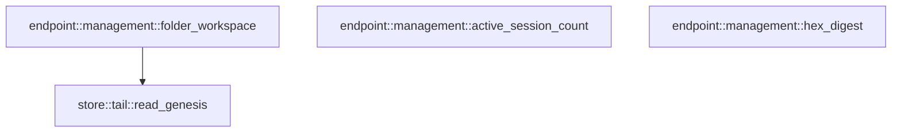

```mermaid
flowchart TD
  n0["endpoint::management::is_hex_digest"]
  n1["endpoint::management::read_canonical"]
  n2["endpoint::management::to_ijson"]
  n3["endpoint::management::intent_kind"]
  n4["endpoint::management::discard_intent"]
  n5["endpoint::management::folder_is_ephemeral"]
  n6["endpoint::management::folder_move_intent"]
  n7["endpoint::management::session_create_intent"]
  n8["endpoint::management::select_model_intent"]
  n9["endpoint::management::fork_intent"]
  n10["endpoint::management::queue_transaction_intent"]
  n11["endpoint::management::pending_queue_transaction"]
  n12["endpoint::management::verify_queue_payload"]
  n13["endpoint::management::completion_for_decision"]
  n14["endpoint::management::queue_completion_value"]
  n15["endpoint::management::queue_completion_from_record"]
  n16["endpoint::management::operation_target_session"]
  n17["endpoint::management::is_uid_principal"]
  n18["endpoint::management::fork_id_from_response"]
  n19["endpoint::management::selected_model_from_response"]
  n20["endpoint::management::active_session_folder"]
  n21["endpoint::management::valid_folder_projection"]
  n22["endpoint::management::folder_reservation"]
  n23["endpoint::management::verify_folder_reservation"]
  n24["endpoint::types::validate_session_id"]
  n25["store::tail::read_ledger_repaired"]
  n26["store::tail::read_genesis"]
  n4 --> n24
  n5 --> n26
  n7 --> n0
  n7 --> n24
  n8 --> n24
  n9 --> n17
  n9 --> n24
  n10 --> n24
  n11 --> n10
  n12 --> n1
  n14 --> n2
  n15 --> n10
  n15 --> n14
  n16 --> n3
  n16 --> n6
  n16 --> n7
  n16 --> n8
  n16 --> n9
  n16 --> n10
  n21 --> n25
  n22 --> n25
  n23 --> n22
```

# endpoint::management

[Package atlas](index.md) · [Source](../../src/management.rs)

## Declarations

Visibility is the declaration spelling; trait members and reexports require their enclosing interface. `cfg` is not evaluated.

| Symbol | Kind | Visibility | Test / cfg |
|---|---|---|---|
| [endpoint::management::VERSION](../../src/management.rs#L28) | const_item | `private` |  |
| [endpoint::management::WorkspaceView](../../src/management.rs#L32) | struct_item | `pub` |  |
| [endpoint::management::WorkspaceFolderView](../../src/management.rs#L44) | struct_item | `pub` |  |
| [endpoint::management::WorkspaceFolders](../../src/management.rs#L52) | struct_item | `pub` |  |
| [endpoint::management::WorkspaceList](../../src/management.rs#L59) | struct_item | `pub` |  |
| [endpoint::management::WorkspaceMetadata](../../src/management.rs#L66) | struct_item | `private` |  |
| [endpoint::management::OperationPhase](../../src/management.rs#L77) | enum_item | `private` |  |
| [endpoint::management::WorkspaceIntent](../../src/management.rs#L87) | struct_item | `private` |  |
| [endpoint::management::FolderMoveIntent](../../src/management.rs#L108) | struct_item | `private` |  |
| [endpoint::management::DiscardIntent](../../src/management.rs#L120) | struct_item | `private` |  |
| [endpoint::management::SessionCreateIntent](../../src/management.rs#L129) | struct_item | `private` |  |
| [endpoint::management::SelectModelIntent](../../src/management.rs#L144) | struct_item | `private` |  |
| [endpoint::management::ForkIntent](../../src/management.rs#L157) | struct_item | `private` |  |
| [endpoint::management::QueueTransactionIntent](../../src/management.rs#L172) | struct_item | `private` |  |
| [endpoint::management::QueueTailSnapshot](../../src/management.rs#L185) | struct_item | `private` |  |
| [endpoint::management::ORIGIN_CLIENT](../../src/management.rs#L193) | const_item | `pub` |  |
| [endpoint::management::LEGACY_ORIGIN_CLIENT](../../src/management.rs#L196) | const_item | `pub` |  |
| [endpoint::management::is_endpoint_origin_client](../../src/management.rs#L199) | function_item | `pub` |  |
| [endpoint::management::OperationRecord](../../src/management.rs#L205) | struct_item | `private` |  |
| [endpoint::management::WorkspaceOperationWrite](../../src/management.rs#L217) | struct_item | `private` |  |
| [endpoint::management::SessionCreateOperation](../../src/management.rs#L230) | struct_item | `pub` |  |
| [endpoint::management::SelectModelOperation](../../src/management.rs#L242) | struct_item | `pub` |  |
| [endpoint::management::ForkSessionOperation](../../src/management.rs#L252) | struct_item | `pub` |  |
| [endpoint::management::ForkLineage](../../src/management.rs#L265) | struct_item | `pub` |  |
| [endpoint::management::QueueTransactionOperation](../../src/management.rs#L270) | struct_item | `pub` |  |
| [endpoint::management::PendingQueueTransaction](../../src/management.rs#L283) | struct_item | `pub` |  |
| [endpoint::management::QueueTransactionDecision](../../src/management.rs#L294) | enum_item | `pub` |  |
| [endpoint::management::QueueTransactionCompletion](../../src/management.rs#L303) | enum_item | `pub` |  |
| [endpoint::management::QueueTransactionState](../../src/management.rs#L314) | enum_item | `pub` |  |
| [endpoint::management::QueueRecoveryDriver](../../src/management.rs#L319) | trait_item | `pub` |  |
| [endpoint::management::QueueRecoveryDriver::execute](../../src/management.rs#L320) | function_signature_item | `private` |  |
| [endpoint::management::SelectedModel](../../src/management.rs#L327) | struct_item | `pub` |  |
| [endpoint::management::CompleteOperations](../../src/management.rs#L336) | struct_item | `pub` |  |
| [endpoint::management::file_identity](../../src/management.rs#L340) | function_item | `private` |  |
| [endpoint::management::ManagementStore](../../src/management.rs#L346) | struct_item | `pub` |  |
| [endpoint::management::ManagementStore::open_at](../../src/management.rs#L357) | function_item | `pub(crate)` | test; #[cfg(test)] |
| [endpoint::management::ManagementStore::open_at_with_queue_driver](../../src/management.rs#L364) | function_item | `pub` |  |
| [endpoint::management::ManagementStore::open_recovering_again](../../src/management.rs#L375) | function_item | `pub` |  |
| [endpoint::management::ManagementStore::open_recovering](../../src/management.rs#L389) | function_item | `private` |  |
| [endpoint::management::ManagementStore::open_light](../../src/management.rs#L424) | function_item | `pub` |  |
| [endpoint::management::ManagementStore::open_light_at](../../src/management.rs#L428) | function_item | `pub` |  |
| [endpoint::management::ManagementStore::heal_workspace_metadata_locked](../../src/management.rs#L459) | function_item | `private` |  |
| [endpoint::management::ManagementStore::lock_exclusive](../../src/management.rs#L496) | function_item | `pub` |  |
| [endpoint::management::ManagementStore::root](../../src/management.rs#L503) | function_item | `pub` |  |
| [endpoint::management::ManagementStore::recover](../../src/management.rs#L508) | function_item | `pub` |  |
| [endpoint::management::ManagementStore::recover_with_queue_driver](../../src/management.rs#L512) | function_item | `pub` |  |
| [endpoint::management::ManagementStore::recover_skipping](../../src/management.rs#L519) | function_item | `private` |  |
| [endpoint::management::ManagementStore::recover_record](../../src/management.rs#L544) | function_item | `private` |  |
| [endpoint::management::ManagementStore::quarantine_corrupt_workspace](../../src/management.rs#L686) | function_item | `private` |  |
| [endpoint::management::ManagementStore::quarantine_operation](../../src/management.rs#L703) | function_item | `private` |  |
| [endpoint::management::ManagementStore::seed_missing_workspace_policies](../../src/management.rs#L752) | function_item | `private` |  |
| [endpoint::management::ManagementStore::reconcile_workspace_metadata](../../src/management.rs#L774) | function_item | `private` |  |
| [endpoint::management::ManagementStore::list_workspaces](../../src/management.rs#L779) | function_item | `pub` |  |
| [endpoint::management::ManagementStore::workspace_paths](../../src/management.rs#L841) | function_item | `pub` |  |
| [endpoint::management::ManagementStore::workspace_path](../../src/management.rs#L851) | function_item | `pub` |  |
| [endpoint::management::ManagementStore::create_session](../../src/management.rs#L864) | function_item | `pub` |  |
| [endpoint::management::ManagementStore::select_model](../../src/management.rs#L988) | function_item | `pub` |  |
| [endpoint::management::ManagementStore::fork_session](../../src/management.rs#L1070) | function_item | `pub` |  |
| [endpoint::management::ManagementStore::prepare_queue_transaction](../../src/management.rs#L1154) | function_item | `pub` |  |
| [endpoint::management::ManagementStore::complete_queue_transaction](../../src/management.rs#L1255) | function_item | `pub` |  |
| [endpoint::management::ManagementStore::has_incomplete_session_operation](../../src/management.rs#L1271) | function_item | `pub` |  |
| [endpoint::management::ManagementStore::completed_fork_lineage](../../src/management.rs#L1288) | function_item | `pub` |  |
| [endpoint::management::ManagementStore::create_workspace](../../src/management.rs#L1309) | function_item | `pub` |  |
| [endpoint::management::ManagementStore::rename_workspace](../../src/management.rs#L1383) | function_item | `pub` |  |
| [endpoint::management::ManagementStore::relocate_workspace](../../src/management.rs#L1429) | function_item | `pub` |  |
| [endpoint::management::ManagementStore::workspace_folders](../../src/management.rs#L1504) | function_item | `pub` |  |
| [endpoint::management::ManagementStore::add_workspace_folder](../../src/management.rs#L1519) | function_item | `pub` |  |
| [endpoint::management::ManagementStore::remove_workspace_folder](../../src/management.rs#L1580) | function_item | `pub` |  |
| [endpoint::management::ManagementStore::resume_folder_operation](../../src/management.rs#L1638) | function_item | `private` |  |
| [endpoint::management::ManagementStore::drive_folder_operation](../../src/management.rs#L1662) | function_item | `private` |  |
| [endpoint::management::ManagementStore::workspace_session_bindings](../../src/management.rs#L1672) | function_item | `private` |  |
| [endpoint::management::ManagementStore::archive_session](../../src/management.rs#L1733) | function_item | `pub` |  |
| [endpoint::management::ManagementStore::unarchive_session](../../src/management.rs#L1763) | function_item | `pub` |  |
| [endpoint::management::ManagementStore::discard_session](../../src/management.rs#L1784) | function_item | `pub` |  |
| [endpoint::management::ManagementStore::drive_discard](../../src/management.rs#L1845) | function_item | `private` |  |
| [endpoint::management::ManagementStore::folder_move](../../src/management.rs#L1900) | function_item | `private` |  |
| [endpoint::management::ManagementStore::begin_workspace_operation](../../src/management.rs#L1976) | function_item | `private` |  |
| [endpoint::management::ManagementStore::drive_workspace_operation](../../src/management.rs#L2033) | function_item | `private` |  |
| [endpoint::management::ManagementStore::workspace_configs](../../src/management.rs#L2140) | function_item | `private` |  |
| [endpoint::management::ManagementStore::operation_created](../../src/management.rs#L2152) | function_item | `private` |  |
| [endpoint::management::ManagementStore::rebuild_candidate](../../src/management.rs#L2186) | function_item | `private` |  |
| [endpoint::management::ManagementStore::drive_session_create](../../src/management.rs#L2311) | function_item | `private` |  |
| [endpoint::management::ManagementStore::session_id_from_response](../../src/management.rs#L2379) | function_item | `private` |  |
| [endpoint::management::ManagementStore::drive_select_model](../../src/management.rs#L2393) | function_item | `private` |  |
| [endpoint::management::ManagementStore::fork_was_quarantined](../../src/management.rs#L2459) | function_item | `private` |  |
| [endpoint::management::ManagementStore::drive_fork](../../src/management.rs#L2488) | function_item | `private` |  |
| [endpoint::management::ManagementStore::drive_queue_completion](../../src/management.rs#L2567) | function_item | `private` |  |
| [endpoint::management::ManagementStore::remove_recordless_payloads](../../src/management.rs#L2626) | function_item | `private` |  |
| [endpoint::management::ManagementStore::remove_recordless_payload](../../src/management.rs#L2653) | function_item | `private` |  |
| [endpoint::management::ManagementStore::drive_folder_move](../../src/management.rs#L2672) | function_item | `private` |  |
| [endpoint::management::ManagementStore::operation_paths](../../src/management.rs#L2742) | function_item | `private` |  |
| [endpoint::management::ManagementStore::operation_path](../../src/management.rs#L2762) | function_item | `private` |  |
| [endpoint::management::ManagementStore::operation_payload_path](../../src/management.rs#L2770) | function_item | `private` |  |
| [endpoint::management::ManagementStore::metadata_path](../../src/management.rs#L2779) | function_item | `private` |  |
| [endpoint::management::ManagementStore::read_metadata](../../src/management.rs#L2785) | function_item | `private` |  |
| [endpoint::management::ManagementStore::read_metadata_optional](../../src/management.rs#L2793) | function_item | `private` |  |
| [endpoint::management::primary_path](../../src/management.rs#L2806) | function_item | `private` |  |
| [endpoint::management::binding_for_path](../../src/management.rs#L2815) | function_item | `private` |  |
| [endpoint::management::binding_for_canonical_path](../../src/management.rs#L2821) | function_item | `private` |  |
| [endpoint::management::execution_path_from_snapshot](../../src/management.rs#L2836) | function_item | `private` |  |
| [endpoint::management::folder_binding_matches_snapshot](../../src/management.rs#L2842) | function_item | `private` |  |
| [endpoint::management::resolve_session_workspace](../../src/management.rs#L2846) | function_item | `private` |  |
| [endpoint::management::existing_session_cwd](../../src/management.rs#L2908) | function_item | `private` |  |
| [endpoint::management::create_genesis](../../src/management.rs#L2929) | function_item | `private` |  |
| [endpoint::management::canonical_event_line](../../src/management.rs#L2960) | function_item | `private` |  |
| [endpoint::management::read_canonical_event](../../src/management.rs#L2966) | function_item | `private` |  |
| [endpoint::management::verify_session_create_genesis](../../src/management.rs#L2977) | function_item | `private` |  |
| [endpoint::management::copy_payload_tree](../../src/management.rs#L3023) | function_item | `private` |  |
| [endpoint::management::sync_operation_payload](../../src/management.rs#L3044) | function_item | `private` |  |
| [endpoint::management::is_hex_digest](../../src/management.rs#L3057) | function_item | `private` |  |
| [endpoint::management::default_workspace_policy](../../src/management.rs#L3071) | function_item | `pub` |  |
| [endpoint::management::relocate_policy_roots](../../src/management.rs#L3085) | function_item | `private` |  |
| [endpoint::management::materialized_folders](../../src/management.rs#L3110) | function_item | `private` |  |
| [endpoint::management::next_folder_id](../../src/management.rs#L3126) | function_item | `private` |  |
| [endpoint::management::with_added_folder](../../src/management.rs#L3137) | function_item | `private` |  |
| [endpoint::management::with_removed_folder](../../src/management.rs#L3161) | function_item | `private` |  |
| [endpoint::management::folders_view](../../src/management.rs#L3194) | function_item | `private` |  |
| [endpoint::management::folder_response](../../src/management.rs#L3208) | function_item | `private` |  |
| [endpoint::management::canonical_workspace_path](../../src/management.rs#L3220) | function_item | `private` |  |
| [endpoint::management::unavailable_absolute_path](../../src/management.rs#L3229) | function_item | `private` |  |
| [endpoint::management::allocate_uuid_v7](../../src/management.rs#L3234) | function_item | `private` |  |
| [endpoint::management::current_timestamp](../../src/management.rs#L3253) | function_item | `private` |  |
| [endpoint::management::validate_title](../../src/management.rs#L3262) | function_item | `private` |  |
| [endpoint::management::ensure_unique_title](../../src/management.rs#L3274) | function_item | `private` |  |
| [endpoint::management::verify_metadata](../../src/management.rs#L3288) | function_item | `private` |  |
| [endpoint::management::workspace_view](../../src/management.rs#L3306) | function_item | `private` |  |
| [endpoint::management::timestamp_from_millis](../../src/management.rs#L3332) | function_item | `private` |  |
| [endpoint::management::publish_canonical](../../src/management.rs#L3356) | function_item | `private` |  |
| [endpoint::management::read_canonical](../../src/management.rs#L3361) | function_item | `private` |  |
| [endpoint::management::decode_canonical](../../src/management.rs#L3365) | function_item | `private` |  |
| [endpoint::management::canonical_line](../../src/management.rs#L3386) | function_item | `private` |  |
| [endpoint::management::to_ijson](../../src/management.rs#L3393) | function_item | `private` |  |
| [endpoint::management::intent_kind](../../src/management.rs#L3401) | function_item | `private` |  |
| [endpoint::management::workspace_intent](../../src/management.rs#L3412) | function_item | `private` |  |
| [endpoint::management::discard_intent](../../src/management.rs#L3444) | function_item | `private` |  |
| [endpoint::management::folder_is_ephemeral](../../src/management.rs#L3456) | function_item | `private` |  |
| [endpoint::management::folder_move_intent](../../src/management.rs#L3462) | function_item | `private` |  |
| [endpoint::management::session_create_intent](../../src/management.rs#L3473) | function_item | `private` |  |
| [endpoint::management::select_model_intent](../../src/management.rs#L3498) | function_item | `private` |  |
| [endpoint::management::fork_intent](../../src/management.rs#L3518) | function_item | `private` |  |
| [endpoint::management::queue_transaction_intent](../../src/management.rs#L3535) | function_item | `private` |  |
| [endpoint::management::pending_queue_transaction](../../src/management.rs#L3563) | function_item | `private` |  |
| [endpoint::management::verify_queue_payload](../../src/management.rs#L3578) | function_item | `private` |  |
| [endpoint::management::completion_for_decision](../../src/management.rs#L3613) | function_item | `private` |  |
| [endpoint::management::queue_completion_value](../../src/management.rs#L3625) | function_item | `private` |  |
| [endpoint::management::queue_completion_from_record](../../src/management.rs#L3663) | function_item | `private` |  |
| [endpoint::management::operation_target_session](../../src/management.rs#L3710) | function_item | `private` |  |
| [endpoint::management::is_uid_principal](../../src/management.rs#L3726) | function_item | `private` |  |
| [endpoint::management::fork_id_from_response](../../src/management.rs#L3732) | function_item | `private` |  |
| [endpoint::management::selected_model_from_response](../../src/management.rs#L3744) | function_item | `private` |  |
| [endpoint::management::active_session_folder](../../src/management.rs#L3782) | function_item | `private` |  |
| [endpoint::management::valid_folder_projection](../../src/management.rs#L3793) | function_item | `private` |  |
| [endpoint::management::folder_reservation](../../src/management.rs#L3806) | function_item | `private` |  |
| [endpoint::management::verify_folder_reservation](../../src/management.rs#L3823) | function_item | `private` |  |
| [endpoint::management::folder_workspace](../../src/management.rs#L3836) | function_item | `private` |  |
| [endpoint::management::active_session_count](../../src/management.rs#L3848) | function_item | `private` |  |
| [endpoint::management::hex_digest](../../src/management.rs#L3858) | function_item | `private` |  |
| [endpoint::management::ManagementError](../../src/management.rs#L3863) | enum_item | `pub` |  |
| [endpoint::management::tests::omitted_identity_is_auto_but_explicit_and_legacy_identity_stay_fixed](../../src/management.rs#L3958) | function_item | `private` | test; #[cfg(test)] |
| [endpoint::management::tests::legacy_session_create_without_folder_binding_remains_recoverable](../../src/management.rs#L3991) | function_item | `private` | test; #[cfg(test)] |
| [endpoint::management::tests::quarantined_fork_does_not_block_recovery_or_claim_success](../../src/management.rs#L4006) | function_item | `private` | test; #[cfg(test)] |
| [endpoint::management::tests::open_light_heals_metadata_after_any_config_writer_without_reading_threads](../../src/management.rs#L4080) | function_item | `private` | test; #[cfg(test)] |
| [endpoint::management::tests::unavailable_workspace_keeps_its_management_operation_pending](../../src/management.rs#L4169) | function_item | `private` | test; #[cfg(test)] |
| [endpoint::management::tests::a_select_model_payload_staged_before_the_rename_is_read_on_recovery](../../src/management.rs#L4208) | function_item | `private` | test; #[cfg(test)] |
| [endpoint::management::tests::a_created_workspace_starts_with_the_interactive_fixed_catalog_writable_in_its_folder](../../src/management.rs#L4276) | function_item | `private` | test; #[cfg(test)] |
| [endpoint::management::tests::opening_the_store_seeds_a_policy_for_a_policy_less_workspace_once](../../src/management.rs#L4320) | function_item | `private` | test; #[cfg(test)] |
| [endpoint::management::tests::relocation_moves_writable_roots_with_their_folder](../../src/management.rs#L4368) | function_item | `private` | test; #[cfg(test)] |
| [endpoint::management::tests::folder_store](../../src/management.rs#L4403) | function_item | `private` | test; #[cfg(test)] |
| [endpoint::management::tests::sibling](../../src/management.rs#L4420) | function_item | `private` | test; #[cfg(test)] |
| [endpoint::management::tests::write_session](../../src/management.rs#L4431) | function_item | `private` | test; #[cfg(test)] |
| [endpoint::management::tests::folders_are_added_listed_and_removed_with_their_writable_roots](../../src/management.rs#L4472) | function_item | `private` | test; #[cfg(test)] |
| [endpoint::management::tests::a_folder_bound_to_a_session_is_not_removed](../../src/management.rs#L4587) | function_item | `private` | test; #[cfg(test)] |
| [endpoint::management::tests::a_legacy_unbound_session_blocks_a_second_folder](../../src/management.rs#L4633) | function_item | `private` | test; #[cfg(test)] |
| [endpoint::management::tests::folder_edits_materialize_a_legacy_cwd_workspace_with_its_synthesized_ids](../../src/management.rs#L4661) | function_item | `private` | test; #[cfg(test)] |
| [endpoint::management::tests::completed_workspace_operation_never_reopens_its_old_path](../../src/management.rs#L4693) | function_item | `private` | test; #[cfg(test)] |
| [endpoint::management::k1_management_race::BOOT](../../src/management.rs#L4724) | const_item | `private` | test; #[cfg(test)] |
| [endpoint::management::k1_management_race::TICK](../../src/management.rs#L4725) | const_item | `private` | test; #[cfg(test)] |
| [endpoint::management::k1_management_race::LATER](../../src/management.rs#L4726) | const_item | `private` | test; #[cfg(test)] |
| [endpoint::management::k1_management_race::WORKSPACE](../../src/management.rs#L4727) | const_item | `private` | test; #[cfg(test)] |
| [endpoint::management::k1_management_race::fixture](../../src/management.rs#L4729) | function_item | `private` | test; #[cfg(test)] |
| [endpoint::management::k1_management_race::policy_with](../../src/management.rs#L4754) | function_item | `private` | test; #[cfg(test)] |
| [endpoint::management::k1_management_race::set_policy](../../src/management.rs#L4760) | function_item | `private` | test; #[cfg(test)] |
| [endpoint::management::k1_management_race::quarantine_root](../../src/management.rs#L4767) | function_item | `private` | test; #[cfg(test)] |
| [endpoint::management::k1_management_race::stale_metadata](../../src/management.rs#L4773) | function_item | `private` | test; #[cfg(test)] |
| [endpoint::management::k1_management_race::metadata_matches](../../src/management.rs#L4780) | function_item | `private` | test; #[cfg(test)] |
| [endpoint::management::k1_management_race::stuck_carriers_record](../../src/management.rs#L4787) | function_item | `private` | test; #[cfg(test)] |
| [endpoint::management::k1_management_race::tick_heals_stale_metadata_without_staging_an_operation](../../src/management.rs#L4821) | function_item | `private` | test; #[cfg(test)] |
| [endpoint::management::k1_management_race::tick_never_fails_while_policy_set_publishes](../../src/management.rs#L4851) | function_item | `private` | test; #[cfg(test)] |
| [endpoint::management::k1_management_race::parked_synthetic_rename](../../src/management.rs#L4896) | function_item | `private` | test; #[cfg(test)] |
| [endpoint::management::k1_management_race::boot_quarantines_the_parked_carriers_record_and_succeeds](../../src/management.rs#L4945) | function_item | `private` | test; #[cfg(test)] |
| [endpoint::management::k1_management_race::record_of_another_version_is_left_in_place_not_quarantined](../../src/management.rs#L5000) | function_item | `private` | test; #[cfg(test)] |
| [endpoint::management::k1_management_race::quarantine_keeps_the_payload_and_never_redrives_the_operation](../../src/management.rs#L5022) | function_item | `private` | test; #[cfg(test)] |
| [endpoint::management::k1_management_race::complete_workspace_record_without_response_is_quarantined](../../src/management.rs#L5085) | function_item | `private` | test; #[cfg(test)] |
| [endpoint::management::k1_management_race::one_failing_record_does_not_stop_the_others_from_recovering](../../src/management.rs#L5121) | function_item | `private` | test; #[cfg(test)] |

## Imports / reexports

| Local name | Source path | Visibility |
|---|---|---|
| `BTreeMap` | `std::collections::BTreeMap` | `private` |
| `fs` | `std::fs` | `private` |
| `File` | `std::fs::File` | `private` |
| `Read` | `std::io::Read` | `private` |
| `MetadataExt` | `std::os::unix::fs::MetadataExt` | `private` |
| `Path` | `std::path::Path` | `private` |
| `PathBuf` | `std::path::PathBuf` | `private` |
| `SystemTime` | `std::time::SystemTime` | `private` |
| `UNIX_EPOCH` | `std::time::UNIX_EPOCH` | `private` |
| `ConfigRepository` | `profile::ConfigRepository` | `private` |
| `InstructionResolver` | `profile::InstructionResolver` | `private` |
| `WorkspaceConfig` | `profile::WorkspaceConfig` | `private` |
| `WorkspaceFolder` | `profile::WorkspaceFolder` | `private` |
| `WorkspacePolicy` | `profile::WorkspacePolicy` | `private` |
| `Event` | `schema::Event` | `private` |
| `IJsonValue` | `schema::IJsonValue` | `private` |
| `OriginTuple` | `schema::OriginTuple` | `private` |
| `ResumePolicy` | `schema::ResumePolicy` | `private` |
| `Deserialize` | `serde::Deserialize` | `private` |
| `Serialize` | `serde::Serialize` | `private` |
| `Value` | `serde_json::Value` | `private` |
| `json` | `serde_json::json` | `private` |
| `Digest` | `sha2::Digest` | `private` |
| `Sha256` | `sha2::Sha256` | `private` |
| `AssetStore` | `store::AssetStore` | `private` |
| `AtomicPublisher` | `store::AtomicPublisher` | `private` |
| `DirectoryLock` | `store::DirectoryLock` | `private` |
| `NamedLock` | `store::NamedLock` | `private` |
| `ThreadStore` | `store::ThreadStore` | `private` |
| `scan_valid_prefix` | `store::scan_valid_prefix` | `private` |
| `Error` | `thiserror::Error` | `private` |
| `Uuid` | `uuid::Uuid` | `private` |
| `SessionInventoryItem` | `crate::SessionInventoryItem` | `private` |
| `ForkIntent` | `super::ForkIntent` | `private` |
| `ManagementError` | `super::ManagementError` | `private` |
| `ManagementStore` | `super::ManagementStore` | `private` |
| `OperationPhase` | `super::OperationPhase` | `private` |
| `OperationRecord` | `super::OperationRecord` | `private` |
| `VERSION` | `super::VERSION` | `private` |
| `WorkspaceMetadata` | `super::WorkspaceMetadata` | `private` |
| `WorkspaceOperationWrite` | `super::WorkspaceOperationWrite` | `private` |
| `WorkspaceView` | `super::WorkspaceView` | `private` |
| `canonical_event_line` | `super::canonical_event_line` | `private` |
| `create_genesis` | `super::create_genesis` | `private` |
| `default_workspace_policy` | `super::default_workspace_policy` | `private` |
| `folder_binding_matches_snapshot` | `super::folder_binding_matches_snapshot` | `private` |
| `publish_canonical` | `super::publish_canonical` | `private` |
| `read_canonical` | `super::read_canonical` | `private` |
| `to_ijson` | `super::to_ijson` | `private` |
| `SessionInventoryItem` | `crate::SessionInventoryItem` | `private` |
| `ConfigRepository` | `profile::ConfigRepository` | `private` |
| `WorkspaceConfig` | `profile::WorkspaceConfig` | `private` |
| `WorkspaceFolder` | `profile::WorkspaceFolder` | `private` |
| `Value` | `serde_json::Value` | `private` |
| `json` | `serde_json::json` | `private` |
| `fs` | `std::fs` | `private` |
| `Path` | `std::path::Path` | `private` |
| `ThreadStore` | `store::ThreadStore` | `private` |
| `*` | `super::*` | `private` |
| `ConfigRepository` | `profile::ConfigRepository` | `private` |
| `WorkspaceConfig` | `profile::WorkspaceConfig` | `private` |
| `WorkspaceFolder` | `profile::WorkspaceFolder` | `private` |
| `Arc` | `std::sync::Arc` | `private` |
| `AtomicBool` | `std::sync::atomic::AtomicBool` | `private` |
| `Ordering` | `std::sync::atomic::Ordering` | `private` |

## Module declarations

| Module | Visibility | Attributes |
|---|---|---|
| `endpoint::management::tests` | `private` | #[cfg(test)] |
| `endpoint::management::k1_management_race` | `private` | #[cfg(test)] |

## Function call graphs

Edges below are syntactically resolved calls only, including private functions. Graphs partition callers into groups of 20; they are not execution order. All unresolved sites are listed below and in the JSON inventory.

```mermaid
flowchart TD
  n0["endpoint::management::is_endpoint_origin_client"]
  n1["endpoint::management::ManagementStore::drive_workspace_operation"]
  n2["endpoint::management::ManagementStore::workspace_configs"]
  n3["endpoint::management::ManagementStore::drive_session_create"]
  n4["endpoint::management::ManagementStore::drive_select_model"]
  n5["endpoint::management::ManagementStore::fork_was_quarantined"]
  n6["endpoint::management::ManagementStore::drive_fork"]
  n7["endpoint::management::ManagementStore::drive_queue_completion"]
  n8["endpoint::management::ManagementStore::remove_recordless_payloads"]
  n9["endpoint::management::ManagementStore::drive_folder_move"]
  n10["endpoint::management::ManagementStore::operation_paths"]
  n11["endpoint::management::ManagementStore::operation_payload_path"]
  n12["endpoint::management::ManagementStore::metadata_path"]
  n13["endpoint::management::ManagementStore::read_metadata"]
  n14["endpoint::management::ManagementStore::read_metadata_optional"]
  n15["endpoint::management::primary_path"]
  n16["endpoint::management::copy_payload_tree"]
  n17["endpoint::management::is_hex_digest"]
  n18["endpoint::management::default_workspace_policy"]
  n19["endpoint::management::unavailable_absolute_path"]
  n20["endpoint::management::current_timestamp"]
  n21["endpoint::management::verify_metadata"]
  n22["endpoint::management::workspace_view"]
  n23["endpoint::management::publish_canonical"]
  n24["endpoint::management::read_canonical"]
  n25["endpoint::management::canonical_line"]
  n26["endpoint::management::intent_kind"]
  n27["endpoint::management::file_identity"]
  n28["endpoint::management::workspace_intent"]
  n29["endpoint::management::folder_move_intent"]
  n30["endpoint::management::session_create_intent"]
  n31["endpoint::management::select_model_intent"]
  n32["endpoint::management::fork_intent"]
  n33["endpoint::management::queue_transaction_intent"]
  n34["endpoint::management::pending_queue_transaction"]
  n35["endpoint::management::verify_queue_payload"]
  n36["endpoint::management::ManagementStore::open_at_with_queue_driver"]
  n37["endpoint::management::queue_completion_from_record"]
  n38["endpoint::management::ManagementStore::open_recovering_again"]
  n39["endpoint::management::hex_digest"]
  n40["endpoint::management::ManagementStore::open_recovering"]
  n41["endpoint::management::ManagementStore::open_light"]
  n42["endpoint::management::ManagementStore::open_light_at"]
  n43["endpoint::management::ManagementStore::heal_workspace_metadata_locked"]
  n44["endpoint::management::ManagementStore::lock_exclusive"]
  n45["endpoint::management::ManagementStore::root"]
  n46["endpoint::management::ManagementStore::recover"]
  n47["endpoint::management::ManagementStore::recover_with_queue_driver"]
  n48["endpoint::management::ManagementStore::recover_skipping"]
  n49["endpoint::management::ManagementStore::recover_record"]
  n50["endpoint::management::ManagementStore::quarantine_corrupt_workspace"]
  n51["endpoint::management::ManagementStore::quarantine_operation"]
  n52["endpoint::management::ManagementStore::seed_missing_workspace_policies"]
  n53["endpoint::management::ManagementStore::reconcile_workspace_metadata"]
  n54["endpoint::management::ManagementStore::list_workspaces"]
  n55["endpoint::management::ManagementStore::workspace_paths"]
  n56["profile::config::ConfigRepository::open"]
  n57["store::atomic::AtomicPublisher::replace"]
  n58["store::folder::ThreadStore::open"]
  n59["store::management_root::endpoint_management_root"]
  n60["store::platform::NamedLock::exclusive"]
  n61["store::platform::NamedLock::shared"]
  n36 --> n40
  n38 --> n40
  n40 --> n56
  n40 --> n58
  n40 --> n59
  n41 --> n20
  n41 --> n42
  n42 --> n56
  n42 --> n59
  n42 --> n60
  n43 --> n2
  n43 --> n12
  n43 --> n14
  n43 --> n15
  n43 --> n21
  n43 --> n23
  n43 --> n25
  n43 --> n39
  n43 --> n61
  n44 --> n59
  n44 --> n60
  n46 --> n47
  n47 --> n48
  n48 --> n8
  n48 --> n10
  n48 --> n49
  n48 --> n60
  n49 --> n1
  n49 --> n3
  n49 --> n4
  n49 --> n5
  n49 --> n6
  n49 --> n7
  n49 --> n9
  n49 --> n11
  n49 --> n19
  n49 --> n24
  n49 --> n26
  n49 --> n27
  n49 --> n28
  n49 --> n29
  n49 --> n30
  n49 --> n31
  n49 --> n32
  n49 --> n33
  n49 --> n34
  n49 --> n35
  n49 --> n37
  n49 --> n50
  n49 --> n60
  n50 --> n51
  n51 --> n16
  n51 --> n17
  n51 --> n57
  n52 --> n2
  n52 --> n15
  n52 --> n18
  n52 --> n60
  n53 --> n43
  n53 --> n60
  n54 --> n2
  n54 --> n13
  n54 --> n14
  n54 --> n15
  n54 --> n20
  n54 --> n21
  n54 --> n22
  n54 --> n43
  n54 --> n60
  n55 --> n2
  n55 --> n15
  n55 --> n61
```

Functions 1–20: 72 direct edges

Functions 21–40: 150 direct edges

Functions 41–60: 107 direct edges

Functions 61–80: 16 direct edges

Functions 81–100: 14 direct edges

Functions 101–120: 22 direct edges

Functions 121–123: 1 direct edges

## Call sites

Includes test functions (marked in declarations). Receiver-type-required sites need type analysis/manual tracing. Calls in closures are attributed to their enclosing function; their occurrence here does not mean the closure executes immediately.

| Caller | Callee expression | Source lines | Target / classification |
|---|---|---|---|
| `file_identity` | `fs::metadata(path).ok` | [341](../../src/management.rs#L341) | receiver-type-required |
| `file_identity` | `fs::metadata` | [341](../../src/management.rs#L341) | external-constructor-callback-or-unresolved |
| `file_identity` | `Some` | [342](../../src/management.rs#L342) | external-constructor-callback-or-unresolved |
| `file_identity` | `metadata.len` | [342](../../src/management.rs#L342) | receiver-type-required |
| `file_identity` | `metadata.modified().ok` | [342](../../src/management.rs#L342) | receiver-type-required |
| `file_identity` | `metadata.modified` | [342](../../src/management.rs#L342) | receiver-type-required |
| `open_at` | `Self::open_at_with_queue_driver` | [361](../../src/management.rs#L361) | [endpoint::management::ManagementStore::open_at_with_queue_driver](../../src/management.rs#L364) |
| `open_at_with_queue_driver` | `Self::open_recovering` | [369](../../src/management.rs#L369) | [endpoint::management::ManagementStore::open_recovering](../../src/management.rs#L389) |
| `open_recovering_again` | `Self::open_recovering` | [381](../../src/management.rs#L381) | [endpoint::management::ManagementStore::open_recovering](../../src/management.rs#L389) |
| `open_recovering_again` | `Some` | [385](../../src/management.rs#L385) | external-constructor-callback-or-unresolved |
| `open_recovering` | `storage_root.as_ref().to_path_buf` | [395](../../src/management.rs#L395) | receiver-type-required |
| `open_recovering` | `storage_root.as_ref` | [395](../../src/management.rs#L395) | receiver-type-required |
| `open_recovering` | `ThreadStore::open` | [396](../../src/management.rs#L396) | [store::folder::ThreadStore::open](../../../store/src/folder.rs#L36) |
| `open_recovering` | `store::endpoint_management_root` | [397](../../src/management.rs#L397) | [store::management_root::endpoint_management_root](../../../store/src/management_root.rs#L47) |
| `open_recovering` | `fs::create_dir_all` | [398](../../src/management.rs#L398), [399](../../src/management.rs#L399) | external-constructor-callback-or-unresolved |
| `open_recovering` | `root.join` | [398](../../src/management.rs#L398), [399](../../src/management.rs#L399), [403](../../src/management.rs#L403) | receiver-type-required |
| `open_recovering` | `fs::OpenOptions::new()             .create(true)             .append(true)             .open` | [400](../../src/management.rs#L400) | receiver-type-required |
| `open_recovering` | `fs::OpenOptions::new()             .create(true)             .append` | [400](../../src/management.rs#L400) | receiver-type-required |
| `open_recovering` | `fs::OpenOptions::new()             .create` | [400](../../src/management.rs#L400) | receiver-type-required |
| `open_recovering` | `fs::OpenOptions::new` | [400](../../src/management.rs#L400) | external-constructor-callback-or-unresolved |
| `open_recovering` | `ConfigRepository::open` | [405](../../src/management.rs#L405) | [profile::config::ConfigRepository::open](../../../profile/src/config.rs#L684) |
| `open_recovering` | `store.recover_skipping` | [409](../../src/management.rs#L409) | receiver-type-required |
| `open_recovering` | `store.seed_missing_workspace_policies` | [410](../../src/management.rs#L410) | receiver-type-required |
| `open_recovering` | `store.reconcile_workspace_metadata` | [411](../../src/management.rs#L411) | receiver-type-required |
| `open_recovering` | `Ok` | [415](../../src/management.rs#L415) | external-constructor-callback-or-unresolved |
| `open_light` | `Self::open_light_at` | [425](../../src/management.rs#L425) | [endpoint::management::ManagementStore::open_light_at](../../src/management.rs#L428) |
| `open_light` | `current_timestamp` | [425](../../src/management.rs#L425) | [endpoint::management::current_timestamp](../../src/management.rs#L3253) |
| `open_light_at` | `storage_root.as_ref().to_path_buf` | [432](../../src/management.rs#L432) | receiver-type-required |
| `open_light_at` | `storage_root.as_ref` | [432](../../src/management.rs#L432) | receiver-type-required |
| `open_light_at` | `store::endpoint_management_root` | [433](../../src/management.rs#L433) | [store::management_root::endpoint_management_root](../../../store/src/management_root.rs#L47) |
| `open_light_at` | `fs::create_dir_all` | [434](../../src/management.rs#L434), [435](../../src/management.rs#L435) | external-constructor-callback-or-unresolved |
| `open_light_at` | `root.join` | [434](../../src/management.rs#L434), [435](../../src/management.rs#L435), [439](../../src/management.rs#L439) | receiver-type-required |
| `open_light_at` | `fs::OpenOptions::new()             .create(true)             .append(true)             .open` | [436](../../src/management.rs#L436) | receiver-type-required |
| `open_light_at` | `fs::OpenOptions::new()             .create(true)             .append` | [436](../../src/management.rs#L436) | receiver-type-required |
| `open_light_at` | `fs::OpenOptions::new()             .create` | [436](../../src/management.rs#L436) | receiver-type-required |
| `open_light_at` | `fs::OpenOptions::new` | [436](../../src/management.rs#L436) | external-constructor-callback-or-unresolved |
| `open_light_at` | `ConfigRepository::open` | [441](../../src/management.rs#L441) | [profile::config::ConfigRepository::open](../../../profile/src/config.rs#L684) |
| `open_light_at` | `NamedLock::exclusive` | [445](../../src/management.rs#L445) | [store::platform::NamedLock::exclusive](../../../store/src/platform.rs#L103) |
| `open_light_at` | `store.root.join` | [445](../../src/management.rs#L445) | receiver-type-required |
| `open_light_at` | `store.heal_workspace_metadata_locked` | [446](../../src/management.rs#L446) | receiver-type-required |
| `open_light_at` | `drop` | [447](../../src/management.rs#L447) | external-constructor-callback-or-unresolved |
| `open_light_at` | `Ok` | [448](../../src/management.rs#L448) | external-constructor-callback-or-unresolved |
| `heal_workspace_metadata_locked` | `NamedLock::shared` | [460](../../src/management.rs#L460) | [store::platform::NamedLock::shared](../../../store/src/platform.rs#L99) |
| `heal_workspace_metadata_locked` | `self.storage_root.join` | [460](../../src/management.rs#L460) | receiver-type-required |
| `heal_workspace_metadata_locked` | `self.workspace_configs()?.into_values` | [461](../../src/management.rs#L461) | receiver-type-required |
| `heal_workspace_metadata_locked` | `self.workspace_configs` | [461](../../src/management.rs#L461) | [endpoint::management::ManagementStore::workspace_configs](../../src/management.rs#L2140) |
| `heal_workspace_metadata_locked` | `primary_path(&config).map` | [463](../../src/management.rs#L463) | receiver-type-required |
| `heal_workspace_metadata_locked` | `primary_path` | [463](../../src/management.rs#L463) | [endpoint::management::primary_path](../../src/management.rs#L2806) |
| `heal_workspace_metadata_locked` | `self.read_metadata_optional` | [470](../../src/management.rs#L470) | [endpoint::management::ManagementStore::read_metadata_optional](../../src/management.rs#L2793) |
| `heal_workspace_metadata_locked` | `existing                 .as_ref()                 .is_some_and` | [471](../../src/management.rs#L471) | receiver-type-required |
| `heal_workspace_metadata_locked` | `existing                 .as_ref` | [471](../../src/management.rs#L471) | receiver-type-required |
| `heal_workspace_metadata_locked` | `verify_metadata(&config, metadata).is_ok` | [473](../../src/management.rs#L473) | receiver-type-required |
| `heal_workspace_metadata_locked` | `verify_metadata` | [473](../../src/management.rs#L473) | [endpoint::management::verify_metadata](../../src/management.rs#L3288) |
| `heal_workspace_metadata_locked` | `config.id.clone` | [479](../../src/management.rs#L479) | receiver-type-required |
| `heal_workspace_metadata_locked` | `existing                     .map_or_else` | [481](../../src/management.rs#L481) | receiver-type-required |
| `heal_workspace_metadata_locked` | `started_at.to_owned` | [482](../../src/management.rs#L482), [483](../../src/management.rs#L483) | receiver-type-required |
| `heal_workspace_metadata_locked` | `hex_digest` | [484](../../src/management.rs#L484) | [endpoint::management::hex_digest](../../src/management.rs#L3858) |
| `heal_workspace_metadata_locked` | `canonical_line` | [484](../../src/management.rs#L484) | [endpoint::management::canonical_line](../../src/management.rs#L3386) |
| `heal_workspace_metadata_locked` | `publish_canonical` | [486](../../src/management.rs#L486) | [endpoint::management::publish_canonical](../../src/management.rs#L3356) |
| `heal_workspace_metadata_locked` | `self.metadata_path` | [486](../../src/management.rs#L486) | [endpoint::management::ManagementStore::metadata_path](../../src/management.rs#L2779) |
| `heal_workspace_metadata_locked` | `Ok` | [488](../../src/management.rs#L488) | external-constructor-callback-or-unresolved |
| `lock_exclusive` | `store::endpoint_management_root` | [497](../../src/management.rs#L497) | [store::management_root::endpoint_management_root](../../../store/src/management_root.rs#L47) |
| `lock_exclusive` | `storage_root.as_ref` | [497](../../src/management.rs#L497) | receiver-type-required |
| `lock_exclusive` | `fs::create_dir_all` | [498](../../src/management.rs#L498) | external-constructor-callback-or-unresolved |
| `lock_exclusive` | `Ok` | [499](../../src/management.rs#L499) | external-constructor-callback-or-unresolved |
| `lock_exclusive` | `NamedLock::exclusive` | [499](../../src/management.rs#L499) | [store::platform::NamedLock::exclusive](../../../store/src/platform.rs#L103) |
| `lock_exclusive` | `root.join` | [499](../../src/management.rs#L499) | receiver-type-required |
| `recover` | `self.recover_with_queue_driver` | [509](../../src/management.rs#L509) | [endpoint::management::ManagementStore::recover_with_queue_driver](../../src/management.rs#L512) |
| `recover_with_queue_driver` | `self.recover_skipping` | [516](../../src/management.rs#L516) | [endpoint::management::ManagementStore::recover_skipping](../../src/management.rs#L519) |
| `recover_skipping` | `NamedLock::exclusive` | [528](../../src/management.rs#L528) | [store::platform::NamedLock::exclusive](../../../store/src/platform.rs#L103) |
| `recover_skipping` | `self.root.join` | [528](../../src/management.rs#L528) | receiver-type-required |
| `recover_skipping` | `self.remove_recordless_payloads` | [529](../../src/management.rs#L529) | [endpoint::management::ManagementStore::remove_recordless_payloads](../../src/management.rs#L2626) |
| `recover_skipping` | `self.operation_paths` | [530](../../src/management.rs#L530) | [endpoint::management::ManagementStore::operation_paths](../../src/management.rs#L2742) |
| `recover_skipping` | `self.recover_record` | [536](../../src/management.rs#L536) | [endpoint::management::ManagementStore::recover_record](../../src/management.rs#L544) |
| `recover_skipping` | `validated.as_deref_mut` | [536](../../src/management.rs#L536) | receiver-type-required |
| `recover_skipping` | `first_error.get_or_insert` | [537](../../src/management.rs#L537) | receiver-type-required |
| `recover_skipping` | `first_error.map_or` | [540](../../src/management.rs#L540) | receiver-type-required |
| `recover_skipping` | `Ok` | [540](../../src/management.rs#L540) | external-constructor-callback-or-unresolved |
| `recover_record` | `Some` | [550](../../src/management.rs#L550), [653](../../src/management.rs#L653) | external-constructor-callback-or-unresolved |
| `recover_record` | `NamedLock::exclusive` | [550](../../src/management.rs#L550), [653](../../src/management.rs#L653) | [store::platform::NamedLock::exclusive](../../../store/src/platform.rs#L103) |
| `recover_record` | `self.root.join` | [550](../../src/management.rs#L550), [653](../../src/management.rs#L653) | receiver-type-required |
| `recover_record` | `path.exists` | [551](../../src/management.rs#L551) | receiver-type-required |
| `recover_record` | `Ok` | [552](../../src/management.rs#L552), [558](../../src/management.rs#L558), [570](../../src/management.rs#L570), [598](../../src/management.rs#L598), [616](../../src/management.rs#L616), [638](../../src/management.rs#L638), [656](../../src/management.rs#L656), [683](../../src/management.rs#L683) | external-constructor-callback-or-unresolved |
| `recover_record` | `file_identity` | [554](../../src/management.rs#L554) | [endpoint::management::file_identity](../../src/management.rs#L340) |
| `recover_record` | `validated.as_deref` | [555](../../src/management.rs#L555) | receiver-type-required |
| `recover_record` | `identity.as_ref` | [555](../../src/management.rs#L555) | receiver-type-required |
| `recover_record` | `known.0.contains` | [556](../../src/management.rs#L556) | receiver-type-required |
| `recover_record` | `path.clone` | [556](../../src/management.rs#L556), [574](../../src/management.rs#L574) | receiver-type-required |
| `recover_record` | `read_canonical::<OperationRecord>` | [560](../../src/management.rs#L560), [654](../../src/management.rs#L654) | [endpoint::management::read_canonical](../../src/management.rs#L3361) |
| `recover_record` | `intent_kind` | [561](../../src/management.rs#L561) | [endpoint::management::intent_kind](../../src/management.rs#L3401) |
| `recover_record` | `known.0.insert` | [574](../../src/management.rs#L574) | receiver-type-required |
| `recover_record` | `kind.as_str` | [576](../../src/management.rs#L576), [618](../../src/management.rs#L618) | receiver-type-required |
| `recover_record` | `workspace_intent` | [578](../../src/management.rs#L578), [619](../../src/management.rs#L619) | [endpoint::management::workspace_intent](../../src/management.rs#L3412) |
| `recover_record` | `self.quarantine_corrupt_workspace` | [579](../../src/management.rs#L579), [611](../../src/management.rs#L611), [679](../../src/management.rs#L679) | [endpoint::management::ManagementStore::quarantine_corrupt_workspace](../../src/management.rs#L686) |
| `recover_record` | `folder_move_intent` | [583](../../src/management.rs#L583), [623](../../src/management.rs#L623) | [endpoint::management::folder_move_intent](../../src/management.rs#L3462) |
| `recover_record` | `session_create_intent` | [586](../../src/management.rs#L586), [627](../../src/management.rs#L627) | [endpoint::management::session_create_intent](../../src/management.rs#L3473) |
| `recover_record` | `select_model_intent` | [589](../../src/management.rs#L589), [631](../../src/management.rs#L631) | [endpoint::management::select_model_intent](../../src/management.rs#L3498) |
| `recover_record` | `fork_intent` | [592](../../src/management.rs#L592) | [endpoint::management::fork_intent](../../src/management.rs#L3518) |
| `recover_record` | `queue_transaction_intent` | [595](../../src/management.rs#L595), [643](../../src/management.rs#L643) | [endpoint::management::queue_transaction_intent](../../src/management.rs#L3535) |
| `recover_record` | `verify_queue_payload` | [596](../../src/management.rs#L596), [644](../../src/management.rs#L644) | [endpoint::management::verify_queue_payload](../../src/management.rs#L3578) |
| `recover_record` | `self.operation_payload_path` | [596](../../src/management.rs#L596), [644](../../src/management.rs#L644) | [endpoint::management::ManagementStore::operation_payload_path](../../src/management.rs#L2770) |
| `recover_record` | `queue_completion_from_record` | [597](../../src/management.rs#L597) | [endpoint::management::queue_completion_from_record](../../src/management.rs#L3663) |
| `recover_record` | `Err` | [601](../../src/management.rs#L601), [613](../../src/management.rs#L613), [662](../../src/management.rs#L662), [681](../../src/management.rs#L681) | external-constructor-callback-or-unresolved |
| `recover_record` | `ManagementError::CorruptOperation` | [601](../../src/management.rs#L601), [607](../../src/management.rs#L607), [662](../../src/management.rs#L662) | external-constructor-callback-or-unresolved |
| `recover_record` | `record.response.is_none` | [606](../../src/management.rs#L606) | receiver-type-required |
| `recover_record` | `"complete operation lacks response".to_owned` | [608](../../src/management.rs#L608) | receiver-type-required |
| `recover_record` | `workspace_intent(&record)                 .and_then(&#124;_&#124; self.drive_workspace_operation(&path, record))                 .map` | [619](../../src/management.rs#L619) | receiver-type-required |
| `recover_record` | `workspace_intent(&record)                 .and_then` | [619](../../src/management.rs#L619) | receiver-type-required |
| `recover_record` | `self.drive_workspace_operation` | [620](../../src/management.rs#L620) | [endpoint::management::ManagementStore::drive_workspace_operation](../../src/management.rs#L2033) |
| `recover_record` | `self.drive_folder_move(&path, record, None).map` | [624](../../src/management.rs#L624) | receiver-type-required |
| `recover_record` | `self.drive_folder_move` | [624](../../src/management.rs#L624) | [endpoint::management::ManagementStore::drive_folder_move](../../src/management.rs#L2672) |
| `recover_record` | `self.drive_session_create(&path, record).map` | [628](../../src/management.rs#L628) | receiver-type-required |
| `recover_record` | `self.drive_session_create` | [628](../../src/management.rs#L628) | [endpoint::management::ManagementStore::drive_session_create](../../src/management.rs#L2311) |
| `recover_record` | `self.drive_select_model(&path, record).map` | [632](../../src/management.rs#L632) | receiver-type-required |
| `recover_record` | `self.drive_select_model` | [632](../../src/management.rs#L632) | [endpoint::management::ManagementStore::drive_select_model](../../src/management.rs#L2393) |
| `recover_record` | `self.fork_was_quarantined` | [635](../../src/management.rs#L635) | [endpoint::management::ManagementStore::fork_was_quarantined](../../src/management.rs#L2459) |
| `recover_record` | `self.drive_fork(&path, record).map` | [640](../../src/management.rs#L640) | receiver-type-required |
| `recover_record` | `self.drive_fork` | [640](../../src/management.rs#L640) | [endpoint::management::ManagementStore::drive_fork](../../src/management.rs#L2488) |
| `recover_record` | `pending_queue_transaction` | [645](../../src/management.rs#L645) | [endpoint::management::pending_queue_transaction](../../src/management.rs#L3563) |
| `recover_record` | `queue_driver.ok_or_else` | [646](../../src/management.rs#L646) | receiver-type-required |
| `recover_record` | `ManagementError::QueueRecoveryRequired` | [647](../../src/management.rs#L647) | external-constructor-callback-or-unresolved |
| `recover_record` | `pending.session_id.clone` | [647](../../src/management.rs#L647) | receiver-type-required |
| `recover_record` | `drop` | [651](../../src/management.rs#L651) | external-constructor-callback-or-unresolved |
| `recover_record` | `lock.take` | [651](../../src/management.rs#L651) | receiver-type-required |
| `recover_record` | `driver.execute` | [652](../../src/management.rs#L652) | receiver-type-required |
| `recover_record` | `self.drive_queue_completion(&path, record, decision)                     .map` | [658](../../src/management.rs#L658) | receiver-type-required |
| `recover_record` | `self.drive_queue_completion` | [658](../../src/management.rs#L658) | [endpoint::management::ManagementStore::drive_queue_completion](../../src/management.rs#L2567) |
| `recover_record` | `unavailable_absolute_path` | [670](../../src/management.rs#L670) | [endpoint::management::unavailable_absolute_path](../../src/management.rs#L3229) |
| `quarantine_corrupt_workspace` | `self.quarantine_operation` | [692](../../src/management.rs#L692) | [endpoint::management::ManagementStore::quarantine_operation](../../src/management.rs#L703) |
| `quarantine_corrupt_workspace` | `Err` | [693](../../src/management.rs#L693) | external-constructor-callback-or-unresolved |
| `quarantine_operation` | `path             .file_stem()             .and_then(&#124;value&#124; value.to_str())             .filter(&#124;value&#124; is_hex_digest(value))             .ok_or_else(&#124;&#124; {                 ManagementError::CorruptOperation("operation record has no digest name".to_owned())             })?             .to_owned` | [704](../../src/management.rs#L704) | receiver-type-required |
| `quarantine_operation` | `path             .file_stem()             .and_then(&#124;value&#124; value.to_str())             .filter(&#124;value&#124; is_hex_digest(value))             .ok_or_else` | [704](../../src/management.rs#L704) | receiver-type-required |
| `quarantine_operation` | `path             .file_stem()             .and_then(&#124;value&#124; value.to_str())             .filter` | [704](../../src/management.rs#L704) | receiver-type-required |
| `quarantine_operation` | `path             .file_stem()             .and_then` | [704](../../src/management.rs#L704) | receiver-type-required |
| `quarantine_operation` | `path             .file_stem` | [704](../../src/management.rs#L704) | receiver-type-required |
| `quarantine_operation` | `value.to_str` | [706](../../src/management.rs#L706) | receiver-type-required |
| `quarantine_operation` | `is_hex_digest` | [707](../../src/management.rs#L707) | [endpoint::management::is_hex_digest](../../src/management.rs#L3057) |
| `quarantine_operation` | `ManagementError::CorruptOperation` | [709](../../src/management.rs#L709), [736](../../src/management.rs#L736) | external-constructor-callback-or-unresolved |
| `quarantine_operation` | `"operation record has no digest name".to_owned` | [709](../../src/management.rs#L709) | receiver-type-required |
| `quarantine_operation` | `self.root.join` | [712](../../src/management.rs#L712) | receiver-type-required |
| `quarantine_operation` | `fs::create_dir_all` | [713](../../src/management.rs#L713), [725](../../src/management.rs#L725) | external-constructor-callback-or-unresolved |
| `quarantine_operation` | `quarantine.join` | [715](../../src/management.rs#L715), [718](../../src/management.rs#L718) | receiver-type-required |
| `quarantine_operation` | `target.join("record.json").exists` | [717](../../src/management.rs#L717) | receiver-type-required |
| `quarantine_operation` | `target.join` | [717](../../src/management.rs#L717), [728](../../src/management.rs#L728), [730](../../src/management.rs#L730), [733](../../src/management.rs#L733) | receiver-type-required |
| `quarantine_operation` | `target.exists` | [722](../../src/management.rs#L722) | receiver-type-required |
| `quarantine_operation` | `fs::remove_dir_all` | [723](../../src/management.rs#L723), [740](../../src/management.rs#L740) | external-constructor-callback-or-unresolved |
| `quarantine_operation` | `path.with_extension` | [726](../../src/management.rs#L726) | receiver-type-required |
| `quarantine_operation` | `payload_root.is_dir` | [727](../../src/management.rs#L727), [739](../../src/management.rs#L739) | receiver-type-required |
| `quarantine_operation` | `copy_payload_tree` | [728](../../src/management.rs#L728) | [endpoint::management::copy_payload_tree](../../src/management.rs#L3023) |
| `quarantine_operation` | `AtomicPublisher::replace` | [730](../../src/management.rs#L730) | [store::atomic::AtomicPublisher::replace](../../../store/src/atomic.rs#L16) |
| `quarantine_operation` | `reason.as_bytes` | [730](../../src/management.rs#L730) | receiver-type-required |
| `quarantine_operation` | `File::open(&target)?.sync_all` | [731](../../src/management.rs#L731), [734](../../src/management.rs#L734) | receiver-type-required |
| `quarantine_operation` | `File::open` | [731](../../src/management.rs#L731), [732](../../src/management.rs#L732), [734](../../src/management.rs#L734), [738](../../src/management.rs#L738), [741](../../src/management.rs#L741) | external-constructor-callback-or-unresolved |
| `quarantine_operation` | `File::open(&quarantine)?.sync_all` | [732](../../src/management.rs#L732) | receiver-type-required |
| `quarantine_operation` | `fs::rename` | [733](../../src/management.rs#L733) | external-constructor-callback-or-unresolved |
| `quarantine_operation` | `path.parent().ok_or_else` | [735](../../src/management.rs#L735) | receiver-type-required |
| `quarantine_operation` | `path.parent` | [735](../../src/management.rs#L735) | receiver-type-required |
| `quarantine_operation` | `"operation record has no prefix".to_owned` | [736](../../src/management.rs#L736) | receiver-type-required |
| `quarantine_operation` | `File::open(prefix)?.sync_all` | [738](../../src/management.rs#L738), [741](../../src/management.rs#L741) | receiver-type-required |
| `quarantine_operation` | `Ok` | [744](../../src/management.rs#L744) | external-constructor-callback-or-unresolved |
| `seed_missing_workspace_policies` | `NamedLock::exclusive` | [753](../../src/management.rs#L753) | [store::platform::NamedLock::exclusive](../../../store/src/platform.rs#L103) |
| `seed_missing_workspace_policies` | `self.root.join` | [753](../../src/management.rs#L753) | receiver-type-required |
| `seed_missing_workspace_policies` | `self.workspace_configs()?.into_values` | [754](../../src/management.rs#L754) | receiver-type-required |
| `seed_missing_workspace_policies` | `self.workspace_configs` | [754](../../src/management.rs#L754) | [endpoint::management::ManagementStore::workspace_configs](../../src/management.rs#L2140) |
| `seed_missing_workspace_policies` | `config.policy.is_some` | [755](../../src/management.rs#L755) | receiver-type-required |
| `seed_missing_workspace_policies` | `primary_path(&config).map` | [758](../../src/management.rs#L758) | receiver-type-required |
| `seed_missing_workspace_policies` | `primary_path` | [758](../../src/management.rs#L758) | [endpoint::management::primary_path](../../src/management.rs#L2806) |
| `seed_missing_workspace_policies` | `self.config.publish_workspace_policy` | [761](../../src/management.rs#L761) | receiver-type-required |
| `seed_missing_workspace_policies` | `default_workspace_policy` | [764](../../src/management.rs#L764) | [endpoint::management::default_workspace_policy](../../src/management.rs#L3071) |
| `seed_missing_workspace_policies` | `Ok` | [767](../../src/management.rs#L767) | external-constructor-callback-or-unresolved |
| `reconcile_workspace_metadata` | `NamedLock::exclusive` | [775](../../src/management.rs#L775) | [store::platform::NamedLock::exclusive](../../../store/src/platform.rs#L103) |
| `reconcile_workspace_metadata` | `self.root.join` | [775](../../src/management.rs#L775) | receiver-type-required |
| `reconcile_workspace_metadata` | `self.heal_workspace_metadata_locked` | [776](../../src/management.rs#L776) | [endpoint::management::ManagementStore::heal_workspace_metadata_locked](../../src/management.rs#L459) |
| `list_workspaces` | `NamedLock::exclusive` | [783](../../src/management.rs#L783) | [store::platform::NamedLock::exclusive](../../../store/src/platform.rs#L103) |
| `list_workspaces` | `self.root.join` | [783](../../src/management.rs#L783) | receiver-type-required |
| `list_workspaces` | `self.workspace_configs` | [784](../../src/management.rs#L784), [817](../../src/management.rs#L817) | [endpoint::management::ManagementStore::workspace_configs](../../src/management.rs#L2140) |
| `list_workspaces` | `configs.retain` | [785](../../src/management.rs#L785) | receiver-type-required |
| `list_workspaces` | `primary_path(config).is_ok` | [786](../../src/management.rs#L786), [818](../../src/management.rs#L818) | receiver-type-required |
| `list_workspaces` | `primary_path` | [786](../../src/management.rs#L786), [818](../../src/management.rs#L818) | [endpoint::management::primary_path](../../src/management.rs#L2806) |
| `list_workspaces` | `BTreeMap::<String, Vec<&SessionInventoryItem>>::new` | [792](../../src/management.rs#L792) | external-constructor-callback-or-unresolved |
| `list_workspaces` | `Vec::new` | [793](../../src/management.rs#L793) | external-constructor-callback-or-unresolved |
| `list_workspaces` | `archived_session_ids.push` | [796](../../src/management.rs#L796) | receiver-type-required |
| `list_workspaces` | `session.session_id.clone` | [796](../../src/management.rs#L796) | receiver-type-required |
| `list_workspaces` | `active                     .entry(session.workspace_id.clone())                     .or_default()                     .push` | [798](../../src/management.rs#L798) | receiver-type-required |
| `list_workspaces` | `active                     .entry(session.workspace_id.clone())                     .or_default` | [798](../../src/management.rs#L798) | receiver-type-required |
| `list_workspaces` | `active                     .entry` | [798](../../src/management.rs#L798) | receiver-type-required |
| `list_workspaces` | `session.workspace_id.clone` | [799](../../src/management.rs#L799) | receiver-type-required |
| `list_workspaces` | `archived_session_ids.sort` | [804](../../src/management.rs#L804) | receiver-type-required |
| `list_workspaces` | `configs.values().all` | [808](../../src/management.rs#L808) | receiver-type-required |
| `list_workspaces` | `configs.values` | [808](../../src/management.rs#L808), [822](../../src/management.rs#L822) | receiver-type-required |
| `list_workspaces` | `self.read_metadata_optional(&config.id)                 .ok()                 .flatten()                 .is_some_and` | [809](../../src/management.rs#L809) | receiver-type-required |
| `list_workspaces` | `self.read_metadata_optional(&config.id)                 .ok()                 .flatten` | [809](../../src/management.rs#L809) | receiver-type-required |
| `list_workspaces` | `self.read_metadata_optional(&config.id)                 .ok` | [809](../../src/management.rs#L809) | receiver-type-required |
| `list_workspaces` | `self.read_metadata_optional` | [809](../../src/management.rs#L809) | [endpoint::management::ManagementStore::read_metadata_optional](../../src/management.rs#L2793) |
| `list_workspaces` | `verify_metadata(config, &metadata).is_ok` | [812](../../src/management.rs#L812) | receiver-type-required |
| `list_workspaces` | `verify_metadata` | [812](../../src/management.rs#L812), [824](../../src/management.rs#L824) | [endpoint::management::verify_metadata](../../src/management.rs#L3288) |
| `list_workspaces` | `self.heal_workspace_metadata_locked` | [816](../../src/management.rs#L816) | [endpoint::management::ManagementStore::heal_workspace_metadata_locked](../../src/management.rs#L459) |
| `list_workspaces` | `current_timestamp` | [816](../../src/management.rs#L816) | [endpoint::management::current_timestamp](../../src/management.rs#L3253) |
| `list_workspaces` | `healed.retain` | [818](../../src/management.rs#L818) | receiver-type-required |
| `list_workspaces` | `Vec::with_capacity` | [821](../../src/management.rs#L821) | external-constructor-callback-or-unresolved |
| `list_workspaces` | `configs.len` | [821](../../src/management.rs#L821) | receiver-type-required |
| `list_workspaces` | `self.read_metadata` | [823](../../src/management.rs#L823) | [endpoint::management::ManagementStore::read_metadata](../../src/management.rs#L2785) |
| `list_workspaces` | `items.push` | [825](../../src/management.rs#L825) | receiver-type-required |
| `list_workspaces` | `workspace_view` | [825](../../src/management.rs#L825) | [endpoint::management::workspace_view](../../src/management.rs#L3306) |
| `list_workspaces` | `active.get(&config.id).cloned().unwrap_or_default` | [828](../../src/management.rs#L828) | receiver-type-required |
| `list_workspaces` | `active.get(&config.id).cloned` | [828](../../src/management.rs#L828) | receiver-type-required |
| `list_workspaces` | `active.get` | [828](../../src/management.rs#L828) | receiver-type-required |
| `list_workspaces` | `items.sort_by` | [831](../../src/management.rs#L831) | receiver-type-required |
| `list_workspaces` | `left.workspace_id.cmp` | [831](../../src/management.rs#L831) | receiver-type-required |
| `list_workspaces` | `Ok` | [832](../../src/management.rs#L832) | external-constructor-callback-or-unresolved |
| `workspace_paths` | `NamedLock::shared` | [842](../../src/management.rs#L842) | [store::platform::NamedLock::shared](../../../store/src/platform.rs#L99) |
| `workspace_paths` | `self.root.join` | [842](../../src/management.rs#L842) | receiver-type-required |
| `workspace_paths` | `Ok` | [844](../../src/management.rs#L844) | external-constructor-callback-or-unresolved |
| `workspace_paths` | `self             .workspace_configs()?             .into_iter()             .filter_map(&#124;(id, config)&#124; primary_path(&config).ok().map(&#124;path&#124; (id, path.to_owned())))             .collect` | [844](../../src/management.rs#L844) | receiver-type-required |
| `workspace_paths` | `self             .workspace_configs()?             .into_iter()             .filter_map` | [844](../../src/management.rs#L844) | receiver-type-required |
| `workspace_paths` | `self             .workspace_configs()?             .into_iter` | [844](../../src/management.rs#L844) | receiver-type-required |
| `workspace_paths` | `self             .workspace_configs` | [844](../../src/management.rs#L844) | [endpoint::management::ManagementStore::workspace_configs](../../src/management.rs#L2140) |
| `workspace_paths` | `primary_path(&config).ok().map` | [847](../../src/management.rs#L847) | receiver-type-required |
| `workspace_paths` | `primary_path(&config).ok` | [847](../../src/management.rs#L847) | receiver-type-required |
| `workspace_paths` | `primary_path` | [847](../../src/management.rs#L847) | [endpoint::management::primary_path](../../src/management.rs#L2806) |
| `workspace_paths` | `path.to_owned` | [847](../../src/management.rs#L847) | receiver-type-required |
| `workspace_path` | `NamedLock::exclusive` | [852](../../src/management.rs#L852) | [store::platform::NamedLock::exclusive](../../../store/src/platform.rs#L103) |
| `workspace_path` | `self.root.join` | [852](../../src/management.rs#L852) | receiver-type-required |
| `workspace_path` | `self             .workspace_configs()?             .remove(workspace_id)             .ok_or_else` | [853](../../src/management.rs#L853) | receiver-type-required |
| `workspace_path` | `self             .workspace_configs()?             .remove` | [853](../../src/management.rs#L853) | receiver-type-required |
| `workspace_path` | `self             .workspace_configs` | [853](../../src/management.rs#L853) | [endpoint::management::ManagementStore::workspace_configs](../../src/management.rs#L2140) |
| `workspace_path` | `ManagementError::WorkspaceNotFound` | [856](../../src/management.rs#L856) | external-constructor-callback-or-unresolved |
| `workspace_path` | `workspace_id.to_owned` | [856](../../src/management.rs#L856) | receiver-type-required |
| `workspace_path` | `Ok` | [857](../../src/management.rs#L857) | external-constructor-callback-or-unresolved |
| `workspace_path` | `primary_path(&config)?.to_owned` | [857](../../src/management.rs#L857) | receiver-type-required |
| `workspace_path` | `primary_path` | [857](../../src/management.rs#L857) | [endpoint::management::primary_path](../../src/management.rs#L2806) |
| `create_session` | `NamedLock::exclusive` | [868](../../src/management.rs#L868) | [store::platform::NamedLock::exclusive](../../../store/src/platform.rs#L103) |
| `create_session` | `self.root.join` | [868](../../src/management.rs#L868) | receiver-type-required |
| `create_session` | `self.operation_path` | [869](../../src/management.rs#L869) | [endpoint::management::ManagementStore::operation_path](../../src/management.rs#L2762) |
| `create_session` | `operation_path.exists` | [870](../../src/management.rs#L870) | receiver-type-required |
| `create_session` | `read_canonical::<OperationRecord>` | [871](../../src/management.rs#L871) | [endpoint::management::read_canonical](../../src/management.rs#L3361) |
| `create_session` | `Err` | [876](../../src/management.rs#L876), [886](../../src/management.rs#L886), [901](../../src/management.rs#L901), [953](../../src/management.rs#L953) | external-constructor-callback-or-unresolved |
| `create_session` | `request.rpc_id.to_owned` | [877](../../src/management.rs#L877), [932](../../src/management.rs#L932), [962](../../src/management.rs#L962) | receiver-type-required |
| `create_session` | `"session.create".to_owned` | [878](../../src/management.rs#L878), [931](../../src/management.rs#L931), [963](../../src/management.rs#L963) | receiver-type-required |
| `create_session` | `self                 .session_id_from_response` | [881](../../src/management.rs#L881) | [endpoint::management::ManagementStore::session_id_from_response](../../src/management.rs#L2379) |
| `create_session` | `self.drive_session_create` | [882](../../src/management.rs#L882), [985](../../src/management.rs#L985) | [endpoint::management::ManagementStore::drive_session_create](../../src/management.rs#L2311) |
| `create_session` | `active_session_count` | [885](../../src/management.rs#L885) | [endpoint::management::active_session_count](../../src/management.rs#L3848) |
| `create_session` | `self.workspace_configs` | [888](../../src/management.rs#L888) | [endpoint::management::ManagementStore::workspace_configs](../../src/management.rs#L2140) |
| `create_session` | `resolve_session_workspace` | [890](../../src/management.rs#L890) | [endpoint::management::resolve_session_workspace](../../src/management.rs#L2846) |
| `create_session` | `crate::validate_session_id` | [893](../../src/management.rs#L893) | [endpoint::types::validate_session_id](../../src/types.rs#L130) |
| `create_session` | `value.to_owned` | [894](../../src/management.rs#L894) | receiver-type-required |
| `create_session` | `allocate_uuid_v7` | [896](../../src/management.rs#L896) | [endpoint::management::allocate_uuid_v7](../../src/management.rs#L3234) |
| `create_session` | `self.storage_root.join("threads").join` | [898](../../src/management.rs#L898) | receiver-type-required |
| `create_session` | `self.storage_root.join` | [898](../../src/management.rs#L898), [899](../../src/management.rs#L899) | receiver-type-required |
| `create_session` | `self.storage_root.join("archive").join` | [899](../../src/management.rs#L899) | receiver-type-required |
| `create_session` | `active.exists` | [900](../../src/management.rs#L900) | receiver-type-required |
| `create_session` | `archived.exists` | [900](../../src/management.rs#L900) | receiver-type-required |
| `create_session` | `existing_session_cwd` | [904](../../src/management.rs#L904) | [endpoint::management::existing_session_cwd](../../src/management.rs#L2908) |
| `create_session` | `self             .config             .resolve_for_binding` | [908](../../src/management.rs#L908) | receiver-type-required |
| `create_session` | `InstructionResolver::new_scoped(             request.user_agent_dir,             request                 .user_agent_dir                 .join("workspaces")                 .join(&workspace.id),             config.workspace.cwd.iter().map(Path::new),         )         .capture` | [911](../../src/management.rs#L911) | receiver-type-required |
| `create_session` | `InstructionResolver::new_scoped` | [911](../../src/management.rs#L911) | [profile::instruction::InstructionResolver::new_scoped](../../../profile/src/instruction.rs#L300) |
| `create_session` | `request                 .user_agent_dir                 .join("workspaces")                 .join` | [913](../../src/management.rs#L913) | receiver-type-required |
| `create_session` | `request                 .user_agent_dir                 .join` | [913](../../src/management.rs#L913) | receiver-type-required |
| `create_session` | `config.workspace.cwd.iter().map` | [917](../../src/management.rs#L917) | receiver-type-required |
| `create_session` | `config.workspace.cwd.iter` | [917](../../src/management.rs#L917) | receiver-type-required |
| `create_session` | `instruction.validate_against_config` | [920](../../src/management.rs#L920) | receiver-type-required |
| `create_session` | `config.canonical_bytes` | [921](../../src/management.rs#L921) | receiver-type-required |
| `create_session` | `instruction.canonical_bytes` | [922](../../src/management.rs#L922) | receiver-type-required |
| `create_session` | `hex_digest` | [923](../../src/management.rs#L923), [924](../../src/management.rs#L924) | [endpoint::management::hex_digest](../../src/management.rs#L3858) |
| `create_session` | `request.principal.to_owned` | [928](../../src/management.rs#L928) | receiver-type-required |
| `create_session` | `ORIGIN_CLIENT.to_owned` | [929](../../src/management.rs#L929) | receiver-type-required |
| `create_session` | `session_id.clone` | [930](../../src/management.rs#L930), [969](../../src/management.rs#L969) | receiver-type-required |
| `create_session` | `create_genesis` | [934](../../src/management.rs#L934) | [endpoint::management::create_genesis](../../src/management.rs#L2929) |
| `create_session` | `canonical_event_line` | [944](../../src/management.rs#L944) | [endpoint::management::canonical_event_line](../../src/management.rs#L2960) |
| `create_session` | `self.operation_payload_path` | [945](../../src/management.rs#L945) | [endpoint::management::ManagementStore::operation_payload_path](../../src/management.rs#L2770) |
| `create_session` | `self.remove_recordless_payload` | [946](../../src/management.rs#L946) | [endpoint::management::ManagementStore::remove_recordless_payload](../../src/management.rs#L2653) |
| `create_session` | `AssetStore::new` | [947](../../src/management.rs#L947) | [store::asset::AssetStore::new](../../../store/src/asset.rs#L27) |
| `create_session` | `payload.join` | [947](../../src/management.rs#L947), [957](../../src/management.rs#L957) | receiver-type-required |
| `create_session` | `assets.publish` | [948](../../src/management.rs#L948), [949](../../src/management.rs#L949) | receiver-type-required |
| `create_session` | `ManagementError::CorruptOperation` | [953](../../src/management.rs#L953) | external-constructor-callback-or-unresolved |
| `create_session` | `"session snapshot publication changed digest identity".to_owned` | [954](../../src/management.rs#L954) | receiver-type-required |
| `create_session` | `AtomicPublisher::replace` | [957](../../src/management.rs#L957) | [store::atomic::AtomicPublisher::replace](../../../store/src/atomic.rs#L16) |
| `create_session` | `sync_operation_payload` | [958](../../src/management.rs#L958) | [endpoint::management::sync_operation_payload](../../src/management.rs#L3044) |
| `create_session` | `request.request_sha256.to_owned` | [964](../../src/management.rs#L964) | receiver-type-required |
| `create_session` | `request.started_at.to_owned` | [966](../../src/management.rs#L966) | receiver-type-required |
| `create_session` | `to_ijson` | [967](../../src/management.rs#L967) | [endpoint::management::to_ijson](../../src/management.rs#L3393) |
| `create_session` | `"session-create".to_owned` | [968](../../src/management.rs#L968) | receiver-type-required |
| `create_session` | `workspace.id.clone` | [970](../../src/management.rs#L970) | receiver-type-required |
| `create_session` | `Some` | [975](../../src/management.rs#L975) | external-constructor-callback-or-unresolved |
| `create_session` | `request                         .identity_profile                         .map_or("auto", tools::IdentityProfile::as_str)                         .to_owned` | [976](../../src/management.rs#L976) | receiver-type-required |
| `create_session` | `request                         .identity_profile                         .map_or` | [976](../../src/management.rs#L976) | receiver-type-required |
| `create_session` | `publish_canonical` | [984](../../src/management.rs#L984) | [endpoint::management::publish_canonical](../../src/management.rs#L3356) |
| `create_session` | `self.session_id_from_response` | [985](../../src/management.rs#L985) | [endpoint::management::ManagementStore::session_id_from_response](../../src/management.rs#L2379) |
| `select_model` | `crate::validate_session_id` | [992](../../src/management.rs#L992) | [endpoint::types::validate_session_id](../../src/types.rs#L130) |
| `select_model` | `NamedLock::exclusive` | [993](../../src/management.rs#L993) | [store::platform::NamedLock::exclusive](../../../store/src/platform.rs#L103) |
| `select_model` | `self.root.join` | [993](../../src/management.rs#L993) | receiver-type-required |
| `select_model` | `self.operation_path` | [994](../../src/management.rs#L994) | [endpoint::management::ManagementStore::operation_path](../../src/management.rs#L2762) |
| `select_model` | `operation_path.exists` | [995](../../src/management.rs#L995) | receiver-type-required |
| `select_model` | `read_canonical::<OperationRecord>` | [996](../../src/management.rs#L996) | [endpoint::management::read_canonical](../../src/management.rs#L3361) |
| `select_model` | `Err` | [1001](../../src/management.rs#L1001), [1012](../../src/management.rs#L1012), [1030](../../src/management.rs#L1030) | external-constructor-callback-or-unresolved |
| `select_model` | `request.rpc_id.to_owned` | [1002](../../src/management.rs#L1002), [1050](../../src/management.rs#L1050) | receiver-type-required |
| `select_model` | `"session.selectModel".to_owned` | [1003](../../src/management.rs#L1003), [1051](../../src/management.rs#L1051) | receiver-type-required |
| `select_model` | `selected_model_from_response` | [1006](../../src/management.rs#L1006), [1067](../../src/management.rs#L1067) | [endpoint::management::selected_model_from_response](../../src/management.rs#L3744) |
| `select_model` | `self.drive_select_model` | [1006](../../src/management.rs#L1006), [1067](../../src/management.rs#L1067) | [endpoint::management::ManagementStore::drive_select_model](../../src/management.rs#L2393) |
| `select_model` | `active_session_folder` | [1008](../../src/management.rs#L1008) | [endpoint::management::active_session_folder](../../src/management.rs#L3782) |
| `select_model` | `ThreadStore::open(&self.storage_root)?             .session_has_live_line_holder` | [1009](../../src/management.rs#L1009) | receiver-type-required |
| `select_model` | `ThreadStore::open` | [1009](../../src/management.rs#L1009) | [store::folder::ThreadStore::open](../../../store/src/folder.rs#L36) |
| `select_model` | `ManagementError::SessionRunning` | [1012](../../src/management.rs#L1012), [1030](../../src/management.rs#L1030) | external-constructor-callback-or-unresolved |
| `select_model` | `request.session_id.to_owned` | [1013](../../src/management.rs#L1013), [1031](../../src/management.rs#L1031), [1057](../../src/management.rs#L1057) | receiver-type-required |
| `select_model` | `valid_folder_projection` | [1016](../../src/management.rs#L1016) | [endpoint::management::valid_folder_projection](../../src/management.rs#L3793) |
| `select_model` | `projection.lifecycle.latest_turn.is_some` | [1022](../../src/management.rs#L1022) | receiver-type-required |
| `select_model` | `projection.lifecycle.live_inputs.is_empty` | [1027](../../src/management.rs#L1027) | receiver-type-required |
| `select_model` | `self.config.session_settings` | [1034](../../src/management.rs#L1034) | receiver-type-required |
| `select_model` | `current.as_ref().map_or` | [1035](../../src/management.rs#L1035) | receiver-type-required |
| `select_model` | `current.as_ref` | [1035](../../src/management.rs#L1035) | receiver-type-required |
| `select_model` | `request.provider.to_owned` | [1039](../../src/management.rs#L1039) | receiver-type-required |
| `select_model` | `request.model.to_owned` | [1040](../../src/management.rs#L1040) | receiver-type-required |
| `select_model` | `request.reasoning_effort.map` | [1041](../../src/management.rs#L1041) | receiver-type-required |
| `select_model` | `candidate.canonical_bytes` | [1043](../../src/management.rs#L1043) | receiver-type-required |
| `select_model` | `self.remove_recordless_payload` | [1044](../../src/management.rs#L1044) | [endpoint::management::ManagementStore::remove_recordless_payload](../../src/management.rs#L2653) |
| `select_model` | `self.operation_payload_path` | [1045](../../src/management.rs#L1045) | [endpoint::management::ManagementStore::operation_payload_path](../../src/management.rs#L2770) |
| `select_model` | `AtomicPublisher::replace` | [1046](../../src/management.rs#L1046) | [store::atomic::AtomicPublisher::replace](../../../store/src/atomic.rs#L16) |
| `select_model` | `payload.join` | [1046](../../src/management.rs#L1046) | receiver-type-required |
| `select_model` | `sync_operation_payload` | [1047](../../src/management.rs#L1047) | [endpoint::management::sync_operation_payload](../../src/management.rs#L3044) |
| `select_model` | `request.request_sha256.to_owned` | [1052](../../src/management.rs#L1052) | receiver-type-required |
| `select_model` | `request.started_at.to_owned` | [1054](../../src/management.rs#L1054) | receiver-type-required |
| `select_model` | `to_ijson` | [1055](../../src/management.rs#L1055) | [endpoint::management::to_ijson](../../src/management.rs#L3393) |
| `select_model` | `"select-model".to_owned` | [1056](../../src/management.rs#L1056) | receiver-type-required |
| `select_model` | `candidate.provider.clone` | [1060](../../src/management.rs#L1060) | receiver-type-required |
| `select_model` | `candidate.model.clone` | [1061](../../src/management.rs#L1061) | receiver-type-required |
| `select_model` | `candidate.reasoning_effort.clone` | [1062](../../src/management.rs#L1062) | receiver-type-required |
| `select_model` | `publish_canonical` | [1066](../../src/management.rs#L1066) | [endpoint::management::publish_canonical](../../src/management.rs#L3356) |
| `fork_session` | `crate::validate_session_id` | [1074](../../src/management.rs#L1074) | [endpoint::types::validate_session_id](../../src/types.rs#L130) |
| `fork_session` | `NamedLock::exclusive` | [1075](../../src/management.rs#L1075) | [store::platform::NamedLock::exclusive](../../../store/src/platform.rs#L103) |
| `fork_session` | `self.root.join` | [1075](../../src/management.rs#L1075) | receiver-type-required |
| `fork_session` | `self.operation_path` | [1076](../../src/management.rs#L1076) | [endpoint::management::ManagementStore::operation_path](../../src/management.rs#L2762) |
| `fork_session` | `operation_path.exists` | [1077](../../src/management.rs#L1077) | receiver-type-required |
| `fork_session` | `read_canonical::<OperationRecord>` | [1078](../../src/management.rs#L1078) | [endpoint::management::read_canonical](../../src/management.rs#L3361) |
| `fork_session` | `Err` | [1083](../../src/management.rs#L1083), [1091](../../src/management.rs#L1091) | external-constructor-callback-or-unresolved |
| `fork_session` | `request.rpc_id.to_owned` | [1084](../../src/management.rs#L1084), [1138](../../src/management.rs#L1138) | receiver-type-required |
| `fork_session` | `"session.fork".to_owned` | [1085](../../src/management.rs#L1085), [1139](../../src/management.rs#L1139) | receiver-type-required |
| `fork_session` | `fork_id_from_response` | [1088](../../src/management.rs#L1088), [1148](../../src/management.rs#L1148) | [endpoint::management::fork_id_from_response](../../src/management.rs#L3732) |
| `fork_session` | `self.drive_fork` | [1088](../../src/management.rs#L1088), [1147](../../src/management.rs#L1147) | [endpoint::management::ManagementStore::drive_fork](../../src/management.rs#L2488) |
| `fork_session` | `active_session_count` | [1090](../../src/management.rs#L1090) | [endpoint::management::active_session_count](../../src/management.rs#L3848) |
| `fork_session` | `active_session_folder` | [1093](../../src/management.rs#L1093) | [endpoint::management::active_session_folder](../../src/management.rs#L3782) |
| `fork_session` | `crate::NativeEndpoint::open(&self.storage_root)?             .reconcile_projection` | [1094](../../src/management.rs#L1094) | receiver-type-required |
| `fork_session` | `crate::NativeEndpoint::open` | [1094](../../src/management.rs#L1094) | [endpoint::service::NativeEndpoint::open](../../src/service.rs#L248) |
| `fork_session` | `crate::EndpointJournal::open` | [1096](../../src/management.rs#L1096) | [endpoint::journal::EndpointJournal::open](../../src/journal.rs#L165) |
| `fork_session` | `journal.last_settled_endpoint_seq()?.ok_or_else` | [1102](../../src/management.rs#L1102) | receiver-type-required |
| `fork_session` | `journal.last_settled_endpoint_seq` | [1102](../../src/management.rs#L1102) | receiver-type-required |
| `fork_session` | `request.source_session_id.to_owned` | [1104](../../src/management.rs#L1104), [1115](../../src/management.rs#L1115), [1128](../../src/management.rs#L1128) | receiver-type-required |
| `fork_session` | `journal             .kernel_anchor_for_endpoint_seq(selected_endpoint_seq)             .map_err` | [1109](../../src/management.rs#L1109) | receiver-type-required |
| `fork_session` | `journal             .kernel_anchor_for_endpoint_seq` | [1109](../../src/management.rs#L1109) | receiver-type-required |
| `fork_session` | `ManagementError::Journal` | [1119](../../src/management.rs#L1119) | external-constructor-callback-or-unresolved |
| `fork_session` | `drop` | [1123](../../src/management.rs#L1123) | external-constructor-callback-or-unresolved |
| `fork_session` | `allocate_uuid_v7` | [1124](../../src/management.rs#L1124) | [endpoint::management::allocate_uuid_v7](../../src/management.rs#L3234) |
| `fork_session` | `"fork".to_owned` | [1127](../../src/management.rs#L1127) | receiver-type-required |
| `fork_session` | `destination.clone` | [1129](../../src/management.rs#L1129) | receiver-type-required |
| `fork_session` | `request.principal.to_owned` | [1133](../../src/management.rs#L1133) | receiver-type-required |
| `fork_session` | `request.request_sha256.to_owned` | [1140](../../src/management.rs#L1140) | receiver-type-required |
| `fork_session` | `request.started_at.to_owned` | [1142](../../src/management.rs#L1142) | receiver-type-required |
| `fork_session` | `to_ijson` | [1143](../../src/management.rs#L1143) | [endpoint::management::to_ijson](../../src/management.rs#L3393) |
| `fork_session` | `publish_canonical` | [1146](../../src/management.rs#L1146) | [endpoint::management::publish_canonical](../../src/management.rs#L3356) |
| `prepare_queue_transaction` | `crate::validate_session_id` | [1158](../../src/management.rs#L1158) | [endpoint::types::validate_session_id](../../src/types.rs#L130) |
| `prepare_queue_transaction` | `request.replacement_origin.is_some_and` | [1163](../../src/management.rs#L1163) | receiver-type-required |
| `prepare_queue_transaction` | `Err` | [1169](../../src/management.rs#L1169), [1181](../../src/management.rs#L1181) | external-constructor-callback-or-unresolved |
| `prepare_queue_transaction` | `ManagementError::CorruptOperation` | [1169](../../src/management.rs#L1169), [1205](../../src/management.rs#L1205), [1210](../../src/management.rs#L1210) | external-constructor-callback-or-unresolved |
| `prepare_queue_transaction` | `"queue transaction binding is invalid".to_owned` | [1170](../../src/management.rs#L1170) | receiver-type-required |
| `prepare_queue_transaction` | `NamedLock::exclusive` | [1173](../../src/management.rs#L1173) | [store::platform::NamedLock::exclusive](../../../store/src/platform.rs#L103) |
| `prepare_queue_transaction` | `self.root.join` | [1173](../../src/management.rs#L1173) | receiver-type-required |
| `prepare_queue_transaction` | `self.operation_path` | [1174](../../src/management.rs#L1174) | [endpoint::management::ManagementStore::operation_path](../../src/management.rs#L2762) |
| `prepare_queue_transaction` | `operation_path.exists` | [1175](../../src/management.rs#L1175) | receiver-type-required |
| `prepare_queue_transaction` | `read_canonical::<OperationRecord>` | [1176](../../src/management.rs#L1176) | [endpoint::management::read_canonical](../../src/management.rs#L3361) |
| `prepare_queue_transaction` | `request.rpc_id.to_owned` | [1182](../../src/management.rs#L1182), [1240](../../src/management.rs#L1240) | receiver-type-required |
| `prepare_queue_transaction` | `"session.updateQueue".to_owned` | [1183](../../src/management.rs#L1183), [1241](../../src/management.rs#L1241) | receiver-type-required |
| `prepare_queue_transaction` | `verify_queue_payload` | [1187](../../src/management.rs#L1187), [1249](../../src/management.rs#L1249) | [endpoint::management::verify_queue_payload](../../src/management.rs#L3578) |
| `prepare_queue_transaction` | `self.operation_payload_path` | [1188](../../src/management.rs#L1188), [1212](../../src/management.rs#L1212) | [endpoint::management::ManagementStore::operation_payload_path](../../src/management.rs#L2770) |
| `prepare_queue_transaction` | `queue_transaction_intent` | [1189](../../src/management.rs#L1189) | [endpoint::management::queue_transaction_intent](../../src/management.rs#L3535) |
| `prepare_queue_transaction` | `Ok` | [1191](../../src/management.rs#L1191), [1195](../../src/management.rs#L1195), [1250](../../src/management.rs#L1250) | external-constructor-callback-or-unresolved |
| `prepare_queue_transaction` | `QueueTransactionState::Complete` | [1191](../../src/management.rs#L1191) | external-constructor-callback-or-unresolved |
| `prepare_queue_transaction` | `queue_completion_from_record` | [1192](../../src/management.rs#L1192) | [endpoint::management::queue_completion_from_record](../../src/management.rs#L3663) |
| `prepare_queue_transaction` | `QueueTransactionState::Pending` | [1195](../../src/management.rs#L1195), [1250](../../src/management.rs#L1250) | external-constructor-callback-or-unresolved |
| `prepare_queue_transaction` | `pending_queue_transaction` | [1195](../../src/management.rs#L1195), [1250](../../src/management.rs#L1250) | [endpoint::management::pending_queue_transaction](../../src/management.rs#L3563) |
| `prepare_queue_transaction` | `active_session_folder` | [1201](../../src/management.rs#L1201) | [endpoint::management::active_session_folder](../../src/management.rs#L3782) |
| `prepare_queue_transaction` | `fs::read` | [1202](../../src/management.rs#L1202) | external-constructor-callback-or-unresolved |
| `prepare_queue_transaction` | `folder.join` | [1202](../../src/management.rs#L1202) | receiver-type-required |
| `prepare_queue_transaction` | `scan_valid_prefix` | [1203](../../src/management.rs#L1203) | [store::tail::scan_valid_prefix](../../../store/src/tail.rs#L37) |
| `prepare_queue_transaction` | `scan.projection.ok_or_else` | [1204](../../src/management.rs#L1204) | receiver-type-required |
| `prepare_queue_transaction` | `"queue target has no valid semantic ledger prefix".to_owned` | [1206](../../src/management.rs#L1206) | receiver-type-required |
| `prepare_queue_transaction` | `usize::try_from(scan.valid_bytes).map_err` | [1209](../../src/management.rs#L1209) | receiver-type-required |
| `prepare_queue_transaction` | `usize::try_from` | [1209](../../src/management.rs#L1209) | external-constructor-callback-or-unresolved |
| `prepare_queue_transaction` | `"queue tail length exceeds this host".to_owned` | [1210](../../src/management.rs#L1210) | receiver-type-required |
| `prepare_queue_transaction` | `self.remove_recordless_payload` | [1213](../../src/management.rs#L1213) | [endpoint::management::ManagementStore::remove_recordless_payload](../../src/management.rs#L2653) |
| `prepare_queue_transaction` | `AtomicPublisher::replace` | [1214](../../src/management.rs#L1214), [1218](../../src/management.rs#L1218) | [store::atomic::AtomicPublisher::replace](../../../store/src/atomic.rs#L16) |
| `prepare_queue_transaction` | `payload.join` | [1215](../../src/management.rs#L1215), [1219](../../src/management.rs#L1219) | receiver-type-required |
| `prepare_queue_transaction` | `request.action.canonical_bytes` | [1216](../../src/management.rs#L1216) | receiver-type-required |
| `prepare_queue_transaction` | `canonical_line` | [1220](../../src/management.rs#L1220) | [endpoint::management::canonical_line](../../src/management.rs#L3386) |
| `prepare_queue_transaction` | `request.session_id.to_owned` | [1222](../../src/management.rs#L1222), [1231](../../src/management.rs#L1231) | receiver-type-required |
| `prepare_queue_transaction` | `sync_operation_payload` | [1228](../../src/management.rs#L1228) | [endpoint::management::sync_operation_payload](../../src/management.rs#L3044) |
| `prepare_queue_transaction` | `"queue-transaction".to_owned` | [1230](../../src/management.rs#L1230) | receiver-type-required |
| `prepare_queue_transaction` | `request.action.clone` | [1233](../../src/management.rs#L1233) | receiver-type-required |
| `prepare_queue_transaction` | `request.retract_origin.clone` | [1234](../../src/management.rs#L1234) | receiver-type-required |
| `prepare_queue_transaction` | `request.replacement_origin.cloned` | [1235](../../src/management.rs#L1235) | receiver-type-required |
| `prepare_queue_transaction` | `request.asset_digests.to_vec` | [1236](../../src/management.rs#L1236) | receiver-type-required |
| `prepare_queue_transaction` | `request.request_sha256.to_owned` | [1242](../../src/management.rs#L1242) | receiver-type-required |
| `prepare_queue_transaction` | `request.started_at.to_owned` | [1244](../../src/management.rs#L1244) | receiver-type-required |
| `prepare_queue_transaction` | `to_ijson` | [1245](../../src/management.rs#L1245) | [endpoint::management::to_ijson](../../src/management.rs#L3393) |
| `prepare_queue_transaction` | `publish_canonical` | [1248](../../src/management.rs#L1248) | [endpoint::management::publish_canonical](../../src/management.rs#L3356) |
| `complete_queue_transaction` | `NamedLock::exclusive` | [1260](../../src/management.rs#L1260) | [store::platform::NamedLock::exclusive](../../../store/src/platform.rs#L103) |
| `complete_queue_transaction` | `self.root.join` | [1260](../../src/management.rs#L1260) | receiver-type-required |
| `complete_queue_transaction` | `self.operation_path` | [1261](../../src/management.rs#L1261) | [endpoint::management::ManagementStore::operation_path](../../src/management.rs#L2762) |
| `complete_queue_transaction` | `read_canonical::<OperationRecord>` | [1262](../../src/management.rs#L1262) | [endpoint::management::read_canonical](../../src/management.rs#L3361) |
| `complete_queue_transaction` | `Err` | [1264](../../src/management.rs#L1264) | external-constructor-callback-or-unresolved |
| `complete_queue_transaction` | `ManagementError::CorruptOperation` | [1264](../../src/management.rs#L1264) | external-constructor-callback-or-unresolved |
| `complete_queue_transaction` | `"queue completion does not match its operation".to_owned` | [1265](../../src/management.rs#L1265) | receiver-type-required |
| `complete_queue_transaction` | `self.drive_queue_completion` | [1268](../../src/management.rs#L1268) | [endpoint::management::ManagementStore::drive_queue_completion](../../src/management.rs#L2567) |
| `has_incomplete_session_operation` | `crate::validate_session_id` | [1275](../../src/management.rs#L1275) | [endpoint::types::validate_session_id](../../src/types.rs#L130) |
| `has_incomplete_session_operation` | `NamedLock::shared` | [1276](../../src/management.rs#L1276) | [store::platform::NamedLock::shared](../../../store/src/platform.rs#L99) |
| `has_incomplete_session_operation` | `self.root.join` | [1276](../../src/management.rs#L1276) | receiver-type-required |
| `has_incomplete_session_operation` | `self.operation_paths` | [1277](../../src/management.rs#L1277) | [endpoint::management::ManagementStore::operation_paths](../../src/management.rs#L2742) |
| `has_incomplete_session_operation` | `read_canonical::<OperationRecord>` | [1278](../../src/management.rs#L1278) | [endpoint::management::read_canonical](../../src/management.rs#L3361) |
| `has_incomplete_session_operation` | `operation_target_session(&record)?.as_deref` | [1280](../../src/management.rs#L1280) | receiver-type-required |
| `has_incomplete_session_operation` | `operation_target_session` | [1280](../../src/management.rs#L1280) | [endpoint::management::operation_target_session](../../src/management.rs#L3710) |
| `has_incomplete_session_operation` | `Some` | [1280](../../src/management.rs#L1280) | external-constructor-callback-or-unresolved |
| `has_incomplete_session_operation` | `Ok` | [1282](../../src/management.rs#L1282), [1285](../../src/management.rs#L1285) | external-constructor-callback-or-unresolved |
| `completed_fork_lineage` | `NamedLock::shared` | [1289](../../src/management.rs#L1289) | [store::platform::NamedLock::shared](../../../store/src/platform.rs#L99) |
| `completed_fork_lineage` | `self.root.join` | [1289](../../src/management.rs#L1289) | receiver-type-required |
| `completed_fork_lineage` | `BTreeMap::new` | [1290](../../src/management.rs#L1290) | external-constructor-callback-or-unresolved |
| `completed_fork_lineage` | `self.operation_paths` | [1291](../../src/management.rs#L1291) | [endpoint::management::ManagementStore::operation_paths](../../src/management.rs#L2742) |
| `completed_fork_lineage` | `read_canonical::<OperationRecord>` | [1292](../../src/management.rs#L1292) | [endpoint::management::read_canonical](../../src/management.rs#L3361) |
| `completed_fork_lineage` | `intent_kind` | [1293](../../src/management.rs#L1293) | [endpoint::management::intent_kind](../../src/management.rs#L3401) |
| `completed_fork_lineage` | `fork_intent` | [1294](../../src/management.rs#L1294) | [endpoint::management::fork_intent](../../src/management.rs#L3518) |
| `completed_fork_lineage` | `lineage.insert(intent.dest, entry).is_some` | [1299](../../src/management.rs#L1299) | receiver-type-required |
| `completed_fork_lineage` | `lineage.insert` | [1299](../../src/management.rs#L1299) | receiver-type-required |
| `completed_fork_lineage` | `Err` | [1300](../../src/management.rs#L1300) | external-constructor-callback-or-unresolved |
| `completed_fork_lineage` | `ManagementError::CorruptOperation` | [1300](../../src/management.rs#L1300) | external-constructor-callback-or-unresolved |
| `completed_fork_lineage` | `"fork destination has more than one completed lineage".to_owned` | [1301](../../src/management.rs#L1301) | receiver-type-required |
| `completed_fork_lineage` | `Ok` | [1306](../../src/management.rs#L1306) | external-constructor-callback-or-unresolved |
| `create_workspace` | `NamedLock::exclusive` | [1316](../../src/management.rs#L1316) | [store::platform::NamedLock::exclusive](../../../store/src/platform.rs#L103) |
| `create_workspace` | `self.root.join` | [1316](../../src/management.rs#L1316) | receiver-type-required |
| `create_workspace` | `canonical_workspace_path` | [1317](../../src/management.rs#L1317) | [endpoint::management::canonical_workspace_path](../../src/management.rs#L3220) |
| `create_workspace` | `canonical.to_string_lossy().into_owned` | [1318](../../src/management.rs#L1318) | receiver-type-required |
| `create_workspace` | `canonical.to_string_lossy` | [1318](../../src/management.rs#L1318) | receiver-type-required |
| `create_workspace` | `self.workspace_configs` | [1319](../../src/management.rs#L1319) | [endpoint::management::ManagementStore::workspace_configs](../../src/management.rs#L2140) |
| `create_workspace` | `configs             .values()             .find` | [1320](../../src/management.rs#L1320) | receiver-type-required |
| `create_workspace` | `configs             .values` | [1320](../../src/management.rs#L1320) | receiver-type-required |
| `create_workspace` | `primary_path(config).ok` | [1322](../../src/management.rs#L1322) | receiver-type-required |
| `create_workspace` | `primary_path` | [1322](../../src/management.rs#L1322) | [endpoint::management::primary_path](../../src/management.rs#L2806) |
| `create_workspace` | `Some` | [1322](../../src/management.rs#L1322), [1347](../../src/management.rs#L1347), [1364](../../src/management.rs#L1364) | external-constructor-callback-or-unresolved |
| `create_workspace` | `canonical_string.as_str` | [1322](../../src/management.rs#L1322), [1329](../../src/management.rs#L1329) | receiver-type-required |
| `create_workspace` | `config.clone` | [1324](../../src/management.rs#L1324) | receiver-type-required |
| `create_workspace` | `configs                 .values()                 .any` | [1327](../../src/management.rs#L1327) | receiver-type-required |
| `create_workspace` | `configs                 .values` | [1327](../../src/management.rs#L1327) | receiver-type-required |
| `create_workspace` | `config.folder_paths().contains` | [1329](../../src/management.rs#L1329) | receiver-type-required |
| `create_workspace` | `config.folder_paths` | [1329](../../src/management.rs#L1329) | receiver-type-required |
| `create_workspace` | `Err` | [1331](../../src/management.rs#L1331) | external-constructor-callback-or-unresolved |
| `create_workspace` | `ManagementError::InvalidPath` | [1331](../../src/management.rs#L1331) | external-constructor-callback-or-unresolved |
| `create_workspace` | `path.to_owned` | [1331](../../src/management.rs#L1331), [1337](../../src/management.rs#L1337) | receiver-type-required |
| `create_workspace` | `canonical                     .file_name()                     .and_then(&#124;name&#124; name.to_str())                     .ok_or_else` | [1334](../../src/management.rs#L1334) | receiver-type-required |
| `create_workspace` | `canonical                     .file_name()                     .and_then` | [1334](../../src/management.rs#L1334) | receiver-type-required |
| `create_workspace` | `canonical                     .file_name` | [1334](../../src/management.rs#L1334) | receiver-type-required |
| `create_workspace` | `name.to_str` | [1336](../../src/management.rs#L1336) | receiver-type-required |
| `create_workspace` | `ManagementError::InvalidTitle` | [1337](../../src/management.rs#L1337) | external-constructor-callback-or-unresolved |
| `create_workspace` | `validate_title` | [1338](../../src/management.rs#L1338) | [endpoint::management::validate_title](../../src/management.rs#L3262) |
| `create_workspace` | `ensure_unique_title` | [1339](../../src/management.rs#L1339) | [endpoint::management::ensure_unique_title](../../src/management.rs#L3274) |
| `create_workspace` | `allocate_uuid_v7` | [1344](../../src/management.rs#L1344) | [endpoint::management::allocate_uuid_v7](../../src/management.rs#L3234) |
| `create_workspace` | `title.to_owned` | [1345](../../src/management.rs#L1345) | receiver-type-required |
| `create_workspace` | `Vec::new` | [1346](../../src/management.rs#L1346) | external-constructor-callback-or-unresolved |
| `create_workspace` | `default_workspace_policy` | [1347](../../src/management.rs#L1347) | [endpoint::management::default_workspace_policy](../../src/management.rs#L3071) |
| `create_workspace` | `self.begin_workspace_operation` | [1357](../../src/management.rs#L1357) | [endpoint::management::ManagementStore::begin_workspace_operation](../../src/management.rs#L1976) |
| `create_workspace` | `self.drive_workspace_operation` | [1368](../../src/management.rs#L1368) | [endpoint::management::ManagementStore::drive_workspace_operation](../../src/management.rs#L2033) |
| `create_workspace` | `response             .get("workspace")             .ok_or` | [1369](../../src/management.rs#L1369) | receiver-type-required |
| `create_workspace` | `response             .get` | [1369](../../src/management.rs#L1369), [1374](../../src/management.rs#L1374) | receiver-type-required |
| `create_workspace` | `ManagementError::CorruptOperation` | [1371](../../src/management.rs#L1371), [1378](../../src/management.rs#L1378) | external-constructor-callback-or-unresolved |
| `create_workspace` | `"missing workspace response".to_owned` | [1372](../../src/management.rs#L1372) | receiver-type-required |
| `create_workspace` | `response             .get("created")             .and_then(Value::as_bool)             .ok_or_else` | [1374](../../src/management.rs#L1374) | receiver-type-required |
| `create_workspace` | `response             .get("created")             .and_then` | [1374](../../src/management.rs#L1374) | receiver-type-required |
| `create_workspace` | `"missing create decision".to_owned` | [1378](../../src/management.rs#L1378) | receiver-type-required |
| `create_workspace` | `Ok` | [1380](../../src/management.rs#L1380) | external-constructor-callback-or-unresolved |
| `create_workspace` | `serde_json::from_value` | [1380](../../src/management.rs#L1380) | external-constructor-callback-or-unresolved |
| `create_workspace` | `workspace.clone` | [1380](../../src/management.rs#L1380) | receiver-type-required |
| `rename_workspace` | `validate_title` | [1391](../../src/management.rs#L1391) | [endpoint::management::validate_title](../../src/management.rs#L3262) |
| `rename_workspace` | `NamedLock::exclusive` | [1392](../../src/management.rs#L1392) | [store::platform::NamedLock::exclusive](../../../store/src/platform.rs#L103) |
| `rename_workspace` | `self.root.join` | [1392](../../src/management.rs#L1392) | receiver-type-required |
| `rename_workspace` | `self.workspace_configs` | [1393](../../src/management.rs#L1393) | [endpoint::management::ManagementStore::workspace_configs](../../src/management.rs#L2140) |
| `rename_workspace` | `ensure_unique_title` | [1394](../../src/management.rs#L1394) | [endpoint::management::ensure_unique_title](../../src/management.rs#L3274) |
| `rename_workspace` | `Some` | [1394](../../src/management.rs#L1394) | external-constructor-callback-or-unresolved |
| `rename_workspace` | `configs             .get(workspace_id)             .ok_or_else` | [1395](../../src/management.rs#L1395) | receiver-type-required |
| `rename_workspace` | `configs             .get` | [1395](../../src/management.rs#L1395) | receiver-type-required |
| `rename_workspace` | `ManagementError::WorkspaceNotFound` | [1397](../../src/management.rs#L1397) | external-constructor-callback-or-unresolved |
| `rename_workspace` | `workspace_id.to_owned` | [1397](../../src/management.rs#L1397) | receiver-type-required |
| `rename_workspace` | `current.id.clone` | [1401](../../src/management.rs#L1401) | receiver-type-required |
| `rename_workspace` | `title.to_owned` | [1402](../../src/management.rs#L1402) | receiver-type-required |
| `rename_workspace` | `current.cwd.clone` | [1403](../../src/management.rs#L1403) | receiver-type-required |
| `rename_workspace` | `current.folders.clone` | [1404](../../src/management.rs#L1404) | receiver-type-required |
| `rename_workspace` | `current.policy.clone` | [1405](../../src/management.rs#L1405) | receiver-type-required |
| `rename_workspace` | `self.begin_workspace_operation` | [1407](../../src/management.rs#L1407) | [endpoint::management::ManagementStore::begin_workspace_operation](../../src/management.rs#L1976) |
| `rename_workspace` | `self.drive_workspace_operation` | [1418](../../src/management.rs#L1418) | [endpoint::management::ManagementStore::drive_workspace_operation](../../src/management.rs#L2033) |
| `rename_workspace` | `serde_json::from_value(response.get("workspace").cloned().ok_or_else(&#124;&#124; {             ManagementError::CorruptOperation("missing workspace response".to_owned())         })?)         .map_err` | [1419](../../src/management.rs#L1419) | receiver-type-required |
| `rename_workspace` | `serde_json::from_value` | [1419](../../src/management.rs#L1419) | external-constructor-callback-or-unresolved |
| `rename_workspace` | `response.get("workspace").cloned().ok_or_else` | [1419](../../src/management.rs#L1419) | receiver-type-required |
| `rename_workspace` | `response.get("workspace").cloned` | [1419](../../src/management.rs#L1419) | receiver-type-required |
| `rename_workspace` | `response.get` | [1419](../../src/management.rs#L1419) | receiver-type-required |
| `rename_workspace` | `ManagementError::CorruptOperation` | [1420](../../src/management.rs#L1420) | external-constructor-callback-or-unresolved |
| `rename_workspace` | `"missing workspace response".to_owned` | [1420](../../src/management.rs#L1420) | receiver-type-required |
| `relocate_workspace` | `canonical_workspace_path` | [1438](../../src/management.rs#L1438) | [endpoint::management::canonical_workspace_path](../../src/management.rs#L3220) |
| `relocate_workspace` | `canonical.to_string_lossy().into_owned` | [1439](../../src/management.rs#L1439) | receiver-type-required |
| `relocate_workspace` | `canonical.to_string_lossy` | [1439](../../src/management.rs#L1439) | receiver-type-required |
| `relocate_workspace` | `NamedLock::exclusive` | [1440](../../src/management.rs#L1440) | [store::platform::NamedLock::exclusive](../../../store/src/platform.rs#L103) |
| `relocate_workspace` | `self.root.join` | [1440](../../src/management.rs#L1440) | receiver-type-required |
| `relocate_workspace` | `self.workspace_configs` | [1441](../../src/management.rs#L1441) | [endpoint::management::ManagementStore::workspace_configs](../../src/management.rs#L2140) |
| `relocate_workspace` | `configs             .get(workspace_id)             .ok_or_else` | [1442](../../src/management.rs#L1442) | receiver-type-required |
| `relocate_workspace` | `configs             .get` | [1442](../../src/management.rs#L1442) | receiver-type-required |
| `relocate_workspace` | `ManagementError::WorkspaceNotFound` | [1444](../../src/management.rs#L1444) | external-constructor-callback-or-unresolved |
| `relocate_workspace` | `workspace_id.to_owned` | [1444](../../src/management.rs#L1444) | receiver-type-required |
| `relocate_workspace` | `current.folders.clone` | [1446](../../src/management.rs#L1446) | receiver-type-required |
| `relocate_workspace` | `folders             .iter_mut()             .find(&#124;folder&#124; folder.path == previous_path)             .ok_or_else` | [1447](../../src/management.rs#L1447) | receiver-type-required |
| `relocate_workspace` | `folders             .iter_mut()             .find` | [1447](../../src/management.rs#L1447) | receiver-type-required |
| `relocate_workspace` | `folders             .iter_mut` | [1447](../../src/management.rs#L1447) | receiver-type-required |
| `relocate_workspace` | `ManagementError::InvalidPath` | [1450](../../src/management.rs#L1450) | external-constructor-callback-or-unresolved |
| `relocate_workspace` | `previous_path.to_owned` | [1450](../../src/management.rs#L1450) | receiver-type-required |
| `relocate_workspace` | `target.id.clone` | [1451](../../src/management.rs#L1451) | receiver-type-required |
| `relocate_workspace` | `configs.values().any` | [1452](../../src/management.rs#L1452) | receiver-type-required |
| `relocate_workspace` | `configs.values` | [1452](../../src/management.rs#L1452) | receiver-type-required |
| `relocate_workspace` | `config.folders.iter().any` | [1453](../../src/management.rs#L1453) | receiver-type-required |
| `relocate_workspace` | `config.folders.iter` | [1453](../../src/management.rs#L1453) | receiver-type-required |
| `relocate_workspace` | `Err` | [1458](../../src/management.rs#L1458) | external-constructor-callback-or-unresolved |
| `relocate_workspace` | `ManagementError::WorkspaceAmbiguous` | [1458](../../src/management.rs#L1458) | external-constructor-callback-or-unresolved |
| `relocate_workspace` | `canonical_string.clone` | [1460](../../src/management.rs#L1460), [1466](../../src/management.rs#L1466) | receiver-type-required |
| `relocate_workspace` | `current             .cwd             .iter()             .map(&#124;candidate&#124; {                 if candidate == previous_path {                     canonical_string.clone()                 } else {                     candidate.clone()                 }             })             .collect` | [1461](../../src/management.rs#L1461) | receiver-type-required |
| `relocate_workspace` | `current             .cwd             .iter()             .map` | [1461](../../src/management.rs#L1461) | receiver-type-required |
| `relocate_workspace` | `current             .cwd             .iter` | [1461](../../src/management.rs#L1461) | receiver-type-required |
| `relocate_workspace` | `candidate.clone` | [1468](../../src/management.rs#L1468) | receiver-type-required |
| `relocate_workspace` | `current.id.clone` | [1475](../../src/management.rs#L1475) | receiver-type-required |
| `relocate_workspace` | `current.name.clone` | [1476](../../src/management.rs#L1476) | receiver-type-required |
| `relocate_workspace` | `current                 .policy                 .clone()                 .map` | [1479](../../src/management.rs#L1479) | receiver-type-required |
| `relocate_workspace` | `current                 .policy                 .clone` | [1479](../../src/management.rs#L1479) | receiver-type-required |
| `relocate_workspace` | `relocate_policy_roots` | [1482](../../src/management.rs#L1482) | [endpoint::management::relocate_policy_roots](../../src/management.rs#L3085) |
| `relocate_workspace` | `self.begin_workspace_operation` | [1484](../../src/management.rs#L1484) | [endpoint::management::ManagementStore::begin_workspace_operation](../../src/management.rs#L1976) |
| `relocate_workspace` | `Some` | [1492](../../src/management.rs#L1492) | external-constructor-callback-or-unresolved |
| `relocate_workspace` | `self.drive_workspace_operation` | [1495](../../src/management.rs#L1495) | [endpoint::management::ManagementStore::drive_workspace_operation](../../src/management.rs#L2033) |
| `relocate_workspace` | `serde_json::from_value(response.get("workspace").cloned().ok_or_else(&#124;&#124; {             ManagementError::CorruptOperation("missing workspace response".to_owned())         })?)         .map_err` | [1496](../../src/management.rs#L1496) | receiver-type-required |
| `relocate_workspace` | `serde_json::from_value` | [1496](../../src/management.rs#L1496) | external-constructor-callback-or-unresolved |
| `relocate_workspace` | `response.get("workspace").cloned().ok_or_else` | [1496](../../src/management.rs#L1496) | receiver-type-required |
| `relocate_workspace` | `response.get("workspace").cloned` | [1496](../../src/management.rs#L1496) | receiver-type-required |
| `relocate_workspace` | `response.get` | [1496](../../src/management.rs#L1496) | receiver-type-required |
| `relocate_workspace` | `ManagementError::CorruptOperation` | [1497](../../src/management.rs#L1497) | external-constructor-callback-or-unresolved |
| `relocate_workspace` | `"missing workspace response".to_owned` | [1497](../../src/management.rs#L1497) | receiver-type-required |
| `workspace_folders` | `self             .workspace_configs()?             .remove(workspace_id)             .ok_or_else` | [1508](../../src/management.rs#L1508) | receiver-type-required |
| `workspace_folders` | `self             .workspace_configs()?             .remove` | [1508](../../src/management.rs#L1508) | receiver-type-required |
| `workspace_folders` | `self             .workspace_configs` | [1508](../../src/management.rs#L1508) | [endpoint::management::ManagementStore::workspace_configs](../../src/management.rs#L2140) |
| `workspace_folders` | `ManagementError::WorkspaceNotFound` | [1511](../../src/management.rs#L1511) | external-constructor-callback-or-unresolved |
| `workspace_folders` | `workspace_id.to_owned` | [1511](../../src/management.rs#L1511) | receiver-type-required |
| `workspace_folders` | `Ok` | [1512](../../src/management.rs#L1512) | external-constructor-callback-or-unresolved |
| `workspace_folders` | `folders_view` | [1512](../../src/management.rs#L1512) | [endpoint::management::folders_view](../../src/management.rs#L3194) |
| `add_workspace_folder` | `NamedLock::exclusive` | [1527](../../src/management.rs#L1527) | [store::platform::NamedLock::exclusive](../../../store/src/platform.rs#L103) |
| `add_workspace_folder` | `self.root.join` | [1527](../../src/management.rs#L1527) | receiver-type-required |
| `add_workspace_folder` | `self.resume_folder_operation` | [1529](../../src/management.rs#L1529) | [endpoint::management::ManagementStore::resume_folder_operation](../../src/management.rs#L1638) |
| `add_workspace_folder` | `folder_response` | [1531](../../src/management.rs#L1531) | [endpoint::management::folder_response](../../src/management.rs#L3208) |
| `add_workspace_folder` | `canonical_workspace_path(path)?             .to_string_lossy()             .into_owned` | [1533](../../src/management.rs#L1533) | receiver-type-required |
| `add_workspace_folder` | `canonical_workspace_path(path)?             .to_string_lossy` | [1533](../../src/management.rs#L1533) | receiver-type-required |
| `add_workspace_folder` | `canonical_workspace_path` | [1533](../../src/management.rs#L1533) | [endpoint::management::canonical_workspace_path](../../src/management.rs#L3220) |
| `add_workspace_folder` | `self.workspace_configs` | [1536](../../src/management.rs#L1536) | [endpoint::management::ManagementStore::workspace_configs](../../src/management.rs#L2140) |
| `add_workspace_folder` | `configs             .get(workspace_id)             .ok_or_else` | [1537](../../src/management.rs#L1537) | receiver-type-required |
| `add_workspace_folder` | `configs             .get` | [1537](../../src/management.rs#L1537) | receiver-type-required |
| `add_workspace_folder` | `ManagementError::WorkspaceNotFound` | [1539](../../src/management.rs#L1539) | external-constructor-callback-or-unresolved |
| `add_workspace_folder` | `workspace_id.to_owned` | [1539](../../src/management.rs#L1539), [1556](../../src/management.rs#L1556) | receiver-type-required |
| `add_workspace_folder` | `configs             .values()             .any` | [1540](../../src/management.rs#L1540) | receiver-type-required |
| `add_workspace_folder` | `configs             .values` | [1540](../../src/management.rs#L1540) | receiver-type-required |
| `add_workspace_folder` | `config.folder_paths().contains` | [1542](../../src/management.rs#L1542) | receiver-type-required |
| `add_workspace_folder` | `config.folder_paths` | [1542](../../src/management.rs#L1542) | receiver-type-required |
| `add_workspace_folder` | `canonical.as_str` | [1542](../../src/management.rs#L1542) | receiver-type-required |
| `add_workspace_folder` | `Err` | [1544](../../src/management.rs#L1544), [1555](../../src/management.rs#L1555) | external-constructor-callback-or-unresolved |
| `add_workspace_folder` | `ManagementError::WorkspaceAmbiguous` | [1544](../../src/management.rs#L1544) | external-constructor-callback-or-unresolved |
| `add_workspace_folder` | `self             .workspace_session_bindings(workspace_id)?             .into_iter()             .filter(&#124;(_, binding)&#124; binding.is_none())             .map(&#124;(session_id, _)&#124; session_id)             .collect::<Vec<_>>` | [1548](../../src/management.rs#L1548) | receiver-type-required |
| `add_workspace_folder` | `self             .workspace_session_bindings(workspace_id)?             .into_iter()             .filter(&#124;(_, binding)&#124; binding.is_none())             .map` | [1548](../../src/management.rs#L1548) | receiver-type-required |
| `add_workspace_folder` | `self             .workspace_session_bindings(workspace_id)?             .into_iter()             .filter` | [1548](../../src/management.rs#L1548) | receiver-type-required |
| `add_workspace_folder` | `self             .workspace_session_bindings(workspace_id)?             .into_iter` | [1548](../../src/management.rs#L1548) | receiver-type-required |
| `add_workspace_folder` | `self             .workspace_session_bindings` | [1548](../../src/management.rs#L1548) | [endpoint::management::ManagementStore::workspace_session_bindings](../../src/management.rs#L1672) |
| `add_workspace_folder` | `binding.is_none` | [1551](../../src/management.rs#L1551) | receiver-type-required |
| `add_workspace_folder` | `legacy.is_empty` | [1554](../../src/management.rs#L1554) | receiver-type-required |
| `add_workspace_folder` | `next_folder_id` | [1560](../../src/management.rs#L1560) | [endpoint::management::next_folder_id](../../src/management.rs#L3126) |
| `add_workspace_folder` | `materialized_folders` | [1560](../../src/management.rs#L1560) | [endpoint::management::materialized_folders](../../src/management.rs#L3110) |
| `add_workspace_folder` | `with_added_folder` | [1561](../../src/management.rs#L1561) | [endpoint::management::with_added_folder](../../src/management.rs#L3137) |
| `add_workspace_folder` | `self.drive_folder_operation` | [1562](../../src/management.rs#L1562) | [endpoint::management::ManagementStore::drive_folder_operation](../../src/management.rs#L1662) |
| `add_workspace_folder` | `Some` | [1571](../../src/management.rs#L1571) | external-constructor-callback-or-unresolved |
| `remove_workspace_folder` | `NamedLock::exclusive` | [1588](../../src/management.rs#L1588) | [store::platform::NamedLock::exclusive](../../../store/src/platform.rs#L103) |
| `remove_workspace_folder` | `self.root.join` | [1588](../../src/management.rs#L1588) | receiver-type-required |
| `remove_workspace_folder` | `self.resume_folder_operation` | [1590](../../src/management.rs#L1590) | [endpoint::management::ManagementStore::resume_folder_operation](../../src/management.rs#L1638) |
| `remove_workspace_folder` | `folder_response` | [1592](../../src/management.rs#L1592) | [endpoint::management::folder_response](../../src/management.rs#L3208) |
| `remove_workspace_folder` | `self.workspace_configs` | [1594](../../src/management.rs#L1594) | [endpoint::management::ManagementStore::workspace_configs](../../src/management.rs#L2140) |
| `remove_workspace_folder` | `configs             .get(workspace_id)             .ok_or_else` | [1595](../../src/management.rs#L1595) | receiver-type-required |
| `remove_workspace_folder` | `configs             .get` | [1595](../../src/management.rs#L1595) | receiver-type-required |
| `remove_workspace_folder` | `ManagementError::WorkspaceNotFound` | [1597](../../src/management.rs#L1597) | external-constructor-callback-or-unresolved |
| `remove_workspace_folder` | `workspace_id.to_owned` | [1597](../../src/management.rs#L1597), [1605](../../src/management.rs#L1605), [1615](../../src/management.rs#L1615) | receiver-type-required |
| `remove_workspace_folder` | `materialized_folders` | [1598](../../src/management.rs#L1598) | [endpoint::management::materialized_folders](../../src/management.rs#L3110) |
| `remove_workspace_folder` | `folders             .iter()             .find(&#124;folder&#124; folder.path == path)             .map(&#124;folder&#124; folder.id.clone())             .ok_or_else` | [1599](../../src/management.rs#L1599) | receiver-type-required |
| `remove_workspace_folder` | `folders             .iter()             .find(&#124;folder&#124; folder.path == path)             .map` | [1599](../../src/management.rs#L1599) | receiver-type-required |
| `remove_workspace_folder` | `folders             .iter()             .find` | [1599](../../src/management.rs#L1599) | receiver-type-required |
| `remove_workspace_folder` | `folders             .iter` | [1599](../../src/management.rs#L1599) | receiver-type-required |
| `remove_workspace_folder` | `folder.id.clone` | [1602](../../src/management.rs#L1602) | receiver-type-required |
| `remove_workspace_folder` | `ManagementError::InvalidPath` | [1603](../../src/management.rs#L1603) | external-constructor-callback-or-unresolved |
| `remove_workspace_folder` | `path.to_owned` | [1603](../../src/management.rs#L1603), [1616](../../src/management.rs#L1616) | receiver-type-required |
| `remove_workspace_folder` | `folders.len` | [1604](../../src/management.rs#L1604) | receiver-type-required |
| `remove_workspace_folder` | `Err` | [1605](../../src/management.rs#L1605), [1614](../../src/management.rs#L1614) | external-constructor-callback-or-unresolved |
| `remove_workspace_folder` | `ManagementError::LastFolder` | [1605](../../src/management.rs#L1605) | external-constructor-callback-or-unresolved |
| `remove_workspace_folder` | `self             .workspace_session_bindings(workspace_id)?             .into_iter()             .filter(&#124;(_, binding)&#124; binding.as_deref() == Some(folder_id.as_str()))             .map(&#124;(session_id, _)&#124; session_id)             .collect::<Vec<_>>` | [1607](../../src/management.rs#L1607) | receiver-type-required |
| `remove_workspace_folder` | `self             .workspace_session_bindings(workspace_id)?             .into_iter()             .filter(&#124;(_, binding)&#124; binding.as_deref() == Some(folder_id.as_str()))             .map` | [1607](../../src/management.rs#L1607) | receiver-type-required |
| `remove_workspace_folder` | `self             .workspace_session_bindings(workspace_id)?             .into_iter()             .filter` | [1607](../../src/management.rs#L1607) | receiver-type-required |
| `remove_workspace_folder` | `self             .workspace_session_bindings(workspace_id)?             .into_iter` | [1607](../../src/management.rs#L1607) | receiver-type-required |
| `remove_workspace_folder` | `self             .workspace_session_bindings` | [1607](../../src/management.rs#L1607) | [endpoint::management::ManagementStore::workspace_session_bindings](../../src/management.rs#L1672) |
| `remove_workspace_folder` | `binding.as_deref` | [1610](../../src/management.rs#L1610) | receiver-type-required |
| `remove_workspace_folder` | `Some` | [1610](../../src/management.rs#L1610), [1632](../../src/management.rs#L1632) | external-constructor-callback-or-unresolved |
| `remove_workspace_folder` | `folder_id.as_str` | [1610](../../src/management.rs#L1610) | receiver-type-required |
| `remove_workspace_folder` | `bound.is_empty` | [1613](../../src/management.rs#L1613) | receiver-type-required |
| `remove_workspace_folder` | `with_removed_folder(current, &folder_id, path).ok_or_else` | [1620](../../src/management.rs#L1620) | receiver-type-required |
| `remove_workspace_folder` | `with_removed_folder` | [1620](../../src/management.rs#L1620) | [endpoint::management::with_removed_folder](../../src/management.rs#L3161) |
| `remove_workspace_folder` | `ManagementError::CorruptOperation` | [1621](../../src/management.rs#L1621) | external-constructor-callback-or-unresolved |
| `remove_workspace_folder` | `"located folder vanished".to_owned` | [1621](../../src/management.rs#L1621) | receiver-type-required |
| `remove_workspace_folder` | `self.drive_folder_operation` | [1623](../../src/management.rs#L1623) | [endpoint::management::ManagementStore::drive_folder_operation](../../src/management.rs#L1662) |
| `resume_folder_operation` | `self.operation_path` | [1644](../../src/management.rs#L1644) | [endpoint::management::ManagementStore::operation_path](../../src/management.rs#L2762) |
| `resume_folder_operation` | `operation_path.exists` | [1645](../../src/management.rs#L1645) | receiver-type-required |
| `resume_folder_operation` | `Ok` | [1646](../../src/management.rs#L1646) | external-constructor-callback-or-unresolved |
| `resume_folder_operation` | `read_canonical::<OperationRecord>` | [1648](../../src/management.rs#L1648) | [endpoint::management::read_canonical](../../src/management.rs#L3361) |
| `resume_folder_operation` | `Err` | [1653](../../src/management.rs#L1653) | external-constructor-callback-or-unresolved |
| `resume_folder_operation` | `rpc_id.to_owned` | [1654](../../src/management.rs#L1654) | receiver-type-required |
| `resume_folder_operation` | `operation.to_owned` | [1655](../../src/management.rs#L1655) | receiver-type-required |
| `resume_folder_operation` | `self.drive_workspace_operation(&operation_path, record)             .map` | [1658](../../src/management.rs#L1658) | receiver-type-required |
| `resume_folder_operation` | `self.drive_workspace_operation` | [1658](../../src/management.rs#L1658) | [endpoint::management::ManagementStore::drive_workspace_operation](../../src/management.rs#L2033) |
| `drive_folder_operation` | `self.begin_workspace_operation` | [1666](../../src/management.rs#L1666) | [endpoint::management::ManagementStore::begin_workspace_operation](../../src/management.rs#L1976) |
| `drive_folder_operation` | `folder_response` | [1667](../../src/management.rs#L1667) | [endpoint::management::folder_response](../../src/management.rs#L3208) |
| `drive_folder_operation` | `self.drive_workspace_operation` | [1667](../../src/management.rs#L1667) | [endpoint::management::ManagementStore::drive_workspace_operation](../../src/management.rs#L2033) |
| `workspace_session_bindings` | `Vec::new` | [1676](../../src/management.rs#L1676), [1693](../../src/management.rs#L1693) | external-constructor-callback-or-unresolved |
| `workspace_session_bindings` | `fs::read_dir` | [1678](../../src/management.rs#L1678) | external-constructor-callback-or-unresolved |
| `workspace_session_bindings` | `self.storage_root.join` | [1678](../../src/management.rs#L1678) | receiver-type-required |
| `workspace_session_bindings` | `error.kind` | [1680](../../src/management.rs#L1680), [1702](../../src/management.rs#L1702) | receiver-type-required |
| `workspace_session_bindings` | `Err` | [1681](../../src/management.rs#L1681), [1703](../../src/management.rs#L1703) | external-constructor-callback-or-unresolved |
| `workspace_session_bindings` | `error.into` | [1681](../../src/management.rs#L1681), [1703](../../src/management.rs#L1703) | receiver-type-required |
| `workspace_session_bindings` | `entry.file_name().to_str().map` | [1685](../../src/management.rs#L1685) | receiver-type-required |
| `workspace_session_bindings` | `entry.file_name().to_str` | [1685](../../src/management.rs#L1685) | receiver-type-required |
| `workspace_session_bindings` | `entry.file_name` | [1685](../../src/management.rs#L1685) | receiver-type-required |
| `workspace_session_bindings` | `entry.file_type()?.is_dir` | [1688](../../src/management.rs#L1688) | receiver-type-required |
| `workspace_session_bindings` | `entry.file_type` | [1688](../../src/management.rs#L1688) | receiver-type-required |
| `workspace_session_bindings` | `crate::validate_session_id(&session_id).is_err` | [1688](../../src/management.rs#L1688) | receiver-type-required |
| `workspace_session_bindings` | `crate::validate_session_id` | [1688](../../src/management.rs#L1688) | [endpoint::types::validate_session_id](../../src/types.rs#L130) |
| `workspace_session_bindings` | `fs::File::open` | [1694](../../src/management.rs#L1694) | external-constructor-callback-or-unresolved |
| `workspace_session_bindings` | `entry.path().join` | [1694](../../src/management.rs#L1694) | receiver-type-required |
| `workspace_session_bindings` | `entry.path` | [1694](../../src/management.rs#L1694) | receiver-type-required |
| `workspace_session_bindings` | `std::io::BufRead::read_until` | [1696](../../src/management.rs#L1696) | external-constructor-callback-or-unresolved |
| `workspace_session_bindings` | `std::io::BufReader::new` | [1697](../../src/management.rs#L1697) | external-constructor-callback-or-unresolved |
| `workspace_session_bindings` | `scan_valid_prefix(&bytes, 1).projection.ok_or_else` | [1705](../../src/management.rs#L1705) | receiver-type-required |
| `workspace_session_bindings` | `scan_valid_prefix` | [1705](../../src/management.rs#L1705) | [store::tail::scan_valid_prefix](../../../store/src/tail.rs#L37) |
| `workspace_session_bindings` | `ManagementError::CorruptOperation` | [1706](../../src/management.rs#L1706), [1709](../../src/management.rs#L1709) | external-constructor-callback-or-unresolved |
| `workspace_session_bindings` | `"session ledger lacks genesis".to_owned` | [1706](../../src/management.rs#L1706), [1709](../../src/management.rs#L1709) | receiver-type-required |
| `workspace_session_bindings` | `projection.events.first().ok_or_else` | [1708](../../src/management.rs#L1708) | receiver-type-required |
| `workspace_session_bindings` | `projection.events.first` | [1708](../../src/management.rs#L1708) | receiver-type-required |
| `workspace_session_bindings` | `genesis.string_field` | [1711](../../src/management.rs#L1711), [1712](../../src/management.rs#L1712) | receiver-type-required |
| `workspace_session_bindings` | `Some` | [1711](../../src/management.rs#L1711) | external-constructor-callback-or-unresolved |
| `workspace_session_bindings` | `genesis.string_field("folder_binding").map` | [1712](../../src/management.rs#L1712) | receiver-type-required |
| `workspace_session_bindings` | `sessions.push` | [1713](../../src/management.rs#L1713), [1725](../../src/management.rs#L1725) | receiver-type-required |
| `workspace_session_bindings` | `self.operation_paths` | [1717](../../src/management.rs#L1717) | [endpoint::management::ManagementStore::operation_paths](../../src/management.rs#L2742) |
| `workspace_session_bindings` | `read_canonical::<OperationRecord>` | [1718](../../src/management.rs#L1718) | [endpoint::management::read_canonical](../../src/management.rs#L3361) |
| `workspace_session_bindings` | `session_create_intent` | [1722](../../src/management.rs#L1722) | [endpoint::management::session_create_intent](../../src/management.rs#L3473) |
| `workspace_session_bindings` | `(!intent.folder_binding.is_empty()).then_some` | [1724](../../src/management.rs#L1724) | receiver-type-required |
| `workspace_session_bindings` | `intent.folder_binding.is_empty` | [1724](../../src/management.rs#L1724) | receiver-type-required |
| `workspace_session_bindings` | `sessions.sort` | [1728](../../src/management.rs#L1728) | receiver-type-required |
| `workspace_session_bindings` | `sessions.dedup` | [1729](../../src/management.rs#L1729) | receiver-type-required |
| `workspace_session_bindings` | `Ok` | [1730](../../src/management.rs#L1730) | external-constructor-callback-or-unresolved |
| `archive_session` | `self.folder_move` | [1740](../../src/management.rs#L1740) | [endpoint::management::ManagementStore::folder_move](../../src/management.rs#L1900) |
| `archive_session` | `value             .get("archivedSessionIds")             .and_then(Value::as_array)             .map(&#124;values&#124; {                 values                     .iter()                     .map(&#124;value&#124; {                         value.as_str().map(str::to_owned).ok_or_else(&#124;&#124; {                             ManagementError::CorruptOperation(                                 "archive response contains a non-string id".to_owned(),                             )                         })                     })                     .collect()             })             .ok_or_else` | [1741](../../src/management.rs#L1741) | receiver-type-required |
| `archive_session` | `value             .get("archivedSessionIds")             .and_then(Value::as_array)             .map` | [1741](../../src/management.rs#L1741) | receiver-type-required |
| `archive_session` | `value             .get("archivedSessionIds")             .and_then` | [1741](../../src/management.rs#L1741) | receiver-type-required |
| `archive_session` | `value             .get` | [1741](../../src/management.rs#L1741) | receiver-type-required |
| `archive_session` | `values                     .iter()                     .map(&#124;value&#124; {                         value.as_str().map(str::to_owned).ok_or_else(&#124;&#124; {                             ManagementError::CorruptOperation(                                 "archive response contains a non-string id".to_owned(),                             )                         })                     })                     .collect` | [1745](../../src/management.rs#L1745) | receiver-type-required |
| `archive_session` | `values                     .iter()                     .map` | [1745](../../src/management.rs#L1745) | receiver-type-required |
| `archive_session` | `values                     .iter` | [1745](../../src/management.rs#L1745) | receiver-type-required |
| `archive_session` | `value.as_str().map(str::to_owned).ok_or_else` | [1748](../../src/management.rs#L1748) | receiver-type-required |
| `archive_session` | `value.as_str().map` | [1748](../../src/management.rs#L1748) | receiver-type-required |
| `archive_session` | `value.as_str` | [1748](../../src/management.rs#L1748) | receiver-type-required |
| `archive_session` | `ManagementError::CorruptOperation` | [1749](../../src/management.rs#L1749), [1757](../../src/management.rs#L1757) | external-constructor-callback-or-unresolved |
| `archive_session` | `"archive response contains a non-string id".to_owned` | [1750](../../src/management.rs#L1750) | receiver-type-required |
| `archive_session` | `"archive response lacks archivedSessionIds".to_owned` | [1758](../../src/management.rs#L1758) | receiver-type-required |
| `unarchive_session` | `self.folder_move` | [1771](../../src/management.rs#L1771) | [endpoint::management::ManagementStore::folder_move](../../src/management.rs#L1900) |
| `unarchive_session` | `value             .get("sessionId")             .and_then(Value::as_str)             .map(str::to_owned)             .ok_or_else` | [1772](../../src/management.rs#L1772) | receiver-type-required |
| `unarchive_session` | `value             .get("sessionId")             .and_then(Value::as_str)             .map` | [1772](../../src/management.rs#L1772) | receiver-type-required |
| `unarchive_session` | `value             .get("sessionId")             .and_then` | [1772](../../src/management.rs#L1772) | receiver-type-required |
| `unarchive_session` | `value             .get` | [1772](../../src/management.rs#L1772) | receiver-type-required |
| `unarchive_session` | `ManagementError::CorruptOperation` | [1777](../../src/management.rs#L1777) | external-constructor-callback-or-unresolved |
| `unarchive_session` | `"unarchive response lacks sessionId".to_owned` | [1777](../../src/management.rs#L1777) | receiver-type-required |
| `discard_session` | `crate::validate_session_id` | [1791](../../src/management.rs#L1791) | [endpoint::types::validate_session_id](../../src/types.rs#L130) |
| `discard_session` | `NamedLock::exclusive` | [1792](../../src/management.rs#L1792) | [store::platform::NamedLock::exclusive](../../../store/src/platform.rs#L103) |
| `discard_session` | `self.root.join` | [1792](../../src/management.rs#L1792) | receiver-type-required |
| `discard_session` | `self.operation_path` | [1793](../../src/management.rs#L1793) | [endpoint::management::ManagementStore::operation_path](../../src/management.rs#L2762) |
| `discard_session` | `operation_path.exists` | [1794](../../src/management.rs#L1794) | receiver-type-required |
| `discard_session` | `read_canonical::<OperationRecord>` | [1795](../../src/management.rs#L1795) | [endpoint::management::read_canonical](../../src/management.rs#L3361) |
| `discard_session` | `Err` | [1800](../../src/management.rs#L1800), [1808](../../src/management.rs#L1808), [1812](../../src/management.rs#L1812), [1815](../../src/management.rs#L1815), [1822](../../src/management.rs#L1822) | external-constructor-callback-or-unresolved |
| `discard_session` | `rpc_id.to_owned` | [1801](../../src/management.rs#L1801), [1828](../../src/management.rs#L1828) | receiver-type-required |
| `discard_session` | `"session.discard".to_owned` | [1802](../../src/management.rs#L1802), [1829](../../src/management.rs#L1829) | receiver-type-required |
| `discard_session` | `self.drive_discard` | [1805](../../src/management.rs#L1805), [1842](../../src/management.rs#L1842) | [endpoint::management::ManagementStore::drive_discard](../../src/management.rs#L1845) |
| `discard_session` | `self.storage_root.join("archive").join(session_id).is_dir` | [1807](../../src/management.rs#L1807) | receiver-type-required |
| `discard_session` | `self.storage_root.join("archive").join` | [1807](../../src/management.rs#L1807) | receiver-type-required |
| `discard_session` | `self.storage_root.join` | [1807](../../src/management.rs#L1807), [1810](../../src/management.rs#L1810) | receiver-type-required |
| `discard_session` | `ManagementError::SessionArchived` | [1808](../../src/management.rs#L1808) | external-constructor-callback-or-unresolved |
| `discard_session` | `session_id.to_owned` | [1808](../../src/management.rs#L1808), [1812](../../src/management.rs#L1812), [1815](../../src/management.rs#L1815), [1818](../../src/management.rs#L1818), [1822](../../src/management.rs#L1822), [1835](../../src/management.rs#L1835) | receiver-type-required |
| `discard_session` | `self.storage_root.join("threads").join` | [1810](../../src/management.rs#L1810) | receiver-type-required |
| `discard_session` | `source.is_dir` | [1811](../../src/management.rs#L1811) | receiver-type-required |
| `discard_session` | `ManagementError::SessionNotFound` | [1812](../../src/management.rs#L1812) | external-constructor-callback-or-unresolved |
| `discard_session` | `folder_is_ephemeral` | [1814](../../src/management.rs#L1814) | [endpoint::management::folder_is_ephemeral](../../src/management.rs#L3456) |
| `discard_session` | `ManagementError::SessionNotEphemeral` | [1815](../../src/management.rs#L1815) | external-constructor-callback-or-unresolved |
| `discard_session` | `DirectoryLock::try_exclusive(&source).map_err` | [1817](../../src/management.rs#L1817) | receiver-type-required |
| `discard_session` | `DirectoryLock::try_exclusive` | [1817](../../src/management.rs#L1817) | [store::platform::DirectoryLock::try_exclusive](../../../store/src/platform.rs#L66) |
| `discard_session` | `ManagementError::SessionRunning` | [1818](../../src/management.rs#L1818), [1822](../../src/management.rs#L1822) | external-constructor-callback-or-unresolved |
| `discard_session` | `ManagementError::Store` | [1819](../../src/management.rs#L1819) | external-constructor-callback-or-unresolved |
| `discard_session` | `ThreadStore::open(&self.storage_root)?.session_has_live_line_holder` | [1821](../../src/management.rs#L1821) | receiver-type-required |
| `discard_session` | `ThreadStore::open` | [1821](../../src/management.rs#L1821) | [store::folder::ThreadStore::open](../../../store/src/folder.rs#L36) |
| `discard_session` | `folder_reservation` | [1824](../../src/management.rs#L1824) | [endpoint::management::folder_reservation](../../src/management.rs#L3806) |
| `discard_session` | `drop` | [1825](../../src/management.rs#L1825) | external-constructor-callback-or-unresolved |
| `discard_session` | `request_sha256.to_owned` | [1830](../../src/management.rs#L1830) | receiver-type-required |
| `discard_session` | `started_at.to_owned` | [1832](../../src/management.rs#L1832) | receiver-type-required |
| `discard_session` | `to_ijson` | [1833](../../src/management.rs#L1833) | [endpoint::management::to_ijson](../../src/management.rs#L3393) |
| `discard_session` | `"discard".to_owned` | [1834](../../src/management.rs#L1834) | receiver-type-required |
| `discard_session` | `publish_canonical` | [1841](../../src/management.rs#L1841) | [endpoint::management::publish_canonical](../../src/management.rs#L3356) |
| `drive_discard` | `discard_intent` | [1850](../../src/management.rs#L1850) | [endpoint::management::discard_intent](../../src/management.rs#L3444) |
| `drive_discard` | `Err` | [1852](../../src/management.rs#L1852), [1865](../../src/management.rs#L1865) | external-constructor-callback-or-unresolved |
| `drive_discard` | `ManagementError::CorruptOperation` | [1852](../../src/management.rs#L1852), [1865](../../src/management.rs#L1865), [1895](../../src/management.rs#L1895) | external-constructor-callback-or-unresolved |
| `drive_discard` | `"unsupported discard operation".to_owned` | [1853](../../src/management.rs#L1853) | receiver-type-required |
| `drive_discard` | `publish_canonical` | [1858](../../src/management.rs#L1858), [1882](../../src/management.rs#L1882), [1887](../../src/management.rs#L1887), [1892](../../src/management.rs#L1892) | [endpoint::management::publish_canonical](../../src/management.rs#L3356) |
| `drive_discard` | `self.storage_root.join("threads").join` | [1861](../../src/management.rs#L1861) | receiver-type-required |
| `drive_discard` | `self.storage_root.join` | [1861](../../src/management.rs#L1861) | receiver-type-required |
| `drive_discard` | `source.is_dir` | [1862](../../src/management.rs#L1862) | receiver-type-required |
| `drive_discard` | `folder_reservation` | [1863](../../src/management.rs#L1863) | [endpoint::management::folder_reservation](../../src/management.rs#L3806) |
| `drive_discard` | `"discard reservation no longer matches target".to_owned` | [1866](../../src/management.rs#L1866) | receiver-type-required |
| `drive_discard` | `ThreadStore::open(&self.storage_root)?                     .discard_ephemeral(&intent.session_id)                     .map_err` | [1869](../../src/management.rs#L1869) | receiver-type-required |
| `drive_discard` | `ThreadStore::open(&self.storage_root)?                     .discard_ephemeral` | [1869](../../src/management.rs#L1869) | receiver-type-required |
| `drive_discard` | `ThreadStore::open` | [1869](../../src/management.rs#L1869) | [store::folder::ThreadStore::open](../../../store/src/folder.rs#L36) |
| `drive_discard` | `ManagementError::SessionRunning` | [1873](../../src/management.rs#L1873) | external-constructor-callback-or-unresolved |
| `drive_discard` | `intent.session_id.clone` | [1873](../../src/management.rs#L1873), [1876](../../src/management.rs#L1876) | receiver-type-required |
| `drive_discard` | `ManagementError::SessionNotEphemeral` | [1876](../../src/management.rs#L1876) | external-constructor-callback-or-unresolved |
| `drive_discard` | `ManagementError::Store` | [1878](../../src/management.rs#L1878) | external-constructor-callback-or-unresolved |
| `drive_discard` | `Some` | [1891](../../src/management.rs#L1891) | external-constructor-callback-or-unresolved |
| `drive_discard` | `to_ijson` | [1891](../../src/management.rs#L1891) | [endpoint::management::to_ijson](../../src/management.rs#L3393) |
| `drive_discard` | `record.response.ok_or_else` | [1894](../../src/management.rs#L1894) | receiver-type-required |
| `drive_discard` | `"complete discard lacks response".to_owned` | [1895](../../src/management.rs#L1895) | receiver-type-required |
| `drive_discard` | `fork_id_from_response` | [1897](../../src/management.rs#L1897) | [endpoint::management::fork_id_from_response](../../src/management.rs#L3732) |
| `drive_discard` | `serde_json::from_slice` | [1897](../../src/management.rs#L1897) | external-constructor-callback-or-unresolved |
| `drive_discard` | `response.canonical_bytes` | [1897](../../src/management.rs#L1897) | receiver-type-required |
| `folder_move` | `crate::validate_session_id` | [1908](../../src/management.rs#L1908) | [endpoint::types::validate_session_id](../../src/types.rs#L130) |
| `folder_move` | `NamedLock::exclusive` | [1909](../../src/management.rs#L1909) | [store::platform::NamedLock::exclusive](../../../store/src/platform.rs#L103) |
| `folder_move` | `self.root.join` | [1909](../../src/management.rs#L1909) | receiver-type-required |
| `folder_move` | `self.operation_path` | [1910](../../src/management.rs#L1910) | [endpoint::management::ManagementStore::operation_path](../../src/management.rs#L2762) |
| `folder_move` | `operation_path.exists` | [1916](../../src/management.rs#L1916) | receiver-type-required |
| `folder_move` | `read_canonical::<OperationRecord>` | [1917](../../src/management.rs#L1917) | [endpoint::management::read_canonical](../../src/management.rs#L3361) |
| `folder_move` | `Err` | [1922](../../src/management.rs#L1922), [1930](../../src/management.rs#L1930), [1939](../../src/management.rs#L1939), [1942](../../src/management.rs#L1942) | external-constructor-callback-or-unresolved |
| `folder_move` | `rpc_id.to_owned` | [1923](../../src/management.rs#L1923), [1951](../../src/management.rs#L1951) | receiver-type-required |
| `folder_move` | `requested_operation.to_owned` | [1924](../../src/management.rs#L1924) | receiver-type-required |
| `folder_move` | `self.drive_folder_move` | [1927](../../src/management.rs#L1927), [1973](../../src/management.rs#L1973) | [endpoint::management::ManagementStore::drive_folder_move](../../src/management.rs#L2672) |
| `folder_move` | `active_session_count` | [1929](../../src/management.rs#L1929) | [endpoint::management::active_session_count](../../src/management.rs#L3848) |
| `folder_move` | `self.storage_root.join(source_area).join` | [1937](../../src/management.rs#L1937) | receiver-type-required |
| `folder_move` | `self.storage_root.join` | [1937](../../src/management.rs#L1937) | receiver-type-required |
| `folder_move` | `source.is_dir` | [1938](../../src/management.rs#L1938) | receiver-type-required |
| `folder_move` | `ManagementError::SessionNotFound` | [1939](../../src/management.rs#L1939) | external-constructor-callback-or-unresolved |
| `folder_move` | `session_id.to_owned` | [1939](../../src/management.rs#L1939), [1942](../../src/management.rs#L1942), [1945](../../src/management.rs#L1945), [1959](../../src/management.rs#L1959) | receiver-type-required |
| `folder_move` | `folder_is_ephemeral` | [1941](../../src/management.rs#L1941) | [endpoint::management::folder_is_ephemeral](../../src/management.rs#L3456) |
| `folder_move` | `ManagementError::SessionEphemeral` | [1942](../../src/management.rs#L1942) | external-constructor-callback-or-unresolved |
| `folder_move` | `DirectoryLock::try_exclusive(&source).map_err` | [1944](../../src/management.rs#L1944) | receiver-type-required |
| `folder_move` | `DirectoryLock::try_exclusive` | [1944](../../src/management.rs#L1944) | [store::platform::DirectoryLock::try_exclusive](../../../store/src/platform.rs#L66) |
| `folder_move` | `ManagementError::SessionRunning` | [1945](../../src/management.rs#L1945) | external-constructor-callback-or-unresolved |
| `folder_move` | `ManagementError::Store` | [1946](../../src/management.rs#L1946) | external-constructor-callback-or-unresolved |
| `folder_move` | `folder_reservation` | [1948](../../src/management.rs#L1948) | [endpoint::management::folder_reservation](../../src/management.rs#L3806) |
| `folder_move` | `operation.to_owned` | [1952](../../src/management.rs#L1952) | receiver-type-required |
| `folder_move` | `request_sha256.to_owned` | [1953](../../src/management.rs#L1953) | receiver-type-required |
| `folder_move` | `started_at.to_owned` | [1955](../../src/management.rs#L1955) | receiver-type-required |
| `folder_move` | `to_ijson` | [1956](../../src/management.rs#L1956) | [endpoint::management::to_ijson](../../src/management.rs#L3393) |
| `folder_move` | `"folder-move".to_owned` | [1957](../../src/management.rs#L1957) | receiver-type-required |
| `folder_move` | `action.to_owned` | [1958](../../src/management.rs#L1958) | receiver-type-required |
| `folder_move` | `source.to_string_lossy().into_owned` | [1960](../../src/management.rs#L1960) | receiver-type-required |
| `folder_move` | `source.to_string_lossy` | [1960](../../src/management.rs#L1960) | receiver-type-required |
| `folder_move` | `self                     .storage_root                     .join(destination_area)                     .join(session_id)                     .to_string_lossy()                     .into_owned` | [1961](../../src/management.rs#L1961) | receiver-type-required |
| `folder_move` | `self                     .storage_root                     .join(destination_area)                     .join(session_id)                     .to_string_lossy` | [1961](../../src/management.rs#L1961) | receiver-type-required |
| `folder_move` | `self                     .storage_root                     .join(destination_area)                     .join` | [1961](../../src/management.rs#L1961) | receiver-type-required |
| `folder_move` | `self                     .storage_root                     .join` | [1961](../../src/management.rs#L1961) | receiver-type-required |
| `folder_move` | `publish_canonical` | [1972](../../src/management.rs#L1972) | [endpoint::management::publish_canonical](../../src/management.rs#L3356) |
| `folder_move` | `Some` | [1973](../../src/management.rs#L1973) | external-constructor-callback-or-unresolved |
| `begin_workspace_operation` | `self.operation_path` | [1980](../../src/management.rs#L1980) | [endpoint::management::ManagementStore::operation_path](../../src/management.rs#L2762) |
| `begin_workspace_operation` | `operation_path.exists` | [1981](../../src/management.rs#L1981) | receiver-type-required |
| `begin_workspace_operation` | `read_canonical::<OperationRecord>` | [1982](../../src/management.rs#L1982) | [endpoint::management::read_canonical](../../src/management.rs#L3361) |
| `begin_workspace_operation` | `Err` | [1987](../../src/management.rs#L1987) | external-constructor-callback-or-unresolved |
| `begin_workspace_operation` | `write.rpc_id.to_owned` | [1988](../../src/management.rs#L1988), [2009](../../src/management.rs#L2009) | receiver-type-required |
| `begin_workspace_operation` | `write.operation.to_owned` | [1989](../../src/management.rs#L1989), [2010](../../src/management.rs#L2010) | receiver-type-required |
| `begin_workspace_operation` | `Ok` | [1992](../../src/management.rs#L1992), [2030](../../src/management.rs#L2030) | external-constructor-callback-or-unresolved |
| `begin_workspace_operation` | `canonical_line` | [1994](../../src/management.rs#L1994) | [endpoint::management::canonical_line](../../src/management.rs#L3386) |
| `begin_workspace_operation` | `hex_digest` | [1995](../../src/management.rs#L1995) | [endpoint::management::hex_digest](../../src/management.rs#L3858) |
| `begin_workspace_operation` | `self.remove_recordless_payload` | [1996](../../src/management.rs#L1996) | [endpoint::management::ManagementStore::remove_recordless_payload](../../src/management.rs#L2653) |
| `begin_workspace_operation` | `self.operation_payload_path` | [1997](../../src/management.rs#L1997) | [endpoint::management::ManagementStore::operation_payload_path](../../src/management.rs#L2770) |
| `begin_workspace_operation` | `payload.join` | [1998](../../src/management.rs#L1998), [2002](../../src/management.rs#L2002) | receiver-type-required |
| `begin_workspace_operation` | `AtomicPublisher::replace` | [1999](../../src/management.rs#L1999) | [store::atomic::AtomicPublisher::replace](../../../store/src/atomic.rs#L16) |
| `begin_workspace_operation` | `publish_canonical` | [2001](../../src/management.rs#L2001), [2029](../../src/management.rs#L2029) | [endpoint::management::publish_canonical](../../src/management.rs#L3356) |
| `begin_workspace_operation` | `sync_operation_payload` | [2006](../../src/management.rs#L2006) | [endpoint::management::sync_operation_payload](../../src/management.rs#L3044) |
| `begin_workspace_operation` | `write.request_sha256.to_owned` | [2011](../../src/management.rs#L2011) | receiver-type-required |
| `begin_workspace_operation` | `write.started_at.to_owned` | [2013](../../src/management.rs#L2013) | receiver-type-required |
| `begin_workspace_operation` | `to_ijson` | [2014](../../src/management.rs#L2014) | [endpoint::management::to_ijson](../../src/management.rs#L3393) |
| `begin_workspace_operation` | `"workspace".to_owned` | [2015](../../src/management.rs#L2015) | receiver-type-required |
| `begin_workspace_operation` | `write.action.to_owned` | [2016](../../src/management.rs#L2016) | receiver-type-required |
| `begin_workspace_operation` | `write.config.id.clone` | [2017](../../src/management.rs#L2017) | receiver-type-required |
| `begin_workspace_operation` | `primary_path(write.config)?.to_owned` | [2018](../../src/management.rs#L2018) | receiver-type-required |
| `begin_workspace_operation` | `primary_path` | [2018](../../src/management.rs#L2018) | [endpoint::management::primary_path](../../src/management.rs#L2806) |
| `begin_workspace_operation` | `write.config.name.clone` | [2019](../../src/management.rs#L2019) | receiver-type-required |
| `begin_workspace_operation` | `write.relocation.map` | [2021](../../src/management.rs#L2021), [2022](../../src/management.rs#L2022), [2023](../../src/management.rs#L2023) | receiver-type-required |
| `begin_workspace_operation` | `value.0.to_owned` | [2021](../../src/management.rs#L2021), [2024](../../src/management.rs#L2024) | receiver-type-required |
| `begin_workspace_operation` | `value.1.to_owned` | [2022](../../src/management.rs#L2022), [2025](../../src/management.rs#L2025) | receiver-type-required |
| `begin_workspace_operation` | `value.2.to_owned` | [2023](../../src/management.rs#L2023) | receiver-type-required |
| `begin_workspace_operation` | `write.folder.map` | [2024](../../src/management.rs#L2024), [2025](../../src/management.rs#L2025) | receiver-type-required |
| `drive_workspace_operation` | `Err` | [2039](../../src/management.rs#L2039), [2054](../../src/management.rs#L2054), [2061](../../src/management.rs#L2061), [2078](../../src/management.rs#L2078) | external-constructor-callback-or-unresolved |
| `drive_workspace_operation` | `ManagementError::CorruptOperation` | [2039](../../src/management.rs#L2039), [2061](../../src/management.rs#L2061), [2078](../../src/management.rs#L2078), [2135](../../src/management.rs#L2135) | external-constructor-callback-or-unresolved |
| `drive_workspace_operation` | `"unsupported management operation record".to_owned` | [2040](../../src/management.rs#L2040) | receiver-type-required |
| `drive_workspace_operation` | `workspace_intent` | [2043](../../src/management.rs#L2043) | [endpoint::management::workspace_intent](../../src/management.rs#L3412) |
| `drive_workspace_operation` | `self             .operation_payload_path(&record.rpc_id)             .join` | [2044](../../src/management.rs#L2044) | receiver-type-required |
| `drive_workspace_operation` | `self             .operation_payload_path` | [2044](../../src/management.rs#L2044) | [endpoint::management::ManagementStore::operation_payload_path](../../src/management.rs#L2770) |
| `drive_workspace_operation` | `fs::read` | [2047](../../src/management.rs#L2047) | external-constructor-callback-or-unresolved |
| `drive_workspace_operation` | `WorkspaceConfig::decode` | [2048](../../src/management.rs#L2048) | external-constructor-callback-or-unresolved |
| `drive_workspace_operation` | `error.kind` | [2049](../../src/management.rs#L2049) | receiver-type-required |
| `drive_workspace_operation` | `self.rebuild_candidate` | [2050](../../src/management.rs#L2050) | [endpoint::management::ManagementStore::rebuild_candidate](../../src/management.rs#L2186) |
| `drive_workspace_operation` | `AtomicPublisher::replace` | [2051](../../src/management.rs#L2051) | [store::atomic::AtomicPublisher::replace](../../../store/src/atomic.rs#L16) |
| `drive_workspace_operation` | `canonical_line` | [2051](../../src/management.rs#L2051), [2059](../../src/management.rs#L2059) | [endpoint::management::canonical_line](../../src/management.rs#L3386) |
| `drive_workspace_operation` | `error.into` | [2054](../../src/management.rs#L2054) | receiver-type-required |
| `drive_workspace_operation` | `primary_path` | [2058](../../src/management.rs#L2058), [2093](../../src/management.rs#L2093), [2101](../../src/management.rs#L2101) | [endpoint::management::primary_path](../../src/management.rs#L2806) |
| `drive_workspace_operation` | `hex_digest` | [2059](../../src/management.rs#L2059) | [endpoint::management::hex_digest](../../src/management.rs#L3858) |
| `drive_workspace_operation` | `"staged workspace does not match immutable intent".to_owned` | [2062](../../src/management.rs#L2062) | receiver-type-required |
| `drive_workspace_operation` | `publish_canonical` | [2067](../../src/management.rs#L2067), [2084](../../src/management.rs#L2084), [2107](../../src/management.rs#L2107), [2109](../../src/management.rs#L2109), [2132](../../src/management.rs#L2132) | [endpoint::management::publish_canonical](../../src/management.rs#L3356) |
| `drive_workspace_operation` | `self.workspace_configs` | [2070](../../src/management.rs#L2070) | [endpoint::management::ManagementStore::workspace_configs](../../src/management.rs#L2140) |
| `drive_workspace_operation` | `configs.get` | [2071](../../src/management.rs#L2071) | receiver-type-required |
| `drive_workspace_operation` | `self.config.publish_workspace` | [2074](../../src/management.rs#L2074), [2076](../../src/management.rs#L2076) | receiver-type-required |
| `drive_workspace_operation` | `"workspace publication does not match prepared revision".to_owned` | [2079](../../src/management.rs#L2079) | receiver-type-required |
| `drive_workspace_operation` | `self.operation_created` | [2087](../../src/management.rs#L2087), [2123](../../src/management.rs#L2123) | [endpoint::management::ManagementStore::operation_created](../../src/management.rs#L2152) |
| `drive_workspace_operation` | `self.read_metadata_optional` | [2088](../../src/management.rs#L2088) | [endpoint::management::ManagementStore::read_metadata_optional](../../src/management.rs#L2793) |
| `drive_workspace_operation` | `config.id.clone` | [2092](../../src/management.rs#L2092), [2100](../../src/management.rs#L2100) | receiver-type-required |
| `drive_workspace_operation` | `primary_path(&config)?.to_owned` | [2093](../../src/management.rs#L2093), [2101](../../src/management.rs#L2101) | receiver-type-required |
| `drive_workspace_operation` | `record.started_at.clone` | [2095](../../src/management.rs#L2095), [2102](../../src/management.rs#L2102), [2103](../../src/management.rs#L2103) | receiver-type-required |
| `drive_workspace_operation` | `intent.config_digest.clone` | [2096](../../src/management.rs#L2096), [2104](../../src/management.rs#L2104) | receiver-type-required |
| `drive_workspace_operation` | `self.metadata_path` | [2107](../../src/management.rs#L2107) | [endpoint::management::ManagementStore::metadata_path](../../src/management.rs#L2779) |
| `drive_workspace_operation` | `self.read_metadata` | [2112](../../src/management.rs#L2112) | [endpoint::management::ManagementStore::read_metadata](../../src/management.rs#L2785) |
| `drive_workspace_operation` | `crate::NativeEndpoint::open(&self.storage_root)?                 .list_sessions` | [2113](../../src/management.rs#L2113) | receiver-type-required |
| `drive_workspace_operation` | `crate::NativeEndpoint::open` | [2113](../../src/management.rs#L2113) | [endpoint::service::NativeEndpoint::open](../../src/service.rs#L248) |
| `drive_workspace_operation` | `std::collections::HashSet::new` | [2114](../../src/management.rs#L2114) | external-constructor-callback-or-unresolved |
| `drive_workspace_operation` | `sessions                 .iter()                 .filter(&#124;session&#124; !session.archived && session.workspace_id == config.id)                 .collect::<Vec<_>>` | [2115](../../src/management.rs#L2115) | receiver-type-required |
| `drive_workspace_operation` | `sessions                 .iter()                 .filter` | [2115](../../src/management.rs#L2115) | receiver-type-required |
| `drive_workspace_operation` | `sessions                 .iter` | [2115](../../src/management.rs#L2115) | receiver-type-required |
| `drive_workspace_operation` | `workspace_view` | [2119](../../src/management.rs#L2119) | [endpoint::management::workspace_view](../../src/management.rs#L3306) |
| `drive_workspace_operation` | `intent.folder_id.is_some` | [2125](../../src/management.rs#L2125) | receiver-type-required |
| `drive_workspace_operation` | `Some` | [2131](../../src/management.rs#L2131) | external-constructor-callback-or-unresolved |
| `drive_workspace_operation` | `IJsonValue::parse` | [2131](../../src/management.rs#L2131) | [schema::ijson::IJsonValue::parse](../../../schema/src/ijson.rs#L16) |
| `drive_workspace_operation` | `serde_json::to_vec` | [2131](../../src/management.rs#L2131) | external-constructor-callback-or-unresolved |
| `drive_workspace_operation` | `record.response.ok_or_else` | [2134](../../src/management.rs#L2134) | receiver-type-required |
| `drive_workspace_operation` | `"complete operation lacks response".to_owned` | [2135](../../src/management.rs#L2135) | receiver-type-required |
| `drive_workspace_operation` | `serde_json::from_slice(&response.canonical_bytes()?).map_err` | [2137](../../src/management.rs#L2137) | receiver-type-required |
| `drive_workspace_operation` | `serde_json::from_slice` | [2137](../../src/management.rs#L2137) | external-constructor-callback-or-unresolved |
| `drive_workspace_operation` | `response.canonical_bytes` | [2137](../../src/management.rs#L2137) | receiver-type-required |
| `workspace_configs` | `BTreeMap::new` | [2141](../../src/management.rs#L2141) | external-constructor-callback-or-unresolved |
| `workspace_configs` | `self.config.workspaces` | [2142](../../src/management.rs#L2142) | receiver-type-required |
| `workspace_configs` | `values.insert(config.id.clone(), config).is_some` | [2143](../../src/management.rs#L2143) | receiver-type-required |
| `workspace_configs` | `values.insert` | [2143](../../src/management.rs#L2143) | receiver-type-required |
| `workspace_configs` | `config.id.clone` | [2143](../../src/management.rs#L2143) | receiver-type-required |
| `workspace_configs` | `Err` | [2144](../../src/management.rs#L2144) | external-constructor-callback-or-unresolved |
| `workspace_configs` | `ManagementError::CorruptOperation` | [2144](../../src/management.rs#L2144) | external-constructor-callback-or-unresolved |
| `workspace_configs` | `"duplicate workspace id".to_owned` | [2145](../../src/management.rs#L2145) | receiver-type-required |
| `workspace_configs` | `Ok` | [2149](../../src/management.rs#L2149) | external-constructor-callback-or-unresolved |
| `operation_created` | `Ok` | [2158](../../src/management.rs#L2158) | external-constructor-callback-or-unresolved |
| `operation_created` | `self             .operation_payload_path(&record.rpc_id)             .join` | [2160](../../src/management.rs#L2160) | receiver-type-required |
| `operation_created` | `self             .operation_payload_path` | [2160](../../src/management.rs#L2160) | [endpoint::management::ManagementStore::operation_payload_path](../../src/management.rs#L2770) |
| `operation_created` | `fs::read` | [2163](../../src/management.rs#L2163) | external-constructor-callback-or-unresolved |
| `operation_created` | `decode_canonical::<Value>` | [2164](../../src/management.rs#L2164) | [endpoint::management::decode_canonical](../../src/management.rs#L3365) |
| `operation_created` | `error.kind` | [2165](../../src/management.rs#L2165) | receiver-type-required |
| `operation_created` | `self.workspace_configs()?.get(&intent.workspace_id).cloned` | [2166](../../src/management.rs#L2166) | receiver-type-required |
| `operation_created` | `self.workspace_configs()?.get` | [2166](../../src/management.rs#L2166) | receiver-type-required |
| `operation_created` | `self.workspace_configs` | [2166](../../src/management.rs#L2166) | [endpoint::management::ManagementStore::workspace_configs](../../src/management.rs#L2140) |
| `operation_created` | `existing.is_none` | [2167](../../src/management.rs#L2167) | receiver-type-required |
| `operation_created` | `publish_canonical` | [2169](../../src/management.rs#L2169) | [endpoint::management::publish_canonical](../../src/management.rs#L3356) |
| `operation_created` | `Err` | [2172](../../src/management.rs#L2172) | external-constructor-callback-or-unresolved |
| `operation_created` | `error.into` | [2172](../../src/management.rs#L2172) | receiver-type-required |
| `operation_created` | `value             .as_object()             .filter(&#124;object&#124; object.len() == 1)             .and_then(&#124;object&#124; object.get("created"))             .and_then(Value::as_bool)             .ok_or_else` | [2174](../../src/management.rs#L2174) | receiver-type-required |
| `operation_created` | `value             .as_object()             .filter(&#124;object&#124; object.len() == 1)             .and_then(&#124;object&#124; object.get("created"))             .and_then` | [2174](../../src/management.rs#L2174) | receiver-type-required |
| `operation_created` | `value             .as_object()             .filter(&#124;object&#124; object.len() == 1)             .and_then` | [2174](../../src/management.rs#L2174) | receiver-type-required |
| `operation_created` | `value             .as_object()             .filter` | [2174](../../src/management.rs#L2174) | receiver-type-required |
| `operation_created` | `value             .as_object` | [2174](../../src/management.rs#L2174) | receiver-type-required |
| `operation_created` | `object.len` | [2176](../../src/management.rs#L2176) | receiver-type-required |
| `operation_created` | `object.get` | [2177](../../src/management.rs#L2177) | receiver-type-required |
| `operation_created` | `ManagementError::CorruptOperation` | [2180](../../src/management.rs#L2180) | external-constructor-callback-or-unresolved |
| `operation_created` | `"workspace create stage lacks exact created decision".to_owned` | [2181](../../src/management.rs#L2181) | receiver-type-required |
| `rebuild_candidate` | `intent.workspace_id.clone` | [2194](../../src/management.rs#L2194) | receiver-type-required |
| `rebuild_candidate` | `intent.title.clone` | [2195](../../src/management.rs#L2195), [2221](../../src/management.rs#L2221) | receiver-type-required |
| `rebuild_candidate` | `Vec::new` | [2196](../../src/management.rs#L2196) | external-constructor-callback-or-unresolved |
| `rebuild_candidate` | `self                 .workspace_configs()?                 .remove(&intent.workspace_id)                 .ok_or_else` | [2204](../../src/management.rs#L2204), [2228](../../src/management.rs#L2228), [2271](../../src/management.rs#L2271) | receiver-type-required |
| `rebuild_candidate` | `self                 .workspace_configs()?                 .remove` | [2204](../../src/management.rs#L2204), [2228](../../src/management.rs#L2228), [2271](../../src/management.rs#L2271) | receiver-type-required |
| `rebuild_candidate` | `self                 .workspace_configs` | [2204](../../src/management.rs#L2204), [2228](../../src/management.rs#L2228), [2271](../../src/management.rs#L2271) | [endpoint::management::ManagementStore::workspace_configs](../../src/management.rs#L2140) |
| `rebuild_candidate` | `ManagementError::CorruptOperation` | [2208](../../src/management.rs#L2208), [2232](../../src/management.rs#L2232), [2240](../../src/management.rs#L2240), [2243](../../src/management.rs#L2243), [2248](../../src/management.rs#L2248), [2257](../../src/management.rs#L2257), [2275](../../src/management.rs#L2275), [2284](../../src/management.rs#L2284), [2292](../../src/management.rs#L2292), [2299](../../src/management.rs#L2299), [2304](../../src/management.rs#L2304) | external-constructor-callback-or-unresolved |
| `rebuild_candidate` | `"rename recovery cannot find source workspace".to_owned` | [2209](../../src/management.rs#L2209) | receiver-type-required |
| `rebuild_candidate` | `hex_digest` | [2213](../../src/management.rs#L2213), [2236](../../src/management.rs#L2236), [2279](../../src/management.rs#L2279), [2303](../../src/management.rs#L2303) | [endpoint::management::hex_digest](../../src/management.rs#L3858) |
| `rebuild_candidate` | `canonical_line` | [2213](../../src/management.rs#L2213), [2236](../../src/management.rs#L2236), [2279](../../src/management.rs#L2279), [2303](../../src/management.rs#L2303) | [endpoint::management::canonical_line](../../src/management.rs#L3386) |
| `rebuild_candidate` | `"relocate recovery cannot find source workspace".to_owned` | [2233](../../src/management.rs#L2233) | receiver-type-required |
| `rebuild_candidate` | `intent.relocate_folder_id.as_deref().ok_or_else` | [2239](../../src/management.rs#L2239) | receiver-type-required |
| `rebuild_candidate` | `intent.relocate_folder_id.as_deref` | [2239](../../src/management.rs#L2239) | receiver-type-required |
| `rebuild_candidate` | `"relocate intent lacks folder id".to_owned` | [2240](../../src/management.rs#L2240) | receiver-type-required |
| `rebuild_candidate` | `intent.previous_path.as_deref().ok_or_else` | [2242](../../src/management.rs#L2242) | receiver-type-required |
| `rebuild_candidate` | `intent.previous_path.as_deref` | [2242](../../src/management.rs#L2242) | receiver-type-required |
| `rebuild_candidate` | `"relocate intent lacks previous path".to_owned` | [2244](../../src/management.rs#L2244) | receiver-type-required |
| `rebuild_candidate` | `intent.relocated_path.as_deref().ok_or_else` | [2247](../../src/management.rs#L2247) | receiver-type-required |
| `rebuild_candidate` | `intent.relocated_path.as_deref` | [2247](../../src/management.rs#L2247) | receiver-type-required |
| `rebuild_candidate` | `"relocate intent lacks destination path".to_owned` | [2249](../../src/management.rs#L2249) | receiver-type-required |
| `rebuild_candidate` | `current                     .folders                     .iter_mut()                     .find(&#124;folder&#124; folder.id == folder_id && folder.path == previous_path)                     .ok_or_else` | [2252](../../src/management.rs#L2252) | receiver-type-required |
| `rebuild_candidate` | `current                     .folders                     .iter_mut()                     .find` | [2252](../../src/management.rs#L2252) | receiver-type-required |
| `rebuild_candidate` | `current                     .folders                     .iter_mut` | [2252](../../src/management.rs#L2252) | receiver-type-required |
| `rebuild_candidate` | `"relocate recovery source no longer matches intent".to_owned` | [2258](../../src/management.rs#L2258) | receiver-type-required |
| `rebuild_candidate` | `relocated_path.to_owned` | [2261](../../src/management.rs#L2261), [2264](../../src/management.rs#L2264) | receiver-type-required |
| `rebuild_candidate` | `"folder recovery cannot find source workspace".to_owned` | [2276](../../src/management.rs#L2276) | receiver-type-required |
| `rebuild_candidate` | `Err` | [2284](../../src/management.rs#L2284), [2299](../../src/management.rs#L2299), [2304](../../src/management.rs#L2304) | external-constructor-callback-or-unresolved |
| `rebuild_candidate` | `"folder intent lacks its folder".to_owned` | [2285](../../src/management.rs#L2285) | receiver-type-required |
| `rebuild_candidate` | `with_added_folder` | [2289](../../src/management.rs#L2289) | [endpoint::management::with_added_folder](../../src/management.rs#L3137) |
| `rebuild_candidate` | `with_removed_folder(&current, folder_id, folder_path).ok_or_else` | [2291](../../src/management.rs#L2291) | receiver-type-required |
| `rebuild_candidate` | `with_removed_folder` | [2291](../../src/management.rs#L2291) | [endpoint::management::with_removed_folder](../../src/management.rs#L3161) |
| `rebuild_candidate` | `"folder removal recovery source no longer matches intent".to_owned` | [2293](../../src/management.rs#L2293) | receiver-type-required |
| `rebuild_candidate` | `"unknown workspace action".to_owned` | [2300](../../src/management.rs#L2300) | receiver-type-required |
| `rebuild_candidate` | `"rebuilt candidate does not match prepared digest".to_owned` | [2305](../../src/management.rs#L2305) | receiver-type-required |
| `rebuild_candidate` | `Ok` | [2308](../../src/management.rs#L2308) | external-constructor-callback-or-unresolved |
| `drive_session_create` | `session_create_intent` | [2316](../../src/management.rs#L2316) | [endpoint::management::session_create_intent](../../src/management.rs#L3473) |
| `drive_session_create` | `Err` | [2318](../../src/management.rs#L2318), [2338](../../src/management.rs#L2338) | external-constructor-callback-or-unresolved |
| `drive_session_create` | `ManagementError::CorruptOperation` | [2318](../../src/management.rs#L2318), [2338](../../src/management.rs#L2338), [2372](../../src/management.rs#L2372) | external-constructor-callback-or-unresolved |
| `drive_session_create` | `"unsupported session-create operation".to_owned` | [2319](../../src/management.rs#L2319) | receiver-type-required |
| `drive_session_create` | `self.operation_payload_path` | [2322](../../src/management.rs#L2322) | [endpoint::management::ManagementStore::operation_payload_path](../../src/management.rs#L2770) |
| `drive_session_create` | `AssetStore::new` | [2323](../../src/management.rs#L2323) | [store::asset::AssetStore::new](../../../store/src/asset.rs#L27) |
| `drive_session_create` | `payload.join` | [2323](../../src/management.rs#L2323), [2342](../../src/management.rs#L2342) | receiver-type-required |
| `drive_session_create` | `asset_store.read_verified` | [2324](../../src/management.rs#L2324), [2325](../../src/management.rs#L2325) | receiver-type-required |
| `drive_session_create` | `profile::ConfigSnapshot::decode` | [2326](../../src/management.rs#L2326) | [profile::config::ConfigSnapshot::decode](../../../profile/src/config.rs#L289) |
| `drive_session_create` | `profile::InstructionSnapshot::decode` | [2327](../../src/management.rs#L2327) | [profile::instruction::InstructionSnapshot::decode](../../../profile/src/instruction.rs#L183) |
| `drive_session_create` | `instruction.validate_against_config` | [2328](../../src/management.rs#L2328) | receiver-type-required |
| `drive_session_create` | `execution_path_from_snapshot` | [2330](../../src/management.rs#L2330) | [endpoint::management::execution_path_from_snapshot](../../src/management.rs#L2836) |
| `drive_session_create` | `folder_binding_matches_snapshot` | [2331](../../src/management.rs#L2331) | [endpoint::management::folder_binding_matches_snapshot](../../src/management.rs#L2842) |
| `drive_session_create` | `config.workspace.folder_binding.as_deref` | [2332](../../src/management.rs#L2332) | receiver-type-required |
| `drive_session_create` | `"session-create snapshots disagree with immutable intent".to_owned` | [2339](../../src/management.rs#L2339) | receiver-type-required |
| `drive_session_create` | `read_canonical_event` | [2342](../../src/management.rs#L2342) | [endpoint::management::read_canonical_event](../../src/management.rs#L2966) |
| `drive_session_create` | `verify_session_create_genesis` | [2343](../../src/management.rs#L2343) | [endpoint::management::verify_session_create_genesis](../../src/management.rs#L2977) |
| `drive_session_create` | `publish_canonical` | [2347](../../src/management.rs#L2347), [2356](../../src/management.rs#L2356), [2361](../../src/management.rs#L2361), [2363](../../src/management.rs#L2363), [2369](../../src/management.rs#L2369) | [endpoint::management::publish_canonical](../../src/management.rs#L3356) |
| `drive_session_create` | `ThreadStore::open(&self.storage_root)?.create_thread_with_assets` | [2350](../../src/management.rs#L2350) | receiver-type-required |
| `drive_session_create` | `ThreadStore::open` | [2350](../../src/management.rs#L2350) | [store::folder::ThreadStore::open](../../../store/src/folder.rs#L36) |
| `drive_session_create` | `self.read_metadata` | [2359](../../src/management.rs#L2359) | [endpoint::management::ManagementStore::read_metadata](../../src/management.rs#L2785) |
| `drive_session_create` | `record.started_at.clone` | [2360](../../src/management.rs#L2360) | receiver-type-required |
| `drive_session_create` | `self.metadata_path` | [2361](../../src/management.rs#L2361) | [endpoint::management::ManagementStore::metadata_path](../../src/management.rs#L2779) |
| `drive_session_create` | `Some` | [2368](../../src/management.rs#L2368) | external-constructor-callback-or-unresolved |
| `drive_session_create` | `to_ijson` | [2368](../../src/management.rs#L2368) | [endpoint::management::to_ijson](../../src/management.rs#L3393) |
| `drive_session_create` | `record.response.ok_or_else` | [2371](../../src/management.rs#L2371) | receiver-type-required |
| `drive_session_create` | `"complete session-create operation lacks response".to_owned` | [2373](../../src/management.rs#L2373) | receiver-type-required |
| `drive_session_create` | `serde_json::from_slice(&response.canonical_bytes()?).map_err` | [2376](../../src/management.rs#L2376) | receiver-type-required |
| `drive_session_create` | `serde_json::from_slice` | [2376](../../src/management.rs#L2376) | external-constructor-callback-or-unresolved |
| `drive_session_create` | `response.canonical_bytes` | [2376](../../src/management.rs#L2376) | receiver-type-required |
| `session_id_from_response` | `response             .as_object()             .filter(&#124;object&#124; object.len() == 1)             .and_then(&#124;object&#124; object.get("sessionId"))             .and_then(Value::as_str)             .map(str::to_owned)             .ok_or_else` | [2380](../../src/management.rs#L2380) | receiver-type-required |
| `session_id_from_response` | `response             .as_object()             .filter(&#124;object&#124; object.len() == 1)             .and_then(&#124;object&#124; object.get("sessionId"))             .and_then(Value::as_str)             .map` | [2380](../../src/management.rs#L2380) | receiver-type-required |
| `session_id_from_response` | `response             .as_object()             .filter(&#124;object&#124; object.len() == 1)             .and_then(&#124;object&#124; object.get("sessionId"))             .and_then` | [2380](../../src/management.rs#L2380) | receiver-type-required |
| `session_id_from_response` | `response             .as_object()             .filter(&#124;object&#124; object.len() == 1)             .and_then` | [2380](../../src/management.rs#L2380) | receiver-type-required |
| `session_id_from_response` | `response             .as_object()             .filter` | [2380](../../src/management.rs#L2380) | receiver-type-required |
| `session_id_from_response` | `response             .as_object` | [2380](../../src/management.rs#L2380) | receiver-type-required |
| `session_id_from_response` | `object.len` | [2382](../../src/management.rs#L2382) | receiver-type-required |
| `session_id_from_response` | `object.get` | [2383](../../src/management.rs#L2383) | receiver-type-required |
| `session_id_from_response` | `ManagementError::CorruptOperation` | [2387](../../src/management.rs#L2387) | external-constructor-callback-or-unresolved |
| `session_id_from_response` | `"session-create response lacks exact sessionId".to_owned` | [2388](../../src/management.rs#L2388) | receiver-type-required |
| `drive_select_model` | `select_model_intent` | [2398](../../src/management.rs#L2398) | [endpoint::management::select_model_intent](../../src/management.rs#L3498) |
| `drive_select_model` | `Err` | [2400](../../src/management.rs#L2400), [2414](../../src/management.rs#L2414) | external-constructor-callback-or-unresolved |
| `drive_select_model` | `ManagementError::CorruptOperation` | [2400](../../src/management.rs#L2400), [2414](../../src/management.rs#L2414), [2452](../../src/management.rs#L2452) | external-constructor-callback-or-unresolved |
| `drive_select_model` | `"unsupported select-model operation".to_owned` | [2401](../../src/management.rs#L2401) | receiver-type-required |
| `drive_select_model` | `self.operation_payload_path` | [2404](../../src/management.rs#L2404) | [endpoint::management::ManagementStore::operation_payload_path](../../src/management.rs#L2770) |
| `drive_select_model` | `store::session_settings_path` | [2407](../../src/management.rs#L2407) | [store::management_root::session_settings_path](../../../store/src/management_root.rs#L57) |
| `drive_select_model` | `profile::SessionSettings::decode` | [2408](../../src/management.rs#L2408) | external-constructor-callback-or-unresolved |
| `drive_select_model` | `fs::read` | [2408](../../src/management.rs#L2408) | external-constructor-callback-or-unresolved |
| `drive_select_model` | `"select-model candidate disagrees with immutable intent".to_owned` | [2415](../../src/management.rs#L2415) | receiver-type-required |
| `drive_select_model` | `publish_canonical` | [2420](../../src/management.rs#L2420), [2427](../../src/management.rs#L2427), [2434](../../src/management.rs#L2434), [2436](../../src/management.rs#L2436), [2449](../../src/management.rs#L2449) | [endpoint::management::publish_canonical](../../src/management.rs#L3356) |
| `drive_select_model` | `active_session_folder` | [2423](../../src/management.rs#L2423), [2430](../../src/management.rs#L2430) | [endpoint::management::active_session_folder](../../src/management.rs#L3782) |
| `drive_select_model` | `self.config                 .publish_session_settings` | [2424](../../src/management.rs#L2424) | receiver-type-required |
| `drive_select_model` | `folder_workspace` | [2431](../../src/management.rs#L2431) | [endpoint::management::folder_workspace](../../src/management.rs#L3836) |
| `drive_select_model` | `self.read_metadata` | [2432](../../src/management.rs#L2432) | [endpoint::management::ManagementStore::read_metadata](../../src/management.rs#L2785) |
| `drive_select_model` | `record.started_at.clone` | [2433](../../src/management.rs#L2433) | receiver-type-required |
| `drive_select_model` | `self.metadata_path` | [2434](../../src/management.rs#L2434) | [endpoint::management::ManagementStore::metadata_path](../../src/management.rs#L2779) |
| `drive_select_model` | `Value::String` | [2444](../../src/management.rs#L2444) | external-constructor-callback-or-unresolved |
| `drive_select_model` | `Some` | [2448](../../src/management.rs#L2448) | external-constructor-callback-or-unresolved |
| `drive_select_model` | `to_ijson` | [2448](../../src/management.rs#L2448) | [endpoint::management::to_ijson](../../src/management.rs#L3393) |
| `drive_select_model` | `record.response.ok_or_else` | [2451](../../src/management.rs#L2451) | receiver-type-required |
| `drive_select_model` | `"complete select-model operation lacks response".to_owned` | [2453](../../src/management.rs#L2453) | receiver-type-required |
| `drive_select_model` | `serde_json::from_slice(&response.canonical_bytes()?).map_err` | [2456](../../src/management.rs#L2456) | receiver-type-required |
| `drive_select_model` | `serde_json::from_slice` | [2456](../../src/management.rs#L2456) | external-constructor-callback-or-unresolved |
| `drive_select_model` | `response.canonical_bytes` | [2456](../../src/management.rs#L2456) | receiver-type-required |
| `fork_was_quarantined` | `fork_intent` | [2460](../../src/management.rs#L2460) | [endpoint::management::fork_intent](../../src/management.rs#L3518) |
| `fork_was_quarantined` | `Ok` | [2465](../../src/management.rs#L2465), [2473](../../src/management.rs#L2473), [2476](../../src/management.rs#L2476) | external-constructor-callback-or-unresolved |
| `fork_was_quarantined` | `self             .storage_root             .join(".rewrite-quarantine")             .join(&intent.rewrite_op_id)             .join` | [2467](../../src/management.rs#L2467) | receiver-type-required |
| `fork_was_quarantined` | `self             .storage_root             .join(".rewrite-quarantine")             .join` | [2467](../../src/management.rs#L2467) | receiver-type-required |
| `fork_was_quarantined` | `self             .storage_root             .join` | [2467](../../src/management.rs#L2467) | receiver-type-required |
| `fork_was_quarantined` | `path.is_file` | [2472](../../src/management.rs#L2472) | receiver-type-required |
| `fork_was_quarantined` | `store::RewriteOperation::decode_canonical` | [2475](../../src/management.rs#L2475) | [store::rewrite::RewriteOperation::decode_canonical](../../../store/src/rewrite.rs#L101) |
| `fork_was_quarantined` | `fs::read` | [2475](../../src/management.rs#L2475) | external-constructor-callback-or-unresolved |
| `fork_was_quarantined` | `self                 .storage_root                 .join("threads")                 .join(&intent.dest)                 .exists` | [2481](../../src/management.rs#L2481) | receiver-type-required |
| `fork_was_quarantined` | `self                 .storage_root                 .join("threads")                 .join` | [2481](../../src/management.rs#L2481) | receiver-type-required |
| `fork_was_quarantined` | `self                 .storage_root                 .join` | [2481](../../src/management.rs#L2481) | receiver-type-required |
| `drive_fork` | `fork_intent` | [2493](../../src/management.rs#L2493) | [endpoint::management::fork_intent](../../src/management.rs#L3518) |
| `drive_fork` | `Err` | [2495](../../src/management.rs#L2495), [2500](../../src/management.rs#L2500), [2537](../../src/management.rs#L2537) | external-constructor-callback-or-unresolved |
| `drive_fork` | `ManagementError::CorruptOperation` | [2495](../../src/management.rs#L2495), [2500](../../src/management.rs#L2500), [2537](../../src/management.rs#L2537), [2562](../../src/management.rs#L2562) | external-constructor-callback-or-unresolved |
| `drive_fork` | `"unsupported fork operation".to_owned` | [2496](../../src/management.rs#L2496) | receiver-type-required |
| `drive_fork` | `self.fork_was_quarantined` | [2499](../../src/management.rs#L2499) | [endpoint::management::ManagementStore::fork_was_quarantined](../../src/management.rs#L2459) |
| `drive_fork` | `"fork could not recover its assets; operation preserved in .rewrite-quarantine"                     .to_owned` | [2501](../../src/management.rs#L2501) | receiver-type-required |
| `drive_fork` | `self             .storage_root             .join("staging")             .join` | [2505](../../src/management.rs#L2505) | receiver-type-required |
| `drive_fork` | `self             .storage_root             .join` | [2505](../../src/management.rs#L2505) | receiver-type-required |
| `drive_fork` | `self.storage_root.join("threads").join` | [2509](../../src/management.rs#L2509) | receiver-type-required |
| `drive_fork` | `self.storage_root.join` | [2509](../../src/management.rs#L2509) | receiver-type-required |
| `drive_fork` | `rewrite_stage.is_dir` | [2511](../../src/management.rs#L2511) | receiver-type-required |
| `drive_fork` | `destination.is_dir` | [2511](../../src/management.rs#L2511), [2536](../../src/management.rs#L2536) | receiver-type-required |
| `drive_fork` | `intent.principal.clone` | [2513](../../src/management.rs#L2513) | receiver-type-required |
| `drive_fork` | `ORIGIN_CLIENT.to_owned` | [2514](../../src/management.rs#L2514) | receiver-type-required |
| `drive_fork` | `intent.dest.clone` | [2515](../../src/management.rs#L2515), [2524](../../src/management.rs#L2524) | receiver-type-required |
| `drive_fork` | `"session.fork".to_owned` | [2516](../../src/management.rs#L2516) | receiver-type-required |
| `drive_fork` | `record.rpc_id.clone` | [2517](../../src/management.rs#L2517) | receiver-type-required |
| `drive_fork` | `ThreadStore::open(&self.storage_root)?.begin_fork_at_kernel_anchor` | [2519](../../src/management.rs#L2519) | receiver-type-required |
| `drive_fork` | `ThreadStore::open` | [2519](../../src/management.rs#L2519), [2535](../../src/management.rs#L2535) | [store::folder::ThreadStore::open](../../../store/src/folder.rs#L36) |
| `drive_fork` | `publish_canonical` | [2532](../../src/management.rs#L2532), [2542](../../src/management.rs#L2542), [2551](../../src/management.rs#L2551), [2554](../../src/management.rs#L2554), [2559](../../src/management.rs#L2559) | [endpoint::management::publish_canonical](../../src/management.rs#L3356) |
| `drive_fork` | `ThreadStore::open(&self.storage_root)?.recover_rewrites` | [2535](../../src/management.rs#L2535) | receiver-type-required |
| `drive_fork` | `"fork rewrite did not publish its destination".to_owned` | [2538](../../src/management.rs#L2538) | receiver-type-required |
| `drive_fork` | `folder_workspace` | [2548](../../src/management.rs#L2548) | [endpoint::management::folder_workspace](../../src/management.rs#L3836) |
| `drive_fork` | `self.read_metadata` | [2549](../../src/management.rs#L2549) | [endpoint::management::ManagementStore::read_metadata](../../src/management.rs#L2785) |
| `drive_fork` | `record.started_at.clone` | [2550](../../src/management.rs#L2550) | receiver-type-required |
| `drive_fork` | `self.metadata_path` | [2551](../../src/management.rs#L2551) | [endpoint::management::ManagementStore::metadata_path](../../src/management.rs#L2779) |
| `drive_fork` | `Some` | [2558](../../src/management.rs#L2558) | external-constructor-callback-or-unresolved |
| `drive_fork` | `to_ijson` | [2558](../../src/management.rs#L2558) | [endpoint::management::to_ijson](../../src/management.rs#L3393) |
| `drive_fork` | `record.response.ok_or_else` | [2561](../../src/management.rs#L2561) | receiver-type-required |
| `drive_fork` | `"complete fork operation lacks response".to_owned` | [2562](../../src/management.rs#L2562) | receiver-type-required |
| `drive_fork` | `serde_json::from_slice(&response.canonical_bytes()?).map_err` | [2564](../../src/management.rs#L2564) | receiver-type-required |
| `drive_fork` | `serde_json::from_slice` | [2564](../../src/management.rs#L2564) | external-constructor-callback-or-unresolved |
| `drive_fork` | `response.canonical_bytes` | [2564](../../src/management.rs#L2564) | receiver-type-required |
| `drive_queue_completion` | `queue_transaction_intent` | [2573](../../src/management.rs#L2573) | [endpoint::management::queue_transaction_intent](../../src/management.rs#L3535) |
| `drive_queue_completion` | `Err` | [2575](../../src/management.rs#L2575), [2582](../../src/management.rs#L2582), [2592](../../src/management.rs#L2592) | external-constructor-callback-or-unresolved |
| `drive_queue_completion` | `ManagementError::CorruptOperation` | [2575](../../src/management.rs#L2575), [2582](../../src/management.rs#L2582), [2592](../../src/management.rs#L2592) | external-constructor-callback-or-unresolved |
| `drive_queue_completion` | `"unsupported queue transaction operation".to_owned` | [2576](../../src/management.rs#L2576) | receiver-type-required |
| `drive_queue_completion` | `queue_completion_from_record` | [2580](../../src/management.rs#L2580), [2621](../../src/management.rs#L2621) | [endpoint::management::queue_completion_from_record](../../src/management.rs#L3663) |
| `drive_queue_completion` | `completion_for_decision` | [2581](../../src/management.rs#L2581) | [endpoint::management::completion_for_decision](../../src/management.rs#L3613) |
| `drive_queue_completion` | `"queue completion decision changed after durability".to_owned` | [2583](../../src/management.rs#L2583) | receiver-type-required |
| `drive_queue_completion` | `Ok` | [2586](../../src/management.rs#L2586), [2600](../../src/management.rs#L2600) | external-constructor-callback-or-unresolved |
| `drive_queue_completion` | `verify_queue_payload` | [2588](../../src/management.rs#L2588) | [endpoint::management::verify_queue_payload](../../src/management.rs#L3578) |
| `drive_queue_completion` | `self.operation_payload_path` | [2588](../../src/management.rs#L2588) | [endpoint::management::ManagementStore::operation_payload_path](../../src/management.rs#L2770) |
| `drive_queue_completion` | `"rejected queue transaction advanced before its decision".to_owned` | [2593](../../src/management.rs#L2593) | receiver-type-required |
| `drive_queue_completion` | `Some` | [2598](../../src/management.rs#L2598), [2618](../../src/management.rs#L2618) | external-constructor-callback-or-unresolved |
| `drive_queue_completion` | `queue_completion_value` | [2598](../../src/management.rs#L2598), [2618](../../src/management.rs#L2618) | [endpoint::management::queue_completion_value](../../src/management.rs#L3625) |
| `drive_queue_completion` | `publish_canonical` | [2599](../../src/management.rs#L2599), [2605](../../src/management.rs#L2605), [2609](../../src/management.rs#L2609), [2613](../../src/management.rs#L2613), [2619](../../src/management.rs#L2619) | [endpoint::management::publish_canonical](../../src/management.rs#L3356) |
| `remove_recordless_payloads` | `self.root.join` | [2627](../../src/management.rs#L2627) | receiver-type-required |
| `remove_recordless_payloads` | `fs::read_dir` | [2628](../../src/management.rs#L2628), [2633](../../src/management.rs#L2633) | external-constructor-callback-or-unresolved |
| `remove_recordless_payloads` | `prefix.file_type()?.is_dir` | [2630](../../src/management.rs#L2630) | receiver-type-required |
| `remove_recordless_payloads` | `prefix.file_type` | [2630](../../src/management.rs#L2630) | receiver-type-required |
| `remove_recordless_payloads` | `prefix.path` | [2633](../../src/management.rs#L2633), [2644](../../src/management.rs#L2644), [2646](../../src/management.rs#L2646) | receiver-type-required |
| `remove_recordless_payloads` | `entry.file_type()?.is_dir` | [2635](../../src/management.rs#L2635) | receiver-type-required |
| `remove_recordless_payloads` | `entry.file_type` | [2635](../../src/management.rs#L2635) | receiver-type-required |
| `remove_recordless_payloads` | `entry.file_name().to_string_lossy().into_owned` | [2638](../../src/management.rs#L2638) | receiver-type-required |
| `remove_recordless_payloads` | `entry.file_name().to_string_lossy` | [2638](../../src/management.rs#L2638) | receiver-type-required |
| `remove_recordless_payloads` | `entry.file_name` | [2638](../../src/management.rs#L2638) | receiver-type-required |
| `remove_recordless_payloads` | `is_hex_digest` | [2639](../../src/management.rs#L2639) | [endpoint::management::is_hex_digest](../../src/management.rs#L3057) |
| `remove_recordless_payloads` | `Err` | [2640](../../src/management.rs#L2640) | external-constructor-callback-or-unresolved |
| `remove_recordless_payloads` | `ManagementError::CorruptOperation` | [2640](../../src/management.rs#L2640) | external-constructor-callback-or-unresolved |
| `remove_recordless_payloads` | `"operation payload directory has invalid digest name".to_owned` | [2641](../../src/management.rs#L2641) | receiver-type-required |
| `remove_recordless_payloads` | `prefix.path().join(format!("{digest}.json")).is_file` | [2644](../../src/management.rs#L2644) | receiver-type-required |
| `remove_recordless_payloads` | `prefix.path().join` | [2644](../../src/management.rs#L2644) | receiver-type-required |
| `remove_recordless_payloads` | `fs::remove_dir_all` | [2645](../../src/management.rs#L2645) | external-constructor-callback-or-unresolved |
| `remove_recordless_payloads` | `entry.path` | [2645](../../src/management.rs#L2645) | receiver-type-required |
| `remove_recordless_payloads` | `File::open(prefix.path())?.sync_all` | [2646](../../src/management.rs#L2646) | receiver-type-required |
| `remove_recordless_payloads` | `File::open` | [2646](../../src/management.rs#L2646) | external-constructor-callback-or-unresolved |
| `remove_recordless_payloads` | `Ok` | [2650](../../src/management.rs#L2650) | external-constructor-callback-or-unresolved |
| `remove_recordless_payload` | `self.operation_path` | [2654](../../src/management.rs#L2654) | [endpoint::management::ManagementStore::operation_path](../../src/management.rs#L2762) |
| `remove_recordless_payload` | `self             .operation_payload_path(rpc_id)             .parent()             .ok_or_else(&#124;&#124; {                 ManagementError::CorruptOperation("operation payload has no root".to_owned())             })?             .to_path_buf` | [2655](../../src/management.rs#L2655) | receiver-type-required |
| `remove_recordless_payload` | `self             .operation_payload_path(rpc_id)             .parent()             .ok_or_else` | [2655](../../src/management.rs#L2655) | receiver-type-required |
| `remove_recordless_payload` | `self             .operation_payload_path(rpc_id)             .parent` | [2655](../../src/management.rs#L2655) | receiver-type-required |
| `remove_recordless_payload` | `self             .operation_payload_path` | [2655](../../src/management.rs#L2655) | [endpoint::management::ManagementStore::operation_payload_path](../../src/management.rs#L2770) |
| `remove_recordless_payload` | `ManagementError::CorruptOperation` | [2659](../../src/management.rs#L2659), [2665](../../src/management.rs#L2665) | external-constructor-callback-or-unresolved |
| `remove_recordless_payload` | `"operation payload has no root".to_owned` | [2659](../../src/management.rs#L2659) | receiver-type-required |
| `remove_recordless_payload` | `operation_path.exists` | [2662](../../src/management.rs#L2662) | receiver-type-required |
| `remove_recordless_payload` | `payload_root.exists` | [2662](../../src/management.rs#L2662) | receiver-type-required |
| `remove_recordless_payload` | `fs::remove_dir_all` | [2663](../../src/management.rs#L2663) | external-constructor-callback-or-unresolved |
| `remove_recordless_payload` | `File::open(payload_root.parent().ok_or_else(&#124;&#124; {                 ManagementError::CorruptOperation("operation payload has no prefix".to_owned())             })?)?             .sync_all` | [2664](../../src/management.rs#L2664) | receiver-type-required |
| `remove_recordless_payload` | `File::open` | [2664](../../src/management.rs#L2664) | external-constructor-callback-or-unresolved |
| `remove_recordless_payload` | `payload_root.parent().ok_or_else` | [2664](../../src/management.rs#L2664) | receiver-type-required |
| `remove_recordless_payload` | `payload_root.parent` | [2664](../../src/management.rs#L2664) | receiver-type-required |
| `remove_recordless_payload` | `"operation payload has no prefix".to_owned` | [2665](../../src/management.rs#L2665) | receiver-type-required |
| `remove_recordless_payload` | `Ok` | [2669](../../src/management.rs#L2669) | external-constructor-callback-or-unresolved |
| `drive_folder_move` | `folder_move_intent` | [2678](../../src/management.rs#L2678) | [endpoint::management::folder_move_intent](../../src/management.rs#L3462) |
| `drive_folder_move` | `Err` | [2680](../../src/management.rs#L2680), [2698](../../src/management.rs#L2698), [2709](../../src/management.rs#L2709) | external-constructor-callback-or-unresolved |
| `drive_folder_move` | `ManagementError::CorruptOperation` | [2680](../../src/management.rs#L2680), [2698](../../src/management.rs#L2698), [2709](../../src/management.rs#L2709), [2737](../../src/management.rs#L2737) | external-constructor-callback-or-unresolved |
| `drive_folder_move` | `"unsupported folder move operation".to_owned` | [2681](../../src/management.rs#L2681) | receiver-type-required |
| `drive_folder_move` | `publish_canonical` | [2686](../../src/management.rs#L2686), [2714](../../src/management.rs#L2714), [2721](../../src/management.rs#L2721), [2724](../../src/management.rs#L2724), [2734](../../src/management.rs#L2734) | [endpoint::management::publish_canonical](../../src/management.rs#L3356) |
| `drive_folder_move` | `Path::new` | [2689](../../src/management.rs#L2689), [2690](../../src/management.rs#L2690), [2717](../../src/management.rs#L2717) | external-constructor-callback-or-unresolved |
| `drive_folder_move` | `source.is_dir` | [2691](../../src/management.rs#L2691) | receiver-type-required |
| `drive_folder_move` | `DirectoryLock::try_exclusive` | [2694](../../src/management.rs#L2694) | [store::platform::DirectoryLock::try_exclusive](../../../store/src/platform.rs#L66) |
| `drive_folder_move` | `verify_folder_reservation` | [2696](../../src/management.rs#L2696), [2707](../../src/management.rs#L2707) | [endpoint::management::verify_folder_reservation](../../src/management.rs#L3823) |
| `drive_folder_move` | `destination.exists` | [2697](../../src/management.rs#L2697) | receiver-type-required |
| `drive_folder_move` | `"folder move destination already exists".to_owned` | [2699](../../src/management.rs#L2699) | receiver-type-required |
| `drive_folder_move` | `store::move_thread_folder` | [2704](../../src/management.rs#L2704) | [store::folder::move_thread_folder](../../../store/src/folder.rs#L980) |
| `drive_folder_move` | `drop` | [2705](../../src/management.rs#L2705) | external-constructor-callback-or-unresolved |
| `drive_folder_move` | `destination.is_dir` | [2706](../../src/management.rs#L2706) | receiver-type-required |
| `drive_folder_move` | `"folder move lost both source and destination".to_owned` | [2710](../../src/management.rs#L2710) | receiver-type-required |
| `drive_folder_move` | `folder_workspace` | [2718](../../src/management.rs#L2718) | [endpoint::management::folder_workspace](../../src/management.rs#L3836) |
| `drive_folder_move` | `self.read_metadata_optional` | [2719](../../src/management.rs#L2719) | [endpoint::management::ManagementStore::read_metadata_optional](../../src/management.rs#L2793) |
| `drive_folder_move` | `record.started_at.clone` | [2720](../../src/management.rs#L2720) | receiver-type-required |
| `drive_folder_move` | `self.metadata_path` | [2721](../../src/management.rs#L2721) | [endpoint::management::ManagementStore::metadata_path](../../src/management.rs#L2779) |
| `drive_folder_move` | `Some` | [2733](../../src/management.rs#L2733) | external-constructor-callback-or-unresolved |
| `drive_folder_move` | `IJsonValue::parse` | [2733](../../src/management.rs#L2733) | [schema::ijson::IJsonValue::parse](../../../schema/src/ijson.rs#L16) |
| `drive_folder_move` | `serde_json::to_vec` | [2733](../../src/management.rs#L2733) | external-constructor-callback-or-unresolved |
| `drive_folder_move` | `record.response.ok_or_else` | [2736](../../src/management.rs#L2736) | receiver-type-required |
| `drive_folder_move` | `"complete folder move lacks response".to_owned` | [2737](../../src/management.rs#L2737) | receiver-type-required |
| `drive_folder_move` | `serde_json::from_slice(&response.canonical_bytes()?).map_err` | [2739](../../src/management.rs#L2739) | receiver-type-required |
| `drive_folder_move` | `serde_json::from_slice` | [2739](../../src/management.rs#L2739) | external-constructor-callback-or-unresolved |
| `drive_folder_move` | `response.canonical_bytes` | [2739](../../src/management.rs#L2739) | receiver-type-required |
| `operation_paths` | `Vec::new` | [2743](../../src/management.rs#L2743) | external-constructor-callback-or-unresolved |
| `operation_paths` | `fs::read_dir` | [2744](../../src/management.rs#L2744), [2749](../../src/management.rs#L2749) | external-constructor-callback-or-unresolved |
| `operation_paths` | `self.root.join` | [2744](../../src/management.rs#L2744) | receiver-type-required |
| `operation_paths` | `prefix.file_type()?.is_dir` | [2746](../../src/management.rs#L2746) | receiver-type-required |
| `operation_paths` | `prefix.file_type` | [2746](../../src/management.rs#L2746) | receiver-type-required |
| `operation_paths` | `prefix.path` | [2749](../../src/management.rs#L2749) | receiver-type-required |
| `operation_paths` | `entry.file_type()?.is_file` | [2751](../../src/management.rs#L2751) | receiver-type-required |
| `operation_paths` | `entry.file_type` | [2751](../../src/management.rs#L2751) | receiver-type-required |
| `operation_paths` | `entry.path().extension().and_then` | [2752](../../src/management.rs#L2752) | receiver-type-required |
| `operation_paths` | `entry.path().extension` | [2752](../../src/management.rs#L2752) | receiver-type-required |
| `operation_paths` | `entry.path` | [2752](../../src/management.rs#L2752), [2754](../../src/management.rs#L2754) | receiver-type-required |
| `operation_paths` | `value.to_str` | [2752](../../src/management.rs#L2752) | receiver-type-required |
| `operation_paths` | `Some` | [2752](../../src/management.rs#L2752) | external-constructor-callback-or-unresolved |
| `operation_paths` | `paths.push` | [2754](../../src/management.rs#L2754) | receiver-type-required |
| `operation_paths` | `paths.sort` | [2758](../../src/management.rs#L2758) | receiver-type-required |
| `operation_paths` | `Ok` | [2759](../../src/management.rs#L2759) | external-constructor-callback-or-unresolved |
| `operation_path` | `hex_digest` | [2763](../../src/management.rs#L2763) | [endpoint::management::hex_digest](../../src/management.rs#L3858) |
| `operation_path` | `rpc_id.as_bytes` | [2763](../../src/management.rs#L2763) | receiver-type-required |
| `operation_path` | `self.root             .join("operations")             .join(&digest[..2])             .join` | [2764](../../src/management.rs#L2764) | receiver-type-required |
| `operation_path` | `self.root             .join("operations")             .join` | [2764](../../src/management.rs#L2764) | receiver-type-required |
| `operation_path` | `self.root             .join` | [2764](../../src/management.rs#L2764) | receiver-type-required |
| `operation_payload_path` | `hex_digest` | [2771](../../src/management.rs#L2771) | [endpoint::management::hex_digest](../../src/management.rs#L3858) |
| `operation_payload_path` | `rpc_id.as_bytes` | [2771](../../src/management.rs#L2771) | receiver-type-required |
| `operation_payload_path` | `self.root             .join("operations")             .join(&digest[..2])             .join(digest)             .join` | [2772](../../src/management.rs#L2772) | receiver-type-required |
| `operation_payload_path` | `self.root             .join("operations")             .join(&digest[..2])             .join` | [2772](../../src/management.rs#L2772) | receiver-type-required |
| `operation_payload_path` | `self.root             .join("operations")             .join` | [2772](../../src/management.rs#L2772) | receiver-type-required |
| `operation_payload_path` | `self.root             .join` | [2772](../../src/management.rs#L2772) | receiver-type-required |
| `metadata_path` | `self.root             .join("workspaces")             .join` | [2780](../../src/management.rs#L2780) | receiver-type-required |
| `metadata_path` | `self.root             .join` | [2780](../../src/management.rs#L2780) | receiver-type-required |
| `read_metadata` | `self.read_metadata_optional(workspace_id)?.ok_or_else` | [2786](../../src/management.rs#L2786) | receiver-type-required |
| `read_metadata` | `self.read_metadata_optional` | [2786](../../src/management.rs#L2786) | [endpoint::management::ManagementStore::read_metadata_optional](../../src/management.rs#L2793) |
| `read_metadata` | `ManagementError::CorruptOperation` | [2787](../../src/management.rs#L2787) | external-constructor-callback-or-unresolved |
| `read_metadata_optional` | `self.metadata_path` | [2797](../../src/management.rs#L2797) | [endpoint::management::ManagementStore::metadata_path](../../src/management.rs#L2779) |
| `read_metadata_optional` | `fs::read` | [2798](../../src/management.rs#L2798) | external-constructor-callback-or-unresolved |
| `read_metadata_optional` | `Ok` | [2799](../../src/management.rs#L2799), [2800](../../src/management.rs#L2800) | external-constructor-callback-or-unresolved |
| `read_metadata_optional` | `Some` | [2799](../../src/management.rs#L2799) | external-constructor-callback-or-unresolved |
| `read_metadata_optional` | `decode_canonical` | [2799](../../src/management.rs#L2799) | [endpoint::management::decode_canonical](../../src/management.rs#L3365) |
| `read_metadata_optional` | `error.kind` | [2800](../../src/management.rs#L2800) | receiver-type-required |
| `read_metadata_optional` | `Err` | [2801](../../src/management.rs#L2801) | external-constructor-callback-or-unresolved |
| `read_metadata_optional` | `error.into` | [2801](../../src/management.rs#L2801) | receiver-type-required |
| `primary_path` | `config         .folders         .first()         .map(&#124;folder&#124; folder.path.as_str())         .or_else(&#124;&#124; config.cwd.first().map(String::as_str))         .ok_or_else` | [2807](../../src/management.rs#L2807) | receiver-type-required |
| `primary_path` | `config         .folders         .first()         .map(&#124;folder&#124; folder.path.as_str())         .or_else` | [2807](../../src/management.rs#L2807) | receiver-type-required |
| `primary_path` | `config         .folders         .first()         .map` | [2807](../../src/management.rs#L2807) | receiver-type-required |
| `primary_path` | `config         .folders         .first` | [2807](../../src/management.rs#L2807) | receiver-type-required |
| `primary_path` | `folder.path.as_str` | [2810](../../src/management.rs#L2810) | receiver-type-required |
| `primary_path` | `config.cwd.first().map` | [2811](../../src/management.rs#L2811) | receiver-type-required |
| `primary_path` | `config.cwd.first` | [2811](../../src/management.rs#L2811) | receiver-type-required |
| `primary_path` | `ManagementError::CorruptOperation` | [2812](../../src/management.rs#L2812) | external-constructor-callback-or-unresolved |
| `primary_path` | `"workspace cwd is empty".to_owned` | [2812](../../src/management.rs#L2812) | receiver-type-required |
| `binding_for_path` | `config.binding_for_path(path).ok_or_else` | [2816](../../src/management.rs#L2816) | receiver-type-required |
| `binding_for_path` | `config.binding_for_path` | [2816](../../src/management.rs#L2816) | receiver-type-required |
| `binding_for_path` | `ManagementError::CorruptOperation` | [2817](../../src/management.rs#L2817) | external-constructor-callback-or-unresolved |
| `binding_for_path` | `"workspace path has no folder binding".to_owned` | [2817](../../src/management.rs#L2817) | receiver-type-required |
| `binding_for_canonical_path` | `config.folder_paths` | [2825](../../src/management.rs#L2825) | receiver-type-required |
| `binding_for_canonical_path` | `canonical_workspace_path(authored)?             .to_string_lossy()             .into_owned` | [2826](../../src/management.rs#L2826) | receiver-type-required |
| `binding_for_canonical_path` | `canonical_workspace_path(authored)?             .to_string_lossy` | [2826](../../src/management.rs#L2826) | receiver-type-required |
| `binding_for_canonical_path` | `canonical_workspace_path` | [2826](../../src/management.rs#L2826) | [endpoint::management::canonical_workspace_path](../../src/management.rs#L3220) |
| `binding_for_canonical_path` | `binding_for_path(config, authored).map` | [2830](../../src/management.rs#L2830) | receiver-type-required |
| `binding_for_canonical_path` | `binding_for_path` | [2830](../../src/management.rs#L2830) | [endpoint::management::binding_for_path](../../src/management.rs#L2815) |
| `binding_for_canonical_path` | `Ok` | [2833](../../src/management.rs#L2833) | external-constructor-callback-or-unresolved |
| `execution_path_from_snapshot` | `config.execution_cwd().ok_or_else` | [2837](../../src/management.rs#L2837) | receiver-type-required |
| `execution_path_from_snapshot` | `config.execution_cwd` | [2837](../../src/management.rs#L2837) | receiver-type-required |
| `execution_path_from_snapshot` | `ManagementError::CorruptOperation` | [2838](../../src/management.rs#L2838) | external-constructor-callback-or-unresolved |
| `execution_path_from_snapshot` | `"snapshot workspace cwd is empty".to_owned` | [2838](../../src/management.rs#L2838) | receiver-type-required |
| `folder_binding_matches_snapshot` | `intent.is_empty` | [2843](../../src/management.rs#L2843) | receiver-type-required |
| `folder_binding_matches_snapshot` | `Some` | [2843](../../src/management.rs#L2843) | external-constructor-callback-or-unresolved |
| `resolve_session_workspace` | `configs                 .get(workspace_id)                 .ok_or_else` | [2853](../../src/management.rs#L2853) | receiver-type-required |
| `resolve_session_workspace` | `configs                 .get` | [2853](../../src/management.rs#L2853) | receiver-type-required |
| `resolve_session_workspace` | `ManagementError::WorkspaceNotFound` | [2855](../../src/management.rs#L2855) | external-constructor-callback-or-unresolved |
| `resolve_session_workspace` | `workspace_id.to_owned` | [2855](../../src/management.rs#L2855) | receiver-type-required |
| `resolve_session_workspace` | `primary_path` | [2856](../../src/management.rs#L2856), [2896](../../src/management.rs#L2896) | [endpoint::management::primary_path](../../src/management.rs#L2806) |
| `resolve_session_workspace` | `canonical_workspace_path(cwd)?                     .to_string_lossy()                     .into_owned` | [2858](../../src/management.rs#L2858) | receiver-type-required |
| `resolve_session_workspace` | `canonical_workspace_path(cwd)?                     .to_string_lossy` | [2858](../../src/management.rs#L2858) | receiver-type-required |
| `resolve_session_workspace` | `canonical_workspace_path` | [2858](../../src/management.rs#L2858), [2865](../../src/management.rs#L2865), [2879](../../src/management.rs#L2879), [2897](../../src/management.rs#L2897) | [endpoint::management::canonical_workspace_path](../../src/management.rs#L3220) |
| `resolve_session_workspace` | `binding_for_canonical_path(workspace, &canonical)?                     .ok_or_else` | [2861](../../src/management.rs#L2861) | receiver-type-required |
| `resolve_session_workspace` | `binding_for_canonical_path` | [2861](../../src/management.rs#L2861), [2871](../../src/management.rs#L2871), [2884](../../src/management.rs#L2884) | [endpoint::management::binding_for_canonical_path](../../src/management.rs#L2821) |
| `resolve_session_workspace` | `ManagementError::InvalidPath` | [2862](../../src/management.rs#L2862), [2890](../../src/management.rs#L2890) | external-constructor-callback-or-unresolved |
| `resolve_session_workspace` | `cwd.to_owned` | [2862](../../src/management.rs#L2862), [2890](../../src/management.rs#L2890) | receiver-type-required |
| `resolve_session_workspace` | `Ok` | [2863](../../src/management.rs#L2863), [2868](../../src/management.rs#L2868), [2889](../../src/management.rs#L2889), [2901](../../src/management.rs#L2901) | external-constructor-callback-or-unresolved |
| `resolve_session_workspace` | `canonical_workspace_path(primary)?                 .to_string_lossy()                 .into_owned` | [2865](../../src/management.rs#L2865) | receiver-type-required |
| `resolve_session_workspace` | `canonical_workspace_path(primary)?                 .to_string_lossy` | [2865](../../src/management.rs#L2865) | receiver-type-required |
| `resolve_session_workspace` | `primary.clone` | [2870](../../src/management.rs#L2870) | receiver-type-required |
| `resolve_session_workspace` | `binding_for_canonical_path(workspace, &primary)?.ok_or_else` | [2871](../../src/management.rs#L2871) | receiver-type-required |
| `resolve_session_workspace` | `ManagementError::CorruptOperation` | [2872](../../src/management.rs#L2872) | external-constructor-callback-or-unresolved |
| `resolve_session_workspace` | `"primary workspace path has no folder binding".to_owned` | [2873](../../src/management.rs#L2873) | receiver-type-required |
| `resolve_session_workspace` | `canonical_workspace_path(cwd)?                 .to_string_lossy()                 .into_owned` | [2879](../../src/management.rs#L2879) | receiver-type-required |
| `resolve_session_workspace` | `canonical_workspace_path(cwd)?                 .to_string_lossy` | [2879](../../src/management.rs#L2879) | receiver-type-required |
| `resolve_session_workspace` | `Vec::new` | [2882](../../src/management.rs#L2882) | external-constructor-callback-or-unresolved |
| `resolve_session_workspace` | `configs.values` | [2883](../../src/management.rs#L2883), [2894](../../src/management.rs#L2894) | receiver-type-required |
| `resolve_session_workspace` | `matches.push` | [2885](../../src/management.rs#L2885) | receiver-type-required |
| `resolve_session_workspace` | `matches.as_slice` | [2888](../../src/management.rs#L2888) | receiver-type-required |
| `resolve_session_workspace` | `binding.clone` | [2889](../../src/management.rs#L2889) | receiver-type-required |
| `resolve_session_workspace` | `Err` | [2890](../../src/management.rs#L2890), [2891](../../src/management.rs#L2891), [2903](../../src/management.rs#L2903) | external-constructor-callback-or-unresolved |
| `resolve_session_workspace` | `ManagementError::WorkspaceAmbiguous` | [2891](../../src/management.rs#L2891) | external-constructor-callback-or-unresolved |
| `resolve_session_workspace` | `configs.values().collect::<Vec<_>>().as_slice` | [2894](../../src/management.rs#L2894) | receiver-type-required |
| `resolve_session_workspace` | `configs.values().collect::<Vec<_>>` | [2894](../../src/management.rs#L2894) | receiver-type-required |
| `resolve_session_workspace` | `canonical_workspace_path(authored)?                     .to_string_lossy()                     .into_owned` | [2897](../../src/management.rs#L2897) | receiver-type-required |
| `resolve_session_workspace` | `canonical_workspace_path(authored)?                     .to_string_lossy` | [2897](../../src/management.rs#L2897) | receiver-type-required |
| `resolve_session_workspace` | `binding_for_path` | [2900](../../src/management.rs#L2900) | [endpoint::management::binding_for_path](../../src/management.rs#L2815) |
| `existing_session_cwd` | `active.is_dir` | [2913](../../src/management.rs#L2913) | receiver-type-required |
| `existing_session_cwd` | `archived.is_dir` | [2915](../../src/management.rs#L2915) | receiver-type-required |
| `existing_session_cwd` | `Ok` | [2918](../../src/management.rs#L2918) | external-constructor-callback-or-unresolved |
| `existing_session_cwd` | `folder_workspace` | [2920](../../src/management.rs#L2920) | [endpoint::management::folder_workspace](../../src/management.rs#L3836) |
| `existing_session_cwd` | `configs         .get(&workspace_id)         .map(primary_path)         .transpose()         .map` | [2921](../../src/management.rs#L2921) | receiver-type-required |
| `existing_session_cwd` | `configs         .get(&workspace_id)         .map(primary_path)         .transpose` | [2921](../../src/management.rs#L2921) | receiver-type-required |
| `existing_session_cwd` | `configs         .get(&workspace_id)         .map` | [2921](../../src/management.rs#L2921) | receiver-type-required |
| `existing_session_cwd` | `configs         .get` | [2921](../../src/management.rs#L2921) | receiver-type-required |
| `existing_session_cwd` | `value.map` | [2925](../../src/management.rs#L2925) | receiver-type-required |
| `create_genesis` | `Event::from_value(IJsonValue::parse(&serde_json::to_vec(&value)?)?).map_err` | [2957](../../src/management.rs#L2957) | receiver-type-required |
| `create_genesis` | `Event::from_value` | [2957](../../src/management.rs#L2957) | [schema::event::Event::from_value](../../../schema/src/event.rs#L179) |
| `create_genesis` | `IJsonValue::parse` | [2957](../../src/management.rs#L2957) | [schema::ijson::IJsonValue::parse](../../../schema/src/ijson.rs#L16) |
| `create_genesis` | `serde_json::to_vec` | [2957](../../src/management.rs#L2957) | external-constructor-callback-or-unresolved |
| `canonical_event_line` | `event.canonical_bytes` | [2961](../../src/management.rs#L2961) | receiver-type-required |
| `canonical_event_line` | `bytes.push` | [2962](../../src/management.rs#L2962) | receiver-type-required |
| `canonical_event_line` | `Ok` | [2963](../../src/management.rs#L2963) | external-constructor-callback-or-unresolved |
| `read_canonical_event` | `fs::read` | [2967](../../src/management.rs#L2967) | external-constructor-callback-or-unresolved |
| `read_canonical_event` | `bytes.ends_with` | [2968](../../src/management.rs#L2968) | receiver-type-required |
| `read_canonical_event` | `bytes.len` | [2968](../../src/management.rs#L2968), [2974](../../src/management.rs#L2974) | receiver-type-required |
| `read_canonical_event` | `Err` | [2969](../../src/management.rs#L2969) | external-constructor-callback-or-unresolved |
| `read_canonical_event` | `ManagementError::CorruptOperation` | [2969](../../src/management.rs#L2969) | external-constructor-callback-or-unresolved |
| `read_canonical_event` | `Event::decode_canonical(&bytes[..bytes.len() - 1]).map_err` | [2974](../../src/management.rs#L2974) | receiver-type-required |
| `read_canonical_event` | `Event::decode_canonical` | [2974](../../src/management.rs#L2974) | [schema::event::Event::decode_canonical](../../../schema/src/event.rs#L168) |
| `verify_session_create_genesis` | `genesis.origin_tuple()?.ok_or_else` | [2982](../../src/management.rs#L2982) | receiver-type-required |
| `verify_session_create_genesis` | `genesis.origin_tuple` | [2982](../../src/management.rs#L2982) | receiver-type-required |
| `verify_session_create_genesis` | `ManagementError::CorruptOperation` | [2983](../../src/management.rs#L2983), [2987](../../src/management.rs#L2987), [3015](../../src/management.rs#L3015) | external-constructor-callback-or-unresolved |
| `verify_session_create_genesis` | `"session-create genesis lacks origin".to_owned` | [2983](../../src/management.rs#L2983) | receiver-type-required |
| `verify_session_create_genesis` | `serde_json::from_slice` | [2985](../../src/management.rs#L2985) | external-constructor-callback-or-unresolved |
| `verify_session_create_genesis` | `genesis.canonical_bytes` | [2985](../../src/management.rs#L2985) | receiver-type-required |
| `verify_session_create_genesis` | `genesis_value.as_object().ok_or_else` | [2986](../../src/management.rs#L2986) | receiver-type-required |
| `verify_session_create_genesis` | `genesis_value.as_object` | [2986](../../src/management.rs#L2986) | receiver-type-required |
| `verify_session_create_genesis` | `"session-create genesis is not an object".to_owned` | [2987](../../src/management.rs#L2987) | receiver-type-required |
| `verify_session_create_genesis` | `object         .get("config")         .and_then(Value::as_object)         .and_then(&#124;value&#124; value.get("digest"))         .and_then` | [2989](../../src/management.rs#L2989) | receiver-type-required |
| `verify_session_create_genesis` | `object         .get("config")         .and_then(Value::as_object)         .and_then` | [2989](../../src/management.rs#L2989) | receiver-type-required |
| `verify_session_create_genesis` | `object         .get("config")         .and_then` | [2989](../../src/management.rs#L2989) | receiver-type-required |
| `verify_session_create_genesis` | `object         .get` | [2989](../../src/management.rs#L2989), [2994](../../src/management.rs#L2994) | receiver-type-required |
| `verify_session_create_genesis` | `value.get` | [2992](../../src/management.rs#L2992), [2997](../../src/management.rs#L2997) | receiver-type-required |
| `verify_session_create_genesis` | `object         .get("instruction")         .and_then(Value::as_object)         .and_then(&#124;value&#124; value.get("digest"))         .and_then` | [2994](../../src/management.rs#L2994) | receiver-type-required |
| `verify_session_create_genesis` | `object         .get("instruction")         .and_then(Value::as_object)         .and_then` | [2994](../../src/management.rs#L2994) | receiver-type-required |
| `verify_session_create_genesis` | `object         .get("instruction")         .and_then` | [2994](../../src/management.rs#L2994) | receiver-type-required |
| `verify_session_create_genesis` | `genesis.seq` | [2999](../../src/management.rs#L2999) | receiver-type-required |
| `verify_session_create_genesis` | `genesis.string_field` | [3000](../../src/management.rs#L3000), [3001](../../src/management.rs#L3001), [3003](../../src/management.rs#L3003), [3004](../../src/management.rs#L3004), [3008](../../src/management.rs#L3008) | receiver-type-required |
| `verify_session_create_genesis` | `Some` | [3000](../../src/management.rs#L3000), [3001](../../src/management.rs#L3001), [3003](../../src/management.rs#L3003), [3004](../../src/management.rs#L3004), [3008](../../src/management.rs#L3008) | external-constructor-callback-or-unresolved |
| `verify_session_create_genesis` | `intent.session_id.as_str` | [3000](../../src/management.rs#L3000) | receiver-type-required |
| `verify_session_create_genesis` | `intent.workspace_id.as_str` | [3001](../../src/management.rs#L3001) | receiver-type-required |
| `verify_session_create_genesis` | `intent.folder_binding.is_empty` | [3002](../../src/management.rs#L3002) | receiver-type-required |
| `verify_session_create_genesis` | `intent.folder_binding.as_str` | [3003](../../src/management.rs#L3003) | receiver-type-required |
| `verify_session_create_genesis` | `record.started_at.as_str` | [3004](../../src/management.rs#L3004) | receiver-type-required |
| `verify_session_create_genesis` | `intent.config_asset.strip_prefix` | [3005](../../src/management.rs#L3005) | receiver-type-required |
| `verify_session_create_genesis` | `intent.instruction_asset.strip_prefix` | [3006](../../src/management.rs#L3006) | receiver-type-required |
| `verify_session_create_genesis` | `intent.identity_profile.as_ref().is_some_and` | [3007](../../src/management.rs#L3007) | receiver-type-required |
| `verify_session_create_genesis` | `intent.identity_profile.as_ref` | [3007](../../src/management.rs#L3007) | receiver-type-required |
| `verify_session_create_genesis` | `profile.as_str` | [3008](../../src/management.rs#L3008) | receiver-type-required |
| `verify_session_create_genesis` | `is_endpoint_origin_client` | [3010](../../src/management.rs#L3010) | [endpoint::management::is_endpoint_origin_client](../../src/management.rs#L199) |
| `verify_session_create_genesis` | `Err` | [3015](../../src/management.rs#L3015) | external-constructor-callback-or-unresolved |
| `verify_session_create_genesis` | `"session-create genesis disagrees with immutable intent".to_owned` | [3016](../../src/management.rs#L3016) | receiver-type-required |
| `verify_session_create_genesis` | `Ok` | [3019](../../src/management.rs#L3019) | external-constructor-callback-or-unresolved |
| `copy_payload_tree` | `fs::create_dir_all` | [3024](../../src/management.rs#L3024) | external-constructor-callback-or-unresolved |
| `copy_payload_tree` | `fs::read_dir` | [3025](../../src/management.rs#L3025) | external-constructor-callback-or-unresolved |
| `copy_payload_tree` | `target.join` | [3027](../../src/management.rs#L3027) | receiver-type-required |
| `copy_payload_tree` | `entry.file_name` | [3027](../../src/management.rs#L3027) | receiver-type-required |
| `copy_payload_tree` | `entry.file_type` | [3028](../../src/management.rs#L3028) | receiver-type-required |
| `copy_payload_tree` | `kind.is_dir` | [3029](../../src/management.rs#L3029) | receiver-type-required |
| `copy_payload_tree` | `copy_payload_tree` | [3030](../../src/management.rs#L3030) | [endpoint::management::copy_payload_tree](../../src/management.rs#L3023) |
| `copy_payload_tree` | `entry.path` | [3030](../../src/management.rs#L3030), [3032](../../src/management.rs#L3032) | receiver-type-required |
| `copy_payload_tree` | `kind.is_file` | [3031](../../src/management.rs#L3031) | receiver-type-required |
| `copy_payload_tree` | `fs::copy` | [3032](../../src/management.rs#L3032) | external-constructor-callback-or-unresolved |
| `copy_payload_tree` | `File::open(&destination)?.sync_all` | [3033](../../src/management.rs#L3033) | receiver-type-required |
| `copy_payload_tree` | `File::open` | [3033](../../src/management.rs#L3033), [3040](../../src/management.rs#L3040) | external-constructor-callback-or-unresolved |
| `copy_payload_tree` | `Err` | [3035](../../src/management.rs#L3035) | external-constructor-callback-or-unresolved |
| `copy_payload_tree` | `ManagementError::CorruptOperation` | [3035](../../src/management.rs#L3035) | external-constructor-callback-or-unresolved |
| `copy_payload_tree` | `"operation payload holds a non-regular entry".to_owned` | [3036](../../src/management.rs#L3036) | receiver-type-required |
| `copy_payload_tree` | `File::open(target)?.sync_all` | [3040](../../src/management.rs#L3040) | receiver-type-required |
| `copy_payload_tree` | `Ok` | [3041](../../src/management.rs#L3041) | external-constructor-callback-or-unresolved |
| `sync_operation_payload` | `File::open(payload)?.sync_all` | [3045](../../src/management.rs#L3045) | receiver-type-required |
| `sync_operation_payload` | `File::open` | [3045](../../src/management.rs#L3045), [3049](../../src/management.rs#L3049), [3053](../../src/management.rs#L3053) | external-constructor-callback-or-unresolved |
| `sync_operation_payload` | `payload.parent().ok_or_else` | [3046](../../src/management.rs#L3046) | receiver-type-required |
| `sync_operation_payload` | `payload.parent` | [3046](../../src/management.rs#L3046) | receiver-type-required |
| `sync_operation_payload` | `ManagementError::CorruptOperation` | [3047](../../src/management.rs#L3047), [3051](../../src/management.rs#L3051) | external-constructor-callback-or-unresolved |
| `sync_operation_payload` | `"operation payload has no rpc root".to_owned` | [3047](../../src/management.rs#L3047) | receiver-type-required |
| `sync_operation_payload` | `File::open(rpc_root)?.sync_all` | [3049](../../src/management.rs#L3049) | receiver-type-required |
| `sync_operation_payload` | `rpc_root.parent().ok_or_else` | [3050](../../src/management.rs#L3050) | receiver-type-required |
| `sync_operation_payload` | `rpc_root.parent` | [3050](../../src/management.rs#L3050) | receiver-type-required |
| `sync_operation_payload` | `"operation payload has no prefix".to_owned` | [3051](../../src/management.rs#L3051) | receiver-type-required |
| `sync_operation_payload` | `File::open(prefix)?.sync_all` | [3053](../../src/management.rs#L3053) | receiver-type-required |
| `sync_operation_payload` | `Ok` | [3054](../../src/management.rs#L3054) | external-constructor-callback-or-unresolved |
| `is_hex_digest` | `value.len` | [3058](../../src/management.rs#L3058) | receiver-type-required |
| `is_hex_digest` | `value             .bytes()             .all` | [3059](../../src/management.rs#L3059) | receiver-type-required |
| `is_hex_digest` | `value             .bytes` | [3059](../../src/management.rs#L3059) | receiver-type-required |
| `is_hex_digest` | `byte.is_ascii_hexdigit` | [3061](../../src/management.rs#L3061) | receiver-type-required |
| `is_hex_digest` | `byte.is_ascii_uppercase` | [3061](../../src/management.rs#L3061) | receiver-type-required |
| `default_workspace_policy` | `Vec::new` | [3074](../../src/management.rs#L3074) | external-constructor-callback-or-unresolved |
| `default_workspace_policy` | `tools::BuiltinManifest::compiled().interactive_names` | [3076](../../src/management.rs#L3076) | receiver-type-required |
| `default_workspace_policy` | `tools::BuiltinManifest::compiled` | [3076](../../src/management.rs#L3076) | [tools::builtin::BuiltinManifest::compiled](../../../tools/src/builtin.rs#L315) |
| `relocate_policy_roots` | `Path::new` | [3090](../../src/management.rs#L3090), [3092](../../src/management.rs#L3092), [3096](../../src/management.rs#L3096) | external-constructor-callback-or-unresolved |
| `relocate_policy_roots` | `Path::new(root.as_str()).strip_prefix` | [3092](../../src/management.rs#L3092) | receiver-type-required |
| `relocate_policy_roots` | `root.as_str` | [3092](../../src/management.rs#L3092) | receiver-type-required |
| `relocate_policy_roots` | `suffix.as_os_str().is_empty` | [3093](../../src/management.rs#L3093) | receiver-type-required |
| `relocate_policy_roots` | `suffix.as_os_str` | [3093](../../src/management.rs#L3093) | receiver-type-required |
| `relocate_policy_roots` | `new_path.to_owned` | [3094](../../src/management.rs#L3094) | receiver-type-required |
| `relocate_policy_roots` | `Path::new(new_path)                     .join(suffix)                     .to_string_lossy()                     .into_owned` | [3096](../../src/management.rs#L3096) | receiver-type-required |
| `relocate_policy_roots` | `Path::new(new_path)                     .join(suffix)                     .to_string_lossy` | [3096](../../src/management.rs#L3096) | receiver-type-required |
| `relocate_policy_roots` | `Path::new(new_path)                     .join` | [3096](../../src/management.rs#L3096) | receiver-type-required |
| `relocate_policy_roots` | `policy.writable_roots.sort` | [3103](../../src/management.rs#L3103) | receiver-type-required |
| `relocate_policy_roots` | `policy.writable_roots.dedup` | [3104](../../src/management.rs#L3104) | receiver-type-required |
| `materialized_folders` | `config.folders.is_empty` | [3111](../../src/management.rs#L3111) | receiver-type-required |
| `materialized_folders` | `config             .cwd             .iter()             .enumerate()             .map(&#124;(index, path)&#124; WorkspaceFolder {                 id: format!("folder-{:04}", index + 1),                 path: path.clone(),             })             .collect` | [3112](../../src/management.rs#L3112) | receiver-type-required |
| `materialized_folders` | `config             .cwd             .iter()             .enumerate()             .map` | [3112](../../src/management.rs#L3112) | receiver-type-required |
| `materialized_folders` | `config             .cwd             .iter()             .enumerate` | [3112](../../src/management.rs#L3112) | receiver-type-required |
| `materialized_folders` | `config             .cwd             .iter` | [3112](../../src/management.rs#L3112) | receiver-type-required |
| `materialized_folders` | `path.clone` | [3118](../../src/management.rs#L3118) | receiver-type-required |
| `materialized_folders` | `config.folders.clone` | [3122](../../src/management.rs#L3122) | receiver-type-required |
| `next_folder_id` | `folders         .iter()         .filter_map(&#124;folder&#124; folder.id.strip_prefix("folder-")?.parse::<u64>().ok())         .max()         .unwrap_or(0)         .checked_add(1)         .ok_or_else` | [3127](../../src/management.rs#L3127) | receiver-type-required |
| `next_folder_id` | `folders         .iter()         .filter_map(&#124;folder&#124; folder.id.strip_prefix("folder-")?.parse::<u64>().ok())         .max()         .unwrap_or(0)         .checked_add` | [3127](../../src/management.rs#L3127) | receiver-type-required |
| `next_folder_id` | `folders         .iter()         .filter_map(&#124;folder&#124; folder.id.strip_prefix("folder-")?.parse::<u64>().ok())         .max()         .unwrap_or` | [3127](../../src/management.rs#L3127) | receiver-type-required |
| `next_folder_id` | `folders         .iter()         .filter_map(&#124;folder&#124; folder.id.strip_prefix("folder-")?.parse::<u64>().ok())         .max` | [3127](../../src/management.rs#L3127) | receiver-type-required |
| `next_folder_id` | `folders         .iter()         .filter_map` | [3127](../../src/management.rs#L3127) | receiver-type-required |
| `next_folder_id` | `folders         .iter` | [3127](../../src/management.rs#L3127) | receiver-type-required |
| `next_folder_id` | `folder.id.strip_prefix("folder-")?.parse::<u64>().ok` | [3129](../../src/management.rs#L3129) | receiver-type-required |
| `next_folder_id` | `folder.id.strip_prefix("folder-")?.parse::<u64>` | [3129](../../src/management.rs#L3129) | receiver-type-required |
| `next_folder_id` | `folder.id.strip_prefix` | [3129](../../src/management.rs#L3129) | receiver-type-required |
| `next_folder_id` | `ManagementError::CorruptOperation` | [3133](../../src/management.rs#L3133) | external-constructor-callback-or-unresolved |
| `next_folder_id` | `"folder ids are exhausted".to_owned` | [3133](../../src/management.rs#L3133) | receiver-type-required |
| `next_folder_id` | `Ok` | [3134](../../src/management.rs#L3134) | external-constructor-callback-or-unresolved |
| `with_added_folder` | `materialized_folders` | [3138](../../src/management.rs#L3138) | [endpoint::management::materialized_folders](../../src/management.rs#L3110) |
| `with_added_folder` | `folders.push` | [3139](../../src/management.rs#L3139) | receiver-type-required |
| `with_added_folder` | `folder_id.to_owned` | [3140](../../src/management.rs#L3140) | receiver-type-required |
| `with_added_folder` | `path.to_owned` | [3141](../../src/management.rs#L3141), [3144](../../src/management.rs#L3144) | receiver-type-required |
| `with_added_folder` | `current.policy.clone().map` | [3143](../../src/management.rs#L3143) | receiver-type-required |
| `with_added_folder` | `current.policy.clone` | [3143](../../src/management.rs#L3143) | receiver-type-required |
| `with_added_folder` | `policy.writable_roots.push` | [3144](../../src/management.rs#L3144) | receiver-type-required |
| `with_added_folder` | `policy.writable_roots.sort` | [3145](../../src/management.rs#L3145) | receiver-type-required |
| `with_added_folder` | `policy.writable_roots.dedup` | [3146](../../src/management.rs#L3146) | receiver-type-required |
| `with_added_folder` | `current.id.clone` | [3152](../../src/management.rs#L3152) | receiver-type-required |
| `with_added_folder` | `current.name.clone` | [3153](../../src/management.rs#L3153) | receiver-type-required |
| `with_added_folder` | `Vec::new` | [3154](../../src/management.rs#L3154) | external-constructor-callback-or-unresolved |
| `with_removed_folder` | `materialized_folders` | [3166](../../src/management.rs#L3166) | [endpoint::management::materialized_folders](../../src/management.rs#L3110) |
| `with_removed_folder` | `folders.len` | [3167](../../src/management.rs#L3167), [3169](../../src/management.rs#L3169) | receiver-type-required |
| `with_removed_folder` | `folders.retain` | [3168](../../src/management.rs#L3168) | receiver-type-required |
| `with_removed_folder` | `Path::new` | [3172](../../src/management.rs#L3172), [3175](../../src/management.rs#L3175), [3179](../../src/management.rs#L3179) | external-constructor-callback-or-unresolved |
| `with_removed_folder` | `current.policy.clone().map` | [3173](../../src/management.rs#L3173) | receiver-type-required |
| `with_removed_folder` | `current.policy.clone` | [3173](../../src/management.rs#L3173) | receiver-type-required |
| `with_removed_folder` | `policy.writable_roots.retain` | [3174](../../src/management.rs#L3174) | receiver-type-required |
| `with_removed_folder` | `root.as_str` | [3175](../../src/management.rs#L3175) | receiver-type-required |
| `with_removed_folder` | `root.starts_with` | [3176](../../src/management.rs#L3176), [3179](../../src/management.rs#L3179) | receiver-type-required |
| `with_removed_folder` | `folders                     .iter()                     .any` | [3177](../../src/management.rs#L3177) | receiver-type-required |
| `with_removed_folder` | `folders                     .iter` | [3177](../../src/management.rs#L3177) | receiver-type-required |
| `with_removed_folder` | `Some` | [3183](../../src/management.rs#L3183) | external-constructor-callback-or-unresolved |
| `with_removed_folder` | `current.id.clone` | [3186](../../src/management.rs#L3186) | receiver-type-required |
| `with_removed_folder` | `current.name.clone` | [3187](../../src/management.rs#L3187) | receiver-type-required |
| `with_removed_folder` | `Vec::new` | [3188](../../src/management.rs#L3188) | external-constructor-callback-or-unresolved |
| `folders_view` | `config.id.clone` | [3196](../../src/management.rs#L3196) | receiver-type-required |
| `folders_view` | `materialized_folders(config)             .into_iter()             .map(&#124;folder&#124; WorkspaceFolderView {                 folder_id: folder.id,                 path: folder.path,             })             .collect` | [3198](../../src/management.rs#L3198) | receiver-type-required |
| `folders_view` | `materialized_folders(config)             .into_iter()             .map` | [3198](../../src/management.rs#L3198) | receiver-type-required |
| `folders_view` | `materialized_folders(config)             .into_iter` | [3198](../../src/management.rs#L3198) | receiver-type-required |
| `folders_view` | `materialized_folders` | [3198](../../src/management.rs#L3198) | [endpoint::management::materialized_folders](../../src/management.rs#L3110) |
| `folder_response` | `response.get(name).cloned().ok_or_else` | [3210](../../src/management.rs#L3210) | receiver-type-required |
| `folder_response` | `response.get(name).cloned` | [3210](../../src/management.rs#L3210) | receiver-type-required |
| `folder_response` | `response.get` | [3210](../../src/management.rs#L3210) | receiver-type-required |
| `folder_response` | `ManagementError::CorruptOperation` | [3211](../../src/management.rs#L3211) | external-constructor-callback-or-unresolved |
| `folder_response` | `Ok` | [3214](../../src/management.rs#L3214) | external-constructor-callback-or-unresolved |
| `folder_response` | `serde_json::from_value` | [3215](../../src/management.rs#L3215), [3216](../../src/management.rs#L3216) | external-constructor-callback-or-unresolved |
| `folder_response` | `field` | [3215](../../src/management.rs#L3215), [3216](../../src/management.rs#L3216) | external-constructor-callback-or-unresolved |
| `canonical_workspace_path` | `Path::new` | [3221](../../src/management.rs#L3221) | external-constructor-callback-or-unresolved |
| `canonical_workspace_path` | `path.is_absolute` | [3222](../../src/management.rs#L3222) | receiver-type-required |
| `canonical_workspace_path` | `Err` | [3223](../../src/management.rs#L3223) | external-constructor-callback-or-unresolved |
| `canonical_workspace_path` | `ManagementError::InvalidPath` | [3223](../../src/management.rs#L3223), [3226](../../src/management.rs#L3226) | external-constructor-callback-or-unresolved |
| `canonical_workspace_path` | `value.to_owned` | [3223](../../src/management.rs#L3223), [3226](../../src/management.rs#L3226) | receiver-type-required |
| `canonical_workspace_path` | `path.canonicalize()         .map_err` | [3225](../../src/management.rs#L3225) | receiver-type-required |
| `canonical_workspace_path` | `path.canonicalize` | [3225](../../src/management.rs#L3225) | receiver-type-required |
| `unavailable_absolute_path` | `Path::new` | [3230](../../src/management.rs#L3230) | external-constructor-callback-or-unresolved |
| `unavailable_absolute_path` | `path.is_absolute` | [3231](../../src/management.rs#L3231) | receiver-type-required |
| `unavailable_absolute_path` | `path.exists` | [3231](../../src/management.rs#L3231) | receiver-type-required |
| `allocate_uuid_v7` | `SystemTime::now()         .duration_since(UNIX_EPOCH)         .map_err(&#124;error&#124; ManagementError::Clock(error.to_string()))?         .as_millis` | [3235](../../src/management.rs#L3235) | receiver-type-required |
| `allocate_uuid_v7` | `SystemTime::now()         .duration_since(UNIX_EPOCH)         .map_err` | [3235](../../src/management.rs#L3235) | receiver-type-required |
| `allocate_uuid_v7` | `SystemTime::now()         .duration_since` | [3235](../../src/management.rs#L3235) | receiver-type-required |
| `allocate_uuid_v7` | `SystemTime::now` | [3235](../../src/management.rs#L3235) | external-constructor-callback-or-unresolved |
| `allocate_uuid_v7` | `ManagementError::Clock` | [3237](../../src/management.rs#L3237), [3240](../../src/management.rs#L3240) | external-constructor-callback-or-unresolved |
| `allocate_uuid_v7` | `error.to_string` | [3237](../../src/management.rs#L3237) | receiver-type-required |
| `allocate_uuid_v7` | `u128::from` | [3239](../../src/management.rs#L3239) | external-constructor-callback-or-unresolved |
| `allocate_uuid_v7` | `Err` | [3240](../../src/management.rs#L3240) | external-constructor-callback-or-unresolved |
| `allocate_uuid_v7` | `"system clock exceeds UUIDv7 timestamp width".to_owned` | [3241](../../src/management.rs#L3241) | receiver-type-required |
| `allocate_uuid_v7` | `fs::File::open("/dev/urandom")?.read_exact` | [3245](../../src/management.rs#L3245) | receiver-type-required |
| `allocate_uuid_v7` | `fs::File::open` | [3245](../../src/management.rs#L3245) | external-constructor-callback-or-unresolved |
| `allocate_uuid_v7` | `(millis as u64).to_be_bytes` | [3246](../../src/management.rs#L3246) | receiver-type-required |
| `allocate_uuid_v7` | `bytes[..6].copy_from_slice` | [3247](../../src/management.rs#L3247) | receiver-type-required |
| `allocate_uuid_v7` | `Ok` | [3250](../../src/management.rs#L3250) | external-constructor-callback-or-unresolved |
| `allocate_uuid_v7` | `Uuid::from_bytes(bytes).hyphenated().to_string` | [3250](../../src/management.rs#L3250) | receiver-type-required |
| `allocate_uuid_v7` | `Uuid::from_bytes(bytes).hyphenated` | [3250](../../src/management.rs#L3250) | receiver-type-required |
| `allocate_uuid_v7` | `Uuid::from_bytes` | [3250](../../src/management.rs#L3250) | external-constructor-callback-or-unresolved |
| `current_timestamp` | `SystemTime::now()         .duration_since(UNIX_EPOCH)         .map_err` | [3254](../../src/management.rs#L3254) | receiver-type-required |
| `current_timestamp` | `SystemTime::now()         .duration_since` | [3254](../../src/management.rs#L3254) | receiver-type-required |
| `current_timestamp` | `SystemTime::now` | [3254](../../src/management.rs#L3254) | external-constructor-callback-or-unresolved |
| `current_timestamp` | `ManagementError::Clock` | [3256](../../src/management.rs#L3256), [3258](../../src/management.rs#L3258) | external-constructor-callback-or-unresolved |
| `current_timestamp` | `error.to_string` | [3256](../../src/management.rs#L3256) | receiver-type-required |
| `current_timestamp` | `timestamp_from_millis` | [3257](../../src/management.rs#L3257) | [endpoint::management::timestamp_from_millis](../../src/management.rs#L3332) |
| `current_timestamp` | `u64::try_from(duration.as_millis()).map_err` | [3257](../../src/management.rs#L3257) | receiver-type-required |
| `current_timestamp` | `u64::try_from` | [3257](../../src/management.rs#L3257) | external-constructor-callback-or-unresolved |
| `current_timestamp` | `duration.as_millis` | [3257](../../src/management.rs#L3257) | receiver-type-required |
| `current_timestamp` | `"system clock exceeds supported millisecond range".to_owned` | [3258](../../src/management.rs#L3258) | receiver-type-required |
| `validate_title` | `title.trim_matches` | [3263](../../src/management.rs#L3263) | receiver-type-required |
| `validate_title` | `title.is_empty` | [3265](../../src/management.rs#L3265) | receiver-type-required |
| `validate_title` | `title.len` | [3266](../../src/management.rs#L3266) | receiver-type-required |
| `validate_title` | `title.chars().any` | [3267](../../src/management.rs#L3267) | receiver-type-required |
| `validate_title` | `title.chars` | [3267](../../src/management.rs#L3267) | receiver-type-required |
| `validate_title` | `Err` | [3269](../../src/management.rs#L3269) | external-constructor-callback-or-unresolved |
| `validate_title` | `ManagementError::InvalidTitle` | [3269](../../src/management.rs#L3269) | external-constructor-callback-or-unresolved |
| `validate_title` | `title.to_owned` | [3269](../../src/management.rs#L3269) | receiver-type-required |
| `validate_title` | `Ok` | [3271](../../src/management.rs#L3271) | external-constructor-callback-or-unresolved |
| `ensure_unique_title` | `configs         .values()         .any` | [3279](../../src/management.rs#L3279) | receiver-type-required |
| `ensure_unique_title` | `configs         .values` | [3279](../../src/management.rs#L3279) | receiver-type-required |
| `ensure_unique_title` | `Some` | [3281](../../src/management.rs#L3281) | external-constructor-callback-or-unresolved |
| `ensure_unique_title` | `config.id.as_str` | [3281](../../src/management.rs#L3281) | receiver-type-required |
| `ensure_unique_title` | `Err` | [3283](../../src/management.rs#L3283) | external-constructor-callback-or-unresolved |
| `ensure_unique_title` | `ManagementError::NameConflict` | [3283](../../src/management.rs#L3283) | external-constructor-callback-or-unresolved |
| `ensure_unique_title` | `title.to_owned` | [3283](../../src/management.rs#L3283) | receiver-type-required |
| `ensure_unique_title` | `Ok` | [3285](../../src/management.rs#L3285) | external-constructor-callback-or-unresolved |
| `verify_metadata` | `hex_digest` | [3292](../../src/management.rs#L3292) | [endpoint::management::hex_digest](../../src/management.rs#L3858) |
| `verify_metadata` | `canonical_line` | [3292](../../src/management.rs#L3292) | [endpoint::management::canonical_line](../../src/management.rs#L3386) |
| `verify_metadata` | `primary_path` | [3295](../../src/management.rs#L3295) | [endpoint::management::primary_path](../../src/management.rs#L2806) |
| `verify_metadata` | `Err` | [3298](../../src/management.rs#L3298) | external-constructor-callback-or-unresolved |
| `verify_metadata` | `ManagementError::CorruptOperation` | [3298](../../src/management.rs#L3298) | external-constructor-callback-or-unresolved |
| `verify_metadata` | `Ok` | [3303](../../src/management.rs#L3303) | external-constructor-callback-or-unresolved |
| `workspace_view` | `members         .iter()         .map(&#124;session&#124; session.session_id.clone())         .collect::<Vec<_>>` | [3311](../../src/management.rs#L3311) | receiver-type-required |
| `workspace_view` | `members         .iter()         .map` | [3311](../../src/management.rs#L3311) | receiver-type-required |
| `workspace_view` | `members         .iter` | [3311](../../src/management.rs#L3311), [3316](../../src/management.rs#L3316) | receiver-type-required |
| `workspace_view` | `session.session_id.clone` | [3313](../../src/management.rs#L3313) | receiver-type-required |
| `workspace_view` | `session_ids.sort` | [3315](../../src/management.rs#L3315) | receiver-type-required |
| `workspace_view` | `members         .iter()         .filter_map(&#124;session&#124; timestamp_from_millis(session.updated_at).ok())         .chain(std::iter::once(metadata.metadata_updated_at.clone()))         .max()         .expect` | [3316](../../src/management.rs#L3316) | receiver-type-required |
| `workspace_view` | `members         .iter()         .filter_map(&#124;session&#124; timestamp_from_millis(session.updated_at).ok())         .chain(std::iter::once(metadata.metadata_updated_at.clone()))         .max` | [3316](../../src/management.rs#L3316) | receiver-type-required |
| `workspace_view` | `members         .iter()         .filter_map(&#124;session&#124; timestamp_from_millis(session.updated_at).ok())         .chain` | [3316](../../src/management.rs#L3316) | receiver-type-required |
| `workspace_view` | `members         .iter()         .filter_map` | [3316](../../src/management.rs#L3316) | receiver-type-required |
| `workspace_view` | `timestamp_from_millis(session.updated_at).ok` | [3318](../../src/management.rs#L3318) | receiver-type-required |
| `workspace_view` | `timestamp_from_millis` | [3318](../../src/management.rs#L3318) | [endpoint::management::timestamp_from_millis](../../src/management.rs#L3332) |
| `workspace_view` | `std::iter::once` | [3319](../../src/management.rs#L3319) | external-constructor-callback-or-unresolved |
| `workspace_view` | `metadata.metadata_updated_at.clone` | [3319](../../src/management.rs#L3319) | receiver-type-required |
| `workspace_view` | `Ok` | [3322](../../src/management.rs#L3322) | external-constructor-callback-or-unresolved |
| `workspace_view` | `config.id.clone` | [3323](../../src/management.rs#L3323) | receiver-type-required |
| `workspace_view` | `primary_path(config)?.to_owned` | [3324](../../src/management.rs#L3324) | receiver-type-required |
| `workspace_view` | `primary_path` | [3324](../../src/management.rs#L3324) | [endpoint::management::primary_path](../../src/management.rs#L2806) |
| `workspace_view` | `config.name.clone` | [3325](../../src/management.rs#L3325) | receiver-type-required |
| `timestamp_from_millis` | `i64::try_from(seconds / 86_400)         .map_err` | [3335](../../src/management.rs#L3335) | receiver-type-required |
| `timestamp_from_millis` | `i64::try_from` | [3335](../../src/management.rs#L3335) | external-constructor-callback-or-unresolved |
| `timestamp_from_millis` | `ManagementError::CorruptOperation` | [3336](../../src/management.rs#L3336) | external-constructor-callback-or-unresolved |
| `timestamp_from_millis` | `"timestamp overflow".to_owned` | [3336](../../src/management.rs#L3336) | receiver-type-required |
| `timestamp_from_millis` | `i64::from` | [3347](../../src/management.rs#L3347) | external-constructor-callback-or-unresolved |
| `timestamp_from_millis` | `Ok` | [3348](../../src/management.rs#L3348) | external-constructor-callback-or-unresolved |
| `publish_canonical` | `AtomicPublisher::replace` | [3357](../../src/management.rs#L3357) | [store::atomic::AtomicPublisher::replace](../../../store/src/atomic.rs#L16) |
| `publish_canonical` | `canonical_line` | [3357](../../src/management.rs#L3357) | [endpoint::management::canonical_line](../../src/management.rs#L3386) |
| `publish_canonical` | `Ok` | [3358](../../src/management.rs#L3358) | external-constructor-callback-or-unresolved |
| `read_canonical` | `decode_canonical` | [3362](../../src/management.rs#L3362) | [endpoint::management::decode_canonical](../../src/management.rs#L3365) |
| `read_canonical` | `fs::read` | [3362](../../src/management.rs#L3362) | external-constructor-callback-or-unresolved |
| `decode_canonical` | `bytes.ends_with` | [3369](../../src/management.rs#L3369) | receiver-type-required |
| `decode_canonical` | `bytes[..bytes.len().saturating_sub(1)].ends_with` | [3369](../../src/management.rs#L3369) | receiver-type-required |
| `decode_canonical` | `bytes.len().saturating_sub` | [3369](../../src/management.rs#L3369) | receiver-type-required |
| `decode_canonical` | `bytes.len` | [3369](../../src/management.rs#L3369), [3375](../../src/management.rs#L3375) | receiver-type-required |
| `decode_canonical` | `Err` | [3370](../../src/management.rs#L3370), [3378](../../src/management.rs#L3378) | external-constructor-callback-or-unresolved |
| `decode_canonical` | `ManagementError::CorruptOperation` | [3370](../../src/management.rs#L3370), [3378](../../src/management.rs#L3378) | external-constructor-callback-or-unresolved |
| `decode_canonical` | `IJsonValue::parse` | [3376](../../src/management.rs#L3376) | [schema::ijson::IJsonValue::parse](../../../schema/src/ijson.rs#L16) |
| `decode_canonical` | `value.canonical_bytes` | [3377](../../src/management.rs#L3377) | receiver-type-required |
| `decode_canonical` | `serde_json::from_slice(body).map_err` | [3383](../../src/management.rs#L3383) | receiver-type-required |
| `decode_canonical` | `serde_json::from_slice` | [3383](../../src/management.rs#L3383) | external-constructor-callback-or-unresolved |
| `canonical_line` | `serde_json_canonicalizer::to_vec(value)         .map_err` | [3387](../../src/management.rs#L3387) | receiver-type-required |
| `canonical_line` | `serde_json_canonicalizer::to_vec` | [3387](../../src/management.rs#L3387) | external-constructor-callback-or-unresolved |
| `canonical_line` | `ManagementError::Canonical` | [3388](../../src/management.rs#L3388) | external-constructor-callback-or-unresolved |
| `canonical_line` | `error.to_string` | [3388](../../src/management.rs#L3388) | receiver-type-required |
| `canonical_line` | `bytes.push` | [3389](../../src/management.rs#L3389) | receiver-type-required |
| `canonical_line` | `Ok` | [3390](../../src/management.rs#L3390) | external-constructor-callback-or-unresolved |
| `to_ijson` | `IJsonValue::parse(         &serde_json_canonicalizer::to_vec(value)             .map_err(&#124;error&#124; ManagementError::Canonical(error.to_string()))?,     )     .map_err` | [3394](../../src/management.rs#L3394) | receiver-type-required |
| `to_ijson` | `IJsonValue::parse` | [3394](../../src/management.rs#L3394) | [schema::ijson::IJsonValue::parse](../../../schema/src/ijson.rs#L16) |
| `to_ijson` | `serde_json_canonicalizer::to_vec(value)             .map_err` | [3395](../../src/management.rs#L3395) | receiver-type-required |
| `to_ijson` | `serde_json_canonicalizer::to_vec` | [3395](../../src/management.rs#L3395) | external-constructor-callback-or-unresolved |
| `to_ijson` | `ManagementError::Canonical` | [3396](../../src/management.rs#L3396) | external-constructor-callback-or-unresolved |
| `to_ijson` | `error.to_string` | [3396](../../src/management.rs#L3396) | receiver-type-required |
| `intent_kind` | `record.intent.canonical_bytes` | [3402](../../src/management.rs#L3402) | receiver-type-required |
| `intent_kind` | `serde_json::from_slice` | [3403](../../src/management.rs#L3403) | external-constructor-callback-or-unresolved |
| `intent_kind` | `value         .as_object()         .and_then(&#124;object&#124; object.get("kind"))         .and_then(Value::as_str)         .map(str::to_owned)         .ok_or_else` | [3404](../../src/management.rs#L3404) | receiver-type-required |
| `intent_kind` | `value         .as_object()         .and_then(&#124;object&#124; object.get("kind"))         .and_then(Value::as_str)         .map` | [3404](../../src/management.rs#L3404) | receiver-type-required |
| `intent_kind` | `value         .as_object()         .and_then(&#124;object&#124; object.get("kind"))         .and_then` | [3404](../../src/management.rs#L3404) | receiver-type-required |
| `intent_kind` | `value         .as_object()         .and_then` | [3404](../../src/management.rs#L3404) | receiver-type-required |
| `intent_kind` | `value         .as_object` | [3404](../../src/management.rs#L3404) | receiver-type-required |
| `intent_kind` | `object.get` | [3406](../../src/management.rs#L3406) | receiver-type-required |
| `intent_kind` | `ManagementError::CorruptOperation` | [3409](../../src/management.rs#L3409) | external-constructor-callback-or-unresolved |
| `intent_kind` | `"operation intent has no kind".to_owned` | [3409](../../src/management.rs#L3409) | receiver-type-required |
| `workspace_intent` | `record.intent.canonical_bytes` | [3413](../../src/management.rs#L3413) | receiver-type-required |
| `workspace_intent` | `serde_json::from_slice` | [3414](../../src/management.rs#L3414) | external-constructor-callback-or-unresolved |
| `workspace_intent` | `intent.action.as_str` | [3421](../../src/management.rs#L3421) | receiver-type-required |
| `workspace_intent` | `relocation.iter().all` | [3423](../../src/management.rs#L3423), [3427](../../src/management.rs#L3427), [3431](../../src/management.rs#L3431) | receiver-type-required |
| `workspace_intent` | `relocation.iter` | [3423](../../src/management.rs#L3423), [3427](../../src/management.rs#L3427), [3431](../../src/management.rs#L3431) | receiver-type-required |
| `workspace_intent` | `field.is_none` | [3423](../../src/management.rs#L3423), [3424](../../src/management.rs#L3424), [3428](../../src/management.rs#L3428), [3431](../../src/management.rs#L3431) | receiver-type-required |
| `workspace_intent` | `folder.iter().all` | [3424](../../src/management.rs#L3424), [3428](../../src/management.rs#L3428), [3432](../../src/management.rs#L3432) | receiver-type-required |
| `workspace_intent` | `folder.iter` | [3424](../../src/management.rs#L3424), [3428](../../src/management.rs#L3428), [3432](../../src/management.rs#L3432) | receiver-type-required |
| `workspace_intent` | `field.is_some` | [3427](../../src/management.rs#L3427), [3432](../../src/management.rs#L3432) | receiver-type-required |
| `workspace_intent` | `Err` | [3437](../../src/management.rs#L3437) | external-constructor-callback-or-unresolved |
| `workspace_intent` | `ManagementError::CorruptOperation` | [3437](../../src/management.rs#L3437) | external-constructor-callback-or-unresolved |
| `workspace_intent` | `"operation is not a workspace intent".to_owned` | [3438](../../src/management.rs#L3438) | receiver-type-required |
| `workspace_intent` | `Ok` | [3441](../../src/management.rs#L3441) | external-constructor-callback-or-unresolved |
| `discard_intent` | `record.intent.canonical_bytes` | [3445](../../src/management.rs#L3445) | receiver-type-required |
| `discard_intent` | `serde_json::from_slice` | [3446](../../src/management.rs#L3446) | external-constructor-callback-or-unresolved |
| `discard_intent` | `Err` | [3448](../../src/management.rs#L3448) | external-constructor-callback-or-unresolved |
| `discard_intent` | `ManagementError::CorruptOperation` | [3448](../../src/management.rs#L3448) | external-constructor-callback-or-unresolved |
| `discard_intent` | `"operation is not a discard intent".to_owned` | [3449](../../src/management.rs#L3449) | receiver-type-required |
| `discard_intent` | `crate::validate_session_id` | [3452](../../src/management.rs#L3452) | [endpoint::types::validate_session_id](../../src/types.rs#L130) |
| `discard_intent` | `Ok` | [3453](../../src/management.rs#L3453) | external-constructor-callback-or-unresolved |
| `folder_is_ephemeral` | `Ok` | [3457](../../src/management.rs#L3457) | external-constructor-callback-or-unresolved |
| `folder_is_ephemeral` | `store::read_genesis(folder.join("main.jsonl"))?         .as_ref()         .is_some_and` | [3457](../../src/management.rs#L3457) | receiver-type-required |
| `folder_is_ephemeral` | `store::read_genesis(folder.join("main.jsonl"))?         .as_ref` | [3457](../../src/management.rs#L3457) | receiver-type-required |
| `folder_is_ephemeral` | `store::read_genesis` | [3457](../../src/management.rs#L3457) | [store::tail::read_genesis](../../../store/src/tail.rs#L86) |
| `folder_is_ephemeral` | `folder.join` | [3457](../../src/management.rs#L3457) | receiver-type-required |
| `folder_move_intent` | `record.intent.canonical_bytes` | [3463](../../src/management.rs#L3463) | receiver-type-required |
| `folder_move_intent` | `serde_json::from_slice` | [3464](../../src/management.rs#L3464) | external-constructor-callback-or-unresolved |
| `folder_move_intent` | `Err` | [3466](../../src/management.rs#L3466) | external-constructor-callback-or-unresolved |
| `folder_move_intent` | `ManagementError::CorruptOperation` | [3466](../../src/management.rs#L3466) | external-constructor-callback-or-unresolved |
| `folder_move_intent` | `"operation is not a folder-move intent".to_owned` | [3467](../../src/management.rs#L3467) | receiver-type-required |
| `folder_move_intent` | `Ok` | [3470](../../src/management.rs#L3470) | external-constructor-callback-or-unresolved |
| `session_create_intent` | `record.intent.canonical_bytes` | [3474](../../src/management.rs#L3474) | receiver-type-required |
| `session_create_intent` | `serde_json::from_slice` | [3475](../../src/management.rs#L3475) | external-constructor-callback-or-unresolved |
| `session_create_intent` | `is_hex_digest` | [3477](../../src/management.rs#L3477), [3483](../../src/management.rs#L3483) | [endpoint::management::is_hex_digest](../../src/management.rs#L3057) |
| `session_create_intent` | `intent                 .config_asset                 .strip_prefix("sha256-")                 .unwrap_or_default` | [3478](../../src/management.rs#L3478) | receiver-type-required |
| `session_create_intent` | `intent                 .config_asset                 .strip_prefix` | [3478](../../src/management.rs#L3478) | receiver-type-required |
| `session_create_intent` | `intent                 .instruction_asset                 .strip_prefix("sha256-")                 .unwrap_or_default` | [3484](../../src/management.rs#L3484) | receiver-type-required |
| `session_create_intent` | `intent                 .instruction_asset                 .strip_prefix` | [3484](../../src/management.rs#L3484) | receiver-type-required |
| `session_create_intent` | `Err` | [3490](../../src/management.rs#L3490) | external-constructor-callback-or-unresolved |
| `session_create_intent` | `ManagementError::CorruptOperation` | [3490](../../src/management.rs#L3490) | external-constructor-callback-or-unresolved |
| `session_create_intent` | `"operation is not a valid session-create intent".to_owned` | [3491](../../src/management.rs#L3491) | receiver-type-required |
| `session_create_intent` | `crate::validate_session_id` | [3494](../../src/management.rs#L3494) | [endpoint::types::validate_session_id](../../src/types.rs#L130) |
| `session_create_intent` | `Ok` | [3495](../../src/management.rs#L3495) | external-constructor-callback-or-unresolved |
| `select_model_intent` | `record.intent.canonical_bytes` | [3499](../../src/management.rs#L3499) | receiver-type-required |
| `select_model_intent` | `serde_json::from_slice` | [3500](../../src/management.rs#L3500) | external-constructor-callback-or-unresolved |
| `select_model_intent` | `intent.provider.is_empty` | [3503](../../src/management.rs#L3503) | receiver-type-required |
| `select_model_intent` | `intent.model.is_empty` | [3504](../../src/management.rs#L3504) | receiver-type-required |
| `select_model_intent` | `intent             .reasoning_effort             .as_deref()             .is_some_and` | [3505](../../src/management.rs#L3505) | receiver-type-required |
| `select_model_intent` | `intent             .reasoning_effort             .as_deref` | [3505](../../src/management.rs#L3505) | receiver-type-required |
| `select_model_intent` | `Err` | [3510](../../src/management.rs#L3510) | external-constructor-callback-or-unresolved |
| `select_model_intent` | `ManagementError::CorruptOperation` | [3510](../../src/management.rs#L3510) | external-constructor-callback-or-unresolved |
| `select_model_intent` | `"operation is not a valid select-model intent".to_owned` | [3511](../../src/management.rs#L3511) | receiver-type-required |
| `select_model_intent` | `crate::validate_session_id` | [3514](../../src/management.rs#L3514) | [endpoint::types::validate_session_id](../../src/types.rs#L130) |
| `select_model_intent` | `Ok` | [3515](../../src/management.rs#L3515) | external-constructor-callback-or-unresolved |
| `fork_intent` | `record.intent.canonical_bytes` | [3519](../../src/management.rs#L3519) | receiver-type-required |
| `fork_intent` | `serde_json::from_slice` | [3520](../../src/management.rs#L3520) | external-constructor-callback-or-unresolved |
| `fork_intent` | `intent.rewrite_op_id.is_empty` | [3523](../../src/management.rs#L3523) | receiver-type-required |
| `fork_intent` | `is_uid_principal` | [3524](../../src/management.rs#L3524) | [endpoint::management::is_uid_principal](../../src/management.rs#L3726) |
| `fork_intent` | `Err` | [3526](../../src/management.rs#L3526) | external-constructor-callback-or-unresolved |
| `fork_intent` | `ManagementError::CorruptOperation` | [3526](../../src/management.rs#L3526) | external-constructor-callback-or-unresolved |
| `fork_intent` | `"operation is not a valid fork intent".to_owned` | [3527](../../src/management.rs#L3527) | receiver-type-required |
| `fork_intent` | `crate::validate_session_id` | [3530](../../src/management.rs#L3530), [3531](../../src/management.rs#L3531) | [endpoint::types::validate_session_id](../../src/types.rs#L130) |
| `fork_intent` | `Ok` | [3532](../../src/management.rs#L3532) | external-constructor-callback-or-unresolved |
| `queue_transaction_intent` | `record.intent.canonical_bytes` | [3538](../../src/management.rs#L3538) | receiver-type-required |
| `queue_transaction_intent` | `serde_json::from_slice` | [3539](../../src/management.rs#L3539) | external-constructor-callback-or-unresolved |
| `queue_transaction_intent` | `intent.replacement_origin.as_ref().is_some_and` | [3545](../../src/management.rs#L3545) | receiver-type-required |
| `queue_transaction_intent` | `intent.replacement_origin.as_ref` | [3545](../../src/management.rs#L3545) | receiver-type-required |
| `queue_transaction_intent` | `intent             .asset_digests             .iter()             .any` | [3550](../../src/management.rs#L3550) | receiver-type-required |
| `queue_transaction_intent` | `intent             .asset_digests             .iter` | [3550](../../src/management.rs#L3550) | receiver-type-required |
| `queue_transaction_intent` | `asset.strip_prefix("sha256-").is_some_and` | [3553](../../src/management.rs#L3553) | receiver-type-required |
| `queue_transaction_intent` | `asset.strip_prefix` | [3553](../../src/management.rs#L3553) | receiver-type-required |
| `queue_transaction_intent` | `Err` | [3555](../../src/management.rs#L3555) | external-constructor-callback-or-unresolved |
| `queue_transaction_intent` | `ManagementError::CorruptOperation` | [3555](../../src/management.rs#L3555) | external-constructor-callback-or-unresolved |
| `queue_transaction_intent` | `"operation is not a valid queue-transaction intent".to_owned` | [3556](../../src/management.rs#L3556) | receiver-type-required |
| `queue_transaction_intent` | `crate::validate_session_id` | [3559](../../src/management.rs#L3559) | [endpoint::types::validate_session_id](../../src/types.rs#L130) |
| `queue_transaction_intent` | `Ok` | [3560](../../src/management.rs#L3560) | external-constructor-callback-or-unresolved |
| `pending_queue_transaction` | `queue_transaction_intent` | [3566](../../src/management.rs#L3566) | [endpoint::management::queue_transaction_intent](../../src/management.rs#L3535) |
| `pending_queue_transaction` | `Ok` | [3567](../../src/management.rs#L3567) | external-constructor-callback-or-unresolved |
| `pending_queue_transaction` | `record.rpc_id.clone` | [3568](../../src/management.rs#L3568) | receiver-type-required |
| `verify_queue_payload` | `payload.join` | [3582](../../src/management.rs#L3582), [3589](../../src/management.rs#L3589), [3604](../../src/management.rs#L3604) | receiver-type-required |
| `verify_queue_payload` | `fs::read` | [3583](../../src/management.rs#L3583) | external-constructor-callback-or-unresolved |
| `verify_queue_payload` | `intent.action.canonical_bytes` | [3584](../../src/management.rs#L3584) | receiver-type-required |
| `verify_queue_payload` | `Err` | [3585](../../src/management.rs#L3585), [3599](../../src/management.rs#L3599), [3605](../../src/management.rs#L3605) | external-constructor-callback-or-unresolved |
| `verify_queue_payload` | `ManagementError::CorruptOperation` | [3585](../../src/management.rs#L3585), [3599](../../src/management.rs#L3599), [3605](../../src/management.rs#L3605) | external-constructor-callback-or-unresolved |
| `verify_queue_payload` | `"queue action staging bytes disagree with prepared intent".to_owned` | [3586](../../src/management.rs#L3586) | receiver-type-required |
| `verify_queue_payload` | `read_canonical` | [3589](../../src/management.rs#L3589) | [endpoint::management::read_canonical](../../src/management.rs#L3361) |
| `verify_queue_payload` | `snapshot             .valid_prefix_digest             .strip_prefix("sha256-")             .is_some_and` | [3594](../../src/management.rs#L3594) | receiver-type-required |
| `verify_queue_payload` | `snapshot             .valid_prefix_digest             .strip_prefix` | [3594](../../src/management.rs#L3594) | receiver-type-required |
| `verify_queue_payload` | `"queue tail snapshot disagrees with prepared intent".to_owned` | [3600](../../src/management.rs#L3600) | receiver-type-required |
| `verify_queue_payload` | `payload.join("assets").join(asset).is_file` | [3604](../../src/management.rs#L3604) | receiver-type-required |
| `verify_queue_payload` | `payload.join("assets").join` | [3604](../../src/management.rs#L3604) | receiver-type-required |
| `verify_queue_payload` | `Ok` | [3610](../../src/management.rs#L3610) | external-constructor-callback-or-unresolved |
| `completion_for_decision` | `code.clone` | [3618](../../src/management.rs#L3618) | receiver-type-required |
| `completion_for_decision` | `reason.clone` | [3619](../../src/management.rs#L3619) | receiver-type-required |
| `queue_completion_value` | `code.as_str` | [3636](../../src/management.rs#L3636) | receiver-type-required |
| `queue_completion_value` | `reason.as_deref` | [3636](../../src/management.rs#L3636) | receiver-type-required |
| `queue_completion_value` | `reason.is_empty` | [3645](../../src/management.rs#L3645) | receiver-type-required |
| `queue_completion_value` | `Err` | [3649](../../src/management.rs#L3649) | external-constructor-callback-or-unresolved |
| `queue_completion_value` | `ManagementError::CorruptOperation` | [3649](../../src/management.rs#L3649) | external-constructor-callback-or-unresolved |
| `queue_completion_value` | `"queue rejection is outside the closed union".to_owned` | [3650](../../src/management.rs#L3650) | receiver-type-required |
| `queue_completion_value` | `to_ijson` | [3660](../../src/management.rs#L3660) | [endpoint::management::to_ijson](../../src/management.rs#L3393) |
| `queue_completion_from_record` | `Err` | [3667](../../src/management.rs#L3667), [3703](../../src/management.rs#L3703) | external-constructor-callback-or-unresolved |
| `queue_completion_from_record` | `ManagementError::CorruptOperation` | [3667](../../src/management.rs#L3667), [3673](../../src/management.rs#L3673), [3684](../../src/management.rs#L3684), [3689](../../src/management.rs#L3689), [3703](../../src/management.rs#L3703) | external-constructor-callback-or-unresolved |
| `queue_completion_from_record` | `"queue operation is not complete".to_owned` | [3668](../../src/management.rs#L3668) | receiver-type-required |
| `queue_completion_from_record` | `queue_transaction_intent` | [3671](../../src/management.rs#L3671) | [endpoint::management::queue_transaction_intent](../../src/management.rs#L3535) |
| `queue_completion_from_record` | `record.response.as_ref().ok_or_else` | [3672](../../src/management.rs#L3672) | receiver-type-required |
| `queue_completion_from_record` | `record.response.as_ref` | [3672](../../src/management.rs#L3672) | receiver-type-required |
| `queue_completion_from_record` | `"complete queue operation lacks response".to_owned` | [3673](../../src/management.rs#L3673) | receiver-type-required |
| `queue_completion_from_record` | `response.canonical_bytes` | [3675](../../src/management.rs#L3675) | receiver-type-required |
| `queue_completion_from_record` | `serde_json::from_slice` | [3676](../../src/management.rs#L3676) | external-constructor-callback-or-unresolved |
| `queue_completion_from_record` | `value.get` | [3677](../../src/management.rs#L3677) | receiver-type-required |
| `queue_completion_from_record` | `Some` | [3677](../../src/management.rs#L3677) | external-constructor-callback-or-unresolved |
| `queue_completion_from_record` | `Value::Bool` | [3677](../../src/management.rs#L3677) | external-constructor-callback-or-unresolved |
| `queue_completion_from_record` | `value             .get("error")             .and_then(Value::as_object)             .ok_or_else` | [3680](../../src/management.rs#L3680) | receiver-type-required |
| `queue_completion_from_record` | `value             .get("error")             .and_then` | [3680](../../src/management.rs#L3680) | receiver-type-required |
| `queue_completion_from_record` | `value             .get` | [3680](../../src/management.rs#L3680) | receiver-type-required |
| `queue_completion_from_record` | `"queue completion lacks its exact error".to_owned` | [3685](../../src/management.rs#L3685) | receiver-type-required |
| `queue_completion_from_record` | `error.get("code").and_then(Value::as_str).ok_or_else` | [3688](../../src/management.rs#L3688) | receiver-type-required |
| `queue_completion_from_record` | `error.get("code").and_then` | [3688](../../src/management.rs#L3688) | receiver-type-required |
| `queue_completion_from_record` | `error.get` | [3688](../../src/management.rs#L3688) | receiver-type-required |
| `queue_completion_from_record` | `"queue completion lacks error code".to_owned` | [3689](../../src/management.rs#L3689) | receiver-type-required |
| `queue_completion_from_record` | `error             .get("details")             .and_then(Value::as_object)             .and_then(&#124;details&#124; details.get("reason"))             .and_then(Value::as_str)             .map` | [3691](../../src/management.rs#L3691) | receiver-type-required |
| `queue_completion_from_record` | `error             .get("details")             .and_then(Value::as_object)             .and_then(&#124;details&#124; details.get("reason"))             .and_then` | [3691](../../src/management.rs#L3691) | receiver-type-required |
| `queue_completion_from_record` | `error             .get("details")             .and_then(Value::as_object)             .and_then` | [3691](../../src/management.rs#L3691) | receiver-type-required |
| `queue_completion_from_record` | `error             .get("details")             .and_then` | [3691](../../src/management.rs#L3691) | receiver-type-required |
| `queue_completion_from_record` | `error             .get` | [3691](../../src/management.rs#L3691) | receiver-type-required |
| `queue_completion_from_record` | `details.get` | [3694](../../src/management.rs#L3694) | receiver-type-required |
| `queue_completion_from_record` | `code.to_owned` | [3698](../../src/management.rs#L3698) | receiver-type-required |
| `queue_completion_from_record` | `queue_completion_value` | [3702](../../src/management.rs#L3702) | [endpoint::management::queue_completion_value](../../src/management.rs#L3625) |
| `queue_completion_from_record` | `"queue completion response is not exact".to_owned` | [3704](../../src/management.rs#L3704) | receiver-type-required |
| `queue_completion_from_record` | `Ok` | [3707](../../src/management.rs#L3707) | external-constructor-callback-or-unresolved |
| `operation_target_session` | `Ok` | [3711](../../src/management.rs#L3711) | external-constructor-callback-or-unresolved |
| `operation_target_session` | `intent_kind(record)?.as_str` | [3711](../../src/management.rs#L3711) | receiver-type-required |
| `operation_target_session` | `intent_kind` | [3711](../../src/management.rs#L3711) | [endpoint::management::intent_kind](../../src/management.rs#L3401) |
| `operation_target_session` | `Some` | [3712](../../src/management.rs#L3712), [3713](../../src/management.rs#L3713), [3714](../../src/management.rs#L3714), [3715](../../src/management.rs#L3715), [3716](../../src/management.rs#L3716) | external-constructor-callback-or-unresolved |
| `operation_target_session` | `session_create_intent` | [3712](../../src/management.rs#L3712) | [endpoint::management::session_create_intent](../../src/management.rs#L3473) |
| `operation_target_session` | `select_model_intent` | [3713](../../src/management.rs#L3713) | [endpoint::management::select_model_intent](../../src/management.rs#L3498) |
| `operation_target_session` | `folder_move_intent` | [3714](../../src/management.rs#L3714) | [endpoint::management::folder_move_intent](../../src/management.rs#L3462) |
| `operation_target_session` | `fork_intent` | [3715](../../src/management.rs#L3715) | [endpoint::management::fork_intent](../../src/management.rs#L3518) |
| `operation_target_session` | `queue_transaction_intent` | [3716](../../src/management.rs#L3716) | [endpoint::management::queue_transaction_intent](../../src/management.rs#L3535) |
| `operation_target_session` | `Err` | [3719](../../src/management.rs#L3719) | external-constructor-callback-or-unresolved |
| `operation_target_session` | `ManagementError::CorruptOperation` | [3719](../../src/management.rs#L3719) | external-constructor-callback-or-unresolved |
| `is_uid_principal` | `value.strip_prefix("uid:").is_some_and` | [3727](../../src/management.rs#L3727) | receiver-type-required |
| `is_uid_principal` | `value.strip_prefix` | [3727](../../src/management.rs#L3727) | receiver-type-required |
| `is_uid_principal` | `digits.is_empty` | [3728](../../src/management.rs#L3728) | receiver-type-required |
| `is_uid_principal` | `digits.bytes().all` | [3728](../../src/management.rs#L3728) | receiver-type-required |
| `is_uid_principal` | `digits.bytes` | [3728](../../src/management.rs#L3728) | receiver-type-required |
| `is_uid_principal` | `byte.is_ascii_digit` | [3728](../../src/management.rs#L3728) | receiver-type-required |
| `fork_id_from_response` | `response         .as_object()         .filter(&#124;object&#124; object.len() == 1)         .and_then(&#124;object&#124; object.get("sessionId"))         .and_then(Value::as_str)         .map(str::to_owned)         .ok_or_else` | [3733](../../src/management.rs#L3733) | receiver-type-required |
| `fork_id_from_response` | `response         .as_object()         .filter(&#124;object&#124; object.len() == 1)         .and_then(&#124;object&#124; object.get("sessionId"))         .and_then(Value::as_str)         .map` | [3733](../../src/management.rs#L3733) | receiver-type-required |
| `fork_id_from_response` | `response         .as_object()         .filter(&#124;object&#124; object.len() == 1)         .and_then(&#124;object&#124; object.get("sessionId"))         .and_then` | [3733](../../src/management.rs#L3733) | receiver-type-required |
| `fork_id_from_response` | `response         .as_object()         .filter(&#124;object&#124; object.len() == 1)         .and_then` | [3733](../../src/management.rs#L3733) | receiver-type-required |
| `fork_id_from_response` | `response         .as_object()         .filter` | [3733](../../src/management.rs#L3733) | receiver-type-required |
| `fork_id_from_response` | `response         .as_object` | [3733](../../src/management.rs#L3733) | receiver-type-required |
| `fork_id_from_response` | `object.len` | [3735](../../src/management.rs#L3735) | receiver-type-required |
| `fork_id_from_response` | `object.get` | [3736](../../src/management.rs#L3736) | receiver-type-required |
| `fork_id_from_response` | `ManagementError::CorruptOperation` | [3740](../../src/management.rs#L3740) | external-constructor-callback-or-unresolved |
| `fork_id_from_response` | `"fork response lacks exact sessionId".to_owned` | [3740](../../src/management.rs#L3740) | receiver-type-required |
| `selected_model_from_response` | `response         .as_object()         .filter(&#124;object&#124; object.len() == 1)         .and_then(&#124;object&#124; object.get("selected"))         .and_then(Value::as_object)         .ok_or_else` | [3745](../../src/management.rs#L3745) | receiver-type-required |
| `selected_model_from_response` | `response         .as_object()         .filter(&#124;object&#124; object.len() == 1)         .and_then(&#124;object&#124; object.get("selected"))         .and_then` | [3745](../../src/management.rs#L3745) | receiver-type-required |
| `selected_model_from_response` | `response         .as_object()         .filter(&#124;object&#124; object.len() == 1)         .and_then` | [3745](../../src/management.rs#L3745) | receiver-type-required |
| `selected_model_from_response` | `response         .as_object()         .filter` | [3745](../../src/management.rs#L3745) | receiver-type-required |
| `selected_model_from_response` | `response         .as_object` | [3745](../../src/management.rs#L3745) | receiver-type-required |
| `selected_model_from_response` | `object.len` | [3747](../../src/management.rs#L3747) | receiver-type-required |
| `selected_model_from_response` | `object.get` | [3748](../../src/management.rs#L3748) | receiver-type-required |
| `selected_model_from_response` | `ManagementError::CorruptOperation` | [3751](../../src/management.rs#L3751), [3759](../../src/management.rs#L3759), [3764](../../src/management.rs#L3764), [3769](../../src/management.rs#L3769) | external-constructor-callback-or-unresolved |
| `selected_model_from_response` | `"select-model response lacks exact selected value".to_owned` | [3752](../../src/management.rs#L3752) | receiver-type-required |
| `selected_model_from_response` | `selected         .get("provider")         .and_then(Value::as_str)         .ok_or_else` | [3755](../../src/management.rs#L3755) | receiver-type-required |
| `selected_model_from_response` | `selected         .get("provider")         .and_then` | [3755](../../src/management.rs#L3755) | receiver-type-required |
| `selected_model_from_response` | `selected         .get` | [3755](../../src/management.rs#L3755), [3761](../../src/management.rs#L3761), [3765](../../src/management.rs#L3765) | receiver-type-required |
| `selected_model_from_response` | `"selected provider is missing".to_owned` | [3759](../../src/management.rs#L3759) | receiver-type-required |
| `selected_model_from_response` | `selected         .get("model")         .and_then(Value::as_str)         .ok_or_else` | [3761](../../src/management.rs#L3761) | receiver-type-required |
| `selected_model_from_response` | `selected         .get("model")         .and_then` | [3761](../../src/management.rs#L3761) | receiver-type-required |
| `selected_model_from_response` | `"selected model is missing".to_owned` | [3764](../../src/management.rs#L3764) | receiver-type-required |
| `selected_model_from_response` | `selected         .get("reasoningEffort")         .map(&#124;value&#124; {             value.as_str().map(str::to_owned).ok_or_else(&#124;&#124; {                 ManagementError::CorruptOperation(                     "selected reasoning effort is not a string".to_owned(),                 )             })         })         .transpose` | [3765](../../src/management.rs#L3765) | receiver-type-required |
| `selected_model_from_response` | `selected         .get("reasoningEffort")         .map` | [3765](../../src/management.rs#L3765) | receiver-type-required |
| `selected_model_from_response` | `value.as_str().map(str::to_owned).ok_or_else` | [3768](../../src/management.rs#L3768) | receiver-type-required |
| `selected_model_from_response` | `value.as_str().map` | [3768](../../src/management.rs#L3768) | receiver-type-required |
| `selected_model_from_response` | `value.as_str` | [3768](../../src/management.rs#L3768) | receiver-type-required |
| `selected_model_from_response` | `"selected reasoning effort is not a string".to_owned` | [3770](../../src/management.rs#L3770) | receiver-type-required |
| `selected_model_from_response` | `Ok` | [3775](../../src/management.rs#L3775) | external-constructor-callback-or-unresolved |
| `selected_model_from_response` | `provider.to_owned` | [3776](../../src/management.rs#L3776) | receiver-type-required |
| `selected_model_from_response` | `model.to_owned` | [3777](../../src/management.rs#L3777) | receiver-type-required |
| `active_session_folder` | `root.join("archive").join(session_id).is_dir` | [3783](../../src/management.rs#L3783) | receiver-type-required |
| `active_session_folder` | `root.join("archive").join` | [3783](../../src/management.rs#L3783) | receiver-type-required |
| `active_session_folder` | `root.join` | [3783](../../src/management.rs#L3783), [3786](../../src/management.rs#L3786) | receiver-type-required |
| `active_session_folder` | `Err` | [3784](../../src/management.rs#L3784), [3788](../../src/management.rs#L3788) | external-constructor-callback-or-unresolved |
| `active_session_folder` | `ManagementError::SessionArchived` | [3784](../../src/management.rs#L3784) | external-constructor-callback-or-unresolved |
| `active_session_folder` | `session_id.to_owned` | [3784](../../src/management.rs#L3784), [3788](../../src/management.rs#L3788) | receiver-type-required |
| `active_session_folder` | `root.join("threads").join` | [3786](../../src/management.rs#L3786) | receiver-type-required |
| `active_session_folder` | `folder.is_dir` | [3787](../../src/management.rs#L3787) | receiver-type-required |
| `active_session_folder` | `ManagementError::SessionNotFound` | [3788](../../src/management.rs#L3788) | external-constructor-callback-or-unresolved |
| `active_session_folder` | `Ok` | [3790](../../src/management.rs#L3790) | external-constructor-callback-or-unresolved |
| `valid_folder_projection` | `store::read_ledger_repaired` | [3795](../../src/management.rs#L3795) | [store::tail::read_ledger_repaired](../../../store/src/tail.rs#L651) |
| `valid_folder_projection` | `folder.join` | [3795](../../src/management.rs#L3795) | receiver-type-required |
| `valid_folder_projection` | `Err` | [3797](../../src/management.rs#L3797) | external-constructor-callback-or-unresolved |
| `valid_folder_projection` | `ManagementError::CorruptOperation` | [3797](../../src/management.rs#L3797), [3802](../../src/management.rs#L3802) | external-constructor-callback-or-unresolved |
| `valid_folder_projection` | `"session ledger has a torn or invalid tail".to_owned` | [3798](../../src/management.rs#L3798) | receiver-type-required |
| `valid_folder_projection` | `scan.projection.ok_or_else` | [3801](../../src/management.rs#L3801) | receiver-type-required |
| `valid_folder_projection` | `"session ledger has no valid genesis".to_owned` | [3802](../../src/management.rs#L3802) | receiver-type-required |
| `folder_reservation` | `fs::metadata` | [3807](../../src/management.rs#L3807) | external-constructor-callback-or-unresolved |
| `folder_reservation` | `store::read_ledger_repaired` | [3808](../../src/management.rs#L3808) | [store::tail::read_ledger_repaired](../../../store/src/tail.rs#L651) |
| `folder_reservation` | `folder.join` | [3808](../../src/management.rs#L3808) | receiver-type-required |
| `folder_reservation` | `scan.projection.is_none` | [3809](../../src/management.rs#L3809) | receiver-type-required |
| `folder_reservation` | `Err` | [3810](../../src/management.rs#L3810) | external-constructor-callback-or-unresolved |
| `folder_reservation` | `ManagementError::CorruptOperation` | [3810](../../src/management.rs#L3810), [3815](../../src/management.rs#L3815) | external-constructor-callback-or-unresolved |
| `folder_reservation` | `"folder move source has no complete valid ledger prefix".to_owned` | [3811](../../src/management.rs#L3811) | receiver-type-required |
| `folder_reservation` | `usize::try_from(scan.valid_bytes).map_err` | [3814](../../src/management.rs#L3814) | receiver-type-required |
| `folder_reservation` | `usize::try_from` | [3814](../../src/management.rs#L3814) | external-constructor-callback-or-unresolved |
| `folder_reservation` | `"valid prefix length exceeds usize".to_owned` | [3815](../../src/management.rs#L3815) | receiver-type-required |
| `folder_reservation` | `Ok` | [3817](../../src/management.rs#L3817) | external-constructor-callback-or-unresolved |
| `verify_folder_reservation` | `folder_reservation` | [3827](../../src/management.rs#L3827) | [endpoint::management::folder_reservation](../../src/management.rs#L3806) |
| `verify_folder_reservation` | `Err` | [3829](../../src/management.rs#L3829) | external-constructor-callback-or-unresolved |
| `verify_folder_reservation` | `ManagementError::CorruptOperation` | [3829](../../src/management.rs#L3829) | external-constructor-callback-or-unresolved |
| `verify_folder_reservation` | `"folder move reservation no longer matches target".to_owned` | [3830](../../src/management.rs#L3830) | receiver-type-required |
| `verify_folder_reservation` | `Ok` | [3833](../../src/management.rs#L3833) | external-constructor-callback-or-unresolved |
| `folder_workspace` | `store::read_genesis(folder.join("main.jsonl"))?.ok_or_else` | [3837](../../src/management.rs#L3837) | receiver-type-required |
| `folder_workspace` | `store::read_genesis` | [3837](../../src/management.rs#L3837) | [store::tail::read_genesis](../../../store/src/tail.rs#L86) |
| `folder_workspace` | `folder.join` | [3837](../../src/management.rs#L3837) | receiver-type-required |
| `folder_workspace` | `ManagementError::CorruptOperation` | [3838](../../src/management.rs#L3838), [3844](../../src/management.rs#L3844) | external-constructor-callback-or-unresolved |
| `folder_workspace` | `"folder ledger lacks genesis".to_owned` | [3838](../../src/management.rs#L3838) | receiver-type-required |
| `folder_workspace` | `genesis         .string_field("workspace")         .map(str::to_owned)         .ok_or_else` | [3840](../../src/management.rs#L3840) | receiver-type-required |
| `folder_workspace` | `genesis         .string_field("workspace")         .map` | [3840](../../src/management.rs#L3840) | receiver-type-required |
| `folder_workspace` | `genesis         .string_field` | [3840](../../src/management.rs#L3840) | receiver-type-required |
| `folder_workspace` | `"folder genesis lacks workspace".to_owned` | [3844](../../src/management.rs#L3844) | receiver-type-required |
| `active_session_count` | `fs::read_dir` | [3850](../../src/management.rs#L3850) | external-constructor-callback-or-unresolved |
| `active_session_count` | `root.join` | [3850](../../src/management.rs#L3850) | receiver-type-required |
| `active_session_count` | `entry?.file_type()?.is_dir` | [3851](../../src/management.rs#L3851) | receiver-type-required |
| `active_session_count` | `entry?.file_type` | [3851](../../src/management.rs#L3851) | receiver-type-required |
| `active_session_count` | `Ok` | [3855](../../src/management.rs#L3855) | external-constructor-callback-or-unresolved |
| `omitted_identity_is_auto_but_explicit_and_legacy_identity_stay_fixed` | `"test".to_owned` | [3960](../../src/management.rs#L3960) | receiver-type-required |
| `omitted_identity_is_auto_but_explicit_and_legacy_identity_stay_fixed` | `"session-endpoint".to_owned` | [3961](../../src/management.rs#L3961) | receiver-type-required |
| `omitted_identity_is_auto_but_explicit_and_legacy_identity_stay_fixed` | `"018f0000-0000-7000-8000-000000000003".to_owned` | [3962](../../src/management.rs#L3962) | receiver-type-required |
| `omitted_identity_is_auto_but_explicit_and_legacy_identity_stay_fixed` | `"session.create".to_owned` | [3963](../../src/management.rs#L3963) | receiver-type-required |
| `omitted_identity_is_auto_but_explicit_and_legacy_identity_stay_fixed` | `"create".to_owned` | [3964](../../src/management.rs#L3964) | receiver-type-required |
| `omitted_identity_is_auto_but_explicit_and_legacy_identity_stay_fixed` | `create_genesis(                 &origin.target,                 "ws",                 "folder-1",                 "cfg",                 "ins",                 identity,                 "2026-09-27T00:00:00.000Z",                 &origin,             )             .unwrap` | [3967](../../src/management.rs#L3967) | receiver-type-required |
| `omitted_identity_is_auto_but_explicit_and_legacy_identity_stay_fixed` | `create_genesis` | [3967](../../src/management.rs#L3967) | [endpoint::management::create_genesis](../../src/management.rs#L2929) |
| `quarantined_fork_does_not_block_recovery_or_claim_success` | `tempfile::tempdir().unwrap` | [4007](../../src/management.rs#L4007) | receiver-type-required |
| `quarantined_fork_does_not_block_recovery_or_claim_success` | `tempfile::tempdir` | [4007](../../src/management.rs#L4007) | external-constructor-callback-or-unresolved |
| `quarantined_fork_does_not_block_recovery_or_claim_success` | `ManagementStore::open_at(root.path(), timestamp).unwrap` | [4009](../../src/management.rs#L4009), [4061](../../src/management.rs#L4061) | receiver-type-required |
| `quarantined_fork_does_not_block_recovery_or_claim_success` | `ManagementStore::open_at` | [4009](../../src/management.rs#L4009), [4061](../../src/management.rs#L4061) | [endpoint::management::ManagementStore::open_at](../../src/management.rs#L357) |
| `quarantined_fork_does_not_block_recovery_or_claim_success` | `root.path` | [4009](../../src/management.rs#L4009), [4010](../../src/management.rs#L4010), [4013](../../src/management.rs#L4013), [4061](../../src/management.rs#L4061) | receiver-type-required |
| `quarantined_fork_does_not_block_recovery_or_claim_success` | `ThreadStore::open(root.path()).unwrap` | [4010](../../src/management.rs#L4010) | receiver-type-required |
| `quarantined_fork_does_not_block_recovery_or_claim_success` | `ThreadStore::open` | [4010](../../src/management.rs#L4010) | [store::folder::ThreadStore::open](../../../store/src/folder.rs#L36) |
| `quarantined_fork_does_not_block_recovery_or_claim_success` | `root.path().join("threads").join` | [4013](../../src/management.rs#L4013) | receiver-type-required |
| `quarantined_fork_does_not_block_recovery_or_claim_success` | `root.path().join` | [4013](../../src/management.rs#L4013) | receiver-type-required |
| `quarantined_fork_does_not_block_recovery_or_claim_success` | `fs::create_dir(&folder).unwrap` | [4014](../../src/management.rs#L4014) | receiver-type-required |
| `quarantined_fork_does_not_block_recovery_or_claim_success` | `fs::create_dir` | [4014](../../src/management.rs#L4014) | external-constructor-callback-or-unresolved |
| `quarantined_fork_does_not_block_recovery_or_claim_success` | `baseline             .split(&#124;b&#124; *b == b'\n')             .filter(&#124;line&#124; !line.is_empty())             .map(&#124;line&#124; serde_json::from_slice(line).unwrap())             .collect` | [4016](../../src/management.rs#L4016) | receiver-type-required |
| `quarantined_fork_does_not_block_recovery_or_claim_success` | `baseline             .split(&#124;b&#124; *b == b'\n')             .filter(&#124;line&#124; !line.is_empty())             .map` | [4016](../../src/management.rs#L4016) | receiver-type-required |
| `quarantined_fork_does_not_block_recovery_or_claim_success` | `baseline             .split(&#124;b&#124; *b == b'\n')             .filter` | [4016](../../src/management.rs#L4016) | receiver-type-required |
| `quarantined_fork_does_not_block_recovery_or_claim_success` | `baseline             .split` | [4016](../../src/management.rs#L4016) | receiver-type-required |
| `quarantined_fork_does_not_block_recovery_or_claim_success` | `line.is_empty` | [4018](../../src/management.rs#L4018) | receiver-type-required |
| `quarantined_fork_does_not_block_recovery_or_claim_success` | `serde_json::from_slice(line).unwrap` | [4019](../../src/management.rs#L4019) | receiver-type-required |
| `quarantined_fork_does_not_block_recovery_or_claim_success` | `serde_json::from_slice` | [4019](../../src/management.rs#L4019) | external-constructor-callback-or-unresolved |
| `quarantined_fork_does_not_block_recovery_or_claim_success` | `events             .iter_mut()             .find(&#124;event&#124; event["kind"] == "run_start")             .unwrap()             .as_object_mut()             .unwrap()             .insert` | [4021](../../src/management.rs#L4021) | receiver-type-required |
| `quarantined_fork_does_not_block_recovery_or_claim_success` | `events             .iter_mut()             .find(&#124;event&#124; event["kind"] == "run_start")             .unwrap()             .as_object_mut()             .unwrap` | [4021](../../src/management.rs#L4021) | receiver-type-required |
| `quarantined_fork_does_not_block_recovery_or_claim_success` | `events             .iter_mut()             .find(&#124;event&#124; event["kind"] == "run_start")             .unwrap()             .as_object_mut` | [4021](../../src/management.rs#L4021) | receiver-type-required |
| `quarantined_fork_does_not_block_recovery_or_claim_success` | `events             .iter_mut()             .find(&#124;event&#124; event["kind"] == "run_start")             .unwrap` | [4021](../../src/management.rs#L4021) | receiver-type-required |
| `quarantined_fork_does_not_block_recovery_or_claim_success` | `events             .iter_mut()             .find` | [4021](../../src/management.rs#L4021) | receiver-type-required |
| `quarantined_fork_does_not_block_recovery_or_claim_success` | `events             .iter_mut` | [4021](../../src/management.rs#L4021) | receiver-type-required |
| `quarantined_fork_does_not_block_recovery_or_claim_success` | `"launch_bindings_digest".into` | [4027](../../src/management.rs#L4027) | receiver-type-required |
| `quarantined_fork_does_not_block_recovery_or_claim_success` | `Vec::new` | [4028](../../src/management.rs#L4028) | external-constructor-callback-or-unresolved |
| `quarantined_fork_does_not_block_recovery_or_claim_success` | `ledger.extend` | [4030](../../src/management.rs#L4030) | receiver-type-required |
| `quarantined_fork_does_not_block_recovery_or_claim_success` | `serde_json_canonicalizer::to_vec(&event).unwrap` | [4030](../../src/management.rs#L4030) | receiver-type-required |
| `quarantined_fork_does_not_block_recovery_or_claim_success` | `serde_json_canonicalizer::to_vec` | [4030](../../src/management.rs#L4030) | external-constructor-callback-or-unresolved |
| `quarantined_fork_does_not_block_recovery_or_claim_success` | `ledger.push` | [4031](../../src/management.rs#L4031) | receiver-type-required |
| `quarantined_fork_does_not_block_recovery_or_claim_success` | `fs::write(folder.join("main.jsonl"), &ledger).unwrap` | [4033](../../src/management.rs#L4033) | receiver-type-required |
| `quarantined_fork_does_not_block_recovery_or_claim_success` | `fs::write` | [4033](../../src/management.rs#L4033) | external-constructor-callback-or-unresolved |
| `quarantined_fork_does_not_block_recovery_or_claim_success` | `folder.join` | [4033](../../src/management.rs#L4033) | receiver-type-required |
| `quarantined_fork_does_not_block_recovery_or_claim_success` | `store             .begin_fork("failed-fork", source, dest, timestamp)             .unwrap` | [4034](../../src/management.rs#L4034) | receiver-type-required |
| `quarantined_fork_does_not_block_recovery_or_claim_success` | `store             .begin_fork` | [4034](../../src/management.rs#L4034) | receiver-type-required |
| `quarantined_fork_does_not_block_recovery_or_claim_success` | `"failed-fork-rpc".into` | [4039](../../src/management.rs#L4039) | receiver-type-required |
| `quarantined_fork_does_not_block_recovery_or_claim_success` | `"session.fork".into` | [4040](../../src/management.rs#L4040) | receiver-type-required |
| `quarantined_fork_does_not_block_recovery_or_claim_success` | `"0".repeat` | [4041](../../src/management.rs#L4041) | receiver-type-required |
| `quarantined_fork_does_not_block_recovery_or_claim_success` | `timestamp.into` | [4043](../../src/management.rs#L4043) | receiver-type-required |
| `quarantined_fork_does_not_block_recovery_or_claim_success` | `to_ijson(&ForkIntent {                 kind: "fork".into(),                 source: source.into(),                 dest: dest.into(),                 at_endpoint_seq: None,                 kernel_anchor: 8,                 rewrite_op_id: "failed-fork".into(),                 principal: "uid:501".into(),                 ephemeral: false,             })             .unwrap` | [4045](../../src/management.rs#L4045) | receiver-type-required |
| `quarantined_fork_does_not_block_recovery_or_claim_success` | `to_ijson` | [4045](../../src/management.rs#L4045) | [endpoint::management::to_ijson](../../src/management.rs#L3393) |
| `quarantined_fork_does_not_block_recovery_or_claim_success` | `"fork".into` | [4046](../../src/management.rs#L4046) | receiver-type-required |
| `quarantined_fork_does_not_block_recovery_or_claim_success` | `source.into` | [4047](../../src/management.rs#L4047) | receiver-type-required |
| `quarantined_fork_does_not_block_recovery_or_claim_success` | `dest.into` | [4048](../../src/management.rs#L4048) | receiver-type-required |
| `quarantined_fork_does_not_block_recovery_or_claim_success` | `"failed-fork".into` | [4051](../../src/management.rs#L4051) | receiver-type-required |
| `quarantined_fork_does_not_block_recovery_or_claim_success` | `"uid:501".into` | [4052](../../src/management.rs#L4052) | receiver-type-required |
| `quarantined_fork_does_not_block_recovery_or_claim_success` | `management.operation_path` | [4057](../../src/management.rs#L4057) | receiver-type-required |
| `quarantined_fork_does_not_block_recovery_or_claim_success` | `publish_canonical(&path, &record).unwrap` | [4058](../../src/management.rs#L4058) | receiver-type-required |
| `quarantined_fork_does_not_block_recovery_or_claim_success` | `publish_canonical` | [4058](../../src/management.rs#L4058) | [endpoint::management::publish_canonical](../../src/management.rs#L3356) |
| `quarantined_fork_does_not_block_recovery_or_claim_success` | `store.recover_rewrites_for_startup().unwrap` | [4059](../../src/management.rs#L4059) | receiver-type-required |
| `quarantined_fork_does_not_block_recovery_or_claim_success` | `store.recover_rewrites_for_startup` | [4059](../../src/management.rs#L4059) | receiver-type-required |
| `quarantined_fork_does_not_block_recovery_or_claim_success` | `management.recover().unwrap` | [4060](../../src/management.rs#L4060) | receiver-type-required |
| `quarantined_fork_does_not_block_recovery_or_claim_success` | `management.recover` | [4060](../../src/management.rs#L4060) | receiver-type-required |
| `open_light_heals_metadata_after_any_config_writer_without_reading_threads` | `tempfile::tempdir().expect` | [4082](../../src/management.rs#L4082) | receiver-type-required |
| `open_light_heals_metadata_after_any_config_writer_without_reading_threads` | `tempfile::tempdir` | [4082](../../src/management.rs#L4082) | external-constructor-callback-or-unresolved |
| `open_light_heals_metadata_after_any_config_writer_without_reading_threads` | `root.path().join` | [4083](../../src/management.rs#L4083) | receiver-type-required |
| `open_light_heals_metadata_after_any_config_writer_without_reading_threads` | `root.path` | [4083](../../src/management.rs#L4083), [4097](../../src/management.rs#L4097), [4100](../../src/management.rs#L4100), [4123](../../src/management.rs#L4123), [4136](../../src/management.rs#L4136), [4146](../../src/management.rs#L4146), [4159](../../src/management.rs#L4159) | receiver-type-required |
| `open_light_heals_metadata_after_any_config_writer_without_reading_threads` | `std::fs::create_dir(&project).expect` | [4084](../../src/management.rs#L4084) | receiver-type-required |
| `open_light_heals_metadata_after_any_config_writer_without_reading_threads` | `std::fs::create_dir` | [4084](../../src/management.rs#L4084) | external-constructor-callback-or-unresolved |
| `open_light_heals_metadata_after_any_config_writer_without_reading_threads` | `"ws-light".to_owned` | [4088](../../src/management.rs#L4088) | receiver-type-required |
| `open_light_heals_metadata_after_any_config_writer_without_reading_threads` | `"Light".to_owned` | [4089](../../src/management.rs#L4089) | receiver-type-required |
| `open_light_heals_metadata_after_any_config_writer_without_reading_threads` | `Vec::new` | [4090](../../src/management.rs#L4090), [4102](../../src/management.rs#L4102) | external-constructor-callback-or-unresolved |
| `open_light_heals_metadata_after_any_config_writer_without_reading_threads` | `ConfigRepository::open(root.path()).expect` | [4097](../../src/management.rs#L4097) | receiver-type-required |
| `open_light_heals_metadata_after_any_config_writer_without_reading_threads` | `ConfigRepository::open` | [4097](../../src/management.rs#L4097) | [profile::config::ConfigRepository::open](../../../profile/src/config.rs#L684) |
| `open_light_heals_metadata_after_any_config_writer_without_reading_threads` | `repository.publish_workspace(0, &config).expect` | [4098](../../src/management.rs#L4098) | receiver-type-required |
| `open_light_heals_metadata_after_any_config_writer_without_reading_threads` | `repository.publish_workspace` | [4098](../../src/management.rs#L4098) | receiver-type-required |
| `open_light_heals_metadata_after_any_config_writer_without_reading_threads` | `ManagementStore::open_at(root.path(), "2026-10-12T00:00:00.000Z")             .expect` | [4100](../../src/management.rs#L4100) | receiver-type-required |
| `open_light_heals_metadata_after_any_config_writer_without_reading_threads` | `ManagementStore::open_at` | [4100](../../src/management.rs#L4100) | [endpoint::management::ManagementStore::open_at](../../src/management.rs#L357) |
| `open_light_heals_metadata_after_any_config_writer_without_reading_threads` | `recovering             .list_workspaces(&sessions)             .expect` | [4103](../../src/management.rs#L4103) | receiver-type-required |
| `open_light_heals_metadata_after_any_config_writer_without_reading_threads` | `recovering             .list_workspaces` | [4103](../../src/management.rs#L4103) | receiver-type-required |
| `open_light_heals_metadata_after_any_config_writer_without_reading_threads` | `root             .path()             .join` | [4108](../../src/management.rs#L4108) | receiver-type-required |
| `open_light_heals_metadata_after_any_config_writer_without_reading_threads` | `root             .path` | [4108](../../src/management.rs#L4108) | receiver-type-required |
| `open_light_heals_metadata_after_any_config_writer_without_reading_threads` | `std::fs::create_dir_all(&trap).expect` | [4111](../../src/management.rs#L4111) | receiver-type-required |
| `open_light_heals_metadata_after_any_config_writer_without_reading_threads` | `std::fs::create_dir_all` | [4111](../../src/management.rs#L4111) | external-constructor-callback-or-unresolved |
| `open_light_heals_metadata_after_any_config_writer_without_reading_threads` | `std::fs::set_permissions(&trap, std::fs::Permissions::from_mode(0o000)).expect` | [4112](../../src/management.rs#L4112) | receiver-type-required |
| `open_light_heals_metadata_after_any_config_writer_without_reading_threads` | `std::fs::set_permissions` | [4112](../../src/management.rs#L4112), [4165](../../src/management.rs#L4165) | external-constructor-callback-or-unresolved |
| `open_light_heals_metadata_after_any_config_writer_without_reading_threads` | `std::fs::Permissions::from_mode` | [4112](../../src/management.rs#L4112), [4165](../../src/management.rs#L4165) | external-constructor-callback-or-unresolved |
| `open_light_heals_metadata_after_any_config_writer_without_reading_threads` | `repository.workspace("ws-light").expect` | [4115](../../src/management.rs#L4115), [4130](../../src/management.rs#L4130), [4143](../../src/management.rs#L4143) | receiver-type-required |
| `open_light_heals_metadata_after_any_config_writer_without_reading_threads` | `repository.workspace` | [4115](../../src/management.rs#L4115), [4130](../../src/management.rs#L4130), [4143](../../src/management.rs#L4143) | receiver-type-required |
| `open_light_heals_metadata_after_any_config_writer_without_reading_threads` | `repository             .publish_workspace_policy(                 "ws-light",                 current.revision,                 default_workspace_policy(project.to_str().unwrap()),             )             .expect` | [4116](../../src/management.rs#L4116) | receiver-type-required |
| `open_light_heals_metadata_after_any_config_writer_without_reading_threads` | `repository             .publish_workspace_policy` | [4116](../../src/management.rs#L4116) | receiver-type-required |
| `open_light_heals_metadata_after_any_config_writer_without_reading_threads` | `default_workspace_policy` | [4120](../../src/management.rs#L4120) | [endpoint::management::default_workspace_policy](../../src/management.rs#L3071) |
| `open_light_heals_metadata_after_any_config_writer_without_reading_threads` | `project.to_str().unwrap` | [4120](../../src/management.rs#L4120) | receiver-type-required |
| `open_light_heals_metadata_after_any_config_writer_without_reading_threads` | `project.to_str` | [4120](../../src/management.rs#L4120) | receiver-type-required |
| `open_light_heals_metadata_after_any_config_writer_without_reading_threads` | `ManagementStore::open_light(root.path()).expect` | [4123](../../src/management.rs#L4123), [4146](../../src/management.rs#L4146) | receiver-type-required |
| `open_light_heals_metadata_after_any_config_writer_without_reading_threads` | `ManagementStore::open_light` | [4123](../../src/management.rs#L4123), [4136](../../src/management.rs#L4136), [4146](../../src/management.rs#L4146) | [endpoint::management::ManagementStore::open_light](../../src/management.rs#L424) |
| `open_light_heals_metadata_after_any_config_writer_without_reading_threads` | `light             .list_workspaces(&sessions)             .expect` | [4124](../../src/management.rs#L4124) | receiver-type-required |
| `open_light_heals_metadata_after_any_config_writer_without_reading_threads` | `light             .list_workspaces` | [4124](../../src/management.rs#L4124) | receiver-type-required |
| `open_light_heals_metadata_after_any_config_writer_without_reading_threads` | `"Renamed".to_owned` | [4131](../../src/management.rs#L4131) | receiver-type-required |
| `open_light_heals_metadata_after_any_config_writer_without_reading_threads` | `repository             .publish_workspace(renamed.revision - 1, &renamed)             .expect` | [4133](../../src/management.rs#L4133) | receiver-type-required |
| `open_light_heals_metadata_after_any_config_writer_without_reading_threads` | `repository             .publish_workspace` | [4133](../../src/management.rs#L4133), [4147](../../src/management.rs#L4147) | receiver-type-required |
| `open_light_heals_metadata_after_any_config_writer_without_reading_threads` | `ManagementStore::open_light(root.path())             .expect("light open")             .list_workspaces(&sessions)             .expect` | [4136](../../src/management.rs#L4136) | receiver-type-required |
| `open_light_heals_metadata_after_any_config_writer_without_reading_threads` | `ManagementStore::open_light(root.path())             .expect("light open")             .list_workspaces` | [4136](../../src/management.rs#L4136) | receiver-type-required |
| `open_light_heals_metadata_after_any_config_writer_without_reading_threads` | `ManagementStore::open_light(root.path())             .expect` | [4136](../../src/management.rs#L4136) | receiver-type-required |
| `open_light_heals_metadata_after_any_config_writer_without_reading_threads` | `"Third".to_owned` | [4144](../../src/management.rs#L4144) | receiver-type-required |
| `open_light_heals_metadata_after_any_config_writer_without_reading_threads` | `repository             .publish_workspace(third.revision - 1, &third)             .expect` | [4147](../../src/management.rs#L4147) | receiver-type-required |
| `open_light_heals_metadata_after_any_config_writer_without_reading_threads` | `stale_view             .list_workspaces(&sessions)             .expect` | [4150](../../src/management.rs#L4150) | receiver-type-required |
| `open_light_heals_metadata_after_any_config_writer_without_reading_threads` | `stale_view             .list_workspaces` | [4150](../../src/management.rs#L4150) | receiver-type-required |
| `open_light_heals_metadata_after_any_config_writer_without_reading_threads` | `light.metadata_path` | [4156](../../src/management.rs#L4156) | receiver-type-required |
| `open_light_heals_metadata_after_any_config_writer_without_reading_threads` | `read_canonical(&metadata_path).expect` | [4157](../../src/management.rs#L4157) | receiver-type-required |
| `open_light_heals_metadata_after_any_config_writer_without_reading_threads` | `read_canonical` | [4157](../../src/management.rs#L4157) | [endpoint::management::read_canonical](../../src/management.rs#L3361) |
| `open_light_heals_metadata_after_any_config_writer_without_reading_threads` | `std::fs::remove_file(&metadata_path).expect` | [4158](../../src/management.rs#L4158) | receiver-type-required |
| `open_light_heals_metadata_after_any_config_writer_without_reading_threads` | `std::fs::remove_file` | [4158](../../src/management.rs#L4158) | external-constructor-callback-or-unresolved |
| `open_light_heals_metadata_after_any_config_writer_without_reading_threads` | `ManagementStore::open_light_at(root.path(), "2026-10-12T05:00:00.000Z")             .expect("light open")             .read_metadata("ws-light")             .expect` | [4159](../../src/management.rs#L4159) | receiver-type-required |
| `open_light_heals_metadata_after_any_config_writer_without_reading_threads` | `ManagementStore::open_light_at(root.path(), "2026-10-12T05:00:00.000Z")             .expect("light open")             .read_metadata` | [4159](../../src/management.rs#L4159) | receiver-type-required |
| `open_light_heals_metadata_after_any_config_writer_without_reading_threads` | `ManagementStore::open_light_at(root.path(), "2026-10-12T05:00:00.000Z")             .expect` | [4159](../../src/management.rs#L4159) | receiver-type-required |
| `open_light_heals_metadata_after_any_config_writer_without_reading_threads` | `ManagementStore::open_light_at` | [4159](../../src/management.rs#L4159) | [endpoint::management::ManagementStore::open_light_at](../../src/management.rs#L428) |
| `open_light_heals_metadata_after_any_config_writer_without_reading_threads` | `std::fs::set_permissions(&trap, std::fs::Permissions::from_mode(0o700)).expect` | [4165](../../src/management.rs#L4165) | receiver-type-required |
| `unavailable_workspace_keeps_its_management_operation_pending` | `tempfile::tempdir().expect` | [4170](../../src/management.rs#L4170) | receiver-type-required |
| `unavailable_workspace_keeps_its_management_operation_pending` | `tempfile::tempdir` | [4170](../../src/management.rs#L4170) | external-constructor-callback-or-unresolved |
| `unavailable_workspace_keeps_its_management_operation_pending` | `root.path().join` | [4171](../../src/management.rs#L4171) | receiver-type-required |
| `unavailable_workspace_keeps_its_management_operation_pending` | `root.path` | [4171](../../src/management.rs#L4171), [4173](../../src/management.rs#L4173), [4202](../../src/management.rs#L4202) | receiver-type-required |
| `unavailable_workspace_keeps_its_management_operation_pending` | `std::fs::create_dir(&project).expect` | [4172](../../src/management.rs#L4172) | receiver-type-required |
| `unavailable_workspace_keeps_its_management_operation_pending` | `std::fs::create_dir` | [4172](../../src/management.rs#L4172) | external-constructor-callback-or-unresolved |
| `unavailable_workspace_keeps_its_management_operation_pending` | `ManagementStore::open_at(root.path(), "2026-09-01T00:00:00.000Z")             .expect` | [4173](../../src/management.rs#L4173) | receiver-type-required |
| `unavailable_workspace_keeps_its_management_operation_pending` | `ManagementStore::open_at` | [4173](../../src/management.rs#L4173), [4202](../../src/management.rs#L4202) | [endpoint::management::ManagementStore::open_at](../../src/management.rs#L357) |
| `unavailable_workspace_keeps_its_management_operation_pending` | `"workspace-offline".to_owned` | [4178](../../src/management.rs#L4178) | receiver-type-required |
| `unavailable_workspace_keeps_its_management_operation_pending` | `"Offline".to_owned` | [4179](../../src/management.rs#L4179) | receiver-type-required |
| `unavailable_workspace_keeps_its_management_operation_pending` | `Vec::new` | [4180](../../src/management.rs#L4180) | external-constructor-callback-or-unresolved |
| `unavailable_workspace_keeps_its_management_operation_pending` | `store             .begin_workspace_operation(WorkspaceOperationWrite {                 rpc_id: "workspace-offline-create",                 request_sha256: &"0".repeat(64),                 operation: "workspace.create",                 action: "create",                 config: &config,                 started_at: "2026-09-01T00:00:00.000Z",                 created: Some(true),                 relocation: None,                 folder: None,             })             .expect` | [4187](../../src/management.rs#L4187) | receiver-type-required |
| `unavailable_workspace_keeps_its_management_operation_pending` | `store             .begin_workspace_operation` | [4187](../../src/management.rs#L4187) | receiver-type-required |
| `unavailable_workspace_keeps_its_management_operation_pending` | `"0".repeat` | [4190](../../src/management.rs#L4190) | receiver-type-required |
| `unavailable_workspace_keeps_its_management_operation_pending` | `Some` | [4195](../../src/management.rs#L4195) | external-constructor-callback-or-unresolved |
| `unavailable_workspace_keeps_its_management_operation_pending` | `std::fs::remove_dir(&project).expect` | [4200](../../src/management.rs#L4200) | receiver-type-required |
| `unavailable_workspace_keeps_its_management_operation_pending` | `std::fs::remove_dir` | [4200](../../src/management.rs#L4200) | external-constructor-callback-or-unresolved |
| `unavailable_workspace_keeps_its_management_operation_pending` | `ManagementStore::open_at(root.path(), "2026-09-01T00:00:01.000Z")             .expect` | [4202](../../src/management.rs#L4202) | receiver-type-required |
| `a_select_model_payload_staged_before_the_rename_is_read_on_recovery` | `tempfile::tempdir().expect` | [4209](../../src/management.rs#L4209) | receiver-type-required |
| `a_select_model_payload_staged_before_the_rename_is_read_on_recovery` | `tempfile::tempdir` | [4209](../../src/management.rs#L4209) | external-constructor-callback-or-unresolved |
| `a_select_model_payload_staged_before_the_rename_is_read_on_recovery` | `ManagementStore::open_at(root.path(), "2026-09-01T00:00:00.000Z")             .expect` | [4210](../../src/management.rs#L4210) | receiver-type-required |
| `a_select_model_payload_staged_before_the_rename_is_read_on_recovery` | `ManagementStore::open_at` | [4210](../../src/management.rs#L4210), [4252](../../src/management.rs#L4252) | [endpoint::management::ManagementStore::open_at](../../src/management.rs#L357) |
| `a_select_model_payload_staged_before_the_rename_is_read_on_recovery` | `root.path` | [4210](../../src/management.rs#L4210), [4252](../../src/management.rs#L4252) | receiver-type-required |
| `a_select_model_payload_staged_before_the_rename_is_read_on_recovery` | `store.operation_payload_path` | [4213](../../src/management.rs#L4213) | receiver-type-required |
| `a_select_model_payload_staged_before_the_rename_is_read_on_recovery` | `std::fs::create_dir_all(&payload).expect` | [4214](../../src/management.rs#L4214) | receiver-type-required |
| `a_select_model_payload_staged_before_the_rename_is_read_on_recovery` | `std::fs::create_dir_all` | [4214](../../src/management.rs#L4214), [4244](../../src/management.rs#L4244) | external-constructor-callback-or-unresolved |
| `a_select_model_payload_staged_before_the_rename_is_read_on_recovery` | `serde_json_canonicalizer::to_vec(&candidate).expect` | [4221](../../src/management.rs#L4221) | receiver-type-required |
| `a_select_model_payload_staged_before_the_rename_is_read_on_recovery` | `serde_json_canonicalizer::to_vec` | [4221](../../src/management.rs#L4221), [4245](../../src/management.rs#L4245) | external-constructor-callback-or-unresolved |
| `a_select_model_payload_staged_before_the_rename_is_read_on_recovery` | `bytes.push` | [4222](../../src/management.rs#L4222) | receiver-type-required |
| `a_select_model_payload_staged_before_the_rename_is_read_on_recovery` | `std::fs::write(payload.join("session-settings-v1.json"), &candidate_bytes)             .expect` | [4225](../../src/management.rs#L4225) | receiver-type-required |
| `a_select_model_payload_staged_before_the_rename_is_read_on_recovery` | `std::fs::write` | [4225](../../src/management.rs#L4225), [4247](../../src/management.rs#L4247) | external-constructor-callback-or-unresolved |
| `a_select_model_payload_staged_before_the_rename_is_read_on_recovery` | `payload.join` | [4225](../../src/management.rs#L4225) | receiver-type-required |
| `a_select_model_payload_staged_before_the_rename_is_read_on_recovery` | `store.operation_path` | [4243](../../src/management.rs#L4243) | receiver-type-required |
| `a_select_model_payload_staged_before_the_rename_is_read_on_recovery` | `std::fs::create_dir_all(operation_path.parent().expect("prefix")).expect` | [4244](../../src/management.rs#L4244) | receiver-type-required |
| `a_select_model_payload_staged_before_the_rename_is_read_on_recovery` | `operation_path.parent().expect` | [4244](../../src/management.rs#L4244) | receiver-type-required |
| `a_select_model_payload_staged_before_the_rename_is_read_on_recovery` | `operation_path.parent` | [4244](../../src/management.rs#L4244) | receiver-type-required |
| `a_select_model_payload_staged_before_the_rename_is_read_on_recovery` | `serde_json_canonicalizer::to_vec(&record).expect` | [4245](../../src/management.rs#L4245) | receiver-type-required |
| `a_select_model_payload_staged_before_the_rename_is_read_on_recovery` | `record_bytes.push` | [4246](../../src/management.rs#L4246) | receiver-type-required |
| `a_select_model_payload_staged_before_the_rename_is_read_on_recovery` | `std::fs::write(&operation_path, &record_bytes).expect` | [4247](../../src/management.rs#L4247) | receiver-type-required |
| `a_select_model_payload_staged_before_the_rename_is_read_on_recovery` | `recovered             .err()             .map(&#124;error&#124; error.to_string())             .unwrap_or_default` | [4255](../../src/management.rs#L4255) | receiver-type-required |
| `a_select_model_payload_staged_before_the_rename_is_read_on_recovery` | `recovered             .err()             .map` | [4255](../../src/management.rs#L4255) | receiver-type-required |
| `a_select_model_payload_staged_before_the_rename_is_read_on_recovery` | `recovered             .err` | [4255](../../src/management.rs#L4255) | receiver-type-required |
| `a_select_model_payload_staged_before_the_rename_is_read_on_recovery` | `error.to_string` | [4257](../../src/management.rs#L4257) | receiver-type-required |
| `a_created_workspace_starts_with_the_interactive_fixed_catalog_writable_in_its_folder` | `tempfile::tempdir().expect` | [4277](../../src/management.rs#L4277) | receiver-type-required |
| `a_created_workspace_starts_with_the_interactive_fixed_catalog_writable_in_its_folder` | `tempfile::tempdir` | [4277](../../src/management.rs#L4277) | external-constructor-callback-or-unresolved |
| `a_created_workspace_starts_with_the_interactive_fixed_catalog_writable_in_its_folder` | `root.path().join` | [4278](../../src/management.rs#L4278) | receiver-type-required |
| `a_created_workspace_starts_with_the_interactive_fixed_catalog_writable_in_its_folder` | `root.path` | [4278](../../src/management.rs#L4278), [4280](../../src/management.rs#L4280), [4305](../../src/management.rs#L4305) | receiver-type-required |
| `a_created_workspace_starts_with_the_interactive_fixed_catalog_writable_in_its_folder` | `std::fs::create_dir(&project).expect` | [4279](../../src/management.rs#L4279) | receiver-type-required |
| `a_created_workspace_starts_with_the_interactive_fixed_catalog_writable_in_its_folder` | `std::fs::create_dir` | [4279](../../src/management.rs#L4279) | external-constructor-callback-or-unresolved |
| `a_created_workspace_starts_with_the_interactive_fixed_catalog_writable_in_its_folder` | `ManagementStore::open_at(root.path(), "2026-09-14T00:00:00.000Z")             .expect` | [4280](../../src/management.rs#L4280) | receiver-type-required |
| `a_created_workspace_starts_with_the_interactive_fixed_catalog_writable_in_its_folder` | `ManagementStore::open_at` | [4280](../../src/management.rs#L4280) | [endpoint::management::ManagementStore::open_at](../../src/management.rs#L357) |
| `a_created_workspace_starts_with_the_interactive_fixed_catalog_writable_in_its_folder` | `store             .create_workspace(                 "seeded-create",                 &"2".repeat(64),                 &project.to_string_lossy(),                 "2026-09-14T00:00:00.000Z",             )             .expect` | [4282](../../src/management.rs#L4282) | receiver-type-required |
| `a_created_workspace_starts_with_the_interactive_fixed_catalog_writable_in_its_folder` | `store             .create_workspace` | [4282](../../src/management.rs#L4282) | receiver-type-required |
| `a_created_workspace_starts_with_the_interactive_fixed_catalog_writable_in_its_folder` | `"2".repeat` | [4285](../../src/management.rs#L4285) | receiver-type-required |
| `a_created_workspace_starts_with_the_interactive_fixed_catalog_writable_in_its_folder` | `project.to_string_lossy` | [4286](../../src/management.rs#L4286) | receiver-type-required |
| `a_created_workspace_starts_with_the_interactive_fixed_catalog_writable_in_its_folder` | `store.workspace_configs().expect("configs")[&view.workspace_id].clone` | [4291](../../src/management.rs#L4291) | receiver-type-required |
| `a_created_workspace_starts_with_the_interactive_fixed_catalog_writable_in_its_folder` | `store.workspace_configs().expect` | [4291](../../src/management.rs#L4291) | receiver-type-required |
| `a_created_workspace_starts_with_the_interactive_fixed_catalog_writable_in_its_folder` | `store.workspace_configs` | [4291](../../src/management.rs#L4291) | receiver-type-required |
| `a_created_workspace_starts_with_the_interactive_fixed_catalog_writable_in_its_folder` | `config.policy.expect` | [4292](../../src/management.rs#L4292) | receiver-type-required |
| `a_created_workspace_starts_with_the_interactive_fixed_catalog_writable_in_its_folder` | `profile::ConfigRepository::open(root.path())             .expect("repository")             .resolve(&view.workspace_id)             .expect` | [4305](../../src/management.rs#L4305) | receiver-type-required |
| `a_created_workspace_starts_with_the_interactive_fixed_catalog_writable_in_its_folder` | `profile::ConfigRepository::open(root.path())             .expect("repository")             .resolve` | [4305](../../src/management.rs#L4305) | receiver-type-required |
| `a_created_workspace_starts_with_the_interactive_fixed_catalog_writable_in_its_folder` | `profile::ConfigRepository::open(root.path())             .expect` | [4305](../../src/management.rs#L4305) | receiver-type-required |
| `a_created_workspace_starts_with_the_interactive_fixed_catalog_writable_in_its_folder` | `profile::ConfigRepository::open` | [4305](../../src/management.rs#L4305) | [profile::config::ConfigRepository::open](../../../profile/src/config.rs#L684) |
| `opening_the_store_seeds_a_policy_for_a_policy_less_workspace_once` | `tempfile::tempdir().expect` | [4321](../../src/management.rs#L4321) | receiver-type-required |
| `opening_the_store_seeds_a_policy_for_a_policy_less_workspace_once` | `tempfile::tempdir` | [4321](../../src/management.rs#L4321) | external-constructor-callback-or-unresolved |
| `opening_the_store_seeds_a_policy_for_a_policy_less_workspace_once` | `root.path().join` | [4322](../../src/management.rs#L4322) | receiver-type-required |
| `opening_the_store_seeds_a_policy_for_a_policy_less_workspace_once` | `root.path` | [4322](../../src/management.rs#L4322), [4324](../../src/management.rs#L4324), [4348](../../src/management.rs#L4348), [4361](../../src/management.rs#L4361) | receiver-type-required |
| `opening_the_store_seeds_a_policy_for_a_policy_less_workspace_once` | `std::fs::create_dir(&project).expect` | [4323](../../src/management.rs#L4323) | receiver-type-required |
| `opening_the_store_seeds_a_policy_for_a_policy_less_workspace_once` | `std::fs::create_dir` | [4323](../../src/management.rs#L4323) | external-constructor-callback-or-unresolved |
| `opening_the_store_seeds_a_policy_for_a_policy_less_workspace_once` | `ManagementStore::open_at(root.path(), "2026-09-14T00:00:00.000Z")             .expect` | [4324](../../src/management.rs#L4324) | receiver-type-required |
| `opening_the_store_seeds_a_policy_for_a_policy_less_workspace_once` | `ManagementStore::open_at` | [4324](../../src/management.rs#L4324), [4348](../../src/management.rs#L4348), [4361](../../src/management.rs#L4361) | [endpoint::management::ManagementStore::open_at](../../src/management.rs#L357) |
| `opening_the_store_seeds_a_policy_for_a_policy_less_workspace_once` | `store             .create_workspace(                 "legacy-create",                 &"5".repeat(64),                 &project.to_string_lossy(),                 "2026-09-14T00:00:00.000Z",             )             .expect` | [4326](../../src/management.rs#L4326) | receiver-type-required |
| `opening_the_store_seeds_a_policy_for_a_policy_less_workspace_once` | `store             .create_workspace` | [4326](../../src/management.rs#L4326) | receiver-type-required |
| `opening_the_store_seeds_a_policy_for_a_policy_less_workspace_once` | `"5".repeat` | [4329](../../src/management.rs#L4329) | receiver-type-required |
| `opening_the_store_seeds_a_policy_for_a_policy_less_workspace_once` | `project.to_string_lossy` | [4330](../../src/management.rs#L4330) | receiver-type-required |
| `opening_the_store_seeds_a_policy_for_a_policy_less_workspace_once` | `root             .path()             .join("workspaces")             .join(&view.workspace_id)             .join` | [4335](../../src/management.rs#L4335) | receiver-type-required |
| `opening_the_store_seeds_a_policy_for_a_policy_less_workspace_once` | `root             .path()             .join("workspaces")             .join` | [4335](../../src/management.rs#L4335) | receiver-type-required |
| `opening_the_store_seeds_a_policy_for_a_policy_less_workspace_once` | `root             .path()             .join` | [4335](../../src/management.rs#L4335) | receiver-type-required |
| `opening_the_store_seeds_a_policy_for_a_policy_less_workspace_once` | `root             .path` | [4335](../../src/management.rs#L4335) | receiver-type-required |
| `opening_the_store_seeds_a_policy_for_a_policy_less_workspace_once` | `serde_json::from_slice(&std::fs::read(&path).expect("document")).expect` | [4341](../../src/management.rs#L4341) | receiver-type-required |
| `opening_the_store_seeds_a_policy_for_a_policy_less_workspace_once` | `serde_json::from_slice` | [4341](../../src/management.rs#L4341) | external-constructor-callback-or-unresolved |
| `opening_the_store_seeds_a_policy_for_a_policy_less_workspace_once` | `std::fs::read(&path).expect` | [4341](../../src/management.rs#L4341) | receiver-type-required |
| `opening_the_store_seeds_a_policy_for_a_policy_less_workspace_once` | `std::fs::read` | [4341](../../src/management.rs#L4341) | external-constructor-callback-or-unresolved |
| `opening_the_store_seeds_a_policy_for_a_policy_less_workspace_once` | `document.as_object_mut().expect("object").remove` | [4342](../../src/management.rs#L4342) | receiver-type-required |
| `opening_the_store_seeds_a_policy_for_a_policy_less_workspace_once` | `document.as_object_mut().expect` | [4342](../../src/management.rs#L4342) | receiver-type-required |
| `opening_the_store_seeds_a_policy_for_a_policy_less_workspace_once` | `document.as_object_mut` | [4342](../../src/management.rs#L4342) | receiver-type-required |
| `opening_the_store_seeds_a_policy_for_a_policy_less_workspace_once` | `serde_json_canonicalizer::to_vec(&document).expect` | [4343](../../src/management.rs#L4343) | receiver-type-required |
| `opening_the_store_seeds_a_policy_for_a_policy_less_workspace_once` | `serde_json_canonicalizer::to_vec` | [4343](../../src/management.rs#L4343) | external-constructor-callback-or-unresolved |
| `opening_the_store_seeds_a_policy_for_a_policy_less_workspace_once` | `bytes.push` | [4344](../../src/management.rs#L4344) | receiver-type-required |
| `opening_the_store_seeds_a_policy_for_a_policy_less_workspace_once` | `std::fs::write(&path, bytes).expect` | [4345](../../src/management.rs#L4345) | receiver-type-required |
| `opening_the_store_seeds_a_policy_for_a_policy_less_workspace_once` | `std::fs::write` | [4345](../../src/management.rs#L4345) | external-constructor-callback-or-unresolved |
| `opening_the_store_seeds_a_policy_for_a_policy_less_workspace_once` | `drop` | [4346](../../src/management.rs#L4346), [4358](../../src/management.rs#L4358) | external-constructor-callback-or-unresolved |
| `opening_the_store_seeds_a_policy_for_a_policy_less_workspace_once` | `ManagementStore::open_at(root.path(), "2026-09-14T00:00:01.000Z")             .expect` | [4348](../../src/management.rs#L4348) | receiver-type-required |
| `opening_the_store_seeds_a_policy_for_a_policy_less_workspace_once` | `reopened.workspace_configs().expect("configs")[&view.workspace_id].clone` | [4350](../../src/management.rs#L4350) | receiver-type-required |
| `opening_the_store_seeds_a_policy_for_a_policy_less_workspace_once` | `reopened.workspace_configs().expect` | [4350](../../src/management.rs#L4350) | receiver-type-required |
| `opening_the_store_seeds_a_policy_for_a_policy_less_workspace_once` | `reopened.workspace_configs` | [4350](../../src/management.rs#L4350) | receiver-type-required |
| `opening_the_store_seeds_a_policy_for_a_policy_less_workspace_once` | `config.policy.expect` | [4351](../../src/management.rs#L4351) | receiver-type-required |
| `opening_the_store_seeds_a_policy_for_a_policy_less_workspace_once` | `ManagementStore::open_at(root.path(), "2026-09-14T00:00:02.000Z")             .expect` | [4361](../../src/management.rs#L4361) | receiver-type-required |
| `opening_the_store_seeds_a_policy_for_a_policy_less_workspace_once` | `again.workspace_configs().expect("configs")[&view.workspace_id].clone` | [4363](../../src/management.rs#L4363) | receiver-type-required |
| `opening_the_store_seeds_a_policy_for_a_policy_less_workspace_once` | `again.workspace_configs().expect` | [4363](../../src/management.rs#L4363) | receiver-type-required |
| `opening_the_store_seeds_a_policy_for_a_policy_less_workspace_once` | `again.workspace_configs` | [4363](../../src/management.rs#L4363) | receiver-type-required |
| `relocation_moves_writable_roots_with_their_folder` | `tempfile::tempdir().expect` | [4369](../../src/management.rs#L4369) | receiver-type-required |
| `relocation_moves_writable_roots_with_their_folder` | `tempfile::tempdir` | [4369](../../src/management.rs#L4369) | external-constructor-callback-or-unresolved |
| `relocation_moves_writable_roots_with_their_folder` | `root.path().join` | [4370](../../src/management.rs#L4370), [4382](../../src/management.rs#L4382) | receiver-type-required |
| `relocation_moves_writable_roots_with_their_folder` | `root.path` | [4370](../../src/management.rs#L4370), [4372](../../src/management.rs#L4372), [4382](../../src/management.rs#L4382) | receiver-type-required |
| `relocation_moves_writable_roots_with_their_folder` | `std::fs::create_dir(&before).expect` | [4371](../../src/management.rs#L4371) | receiver-type-required |
| `relocation_moves_writable_roots_with_their_folder` | `std::fs::create_dir` | [4371](../../src/management.rs#L4371) | external-constructor-callback-or-unresolved |
| `relocation_moves_writable_roots_with_their_folder` | `ManagementStore::open_at(root.path(), "2026-09-14T00:00:00.000Z")             .expect` | [4372](../../src/management.rs#L4372) | receiver-type-required |
| `relocation_moves_writable_roots_with_their_folder` | `ManagementStore::open_at` | [4372](../../src/management.rs#L4372) | [endpoint::management::ManagementStore::open_at](../../src/management.rs#L357) |
| `relocation_moves_writable_roots_with_their_folder` | `store             .create_workspace(                 "relocate-create",                 &"3".repeat(64),                 &before.to_string_lossy(),                 "2026-09-14T00:00:00.000Z",             )             .expect` | [4374](../../src/management.rs#L4374) | receiver-type-required |
| `relocation_moves_writable_roots_with_their_folder` | `store             .create_workspace` | [4374](../../src/management.rs#L4374) | receiver-type-required |
| `relocation_moves_writable_roots_with_their_folder` | `"3".repeat` | [4377](../../src/management.rs#L4377) | receiver-type-required |
| `relocation_moves_writable_roots_with_their_folder` | `before.to_string_lossy` | [4378](../../src/management.rs#L4378) | receiver-type-required |
| `relocation_moves_writable_roots_with_their_folder` | `std::fs::rename(&before, &after).expect` | [4383](../../src/management.rs#L4383) | receiver-type-required |
| `relocation_moves_writable_roots_with_their_folder` | `std::fs::rename` | [4383](../../src/management.rs#L4383) | external-constructor-callback-or-unresolved |
| `relocation_moves_writable_roots_with_their_folder` | `store             .relocate_workspace(                 "relocate-move",                 &"4".repeat(64),                 &view.workspace_id,                 &view.path,                 &after.to_string_lossy(),                 "2026-09-14T00:00:01.000Z",             )             .expect` | [4384](../../src/management.rs#L4384) | receiver-type-required |
| `relocation_moves_writable_roots_with_their_folder` | `store             .relocate_workspace` | [4384](../../src/management.rs#L4384) | receiver-type-required |
| `relocation_moves_writable_roots_with_their_folder` | `"4".repeat` | [4387](../../src/management.rs#L4387) | receiver-type-required |
| `relocation_moves_writable_roots_with_their_folder` | `after.to_string_lossy` | [4390](../../src/management.rs#L4390) | receiver-type-required |
| `relocation_moves_writable_roots_with_their_folder` | `store.workspace_configs().expect("configs")[&view.workspace_id].clone` | [4394](../../src/management.rs#L4394) | receiver-type-required |
| `relocation_moves_writable_roots_with_their_folder` | `store.workspace_configs().expect` | [4394](../../src/management.rs#L4394) | receiver-type-required |
| `relocation_moves_writable_roots_with_their_folder` | `store.workspace_configs` | [4394](../../src/management.rs#L4394) | receiver-type-required |
| `relocation_moves_writable_roots_with_their_folder` | `config.policy.expect` | [4395](../../src/management.rs#L4395) | receiver-type-required |
| `folder_store` | `tempfile::tempdir().expect` | [4404](../../src/management.rs#L4404) | receiver-type-required |
| `folder_store` | `tempfile::tempdir` | [4404](../../src/management.rs#L4404) | external-constructor-callback-or-unresolved |
| `folder_store` | `root.path().join` | [4405](../../src/management.rs#L4405) | receiver-type-required |
| `folder_store` | `root.path` | [4405](../../src/management.rs#L4405), [4407](../../src/management.rs#L4407) | receiver-type-required |
| `folder_store` | `std::fs::create_dir(&project).expect` | [4406](../../src/management.rs#L4406) | receiver-type-required |
| `folder_store` | `std::fs::create_dir` | [4406](../../src/management.rs#L4406) | external-constructor-callback-or-unresolved |
| `folder_store` | `ManagementStore::open_at(root.path(), "2026-10-08T00:00:00.000Z")             .expect` | [4407](../../src/management.rs#L4407) | receiver-type-required |
| `folder_store` | `ManagementStore::open_at` | [4407](../../src/management.rs#L4407) | [endpoint::management::ManagementStore::open_at](../../src/management.rs#L357) |
| `folder_store` | `store             .create_workspace(                 &format!("{name}-create"),                 &"5".repeat(64),                 &project.to_string_lossy(),                 "2026-10-08T00:00:00.000Z",             )             .expect` | [4409](../../src/management.rs#L4409) | receiver-type-required |
| `folder_store` | `store             .create_workspace` | [4409](../../src/management.rs#L4409) | receiver-type-required |
| `folder_store` | `"5".repeat` | [4412](../../src/management.rs#L4412) | receiver-type-required |
| `folder_store` | `project.to_string_lossy` | [4413](../../src/management.rs#L4413) | receiver-type-required |
| `sibling` | `root.path().join` | [4421](../../src/management.rs#L4421) | receiver-type-required |
| `sibling` | `root.path` | [4421](../../src/management.rs#L4421) | receiver-type-required |
| `sibling` | `std::fs::create_dir_all(&path).expect` | [4422](../../src/management.rs#L4422) | receiver-type-required |
| `sibling` | `std::fs::create_dir_all` | [4422](../../src/management.rs#L4422) | external-constructor-callback-or-unresolved |
| `sibling` | `path.canonicalize()             .expect("canonical")             .to_string_lossy()             .into_owned` | [4423](../../src/management.rs#L4423) | receiver-type-required |
| `sibling` | `path.canonicalize()             .expect("canonical")             .to_string_lossy` | [4423](../../src/management.rs#L4423) | receiver-type-required |
| `sibling` | `path.canonicalize()             .expect` | [4423](../../src/management.rs#L4423) | receiver-type-required |
| `sibling` | `path.canonicalize` | [4423](../../src/management.rs#L4423) | receiver-type-required |
| `write_session` | `"test".to_owned` | [4433](../../src/management.rs#L4433) | receiver-type-required |
| `write_session` | `"session-endpoint".to_owned` | [4434](../../src/management.rs#L4434) | receiver-type-required |
| `write_session` | `session_id.to_owned` | [4435](../../src/management.rs#L4435), [4437](../../src/management.rs#L4437) | receiver-type-required |
| `write_session` | `"session.create".to_owned` | [4436](../../src/management.rs#L4436) | receiver-type-required |
| `write_session` | `create_genesis(             session_id,             workspace_id,             binding.unwrap_or("folder-0001"),             &format!("sha256-{}", "a".repeat(64)),             &format!("sha256-{}", "b".repeat(64)),             None,             "2026-10-08T00:00:00.000Z",             &origin,         )         .expect` | [4439](../../src/management.rs#L4439) | receiver-type-required |
| `write_session` | `create_genesis` | [4439](../../src/management.rs#L4439) | [endpoint::management::create_genesis](../../src/management.rs#L2929) |
| `write_session` | `binding.unwrap_or` | [4442](../../src/management.rs#L4442) | receiver-type-required |
| `write_session` | `serde_json::from_slice(&genesis.canonical_bytes().expect("bytes")).expect` | [4451](../../src/management.rs#L4451) | receiver-type-required |
| `write_session` | `serde_json::from_slice` | [4451](../../src/management.rs#L4451) | external-constructor-callback-or-unresolved |
| `write_session` | `genesis.canonical_bytes().expect` | [4451](../../src/management.rs#L4451) | receiver-type-required |
| `write_session` | `genesis.canonical_bytes` | [4451](../../src/management.rs#L4451) | receiver-type-required |
| `write_session` | `binding.is_none` | [4452](../../src/management.rs#L4452) | receiver-type-required |
| `write_session` | `value                 .as_object_mut()                 .expect("object")                 .remove` | [4453](../../src/management.rs#L4453) | receiver-type-required |
| `write_session` | `value                 .as_object_mut()                 .expect` | [4453](../../src/management.rs#L4453) | receiver-type-required |
| `write_session` | `value                 .as_object_mut` | [4453](../../src/management.rs#L4453) | receiver-type-required |
| `write_session` | `schema::Event::from_value(             schema::IJsonValue::parse(&serde_json::to_vec(&value).expect("json")).expect("ijson"),         )         .expect` | [4458](../../src/management.rs#L4458) | receiver-type-required |
| `write_session` | `schema::Event::from_value` | [4458](../../src/management.rs#L4458) | [schema::event::Event::from_value](../../../schema/src/event.rs#L179) |
| `write_session` | `schema::IJsonValue::parse(&serde_json::to_vec(&value).expect("json")).expect` | [4459](../../src/management.rs#L4459) | receiver-type-required |
| `write_session` | `schema::IJsonValue::parse` | [4459](../../src/management.rs#L4459) | [schema::ijson::IJsonValue::parse](../../../schema/src/ijson.rs#L16) |
| `write_session` | `serde_json::to_vec(&value).expect` | [4459](../../src/management.rs#L4459) | receiver-type-required |
| `write_session` | `serde_json::to_vec` | [4459](../../src/management.rs#L4459) | external-constructor-callback-or-unresolved |
| `write_session` | `root.join("threads").join` | [4462](../../src/management.rs#L4462) | receiver-type-required |
| `write_session` | `root.join` | [4462](../../src/management.rs#L4462) | receiver-type-required |
| `write_session` | `std::fs::create_dir_all(&folder).expect` | [4463](../../src/management.rs#L4463) | receiver-type-required |
| `write_session` | `std::fs::create_dir_all` | [4463](../../src/management.rs#L4463) | external-constructor-callback-or-unresolved |
| `write_session` | `std::fs::write(             folder.join("main.jsonl"),             canonical_event_line(&event).expect("line"),         )         .expect` | [4464](../../src/management.rs#L4464) | receiver-type-required |
| `write_session` | `std::fs::write` | [4464](../../src/management.rs#L4464) | external-constructor-callback-or-unresolved |
| `write_session` | `folder.join` | [4465](../../src/management.rs#L4465) | receiver-type-required |
| `write_session` | `canonical_event_line(&event).expect` | [4466](../../src/management.rs#L4466) | receiver-type-required |
| `write_session` | `canonical_event_line` | [4466](../../src/management.rs#L4466) | [endpoint::management::canonical_event_line](../../src/management.rs#L2960) |
| `folders_are_added_listed_and_removed_with_their_writable_roots` | `folder_store` | [4473](../../src/management.rs#L4473) | [endpoint::management::tests::folder_store](../../src/management.rs#L4403) |
| `folders_are_added_listed_and_removed_with_their_writable_roots` | `sibling` | [4474](../../src/management.rs#L4474) | [endpoint::management::tests::sibling](../../src/management.rs#L4420) |
| `folders_are_added_listed_and_removed_with_their_writable_roots` | `store             .add_workspace_folder(                 "folders-add",                 &"6".repeat(64),                 &view.workspace_id,                 &second,                 "2026-10-08T00:00:01.000Z",             )             .expect` | [4475](../../src/management.rs#L4475) | receiver-type-required |
| `folders_are_added_listed_and_removed_with_their_writable_roots` | `store             .add_workspace_folder` | [4475](../../src/management.rs#L4475), [4508](../../src/management.rs#L4508) | receiver-type-required |
| `folders_are_added_listed_and_removed_with_their_writable_roots` | `"6".repeat` | [4478](../../src/management.rs#L4478), [4511](../../src/management.rs#L4511) | receiver-type-required |
| `folders_are_added_listed_and_removed_with_their_writable_roots` | `store.workspace_configs().unwrap()[&view.workspace_id].clone` | [4501](../../src/management.rs#L4501), [4563](../../src/management.rs#L4563) | receiver-type-required |
| `folders_are_added_listed_and_removed_with_their_writable_roots` | `store.workspace_configs().unwrap` | [4501](../../src/management.rs#L4501), [4563](../../src/management.rs#L4563) | receiver-type-required |
| `folders_are_added_listed_and_removed_with_their_writable_roots` | `store.workspace_configs` | [4501](../../src/management.rs#L4501), [4563](../../src/management.rs#L4563) | receiver-type-required |
| `folders_are_added_listed_and_removed_with_their_writable_roots` | `expected_roots.sort` | [4503](../../src/management.rs#L4503) | receiver-type-required |
| `folders_are_added_listed_and_removed_with_their_writable_roots` | `store             .add_workspace_folder(                 "folders-add",                 &"6".repeat(64),                 &view.workspace_id,                 &second,                 "2026-10-08T00:00:09.000Z",             )             .expect` | [4508](../../src/management.rs#L4508) | receiver-type-required |
| `folders_are_added_listed_and_removed_with_their_writable_roots` | `store             .remove_workspace_folder(                 "folders-remove",                 &"a".repeat(64),                 &view.workspace_id,                 &view.path,                 "2026-10-08T00:00:03.000Z",             )             .expect` | [4550](../../src/management.rs#L4550) | receiver-type-required |
| `folders_are_added_listed_and_removed_with_their_writable_roots` | `store             .remove_workspace_folder` | [4550](../../src/management.rs#L4550) | receiver-type-required |
| `folders_are_added_listed_and_removed_with_their_writable_roots` | `"a".repeat` | [4553](../../src/management.rs#L4553) | receiver-type-required |
| `folders_are_added_listed_and_removed_with_their_writable_roots` | `drop` | [4577](../../src/management.rs#L4577) | external-constructor-callback-or-unresolved |
| `folders_are_added_listed_and_removed_with_their_writable_roots` | `ManagementStore::open_at(root.path(), "2026-10-08T00:01:00.000Z").expect` | [4579](../../src/management.rs#L4579) | receiver-type-required |
| `folders_are_added_listed_and_removed_with_their_writable_roots` | `ManagementStore::open_at` | [4579](../../src/management.rs#L4579) | [endpoint::management::ManagementStore::open_at](../../src/management.rs#L357) |
| `folders_are_added_listed_and_removed_with_their_writable_roots` | `root.path` | [4579](../../src/management.rs#L4579) | receiver-type-required |
| `a_folder_bound_to_a_session_is_not_removed` | `folder_store` | [4588](../../src/management.rs#L4588) | [endpoint::management::tests::folder_store](../../src/management.rs#L4403) |
| `a_folder_bound_to_a_session_is_not_removed` | `sibling` | [4589](../../src/management.rs#L4589) | [endpoint::management::tests::sibling](../../src/management.rs#L4420) |
| `a_folder_bound_to_a_session_is_not_removed` | `store             .add_workspace_folder(                 "bound-add",                 &"6".repeat(64),                 &view.workspace_id,                 &second,                 "2026-10-08T00:00:01.000Z",             )             .expect` | [4590](../../src/management.rs#L4590) | receiver-type-required |
| `a_folder_bound_to_a_session_is_not_removed` | `store             .add_workspace_folder` | [4590](../../src/management.rs#L4590) | receiver-type-required |
| `a_folder_bound_to_a_session_is_not_removed` | `"6".repeat` | [4593](../../src/management.rs#L4593) | receiver-type-required |
| `a_folder_bound_to_a_session_is_not_removed` | `write_session` | [4600](../../src/management.rs#L4600) | [endpoint::management::tests::write_session](../../src/management.rs#L4431) |
| `a_folder_bound_to_a_session_is_not_removed` | `root.path` | [4601](../../src/management.rs#L4601) | receiver-type-required |
| `a_folder_bound_to_a_session_is_not_removed` | `Some` | [4604](../../src/management.rs#L4604) | external-constructor-callback-or-unresolved |
| `a_folder_bound_to_a_session_is_not_removed` | `store.remove_workspace_folder` | [4606](../../src/management.rs#L4606) | receiver-type-required |
| `a_folder_bound_to_a_session_is_not_removed` | `"a".repeat` | [4608](../../src/management.rs#L4608) | receiver-type-required |
| `a_legacy_unbound_session_blocks_a_second_folder` | `folder_store` | [4634](../../src/management.rs#L4634) | [endpoint::management::tests::folder_store](../../src/management.rs#L4403) |
| `a_legacy_unbound_session_blocks_a_second_folder` | `sibling` | [4635](../../src/management.rs#L4635) | [endpoint::management::tests::sibling](../../src/management.rs#L4420) |
| `a_legacy_unbound_session_blocks_a_second_folder` | `write_session` | [4637](../../src/management.rs#L4637) | [endpoint::management::tests::write_session](../../src/management.rs#L4431) |
| `a_legacy_unbound_session_blocks_a_second_folder` | `root.path` | [4637](../../src/management.rs#L4637) | receiver-type-required |
| `a_legacy_unbound_session_blocks_a_second_folder` | `store.add_workspace_folder` | [4638](../../src/management.rs#L4638) | receiver-type-required |
| `a_legacy_unbound_session_blocks_a_second_folder` | `"6".repeat` | [4640](../../src/management.rs#L4640) | receiver-type-required |
| `folder_edits_materialize_a_legacy_cwd_workspace_with_its_synthesized_ids` | `"legacy".to_owned` | [4665](../../src/management.rs#L4665), [4666](../../src/management.rs#L4666) | receiver-type-required |
| `folder_edits_materialize_a_legacy_cwd_workspace_with_its_synthesized_ids` | `Vec::new` | [4668](../../src/management.rs#L4668) | external-constructor-callback-or-unresolved |
| `folder_edits_materialize_a_legacy_cwd_workspace_with_its_synthesized_ids` | `super::with_added_folder` | [4671](../../src/management.rs#L4671) | [endpoint::management::with_added_folder](../../src/management.rs#L3137) |
| `completed_workspace_operation_never_reopens_its_old_path` | `tempfile::tempdir().expect` | [4694](../../src/management.rs#L4694) | receiver-type-required |
| `completed_workspace_operation_never_reopens_its_old_path` | `tempfile::tempdir` | [4694](../../src/management.rs#L4694) | external-constructor-callback-or-unresolved |
| `completed_workspace_operation_never_reopens_its_old_path` | `root.path().join` | [4695](../../src/management.rs#L4695) | receiver-type-required |
| `completed_workspace_operation_never_reopens_its_old_path` | `root.path` | [4695](../../src/management.rs#L4695), [4697](../../src/management.rs#L4697), [4709](../../src/management.rs#L4709) | receiver-type-required |
| `completed_workspace_operation_never_reopens_its_old_path` | `std::fs::create_dir(&project).expect` | [4696](../../src/management.rs#L4696) | receiver-type-required |
| `completed_workspace_operation_never_reopens_its_old_path` | `std::fs::create_dir` | [4696](../../src/management.rs#L4696) | external-constructor-callback-or-unresolved |
| `completed_workspace_operation_never_reopens_its_old_path` | `ManagementStore::open_at(root.path(), "2026-09-01T00:00:00.000Z")             .expect` | [4697](../../src/management.rs#L4697) | receiver-type-required |
| `completed_workspace_operation_never_reopens_its_old_path` | `ManagementStore::open_at` | [4697](../../src/management.rs#L4697), [4709](../../src/management.rs#L4709) | [endpoint::management::ManagementStore::open_at](../../src/management.rs#L357) |
| `completed_workspace_operation_never_reopens_its_old_path` | `store             .create_workspace(                 "completed-workspace-create",                 &"1".repeat(64),                 &project.to_string_lossy(),                 "2026-09-01T00:00:00.000Z",             )             .expect` | [4699](../../src/management.rs#L4699) | receiver-type-required |
| `completed_workspace_operation_never_reopens_its_old_path` | `store             .create_workspace` | [4699](../../src/management.rs#L4699) | receiver-type-required |
| `completed_workspace_operation_never_reopens_its_old_path` | `"1".repeat` | [4702](../../src/management.rs#L4702) | receiver-type-required |
| `completed_workspace_operation_never_reopens_its_old_path` | `project.to_string_lossy` | [4703](../../src/management.rs#L4703) | receiver-type-required |
| `completed_workspace_operation_never_reopens_its_old_path` | `std::fs::remove_dir(&project).expect` | [4707](../../src/management.rs#L4707) | receiver-type-required |
| `completed_workspace_operation_never_reopens_its_old_path` | `std::fs::remove_dir` | [4707](../../src/management.rs#L4707) | external-constructor-callback-or-unresolved |
| `completed_workspace_operation_never_reopens_its_old_path` | `ManagementStore::open_at(root.path(), "2026-09-01T00:00:01.000Z")             .expect` | [4709](../../src/management.rs#L4709) | receiver-type-required |
| `fixture` | `root.join` | [4730](../../src/management.rs#L4730) | receiver-type-required |
| `fixture` | `fs::create_dir(&project).expect` | [4731](../../src/management.rs#L4731) | receiver-type-required |
| `fixture` | `fs::create_dir` | [4731](../../src/management.rs#L4731) | external-constructor-callback-or-unresolved |
| `fixture` | `project.to_string_lossy().into_owned` | [4732](../../src/management.rs#L4732) | receiver-type-required |
| `fixture` | `project.to_string_lossy` | [4732](../../src/management.rs#L4732) | receiver-type-required |
| `fixture` | `ConfigRepository::open(root).expect` | [4733](../../src/management.rs#L4733) | receiver-type-required |
| `fixture` | `ConfigRepository::open` | [4733](../../src/management.rs#L4733) | [profile::config::ConfigRepository::open](../../../profile/src/config.rs#L684) |
| `fixture` | `repository             .publish_workspace(                 0,                 &WorkspaceConfig {                     format: 1,                     revision: 1,                     id: WORKSPACE.to_owned(),                     name: "K1".to_owned(),                     cwd: Vec::new(),                     folders: vec![WorkspaceFolder {                         id: "folder-0001".to_owned(),                         path: folder.clone(),                     }],                     policy: Some(default_workspace_policy(&folder)),                 },             )             .expect` | [4734](../../src/management.rs#L4734) | receiver-type-required |
| `fixture` | `repository             .publish_workspace` | [4734](../../src/management.rs#L4734) | receiver-type-required |
| `fixture` | `WORKSPACE.to_owned` | [4740](../../src/management.rs#L4740) | receiver-type-required |
| `fixture` | `"K1".to_owned` | [4741](../../src/management.rs#L4741) | receiver-type-required |
| `fixture` | `Vec::new` | [4742](../../src/management.rs#L4742) | external-constructor-callback-or-unresolved |
| `fixture` | `Some` | [4747](../../src/management.rs#L4747) | external-constructor-callback-or-unresolved |
| `fixture` | `default_workspace_policy` | [4747](../../src/management.rs#L4747) | external-constructor-callback-or-unresolved |
| `policy_with` | `default_workspace_policy` | [4755](../../src/management.rs#L4755) | external-constructor-callback-or-unresolved |
| `policy_with` | `project.to_string_lossy` | [4755](../../src/management.rs#L4755) | receiver-type-required |
| `policy_with` | `policy.allowed_tools.push` | [4756](../../src/management.rs#L4756) | receiver-type-required |
| `policy_with` | `extra.to_owned` | [4756](../../src/management.rs#L4756) | receiver-type-required |
| `set_policy` | `repository.workspace(WORKSPACE).expect` | [4761](../../src/management.rs#L4761) | receiver-type-required |
| `set_policy` | `repository.workspace` | [4761](../../src/management.rs#L4761) | receiver-type-required |
| `set_policy` | `repository             .publish_workspace_policy(WORKSPACE, revision, policy_with(project, extra))             .expect` | [4762](../../src/management.rs#L4762) | receiver-type-required |
| `set_policy` | `repository             .publish_workspace_policy` | [4762](../../src/management.rs#L4762) | receiver-type-required |
| `set_policy` | `policy_with` | [4763](../../src/management.rs#L4763) | [endpoint::management::k1_management_race::policy_with](../../src/management.rs#L4754) |
| `quarantine_root` | `store::endpoint_management_root(root)             .expect("management root")             .join` | [4768](../../src/management.rs#L4768) | receiver-type-required |
| `quarantine_root` | `store::endpoint_management_root(root)             .expect` | [4768](../../src/management.rs#L4768) | receiver-type-required |
| `quarantine_root` | `store::endpoint_management_root` | [4768](../../src/management.rs#L4768) | [store::management_root::endpoint_management_root](../../../store/src/management_root.rs#L47) |
| `stale_metadata` | `store.metadata_path` | [4774](../../src/management.rs#L4774) | receiver-type-required |
| `stale_metadata` | `read_canonical(&path).expect` | [4775](../../src/management.rs#L4775) | receiver-type-required |
| `stale_metadata` | `read_canonical` | [4775](../../src/management.rs#L4775) | external-constructor-callback-or-unresolved |
| `stale_metadata` | `"0".repeat` | [4776](../../src/management.rs#L4776) | receiver-type-required |
| `stale_metadata` | `publish_canonical(&path, &metadata).expect` | [4777](../../src/management.rs#L4777) | receiver-type-required |
| `stale_metadata` | `publish_canonical` | [4777](../../src/management.rs#L4777) | external-constructor-callback-or-unresolved |
| `metadata_matches` | `store.workspace_configs().expect("configs")[id].clone` | [4781](../../src/management.rs#L4781) | receiver-type-required |
| `metadata_matches` | `store.workspace_configs().expect` | [4781](../../src/management.rs#L4781) | receiver-type-required |
| `metadata_matches` | `store.workspace_configs` | [4781](../../src/management.rs#L4781) | receiver-type-required |
| `metadata_matches` | `verify_metadata(&config, &store.read_metadata(id).expect("metadata")).is_ok` | [4782](../../src/management.rs#L4782) | receiver-type-required |
| `metadata_matches` | `verify_metadata` | [4782](../../src/management.rs#L4782) | external-constructor-callback-or-unresolved |
| `metadata_matches` | `store.read_metadata(id).expect` | [4782](../../src/management.rs#L4782) | receiver-type-required |
| `metadata_matches` | `store.read_metadata` | [4782](../../src/management.rs#L4782) | receiver-type-required |
| `stuck_carriers_record` | `store.workspace_configs().expect("configs")[WORKSPACE].clone` | [4793](../../src/management.rs#L4793) | receiver-type-required |
| `stuck_carriers_record` | `store.workspace_configs().expect` | [4793](../../src/management.rs#L4793) | receiver-type-required |
| `stuck_carriers_record` | `store.workspace_configs` | [4793](../../src/management.rs#L4793) | receiver-type-required |
| `stuck_carriers_record` | `"K1 renamed".to_owned` | [4795](../../src/management.rs#L4795) | receiver-type-required |
| `stuck_carriers_record` | `hex_digest` | [4796](../../src/management.rs#L4796) | external-constructor-callback-or-unresolved |
| `stuck_carriers_record` | `canonical_line(&config).expect` | [4796](../../src/management.rs#L4796) | receiver-type-required |
| `stuck_carriers_record` | `canonical_line` | [4796](../../src/management.rs#L4796) | external-constructor-callback-or-unresolved |
| `stuck_carriers_record` | `store             .begin_workspace_operation(WorkspaceOperationWrite {                 rpc_id,                 request_sha256: &digest,                 operation: "workspace.rename",                 action: "rename",                 config: &config,                 started_at: TICK,                 created: None,                 relocation: None,                 folder: None,             })             .expect` | [4797](../../src/management.rs#L4797) | receiver-type-required |
| `stuck_carriers_record` | `store             .begin_workspace_operation` | [4797](../../src/management.rs#L4797) | receiver-type-required |
| `stuck_carriers_record` | `publish_canonical(&path, &record).expect` | [4811](../../src/management.rs#L4811) | receiver-type-required |
| `stuck_carriers_record` | `publish_canonical` | [4811](../../src/management.rs#L4811) | external-constructor-callback-or-unresolved |
| `stuck_carriers_record` | `set_policy` | [4812](../../src/management.rs#L4812), [4813](../../src/management.rs#L4813) | [endpoint::management::k1_management_race::set_policy](../../src/management.rs#L4760) |
| `tick_heals_stale_metadata_without_staging_an_operation` | `tempfile::tempdir().expect` | [4822](../../src/management.rs#L4822) | receiver-type-required |
| `tick_heals_stale_metadata_without_staging_an_operation` | `tempfile::tempdir` | [4822](../../src/management.rs#L4822) | external-constructor-callback-or-unresolved |
| `tick_heals_stale_metadata_without_staging_an_operation` | `fixture` | [4823](../../src/management.rs#L4823) | [endpoint::management::k1_management_race::fixture](../../src/management.rs#L4729) |
| `tick_heals_stale_metadata_without_staging_an_operation` | `root.path` | [4823](../../src/management.rs#L4823), [4824](../../src/management.rs#L4824), [4831](../../src/management.rs#L4831), [4845](../../src/management.rs#L4845) | receiver-type-required |
| `tick_heals_stale_metadata_without_staging_an_operation` | `ManagementStore::open_at(root.path(), BOOT).expect` | [4824](../../src/management.rs#L4824) | receiver-type-required |
| `tick_heals_stale_metadata_without_staging_an_operation` | `ManagementStore::open_at` | [4824](../../src/management.rs#L4824) | external-constructor-callback-or-unresolved |
| `tick_heals_stale_metadata_without_staging_an_operation` | `store.operation_paths().expect` | [4825](../../src/management.rs#L4825) | receiver-type-required |
| `tick_heals_stale_metadata_without_staging_an_operation` | `store.operation_paths` | [4825](../../src/management.rs#L4825) | receiver-type-required |
| `tick_heals_stale_metadata_without_staging_an_operation` | `set_policy` | [4826](../../src/management.rs#L4826), [4844](../../src/management.rs#L4844) | [endpoint::management::k1_management_race::set_policy](../../src/management.rs#L4760) |
| `tick_heals_stale_metadata_without_staging_an_operation` | `stale_metadata` | [4827](../../src/management.rs#L4827) | [endpoint::management::k1_management_race::stale_metadata](../../src/management.rs#L4773) |
| `tick_heals_stale_metadata_without_staging_an_operation` | `CompleteOperations::default` | [4830](../../src/management.rs#L4830) | external-constructor-callback-or-unresolved |
| `tick_heals_stale_metadata_without_staging_an_operation` | `ManagementStore::open_recovering_again(root.path(), TICK, None, &mut validated)             .expect` | [4831](../../src/management.rs#L4831) | receiver-type-required |
| `tick_heals_stale_metadata_without_staging_an_operation` | `ManagementStore::open_recovering_again` | [4831](../../src/management.rs#L4831) | external-constructor-callback-or-unresolved |
| `tick_heals_stale_metadata_without_staging_an_operation` | `ManagementStore::open_at_with_queue_driver(root.path(), LATER, None).expect` | [4845](../../src/management.rs#L4845) | receiver-type-required |
| `tick_heals_stale_metadata_without_staging_an_operation` | `ManagementStore::open_at_with_queue_driver` | [4845](../../src/management.rs#L4845) | external-constructor-callback-or-unresolved |
| `tick_never_fails_while_policy_set_publishes` | `tempfile::tempdir().expect` | [4852](../../src/management.rs#L4852) | receiver-type-required |
| `tick_never_fails_while_policy_set_publishes` | `tempfile::tempdir` | [4852](../../src/management.rs#L4852) | external-constructor-callback-or-unresolved |
| `tick_never_fails_while_policy_set_publishes` | `fixture` | [4853](../../src/management.rs#L4853) | [endpoint::management::k1_management_race::fixture](../../src/management.rs#L4729) |
| `tick_never_fails_while_policy_set_publishes` | `root.path` | [4853](../../src/management.rs#L4853), [4854](../../src/management.rs#L4854), [4858](../../src/management.rs#L4858), [4877](../../src/management.rs#L4877), [4888](../../src/management.rs#L4888) | receiver-type-required |
| `tick_never_fails_while_policy_set_publishes` | `ManagementStore::open_at(root.path(), BOOT).expect` | [4854](../../src/management.rs#L4854) | receiver-type-required |
| `tick_never_fails_while_policy_set_publishes` | `ManagementStore::open_at` | [4854](../../src/management.rs#L4854) | external-constructor-callback-or-unresolved |
| `tick_never_fails_while_policy_set_publishes` | `Arc::new` | [4855](../../src/management.rs#L4855) | external-constructor-callback-or-unresolved |
| `tick_never_fails_while_policy_set_publishes` | `AtomicBool::new` | [4855](../../src/management.rs#L4855) | external-constructor-callback-or-unresolved |
| `tick_never_fails_while_policy_set_publishes` | `Arc::clone` | [4857](../../src/management.rs#L4857) | external-constructor-callback-or-unresolved |
| `tick_never_fails_while_policy_set_publishes` | `root.path().to_path_buf` | [4858](../../src/management.rs#L4858) | receiver-type-required |
| `tick_never_fails_while_policy_set_publishes` | `std::thread::spawn` | [4859](../../src/management.rs#L4859) | external-constructor-callback-or-unresolved |
| `tick_never_fails_while_policy_set_publishes` | `ConfigRepository::open(&root).expect` | [4860](../../src/management.rs#L4860) | receiver-type-required |
| `tick_never_fails_while_policy_set_publishes` | `ConfigRepository::open` | [4860](../../src/management.rs#L4860) | [profile::config::ConfigRepository::open](../../../profile/src/config.rs#L684) |
| `tick_never_fails_while_policy_set_publishes` | `stop.load` | [4862](../../src/management.rs#L4862) | receiver-type-required |
| `tick_never_fails_while_policy_set_publishes` | `repository.workspace(WORKSPACE).expect` | [4863](../../src/management.rs#L4863) | receiver-type-required |
| `tick_never_fails_while_policy_set_publishes` | `repository.workspace` | [4863](../../src/management.rs#L4863) | receiver-type-required |
| `tick_never_fails_while_policy_set_publishes` | `repository.publish_workspace_policy` | [4864](../../src/management.rs#L4864) | receiver-type-required |
| `tick_never_fails_while_policy_set_publishes` | `policy_with` | [4867](../../src/management.rs#L4867) | [endpoint::management::k1_management_race::policy_with](../../src/management.rs#L4754) |
| `tick_never_fails_while_policy_set_publishes` | `CompleteOperations::default` | [4874](../../src/management.rs#L4874) | external-constructor-callback-or-unresolved |
| `tick_never_fails_while_policy_set_publishes` | `ManagementStore::open_recovering_again(root.path(), TICK, None, &mut validated)                 .is_err` | [4877](../../src/management.rs#L4877) | receiver-type-required |
| `tick_never_fails_while_policy_set_publishes` | `ManagementStore::open_recovering_again` | [4877](../../src/management.rs#L4877) | external-constructor-callback-or-unresolved |
| `tick_never_fails_while_policy_set_publishes` | `stop.store` | [4883](../../src/management.rs#L4883) | receiver-type-required |
| `tick_never_fails_while_policy_set_publishes` | `writer.join().expect` | [4884](../../src/management.rs#L4884) | receiver-type-required |
| `tick_never_fails_while_policy_set_publishes` | `writer.join` | [4884](../../src/management.rs#L4884) | receiver-type-required |
| `tick_never_fails_while_policy_set_publishes` | `ManagementStore::open_at_with_queue_driver(root.path(), LATER, None).expect` | [4888](../../src/management.rs#L4888) | receiver-type-required |
| `tick_never_fails_while_policy_set_publishes` | `ManagementStore::open_at_with_queue_driver` | [4888](../../src/management.rs#L4888) | external-constructor-callback-or-unresolved |
| `parked_synthetic_rename` | `fixture` | [4897](../../src/management.rs#L4897) | [endpoint::management::k1_management_race::fixture](../../src/management.rs#L4729) |
| `parked_synthetic_rename` | `ManagementStore::open_at(root, BOOT).expect` | [4898](../../src/management.rs#L4898) | receiver-type-required |
| `parked_synthetic_rename` | `ManagementStore::open_at` | [4898](../../src/management.rs#L4898) | external-constructor-callback-or-unresolved |
| `parked_synthetic_rename` | `default_workspace_policy` | [4900](../../src/management.rs#L4900) | external-constructor-callback-or-unresolved |
| `parked_synthetic_rename` | `project.to_string_lossy` | [4900](../../src/management.rs#L4900) | receiver-type-required |
| `parked_synthetic_rename` | `(0..232)             .map(&#124;index&#124; format!("mcp__fixture_server__tool_{index:03}"))             .collect` | [4901](../../src/management.rs#L4901) | receiver-type-required |
| `parked_synthetic_rename` | `(0..232)             .map` | [4901](../../src/management.rs#L4901) | receiver-type-required |
| `parked_synthetic_rename` | `repository.workspace(WORKSPACE).expect` | [4904](../../src/management.rs#L4904) | receiver-type-required |
| `parked_synthetic_rename` | `repository.workspace` | [4904](../../src/management.rs#L4904) | receiver-type-required |
| `parked_synthetic_rename` | `repository             .publish_workspace_policy(WORKSPACE, revision, policy)             .expect` | [4905](../../src/management.rs#L4905) | receiver-type-required |
| `parked_synthetic_rename` | `repository             .publish_workspace_policy` | [4905](../../src/management.rs#L4905) | receiver-type-required |
| `parked_synthetic_rename` | `stale_metadata` | [4908](../../src/management.rs#L4908) | [endpoint::management::k1_management_race::stale_metadata](../../src/management.rs#L4773) |
| `parked_synthetic_rename` | `store.workspace_configs().expect("configs")[WORKSPACE].clone` | [4909](../../src/management.rs#L4909) | receiver-type-required |
| `parked_synthetic_rename` | `store.workspace_configs().expect` | [4909](../../src/management.rs#L4909) | receiver-type-required |
| `parked_synthetic_rename` | `store.workspace_configs` | [4909](../../src/management.rs#L4909) | receiver-type-required |
| `parked_synthetic_rename` | `hex_digest` | [4911](../../src/management.rs#L4911) | external-constructor-callback-or-unresolved |
| `parked_synthetic_rename` | `canonical_line(&config).expect` | [4911](../../src/management.rs#L4911) | receiver-type-required |
| `parked_synthetic_rename` | `canonical_line` | [4911](../../src/management.rs#L4911) | external-constructor-callback-or-unresolved |
| `parked_synthetic_rename` | `store             .begin_workspace_operation(WorkspaceOperationWrite {                 rpc_id: &rpc_id,                 request_sha256: &digest,                 operation: "workspace.rename",                 action: "rename",                 config: &config,                 started_at: TICK,                 created: None,                 relocation: None,                 folder: None,             })             .expect` | [4914](../../src/management.rs#L4914) | receiver-type-required |
| `parked_synthetic_rename` | `store             .begin_workspace_operation` | [4914](../../src/management.rs#L4914) | receiver-type-required |
| `parked_synthetic_rename` | `publish_canonical(&path, &record).expect` | [4928](../../src/management.rs#L4928) | receiver-type-required |
| `parked_synthetic_rename` | `publish_canonical` | [4928](../../src/management.rs#L4928) | external-constructor-callback-or-unresolved |
| `parked_synthetic_rename` | `set_policy` | [4934](../../src/management.rs#L4934) | [endpoint::management::k1_management_race::set_policy](../../src/management.rs#L4760) |
| `parked_synthetic_rename` | `fs::read(store.operation_payload_path(&rpc_id).join("workspace.json")).expect` | [4937](../../src/management.rs#L4937) | receiver-type-required |
| `parked_synthetic_rename` | `fs::read` | [4937](../../src/management.rs#L4937), [4938](../../src/management.rs#L4938) | external-constructor-callback-or-unresolved |
| `parked_synthetic_rename` | `store.operation_payload_path(&rpc_id).join` | [4937](../../src/management.rs#L4937) | receiver-type-required |
| `parked_synthetic_rename` | `store.operation_payload_path` | [4937](../../src/management.rs#L4937) | receiver-type-required |
| `parked_synthetic_rename` | `fs::read(&path).expect` | [4938](../../src/management.rs#L4938) | receiver-type-required |
| `boot_quarantines_the_parked_carriers_record_and_succeeds` | `tempfile::tempdir().expect` | [4946](../../src/management.rs#L4946) | receiver-type-required |
| `boot_quarantines_the_parked_carriers_record_and_succeeds` | `tempfile::tempdir` | [4946](../../src/management.rs#L4946) | external-constructor-callback-or-unresolved |
| `boot_quarantines_the_parked_carriers_record_and_succeeds` | `parked_synthetic_rename` | [4947](../../src/management.rs#L4947) | [endpoint::management::k1_management_race::parked_synthetic_rename](../../src/management.rs#L4896) |
| `boot_quarantines_the_parked_carriers_record_and_succeeds` | `root.path` | [4947](../../src/management.rs#L4947), [4948](../../src/management.rs#L4948), [4957](../../src/management.rs#L4957), [4961](../../src/management.rs#L4961), [4988](../../src/management.rs#L4988) | receiver-type-required |
| `boot_quarantines_the_parked_carriers_record_and_succeeds` | `ConfigRepository::open(root.path()).expect` | [4948](../../src/management.rs#L4948) | receiver-type-required |
| `boot_quarantines_the_parked_carriers_record_and_succeeds` | `ConfigRepository::open` | [4948](../../src/management.rs#L4948) | [profile::config::ConfigRepository::open](../../../profile/src/config.rs#L684) |
| `boot_quarantines_the_parked_carriers_record_and_succeeds` | `path             .file_stem()             .expect("stem")             .to_string_lossy()             .into_owned` | [4950](../../src/management.rs#L4950) | receiver-type-required |
| `boot_quarantines_the_parked_carriers_record_and_succeeds` | `path             .file_stem()             .expect("stem")             .to_string_lossy` | [4950](../../src/management.rs#L4950) | receiver-type-required |
| `boot_quarantines_the_parked_carriers_record_and_succeeds` | `path             .file_stem()             .expect` | [4950](../../src/management.rs#L4950) | receiver-type-required |
| `boot_quarantines_the_parked_carriers_record_and_succeeds` | `path             .file_stem` | [4950](../../src/management.rs#L4950) | receiver-type-required |
| `boot_quarantines_the_parked_carriers_record_and_succeeds` | `ManagementStore::open_at_with_queue_driver(root.path(), LATER, None)             .expect` | [4957](../../src/management.rs#L4957) | receiver-type-required |
| `boot_quarantines_the_parked_carriers_record_and_succeeds` | `ManagementStore::open_at_with_queue_driver` | [4957](../../src/management.rs#L4957), [4988](../../src/management.rs#L4988) | external-constructor-callback-or-unresolved |
| `boot_quarantines_the_parked_carriers_record_and_succeeds` | `quarantine_root(root.path()).join` | [4961](../../src/management.rs#L4961) | receiver-type-required |
| `boot_quarantines_the_parked_carriers_record_and_succeeds` | `quarantine_root` | [4961](../../src/management.rs#L4961) | [endpoint::management::k1_management_race::quarantine_root](../../src/management.rs#L4767) |
| `boot_quarantines_the_parked_carriers_record_and_succeeds` | `ManagementStore::open_at_with_queue_driver(root.path(), LATER, None).expect` | [4988](../../src/management.rs#L4988) | receiver-type-required |
| `record_of_another_version_is_left_in_place_not_quarantined` | `tempfile::tempdir().expect` | [5001](../../src/management.rs#L5001) | receiver-type-required |
| `record_of_another_version_is_left_in_place_not_quarantined` | `tempfile::tempdir` | [5001](../../src/management.rs#L5001) | external-constructor-callback-or-unresolved |
| `record_of_another_version_is_left_in_place_not_quarantined` | `parked_synthetic_rename` | [5002](../../src/management.rs#L5002) | [endpoint::management::k1_management_race::parked_synthetic_rename](../../src/management.rs#L4896) |
| `record_of_another_version_is_left_in_place_not_quarantined` | `root.path` | [5002](../../src/management.rs#L5002), [5008](../../src/management.rs#L5008) | receiver-type-required |
| `record_of_another_version_is_left_in_place_not_quarantined` | `read_canonical(&path).expect` | [5003](../../src/management.rs#L5003) | receiver-type-required |
| `record_of_another_version_is_left_in_place_not_quarantined` | `read_canonical` | [5003](../../src/management.rs#L5003) | external-constructor-callback-or-unresolved |
| `record_of_another_version_is_left_in_place_not_quarantined` | `publish_canonical(&path, &record).expect` | [5005](../../src/management.rs#L5005) | receiver-type-required |
| `record_of_another_version_is_left_in_place_not_quarantined` | `publish_canonical` | [5005](../../src/management.rs#L5005) | external-constructor-callback-or-unresolved |
| `record_of_another_version_is_left_in_place_not_quarantined` | `fs::read(&path).expect` | [5006](../../src/management.rs#L5006) | receiver-type-required |
| `record_of_another_version_is_left_in_place_not_quarantined` | `fs::read` | [5006](../../src/management.rs#L5006) | external-constructor-callback-or-unresolved |
| `record_of_another_version_is_left_in_place_not_quarantined` | `ManagementStore::open_at_with_queue_driver(root.path(), LATER, None)             .expect` | [5008](../../src/management.rs#L5008) | receiver-type-required |
| `record_of_another_version_is_left_in_place_not_quarantined` | `ManagementStore::open_at_with_queue_driver` | [5008](../../src/management.rs#L5008) | external-constructor-callback-or-unresolved |
| `quarantine_keeps_the_payload_and_never_redrives_the_operation` | `tempfile::tempdir().expect` | [5023](../../src/management.rs#L5023) | receiver-type-required |
| `quarantine_keeps_the_payload_and_never_redrives_the_operation` | `tempfile::tempdir` | [5023](../../src/management.rs#L5023) | external-constructor-callback-or-unresolved |
| `quarantine_keeps_the_payload_and_never_redrives_the_operation` | `fixture` | [5024](../../src/management.rs#L5024) | [endpoint::management::k1_management_race::fixture](../../src/management.rs#L4729) |
| `quarantine_keeps_the_payload_and_never_redrives_the_operation` | `root.path` | [5024](../../src/management.rs#L5024), [5025](../../src/management.rs#L5025), [5040](../../src/management.rs#L5040), [5045](../../src/management.rs#L5045), [5047](../../src/management.rs#L5047), [5064](../../src/management.rs#L5064), [5073](../../src/management.rs#L5073), [5074](../../src/management.rs#L5074) | receiver-type-required |
| `quarantine_keeps_the_payload_and_never_redrives_the_operation` | `ManagementStore::open_at(root.path(), BOOT).expect` | [5025](../../src/management.rs#L5025) | receiver-type-required |
| `quarantine_keeps_the_payload_and_never_redrives_the_operation` | `ManagementStore::open_at` | [5025](../../src/management.rs#L5025) | external-constructor-callback-or-unresolved |
| `quarantine_keeps_the_payload_and_never_redrives_the_operation` | `stuck_carriers_record` | [5026](../../src/management.rs#L5026), [5071](../../src/management.rs#L5071) | [endpoint::management::k1_management_race::stuck_carriers_record](../../src/management.rs#L4787) |
| `quarantine_keeps_the_payload_and_never_redrives_the_operation` | `path             .file_stem()             .expect("stem")             .to_string_lossy()             .into_owned` | [5027](../../src/management.rs#L5027) | receiver-type-required |
| `quarantine_keeps_the_payload_and_never_redrives_the_operation` | `path             .file_stem()             .expect("stem")             .to_string_lossy` | [5027](../../src/management.rs#L5027) | receiver-type-required |
| `quarantine_keeps_the_payload_and_never_redrives_the_operation` | `path             .file_stem()             .expect` | [5027](../../src/management.rs#L5027) | receiver-type-required |
| `quarantine_keeps_the_payload_and_never_redrives_the_operation` | `path             .file_stem` | [5027](../../src/management.rs#L5027) | receiver-type-required |
| `quarantine_keeps_the_payload_and_never_redrives_the_operation` | `fs::read(&path).expect` | [5032](../../src/management.rs#L5032) | receiver-type-required |
| `quarantine_keeps_the_payload_and_never_redrives_the_operation` | `fs::read` | [5032](../../src/management.rs#L5032), [5033](../../src/management.rs#L5033) | external-constructor-callback-or-unresolved |
| `quarantine_keeps_the_payload_and_never_redrives_the_operation` | `fs::read(             store                 .operation_payload_path("rpc-stuck")                 .join("workspace.json"),         )         .expect` | [5033](../../src/management.rs#L5033) | receiver-type-required |
| `quarantine_keeps_the_payload_and_never_redrives_the_operation` | `store                 .operation_payload_path("rpc-stuck")                 .join` | [5034](../../src/management.rs#L5034) | receiver-type-required |
| `quarantine_keeps_the_payload_and_never_redrives_the_operation` | `store                 .operation_payload_path` | [5034](../../src/management.rs#L5034) | receiver-type-required |
| `quarantine_keeps_the_payload_and_never_redrives_the_operation` | `quarantine_root(root.path()).join` | [5040](../../src/management.rs#L5040), [5047](../../src/management.rs#L5047), [5074](../../src/management.rs#L5074) | receiver-type-required |
| `quarantine_keeps_the_payload_and_never_redrives_the_operation` | `quarantine_root` | [5040](../../src/management.rs#L5040), [5047](../../src/management.rs#L5047), [5074](../../src/management.rs#L5074) | [endpoint::management::k1_management_race::quarantine_root](../../src/management.rs#L4767) |
| `quarantine_keeps_the_payload_and_never_redrives_the_operation` | `fs::create_dir_all(partial.join("payload-root/stale")).expect` | [5041](../../src/management.rs#L5041) | receiver-type-required |
| `quarantine_keeps_the_payload_and_never_redrives_the_operation` | `fs::create_dir_all` | [5041](../../src/management.rs#L5041) | external-constructor-callback-or-unresolved |
| `quarantine_keeps_the_payload_and_never_redrives_the_operation` | `partial.join` | [5041](../../src/management.rs#L5041), [5042](../../src/management.rs#L5042) | receiver-type-required |
| `quarantine_keeps_the_payload_and_never_redrives_the_operation` | `fs::write(partial.join("payload-root/stale/leftover"), b"x").expect` | [5042](../../src/management.rs#L5042) | receiver-type-required |
| `quarantine_keeps_the_payload_and_never_redrives_the_operation` | `fs::write` | [5042](../../src/management.rs#L5042) | external-constructor-callback-or-unresolved |
| `quarantine_keeps_the_payload_and_never_redrives_the_operation` | `repository.workspace(WORKSPACE).expect` | [5043](../../src/management.rs#L5043) | receiver-type-required |
| `quarantine_keeps_the_payload_and_never_redrives_the_operation` | `repository.workspace` | [5043](../../src/management.rs#L5043) | receiver-type-required |
| `quarantine_keeps_the_payload_and_never_redrives_the_operation` | `ManagementStore::open_at_with_queue_driver(root.path(), LATER, None).expect` | [5045](../../src/management.rs#L5045), [5064](../../src/management.rs#L5064), [5073](../../src/management.rs#L5073) | receiver-type-required |
| `quarantine_keeps_the_payload_and_never_redrives_the_operation` | `ManagementStore::open_at_with_queue_driver` | [5045](../../src/management.rs#L5045), [5064](../../src/management.rs#L5064), [5073](../../src/management.rs#L5073) | external-constructor-callback-or-unresolved |
| `complete_workspace_record_without_response_is_quarantined` | `tempfile::tempdir().expect` | [5086](../../src/management.rs#L5086) | receiver-type-required |
| `complete_workspace_record_without_response_is_quarantined` | `tempfile::tempdir` | [5086](../../src/management.rs#L5086) | external-constructor-callback-or-unresolved |
| `complete_workspace_record_without_response_is_quarantined` | `fixture` | [5087](../../src/management.rs#L5087) | [endpoint::management::k1_management_race::fixture](../../src/management.rs#L4729) |
| `complete_workspace_record_without_response_is_quarantined` | `root.path` | [5087](../../src/management.rs#L5087), [5088](../../src/management.rs#L5088), [5106](../../src/management.rs#L5106) | receiver-type-required |
| `complete_workspace_record_without_response_is_quarantined` | `ManagementStore::open_at(root.path(), BOOT).expect` | [5088](../../src/management.rs#L5088) | receiver-type-required |
| `complete_workspace_record_without_response_is_quarantined` | `ManagementStore::open_at` | [5088](../../src/management.rs#L5088) | external-constructor-callback-or-unresolved |
| `complete_workspace_record_without_response_is_quarantined` | `store.workspace_configs().expect("configs")[WORKSPACE].clone` | [5089](../../src/management.rs#L5089) | receiver-type-required |
| `complete_workspace_record_without_response_is_quarantined` | `store.workspace_configs().expect` | [5089](../../src/management.rs#L5089) | receiver-type-required |
| `complete_workspace_record_without_response_is_quarantined` | `store.workspace_configs` | [5089](../../src/management.rs#L5089) | receiver-type-required |
| `complete_workspace_record_without_response_is_quarantined` | `store             .begin_workspace_operation(WorkspaceOperationWrite {                 rpc_id: "rpc-complete",                 request_sha256: &"1".repeat(64),                 operation: "workspace.rename",                 action: "rename",                 config: &config,                 started_at: TICK,                 created: None,                 relocation: None,                 folder: None,             })             .expect` | [5090](../../src/management.rs#L5090) | receiver-type-required |
| `complete_workspace_record_without_response_is_quarantined` | `store             .begin_workspace_operation` | [5090](../../src/management.rs#L5090) | receiver-type-required |
| `complete_workspace_record_without_response_is_quarantined` | `"1".repeat` | [5093](../../src/management.rs#L5093) | receiver-type-required |
| `complete_workspace_record_without_response_is_quarantined` | `publish_canonical(&path, &record).expect` | [5104](../../src/management.rs#L5104) | receiver-type-required |
| `complete_workspace_record_without_response_is_quarantined` | `publish_canonical` | [5104](../../src/management.rs#L5104) | external-constructor-callback-or-unresolved |
| `complete_workspace_record_without_response_is_quarantined` | `ManagementStore::open_at_with_queue_driver(root.path(), LATER, None).expect` | [5106](../../src/management.rs#L5106) | receiver-type-required |
| `complete_workspace_record_without_response_is_quarantined` | `ManagementStore::open_at_with_queue_driver` | [5106](../../src/management.rs#L5106) | external-constructor-callback-or-unresolved |
| `complete_workspace_record_without_response_is_quarantined` | `path.file_stem().expect` | [5109](../../src/management.rs#L5109) | receiver-type-required |
| `complete_workspace_record_without_response_is_quarantined` | `path.file_stem` | [5109](../../src/management.rs#L5109) | receiver-type-required |
| `one_failing_record_does_not_stop_the_others_from_recovering` | `tempfile::tempdir().expect` | [5122](../../src/management.rs#L5122) | receiver-type-required |
| `one_failing_record_does_not_stop_the_others_from_recovering` | `tempfile::tempdir` | [5122](../../src/management.rs#L5122) | external-constructor-callback-or-unresolved |
| `one_failing_record_does_not_stop_the_others_from_recovering` | `fixture` | [5123](../../src/management.rs#L5123) | [endpoint::management::k1_management_race::fixture](../../src/management.rs#L4729) |
| `one_failing_record_does_not_stop_the_others_from_recovering` | `root.path` | [5123](../../src/management.rs#L5123), [5124](../../src/management.rs#L5124) | receiver-type-required |
| `one_failing_record_does_not_stop_the_others_from_recovering` | `ManagementStore::open_at(root.path(), BOOT).expect` | [5124](../../src/management.rs#L5124) | receiver-type-required |
| `one_failing_record_does_not_stop_the_others_from_recovering` | `ManagementStore::open_at` | [5124](../../src/management.rs#L5124) | external-constructor-callback-or-unresolved |
| `one_failing_record_does_not_stop_the_others_from_recovering` | `store.workspace_configs().expect("configs")[WORKSPACE].clone` | [5125](../../src/management.rs#L5125) | receiver-type-required |
| `one_failing_record_does_not_stop_the_others_from_recovering` | `store.workspace_configs().expect` | [5125](../../src/management.rs#L5125) | receiver-type-required |
| `one_failing_record_does_not_stop_the_others_from_recovering` | `store.workspace_configs` | [5125](../../src/management.rs#L5125) | receiver-type-required |
| `one_failing_record_does_not_stop_the_others_from_recovering` | `"K1 recovered".to_owned` | [5127](../../src/management.rs#L5127) | receiver-type-required |
| `one_failing_record_does_not_stop_the_others_from_recovering` | `hex_digest` | [5128](../../src/management.rs#L5128) | external-constructor-callback-or-unresolved |
| `one_failing_record_does_not_stop_the_others_from_recovering` | `canonical_line(&config).expect` | [5128](../../src/management.rs#L5128) | receiver-type-required |
| `one_failing_record_does_not_stop_the_others_from_recovering` | `canonical_line` | [5128](../../src/management.rs#L5128) | external-constructor-callback-or-unresolved |
| `one_failing_record_does_not_stop_the_others_from_recovering` | `store             .begin_workspace_operation(WorkspaceOperationWrite {                 rpc_id: "rpc-pending",                 request_sha256: &digest,                 operation: "workspace.rename",                 action: "rename",                 config: &config,                 started_at: TICK,                 created: None,                 relocation: None,                 folder: None,             })             .expect` | [5129](../../src/management.rs#L5129) | receiver-type-required |
| `one_failing_record_does_not_stop_the_others_from_recovering` | `store             .begin_workspace_operation` | [5129](../../src/management.rs#L5129) | receiver-type-required |
| `one_failing_record_does_not_stop_the_others_from_recovering` | `(0..)             .map(&#124;index&#124; format!("rpc-bogus-{index}"))             .find(&#124;rpc_id&#124; store.operation_path(rpc_id) < pending)             .expect` | [5143](../../src/management.rs#L5143) | receiver-type-required |
| `one_failing_record_does_not_stop_the_others_from_recovering` | `(0..)             .map(&#124;index&#124; format!("rpc-bogus-{index}"))             .find` | [5143](../../src/management.rs#L5143) | receiver-type-required |
| `one_failing_record_does_not_stop_the_others_from_recovering` | `(0..)             .map` | [5143](../../src/management.rs#L5143) | receiver-type-required |
| `one_failing_record_does_not_stop_the_others_from_recovering` | `store.operation_path` | [5145](../../src/management.rs#L5145), [5147](../../src/management.rs#L5147) | receiver-type-required |
| `one_failing_record_does_not_stop_the_others_from_recovering` | `fs::create_dir_all(bogus_path.parent().expect("prefix")).expect` | [5148](../../src/management.rs#L5148) | receiver-type-required |
| `one_failing_record_does_not_stop_the_others_from_recovering` | `fs::create_dir_all` | [5148](../../src/management.rs#L5148) | external-constructor-callback-or-unresolved |
| `one_failing_record_does_not_stop_the_others_from_recovering` | `bogus_path.parent().expect` | [5148](../../src/management.rs#L5148) | receiver-type-required |
| `one_failing_record_does_not_stop_the_others_from_recovering` | `bogus_path.parent` | [5148](../../src/management.rs#L5148) | receiver-type-required |
| `one_failing_record_does_not_stop_the_others_from_recovering` | `publish_canonical(             &bogus_path,             &OperationRecord {                 v: VERSION,                 rpc_id: bogus,                 operation: "bogus".to_owned(),                 request_sha256: "0".repeat(64),                 phase: OperationPhase::Prepared,                 started_at: TICK.to_owned(),                 intent: to_ijson(&json!({"kind":"bogus"})).expect("intent"),                 response: None,             },         )         .expect` | [5149](../../src/management.rs#L5149) | receiver-type-required |
| `one_failing_record_does_not_stop_the_others_from_recovering` | `publish_canonical` | [5149](../../src/management.rs#L5149) | external-constructor-callback-or-unresolved |
| `one_failing_record_does_not_stop_the_others_from_recovering` | `"bogus".to_owned` | [5154](../../src/management.rs#L5154) | receiver-type-required |
| `one_failing_record_does_not_stop_the_others_from_recovering` | `"0".repeat` | [5155](../../src/management.rs#L5155) | receiver-type-required |
| `one_failing_record_does_not_stop_the_others_from_recovering` | `TICK.to_owned` | [5157](../../src/management.rs#L5157) | receiver-type-required |
| `one_failing_record_does_not_stop_the_others_from_recovering` | `to_ijson(&json!({"kind":"bogus"})).expect` | [5158](../../src/management.rs#L5158) | receiver-type-required |
| `one_failing_record_does_not_stop_the_others_from_recovering` | `to_ijson` | [5158](../../src/management.rs#L5158) | external-constructor-callback-or-unresolved |
| `one_failing_record_does_not_stop_the_others_from_recovering` | `store             .recover()             .expect_err` | [5164](../../src/management.rs#L5164) | receiver-type-required |
| `one_failing_record_does_not_stop_the_others_from_recovering` | `store             .recover` | [5164](../../src/management.rs#L5164) | receiver-type-required |
| `one_failing_record_does_not_stop_the_others_from_recovering` | `read_canonical(&pending).expect` | [5174](../../src/management.rs#L5174) | receiver-type-required |
| `one_failing_record_does_not_stop_the_others_from_recovering` | `read_canonical` | [5174](../../src/management.rs#L5174) | external-constructor-callback-or-unresolved |
