```mermaid
flowchart TD
  n0["endpoint::management::ManagementStore::workspace_configs"]
  n1["endpoint::management::ManagementStore::operation_created"]
  n2["endpoint::management::ManagementStore::rebuild_candidate"]
  n3["endpoint::management::ManagementStore::drive_session_create"]
  n4["endpoint::management::ManagementStore::session_id_from_response"]
  n5["endpoint::management::ManagementStore::drive_select_model"]
  n6["endpoint::management::ManagementStore::fork_was_quarantined"]
  n7["endpoint::management::ManagementStore::drive_fork"]
  n8["endpoint::management::ManagementStore::drive_queue_completion"]
  n9["endpoint::management::ManagementStore::remove_recordless_payloads"]
  n10["endpoint::management::ManagementStore::remove_recordless_payload"]
  n11["endpoint::management::ManagementStore::drive_folder_move"]
  n12["endpoint::management::ManagementStore::operation_paths"]
  n13["endpoint::management::ManagementStore::operation_path"]
  n14["endpoint::management::ManagementStore::operation_payload_path"]
  n15["endpoint::management::ManagementStore::metadata_path"]
  n16["endpoint::management::ManagementStore::read_metadata"]
  n17["endpoint::management::ManagementStore::read_metadata_optional"]
  n18["endpoint::management::primary_path"]
  n19["endpoint::management::binding_for_path"]
  n20["endpoint::management::execution_path_from_snapshot"]
  n21["endpoint::management::folder_binding_matches_snapshot"]
  n22["endpoint::management::read_canonical_event"]
  n23["endpoint::management::verify_session_create_genesis"]
  n24["endpoint::management::is_hex_digest"]
  n25["endpoint::management::with_added_folder"]
  n26["endpoint::management::with_removed_folder"]
  n27["endpoint::management::publish_canonical"]
  n28["endpoint::management::decode_canonical"]
  n29["endpoint::management::canonical_line"]
  n30["endpoint::management::to_ijson"]
  n31["endpoint::management::folder_move_intent"]
  n32["endpoint::management::session_create_intent"]
  n33["endpoint::management::select_model_intent"]
  n34["endpoint::management::fork_intent"]
  n35["endpoint::management::queue_transaction_intent"]
  n36["endpoint::management::verify_queue_payload"]
  n37["endpoint::management::completion_for_decision"]
  n38["endpoint::management::queue_completion_value"]
  n39["endpoint::management::queue_completion_from_record"]
  n40["endpoint::management::active_session_folder"]
  n41["endpoint::management::verify_folder_reservation"]
  n42["endpoint::management::folder_workspace"]
  n43["endpoint::management::hex_digest"]
  n44["profile::config::ConfigSnapshot::decode"]
  n45["profile::instruction::InstructionSnapshot::decode"]
  n46["schema::ijson::IJsonValue::parse"]
  n47["store::asset::AssetStore::new"]
  n48["store::folder::ThreadStore::open"]
  n49["store::folder::move_thread_folder"]
  n50["store::management_root::session_settings_path"]
  n51["store::platform::DirectoryLock::try_exclusive"]
  n52["store::rewrite::RewriteOperation::decode_canonical"]
  n1 --> n0
  n1 --> n14
  n1 --> n27
  n1 --> n28
  n2 --> n0
  n2 --> n25
  n2 --> n26
  n2 --> n29
  n2 --> n43
  n3 --> n14
  n3 --> n15
  n3 --> n16
  n3 --> n20
  n3 --> n21
  n3 --> n22
  n3 --> n23
  n3 --> n27
  n3 --> n30
  n3 --> n32
  n3 --> n44
  n3 --> n45
  n3 --> n47
  n3 --> n48
  n5 --> n14
  n5 --> n15
  n5 --> n16
  n5 --> n27
  n5 --> n30
  n5 --> n33
  n5 --> n40
  n5 --> n42
  n5 --> n50
  n6 --> n34
  n6 --> n52
  n7 --> n6
  n7 --> n15
  n7 --> n16
  n7 --> n27
  n7 --> n30
  n7 --> n34
  n7 --> n42
  n7 --> n48
  n8 --> n14
  n8 --> n27
  n8 --> n35
  n8 --> n36
  n8 --> n37
  n8 --> n38
  n8 --> n39
  n9 --> n24
  n10 --> n13
  n10 --> n14
  n11 --> n15
  n11 --> n17
  n11 --> n27
  n11 --> n31
  n11 --> n41
  n11 --> n42
  n11 --> n46
  n11 --> n49
  n11 --> n51
  n13 --> n43
  n14 --> n43
  n16 --> n17
  n17 --> n15
  n17 --> n28
```

```mermaid
flowchart TD
  n0["endpoint::management::primary_path"]
  n1["endpoint::management::is_hex_digest"]
  n2["endpoint::management::unavailable_absolute_path"]
  n3["endpoint::management::allocate_uuid_v7"]
  n4["endpoint::management::current_timestamp"]
  n5["endpoint::management::validate_title"]
  n6["endpoint::management::ensure_unique_title"]
  n7["endpoint::management::verify_metadata"]
  n8["endpoint::management::workspace_view"]
  n9["endpoint::management::timestamp_from_millis"]
  n10["endpoint::management::publish_canonical"]
  n11["endpoint::management::read_canonical"]
  n12["endpoint::management::decode_canonical"]
  n13["endpoint::management::canonical_line"]
  n14["endpoint::management::to_ijson"]
  n15["endpoint::management::intent_kind"]
  n16["endpoint::management::workspace_intent"]
  n17["endpoint::management::discard_intent"]
  n18["endpoint::management::folder_is_ephemeral"]
  n19["endpoint::management::folder_move_intent"]
  n20["endpoint::management::session_create_intent"]
  n21["endpoint::management::select_model_intent"]
  n22["endpoint::management::hex_digest"]
  n23["endpoint::types::validate_session_id"]
  n24["schema::ijson::IJsonValue::parse"]
  n25["store::atomic::AtomicPublisher::replace"]
  n26["store::tail::read_genesis"]
  n4 --> n9
  n7 --> n0
  n7 --> n13
  n7 --> n22
  n8 --> n0
  n8 --> n9
  n10 --> n13
  n10 --> n25
  n11 --> n12
  n12 --> n24
  n14 --> n24
  n17 --> n23
  n18 --> n26
  n20 --> n1
  n20 --> n23
  n21 --> n23
```

# endpoint::management

[Package atlas](index.md) · [Source](../../src/management.rs)

## Declarations

Visibility is the declaration spelling; trait members and reexports require their enclosing interface. `cfg` is not evaluated.

| Symbol | Kind | Visibility | Test / cfg |
|---|---|---|---|
| [endpoint::management::VERSION](../../src/management.rs#L28) | const_item | `private` |  |
| [endpoint::management::WorkspaceView](../../src/management.rs#L32) | struct_item | `pub` |  |
| [endpoint::management::WorkspaceFolderView](../../src/management.rs#L44) | struct_item | `pub` |  |
| [endpoint::management::WorkspaceFolders](../../src/management.rs#L52) | struct_item | `pub` |  |
| [endpoint::management::WorkspaceList](../../src/management.rs#L59) | struct_item | `pub` |  |
| [endpoint::management::WorkspaceMetadata](../../src/management.rs#L66) | struct_item | `private` |  |
| [endpoint::management::OperationPhase](../../src/management.rs#L77) | enum_item | `private` |  |
| [endpoint::management::WorkspaceIntent](../../src/management.rs#L87) | struct_item | `private` |  |
| [endpoint::management::FolderMoveIntent](../../src/management.rs#L108) | struct_item | `private` |  |
| [endpoint::management::DiscardIntent](../../src/management.rs#L120) | struct_item | `private` |  |
| [endpoint::management::SessionCreateIntent](../../src/management.rs#L129) | struct_item | `private` |  |
| [endpoint::management::SelectModelIntent](../../src/management.rs#L144) | struct_item | `private` |  |
| [endpoint::management::ForkIntent](../../src/management.rs#L157) | struct_item | `private` |  |
| [endpoint::management::QueueTransactionIntent](../../src/management.rs#L172) | struct_item | `private` |  |
| [endpoint::management::QueueTailSnapshot](../../src/management.rs#L185) | struct_item | `private` |  |
| [endpoint::management::ORIGIN_CLIENT](../../src/management.rs#L193) | const_item | `pub` |  |
| [endpoint::management::LEGACY_ORIGIN_CLIENT](../../src/management.rs#L196) | const_item | `pub` |  |
| [endpoint::management::is_endpoint_origin_client](../../src/management.rs#L199) | function_item | `pub` |  |
| [endpoint::management::OperationRecord](../../src/management.rs#L205) | struct_item | `private` |  |
| [endpoint::management::WorkspaceOperationWrite](../../src/management.rs#L217) | struct_item | `private` |  |
| [endpoint::management::SessionCreateOperation](../../src/management.rs#L230) | struct_item | `pub` |  |
| [endpoint::management::SelectModelOperation](../../src/management.rs#L242) | struct_item | `pub` |  |
| [endpoint::management::ForkSessionOperation](../../src/management.rs#L252) | struct_item | `pub` |  |
| [endpoint::management::ForkLineage](../../src/management.rs#L265) | struct_item | `pub` |  |
| [endpoint::management::QueueTransactionOperation](../../src/management.rs#L270) | struct_item | `pub` |  |
| [endpoint::management::PendingQueueTransaction](../../src/management.rs#L283) | struct_item | `pub` |  |
| [endpoint::management::QueueTransactionDecision](../../src/management.rs#L294) | enum_item | `pub` |  |
| [endpoint::management::QueueTransactionCompletion](../../src/management.rs#L303) | enum_item | `pub` |  |
| [endpoint::management::QueueTransactionState](../../src/management.rs#L312) | enum_item | `pub` |  |
| [endpoint::management::QueueRecoveryDriver](../../src/management.rs#L317) | trait_item | `pub` |  |
| [endpoint::management::QueueRecoveryDriver::execute](../../src/management.rs#L318) | function_signature_item | `private` |  |
| [endpoint::management::SelectedModel](../../src/management.rs#L325) | struct_item | `pub` |  |
| [endpoint::management::CompleteOperations](../../src/management.rs#L334) | struct_item | `pub` |  |
| [endpoint::management::file_identity](../../src/management.rs#L338) | function_item | `private` |  |
| [endpoint::management::ManagementStore](../../src/management.rs#L344) | struct_item | `pub` |  |
| [endpoint::management::ManagementStore::open_at](../../src/management.rs#L355) | function_item | `pub(crate)` | test; #[cfg(test)] |
| [endpoint::management::ManagementStore::open_at_with_queue_driver](../../src/management.rs#L362) | function_item | `pub` |  |
| [endpoint::management::ManagementStore::open_recovering_again](../../src/management.rs#L373) | function_item | `pub` |  |
| [endpoint::management::ManagementStore::open_recovering](../../src/management.rs#L387) | function_item | `private` |  |
| [endpoint::management::ManagementStore::open_light](../../src/management.rs#L422) | function_item | `pub` |  |
| [endpoint::management::ManagementStore::open_light_at](../../src/management.rs#L426) | function_item | `pub` |  |
| [endpoint::management::ManagementStore::heal_workspace_metadata_locked](../../src/management.rs#L454) | function_item | `private` |  |
| [endpoint::management::ManagementStore::root](../../src/management.rs#L487) | function_item | `pub` |  |
| [endpoint::management::ManagementStore::recover](../../src/management.rs#L492) | function_item | `pub` |  |
| [endpoint::management::ManagementStore::recover_with_queue_driver](../../src/management.rs#L496) | function_item | `pub` |  |
| [endpoint::management::ManagementStore::recover_skipping](../../src/management.rs#L504) | function_item | `private` |  |
| [endpoint::management::ManagementStore::seed_missing_workspace_policies](../../src/management.rs#L642) | function_item | `private` |  |
| [endpoint::management::ManagementStore::reconcile_workspace_metadata](../../src/management.rs#L660) | function_item | `private` |  |
| [endpoint::management::ManagementStore::list_workspaces](../../src/management.rs#L698) | function_item | `pub` |  |
| [endpoint::management::ManagementStore::workspace_paths](../../src/management.rs#L760) | function_item | `pub` |  |
| [endpoint::management::ManagementStore::workspace_path](../../src/management.rs#L770) | function_item | `pub` |  |
| [endpoint::management::ManagementStore::create_session](../../src/management.rs#L783) | function_item | `pub` |  |
| [endpoint::management::ManagementStore::select_model](../../src/management.rs#L907) | function_item | `pub` |  |
| [endpoint::management::ManagementStore::fork_session](../../src/management.rs#L989) | function_item | `pub` |  |
| [endpoint::management::ManagementStore::prepare_queue_transaction](../../src/management.rs#L1073) | function_item | `pub` |  |
| [endpoint::management::ManagementStore::complete_queue_transaction](../../src/management.rs#L1174) | function_item | `pub` |  |
| [endpoint::management::ManagementStore::has_incomplete_session_operation](../../src/management.rs#L1190) | function_item | `pub` |  |
| [endpoint::management::ManagementStore::completed_fork_lineage](../../src/management.rs#L1207) | function_item | `pub` |  |
| [endpoint::management::ManagementStore::create_workspace](../../src/management.rs#L1228) | function_item | `pub` |  |
| [endpoint::management::ManagementStore::rename_workspace](../../src/management.rs#L1302) | function_item | `pub` |  |
| [endpoint::management::ManagementStore::relocate_workspace](../../src/management.rs#L1348) | function_item | `pub` |  |
| [endpoint::management::ManagementStore::workspace_folders](../../src/management.rs#L1423) | function_item | `pub` |  |
| [endpoint::management::ManagementStore::add_workspace_folder](../../src/management.rs#L1438) | function_item | `pub` |  |
| [endpoint::management::ManagementStore::remove_workspace_folder](../../src/management.rs#L1499) | function_item | `pub` |  |
| [endpoint::management::ManagementStore::resume_folder_operation](../../src/management.rs#L1557) | function_item | `private` |  |
| [endpoint::management::ManagementStore::drive_folder_operation](../../src/management.rs#L1581) | function_item | `private` |  |
| [endpoint::management::ManagementStore::workspace_session_bindings](../../src/management.rs#L1591) | function_item | `private` |  |
| [endpoint::management::ManagementStore::archive_session](../../src/management.rs#L1652) | function_item | `pub` |  |
| [endpoint::management::ManagementStore::unarchive_session](../../src/management.rs#L1682) | function_item | `pub` |  |
| [endpoint::management::ManagementStore::discard_session](../../src/management.rs#L1703) | function_item | `pub` |  |
| [endpoint::management::ManagementStore::drive_discard](../../src/management.rs#L1764) | function_item | `private` |  |
| [endpoint::management::ManagementStore::folder_move](../../src/management.rs#L1819) | function_item | `private` |  |
| [endpoint::management::ManagementStore::begin_workspace_operation](../../src/management.rs#L1895) | function_item | `private` |  |
| [endpoint::management::ManagementStore::drive_workspace_operation](../../src/management.rs#L1952) | function_item | `private` |  |
| [endpoint::management::ManagementStore::workspace_configs](../../src/management.rs#L2059) | function_item | `private` |  |
| [endpoint::management::ManagementStore::operation_created](../../src/management.rs#L2071) | function_item | `private` |  |
| [endpoint::management::ManagementStore::rebuild_candidate](../../src/management.rs#L2105) | function_item | `private` |  |
| [endpoint::management::ManagementStore::drive_session_create](../../src/management.rs#L2230) | function_item | `private` |  |
| [endpoint::management::ManagementStore::session_id_from_response](../../src/management.rs#L2298) | function_item | `private` |  |
| [endpoint::management::ManagementStore::drive_select_model](../../src/management.rs#L2312) | function_item | `private` |  |
| [endpoint::management::ManagementStore::fork_was_quarantined](../../src/management.rs#L2378) | function_item | `private` |  |
| [endpoint::management::ManagementStore::drive_fork](../../src/management.rs#L2407) | function_item | `private` |  |
| [endpoint::management::ManagementStore::drive_queue_completion](../../src/management.rs#L2486) | function_item | `private` |  |
| [endpoint::management::ManagementStore::remove_recordless_payloads](../../src/management.rs#L2545) | function_item | `private` |  |
| [endpoint::management::ManagementStore::remove_recordless_payload](../../src/management.rs#L2572) | function_item | `private` |  |
| [endpoint::management::ManagementStore::drive_folder_move](../../src/management.rs#L2591) | function_item | `private` |  |
| [endpoint::management::ManagementStore::operation_paths](../../src/management.rs#L2661) | function_item | `private` |  |
| [endpoint::management::ManagementStore::operation_path](../../src/management.rs#L2681) | function_item | `private` |  |
| [endpoint::management::ManagementStore::operation_payload_path](../../src/management.rs#L2689) | function_item | `private` |  |
| [endpoint::management::ManagementStore::metadata_path](../../src/management.rs#L2698) | function_item | `private` |  |
| [endpoint::management::ManagementStore::read_metadata](../../src/management.rs#L2704) | function_item | `private` |  |
| [endpoint::management::ManagementStore::read_metadata_optional](../../src/management.rs#L2712) | function_item | `private` |  |
| [endpoint::management::primary_path](../../src/management.rs#L2725) | function_item | `private` |  |
| [endpoint::management::binding_for_path](../../src/management.rs#L2734) | function_item | `private` |  |
| [endpoint::management::binding_for_canonical_path](../../src/management.rs#L2740) | function_item | `private` |  |
| [endpoint::management::execution_path_from_snapshot](../../src/management.rs#L2755) | function_item | `private` |  |
| [endpoint::management::folder_binding_matches_snapshot](../../src/management.rs#L2761) | function_item | `private` |  |
| [endpoint::management::resolve_session_workspace](../../src/management.rs#L2765) | function_item | `private` |  |
| [endpoint::management::existing_session_cwd](../../src/management.rs#L2827) | function_item | `private` |  |
| [endpoint::management::create_genesis](../../src/management.rs#L2848) | function_item | `private` |  |
| [endpoint::management::canonical_event_line](../../src/management.rs#L2879) | function_item | `private` |  |
| [endpoint::management::read_canonical_event](../../src/management.rs#L2885) | function_item | `private` |  |
| [endpoint::management::verify_session_create_genesis](../../src/management.rs#L2896) | function_item | `private` |  |
| [endpoint::management::sync_operation_payload](../../src/management.rs#L2941) | function_item | `private` |  |
| [endpoint::management::is_hex_digest](../../src/management.rs#L2954) | function_item | `private` |  |
| [endpoint::management::default_workspace_policy](../../src/management.rs#L2968) | function_item | `pub` |  |
| [endpoint::management::relocate_policy_roots](../../src/management.rs#L2982) | function_item | `private` |  |
| [endpoint::management::materialized_folders](../../src/management.rs#L3007) | function_item | `private` |  |
| [endpoint::management::next_folder_id](../../src/management.rs#L3023) | function_item | `private` |  |
| [endpoint::management::with_added_folder](../../src/management.rs#L3034) | function_item | `private` |  |
| [endpoint::management::with_removed_folder](../../src/management.rs#L3058) | function_item | `private` |  |
| [endpoint::management::folders_view](../../src/management.rs#L3091) | function_item | `private` |  |
| [endpoint::management::folder_response](../../src/management.rs#L3105) | function_item | `private` |  |
| [endpoint::management::canonical_workspace_path](../../src/management.rs#L3117) | function_item | `private` |  |
| [endpoint::management::unavailable_absolute_path](../../src/management.rs#L3126) | function_item | `private` |  |
| [endpoint::management::allocate_uuid_v7](../../src/management.rs#L3131) | function_item | `private` |  |
| [endpoint::management::current_timestamp](../../src/management.rs#L3150) | function_item | `private` |  |
| [endpoint::management::validate_title](../../src/management.rs#L3159) | function_item | `private` |  |
| [endpoint::management::ensure_unique_title](../../src/management.rs#L3171) | function_item | `private` |  |
| [endpoint::management::verify_metadata](../../src/management.rs#L3185) | function_item | `private` |  |
| [endpoint::management::workspace_view](../../src/management.rs#L3203) | function_item | `private` |  |
| [endpoint::management::timestamp_from_millis](../../src/management.rs#L3229) | function_item | `private` |  |
| [endpoint::management::publish_canonical](../../src/management.rs#L3253) | function_item | `private` |  |
| [endpoint::management::read_canonical](../../src/management.rs#L3258) | function_item | `private` |  |
| [endpoint::management::decode_canonical](../../src/management.rs#L3262) | function_item | `private` |  |
| [endpoint::management::canonical_line](../../src/management.rs#L3283) | function_item | `private` |  |
| [endpoint::management::to_ijson](../../src/management.rs#L3290) | function_item | `private` |  |
| [endpoint::management::intent_kind](../../src/management.rs#L3298) | function_item | `private` |  |
| [endpoint::management::workspace_intent](../../src/management.rs#L3309) | function_item | `private` |  |
| [endpoint::management::discard_intent](../../src/management.rs#L3341) | function_item | `private` |  |
| [endpoint::management::folder_is_ephemeral](../../src/management.rs#L3353) | function_item | `private` |  |
| [endpoint::management::folder_move_intent](../../src/management.rs#L3359) | function_item | `private` |  |
| [endpoint::management::session_create_intent](../../src/management.rs#L3370) | function_item | `private` |  |
| [endpoint::management::select_model_intent](../../src/management.rs#L3395) | function_item | `private` |  |
| [endpoint::management::fork_intent](../../src/management.rs#L3415) | function_item | `private` |  |
| [endpoint::management::queue_transaction_intent](../../src/management.rs#L3432) | function_item | `private` |  |
| [endpoint::management::pending_queue_transaction](../../src/management.rs#L3460) | function_item | `private` |  |
| [endpoint::management::verify_queue_payload](../../src/management.rs#L3475) | function_item | `private` |  |
| [endpoint::management::completion_for_decision](../../src/management.rs#L3510) | function_item | `private` |  |
| [endpoint::management::queue_completion_value](../../src/management.rs#L3522) | function_item | `private` |  |
| [endpoint::management::queue_completion_from_record](../../src/management.rs#L3560) | function_item | `private` |  |
| [endpoint::management::operation_target_session](../../src/management.rs#L3607) | function_item | `private` |  |
| [endpoint::management::is_uid_principal](../../src/management.rs#L3623) | function_item | `private` |  |
| [endpoint::management::fork_id_from_response](../../src/management.rs#L3629) | function_item | `private` |  |
| [endpoint::management::selected_model_from_response](../../src/management.rs#L3641) | function_item | `private` |  |
| [endpoint::management::active_session_folder](../../src/management.rs#L3679) | function_item | `private` |  |
| [endpoint::management::valid_folder_projection](../../src/management.rs#L3690) | function_item | `private` |  |
| [endpoint::management::folder_reservation](../../src/management.rs#L3703) | function_item | `private` |  |
| [endpoint::management::verify_folder_reservation](../../src/management.rs#L3720) | function_item | `private` |  |
| [endpoint::management::folder_workspace](../../src/management.rs#L3733) | function_item | `private` |  |
| [endpoint::management::active_session_count](../../src/management.rs#L3745) | function_item | `private` |  |
| [endpoint::management::hex_digest](../../src/management.rs#L3755) | function_item | `private` |  |
| [endpoint::management::ManagementError](../../src/management.rs#L3760) | enum_item | `pub` |  |
| [endpoint::management::tests::omitted_identity_is_auto_but_explicit_and_legacy_identity_stay_fixed](../../src/management.rs#L3855) | function_item | `private` | test; #[cfg(test)] |
| [endpoint::management::tests::legacy_session_create_without_folder_binding_remains_recoverable](../../src/management.rs#L3888) | function_item | `private` | test; #[cfg(test)] |
| [endpoint::management::tests::quarantined_fork_does_not_block_recovery_or_claim_success](../../src/management.rs#L3903) | function_item | `private` | test; #[cfg(test)] |
| [endpoint::management::tests::open_light_heals_metadata_after_any_config_writer_without_reading_threads](../../src/management.rs#L3977) | function_item | `private` | test; #[cfg(test)] |
| [endpoint::management::tests::unavailable_workspace_keeps_its_management_operation_pending](../../src/management.rs#L4066) | function_item | `private` | test; #[cfg(test)] |
| [endpoint::management::tests::a_select_model_payload_staged_before_the_rename_is_read_on_recovery](../../src/management.rs#L4105) | function_item | `private` | test; #[cfg(test)] |
| [endpoint::management::tests::a_created_workspace_starts_with_the_interactive_fixed_catalog_writable_in_its_folder](../../src/management.rs#L4173) | function_item | `private` | test; #[cfg(test)] |
| [endpoint::management::tests::opening_the_store_seeds_a_policy_for_a_policy_less_workspace_once](../../src/management.rs#L4217) | function_item | `private` | test; #[cfg(test)] |
| [endpoint::management::tests::relocation_moves_writable_roots_with_their_folder](../../src/management.rs#L4265) | function_item | `private` | test; #[cfg(test)] |
| [endpoint::management::tests::folder_store](../../src/management.rs#L4300) | function_item | `private` | test; #[cfg(test)] |
| [endpoint::management::tests::sibling](../../src/management.rs#L4317) | function_item | `private` | test; #[cfg(test)] |
| [endpoint::management::tests::write_session](../../src/management.rs#L4328) | function_item | `private` | test; #[cfg(test)] |
| [endpoint::management::tests::folders_are_added_listed_and_removed_with_their_writable_roots](../../src/management.rs#L4369) | function_item | `private` | test; #[cfg(test)] |
| [endpoint::management::tests::a_folder_bound_to_a_session_is_not_removed](../../src/management.rs#L4484) | function_item | `private` | test; #[cfg(test)] |
| [endpoint::management::tests::a_legacy_unbound_session_blocks_a_second_folder](../../src/management.rs#L4530) | function_item | `private` | test; #[cfg(test)] |
| [endpoint::management::tests::folder_edits_materialize_a_legacy_cwd_workspace_with_its_synthesized_ids](../../src/management.rs#L4558) | function_item | `private` | test; #[cfg(test)] |
| [endpoint::management::tests::completed_workspace_operation_never_reopens_its_old_path](../../src/management.rs#L4590) | function_item | `private` | test; #[cfg(test)] |

## Imports / reexports

| Local name | Source path | Visibility |
|---|---|---|
| `BTreeMap` | `std::collections::BTreeMap` | `private` |
| `fs` | `std::fs` | `private` |
| `File` | `std::fs::File` | `private` |
| `Read` | `std::io::Read` | `private` |
| `MetadataExt` | `std::os::unix::fs::MetadataExt` | `private` |
| `Path` | `std::path::Path` | `private` |
| `PathBuf` | `std::path::PathBuf` | `private` |
| `SystemTime` | `std::time::SystemTime` | `private` |
| `UNIX_EPOCH` | `std::time::UNIX_EPOCH` | `private` |
| `ConfigRepository` | `profile::ConfigRepository` | `private` |
| `InstructionResolver` | `profile::InstructionResolver` | `private` |
| `WorkspaceConfig` | `profile::WorkspaceConfig` | `private` |
| `WorkspaceFolder` | `profile::WorkspaceFolder` | `private` |
| `WorkspacePolicy` | `profile::WorkspacePolicy` | `private` |
| `Event` | `schema::Event` | `private` |
| `IJsonValue` | `schema::IJsonValue` | `private` |
| `OriginTuple` | `schema::OriginTuple` | `private` |
| `ResumePolicy` | `schema::ResumePolicy` | `private` |
| `Deserialize` | `serde::Deserialize` | `private` |
| `Serialize` | `serde::Serialize` | `private` |
| `Value` | `serde_json::Value` | `private` |
| `json` | `serde_json::json` | `private` |
| `Digest` | `sha2::Digest` | `private` |
| `Sha256` | `sha2::Sha256` | `private` |
| `AssetStore` | `store::AssetStore` | `private` |
| `AtomicPublisher` | `store::AtomicPublisher` | `private` |
| `DirectoryLock` | `store::DirectoryLock` | `private` |
| `NamedLock` | `store::NamedLock` | `private` |
| `ThreadStore` | `store::ThreadStore` | `private` |
| `scan_valid_prefix` | `store::scan_valid_prefix` | `private` |
| `Error` | `thiserror::Error` | `private` |
| `Uuid` | `uuid::Uuid` | `private` |
| `SessionInventoryItem` | `crate::SessionInventoryItem` | `private` |
| `ForkIntent` | `super::ForkIntent` | `private` |
| `ManagementError` | `super::ManagementError` | `private` |
| `ManagementStore` | `super::ManagementStore` | `private` |
| `OperationPhase` | `super::OperationPhase` | `private` |
| `OperationRecord` | `super::OperationRecord` | `private` |
| `VERSION` | `super::VERSION` | `private` |
| `WorkspaceMetadata` | `super::WorkspaceMetadata` | `private` |
| `WorkspaceOperationWrite` | `super::WorkspaceOperationWrite` | `private` |
| `WorkspaceView` | `super::WorkspaceView` | `private` |
| `canonical_event_line` | `super::canonical_event_line` | `private` |
| `create_genesis` | `super::create_genesis` | `private` |
| `default_workspace_policy` | `super::default_workspace_policy` | `private` |
| `folder_binding_matches_snapshot` | `super::folder_binding_matches_snapshot` | `private` |
| `publish_canonical` | `super::publish_canonical` | `private` |
| `read_canonical` | `super::read_canonical` | `private` |
| `to_ijson` | `super::to_ijson` | `private` |
| `SessionInventoryItem` | `crate::SessionInventoryItem` | `private` |
| `ConfigRepository` | `profile::ConfigRepository` | `private` |
| `WorkspaceConfig` | `profile::WorkspaceConfig` | `private` |
| `WorkspaceFolder` | `profile::WorkspaceFolder` | `private` |
| `Value` | `serde_json::Value` | `private` |
| `json` | `serde_json::json` | `private` |
| `fs` | `std::fs` | `private` |
| `Path` | `std::path::Path` | `private` |
| `ThreadStore` | `store::ThreadStore` | `private` |

## Module declarations

| Module | Visibility | Attributes |
|---|---|---|
| `endpoint::management::tests` | `private` | #[cfg(test)] |

## Function call graphs

Edges below are syntactically resolved calls only, including private functions. Graphs partition callers into groups of 20; they are not execution order. All unresolved sites are listed below and in the JSON inventory.

Functions 1–20: 123 direct edges

Functions 21–40: 141 direct edges

Functions 41–60: 66 direct edges

Functions 61–80: 15 direct edges

Functions 81–100: 16 direct edges

Functions 101–118: 18 direct edges

## Call sites

Includes test functions (marked in declarations). Receiver-type-required sites need type analysis/manual tracing. Calls in closures are attributed to their enclosing function; their occurrence here does not mean the closure executes immediately.

| Caller | Callee expression | Source lines | Target / classification |
|---|---|---|---|
| `file_identity` | `fs::metadata(path).ok` | [339](../../src/management.rs#L339) | receiver-type-required |
| `file_identity` | `fs::metadata` | [339](../../src/management.rs#L339) | external-constructor-callback-or-unresolved |
| `file_identity` | `Some` | [340](../../src/management.rs#L340) | external-constructor-callback-or-unresolved |
| `file_identity` | `metadata.len` | [340](../../src/management.rs#L340) | receiver-type-required |
| `file_identity` | `metadata.modified().ok` | [340](../../src/management.rs#L340) | receiver-type-required |
| `file_identity` | `metadata.modified` | [340](../../src/management.rs#L340) | receiver-type-required |
| `open_at` | `Self::open_at_with_queue_driver` | [359](../../src/management.rs#L359) | [endpoint::management::ManagementStore::open_at_with_queue_driver](../../src/management.rs#L362) |
| `open_at_with_queue_driver` | `Self::open_recovering` | [367](../../src/management.rs#L367) | [endpoint::management::ManagementStore::open_recovering](../../src/management.rs#L387) |
| `open_recovering_again` | `Self::open_recovering` | [379](../../src/management.rs#L379) | [endpoint::management::ManagementStore::open_recovering](../../src/management.rs#L387) |
| `open_recovering_again` | `Some` | [383](../../src/management.rs#L383) | external-constructor-callback-or-unresolved |
| `open_recovering` | `storage_root.as_ref().to_path_buf` | [393](../../src/management.rs#L393) | receiver-type-required |
| `open_recovering` | `storage_root.as_ref` | [393](../../src/management.rs#L393) | receiver-type-required |
| `open_recovering` | `ThreadStore::open` | [394](../../src/management.rs#L394) | [store::folder::ThreadStore::open](../../../store/src/folder.rs#L36) |
| `open_recovering` | `store::endpoint_management_root` | [395](../../src/management.rs#L395) | [store::management_root::endpoint_management_root](../../../store/src/management_root.rs#L47) |
| `open_recovering` | `fs::create_dir_all` | [396](../../src/management.rs#L396), [397](../../src/management.rs#L397) | external-constructor-callback-or-unresolved |
| `open_recovering` | `root.join` | [396](../../src/management.rs#L396), [397](../../src/management.rs#L397), [401](../../src/management.rs#L401) | receiver-type-required |
| `open_recovering` | `fs::OpenOptions::new()             .create(true)             .append(true)             .open` | [398](../../src/management.rs#L398) | receiver-type-required |
| `open_recovering` | `fs::OpenOptions::new()             .create(true)             .append` | [398](../../src/management.rs#L398) | receiver-type-required |
| `open_recovering` | `fs::OpenOptions::new()             .create` | [398](../../src/management.rs#L398) | receiver-type-required |
| `open_recovering` | `fs::OpenOptions::new` | [398](../../src/management.rs#L398) | external-constructor-callback-or-unresolved |
| `open_recovering` | `ConfigRepository::open` | [403](../../src/management.rs#L403) | [profile::config::ConfigRepository::open](../../../profile/src/config.rs#L684) |
| `open_recovering` | `store.recover_skipping` | [407](../../src/management.rs#L407) | receiver-type-required |
| `open_recovering` | `store.seed_missing_workspace_policies` | [408](../../src/management.rs#L408) | receiver-type-required |
| `open_recovering` | `store.reconcile_workspace_metadata` | [409](../../src/management.rs#L409) | receiver-type-required |
| `open_recovering` | `Ok` | [413](../../src/management.rs#L413) | external-constructor-callback-or-unresolved |
| `open_light` | `Self::open_light_at` | [423](../../src/management.rs#L423) | [endpoint::management::ManagementStore::open_light_at](../../src/management.rs#L426) |
| `open_light` | `current_timestamp` | [423](../../src/management.rs#L423) | [endpoint::management::current_timestamp](../../src/management.rs#L3150) |
| `open_light_at` | `storage_root.as_ref().to_path_buf` | [430](../../src/management.rs#L430) | receiver-type-required |
| `open_light_at` | `storage_root.as_ref` | [430](../../src/management.rs#L430) | receiver-type-required |
| `open_light_at` | `store::endpoint_management_root` | [431](../../src/management.rs#L431) | [store::management_root::endpoint_management_root](../../../store/src/management_root.rs#L47) |
| `open_light_at` | `fs::create_dir_all` | [432](../../src/management.rs#L432), [433](../../src/management.rs#L433) | external-constructor-callback-or-unresolved |
| `open_light_at` | `root.join` | [432](../../src/management.rs#L432), [433](../../src/management.rs#L433), [437](../../src/management.rs#L437) | receiver-type-required |
| `open_light_at` | `fs::OpenOptions::new()             .create(true)             .append(true)             .open` | [434](../../src/management.rs#L434) | receiver-type-required |
| `open_light_at` | `fs::OpenOptions::new()             .create(true)             .append` | [434](../../src/management.rs#L434) | receiver-type-required |
| `open_light_at` | `fs::OpenOptions::new()             .create` | [434](../../src/management.rs#L434) | receiver-type-required |
| `open_light_at` | `fs::OpenOptions::new` | [434](../../src/management.rs#L434) | external-constructor-callback-or-unresolved |
| `open_light_at` | `ConfigRepository::open` | [439](../../src/management.rs#L439) | [profile::config::ConfigRepository::open](../../../profile/src/config.rs#L684) |
| `open_light_at` | `NamedLock::exclusive` | [443](../../src/management.rs#L443) | [store::platform::NamedLock::exclusive](../../../store/src/platform.rs#L103) |
| `open_light_at` | `store.root.join` | [443](../../src/management.rs#L443) | receiver-type-required |
| `open_light_at` | `store.heal_workspace_metadata_locked` | [444](../../src/management.rs#L444) | receiver-type-required |
| `open_light_at` | `drop` | [445](../../src/management.rs#L445) | external-constructor-callback-or-unresolved |
| `open_light_at` | `Ok` | [446](../../src/management.rs#L446) | external-constructor-callback-or-unresolved |
| `heal_workspace_metadata_locked` | `NamedLock::shared` | [455](../../src/management.rs#L455) | [store::platform::NamedLock::shared](../../../store/src/platform.rs#L99) |
| `heal_workspace_metadata_locked` | `self.storage_root.join` | [455](../../src/management.rs#L455) | receiver-type-required |
| `heal_workspace_metadata_locked` | `self.workspace_configs()?.into_values` | [456](../../src/management.rs#L456) | receiver-type-required |
| `heal_workspace_metadata_locked` | `self.workspace_configs` | [456](../../src/management.rs#L456) | [endpoint::management::ManagementStore::workspace_configs](../../src/management.rs#L2059) |
| `heal_workspace_metadata_locked` | `primary_path(&config).map` | [458](../../src/management.rs#L458) | receiver-type-required |
| `heal_workspace_metadata_locked` | `primary_path` | [458](../../src/management.rs#L458) | [endpoint::management::primary_path](../../src/management.rs#L2725) |
| `heal_workspace_metadata_locked` | `self.read_metadata_optional` | [465](../../src/management.rs#L465) | [endpoint::management::ManagementStore::read_metadata_optional](../../src/management.rs#L2712) |
| `heal_workspace_metadata_locked` | `existing                 .as_ref()                 .is_some_and` | [466](../../src/management.rs#L466) | receiver-type-required |
| `heal_workspace_metadata_locked` | `existing                 .as_ref` | [466](../../src/management.rs#L466) | receiver-type-required |
| `heal_workspace_metadata_locked` | `verify_metadata(&config, metadata).is_ok` | [468](../../src/management.rs#L468) | receiver-type-required |
| `heal_workspace_metadata_locked` | `verify_metadata` | [468](../../src/management.rs#L468) | [endpoint::management::verify_metadata](../../src/management.rs#L3185) |
| `heal_workspace_metadata_locked` | `config.id.clone` | [474](../../src/management.rs#L474) | receiver-type-required |
| `heal_workspace_metadata_locked` | `existing                     .map_or_else` | [476](../../src/management.rs#L476) | receiver-type-required |
| `heal_workspace_metadata_locked` | `started_at.to_owned` | [477](../../src/management.rs#L477), [478](../../src/management.rs#L478) | receiver-type-required |
| `heal_workspace_metadata_locked` | `hex_digest` | [479](../../src/management.rs#L479) | [endpoint::management::hex_digest](../../src/management.rs#L3755) |
| `heal_workspace_metadata_locked` | `canonical_line` | [479](../../src/management.rs#L479) | [endpoint::management::canonical_line](../../src/management.rs#L3283) |
| `heal_workspace_metadata_locked` | `publish_canonical` | [481](../../src/management.rs#L481) | [endpoint::management::publish_canonical](../../src/management.rs#L3253) |
| `heal_workspace_metadata_locked` | `self.metadata_path` | [481](../../src/management.rs#L481) | [endpoint::management::ManagementStore::metadata_path](../../src/management.rs#L2698) |
| `heal_workspace_metadata_locked` | `Ok` | [483](../../src/management.rs#L483) | external-constructor-callback-or-unresolved |
| `recover` | `self.recover_with_queue_driver` | [493](../../src/management.rs#L493) | [endpoint::management::ManagementStore::recover_with_queue_driver](../../src/management.rs#L496) |
| `recover_with_queue_driver` | `self.recover_skipping` | [500](../../src/management.rs#L500) | [endpoint::management::ManagementStore::recover_skipping](../../src/management.rs#L504) |
| `recover_skipping` | `NamedLock::exclusive` | [513](../../src/management.rs#L513), [518](../../src/management.rs#L518), [608](../../src/management.rs#L608) | [store::platform::NamedLock::exclusive](../../../store/src/platform.rs#L103) |
| `recover_skipping` | `self.root.join` | [513](../../src/management.rs#L513), [518](../../src/management.rs#L518), [608](../../src/management.rs#L608) | receiver-type-required |
| `recover_skipping` | `self.remove_recordless_payloads` | [514](../../src/management.rs#L514) | [endpoint::management::ManagementStore::remove_recordless_payloads](../../src/management.rs#L2545) |
| `recover_skipping` | `self.operation_paths` | [515](../../src/management.rs#L515) | [endpoint::management::ManagementStore::operation_paths](../../src/management.rs#L2661) |
| `recover_skipping` | `Some` | [518](../../src/management.rs#L518), [608](../../src/management.rs#L608) | external-constructor-callback-or-unresolved |
| `recover_skipping` | `path.exists` | [519](../../src/management.rs#L519) | receiver-type-required |
| `recover_skipping` | `file_identity` | [522](../../src/management.rs#L522) | [endpoint::management::file_identity](../../src/management.rs#L338) |
| `recover_skipping` | `validated.as_deref` | [523](../../src/management.rs#L523) | receiver-type-required |
| `recover_skipping` | `identity.as_ref` | [523](../../src/management.rs#L523) | receiver-type-required |
| `recover_skipping` | `known.0.contains` | [524](../../src/management.rs#L524) | receiver-type-required |
| `recover_skipping` | `path.clone` | [524](../../src/management.rs#L524), [532](../../src/management.rs#L532) | receiver-type-required |
| `recover_skipping` | `read_canonical::<OperationRecord>` | [528](../../src/management.rs#L528), [609](../../src/management.rs#L609) | [endpoint::management::read_canonical](../../src/management.rs#L3258) |
| `recover_skipping` | `intent_kind` | [529](../../src/management.rs#L529) | [endpoint::management::intent_kind](../../src/management.rs#L3298) |
| `recover_skipping` | `validated.as_deref_mut` | [531](../../src/management.rs#L531) | receiver-type-required |
| `recover_skipping` | `known.0.insert` | [532](../../src/management.rs#L532) | receiver-type-required |
| `recover_skipping` | `kind.as_str` | [534](../../src/management.rs#L534), [572](../../src/management.rs#L572) | receiver-type-required |
| `recover_skipping` | `workspace_intent` | [536](../../src/management.rs#L536), [574](../../src/management.rs#L574) | [endpoint::management::workspace_intent](../../src/management.rs#L3309) |
| `recover_skipping` | `folder_move_intent` | [539](../../src/management.rs#L539), [578](../../src/management.rs#L578) | [endpoint::management::folder_move_intent](../../src/management.rs#L3359) |
| `recover_skipping` | `session_create_intent` | [542](../../src/management.rs#L542), [582](../../src/management.rs#L582) | [endpoint::management::session_create_intent](../../src/management.rs#L3370) |
| `recover_skipping` | `select_model_intent` | [545](../../src/management.rs#L545), [586](../../src/management.rs#L586) | [endpoint::management::select_model_intent](../../src/management.rs#L3395) |
| `recover_skipping` | `fork_intent` | [548](../../src/management.rs#L548) | [endpoint::management::fork_intent](../../src/management.rs#L3415) |
| `recover_skipping` | `queue_transaction_intent` | [551](../../src/management.rs#L551), [598](../../src/management.rs#L598) | [endpoint::management::queue_transaction_intent](../../src/management.rs#L3432) |
| `recover_skipping` | `verify_queue_payload` | [552](../../src/management.rs#L552), [599](../../src/management.rs#L599) | [endpoint::management::verify_queue_payload](../../src/management.rs#L3475) |
| `recover_skipping` | `self.operation_payload_path` | [553](../../src/management.rs#L553), [599](../../src/management.rs#L599) | [endpoint::management::ManagementStore::operation_payload_path](../../src/management.rs#L2689) |
| `recover_skipping` | `queue_completion_from_record` | [556](../../src/management.rs#L556) | [endpoint::management::queue_completion_from_record](../../src/management.rs#L3560) |
| `recover_skipping` | `Err` | [560](../../src/management.rs#L560), [566](../../src/management.rs#L566), [617](../../src/management.rs#L617), [631](../../src/management.rs#L631) | external-constructor-callback-or-unresolved |
| `recover_skipping` | `ManagementError::CorruptOperation` | [560](../../src/management.rs#L560), [566](../../src/management.rs#L566), [617](../../src/management.rs#L617) | external-constructor-callback-or-unresolved |
| `recover_skipping` | `record.response.is_none` | [565](../../src/management.rs#L565) | receiver-type-required |
| `recover_skipping` | `"complete operation lacks response".to_owned` | [567](../../src/management.rs#L567) | receiver-type-required |
| `recover_skipping` | `self.drive_workspace_operation(&path, record).map` | [575](../../src/management.rs#L575) | receiver-type-required |
| `recover_skipping` | `self.drive_workspace_operation` | [575](../../src/management.rs#L575) | [endpoint::management::ManagementStore::drive_workspace_operation](../../src/management.rs#L1952) |
| `recover_skipping` | `self.drive_folder_move(&path, record, None).map` | [579](../../src/management.rs#L579) | receiver-type-required |
| `recover_skipping` | `self.drive_folder_move` | [579](../../src/management.rs#L579) | [endpoint::management::ManagementStore::drive_folder_move](../../src/management.rs#L2591) |
| `recover_skipping` | `self.drive_session_create(&path, record).map` | [583](../../src/management.rs#L583) | receiver-type-required |
| `recover_skipping` | `self.drive_session_create` | [583](../../src/management.rs#L583) | [endpoint::management::ManagementStore::drive_session_create](../../src/management.rs#L2230) |
| `recover_skipping` | `self.drive_select_model(&path, record).map` | [587](../../src/management.rs#L587) | receiver-type-required |
| `recover_skipping` | `self.drive_select_model` | [587](../../src/management.rs#L587) | [endpoint::management::ManagementStore::drive_select_model](../../src/management.rs#L2312) |
| `recover_skipping` | `self.fork_was_quarantined` | [590](../../src/management.rs#L590) | [endpoint::management::ManagementStore::fork_was_quarantined](../../src/management.rs#L2378) |
| `recover_skipping` | `self.drive_fork(&path, record).map` | [595](../../src/management.rs#L595) | receiver-type-required |
| `recover_skipping` | `self.drive_fork` | [595](../../src/management.rs#L595) | [endpoint::management::ManagementStore::drive_fork](../../src/management.rs#L2407) |
| `recover_skipping` | `pending_queue_transaction` | [600](../../src/management.rs#L600) | [endpoint::management::pending_queue_transaction](../../src/management.rs#L3460) |
| `recover_skipping` | `queue_driver.ok_or_else` | [601](../../src/management.rs#L601) | receiver-type-required |
| `recover_skipping` | `ManagementError::QueueRecoveryRequired` | [602](../../src/management.rs#L602) | external-constructor-callback-or-unresolved |
| `recover_skipping` | `pending.session_id.clone` | [602](../../src/management.rs#L602) | receiver-type-required |
| `recover_skipping` | `drop` | [606](../../src/management.rs#L606) | external-constructor-callback-or-unresolved |
| `recover_skipping` | `lock.take` | [606](../../src/management.rs#L606) | receiver-type-required |
| `recover_skipping` | `driver.execute` | [607](../../src/management.rs#L607) | receiver-type-required |
| `recover_skipping` | `self.drive_queue_completion(&path, record, decision)                         .map` | [613](../../src/management.rs#L613) | receiver-type-required |
| `recover_skipping` | `self.drive_queue_completion` | [613](../../src/management.rs#L613) | [endpoint::management::ManagementStore::drive_queue_completion](../../src/management.rs#L2486) |
| `recover_skipping` | `unavailable_absolute_path` | [625](../../src/management.rs#L625) | [endpoint::management::unavailable_absolute_path](../../src/management.rs#L3126) |
| `recover_skipping` | `Ok` | [634](../../src/management.rs#L634) | external-constructor-callback-or-unresolved |
| `seed_missing_workspace_policies` | `NamedLock::exclusive` | [643](../../src/management.rs#L643) | [store::platform::NamedLock::exclusive](../../../store/src/platform.rs#L103) |
| `seed_missing_workspace_policies` | `self.root.join` | [643](../../src/management.rs#L643) | receiver-type-required |
| `seed_missing_workspace_policies` | `self.workspace_configs()?.into_values` | [644](../../src/management.rs#L644) | receiver-type-required |
| `seed_missing_workspace_policies` | `self.workspace_configs` | [644](../../src/management.rs#L644) | [endpoint::management::ManagementStore::workspace_configs](../../src/management.rs#L2059) |
| `seed_missing_workspace_policies` | `config.policy.is_some` | [645](../../src/management.rs#L645) | receiver-type-required |
| `seed_missing_workspace_policies` | `primary_path(&config).map` | [648](../../src/management.rs#L648) | receiver-type-required |
| `seed_missing_workspace_policies` | `primary_path` | [648](../../src/management.rs#L648) | [endpoint::management::primary_path](../../src/management.rs#L2725) |
| `seed_missing_workspace_policies` | `self.config.publish_workspace_policy` | [651](../../src/management.rs#L651) | receiver-type-required |
| `seed_missing_workspace_policies` | `default_workspace_policy` | [654](../../src/management.rs#L654) | [endpoint::management::default_workspace_policy](../../src/management.rs#L2968) |
| `seed_missing_workspace_policies` | `Ok` | [657](../../src/management.rs#L657) | external-constructor-callback-or-unresolved |
| `reconcile_workspace_metadata` | `NamedLock::exclusive` | [661](../../src/management.rs#L661) | [store::platform::NamedLock::exclusive](../../../store/src/platform.rs#L103) |
| `reconcile_workspace_metadata` | `self.root.join` | [661](../../src/management.rs#L661) | receiver-type-required |
| `reconcile_workspace_metadata` | `self.workspace_configs()?.into_values` | [662](../../src/management.rs#L662) | receiver-type-required |
| `reconcile_workspace_metadata` | `self.workspace_configs` | [662](../../src/management.rs#L662) | [endpoint::management::ManagementStore::workspace_configs](../../src/management.rs#L2059) |
| `reconcile_workspace_metadata` | `primary_path(&config).is_err` | [663](../../src/management.rs#L663) | receiver-type-required |
| `reconcile_workspace_metadata` | `primary_path` | [663](../../src/management.rs#L663) | [endpoint::management::primary_path](../../src/management.rs#L2725) |
| `reconcile_workspace_metadata` | `self.read_metadata_optional` | [666](../../src/management.rs#L666) | [endpoint::management::ManagementStore::read_metadata_optional](../../src/management.rs#L2712) |
| `reconcile_workspace_metadata` | `metadata                 .as_ref()                 .is_some_and` | [667](../../src/management.rs#L667) | receiver-type-required |
| `reconcile_workspace_metadata` | `metadata                 .as_ref` | [667](../../src/management.rs#L667) | receiver-type-required |
| `reconcile_workspace_metadata` | `verify_metadata(&config, metadata).is_ok` | [669](../../src/management.rs#L669) | receiver-type-required |
| `reconcile_workspace_metadata` | `verify_metadata` | [669](../../src/management.rs#L669) | [endpoint::management::verify_metadata](../../src/management.rs#L3185) |
| `reconcile_workspace_metadata` | `hex_digest` | [673](../../src/management.rs#L673) | [endpoint::management::hex_digest](../../src/management.rs#L3755) |
| `reconcile_workspace_metadata` | `canonical_line` | [673](../../src/management.rs#L673) | [endpoint::management::canonical_line](../../src/management.rs#L3283) |
| `reconcile_workspace_metadata` | `metadata.is_none` | [674](../../src/management.rs#L674) | receiver-type-required |
| `reconcile_workspace_metadata` | `self.begin_workspace_operation` | [682](../../src/management.rs#L682) | [endpoint::management::ManagementStore::begin_workspace_operation](../../src/management.rs#L1895) |
| `reconcile_workspace_metadata` | `missing.then_some` | [689](../../src/management.rs#L689) | receiver-type-required |
| `reconcile_workspace_metadata` | `self.drive_workspace_operation` | [693](../../src/management.rs#L693) | [endpoint::management::ManagementStore::drive_workspace_operation](../../src/management.rs#L1952) |
| `reconcile_workspace_metadata` | `Ok` | [695](../../src/management.rs#L695) | external-constructor-callback-or-unresolved |
| `list_workspaces` | `NamedLock::exclusive` | [702](../../src/management.rs#L702) | [store::platform::NamedLock::exclusive](../../../store/src/platform.rs#L103) |
| `list_workspaces` | `self.root.join` | [702](../../src/management.rs#L702) | receiver-type-required |
| `list_workspaces` | `self.workspace_configs` | [703](../../src/management.rs#L703), [736](../../src/management.rs#L736) | [endpoint::management::ManagementStore::workspace_configs](../../src/management.rs#L2059) |
| `list_workspaces` | `configs.retain` | [704](../../src/management.rs#L704) | receiver-type-required |
| `list_workspaces` | `primary_path(config).is_ok` | [705](../../src/management.rs#L705), [737](../../src/management.rs#L737) | receiver-type-required |
| `list_workspaces` | `primary_path` | [705](../../src/management.rs#L705), [737](../../src/management.rs#L737) | [endpoint::management::primary_path](../../src/management.rs#L2725) |
| `list_workspaces` | `BTreeMap::<String, Vec<&SessionInventoryItem>>::new` | [711](../../src/management.rs#L711) | external-constructor-callback-or-unresolved |
| `list_workspaces` | `Vec::new` | [712](../../src/management.rs#L712) | external-constructor-callback-or-unresolved |
| `list_workspaces` | `archived_session_ids.push` | [715](../../src/management.rs#L715) | receiver-type-required |
| `list_workspaces` | `session.session_id.clone` | [715](../../src/management.rs#L715) | receiver-type-required |
| `list_workspaces` | `active                     .entry(session.workspace_id.clone())                     .or_default()                     .push` | [717](../../src/management.rs#L717) | receiver-type-required |
| `list_workspaces` | `active                     .entry(session.workspace_id.clone())                     .or_default` | [717](../../src/management.rs#L717) | receiver-type-required |
| `list_workspaces` | `active                     .entry` | [717](../../src/management.rs#L717) | receiver-type-required |
| `list_workspaces` | `session.workspace_id.clone` | [718](../../src/management.rs#L718) | receiver-type-required |
| `list_workspaces` | `archived_session_ids.sort` | [723](../../src/management.rs#L723) | receiver-type-required |
| `list_workspaces` | `configs.values().all` | [727](../../src/management.rs#L727) | receiver-type-required |
| `list_workspaces` | `configs.values` | [727](../../src/management.rs#L727), [741](../../src/management.rs#L741) | receiver-type-required |
| `list_workspaces` | `self.read_metadata_optional(&config.id)                 .ok()                 .flatten()                 .is_some_and` | [728](../../src/management.rs#L728) | receiver-type-required |
| `list_workspaces` | `self.read_metadata_optional(&config.id)                 .ok()                 .flatten` | [728](../../src/management.rs#L728) | receiver-type-required |
| `list_workspaces` | `self.read_metadata_optional(&config.id)                 .ok` | [728](../../src/management.rs#L728) | receiver-type-required |
| `list_workspaces` | `self.read_metadata_optional` | [728](../../src/management.rs#L728) | [endpoint::management::ManagementStore::read_metadata_optional](../../src/management.rs#L2712) |
| `list_workspaces` | `verify_metadata(config, &metadata).is_ok` | [731](../../src/management.rs#L731) | receiver-type-required |
| `list_workspaces` | `verify_metadata` | [731](../../src/management.rs#L731), [743](../../src/management.rs#L743) | [endpoint::management::verify_metadata](../../src/management.rs#L3185) |
| `list_workspaces` | `self.heal_workspace_metadata_locked` | [735](../../src/management.rs#L735) | [endpoint::management::ManagementStore::heal_workspace_metadata_locked](../../src/management.rs#L454) |
| `list_workspaces` | `current_timestamp` | [735](../../src/management.rs#L735) | [endpoint::management::current_timestamp](../../src/management.rs#L3150) |
| `list_workspaces` | `healed.retain` | [737](../../src/management.rs#L737) | receiver-type-required |
| `list_workspaces` | `Vec::with_capacity` | [740](../../src/management.rs#L740) | external-constructor-callback-or-unresolved |
| `list_workspaces` | `configs.len` | [740](../../src/management.rs#L740) | receiver-type-required |
| `list_workspaces` | `self.read_metadata` | [742](../../src/management.rs#L742) | [endpoint::management::ManagementStore::read_metadata](../../src/management.rs#L2704) |
| `list_workspaces` | `items.push` | [744](../../src/management.rs#L744) | receiver-type-required |
| `list_workspaces` | `workspace_view` | [744](../../src/management.rs#L744) | [endpoint::management::workspace_view](../../src/management.rs#L3203) |
| `list_workspaces` | `active.get(&config.id).cloned().unwrap_or_default` | [747](../../src/management.rs#L747) | receiver-type-required |
| `list_workspaces` | `active.get(&config.id).cloned` | [747](../../src/management.rs#L747) | receiver-type-required |
| `list_workspaces` | `active.get` | [747](../../src/management.rs#L747) | receiver-type-required |
| `list_workspaces` | `items.sort_by` | [750](../../src/management.rs#L750) | receiver-type-required |
| `list_workspaces` | `left.workspace_id.cmp` | [750](../../src/management.rs#L750) | receiver-type-required |
| `list_workspaces` | `Ok` | [751](../../src/management.rs#L751) | external-constructor-callback-or-unresolved |
| `workspace_paths` | `NamedLock::shared` | [761](../../src/management.rs#L761) | [store::platform::NamedLock::shared](../../../store/src/platform.rs#L99) |
| `workspace_paths` | `self.root.join` | [761](../../src/management.rs#L761) | receiver-type-required |
| `workspace_paths` | `Ok` | [763](../../src/management.rs#L763) | external-constructor-callback-or-unresolved |
| `workspace_paths` | `self             .workspace_configs()?             .into_iter()             .filter_map(&#124;(id, config)&#124; primary_path(&config).ok().map(&#124;path&#124; (id, path.to_owned())))             .collect` | [763](../../src/management.rs#L763) | receiver-type-required |
| `workspace_paths` | `self             .workspace_configs()?             .into_iter()             .filter_map` | [763](../../src/management.rs#L763) | receiver-type-required |
| `workspace_paths` | `self             .workspace_configs()?             .into_iter` | [763](../../src/management.rs#L763) | receiver-type-required |
| `workspace_paths` | `self             .workspace_configs` | [763](../../src/management.rs#L763) | [endpoint::management::ManagementStore::workspace_configs](../../src/management.rs#L2059) |
| `workspace_paths` | `primary_path(&config).ok().map` | [766](../../src/management.rs#L766) | receiver-type-required |
| `workspace_paths` | `primary_path(&config).ok` | [766](../../src/management.rs#L766) | receiver-type-required |
| `workspace_paths` | `primary_path` | [766](../../src/management.rs#L766) | [endpoint::management::primary_path](../../src/management.rs#L2725) |
| `workspace_paths` | `path.to_owned` | [766](../../src/management.rs#L766) | receiver-type-required |
| `workspace_path` | `NamedLock::exclusive` | [771](../../src/management.rs#L771) | [store::platform::NamedLock::exclusive](../../../store/src/platform.rs#L103) |
| `workspace_path` | `self.root.join` | [771](../../src/management.rs#L771) | receiver-type-required |
| `workspace_path` | `self             .workspace_configs()?             .remove(workspace_id)             .ok_or_else` | [772](../../src/management.rs#L772) | receiver-type-required |
| `workspace_path` | `self             .workspace_configs()?             .remove` | [772](../../src/management.rs#L772) | receiver-type-required |
| `workspace_path` | `self             .workspace_configs` | [772](../../src/management.rs#L772) | [endpoint::management::ManagementStore::workspace_configs](../../src/management.rs#L2059) |
| `workspace_path` | `ManagementError::WorkspaceNotFound` | [775](../../src/management.rs#L775) | external-constructor-callback-or-unresolved |
| `workspace_path` | `workspace_id.to_owned` | [775](../../src/management.rs#L775) | receiver-type-required |
| `workspace_path` | `Ok` | [776](../../src/management.rs#L776) | external-constructor-callback-or-unresolved |
| `workspace_path` | `primary_path(&config)?.to_owned` | [776](../../src/management.rs#L776) | receiver-type-required |
| `workspace_path` | `primary_path` | [776](../../src/management.rs#L776) | [endpoint::management::primary_path](../../src/management.rs#L2725) |
| `create_session` | `NamedLock::exclusive` | [787](../../src/management.rs#L787) | [store::platform::NamedLock::exclusive](../../../store/src/platform.rs#L103) |
| `create_session` | `self.root.join` | [787](../../src/management.rs#L787) | receiver-type-required |
| `create_session` | `self.operation_path` | [788](../../src/management.rs#L788) | [endpoint::management::ManagementStore::operation_path](../../src/management.rs#L2681) |
| `create_session` | `operation_path.exists` | [789](../../src/management.rs#L789) | receiver-type-required |
| `create_session` | `read_canonical::<OperationRecord>` | [790](../../src/management.rs#L790) | [endpoint::management::read_canonical](../../src/management.rs#L3258) |
| `create_session` | `Err` | [795](../../src/management.rs#L795), [805](../../src/management.rs#L805), [820](../../src/management.rs#L820), [872](../../src/management.rs#L872) | external-constructor-callback-or-unresolved |
| `create_session` | `request.rpc_id.to_owned` | [796](../../src/management.rs#L796), [851](../../src/management.rs#L851), [881](../../src/management.rs#L881) | receiver-type-required |
| `create_session` | `"session.create".to_owned` | [797](../../src/management.rs#L797), [850](../../src/management.rs#L850), [882](../../src/management.rs#L882) | receiver-type-required |
| `create_session` | `self                 .session_id_from_response` | [800](../../src/management.rs#L800) | [endpoint::management::ManagementStore::session_id_from_response](../../src/management.rs#L2298) |
| `create_session` | `self.drive_session_create` | [801](../../src/management.rs#L801), [904](../../src/management.rs#L904) | [endpoint::management::ManagementStore::drive_session_create](../../src/management.rs#L2230) |
| `create_session` | `active_session_count` | [804](../../src/management.rs#L804) | [endpoint::management::active_session_count](../../src/management.rs#L3745) |
| `create_session` | `self.workspace_configs` | [807](../../src/management.rs#L807) | [endpoint::management::ManagementStore::workspace_configs](../../src/management.rs#L2059) |
| `create_session` | `resolve_session_workspace` | [809](../../src/management.rs#L809) | [endpoint::management::resolve_session_workspace](../../src/management.rs#L2765) |
| `create_session` | `crate::validate_session_id` | [812](../../src/management.rs#L812) | [endpoint::types::validate_session_id](../../src/types.rs#L130) |
| `create_session` | `value.to_owned` | [813](../../src/management.rs#L813) | receiver-type-required |
| `create_session` | `allocate_uuid_v7` | [815](../../src/management.rs#L815) | [endpoint::management::allocate_uuid_v7](../../src/management.rs#L3131) |
| `create_session` | `self.storage_root.join("threads").join` | [817](../../src/management.rs#L817) | receiver-type-required |
| `create_session` | `self.storage_root.join` | [817](../../src/management.rs#L817), [818](../../src/management.rs#L818) | receiver-type-required |
| `create_session` | `self.storage_root.join("archive").join` | [818](../../src/management.rs#L818) | receiver-type-required |
| `create_session` | `active.exists` | [819](../../src/management.rs#L819) | receiver-type-required |
| `create_session` | `archived.exists` | [819](../../src/management.rs#L819) | receiver-type-required |
| `create_session` | `existing_session_cwd` | [823](../../src/management.rs#L823) | [endpoint::management::existing_session_cwd](../../src/management.rs#L2827) |
| `create_session` | `self             .config             .resolve_for_binding` | [827](../../src/management.rs#L827) | receiver-type-required |
| `create_session` | `InstructionResolver::new_scoped(             request.user_agent_dir,             request                 .user_agent_dir                 .join("workspaces")                 .join(&workspace.id),             config.workspace.cwd.iter().map(Path::new),         )         .capture` | [830](../../src/management.rs#L830) | receiver-type-required |
| `create_session` | `InstructionResolver::new_scoped` | [830](../../src/management.rs#L830) | [profile::instruction::InstructionResolver::new_scoped](../../../profile/src/instruction.rs#L300) |
| `create_session` | `request                 .user_agent_dir                 .join("workspaces")                 .join` | [832](../../src/management.rs#L832) | receiver-type-required |
| `create_session` | `request                 .user_agent_dir                 .join` | [832](../../src/management.rs#L832) | receiver-type-required |
| `create_session` | `config.workspace.cwd.iter().map` | [836](../../src/management.rs#L836) | receiver-type-required |
| `create_session` | `config.workspace.cwd.iter` | [836](../../src/management.rs#L836) | receiver-type-required |
| `create_session` | `instruction.validate_against_config` | [839](../../src/management.rs#L839) | receiver-type-required |
| `create_session` | `config.canonical_bytes` | [840](../../src/management.rs#L840) | receiver-type-required |
| `create_session` | `instruction.canonical_bytes` | [841](../../src/management.rs#L841) | receiver-type-required |
| `create_session` | `hex_digest` | [842](../../src/management.rs#L842), [843](../../src/management.rs#L843) | [endpoint::management::hex_digest](../../src/management.rs#L3755) |
| `create_session` | `request.principal.to_owned` | [847](../../src/management.rs#L847) | receiver-type-required |
| `create_session` | `ORIGIN_CLIENT.to_owned` | [848](../../src/management.rs#L848) | receiver-type-required |
| `create_session` | `session_id.clone` | [849](../../src/management.rs#L849), [888](../../src/management.rs#L888) | receiver-type-required |
| `create_session` | `create_genesis` | [853](../../src/management.rs#L853) | [endpoint::management::create_genesis](../../src/management.rs#L2848) |
| `create_session` | `canonical_event_line` | [863](../../src/management.rs#L863) | [endpoint::management::canonical_event_line](../../src/management.rs#L2879) |
| `create_session` | `self.operation_payload_path` | [864](../../src/management.rs#L864) | [endpoint::management::ManagementStore::operation_payload_path](../../src/management.rs#L2689) |
| `create_session` | `self.remove_recordless_payload` | [865](../../src/management.rs#L865) | [endpoint::management::ManagementStore::remove_recordless_payload](../../src/management.rs#L2572) |
| `create_session` | `AssetStore::new` | [866](../../src/management.rs#L866) | [store::asset::AssetStore::new](../../../store/src/asset.rs#L27) |
| `create_session` | `payload.join` | [866](../../src/management.rs#L866), [876](../../src/management.rs#L876) | receiver-type-required |
| `create_session` | `assets.publish` | [867](../../src/management.rs#L867), [868](../../src/management.rs#L868) | receiver-type-required |
| `create_session` | `ManagementError::CorruptOperation` | [872](../../src/management.rs#L872) | external-constructor-callback-or-unresolved |
| `create_session` | `"session snapshot publication changed digest identity".to_owned` | [873](../../src/management.rs#L873) | receiver-type-required |
| `create_session` | `AtomicPublisher::replace` | [876](../../src/management.rs#L876) | [store::atomic::AtomicPublisher::replace](../../../store/src/atomic.rs#L16) |
| `create_session` | `sync_operation_payload` | [877](../../src/management.rs#L877) | [endpoint::management::sync_operation_payload](../../src/management.rs#L2941) |
| `create_session` | `request.request_sha256.to_owned` | [883](../../src/management.rs#L883) | receiver-type-required |
| `create_session` | `request.started_at.to_owned` | [885](../../src/management.rs#L885) | receiver-type-required |
| `create_session` | `to_ijson` | [886](../../src/management.rs#L886) | [endpoint::management::to_ijson](../../src/management.rs#L3290) |
| `create_session` | `"session-create".to_owned` | [887](../../src/management.rs#L887) | receiver-type-required |
| `create_session` | `workspace.id.clone` | [889](../../src/management.rs#L889) | receiver-type-required |
| `create_session` | `Some` | [894](../../src/management.rs#L894) | external-constructor-callback-or-unresolved |
| `create_session` | `request                         .identity_profile                         .map_or("auto", tools::IdentityProfile::as_str)                         .to_owned` | [895](../../src/management.rs#L895) | receiver-type-required |
| `create_session` | `request                         .identity_profile                         .map_or` | [895](../../src/management.rs#L895) | receiver-type-required |
| `create_session` | `publish_canonical` | [903](../../src/management.rs#L903) | [endpoint::management::publish_canonical](../../src/management.rs#L3253) |
| `create_session` | `self.session_id_from_response` | [904](../../src/management.rs#L904) | [endpoint::management::ManagementStore::session_id_from_response](../../src/management.rs#L2298) |
| `select_model` | `crate::validate_session_id` | [911](../../src/management.rs#L911) | [endpoint::types::validate_session_id](../../src/types.rs#L130) |
| `select_model` | `NamedLock::exclusive` | [912](../../src/management.rs#L912) | [store::platform::NamedLock::exclusive](../../../store/src/platform.rs#L103) |
| `select_model` | `self.root.join` | [912](../../src/management.rs#L912) | receiver-type-required |
| `select_model` | `self.operation_path` | [913](../../src/management.rs#L913) | [endpoint::management::ManagementStore::operation_path](../../src/management.rs#L2681) |
| `select_model` | `operation_path.exists` | [914](../../src/management.rs#L914) | receiver-type-required |
| `select_model` | `read_canonical::<OperationRecord>` | [915](../../src/management.rs#L915) | [endpoint::management::read_canonical](../../src/management.rs#L3258) |
| `select_model` | `Err` | [920](../../src/management.rs#L920), [931](../../src/management.rs#L931), [949](../../src/management.rs#L949) | external-constructor-callback-or-unresolved |
| `select_model` | `request.rpc_id.to_owned` | [921](../../src/management.rs#L921), [969](../../src/management.rs#L969) | receiver-type-required |
| `select_model` | `"session.selectModel".to_owned` | [922](../../src/management.rs#L922), [970](../../src/management.rs#L970) | receiver-type-required |
| `select_model` | `selected_model_from_response` | [925](../../src/management.rs#L925), [986](../../src/management.rs#L986) | [endpoint::management::selected_model_from_response](../../src/management.rs#L3641) |
| `select_model` | `self.drive_select_model` | [925](../../src/management.rs#L925), [986](../../src/management.rs#L986) | [endpoint::management::ManagementStore::drive_select_model](../../src/management.rs#L2312) |
| `select_model` | `active_session_folder` | [927](../../src/management.rs#L927) | [endpoint::management::active_session_folder](../../src/management.rs#L3679) |
| `select_model` | `ThreadStore::open(&self.storage_root)?             .session_has_live_line_holder` | [928](../../src/management.rs#L928) | receiver-type-required |
| `select_model` | `ThreadStore::open` | [928](../../src/management.rs#L928) | [store::folder::ThreadStore::open](../../../store/src/folder.rs#L36) |
| `select_model` | `ManagementError::SessionRunning` | [931](../../src/management.rs#L931), [949](../../src/management.rs#L949) | external-constructor-callback-or-unresolved |
| `select_model` | `request.session_id.to_owned` | [932](../../src/management.rs#L932), [950](../../src/management.rs#L950), [976](../../src/management.rs#L976) | receiver-type-required |
| `select_model` | `valid_folder_projection` | [935](../../src/management.rs#L935) | [endpoint::management::valid_folder_projection](../../src/management.rs#L3690) |
| `select_model` | `projection.lifecycle.latest_turn.is_some` | [941](../../src/management.rs#L941) | receiver-type-required |
| `select_model` | `projection.lifecycle.live_inputs.is_empty` | [946](../../src/management.rs#L946) | receiver-type-required |
| `select_model` | `self.config.session_settings` | [953](../../src/management.rs#L953) | receiver-type-required |
| `select_model` | `current.as_ref().map_or` | [954](../../src/management.rs#L954) | receiver-type-required |
| `select_model` | `current.as_ref` | [954](../../src/management.rs#L954) | receiver-type-required |
| `select_model` | `request.provider.to_owned` | [958](../../src/management.rs#L958) | receiver-type-required |
| `select_model` | `request.model.to_owned` | [959](../../src/management.rs#L959) | receiver-type-required |
| `select_model` | `request.reasoning_effort.map` | [960](../../src/management.rs#L960) | receiver-type-required |
| `select_model` | `candidate.canonical_bytes` | [962](../../src/management.rs#L962) | receiver-type-required |
| `select_model` | `self.remove_recordless_payload` | [963](../../src/management.rs#L963) | [endpoint::management::ManagementStore::remove_recordless_payload](../../src/management.rs#L2572) |
| `select_model` | `self.operation_payload_path` | [964](../../src/management.rs#L964) | [endpoint::management::ManagementStore::operation_payload_path](../../src/management.rs#L2689) |
| `select_model` | `AtomicPublisher::replace` | [965](../../src/management.rs#L965) | [store::atomic::AtomicPublisher::replace](../../../store/src/atomic.rs#L16) |
| `select_model` | `payload.join` | [965](../../src/management.rs#L965) | receiver-type-required |
| `select_model` | `sync_operation_payload` | [966](../../src/management.rs#L966) | [endpoint::management::sync_operation_payload](../../src/management.rs#L2941) |
| `select_model` | `request.request_sha256.to_owned` | [971](../../src/management.rs#L971) | receiver-type-required |
| `select_model` | `request.started_at.to_owned` | [973](../../src/management.rs#L973) | receiver-type-required |
| `select_model` | `to_ijson` | [974](../../src/management.rs#L974) | [endpoint::management::to_ijson](../../src/management.rs#L3290) |
| `select_model` | `"select-model".to_owned` | [975](../../src/management.rs#L975) | receiver-type-required |
| `select_model` | `candidate.provider.clone` | [979](../../src/management.rs#L979) | receiver-type-required |
| `select_model` | `candidate.model.clone` | [980](../../src/management.rs#L980) | receiver-type-required |
| `select_model` | `candidate.reasoning_effort.clone` | [981](../../src/management.rs#L981) | receiver-type-required |
| `select_model` | `publish_canonical` | [985](../../src/management.rs#L985) | [endpoint::management::publish_canonical](../../src/management.rs#L3253) |
| `fork_session` | `crate::validate_session_id` | [993](../../src/management.rs#L993) | [endpoint::types::validate_session_id](../../src/types.rs#L130) |
| `fork_session` | `NamedLock::exclusive` | [994](../../src/management.rs#L994) | [store::platform::NamedLock::exclusive](../../../store/src/platform.rs#L103) |
| `fork_session` | `self.root.join` | [994](../../src/management.rs#L994) | receiver-type-required |
| `fork_session` | `self.operation_path` | [995](../../src/management.rs#L995) | [endpoint::management::ManagementStore::operation_path](../../src/management.rs#L2681) |
| `fork_session` | `operation_path.exists` | [996](../../src/management.rs#L996) | receiver-type-required |
| `fork_session` | `read_canonical::<OperationRecord>` | [997](../../src/management.rs#L997) | [endpoint::management::read_canonical](../../src/management.rs#L3258) |
| `fork_session` | `Err` | [1002](../../src/management.rs#L1002), [1010](../../src/management.rs#L1010) | external-constructor-callback-or-unresolved |
| `fork_session` | `request.rpc_id.to_owned` | [1003](../../src/management.rs#L1003), [1057](../../src/management.rs#L1057) | receiver-type-required |
| `fork_session` | `"session.fork".to_owned` | [1004](../../src/management.rs#L1004), [1058](../../src/management.rs#L1058) | receiver-type-required |
| `fork_session` | `fork_id_from_response` | [1007](../../src/management.rs#L1007), [1067](../../src/management.rs#L1067) | [endpoint::management::fork_id_from_response](../../src/management.rs#L3629) |
| `fork_session` | `self.drive_fork` | [1007](../../src/management.rs#L1007), [1066](../../src/management.rs#L1066) | [endpoint::management::ManagementStore::drive_fork](../../src/management.rs#L2407) |
| `fork_session` | `active_session_count` | [1009](../../src/management.rs#L1009) | [endpoint::management::active_session_count](../../src/management.rs#L3745) |
| `fork_session` | `active_session_folder` | [1012](../../src/management.rs#L1012) | [endpoint::management::active_session_folder](../../src/management.rs#L3679) |
| `fork_session` | `crate::NativeEndpoint::open(&self.storage_root)?             .reconcile_projection` | [1013](../../src/management.rs#L1013) | receiver-type-required |
| `fork_session` | `crate::NativeEndpoint::open` | [1013](../../src/management.rs#L1013) | [endpoint::service::NativeEndpoint::open](../../src/service.rs#L248) |
| `fork_session` | `crate::EndpointJournal::open` | [1015](../../src/management.rs#L1015) | [endpoint::journal::EndpointJournal::open](../../src/journal.rs#L165) |
| `fork_session` | `journal.last_settled_endpoint_seq()?.ok_or_else` | [1021](../../src/management.rs#L1021) | receiver-type-required |
| `fork_session` | `journal.last_settled_endpoint_seq` | [1021](../../src/management.rs#L1021) | receiver-type-required |
| `fork_session` | `request.source_session_id.to_owned` | [1023](../../src/management.rs#L1023), [1034](../../src/management.rs#L1034), [1047](../../src/management.rs#L1047) | receiver-type-required |
| `fork_session` | `journal             .kernel_anchor_for_endpoint_seq(selected_endpoint_seq)             .map_err` | [1028](../../src/management.rs#L1028) | receiver-type-required |
| `fork_session` | `journal             .kernel_anchor_for_endpoint_seq` | [1028](../../src/management.rs#L1028) | receiver-type-required |
| `fork_session` | `ManagementError::Journal` | [1038](../../src/management.rs#L1038) | external-constructor-callback-or-unresolved |
| `fork_session` | `drop` | [1042](../../src/management.rs#L1042) | external-constructor-callback-or-unresolved |
| `fork_session` | `allocate_uuid_v7` | [1043](../../src/management.rs#L1043) | [endpoint::management::allocate_uuid_v7](../../src/management.rs#L3131) |
| `fork_session` | `"fork".to_owned` | [1046](../../src/management.rs#L1046) | receiver-type-required |
| `fork_session` | `destination.clone` | [1048](../../src/management.rs#L1048) | receiver-type-required |
| `fork_session` | `request.principal.to_owned` | [1052](../../src/management.rs#L1052) | receiver-type-required |
| `fork_session` | `request.request_sha256.to_owned` | [1059](../../src/management.rs#L1059) | receiver-type-required |
| `fork_session` | `request.started_at.to_owned` | [1061](../../src/management.rs#L1061) | receiver-type-required |
| `fork_session` | `to_ijson` | [1062](../../src/management.rs#L1062) | [endpoint::management::to_ijson](../../src/management.rs#L3290) |
| `fork_session` | `publish_canonical` | [1065](../../src/management.rs#L1065) | [endpoint::management::publish_canonical](../../src/management.rs#L3253) |
| `prepare_queue_transaction` | `crate::validate_session_id` | [1077](../../src/management.rs#L1077) | [endpoint::types::validate_session_id](../../src/types.rs#L130) |
| `prepare_queue_transaction` | `request.replacement_origin.is_some_and` | [1082](../../src/management.rs#L1082) | receiver-type-required |
| `prepare_queue_transaction` | `Err` | [1088](../../src/management.rs#L1088), [1100](../../src/management.rs#L1100) | external-constructor-callback-or-unresolved |
| `prepare_queue_transaction` | `ManagementError::CorruptOperation` | [1088](../../src/management.rs#L1088), [1124](../../src/management.rs#L1124), [1129](../../src/management.rs#L1129) | external-constructor-callback-or-unresolved |
| `prepare_queue_transaction` | `"queue transaction binding is invalid".to_owned` | [1089](../../src/management.rs#L1089) | receiver-type-required |
| `prepare_queue_transaction` | `NamedLock::exclusive` | [1092](../../src/management.rs#L1092) | [store::platform::NamedLock::exclusive](../../../store/src/platform.rs#L103) |
| `prepare_queue_transaction` | `self.root.join` | [1092](../../src/management.rs#L1092) | receiver-type-required |
| `prepare_queue_transaction` | `self.operation_path` | [1093](../../src/management.rs#L1093) | [endpoint::management::ManagementStore::operation_path](../../src/management.rs#L2681) |
| `prepare_queue_transaction` | `operation_path.exists` | [1094](../../src/management.rs#L1094) | receiver-type-required |
| `prepare_queue_transaction` | `read_canonical::<OperationRecord>` | [1095](../../src/management.rs#L1095) | [endpoint::management::read_canonical](../../src/management.rs#L3258) |
| `prepare_queue_transaction` | `request.rpc_id.to_owned` | [1101](../../src/management.rs#L1101), [1159](../../src/management.rs#L1159) | receiver-type-required |
| `prepare_queue_transaction` | `"session.updateQueue".to_owned` | [1102](../../src/management.rs#L1102), [1160](../../src/management.rs#L1160) | receiver-type-required |
| `prepare_queue_transaction` | `verify_queue_payload` | [1106](../../src/management.rs#L1106), [1168](../../src/management.rs#L1168) | [endpoint::management::verify_queue_payload](../../src/management.rs#L3475) |
| `prepare_queue_transaction` | `self.operation_payload_path` | [1107](../../src/management.rs#L1107), [1131](../../src/management.rs#L1131) | [endpoint::management::ManagementStore::operation_payload_path](../../src/management.rs#L2689) |
| `prepare_queue_transaction` | `queue_transaction_intent` | [1108](../../src/management.rs#L1108) | [endpoint::management::queue_transaction_intent](../../src/management.rs#L3432) |
| `prepare_queue_transaction` | `Ok` | [1110](../../src/management.rs#L1110), [1114](../../src/management.rs#L1114), [1169](../../src/management.rs#L1169) | external-constructor-callback-or-unresolved |
| `prepare_queue_transaction` | `QueueTransactionState::Complete` | [1110](../../src/management.rs#L1110) | external-constructor-callback-or-unresolved |
| `prepare_queue_transaction` | `queue_completion_from_record` | [1111](../../src/management.rs#L1111) | [endpoint::management::queue_completion_from_record](../../src/management.rs#L3560) |
| `prepare_queue_transaction` | `QueueTransactionState::Pending` | [1114](../../src/management.rs#L1114), [1169](../../src/management.rs#L1169) | external-constructor-callback-or-unresolved |
| `prepare_queue_transaction` | `pending_queue_transaction` | [1114](../../src/management.rs#L1114), [1169](../../src/management.rs#L1169) | [endpoint::management::pending_queue_transaction](../../src/management.rs#L3460) |
| `prepare_queue_transaction` | `active_session_folder` | [1120](../../src/management.rs#L1120) | [endpoint::management::active_session_folder](../../src/management.rs#L3679) |
| `prepare_queue_transaction` | `fs::read` | [1121](../../src/management.rs#L1121) | external-constructor-callback-or-unresolved |
| `prepare_queue_transaction` | `folder.join` | [1121](../../src/management.rs#L1121) | receiver-type-required |
| `prepare_queue_transaction` | `scan_valid_prefix` | [1122](../../src/management.rs#L1122) | [store::tail::scan_valid_prefix](../../../store/src/tail.rs#L37) |
| `prepare_queue_transaction` | `scan.projection.ok_or_else` | [1123](../../src/management.rs#L1123) | receiver-type-required |
| `prepare_queue_transaction` | `"queue target has no valid semantic ledger prefix".to_owned` | [1125](../../src/management.rs#L1125) | receiver-type-required |
| `prepare_queue_transaction` | `usize::try_from(scan.valid_bytes).map_err` | [1128](../../src/management.rs#L1128) | receiver-type-required |
| `prepare_queue_transaction` | `usize::try_from` | [1128](../../src/management.rs#L1128) | external-constructor-callback-or-unresolved |
| `prepare_queue_transaction` | `"queue tail length exceeds this host".to_owned` | [1129](../../src/management.rs#L1129) | receiver-type-required |
| `prepare_queue_transaction` | `self.remove_recordless_payload` | [1132](../../src/management.rs#L1132) | [endpoint::management::ManagementStore::remove_recordless_payload](../../src/management.rs#L2572) |
| `prepare_queue_transaction` | `AtomicPublisher::replace` | [1133](../../src/management.rs#L1133), [1137](../../src/management.rs#L1137) | [store::atomic::AtomicPublisher::replace](../../../store/src/atomic.rs#L16) |
| `prepare_queue_transaction` | `payload.join` | [1134](../../src/management.rs#L1134), [1138](../../src/management.rs#L1138) | receiver-type-required |
| `prepare_queue_transaction` | `request.action.canonical_bytes` | [1135](../../src/management.rs#L1135) | receiver-type-required |
| `prepare_queue_transaction` | `canonical_line` | [1139](../../src/management.rs#L1139) | [endpoint::management::canonical_line](../../src/management.rs#L3283) |
| `prepare_queue_transaction` | `request.session_id.to_owned` | [1141](../../src/management.rs#L1141), [1150](../../src/management.rs#L1150) | receiver-type-required |
| `prepare_queue_transaction` | `sync_operation_payload` | [1147](../../src/management.rs#L1147) | [endpoint::management::sync_operation_payload](../../src/management.rs#L2941) |
| `prepare_queue_transaction` | `"queue-transaction".to_owned` | [1149](../../src/management.rs#L1149) | receiver-type-required |
| `prepare_queue_transaction` | `request.action.clone` | [1152](../../src/management.rs#L1152) | receiver-type-required |
| `prepare_queue_transaction` | `request.retract_origin.clone` | [1153](../../src/management.rs#L1153) | receiver-type-required |
| `prepare_queue_transaction` | `request.replacement_origin.cloned` | [1154](../../src/management.rs#L1154) | receiver-type-required |
| `prepare_queue_transaction` | `request.asset_digests.to_vec` | [1155](../../src/management.rs#L1155) | receiver-type-required |
| `prepare_queue_transaction` | `request.request_sha256.to_owned` | [1161](../../src/management.rs#L1161) | receiver-type-required |
| `prepare_queue_transaction` | `request.started_at.to_owned` | [1163](../../src/management.rs#L1163) | receiver-type-required |
| `prepare_queue_transaction` | `to_ijson` | [1164](../../src/management.rs#L1164) | [endpoint::management::to_ijson](../../src/management.rs#L3290) |
| `prepare_queue_transaction` | `publish_canonical` | [1167](../../src/management.rs#L1167) | [endpoint::management::publish_canonical](../../src/management.rs#L3253) |
| `complete_queue_transaction` | `NamedLock::exclusive` | [1179](../../src/management.rs#L1179) | [store::platform::NamedLock::exclusive](../../../store/src/platform.rs#L103) |
| `complete_queue_transaction` | `self.root.join` | [1179](../../src/management.rs#L1179) | receiver-type-required |
| `complete_queue_transaction` | `self.operation_path` | [1180](../../src/management.rs#L1180) | [endpoint::management::ManagementStore::operation_path](../../src/management.rs#L2681) |
| `complete_queue_transaction` | `read_canonical::<OperationRecord>` | [1181](../../src/management.rs#L1181) | [endpoint::management::read_canonical](../../src/management.rs#L3258) |
| `complete_queue_transaction` | `Err` | [1183](../../src/management.rs#L1183) | external-constructor-callback-or-unresolved |
| `complete_queue_transaction` | `ManagementError::CorruptOperation` | [1183](../../src/management.rs#L1183) | external-constructor-callback-or-unresolved |
| `complete_queue_transaction` | `"queue completion does not match its operation".to_owned` | [1184](../../src/management.rs#L1184) | receiver-type-required |
| `complete_queue_transaction` | `self.drive_queue_completion` | [1187](../../src/management.rs#L1187) | [endpoint::management::ManagementStore::drive_queue_completion](../../src/management.rs#L2486) |
| `has_incomplete_session_operation` | `crate::validate_session_id` | [1194](../../src/management.rs#L1194) | [endpoint::types::validate_session_id](../../src/types.rs#L130) |
| `has_incomplete_session_operation` | `NamedLock::shared` | [1195](../../src/management.rs#L1195) | [store::platform::NamedLock::shared](../../../store/src/platform.rs#L99) |
| `has_incomplete_session_operation` | `self.root.join` | [1195](../../src/management.rs#L1195) | receiver-type-required |
| `has_incomplete_session_operation` | `self.operation_paths` | [1196](../../src/management.rs#L1196) | [endpoint::management::ManagementStore::operation_paths](../../src/management.rs#L2661) |
| `has_incomplete_session_operation` | `read_canonical::<OperationRecord>` | [1197](../../src/management.rs#L1197) | [endpoint::management::read_canonical](../../src/management.rs#L3258) |
| `has_incomplete_session_operation` | `operation_target_session(&record)?.as_deref` | [1199](../../src/management.rs#L1199) | receiver-type-required |
| `has_incomplete_session_operation` | `operation_target_session` | [1199](../../src/management.rs#L1199) | [endpoint::management::operation_target_session](../../src/management.rs#L3607) |
| `has_incomplete_session_operation` | `Some` | [1199](../../src/management.rs#L1199) | external-constructor-callback-or-unresolved |
| `has_incomplete_session_operation` | `Ok` | [1201](../../src/management.rs#L1201), [1204](../../src/management.rs#L1204) | external-constructor-callback-or-unresolved |
| `completed_fork_lineage` | `NamedLock::shared` | [1208](../../src/management.rs#L1208) | [store::platform::NamedLock::shared](../../../store/src/platform.rs#L99) |
| `completed_fork_lineage` | `self.root.join` | [1208](../../src/management.rs#L1208) | receiver-type-required |
| `completed_fork_lineage` | `BTreeMap::new` | [1209](../../src/management.rs#L1209) | external-constructor-callback-or-unresolved |
| `completed_fork_lineage` | `self.operation_paths` | [1210](../../src/management.rs#L1210) | [endpoint::management::ManagementStore::operation_paths](../../src/management.rs#L2661) |
| `completed_fork_lineage` | `read_canonical::<OperationRecord>` | [1211](../../src/management.rs#L1211) | [endpoint::management::read_canonical](../../src/management.rs#L3258) |
| `completed_fork_lineage` | `intent_kind` | [1212](../../src/management.rs#L1212) | [endpoint::management::intent_kind](../../src/management.rs#L3298) |
| `completed_fork_lineage` | `fork_intent` | [1213](../../src/management.rs#L1213) | [endpoint::management::fork_intent](../../src/management.rs#L3415) |
| `completed_fork_lineage` | `lineage.insert(intent.dest, entry).is_some` | [1218](../../src/management.rs#L1218) | receiver-type-required |
| `completed_fork_lineage` | `lineage.insert` | [1218](../../src/management.rs#L1218) | receiver-type-required |
| `completed_fork_lineage` | `Err` | [1219](../../src/management.rs#L1219) | external-constructor-callback-or-unresolved |
| `completed_fork_lineage` | `ManagementError::CorruptOperation` | [1219](../../src/management.rs#L1219) | external-constructor-callback-or-unresolved |
| `completed_fork_lineage` | `"fork destination has more than one completed lineage".to_owned` | [1220](../../src/management.rs#L1220) | receiver-type-required |
| `completed_fork_lineage` | `Ok` | [1225](../../src/management.rs#L1225) | external-constructor-callback-or-unresolved |
| `create_workspace` | `NamedLock::exclusive` | [1235](../../src/management.rs#L1235) | [store::platform::NamedLock::exclusive](../../../store/src/platform.rs#L103) |
| `create_workspace` | `self.root.join` | [1235](../../src/management.rs#L1235) | receiver-type-required |
| `create_workspace` | `canonical_workspace_path` | [1236](../../src/management.rs#L1236) | [endpoint::management::canonical_workspace_path](../../src/management.rs#L3117) |
| `create_workspace` | `canonical.to_string_lossy().into_owned` | [1237](../../src/management.rs#L1237) | receiver-type-required |
| `create_workspace` | `canonical.to_string_lossy` | [1237](../../src/management.rs#L1237) | receiver-type-required |
| `create_workspace` | `self.workspace_configs` | [1238](../../src/management.rs#L1238) | [endpoint::management::ManagementStore::workspace_configs](../../src/management.rs#L2059) |
| `create_workspace` | `configs             .values()             .find` | [1239](../../src/management.rs#L1239) | receiver-type-required |
| `create_workspace` | `configs             .values` | [1239](../../src/management.rs#L1239) | receiver-type-required |
| `create_workspace` | `primary_path(config).ok` | [1241](../../src/management.rs#L1241) | receiver-type-required |
| `create_workspace` | `primary_path` | [1241](../../src/management.rs#L1241) | [endpoint::management::primary_path](../../src/management.rs#L2725) |
| `create_workspace` | `Some` | [1241](../../src/management.rs#L1241), [1266](../../src/management.rs#L1266), [1283](../../src/management.rs#L1283) | external-constructor-callback-or-unresolved |
| `create_workspace` | `canonical_string.as_str` | [1241](../../src/management.rs#L1241), [1248](../../src/management.rs#L1248) | receiver-type-required |
| `create_workspace` | `config.clone` | [1243](../../src/management.rs#L1243) | receiver-type-required |
| `create_workspace` | `configs                 .values()                 .any` | [1246](../../src/management.rs#L1246) | receiver-type-required |
| `create_workspace` | `configs                 .values` | [1246](../../src/management.rs#L1246) | receiver-type-required |
| `create_workspace` | `config.folder_paths().contains` | [1248](../../src/management.rs#L1248) | receiver-type-required |
| `create_workspace` | `config.folder_paths` | [1248](../../src/management.rs#L1248) | receiver-type-required |
| `create_workspace` | `Err` | [1250](../../src/management.rs#L1250) | external-constructor-callback-or-unresolved |
| `create_workspace` | `ManagementError::InvalidPath` | [1250](../../src/management.rs#L1250) | external-constructor-callback-or-unresolved |
| `create_workspace` | `path.to_owned` | [1250](../../src/management.rs#L1250), [1256](../../src/management.rs#L1256) | receiver-type-required |
| `create_workspace` | `canonical                     .file_name()                     .and_then(&#124;name&#124; name.to_str())                     .ok_or_else` | [1253](../../src/management.rs#L1253) | receiver-type-required |
| `create_workspace` | `canonical                     .file_name()                     .and_then` | [1253](../../src/management.rs#L1253) | receiver-type-required |
| `create_workspace` | `canonical                     .file_name` | [1253](../../src/management.rs#L1253) | receiver-type-required |
| `create_workspace` | `name.to_str` | [1255](../../src/management.rs#L1255) | receiver-type-required |
| `create_workspace` | `ManagementError::InvalidTitle` | [1256](../../src/management.rs#L1256) | external-constructor-callback-or-unresolved |
| `create_workspace` | `validate_title` | [1257](../../src/management.rs#L1257) | [endpoint::management::validate_title](../../src/management.rs#L3159) |
| `create_workspace` | `ensure_unique_title` | [1258](../../src/management.rs#L1258) | [endpoint::management::ensure_unique_title](../../src/management.rs#L3171) |
| `create_workspace` | `allocate_uuid_v7` | [1263](../../src/management.rs#L1263) | [endpoint::management::allocate_uuid_v7](../../src/management.rs#L3131) |
| `create_workspace` | `title.to_owned` | [1264](../../src/management.rs#L1264) | receiver-type-required |
| `create_workspace` | `Vec::new` | [1265](../../src/management.rs#L1265) | external-constructor-callback-or-unresolved |
| `create_workspace` | `default_workspace_policy` | [1266](../../src/management.rs#L1266) | [endpoint::management::default_workspace_policy](../../src/management.rs#L2968) |
| `create_workspace` | `self.begin_workspace_operation` | [1276](../../src/management.rs#L1276) | [endpoint::management::ManagementStore::begin_workspace_operation](../../src/management.rs#L1895) |
| `create_workspace` | `self.drive_workspace_operation` | [1287](../../src/management.rs#L1287) | [endpoint::management::ManagementStore::drive_workspace_operation](../../src/management.rs#L1952) |
| `create_workspace` | `response             .get("workspace")             .ok_or` | [1288](../../src/management.rs#L1288) | receiver-type-required |
| `create_workspace` | `response             .get` | [1288](../../src/management.rs#L1288), [1293](../../src/management.rs#L1293) | receiver-type-required |
| `create_workspace` | `ManagementError::CorruptOperation` | [1290](../../src/management.rs#L1290), [1297](../../src/management.rs#L1297) | external-constructor-callback-or-unresolved |
| `create_workspace` | `"missing workspace response".to_owned` | [1291](../../src/management.rs#L1291) | receiver-type-required |
| `create_workspace` | `response             .get("created")             .and_then(Value::as_bool)             .ok_or_else` | [1293](../../src/management.rs#L1293) | receiver-type-required |
| `create_workspace` | `response             .get("created")             .and_then` | [1293](../../src/management.rs#L1293) | receiver-type-required |
| `create_workspace` | `"missing create decision".to_owned` | [1297](../../src/management.rs#L1297) | receiver-type-required |
| `create_workspace` | `Ok` | [1299](../../src/management.rs#L1299) | external-constructor-callback-or-unresolved |
| `create_workspace` | `serde_json::from_value` | [1299](../../src/management.rs#L1299) | external-constructor-callback-or-unresolved |
| `create_workspace` | `workspace.clone` | [1299](../../src/management.rs#L1299) | receiver-type-required |
| `rename_workspace` | `validate_title` | [1310](../../src/management.rs#L1310) | [endpoint::management::validate_title](../../src/management.rs#L3159) |
| `rename_workspace` | `NamedLock::exclusive` | [1311](../../src/management.rs#L1311) | [store::platform::NamedLock::exclusive](../../../store/src/platform.rs#L103) |
| `rename_workspace` | `self.root.join` | [1311](../../src/management.rs#L1311) | receiver-type-required |
| `rename_workspace` | `self.workspace_configs` | [1312](../../src/management.rs#L1312) | [endpoint::management::ManagementStore::workspace_configs](../../src/management.rs#L2059) |
| `rename_workspace` | `ensure_unique_title` | [1313](../../src/management.rs#L1313) | [endpoint::management::ensure_unique_title](../../src/management.rs#L3171) |
| `rename_workspace` | `Some` | [1313](../../src/management.rs#L1313) | external-constructor-callback-or-unresolved |
| `rename_workspace` | `configs             .get(workspace_id)             .ok_or_else` | [1314](../../src/management.rs#L1314) | receiver-type-required |
| `rename_workspace` | `configs             .get` | [1314](../../src/management.rs#L1314) | receiver-type-required |
| `rename_workspace` | `ManagementError::WorkspaceNotFound` | [1316](../../src/management.rs#L1316) | external-constructor-callback-or-unresolved |
| `rename_workspace` | `workspace_id.to_owned` | [1316](../../src/management.rs#L1316) | receiver-type-required |
| `rename_workspace` | `current.id.clone` | [1320](../../src/management.rs#L1320) | receiver-type-required |
| `rename_workspace` | `title.to_owned` | [1321](../../src/management.rs#L1321) | receiver-type-required |
| `rename_workspace` | `current.cwd.clone` | [1322](../../src/management.rs#L1322) | receiver-type-required |
| `rename_workspace` | `current.folders.clone` | [1323](../../src/management.rs#L1323) | receiver-type-required |
| `rename_workspace` | `current.policy.clone` | [1324](../../src/management.rs#L1324) | receiver-type-required |
| `rename_workspace` | `self.begin_workspace_operation` | [1326](../../src/management.rs#L1326) | [endpoint::management::ManagementStore::begin_workspace_operation](../../src/management.rs#L1895) |
| `rename_workspace` | `self.drive_workspace_operation` | [1337](../../src/management.rs#L1337) | [endpoint::management::ManagementStore::drive_workspace_operation](../../src/management.rs#L1952) |
| `rename_workspace` | `serde_json::from_value(response.get("workspace").cloned().ok_or_else(&#124;&#124; {             ManagementError::CorruptOperation("missing workspace response".to_owned())         })?)         .map_err` | [1338](../../src/management.rs#L1338) | receiver-type-required |
| `rename_workspace` | `serde_json::from_value` | [1338](../../src/management.rs#L1338) | external-constructor-callback-or-unresolved |
| `rename_workspace` | `response.get("workspace").cloned().ok_or_else` | [1338](../../src/management.rs#L1338) | receiver-type-required |
| `rename_workspace` | `response.get("workspace").cloned` | [1338](../../src/management.rs#L1338) | receiver-type-required |
| `rename_workspace` | `response.get` | [1338](../../src/management.rs#L1338) | receiver-type-required |
| `rename_workspace` | `ManagementError::CorruptOperation` | [1339](../../src/management.rs#L1339) | external-constructor-callback-or-unresolved |
| `rename_workspace` | `"missing workspace response".to_owned` | [1339](../../src/management.rs#L1339) | receiver-type-required |
| `relocate_workspace` | `canonical_workspace_path` | [1357](../../src/management.rs#L1357) | [endpoint::management::canonical_workspace_path](../../src/management.rs#L3117) |
| `relocate_workspace` | `canonical.to_string_lossy().into_owned` | [1358](../../src/management.rs#L1358) | receiver-type-required |
| `relocate_workspace` | `canonical.to_string_lossy` | [1358](../../src/management.rs#L1358) | receiver-type-required |
| `relocate_workspace` | `NamedLock::exclusive` | [1359](../../src/management.rs#L1359) | [store::platform::NamedLock::exclusive](../../../store/src/platform.rs#L103) |
| `relocate_workspace` | `self.root.join` | [1359](../../src/management.rs#L1359) | receiver-type-required |
| `relocate_workspace` | `self.workspace_configs` | [1360](../../src/management.rs#L1360) | [endpoint::management::ManagementStore::workspace_configs](../../src/management.rs#L2059) |
| `relocate_workspace` | `configs             .get(workspace_id)             .ok_or_else` | [1361](../../src/management.rs#L1361) | receiver-type-required |
| `relocate_workspace` | `configs             .get` | [1361](../../src/management.rs#L1361) | receiver-type-required |
| `relocate_workspace` | `ManagementError::WorkspaceNotFound` | [1363](../../src/management.rs#L1363) | external-constructor-callback-or-unresolved |
| `relocate_workspace` | `workspace_id.to_owned` | [1363](../../src/management.rs#L1363) | receiver-type-required |
| `relocate_workspace` | `current.folders.clone` | [1365](../../src/management.rs#L1365) | receiver-type-required |
| `relocate_workspace` | `folders             .iter_mut()             .find(&#124;folder&#124; folder.path == previous_path)             .ok_or_else` | [1366](../../src/management.rs#L1366) | receiver-type-required |
| `relocate_workspace` | `folders             .iter_mut()             .find` | [1366](../../src/management.rs#L1366) | receiver-type-required |
| `relocate_workspace` | `folders             .iter_mut` | [1366](../../src/management.rs#L1366) | receiver-type-required |
| `relocate_workspace` | `ManagementError::InvalidPath` | [1369](../../src/management.rs#L1369) | external-constructor-callback-or-unresolved |
| `relocate_workspace` | `previous_path.to_owned` | [1369](../../src/management.rs#L1369) | receiver-type-required |
| `relocate_workspace` | `target.id.clone` | [1370](../../src/management.rs#L1370) | receiver-type-required |
| `relocate_workspace` | `configs.values().any` | [1371](../../src/management.rs#L1371) | receiver-type-required |
| `relocate_workspace` | `configs.values` | [1371](../../src/management.rs#L1371) | receiver-type-required |
| `relocate_workspace` | `config.folders.iter().any` | [1372](../../src/management.rs#L1372) | receiver-type-required |
| `relocate_workspace` | `config.folders.iter` | [1372](../../src/management.rs#L1372) | receiver-type-required |
| `relocate_workspace` | `Err` | [1377](../../src/management.rs#L1377) | external-constructor-callback-or-unresolved |
| `relocate_workspace` | `ManagementError::WorkspaceAmbiguous` | [1377](../../src/management.rs#L1377) | external-constructor-callback-or-unresolved |
| `relocate_workspace` | `canonical_string.clone` | [1379](../../src/management.rs#L1379), [1385](../../src/management.rs#L1385) | receiver-type-required |
| `relocate_workspace` | `current             .cwd             .iter()             .map(&#124;candidate&#124; {                 if candidate == previous_path {                     canonical_string.clone()                 } else {                     candidate.clone()                 }             })             .collect` | [1380](../../src/management.rs#L1380) | receiver-type-required |
| `relocate_workspace` | `current             .cwd             .iter()             .map` | [1380](../../src/management.rs#L1380) | receiver-type-required |
| `relocate_workspace` | `current             .cwd             .iter` | [1380](../../src/management.rs#L1380) | receiver-type-required |
| `relocate_workspace` | `candidate.clone` | [1387](../../src/management.rs#L1387) | receiver-type-required |
| `relocate_workspace` | `current.id.clone` | [1394](../../src/management.rs#L1394) | receiver-type-required |
| `relocate_workspace` | `current.name.clone` | [1395](../../src/management.rs#L1395) | receiver-type-required |
| `relocate_workspace` | `current                 .policy                 .clone()                 .map` | [1398](../../src/management.rs#L1398) | receiver-type-required |
| `relocate_workspace` | `current                 .policy                 .clone` | [1398](../../src/management.rs#L1398) | receiver-type-required |
| `relocate_workspace` | `relocate_policy_roots` | [1401](../../src/management.rs#L1401) | [endpoint::management::relocate_policy_roots](../../src/management.rs#L2982) |
| `relocate_workspace` | `self.begin_workspace_operation` | [1403](../../src/management.rs#L1403) | [endpoint::management::ManagementStore::begin_workspace_operation](../../src/management.rs#L1895) |
| `relocate_workspace` | `Some` | [1411](../../src/management.rs#L1411) | external-constructor-callback-or-unresolved |
| `relocate_workspace` | `self.drive_workspace_operation` | [1414](../../src/management.rs#L1414) | [endpoint::management::ManagementStore::drive_workspace_operation](../../src/management.rs#L1952) |
| `relocate_workspace` | `serde_json::from_value(response.get("workspace").cloned().ok_or_else(&#124;&#124; {             ManagementError::CorruptOperation("missing workspace response".to_owned())         })?)         .map_err` | [1415](../../src/management.rs#L1415) | receiver-type-required |
| `relocate_workspace` | `serde_json::from_value` | [1415](../../src/management.rs#L1415) | external-constructor-callback-or-unresolved |
| `relocate_workspace` | `response.get("workspace").cloned().ok_or_else` | [1415](../../src/management.rs#L1415) | receiver-type-required |
| `relocate_workspace` | `response.get("workspace").cloned` | [1415](../../src/management.rs#L1415) | receiver-type-required |
| `relocate_workspace` | `response.get` | [1415](../../src/management.rs#L1415) | receiver-type-required |
| `relocate_workspace` | `ManagementError::CorruptOperation` | [1416](../../src/management.rs#L1416) | external-constructor-callback-or-unresolved |
| `relocate_workspace` | `"missing workspace response".to_owned` | [1416](../../src/management.rs#L1416) | receiver-type-required |
| `workspace_folders` | `self             .workspace_configs()?             .remove(workspace_id)             .ok_or_else` | [1427](../../src/management.rs#L1427) | receiver-type-required |
| `workspace_folders` | `self             .workspace_configs()?             .remove` | [1427](../../src/management.rs#L1427) | receiver-type-required |
| `workspace_folders` | `self             .workspace_configs` | [1427](../../src/management.rs#L1427) | [endpoint::management::ManagementStore::workspace_configs](../../src/management.rs#L2059) |
| `workspace_folders` | `ManagementError::WorkspaceNotFound` | [1430](../../src/management.rs#L1430) | external-constructor-callback-or-unresolved |
| `workspace_folders` | `workspace_id.to_owned` | [1430](../../src/management.rs#L1430) | receiver-type-required |
| `workspace_folders` | `Ok` | [1431](../../src/management.rs#L1431) | external-constructor-callback-or-unresolved |
| `workspace_folders` | `folders_view` | [1431](../../src/management.rs#L1431) | [endpoint::management::folders_view](../../src/management.rs#L3091) |
| `add_workspace_folder` | `NamedLock::exclusive` | [1446](../../src/management.rs#L1446) | [store::platform::NamedLock::exclusive](../../../store/src/platform.rs#L103) |
| `add_workspace_folder` | `self.root.join` | [1446](../../src/management.rs#L1446) | receiver-type-required |
| `add_workspace_folder` | `self.resume_folder_operation` | [1448](../../src/management.rs#L1448) | [endpoint::management::ManagementStore::resume_folder_operation](../../src/management.rs#L1557) |
| `add_workspace_folder` | `folder_response` | [1450](../../src/management.rs#L1450) | [endpoint::management::folder_response](../../src/management.rs#L3105) |
| `add_workspace_folder` | `canonical_workspace_path(path)?             .to_string_lossy()             .into_owned` | [1452](../../src/management.rs#L1452) | receiver-type-required |
| `add_workspace_folder` | `canonical_workspace_path(path)?             .to_string_lossy` | [1452](../../src/management.rs#L1452) | receiver-type-required |
| `add_workspace_folder` | `canonical_workspace_path` | [1452](../../src/management.rs#L1452) | [endpoint::management::canonical_workspace_path](../../src/management.rs#L3117) |
| `add_workspace_folder` | `self.workspace_configs` | [1455](../../src/management.rs#L1455) | [endpoint::management::ManagementStore::workspace_configs](../../src/management.rs#L2059) |
| `add_workspace_folder` | `configs             .get(workspace_id)             .ok_or_else` | [1456](../../src/management.rs#L1456) | receiver-type-required |
| `add_workspace_folder` | `configs             .get` | [1456](../../src/management.rs#L1456) | receiver-type-required |
| `add_workspace_folder` | `ManagementError::WorkspaceNotFound` | [1458](../../src/management.rs#L1458) | external-constructor-callback-or-unresolved |
| `add_workspace_folder` | `workspace_id.to_owned` | [1458](../../src/management.rs#L1458), [1475](../../src/management.rs#L1475) | receiver-type-required |
| `add_workspace_folder` | `configs             .values()             .any` | [1459](../../src/management.rs#L1459) | receiver-type-required |
| `add_workspace_folder` | `configs             .values` | [1459](../../src/management.rs#L1459) | receiver-type-required |
| `add_workspace_folder` | `config.folder_paths().contains` | [1461](../../src/management.rs#L1461) | receiver-type-required |
| `add_workspace_folder` | `config.folder_paths` | [1461](../../src/management.rs#L1461) | receiver-type-required |
| `add_workspace_folder` | `canonical.as_str` | [1461](../../src/management.rs#L1461) | receiver-type-required |
| `add_workspace_folder` | `Err` | [1463](../../src/management.rs#L1463), [1474](../../src/management.rs#L1474) | external-constructor-callback-or-unresolved |
| `add_workspace_folder` | `ManagementError::WorkspaceAmbiguous` | [1463](../../src/management.rs#L1463) | external-constructor-callback-or-unresolved |
| `add_workspace_folder` | `self             .workspace_session_bindings(workspace_id)?             .into_iter()             .filter(&#124;(_, binding)&#124; binding.is_none())             .map(&#124;(session_id, _)&#124; session_id)             .collect::<Vec<_>>` | [1467](../../src/management.rs#L1467) | receiver-type-required |
| `add_workspace_folder` | `self             .workspace_session_bindings(workspace_id)?             .into_iter()             .filter(&#124;(_, binding)&#124; binding.is_none())             .map` | [1467](../../src/management.rs#L1467) | receiver-type-required |
| `add_workspace_folder` | `self             .workspace_session_bindings(workspace_id)?             .into_iter()             .filter` | [1467](../../src/management.rs#L1467) | receiver-type-required |
| `add_workspace_folder` | `self             .workspace_session_bindings(workspace_id)?             .into_iter` | [1467](../../src/management.rs#L1467) | receiver-type-required |
| `add_workspace_folder` | `self             .workspace_session_bindings` | [1467](../../src/management.rs#L1467) | [endpoint::management::ManagementStore::workspace_session_bindings](../../src/management.rs#L1591) |
| `add_workspace_folder` | `binding.is_none` | [1470](../../src/management.rs#L1470) | receiver-type-required |
| `add_workspace_folder` | `legacy.is_empty` | [1473](../../src/management.rs#L1473) | receiver-type-required |
| `add_workspace_folder` | `next_folder_id` | [1479](../../src/management.rs#L1479) | [endpoint::management::next_folder_id](../../src/management.rs#L3023) |
| `add_workspace_folder` | `materialized_folders` | [1479](../../src/management.rs#L1479) | [endpoint::management::materialized_folders](../../src/management.rs#L3007) |
| `add_workspace_folder` | `with_added_folder` | [1480](../../src/management.rs#L1480) | [endpoint::management::with_added_folder](../../src/management.rs#L3034) |
| `add_workspace_folder` | `self.drive_folder_operation` | [1481](../../src/management.rs#L1481) | [endpoint::management::ManagementStore::drive_folder_operation](../../src/management.rs#L1581) |
| `add_workspace_folder` | `Some` | [1490](../../src/management.rs#L1490) | external-constructor-callback-or-unresolved |
| `remove_workspace_folder` | `NamedLock::exclusive` | [1507](../../src/management.rs#L1507) | [store::platform::NamedLock::exclusive](../../../store/src/platform.rs#L103) |
| `remove_workspace_folder` | `self.root.join` | [1507](../../src/management.rs#L1507) | receiver-type-required |
| `remove_workspace_folder` | `self.resume_folder_operation` | [1509](../../src/management.rs#L1509) | [endpoint::management::ManagementStore::resume_folder_operation](../../src/management.rs#L1557) |
| `remove_workspace_folder` | `folder_response` | [1511](../../src/management.rs#L1511) | [endpoint::management::folder_response](../../src/management.rs#L3105) |
| `remove_workspace_folder` | `self.workspace_configs` | [1513](../../src/management.rs#L1513) | [endpoint::management::ManagementStore::workspace_configs](../../src/management.rs#L2059) |
| `remove_workspace_folder` | `configs             .get(workspace_id)             .ok_or_else` | [1514](../../src/management.rs#L1514) | receiver-type-required |
| `remove_workspace_folder` | `configs             .get` | [1514](../../src/management.rs#L1514) | receiver-type-required |
| `remove_workspace_folder` | `ManagementError::WorkspaceNotFound` | [1516](../../src/management.rs#L1516) | external-constructor-callback-or-unresolved |
| `remove_workspace_folder` | `workspace_id.to_owned` | [1516](../../src/management.rs#L1516), [1524](../../src/management.rs#L1524), [1534](../../src/management.rs#L1534) | receiver-type-required |
| `remove_workspace_folder` | `materialized_folders` | [1517](../../src/management.rs#L1517) | [endpoint::management::materialized_folders](../../src/management.rs#L3007) |
| `remove_workspace_folder` | `folders             .iter()             .find(&#124;folder&#124; folder.path == path)             .map(&#124;folder&#124; folder.id.clone())             .ok_or_else` | [1518](../../src/management.rs#L1518) | receiver-type-required |
| `remove_workspace_folder` | `folders             .iter()             .find(&#124;folder&#124; folder.path == path)             .map` | [1518](../../src/management.rs#L1518) | receiver-type-required |
| `remove_workspace_folder` | `folders             .iter()             .find` | [1518](../../src/management.rs#L1518) | receiver-type-required |
| `remove_workspace_folder` | `folders             .iter` | [1518](../../src/management.rs#L1518) | receiver-type-required |
| `remove_workspace_folder` | `folder.id.clone` | [1521](../../src/management.rs#L1521) | receiver-type-required |
| `remove_workspace_folder` | `ManagementError::InvalidPath` | [1522](../../src/management.rs#L1522) | external-constructor-callback-or-unresolved |
| `remove_workspace_folder` | `path.to_owned` | [1522](../../src/management.rs#L1522), [1535](../../src/management.rs#L1535) | receiver-type-required |
| `remove_workspace_folder` | `folders.len` | [1523](../../src/management.rs#L1523) | receiver-type-required |
| `remove_workspace_folder` | `Err` | [1524](../../src/management.rs#L1524), [1533](../../src/management.rs#L1533) | external-constructor-callback-or-unresolved |
| `remove_workspace_folder` | `ManagementError::LastFolder` | [1524](../../src/management.rs#L1524) | external-constructor-callback-or-unresolved |
| `remove_workspace_folder` | `self             .workspace_session_bindings(workspace_id)?             .into_iter()             .filter(&#124;(_, binding)&#124; binding.as_deref() == Some(folder_id.as_str()))             .map(&#124;(session_id, _)&#124; session_id)             .collect::<Vec<_>>` | [1526](../../src/management.rs#L1526) | receiver-type-required |
| `remove_workspace_folder` | `self             .workspace_session_bindings(workspace_id)?             .into_iter()             .filter(&#124;(_, binding)&#124; binding.as_deref() == Some(folder_id.as_str()))             .map` | [1526](../../src/management.rs#L1526) | receiver-type-required |
| `remove_workspace_folder` | `self             .workspace_session_bindings(workspace_id)?             .into_iter()             .filter` | [1526](../../src/management.rs#L1526) | receiver-type-required |
| `remove_workspace_folder` | `self             .workspace_session_bindings(workspace_id)?             .into_iter` | [1526](../../src/management.rs#L1526) | receiver-type-required |
| `remove_workspace_folder` | `self             .workspace_session_bindings` | [1526](../../src/management.rs#L1526) | [endpoint::management::ManagementStore::workspace_session_bindings](../../src/management.rs#L1591) |
| `remove_workspace_folder` | `binding.as_deref` | [1529](../../src/management.rs#L1529) | receiver-type-required |
| `remove_workspace_folder` | `Some` | [1529](../../src/management.rs#L1529), [1551](../../src/management.rs#L1551) | external-constructor-callback-or-unresolved |
| `remove_workspace_folder` | `folder_id.as_str` | [1529](../../src/management.rs#L1529) | receiver-type-required |
| `remove_workspace_folder` | `bound.is_empty` | [1532](../../src/management.rs#L1532) | receiver-type-required |
| `remove_workspace_folder` | `with_removed_folder(current, &folder_id, path).ok_or_else` | [1539](../../src/management.rs#L1539) | receiver-type-required |
| `remove_workspace_folder` | `with_removed_folder` | [1539](../../src/management.rs#L1539) | [endpoint::management::with_removed_folder](../../src/management.rs#L3058) |
| `remove_workspace_folder` | `ManagementError::CorruptOperation` | [1540](../../src/management.rs#L1540) | external-constructor-callback-or-unresolved |
| `remove_workspace_folder` | `"located folder vanished".to_owned` | [1540](../../src/management.rs#L1540) | receiver-type-required |
| `remove_workspace_folder` | `self.drive_folder_operation` | [1542](../../src/management.rs#L1542) | [endpoint::management::ManagementStore::drive_folder_operation](../../src/management.rs#L1581) |
| `resume_folder_operation` | `self.operation_path` | [1563](../../src/management.rs#L1563) | [endpoint::management::ManagementStore::operation_path](../../src/management.rs#L2681) |
| `resume_folder_operation` | `operation_path.exists` | [1564](../../src/management.rs#L1564) | receiver-type-required |
| `resume_folder_operation` | `Ok` | [1565](../../src/management.rs#L1565) | external-constructor-callback-or-unresolved |
| `resume_folder_operation` | `read_canonical::<OperationRecord>` | [1567](../../src/management.rs#L1567) | [endpoint::management::read_canonical](../../src/management.rs#L3258) |
| `resume_folder_operation` | `Err` | [1572](../../src/management.rs#L1572) | external-constructor-callback-or-unresolved |
| `resume_folder_operation` | `rpc_id.to_owned` | [1573](../../src/management.rs#L1573) | receiver-type-required |
| `resume_folder_operation` | `operation.to_owned` | [1574](../../src/management.rs#L1574) | receiver-type-required |
| `resume_folder_operation` | `self.drive_workspace_operation(&operation_path, record)             .map` | [1577](../../src/management.rs#L1577) | receiver-type-required |
| `resume_folder_operation` | `self.drive_workspace_operation` | [1577](../../src/management.rs#L1577) | [endpoint::management::ManagementStore::drive_workspace_operation](../../src/management.rs#L1952) |
| `drive_folder_operation` | `self.begin_workspace_operation` | [1585](../../src/management.rs#L1585) | [endpoint::management::ManagementStore::begin_workspace_operation](../../src/management.rs#L1895) |
| `drive_folder_operation` | `folder_response` | [1586](../../src/management.rs#L1586) | [endpoint::management::folder_response](../../src/management.rs#L3105) |
| `drive_folder_operation` | `self.drive_workspace_operation` | [1586](../../src/management.rs#L1586) | [endpoint::management::ManagementStore::drive_workspace_operation](../../src/management.rs#L1952) |
| `workspace_session_bindings` | `Vec::new` | [1595](../../src/management.rs#L1595), [1612](../../src/management.rs#L1612) | external-constructor-callback-or-unresolved |
| `workspace_session_bindings` | `fs::read_dir` | [1597](../../src/management.rs#L1597) | external-constructor-callback-or-unresolved |
| `workspace_session_bindings` | `self.storage_root.join` | [1597](../../src/management.rs#L1597) | receiver-type-required |
| `workspace_session_bindings` | `error.kind` | [1599](../../src/management.rs#L1599), [1621](../../src/management.rs#L1621) | receiver-type-required |
| `workspace_session_bindings` | `Err` | [1600](../../src/management.rs#L1600), [1622](../../src/management.rs#L1622) | external-constructor-callback-or-unresolved |
| `workspace_session_bindings` | `error.into` | [1600](../../src/management.rs#L1600), [1622](../../src/management.rs#L1622) | receiver-type-required |
| `workspace_session_bindings` | `entry.file_name().to_str().map` | [1604](../../src/management.rs#L1604) | receiver-type-required |
| `workspace_session_bindings` | `entry.file_name().to_str` | [1604](../../src/management.rs#L1604) | receiver-type-required |
| `workspace_session_bindings` | `entry.file_name` | [1604](../../src/management.rs#L1604) | receiver-type-required |
| `workspace_session_bindings` | `entry.file_type()?.is_dir` | [1607](../../src/management.rs#L1607) | receiver-type-required |
| `workspace_session_bindings` | `entry.file_type` | [1607](../../src/management.rs#L1607) | receiver-type-required |
| `workspace_session_bindings` | `crate::validate_session_id(&session_id).is_err` | [1607](../../src/management.rs#L1607) | receiver-type-required |
| `workspace_session_bindings` | `crate::validate_session_id` | [1607](../../src/management.rs#L1607) | [endpoint::types::validate_session_id](../../src/types.rs#L130) |
| `workspace_session_bindings` | `fs::File::open` | [1613](../../src/management.rs#L1613) | external-constructor-callback-or-unresolved |
| `workspace_session_bindings` | `entry.path().join` | [1613](../../src/management.rs#L1613) | receiver-type-required |
| `workspace_session_bindings` | `entry.path` | [1613](../../src/management.rs#L1613) | receiver-type-required |
| `workspace_session_bindings` | `std::io::BufRead::read_until` | [1615](../../src/management.rs#L1615) | external-constructor-callback-or-unresolved |
| `workspace_session_bindings` | `std::io::BufReader::new` | [1616](../../src/management.rs#L1616) | external-constructor-callback-or-unresolved |
| `workspace_session_bindings` | `scan_valid_prefix(&bytes, 1).projection.ok_or_else` | [1624](../../src/management.rs#L1624) | receiver-type-required |
| `workspace_session_bindings` | `scan_valid_prefix` | [1624](../../src/management.rs#L1624) | [store::tail::scan_valid_prefix](../../../store/src/tail.rs#L37) |
| `workspace_session_bindings` | `ManagementError::CorruptOperation` | [1625](../../src/management.rs#L1625), [1628](../../src/management.rs#L1628) | external-constructor-callback-or-unresolved |
| `workspace_session_bindings` | `"session ledger lacks genesis".to_owned` | [1625](../../src/management.rs#L1625), [1628](../../src/management.rs#L1628) | receiver-type-required |
| `workspace_session_bindings` | `projection.events.first().ok_or_else` | [1627](../../src/management.rs#L1627) | receiver-type-required |
| `workspace_session_bindings` | `projection.events.first` | [1627](../../src/management.rs#L1627) | receiver-type-required |
| `workspace_session_bindings` | `genesis.string_field` | [1630](../../src/management.rs#L1630), [1631](../../src/management.rs#L1631) | receiver-type-required |
| `workspace_session_bindings` | `Some` | [1630](../../src/management.rs#L1630) | external-constructor-callback-or-unresolved |
| `workspace_session_bindings` | `genesis.string_field("folder_binding").map` | [1631](../../src/management.rs#L1631) | receiver-type-required |
| `workspace_session_bindings` | `sessions.push` | [1632](../../src/management.rs#L1632), [1644](../../src/management.rs#L1644) | receiver-type-required |
| `workspace_session_bindings` | `self.operation_paths` | [1636](../../src/management.rs#L1636) | [endpoint::management::ManagementStore::operation_paths](../../src/management.rs#L2661) |
| `workspace_session_bindings` | `read_canonical::<OperationRecord>` | [1637](../../src/management.rs#L1637) | [endpoint::management::read_canonical](../../src/management.rs#L3258) |
| `workspace_session_bindings` | `session_create_intent` | [1641](../../src/management.rs#L1641) | [endpoint::management::session_create_intent](../../src/management.rs#L3370) |
| `workspace_session_bindings` | `(!intent.folder_binding.is_empty()).then_some` | [1643](../../src/management.rs#L1643) | receiver-type-required |
| `workspace_session_bindings` | `intent.folder_binding.is_empty` | [1643](../../src/management.rs#L1643) | receiver-type-required |
| `workspace_session_bindings` | `sessions.sort` | [1647](../../src/management.rs#L1647) | receiver-type-required |
| `workspace_session_bindings` | `sessions.dedup` | [1648](../../src/management.rs#L1648) | receiver-type-required |
| `workspace_session_bindings` | `Ok` | [1649](../../src/management.rs#L1649) | external-constructor-callback-or-unresolved |
| `archive_session` | `self.folder_move` | [1659](../../src/management.rs#L1659) | [endpoint::management::ManagementStore::folder_move](../../src/management.rs#L1819) |
| `archive_session` | `value             .get("archivedSessionIds")             .and_then(Value::as_array)             .map(&#124;values&#124; {                 values                     .iter()                     .map(&#124;value&#124; {                         value.as_str().map(str::to_owned).ok_or_else(&#124;&#124; {                             ManagementError::CorruptOperation(                                 "archive response contains a non-string id".to_owned(),                             )                         })                     })                     .collect()             })             .ok_or_else` | [1660](../../src/management.rs#L1660) | receiver-type-required |
| `archive_session` | `value             .get("archivedSessionIds")             .and_then(Value::as_array)             .map` | [1660](../../src/management.rs#L1660) | receiver-type-required |
| `archive_session` | `value             .get("archivedSessionIds")             .and_then` | [1660](../../src/management.rs#L1660) | receiver-type-required |
| `archive_session` | `value             .get` | [1660](../../src/management.rs#L1660) | receiver-type-required |
| `archive_session` | `values                     .iter()                     .map(&#124;value&#124; {                         value.as_str().map(str::to_owned).ok_or_else(&#124;&#124; {                             ManagementError::CorruptOperation(                                 "archive response contains a non-string id".to_owned(),                             )                         })                     })                     .collect` | [1664](../../src/management.rs#L1664) | receiver-type-required |
| `archive_session` | `values                     .iter()                     .map` | [1664](../../src/management.rs#L1664) | receiver-type-required |
| `archive_session` | `values                     .iter` | [1664](../../src/management.rs#L1664) | receiver-type-required |
| `archive_session` | `value.as_str().map(str::to_owned).ok_or_else` | [1667](../../src/management.rs#L1667) | receiver-type-required |
| `archive_session` | `value.as_str().map` | [1667](../../src/management.rs#L1667) | receiver-type-required |
| `archive_session` | `value.as_str` | [1667](../../src/management.rs#L1667) | receiver-type-required |
| `archive_session` | `ManagementError::CorruptOperation` | [1668](../../src/management.rs#L1668), [1676](../../src/management.rs#L1676) | external-constructor-callback-or-unresolved |
| `archive_session` | `"archive response contains a non-string id".to_owned` | [1669](../../src/management.rs#L1669) | receiver-type-required |
| `archive_session` | `"archive response lacks archivedSessionIds".to_owned` | [1677](../../src/management.rs#L1677) | receiver-type-required |
| `unarchive_session` | `self.folder_move` | [1690](../../src/management.rs#L1690) | [endpoint::management::ManagementStore::folder_move](../../src/management.rs#L1819) |
| `unarchive_session` | `value             .get("sessionId")             .and_then(Value::as_str)             .map(str::to_owned)             .ok_or_else` | [1691](../../src/management.rs#L1691) | receiver-type-required |
| `unarchive_session` | `value             .get("sessionId")             .and_then(Value::as_str)             .map` | [1691](../../src/management.rs#L1691) | receiver-type-required |
| `unarchive_session` | `value             .get("sessionId")             .and_then` | [1691](../../src/management.rs#L1691) | receiver-type-required |
| `unarchive_session` | `value             .get` | [1691](../../src/management.rs#L1691) | receiver-type-required |
| `unarchive_session` | `ManagementError::CorruptOperation` | [1696](../../src/management.rs#L1696) | external-constructor-callback-or-unresolved |
| `unarchive_session` | `"unarchive response lacks sessionId".to_owned` | [1696](../../src/management.rs#L1696) | receiver-type-required |
| `discard_session` | `crate::validate_session_id` | [1710](../../src/management.rs#L1710) | [endpoint::types::validate_session_id](../../src/types.rs#L130) |
| `discard_session` | `NamedLock::exclusive` | [1711](../../src/management.rs#L1711) | [store::platform::NamedLock::exclusive](../../../store/src/platform.rs#L103) |
| `discard_session` | `self.root.join` | [1711](../../src/management.rs#L1711) | receiver-type-required |
| `discard_session` | `self.operation_path` | [1712](../../src/management.rs#L1712) | [endpoint::management::ManagementStore::operation_path](../../src/management.rs#L2681) |
| `discard_session` | `operation_path.exists` | [1713](../../src/management.rs#L1713) | receiver-type-required |
| `discard_session` | `read_canonical::<OperationRecord>` | [1714](../../src/management.rs#L1714) | [endpoint::management::read_canonical](../../src/management.rs#L3258) |
| `discard_session` | `Err` | [1719](../../src/management.rs#L1719), [1727](../../src/management.rs#L1727), [1731](../../src/management.rs#L1731), [1734](../../src/management.rs#L1734), [1741](../../src/management.rs#L1741) | external-constructor-callback-or-unresolved |
| `discard_session` | `rpc_id.to_owned` | [1720](../../src/management.rs#L1720), [1747](../../src/management.rs#L1747) | receiver-type-required |
| `discard_session` | `"session.discard".to_owned` | [1721](../../src/management.rs#L1721), [1748](../../src/management.rs#L1748) | receiver-type-required |
| `discard_session` | `self.drive_discard` | [1724](../../src/management.rs#L1724), [1761](../../src/management.rs#L1761) | [endpoint::management::ManagementStore::drive_discard](../../src/management.rs#L1764) |
| `discard_session` | `self.storage_root.join("archive").join(session_id).is_dir` | [1726](../../src/management.rs#L1726) | receiver-type-required |
| `discard_session` | `self.storage_root.join("archive").join` | [1726](../../src/management.rs#L1726) | receiver-type-required |
| `discard_session` | `self.storage_root.join` | [1726](../../src/management.rs#L1726), [1729](../../src/management.rs#L1729) | receiver-type-required |
| `discard_session` | `ManagementError::SessionArchived` | [1727](../../src/management.rs#L1727) | external-constructor-callback-or-unresolved |
| `discard_session` | `session_id.to_owned` | [1727](../../src/management.rs#L1727), [1731](../../src/management.rs#L1731), [1734](../../src/management.rs#L1734), [1737](../../src/management.rs#L1737), [1741](../../src/management.rs#L1741), [1754](../../src/management.rs#L1754) | receiver-type-required |
| `discard_session` | `self.storage_root.join("threads").join` | [1729](../../src/management.rs#L1729) | receiver-type-required |
| `discard_session` | `source.is_dir` | [1730](../../src/management.rs#L1730) | receiver-type-required |
| `discard_session` | `ManagementError::SessionNotFound` | [1731](../../src/management.rs#L1731) | external-constructor-callback-or-unresolved |
| `discard_session` | `folder_is_ephemeral` | [1733](../../src/management.rs#L1733) | [endpoint::management::folder_is_ephemeral](../../src/management.rs#L3353) |
| `discard_session` | `ManagementError::SessionNotEphemeral` | [1734](../../src/management.rs#L1734) | external-constructor-callback-or-unresolved |
| `discard_session` | `DirectoryLock::try_exclusive(&source).map_err` | [1736](../../src/management.rs#L1736) | receiver-type-required |
| `discard_session` | `DirectoryLock::try_exclusive` | [1736](../../src/management.rs#L1736) | [store::platform::DirectoryLock::try_exclusive](../../../store/src/platform.rs#L66) |
| `discard_session` | `ManagementError::SessionRunning` | [1737](../../src/management.rs#L1737), [1741](../../src/management.rs#L1741) | external-constructor-callback-or-unresolved |
| `discard_session` | `ManagementError::Store` | [1738](../../src/management.rs#L1738) | external-constructor-callback-or-unresolved |
| `discard_session` | `ThreadStore::open(&self.storage_root)?.session_has_live_line_holder` | [1740](../../src/management.rs#L1740) | receiver-type-required |
| `discard_session` | `ThreadStore::open` | [1740](../../src/management.rs#L1740) | [store::folder::ThreadStore::open](../../../store/src/folder.rs#L36) |
| `discard_session` | `folder_reservation` | [1743](../../src/management.rs#L1743) | [endpoint::management::folder_reservation](../../src/management.rs#L3703) |
| `discard_session` | `drop` | [1744](../../src/management.rs#L1744) | external-constructor-callback-or-unresolved |
| `discard_session` | `request_sha256.to_owned` | [1749](../../src/management.rs#L1749) | receiver-type-required |
| `discard_session` | `started_at.to_owned` | [1751](../../src/management.rs#L1751) | receiver-type-required |
| `discard_session` | `to_ijson` | [1752](../../src/management.rs#L1752) | [endpoint::management::to_ijson](../../src/management.rs#L3290) |
| `discard_session` | `"discard".to_owned` | [1753](../../src/management.rs#L1753) | receiver-type-required |
| `discard_session` | `publish_canonical` | [1760](../../src/management.rs#L1760) | [endpoint::management::publish_canonical](../../src/management.rs#L3253) |
| `drive_discard` | `discard_intent` | [1769](../../src/management.rs#L1769) | [endpoint::management::discard_intent](../../src/management.rs#L3341) |
| `drive_discard` | `Err` | [1771](../../src/management.rs#L1771), [1784](../../src/management.rs#L1784) | external-constructor-callback-or-unresolved |
| `drive_discard` | `ManagementError::CorruptOperation` | [1771](../../src/management.rs#L1771), [1784](../../src/management.rs#L1784), [1814](../../src/management.rs#L1814) | external-constructor-callback-or-unresolved |
| `drive_discard` | `"unsupported discard operation".to_owned` | [1772](../../src/management.rs#L1772) | receiver-type-required |
| `drive_discard` | `publish_canonical` | [1777](../../src/management.rs#L1777), [1801](../../src/management.rs#L1801), [1806](../../src/management.rs#L1806), [1811](../../src/management.rs#L1811) | [endpoint::management::publish_canonical](../../src/management.rs#L3253) |
| `drive_discard` | `self.storage_root.join("threads").join` | [1780](../../src/management.rs#L1780) | receiver-type-required |
| `drive_discard` | `self.storage_root.join` | [1780](../../src/management.rs#L1780) | receiver-type-required |
| `drive_discard` | `source.is_dir` | [1781](../../src/management.rs#L1781) | receiver-type-required |
| `drive_discard` | `folder_reservation` | [1782](../../src/management.rs#L1782) | [endpoint::management::folder_reservation](../../src/management.rs#L3703) |
| `drive_discard` | `"discard reservation no longer matches target".to_owned` | [1785](../../src/management.rs#L1785) | receiver-type-required |
| `drive_discard` | `ThreadStore::open(&self.storage_root)?                     .discard_ephemeral(&intent.session_id)                     .map_err` | [1788](../../src/management.rs#L1788) | receiver-type-required |
| `drive_discard` | `ThreadStore::open(&self.storage_root)?                     .discard_ephemeral` | [1788](../../src/management.rs#L1788) | receiver-type-required |
| `drive_discard` | `ThreadStore::open` | [1788](../../src/management.rs#L1788) | [store::folder::ThreadStore::open](../../../store/src/folder.rs#L36) |
| `drive_discard` | `ManagementError::SessionRunning` | [1792](../../src/management.rs#L1792) | external-constructor-callback-or-unresolved |
| `drive_discard` | `intent.session_id.clone` | [1792](../../src/management.rs#L1792), [1795](../../src/management.rs#L1795) | receiver-type-required |
| `drive_discard` | `ManagementError::SessionNotEphemeral` | [1795](../../src/management.rs#L1795) | external-constructor-callback-or-unresolved |
| `drive_discard` | `ManagementError::Store` | [1797](../../src/management.rs#L1797) | external-constructor-callback-or-unresolved |
| `drive_discard` | `Some` | [1810](../../src/management.rs#L1810) | external-constructor-callback-or-unresolved |
| `drive_discard` | `to_ijson` | [1810](../../src/management.rs#L1810) | [endpoint::management::to_ijson](../../src/management.rs#L3290) |
| `drive_discard` | `record.response.ok_or_else` | [1813](../../src/management.rs#L1813) | receiver-type-required |
| `drive_discard` | `"complete discard lacks response".to_owned` | [1814](../../src/management.rs#L1814) | receiver-type-required |
| `drive_discard` | `fork_id_from_response` | [1816](../../src/management.rs#L1816) | [endpoint::management::fork_id_from_response](../../src/management.rs#L3629) |
| `drive_discard` | `serde_json::from_slice` | [1816](../../src/management.rs#L1816) | external-constructor-callback-or-unresolved |
| `drive_discard` | `response.canonical_bytes` | [1816](../../src/management.rs#L1816) | receiver-type-required |
| `folder_move` | `crate::validate_session_id` | [1827](../../src/management.rs#L1827) | [endpoint::types::validate_session_id](../../src/types.rs#L130) |
| `folder_move` | `NamedLock::exclusive` | [1828](../../src/management.rs#L1828) | [store::platform::NamedLock::exclusive](../../../store/src/platform.rs#L103) |
| `folder_move` | `self.root.join` | [1828](../../src/management.rs#L1828) | receiver-type-required |
| `folder_move` | `self.operation_path` | [1829](../../src/management.rs#L1829) | [endpoint::management::ManagementStore::operation_path](../../src/management.rs#L2681) |
| `folder_move` | `operation_path.exists` | [1835](../../src/management.rs#L1835) | receiver-type-required |
| `folder_move` | `read_canonical::<OperationRecord>` | [1836](../../src/management.rs#L1836) | [endpoint::management::read_canonical](../../src/management.rs#L3258) |
| `folder_move` | `Err` | [1841](../../src/management.rs#L1841), [1849](../../src/management.rs#L1849), [1858](../../src/management.rs#L1858), [1861](../../src/management.rs#L1861) | external-constructor-callback-or-unresolved |
| `folder_move` | `rpc_id.to_owned` | [1842](../../src/management.rs#L1842), [1870](../../src/management.rs#L1870) | receiver-type-required |
| `folder_move` | `requested_operation.to_owned` | [1843](../../src/management.rs#L1843) | receiver-type-required |
| `folder_move` | `self.drive_folder_move` | [1846](../../src/management.rs#L1846), [1892](../../src/management.rs#L1892) | [endpoint::management::ManagementStore::drive_folder_move](../../src/management.rs#L2591) |
| `folder_move` | `active_session_count` | [1848](../../src/management.rs#L1848) | [endpoint::management::active_session_count](../../src/management.rs#L3745) |
| `folder_move` | `self.storage_root.join(source_area).join` | [1856](../../src/management.rs#L1856) | receiver-type-required |
| `folder_move` | `self.storage_root.join` | [1856](../../src/management.rs#L1856) | receiver-type-required |
| `folder_move` | `source.is_dir` | [1857](../../src/management.rs#L1857) | receiver-type-required |
| `folder_move` | `ManagementError::SessionNotFound` | [1858](../../src/management.rs#L1858) | external-constructor-callback-or-unresolved |
| `folder_move` | `session_id.to_owned` | [1858](../../src/management.rs#L1858), [1861](../../src/management.rs#L1861), [1864](../../src/management.rs#L1864), [1878](../../src/management.rs#L1878) | receiver-type-required |
| `folder_move` | `folder_is_ephemeral` | [1860](../../src/management.rs#L1860) | [endpoint::management::folder_is_ephemeral](../../src/management.rs#L3353) |
| `folder_move` | `ManagementError::SessionEphemeral` | [1861](../../src/management.rs#L1861) | external-constructor-callback-or-unresolved |
| `folder_move` | `DirectoryLock::try_exclusive(&source).map_err` | [1863](../../src/management.rs#L1863) | receiver-type-required |
| `folder_move` | `DirectoryLock::try_exclusive` | [1863](../../src/management.rs#L1863) | [store::platform::DirectoryLock::try_exclusive](../../../store/src/platform.rs#L66) |
| `folder_move` | `ManagementError::SessionRunning` | [1864](../../src/management.rs#L1864) | external-constructor-callback-or-unresolved |
| `folder_move` | `ManagementError::Store` | [1865](../../src/management.rs#L1865) | external-constructor-callback-or-unresolved |
| `folder_move` | `folder_reservation` | [1867](../../src/management.rs#L1867) | [endpoint::management::folder_reservation](../../src/management.rs#L3703) |
| `folder_move` | `operation.to_owned` | [1871](../../src/management.rs#L1871) | receiver-type-required |
| `folder_move` | `request_sha256.to_owned` | [1872](../../src/management.rs#L1872) | receiver-type-required |
| `folder_move` | `started_at.to_owned` | [1874](../../src/management.rs#L1874) | receiver-type-required |
| `folder_move` | `to_ijson` | [1875](../../src/management.rs#L1875) | [endpoint::management::to_ijson](../../src/management.rs#L3290) |
| `folder_move` | `"folder-move".to_owned` | [1876](../../src/management.rs#L1876) | receiver-type-required |
| `folder_move` | `action.to_owned` | [1877](../../src/management.rs#L1877) | receiver-type-required |
| `folder_move` | `source.to_string_lossy().into_owned` | [1879](../../src/management.rs#L1879) | receiver-type-required |
| `folder_move` | `source.to_string_lossy` | [1879](../../src/management.rs#L1879) | receiver-type-required |
| `folder_move` | `self                     .storage_root                     .join(destination_area)                     .join(session_id)                     .to_string_lossy()                     .into_owned` | [1880](../../src/management.rs#L1880) | receiver-type-required |
| `folder_move` | `self                     .storage_root                     .join(destination_area)                     .join(session_id)                     .to_string_lossy` | [1880](../../src/management.rs#L1880) | receiver-type-required |
| `folder_move` | `self                     .storage_root                     .join(destination_area)                     .join` | [1880](../../src/management.rs#L1880) | receiver-type-required |
| `folder_move` | `self                     .storage_root                     .join` | [1880](../../src/management.rs#L1880) | receiver-type-required |
| `folder_move` | `publish_canonical` | [1891](../../src/management.rs#L1891) | [endpoint::management::publish_canonical](../../src/management.rs#L3253) |
| `folder_move` | `Some` | [1892](../../src/management.rs#L1892) | external-constructor-callback-or-unresolved |
| `begin_workspace_operation` | `self.operation_path` | [1899](../../src/management.rs#L1899) | [endpoint::management::ManagementStore::operation_path](../../src/management.rs#L2681) |
| `begin_workspace_operation` | `operation_path.exists` | [1900](../../src/management.rs#L1900) | receiver-type-required |
| `begin_workspace_operation` | `read_canonical::<OperationRecord>` | [1901](../../src/management.rs#L1901) | [endpoint::management::read_canonical](../../src/management.rs#L3258) |
| `begin_workspace_operation` | `Err` | [1906](../../src/management.rs#L1906) | external-constructor-callback-or-unresolved |
| `begin_workspace_operation` | `write.rpc_id.to_owned` | [1907](../../src/management.rs#L1907), [1928](../../src/management.rs#L1928) | receiver-type-required |
| `begin_workspace_operation` | `write.operation.to_owned` | [1908](../../src/management.rs#L1908), [1929](../../src/management.rs#L1929) | receiver-type-required |
| `begin_workspace_operation` | `Ok` | [1911](../../src/management.rs#L1911), [1949](../../src/management.rs#L1949) | external-constructor-callback-or-unresolved |
| `begin_workspace_operation` | `canonical_line` | [1913](../../src/management.rs#L1913) | [endpoint::management::canonical_line](../../src/management.rs#L3283) |
| `begin_workspace_operation` | `hex_digest` | [1914](../../src/management.rs#L1914) | [endpoint::management::hex_digest](../../src/management.rs#L3755) |
| `begin_workspace_operation` | `self.remove_recordless_payload` | [1915](../../src/management.rs#L1915) | [endpoint::management::ManagementStore::remove_recordless_payload](../../src/management.rs#L2572) |
| `begin_workspace_operation` | `self.operation_payload_path` | [1916](../../src/management.rs#L1916) | [endpoint::management::ManagementStore::operation_payload_path](../../src/management.rs#L2689) |
| `begin_workspace_operation` | `payload.join` | [1917](../../src/management.rs#L1917), [1921](../../src/management.rs#L1921) | receiver-type-required |
| `begin_workspace_operation` | `AtomicPublisher::replace` | [1918](../../src/management.rs#L1918) | [store::atomic::AtomicPublisher::replace](../../../store/src/atomic.rs#L16) |
| `begin_workspace_operation` | `publish_canonical` | [1920](../../src/management.rs#L1920), [1948](../../src/management.rs#L1948) | [endpoint::management::publish_canonical](../../src/management.rs#L3253) |
| `begin_workspace_operation` | `sync_operation_payload` | [1925](../../src/management.rs#L1925) | [endpoint::management::sync_operation_payload](../../src/management.rs#L2941) |
| `begin_workspace_operation` | `write.request_sha256.to_owned` | [1930](../../src/management.rs#L1930) | receiver-type-required |
| `begin_workspace_operation` | `write.started_at.to_owned` | [1932](../../src/management.rs#L1932) | receiver-type-required |
| `begin_workspace_operation` | `to_ijson` | [1933](../../src/management.rs#L1933) | [endpoint::management::to_ijson](../../src/management.rs#L3290) |
| `begin_workspace_operation` | `"workspace".to_owned` | [1934](../../src/management.rs#L1934) | receiver-type-required |
| `begin_workspace_operation` | `write.action.to_owned` | [1935](../../src/management.rs#L1935) | receiver-type-required |
| `begin_workspace_operation` | `write.config.id.clone` | [1936](../../src/management.rs#L1936) | receiver-type-required |
| `begin_workspace_operation` | `primary_path(write.config)?.to_owned` | [1937](../../src/management.rs#L1937) | receiver-type-required |
| `begin_workspace_operation` | `primary_path` | [1937](../../src/management.rs#L1937) | [endpoint::management::primary_path](../../src/management.rs#L2725) |
| `begin_workspace_operation` | `write.config.name.clone` | [1938](../../src/management.rs#L1938) | receiver-type-required |
| `begin_workspace_operation` | `write.relocation.map` | [1940](../../src/management.rs#L1940), [1941](../../src/management.rs#L1941), [1942](../../src/management.rs#L1942) | receiver-type-required |
| `begin_workspace_operation` | `value.0.to_owned` | [1940](../../src/management.rs#L1940), [1943](../../src/management.rs#L1943) | receiver-type-required |
| `begin_workspace_operation` | `value.1.to_owned` | [1941](../../src/management.rs#L1941), [1944](../../src/management.rs#L1944) | receiver-type-required |
| `begin_workspace_operation` | `value.2.to_owned` | [1942](../../src/management.rs#L1942) | receiver-type-required |
| `begin_workspace_operation` | `write.folder.map` | [1943](../../src/management.rs#L1943), [1944](../../src/management.rs#L1944) | receiver-type-required |
| `drive_workspace_operation` | `Err` | [1958](../../src/management.rs#L1958), [1973](../../src/management.rs#L1973), [1980](../../src/management.rs#L1980), [1997](../../src/management.rs#L1997) | external-constructor-callback-or-unresolved |
| `drive_workspace_operation` | `ManagementError::CorruptOperation` | [1958](../../src/management.rs#L1958), [1980](../../src/management.rs#L1980), [1997](../../src/management.rs#L1997), [2054](../../src/management.rs#L2054) | external-constructor-callback-or-unresolved |
| `drive_workspace_operation` | `"unsupported management operation record".to_owned` | [1959](../../src/management.rs#L1959) | receiver-type-required |
| `drive_workspace_operation` | `workspace_intent` | [1962](../../src/management.rs#L1962) | [endpoint::management::workspace_intent](../../src/management.rs#L3309) |
| `drive_workspace_operation` | `self             .operation_payload_path(&record.rpc_id)             .join` | [1963](../../src/management.rs#L1963) | receiver-type-required |
| `drive_workspace_operation` | `self             .operation_payload_path` | [1963](../../src/management.rs#L1963) | [endpoint::management::ManagementStore::operation_payload_path](../../src/management.rs#L2689) |
| `drive_workspace_operation` | `fs::read` | [1966](../../src/management.rs#L1966) | external-constructor-callback-or-unresolved |
| `drive_workspace_operation` | `WorkspaceConfig::decode` | [1967](../../src/management.rs#L1967) | external-constructor-callback-or-unresolved |
| `drive_workspace_operation` | `error.kind` | [1968](../../src/management.rs#L1968) | receiver-type-required |
| `drive_workspace_operation` | `self.rebuild_candidate` | [1969](../../src/management.rs#L1969) | [endpoint::management::ManagementStore::rebuild_candidate](../../src/management.rs#L2105) |
| `drive_workspace_operation` | `AtomicPublisher::replace` | [1970](../../src/management.rs#L1970) | [store::atomic::AtomicPublisher::replace](../../../store/src/atomic.rs#L16) |
| `drive_workspace_operation` | `canonical_line` | [1970](../../src/management.rs#L1970), [1978](../../src/management.rs#L1978) | [endpoint::management::canonical_line](../../src/management.rs#L3283) |
| `drive_workspace_operation` | `error.into` | [1973](../../src/management.rs#L1973) | receiver-type-required |
| `drive_workspace_operation` | `primary_path` | [1977](../../src/management.rs#L1977), [2012](../../src/management.rs#L2012), [2020](../../src/management.rs#L2020) | [endpoint::management::primary_path](../../src/management.rs#L2725) |
| `drive_workspace_operation` | `hex_digest` | [1978](../../src/management.rs#L1978) | [endpoint::management::hex_digest](../../src/management.rs#L3755) |
| `drive_workspace_operation` | `"staged workspace does not match immutable intent".to_owned` | [1981](../../src/management.rs#L1981) | receiver-type-required |
| `drive_workspace_operation` | `publish_canonical` | [1986](../../src/management.rs#L1986), [2003](../../src/management.rs#L2003), [2026](../../src/management.rs#L2026), [2028](../../src/management.rs#L2028), [2051](../../src/management.rs#L2051) | [endpoint::management::publish_canonical](../../src/management.rs#L3253) |
| `drive_workspace_operation` | `self.workspace_configs` | [1989](../../src/management.rs#L1989) | [endpoint::management::ManagementStore::workspace_configs](../../src/management.rs#L2059) |
| `drive_workspace_operation` | `configs.get` | [1990](../../src/management.rs#L1990) | receiver-type-required |
| `drive_workspace_operation` | `self.config.publish_workspace` | [1993](../../src/management.rs#L1993), [1995](../../src/management.rs#L1995) | receiver-type-required |
| `drive_workspace_operation` | `"workspace publication does not match prepared revision".to_owned` | [1998](../../src/management.rs#L1998) | receiver-type-required |
| `drive_workspace_operation` | `self.operation_created` | [2006](../../src/management.rs#L2006), [2042](../../src/management.rs#L2042) | [endpoint::management::ManagementStore::operation_created](../../src/management.rs#L2071) |
| `drive_workspace_operation` | `self.read_metadata_optional` | [2007](../../src/management.rs#L2007) | [endpoint::management::ManagementStore::read_metadata_optional](../../src/management.rs#L2712) |
| `drive_workspace_operation` | `config.id.clone` | [2011](../../src/management.rs#L2011), [2019](../../src/management.rs#L2019) | receiver-type-required |
| `drive_workspace_operation` | `primary_path(&config)?.to_owned` | [2012](../../src/management.rs#L2012), [2020](../../src/management.rs#L2020) | receiver-type-required |
| `drive_workspace_operation` | `record.started_at.clone` | [2014](../../src/management.rs#L2014), [2021](../../src/management.rs#L2021), [2022](../../src/management.rs#L2022) | receiver-type-required |
| `drive_workspace_operation` | `intent.config_digest.clone` | [2015](../../src/management.rs#L2015), [2023](../../src/management.rs#L2023) | receiver-type-required |
| `drive_workspace_operation` | `self.metadata_path` | [2026](../../src/management.rs#L2026) | [endpoint::management::ManagementStore::metadata_path](../../src/management.rs#L2698) |
| `drive_workspace_operation` | `self.read_metadata` | [2031](../../src/management.rs#L2031) | [endpoint::management::ManagementStore::read_metadata](../../src/management.rs#L2704) |
| `drive_workspace_operation` | `crate::NativeEndpoint::open(&self.storage_root)?                 .list_sessions` | [2032](../../src/management.rs#L2032) | receiver-type-required |
| `drive_workspace_operation` | `crate::NativeEndpoint::open` | [2032](../../src/management.rs#L2032) | [endpoint::service::NativeEndpoint::open](../../src/service.rs#L248) |
| `drive_workspace_operation` | `std::collections::HashSet::new` | [2033](../../src/management.rs#L2033) | external-constructor-callback-or-unresolved |
| `drive_workspace_operation` | `sessions                 .iter()                 .filter(&#124;session&#124; !session.archived && session.workspace_id == config.id)                 .collect::<Vec<_>>` | [2034](../../src/management.rs#L2034) | receiver-type-required |
| `drive_workspace_operation` | `sessions                 .iter()                 .filter` | [2034](../../src/management.rs#L2034) | receiver-type-required |
| `drive_workspace_operation` | `sessions                 .iter` | [2034](../../src/management.rs#L2034) | receiver-type-required |
| `drive_workspace_operation` | `workspace_view` | [2038](../../src/management.rs#L2038) | [endpoint::management::workspace_view](../../src/management.rs#L3203) |
| `drive_workspace_operation` | `intent.folder_id.is_some` | [2044](../../src/management.rs#L2044) | receiver-type-required |
| `drive_workspace_operation` | `Some` | [2050](../../src/management.rs#L2050) | external-constructor-callback-or-unresolved |
| `drive_workspace_operation` | `IJsonValue::parse` | [2050](../../src/management.rs#L2050) | [schema::ijson::IJsonValue::parse](../../../schema/src/ijson.rs#L16) |
| `drive_workspace_operation` | `serde_json::to_vec` | [2050](../../src/management.rs#L2050) | external-constructor-callback-or-unresolved |
| `drive_workspace_operation` | `record.response.ok_or_else` | [2053](../../src/management.rs#L2053) | receiver-type-required |
| `drive_workspace_operation` | `"complete operation lacks response".to_owned` | [2054](../../src/management.rs#L2054) | receiver-type-required |
| `drive_workspace_operation` | `serde_json::from_slice(&response.canonical_bytes()?).map_err` | [2056](../../src/management.rs#L2056) | receiver-type-required |
| `drive_workspace_operation` | `serde_json::from_slice` | [2056](../../src/management.rs#L2056) | external-constructor-callback-or-unresolved |
| `drive_workspace_operation` | `response.canonical_bytes` | [2056](../../src/management.rs#L2056) | receiver-type-required |
| `workspace_configs` | `BTreeMap::new` | [2060](../../src/management.rs#L2060) | external-constructor-callback-or-unresolved |
| `workspace_configs` | `self.config.workspaces` | [2061](../../src/management.rs#L2061) | receiver-type-required |
| `workspace_configs` | `values.insert(config.id.clone(), config).is_some` | [2062](../../src/management.rs#L2062) | receiver-type-required |
| `workspace_configs` | `values.insert` | [2062](../../src/management.rs#L2062) | receiver-type-required |
| `workspace_configs` | `config.id.clone` | [2062](../../src/management.rs#L2062) | receiver-type-required |
| `workspace_configs` | `Err` | [2063](../../src/management.rs#L2063) | external-constructor-callback-or-unresolved |
| `workspace_configs` | `ManagementError::CorruptOperation` | [2063](../../src/management.rs#L2063) | external-constructor-callback-or-unresolved |
| `workspace_configs` | `"duplicate workspace id".to_owned` | [2064](../../src/management.rs#L2064) | receiver-type-required |
| `workspace_configs` | `Ok` | [2068](../../src/management.rs#L2068) | external-constructor-callback-or-unresolved |
| `operation_created` | `Ok` | [2077](../../src/management.rs#L2077) | external-constructor-callback-or-unresolved |
| `operation_created` | `self             .operation_payload_path(&record.rpc_id)             .join` | [2079](../../src/management.rs#L2079) | receiver-type-required |
| `operation_created` | `self             .operation_payload_path` | [2079](../../src/management.rs#L2079) | [endpoint::management::ManagementStore::operation_payload_path](../../src/management.rs#L2689) |
| `operation_created` | `fs::read` | [2082](../../src/management.rs#L2082) | external-constructor-callback-or-unresolved |
| `operation_created` | `decode_canonical::<Value>` | [2083](../../src/management.rs#L2083) | [endpoint::management::decode_canonical](../../src/management.rs#L3262) |
| `operation_created` | `error.kind` | [2084](../../src/management.rs#L2084) | receiver-type-required |
| `operation_created` | `self.workspace_configs()?.get(&intent.workspace_id).cloned` | [2085](../../src/management.rs#L2085) | receiver-type-required |
| `operation_created` | `self.workspace_configs()?.get` | [2085](../../src/management.rs#L2085) | receiver-type-required |
| `operation_created` | `self.workspace_configs` | [2085](../../src/management.rs#L2085) | [endpoint::management::ManagementStore::workspace_configs](../../src/management.rs#L2059) |
| `operation_created` | `existing.is_none` | [2086](../../src/management.rs#L2086) | receiver-type-required |
| `operation_created` | `publish_canonical` | [2088](../../src/management.rs#L2088) | [endpoint::management::publish_canonical](../../src/management.rs#L3253) |
| `operation_created` | `Err` | [2091](../../src/management.rs#L2091) | external-constructor-callback-or-unresolved |
| `operation_created` | `error.into` | [2091](../../src/management.rs#L2091) | receiver-type-required |
| `operation_created` | `value             .as_object()             .filter(&#124;object&#124; object.len() == 1)             .and_then(&#124;object&#124; object.get("created"))             .and_then(Value::as_bool)             .ok_or_else` | [2093](../../src/management.rs#L2093) | receiver-type-required |
| `operation_created` | `value             .as_object()             .filter(&#124;object&#124; object.len() == 1)             .and_then(&#124;object&#124; object.get("created"))             .and_then` | [2093](../../src/management.rs#L2093) | receiver-type-required |
| `operation_created` | `value             .as_object()             .filter(&#124;object&#124; object.len() == 1)             .and_then` | [2093](../../src/management.rs#L2093) | receiver-type-required |
| `operation_created` | `value             .as_object()             .filter` | [2093](../../src/management.rs#L2093) | receiver-type-required |
| `operation_created` | `value             .as_object` | [2093](../../src/management.rs#L2093) | receiver-type-required |
| `operation_created` | `object.len` | [2095](../../src/management.rs#L2095) | receiver-type-required |
| `operation_created` | `object.get` | [2096](../../src/management.rs#L2096) | receiver-type-required |
| `operation_created` | `ManagementError::CorruptOperation` | [2099](../../src/management.rs#L2099) | external-constructor-callback-or-unresolved |
| `operation_created` | `"workspace create stage lacks exact created decision".to_owned` | [2100](../../src/management.rs#L2100) | receiver-type-required |
| `rebuild_candidate` | `intent.workspace_id.clone` | [2113](../../src/management.rs#L2113) | receiver-type-required |
| `rebuild_candidate` | `intent.title.clone` | [2114](../../src/management.rs#L2114), [2140](../../src/management.rs#L2140) | receiver-type-required |
| `rebuild_candidate` | `Vec::new` | [2115](../../src/management.rs#L2115) | external-constructor-callback-or-unresolved |
| `rebuild_candidate` | `self                 .workspace_configs()?                 .remove(&intent.workspace_id)                 .ok_or_else` | [2123](../../src/management.rs#L2123), [2147](../../src/management.rs#L2147), [2190](../../src/management.rs#L2190) | receiver-type-required |
| `rebuild_candidate` | `self                 .workspace_configs()?                 .remove` | [2123](../../src/management.rs#L2123), [2147](../../src/management.rs#L2147), [2190](../../src/management.rs#L2190) | receiver-type-required |
| `rebuild_candidate` | `self                 .workspace_configs` | [2123](../../src/management.rs#L2123), [2147](../../src/management.rs#L2147), [2190](../../src/management.rs#L2190) | [endpoint::management::ManagementStore::workspace_configs](../../src/management.rs#L2059) |
| `rebuild_candidate` | `ManagementError::CorruptOperation` | [2127](../../src/management.rs#L2127), [2151](../../src/management.rs#L2151), [2159](../../src/management.rs#L2159), [2162](../../src/management.rs#L2162), [2167](../../src/management.rs#L2167), [2176](../../src/management.rs#L2176), [2194](../../src/management.rs#L2194), [2203](../../src/management.rs#L2203), [2211](../../src/management.rs#L2211), [2218](../../src/management.rs#L2218), [2223](../../src/management.rs#L2223) | external-constructor-callback-or-unresolved |
| `rebuild_candidate` | `"rename recovery cannot find source workspace".to_owned` | [2128](../../src/management.rs#L2128) | receiver-type-required |
| `rebuild_candidate` | `hex_digest` | [2132](../../src/management.rs#L2132), [2155](../../src/management.rs#L2155), [2198](../../src/management.rs#L2198), [2222](../../src/management.rs#L2222) | [endpoint::management::hex_digest](../../src/management.rs#L3755) |
| `rebuild_candidate` | `canonical_line` | [2132](../../src/management.rs#L2132), [2155](../../src/management.rs#L2155), [2198](../../src/management.rs#L2198), [2222](../../src/management.rs#L2222) | [endpoint::management::canonical_line](../../src/management.rs#L3283) |
| `rebuild_candidate` | `"relocate recovery cannot find source workspace".to_owned` | [2152](../../src/management.rs#L2152) | receiver-type-required |
| `rebuild_candidate` | `intent.relocate_folder_id.as_deref().ok_or_else` | [2158](../../src/management.rs#L2158) | receiver-type-required |
| `rebuild_candidate` | `intent.relocate_folder_id.as_deref` | [2158](../../src/management.rs#L2158) | receiver-type-required |
| `rebuild_candidate` | `"relocate intent lacks folder id".to_owned` | [2159](../../src/management.rs#L2159) | receiver-type-required |
| `rebuild_candidate` | `intent.previous_path.as_deref().ok_or_else` | [2161](../../src/management.rs#L2161) | receiver-type-required |
| `rebuild_candidate` | `intent.previous_path.as_deref` | [2161](../../src/management.rs#L2161) | receiver-type-required |
| `rebuild_candidate` | `"relocate intent lacks previous path".to_owned` | [2163](../../src/management.rs#L2163) | receiver-type-required |
| `rebuild_candidate` | `intent.relocated_path.as_deref().ok_or_else` | [2166](../../src/management.rs#L2166) | receiver-type-required |
| `rebuild_candidate` | `intent.relocated_path.as_deref` | [2166](../../src/management.rs#L2166) | receiver-type-required |
| `rebuild_candidate` | `"relocate intent lacks destination path".to_owned` | [2168](../../src/management.rs#L2168) | receiver-type-required |
| `rebuild_candidate` | `current                     .folders                     .iter_mut()                     .find(&#124;folder&#124; folder.id == folder_id && folder.path == previous_path)                     .ok_or_else` | [2171](../../src/management.rs#L2171) | receiver-type-required |
| `rebuild_candidate` | `current                     .folders                     .iter_mut()                     .find` | [2171](../../src/management.rs#L2171) | receiver-type-required |
| `rebuild_candidate` | `current                     .folders                     .iter_mut` | [2171](../../src/management.rs#L2171) | receiver-type-required |
| `rebuild_candidate` | `"relocate recovery source no longer matches intent".to_owned` | [2177](../../src/management.rs#L2177) | receiver-type-required |
| `rebuild_candidate` | `relocated_path.to_owned` | [2180](../../src/management.rs#L2180), [2183](../../src/management.rs#L2183) | receiver-type-required |
| `rebuild_candidate` | `"folder recovery cannot find source workspace".to_owned` | [2195](../../src/management.rs#L2195) | receiver-type-required |
| `rebuild_candidate` | `Err` | [2203](../../src/management.rs#L2203), [2218](../../src/management.rs#L2218), [2223](../../src/management.rs#L2223) | external-constructor-callback-or-unresolved |
| `rebuild_candidate` | `"folder intent lacks its folder".to_owned` | [2204](../../src/management.rs#L2204) | receiver-type-required |
| `rebuild_candidate` | `with_added_folder` | [2208](../../src/management.rs#L2208) | [endpoint::management::with_added_folder](../../src/management.rs#L3034) |
| `rebuild_candidate` | `with_removed_folder(&current, folder_id, folder_path).ok_or_else` | [2210](../../src/management.rs#L2210) | receiver-type-required |
| `rebuild_candidate` | `with_removed_folder` | [2210](../../src/management.rs#L2210) | [endpoint::management::with_removed_folder](../../src/management.rs#L3058) |
| `rebuild_candidate` | `"folder removal recovery source no longer matches intent".to_owned` | [2212](../../src/management.rs#L2212) | receiver-type-required |
| `rebuild_candidate` | `"unknown workspace action".to_owned` | [2219](../../src/management.rs#L2219) | receiver-type-required |
| `rebuild_candidate` | `"rebuilt candidate does not match prepared digest".to_owned` | [2224](../../src/management.rs#L2224) | receiver-type-required |
| `rebuild_candidate` | `Ok` | [2227](../../src/management.rs#L2227) | external-constructor-callback-or-unresolved |
| `drive_session_create` | `session_create_intent` | [2235](../../src/management.rs#L2235) | [endpoint::management::session_create_intent](../../src/management.rs#L3370) |
| `drive_session_create` | `Err` | [2237](../../src/management.rs#L2237), [2257](../../src/management.rs#L2257) | external-constructor-callback-or-unresolved |
| `drive_session_create` | `ManagementError::CorruptOperation` | [2237](../../src/management.rs#L2237), [2257](../../src/management.rs#L2257), [2291](../../src/management.rs#L2291) | external-constructor-callback-or-unresolved |
| `drive_session_create` | `"unsupported session-create operation".to_owned` | [2238](../../src/management.rs#L2238) | receiver-type-required |
| `drive_session_create` | `self.operation_payload_path` | [2241](../../src/management.rs#L2241) | [endpoint::management::ManagementStore::operation_payload_path](../../src/management.rs#L2689) |
| `drive_session_create` | `AssetStore::new` | [2242](../../src/management.rs#L2242) | [store::asset::AssetStore::new](../../../store/src/asset.rs#L27) |
| `drive_session_create` | `payload.join` | [2242](../../src/management.rs#L2242), [2261](../../src/management.rs#L2261) | receiver-type-required |
| `drive_session_create` | `asset_store.read_verified` | [2243](../../src/management.rs#L2243), [2244](../../src/management.rs#L2244) | receiver-type-required |
| `drive_session_create` | `profile::ConfigSnapshot::decode` | [2245](../../src/management.rs#L2245) | [profile::config::ConfigSnapshot::decode](../../../profile/src/config.rs#L289) |
| `drive_session_create` | `profile::InstructionSnapshot::decode` | [2246](../../src/management.rs#L2246) | [profile::instruction::InstructionSnapshot::decode](../../../profile/src/instruction.rs#L183) |
| `drive_session_create` | `instruction.validate_against_config` | [2247](../../src/management.rs#L2247) | receiver-type-required |
| `drive_session_create` | `execution_path_from_snapshot` | [2249](../../src/management.rs#L2249) | [endpoint::management::execution_path_from_snapshot](../../src/management.rs#L2755) |
| `drive_session_create` | `folder_binding_matches_snapshot` | [2250](../../src/management.rs#L2250) | [endpoint::management::folder_binding_matches_snapshot](../../src/management.rs#L2761) |
| `drive_session_create` | `config.workspace.folder_binding.as_deref` | [2251](../../src/management.rs#L2251) | receiver-type-required |
| `drive_session_create` | `"session-create snapshots disagree with immutable intent".to_owned` | [2258](../../src/management.rs#L2258) | receiver-type-required |
| `drive_session_create` | `read_canonical_event` | [2261](../../src/management.rs#L2261) | [endpoint::management::read_canonical_event](../../src/management.rs#L2885) |
| `drive_session_create` | `verify_session_create_genesis` | [2262](../../src/management.rs#L2262) | [endpoint::management::verify_session_create_genesis](../../src/management.rs#L2896) |
| `drive_session_create` | `publish_canonical` | [2266](../../src/management.rs#L2266), [2275](../../src/management.rs#L2275), [2280](../../src/management.rs#L2280), [2282](../../src/management.rs#L2282), [2288](../../src/management.rs#L2288) | [endpoint::management::publish_canonical](../../src/management.rs#L3253) |
| `drive_session_create` | `ThreadStore::open(&self.storage_root)?.create_thread_with_assets` | [2269](../../src/management.rs#L2269) | receiver-type-required |
| `drive_session_create` | `ThreadStore::open` | [2269](../../src/management.rs#L2269) | [store::folder::ThreadStore::open](../../../store/src/folder.rs#L36) |
| `drive_session_create` | `self.read_metadata` | [2278](../../src/management.rs#L2278) | [endpoint::management::ManagementStore::read_metadata](../../src/management.rs#L2704) |
| `drive_session_create` | `record.started_at.clone` | [2279](../../src/management.rs#L2279) | receiver-type-required |
| `drive_session_create` | `self.metadata_path` | [2280](../../src/management.rs#L2280) | [endpoint::management::ManagementStore::metadata_path](../../src/management.rs#L2698) |
| `drive_session_create` | `Some` | [2287](../../src/management.rs#L2287) | external-constructor-callback-or-unresolved |
| `drive_session_create` | `to_ijson` | [2287](../../src/management.rs#L2287) | [endpoint::management::to_ijson](../../src/management.rs#L3290) |
| `drive_session_create` | `record.response.ok_or_else` | [2290](../../src/management.rs#L2290) | receiver-type-required |
| `drive_session_create` | `"complete session-create operation lacks response".to_owned` | [2292](../../src/management.rs#L2292) | receiver-type-required |
| `drive_session_create` | `serde_json::from_slice(&response.canonical_bytes()?).map_err` | [2295](../../src/management.rs#L2295) | receiver-type-required |
| `drive_session_create` | `serde_json::from_slice` | [2295](../../src/management.rs#L2295) | external-constructor-callback-or-unresolved |
| `drive_session_create` | `response.canonical_bytes` | [2295](../../src/management.rs#L2295) | receiver-type-required |
| `session_id_from_response` | `response             .as_object()             .filter(&#124;object&#124; object.len() == 1)             .and_then(&#124;object&#124; object.get("sessionId"))             .and_then(Value::as_str)             .map(str::to_owned)             .ok_or_else` | [2299](../../src/management.rs#L2299) | receiver-type-required |
| `session_id_from_response` | `response             .as_object()             .filter(&#124;object&#124; object.len() == 1)             .and_then(&#124;object&#124; object.get("sessionId"))             .and_then(Value::as_str)             .map` | [2299](../../src/management.rs#L2299) | receiver-type-required |
| `session_id_from_response` | `response             .as_object()             .filter(&#124;object&#124; object.len() == 1)             .and_then(&#124;object&#124; object.get("sessionId"))             .and_then` | [2299](../../src/management.rs#L2299) | receiver-type-required |
| `session_id_from_response` | `response             .as_object()             .filter(&#124;object&#124; object.len() == 1)             .and_then` | [2299](../../src/management.rs#L2299) | receiver-type-required |
| `session_id_from_response` | `response             .as_object()             .filter` | [2299](../../src/management.rs#L2299) | receiver-type-required |
| `session_id_from_response` | `response             .as_object` | [2299](../../src/management.rs#L2299) | receiver-type-required |
| `session_id_from_response` | `object.len` | [2301](../../src/management.rs#L2301) | receiver-type-required |
| `session_id_from_response` | `object.get` | [2302](../../src/management.rs#L2302) | receiver-type-required |
| `session_id_from_response` | `ManagementError::CorruptOperation` | [2306](../../src/management.rs#L2306) | external-constructor-callback-or-unresolved |
| `session_id_from_response` | `"session-create response lacks exact sessionId".to_owned` | [2307](../../src/management.rs#L2307) | receiver-type-required |
| `drive_select_model` | `select_model_intent` | [2317](../../src/management.rs#L2317) | [endpoint::management::select_model_intent](../../src/management.rs#L3395) |
| `drive_select_model` | `Err` | [2319](../../src/management.rs#L2319), [2333](../../src/management.rs#L2333) | external-constructor-callback-or-unresolved |
| `drive_select_model` | `ManagementError::CorruptOperation` | [2319](../../src/management.rs#L2319), [2333](../../src/management.rs#L2333), [2371](../../src/management.rs#L2371) | external-constructor-callback-or-unresolved |
| `drive_select_model` | `"unsupported select-model operation".to_owned` | [2320](../../src/management.rs#L2320) | receiver-type-required |
| `drive_select_model` | `self.operation_payload_path` | [2323](../../src/management.rs#L2323) | [endpoint::management::ManagementStore::operation_payload_path](../../src/management.rs#L2689) |
| `drive_select_model` | `store::session_settings_path` | [2326](../../src/management.rs#L2326) | [store::management_root::session_settings_path](../../../store/src/management_root.rs#L57) |
| `drive_select_model` | `profile::SessionSettings::decode` | [2327](../../src/management.rs#L2327) | external-constructor-callback-or-unresolved |
| `drive_select_model` | `fs::read` | [2327](../../src/management.rs#L2327) | external-constructor-callback-or-unresolved |
| `drive_select_model` | `"select-model candidate disagrees with immutable intent".to_owned` | [2334](../../src/management.rs#L2334) | receiver-type-required |
| `drive_select_model` | `publish_canonical` | [2339](../../src/management.rs#L2339), [2346](../../src/management.rs#L2346), [2353](../../src/management.rs#L2353), [2355](../../src/management.rs#L2355), [2368](../../src/management.rs#L2368) | [endpoint::management::publish_canonical](../../src/management.rs#L3253) |
| `drive_select_model` | `active_session_folder` | [2342](../../src/management.rs#L2342), [2349](../../src/management.rs#L2349) | [endpoint::management::active_session_folder](../../src/management.rs#L3679) |
| `drive_select_model` | `self.config                 .publish_session_settings` | [2343](../../src/management.rs#L2343) | receiver-type-required |
| `drive_select_model` | `folder_workspace` | [2350](../../src/management.rs#L2350) | [endpoint::management::folder_workspace](../../src/management.rs#L3733) |
| `drive_select_model` | `self.read_metadata` | [2351](../../src/management.rs#L2351) | [endpoint::management::ManagementStore::read_metadata](../../src/management.rs#L2704) |
| `drive_select_model` | `record.started_at.clone` | [2352](../../src/management.rs#L2352) | receiver-type-required |
| `drive_select_model` | `self.metadata_path` | [2353](../../src/management.rs#L2353) | [endpoint::management::ManagementStore::metadata_path](../../src/management.rs#L2698) |
| `drive_select_model` | `Value::String` | [2363](../../src/management.rs#L2363) | external-constructor-callback-or-unresolved |
| `drive_select_model` | `Some` | [2367](../../src/management.rs#L2367) | external-constructor-callback-or-unresolved |
| `drive_select_model` | `to_ijson` | [2367](../../src/management.rs#L2367) | [endpoint::management::to_ijson](../../src/management.rs#L3290) |
| `drive_select_model` | `record.response.ok_or_else` | [2370](../../src/management.rs#L2370) | receiver-type-required |
| `drive_select_model` | `"complete select-model operation lacks response".to_owned` | [2372](../../src/management.rs#L2372) | receiver-type-required |
| `drive_select_model` | `serde_json::from_slice(&response.canonical_bytes()?).map_err` | [2375](../../src/management.rs#L2375) | receiver-type-required |
| `drive_select_model` | `serde_json::from_slice` | [2375](../../src/management.rs#L2375) | external-constructor-callback-or-unresolved |
| `drive_select_model` | `response.canonical_bytes` | [2375](../../src/management.rs#L2375) | receiver-type-required |
| `fork_was_quarantined` | `fork_intent` | [2379](../../src/management.rs#L2379) | [endpoint::management::fork_intent](../../src/management.rs#L3415) |
| `fork_was_quarantined` | `Ok` | [2384](../../src/management.rs#L2384), [2392](../../src/management.rs#L2392), [2395](../../src/management.rs#L2395) | external-constructor-callback-or-unresolved |
| `fork_was_quarantined` | `self             .storage_root             .join(".rewrite-quarantine")             .join(&intent.rewrite_op_id)             .join` | [2386](../../src/management.rs#L2386) | receiver-type-required |
| `fork_was_quarantined` | `self             .storage_root             .join(".rewrite-quarantine")             .join` | [2386](../../src/management.rs#L2386) | receiver-type-required |
| `fork_was_quarantined` | `self             .storage_root             .join` | [2386](../../src/management.rs#L2386) | receiver-type-required |
| `fork_was_quarantined` | `path.is_file` | [2391](../../src/management.rs#L2391) | receiver-type-required |
| `fork_was_quarantined` | `store::RewriteOperation::decode_canonical` | [2394](../../src/management.rs#L2394) | [store::rewrite::RewriteOperation::decode_canonical](../../../store/src/rewrite.rs#L101) |
| `fork_was_quarantined` | `fs::read` | [2394](../../src/management.rs#L2394) | external-constructor-callback-or-unresolved |
| `fork_was_quarantined` | `self                 .storage_root                 .join("threads")                 .join(&intent.dest)                 .exists` | [2400](../../src/management.rs#L2400) | receiver-type-required |
| `fork_was_quarantined` | `self                 .storage_root                 .join("threads")                 .join` | [2400](../../src/management.rs#L2400) | receiver-type-required |
| `fork_was_quarantined` | `self                 .storage_root                 .join` | [2400](../../src/management.rs#L2400) | receiver-type-required |
| `drive_fork` | `fork_intent` | [2412](../../src/management.rs#L2412) | [endpoint::management::fork_intent](../../src/management.rs#L3415) |
| `drive_fork` | `Err` | [2414](../../src/management.rs#L2414), [2419](../../src/management.rs#L2419), [2456](../../src/management.rs#L2456) | external-constructor-callback-or-unresolved |
| `drive_fork` | `ManagementError::CorruptOperation` | [2414](../../src/management.rs#L2414), [2419](../../src/management.rs#L2419), [2456](../../src/management.rs#L2456), [2481](../../src/management.rs#L2481) | external-constructor-callback-or-unresolved |
| `drive_fork` | `"unsupported fork operation".to_owned` | [2415](../../src/management.rs#L2415) | receiver-type-required |
| `drive_fork` | `self.fork_was_quarantined` | [2418](../../src/management.rs#L2418) | [endpoint::management::ManagementStore::fork_was_quarantined](../../src/management.rs#L2378) |
| `drive_fork` | `"fork could not recover its assets; operation preserved in .rewrite-quarantine"                     .to_owned` | [2420](../../src/management.rs#L2420) | receiver-type-required |
| `drive_fork` | `self             .storage_root             .join("staging")             .join` | [2424](../../src/management.rs#L2424) | receiver-type-required |
| `drive_fork` | `self             .storage_root             .join` | [2424](../../src/management.rs#L2424) | receiver-type-required |
| `drive_fork` | `self.storage_root.join("threads").join` | [2428](../../src/management.rs#L2428) | receiver-type-required |
| `drive_fork` | `self.storage_root.join` | [2428](../../src/management.rs#L2428) | receiver-type-required |
| `drive_fork` | `rewrite_stage.is_dir` | [2430](../../src/management.rs#L2430) | receiver-type-required |
| `drive_fork` | `destination.is_dir` | [2430](../../src/management.rs#L2430), [2455](../../src/management.rs#L2455) | receiver-type-required |
| `drive_fork` | `intent.principal.clone` | [2432](../../src/management.rs#L2432) | receiver-type-required |
| `drive_fork` | `ORIGIN_CLIENT.to_owned` | [2433](../../src/management.rs#L2433) | receiver-type-required |
| `drive_fork` | `intent.dest.clone` | [2434](../../src/management.rs#L2434), [2443](../../src/management.rs#L2443) | receiver-type-required |
| `drive_fork` | `"session.fork".to_owned` | [2435](../../src/management.rs#L2435) | receiver-type-required |
| `drive_fork` | `record.rpc_id.clone` | [2436](../../src/management.rs#L2436) | receiver-type-required |
| `drive_fork` | `ThreadStore::open(&self.storage_root)?.begin_fork_at_kernel_anchor` | [2438](../../src/management.rs#L2438) | receiver-type-required |
| `drive_fork` | `ThreadStore::open` | [2438](../../src/management.rs#L2438), [2454](../../src/management.rs#L2454) | [store::folder::ThreadStore::open](../../../store/src/folder.rs#L36) |
| `drive_fork` | `publish_canonical` | [2451](../../src/management.rs#L2451), [2461](../../src/management.rs#L2461), [2470](../../src/management.rs#L2470), [2473](../../src/management.rs#L2473), [2478](../../src/management.rs#L2478) | [endpoint::management::publish_canonical](../../src/management.rs#L3253) |
| `drive_fork` | `ThreadStore::open(&self.storage_root)?.recover_rewrites` | [2454](../../src/management.rs#L2454) | receiver-type-required |
| `drive_fork` | `"fork rewrite did not publish its destination".to_owned` | [2457](../../src/management.rs#L2457) | receiver-type-required |
| `drive_fork` | `folder_workspace` | [2467](../../src/management.rs#L2467) | [endpoint::management::folder_workspace](../../src/management.rs#L3733) |
| `drive_fork` | `self.read_metadata` | [2468](../../src/management.rs#L2468) | [endpoint::management::ManagementStore::read_metadata](../../src/management.rs#L2704) |
| `drive_fork` | `record.started_at.clone` | [2469](../../src/management.rs#L2469) | receiver-type-required |
| `drive_fork` | `self.metadata_path` | [2470](../../src/management.rs#L2470) | [endpoint::management::ManagementStore::metadata_path](../../src/management.rs#L2698) |
| `drive_fork` | `Some` | [2477](../../src/management.rs#L2477) | external-constructor-callback-or-unresolved |
| `drive_fork` | `to_ijson` | [2477](../../src/management.rs#L2477) | [endpoint::management::to_ijson](../../src/management.rs#L3290) |
| `drive_fork` | `record.response.ok_or_else` | [2480](../../src/management.rs#L2480) | receiver-type-required |
| `drive_fork` | `"complete fork operation lacks response".to_owned` | [2481](../../src/management.rs#L2481) | receiver-type-required |
| `drive_fork` | `serde_json::from_slice(&response.canonical_bytes()?).map_err` | [2483](../../src/management.rs#L2483) | receiver-type-required |
| `drive_fork` | `serde_json::from_slice` | [2483](../../src/management.rs#L2483) | external-constructor-callback-or-unresolved |
| `drive_fork` | `response.canonical_bytes` | [2483](../../src/management.rs#L2483) | receiver-type-required |
| `drive_queue_completion` | `queue_transaction_intent` | [2492](../../src/management.rs#L2492) | [endpoint::management::queue_transaction_intent](../../src/management.rs#L3432) |
| `drive_queue_completion` | `Err` | [2494](../../src/management.rs#L2494), [2501](../../src/management.rs#L2501), [2511](../../src/management.rs#L2511) | external-constructor-callback-or-unresolved |
| `drive_queue_completion` | `ManagementError::CorruptOperation` | [2494](../../src/management.rs#L2494), [2501](../../src/management.rs#L2501), [2511](../../src/management.rs#L2511) | external-constructor-callback-or-unresolved |
| `drive_queue_completion` | `"unsupported queue transaction operation".to_owned` | [2495](../../src/management.rs#L2495) | receiver-type-required |
| `drive_queue_completion` | `queue_completion_from_record` | [2499](../../src/management.rs#L2499), [2540](../../src/management.rs#L2540) | [endpoint::management::queue_completion_from_record](../../src/management.rs#L3560) |
| `drive_queue_completion` | `completion_for_decision` | [2500](../../src/management.rs#L2500) | [endpoint::management::completion_for_decision](../../src/management.rs#L3510) |
| `drive_queue_completion` | `"queue completion decision changed after durability".to_owned` | [2502](../../src/management.rs#L2502) | receiver-type-required |
| `drive_queue_completion` | `Ok` | [2505](../../src/management.rs#L2505), [2519](../../src/management.rs#L2519) | external-constructor-callback-or-unresolved |
| `drive_queue_completion` | `verify_queue_payload` | [2507](../../src/management.rs#L2507) | [endpoint::management::verify_queue_payload](../../src/management.rs#L3475) |
| `drive_queue_completion` | `self.operation_payload_path` | [2507](../../src/management.rs#L2507) | [endpoint::management::ManagementStore::operation_payload_path](../../src/management.rs#L2689) |
| `drive_queue_completion` | `"rejected queue transaction advanced before its decision".to_owned` | [2512](../../src/management.rs#L2512) | receiver-type-required |
| `drive_queue_completion` | `Some` | [2517](../../src/management.rs#L2517), [2537](../../src/management.rs#L2537) | external-constructor-callback-or-unresolved |
| `drive_queue_completion` | `queue_completion_value` | [2517](../../src/management.rs#L2517), [2537](../../src/management.rs#L2537) | [endpoint::management::queue_completion_value](../../src/management.rs#L3522) |
| `drive_queue_completion` | `publish_canonical` | [2518](../../src/management.rs#L2518), [2524](../../src/management.rs#L2524), [2528](../../src/management.rs#L2528), [2532](../../src/management.rs#L2532), [2538](../../src/management.rs#L2538) | [endpoint::management::publish_canonical](../../src/management.rs#L3253) |
| `remove_recordless_payloads` | `self.root.join` | [2546](../../src/management.rs#L2546) | receiver-type-required |
| `remove_recordless_payloads` | `fs::read_dir` | [2547](../../src/management.rs#L2547), [2552](../../src/management.rs#L2552) | external-constructor-callback-or-unresolved |
| `remove_recordless_payloads` | `prefix.file_type()?.is_dir` | [2549](../../src/management.rs#L2549) | receiver-type-required |
| `remove_recordless_payloads` | `prefix.file_type` | [2549](../../src/management.rs#L2549) | receiver-type-required |
| `remove_recordless_payloads` | `prefix.path` | [2552](../../src/management.rs#L2552), [2563](../../src/management.rs#L2563), [2565](../../src/management.rs#L2565) | receiver-type-required |
| `remove_recordless_payloads` | `entry.file_type()?.is_dir` | [2554](../../src/management.rs#L2554) | receiver-type-required |
| `remove_recordless_payloads` | `entry.file_type` | [2554](../../src/management.rs#L2554) | receiver-type-required |
| `remove_recordless_payloads` | `entry.file_name().to_string_lossy().into_owned` | [2557](../../src/management.rs#L2557) | receiver-type-required |
| `remove_recordless_payloads` | `entry.file_name().to_string_lossy` | [2557](../../src/management.rs#L2557) | receiver-type-required |
| `remove_recordless_payloads` | `entry.file_name` | [2557](../../src/management.rs#L2557) | receiver-type-required |
| `remove_recordless_payloads` | `is_hex_digest` | [2558](../../src/management.rs#L2558) | [endpoint::management::is_hex_digest](../../src/management.rs#L2954) |
| `remove_recordless_payloads` | `Err` | [2559](../../src/management.rs#L2559) | external-constructor-callback-or-unresolved |
| `remove_recordless_payloads` | `ManagementError::CorruptOperation` | [2559](../../src/management.rs#L2559) | external-constructor-callback-or-unresolved |
| `remove_recordless_payloads` | `"operation payload directory has invalid digest name".to_owned` | [2560](../../src/management.rs#L2560) | receiver-type-required |
| `remove_recordless_payloads` | `prefix.path().join(format!("{digest}.json")).is_file` | [2563](../../src/management.rs#L2563) | receiver-type-required |
| `remove_recordless_payloads` | `prefix.path().join` | [2563](../../src/management.rs#L2563) | receiver-type-required |
| `remove_recordless_payloads` | `fs::remove_dir_all` | [2564](../../src/management.rs#L2564) | external-constructor-callback-or-unresolved |
| `remove_recordless_payloads` | `entry.path` | [2564](../../src/management.rs#L2564) | receiver-type-required |
| `remove_recordless_payloads` | `File::open(prefix.path())?.sync_all` | [2565](../../src/management.rs#L2565) | receiver-type-required |
| `remove_recordless_payloads` | `File::open` | [2565](../../src/management.rs#L2565) | external-constructor-callback-or-unresolved |
| `remove_recordless_payloads` | `Ok` | [2569](../../src/management.rs#L2569) | external-constructor-callback-or-unresolved |
| `remove_recordless_payload` | `self.operation_path` | [2573](../../src/management.rs#L2573) | [endpoint::management::ManagementStore::operation_path](../../src/management.rs#L2681) |
| `remove_recordless_payload` | `self             .operation_payload_path(rpc_id)             .parent()             .ok_or_else(&#124;&#124; {                 ManagementError::CorruptOperation("operation payload has no root".to_owned())             })?             .to_path_buf` | [2574](../../src/management.rs#L2574) | receiver-type-required |
| `remove_recordless_payload` | `self             .operation_payload_path(rpc_id)             .parent()             .ok_or_else` | [2574](../../src/management.rs#L2574) | receiver-type-required |
| `remove_recordless_payload` | `self             .operation_payload_path(rpc_id)             .parent` | [2574](../../src/management.rs#L2574) | receiver-type-required |
| `remove_recordless_payload` | `self             .operation_payload_path` | [2574](../../src/management.rs#L2574) | [endpoint::management::ManagementStore::operation_payload_path](../../src/management.rs#L2689) |
| `remove_recordless_payload` | `ManagementError::CorruptOperation` | [2578](../../src/management.rs#L2578), [2584](../../src/management.rs#L2584) | external-constructor-callback-or-unresolved |
| `remove_recordless_payload` | `"operation payload has no root".to_owned` | [2578](../../src/management.rs#L2578) | receiver-type-required |
| `remove_recordless_payload` | `operation_path.exists` | [2581](../../src/management.rs#L2581) | receiver-type-required |
| `remove_recordless_payload` | `payload_root.exists` | [2581](../../src/management.rs#L2581) | receiver-type-required |
| `remove_recordless_payload` | `fs::remove_dir_all` | [2582](../../src/management.rs#L2582) | external-constructor-callback-or-unresolved |
| `remove_recordless_payload` | `File::open(payload_root.parent().ok_or_else(&#124;&#124; {                 ManagementError::CorruptOperation("operation payload has no prefix".to_owned())             })?)?             .sync_all` | [2583](../../src/management.rs#L2583) | receiver-type-required |
| `remove_recordless_payload` | `File::open` | [2583](../../src/management.rs#L2583) | external-constructor-callback-or-unresolved |
| `remove_recordless_payload` | `payload_root.parent().ok_or_else` | [2583](../../src/management.rs#L2583) | receiver-type-required |
| `remove_recordless_payload` | `payload_root.parent` | [2583](../../src/management.rs#L2583) | receiver-type-required |
| `remove_recordless_payload` | `"operation payload has no prefix".to_owned` | [2584](../../src/management.rs#L2584) | receiver-type-required |
| `remove_recordless_payload` | `Ok` | [2588](../../src/management.rs#L2588) | external-constructor-callback-or-unresolved |
| `drive_folder_move` | `folder_move_intent` | [2597](../../src/management.rs#L2597) | [endpoint::management::folder_move_intent](../../src/management.rs#L3359) |
| `drive_folder_move` | `Err` | [2599](../../src/management.rs#L2599), [2617](../../src/management.rs#L2617), [2628](../../src/management.rs#L2628) | external-constructor-callback-or-unresolved |
| `drive_folder_move` | `ManagementError::CorruptOperation` | [2599](../../src/management.rs#L2599), [2617](../../src/management.rs#L2617), [2628](../../src/management.rs#L2628), [2656](../../src/management.rs#L2656) | external-constructor-callback-or-unresolved |
| `drive_folder_move` | `"unsupported folder move operation".to_owned` | [2600](../../src/management.rs#L2600) | receiver-type-required |
| `drive_folder_move` | `publish_canonical` | [2605](../../src/management.rs#L2605), [2633](../../src/management.rs#L2633), [2640](../../src/management.rs#L2640), [2643](../../src/management.rs#L2643), [2653](../../src/management.rs#L2653) | [endpoint::management::publish_canonical](../../src/management.rs#L3253) |
| `drive_folder_move` | `Path::new` | [2608](../../src/management.rs#L2608), [2609](../../src/management.rs#L2609), [2636](../../src/management.rs#L2636) | external-constructor-callback-or-unresolved |
| `drive_folder_move` | `source.is_dir` | [2610](../../src/management.rs#L2610) | receiver-type-required |
| `drive_folder_move` | `DirectoryLock::try_exclusive` | [2613](../../src/management.rs#L2613) | [store::platform::DirectoryLock::try_exclusive](../../../store/src/platform.rs#L66) |
| `drive_folder_move` | `verify_folder_reservation` | [2615](../../src/management.rs#L2615), [2626](../../src/management.rs#L2626) | [endpoint::management::verify_folder_reservation](../../src/management.rs#L3720) |
| `drive_folder_move` | `destination.exists` | [2616](../../src/management.rs#L2616) | receiver-type-required |
| `drive_folder_move` | `"folder move destination already exists".to_owned` | [2618](../../src/management.rs#L2618) | receiver-type-required |
| `drive_folder_move` | `store::move_thread_folder` | [2623](../../src/management.rs#L2623) | [store::folder::move_thread_folder](../../../store/src/folder.rs#L980) |
| `drive_folder_move` | `drop` | [2624](../../src/management.rs#L2624) | external-constructor-callback-or-unresolved |
| `drive_folder_move` | `destination.is_dir` | [2625](../../src/management.rs#L2625) | receiver-type-required |
| `drive_folder_move` | `"folder move lost both source and destination".to_owned` | [2629](../../src/management.rs#L2629) | receiver-type-required |
| `drive_folder_move` | `folder_workspace` | [2637](../../src/management.rs#L2637) | [endpoint::management::folder_workspace](../../src/management.rs#L3733) |
| `drive_folder_move` | `self.read_metadata_optional` | [2638](../../src/management.rs#L2638) | [endpoint::management::ManagementStore::read_metadata_optional](../../src/management.rs#L2712) |
| `drive_folder_move` | `record.started_at.clone` | [2639](../../src/management.rs#L2639) | receiver-type-required |
| `drive_folder_move` | `self.metadata_path` | [2640](../../src/management.rs#L2640) | [endpoint::management::ManagementStore::metadata_path](../../src/management.rs#L2698) |
| `drive_folder_move` | `Some` | [2652](../../src/management.rs#L2652) | external-constructor-callback-or-unresolved |
| `drive_folder_move` | `IJsonValue::parse` | [2652](../../src/management.rs#L2652) | [schema::ijson::IJsonValue::parse](../../../schema/src/ijson.rs#L16) |
| `drive_folder_move` | `serde_json::to_vec` | [2652](../../src/management.rs#L2652) | external-constructor-callback-or-unresolved |
| `drive_folder_move` | `record.response.ok_or_else` | [2655](../../src/management.rs#L2655) | receiver-type-required |
| `drive_folder_move` | `"complete folder move lacks response".to_owned` | [2656](../../src/management.rs#L2656) | receiver-type-required |
| `drive_folder_move` | `serde_json::from_slice(&response.canonical_bytes()?).map_err` | [2658](../../src/management.rs#L2658) | receiver-type-required |
| `drive_folder_move` | `serde_json::from_slice` | [2658](../../src/management.rs#L2658) | external-constructor-callback-or-unresolved |
| `drive_folder_move` | `response.canonical_bytes` | [2658](../../src/management.rs#L2658) | receiver-type-required |
| `operation_paths` | `Vec::new` | [2662](../../src/management.rs#L2662) | external-constructor-callback-or-unresolved |
| `operation_paths` | `fs::read_dir` | [2663](../../src/management.rs#L2663), [2668](../../src/management.rs#L2668) | external-constructor-callback-or-unresolved |
| `operation_paths` | `self.root.join` | [2663](../../src/management.rs#L2663) | receiver-type-required |
| `operation_paths` | `prefix.file_type()?.is_dir` | [2665](../../src/management.rs#L2665) | receiver-type-required |
| `operation_paths` | `prefix.file_type` | [2665](../../src/management.rs#L2665) | receiver-type-required |
| `operation_paths` | `prefix.path` | [2668](../../src/management.rs#L2668) | receiver-type-required |
| `operation_paths` | `entry.file_type()?.is_file` | [2670](../../src/management.rs#L2670) | receiver-type-required |
| `operation_paths` | `entry.file_type` | [2670](../../src/management.rs#L2670) | receiver-type-required |
| `operation_paths` | `entry.path().extension().and_then` | [2671](../../src/management.rs#L2671) | receiver-type-required |
| `operation_paths` | `entry.path().extension` | [2671](../../src/management.rs#L2671) | receiver-type-required |
| `operation_paths` | `entry.path` | [2671](../../src/management.rs#L2671), [2673](../../src/management.rs#L2673) | receiver-type-required |
| `operation_paths` | `value.to_str` | [2671](../../src/management.rs#L2671) | receiver-type-required |
| `operation_paths` | `Some` | [2671](../../src/management.rs#L2671) | external-constructor-callback-or-unresolved |
| `operation_paths` | `paths.push` | [2673](../../src/management.rs#L2673) | receiver-type-required |
| `operation_paths` | `paths.sort` | [2677](../../src/management.rs#L2677) | receiver-type-required |
| `operation_paths` | `Ok` | [2678](../../src/management.rs#L2678) | external-constructor-callback-or-unresolved |
| `operation_path` | `hex_digest` | [2682](../../src/management.rs#L2682) | [endpoint::management::hex_digest](../../src/management.rs#L3755) |
| `operation_path` | `rpc_id.as_bytes` | [2682](../../src/management.rs#L2682) | receiver-type-required |
| `operation_path` | `self.root             .join("operations")             .join(&digest[..2])             .join` | [2683](../../src/management.rs#L2683) | receiver-type-required |
| `operation_path` | `self.root             .join("operations")             .join` | [2683](../../src/management.rs#L2683) | receiver-type-required |
| `operation_path` | `self.root             .join` | [2683](../../src/management.rs#L2683) | receiver-type-required |
| `operation_payload_path` | `hex_digest` | [2690](../../src/management.rs#L2690) | [endpoint::management::hex_digest](../../src/management.rs#L3755) |
| `operation_payload_path` | `rpc_id.as_bytes` | [2690](../../src/management.rs#L2690) | receiver-type-required |
| `operation_payload_path` | `self.root             .join("operations")             .join(&digest[..2])             .join(digest)             .join` | [2691](../../src/management.rs#L2691) | receiver-type-required |
| `operation_payload_path` | `self.root             .join("operations")             .join(&digest[..2])             .join` | [2691](../../src/management.rs#L2691) | receiver-type-required |
| `operation_payload_path` | `self.root             .join("operations")             .join` | [2691](../../src/management.rs#L2691) | receiver-type-required |
| `operation_payload_path` | `self.root             .join` | [2691](../../src/management.rs#L2691) | receiver-type-required |
| `metadata_path` | `self.root             .join("workspaces")             .join` | [2699](../../src/management.rs#L2699) | receiver-type-required |
| `metadata_path` | `self.root             .join` | [2699](../../src/management.rs#L2699) | receiver-type-required |
| `read_metadata` | `self.read_metadata_optional(workspace_id)?.ok_or_else` | [2705](../../src/management.rs#L2705) | receiver-type-required |
| `read_metadata` | `self.read_metadata_optional` | [2705](../../src/management.rs#L2705) | [endpoint::management::ManagementStore::read_metadata_optional](../../src/management.rs#L2712) |
| `read_metadata` | `ManagementError::CorruptOperation` | [2706](../../src/management.rs#L2706) | external-constructor-callback-or-unresolved |
| `read_metadata_optional` | `self.metadata_path` | [2716](../../src/management.rs#L2716) | [endpoint::management::ManagementStore::metadata_path](../../src/management.rs#L2698) |
| `read_metadata_optional` | `fs::read` | [2717](../../src/management.rs#L2717) | external-constructor-callback-or-unresolved |
| `read_metadata_optional` | `Ok` | [2718](../../src/management.rs#L2718), [2719](../../src/management.rs#L2719) | external-constructor-callback-or-unresolved |
| `read_metadata_optional` | `Some` | [2718](../../src/management.rs#L2718) | external-constructor-callback-or-unresolved |
| `read_metadata_optional` | `decode_canonical` | [2718](../../src/management.rs#L2718) | [endpoint::management::decode_canonical](../../src/management.rs#L3262) |
| `read_metadata_optional` | `error.kind` | [2719](../../src/management.rs#L2719) | receiver-type-required |
| `read_metadata_optional` | `Err` | [2720](../../src/management.rs#L2720) | external-constructor-callback-or-unresolved |
| `read_metadata_optional` | `error.into` | [2720](../../src/management.rs#L2720) | receiver-type-required |
| `primary_path` | `config         .folders         .first()         .map(&#124;folder&#124; folder.path.as_str())         .or_else(&#124;&#124; config.cwd.first().map(String::as_str))         .ok_or_else` | [2726](../../src/management.rs#L2726) | receiver-type-required |
| `primary_path` | `config         .folders         .first()         .map(&#124;folder&#124; folder.path.as_str())         .or_else` | [2726](../../src/management.rs#L2726) | receiver-type-required |
| `primary_path` | `config         .folders         .first()         .map` | [2726](../../src/management.rs#L2726) | receiver-type-required |
| `primary_path` | `config         .folders         .first` | [2726](../../src/management.rs#L2726) | receiver-type-required |
| `primary_path` | `folder.path.as_str` | [2729](../../src/management.rs#L2729) | receiver-type-required |
| `primary_path` | `config.cwd.first().map` | [2730](../../src/management.rs#L2730) | receiver-type-required |
| `primary_path` | `config.cwd.first` | [2730](../../src/management.rs#L2730) | receiver-type-required |
| `primary_path` | `ManagementError::CorruptOperation` | [2731](../../src/management.rs#L2731) | external-constructor-callback-or-unresolved |
| `primary_path` | `"workspace cwd is empty".to_owned` | [2731](../../src/management.rs#L2731) | receiver-type-required |
| `binding_for_path` | `config.binding_for_path(path).ok_or_else` | [2735](../../src/management.rs#L2735) | receiver-type-required |
| `binding_for_path` | `config.binding_for_path` | [2735](../../src/management.rs#L2735) | receiver-type-required |
| `binding_for_path` | `ManagementError::CorruptOperation` | [2736](../../src/management.rs#L2736) | external-constructor-callback-or-unresolved |
| `binding_for_path` | `"workspace path has no folder binding".to_owned` | [2736](../../src/management.rs#L2736) | receiver-type-required |
| `binding_for_canonical_path` | `config.folder_paths` | [2744](../../src/management.rs#L2744) | receiver-type-required |
| `binding_for_canonical_path` | `canonical_workspace_path(authored)?             .to_string_lossy()             .into_owned` | [2745](../../src/management.rs#L2745) | receiver-type-required |
| `binding_for_canonical_path` | `canonical_workspace_path(authored)?             .to_string_lossy` | [2745](../../src/management.rs#L2745) | receiver-type-required |
| `binding_for_canonical_path` | `canonical_workspace_path` | [2745](../../src/management.rs#L2745) | [endpoint::management::canonical_workspace_path](../../src/management.rs#L3117) |
| `binding_for_canonical_path` | `binding_for_path(config, authored).map` | [2749](../../src/management.rs#L2749) | receiver-type-required |
| `binding_for_canonical_path` | `binding_for_path` | [2749](../../src/management.rs#L2749) | [endpoint::management::binding_for_path](../../src/management.rs#L2734) |
| `binding_for_canonical_path` | `Ok` | [2752](../../src/management.rs#L2752) | external-constructor-callback-or-unresolved |
| `execution_path_from_snapshot` | `config.execution_cwd().ok_or_else` | [2756](../../src/management.rs#L2756) | receiver-type-required |
| `execution_path_from_snapshot` | `config.execution_cwd` | [2756](../../src/management.rs#L2756) | receiver-type-required |
| `execution_path_from_snapshot` | `ManagementError::CorruptOperation` | [2757](../../src/management.rs#L2757) | external-constructor-callback-or-unresolved |
| `execution_path_from_snapshot` | `"snapshot workspace cwd is empty".to_owned` | [2757](../../src/management.rs#L2757) | receiver-type-required |
| `folder_binding_matches_snapshot` | `intent.is_empty` | [2762](../../src/management.rs#L2762) | receiver-type-required |
| `folder_binding_matches_snapshot` | `Some` | [2762](../../src/management.rs#L2762) | external-constructor-callback-or-unresolved |
| `resolve_session_workspace` | `configs                 .get(workspace_id)                 .ok_or_else` | [2772](../../src/management.rs#L2772) | receiver-type-required |
| `resolve_session_workspace` | `configs                 .get` | [2772](../../src/management.rs#L2772) | receiver-type-required |
| `resolve_session_workspace` | `ManagementError::WorkspaceNotFound` | [2774](../../src/management.rs#L2774) | external-constructor-callback-or-unresolved |
| `resolve_session_workspace` | `workspace_id.to_owned` | [2774](../../src/management.rs#L2774) | receiver-type-required |
| `resolve_session_workspace` | `primary_path` | [2775](../../src/management.rs#L2775), [2815](../../src/management.rs#L2815) | [endpoint::management::primary_path](../../src/management.rs#L2725) |
| `resolve_session_workspace` | `canonical_workspace_path(cwd)?                     .to_string_lossy()                     .into_owned` | [2777](../../src/management.rs#L2777) | receiver-type-required |
| `resolve_session_workspace` | `canonical_workspace_path(cwd)?                     .to_string_lossy` | [2777](../../src/management.rs#L2777) | receiver-type-required |
| `resolve_session_workspace` | `canonical_workspace_path` | [2777](../../src/management.rs#L2777), [2784](../../src/management.rs#L2784), [2798](../../src/management.rs#L2798), [2816](../../src/management.rs#L2816) | [endpoint::management::canonical_workspace_path](../../src/management.rs#L3117) |
| `resolve_session_workspace` | `binding_for_canonical_path(workspace, &canonical)?                     .ok_or_else` | [2780](../../src/management.rs#L2780) | receiver-type-required |
| `resolve_session_workspace` | `binding_for_canonical_path` | [2780](../../src/management.rs#L2780), [2790](../../src/management.rs#L2790), [2803](../../src/management.rs#L2803) | [endpoint::management::binding_for_canonical_path](../../src/management.rs#L2740) |
| `resolve_session_workspace` | `ManagementError::InvalidPath` | [2781](../../src/management.rs#L2781), [2809](../../src/management.rs#L2809) | external-constructor-callback-or-unresolved |
| `resolve_session_workspace` | `cwd.to_owned` | [2781](../../src/management.rs#L2781), [2809](../../src/management.rs#L2809) | receiver-type-required |
| `resolve_session_workspace` | `Ok` | [2782](../../src/management.rs#L2782), [2787](../../src/management.rs#L2787), [2808](../../src/management.rs#L2808), [2820](../../src/management.rs#L2820) | external-constructor-callback-or-unresolved |
| `resolve_session_workspace` | `canonical_workspace_path(primary)?                 .to_string_lossy()                 .into_owned` | [2784](../../src/management.rs#L2784) | receiver-type-required |
| `resolve_session_workspace` | `canonical_workspace_path(primary)?                 .to_string_lossy` | [2784](../../src/management.rs#L2784) | receiver-type-required |
| `resolve_session_workspace` | `primary.clone` | [2789](../../src/management.rs#L2789) | receiver-type-required |
| `resolve_session_workspace` | `binding_for_canonical_path(workspace, &primary)?.ok_or_else` | [2790](../../src/management.rs#L2790) | receiver-type-required |
| `resolve_session_workspace` | `ManagementError::CorruptOperation` | [2791](../../src/management.rs#L2791) | external-constructor-callback-or-unresolved |
| `resolve_session_workspace` | `"primary workspace path has no folder binding".to_owned` | [2792](../../src/management.rs#L2792) | receiver-type-required |
| `resolve_session_workspace` | `canonical_workspace_path(cwd)?                 .to_string_lossy()                 .into_owned` | [2798](../../src/management.rs#L2798) | receiver-type-required |
| `resolve_session_workspace` | `canonical_workspace_path(cwd)?                 .to_string_lossy` | [2798](../../src/management.rs#L2798) | receiver-type-required |
| `resolve_session_workspace` | `Vec::new` | [2801](../../src/management.rs#L2801) | external-constructor-callback-or-unresolved |
| `resolve_session_workspace` | `configs.values` | [2802](../../src/management.rs#L2802), [2813](../../src/management.rs#L2813) | receiver-type-required |
| `resolve_session_workspace` | `matches.push` | [2804](../../src/management.rs#L2804) | receiver-type-required |
| `resolve_session_workspace` | `matches.as_slice` | [2807](../../src/management.rs#L2807) | receiver-type-required |
| `resolve_session_workspace` | `binding.clone` | [2808](../../src/management.rs#L2808) | receiver-type-required |
| `resolve_session_workspace` | `Err` | [2809](../../src/management.rs#L2809), [2810](../../src/management.rs#L2810), [2822](../../src/management.rs#L2822) | external-constructor-callback-or-unresolved |
| `resolve_session_workspace` | `ManagementError::WorkspaceAmbiguous` | [2810](../../src/management.rs#L2810) | external-constructor-callback-or-unresolved |
| `resolve_session_workspace` | `configs.values().collect::<Vec<_>>().as_slice` | [2813](../../src/management.rs#L2813) | receiver-type-required |
| `resolve_session_workspace` | `configs.values().collect::<Vec<_>>` | [2813](../../src/management.rs#L2813) | receiver-type-required |
| `resolve_session_workspace` | `canonical_workspace_path(authored)?                     .to_string_lossy()                     .into_owned` | [2816](../../src/management.rs#L2816) | receiver-type-required |
| `resolve_session_workspace` | `canonical_workspace_path(authored)?                     .to_string_lossy` | [2816](../../src/management.rs#L2816) | receiver-type-required |
| `resolve_session_workspace` | `binding_for_path` | [2819](../../src/management.rs#L2819) | [endpoint::management::binding_for_path](../../src/management.rs#L2734) |
| `existing_session_cwd` | `active.is_dir` | [2832](../../src/management.rs#L2832) | receiver-type-required |
| `existing_session_cwd` | `archived.is_dir` | [2834](../../src/management.rs#L2834) | receiver-type-required |
| `existing_session_cwd` | `Ok` | [2837](../../src/management.rs#L2837) | external-constructor-callback-or-unresolved |
| `existing_session_cwd` | `folder_workspace` | [2839](../../src/management.rs#L2839) | [endpoint::management::folder_workspace](../../src/management.rs#L3733) |
| `existing_session_cwd` | `configs         .get(&workspace_id)         .map(primary_path)         .transpose()         .map` | [2840](../../src/management.rs#L2840) | receiver-type-required |
| `existing_session_cwd` | `configs         .get(&workspace_id)         .map(primary_path)         .transpose` | [2840](../../src/management.rs#L2840) | receiver-type-required |
| `existing_session_cwd` | `configs         .get(&workspace_id)         .map` | [2840](../../src/management.rs#L2840) | receiver-type-required |
| `existing_session_cwd` | `configs         .get` | [2840](../../src/management.rs#L2840) | receiver-type-required |
| `existing_session_cwd` | `value.map` | [2844](../../src/management.rs#L2844) | receiver-type-required |
| `create_genesis` | `Event::from_value(IJsonValue::parse(&serde_json::to_vec(&value)?)?).map_err` | [2876](../../src/management.rs#L2876) | receiver-type-required |
| `create_genesis` | `Event::from_value` | [2876](../../src/management.rs#L2876) | [schema::event::Event::from_value](../../../schema/src/event.rs#L179) |
| `create_genesis` | `IJsonValue::parse` | [2876](../../src/management.rs#L2876) | [schema::ijson::IJsonValue::parse](../../../schema/src/ijson.rs#L16) |
| `create_genesis` | `serde_json::to_vec` | [2876](../../src/management.rs#L2876) | external-constructor-callback-or-unresolved |
| `canonical_event_line` | `event.canonical_bytes` | [2880](../../src/management.rs#L2880) | receiver-type-required |
| `canonical_event_line` | `bytes.push` | [2881](../../src/management.rs#L2881) | receiver-type-required |
| `canonical_event_line` | `Ok` | [2882](../../src/management.rs#L2882) | external-constructor-callback-or-unresolved |
| `read_canonical_event` | `fs::read` | [2886](../../src/management.rs#L2886) | external-constructor-callback-or-unresolved |
| `read_canonical_event` | `bytes.ends_with` | [2887](../../src/management.rs#L2887) | receiver-type-required |
| `read_canonical_event` | `bytes.len` | [2887](../../src/management.rs#L2887), [2893](../../src/management.rs#L2893) | receiver-type-required |
| `read_canonical_event` | `Err` | [2888](../../src/management.rs#L2888) | external-constructor-callback-or-unresolved |
| `read_canonical_event` | `ManagementError::CorruptOperation` | [2888](../../src/management.rs#L2888) | external-constructor-callback-or-unresolved |
| `read_canonical_event` | `Event::decode_canonical(&bytes[..bytes.len() - 1]).map_err` | [2893](../../src/management.rs#L2893) | receiver-type-required |
| `read_canonical_event` | `Event::decode_canonical` | [2893](../../src/management.rs#L2893) | [schema::event::Event::decode_canonical](../../../schema/src/event.rs#L168) |
| `verify_session_create_genesis` | `genesis.origin_tuple()?.ok_or_else` | [2901](../../src/management.rs#L2901) | receiver-type-required |
| `verify_session_create_genesis` | `genesis.origin_tuple` | [2901](../../src/management.rs#L2901) | receiver-type-required |
| `verify_session_create_genesis` | `ManagementError::CorruptOperation` | [2902](../../src/management.rs#L2902), [2906](../../src/management.rs#L2906), [2934](../../src/management.rs#L2934) | external-constructor-callback-or-unresolved |
| `verify_session_create_genesis` | `"session-create genesis lacks origin".to_owned` | [2902](../../src/management.rs#L2902) | receiver-type-required |
| `verify_session_create_genesis` | `serde_json::from_slice` | [2904](../../src/management.rs#L2904) | external-constructor-callback-or-unresolved |
| `verify_session_create_genesis` | `genesis.canonical_bytes` | [2904](../../src/management.rs#L2904) | receiver-type-required |
| `verify_session_create_genesis` | `genesis_value.as_object().ok_or_else` | [2905](../../src/management.rs#L2905) | receiver-type-required |
| `verify_session_create_genesis` | `genesis_value.as_object` | [2905](../../src/management.rs#L2905) | receiver-type-required |
| `verify_session_create_genesis` | `"session-create genesis is not an object".to_owned` | [2906](../../src/management.rs#L2906) | receiver-type-required |
| `verify_session_create_genesis` | `object         .get("config")         .and_then(Value::as_object)         .and_then(&#124;value&#124; value.get("digest"))         .and_then` | [2908](../../src/management.rs#L2908) | receiver-type-required |
| `verify_session_create_genesis` | `object         .get("config")         .and_then(Value::as_object)         .and_then` | [2908](../../src/management.rs#L2908) | receiver-type-required |
| `verify_session_create_genesis` | `object         .get("config")         .and_then` | [2908](../../src/management.rs#L2908) | receiver-type-required |
| `verify_session_create_genesis` | `object         .get` | [2908](../../src/management.rs#L2908), [2913](../../src/management.rs#L2913) | receiver-type-required |
| `verify_session_create_genesis` | `value.get` | [2911](../../src/management.rs#L2911), [2916](../../src/management.rs#L2916) | receiver-type-required |
| `verify_session_create_genesis` | `object         .get("instruction")         .and_then(Value::as_object)         .and_then(&#124;value&#124; value.get("digest"))         .and_then` | [2913](../../src/management.rs#L2913) | receiver-type-required |
| `verify_session_create_genesis` | `object         .get("instruction")         .and_then(Value::as_object)         .and_then` | [2913](../../src/management.rs#L2913) | receiver-type-required |
| `verify_session_create_genesis` | `object         .get("instruction")         .and_then` | [2913](../../src/management.rs#L2913) | receiver-type-required |
| `verify_session_create_genesis` | `genesis.seq` | [2918](../../src/management.rs#L2918) | receiver-type-required |
| `verify_session_create_genesis` | `genesis.string_field` | [2919](../../src/management.rs#L2919), [2920](../../src/management.rs#L2920), [2922](../../src/management.rs#L2922), [2923](../../src/management.rs#L2923), [2927](../../src/management.rs#L2927) | receiver-type-required |
| `verify_session_create_genesis` | `Some` | [2919](../../src/management.rs#L2919), [2920](../../src/management.rs#L2920), [2922](../../src/management.rs#L2922), [2923](../../src/management.rs#L2923), [2927](../../src/management.rs#L2927) | external-constructor-callback-or-unresolved |
| `verify_session_create_genesis` | `intent.session_id.as_str` | [2919](../../src/management.rs#L2919) | receiver-type-required |
| `verify_session_create_genesis` | `intent.workspace_id.as_str` | [2920](../../src/management.rs#L2920) | receiver-type-required |
| `verify_session_create_genesis` | `intent.folder_binding.is_empty` | [2921](../../src/management.rs#L2921) | receiver-type-required |
| `verify_session_create_genesis` | `intent.folder_binding.as_str` | [2922](../../src/management.rs#L2922) | receiver-type-required |
| `verify_session_create_genesis` | `record.started_at.as_str` | [2923](../../src/management.rs#L2923) | receiver-type-required |
| `verify_session_create_genesis` | `intent.config_asset.strip_prefix` | [2924](../../src/management.rs#L2924) | receiver-type-required |
| `verify_session_create_genesis` | `intent.instruction_asset.strip_prefix` | [2925](../../src/management.rs#L2925) | receiver-type-required |
| `verify_session_create_genesis` | `intent.identity_profile.as_ref().is_some_and` | [2926](../../src/management.rs#L2926) | receiver-type-required |
| `verify_session_create_genesis` | `intent.identity_profile.as_ref` | [2926](../../src/management.rs#L2926) | receiver-type-required |
| `verify_session_create_genesis` | `profile.as_str` | [2927](../../src/management.rs#L2927) | receiver-type-required |
| `verify_session_create_genesis` | `is_endpoint_origin_client` | [2929](../../src/management.rs#L2929) | [endpoint::management::is_endpoint_origin_client](../../src/management.rs#L199) |
| `verify_session_create_genesis` | `Err` | [2934](../../src/management.rs#L2934) | external-constructor-callback-or-unresolved |
| `verify_session_create_genesis` | `"session-create genesis disagrees with immutable intent".to_owned` | [2935](../../src/management.rs#L2935) | receiver-type-required |
| `verify_session_create_genesis` | `Ok` | [2938](../../src/management.rs#L2938) | external-constructor-callback-or-unresolved |
| `sync_operation_payload` | `File::open(payload)?.sync_all` | [2942](../../src/management.rs#L2942) | receiver-type-required |
| `sync_operation_payload` | `File::open` | [2942](../../src/management.rs#L2942), [2946](../../src/management.rs#L2946), [2950](../../src/management.rs#L2950) | external-constructor-callback-or-unresolved |
| `sync_operation_payload` | `payload.parent().ok_or_else` | [2943](../../src/management.rs#L2943) | receiver-type-required |
| `sync_operation_payload` | `payload.parent` | [2943](../../src/management.rs#L2943) | receiver-type-required |
| `sync_operation_payload` | `ManagementError::CorruptOperation` | [2944](../../src/management.rs#L2944), [2948](../../src/management.rs#L2948) | external-constructor-callback-or-unresolved |
| `sync_operation_payload` | `"operation payload has no rpc root".to_owned` | [2944](../../src/management.rs#L2944) | receiver-type-required |
| `sync_operation_payload` | `File::open(rpc_root)?.sync_all` | [2946](../../src/management.rs#L2946) | receiver-type-required |
| `sync_operation_payload` | `rpc_root.parent().ok_or_else` | [2947](../../src/management.rs#L2947) | receiver-type-required |
| `sync_operation_payload` | `rpc_root.parent` | [2947](../../src/management.rs#L2947) | receiver-type-required |
| `sync_operation_payload` | `"operation payload has no prefix".to_owned` | [2948](../../src/management.rs#L2948) | receiver-type-required |
| `sync_operation_payload` | `File::open(prefix)?.sync_all` | [2950](../../src/management.rs#L2950) | receiver-type-required |
| `sync_operation_payload` | `Ok` | [2951](../../src/management.rs#L2951) | external-constructor-callback-or-unresolved |
| `is_hex_digest` | `value.len` | [2955](../../src/management.rs#L2955) | receiver-type-required |
| `is_hex_digest` | `value             .bytes()             .all` | [2956](../../src/management.rs#L2956) | receiver-type-required |
| `is_hex_digest` | `value             .bytes` | [2956](../../src/management.rs#L2956) | receiver-type-required |
| `is_hex_digest` | `byte.is_ascii_hexdigit` | [2958](../../src/management.rs#L2958) | receiver-type-required |
| `is_hex_digest` | `byte.is_ascii_uppercase` | [2958](../../src/management.rs#L2958) | receiver-type-required |
| `default_workspace_policy` | `Vec::new` | [2971](../../src/management.rs#L2971) | external-constructor-callback-or-unresolved |
| `default_workspace_policy` | `tools::BuiltinManifest::compiled().interactive_names` | [2973](../../src/management.rs#L2973) | receiver-type-required |
| `default_workspace_policy` | `tools::BuiltinManifest::compiled` | [2973](../../src/management.rs#L2973) | [tools::builtin::BuiltinManifest::compiled](../../../tools/src/builtin.rs#L315) |
| `relocate_policy_roots` | `Path::new` | [2987](../../src/management.rs#L2987), [2989](../../src/management.rs#L2989), [2993](../../src/management.rs#L2993) | external-constructor-callback-or-unresolved |
| `relocate_policy_roots` | `Path::new(root.as_str()).strip_prefix` | [2989](../../src/management.rs#L2989) | receiver-type-required |
| `relocate_policy_roots` | `root.as_str` | [2989](../../src/management.rs#L2989) | receiver-type-required |
| `relocate_policy_roots` | `suffix.as_os_str().is_empty` | [2990](../../src/management.rs#L2990) | receiver-type-required |
| `relocate_policy_roots` | `suffix.as_os_str` | [2990](../../src/management.rs#L2990) | receiver-type-required |
| `relocate_policy_roots` | `new_path.to_owned` | [2991](../../src/management.rs#L2991) | receiver-type-required |
| `relocate_policy_roots` | `Path::new(new_path)                     .join(suffix)                     .to_string_lossy()                     .into_owned` | [2993](../../src/management.rs#L2993) | receiver-type-required |
| `relocate_policy_roots` | `Path::new(new_path)                     .join(suffix)                     .to_string_lossy` | [2993](../../src/management.rs#L2993) | receiver-type-required |
| `relocate_policy_roots` | `Path::new(new_path)                     .join` | [2993](../../src/management.rs#L2993) | receiver-type-required |
| `relocate_policy_roots` | `policy.writable_roots.sort` | [3000](../../src/management.rs#L3000) | receiver-type-required |
| `relocate_policy_roots` | `policy.writable_roots.dedup` | [3001](../../src/management.rs#L3001) | receiver-type-required |
| `materialized_folders` | `config.folders.is_empty` | [3008](../../src/management.rs#L3008) | receiver-type-required |
| `materialized_folders` | `config             .cwd             .iter()             .enumerate()             .map(&#124;(index, path)&#124; WorkspaceFolder {                 id: format!("folder-{:04}", index + 1),                 path: path.clone(),             })             .collect` | [3009](../../src/management.rs#L3009) | receiver-type-required |
| `materialized_folders` | `config             .cwd             .iter()             .enumerate()             .map` | [3009](../../src/management.rs#L3009) | receiver-type-required |
| `materialized_folders` | `config             .cwd             .iter()             .enumerate` | [3009](../../src/management.rs#L3009) | receiver-type-required |
| `materialized_folders` | `config             .cwd             .iter` | [3009](../../src/management.rs#L3009) | receiver-type-required |
| `materialized_folders` | `path.clone` | [3015](../../src/management.rs#L3015) | receiver-type-required |
| `materialized_folders` | `config.folders.clone` | [3019](../../src/management.rs#L3019) | receiver-type-required |
| `next_folder_id` | `folders         .iter()         .filter_map(&#124;folder&#124; folder.id.strip_prefix("folder-")?.parse::<u64>().ok())         .max()         .unwrap_or(0)         .checked_add(1)         .ok_or_else` | [3024](../../src/management.rs#L3024) | receiver-type-required |
| `next_folder_id` | `folders         .iter()         .filter_map(&#124;folder&#124; folder.id.strip_prefix("folder-")?.parse::<u64>().ok())         .max()         .unwrap_or(0)         .checked_add` | [3024](../../src/management.rs#L3024) | receiver-type-required |
| `next_folder_id` | `folders         .iter()         .filter_map(&#124;folder&#124; folder.id.strip_prefix("folder-")?.parse::<u64>().ok())         .max()         .unwrap_or` | [3024](../../src/management.rs#L3024) | receiver-type-required |
| `next_folder_id` | `folders         .iter()         .filter_map(&#124;folder&#124; folder.id.strip_prefix("folder-")?.parse::<u64>().ok())         .max` | [3024](../../src/management.rs#L3024) | receiver-type-required |
| `next_folder_id` | `folders         .iter()         .filter_map` | [3024](../../src/management.rs#L3024) | receiver-type-required |
| `next_folder_id` | `folders         .iter` | [3024](../../src/management.rs#L3024) | receiver-type-required |
| `next_folder_id` | `folder.id.strip_prefix("folder-")?.parse::<u64>().ok` | [3026](../../src/management.rs#L3026) | receiver-type-required |
| `next_folder_id` | `folder.id.strip_prefix("folder-")?.parse::<u64>` | [3026](../../src/management.rs#L3026) | receiver-type-required |
| `next_folder_id` | `folder.id.strip_prefix` | [3026](../../src/management.rs#L3026) | receiver-type-required |
| `next_folder_id` | `ManagementError::CorruptOperation` | [3030](../../src/management.rs#L3030) | external-constructor-callback-or-unresolved |
| `next_folder_id` | `"folder ids are exhausted".to_owned` | [3030](../../src/management.rs#L3030) | receiver-type-required |
| `next_folder_id` | `Ok` | [3031](../../src/management.rs#L3031) | external-constructor-callback-or-unresolved |
| `with_added_folder` | `materialized_folders` | [3035](../../src/management.rs#L3035) | [endpoint::management::materialized_folders](../../src/management.rs#L3007) |
| `with_added_folder` | `folders.push` | [3036](../../src/management.rs#L3036) | receiver-type-required |
| `with_added_folder` | `folder_id.to_owned` | [3037](../../src/management.rs#L3037) | receiver-type-required |
| `with_added_folder` | `path.to_owned` | [3038](../../src/management.rs#L3038), [3041](../../src/management.rs#L3041) | receiver-type-required |
| `with_added_folder` | `current.policy.clone().map` | [3040](../../src/management.rs#L3040) | receiver-type-required |
| `with_added_folder` | `current.policy.clone` | [3040](../../src/management.rs#L3040) | receiver-type-required |
| `with_added_folder` | `policy.writable_roots.push` | [3041](../../src/management.rs#L3041) | receiver-type-required |
| `with_added_folder` | `policy.writable_roots.sort` | [3042](../../src/management.rs#L3042) | receiver-type-required |
| `with_added_folder` | `policy.writable_roots.dedup` | [3043](../../src/management.rs#L3043) | receiver-type-required |
| `with_added_folder` | `current.id.clone` | [3049](../../src/management.rs#L3049) | receiver-type-required |
| `with_added_folder` | `current.name.clone` | [3050](../../src/management.rs#L3050) | receiver-type-required |
| `with_added_folder` | `Vec::new` | [3051](../../src/management.rs#L3051) | external-constructor-callback-or-unresolved |
| `with_removed_folder` | `materialized_folders` | [3063](../../src/management.rs#L3063) | [endpoint::management::materialized_folders](../../src/management.rs#L3007) |
| `with_removed_folder` | `folders.len` | [3064](../../src/management.rs#L3064), [3066](../../src/management.rs#L3066) | receiver-type-required |
| `with_removed_folder` | `folders.retain` | [3065](../../src/management.rs#L3065) | receiver-type-required |
| `with_removed_folder` | `Path::new` | [3069](../../src/management.rs#L3069), [3072](../../src/management.rs#L3072), [3076](../../src/management.rs#L3076) | external-constructor-callback-or-unresolved |
| `with_removed_folder` | `current.policy.clone().map` | [3070](../../src/management.rs#L3070) | receiver-type-required |
| `with_removed_folder` | `current.policy.clone` | [3070](../../src/management.rs#L3070) | receiver-type-required |
| `with_removed_folder` | `policy.writable_roots.retain` | [3071](../../src/management.rs#L3071) | receiver-type-required |
| `with_removed_folder` | `root.as_str` | [3072](../../src/management.rs#L3072) | receiver-type-required |
| `with_removed_folder` | `root.starts_with` | [3073](../../src/management.rs#L3073), [3076](../../src/management.rs#L3076) | receiver-type-required |
| `with_removed_folder` | `folders                     .iter()                     .any` | [3074](../../src/management.rs#L3074) | receiver-type-required |
| `with_removed_folder` | `folders                     .iter` | [3074](../../src/management.rs#L3074) | receiver-type-required |
| `with_removed_folder` | `Some` | [3080](../../src/management.rs#L3080) | external-constructor-callback-or-unresolved |
| `with_removed_folder` | `current.id.clone` | [3083](../../src/management.rs#L3083) | receiver-type-required |
| `with_removed_folder` | `current.name.clone` | [3084](../../src/management.rs#L3084) | receiver-type-required |
| `with_removed_folder` | `Vec::new` | [3085](../../src/management.rs#L3085) | external-constructor-callback-or-unresolved |
| `folders_view` | `config.id.clone` | [3093](../../src/management.rs#L3093) | receiver-type-required |
| `folders_view` | `materialized_folders(config)             .into_iter()             .map(&#124;folder&#124; WorkspaceFolderView {                 folder_id: folder.id,                 path: folder.path,             })             .collect` | [3095](../../src/management.rs#L3095) | receiver-type-required |
| `folders_view` | `materialized_folders(config)             .into_iter()             .map` | [3095](../../src/management.rs#L3095) | receiver-type-required |
| `folders_view` | `materialized_folders(config)             .into_iter` | [3095](../../src/management.rs#L3095) | receiver-type-required |
| `folders_view` | `materialized_folders` | [3095](../../src/management.rs#L3095) | [endpoint::management::materialized_folders](../../src/management.rs#L3007) |
| `folder_response` | `response.get(name).cloned().ok_or_else` | [3107](../../src/management.rs#L3107) | receiver-type-required |
| `folder_response` | `response.get(name).cloned` | [3107](../../src/management.rs#L3107) | receiver-type-required |
| `folder_response` | `response.get` | [3107](../../src/management.rs#L3107) | receiver-type-required |
| `folder_response` | `ManagementError::CorruptOperation` | [3108](../../src/management.rs#L3108) | external-constructor-callback-or-unresolved |
| `folder_response` | `Ok` | [3111](../../src/management.rs#L3111) | external-constructor-callback-or-unresolved |
| `folder_response` | `serde_json::from_value` | [3112](../../src/management.rs#L3112), [3113](../../src/management.rs#L3113) | external-constructor-callback-or-unresolved |
| `folder_response` | `field` | [3112](../../src/management.rs#L3112), [3113](../../src/management.rs#L3113) | external-constructor-callback-or-unresolved |
| `canonical_workspace_path` | `Path::new` | [3118](../../src/management.rs#L3118) | external-constructor-callback-or-unresolved |
| `canonical_workspace_path` | `path.is_absolute` | [3119](../../src/management.rs#L3119) | receiver-type-required |
| `canonical_workspace_path` | `Err` | [3120](../../src/management.rs#L3120) | external-constructor-callback-or-unresolved |
| `canonical_workspace_path` | `ManagementError::InvalidPath` | [3120](../../src/management.rs#L3120), [3123](../../src/management.rs#L3123) | external-constructor-callback-or-unresolved |
| `canonical_workspace_path` | `value.to_owned` | [3120](../../src/management.rs#L3120), [3123](../../src/management.rs#L3123) | receiver-type-required |
| `canonical_workspace_path` | `path.canonicalize()         .map_err` | [3122](../../src/management.rs#L3122) | receiver-type-required |
| `canonical_workspace_path` | `path.canonicalize` | [3122](../../src/management.rs#L3122) | receiver-type-required |
| `unavailable_absolute_path` | `Path::new` | [3127](../../src/management.rs#L3127) | external-constructor-callback-or-unresolved |
| `unavailable_absolute_path` | `path.is_absolute` | [3128](../../src/management.rs#L3128) | receiver-type-required |
| `unavailable_absolute_path` | `path.exists` | [3128](../../src/management.rs#L3128) | receiver-type-required |
| `allocate_uuid_v7` | `SystemTime::now()         .duration_since(UNIX_EPOCH)         .map_err(&#124;error&#124; ManagementError::Clock(error.to_string()))?         .as_millis` | [3132](../../src/management.rs#L3132) | receiver-type-required |
| `allocate_uuid_v7` | `SystemTime::now()         .duration_since(UNIX_EPOCH)         .map_err` | [3132](../../src/management.rs#L3132) | receiver-type-required |
| `allocate_uuid_v7` | `SystemTime::now()         .duration_since` | [3132](../../src/management.rs#L3132) | receiver-type-required |
| `allocate_uuid_v7` | `SystemTime::now` | [3132](../../src/management.rs#L3132) | external-constructor-callback-or-unresolved |
| `allocate_uuid_v7` | `ManagementError::Clock` | [3134](../../src/management.rs#L3134), [3137](../../src/management.rs#L3137) | external-constructor-callback-or-unresolved |
| `allocate_uuid_v7` | `error.to_string` | [3134](../../src/management.rs#L3134) | receiver-type-required |
| `allocate_uuid_v7` | `u128::from` | [3136](../../src/management.rs#L3136) | external-constructor-callback-or-unresolved |
| `allocate_uuid_v7` | `Err` | [3137](../../src/management.rs#L3137) | external-constructor-callback-or-unresolved |
| `allocate_uuid_v7` | `"system clock exceeds UUIDv7 timestamp width".to_owned` | [3138](../../src/management.rs#L3138) | receiver-type-required |
| `allocate_uuid_v7` | `fs::File::open("/dev/urandom")?.read_exact` | [3142](../../src/management.rs#L3142) | receiver-type-required |
| `allocate_uuid_v7` | `fs::File::open` | [3142](../../src/management.rs#L3142) | external-constructor-callback-or-unresolved |
| `allocate_uuid_v7` | `(millis as u64).to_be_bytes` | [3143](../../src/management.rs#L3143) | receiver-type-required |
| `allocate_uuid_v7` | `bytes[..6].copy_from_slice` | [3144](../../src/management.rs#L3144) | receiver-type-required |
| `allocate_uuid_v7` | `Ok` | [3147](../../src/management.rs#L3147) | external-constructor-callback-or-unresolved |
| `allocate_uuid_v7` | `Uuid::from_bytes(bytes).hyphenated().to_string` | [3147](../../src/management.rs#L3147) | receiver-type-required |
| `allocate_uuid_v7` | `Uuid::from_bytes(bytes).hyphenated` | [3147](../../src/management.rs#L3147) | receiver-type-required |
| `allocate_uuid_v7` | `Uuid::from_bytes` | [3147](../../src/management.rs#L3147) | external-constructor-callback-or-unresolved |
| `current_timestamp` | `SystemTime::now()         .duration_since(UNIX_EPOCH)         .map_err` | [3151](../../src/management.rs#L3151) | receiver-type-required |
| `current_timestamp` | `SystemTime::now()         .duration_since` | [3151](../../src/management.rs#L3151) | receiver-type-required |
| `current_timestamp` | `SystemTime::now` | [3151](../../src/management.rs#L3151) | external-constructor-callback-or-unresolved |
| `current_timestamp` | `ManagementError::Clock` | [3153](../../src/management.rs#L3153), [3155](../../src/management.rs#L3155) | external-constructor-callback-or-unresolved |
| `current_timestamp` | `error.to_string` | [3153](../../src/management.rs#L3153) | receiver-type-required |
| `current_timestamp` | `timestamp_from_millis` | [3154](../../src/management.rs#L3154) | [endpoint::management::timestamp_from_millis](../../src/management.rs#L3229) |
| `current_timestamp` | `u64::try_from(duration.as_millis()).map_err` | [3154](../../src/management.rs#L3154) | receiver-type-required |
| `current_timestamp` | `u64::try_from` | [3154](../../src/management.rs#L3154) | external-constructor-callback-or-unresolved |
| `current_timestamp` | `duration.as_millis` | [3154](../../src/management.rs#L3154) | receiver-type-required |
| `current_timestamp` | `"system clock exceeds supported millisecond range".to_owned` | [3155](../../src/management.rs#L3155) | receiver-type-required |
| `validate_title` | `title.trim_matches` | [3160](../../src/management.rs#L3160) | receiver-type-required |
| `validate_title` | `title.is_empty` | [3162](../../src/management.rs#L3162) | receiver-type-required |
| `validate_title` | `title.len` | [3163](../../src/management.rs#L3163) | receiver-type-required |
| `validate_title` | `title.chars().any` | [3164](../../src/management.rs#L3164) | receiver-type-required |
| `validate_title` | `title.chars` | [3164](../../src/management.rs#L3164) | receiver-type-required |
| `validate_title` | `Err` | [3166](../../src/management.rs#L3166) | external-constructor-callback-or-unresolved |
| `validate_title` | `ManagementError::InvalidTitle` | [3166](../../src/management.rs#L3166) | external-constructor-callback-or-unresolved |
| `validate_title` | `title.to_owned` | [3166](../../src/management.rs#L3166) | receiver-type-required |
| `validate_title` | `Ok` | [3168](../../src/management.rs#L3168) | external-constructor-callback-or-unresolved |
| `ensure_unique_title` | `configs         .values()         .any` | [3176](../../src/management.rs#L3176) | receiver-type-required |
| `ensure_unique_title` | `configs         .values` | [3176](../../src/management.rs#L3176) | receiver-type-required |
| `ensure_unique_title` | `Some` | [3178](../../src/management.rs#L3178) | external-constructor-callback-or-unresolved |
| `ensure_unique_title` | `config.id.as_str` | [3178](../../src/management.rs#L3178) | receiver-type-required |
| `ensure_unique_title` | `Err` | [3180](../../src/management.rs#L3180) | external-constructor-callback-or-unresolved |
| `ensure_unique_title` | `ManagementError::NameConflict` | [3180](../../src/management.rs#L3180) | external-constructor-callback-or-unresolved |
| `ensure_unique_title` | `title.to_owned` | [3180](../../src/management.rs#L3180) | receiver-type-required |
| `ensure_unique_title` | `Ok` | [3182](../../src/management.rs#L3182) | external-constructor-callback-or-unresolved |
| `verify_metadata` | `hex_digest` | [3189](../../src/management.rs#L3189) | [endpoint::management::hex_digest](../../src/management.rs#L3755) |
| `verify_metadata` | `canonical_line` | [3189](../../src/management.rs#L3189) | [endpoint::management::canonical_line](../../src/management.rs#L3283) |
| `verify_metadata` | `primary_path` | [3192](../../src/management.rs#L3192) | [endpoint::management::primary_path](../../src/management.rs#L2725) |
| `verify_metadata` | `Err` | [3195](../../src/management.rs#L3195) | external-constructor-callback-or-unresolved |
| `verify_metadata` | `ManagementError::CorruptOperation` | [3195](../../src/management.rs#L3195) | external-constructor-callback-or-unresolved |
| `verify_metadata` | `Ok` | [3200](../../src/management.rs#L3200) | external-constructor-callback-or-unresolved |
| `workspace_view` | `members         .iter()         .map(&#124;session&#124; session.session_id.clone())         .collect::<Vec<_>>` | [3208](../../src/management.rs#L3208) | receiver-type-required |
| `workspace_view` | `members         .iter()         .map` | [3208](../../src/management.rs#L3208) | receiver-type-required |
| `workspace_view` | `members         .iter` | [3208](../../src/management.rs#L3208), [3213](../../src/management.rs#L3213) | receiver-type-required |
| `workspace_view` | `session.session_id.clone` | [3210](../../src/management.rs#L3210) | receiver-type-required |
| `workspace_view` | `session_ids.sort` | [3212](../../src/management.rs#L3212) | receiver-type-required |
| `workspace_view` | `members         .iter()         .filter_map(&#124;session&#124; timestamp_from_millis(session.updated_at).ok())         .chain(std::iter::once(metadata.metadata_updated_at.clone()))         .max()         .expect` | [3213](../../src/management.rs#L3213) | receiver-type-required |
| `workspace_view` | `members         .iter()         .filter_map(&#124;session&#124; timestamp_from_millis(session.updated_at).ok())         .chain(std::iter::once(metadata.metadata_updated_at.clone()))         .max` | [3213](../../src/management.rs#L3213) | receiver-type-required |
| `workspace_view` | `members         .iter()         .filter_map(&#124;session&#124; timestamp_from_millis(session.updated_at).ok())         .chain` | [3213](../../src/management.rs#L3213) | receiver-type-required |
| `workspace_view` | `members         .iter()         .filter_map` | [3213](../../src/management.rs#L3213) | receiver-type-required |
| `workspace_view` | `timestamp_from_millis(session.updated_at).ok` | [3215](../../src/management.rs#L3215) | receiver-type-required |
| `workspace_view` | `timestamp_from_millis` | [3215](../../src/management.rs#L3215) | [endpoint::management::timestamp_from_millis](../../src/management.rs#L3229) |
| `workspace_view` | `std::iter::once` | [3216](../../src/management.rs#L3216) | external-constructor-callback-or-unresolved |
| `workspace_view` | `metadata.metadata_updated_at.clone` | [3216](../../src/management.rs#L3216) | receiver-type-required |
| `workspace_view` | `Ok` | [3219](../../src/management.rs#L3219) | external-constructor-callback-or-unresolved |
| `workspace_view` | `config.id.clone` | [3220](../../src/management.rs#L3220) | receiver-type-required |
| `workspace_view` | `primary_path(config)?.to_owned` | [3221](../../src/management.rs#L3221) | receiver-type-required |
| `workspace_view` | `primary_path` | [3221](../../src/management.rs#L3221) | [endpoint::management::primary_path](../../src/management.rs#L2725) |
| `workspace_view` | `config.name.clone` | [3222](../../src/management.rs#L3222) | receiver-type-required |
| `timestamp_from_millis` | `i64::try_from(seconds / 86_400)         .map_err` | [3232](../../src/management.rs#L3232) | receiver-type-required |
| `timestamp_from_millis` | `i64::try_from` | [3232](../../src/management.rs#L3232) | external-constructor-callback-or-unresolved |
| `timestamp_from_millis` | `ManagementError::CorruptOperation` | [3233](../../src/management.rs#L3233) | external-constructor-callback-or-unresolved |
| `timestamp_from_millis` | `"timestamp overflow".to_owned` | [3233](../../src/management.rs#L3233) | receiver-type-required |
| `timestamp_from_millis` | `i64::from` | [3244](../../src/management.rs#L3244) | external-constructor-callback-or-unresolved |
| `timestamp_from_millis` | `Ok` | [3245](../../src/management.rs#L3245) | external-constructor-callback-or-unresolved |
| `publish_canonical` | `AtomicPublisher::replace` | [3254](../../src/management.rs#L3254) | [store::atomic::AtomicPublisher::replace](../../../store/src/atomic.rs#L16) |
| `publish_canonical` | `canonical_line` | [3254](../../src/management.rs#L3254) | [endpoint::management::canonical_line](../../src/management.rs#L3283) |
| `publish_canonical` | `Ok` | [3255](../../src/management.rs#L3255) | external-constructor-callback-or-unresolved |
| `read_canonical` | `decode_canonical` | [3259](../../src/management.rs#L3259) | [endpoint::management::decode_canonical](../../src/management.rs#L3262) |
| `read_canonical` | `fs::read` | [3259](../../src/management.rs#L3259) | external-constructor-callback-or-unresolved |
| `decode_canonical` | `bytes.ends_with` | [3266](../../src/management.rs#L3266) | receiver-type-required |
| `decode_canonical` | `bytes[..bytes.len().saturating_sub(1)].ends_with` | [3266](../../src/management.rs#L3266) | receiver-type-required |
| `decode_canonical` | `bytes.len().saturating_sub` | [3266](../../src/management.rs#L3266) | receiver-type-required |
| `decode_canonical` | `bytes.len` | [3266](../../src/management.rs#L3266), [3272](../../src/management.rs#L3272) | receiver-type-required |
| `decode_canonical` | `Err` | [3267](../../src/management.rs#L3267), [3275](../../src/management.rs#L3275) | external-constructor-callback-or-unresolved |
| `decode_canonical` | `ManagementError::CorruptOperation` | [3267](../../src/management.rs#L3267), [3275](../../src/management.rs#L3275) | external-constructor-callback-or-unresolved |
| `decode_canonical` | `IJsonValue::parse` | [3273](../../src/management.rs#L3273) | [schema::ijson::IJsonValue::parse](../../../schema/src/ijson.rs#L16) |
| `decode_canonical` | `value.canonical_bytes` | [3274](../../src/management.rs#L3274) | receiver-type-required |
| `decode_canonical` | `serde_json::from_slice(body).map_err` | [3280](../../src/management.rs#L3280) | receiver-type-required |
| `decode_canonical` | `serde_json::from_slice` | [3280](../../src/management.rs#L3280) | external-constructor-callback-or-unresolved |
| `canonical_line` | `serde_json_canonicalizer::to_vec(value)         .map_err` | [3284](../../src/management.rs#L3284) | receiver-type-required |
| `canonical_line` | `serde_json_canonicalizer::to_vec` | [3284](../../src/management.rs#L3284) | external-constructor-callback-or-unresolved |
| `canonical_line` | `ManagementError::Canonical` | [3285](../../src/management.rs#L3285) | external-constructor-callback-or-unresolved |
| `canonical_line` | `error.to_string` | [3285](../../src/management.rs#L3285) | receiver-type-required |
| `canonical_line` | `bytes.push` | [3286](../../src/management.rs#L3286) | receiver-type-required |
| `canonical_line` | `Ok` | [3287](../../src/management.rs#L3287) | external-constructor-callback-or-unresolved |
| `to_ijson` | `IJsonValue::parse(         &serde_json_canonicalizer::to_vec(value)             .map_err(&#124;error&#124; ManagementError::Canonical(error.to_string()))?,     )     .map_err` | [3291](../../src/management.rs#L3291) | receiver-type-required |
| `to_ijson` | `IJsonValue::parse` | [3291](../../src/management.rs#L3291) | [schema::ijson::IJsonValue::parse](../../../schema/src/ijson.rs#L16) |
| `to_ijson` | `serde_json_canonicalizer::to_vec(value)             .map_err` | [3292](../../src/management.rs#L3292) | receiver-type-required |
| `to_ijson` | `serde_json_canonicalizer::to_vec` | [3292](../../src/management.rs#L3292) | external-constructor-callback-or-unresolved |
| `to_ijson` | `ManagementError::Canonical` | [3293](../../src/management.rs#L3293) | external-constructor-callback-or-unresolved |
| `to_ijson` | `error.to_string` | [3293](../../src/management.rs#L3293) | receiver-type-required |
| `intent_kind` | `record.intent.canonical_bytes` | [3299](../../src/management.rs#L3299) | receiver-type-required |
| `intent_kind` | `serde_json::from_slice` | [3300](../../src/management.rs#L3300) | external-constructor-callback-or-unresolved |
| `intent_kind` | `value         .as_object()         .and_then(&#124;object&#124; object.get("kind"))         .and_then(Value::as_str)         .map(str::to_owned)         .ok_or_else` | [3301](../../src/management.rs#L3301) | receiver-type-required |
| `intent_kind` | `value         .as_object()         .and_then(&#124;object&#124; object.get("kind"))         .and_then(Value::as_str)         .map` | [3301](../../src/management.rs#L3301) | receiver-type-required |
| `intent_kind` | `value         .as_object()         .and_then(&#124;object&#124; object.get("kind"))         .and_then` | [3301](../../src/management.rs#L3301) | receiver-type-required |
| `intent_kind` | `value         .as_object()         .and_then` | [3301](../../src/management.rs#L3301) | receiver-type-required |
| `intent_kind` | `value         .as_object` | [3301](../../src/management.rs#L3301) | receiver-type-required |
| `intent_kind` | `object.get` | [3303](../../src/management.rs#L3303) | receiver-type-required |
| `intent_kind` | `ManagementError::CorruptOperation` | [3306](../../src/management.rs#L3306) | external-constructor-callback-or-unresolved |
| `intent_kind` | `"operation intent has no kind".to_owned` | [3306](../../src/management.rs#L3306) | receiver-type-required |
| `workspace_intent` | `record.intent.canonical_bytes` | [3310](../../src/management.rs#L3310) | receiver-type-required |
| `workspace_intent` | `serde_json::from_slice` | [3311](../../src/management.rs#L3311) | external-constructor-callback-or-unresolved |
| `workspace_intent` | `intent.action.as_str` | [3318](../../src/management.rs#L3318) | receiver-type-required |
| `workspace_intent` | `relocation.iter().all` | [3320](../../src/management.rs#L3320), [3324](../../src/management.rs#L3324), [3328](../../src/management.rs#L3328) | receiver-type-required |
| `workspace_intent` | `relocation.iter` | [3320](../../src/management.rs#L3320), [3324](../../src/management.rs#L3324), [3328](../../src/management.rs#L3328) | receiver-type-required |
| `workspace_intent` | `field.is_none` | [3320](../../src/management.rs#L3320), [3321](../../src/management.rs#L3321), [3325](../../src/management.rs#L3325), [3328](../../src/management.rs#L3328) | receiver-type-required |
| `workspace_intent` | `folder.iter().all` | [3321](../../src/management.rs#L3321), [3325](../../src/management.rs#L3325), [3329](../../src/management.rs#L3329) | receiver-type-required |
| `workspace_intent` | `folder.iter` | [3321](../../src/management.rs#L3321), [3325](../../src/management.rs#L3325), [3329](../../src/management.rs#L3329) | receiver-type-required |
| `workspace_intent` | `field.is_some` | [3324](../../src/management.rs#L3324), [3329](../../src/management.rs#L3329) | receiver-type-required |
| `workspace_intent` | `Err` | [3334](../../src/management.rs#L3334) | external-constructor-callback-or-unresolved |
| `workspace_intent` | `ManagementError::CorruptOperation` | [3334](../../src/management.rs#L3334) | external-constructor-callback-or-unresolved |
| `workspace_intent` | `"operation is not a workspace intent".to_owned` | [3335](../../src/management.rs#L3335) | receiver-type-required |
| `workspace_intent` | `Ok` | [3338](../../src/management.rs#L3338) | external-constructor-callback-or-unresolved |
| `discard_intent` | `record.intent.canonical_bytes` | [3342](../../src/management.rs#L3342) | receiver-type-required |
| `discard_intent` | `serde_json::from_slice` | [3343](../../src/management.rs#L3343) | external-constructor-callback-or-unresolved |
| `discard_intent` | `Err` | [3345](../../src/management.rs#L3345) | external-constructor-callback-or-unresolved |
| `discard_intent` | `ManagementError::CorruptOperation` | [3345](../../src/management.rs#L3345) | external-constructor-callback-or-unresolved |
| `discard_intent` | `"operation is not a discard intent".to_owned` | [3346](../../src/management.rs#L3346) | receiver-type-required |
| `discard_intent` | `crate::validate_session_id` | [3349](../../src/management.rs#L3349) | [endpoint::types::validate_session_id](../../src/types.rs#L130) |
| `discard_intent` | `Ok` | [3350](../../src/management.rs#L3350) | external-constructor-callback-or-unresolved |
| `folder_is_ephemeral` | `Ok` | [3354](../../src/management.rs#L3354) | external-constructor-callback-or-unresolved |
| `folder_is_ephemeral` | `store::read_genesis(folder.join("main.jsonl"))?         .as_ref()         .is_some_and` | [3354](../../src/management.rs#L3354) | receiver-type-required |
| `folder_is_ephemeral` | `store::read_genesis(folder.join("main.jsonl"))?         .as_ref` | [3354](../../src/management.rs#L3354) | receiver-type-required |
| `folder_is_ephemeral` | `store::read_genesis` | [3354](../../src/management.rs#L3354) | [store::tail::read_genesis](../../../store/src/tail.rs#L86) |
| `folder_is_ephemeral` | `folder.join` | [3354](../../src/management.rs#L3354) | receiver-type-required |
| `folder_move_intent` | `record.intent.canonical_bytes` | [3360](../../src/management.rs#L3360) | receiver-type-required |
| `folder_move_intent` | `serde_json::from_slice` | [3361](../../src/management.rs#L3361) | external-constructor-callback-or-unresolved |
| `folder_move_intent` | `Err` | [3363](../../src/management.rs#L3363) | external-constructor-callback-or-unresolved |
| `folder_move_intent` | `ManagementError::CorruptOperation` | [3363](../../src/management.rs#L3363) | external-constructor-callback-or-unresolved |
| `folder_move_intent` | `"operation is not a folder-move intent".to_owned` | [3364](../../src/management.rs#L3364) | receiver-type-required |
| `folder_move_intent` | `Ok` | [3367](../../src/management.rs#L3367) | external-constructor-callback-or-unresolved |
| `session_create_intent` | `record.intent.canonical_bytes` | [3371](../../src/management.rs#L3371) | receiver-type-required |
| `session_create_intent` | `serde_json::from_slice` | [3372](../../src/management.rs#L3372) | external-constructor-callback-or-unresolved |
| `session_create_intent` | `is_hex_digest` | [3374](../../src/management.rs#L3374), [3380](../../src/management.rs#L3380) | [endpoint::management::is_hex_digest](../../src/management.rs#L2954) |
| `session_create_intent` | `intent                 .config_asset                 .strip_prefix("sha256-")                 .unwrap_or_default` | [3375](../../src/management.rs#L3375) | receiver-type-required |
| `session_create_intent` | `intent                 .config_asset                 .strip_prefix` | [3375](../../src/management.rs#L3375) | receiver-type-required |
| `session_create_intent` | `intent                 .instruction_asset                 .strip_prefix("sha256-")                 .unwrap_or_default` | [3381](../../src/management.rs#L3381) | receiver-type-required |
| `session_create_intent` | `intent                 .instruction_asset                 .strip_prefix` | [3381](../../src/management.rs#L3381) | receiver-type-required |
| `session_create_intent` | `Err` | [3387](../../src/management.rs#L3387) | external-constructor-callback-or-unresolved |
| `session_create_intent` | `ManagementError::CorruptOperation` | [3387](../../src/management.rs#L3387) | external-constructor-callback-or-unresolved |
| `session_create_intent` | `"operation is not a valid session-create intent".to_owned` | [3388](../../src/management.rs#L3388) | receiver-type-required |
| `session_create_intent` | `crate::validate_session_id` | [3391](../../src/management.rs#L3391) | [endpoint::types::validate_session_id](../../src/types.rs#L130) |
| `session_create_intent` | `Ok` | [3392](../../src/management.rs#L3392) | external-constructor-callback-or-unresolved |
| `select_model_intent` | `record.intent.canonical_bytes` | [3396](../../src/management.rs#L3396) | receiver-type-required |
| `select_model_intent` | `serde_json::from_slice` | [3397](../../src/management.rs#L3397) | external-constructor-callback-or-unresolved |
| `select_model_intent` | `intent.provider.is_empty` | [3400](../../src/management.rs#L3400) | receiver-type-required |
| `select_model_intent` | `intent.model.is_empty` | [3401](../../src/management.rs#L3401) | receiver-type-required |
| `select_model_intent` | `intent             .reasoning_effort             .as_deref()             .is_some_and` | [3402](../../src/management.rs#L3402) | receiver-type-required |
| `select_model_intent` | `intent             .reasoning_effort             .as_deref` | [3402](../../src/management.rs#L3402) | receiver-type-required |
| `select_model_intent` | `Err` | [3407](../../src/management.rs#L3407) | external-constructor-callback-or-unresolved |
| `select_model_intent` | `ManagementError::CorruptOperation` | [3407](../../src/management.rs#L3407) | external-constructor-callback-or-unresolved |
| `select_model_intent` | `"operation is not a valid select-model intent".to_owned` | [3408](../../src/management.rs#L3408) | receiver-type-required |
| `select_model_intent` | `crate::validate_session_id` | [3411](../../src/management.rs#L3411) | [endpoint::types::validate_session_id](../../src/types.rs#L130) |
| `select_model_intent` | `Ok` | [3412](../../src/management.rs#L3412) | external-constructor-callback-or-unresolved |
| `fork_intent` | `record.intent.canonical_bytes` | [3416](../../src/management.rs#L3416) | receiver-type-required |
| `fork_intent` | `serde_json::from_slice` | [3417](../../src/management.rs#L3417) | external-constructor-callback-or-unresolved |
| `fork_intent` | `intent.rewrite_op_id.is_empty` | [3420](../../src/management.rs#L3420) | receiver-type-required |
| `fork_intent` | `is_uid_principal` | [3421](../../src/management.rs#L3421) | [endpoint::management::is_uid_principal](../../src/management.rs#L3623) |
| `fork_intent` | `Err` | [3423](../../src/management.rs#L3423) | external-constructor-callback-or-unresolved |
| `fork_intent` | `ManagementError::CorruptOperation` | [3423](../../src/management.rs#L3423) | external-constructor-callback-or-unresolved |
| `fork_intent` | `"operation is not a valid fork intent".to_owned` | [3424](../../src/management.rs#L3424) | receiver-type-required |
| `fork_intent` | `crate::validate_session_id` | [3427](../../src/management.rs#L3427), [3428](../../src/management.rs#L3428) | [endpoint::types::validate_session_id](../../src/types.rs#L130) |
| `fork_intent` | `Ok` | [3429](../../src/management.rs#L3429) | external-constructor-callback-or-unresolved |
| `queue_transaction_intent` | `record.intent.canonical_bytes` | [3435](../../src/management.rs#L3435) | receiver-type-required |
| `queue_transaction_intent` | `serde_json::from_slice` | [3436](../../src/management.rs#L3436) | external-constructor-callback-or-unresolved |
| `queue_transaction_intent` | `intent.replacement_origin.as_ref().is_some_and` | [3442](../../src/management.rs#L3442) | receiver-type-required |
| `queue_transaction_intent` | `intent.replacement_origin.as_ref` | [3442](../../src/management.rs#L3442) | receiver-type-required |
| `queue_transaction_intent` | `intent             .asset_digests             .iter()             .any` | [3447](../../src/management.rs#L3447) | receiver-type-required |
| `queue_transaction_intent` | `intent             .asset_digests             .iter` | [3447](../../src/management.rs#L3447) | receiver-type-required |
| `queue_transaction_intent` | `asset.strip_prefix("sha256-").is_some_and` | [3450](../../src/management.rs#L3450) | receiver-type-required |
| `queue_transaction_intent` | `asset.strip_prefix` | [3450](../../src/management.rs#L3450) | receiver-type-required |
| `queue_transaction_intent` | `Err` | [3452](../../src/management.rs#L3452) | external-constructor-callback-or-unresolved |
| `queue_transaction_intent` | `ManagementError::CorruptOperation` | [3452](../../src/management.rs#L3452) | external-constructor-callback-or-unresolved |
| `queue_transaction_intent` | `"operation is not a valid queue-transaction intent".to_owned` | [3453](../../src/management.rs#L3453) | receiver-type-required |
| `queue_transaction_intent` | `crate::validate_session_id` | [3456](../../src/management.rs#L3456) | [endpoint::types::validate_session_id](../../src/types.rs#L130) |
| `queue_transaction_intent` | `Ok` | [3457](../../src/management.rs#L3457) | external-constructor-callback-or-unresolved |
| `pending_queue_transaction` | `queue_transaction_intent` | [3463](../../src/management.rs#L3463) | [endpoint::management::queue_transaction_intent](../../src/management.rs#L3432) |
| `pending_queue_transaction` | `Ok` | [3464](../../src/management.rs#L3464) | external-constructor-callback-or-unresolved |
| `pending_queue_transaction` | `record.rpc_id.clone` | [3465](../../src/management.rs#L3465) | receiver-type-required |
| `verify_queue_payload` | `payload.join` | [3479](../../src/management.rs#L3479), [3486](../../src/management.rs#L3486), [3501](../../src/management.rs#L3501) | receiver-type-required |
| `verify_queue_payload` | `fs::read` | [3480](../../src/management.rs#L3480) | external-constructor-callback-or-unresolved |
| `verify_queue_payload` | `intent.action.canonical_bytes` | [3481](../../src/management.rs#L3481) | receiver-type-required |
| `verify_queue_payload` | `Err` | [3482](../../src/management.rs#L3482), [3496](../../src/management.rs#L3496), [3502](../../src/management.rs#L3502) | external-constructor-callback-or-unresolved |
| `verify_queue_payload` | `ManagementError::CorruptOperation` | [3482](../../src/management.rs#L3482), [3496](../../src/management.rs#L3496), [3502](../../src/management.rs#L3502) | external-constructor-callback-or-unresolved |
| `verify_queue_payload` | `"queue action staging bytes disagree with prepared intent".to_owned` | [3483](../../src/management.rs#L3483) | receiver-type-required |
| `verify_queue_payload` | `read_canonical` | [3486](../../src/management.rs#L3486) | [endpoint::management::read_canonical](../../src/management.rs#L3258) |
| `verify_queue_payload` | `snapshot             .valid_prefix_digest             .strip_prefix("sha256-")             .is_some_and` | [3491](../../src/management.rs#L3491) | receiver-type-required |
| `verify_queue_payload` | `snapshot             .valid_prefix_digest             .strip_prefix` | [3491](../../src/management.rs#L3491) | receiver-type-required |
| `verify_queue_payload` | `"queue tail snapshot disagrees with prepared intent".to_owned` | [3497](../../src/management.rs#L3497) | receiver-type-required |
| `verify_queue_payload` | `payload.join("assets").join(asset).is_file` | [3501](../../src/management.rs#L3501) | receiver-type-required |
| `verify_queue_payload` | `payload.join("assets").join` | [3501](../../src/management.rs#L3501) | receiver-type-required |
| `verify_queue_payload` | `Ok` | [3507](../../src/management.rs#L3507) | external-constructor-callback-or-unresolved |
| `completion_for_decision` | `code.clone` | [3515](../../src/management.rs#L3515) | receiver-type-required |
| `completion_for_decision` | `reason.clone` | [3516](../../src/management.rs#L3516) | receiver-type-required |
| `queue_completion_value` | `code.as_str` | [3533](../../src/management.rs#L3533) | receiver-type-required |
| `queue_completion_value` | `reason.as_deref` | [3533](../../src/management.rs#L3533) | receiver-type-required |
| `queue_completion_value` | `reason.is_empty` | [3542](../../src/management.rs#L3542) | receiver-type-required |
| `queue_completion_value` | `Err` | [3546](../../src/management.rs#L3546) | external-constructor-callback-or-unresolved |
| `queue_completion_value` | `ManagementError::CorruptOperation` | [3546](../../src/management.rs#L3546) | external-constructor-callback-or-unresolved |
| `queue_completion_value` | `"queue rejection is outside the closed union".to_owned` | [3547](../../src/management.rs#L3547) | receiver-type-required |
| `queue_completion_value` | `to_ijson` | [3557](../../src/management.rs#L3557) | [endpoint::management::to_ijson](../../src/management.rs#L3290) |
| `queue_completion_from_record` | `Err` | [3564](../../src/management.rs#L3564), [3600](../../src/management.rs#L3600) | external-constructor-callback-or-unresolved |
| `queue_completion_from_record` | `ManagementError::CorruptOperation` | [3564](../../src/management.rs#L3564), [3570](../../src/management.rs#L3570), [3581](../../src/management.rs#L3581), [3586](../../src/management.rs#L3586), [3600](../../src/management.rs#L3600) | external-constructor-callback-or-unresolved |
| `queue_completion_from_record` | `"queue operation is not complete".to_owned` | [3565](../../src/management.rs#L3565) | receiver-type-required |
| `queue_completion_from_record` | `queue_transaction_intent` | [3568](../../src/management.rs#L3568) | [endpoint::management::queue_transaction_intent](../../src/management.rs#L3432) |
| `queue_completion_from_record` | `record.response.as_ref().ok_or_else` | [3569](../../src/management.rs#L3569) | receiver-type-required |
| `queue_completion_from_record` | `record.response.as_ref` | [3569](../../src/management.rs#L3569) | receiver-type-required |
| `queue_completion_from_record` | `"complete queue operation lacks response".to_owned` | [3570](../../src/management.rs#L3570) | receiver-type-required |
| `queue_completion_from_record` | `response.canonical_bytes` | [3572](../../src/management.rs#L3572) | receiver-type-required |
| `queue_completion_from_record` | `serde_json::from_slice` | [3573](../../src/management.rs#L3573) | external-constructor-callback-or-unresolved |
| `queue_completion_from_record` | `value.get` | [3574](../../src/management.rs#L3574) | receiver-type-required |
| `queue_completion_from_record` | `Some` | [3574](../../src/management.rs#L3574) | external-constructor-callback-or-unresolved |
| `queue_completion_from_record` | `Value::Bool` | [3574](../../src/management.rs#L3574) | external-constructor-callback-or-unresolved |
| `queue_completion_from_record` | `value             .get("error")             .and_then(Value::as_object)             .ok_or_else` | [3577](../../src/management.rs#L3577) | receiver-type-required |
| `queue_completion_from_record` | `value             .get("error")             .and_then` | [3577](../../src/management.rs#L3577) | receiver-type-required |
| `queue_completion_from_record` | `value             .get` | [3577](../../src/management.rs#L3577) | receiver-type-required |
| `queue_completion_from_record` | `"queue completion lacks its exact error".to_owned` | [3582](../../src/management.rs#L3582) | receiver-type-required |
| `queue_completion_from_record` | `error.get("code").and_then(Value::as_str).ok_or_else` | [3585](../../src/management.rs#L3585) | receiver-type-required |
| `queue_completion_from_record` | `error.get("code").and_then` | [3585](../../src/management.rs#L3585) | receiver-type-required |
| `queue_completion_from_record` | `error.get` | [3585](../../src/management.rs#L3585) | receiver-type-required |
| `queue_completion_from_record` | `"queue completion lacks error code".to_owned` | [3586](../../src/management.rs#L3586) | receiver-type-required |
| `queue_completion_from_record` | `error             .get("details")             .and_then(Value::as_object)             .and_then(&#124;details&#124; details.get("reason"))             .and_then(Value::as_str)             .map` | [3588](../../src/management.rs#L3588) | receiver-type-required |
| `queue_completion_from_record` | `error             .get("details")             .and_then(Value::as_object)             .and_then(&#124;details&#124; details.get("reason"))             .and_then` | [3588](../../src/management.rs#L3588) | receiver-type-required |
| `queue_completion_from_record` | `error             .get("details")             .and_then(Value::as_object)             .and_then` | [3588](../../src/management.rs#L3588) | receiver-type-required |
| `queue_completion_from_record` | `error             .get("details")             .and_then` | [3588](../../src/management.rs#L3588) | receiver-type-required |
| `queue_completion_from_record` | `error             .get` | [3588](../../src/management.rs#L3588) | receiver-type-required |
| `queue_completion_from_record` | `details.get` | [3591](../../src/management.rs#L3591) | receiver-type-required |
| `queue_completion_from_record` | `code.to_owned` | [3595](../../src/management.rs#L3595) | receiver-type-required |
| `queue_completion_from_record` | `queue_completion_value` | [3599](../../src/management.rs#L3599) | [endpoint::management::queue_completion_value](../../src/management.rs#L3522) |
| `queue_completion_from_record` | `"queue completion response is not exact".to_owned` | [3601](../../src/management.rs#L3601) | receiver-type-required |
| `queue_completion_from_record` | `Ok` | [3604](../../src/management.rs#L3604) | external-constructor-callback-or-unresolved |
| `operation_target_session` | `Ok` | [3608](../../src/management.rs#L3608) | external-constructor-callback-or-unresolved |
| `operation_target_session` | `intent_kind(record)?.as_str` | [3608](../../src/management.rs#L3608) | receiver-type-required |
| `operation_target_session` | `intent_kind` | [3608](../../src/management.rs#L3608) | [endpoint::management::intent_kind](../../src/management.rs#L3298) |
| `operation_target_session` | `Some` | [3609](../../src/management.rs#L3609), [3610](../../src/management.rs#L3610), [3611](../../src/management.rs#L3611), [3612](../../src/management.rs#L3612), [3613](../../src/management.rs#L3613) | external-constructor-callback-or-unresolved |
| `operation_target_session` | `session_create_intent` | [3609](../../src/management.rs#L3609) | [endpoint::management::session_create_intent](../../src/management.rs#L3370) |
| `operation_target_session` | `select_model_intent` | [3610](../../src/management.rs#L3610) | [endpoint::management::select_model_intent](../../src/management.rs#L3395) |
| `operation_target_session` | `folder_move_intent` | [3611](../../src/management.rs#L3611) | [endpoint::management::folder_move_intent](../../src/management.rs#L3359) |
| `operation_target_session` | `fork_intent` | [3612](../../src/management.rs#L3612) | [endpoint::management::fork_intent](../../src/management.rs#L3415) |
| `operation_target_session` | `queue_transaction_intent` | [3613](../../src/management.rs#L3613) | [endpoint::management::queue_transaction_intent](../../src/management.rs#L3432) |
| `operation_target_session` | `Err` | [3616](../../src/management.rs#L3616) | external-constructor-callback-or-unresolved |
| `operation_target_session` | `ManagementError::CorruptOperation` | [3616](../../src/management.rs#L3616) | external-constructor-callback-or-unresolved |
| `is_uid_principal` | `value.strip_prefix("uid:").is_some_and` | [3624](../../src/management.rs#L3624) | receiver-type-required |
| `is_uid_principal` | `value.strip_prefix` | [3624](../../src/management.rs#L3624) | receiver-type-required |
| `is_uid_principal` | `digits.is_empty` | [3625](../../src/management.rs#L3625) | receiver-type-required |
| `is_uid_principal` | `digits.bytes().all` | [3625](../../src/management.rs#L3625) | receiver-type-required |
| `is_uid_principal` | `digits.bytes` | [3625](../../src/management.rs#L3625) | receiver-type-required |
| `is_uid_principal` | `byte.is_ascii_digit` | [3625](../../src/management.rs#L3625) | receiver-type-required |
| `fork_id_from_response` | `response         .as_object()         .filter(&#124;object&#124; object.len() == 1)         .and_then(&#124;object&#124; object.get("sessionId"))         .and_then(Value::as_str)         .map(str::to_owned)         .ok_or_else` | [3630](../../src/management.rs#L3630) | receiver-type-required |
| `fork_id_from_response` | `response         .as_object()         .filter(&#124;object&#124; object.len() == 1)         .and_then(&#124;object&#124; object.get("sessionId"))         .and_then(Value::as_str)         .map` | [3630](../../src/management.rs#L3630) | receiver-type-required |
| `fork_id_from_response` | `response         .as_object()         .filter(&#124;object&#124; object.len() == 1)         .and_then(&#124;object&#124; object.get("sessionId"))         .and_then` | [3630](../../src/management.rs#L3630) | receiver-type-required |
| `fork_id_from_response` | `response         .as_object()         .filter(&#124;object&#124; object.len() == 1)         .and_then` | [3630](../../src/management.rs#L3630) | receiver-type-required |
| `fork_id_from_response` | `response         .as_object()         .filter` | [3630](../../src/management.rs#L3630) | receiver-type-required |
| `fork_id_from_response` | `response         .as_object` | [3630](../../src/management.rs#L3630) | receiver-type-required |
| `fork_id_from_response` | `object.len` | [3632](../../src/management.rs#L3632) | receiver-type-required |
| `fork_id_from_response` | `object.get` | [3633](../../src/management.rs#L3633) | receiver-type-required |
| `fork_id_from_response` | `ManagementError::CorruptOperation` | [3637](../../src/management.rs#L3637) | external-constructor-callback-or-unresolved |
| `fork_id_from_response` | `"fork response lacks exact sessionId".to_owned` | [3637](../../src/management.rs#L3637) | receiver-type-required |
| `selected_model_from_response` | `response         .as_object()         .filter(&#124;object&#124; object.len() == 1)         .and_then(&#124;object&#124; object.get("selected"))         .and_then(Value::as_object)         .ok_or_else` | [3642](../../src/management.rs#L3642) | receiver-type-required |
| `selected_model_from_response` | `response         .as_object()         .filter(&#124;object&#124; object.len() == 1)         .and_then(&#124;object&#124; object.get("selected"))         .and_then` | [3642](../../src/management.rs#L3642) | receiver-type-required |
| `selected_model_from_response` | `response         .as_object()         .filter(&#124;object&#124; object.len() == 1)         .and_then` | [3642](../../src/management.rs#L3642) | receiver-type-required |
| `selected_model_from_response` | `response         .as_object()         .filter` | [3642](../../src/management.rs#L3642) | receiver-type-required |
| `selected_model_from_response` | `response         .as_object` | [3642](../../src/management.rs#L3642) | receiver-type-required |
| `selected_model_from_response` | `object.len` | [3644](../../src/management.rs#L3644) | receiver-type-required |
| `selected_model_from_response` | `object.get` | [3645](../../src/management.rs#L3645) | receiver-type-required |
| `selected_model_from_response` | `ManagementError::CorruptOperation` | [3648](../../src/management.rs#L3648), [3656](../../src/management.rs#L3656), [3661](../../src/management.rs#L3661), [3666](../../src/management.rs#L3666) | external-constructor-callback-or-unresolved |
| `selected_model_from_response` | `"select-model response lacks exact selected value".to_owned` | [3649](../../src/management.rs#L3649) | receiver-type-required |
| `selected_model_from_response` | `selected         .get("provider")         .and_then(Value::as_str)         .ok_or_else` | [3652](../../src/management.rs#L3652) | receiver-type-required |
| `selected_model_from_response` | `selected         .get("provider")         .and_then` | [3652](../../src/management.rs#L3652) | receiver-type-required |
| `selected_model_from_response` | `selected         .get` | [3652](../../src/management.rs#L3652), [3658](../../src/management.rs#L3658), [3662](../../src/management.rs#L3662) | receiver-type-required |
| `selected_model_from_response` | `"selected provider is missing".to_owned` | [3656](../../src/management.rs#L3656) | receiver-type-required |
| `selected_model_from_response` | `selected         .get("model")         .and_then(Value::as_str)         .ok_or_else` | [3658](../../src/management.rs#L3658) | receiver-type-required |
| `selected_model_from_response` | `selected         .get("model")         .and_then` | [3658](../../src/management.rs#L3658) | receiver-type-required |
| `selected_model_from_response` | `"selected model is missing".to_owned` | [3661](../../src/management.rs#L3661) | receiver-type-required |
| `selected_model_from_response` | `selected         .get("reasoningEffort")         .map(&#124;value&#124; {             value.as_str().map(str::to_owned).ok_or_else(&#124;&#124; {                 ManagementError::CorruptOperation(                     "selected reasoning effort is not a string".to_owned(),                 )             })         })         .transpose` | [3662](../../src/management.rs#L3662) | receiver-type-required |
| `selected_model_from_response` | `selected         .get("reasoningEffort")         .map` | [3662](../../src/management.rs#L3662) | receiver-type-required |
| `selected_model_from_response` | `value.as_str().map(str::to_owned).ok_or_else` | [3665](../../src/management.rs#L3665) | receiver-type-required |
| `selected_model_from_response` | `value.as_str().map` | [3665](../../src/management.rs#L3665) | receiver-type-required |
| `selected_model_from_response` | `value.as_str` | [3665](../../src/management.rs#L3665) | receiver-type-required |
| `selected_model_from_response` | `"selected reasoning effort is not a string".to_owned` | [3667](../../src/management.rs#L3667) | receiver-type-required |
| `selected_model_from_response` | `Ok` | [3672](../../src/management.rs#L3672) | external-constructor-callback-or-unresolved |
| `selected_model_from_response` | `provider.to_owned` | [3673](../../src/management.rs#L3673) | receiver-type-required |
| `selected_model_from_response` | `model.to_owned` | [3674](../../src/management.rs#L3674) | receiver-type-required |
| `active_session_folder` | `root.join("archive").join(session_id).is_dir` | [3680](../../src/management.rs#L3680) | receiver-type-required |
| `active_session_folder` | `root.join("archive").join` | [3680](../../src/management.rs#L3680) | receiver-type-required |
| `active_session_folder` | `root.join` | [3680](../../src/management.rs#L3680), [3683](../../src/management.rs#L3683) | receiver-type-required |
| `active_session_folder` | `Err` | [3681](../../src/management.rs#L3681), [3685](../../src/management.rs#L3685) | external-constructor-callback-or-unresolved |
| `active_session_folder` | `ManagementError::SessionArchived` | [3681](../../src/management.rs#L3681) | external-constructor-callback-or-unresolved |
| `active_session_folder` | `session_id.to_owned` | [3681](../../src/management.rs#L3681), [3685](../../src/management.rs#L3685) | receiver-type-required |
| `active_session_folder` | `root.join("threads").join` | [3683](../../src/management.rs#L3683) | receiver-type-required |
| `active_session_folder` | `folder.is_dir` | [3684](../../src/management.rs#L3684) | receiver-type-required |
| `active_session_folder` | `ManagementError::SessionNotFound` | [3685](../../src/management.rs#L3685) | external-constructor-callback-or-unresolved |
| `active_session_folder` | `Ok` | [3687](../../src/management.rs#L3687) | external-constructor-callback-or-unresolved |
| `valid_folder_projection` | `store::read_ledger_repaired` | [3692](../../src/management.rs#L3692) | [store::tail::read_ledger_repaired](../../../store/src/tail.rs#L651) |
| `valid_folder_projection` | `folder.join` | [3692](../../src/management.rs#L3692) | receiver-type-required |
| `valid_folder_projection` | `Err` | [3694](../../src/management.rs#L3694) | external-constructor-callback-or-unresolved |
| `valid_folder_projection` | `ManagementError::CorruptOperation` | [3694](../../src/management.rs#L3694), [3699](../../src/management.rs#L3699) | external-constructor-callback-or-unresolved |
| `valid_folder_projection` | `"session ledger has a torn or invalid tail".to_owned` | [3695](../../src/management.rs#L3695) | receiver-type-required |
| `valid_folder_projection` | `scan.projection.ok_or_else` | [3698](../../src/management.rs#L3698) | receiver-type-required |
| `valid_folder_projection` | `"session ledger has no valid genesis".to_owned` | [3699](../../src/management.rs#L3699) | receiver-type-required |
| `folder_reservation` | `fs::metadata` | [3704](../../src/management.rs#L3704) | external-constructor-callback-or-unresolved |
| `folder_reservation` | `store::read_ledger_repaired` | [3705](../../src/management.rs#L3705) | [store::tail::read_ledger_repaired](../../../store/src/tail.rs#L651) |
| `folder_reservation` | `folder.join` | [3705](../../src/management.rs#L3705) | receiver-type-required |
| `folder_reservation` | `scan.projection.is_none` | [3706](../../src/management.rs#L3706) | receiver-type-required |
| `folder_reservation` | `Err` | [3707](../../src/management.rs#L3707) | external-constructor-callback-or-unresolved |
| `folder_reservation` | `ManagementError::CorruptOperation` | [3707](../../src/management.rs#L3707), [3712](../../src/management.rs#L3712) | external-constructor-callback-or-unresolved |
| `folder_reservation` | `"folder move source has no complete valid ledger prefix".to_owned` | [3708](../../src/management.rs#L3708) | receiver-type-required |
| `folder_reservation` | `usize::try_from(scan.valid_bytes).map_err` | [3711](../../src/management.rs#L3711) | receiver-type-required |
| `folder_reservation` | `usize::try_from` | [3711](../../src/management.rs#L3711) | external-constructor-callback-or-unresolved |
| `folder_reservation` | `"valid prefix length exceeds usize".to_owned` | [3712](../../src/management.rs#L3712) | receiver-type-required |
| `folder_reservation` | `Ok` | [3714](../../src/management.rs#L3714) | external-constructor-callback-or-unresolved |
| `verify_folder_reservation` | `folder_reservation` | [3724](../../src/management.rs#L3724) | [endpoint::management::folder_reservation](../../src/management.rs#L3703) |
| `verify_folder_reservation` | `Err` | [3726](../../src/management.rs#L3726) | external-constructor-callback-or-unresolved |
| `verify_folder_reservation` | `ManagementError::CorruptOperation` | [3726](../../src/management.rs#L3726) | external-constructor-callback-or-unresolved |
| `verify_folder_reservation` | `"folder move reservation no longer matches target".to_owned` | [3727](../../src/management.rs#L3727) | receiver-type-required |
| `verify_folder_reservation` | `Ok` | [3730](../../src/management.rs#L3730) | external-constructor-callback-or-unresolved |
| `folder_workspace` | `store::read_genesis(folder.join("main.jsonl"))?.ok_or_else` | [3734](../../src/management.rs#L3734) | receiver-type-required |
| `folder_workspace` | `store::read_genesis` | [3734](../../src/management.rs#L3734) | [store::tail::read_genesis](../../../store/src/tail.rs#L86) |
| `folder_workspace` | `folder.join` | [3734](../../src/management.rs#L3734) | receiver-type-required |
| `folder_workspace` | `ManagementError::CorruptOperation` | [3735](../../src/management.rs#L3735), [3741](../../src/management.rs#L3741) | external-constructor-callback-or-unresolved |
| `folder_workspace` | `"folder ledger lacks genesis".to_owned` | [3735](../../src/management.rs#L3735) | receiver-type-required |
| `folder_workspace` | `genesis         .string_field("workspace")         .map(str::to_owned)         .ok_or_else` | [3737](../../src/management.rs#L3737) | receiver-type-required |
| `folder_workspace` | `genesis         .string_field("workspace")         .map` | [3737](../../src/management.rs#L3737) | receiver-type-required |
| `folder_workspace` | `genesis         .string_field` | [3737](../../src/management.rs#L3737) | receiver-type-required |
| `folder_workspace` | `"folder genesis lacks workspace".to_owned` | [3741](../../src/management.rs#L3741) | receiver-type-required |
| `active_session_count` | `fs::read_dir` | [3747](../../src/management.rs#L3747) | external-constructor-callback-or-unresolved |
| `active_session_count` | `root.join` | [3747](../../src/management.rs#L3747) | receiver-type-required |
| `active_session_count` | `entry?.file_type()?.is_dir` | [3748](../../src/management.rs#L3748) | receiver-type-required |
| `active_session_count` | `entry?.file_type` | [3748](../../src/management.rs#L3748) | receiver-type-required |
| `active_session_count` | `Ok` | [3752](../../src/management.rs#L3752) | external-constructor-callback-or-unresolved |
| `omitted_identity_is_auto_but_explicit_and_legacy_identity_stay_fixed` | `"test".to_owned` | [3857](../../src/management.rs#L3857) | receiver-type-required |
| `omitted_identity_is_auto_but_explicit_and_legacy_identity_stay_fixed` | `"session-endpoint".to_owned` | [3858](../../src/management.rs#L3858) | receiver-type-required |
| `omitted_identity_is_auto_but_explicit_and_legacy_identity_stay_fixed` | `"018f0000-0000-7000-8000-000000000003".to_owned` | [3859](../../src/management.rs#L3859) | receiver-type-required |
| `omitted_identity_is_auto_but_explicit_and_legacy_identity_stay_fixed` | `"session.create".to_owned` | [3860](../../src/management.rs#L3860) | receiver-type-required |
| `omitted_identity_is_auto_but_explicit_and_legacy_identity_stay_fixed` | `"create".to_owned` | [3861](../../src/management.rs#L3861) | receiver-type-required |
| `omitted_identity_is_auto_but_explicit_and_legacy_identity_stay_fixed` | `create_genesis(                 &origin.target,                 "ws",                 "folder-1",                 "cfg",                 "ins",                 identity,                 "2026-09-27T00:00:00.000Z",                 &origin,             )             .unwrap` | [3864](../../src/management.rs#L3864) | receiver-type-required |
| `omitted_identity_is_auto_but_explicit_and_legacy_identity_stay_fixed` | `create_genesis` | [3864](../../src/management.rs#L3864) | [endpoint::management::create_genesis](../../src/management.rs#L2848) |
| `quarantined_fork_does_not_block_recovery_or_claim_success` | `tempfile::tempdir().unwrap` | [3904](../../src/management.rs#L3904) | receiver-type-required |
| `quarantined_fork_does_not_block_recovery_or_claim_success` | `tempfile::tempdir` | [3904](../../src/management.rs#L3904) | external-constructor-callback-or-unresolved |
| `quarantined_fork_does_not_block_recovery_or_claim_success` | `ManagementStore::open_at(root.path(), timestamp).unwrap` | [3906](../../src/management.rs#L3906), [3958](../../src/management.rs#L3958) | receiver-type-required |
| `quarantined_fork_does_not_block_recovery_or_claim_success` | `ManagementStore::open_at` | [3906](../../src/management.rs#L3906), [3958](../../src/management.rs#L3958) | [endpoint::management::ManagementStore::open_at](../../src/management.rs#L355) |
| `quarantined_fork_does_not_block_recovery_or_claim_success` | `root.path` | [3906](../../src/management.rs#L3906), [3907](../../src/management.rs#L3907), [3910](../../src/management.rs#L3910), [3958](../../src/management.rs#L3958) | receiver-type-required |
| `quarantined_fork_does_not_block_recovery_or_claim_success` | `ThreadStore::open(root.path()).unwrap` | [3907](../../src/management.rs#L3907) | receiver-type-required |
| `quarantined_fork_does_not_block_recovery_or_claim_success` | `ThreadStore::open` | [3907](../../src/management.rs#L3907) | [store::folder::ThreadStore::open](../../../store/src/folder.rs#L36) |
| `quarantined_fork_does_not_block_recovery_or_claim_success` | `root.path().join("threads").join` | [3910](../../src/management.rs#L3910) | receiver-type-required |
| `quarantined_fork_does_not_block_recovery_or_claim_success` | `root.path().join` | [3910](../../src/management.rs#L3910) | receiver-type-required |
| `quarantined_fork_does_not_block_recovery_or_claim_success` | `fs::create_dir(&folder).unwrap` | [3911](../../src/management.rs#L3911) | receiver-type-required |
| `quarantined_fork_does_not_block_recovery_or_claim_success` | `fs::create_dir` | [3911](../../src/management.rs#L3911) | external-constructor-callback-or-unresolved |
| `quarantined_fork_does_not_block_recovery_or_claim_success` | `baseline             .split(&#124;b&#124; *b == b'\n')             .filter(&#124;line&#124; !line.is_empty())             .map(&#124;line&#124; serde_json::from_slice(line).unwrap())             .collect` | [3913](../../src/management.rs#L3913) | receiver-type-required |
| `quarantined_fork_does_not_block_recovery_or_claim_success` | `baseline             .split(&#124;b&#124; *b == b'\n')             .filter(&#124;line&#124; !line.is_empty())             .map` | [3913](../../src/management.rs#L3913) | receiver-type-required |
| `quarantined_fork_does_not_block_recovery_or_claim_success` | `baseline             .split(&#124;b&#124; *b == b'\n')             .filter` | [3913](../../src/management.rs#L3913) | receiver-type-required |
| `quarantined_fork_does_not_block_recovery_or_claim_success` | `baseline             .split` | [3913](../../src/management.rs#L3913) | receiver-type-required |
| `quarantined_fork_does_not_block_recovery_or_claim_success` | `line.is_empty` | [3915](../../src/management.rs#L3915) | receiver-type-required |
| `quarantined_fork_does_not_block_recovery_or_claim_success` | `serde_json::from_slice(line).unwrap` | [3916](../../src/management.rs#L3916) | receiver-type-required |
| `quarantined_fork_does_not_block_recovery_or_claim_success` | `serde_json::from_slice` | [3916](../../src/management.rs#L3916) | external-constructor-callback-or-unresolved |
| `quarantined_fork_does_not_block_recovery_or_claim_success` | `events             .iter_mut()             .find(&#124;event&#124; event["kind"] == "run_start")             .unwrap()             .as_object_mut()             .unwrap()             .insert` | [3918](../../src/management.rs#L3918) | receiver-type-required |
| `quarantined_fork_does_not_block_recovery_or_claim_success` | `events             .iter_mut()             .find(&#124;event&#124; event["kind"] == "run_start")             .unwrap()             .as_object_mut()             .unwrap` | [3918](../../src/management.rs#L3918) | receiver-type-required |
| `quarantined_fork_does_not_block_recovery_or_claim_success` | `events             .iter_mut()             .find(&#124;event&#124; event["kind"] == "run_start")             .unwrap()             .as_object_mut` | [3918](../../src/management.rs#L3918) | receiver-type-required |
| `quarantined_fork_does_not_block_recovery_or_claim_success` | `events             .iter_mut()             .find(&#124;event&#124; event["kind"] == "run_start")             .unwrap` | [3918](../../src/management.rs#L3918) | receiver-type-required |
| `quarantined_fork_does_not_block_recovery_or_claim_success` | `events             .iter_mut()             .find` | [3918](../../src/management.rs#L3918) | receiver-type-required |
| `quarantined_fork_does_not_block_recovery_or_claim_success` | `events             .iter_mut` | [3918](../../src/management.rs#L3918) | receiver-type-required |
| `quarantined_fork_does_not_block_recovery_or_claim_success` | `"launch_bindings_digest".into` | [3924](../../src/management.rs#L3924) | receiver-type-required |
| `quarantined_fork_does_not_block_recovery_or_claim_success` | `Vec::new` | [3925](../../src/management.rs#L3925) | external-constructor-callback-or-unresolved |
| `quarantined_fork_does_not_block_recovery_or_claim_success` | `ledger.extend` | [3927](../../src/management.rs#L3927) | receiver-type-required |
| `quarantined_fork_does_not_block_recovery_or_claim_success` | `serde_json_canonicalizer::to_vec(&event).unwrap` | [3927](../../src/management.rs#L3927) | receiver-type-required |
| `quarantined_fork_does_not_block_recovery_or_claim_success` | `serde_json_canonicalizer::to_vec` | [3927](../../src/management.rs#L3927) | external-constructor-callback-or-unresolved |
| `quarantined_fork_does_not_block_recovery_or_claim_success` | `ledger.push` | [3928](../../src/management.rs#L3928) | receiver-type-required |
| `quarantined_fork_does_not_block_recovery_or_claim_success` | `fs::write(folder.join("main.jsonl"), &ledger).unwrap` | [3930](../../src/management.rs#L3930) | receiver-type-required |
| `quarantined_fork_does_not_block_recovery_or_claim_success` | `fs::write` | [3930](../../src/management.rs#L3930) | external-constructor-callback-or-unresolved |
| `quarantined_fork_does_not_block_recovery_or_claim_success` | `folder.join` | [3930](../../src/management.rs#L3930) | receiver-type-required |
| `quarantined_fork_does_not_block_recovery_or_claim_success` | `store             .begin_fork("failed-fork", source, dest, timestamp)             .unwrap` | [3931](../../src/management.rs#L3931) | receiver-type-required |
| `quarantined_fork_does_not_block_recovery_or_claim_success` | `store             .begin_fork` | [3931](../../src/management.rs#L3931) | receiver-type-required |
| `quarantined_fork_does_not_block_recovery_or_claim_success` | `"failed-fork-rpc".into` | [3936](../../src/management.rs#L3936) | receiver-type-required |
| `quarantined_fork_does_not_block_recovery_or_claim_success` | `"session.fork".into` | [3937](../../src/management.rs#L3937) | receiver-type-required |
| `quarantined_fork_does_not_block_recovery_or_claim_success` | `"0".repeat` | [3938](../../src/management.rs#L3938) | receiver-type-required |
| `quarantined_fork_does_not_block_recovery_or_claim_success` | `timestamp.into` | [3940](../../src/management.rs#L3940) | receiver-type-required |
| `quarantined_fork_does_not_block_recovery_or_claim_success` | `to_ijson(&ForkIntent {                 kind: "fork".into(),                 source: source.into(),                 dest: dest.into(),                 at_endpoint_seq: None,                 kernel_anchor: 8,                 rewrite_op_id: "failed-fork".into(),                 principal: "uid:501".into(),                 ephemeral: false,             })             .unwrap` | [3942](../../src/management.rs#L3942) | receiver-type-required |
| `quarantined_fork_does_not_block_recovery_or_claim_success` | `to_ijson` | [3942](../../src/management.rs#L3942) | [endpoint::management::to_ijson](../../src/management.rs#L3290) |
| `quarantined_fork_does_not_block_recovery_or_claim_success` | `"fork".into` | [3943](../../src/management.rs#L3943) | receiver-type-required |
| `quarantined_fork_does_not_block_recovery_or_claim_success` | `source.into` | [3944](../../src/management.rs#L3944) | receiver-type-required |
| `quarantined_fork_does_not_block_recovery_or_claim_success` | `dest.into` | [3945](../../src/management.rs#L3945) | receiver-type-required |
| `quarantined_fork_does_not_block_recovery_or_claim_success` | `"failed-fork".into` | [3948](../../src/management.rs#L3948) | receiver-type-required |
| `quarantined_fork_does_not_block_recovery_or_claim_success` | `"uid:501".into` | [3949](../../src/management.rs#L3949) | receiver-type-required |
| `quarantined_fork_does_not_block_recovery_or_claim_success` | `management.operation_path` | [3954](../../src/management.rs#L3954) | receiver-type-required |
| `quarantined_fork_does_not_block_recovery_or_claim_success` | `publish_canonical(&path, &record).unwrap` | [3955](../../src/management.rs#L3955) | receiver-type-required |
| `quarantined_fork_does_not_block_recovery_or_claim_success` | `publish_canonical` | [3955](../../src/management.rs#L3955) | [endpoint::management::publish_canonical](../../src/management.rs#L3253) |
| `quarantined_fork_does_not_block_recovery_or_claim_success` | `store.recover_rewrites_for_startup().unwrap` | [3956](../../src/management.rs#L3956) | receiver-type-required |
| `quarantined_fork_does_not_block_recovery_or_claim_success` | `store.recover_rewrites_for_startup` | [3956](../../src/management.rs#L3956) | receiver-type-required |
| `quarantined_fork_does_not_block_recovery_or_claim_success` | `management.recover().unwrap` | [3957](../../src/management.rs#L3957) | receiver-type-required |
| `quarantined_fork_does_not_block_recovery_or_claim_success` | `management.recover` | [3957](../../src/management.rs#L3957) | receiver-type-required |
| `open_light_heals_metadata_after_any_config_writer_without_reading_threads` | `tempfile::tempdir().expect` | [3979](../../src/management.rs#L3979) | receiver-type-required |
| `open_light_heals_metadata_after_any_config_writer_without_reading_threads` | `tempfile::tempdir` | [3979](../../src/management.rs#L3979) | external-constructor-callback-or-unresolved |
| `open_light_heals_metadata_after_any_config_writer_without_reading_threads` | `root.path().join` | [3980](../../src/management.rs#L3980) | receiver-type-required |
| `open_light_heals_metadata_after_any_config_writer_without_reading_threads` | `root.path` | [3980](../../src/management.rs#L3980), [3994](../../src/management.rs#L3994), [3997](../../src/management.rs#L3997), [4020](../../src/management.rs#L4020), [4033](../../src/management.rs#L4033), [4043](../../src/management.rs#L4043), [4056](../../src/management.rs#L4056) | receiver-type-required |
| `open_light_heals_metadata_after_any_config_writer_without_reading_threads` | `std::fs::create_dir(&project).expect` | [3981](../../src/management.rs#L3981) | receiver-type-required |
| `open_light_heals_metadata_after_any_config_writer_without_reading_threads` | `std::fs::create_dir` | [3981](../../src/management.rs#L3981) | external-constructor-callback-or-unresolved |
| `open_light_heals_metadata_after_any_config_writer_without_reading_threads` | `"ws-light".to_owned` | [3985](../../src/management.rs#L3985) | receiver-type-required |
| `open_light_heals_metadata_after_any_config_writer_without_reading_threads` | `"Light".to_owned` | [3986](../../src/management.rs#L3986) | receiver-type-required |
| `open_light_heals_metadata_after_any_config_writer_without_reading_threads` | `Vec::new` | [3987](../../src/management.rs#L3987), [3999](../../src/management.rs#L3999) | external-constructor-callback-or-unresolved |
| `open_light_heals_metadata_after_any_config_writer_without_reading_threads` | `ConfigRepository::open(root.path()).expect` | [3994](../../src/management.rs#L3994) | receiver-type-required |
| `open_light_heals_metadata_after_any_config_writer_without_reading_threads` | `ConfigRepository::open` | [3994](../../src/management.rs#L3994) | [profile::config::ConfigRepository::open](../../../profile/src/config.rs#L684) |
| `open_light_heals_metadata_after_any_config_writer_without_reading_threads` | `repository.publish_workspace(0, &config).expect` | [3995](../../src/management.rs#L3995) | receiver-type-required |
| `open_light_heals_metadata_after_any_config_writer_without_reading_threads` | `repository.publish_workspace` | [3995](../../src/management.rs#L3995) | receiver-type-required |
| `open_light_heals_metadata_after_any_config_writer_without_reading_threads` | `ManagementStore::open_at(root.path(), "2026-10-12T00:00:00.000Z")             .expect` | [3997](../../src/management.rs#L3997) | receiver-type-required |
| `open_light_heals_metadata_after_any_config_writer_without_reading_threads` | `ManagementStore::open_at` | [3997](../../src/management.rs#L3997) | [endpoint::management::ManagementStore::open_at](../../src/management.rs#L355) |
| `open_light_heals_metadata_after_any_config_writer_without_reading_threads` | `recovering             .list_workspaces(&sessions)             .expect` | [4000](../../src/management.rs#L4000) | receiver-type-required |
| `open_light_heals_metadata_after_any_config_writer_without_reading_threads` | `recovering             .list_workspaces` | [4000](../../src/management.rs#L4000) | receiver-type-required |
| `open_light_heals_metadata_after_any_config_writer_without_reading_threads` | `root             .path()             .join` | [4005](../../src/management.rs#L4005) | receiver-type-required |
| `open_light_heals_metadata_after_any_config_writer_without_reading_threads` | `root             .path` | [4005](../../src/management.rs#L4005) | receiver-type-required |
| `open_light_heals_metadata_after_any_config_writer_without_reading_threads` | `std::fs::create_dir_all(&trap).expect` | [4008](../../src/management.rs#L4008) | receiver-type-required |
| `open_light_heals_metadata_after_any_config_writer_without_reading_threads` | `std::fs::create_dir_all` | [4008](../../src/management.rs#L4008) | external-constructor-callback-or-unresolved |
| `open_light_heals_metadata_after_any_config_writer_without_reading_threads` | `std::fs::set_permissions(&trap, std::fs::Permissions::from_mode(0o000)).expect` | [4009](../../src/management.rs#L4009) | receiver-type-required |
| `open_light_heals_metadata_after_any_config_writer_without_reading_threads` | `std::fs::set_permissions` | [4009](../../src/management.rs#L4009), [4062](../../src/management.rs#L4062) | external-constructor-callback-or-unresolved |
| `open_light_heals_metadata_after_any_config_writer_without_reading_threads` | `std::fs::Permissions::from_mode` | [4009](../../src/management.rs#L4009), [4062](../../src/management.rs#L4062) | external-constructor-callback-or-unresolved |
| `open_light_heals_metadata_after_any_config_writer_without_reading_threads` | `repository.workspace("ws-light").expect` | [4012](../../src/management.rs#L4012), [4027](../../src/management.rs#L4027), [4040](../../src/management.rs#L4040) | receiver-type-required |
| `open_light_heals_metadata_after_any_config_writer_without_reading_threads` | `repository.workspace` | [4012](../../src/management.rs#L4012), [4027](../../src/management.rs#L4027), [4040](../../src/management.rs#L4040) | receiver-type-required |
| `open_light_heals_metadata_after_any_config_writer_without_reading_threads` | `repository             .publish_workspace_policy(                 "ws-light",                 current.revision,                 default_workspace_policy(project.to_str().unwrap()),             )             .expect` | [4013](../../src/management.rs#L4013) | receiver-type-required |
| `open_light_heals_metadata_after_any_config_writer_without_reading_threads` | `repository             .publish_workspace_policy` | [4013](../../src/management.rs#L4013) | receiver-type-required |
| `open_light_heals_metadata_after_any_config_writer_without_reading_threads` | `default_workspace_policy` | [4017](../../src/management.rs#L4017) | [endpoint::management::default_workspace_policy](../../src/management.rs#L2968) |
| `open_light_heals_metadata_after_any_config_writer_without_reading_threads` | `project.to_str().unwrap` | [4017](../../src/management.rs#L4017) | receiver-type-required |
| `open_light_heals_metadata_after_any_config_writer_without_reading_threads` | `project.to_str` | [4017](../../src/management.rs#L4017) | receiver-type-required |
| `open_light_heals_metadata_after_any_config_writer_without_reading_threads` | `ManagementStore::open_light(root.path()).expect` | [4020](../../src/management.rs#L4020), [4043](../../src/management.rs#L4043) | receiver-type-required |
| `open_light_heals_metadata_after_any_config_writer_without_reading_threads` | `ManagementStore::open_light` | [4020](../../src/management.rs#L4020), [4033](../../src/management.rs#L4033), [4043](../../src/management.rs#L4043) | [endpoint::management::ManagementStore::open_light](../../src/management.rs#L422) |
| `open_light_heals_metadata_after_any_config_writer_without_reading_threads` | `light             .list_workspaces(&sessions)             .expect` | [4021](../../src/management.rs#L4021) | receiver-type-required |
| `open_light_heals_metadata_after_any_config_writer_without_reading_threads` | `light             .list_workspaces` | [4021](../../src/management.rs#L4021) | receiver-type-required |
| `open_light_heals_metadata_after_any_config_writer_without_reading_threads` | `"Renamed".to_owned` | [4028](../../src/management.rs#L4028) | receiver-type-required |
| `open_light_heals_metadata_after_any_config_writer_without_reading_threads` | `repository             .publish_workspace(renamed.revision - 1, &renamed)             .expect` | [4030](../../src/management.rs#L4030) | receiver-type-required |
| `open_light_heals_metadata_after_any_config_writer_without_reading_threads` | `repository             .publish_workspace` | [4030](../../src/management.rs#L4030), [4044](../../src/management.rs#L4044) | receiver-type-required |
| `open_light_heals_metadata_after_any_config_writer_without_reading_threads` | `ManagementStore::open_light(root.path())             .expect("light open")             .list_workspaces(&sessions)             .expect` | [4033](../../src/management.rs#L4033) | receiver-type-required |
| `open_light_heals_metadata_after_any_config_writer_without_reading_threads` | `ManagementStore::open_light(root.path())             .expect("light open")             .list_workspaces` | [4033](../../src/management.rs#L4033) | receiver-type-required |
| `open_light_heals_metadata_after_any_config_writer_without_reading_threads` | `ManagementStore::open_light(root.path())             .expect` | [4033](../../src/management.rs#L4033) | receiver-type-required |
| `open_light_heals_metadata_after_any_config_writer_without_reading_threads` | `"Third".to_owned` | [4041](../../src/management.rs#L4041) | receiver-type-required |
| `open_light_heals_metadata_after_any_config_writer_without_reading_threads` | `repository             .publish_workspace(third.revision - 1, &third)             .expect` | [4044](../../src/management.rs#L4044) | receiver-type-required |
| `open_light_heals_metadata_after_any_config_writer_without_reading_threads` | `stale_view             .list_workspaces(&sessions)             .expect` | [4047](../../src/management.rs#L4047) | receiver-type-required |
| `open_light_heals_metadata_after_any_config_writer_without_reading_threads` | `stale_view             .list_workspaces` | [4047](../../src/management.rs#L4047) | receiver-type-required |
| `open_light_heals_metadata_after_any_config_writer_without_reading_threads` | `light.metadata_path` | [4053](../../src/management.rs#L4053) | receiver-type-required |
| `open_light_heals_metadata_after_any_config_writer_without_reading_threads` | `read_canonical(&metadata_path).expect` | [4054](../../src/management.rs#L4054) | receiver-type-required |
| `open_light_heals_metadata_after_any_config_writer_without_reading_threads` | `read_canonical` | [4054](../../src/management.rs#L4054) | [endpoint::management::read_canonical](../../src/management.rs#L3258) |
| `open_light_heals_metadata_after_any_config_writer_without_reading_threads` | `std::fs::remove_file(&metadata_path).expect` | [4055](../../src/management.rs#L4055) | receiver-type-required |
| `open_light_heals_metadata_after_any_config_writer_without_reading_threads` | `std::fs::remove_file` | [4055](../../src/management.rs#L4055) | external-constructor-callback-or-unresolved |
| `open_light_heals_metadata_after_any_config_writer_without_reading_threads` | `ManagementStore::open_light_at(root.path(), "2026-10-12T05:00:00.000Z")             .expect("light open")             .read_metadata("ws-light")             .expect` | [4056](../../src/management.rs#L4056) | receiver-type-required |
| `open_light_heals_metadata_after_any_config_writer_without_reading_threads` | `ManagementStore::open_light_at(root.path(), "2026-10-12T05:00:00.000Z")             .expect("light open")             .read_metadata` | [4056](../../src/management.rs#L4056) | receiver-type-required |
| `open_light_heals_metadata_after_any_config_writer_without_reading_threads` | `ManagementStore::open_light_at(root.path(), "2026-10-12T05:00:00.000Z")             .expect` | [4056](../../src/management.rs#L4056) | receiver-type-required |
| `open_light_heals_metadata_after_any_config_writer_without_reading_threads` | `ManagementStore::open_light_at` | [4056](../../src/management.rs#L4056) | [endpoint::management::ManagementStore::open_light_at](../../src/management.rs#L426) |
| `open_light_heals_metadata_after_any_config_writer_without_reading_threads` | `std::fs::set_permissions(&trap, std::fs::Permissions::from_mode(0o700)).expect` | [4062](../../src/management.rs#L4062) | receiver-type-required |
| `unavailable_workspace_keeps_its_management_operation_pending` | `tempfile::tempdir().expect` | [4067](../../src/management.rs#L4067) | receiver-type-required |
| `unavailable_workspace_keeps_its_management_operation_pending` | `tempfile::tempdir` | [4067](../../src/management.rs#L4067) | external-constructor-callback-or-unresolved |
| `unavailable_workspace_keeps_its_management_operation_pending` | `root.path().join` | [4068](../../src/management.rs#L4068) | receiver-type-required |
| `unavailable_workspace_keeps_its_management_operation_pending` | `root.path` | [4068](../../src/management.rs#L4068), [4070](../../src/management.rs#L4070), [4099](../../src/management.rs#L4099) | receiver-type-required |
| `unavailable_workspace_keeps_its_management_operation_pending` | `std::fs::create_dir(&project).expect` | [4069](../../src/management.rs#L4069) | receiver-type-required |
| `unavailable_workspace_keeps_its_management_operation_pending` | `std::fs::create_dir` | [4069](../../src/management.rs#L4069) | external-constructor-callback-or-unresolved |
| `unavailable_workspace_keeps_its_management_operation_pending` | `ManagementStore::open_at(root.path(), "2026-09-01T00:00:00.000Z")             .expect` | [4070](../../src/management.rs#L4070) | receiver-type-required |
| `unavailable_workspace_keeps_its_management_operation_pending` | `ManagementStore::open_at` | [4070](../../src/management.rs#L4070), [4099](../../src/management.rs#L4099) | [endpoint::management::ManagementStore::open_at](../../src/management.rs#L355) |
| `unavailable_workspace_keeps_its_management_operation_pending` | `"workspace-offline".to_owned` | [4075](../../src/management.rs#L4075) | receiver-type-required |
| `unavailable_workspace_keeps_its_management_operation_pending` | `"Offline".to_owned` | [4076](../../src/management.rs#L4076) | receiver-type-required |
| `unavailable_workspace_keeps_its_management_operation_pending` | `Vec::new` | [4077](../../src/management.rs#L4077) | external-constructor-callback-or-unresolved |
| `unavailable_workspace_keeps_its_management_operation_pending` | `store             .begin_workspace_operation(WorkspaceOperationWrite {                 rpc_id: "workspace-offline-create",                 request_sha256: &"0".repeat(64),                 operation: "workspace.create",                 action: "create",                 config: &config,                 started_at: "2026-09-01T00:00:00.000Z",                 created: Some(true),                 relocation: None,                 folder: None,             })             .expect` | [4084](../../src/management.rs#L4084) | receiver-type-required |
| `unavailable_workspace_keeps_its_management_operation_pending` | `store             .begin_workspace_operation` | [4084](../../src/management.rs#L4084) | receiver-type-required |
| `unavailable_workspace_keeps_its_management_operation_pending` | `"0".repeat` | [4087](../../src/management.rs#L4087) | receiver-type-required |
| `unavailable_workspace_keeps_its_management_operation_pending` | `Some` | [4092](../../src/management.rs#L4092) | external-constructor-callback-or-unresolved |
| `unavailable_workspace_keeps_its_management_operation_pending` | `std::fs::remove_dir(&project).expect` | [4097](../../src/management.rs#L4097) | receiver-type-required |
| `unavailable_workspace_keeps_its_management_operation_pending` | `std::fs::remove_dir` | [4097](../../src/management.rs#L4097) | external-constructor-callback-or-unresolved |
| `unavailable_workspace_keeps_its_management_operation_pending` | `ManagementStore::open_at(root.path(), "2026-09-01T00:00:01.000Z")             .expect` | [4099](../../src/management.rs#L4099) | receiver-type-required |
| `a_select_model_payload_staged_before_the_rename_is_read_on_recovery` | `tempfile::tempdir().expect` | [4106](../../src/management.rs#L4106) | receiver-type-required |
| `a_select_model_payload_staged_before_the_rename_is_read_on_recovery` | `tempfile::tempdir` | [4106](../../src/management.rs#L4106) | external-constructor-callback-or-unresolved |
| `a_select_model_payload_staged_before_the_rename_is_read_on_recovery` | `ManagementStore::open_at(root.path(), "2026-09-01T00:00:00.000Z")             .expect` | [4107](../../src/management.rs#L4107) | receiver-type-required |
| `a_select_model_payload_staged_before_the_rename_is_read_on_recovery` | `ManagementStore::open_at` | [4107](../../src/management.rs#L4107), [4149](../../src/management.rs#L4149) | [endpoint::management::ManagementStore::open_at](../../src/management.rs#L355) |
| `a_select_model_payload_staged_before_the_rename_is_read_on_recovery` | `root.path` | [4107](../../src/management.rs#L4107), [4149](../../src/management.rs#L4149) | receiver-type-required |
| `a_select_model_payload_staged_before_the_rename_is_read_on_recovery` | `store.operation_payload_path` | [4110](../../src/management.rs#L4110) | receiver-type-required |
| `a_select_model_payload_staged_before_the_rename_is_read_on_recovery` | `std::fs::create_dir_all(&payload).expect` | [4111](../../src/management.rs#L4111) | receiver-type-required |
| `a_select_model_payload_staged_before_the_rename_is_read_on_recovery` | `std::fs::create_dir_all` | [4111](../../src/management.rs#L4111), [4141](../../src/management.rs#L4141) | external-constructor-callback-or-unresolved |
| `a_select_model_payload_staged_before_the_rename_is_read_on_recovery` | `serde_json_canonicalizer::to_vec(&candidate).expect` | [4118](../../src/management.rs#L4118) | receiver-type-required |
| `a_select_model_payload_staged_before_the_rename_is_read_on_recovery` | `serde_json_canonicalizer::to_vec` | [4118](../../src/management.rs#L4118), [4142](../../src/management.rs#L4142) | external-constructor-callback-or-unresolved |
| `a_select_model_payload_staged_before_the_rename_is_read_on_recovery` | `bytes.push` | [4119](../../src/management.rs#L4119) | receiver-type-required |
| `a_select_model_payload_staged_before_the_rename_is_read_on_recovery` | `std::fs::write(payload.join("session-settings-v1.json"), &candidate_bytes)             .expect` | [4122](../../src/management.rs#L4122) | receiver-type-required |
| `a_select_model_payload_staged_before_the_rename_is_read_on_recovery` | `std::fs::write` | [4122](../../src/management.rs#L4122), [4144](../../src/management.rs#L4144) | external-constructor-callback-or-unresolved |
| `a_select_model_payload_staged_before_the_rename_is_read_on_recovery` | `payload.join` | [4122](../../src/management.rs#L4122) | receiver-type-required |
| `a_select_model_payload_staged_before_the_rename_is_read_on_recovery` | `store.operation_path` | [4140](../../src/management.rs#L4140) | receiver-type-required |
| `a_select_model_payload_staged_before_the_rename_is_read_on_recovery` | `std::fs::create_dir_all(operation_path.parent().expect("prefix")).expect` | [4141](../../src/management.rs#L4141) | receiver-type-required |
| `a_select_model_payload_staged_before_the_rename_is_read_on_recovery` | `operation_path.parent().expect` | [4141](../../src/management.rs#L4141) | receiver-type-required |
| `a_select_model_payload_staged_before_the_rename_is_read_on_recovery` | `operation_path.parent` | [4141](../../src/management.rs#L4141) | receiver-type-required |
| `a_select_model_payload_staged_before_the_rename_is_read_on_recovery` | `serde_json_canonicalizer::to_vec(&record).expect` | [4142](../../src/management.rs#L4142) | receiver-type-required |
| `a_select_model_payload_staged_before_the_rename_is_read_on_recovery` | `record_bytes.push` | [4143](../../src/management.rs#L4143) | receiver-type-required |
| `a_select_model_payload_staged_before_the_rename_is_read_on_recovery` | `std::fs::write(&operation_path, &record_bytes).expect` | [4144](../../src/management.rs#L4144) | receiver-type-required |
| `a_select_model_payload_staged_before_the_rename_is_read_on_recovery` | `recovered             .err()             .map(&#124;error&#124; error.to_string())             .unwrap_or_default` | [4152](../../src/management.rs#L4152) | receiver-type-required |
| `a_select_model_payload_staged_before_the_rename_is_read_on_recovery` | `recovered             .err()             .map` | [4152](../../src/management.rs#L4152) | receiver-type-required |
| `a_select_model_payload_staged_before_the_rename_is_read_on_recovery` | `recovered             .err` | [4152](../../src/management.rs#L4152) | receiver-type-required |
| `a_select_model_payload_staged_before_the_rename_is_read_on_recovery` | `error.to_string` | [4154](../../src/management.rs#L4154) | receiver-type-required |
| `a_created_workspace_starts_with_the_interactive_fixed_catalog_writable_in_its_folder` | `tempfile::tempdir().expect` | [4174](../../src/management.rs#L4174) | receiver-type-required |
| `a_created_workspace_starts_with_the_interactive_fixed_catalog_writable_in_its_folder` | `tempfile::tempdir` | [4174](../../src/management.rs#L4174) | external-constructor-callback-or-unresolved |
| `a_created_workspace_starts_with_the_interactive_fixed_catalog_writable_in_its_folder` | `root.path().join` | [4175](../../src/management.rs#L4175) | receiver-type-required |
| `a_created_workspace_starts_with_the_interactive_fixed_catalog_writable_in_its_folder` | `root.path` | [4175](../../src/management.rs#L4175), [4177](../../src/management.rs#L4177), [4202](../../src/management.rs#L4202) | receiver-type-required |
| `a_created_workspace_starts_with_the_interactive_fixed_catalog_writable_in_its_folder` | `std::fs::create_dir(&project).expect` | [4176](../../src/management.rs#L4176) | receiver-type-required |
| `a_created_workspace_starts_with_the_interactive_fixed_catalog_writable_in_its_folder` | `std::fs::create_dir` | [4176](../../src/management.rs#L4176) | external-constructor-callback-or-unresolved |
| `a_created_workspace_starts_with_the_interactive_fixed_catalog_writable_in_its_folder` | `ManagementStore::open_at(root.path(), "2026-09-14T00:00:00.000Z")             .expect` | [4177](../../src/management.rs#L4177) | receiver-type-required |
| `a_created_workspace_starts_with_the_interactive_fixed_catalog_writable_in_its_folder` | `ManagementStore::open_at` | [4177](../../src/management.rs#L4177) | [endpoint::management::ManagementStore::open_at](../../src/management.rs#L355) |
| `a_created_workspace_starts_with_the_interactive_fixed_catalog_writable_in_its_folder` | `store             .create_workspace(                 "seeded-create",                 &"2".repeat(64),                 &project.to_string_lossy(),                 "2026-09-14T00:00:00.000Z",             )             .expect` | [4179](../../src/management.rs#L4179) | receiver-type-required |
| `a_created_workspace_starts_with_the_interactive_fixed_catalog_writable_in_its_folder` | `store             .create_workspace` | [4179](../../src/management.rs#L4179) | receiver-type-required |
| `a_created_workspace_starts_with_the_interactive_fixed_catalog_writable_in_its_folder` | `"2".repeat` | [4182](../../src/management.rs#L4182) | receiver-type-required |
| `a_created_workspace_starts_with_the_interactive_fixed_catalog_writable_in_its_folder` | `project.to_string_lossy` | [4183](../../src/management.rs#L4183) | receiver-type-required |
| `a_created_workspace_starts_with_the_interactive_fixed_catalog_writable_in_its_folder` | `store.workspace_configs().expect("configs")[&view.workspace_id].clone` | [4188](../../src/management.rs#L4188) | receiver-type-required |
| `a_created_workspace_starts_with_the_interactive_fixed_catalog_writable_in_its_folder` | `store.workspace_configs().expect` | [4188](../../src/management.rs#L4188) | receiver-type-required |
| `a_created_workspace_starts_with_the_interactive_fixed_catalog_writable_in_its_folder` | `store.workspace_configs` | [4188](../../src/management.rs#L4188) | receiver-type-required |
| `a_created_workspace_starts_with_the_interactive_fixed_catalog_writable_in_its_folder` | `config.policy.expect` | [4189](../../src/management.rs#L4189) | receiver-type-required |
| `a_created_workspace_starts_with_the_interactive_fixed_catalog_writable_in_its_folder` | `profile::ConfigRepository::open(root.path())             .expect("repository")             .resolve(&view.workspace_id)             .expect` | [4202](../../src/management.rs#L4202) | receiver-type-required |
| `a_created_workspace_starts_with_the_interactive_fixed_catalog_writable_in_its_folder` | `profile::ConfigRepository::open(root.path())             .expect("repository")             .resolve` | [4202](../../src/management.rs#L4202) | receiver-type-required |
| `a_created_workspace_starts_with_the_interactive_fixed_catalog_writable_in_its_folder` | `profile::ConfigRepository::open(root.path())             .expect` | [4202](../../src/management.rs#L4202) | receiver-type-required |
| `a_created_workspace_starts_with_the_interactive_fixed_catalog_writable_in_its_folder` | `profile::ConfigRepository::open` | [4202](../../src/management.rs#L4202) | [profile::config::ConfigRepository::open](../../../profile/src/config.rs#L684) |
| `opening_the_store_seeds_a_policy_for_a_policy_less_workspace_once` | `tempfile::tempdir().expect` | [4218](../../src/management.rs#L4218) | receiver-type-required |
| `opening_the_store_seeds_a_policy_for_a_policy_less_workspace_once` | `tempfile::tempdir` | [4218](../../src/management.rs#L4218) | external-constructor-callback-or-unresolved |
| `opening_the_store_seeds_a_policy_for_a_policy_less_workspace_once` | `root.path().join` | [4219](../../src/management.rs#L4219) | receiver-type-required |
| `opening_the_store_seeds_a_policy_for_a_policy_less_workspace_once` | `root.path` | [4219](../../src/management.rs#L4219), [4221](../../src/management.rs#L4221), [4245](../../src/management.rs#L4245), [4258](../../src/management.rs#L4258) | receiver-type-required |
| `opening_the_store_seeds_a_policy_for_a_policy_less_workspace_once` | `std::fs::create_dir(&project).expect` | [4220](../../src/management.rs#L4220) | receiver-type-required |
| `opening_the_store_seeds_a_policy_for_a_policy_less_workspace_once` | `std::fs::create_dir` | [4220](../../src/management.rs#L4220) | external-constructor-callback-or-unresolved |
| `opening_the_store_seeds_a_policy_for_a_policy_less_workspace_once` | `ManagementStore::open_at(root.path(), "2026-09-14T00:00:00.000Z")             .expect` | [4221](../../src/management.rs#L4221) | receiver-type-required |
| `opening_the_store_seeds_a_policy_for_a_policy_less_workspace_once` | `ManagementStore::open_at` | [4221](../../src/management.rs#L4221), [4245](../../src/management.rs#L4245), [4258](../../src/management.rs#L4258) | [endpoint::management::ManagementStore::open_at](../../src/management.rs#L355) |
| `opening_the_store_seeds_a_policy_for_a_policy_less_workspace_once` | `store             .create_workspace(                 "legacy-create",                 &"5".repeat(64),                 &project.to_string_lossy(),                 "2026-09-14T00:00:00.000Z",             )             .expect` | [4223](../../src/management.rs#L4223) | receiver-type-required |
| `opening_the_store_seeds_a_policy_for_a_policy_less_workspace_once` | `store             .create_workspace` | [4223](../../src/management.rs#L4223) | receiver-type-required |
| `opening_the_store_seeds_a_policy_for_a_policy_less_workspace_once` | `"5".repeat` | [4226](../../src/management.rs#L4226) | receiver-type-required |
| `opening_the_store_seeds_a_policy_for_a_policy_less_workspace_once` | `project.to_string_lossy` | [4227](../../src/management.rs#L4227) | receiver-type-required |
| `opening_the_store_seeds_a_policy_for_a_policy_less_workspace_once` | `root             .path()             .join("workspaces")             .join(&view.workspace_id)             .join` | [4232](../../src/management.rs#L4232) | receiver-type-required |
| `opening_the_store_seeds_a_policy_for_a_policy_less_workspace_once` | `root             .path()             .join("workspaces")             .join` | [4232](../../src/management.rs#L4232) | receiver-type-required |
| `opening_the_store_seeds_a_policy_for_a_policy_less_workspace_once` | `root             .path()             .join` | [4232](../../src/management.rs#L4232) | receiver-type-required |
| `opening_the_store_seeds_a_policy_for_a_policy_less_workspace_once` | `root             .path` | [4232](../../src/management.rs#L4232) | receiver-type-required |
| `opening_the_store_seeds_a_policy_for_a_policy_less_workspace_once` | `serde_json::from_slice(&std::fs::read(&path).expect("document")).expect` | [4238](../../src/management.rs#L4238) | receiver-type-required |
| `opening_the_store_seeds_a_policy_for_a_policy_less_workspace_once` | `serde_json::from_slice` | [4238](../../src/management.rs#L4238) | external-constructor-callback-or-unresolved |
| `opening_the_store_seeds_a_policy_for_a_policy_less_workspace_once` | `std::fs::read(&path).expect` | [4238](../../src/management.rs#L4238) | receiver-type-required |
| `opening_the_store_seeds_a_policy_for_a_policy_less_workspace_once` | `std::fs::read` | [4238](../../src/management.rs#L4238) | external-constructor-callback-or-unresolved |
| `opening_the_store_seeds_a_policy_for_a_policy_less_workspace_once` | `document.as_object_mut().expect("object").remove` | [4239](../../src/management.rs#L4239) | receiver-type-required |
| `opening_the_store_seeds_a_policy_for_a_policy_less_workspace_once` | `document.as_object_mut().expect` | [4239](../../src/management.rs#L4239) | receiver-type-required |
| `opening_the_store_seeds_a_policy_for_a_policy_less_workspace_once` | `document.as_object_mut` | [4239](../../src/management.rs#L4239) | receiver-type-required |
| `opening_the_store_seeds_a_policy_for_a_policy_less_workspace_once` | `serde_json_canonicalizer::to_vec(&document).expect` | [4240](../../src/management.rs#L4240) | receiver-type-required |
| `opening_the_store_seeds_a_policy_for_a_policy_less_workspace_once` | `serde_json_canonicalizer::to_vec` | [4240](../../src/management.rs#L4240) | external-constructor-callback-or-unresolved |
| `opening_the_store_seeds_a_policy_for_a_policy_less_workspace_once` | `bytes.push` | [4241](../../src/management.rs#L4241) | receiver-type-required |
| `opening_the_store_seeds_a_policy_for_a_policy_less_workspace_once` | `std::fs::write(&path, bytes).expect` | [4242](../../src/management.rs#L4242) | receiver-type-required |
| `opening_the_store_seeds_a_policy_for_a_policy_less_workspace_once` | `std::fs::write` | [4242](../../src/management.rs#L4242) | external-constructor-callback-or-unresolved |
| `opening_the_store_seeds_a_policy_for_a_policy_less_workspace_once` | `drop` | [4243](../../src/management.rs#L4243), [4255](../../src/management.rs#L4255) | external-constructor-callback-or-unresolved |
| `opening_the_store_seeds_a_policy_for_a_policy_less_workspace_once` | `ManagementStore::open_at(root.path(), "2026-09-14T00:00:01.000Z")             .expect` | [4245](../../src/management.rs#L4245) | receiver-type-required |
| `opening_the_store_seeds_a_policy_for_a_policy_less_workspace_once` | `reopened.workspace_configs().expect("configs")[&view.workspace_id].clone` | [4247](../../src/management.rs#L4247) | receiver-type-required |
| `opening_the_store_seeds_a_policy_for_a_policy_less_workspace_once` | `reopened.workspace_configs().expect` | [4247](../../src/management.rs#L4247) | receiver-type-required |
| `opening_the_store_seeds_a_policy_for_a_policy_less_workspace_once` | `reopened.workspace_configs` | [4247](../../src/management.rs#L4247) | receiver-type-required |
| `opening_the_store_seeds_a_policy_for_a_policy_less_workspace_once` | `config.policy.expect` | [4248](../../src/management.rs#L4248) | receiver-type-required |
| `opening_the_store_seeds_a_policy_for_a_policy_less_workspace_once` | `ManagementStore::open_at(root.path(), "2026-09-14T00:00:02.000Z")             .expect` | [4258](../../src/management.rs#L4258) | receiver-type-required |
| `opening_the_store_seeds_a_policy_for_a_policy_less_workspace_once` | `again.workspace_configs().expect("configs")[&view.workspace_id].clone` | [4260](../../src/management.rs#L4260) | receiver-type-required |
| `opening_the_store_seeds_a_policy_for_a_policy_less_workspace_once` | `again.workspace_configs().expect` | [4260](../../src/management.rs#L4260) | receiver-type-required |
| `opening_the_store_seeds_a_policy_for_a_policy_less_workspace_once` | `again.workspace_configs` | [4260](../../src/management.rs#L4260) | receiver-type-required |
| `relocation_moves_writable_roots_with_their_folder` | `tempfile::tempdir().expect` | [4266](../../src/management.rs#L4266) | receiver-type-required |
| `relocation_moves_writable_roots_with_their_folder` | `tempfile::tempdir` | [4266](../../src/management.rs#L4266) | external-constructor-callback-or-unresolved |
| `relocation_moves_writable_roots_with_their_folder` | `root.path().join` | [4267](../../src/management.rs#L4267), [4279](../../src/management.rs#L4279) | receiver-type-required |
| `relocation_moves_writable_roots_with_their_folder` | `root.path` | [4267](../../src/management.rs#L4267), [4269](../../src/management.rs#L4269), [4279](../../src/management.rs#L4279) | receiver-type-required |
| `relocation_moves_writable_roots_with_their_folder` | `std::fs::create_dir(&before).expect` | [4268](../../src/management.rs#L4268) | receiver-type-required |
| `relocation_moves_writable_roots_with_their_folder` | `std::fs::create_dir` | [4268](../../src/management.rs#L4268) | external-constructor-callback-or-unresolved |
| `relocation_moves_writable_roots_with_their_folder` | `ManagementStore::open_at(root.path(), "2026-09-14T00:00:00.000Z")             .expect` | [4269](../../src/management.rs#L4269) | receiver-type-required |
| `relocation_moves_writable_roots_with_their_folder` | `ManagementStore::open_at` | [4269](../../src/management.rs#L4269) | [endpoint::management::ManagementStore::open_at](../../src/management.rs#L355) |
| `relocation_moves_writable_roots_with_their_folder` | `store             .create_workspace(                 "relocate-create",                 &"3".repeat(64),                 &before.to_string_lossy(),                 "2026-09-14T00:00:00.000Z",             )             .expect` | [4271](../../src/management.rs#L4271) | receiver-type-required |
| `relocation_moves_writable_roots_with_their_folder` | `store             .create_workspace` | [4271](../../src/management.rs#L4271) | receiver-type-required |
| `relocation_moves_writable_roots_with_their_folder` | `"3".repeat` | [4274](../../src/management.rs#L4274) | receiver-type-required |
| `relocation_moves_writable_roots_with_their_folder` | `before.to_string_lossy` | [4275](../../src/management.rs#L4275) | receiver-type-required |
| `relocation_moves_writable_roots_with_their_folder` | `std::fs::rename(&before, &after).expect` | [4280](../../src/management.rs#L4280) | receiver-type-required |
| `relocation_moves_writable_roots_with_their_folder` | `std::fs::rename` | [4280](../../src/management.rs#L4280) | external-constructor-callback-or-unresolved |
| `relocation_moves_writable_roots_with_their_folder` | `store             .relocate_workspace(                 "relocate-move",                 &"4".repeat(64),                 &view.workspace_id,                 &view.path,                 &after.to_string_lossy(),                 "2026-09-14T00:00:01.000Z",             )             .expect` | [4281](../../src/management.rs#L4281) | receiver-type-required |
| `relocation_moves_writable_roots_with_their_folder` | `store             .relocate_workspace` | [4281](../../src/management.rs#L4281) | receiver-type-required |
| `relocation_moves_writable_roots_with_their_folder` | `"4".repeat` | [4284](../../src/management.rs#L4284) | receiver-type-required |
| `relocation_moves_writable_roots_with_their_folder` | `after.to_string_lossy` | [4287](../../src/management.rs#L4287) | receiver-type-required |
| `relocation_moves_writable_roots_with_their_folder` | `store.workspace_configs().expect("configs")[&view.workspace_id].clone` | [4291](../../src/management.rs#L4291) | receiver-type-required |
| `relocation_moves_writable_roots_with_their_folder` | `store.workspace_configs().expect` | [4291](../../src/management.rs#L4291) | receiver-type-required |
| `relocation_moves_writable_roots_with_their_folder` | `store.workspace_configs` | [4291](../../src/management.rs#L4291) | receiver-type-required |
| `relocation_moves_writable_roots_with_their_folder` | `config.policy.expect` | [4292](../../src/management.rs#L4292) | receiver-type-required |
| `folder_store` | `tempfile::tempdir().expect` | [4301](../../src/management.rs#L4301) | receiver-type-required |
| `folder_store` | `tempfile::tempdir` | [4301](../../src/management.rs#L4301) | external-constructor-callback-or-unresolved |
| `folder_store` | `root.path().join` | [4302](../../src/management.rs#L4302) | receiver-type-required |
| `folder_store` | `root.path` | [4302](../../src/management.rs#L4302), [4304](../../src/management.rs#L4304) | receiver-type-required |
| `folder_store` | `std::fs::create_dir(&project).expect` | [4303](../../src/management.rs#L4303) | receiver-type-required |
| `folder_store` | `std::fs::create_dir` | [4303](../../src/management.rs#L4303) | external-constructor-callback-or-unresolved |
| `folder_store` | `ManagementStore::open_at(root.path(), "2026-10-08T00:00:00.000Z")             .expect` | [4304](../../src/management.rs#L4304) | receiver-type-required |
| `folder_store` | `ManagementStore::open_at` | [4304](../../src/management.rs#L4304) | [endpoint::management::ManagementStore::open_at](../../src/management.rs#L355) |
| `folder_store` | `store             .create_workspace(                 &format!("{name}-create"),                 &"5".repeat(64),                 &project.to_string_lossy(),                 "2026-10-08T00:00:00.000Z",             )             .expect` | [4306](../../src/management.rs#L4306) | receiver-type-required |
| `folder_store` | `store             .create_workspace` | [4306](../../src/management.rs#L4306) | receiver-type-required |
| `folder_store` | `"5".repeat` | [4309](../../src/management.rs#L4309) | receiver-type-required |
| `folder_store` | `project.to_string_lossy` | [4310](../../src/management.rs#L4310) | receiver-type-required |
| `sibling` | `root.path().join` | [4318](../../src/management.rs#L4318) | receiver-type-required |
| `sibling` | `root.path` | [4318](../../src/management.rs#L4318) | receiver-type-required |
| `sibling` | `std::fs::create_dir_all(&path).expect` | [4319](../../src/management.rs#L4319) | receiver-type-required |
| `sibling` | `std::fs::create_dir_all` | [4319](../../src/management.rs#L4319) | external-constructor-callback-or-unresolved |
| `sibling` | `path.canonicalize()             .expect("canonical")             .to_string_lossy()             .into_owned` | [4320](../../src/management.rs#L4320) | receiver-type-required |
| `sibling` | `path.canonicalize()             .expect("canonical")             .to_string_lossy` | [4320](../../src/management.rs#L4320) | receiver-type-required |
| `sibling` | `path.canonicalize()             .expect` | [4320](../../src/management.rs#L4320) | receiver-type-required |
| `sibling` | `path.canonicalize` | [4320](../../src/management.rs#L4320) | receiver-type-required |
| `write_session` | `"test".to_owned` | [4330](../../src/management.rs#L4330) | receiver-type-required |
| `write_session` | `"session-endpoint".to_owned` | [4331](../../src/management.rs#L4331) | receiver-type-required |
| `write_session` | `session_id.to_owned` | [4332](../../src/management.rs#L4332), [4334](../../src/management.rs#L4334) | receiver-type-required |
| `write_session` | `"session.create".to_owned` | [4333](../../src/management.rs#L4333) | receiver-type-required |
| `write_session` | `create_genesis(             session_id,             workspace_id,             binding.unwrap_or("folder-0001"),             &format!("sha256-{}", "a".repeat(64)),             &format!("sha256-{}", "b".repeat(64)),             None,             "2026-10-08T00:00:00.000Z",             &origin,         )         .expect` | [4336](../../src/management.rs#L4336) | receiver-type-required |
| `write_session` | `create_genesis` | [4336](../../src/management.rs#L4336) | [endpoint::management::create_genesis](../../src/management.rs#L2848) |
| `write_session` | `binding.unwrap_or` | [4339](../../src/management.rs#L4339) | receiver-type-required |
| `write_session` | `serde_json::from_slice(&genesis.canonical_bytes().expect("bytes")).expect` | [4348](../../src/management.rs#L4348) | receiver-type-required |
| `write_session` | `serde_json::from_slice` | [4348](../../src/management.rs#L4348) | external-constructor-callback-or-unresolved |
| `write_session` | `genesis.canonical_bytes().expect` | [4348](../../src/management.rs#L4348) | receiver-type-required |
| `write_session` | `genesis.canonical_bytes` | [4348](../../src/management.rs#L4348) | receiver-type-required |
| `write_session` | `binding.is_none` | [4349](../../src/management.rs#L4349) | receiver-type-required |
| `write_session` | `value                 .as_object_mut()                 .expect("object")                 .remove` | [4350](../../src/management.rs#L4350) | receiver-type-required |
| `write_session` | `value                 .as_object_mut()                 .expect` | [4350](../../src/management.rs#L4350) | receiver-type-required |
| `write_session` | `value                 .as_object_mut` | [4350](../../src/management.rs#L4350) | receiver-type-required |
| `write_session` | `schema::Event::from_value(             schema::IJsonValue::parse(&serde_json::to_vec(&value).expect("json")).expect("ijson"),         )         .expect` | [4355](../../src/management.rs#L4355) | receiver-type-required |
| `write_session` | `schema::Event::from_value` | [4355](../../src/management.rs#L4355) | [schema::event::Event::from_value](../../../schema/src/event.rs#L179) |
| `write_session` | `schema::IJsonValue::parse(&serde_json::to_vec(&value).expect("json")).expect` | [4356](../../src/management.rs#L4356) | receiver-type-required |
| `write_session` | `schema::IJsonValue::parse` | [4356](../../src/management.rs#L4356) | [schema::ijson::IJsonValue::parse](../../../schema/src/ijson.rs#L16) |
| `write_session` | `serde_json::to_vec(&value).expect` | [4356](../../src/management.rs#L4356) | receiver-type-required |
| `write_session` | `serde_json::to_vec` | [4356](../../src/management.rs#L4356) | external-constructor-callback-or-unresolved |
| `write_session` | `root.join("threads").join` | [4359](../../src/management.rs#L4359) | receiver-type-required |
| `write_session` | `root.join` | [4359](../../src/management.rs#L4359) | receiver-type-required |
| `write_session` | `std::fs::create_dir_all(&folder).expect` | [4360](../../src/management.rs#L4360) | receiver-type-required |
| `write_session` | `std::fs::create_dir_all` | [4360](../../src/management.rs#L4360) | external-constructor-callback-or-unresolved |
| `write_session` | `std::fs::write(             folder.join("main.jsonl"),             canonical_event_line(&event).expect("line"),         )         .expect` | [4361](../../src/management.rs#L4361) | receiver-type-required |
| `write_session` | `std::fs::write` | [4361](../../src/management.rs#L4361) | external-constructor-callback-or-unresolved |
| `write_session` | `folder.join` | [4362](../../src/management.rs#L4362) | receiver-type-required |
| `write_session` | `canonical_event_line(&event).expect` | [4363](../../src/management.rs#L4363) | receiver-type-required |
| `write_session` | `canonical_event_line` | [4363](../../src/management.rs#L4363) | [endpoint::management::canonical_event_line](../../src/management.rs#L2879) |
| `folders_are_added_listed_and_removed_with_their_writable_roots` | `folder_store` | [4370](../../src/management.rs#L4370) | [endpoint::management::tests::folder_store](../../src/management.rs#L4300) |
| `folders_are_added_listed_and_removed_with_their_writable_roots` | `sibling` | [4371](../../src/management.rs#L4371) | [endpoint::management::tests::sibling](../../src/management.rs#L4317) |
| `folders_are_added_listed_and_removed_with_their_writable_roots` | `store             .add_workspace_folder(                 "folders-add",                 &"6".repeat(64),                 &view.workspace_id,                 &second,                 "2026-10-08T00:00:01.000Z",             )             .expect` | [4372](../../src/management.rs#L4372) | receiver-type-required |
| `folders_are_added_listed_and_removed_with_their_writable_roots` | `store             .add_workspace_folder` | [4372](../../src/management.rs#L4372), [4405](../../src/management.rs#L4405) | receiver-type-required |
| `folders_are_added_listed_and_removed_with_their_writable_roots` | `"6".repeat` | [4375](../../src/management.rs#L4375), [4408](../../src/management.rs#L4408) | receiver-type-required |
| `folders_are_added_listed_and_removed_with_their_writable_roots` | `store.workspace_configs().unwrap()[&view.workspace_id].clone` | [4398](../../src/management.rs#L4398), [4460](../../src/management.rs#L4460) | receiver-type-required |
| `folders_are_added_listed_and_removed_with_their_writable_roots` | `store.workspace_configs().unwrap` | [4398](../../src/management.rs#L4398), [4460](../../src/management.rs#L4460) | receiver-type-required |
| `folders_are_added_listed_and_removed_with_their_writable_roots` | `store.workspace_configs` | [4398](../../src/management.rs#L4398), [4460](../../src/management.rs#L4460) | receiver-type-required |
| `folders_are_added_listed_and_removed_with_their_writable_roots` | `expected_roots.sort` | [4400](../../src/management.rs#L4400) | receiver-type-required |
| `folders_are_added_listed_and_removed_with_their_writable_roots` | `store             .add_workspace_folder(                 "folders-add",                 &"6".repeat(64),                 &view.workspace_id,                 &second,                 "2026-10-08T00:00:09.000Z",             )             .expect` | [4405](../../src/management.rs#L4405) | receiver-type-required |
| `folders_are_added_listed_and_removed_with_their_writable_roots` | `store             .remove_workspace_folder(                 "folders-remove",                 &"a".repeat(64),                 &view.workspace_id,                 &view.path,                 "2026-10-08T00:00:03.000Z",             )             .expect` | [4447](../../src/management.rs#L4447) | receiver-type-required |
| `folders_are_added_listed_and_removed_with_their_writable_roots` | `store             .remove_workspace_folder` | [4447](../../src/management.rs#L4447) | receiver-type-required |
| `folders_are_added_listed_and_removed_with_their_writable_roots` | `"a".repeat` | [4450](../../src/management.rs#L4450) | receiver-type-required |
| `folders_are_added_listed_and_removed_with_their_writable_roots` | `drop` | [4474](../../src/management.rs#L4474) | external-constructor-callback-or-unresolved |
| `folders_are_added_listed_and_removed_with_their_writable_roots` | `ManagementStore::open_at(root.path(), "2026-10-08T00:01:00.000Z").expect` | [4476](../../src/management.rs#L4476) | receiver-type-required |
| `folders_are_added_listed_and_removed_with_their_writable_roots` | `ManagementStore::open_at` | [4476](../../src/management.rs#L4476) | [endpoint::management::ManagementStore::open_at](../../src/management.rs#L355) |
| `folders_are_added_listed_and_removed_with_their_writable_roots` | `root.path` | [4476](../../src/management.rs#L4476) | receiver-type-required |
| `a_folder_bound_to_a_session_is_not_removed` | `folder_store` | [4485](../../src/management.rs#L4485) | [endpoint::management::tests::folder_store](../../src/management.rs#L4300) |
| `a_folder_bound_to_a_session_is_not_removed` | `sibling` | [4486](../../src/management.rs#L4486) | [endpoint::management::tests::sibling](../../src/management.rs#L4317) |
| `a_folder_bound_to_a_session_is_not_removed` | `store             .add_workspace_folder(                 "bound-add",                 &"6".repeat(64),                 &view.workspace_id,                 &second,                 "2026-10-08T00:00:01.000Z",             )             .expect` | [4487](../../src/management.rs#L4487) | receiver-type-required |
| `a_folder_bound_to_a_session_is_not_removed` | `store             .add_workspace_folder` | [4487](../../src/management.rs#L4487) | receiver-type-required |
| `a_folder_bound_to_a_session_is_not_removed` | `"6".repeat` | [4490](../../src/management.rs#L4490) | receiver-type-required |
| `a_folder_bound_to_a_session_is_not_removed` | `write_session` | [4497](../../src/management.rs#L4497) | [endpoint::management::tests::write_session](../../src/management.rs#L4328) |
| `a_folder_bound_to_a_session_is_not_removed` | `root.path` | [4498](../../src/management.rs#L4498) | receiver-type-required |
| `a_folder_bound_to_a_session_is_not_removed` | `Some` | [4501](../../src/management.rs#L4501) | external-constructor-callback-or-unresolved |
| `a_folder_bound_to_a_session_is_not_removed` | `store.remove_workspace_folder` | [4503](../../src/management.rs#L4503) | receiver-type-required |
| `a_folder_bound_to_a_session_is_not_removed` | `"a".repeat` | [4505](../../src/management.rs#L4505) | receiver-type-required |
| `a_legacy_unbound_session_blocks_a_second_folder` | `folder_store` | [4531](../../src/management.rs#L4531) | [endpoint::management::tests::folder_store](../../src/management.rs#L4300) |
| `a_legacy_unbound_session_blocks_a_second_folder` | `sibling` | [4532](../../src/management.rs#L4532) | [endpoint::management::tests::sibling](../../src/management.rs#L4317) |
| `a_legacy_unbound_session_blocks_a_second_folder` | `write_session` | [4534](../../src/management.rs#L4534) | [endpoint::management::tests::write_session](../../src/management.rs#L4328) |
| `a_legacy_unbound_session_blocks_a_second_folder` | `root.path` | [4534](../../src/management.rs#L4534) | receiver-type-required |
| `a_legacy_unbound_session_blocks_a_second_folder` | `store.add_workspace_folder` | [4535](../../src/management.rs#L4535) | receiver-type-required |
| `a_legacy_unbound_session_blocks_a_second_folder` | `"6".repeat` | [4537](../../src/management.rs#L4537) | receiver-type-required |
| `folder_edits_materialize_a_legacy_cwd_workspace_with_its_synthesized_ids` | `"legacy".to_owned` | [4562](../../src/management.rs#L4562), [4563](../../src/management.rs#L4563) | receiver-type-required |
| `folder_edits_materialize_a_legacy_cwd_workspace_with_its_synthesized_ids` | `Vec::new` | [4565](../../src/management.rs#L4565) | external-constructor-callback-or-unresolved |
| `folder_edits_materialize_a_legacy_cwd_workspace_with_its_synthesized_ids` | `super::with_added_folder` | [4568](../../src/management.rs#L4568) | [endpoint::management::with_added_folder](../../src/management.rs#L3034) |
| `completed_workspace_operation_never_reopens_its_old_path` | `tempfile::tempdir().expect` | [4591](../../src/management.rs#L4591) | receiver-type-required |
| `completed_workspace_operation_never_reopens_its_old_path` | `tempfile::tempdir` | [4591](../../src/management.rs#L4591) | external-constructor-callback-or-unresolved |
| `completed_workspace_operation_never_reopens_its_old_path` | `root.path().join` | [4592](../../src/management.rs#L4592) | receiver-type-required |
| `completed_workspace_operation_never_reopens_its_old_path` | `root.path` | [4592](../../src/management.rs#L4592), [4594](../../src/management.rs#L4594), [4606](../../src/management.rs#L4606) | receiver-type-required |
| `completed_workspace_operation_never_reopens_its_old_path` | `std::fs::create_dir(&project).expect` | [4593](../../src/management.rs#L4593) | receiver-type-required |
| `completed_workspace_operation_never_reopens_its_old_path` | `std::fs::create_dir` | [4593](../../src/management.rs#L4593) | external-constructor-callback-or-unresolved |
| `completed_workspace_operation_never_reopens_its_old_path` | `ManagementStore::open_at(root.path(), "2026-09-01T00:00:00.000Z")             .expect` | [4594](../../src/management.rs#L4594) | receiver-type-required |
| `completed_workspace_operation_never_reopens_its_old_path` | `ManagementStore::open_at` | [4594](../../src/management.rs#L4594), [4606](../../src/management.rs#L4606) | [endpoint::management::ManagementStore::open_at](../../src/management.rs#L355) |
| `completed_workspace_operation_never_reopens_its_old_path` | `store             .create_workspace(                 "completed-workspace-create",                 &"1".repeat(64),                 &project.to_string_lossy(),                 "2026-09-01T00:00:00.000Z",             )             .expect` | [4596](../../src/management.rs#L4596) | receiver-type-required |
| `completed_workspace_operation_never_reopens_its_old_path` | `store             .create_workspace` | [4596](../../src/management.rs#L4596) | receiver-type-required |
| `completed_workspace_operation_never_reopens_its_old_path` | `"1".repeat` | [4599](../../src/management.rs#L4599) | receiver-type-required |
| `completed_workspace_operation_never_reopens_its_old_path` | `project.to_string_lossy` | [4600](../../src/management.rs#L4600) | receiver-type-required |
| `completed_workspace_operation_never_reopens_its_old_path` | `std::fs::remove_dir(&project).expect` | [4604](../../src/management.rs#L4604) | receiver-type-required |
| `completed_workspace_operation_never_reopens_its_old_path` | `std::fs::remove_dir` | [4604](../../src/management.rs#L4604) | external-constructor-callback-or-unresolved |
| `completed_workspace_operation_never_reopens_its_old_path` | `ManagementStore::open_at(root.path(), "2026-09-01T00:00:01.000Z")             .expect` | [4606](../../src/management.rs#L4606) | receiver-type-required |
