```mermaid
flowchart TD
  n0["endpoint::management::ManagementStore::create_workspace_locked"]
  n1["endpoint::management::ManagementStore::guard_folder_entry"]
  n2["endpoint::management::ManagementStore::register_session_cwd"]
  n3["endpoint::management::ManagementStore::rename_workspace"]
  n4["endpoint::management::ManagementStore::relocation_workspace"]
  n5["endpoint::management::ManagementStore::relocate_workspace"]
  n6["endpoint::management::ManagementStore::workspace_folders"]
  n7["endpoint::management::ManagementStore::add_workspace_folder"]
  n8["endpoint::management::ManagementStore::remove_workspace_folder"]
  n9["endpoint::management::ManagementStore::resume_folder_operation"]
  n10["endpoint::management::ManagementStore::drive_folder_operation"]
  n11["endpoint::management::ManagementStore::workspace_session_bindings"]
  n12["endpoint::management::ManagementStore::archive_session"]
  n13["endpoint::management::ManagementStore::unarchive_session"]
  n14["endpoint::management::ManagementStore::discard_session"]
  n15["endpoint::management::ManagementStore::drive_discard"]
  n16["endpoint::management::ManagementStore::folder_move"]
  n17["endpoint::management::ManagementStore::begin_workspace_operation"]
  n18["endpoint::management::ManagementStore::drive_workspace_operation"]
  n19["endpoint::management::ManagementStore::workspace_configs"]
  n20["endpoint::management::ManagementStore::operation_created"]
  n21["endpoint::management::ManagementStore::rebuild_candidate"]
  n22["endpoint::management::ManagementStore::remove_recordless_payload"]
  n23["endpoint::management::ManagementStore::drive_folder_move"]
  n24["endpoint::management::ManagementStore::operation_paths"]
  n25["endpoint::management::ManagementStore::operation_path"]
  n26["endpoint::management::ManagementStore::operation_payload_path"]
  n27["endpoint::management::ManagementStore::metadata_path"]
  n28["endpoint::management::ManagementStore::read_metadata"]
  n29["endpoint::management::ManagementStore::read_metadata_optional"]
  n30["endpoint::management::primary_path"]
  n31["endpoint::management::binding_for_canonical_path"]
  n32["endpoint::management::sync_operation_payload"]
  n33["endpoint::management::authored_folders"]
  n34["endpoint::management::relocate_policy_roots"]
  n35["endpoint::management::materialized_folders"]
  n36["endpoint::management::next_folder_id"]
  n37["endpoint::management::with_added_folder"]
  n38["endpoint::management::with_removed_folder"]
  n39["endpoint::management::folders_view"]
  n40["endpoint::management::folder_response"]
  n41["endpoint::management::canonical_workspace_path"]
  n42["endpoint::management::validate_title"]
  n43["endpoint::management::ensure_unique_title"]
  n44["endpoint::management::workspace_view"]
  n45["endpoint::management::publish_canonical"]
  n46["endpoint::management::read_canonical"]
  n47["endpoint::management::decode_canonical"]
  n48["endpoint::management::canonical_line"]
  n49["endpoint::management::to_ijson"]
  n50["endpoint::management::workspace_intent"]
  n51["endpoint::management::discard_intent"]
  n52["endpoint::management::folder_is_ephemeral"]
  n53["endpoint::management::session_create_intent"]
  n54["endpoint::management::fork_id_from_response"]
  n55["endpoint::management::folder_reservation"]
  n56["endpoint::management::active_session_count"]
  n57["endpoint::management::hex_digest"]
  n58["endpoint::service::NativeEndpoint::open"]
  n59["endpoint::types::validate_session_id"]
  n60["schema::ijson::IJsonValue::parse"]
  n61["store::atomic::AtomicPublisher::replace"]
  n62["store::folder::ThreadStore::open"]
  n63["store::platform::NamedLock::exclusive"]
  n64["store::platform::DirectoryLock::try_exclusive"]
  n65["store::platform::NamedLock::shared"]
  n66["store::tail::scan_valid_prefix"]
  n67["tools::sandbox::kernel_protected_roots"]
  n68["tools::sandbox::protected_root_containing"]
  n1 --> n67
  n1 --> n68
  n2 --> n0
  n2 --> n31
  n2 --> n41
  n3 --> n17
  n3 --> n18
  n3 --> n19
  n3 --> n42
  n3 --> n43
  n3 --> n63
  n4 --> n19
  n4 --> n25
  n4 --> n46
  n4 --> n50
  n4 --> n65
  n5 --> n1
  n5 --> n9
  n5 --> n17
  n5 --> n18
  n5 --> n19
  n5 --> n33
  n5 --> n34
  n5 --> n41
  n5 --> n63
  n6 --> n19
  n6 --> n39
  n7 --> n1
  n7 --> n9
  n7 --> n10
  n7 --> n11
  n7 --> n19
  n7 --> n35
  n7 --> n36
  n7 --> n37
  n7 --> n40
  n7 --> n41
  n7 --> n63
  n8 --> n9
  n8 --> n10
  n8 --> n11
  n8 --> n19
  n8 --> n35
  n8 --> n38
  n8 --> n40
  n8 --> n63
  n9 --> n18
  n9 --> n25
  n9 --> n46
  n10 --> n17
  n10 --> n18
  n10 --> n40
  n11 --> n24
  n11 --> n46
  n11 --> n53
  n11 --> n59
  n11 --> n66
  n12 --> n16
  n13 --> n16
  n14 --> n15
  n14 --> n25
  n14 --> n45
  n14 --> n46
  n14 --> n49
  n14 --> n52
  n14 --> n55
  n14 --> n59
  n14 --> n62
  n14 --> n63
  n14 --> n64
  n15 --> n45
  n15 --> n49
  n15 --> n51
  n15 --> n54
  n15 --> n55
  n15 --> n62
  n16 --> n23
  n16 --> n25
  n16 --> n45
  n16 --> n46
  n16 --> n49
  n16 --> n52
  n16 --> n55
  n16 --> n56
  n16 --> n59
  n16 --> n63
  n16 --> n64
  n17 --> n22
  n17 --> n25
  n17 --> n26
  n17 --> n30
  n17 --> n32
  n17 --> n45
  n17 --> n46
  n17 --> n48
  n17 --> n49
  n17 --> n57
  n17 --> n61
  n18 --> n19
  n18 --> n20
  n18 --> n21
  n18 --> n26
  n18 --> n27
  n18 --> n28
  n18 --> n29
  n18 --> n30
  n18 --> n44
  n18 --> n45
  n18 --> n48
  n18 --> n50
  n18 --> n57
  n18 --> n58
  n18 --> n60
  n18 --> n61
  n20 --> n19
  n20 --> n26
  n20 --> n45
  n20 --> n47
```

```mermaid
flowchart TD
  n0["endpoint::management::is_hex_digest"]
  n1["endpoint::management::read_canonical"]
  n2["endpoint::management::to_ijson"]
  n3["endpoint::management::intent_kind"]
  n4["endpoint::management::folder_is_ephemeral"]
  n5["endpoint::management::folder_move_intent"]
  n6["endpoint::management::session_create_intent"]
  n7["endpoint::management::select_model_intent"]
  n8["endpoint::management::fork_intent"]
  n9["endpoint::management::queue_transaction_intent"]
  n10["endpoint::management::pending_queue_transaction"]
  n11["endpoint::management::verify_queue_payload"]
  n12["endpoint::management::completion_for_decision"]
  n13["endpoint::management::queue_completion_value"]
  n14["endpoint::management::queue_completion_from_record"]
  n15["endpoint::management::operation_target_session"]
  n16["endpoint::management::is_uid_principal"]
  n17["endpoint::management::fork_id_from_response"]
  n18["endpoint::management::selected_model_from_response"]
  n19["endpoint::management::active_session_folder"]
  n20["endpoint::management::valid_folder_projection"]
  n21["endpoint::management::folder_reservation"]
  n22["endpoint::management::verify_folder_reservation"]
  n23["endpoint::management::folder_workspace"]
  n24["endpoint::types::validate_session_id"]
  n25["store::tail::read_ledger_repaired"]
  n26["store::tail::read_genesis"]
  n4 --> n26
  n6 --> n0
  n6 --> n24
  n7 --> n24
  n8 --> n16
  n8 --> n24
  n9 --> n24
  n10 --> n9
  n11 --> n1
  n13 --> n2
  n14 --> n9
  n14 --> n13
  n15 --> n3
  n15 --> n5
  n15 --> n6
  n15 --> n7
  n15 --> n8
  n15 --> n9
  n20 --> n25
  n21 --> n25
  n22 --> n21
  n23 --> n26
```

# endpoint::management

[Package atlas](index.md) · [Source](../../src/management.rs)

## Declarations

Visibility is the declaration spelling; trait members and reexports require their enclosing interface. `cfg` is not evaluated.

| Symbol | Kind | Visibility | Test / cfg |
|---|---|---|---|
| [endpoint::management::VERSION](../../src/management.rs#L26) | const_item | `private` |  |
| [endpoint::management::WorkspaceView](../../src/management.rs#L30) | struct_item | `pub` |  |
| [endpoint::management::WorkspaceFolderView](../../src/management.rs#L42) | struct_item | `pub` |  |
| [endpoint::management::WorkspaceFolders](../../src/management.rs#L50) | struct_item | `pub` |  |
| [endpoint::management::WorkspaceList](../../src/management.rs#L57) | struct_item | `pub` |  |
| [endpoint::management::WorkspaceMetadata](../../src/management.rs#L64) | struct_item | `private` |  |
| [endpoint::management::OperationPhase](../../src/management.rs#L75) | enum_item | `private` |  |
| [endpoint::management::WorkspaceIntent](../../src/management.rs#L85) | struct_item | `private` |  |
| [endpoint::management::FolderMoveIntent](../../src/management.rs#L106) | struct_item | `private` |  |
| [endpoint::management::DiscardIntent](../../src/management.rs#L118) | struct_item | `private` |  |
| [endpoint::management::SessionCreateIntent](../../src/management.rs#L127) | struct_item | `private` |  |
| [endpoint::management::SelectModelIntent](../../src/management.rs#L146) | struct_item | `private` |  |
| [endpoint::management::ForkIntent](../../src/management.rs#L159) | struct_item | `private` |  |
| [endpoint::management::QueueTransactionIntent](../../src/management.rs#L178) | struct_item | `private` |  |
| [endpoint::management::QueueTailSnapshot](../../src/management.rs#L191) | struct_item | `private` |  |
| [endpoint::management::ORIGIN_CLIENT](../../src/management.rs#L199) | const_item | `pub` |  |
| [endpoint::management::LEGACY_ORIGIN_CLIENT](../../src/management.rs#L202) | const_item | `pub` |  |
| [endpoint::management::is_endpoint_origin_client](../../src/management.rs#L205) | function_item | `pub` |  |
| [endpoint::management::OperationRecord](../../src/management.rs#L211) | struct_item | `private` |  |
| [endpoint::management::WorkspaceOperationWrite](../../src/management.rs#L223) | struct_item | `private` |  |
| [endpoint::management::PresetMcpSource](../../src/management.rs#L238) | trait_item | `pub` |  |
| [endpoint::management::PresetMcpSource::server_digest](../../src/management.rs#L241) | function_signature_item | `private` |  |
| [endpoint::management::PresetMcpSource::tool_name](../../src/management.rs#L243) | function_signature_item | `private` |  |
| [endpoint::management::PresetModelSource](../../src/management.rs#L248) | trait_item | `pub` |  |
| [endpoint::management::PresetModelSource::model_available](../../src/management.rs#L251) | function_signature_item | `private` |  |
| [endpoint::management::SessionPresetEnvironment](../../src/management.rs#L263) | struct_item | `pub` |  |
| [endpoint::management::SessionPresetEnvironment::new](../../src/management.rs#L275) | function_item | `pub` |  |
| [endpoint::management::SessionPresetEnvironment::with_models](../../src/management.rs#L296) | function_item | `pub` |  |
| [endpoint::management::SessionPresetEnvironment::permitted_tools](../../src/management.rs#L307) | function_item | `private` |  |
| [endpoint::management::SessionPresetEnvironment::mcp_server_digest](../../src/management.rs#L311) | function_item | `private` |  |
| [endpoint::management::SessionPresetEnvironment::mcp_tool_name](../../src/management.rs#L315) | function_item | `private` |  |
| [endpoint::management::SessionPresetEnvironment::skill_known](../../src/management.rs#L319) | function_item | `private` |  |
| [endpoint::management::SessionPresetEnvironment::model_available](../../src/management.rs#L323) | function_item | `private` |  |
| [endpoint::management::SessionCreateOperation](../../src/management.rs#L329) | struct_item | `pub` |  |
| [endpoint::management::SelectModelOperation](../../src/management.rs#L348) | struct_item | `pub` |  |
| [endpoint::management::ForkSessionOperation](../../src/management.rs#L358) | struct_item | `pub` |  |
| [endpoint::management::ForkLineage](../../src/management.rs#L377) | struct_item | `pub` |  |
| [endpoint::management::QueueTransactionOperation](../../src/management.rs#L382) | struct_item | `pub` |  |
| [endpoint::management::PendingQueueTransaction](../../src/management.rs#L395) | struct_item | `pub` |  |
| [endpoint::management::QueueTransactionDecision](../../src/management.rs#L406) | enum_item | `pub` |  |
| [endpoint::management::QueueTransactionCompletion](../../src/management.rs#L415) | enum_item | `pub` |  |
| [endpoint::management::QueueTransactionState](../../src/management.rs#L426) | enum_item | `pub` |  |
| [endpoint::management::QueueRecoveryDriver](../../src/management.rs#L431) | trait_item | `pub` |  |
| [endpoint::management::QueueRecoveryDriver::execute](../../src/management.rs#L432) | function_signature_item | `private` |  |
| [endpoint::management::SelectedModel](../../src/management.rs#L439) | struct_item | `pub` |  |
| [endpoint::management::CompleteOperations](../../src/management.rs#L448) | struct_item | `pub` |  |
| [endpoint::management::file_identity](../../src/management.rs#L452) | function_item | `private` |  |
| [endpoint::management::ManagementStore](../../src/management.rs#L458) | struct_item | `pub` |  |
| [endpoint::management::ManagementStore::open_at](../../src/management.rs#L469) | function_item | `pub(crate)` | test; #[cfg(test)] |
| [endpoint::management::ManagementStore::open_at_with_queue_driver](../../src/management.rs#L476) | function_item | `pub` |  |
| [endpoint::management::ManagementStore::open_recovering_again](../../src/management.rs#L487) | function_item | `pub` |  |
| [endpoint::management::ManagementStore::open_recovering](../../src/management.rs#L501) | function_item | `private` |  |
| [endpoint::management::ManagementStore::open_light](../../src/management.rs#L536) | function_item | `pub` |  |
| [endpoint::management::ManagementStore::open_light_at](../../src/management.rs#L540) | function_item | `pub` |  |
| [endpoint::management::ManagementStore::heal_workspace_metadata_locked](../../src/management.rs#L571) | function_item | `private` |  |
| [endpoint::management::ManagementStore::lock_exclusive](../../src/management.rs#L608) | function_item | `pub` |  |
| [endpoint::management::ManagementStore::root](../../src/management.rs#L615) | function_item | `pub` |  |
| [endpoint::management::ManagementStore::recover](../../src/management.rs#L620) | function_item | `pub` |  |
| [endpoint::management::ManagementStore::recover_with_queue_driver](../../src/management.rs#L624) | function_item | `pub` |  |
| [endpoint::management::ManagementStore::recover_skipping](../../src/management.rs#L631) | function_item | `private` |  |
| [endpoint::management::ManagementStore::recover_record](../../src/management.rs#L656) | function_item | `private` |  |
| [endpoint::management::ManagementStore::quarantine_corrupt_workspace](../../src/management.rs#L798) | function_item | `private` |  |
| [endpoint::management::ManagementStore::quarantine_operation](../../src/management.rs#L815) | function_item | `private` |  |
| [endpoint::management::ManagementStore::seed_missing_workspace_policies](../../src/management.rs#L864) | function_item | `private` |  |
| [endpoint::management::ManagementStore::reconcile_workspace_metadata](../../src/management.rs#L886) | function_item | `private` |  |
| [endpoint::management::ManagementStore::list_workspaces](../../src/management.rs#L891) | function_item | `pub` |  |
| [endpoint::management::ManagementStore::workspace_paths](../../src/management.rs#L953) | function_item | `pub` |  |
| [endpoint::management::ManagementStore::folder_paths](../../src/management.rs#L965) | function_item | `pub` |  |
| [endpoint::management::ManagementStore::workspace_path](../../src/management.rs#L981) | function_item | `pub` |  |
| [endpoint::management::ManagementStore::create_session](../../src/management.rs#L994) | function_item | `pub` |  |
| [endpoint::management::ManagementStore::select_model](../../src/management.rs#L1159) | function_item | `pub` |  |
| [endpoint::management::ManagementStore::fork_session](../../src/management.rs#L1241) | function_item | `pub` |  |
| [endpoint::management::ManagementStore::apply_preset_defaults](../../src/management.rs#L1337) | function_item | `private` |  |
| [endpoint::management::ManagementStore::resolve_fork_preset](../../src/management.rs#L1367) | function_item | `private` |  |
| [endpoint::management::ManagementStore::prepare_queue_transaction](../../src/management.rs#L1395) | function_item | `pub` |  |
| [endpoint::management::ManagementStore::complete_queue_transaction](../../src/management.rs#L1496) | function_item | `pub` |  |
| [endpoint::management::ManagementStore::has_incomplete_session_operation](../../src/management.rs#L1512) | function_item | `pub` |  |
| [endpoint::management::ManagementStore::completed_fork_lineage](../../src/management.rs#L1529) | function_item | `pub` |  |
| [endpoint::management::ManagementStore::create_workspace](../../src/management.rs#L1550) | function_item | `pub` |  |
| [endpoint::management::ManagementStore::create_workspace_locked](../../src/management.rs#L1571) | function_item | `private` |  |
| [endpoint::management::ManagementStore::guard_folder_entry](../../src/management.rs#L1661) | function_item | `private` |  |
| [endpoint::management::ManagementStore::register_session_cwd](../../src/management.rs#L1677) | function_item | `private` |  |
| [endpoint::management::ManagementStore::rename_workspace](../../src/management.rs#L1706) | function_item | `pub` |  |
| [endpoint::management::ManagementStore::relocation_workspace](../../src/management.rs#L1750) | function_item | `pub` |  |
| [endpoint::management::ManagementStore::relocate_workspace](../../src/management.rs#L1790) | function_item | `pub` |  |
| [endpoint::management::ManagementStore::workspace_folders](../../src/management.rs#L1864) | function_item | `pub` |  |
| [endpoint::management::ManagementStore::add_workspace_folder](../../src/management.rs#L1879) | function_item | `pub` |  |
| [endpoint::management::ManagementStore::remove_workspace_folder](../../src/management.rs#L1940) | function_item | `pub` |  |
| [endpoint::management::ManagementStore::resume_folder_operation](../../src/management.rs#L2000) | function_item | `private` |  |
| [endpoint::management::ManagementStore::drive_folder_operation](../../src/management.rs#L2024) | function_item | `private` |  |
| [endpoint::management::ManagementStore::workspace_session_bindings](../../src/management.rs#L2034) | function_item | `private` |  |
| [endpoint::management::ManagementStore::archive_session](../../src/management.rs#L2116) | function_item | `pub` |  |
| [endpoint::management::ManagementStore::unarchive_session](../../src/management.rs#L2146) | function_item | `pub` |  |
| [endpoint::management::ManagementStore::discard_session](../../src/management.rs#L2167) | function_item | `pub` |  |
| [endpoint::management::ManagementStore::drive_discard](../../src/management.rs#L2228) | function_item | `private` |  |
| [endpoint::management::ManagementStore::folder_move](../../src/management.rs#L2283) | function_item | `private` |  |
| [endpoint::management::ManagementStore::begin_workspace_operation](../../src/management.rs#L2359) | function_item | `private` |  |
| [endpoint::management::ManagementStore::drive_workspace_operation](../../src/management.rs#L2416) | function_item | `private` |  |
| [endpoint::management::ManagementStore::workspace_configs](../../src/management.rs#L2523) | function_item | `private` |  |
| [endpoint::management::ManagementStore::operation_created](../../src/management.rs#L2535) | function_item | `private` |  |
| [endpoint::management::ManagementStore::rebuild_candidate](../../src/management.rs#L2569) | function_item | `private` |  |
| [endpoint::management::ManagementStore::drive_session_create](../../src/management.rs#L2694) | function_item | `private` |  |
| [endpoint::management::ManagementStore::session_id_from_response](../../src/management.rs#L2772) | function_item | `private` |  |
| [endpoint::management::ManagementStore::drive_select_model](../../src/management.rs#L2786) | function_item | `private` |  |
| [endpoint::management::ManagementStore::fork_was_quarantined](../../src/management.rs#L2852) | function_item | `private` |  |
| [endpoint::management::ManagementStore::drive_fork](../../src/management.rs#L2881) | function_item | `private` |  |
| [endpoint::management::ManagementStore::drive_queue_completion](../../src/management.rs#L2972) | function_item | `private` |  |
| [endpoint::management::ManagementStore::remove_recordless_payloads](../../src/management.rs#L3031) | function_item | `private` |  |
| [endpoint::management::ManagementStore::remove_recordless_payload](../../src/management.rs#L3058) | function_item | `private` |  |
| [endpoint::management::ManagementStore::drive_folder_move](../../src/management.rs#L3077) | function_item | `private` |  |
| [endpoint::management::ManagementStore::operation_paths](../../src/management.rs#L3147) | function_item | `private` |  |
| [endpoint::management::ManagementStore::operation_path](../../src/management.rs#L3167) | function_item | `private` |  |
| [endpoint::management::ManagementStore::operation_payload_path](../../src/management.rs#L3175) | function_item | `private` |  |
| [endpoint::management::ManagementStore::metadata_path](../../src/management.rs#L3184) | function_item | `private` |  |
| [endpoint::management::ManagementStore::read_metadata](../../src/management.rs#L3190) | function_item | `private` |  |
| [endpoint::management::ManagementStore::read_metadata_optional](../../src/management.rs#L3198) | function_item | `private` |  |
| [endpoint::management::primary_path](../../src/management.rs#L3211) | function_item | `private` |  |
| [endpoint::management::binding_for_path](../../src/management.rs#L3220) | function_item | `private` |  |
| [endpoint::management::binding_for_canonical_path](../../src/management.rs#L3226) | function_item | `private` |  |
| [endpoint::management::execution_path_from_snapshot](../../src/management.rs#L3241) | function_item | `private` |  |
| [endpoint::management::folder_binding_matches_snapshot](../../src/management.rs#L3247) | function_item | `private` |  |
| [endpoint::management::resolve_session_workspace](../../src/management.rs#L3251) | function_item | `private` |  |
| [endpoint::management::existing_session_cwd](../../src/management.rs#L3313) | function_item | `private` |  |
| [endpoint::management::session_preset](../../src/management.rs#L3336) | function_item | `private` |  |
| [endpoint::management::genesis_preset_defaults](../../src/management.rs#L3360) | function_item | `private` |  |
| [endpoint::management::create_genesis](../../src/management.rs#L3373) | function_item | `private` |  |
| [endpoint::management::canonical_event_line](../../src/management.rs#L3420) | function_item | `private` |  |
| [endpoint::management::read_canonical_event](../../src/management.rs#L3426) | function_item | `private` |  |
| [endpoint::management::verify_session_create_genesis](../../src/management.rs#L3437) | function_item | `private` |  |
| [endpoint::management::copy_payload_tree](../../src/management.rs#L3495) | function_item | `private` |  |
| [endpoint::management::sync_operation_payload](../../src/management.rs#L3516) | function_item | `private` |  |
| [endpoint::management::is_hex_digest](../../src/management.rs#L3529) | function_item | `private` |  |
| [endpoint::management::default_workspace_policy](../../src/management.rs#L3543) | function_item | `pub` |  |
| [endpoint::management::authored_folders](../../src/management.rs#L3556) | function_item | `private` |  |
| [endpoint::management::relocate_policy_roots](../../src/management.rs#L3570) | function_item | `private` |  |
| [endpoint::management::materialized_folders](../../src/management.rs#L3595) | function_item | `private` |  |
| [endpoint::management::next_folder_id](../../src/management.rs#L3611) | function_item | `private` |  |
| [endpoint::management::with_added_folder](../../src/management.rs#L3622) | function_item | `private` |  |
| [endpoint::management::with_removed_folder](../../src/management.rs#L3646) | function_item | `private` |  |
| [endpoint::management::folders_view](../../src/management.rs#L3679) | function_item | `private` |  |
| [endpoint::management::folder_response](../../src/management.rs#L3693) | function_item | `private` |  |
| [endpoint::management::canonical_workspace_path](../../src/management.rs#L3705) | function_item | `private` |  |
| [endpoint::management::unavailable_absolute_path](../../src/management.rs#L3714) | function_item | `private` |  |
| [endpoint::management::allocate_uuid_v7](../../src/management.rs#L3719) | function_item | `private` |  |
| [endpoint::management::current_timestamp](../../src/management.rs#L3738) | function_item | `private` |  |
| [endpoint::management::validate_title](../../src/management.rs#L3747) | function_item | `private` |  |
| [endpoint::management::SessionFolderUse](../../src/management.rs#L3761) | struct_item | `private` |  |
| [endpoint::management::SessionFolderUse::uses](../../src/management.rs#L3772) | function_item | `private` |  |
| [endpoint::management::TitleChoice](../../src/management.rs#L3783) | enum_item | `private` |  |
| [endpoint::management::WorkspaceCreate](../../src/management.rs#L3791) | struct_item | `private` |  |
| [endpoint::management::first_free_title](../../src/management.rs#L3800) | function_item | `private` |  |
| [endpoint::management::ensure_unique_title](../../src/management.rs#L3818) | function_item | `private` |  |
| [endpoint::management::verify_metadata](../../src/management.rs#L3832) | function_item | `private` |  |
| [endpoint::management::workspace_view](../../src/management.rs#L3850) | function_item | `private` |  |
| [endpoint::management::timestamp_from_millis](../../src/management.rs#L3876) | function_item | `private` |  |
| [endpoint::management::publish_canonical](../../src/management.rs#L3900) | function_item | `private` |  |
| [endpoint::management::read_canonical](../../src/management.rs#L3905) | function_item | `private` |  |
| [endpoint::management::decode_canonical](../../src/management.rs#L3909) | function_item | `private` |  |
| [endpoint::management::canonical_line](../../src/management.rs#L3930) | function_item | `private` |  |
| [endpoint::management::to_ijson](../../src/management.rs#L3937) | function_item | `private` |  |
| [endpoint::management::intent_kind](../../src/management.rs#L3945) | function_item | `private` |  |
| [endpoint::management::workspace_intent](../../src/management.rs#L3956) | function_item | `private` |  |
| [endpoint::management::discard_intent](../../src/management.rs#L3988) | function_item | `private` |  |
| [endpoint::management::folder_is_ephemeral](../../src/management.rs#L4000) | function_item | `private` |  |
| [endpoint::management::folder_move_intent](../../src/management.rs#L4006) | function_item | `private` |  |
| [endpoint::management::session_create_intent](../../src/management.rs#L4017) | function_item | `private` |  |
| [endpoint::management::select_model_intent](../../src/management.rs#L4042) | function_item | `private` |  |
| [endpoint::management::fork_intent](../../src/management.rs#L4062) | function_item | `private` |  |
| [endpoint::management::queue_transaction_intent](../../src/management.rs#L4079) | function_item | `private` |  |
| [endpoint::management::pending_queue_transaction](../../src/management.rs#L4107) | function_item | `private` |  |
| [endpoint::management::verify_queue_payload](../../src/management.rs#L4122) | function_item | `private` |  |
| [endpoint::management::completion_for_decision](../../src/management.rs#L4157) | function_item | `private` |  |
| [endpoint::management::queue_completion_value](../../src/management.rs#L4169) | function_item | `private` |  |
| [endpoint::management::queue_completion_from_record](../../src/management.rs#L4207) | function_item | `private` |  |
| [endpoint::management::operation_target_session](../../src/management.rs#L4254) | function_item | `private` |  |
| [endpoint::management::is_uid_principal](../../src/management.rs#L4270) | function_item | `private` |  |
| [endpoint::management::fork_id_from_response](../../src/management.rs#L4276) | function_item | `private` |  |
| [endpoint::management::selected_model_from_response](../../src/management.rs#L4288) | function_item | `private` |  |
| [endpoint::management::active_session_folder](../../src/management.rs#L4326) | function_item | `private` |  |
| [endpoint::management::valid_folder_projection](../../src/management.rs#L4337) | function_item | `private` |  |
| [endpoint::management::folder_reservation](../../src/management.rs#L4350) | function_item | `private` |  |
| [endpoint::management::verify_folder_reservation](../../src/management.rs#L4367) | function_item | `private` |  |
| [endpoint::management::folder_workspace](../../src/management.rs#L4380) | function_item | `private` |  |
| [endpoint::management::active_session_count](../../src/management.rs#L4392) | function_item | `private` |  |
| [endpoint::management::hex_digest](../../src/management.rs#L4402) | function_item | `private` |  |
| [endpoint::management::ManagementError](../../src/management.rs#L4407) | enum_item | `pub` |  |
| [endpoint::management::tests::omitted_identity_is_auto_but_explicit_and_legacy_identity_stay_fixed](../../src/management.rs#L4509) | function_item | `private` | test; #[cfg(test)] |
| [endpoint::management::tests::preset_genesis_replaces_identity_and_needs_reader_three](../../src/management.rs#L4546) | function_item | `private` | test; #[cfg(test)] |
| [endpoint::management::tests::preset_skills_resolve_against_package_names](../../src/management.rs#L4637) | function_item | `private` | test; #[cfg(test)] |
| [endpoint::management::tests::legacy_session_create_without_folder_binding_remains_recoverable](../../src/management.rs#L4672) | function_item | `private` | test; #[cfg(test)] |
| [endpoint::management::tests::quarantined_fork_does_not_block_recovery_or_claim_success](../../src/management.rs#L4687) | function_item | `private` | test; #[cfg(test)] |
| [endpoint::management::tests::open_light_heals_metadata_after_any_config_writer_without_reading_threads](../../src/management.rs#L4762) | function_item | `private` | test; #[cfg(test)] |
| [endpoint::management::tests::unavailable_workspace_keeps_its_management_operation_pending](../../src/management.rs#L4851) | function_item | `private` | test; #[cfg(test)] |
| [endpoint::management::tests::a_select_model_payload_staged_before_the_rename_is_read_on_recovery](../../src/management.rs#L4890) | function_item | `private` | test; #[cfg(test)] |
| [endpoint::management::tests::a_created_workspace_starts_with_the_interactive_fixed_catalog_writable_in_its_folder](../../src/management.rs#L4958) | function_item | `private` | test; #[cfg(test)] |
| [endpoint::management::tests::opening_the_store_seeds_a_policy_for_a_policy_less_workspace_once](../../src/management.rs#L5003) | function_item | `private` | test; #[cfg(test)] |
| [endpoint::management::tests::relocation_moves_writable_roots_with_their_folder](../../src/management.rs#L5055) | function_item | `private` | test; #[cfg(test)] |
| [endpoint::management::tests::legacy_folder_relocation_rebuilds_lost_staging_and_replays_without_destination](../../src/management.rs#L5092) | function_item | `private` | test; #[cfg(test)] |
| [endpoint::management::tests::folder_store](../../src/management.rs#L5153) | function_item | `private` | test; #[cfg(test)] |
| [endpoint::management::tests::sibling](../../src/management.rs#L5171) | function_item | `private` | test; #[cfg(test)] |
| [endpoint::management::tests::write_session](../../src/management.rs#L5182) | function_item | `private` | test; #[cfg(test)] |
| [endpoint::management::tests::folders_are_added_listed_and_removed_with_their_writable_roots](../../src/management.rs#L5228) | function_item | `private` | test; #[cfg(test)] |
| [endpoint::management::tests::a_folder_bound_to_a_session_is_not_removed](../../src/management.rs#L5344) | function_item | `private` | test; #[cfg(test)] |
| [endpoint::management::tests::a_legacy_unbound_session_blocks_a_second_folder](../../src/management.rs#L5390) | function_item | `private` | test; #[cfg(test)] |
| [endpoint::management::tests::folder_edits_materialize_a_legacy_cwd_workspace_with_its_synthesized_ids](../../src/management.rs#L5423) | function_item | `private` | test; #[cfg(test)] |
| [endpoint::management::tests::completed_workspace_operation_never_reopens_its_old_path](../../src/management.rs#L5455) | function_item | `private` | test; #[cfg(test)] |
| [endpoint::management::tests::create_in](../../src/management.rs#L5476) | function_item | `private` | test; #[cfg(test)] |
| [endpoint::management::tests::session_create_registers_an_unknown_cwd_once](../../src/management.rs#L5497) | function_item | `private` | test; #[cfg(test)] |
| [endpoint::management::tests::session_create_reads_workspace_skills_where_the_worker_launch_does](../../src/management.rs#L5564) | function_item | `private` | test; #[cfg(test)] |
| [endpoint::management::tests::session_folders_are_recorded_at_create_and_never_widened](../../src/management.rs#L5621) | function_item | `private` | test; #[cfg(test)] |
| [endpoint::management::tests::folders_never_name_the_filesystem_root_or_kernel_storage](../../src/management.rs#L5679) | function_item | `private` | test; #[cfg(test)] |
| [endpoint::management::k1_management_race::BOOT](../../src/management.rs#L5774) | const_item | `private` | test; #[cfg(test)] |
| [endpoint::management::k1_management_race::TICK](../../src/management.rs#L5775) | const_item | `private` | test; #[cfg(test)] |
| [endpoint::management::k1_management_race::LATER](../../src/management.rs#L5776) | const_item | `private` | test; #[cfg(test)] |
| [endpoint::management::k1_management_race::WORKSPACE](../../src/management.rs#L5777) | const_item | `private` | test; #[cfg(test)] |
| [endpoint::management::k1_management_race::fixture](../../src/management.rs#L5779) | function_item | `private` | test; #[cfg(test)] |
| [endpoint::management::k1_management_race::policy_with](../../src/management.rs#L5804) | function_item | `private` | test; #[cfg(test)] |
| [endpoint::management::k1_management_race::set_policy](../../src/management.rs#L5810) | function_item | `private` | test; #[cfg(test)] |
| [endpoint::management::k1_management_race::quarantine_root](../../src/management.rs#L5817) | function_item | `private` | test; #[cfg(test)] |
| [endpoint::management::k1_management_race::stale_metadata](../../src/management.rs#L5823) | function_item | `private` | test; #[cfg(test)] |
| [endpoint::management::k1_management_race::metadata_matches](../../src/management.rs#L5830) | function_item | `private` | test; #[cfg(test)] |
| [endpoint::management::k1_management_race::stuck_carriers_record](../../src/management.rs#L5837) | function_item | `private` | test; #[cfg(test)] |
| [endpoint::management::k1_management_race::tick_heals_stale_metadata_without_staging_an_operation](../../src/management.rs#L5871) | function_item | `private` | test; #[cfg(test)] |
| [endpoint::management::k1_management_race::tick_never_fails_while_policy_set_publishes](../../src/management.rs#L5901) | function_item | `private` | test; #[cfg(test)] |
| [endpoint::management::k1_management_race::parked_synthetic_rename](../../src/management.rs#L5946) | function_item | `private` | test; #[cfg(test)] |
| [endpoint::management::k1_management_race::boot_quarantines_the_parked_carriers_record_and_succeeds](../../src/management.rs#L5995) | function_item | `private` | test; #[cfg(test)] |
| [endpoint::management::k1_management_race::record_of_another_version_is_left_in_place_not_quarantined](../../src/management.rs#L6050) | function_item | `private` | test; #[cfg(test)] |
| [endpoint::management::k1_management_race::quarantine_keeps_the_payload_and_never_redrives_the_operation](../../src/management.rs#L6072) | function_item | `private` | test; #[cfg(test)] |
| [endpoint::management::k1_management_race::complete_workspace_record_without_response_is_quarantined](../../src/management.rs#L6135) | function_item | `private` | test; #[cfg(test)] |
| [endpoint::management::k1_management_race::one_failing_record_does_not_stop_the_others_from_recovering](../../src/management.rs#L6171) | function_item | `private` | test; #[cfg(test)] |

## Imports / reexports

| Local name | Source path | Visibility |
|---|---|---|
| `BTreeMap` | `std::collections::BTreeMap` | `private` |
| `fs` | `std::fs` | `private` |
| `File` | `std::fs::File` | `private` |
| `Read` | `std::io::Read` | `private` |
| `MetadataExt` | `std::os::unix::fs::MetadataExt` | `private` |
| `Path` | `std::path::Path` | `private` |
| `PathBuf` | `std::path::PathBuf` | `private` |
| `SystemTime` | `std::time::SystemTime` | `private` |
| `UNIX_EPOCH` | `std::time::UNIX_EPOCH` | `private` |
| `ConfigRepository` | `profile::ConfigRepository` | `private` |
| `WorkspaceConfig` | `profile::WorkspaceConfig` | `private` |
| `WorkspaceFolder` | `profile::WorkspaceFolder` | `private` |
| `WorkspacePolicy` | `profile::WorkspacePolicy` | `private` |
| `Event` | `schema::Event` | `private` |
| `IJsonValue` | `schema::IJsonValue` | `private` |
| `OriginTuple` | `schema::OriginTuple` | `private` |
| `ResumePolicy` | `schema::ResumePolicy` | `private` |
| `Deserialize` | `serde::Deserialize` | `private` |
| `Serialize` | `serde::Serialize` | `private` |
| `Value` | `serde_json::Value` | `private` |
| `json` | `serde_json::json` | `private` |
| `Digest` | `sha2::Digest` | `private` |
| `Sha256` | `sha2::Sha256` | `private` |
| `AssetStore` | `store::AssetStore` | `private` |
| `AtomicPublisher` | `store::AtomicPublisher` | `private` |
| `DirectoryLock` | `store::DirectoryLock` | `private` |
| `NamedLock` | `store::NamedLock` | `private` |
| `ThreadStore` | `store::ThreadStore` | `private` |
| `scan_valid_prefix` | `store::scan_valid_prefix` | `private` |
| `Error` | `thiserror::Error` | `private` |
| `Uuid` | `uuid::Uuid` | `private` |
| `SessionInventoryItem` | `crate::SessionInventoryItem` | `private` |
| `ForkIntent` | `super::ForkIntent` | `private` |
| `ManagementError` | `super::ManagementError` | `private` |
| `ManagementStore` | `super::ManagementStore` | `private` |
| `OperationPhase` | `super::OperationPhase` | `private` |
| `OperationRecord` | `super::OperationRecord` | `private` |
| `VERSION` | `super::VERSION` | `private` |
| `WorkspaceMetadata` | `super::WorkspaceMetadata` | `private` |
| `WorkspaceOperationWrite` | `super::WorkspaceOperationWrite` | `private` |
| `WorkspaceView` | `super::WorkspaceView` | `private` |
| `authored_folders` | `super::authored_folders` | `private` |
| `canonical_event_line` | `super::canonical_event_line` | `private` |
| `create_genesis` | `super::create_genesis` | `private` |
| `default_workspace_policy` | `super::default_workspace_policy` | `private` |
| `folder_binding_matches_snapshot` | `super::folder_binding_matches_snapshot` | `private` |
| `publish_canonical` | `super::publish_canonical` | `private` |
| `read_canonical` | `super::read_canonical` | `private` |
| `relocate_policy_roots` | `super::relocate_policy_roots` | `private` |
| `session_preset` | `super::session_preset` | `private` |
| `to_ijson` | `super::to_ijson` | `private` |
| `SessionInventoryItem` | `crate::SessionInventoryItem` | `private` |
| `ConfigRepository` | `profile::ConfigRepository` | `private` |
| `WorkspaceConfig` | `profile::WorkspaceConfig` | `private` |
| `WorkspaceFolder` | `profile::WorkspaceFolder` | `private` |
| `Value` | `serde_json::Value` | `private` |
| `json` | `serde_json::json` | `private` |
| `fs` | `std::fs` | `private` |
| `Path` | `std::path::Path` | `private` |
| `ThreadStore` | `store::ThreadStore` | `private` |
| `*` | `super::*` | `private` |
| `ConfigRepository` | `profile::ConfigRepository` | `private` |
| `WorkspaceConfig` | `profile::WorkspaceConfig` | `private` |
| `WorkspaceFolder` | `profile::WorkspaceFolder` | `private` |
| `Arc` | `std::sync::Arc` | `private` |
| `AtomicBool` | `std::sync::atomic::AtomicBool` | `private` |
| `Ordering` | `std::sync::atomic::Ordering` | `private` |

## Module declarations

| Module | Visibility | Attributes |
|---|---|---|
| `endpoint::management::tests` | `private` | #[cfg(test)] |
| `endpoint::management::k1_management_race` | `private` | #[cfg(test)] |

## Function call graphs

Edges below are syntactically resolved calls only, including private functions. Graphs partition callers into groups of 20; they are not execution order. All unresolved sites are listed below and in the JSON inventory.

```mermaid
flowchart TD
  n0["endpoint::management::is_endpoint_origin_client"]
  n1["endpoint::management::ManagementStore::workspace_configs"]
  n2["endpoint::management::SessionPresetEnvironment::new"]
  n3["endpoint::management::ManagementStore::remove_recordless_payloads"]
  n4["endpoint::management::SessionPresetEnvironment::with_models"]
  n5["endpoint::management::ManagementStore::operation_paths"]
  n6["endpoint::management::ManagementStore::metadata_path"]
  n7["endpoint::management::ManagementStore::read_metadata_optional"]
  n8["endpoint::management::primary_path"]
  n9["endpoint::management::SessionPresetEnvironment::permitted_tools"]
  n10["endpoint::management::SessionPresetEnvironment::mcp_server_digest"]
  n11["endpoint::management::SessionPresetEnvironment::mcp_tool_name"]
  n12["endpoint::management::SessionPresetEnvironment::skill_known"]
  n13["endpoint::management::SessionPresetEnvironment::model_available"]
  n14["endpoint::management::current_timestamp"]
  n15["endpoint::management::verify_metadata"]
  n16["endpoint::management::publish_canonical"]
  n17["endpoint::management::canonical_line"]
  n18["endpoint::management::hex_digest"]
  n19["endpoint::management::file_identity"]
  n20["endpoint::management::ManagementStore::open_at_with_queue_driver"]
  n21["endpoint::management::ManagementStore::open_recovering_again"]
  n22["endpoint::management::ManagementStore::open_recovering"]
  n23["endpoint::management::ManagementStore::open_light"]
  n24["endpoint::management::ManagementStore::open_light_at"]
  n25["endpoint::management::ManagementStore::heal_workspace_metadata_locked"]
  n26["endpoint::management::ManagementStore::lock_exclusive"]
  n27["endpoint::management::ManagementStore::root"]
  n28["endpoint::management::ManagementStore::recover"]
  n29["endpoint::management::ManagementStore::recover_with_queue_driver"]
  n30["endpoint::management::ManagementStore::recover_skipping"]
  n31["endpoint::management::ManagementStore::recover_record"]
  n32["profile::config::ConfigRepository::open"]
  n33["profile::resources::ResourceCatalog::skill_package_names"]
  n34["store::folder::ThreadStore::open"]
  n35["store::management_root::endpoint_management_root"]
  n36["store::platform::NamedLock::exclusive"]
  n37["store::platform::NamedLock::shared"]
  n2 --> n33
  n20 --> n22
  n21 --> n22
  n22 --> n32
  n22 --> n34
  n22 --> n35
  n23 --> n14
  n23 --> n24
  n24 --> n32
  n24 --> n35
  n24 --> n36
  n25 --> n1
  n25 --> n6
  n25 --> n7
  n25 --> n8
  n25 --> n15
  n25 --> n16
  n25 --> n17
  n25 --> n18
  n25 --> n37
  n26 --> n35
  n26 --> n36
  n28 --> n29
  n29 --> n30
  n30 --> n3
  n30 --> n5
  n30 --> n31
  n30 --> n36
```

Functions 1–20: 28 direct edges

Functions 21–40: 151 direct edges

Functions 41–60: 118 direct edges

Functions 61–80: 69 direct edges

Functions 81–100: 17 direct edges

Functions 101–120: 13 direct edges

Functions 121–140: 22 direct edges

Functions 141–142: 0 direct edges

## Call sites

Includes test functions (marked in declarations). Receiver-type-required sites need type analysis/manual tracing. Calls in closures are attributed to their enclosing function; their occurrence here does not mean the closure executes immediately.

| Caller | Callee expression | Source lines | Target / classification |
|---|---|---|---|
| `new` | `instruction                 .effective                 .policy                 .allowed_tools                 .as_ref()                 .map` | [282](../../src/management.rs#L282) | receiver-type-required |
| `new` | `instruction                 .effective                 .policy                 .allowed_tools                 .as_ref` | [282](../../src/management.rs#L282) | receiver-type-required |
| `new` | `tools.iter().cloned().collect` | [287](../../src/management.rs#L287) | receiver-type-required |
| `new` | `tools.iter().cloned` | [287](../../src/management.rs#L287) | receiver-type-required |
| `new` | `tools.iter` | [287](../../src/management.rs#L287) | receiver-type-required |
| `new` | `profile::ResourceCatalog::skill_package_names` | [288](../../src/management.rs#L288) | [profile::resources::ResourceCatalog::skill_package_names](../../../profile/src/resources.rs#L114) |
| `with_models` | `models.map` | [301](../../src/management.rs#L301) | receiver-type-required |
| `permitted_tools` | `self.permitted.as_ref` | [308](../../src/management.rs#L308) | receiver-type-required |
| `mcp_server_digest` | `self.mcp?.server_digest` | [312](../../src/management.rs#L312) | receiver-type-required |
| `mcp_tool_name` | `self.mcp?.tool_name` | [316](../../src/management.rs#L316) | receiver-type-required |
| `skill_known` | `self.skills.contains` | [320](../../src/management.rs#L320) | receiver-type-required |
| `model_available` | `self.models             .is_some_and` | [324](../../src/management.rs#L324) | receiver-type-required |
| `model_available` | `models.model_available` | [325](../../src/management.rs#L325) | receiver-type-required |
| `file_identity` | `fs::metadata(path).ok` | [453](../../src/management.rs#L453) | receiver-type-required |
| `file_identity` | `fs::metadata` | [453](../../src/management.rs#L453) | external-constructor-callback-or-unresolved |
| `file_identity` | `Some` | [454](../../src/management.rs#L454) | external-constructor-callback-or-unresolved |
| `file_identity` | `metadata.len` | [454](../../src/management.rs#L454) | receiver-type-required |
| `file_identity` | `metadata.modified().ok` | [454](../../src/management.rs#L454) | receiver-type-required |
| `file_identity` | `metadata.modified` | [454](../../src/management.rs#L454) | receiver-type-required |
| `open_at` | `Self::open_at_with_queue_driver` | [473](../../src/management.rs#L473) | [endpoint::management::ManagementStore::open_at_with_queue_driver](../../src/management.rs#L476) |
| `open_at_with_queue_driver` | `Self::open_recovering` | [481](../../src/management.rs#L481) | [endpoint::management::ManagementStore::open_recovering](../../src/management.rs#L501) |
| `open_recovering_again` | `Self::open_recovering` | [493](../../src/management.rs#L493) | [endpoint::management::ManagementStore::open_recovering](../../src/management.rs#L501) |
| `open_recovering_again` | `Some` | [497](../../src/management.rs#L497) | external-constructor-callback-or-unresolved |
| `open_recovering` | `storage_root.as_ref().to_path_buf` | [507](../../src/management.rs#L507) | receiver-type-required |
| `open_recovering` | `storage_root.as_ref` | [507](../../src/management.rs#L507) | receiver-type-required |
| `open_recovering` | `ThreadStore::open` | [508](../../src/management.rs#L508) | [store::folder::ThreadStore::open](../../../store/src/folder.rs#L36) |
| `open_recovering` | `store::endpoint_management_root` | [509](../../src/management.rs#L509) | [store::management_root::endpoint_management_root](../../../store/src/management_root.rs#L47) |
| `open_recovering` | `fs::create_dir_all` | [510](../../src/management.rs#L510), [511](../../src/management.rs#L511) | external-constructor-callback-or-unresolved |
| `open_recovering` | `root.join` | [510](../../src/management.rs#L510), [511](../../src/management.rs#L511), [515](../../src/management.rs#L515) | receiver-type-required |
| `open_recovering` | `fs::OpenOptions::new()             .create(true)             .append(true)             .open` | [512](../../src/management.rs#L512) | receiver-type-required |
| `open_recovering` | `fs::OpenOptions::new()             .create(true)             .append` | [512](../../src/management.rs#L512) | receiver-type-required |
| `open_recovering` | `fs::OpenOptions::new()             .create` | [512](../../src/management.rs#L512) | receiver-type-required |
| `open_recovering` | `fs::OpenOptions::new` | [512](../../src/management.rs#L512) | external-constructor-callback-or-unresolved |
| `open_recovering` | `ConfigRepository::open` | [517](../../src/management.rs#L517) | [profile::config::ConfigRepository::open](../../../profile/src/config.rs#L814) |
| `open_recovering` | `store.recover_skipping` | [521](../../src/management.rs#L521) | receiver-type-required |
| `open_recovering` | `store.seed_missing_workspace_policies` | [522](../../src/management.rs#L522) | receiver-type-required |
| `open_recovering` | `store.reconcile_workspace_metadata` | [523](../../src/management.rs#L523) | receiver-type-required |
| `open_recovering` | `Ok` | [527](../../src/management.rs#L527) | external-constructor-callback-or-unresolved |
| `open_light` | `Self::open_light_at` | [537](../../src/management.rs#L537) | [endpoint::management::ManagementStore::open_light_at](../../src/management.rs#L540) |
| `open_light` | `current_timestamp` | [537](../../src/management.rs#L537) | [endpoint::management::current_timestamp](../../src/management.rs#L3738) |
| `open_light_at` | `storage_root.as_ref().to_path_buf` | [544](../../src/management.rs#L544) | receiver-type-required |
| `open_light_at` | `storage_root.as_ref` | [544](../../src/management.rs#L544) | receiver-type-required |
| `open_light_at` | `store::endpoint_management_root` | [545](../../src/management.rs#L545) | [store::management_root::endpoint_management_root](../../../store/src/management_root.rs#L47) |
| `open_light_at` | `fs::create_dir_all` | [546](../../src/management.rs#L546), [547](../../src/management.rs#L547) | external-constructor-callback-or-unresolved |
| `open_light_at` | `root.join` | [546](../../src/management.rs#L546), [547](../../src/management.rs#L547), [551](../../src/management.rs#L551) | receiver-type-required |
| `open_light_at` | `fs::OpenOptions::new()             .create(true)             .append(true)             .open` | [548](../../src/management.rs#L548) | receiver-type-required |
| `open_light_at` | `fs::OpenOptions::new()             .create(true)             .append` | [548](../../src/management.rs#L548) | receiver-type-required |
| `open_light_at` | `fs::OpenOptions::new()             .create` | [548](../../src/management.rs#L548) | receiver-type-required |
| `open_light_at` | `fs::OpenOptions::new` | [548](../../src/management.rs#L548) | external-constructor-callback-or-unresolved |
| `open_light_at` | `ConfigRepository::open` | [553](../../src/management.rs#L553) | [profile::config::ConfigRepository::open](../../../profile/src/config.rs#L814) |
| `open_light_at` | `NamedLock::exclusive` | [557](../../src/management.rs#L557) | [store::platform::NamedLock::exclusive](../../../store/src/platform.rs#L103) |
| `open_light_at` | `store.root.join` | [557](../../src/management.rs#L557) | receiver-type-required |
| `open_light_at` | `store.heal_workspace_metadata_locked` | [558](../../src/management.rs#L558) | receiver-type-required |
| `open_light_at` | `drop` | [559](../../src/management.rs#L559) | external-constructor-callback-or-unresolved |
| `open_light_at` | `Ok` | [560](../../src/management.rs#L560) | external-constructor-callback-or-unresolved |
| `heal_workspace_metadata_locked` | `NamedLock::shared` | [572](../../src/management.rs#L572) | [store::platform::NamedLock::shared](../../../store/src/platform.rs#L99) |
| `heal_workspace_metadata_locked` | `self.storage_root.join` | [572](../../src/management.rs#L572) | receiver-type-required |
| `heal_workspace_metadata_locked` | `self.workspace_configs()?.into_values` | [573](../../src/management.rs#L573) | receiver-type-required |
| `heal_workspace_metadata_locked` | `self.workspace_configs` | [573](../../src/management.rs#L573) | [endpoint::management::ManagementStore::workspace_configs](../../src/management.rs#L2523) |
| `heal_workspace_metadata_locked` | `primary_path(&config).map` | [575](../../src/management.rs#L575) | receiver-type-required |
| `heal_workspace_metadata_locked` | `primary_path` | [575](../../src/management.rs#L575) | [endpoint::management::primary_path](../../src/management.rs#L3211) |
| `heal_workspace_metadata_locked` | `self.read_metadata_optional` | [582](../../src/management.rs#L582) | [endpoint::management::ManagementStore::read_metadata_optional](../../src/management.rs#L3198) |
| `heal_workspace_metadata_locked` | `existing                 .as_ref()                 .is_some_and` | [583](../../src/management.rs#L583) | receiver-type-required |
| `heal_workspace_metadata_locked` | `existing                 .as_ref` | [583](../../src/management.rs#L583) | receiver-type-required |
| `heal_workspace_metadata_locked` | `verify_metadata(&config, metadata).is_ok` | [585](../../src/management.rs#L585) | receiver-type-required |
| `heal_workspace_metadata_locked` | `verify_metadata` | [585](../../src/management.rs#L585) | [endpoint::management::verify_metadata](../../src/management.rs#L3832) |
| `heal_workspace_metadata_locked` | `config.id.clone` | [591](../../src/management.rs#L591) | receiver-type-required |
| `heal_workspace_metadata_locked` | `existing                     .map_or_else` | [593](../../src/management.rs#L593) | receiver-type-required |
| `heal_workspace_metadata_locked` | `started_at.to_owned` | [594](../../src/management.rs#L594), [595](../../src/management.rs#L595) | receiver-type-required |
| `heal_workspace_metadata_locked` | `hex_digest` | [596](../../src/management.rs#L596) | [endpoint::management::hex_digest](../../src/management.rs#L4402) |
| `heal_workspace_metadata_locked` | `canonical_line` | [596](../../src/management.rs#L596) | [endpoint::management::canonical_line](../../src/management.rs#L3930) |
| `heal_workspace_metadata_locked` | `publish_canonical` | [598](../../src/management.rs#L598) | [endpoint::management::publish_canonical](../../src/management.rs#L3900) |
| `heal_workspace_metadata_locked` | `self.metadata_path` | [598](../../src/management.rs#L598) | [endpoint::management::ManagementStore::metadata_path](../../src/management.rs#L3184) |
| `heal_workspace_metadata_locked` | `Ok` | [600](../../src/management.rs#L600) | external-constructor-callback-or-unresolved |
| `lock_exclusive` | `store::endpoint_management_root` | [609](../../src/management.rs#L609) | [store::management_root::endpoint_management_root](../../../store/src/management_root.rs#L47) |
| `lock_exclusive` | `storage_root.as_ref` | [609](../../src/management.rs#L609) | receiver-type-required |
| `lock_exclusive` | `fs::create_dir_all` | [610](../../src/management.rs#L610) | external-constructor-callback-or-unresolved |
| `lock_exclusive` | `Ok` | [611](../../src/management.rs#L611) | external-constructor-callback-or-unresolved |
| `lock_exclusive` | `NamedLock::exclusive` | [611](../../src/management.rs#L611) | [store::platform::NamedLock::exclusive](../../../store/src/platform.rs#L103) |
| `lock_exclusive` | `root.join` | [611](../../src/management.rs#L611) | receiver-type-required |
| `recover` | `self.recover_with_queue_driver` | [621](../../src/management.rs#L621) | [endpoint::management::ManagementStore::recover_with_queue_driver](../../src/management.rs#L624) |
| `recover_with_queue_driver` | `self.recover_skipping` | [628](../../src/management.rs#L628) | [endpoint::management::ManagementStore::recover_skipping](../../src/management.rs#L631) |
| `recover_skipping` | `NamedLock::exclusive` | [640](../../src/management.rs#L640) | [store::platform::NamedLock::exclusive](../../../store/src/platform.rs#L103) |
| `recover_skipping` | `self.root.join` | [640](../../src/management.rs#L640) | receiver-type-required |
| `recover_skipping` | `self.remove_recordless_payloads` | [641](../../src/management.rs#L641) | [endpoint::management::ManagementStore::remove_recordless_payloads](../../src/management.rs#L3031) |
| `recover_skipping` | `self.operation_paths` | [642](../../src/management.rs#L642) | [endpoint::management::ManagementStore::operation_paths](../../src/management.rs#L3147) |
| `recover_skipping` | `self.recover_record` | [648](../../src/management.rs#L648) | [endpoint::management::ManagementStore::recover_record](../../src/management.rs#L656) |
| `recover_skipping` | `validated.as_deref_mut` | [648](../../src/management.rs#L648) | receiver-type-required |
| `recover_skipping` | `first_error.get_or_insert` | [649](../../src/management.rs#L649) | receiver-type-required |
| `recover_skipping` | `first_error.map_or` | [652](../../src/management.rs#L652) | receiver-type-required |
| `recover_skipping` | `Ok` | [652](../../src/management.rs#L652) | external-constructor-callback-or-unresolved |
| `recover_record` | `Some` | [662](../../src/management.rs#L662), [765](../../src/management.rs#L765) | external-constructor-callback-or-unresolved |
| `recover_record` | `NamedLock::exclusive` | [662](../../src/management.rs#L662), [765](../../src/management.rs#L765) | [store::platform::NamedLock::exclusive](../../../store/src/platform.rs#L103) |
| `recover_record` | `self.root.join` | [662](../../src/management.rs#L662), [765](../../src/management.rs#L765) | receiver-type-required |
| `recover_record` | `path.exists` | [663](../../src/management.rs#L663) | receiver-type-required |
| `recover_record` | `Ok` | [664](../../src/management.rs#L664), [670](../../src/management.rs#L670), [682](../../src/management.rs#L682), [710](../../src/management.rs#L710), [728](../../src/management.rs#L728), [750](../../src/management.rs#L750), [768](../../src/management.rs#L768), [795](../../src/management.rs#L795) | external-constructor-callback-or-unresolved |
| `recover_record` | `file_identity` | [666](../../src/management.rs#L666) | [endpoint::management::file_identity](../../src/management.rs#L452) |
| `recover_record` | `validated.as_deref` | [667](../../src/management.rs#L667) | receiver-type-required |
| `recover_record` | `identity.as_ref` | [667](../../src/management.rs#L667) | receiver-type-required |
| `recover_record` | `known.0.contains` | [668](../../src/management.rs#L668) | receiver-type-required |
| `recover_record` | `path.clone` | [668](../../src/management.rs#L668), [686](../../src/management.rs#L686) | receiver-type-required |
| `recover_record` | `read_canonical::<OperationRecord>` | [672](../../src/management.rs#L672), [766](../../src/management.rs#L766) | [endpoint::management::read_canonical](../../src/management.rs#L3905) |
| `recover_record` | `intent_kind` | [673](../../src/management.rs#L673) | [endpoint::management::intent_kind](../../src/management.rs#L3945) |
| `recover_record` | `known.0.insert` | [686](../../src/management.rs#L686) | receiver-type-required |
| `recover_record` | `kind.as_str` | [688](../../src/management.rs#L688), [730](../../src/management.rs#L730) | receiver-type-required |
| `recover_record` | `workspace_intent` | [690](../../src/management.rs#L690), [731](../../src/management.rs#L731) | [endpoint::management::workspace_intent](../../src/management.rs#L3956) |
| `recover_record` | `self.quarantine_corrupt_workspace` | [691](../../src/management.rs#L691), [723](../../src/management.rs#L723), [791](../../src/management.rs#L791) | [endpoint::management::ManagementStore::quarantine_corrupt_workspace](../../src/management.rs#L798) |
| `recover_record` | `folder_move_intent` | [695](../../src/management.rs#L695), [735](../../src/management.rs#L735) | [endpoint::management::folder_move_intent](../../src/management.rs#L4006) |
| `recover_record` | `session_create_intent` | [698](../../src/management.rs#L698), [739](../../src/management.rs#L739) | [endpoint::management::session_create_intent](../../src/management.rs#L4017) |
| `recover_record` | `select_model_intent` | [701](../../src/management.rs#L701), [743](../../src/management.rs#L743) | [endpoint::management::select_model_intent](../../src/management.rs#L4042) |
| `recover_record` | `fork_intent` | [704](../../src/management.rs#L704) | [endpoint::management::fork_intent](../../src/management.rs#L4062) |
| `recover_record` | `queue_transaction_intent` | [707](../../src/management.rs#L707), [755](../../src/management.rs#L755) | [endpoint::management::queue_transaction_intent](../../src/management.rs#L4079) |
| `recover_record` | `verify_queue_payload` | [708](../../src/management.rs#L708), [756](../../src/management.rs#L756) | [endpoint::management::verify_queue_payload](../../src/management.rs#L4122) |
| `recover_record` | `self.operation_payload_path` | [708](../../src/management.rs#L708), [756](../../src/management.rs#L756) | [endpoint::management::ManagementStore::operation_payload_path](../../src/management.rs#L3175) |
| `recover_record` | `queue_completion_from_record` | [709](../../src/management.rs#L709) | [endpoint::management::queue_completion_from_record](../../src/management.rs#L4207) |
| `recover_record` | `Err` | [713](../../src/management.rs#L713), [725](../../src/management.rs#L725), [774](../../src/management.rs#L774), [793](../../src/management.rs#L793) | external-constructor-callback-or-unresolved |
| `recover_record` | `ManagementError::CorruptOperation` | [713](../../src/management.rs#L713), [719](../../src/management.rs#L719), [774](../../src/management.rs#L774) | external-constructor-callback-or-unresolved |
| `recover_record` | `record.response.is_none` | [718](../../src/management.rs#L718) | receiver-type-required |
| `recover_record` | `"complete operation lacks response".to_owned` | [720](../../src/management.rs#L720) | receiver-type-required |
| `recover_record` | `workspace_intent(&record)                 .and_then(&#124;_&#124; self.drive_workspace_operation(&path, record))                 .map` | [731](../../src/management.rs#L731) | receiver-type-required |
| `recover_record` | `workspace_intent(&record)                 .and_then` | [731](../../src/management.rs#L731) | receiver-type-required |
| `recover_record` | `self.drive_workspace_operation` | [732](../../src/management.rs#L732) | [endpoint::management::ManagementStore::drive_workspace_operation](../../src/management.rs#L2416) |
| `recover_record` | `self.drive_folder_move(&path, record, None).map` | [736](../../src/management.rs#L736) | receiver-type-required |
| `recover_record` | `self.drive_folder_move` | [736](../../src/management.rs#L736) | [endpoint::management::ManagementStore::drive_folder_move](../../src/management.rs#L3077) |
| `recover_record` | `self.drive_session_create(&path, record).map` | [740](../../src/management.rs#L740) | receiver-type-required |
| `recover_record` | `self.drive_session_create` | [740](../../src/management.rs#L740) | [endpoint::management::ManagementStore::drive_session_create](../../src/management.rs#L2694) |
| `recover_record` | `self.drive_select_model(&path, record).map` | [744](../../src/management.rs#L744) | receiver-type-required |
| `recover_record` | `self.drive_select_model` | [744](../../src/management.rs#L744) | [endpoint::management::ManagementStore::drive_select_model](../../src/management.rs#L2786) |
| `recover_record` | `self.fork_was_quarantined` | [747](../../src/management.rs#L747) | [endpoint::management::ManagementStore::fork_was_quarantined](../../src/management.rs#L2852) |
| `recover_record` | `self.drive_fork(&path, record).map` | [752](../../src/management.rs#L752) | receiver-type-required |
| `recover_record` | `self.drive_fork` | [752](../../src/management.rs#L752) | [endpoint::management::ManagementStore::drive_fork](../../src/management.rs#L2881) |
| `recover_record` | `pending_queue_transaction` | [757](../../src/management.rs#L757) | [endpoint::management::pending_queue_transaction](../../src/management.rs#L4107) |
| `recover_record` | `queue_driver.ok_or_else` | [758](../../src/management.rs#L758) | receiver-type-required |
| `recover_record` | `ManagementError::QueueRecoveryRequired` | [759](../../src/management.rs#L759) | external-constructor-callback-or-unresolved |
| `recover_record` | `pending.session_id.clone` | [759](../../src/management.rs#L759) | receiver-type-required |
| `recover_record` | `drop` | [763](../../src/management.rs#L763) | external-constructor-callback-or-unresolved |
| `recover_record` | `lock.take` | [763](../../src/management.rs#L763) | receiver-type-required |
| `recover_record` | `driver.execute` | [764](../../src/management.rs#L764) | receiver-type-required |
| `recover_record` | `self.drive_queue_completion(&path, record, decision)                     .map` | [770](../../src/management.rs#L770) | receiver-type-required |
| `recover_record` | `self.drive_queue_completion` | [770](../../src/management.rs#L770) | [endpoint::management::ManagementStore::drive_queue_completion](../../src/management.rs#L2972) |
| `recover_record` | `unavailable_absolute_path` | [782](../../src/management.rs#L782) | [endpoint::management::unavailable_absolute_path](../../src/management.rs#L3714) |
| `quarantine_corrupt_workspace` | `self.quarantine_operation` | [804](../../src/management.rs#L804) | [endpoint::management::ManagementStore::quarantine_operation](../../src/management.rs#L815) |
| `quarantine_corrupt_workspace` | `Err` | [805](../../src/management.rs#L805) | external-constructor-callback-or-unresolved |
| `quarantine_operation` | `path             .file_stem()             .and_then(&#124;value&#124; value.to_str())             .filter(&#124;value&#124; is_hex_digest(value))             .ok_or_else(&#124;&#124; {                 ManagementError::CorruptOperation("operation record has no digest name".to_owned())             })?             .to_owned` | [816](../../src/management.rs#L816) | receiver-type-required |
| `quarantine_operation` | `path             .file_stem()             .and_then(&#124;value&#124; value.to_str())             .filter(&#124;value&#124; is_hex_digest(value))             .ok_or_else` | [816](../../src/management.rs#L816) | receiver-type-required |
| `quarantine_operation` | `path             .file_stem()             .and_then(&#124;value&#124; value.to_str())             .filter` | [816](../../src/management.rs#L816) | receiver-type-required |
| `quarantine_operation` | `path             .file_stem()             .and_then` | [816](../../src/management.rs#L816) | receiver-type-required |
| `quarantine_operation` | `path             .file_stem` | [816](../../src/management.rs#L816) | receiver-type-required |
| `quarantine_operation` | `value.to_str` | [818](../../src/management.rs#L818) | receiver-type-required |
| `quarantine_operation` | `is_hex_digest` | [819](../../src/management.rs#L819) | [endpoint::management::is_hex_digest](../../src/management.rs#L3529) |
| `quarantine_operation` | `ManagementError::CorruptOperation` | [821](../../src/management.rs#L821), [848](../../src/management.rs#L848) | external-constructor-callback-or-unresolved |
| `quarantine_operation` | `"operation record has no digest name".to_owned` | [821](../../src/management.rs#L821) | receiver-type-required |
| `quarantine_operation` | `self.root.join` | [824](../../src/management.rs#L824) | receiver-type-required |
| `quarantine_operation` | `fs::create_dir_all` | [825](../../src/management.rs#L825), [837](../../src/management.rs#L837) | external-constructor-callback-or-unresolved |
| `quarantine_operation` | `quarantine.join` | [827](../../src/management.rs#L827), [830](../../src/management.rs#L830) | receiver-type-required |
| `quarantine_operation` | `target.join("record.json").exists` | [829](../../src/management.rs#L829) | receiver-type-required |
| `quarantine_operation` | `target.join` | [829](../../src/management.rs#L829), [840](../../src/management.rs#L840), [842](../../src/management.rs#L842), [845](../../src/management.rs#L845) | receiver-type-required |
| `quarantine_operation` | `target.exists` | [834](../../src/management.rs#L834) | receiver-type-required |
| `quarantine_operation` | `fs::remove_dir_all` | [835](../../src/management.rs#L835), [852](../../src/management.rs#L852) | external-constructor-callback-or-unresolved |
| `quarantine_operation` | `path.with_extension` | [838](../../src/management.rs#L838) | receiver-type-required |
| `quarantine_operation` | `payload_root.is_dir` | [839](../../src/management.rs#L839), [851](../../src/management.rs#L851) | receiver-type-required |
| `quarantine_operation` | `copy_payload_tree` | [840](../../src/management.rs#L840) | [endpoint::management::copy_payload_tree](../../src/management.rs#L3495) |
| `quarantine_operation` | `AtomicPublisher::replace` | [842](../../src/management.rs#L842) | [store::atomic::AtomicPublisher::replace](../../../store/src/atomic.rs#L16) |
| `quarantine_operation` | `reason.as_bytes` | [842](../../src/management.rs#L842) | receiver-type-required |
| `quarantine_operation` | `File::open(&target)?.sync_all` | [843](../../src/management.rs#L843), [846](../../src/management.rs#L846) | receiver-type-required |
| `quarantine_operation` | `File::open` | [843](../../src/management.rs#L843), [844](../../src/management.rs#L844), [846](../../src/management.rs#L846), [850](../../src/management.rs#L850), [853](../../src/management.rs#L853) | external-constructor-callback-or-unresolved |
| `quarantine_operation` | `File::open(&quarantine)?.sync_all` | [844](../../src/management.rs#L844) | receiver-type-required |
| `quarantine_operation` | `fs::rename` | [845](../../src/management.rs#L845) | external-constructor-callback-or-unresolved |
| `quarantine_operation` | `path.parent().ok_or_else` | [847](../../src/management.rs#L847) | receiver-type-required |
| `quarantine_operation` | `path.parent` | [847](../../src/management.rs#L847) | receiver-type-required |
| `quarantine_operation` | `"operation record has no prefix".to_owned` | [848](../../src/management.rs#L848) | receiver-type-required |
| `quarantine_operation` | `File::open(prefix)?.sync_all` | [850](../../src/management.rs#L850), [853](../../src/management.rs#L853) | receiver-type-required |
| `quarantine_operation` | `Ok` | [856](../../src/management.rs#L856) | external-constructor-callback-or-unresolved |
| `seed_missing_workspace_policies` | `NamedLock::exclusive` | [865](../../src/management.rs#L865) | [store::platform::NamedLock::exclusive](../../../store/src/platform.rs#L103) |
| `seed_missing_workspace_policies` | `self.root.join` | [865](../../src/management.rs#L865) | receiver-type-required |
| `seed_missing_workspace_policies` | `self.workspace_configs()?.into_values` | [866](../../src/management.rs#L866) | receiver-type-required |
| `seed_missing_workspace_policies` | `self.workspace_configs` | [866](../../src/management.rs#L866) | [endpoint::management::ManagementStore::workspace_configs](../../src/management.rs#L2523) |
| `seed_missing_workspace_policies` | `config.policy.is_some` | [867](../../src/management.rs#L867) | receiver-type-required |
| `seed_missing_workspace_policies` | `primary_path(&config).map` | [870](../../src/management.rs#L870) | receiver-type-required |
| `seed_missing_workspace_policies` | `primary_path` | [870](../../src/management.rs#L870) | [endpoint::management::primary_path](../../src/management.rs#L3211) |
| `seed_missing_workspace_policies` | `self.config.publish_workspace_policy` | [873](../../src/management.rs#L873) | receiver-type-required |
| `seed_missing_workspace_policies` | `default_workspace_policy` | [876](../../src/management.rs#L876) | [endpoint::management::default_workspace_policy](../../src/management.rs#L3543) |
| `seed_missing_workspace_policies` | `Ok` | [879](../../src/management.rs#L879) | external-constructor-callback-or-unresolved |
| `reconcile_workspace_metadata` | `NamedLock::exclusive` | [887](../../src/management.rs#L887) | [store::platform::NamedLock::exclusive](../../../store/src/platform.rs#L103) |
| `reconcile_workspace_metadata` | `self.root.join` | [887](../../src/management.rs#L887) | receiver-type-required |
| `reconcile_workspace_metadata` | `self.heal_workspace_metadata_locked` | [888](../../src/management.rs#L888) | [endpoint::management::ManagementStore::heal_workspace_metadata_locked](../../src/management.rs#L571) |
| `list_workspaces` | `NamedLock::exclusive` | [895](../../src/management.rs#L895) | [store::platform::NamedLock::exclusive](../../../store/src/platform.rs#L103) |
| `list_workspaces` | `self.root.join` | [895](../../src/management.rs#L895) | receiver-type-required |
| `list_workspaces` | `self.workspace_configs` | [896](../../src/management.rs#L896), [929](../../src/management.rs#L929) | [endpoint::management::ManagementStore::workspace_configs](../../src/management.rs#L2523) |
| `list_workspaces` | `configs.retain` | [897](../../src/management.rs#L897) | receiver-type-required |
| `list_workspaces` | `primary_path(config).is_ok` | [898](../../src/management.rs#L898), [930](../../src/management.rs#L930) | receiver-type-required |
| `list_workspaces` | `primary_path` | [898](../../src/management.rs#L898), [930](../../src/management.rs#L930) | [endpoint::management::primary_path](../../src/management.rs#L3211) |
| `list_workspaces` | `BTreeMap::<String, Vec<&SessionInventoryItem>>::new` | [904](../../src/management.rs#L904) | external-constructor-callback-or-unresolved |
| `list_workspaces` | `Vec::new` | [905](../../src/management.rs#L905) | external-constructor-callback-or-unresolved |
| `list_workspaces` | `archived_session_ids.push` | [908](../../src/management.rs#L908) | receiver-type-required |
| `list_workspaces` | `session.session_id.clone` | [908](../../src/management.rs#L908) | receiver-type-required |
| `list_workspaces` | `active                     .entry(session.workspace_id.clone())                     .or_default()                     .push` | [910](../../src/management.rs#L910) | receiver-type-required |
| `list_workspaces` | `active                     .entry(session.workspace_id.clone())                     .or_default` | [910](../../src/management.rs#L910) | receiver-type-required |
| `list_workspaces` | `active                     .entry` | [910](../../src/management.rs#L910) | receiver-type-required |
| `list_workspaces` | `session.workspace_id.clone` | [911](../../src/management.rs#L911) | receiver-type-required |
| `list_workspaces` | `archived_session_ids.sort` | [916](../../src/management.rs#L916) | receiver-type-required |
| `list_workspaces` | `configs.values().all` | [920](../../src/management.rs#L920) | receiver-type-required |
| `list_workspaces` | `configs.values` | [920](../../src/management.rs#L920), [934](../../src/management.rs#L934) | receiver-type-required |
| `list_workspaces` | `self.read_metadata_optional(&config.id)                 .ok()                 .flatten()                 .is_some_and` | [921](../../src/management.rs#L921) | receiver-type-required |
| `list_workspaces` | `self.read_metadata_optional(&config.id)                 .ok()                 .flatten` | [921](../../src/management.rs#L921) | receiver-type-required |
| `list_workspaces` | `self.read_metadata_optional(&config.id)                 .ok` | [921](../../src/management.rs#L921) | receiver-type-required |
| `list_workspaces` | `self.read_metadata_optional` | [921](../../src/management.rs#L921) | [endpoint::management::ManagementStore::read_metadata_optional](../../src/management.rs#L3198) |
| `list_workspaces` | `verify_metadata(config, &metadata).is_ok` | [924](../../src/management.rs#L924) | receiver-type-required |
| `list_workspaces` | `verify_metadata` | [924](../../src/management.rs#L924), [936](../../src/management.rs#L936) | [endpoint::management::verify_metadata](../../src/management.rs#L3832) |
| `list_workspaces` | `self.heal_workspace_metadata_locked` | [928](../../src/management.rs#L928) | [endpoint::management::ManagementStore::heal_workspace_metadata_locked](../../src/management.rs#L571) |
| `list_workspaces` | `current_timestamp` | [928](../../src/management.rs#L928) | [endpoint::management::current_timestamp](../../src/management.rs#L3738) |
| `list_workspaces` | `healed.retain` | [930](../../src/management.rs#L930) | receiver-type-required |
| `list_workspaces` | `Vec::with_capacity` | [933](../../src/management.rs#L933) | external-constructor-callback-or-unresolved |
| `list_workspaces` | `configs.len` | [933](../../src/management.rs#L933) | receiver-type-required |
| `list_workspaces` | `self.read_metadata` | [935](../../src/management.rs#L935) | [endpoint::management::ManagementStore::read_metadata](../../src/management.rs#L3190) |
| `list_workspaces` | `items.push` | [937](../../src/management.rs#L937) | receiver-type-required |
| `list_workspaces` | `workspace_view` | [937](../../src/management.rs#L937) | [endpoint::management::workspace_view](../../src/management.rs#L3850) |
| `list_workspaces` | `active.get(&config.id).cloned().unwrap_or_default` | [940](../../src/management.rs#L940) | receiver-type-required |
| `list_workspaces` | `active.get(&config.id).cloned` | [940](../../src/management.rs#L940) | receiver-type-required |
| `list_workspaces` | `active.get` | [940](../../src/management.rs#L940) | receiver-type-required |
| `list_workspaces` | `items.sort_by` | [943](../../src/management.rs#L943) | receiver-type-required |
| `list_workspaces` | `left.workspace_id.cmp` | [943](../../src/management.rs#L943) | receiver-type-required |
| `list_workspaces` | `Ok` | [944](../../src/management.rs#L944) | external-constructor-callback-or-unresolved |
| `workspace_paths` | `NamedLock::shared` | [954](../../src/management.rs#L954) | [store::platform::NamedLock::shared](../../../store/src/platform.rs#L99) |
| `workspace_paths` | `self.root.join` | [954](../../src/management.rs#L954) | receiver-type-required |
| `workspace_paths` | `Ok` | [956](../../src/management.rs#L956) | external-constructor-callback-or-unresolved |
| `workspace_paths` | `self             .workspace_configs()?             .into_iter()             .filter_map(&#124;(id, config)&#124; primary_path(&config).ok().map(&#124;path&#124; (id, path.to_owned())))             .collect` | [956](../../src/management.rs#L956) | receiver-type-required |
| `workspace_paths` | `self             .workspace_configs()?             .into_iter()             .filter_map` | [956](../../src/management.rs#L956) | receiver-type-required |
| `workspace_paths` | `self             .workspace_configs()?             .into_iter` | [956](../../src/management.rs#L956) | receiver-type-required |
| `workspace_paths` | `self             .workspace_configs` | [956](../../src/management.rs#L956) | [endpoint::management::ManagementStore::workspace_configs](../../src/management.rs#L2523) |
| `workspace_paths` | `primary_path(&config).ok().map` | [959](../../src/management.rs#L959) | receiver-type-required |
| `workspace_paths` | `primary_path(&config).ok` | [959](../../src/management.rs#L959) | receiver-type-required |
| `workspace_paths` | `primary_path` | [959](../../src/management.rs#L959) | [endpoint::management::primary_path](../../src/management.rs#L3211) |
| `workspace_paths` | `path.to_owned` | [959](../../src/management.rs#L959) | receiver-type-required |
| `folder_paths` | `NamedLock::shared` | [966](../../src/management.rs#L966) | [store::platform::NamedLock::shared](../../../store/src/platform.rs#L99) |
| `folder_paths` | `self.root.join` | [966](../../src/management.rs#L966) | receiver-type-required |
| `folder_paths` | `Ok` | [967](../../src/management.rs#L967) | external-constructor-callback-or-unresolved |
| `folder_paths` | `self             .workspace_configs()?             .into_values()             .flat_map(&#124;config&#124; {                 config                     .folder_ids()                     .into_iter()                     .zip(config.folder_paths())                     .map(&#124;(id, path)&#124; ((config.id.clone(), id), path.to_owned()))                     .collect::<Vec<_>>()             })             .collect` | [967](../../src/management.rs#L967) | receiver-type-required |
| `folder_paths` | `self             .workspace_configs()?             .into_values()             .flat_map` | [967](../../src/management.rs#L967) | receiver-type-required |
| `folder_paths` | `self             .workspace_configs()?             .into_values` | [967](../../src/management.rs#L967) | receiver-type-required |
| `folder_paths` | `self             .workspace_configs` | [967](../../src/management.rs#L967) | [endpoint::management::ManagementStore::workspace_configs](../../src/management.rs#L2523) |
| `folder_paths` | `config                     .folder_ids()                     .into_iter()                     .zip(config.folder_paths())                     .map(&#124;(id, path)&#124; ((config.id.clone(), id), path.to_owned()))                     .collect::<Vec<_>>` | [971](../../src/management.rs#L971) | receiver-type-required |
| `folder_paths` | `config                     .folder_ids()                     .into_iter()                     .zip(config.folder_paths())                     .map` | [971](../../src/management.rs#L971) | receiver-type-required |
| `folder_paths` | `config                     .folder_ids()                     .into_iter()                     .zip` | [971](../../src/management.rs#L971) | receiver-type-required |
| `folder_paths` | `config                     .folder_ids()                     .into_iter` | [971](../../src/management.rs#L971) | receiver-type-required |
| `folder_paths` | `config                     .folder_ids` | [971](../../src/management.rs#L971) | receiver-type-required |
| `folder_paths` | `config.folder_paths` | [974](../../src/management.rs#L974) | receiver-type-required |
| `folder_paths` | `config.id.clone` | [975](../../src/management.rs#L975) | receiver-type-required |
| `folder_paths` | `path.to_owned` | [975](../../src/management.rs#L975) | receiver-type-required |
| `workspace_path` | `NamedLock::exclusive` | [982](../../src/management.rs#L982) | [store::platform::NamedLock::exclusive](../../../store/src/platform.rs#L103) |
| `workspace_path` | `self.root.join` | [982](../../src/management.rs#L982) | receiver-type-required |
| `workspace_path` | `self             .workspace_configs()?             .remove(workspace_id)             .ok_or_else` | [983](../../src/management.rs#L983) | receiver-type-required |
| `workspace_path` | `self             .workspace_configs()?             .remove` | [983](../../src/management.rs#L983) | receiver-type-required |
| `workspace_path` | `self             .workspace_configs` | [983](../../src/management.rs#L983) | [endpoint::management::ManagementStore::workspace_configs](../../src/management.rs#L2523) |
| `workspace_path` | `ManagementError::WorkspaceNotFound` | [986](../../src/management.rs#L986) | external-constructor-callback-or-unresolved |
| `workspace_path` | `workspace_id.to_owned` | [986](../../src/management.rs#L986) | receiver-type-required |
| `workspace_path` | `Ok` | [987](../../src/management.rs#L987) | external-constructor-callback-or-unresolved |
| `workspace_path` | `primary_path(&config)?.to_owned` | [987](../../src/management.rs#L987) | receiver-type-required |
| `workspace_path` | `primary_path` | [987](../../src/management.rs#L987) | [endpoint::management::primary_path](../../src/management.rs#L3211) |
| `create_session` | `NamedLock::exclusive` | [998](../../src/management.rs#L998) | [store::platform::NamedLock::exclusive](../../../store/src/platform.rs#L103) |
| `create_session` | `self.root.join` | [998](../../src/management.rs#L998) | receiver-type-required |
| `create_session` | `self.operation_path` | [999](../../src/management.rs#L999) | [endpoint::management::ManagementStore::operation_path](../../src/management.rs#L3167) |
| `create_session` | `operation_path.exists` | [1000](../../src/management.rs#L1000) | receiver-type-required |
| `create_session` | `read_canonical::<OperationRecord>` | [1001](../../src/management.rs#L1001) | [endpoint::management::read_canonical](../../src/management.rs#L3905) |
| `create_session` | `Err` | [1006](../../src/management.rs#L1006), [1024](../../src/management.rs#L1024), [1030](../../src/management.rs#L1030), [1050](../../src/management.rs#L1050), [1122](../../src/management.rs#L1122) | external-constructor-callback-or-unresolved |
| `create_session` | `request.rpc_id.to_owned` | [1007](../../src/management.rs#L1007), [1097](../../src/management.rs#L1097), [1131](../../src/management.rs#L1131) | receiver-type-required |
| `create_session` | `"session.create".to_owned` | [1008](../../src/management.rs#L1008), [1096](../../src/management.rs#L1096), [1132](../../src/management.rs#L1132) | receiver-type-required |
| `create_session` | `self                 .session_id_from_response` | [1011](../../src/management.rs#L1011) | [endpoint::management::ManagementStore::session_id_from_response](../../src/management.rs#L2772) |
| `create_session` | `self.drive_session_create` | [1012](../../src/management.rs#L1012), [1156](../../src/management.rs#L1156) | [endpoint::management::ManagementStore::drive_session_create](../../src/management.rs#L2694) |
| `create_session` | `request.environment.unwrap_or` | [1017](../../src/management.rs#L1017) | receiver-type-required |
| `create_session` | `self             .config             .environments()?             .environment(selected_environment)             .is_none` | [1018](../../src/management.rs#L1018) | receiver-type-required |
| `create_session` | `self             .config             .environments()?             .environment` | [1018](../../src/management.rs#L1018) | receiver-type-required |
| `create_session` | `self             .config             .environments` | [1018](../../src/management.rs#L1018) | receiver-type-required |
| `create_session` | `ManagementError::EnvironmentNotFound` | [1024](../../src/management.rs#L1024) | external-constructor-callback-or-unresolved |
| `create_session` | `selected_environment.to_owned` | [1025](../../src/management.rs#L1025), [1151](../../src/management.rs#L1151) | receiver-type-required |
| `create_session` | `active_session_count` | [1029](../../src/management.rs#L1029) | [endpoint::management::active_session_count](../../src/management.rs#L4392) |
| `create_session` | `self.workspace_configs` | [1032](../../src/management.rs#L1032), [1036](../../src/management.rs#L1036) | [endpoint::management::ManagementStore::workspace_configs](../../src/management.rs#L2523) |
| `create_session` | `self.register_session_cwd` | [1034](../../src/management.rs#L1034) | [endpoint::management::ManagementStore::register_session_cwd](../../src/management.rs#L1677) |
| `create_session` | `resolve_session_workspace` | [1039](../../src/management.rs#L1039) | [endpoint::management::resolve_session_workspace](../../src/management.rs#L3251) |
| `create_session` | `crate::validate_session_id` | [1042](../../src/management.rs#L1042) | [endpoint::types::validate_session_id](../../src/types.rs#L130) |
| `create_session` | `value.to_owned` | [1043](../../src/management.rs#L1043) | receiver-type-required |
| `create_session` | `allocate_uuid_v7` | [1045](../../src/management.rs#L1045) | [endpoint::management::allocate_uuid_v7](../../src/management.rs#L3719) |
| `create_session` | `self.storage_root.join("threads").join` | [1047](../../src/management.rs#L1047) | receiver-type-required |
| `create_session` | `self.storage_root.join` | [1047](../../src/management.rs#L1047), [1048](../../src/management.rs#L1048) | receiver-type-required |
| `create_session` | `self.storage_root.join("archive").join` | [1048](../../src/management.rs#L1048) | receiver-type-required |
| `create_session` | `active.exists` | [1049](../../src/management.rs#L1049) | receiver-type-required |
| `create_session` | `archived.exists` | [1049](../../src/management.rs#L1049) | receiver-type-required |
| `create_session` | `existing_session_cwd` | [1053](../../src/management.rs#L1053) | [endpoint::management::existing_session_cwd](../../src/management.rs#L3313) |
| `create_session` | `workspace.folder_ids` | [1059](../../src/management.rs#L1059) | receiver-type-required |
| `create_session` | `self.config.resolve_scoped` | [1060](../../src/management.rs#L1060) | receiver-type-required |
| `create_session` | `Some` | [1063](../../src/management.rs#L1063), [1066](../../src/management.rs#L1066), [1151](../../src/management.rs#L1151) | external-constructor-callback-or-unresolved |
| `create_session` | `profile::workspace_instructions(             &self.config,             &workspace.id,             request.user_agent_dir,             &config,         )?         .capture` | [1069](../../src/management.rs#L1069) | receiver-type-required |
| `create_session` | `profile::workspace_instructions` | [1069](../../src/management.rs#L1069) | [profile::scope::workspace_instructions](../../../profile/src/scope.rs#L220) |
| `create_session` | `instruction.validate_against_config` | [1076](../../src/management.rs#L1076) | receiver-type-required |
| `create_session` | `SessionPresetEnvironment::new(&workspace.id, &instruction, request.preset_mcp)                 .with_models` | [1078](../../src/management.rs#L1078) | receiver-type-required |
| `create_session` | `SessionPresetEnvironment::new` | [1078](../../src/management.rs#L1078) | [endpoint::management::SessionPresetEnvironment::new](../../src/management.rs#L275) |
| `create_session` | `session_preset` | [1080](../../src/management.rs#L1080) | [endpoint::management::session_preset](../../src/management.rs#L3336) |
| `create_session` | `config.workspace.policy.base.unwrap_or_default` | [1083](../../src/management.rs#L1083) | receiver-type-required |
| `create_session` | `config.canonical_bytes` | [1086](../../src/management.rs#L1086) | receiver-type-required |
| `create_session` | `instruction.canonical_bytes` | [1087](../../src/management.rs#L1087) | receiver-type-required |
| `create_session` | `hex_digest` | [1088](../../src/management.rs#L1088), [1089](../../src/management.rs#L1089) | [endpoint::management::hex_digest](../../src/management.rs#L4402) |
| `create_session` | `request.principal.to_owned` | [1093](../../src/management.rs#L1093) | receiver-type-required |
| `create_session` | `ORIGIN_CLIENT.to_owned` | [1094](../../src/management.rs#L1094) | receiver-type-required |
| `create_session` | `session_id.clone` | [1095](../../src/management.rs#L1095), [1138](../../src/management.rs#L1138) | receiver-type-required |
| `create_session` | `create_genesis` | [1099](../../src/management.rs#L1099) | [endpoint::management::create_genesis](../../src/management.rs#L3373) |
| `create_session` | `preset.as_ref` | [1109](../../src/management.rs#L1109), [1150](../../src/management.rs#L1150) | receiver-type-required |
| `create_session` | `canonical_event_line` | [1113](../../src/management.rs#L1113) | [endpoint::management::canonical_event_line](../../src/management.rs#L3420) |
| `create_session` | `self.operation_payload_path` | [1114](../../src/management.rs#L1114) | [endpoint::management::ManagementStore::operation_payload_path](../../src/management.rs#L3175) |
| `create_session` | `self.remove_recordless_payload` | [1115](../../src/management.rs#L1115) | [endpoint::management::ManagementStore::remove_recordless_payload](../../src/management.rs#L3058) |
| `create_session` | `AssetStore::new` | [1116](../../src/management.rs#L1116) | [store::asset::AssetStore::new](../../../store/src/asset.rs#L27) |
| `create_session` | `payload.join` | [1116](../../src/management.rs#L1116), [1126](../../src/management.rs#L1126) | receiver-type-required |
| `create_session` | `assets.publish` | [1117](../../src/management.rs#L1117), [1118](../../src/management.rs#L1118) | receiver-type-required |
| `create_session` | `ManagementError::CorruptOperation` | [1122](../../src/management.rs#L1122) | external-constructor-callback-or-unresolved |
| `create_session` | `"session snapshot publication changed digest identity".to_owned` | [1123](../../src/management.rs#L1123) | receiver-type-required |
| `create_session` | `AtomicPublisher::replace` | [1126](../../src/management.rs#L1126) | [store::atomic::AtomicPublisher::replace](../../../store/src/atomic.rs#L16) |
| `create_session` | `sync_operation_payload` | [1127](../../src/management.rs#L1127) | [endpoint::management::sync_operation_payload](../../src/management.rs#L3516) |
| `create_session` | `request.request_sha256.to_owned` | [1133](../../src/management.rs#L1133) | receiver-type-required |
| `create_session` | `request.started_at.to_owned` | [1135](../../src/management.rs#L1135) | receiver-type-required |
| `create_session` | `to_ijson` | [1136](../../src/management.rs#L1136) | [endpoint::management::to_ijson](../../src/management.rs#L3937) |
| `create_session` | `"session-create".to_owned` | [1137](../../src/management.rs#L1137) | receiver-type-required |
| `create_session` | `workspace.id.clone` | [1139](../../src/management.rs#L1139) | receiver-type-required |
| `create_session` | `preset.is_none().then` | [1144](../../src/management.rs#L1144) | receiver-type-required |
| `create_session` | `preset.is_none` | [1144](../../src/management.rs#L1144) | receiver-type-required |
| `create_session` | `request                         .identity_profile                         .map_or("auto", tools::IdentityProfile::as_str)                         .to_owned` | [1145](../../src/management.rs#L1145) | receiver-type-required |
| `create_session` | `request                         .identity_profile                         .map_or` | [1145](../../src/management.rs#L1145) | receiver-type-required |
| `create_session` | `preset.as_ref().map` | [1150](../../src/management.rs#L1150) | receiver-type-required |
| `create_session` | `preset.digest.clone` | [1150](../../src/management.rs#L1150) | receiver-type-required |
| `create_session` | `publish_canonical` | [1155](../../src/management.rs#L1155) | [endpoint::management::publish_canonical](../../src/management.rs#L3900) |
| `create_session` | `self.session_id_from_response` | [1156](../../src/management.rs#L1156) | [endpoint::management::ManagementStore::session_id_from_response](../../src/management.rs#L2772) |
| `select_model` | `crate::validate_session_id` | [1163](../../src/management.rs#L1163) | [endpoint::types::validate_session_id](../../src/types.rs#L130) |
| `select_model` | `NamedLock::exclusive` | [1164](../../src/management.rs#L1164) | [store::platform::NamedLock::exclusive](../../../store/src/platform.rs#L103) |
| `select_model` | `self.root.join` | [1164](../../src/management.rs#L1164) | receiver-type-required |
| `select_model` | `self.operation_path` | [1165](../../src/management.rs#L1165) | [endpoint::management::ManagementStore::operation_path](../../src/management.rs#L3167) |
| `select_model` | `operation_path.exists` | [1166](../../src/management.rs#L1166) | receiver-type-required |
| `select_model` | `read_canonical::<OperationRecord>` | [1167](../../src/management.rs#L1167) | [endpoint::management::read_canonical](../../src/management.rs#L3905) |
| `select_model` | `Err` | [1172](../../src/management.rs#L1172), [1183](../../src/management.rs#L1183), [1201](../../src/management.rs#L1201) | external-constructor-callback-or-unresolved |
| `select_model` | `request.rpc_id.to_owned` | [1173](../../src/management.rs#L1173), [1221](../../src/management.rs#L1221) | receiver-type-required |
| `select_model` | `"session.selectModel".to_owned` | [1174](../../src/management.rs#L1174), [1222](../../src/management.rs#L1222) | receiver-type-required |
| `select_model` | `selected_model_from_response` | [1177](../../src/management.rs#L1177), [1238](../../src/management.rs#L1238) | [endpoint::management::selected_model_from_response](../../src/management.rs#L4288) |
| `select_model` | `self.drive_select_model` | [1177](../../src/management.rs#L1177), [1238](../../src/management.rs#L1238) | [endpoint::management::ManagementStore::drive_select_model](../../src/management.rs#L2786) |
| `select_model` | `active_session_folder` | [1179](../../src/management.rs#L1179) | [endpoint::management::active_session_folder](../../src/management.rs#L4326) |
| `select_model` | `ThreadStore::open(&self.storage_root)?             .session_has_live_line_holder` | [1180](../../src/management.rs#L1180) | receiver-type-required |
| `select_model` | `ThreadStore::open` | [1180](../../src/management.rs#L1180) | [store::folder::ThreadStore::open](../../../store/src/folder.rs#L36) |
| `select_model` | `ManagementError::SessionRunning` | [1183](../../src/management.rs#L1183), [1201](../../src/management.rs#L1201) | external-constructor-callback-or-unresolved |
| `select_model` | `request.session_id.to_owned` | [1184](../../src/management.rs#L1184), [1202](../../src/management.rs#L1202), [1228](../../src/management.rs#L1228) | receiver-type-required |
| `select_model` | `valid_folder_projection` | [1187](../../src/management.rs#L1187) | [endpoint::management::valid_folder_projection](../../src/management.rs#L4337) |
| `select_model` | `projection.lifecycle.latest_turn.is_some` | [1193](../../src/management.rs#L1193) | receiver-type-required |
| `select_model` | `projection.lifecycle.live_inputs.is_empty` | [1198](../../src/management.rs#L1198) | receiver-type-required |
| `select_model` | `self.config.session_settings` | [1205](../../src/management.rs#L1205) | receiver-type-required |
| `select_model` | `current.as_ref().map_or` | [1206](../../src/management.rs#L1206) | receiver-type-required |
| `select_model` | `current.as_ref` | [1206](../../src/management.rs#L1206) | receiver-type-required |
| `select_model` | `request.provider.to_owned` | [1210](../../src/management.rs#L1210) | receiver-type-required |
| `select_model` | `request.model.to_owned` | [1211](../../src/management.rs#L1211) | receiver-type-required |
| `select_model` | `request.reasoning_effort.map` | [1212](../../src/management.rs#L1212) | receiver-type-required |
| `select_model` | `candidate.canonical_bytes` | [1214](../../src/management.rs#L1214) | receiver-type-required |
| `select_model` | `self.remove_recordless_payload` | [1215](../../src/management.rs#L1215) | [endpoint::management::ManagementStore::remove_recordless_payload](../../src/management.rs#L3058) |
| `select_model` | `self.operation_payload_path` | [1216](../../src/management.rs#L1216) | [endpoint::management::ManagementStore::operation_payload_path](../../src/management.rs#L3175) |
| `select_model` | `AtomicPublisher::replace` | [1217](../../src/management.rs#L1217) | [store::atomic::AtomicPublisher::replace](../../../store/src/atomic.rs#L16) |
| `select_model` | `payload.join` | [1217](../../src/management.rs#L1217) | receiver-type-required |
| `select_model` | `sync_operation_payload` | [1218](../../src/management.rs#L1218) | [endpoint::management::sync_operation_payload](../../src/management.rs#L3516) |
| `select_model` | `request.request_sha256.to_owned` | [1223](../../src/management.rs#L1223) | receiver-type-required |
| `select_model` | `request.started_at.to_owned` | [1225](../../src/management.rs#L1225) | receiver-type-required |
| `select_model` | `to_ijson` | [1226](../../src/management.rs#L1226) | [endpoint::management::to_ijson](../../src/management.rs#L3937) |
| `select_model` | `"select-model".to_owned` | [1227](../../src/management.rs#L1227) | receiver-type-required |
| `select_model` | `candidate.provider.clone` | [1231](../../src/management.rs#L1231) | receiver-type-required |
| `select_model` | `candidate.model.clone` | [1232](../../src/management.rs#L1232) | receiver-type-required |
| `select_model` | `candidate.reasoning_effort.clone` | [1233](../../src/management.rs#L1233) | receiver-type-required |
| `select_model` | `publish_canonical` | [1237](../../src/management.rs#L1237) | [endpoint::management::publish_canonical](../../src/management.rs#L3900) |
| `fork_session` | `crate::validate_session_id` | [1245](../../src/management.rs#L1245) | [endpoint::types::validate_session_id](../../src/types.rs#L130) |
| `fork_session` | `NamedLock::exclusive` | [1246](../../src/management.rs#L1246) | [store::platform::NamedLock::exclusive](../../../store/src/platform.rs#L103) |
| `fork_session` | `self.root.join` | [1246](../../src/management.rs#L1246) | receiver-type-required |
| `fork_session` | `self.operation_path` | [1247](../../src/management.rs#L1247) | [endpoint::management::ManagementStore::operation_path](../../src/management.rs#L3167) |
| `fork_session` | `operation_path.exists` | [1248](../../src/management.rs#L1248) | receiver-type-required |
| `fork_session` | `read_canonical::<OperationRecord>` | [1249](../../src/management.rs#L1249) | [endpoint::management::read_canonical](../../src/management.rs#L3905) |
| `fork_session` | `Err` | [1254](../../src/management.rs#L1254), [1262](../../src/management.rs#L1262) | external-constructor-callback-or-unresolved |
| `fork_session` | `request.rpc_id.to_owned` | [1255](../../src/management.rs#L1255), [1322](../../src/management.rs#L1322) | receiver-type-required |
| `fork_session` | `"session.fork".to_owned` | [1256](../../src/management.rs#L1256), [1323](../../src/management.rs#L1323) | receiver-type-required |
| `fork_session` | `fork_id_from_response` | [1259](../../src/management.rs#L1259), [1332](../../src/management.rs#L1332) | [endpoint::management::fork_id_from_response](../../src/management.rs#L4276) |
| `fork_session` | `self.drive_fork` | [1259](../../src/management.rs#L1259), [1331](../../src/management.rs#L1331) | [endpoint::management::ManagementStore::drive_fork](../../src/management.rs#L2881) |
| `fork_session` | `active_session_count` | [1261](../../src/management.rs#L1261) | [endpoint::management::active_session_count](../../src/management.rs#L4392) |
| `fork_session` | `active_session_folder` | [1264](../../src/management.rs#L1264) | [endpoint::management::active_session_folder](../../src/management.rs#L4326) |
| `fork_session` | `crate::NativeEndpoint::open(&self.storage_root)?             .reconcile_projection` | [1265](../../src/management.rs#L1265) | receiver-type-required |
| `fork_session` | `crate::NativeEndpoint::open` | [1265](../../src/management.rs#L1265) | [endpoint::service::NativeEndpoint::open](../../src/service.rs#L320) |
| `fork_session` | `crate::EndpointJournal::open` | [1267](../../src/management.rs#L1267) | [endpoint::journal::EndpointJournal::open](../../src/journal.rs#L165) |
| `fork_session` | `journal.last_settled_endpoint_seq()?.ok_or_else` | [1273](../../src/management.rs#L1273) | receiver-type-required |
| `fork_session` | `journal.last_settled_endpoint_seq` | [1273](../../src/management.rs#L1273) | receiver-type-required |
| `fork_session` | `request.source_session_id.to_owned` | [1275](../../src/management.rs#L1275), [1286](../../src/management.rs#L1286), [1311](../../src/management.rs#L1311) | receiver-type-required |
| `fork_session` | `journal             .kernel_anchor_for_endpoint_seq(selected_endpoint_seq)             .map_err` | [1280](../../src/management.rs#L1280) | receiver-type-required |
| `fork_session` | `journal             .kernel_anchor_for_endpoint_seq` | [1280](../../src/management.rs#L1280) | receiver-type-required |
| `fork_session` | `ManagementError::Journal` | [1290](../../src/management.rs#L1290) | external-constructor-callback-or-unresolved |
| `fork_session` | `drop` | [1294](../../src/management.rs#L1294) | external-constructor-callback-or-unresolved |
| `fork_session` | `request             .preset             .map(&#124;raw&#124; {                 self.resolve_fork_preset(                     &source_folder,                     raw,                     request.user_agent_dir,                     request.preset_mcp,                     request.preset_models,                 )             })             .transpose` | [1295](../../src/management.rs#L1295) | receiver-type-required |
| `fork_session` | `request             .preset             .map` | [1295](../../src/management.rs#L1295) | receiver-type-required |
| `fork_session` | `self.resolve_fork_preset` | [1298](../../src/management.rs#L1298) | [endpoint::management::ManagementStore::resolve_fork_preset](../../src/management.rs#L1367) |
| `fork_session` | `allocate_uuid_v7` | [1307](../../src/management.rs#L1307) | [endpoint::management::allocate_uuid_v7](../../src/management.rs#L3719) |
| `fork_session` | `"fork".to_owned` | [1310](../../src/management.rs#L1310) | receiver-type-required |
| `fork_session` | `destination.clone` | [1312](../../src/management.rs#L1312) | receiver-type-required |
| `fork_session` | `request.principal.to_owned` | [1316](../../src/management.rs#L1316) | receiver-type-required |
| `fork_session` | `request.request_sha256.to_owned` | [1324](../../src/management.rs#L1324) | receiver-type-required |
| `fork_session` | `request.started_at.to_owned` | [1326](../../src/management.rs#L1326) | receiver-type-required |
| `fork_session` | `to_ijson` | [1327](../../src/management.rs#L1327) | [endpoint::management::to_ijson](../../src/management.rs#L3937) |
| `fork_session` | `publish_canonical` | [1330](../../src/management.rs#L1330) | [endpoint::management::publish_canonical](../../src/management.rs#L3900) |
| `apply_preset_defaults` | `self.config.session_settings` | [1342](../../src/management.rs#L1342) | receiver-type-required |
| `apply_preset_defaults` | `current.as_ref().is_some_and` | [1343](../../src/management.rs#L1343) | receiver-type-required |
| `apply_preset_defaults` | `current.as_ref` | [1343](../../src/management.rs#L1343), [1350](../../src/management.rs#L1350) | receiver-type-required |
| `apply_preset_defaults` | `Ok` | [1348](../../src/management.rs#L1348), [1362](../../src/management.rs#L1362) | external-constructor-callback-or-unresolved |
| `apply_preset_defaults` | `current.as_ref().map_or` | [1350](../../src/management.rs#L1350) | receiver-type-required |
| `apply_preset_defaults` | `self.config.publish_session_settings` | [1351](../../src/management.rs#L1351) | receiver-type-required |
| `apply_preset_defaults` | `defaults.provider.clone` | [1357](../../src/management.rs#L1357) | receiver-type-required |
| `apply_preset_defaults` | `defaults.model.clone` | [1358](../../src/management.rs#L1358) | receiver-type-required |
| `apply_preset_defaults` | `defaults.reasoning_effort.clone` | [1359](../../src/management.rs#L1359) | receiver-type-required |
| `resolve_fork_preset` | `profile::SessionScope::for_session_folder` | [1375](../../src/management.rs#L1375) | [profile::scope::SessionScope::for_session_folder](../../../profile/src/scope.rs#L46) |
| `resolve_fork_preset` | `scope.workspace_id().to_owned` | [1376](../../src/management.rs#L1376) | receiver-type-required |
| `resolve_fork_preset` | `scope.workspace_id` | [1376](../../src/management.rs#L1376) | receiver-type-required |
| `resolve_fork_preset` | `scope.workspace_config` | [1377](../../src/management.rs#L1377) | receiver-type-required |
| `resolve_fork_preset` | `scope             .instructions(&self.config, user_agent_dir, &config)?             .capture` | [1378](../../src/management.rs#L1378) | receiver-type-required |
| `resolve_fork_preset` | `scope             .instructions` | [1378](../../src/management.rs#L1378) | receiver-type-required |
| `resolve_fork_preset` | `SessionPresetEnvironment::new(&workspace_id, &instruction, mcp)             .with_models` | [1381](../../src/management.rs#L1381) | receiver-type-required |
| `resolve_fork_preset` | `SessionPresetEnvironment::new` | [1381](../../src/management.rs#L1381) | [endpoint::management::SessionPresetEnvironment::new](../../src/management.rs#L275) |
| `resolve_fork_preset` | `session_preset(             Some(raw),             None,             config.workspace.policy.base.unwrap_or_default(),             &environment,         )?         .ok_or_else` | [1383](../../src/management.rs#L1383) | receiver-type-required |
| `resolve_fork_preset` | `session_preset` | [1383](../../src/management.rs#L1383) | [endpoint::management::session_preset](../../src/management.rs#L3336) |
| `resolve_fork_preset` | `Some` | [1384](../../src/management.rs#L1384) | external-constructor-callback-or-unresolved |
| `resolve_fork_preset` | `config.workspace.policy.base.unwrap_or_default` | [1386](../../src/management.rs#L1386) | receiver-type-required |
| `resolve_fork_preset` | `ManagementError::CorruptOperation` | [1389](../../src/management.rs#L1389) | external-constructor-callback-or-unresolved |
| `resolve_fork_preset` | `"fork preset did not resolve".to_owned` | [1389](../../src/management.rs#L1389) | receiver-type-required |
| `prepare_queue_transaction` | `crate::validate_session_id` | [1399](../../src/management.rs#L1399) | [endpoint::types::validate_session_id](../../src/types.rs#L130) |
| `prepare_queue_transaction` | `request.replacement_origin.is_some_and` | [1404](../../src/management.rs#L1404) | receiver-type-required |
| `prepare_queue_transaction` | `Err` | [1410](../../src/management.rs#L1410), [1422](../../src/management.rs#L1422) | external-constructor-callback-or-unresolved |
| `prepare_queue_transaction` | `ManagementError::CorruptOperation` | [1410](../../src/management.rs#L1410), [1446](../../src/management.rs#L1446), [1451](../../src/management.rs#L1451) | external-constructor-callback-or-unresolved |
| `prepare_queue_transaction` | `"queue transaction binding is invalid".to_owned` | [1411](../../src/management.rs#L1411) | receiver-type-required |
| `prepare_queue_transaction` | `NamedLock::exclusive` | [1414](../../src/management.rs#L1414) | [store::platform::NamedLock::exclusive](../../../store/src/platform.rs#L103) |
| `prepare_queue_transaction` | `self.root.join` | [1414](../../src/management.rs#L1414) | receiver-type-required |
| `prepare_queue_transaction` | `self.operation_path` | [1415](../../src/management.rs#L1415) | [endpoint::management::ManagementStore::operation_path](../../src/management.rs#L3167) |
| `prepare_queue_transaction` | `operation_path.exists` | [1416](../../src/management.rs#L1416) | receiver-type-required |
| `prepare_queue_transaction` | `read_canonical::<OperationRecord>` | [1417](../../src/management.rs#L1417) | [endpoint::management::read_canonical](../../src/management.rs#L3905) |
| `prepare_queue_transaction` | `request.rpc_id.to_owned` | [1423](../../src/management.rs#L1423), [1481](../../src/management.rs#L1481) | receiver-type-required |
| `prepare_queue_transaction` | `"session.updateQueue".to_owned` | [1424](../../src/management.rs#L1424), [1482](../../src/management.rs#L1482) | receiver-type-required |
| `prepare_queue_transaction` | `verify_queue_payload` | [1428](../../src/management.rs#L1428), [1490](../../src/management.rs#L1490) | [endpoint::management::verify_queue_payload](../../src/management.rs#L4122) |
| `prepare_queue_transaction` | `self.operation_payload_path` | [1429](../../src/management.rs#L1429), [1453](../../src/management.rs#L1453) | [endpoint::management::ManagementStore::operation_payload_path](../../src/management.rs#L3175) |
| `prepare_queue_transaction` | `queue_transaction_intent` | [1430](../../src/management.rs#L1430) | [endpoint::management::queue_transaction_intent](../../src/management.rs#L4079) |
| `prepare_queue_transaction` | `Ok` | [1432](../../src/management.rs#L1432), [1436](../../src/management.rs#L1436), [1491](../../src/management.rs#L1491) | external-constructor-callback-or-unresolved |
| `prepare_queue_transaction` | `QueueTransactionState::Complete` | [1432](../../src/management.rs#L1432) | external-constructor-callback-or-unresolved |
| `prepare_queue_transaction` | `queue_completion_from_record` | [1433](../../src/management.rs#L1433) | [endpoint::management::queue_completion_from_record](../../src/management.rs#L4207) |
| `prepare_queue_transaction` | `QueueTransactionState::Pending` | [1436](../../src/management.rs#L1436), [1491](../../src/management.rs#L1491) | external-constructor-callback-or-unresolved |
| `prepare_queue_transaction` | `pending_queue_transaction` | [1436](../../src/management.rs#L1436), [1491](../../src/management.rs#L1491) | [endpoint::management::pending_queue_transaction](../../src/management.rs#L4107) |
| `prepare_queue_transaction` | `active_session_folder` | [1442](../../src/management.rs#L1442) | [endpoint::management::active_session_folder](../../src/management.rs#L4326) |
| `prepare_queue_transaction` | `fs::read` | [1443](../../src/management.rs#L1443) | external-constructor-callback-or-unresolved |
| `prepare_queue_transaction` | `folder.join` | [1443](../../src/management.rs#L1443) | receiver-type-required |
| `prepare_queue_transaction` | `scan_valid_prefix` | [1444](../../src/management.rs#L1444) | [store::tail::scan_valid_prefix](../../../store/src/tail.rs#L37) |
| `prepare_queue_transaction` | `scan.projection.ok_or_else` | [1445](../../src/management.rs#L1445) | receiver-type-required |
| `prepare_queue_transaction` | `"queue target has no valid semantic ledger prefix".to_owned` | [1447](../../src/management.rs#L1447) | receiver-type-required |
| `prepare_queue_transaction` | `usize::try_from(scan.valid_bytes).map_err` | [1450](../../src/management.rs#L1450) | receiver-type-required |
| `prepare_queue_transaction` | `usize::try_from` | [1450](../../src/management.rs#L1450) | external-constructor-callback-or-unresolved |
| `prepare_queue_transaction` | `"queue tail length exceeds this host".to_owned` | [1451](../../src/management.rs#L1451) | receiver-type-required |
| `prepare_queue_transaction` | `self.remove_recordless_payload` | [1454](../../src/management.rs#L1454) | [endpoint::management::ManagementStore::remove_recordless_payload](../../src/management.rs#L3058) |
| `prepare_queue_transaction` | `AtomicPublisher::replace` | [1455](../../src/management.rs#L1455), [1459](../../src/management.rs#L1459) | [store::atomic::AtomicPublisher::replace](../../../store/src/atomic.rs#L16) |
| `prepare_queue_transaction` | `payload.join` | [1456](../../src/management.rs#L1456), [1460](../../src/management.rs#L1460) | receiver-type-required |
| `prepare_queue_transaction` | `request.action.canonical_bytes` | [1457](../../src/management.rs#L1457) | receiver-type-required |
| `prepare_queue_transaction` | `canonical_line` | [1461](../../src/management.rs#L1461) | [endpoint::management::canonical_line](../../src/management.rs#L3930) |
| `prepare_queue_transaction` | `request.session_id.to_owned` | [1463](../../src/management.rs#L1463), [1472](../../src/management.rs#L1472) | receiver-type-required |
| `prepare_queue_transaction` | `sync_operation_payload` | [1469](../../src/management.rs#L1469) | [endpoint::management::sync_operation_payload](../../src/management.rs#L3516) |
| `prepare_queue_transaction` | `"queue-transaction".to_owned` | [1471](../../src/management.rs#L1471) | receiver-type-required |
| `prepare_queue_transaction` | `request.action.clone` | [1474](../../src/management.rs#L1474) | receiver-type-required |
| `prepare_queue_transaction` | `request.retract_origin.clone` | [1475](../../src/management.rs#L1475) | receiver-type-required |
| `prepare_queue_transaction` | `request.replacement_origin.cloned` | [1476](../../src/management.rs#L1476) | receiver-type-required |
| `prepare_queue_transaction` | `request.asset_digests.to_vec` | [1477](../../src/management.rs#L1477) | receiver-type-required |
| `prepare_queue_transaction` | `request.request_sha256.to_owned` | [1483](../../src/management.rs#L1483) | receiver-type-required |
| `prepare_queue_transaction` | `request.started_at.to_owned` | [1485](../../src/management.rs#L1485) | receiver-type-required |
| `prepare_queue_transaction` | `to_ijson` | [1486](../../src/management.rs#L1486) | [endpoint::management::to_ijson](../../src/management.rs#L3937) |
| `prepare_queue_transaction` | `publish_canonical` | [1489](../../src/management.rs#L1489) | [endpoint::management::publish_canonical](../../src/management.rs#L3900) |
| `complete_queue_transaction` | `NamedLock::exclusive` | [1501](../../src/management.rs#L1501) | [store::platform::NamedLock::exclusive](../../../store/src/platform.rs#L103) |
| `complete_queue_transaction` | `self.root.join` | [1501](../../src/management.rs#L1501) | receiver-type-required |
| `complete_queue_transaction` | `self.operation_path` | [1502](../../src/management.rs#L1502) | [endpoint::management::ManagementStore::operation_path](../../src/management.rs#L3167) |
| `complete_queue_transaction` | `read_canonical::<OperationRecord>` | [1503](../../src/management.rs#L1503) | [endpoint::management::read_canonical](../../src/management.rs#L3905) |
| `complete_queue_transaction` | `Err` | [1505](../../src/management.rs#L1505) | external-constructor-callback-or-unresolved |
| `complete_queue_transaction` | `ManagementError::CorruptOperation` | [1505](../../src/management.rs#L1505) | external-constructor-callback-or-unresolved |
| `complete_queue_transaction` | `"queue completion does not match its operation".to_owned` | [1506](../../src/management.rs#L1506) | receiver-type-required |
| `complete_queue_transaction` | `self.drive_queue_completion` | [1509](../../src/management.rs#L1509) | [endpoint::management::ManagementStore::drive_queue_completion](../../src/management.rs#L2972) |
| `has_incomplete_session_operation` | `crate::validate_session_id` | [1516](../../src/management.rs#L1516) | [endpoint::types::validate_session_id](../../src/types.rs#L130) |
| `has_incomplete_session_operation` | `NamedLock::shared` | [1517](../../src/management.rs#L1517) | [store::platform::NamedLock::shared](../../../store/src/platform.rs#L99) |
| `has_incomplete_session_operation` | `self.root.join` | [1517](../../src/management.rs#L1517) | receiver-type-required |
| `has_incomplete_session_operation` | `self.operation_paths` | [1518](../../src/management.rs#L1518) | [endpoint::management::ManagementStore::operation_paths](../../src/management.rs#L3147) |
| `has_incomplete_session_operation` | `read_canonical::<OperationRecord>` | [1519](../../src/management.rs#L1519) | [endpoint::management::read_canonical](../../src/management.rs#L3905) |
| `has_incomplete_session_operation` | `operation_target_session(&record)?.as_deref` | [1521](../../src/management.rs#L1521) | receiver-type-required |
| `has_incomplete_session_operation` | `operation_target_session` | [1521](../../src/management.rs#L1521) | [endpoint::management::operation_target_session](../../src/management.rs#L4254) |
| `has_incomplete_session_operation` | `Some` | [1521](../../src/management.rs#L1521) | external-constructor-callback-or-unresolved |
| `has_incomplete_session_operation` | `Ok` | [1523](../../src/management.rs#L1523), [1526](../../src/management.rs#L1526) | external-constructor-callback-or-unresolved |
| `completed_fork_lineage` | `NamedLock::shared` | [1530](../../src/management.rs#L1530) | [store::platform::NamedLock::shared](../../../store/src/platform.rs#L99) |
| `completed_fork_lineage` | `self.root.join` | [1530](../../src/management.rs#L1530) | receiver-type-required |
| `completed_fork_lineage` | `BTreeMap::new` | [1531](../../src/management.rs#L1531) | external-constructor-callback-or-unresolved |
| `completed_fork_lineage` | `self.operation_paths` | [1532](../../src/management.rs#L1532) | [endpoint::management::ManagementStore::operation_paths](../../src/management.rs#L3147) |
| `completed_fork_lineage` | `read_canonical::<OperationRecord>` | [1533](../../src/management.rs#L1533) | [endpoint::management::read_canonical](../../src/management.rs#L3905) |
| `completed_fork_lineage` | `intent_kind` | [1534](../../src/management.rs#L1534) | [endpoint::management::intent_kind](../../src/management.rs#L3945) |
| `completed_fork_lineage` | `fork_intent` | [1535](../../src/management.rs#L1535) | [endpoint::management::fork_intent](../../src/management.rs#L4062) |
| `completed_fork_lineage` | `lineage.insert(intent.dest, entry).is_some` | [1540](../../src/management.rs#L1540) | receiver-type-required |
| `completed_fork_lineage` | `lineage.insert` | [1540](../../src/management.rs#L1540) | receiver-type-required |
| `completed_fork_lineage` | `Err` | [1541](../../src/management.rs#L1541) | external-constructor-callback-or-unresolved |
| `completed_fork_lineage` | `ManagementError::CorruptOperation` | [1541](../../src/management.rs#L1541) | external-constructor-callback-or-unresolved |
| `completed_fork_lineage` | `"fork destination has more than one completed lineage".to_owned` | [1542](../../src/management.rs#L1542) | receiver-type-required |
| `completed_fork_lineage` | `Ok` | [1547](../../src/management.rs#L1547) | external-constructor-callback-or-unresolved |
| `create_workspace` | `NamedLock::exclusive` | [1557](../../src/management.rs#L1557) | [store::platform::NamedLock::exclusive](../../../store/src/platform.rs#L103) |
| `create_workspace` | `self.root.join` | [1557](../../src/management.rs#L1557) | receiver-type-required |
| `create_workspace` | `canonical_workspace_path` | [1558](../../src/management.rs#L1558) | [endpoint::management::canonical_workspace_path](../../src/management.rs#L3705) |
| `create_workspace` | `self.create_workspace_locked` | [1559](../../src/management.rs#L1559) | [endpoint::management::ManagementStore::create_workspace_locked](../../src/management.rs#L1571) |
| `create_workspace_locked` | `canonical.to_string_lossy().into_owned` | [1583](../../src/management.rs#L1583) | receiver-type-required |
| `create_workspace_locked` | `canonical.to_string_lossy` | [1583](../../src/management.rs#L1583) | receiver-type-required |
| `create_workspace_locked` | `self.workspace_configs` | [1584](../../src/management.rs#L1584) | [endpoint::management::ManagementStore::workspace_configs](../../src/management.rs#L2523) |
| `create_workspace_locked` | `configs             .values()             .find` | [1585](../../src/management.rs#L1585) | receiver-type-required |
| `create_workspace_locked` | `configs             .values` | [1585](../../src/management.rs#L1585) | receiver-type-required |
| `create_workspace_locked` | `primary_path(config).ok` | [1587](../../src/management.rs#L1587) | receiver-type-required |
| `create_workspace_locked` | `primary_path` | [1587](../../src/management.rs#L1587) | [endpoint::management::primary_path](../../src/management.rs#L3211) |
| `create_workspace_locked` | `Some` | [1587](../../src/management.rs#L1587), [1620](../../src/management.rs#L1620), [1637](../../src/management.rs#L1637) | external-constructor-callback-or-unresolved |
| `create_workspace_locked` | `canonical_string.as_str` | [1587](../../src/management.rs#L1587), [1597](../../src/management.rs#L1597) | receiver-type-required |
| `create_workspace_locked` | `existing.is_none` | [1588](../../src/management.rs#L1588) | receiver-type-required |
| `create_workspace_locked` | `self.guard_folder_entry` | [1589](../../src/management.rs#L1589) | [endpoint::management::ManagementStore::guard_folder_entry](../../src/management.rs#L1661) |
| `create_workspace_locked` | `config.clone` | [1592](../../src/management.rs#L1592) | receiver-type-required |
| `create_workspace_locked` | `configs                 .values()                 .any` | [1595](../../src/management.rs#L1595) | receiver-type-required |
| `create_workspace_locked` | `configs                 .values` | [1595](../../src/management.rs#L1595) | receiver-type-required |
| `create_workspace_locked` | `config.folder_paths().contains` | [1597](../../src/management.rs#L1597) | receiver-type-required |
| `create_workspace_locked` | `config.folder_paths` | [1597](../../src/management.rs#L1597) | receiver-type-required |
| `create_workspace_locked` | `Err` | [1599](../../src/management.rs#L1599) | external-constructor-callback-or-unresolved |
| `create_workspace_locked` | `ManagementError::InvalidPath` | [1599](../../src/management.rs#L1599) | external-constructor-callback-or-unresolved |
| `create_workspace_locked` | `path.to_owned` | [1599](../../src/management.rs#L1599), [1606](../../src/management.rs#L1606) | receiver-type-required |
| `create_workspace_locked` | `canonical.file_name().and_then` | [1602](../../src/management.rs#L1602) | receiver-type-required |
| `create_workspace_locked` | `canonical.file_name` | [1602](../../src/management.rs#L1602) | receiver-type-required |
| `create_workspace_locked` | `name.to_str` | [1602](../../src/management.rs#L1602) | receiver-type-required |
| `create_workspace_locked` | `folder_name                             .ok_or_else` | [1605](../../src/management.rs#L1605) | receiver-type-required |
| `create_workspace_locked` | `ManagementError::InvalidTitle` | [1606](../../src/management.rs#L1606) | external-constructor-callback-or-unresolved |
| `create_workspace_locked` | `validate_title` | [1607](../../src/management.rs#L1607) | [endpoint::management::validate_title](../../src/management.rs#L3747) |
| `create_workspace_locked` | `ensure_unique_title` | [1608](../../src/management.rs#L1608) | [endpoint::management::ensure_unique_title](../../src/management.rs#L3818) |
| `create_workspace_locked` | `title.to_owned` | [1609](../../src/management.rs#L1609) | receiver-type-required |
| `create_workspace_locked` | `first_free_title` | [1611](../../src/management.rs#L1611) | [endpoint::management::first_free_title](../../src/management.rs#L3800) |
| `create_workspace_locked` | `allocate_uuid_v7` | [1617](../../src/management.rs#L1617) | [endpoint::management::allocate_uuid_v7](../../src/management.rs#L3719) |
| `create_workspace_locked` | `Vec::new` | [1619](../../src/management.rs#L1619) | external-constructor-callback-or-unresolved |
| `create_workspace_locked` | `default_workspace_policy` | [1620](../../src/management.rs#L1620) | [endpoint::management::default_workspace_policy](../../src/management.rs#L3543) |
| `create_workspace_locked` | `self.begin_workspace_operation` | [1630](../../src/management.rs#L1630) | [endpoint::management::ManagementStore::begin_workspace_operation](../../src/management.rs#L2359) |
| `create_workspace_locked` | `self.drive_workspace_operation` | [1641](../../src/management.rs#L1641) | [endpoint::management::ManagementStore::drive_workspace_operation](../../src/management.rs#L2416) |
| `create_workspace_locked` | `response             .get("workspace")             .ok_or` | [1642](../../src/management.rs#L1642) | receiver-type-required |
| `create_workspace_locked` | `response             .get` | [1642](../../src/management.rs#L1642), [1647](../../src/management.rs#L1647) | receiver-type-required |
| `create_workspace_locked` | `ManagementError::CorruptOperation` | [1644](../../src/management.rs#L1644), [1651](../../src/management.rs#L1651) | external-constructor-callback-or-unresolved |
| `create_workspace_locked` | `"missing workspace response".to_owned` | [1645](../../src/management.rs#L1645) | receiver-type-required |
| `create_workspace_locked` | `response             .get("created")             .and_then(Value::as_bool)             .ok_or_else` | [1647](../../src/management.rs#L1647) | receiver-type-required |
| `create_workspace_locked` | `response             .get("created")             .and_then` | [1647](../../src/management.rs#L1647) | receiver-type-required |
| `create_workspace_locked` | `"missing create decision".to_owned` | [1651](../../src/management.rs#L1651) | receiver-type-required |
| `create_workspace_locked` | `Ok` | [1653](../../src/management.rs#L1653) | external-constructor-callback-or-unresolved |
| `create_workspace_locked` | `serde_json::from_value` | [1653](../../src/management.rs#L1653) | external-constructor-callback-or-unresolved |
| `create_workspace_locked` | `workspace.clone` | [1653](../../src/management.rs#L1653) | receiver-type-required |
| `guard_folder_entry` | `tools::kernel_protected_roots` | [1662](../../src/management.rs#L1662) | [tools::sandbox::kernel_protected_roots](../../../tools/src/sandbox.rs#L151) |
| `guard_folder_entry` | `canonical.parent().is_none` | [1663](../../src/management.rs#L1663) | receiver-type-required |
| `guard_folder_entry` | `canonical.parent` | [1663](../../src/management.rs#L1663) | receiver-type-required |
| `guard_folder_entry` | `canonical.is_dir` | [1664](../../src/management.rs#L1664) | receiver-type-required |
| `guard_folder_entry` | `tools::protected_root_containing(&protected, canonical).is_some` | [1665](../../src/management.rs#L1665) | receiver-type-required |
| `guard_folder_entry` | `tools::protected_root_containing` | [1665](../../src/management.rs#L1665) | [tools::sandbox::protected_root_containing](../../../tools/src/sandbox.rs#L213) |
| `guard_folder_entry` | `Err` | [1667](../../src/management.rs#L1667) | external-constructor-callback-or-unresolved |
| `guard_folder_entry` | `ManagementError::InvalidPath` | [1667](../../src/management.rs#L1667) | external-constructor-callback-or-unresolved |
| `guard_folder_entry` | `requested.to_owned` | [1667](../../src/management.rs#L1667) | receiver-type-required |
| `guard_folder_entry` | `Ok` | [1669](../../src/management.rs#L1669) | external-constructor-callback-or-unresolved |
| `register_session_cwd` | `canonical_workspace_path` | [1683](../../src/management.rs#L1683) | [endpoint::management::canonical_workspace_path](../../src/management.rs#L3705) |
| `register_session_cwd` | `canonical.to_string_lossy().into_owned` | [1684](../../src/management.rs#L1684) | receiver-type-required |
| `register_session_cwd` | `canonical.to_string_lossy` | [1684](../../src/management.rs#L1684) | receiver-type-required |
| `register_session_cwd` | `configs.values` | [1685](../../src/management.rs#L1685) | receiver-type-required |
| `register_session_cwd` | `binding_for_canonical_path(workspace, &canonical_string)?.is_some` | [1686](../../src/management.rs#L1686) | receiver-type-required |
| `register_session_cwd` | `binding_for_canonical_path` | [1686](../../src/management.rs#L1686) | [endpoint::management::binding_for_canonical_path](../../src/management.rs#L3226) |
| `register_session_cwd` | `Ok` | [1687](../../src/management.rs#L1687), [1703](../../src/management.rs#L1703) | external-constructor-callback-or-unresolved |
| `register_session_cwd` | `self.create_workspace_locked` | [1695](../../src/management.rs#L1695) | [endpoint::management::ManagementStore::create_workspace_locked](../../src/management.rs#L1571) |
| `rename_workspace` | `validate_title` | [1714](../../src/management.rs#L1714) | [endpoint::management::validate_title](../../src/management.rs#L3747) |
| `rename_workspace` | `NamedLock::exclusive` | [1715](../../src/management.rs#L1715) | [store::platform::NamedLock::exclusive](../../../store/src/platform.rs#L103) |
| `rename_workspace` | `self.root.join` | [1715](../../src/management.rs#L1715) | receiver-type-required |
| `rename_workspace` | `self.workspace_configs` | [1716](../../src/management.rs#L1716) | [endpoint::management::ManagementStore::workspace_configs](../../src/management.rs#L2523) |
| `rename_workspace` | `ensure_unique_title` | [1717](../../src/management.rs#L1717) | [endpoint::management::ensure_unique_title](../../src/management.rs#L3818) |
| `rename_workspace` | `Some` | [1717](../../src/management.rs#L1717) | external-constructor-callback-or-unresolved |
| `rename_workspace` | `configs             .get(workspace_id)             .ok_or_else` | [1718](../../src/management.rs#L1718) | receiver-type-required |
| `rename_workspace` | `configs             .get` | [1718](../../src/management.rs#L1718) | receiver-type-required |
| `rename_workspace` | `ManagementError::WorkspaceNotFound` | [1720](../../src/management.rs#L1720) | external-constructor-callback-or-unresolved |
| `rename_workspace` | `workspace_id.to_owned` | [1720](../../src/management.rs#L1720) | receiver-type-required |
| `rename_workspace` | `current.id.clone` | [1724](../../src/management.rs#L1724) | receiver-type-required |
| `rename_workspace` | `title.to_owned` | [1725](../../src/management.rs#L1725) | receiver-type-required |
| `rename_workspace` | `current.cwd.clone` | [1726](../../src/management.rs#L1726) | receiver-type-required |
| `rename_workspace` | `current.folders.clone` | [1727](../../src/management.rs#L1727) | receiver-type-required |
| `rename_workspace` | `current.policy.clone` | [1728](../../src/management.rs#L1728) | receiver-type-required |
| `rename_workspace` | `self.begin_workspace_operation` | [1730](../../src/management.rs#L1730) | [endpoint::management::ManagementStore::begin_workspace_operation](../../src/management.rs#L2359) |
| `rename_workspace` | `self.drive_workspace_operation` | [1741](../../src/management.rs#L1741) | [endpoint::management::ManagementStore::drive_workspace_operation](../../src/management.rs#L2416) |
| `rename_workspace` | `serde_json::from_value(response.get("workspace").cloned().ok_or_else(&#124;&#124; {             ManagementError::CorruptOperation("missing workspace response".to_owned())         })?)         .map_err` | [1742](../../src/management.rs#L1742) | receiver-type-required |
| `rename_workspace` | `serde_json::from_value` | [1742](../../src/management.rs#L1742) | external-constructor-callback-or-unresolved |
| `rename_workspace` | `response.get("workspace").cloned().ok_or_else` | [1742](../../src/management.rs#L1742) | receiver-type-required |
| `rename_workspace` | `response.get("workspace").cloned` | [1742](../../src/management.rs#L1742) | receiver-type-required |
| `rename_workspace` | `response.get` | [1742](../../src/management.rs#L1742) | receiver-type-required |
| `rename_workspace` | `ManagementError::CorruptOperation` | [1743](../../src/management.rs#L1743) | external-constructor-callback-or-unresolved |
| `rename_workspace` | `"missing workspace response".to_owned` | [1743](../../src/management.rs#L1743) | receiver-type-required |
| `relocation_workspace` | `NamedLock::shared` | [1756](../../src/management.rs#L1756) | [store::platform::NamedLock::shared](../../../store/src/platform.rs#L99) |
| `relocation_workspace` | `self.root.join` | [1756](../../src/management.rs#L1756) | receiver-type-required |
| `relocation_workspace` | `self.operation_path` | [1757](../../src/management.rs#L1757) | [endpoint::management::ManagementStore::operation_path](../../src/management.rs#L3167) |
| `relocation_workspace` | `operation_path.exists` | [1758](../../src/management.rs#L1758) | receiver-type-required |
| `relocation_workspace` | `read_canonical::<OperationRecord>` | [1759](../../src/management.rs#L1759) | [endpoint::management::read_canonical](../../src/management.rs#L3905) |
| `relocation_workspace` | `Err` | [1764](../../src/management.rs#L1764), [1779](../../src/management.rs#L1779), [1780](../../src/management.rs#L1780) | external-constructor-callback-or-unresolved |
| `relocation_workspace` | `rpc_id.to_owned` | [1765](../../src/management.rs#L1765) | receiver-type-required |
| `relocation_workspace` | `"workspace.relocate".to_owned` | [1766](../../src/management.rs#L1766) | receiver-type-required |
| `relocation_workspace` | `Ok` | [1769](../../src/management.rs#L1769), [1778](../../src/management.rs#L1778) | external-constructor-callback-or-unresolved |
| `relocation_workspace` | `workspace_intent` | [1769](../../src/management.rs#L1769) | [endpoint::management::workspace_intent](../../src/management.rs#L3956) |
| `relocation_workspace` | `self             .workspace_configs()?             .into_values()             .filter(&#124;config&#124; config.folder_paths().contains(&previous_path))             .map(&#124;config&#124; config.id)             .collect::<Vec<_>>` | [1771](../../src/management.rs#L1771) | receiver-type-required |
| `relocation_workspace` | `self             .workspace_configs()?             .into_values()             .filter(&#124;config&#124; config.folder_paths().contains(&previous_path))             .map` | [1771](../../src/management.rs#L1771) | receiver-type-required |
| `relocation_workspace` | `self             .workspace_configs()?             .into_values()             .filter` | [1771](../../src/management.rs#L1771) | receiver-type-required |
| `relocation_workspace` | `self             .workspace_configs()?             .into_values` | [1771](../../src/management.rs#L1771) | receiver-type-required |
| `relocation_workspace` | `self             .workspace_configs` | [1771](../../src/management.rs#L1771) | [endpoint::management::ManagementStore::workspace_configs](../../src/management.rs#L2523) |
| `relocation_workspace` | `config.folder_paths().contains` | [1774](../../src/management.rs#L1774) | receiver-type-required |
| `relocation_workspace` | `config.folder_paths` | [1774](../../src/management.rs#L1774) | receiver-type-required |
| `relocation_workspace` | `matches.as_slice` | [1777](../../src/management.rs#L1777) | receiver-type-required |
| `relocation_workspace` | `id.clone` | [1778](../../src/management.rs#L1778) | receiver-type-required |
| `relocation_workspace` | `ManagementError::InvalidPath` | [1779](../../src/management.rs#L1779) | external-constructor-callback-or-unresolved |
| `relocation_workspace` | `previous_path.to_owned` | [1779](../../src/management.rs#L1779), [1781](../../src/management.rs#L1781) | receiver-type-required |
| `relocation_workspace` | `ManagementError::WorkspaceAmbiguous` | [1780](../../src/management.rs#L1780) | external-constructor-callback-or-unresolved |
| `relocate_workspace` | `NamedLock::exclusive` | [1799](../../src/management.rs#L1799) | [store::platform::NamedLock::exclusive](../../../store/src/platform.rs#L103) |
| `relocate_workspace` | `self.root.join` | [1799](../../src/management.rs#L1799) | receiver-type-required |
| `relocate_workspace` | `self.resume_folder_operation` | [1801](../../src/management.rs#L1801) | [endpoint::management::ManagementStore::resume_folder_operation](../../src/management.rs#L2000) |
| `relocate_workspace` | `serde_json::from_value(response.get("workspace").cloned().ok_or_else(                 &#124;&#124; ManagementError::CorruptOperation("missing workspace response".to_owned()),             )?)             .map_err` | [1803](../../src/management.rs#L1803) | receiver-type-required |
| `relocate_workspace` | `serde_json::from_value` | [1803](../../src/management.rs#L1803), [1856](../../src/management.rs#L1856) | external-constructor-callback-or-unresolved |
| `relocate_workspace` | `response.get("workspace").cloned().ok_or_else` | [1803](../../src/management.rs#L1803), [1856](../../src/management.rs#L1856) | receiver-type-required |
| `relocate_workspace` | `response.get("workspace").cloned` | [1803](../../src/management.rs#L1803), [1856](../../src/management.rs#L1856) | receiver-type-required |
| `relocate_workspace` | `response.get` | [1803](../../src/management.rs#L1803), [1856](../../src/management.rs#L1856) | receiver-type-required |
| `relocate_workspace` | `ManagementError::CorruptOperation` | [1804](../../src/management.rs#L1804), [1857](../../src/management.rs#L1857) | external-constructor-callback-or-unresolved |
| `relocate_workspace` | `"missing workspace response".to_owned` | [1804](../../src/management.rs#L1804), [1857](../../src/management.rs#L1857) | receiver-type-required |
| `relocate_workspace` | `canonical_workspace_path` | [1808](../../src/management.rs#L1808) | [endpoint::management::canonical_workspace_path](../../src/management.rs#L3705) |
| `relocate_workspace` | `self.guard_folder_entry` | [1809](../../src/management.rs#L1809) | [endpoint::management::ManagementStore::guard_folder_entry](../../src/management.rs#L1661) |
| `relocate_workspace` | `canonical.to_string_lossy().into_owned` | [1810](../../src/management.rs#L1810) | receiver-type-required |
| `relocate_workspace` | `canonical.to_string_lossy` | [1810](../../src/management.rs#L1810) | receiver-type-required |
| `relocate_workspace` | `self.workspace_configs` | [1811](../../src/management.rs#L1811) | [endpoint::management::ManagementStore::workspace_configs](../../src/management.rs#L2523) |
| `relocate_workspace` | `configs             .get(workspace_id)             .ok_or_else` | [1812](../../src/management.rs#L1812) | receiver-type-required |
| `relocate_workspace` | `configs             .get` | [1812](../../src/management.rs#L1812) | receiver-type-required |
| `relocate_workspace` | `ManagementError::WorkspaceNotFound` | [1814](../../src/management.rs#L1814) | external-constructor-callback-or-unresolved |
| `relocate_workspace` | `workspace_id.to_owned` | [1814](../../src/management.rs#L1814) | receiver-type-required |
| `relocate_workspace` | `authored_folders` | [1816](../../src/management.rs#L1816), [1823](../../src/management.rs#L1823) | [endpoint::management::authored_folders](../../src/management.rs#L3556) |
| `relocate_workspace` | `folders             .iter_mut()             .find(&#124;folder&#124; folder.path == previous_path)             .ok_or_else` | [1817](../../src/management.rs#L1817) | receiver-type-required |
| `relocate_workspace` | `folders             .iter_mut()             .find` | [1817](../../src/management.rs#L1817) | receiver-type-required |
| `relocate_workspace` | `folders             .iter_mut` | [1817](../../src/management.rs#L1817) | receiver-type-required |
| `relocate_workspace` | `ManagementError::InvalidPath` | [1820](../../src/management.rs#L1820) | external-constructor-callback-or-unresolved |
| `relocate_workspace` | `previous_path.to_owned` | [1820](../../src/management.rs#L1820) | receiver-type-required |
| `relocate_workspace` | `target.id.clone` | [1821](../../src/management.rs#L1821) | receiver-type-required |
| `relocate_workspace` | `configs.values().any` | [1822](../../src/management.rs#L1822) | receiver-type-required |
| `relocate_workspace` | `configs.values` | [1822](../../src/management.rs#L1822) | receiver-type-required |
| `relocate_workspace` | `authored_folders(config).iter().any` | [1823](../../src/management.rs#L1823) | receiver-type-required |
| `relocate_workspace` | `authored_folders(config).iter` | [1823](../../src/management.rs#L1823) | receiver-type-required |
| `relocate_workspace` | `Err` | [1828](../../src/management.rs#L1828) | external-constructor-callback-or-unresolved |
| `relocate_workspace` | `ManagementError::WorkspaceAmbiguous` | [1828](../../src/management.rs#L1828) | external-constructor-callback-or-unresolved |
| `relocate_workspace` | `canonical_string.clone` | [1830](../../src/management.rs#L1830) | receiver-type-required |
| `relocate_workspace` | `Vec::new` | [1831](../../src/management.rs#L1831) | external-constructor-callback-or-unresolved |
| `relocate_workspace` | `current.id.clone` | [1835](../../src/management.rs#L1835) | receiver-type-required |
| `relocate_workspace` | `current.name.clone` | [1836](../../src/management.rs#L1836) | receiver-type-required |
| `relocate_workspace` | `current                 .policy                 .clone()                 .map` | [1839](../../src/management.rs#L1839) | receiver-type-required |
| `relocate_workspace` | `current                 .policy                 .clone` | [1839](../../src/management.rs#L1839) | receiver-type-required |
| `relocate_workspace` | `relocate_policy_roots` | [1842](../../src/management.rs#L1842) | [endpoint::management::relocate_policy_roots](../../src/management.rs#L3570) |
| `relocate_workspace` | `self.begin_workspace_operation` | [1844](../../src/management.rs#L1844) | [endpoint::management::ManagementStore::begin_workspace_operation](../../src/management.rs#L2359) |
| `relocate_workspace` | `Some` | [1852](../../src/management.rs#L1852) | external-constructor-callback-or-unresolved |
| `relocate_workspace` | `self.drive_workspace_operation` | [1855](../../src/management.rs#L1855) | [endpoint::management::ManagementStore::drive_workspace_operation](../../src/management.rs#L2416) |
| `relocate_workspace` | `serde_json::from_value(response.get("workspace").cloned().ok_or_else(&#124;&#124; {             ManagementError::CorruptOperation("missing workspace response".to_owned())         })?)         .map_err` | [1856](../../src/management.rs#L1856) | receiver-type-required |
| `workspace_folders` | `self             .workspace_configs()?             .remove(workspace_id)             .ok_or_else` | [1868](../../src/management.rs#L1868) | receiver-type-required |
| `workspace_folders` | `self             .workspace_configs()?             .remove` | [1868](../../src/management.rs#L1868) | receiver-type-required |
| `workspace_folders` | `self             .workspace_configs` | [1868](../../src/management.rs#L1868) | [endpoint::management::ManagementStore::workspace_configs](../../src/management.rs#L2523) |
| `workspace_folders` | `ManagementError::WorkspaceNotFound` | [1871](../../src/management.rs#L1871) | external-constructor-callback-or-unresolved |
| `workspace_folders` | `workspace_id.to_owned` | [1871](../../src/management.rs#L1871) | receiver-type-required |
| `workspace_folders` | `Ok` | [1872](../../src/management.rs#L1872) | external-constructor-callback-or-unresolved |
| `workspace_folders` | `folders_view` | [1872](../../src/management.rs#L1872) | [endpoint::management::folders_view](../../src/management.rs#L3679) |
| `add_workspace_folder` | `NamedLock::exclusive` | [1887](../../src/management.rs#L1887) | [store::platform::NamedLock::exclusive](../../../store/src/platform.rs#L103) |
| `add_workspace_folder` | `self.root.join` | [1887](../../src/management.rs#L1887) | receiver-type-required |
| `add_workspace_folder` | `self.resume_folder_operation` | [1889](../../src/management.rs#L1889) | [endpoint::management::ManagementStore::resume_folder_operation](../../src/management.rs#L2000) |
| `add_workspace_folder` | `folder_response` | [1891](../../src/management.rs#L1891) | [endpoint::management::folder_response](../../src/management.rs#L3693) |
| `add_workspace_folder` | `canonical_workspace_path` | [1893](../../src/management.rs#L1893) | [endpoint::management::canonical_workspace_path](../../src/management.rs#L3705) |
| `add_workspace_folder` | `self.guard_folder_entry` | [1894](../../src/management.rs#L1894) | [endpoint::management::ManagementStore::guard_folder_entry](../../src/management.rs#L1661) |
| `add_workspace_folder` | `canonical_path.to_string_lossy().into_owned` | [1895](../../src/management.rs#L1895) | receiver-type-required |
| `add_workspace_folder` | `canonical_path.to_string_lossy` | [1895](../../src/management.rs#L1895) | receiver-type-required |
| `add_workspace_folder` | `self.workspace_configs` | [1896](../../src/management.rs#L1896) | [endpoint::management::ManagementStore::workspace_configs](../../src/management.rs#L2523) |
| `add_workspace_folder` | `configs             .get(workspace_id)             .ok_or_else` | [1897](../../src/management.rs#L1897) | receiver-type-required |
| `add_workspace_folder` | `configs             .get` | [1897](../../src/management.rs#L1897) | receiver-type-required |
| `add_workspace_folder` | `ManagementError::WorkspaceNotFound` | [1899](../../src/management.rs#L1899) | external-constructor-callback-or-unresolved |
| `add_workspace_folder` | `workspace_id.to_owned` | [1899](../../src/management.rs#L1899), [1916](../../src/management.rs#L1916) | receiver-type-required |
| `add_workspace_folder` | `configs             .values()             .any` | [1900](../../src/management.rs#L1900) | receiver-type-required |
| `add_workspace_folder` | `configs             .values` | [1900](../../src/management.rs#L1900) | receiver-type-required |
| `add_workspace_folder` | `config.folder_paths().contains` | [1902](../../src/management.rs#L1902) | receiver-type-required |
| `add_workspace_folder` | `config.folder_paths` | [1902](../../src/management.rs#L1902) | receiver-type-required |
| `add_workspace_folder` | `canonical.as_str` | [1902](../../src/management.rs#L1902) | receiver-type-required |
| `add_workspace_folder` | `Err` | [1904](../../src/management.rs#L1904), [1915](../../src/management.rs#L1915) | external-constructor-callback-or-unresolved |
| `add_workspace_folder` | `ManagementError::WorkspaceAmbiguous` | [1904](../../src/management.rs#L1904) | external-constructor-callback-or-unresolved |
| `add_workspace_folder` | `self             .workspace_session_bindings(workspace_id)?             .into_iter()             .filter(&#124;session&#124; session.binding.is_none())             .map(&#124;session&#124; session.session_id)             .collect::<Vec<_>>` | [1908](../../src/management.rs#L1908) | receiver-type-required |
| `add_workspace_folder` | `self             .workspace_session_bindings(workspace_id)?             .into_iter()             .filter(&#124;session&#124; session.binding.is_none())             .map` | [1908](../../src/management.rs#L1908) | receiver-type-required |
| `add_workspace_folder` | `self             .workspace_session_bindings(workspace_id)?             .into_iter()             .filter` | [1908](../../src/management.rs#L1908) | receiver-type-required |
| `add_workspace_folder` | `self             .workspace_session_bindings(workspace_id)?             .into_iter` | [1908](../../src/management.rs#L1908) | receiver-type-required |
| `add_workspace_folder` | `self             .workspace_session_bindings` | [1908](../../src/management.rs#L1908) | [endpoint::management::ManagementStore::workspace_session_bindings](../../src/management.rs#L2034) |
| `add_workspace_folder` | `session.binding.is_none` | [1911](../../src/management.rs#L1911) | receiver-type-required |
| `add_workspace_folder` | `legacy.is_empty` | [1914](../../src/management.rs#L1914) | receiver-type-required |
| `add_workspace_folder` | `next_folder_id` | [1920](../../src/management.rs#L1920) | [endpoint::management::next_folder_id](../../src/management.rs#L3611) |
| `add_workspace_folder` | `materialized_folders` | [1920](../../src/management.rs#L1920) | [endpoint::management::materialized_folders](../../src/management.rs#L3595) |
| `add_workspace_folder` | `with_added_folder` | [1921](../../src/management.rs#L1921) | [endpoint::management::with_added_folder](../../src/management.rs#L3622) |
| `add_workspace_folder` | `self.drive_folder_operation` | [1922](../../src/management.rs#L1922) | [endpoint::management::ManagementStore::drive_folder_operation](../../src/management.rs#L2024) |
| `add_workspace_folder` | `Some` | [1931](../../src/management.rs#L1931) | external-constructor-callback-or-unresolved |
| `remove_workspace_folder` | `NamedLock::exclusive` | [1948](../../src/management.rs#L1948) | [store::platform::NamedLock::exclusive](../../../store/src/platform.rs#L103) |
| `remove_workspace_folder` | `self.root.join` | [1948](../../src/management.rs#L1948) | receiver-type-required |
| `remove_workspace_folder` | `self.resume_folder_operation` | [1950](../../src/management.rs#L1950) | [endpoint::management::ManagementStore::resume_folder_operation](../../src/management.rs#L2000) |
| `remove_workspace_folder` | `folder_response` | [1952](../../src/management.rs#L1952) | [endpoint::management::folder_response](../../src/management.rs#L3693) |
| `remove_workspace_folder` | `self.workspace_configs` | [1954](../../src/management.rs#L1954) | [endpoint::management::ManagementStore::workspace_configs](../../src/management.rs#L2523) |
| `remove_workspace_folder` | `configs             .get(workspace_id)             .ok_or_else` | [1955](../../src/management.rs#L1955) | receiver-type-required |
| `remove_workspace_folder` | `configs             .get` | [1955](../../src/management.rs#L1955) | receiver-type-required |
| `remove_workspace_folder` | `ManagementError::WorkspaceNotFound` | [1957](../../src/management.rs#L1957) | external-constructor-callback-or-unresolved |
| `remove_workspace_folder` | `workspace_id.to_owned` | [1957](../../src/management.rs#L1957), [1965](../../src/management.rs#L1965), [1977](../../src/management.rs#L1977) | receiver-type-required |
| `remove_workspace_folder` | `materialized_folders` | [1958](../../src/management.rs#L1958) | [endpoint::management::materialized_folders](../../src/management.rs#L3595) |
| `remove_workspace_folder` | `folders             .iter()             .find(&#124;folder&#124; folder.path == path)             .map(&#124;folder&#124; folder.id.clone())             .ok_or_else` | [1959](../../src/management.rs#L1959) | receiver-type-required |
| `remove_workspace_folder` | `folders             .iter()             .find(&#124;folder&#124; folder.path == path)             .map` | [1959](../../src/management.rs#L1959) | receiver-type-required |
| `remove_workspace_folder` | `folders             .iter()             .find` | [1959](../../src/management.rs#L1959) | receiver-type-required |
| `remove_workspace_folder` | `folders             .iter` | [1959](../../src/management.rs#L1959) | receiver-type-required |
| `remove_workspace_folder` | `folder.id.clone` | [1962](../../src/management.rs#L1962) | receiver-type-required |
| `remove_workspace_folder` | `ManagementError::InvalidPath` | [1963](../../src/management.rs#L1963) | external-constructor-callback-or-unresolved |
| `remove_workspace_folder` | `path.to_owned` | [1963](../../src/management.rs#L1963), [1978](../../src/management.rs#L1978) | receiver-type-required |
| `remove_workspace_folder` | `folders.len` | [1964](../../src/management.rs#L1964) | receiver-type-required |
| `remove_workspace_folder` | `Err` | [1965](../../src/management.rs#L1965), [1976](../../src/management.rs#L1976) | external-constructor-callback-or-unresolved |
| `remove_workspace_folder` | `ManagementError::LastFolder` | [1965](../../src/management.rs#L1965) | external-constructor-callback-or-unresolved |
| `remove_workspace_folder` | `self             .workspace_session_bindings(workspace_id)?             .into_iter()             .filter(&#124;session&#124; session.uses(&folder_id))             .map(&#124;session&#124; session.session_id)             .collect::<Vec<_>>` | [1969](../../src/management.rs#L1969) | receiver-type-required |
| `remove_workspace_folder` | `self             .workspace_session_bindings(workspace_id)?             .into_iter()             .filter(&#124;session&#124; session.uses(&folder_id))             .map` | [1969](../../src/management.rs#L1969) | receiver-type-required |
| `remove_workspace_folder` | `self             .workspace_session_bindings(workspace_id)?             .into_iter()             .filter` | [1969](../../src/management.rs#L1969) | receiver-type-required |
| `remove_workspace_folder` | `self             .workspace_session_bindings(workspace_id)?             .into_iter` | [1969](../../src/management.rs#L1969) | receiver-type-required |
| `remove_workspace_folder` | `self             .workspace_session_bindings` | [1969](../../src/management.rs#L1969) | [endpoint::management::ManagementStore::workspace_session_bindings](../../src/management.rs#L2034) |
| `remove_workspace_folder` | `session.uses` | [1972](../../src/management.rs#L1972) | receiver-type-required |
| `remove_workspace_folder` | `bound.is_empty` | [1975](../../src/management.rs#L1975) | receiver-type-required |
| `remove_workspace_folder` | `with_removed_folder(current, &folder_id, path).ok_or_else` | [1982](../../src/management.rs#L1982) | receiver-type-required |
| `remove_workspace_folder` | `with_removed_folder` | [1982](../../src/management.rs#L1982) | [endpoint::management::with_removed_folder](../../src/management.rs#L3646) |
| `remove_workspace_folder` | `ManagementError::CorruptOperation` | [1983](../../src/management.rs#L1983) | external-constructor-callback-or-unresolved |
| `remove_workspace_folder` | `"located folder vanished".to_owned` | [1983](../../src/management.rs#L1983) | receiver-type-required |
| `remove_workspace_folder` | `self.drive_folder_operation` | [1985](../../src/management.rs#L1985) | [endpoint::management::ManagementStore::drive_folder_operation](../../src/management.rs#L2024) |
| `remove_workspace_folder` | `Some` | [1994](../../src/management.rs#L1994) | external-constructor-callback-or-unresolved |
| `resume_folder_operation` | `self.operation_path` | [2006](../../src/management.rs#L2006) | [endpoint::management::ManagementStore::operation_path](../../src/management.rs#L3167) |
| `resume_folder_operation` | `operation_path.exists` | [2007](../../src/management.rs#L2007) | receiver-type-required |
| `resume_folder_operation` | `Ok` | [2008](../../src/management.rs#L2008) | external-constructor-callback-or-unresolved |
| `resume_folder_operation` | `read_canonical::<OperationRecord>` | [2010](../../src/management.rs#L2010) | [endpoint::management::read_canonical](../../src/management.rs#L3905) |
| `resume_folder_operation` | `Err` | [2015](../../src/management.rs#L2015) | external-constructor-callback-or-unresolved |
| `resume_folder_operation` | `rpc_id.to_owned` | [2016](../../src/management.rs#L2016) | receiver-type-required |
| `resume_folder_operation` | `operation.to_owned` | [2017](../../src/management.rs#L2017) | receiver-type-required |
| `resume_folder_operation` | `self.drive_workspace_operation(&operation_path, record)             .map` | [2020](../../src/management.rs#L2020) | receiver-type-required |
| `resume_folder_operation` | `self.drive_workspace_operation` | [2020](../../src/management.rs#L2020) | [endpoint::management::ManagementStore::drive_workspace_operation](../../src/management.rs#L2416) |
| `drive_folder_operation` | `self.begin_workspace_operation` | [2028](../../src/management.rs#L2028) | [endpoint::management::ManagementStore::begin_workspace_operation](../../src/management.rs#L2359) |
| `drive_folder_operation` | `folder_response` | [2029](../../src/management.rs#L2029) | [endpoint::management::folder_response](../../src/management.rs#L3693) |
| `drive_folder_operation` | `self.drive_workspace_operation` | [2029](../../src/management.rs#L2029) | [endpoint::management::ManagementStore::drive_workspace_operation](../../src/management.rs#L2416) |
| `workspace_session_bindings` | `Vec::new` | [2038](../../src/management.rs#L2038), [2055](../../src/management.rs#L2055) | external-constructor-callback-or-unresolved |
| `workspace_session_bindings` | `fs::read_dir` | [2040](../../src/management.rs#L2040) | external-constructor-callback-or-unresolved |
| `workspace_session_bindings` | `self.storage_root.join` | [2040](../../src/management.rs#L2040) | receiver-type-required |
| `workspace_session_bindings` | `error.kind` | [2042](../../src/management.rs#L2042), [2064](../../src/management.rs#L2064) | receiver-type-required |
| `workspace_session_bindings` | `Err` | [2043](../../src/management.rs#L2043), [2065](../../src/management.rs#L2065) | external-constructor-callback-or-unresolved |
| `workspace_session_bindings` | `error.into` | [2043](../../src/management.rs#L2043), [2065](../../src/management.rs#L2065) | receiver-type-required |
| `workspace_session_bindings` | `entry.file_name().to_str().map` | [2047](../../src/management.rs#L2047) | receiver-type-required |
| `workspace_session_bindings` | `entry.file_name().to_str` | [2047](../../src/management.rs#L2047) | receiver-type-required |
| `workspace_session_bindings` | `entry.file_name` | [2047](../../src/management.rs#L2047) | receiver-type-required |
| `workspace_session_bindings` | `entry.file_type()?.is_dir` | [2050](../../src/management.rs#L2050) | receiver-type-required |
| `workspace_session_bindings` | `entry.file_type` | [2050](../../src/management.rs#L2050) | receiver-type-required |
| `workspace_session_bindings` | `crate::validate_session_id(&session_id).is_err` | [2050](../../src/management.rs#L2050) | receiver-type-required |
| `workspace_session_bindings` | `crate::validate_session_id` | [2050](../../src/management.rs#L2050) | [endpoint::types::validate_session_id](../../src/types.rs#L130) |
| `workspace_session_bindings` | `fs::File::open` | [2056](../../src/management.rs#L2056) | external-constructor-callback-or-unresolved |
| `workspace_session_bindings` | `entry.path().join` | [2056](../../src/management.rs#L2056) | receiver-type-required |
| `workspace_session_bindings` | `entry.path` | [2056](../../src/management.rs#L2056) | receiver-type-required |
| `workspace_session_bindings` | `std::io::BufRead::read_until` | [2058](../../src/management.rs#L2058) | external-constructor-callback-or-unresolved |
| `workspace_session_bindings` | `std::io::BufReader::new` | [2059](../../src/management.rs#L2059) | external-constructor-callback-or-unresolved |
| `workspace_session_bindings` | `scan_valid_prefix(&bytes, schema::READER_VERSION)                     .projection                     .ok_or_else` | [2067](../../src/management.rs#L2067) | receiver-type-required |
| `workspace_session_bindings` | `scan_valid_prefix` | [2067](../../src/management.rs#L2067) | [store::tail::scan_valid_prefix](../../../store/src/tail.rs#L37) |
| `workspace_session_bindings` | `ManagementError::CorruptOperation` | [2070](../../src/management.rs#L2070), [2073](../../src/management.rs#L2073) | external-constructor-callback-or-unresolved |
| `workspace_session_bindings` | `"session ledger lacks genesis".to_owned` | [2070](../../src/management.rs#L2070), [2073](../../src/management.rs#L2073) | receiver-type-required |
| `workspace_session_bindings` | `projection.events.first().ok_or_else` | [2072](../../src/management.rs#L2072) | receiver-type-required |
| `workspace_session_bindings` | `projection.events.first` | [2072](../../src/management.rs#L2072) | receiver-type-required |
| `workspace_session_bindings` | `genesis.string_field` | [2075](../../src/management.rs#L2075), [2076](../../src/management.rs#L2076) | receiver-type-required |
| `workspace_session_bindings` | `Some` | [2075](../../src/management.rs#L2075) | external-constructor-callback-or-unresolved |
| `workspace_session_bindings` | `genesis.string_field("folder_binding").map` | [2076](../../src/management.rs#L2076) | receiver-type-required |
| `workspace_session_bindings` | `serde_json::to_value(genesis.raw())?                         .get("folders")                         .and_then(Value::as_array)                         .map` | [2077](../../src/management.rs#L2077) | receiver-type-required |
| `workspace_session_bindings` | `serde_json::to_value(genesis.raw())?                         .get("folders")                         .and_then` | [2077](../../src/management.rs#L2077) | receiver-type-required |
| `workspace_session_bindings` | `serde_json::to_value(genesis.raw())?                         .get` | [2077](../../src/management.rs#L2077) | receiver-type-required |
| `workspace_session_bindings` | `serde_json::to_value` | [2077](../../src/management.rs#L2077) | external-constructor-callback-or-unresolved |
| `workspace_session_bindings` | `genesis.raw` | [2077](../../src/management.rs#L2077) | receiver-type-required |
| `workspace_session_bindings` | `ids.iter()                                 .filter_map(Value::as_str)                                 .map(str::to_owned)                                 .collect` | [2081](../../src/management.rs#L2081) | receiver-type-required |
| `workspace_session_bindings` | `ids.iter()                                 .filter_map(Value::as_str)                                 .map` | [2081](../../src/management.rs#L2081) | receiver-type-required |
| `workspace_session_bindings` | `ids.iter()                                 .filter_map` | [2081](../../src/management.rs#L2081) | receiver-type-required |
| `workspace_session_bindings` | `ids.iter` | [2081](../../src/management.rs#L2081) | receiver-type-required |
| `workspace_session_bindings` | `sessions.push` | [2086](../../src/management.rs#L2086), [2103](../../src/management.rs#L2103) | receiver-type-required |
| `workspace_session_bindings` | `self.operation_paths` | [2095](../../src/management.rs#L2095) | [endpoint::management::ManagementStore::operation_paths](../../src/management.rs#L3147) |
| `workspace_session_bindings` | `read_canonical::<OperationRecord>` | [2096](../../src/management.rs#L2096) | [endpoint::management::read_canonical](../../src/management.rs#L3905) |
| `workspace_session_bindings` | `session_create_intent` | [2100](../../src/management.rs#L2100) | [endpoint::management::session_create_intent](../../src/management.rs#L4017) |
| `workspace_session_bindings` | `(!intent.folder_binding.is_empty()).then_some` | [2102](../../src/management.rs#L2102) | receiver-type-required |
| `workspace_session_bindings` | `intent.folder_binding.is_empty` | [2102](../../src/management.rs#L2102) | receiver-type-required |
| `workspace_session_bindings` | `sessions.sort_by` | [2111](../../src/management.rs#L2111) | receiver-type-required |
| `workspace_session_bindings` | `left.session_id.cmp` | [2111](../../src/management.rs#L2111) | receiver-type-required |
| `workspace_session_bindings` | `sessions.dedup_by` | [2112](../../src/management.rs#L2112) | receiver-type-required |
| `workspace_session_bindings` | `Ok` | [2113](../../src/management.rs#L2113) | external-constructor-callback-or-unresolved |
| `archive_session` | `self.folder_move` | [2123](../../src/management.rs#L2123) | [endpoint::management::ManagementStore::folder_move](../../src/management.rs#L2283) |
| `archive_session` | `value             .get("archivedSessionIds")             .and_then(Value::as_array)             .map(&#124;values&#124; {                 values                     .iter()                     .map(&#124;value&#124; {                         value.as_str().map(str::to_owned).ok_or_else(&#124;&#124; {                             ManagementError::CorruptOperation(                                 "archive response contains a non-string id".to_owned(),                             )                         })                     })                     .collect()             })             .ok_or_else` | [2124](../../src/management.rs#L2124) | receiver-type-required |
| `archive_session` | `value             .get("archivedSessionIds")             .and_then(Value::as_array)             .map` | [2124](../../src/management.rs#L2124) | receiver-type-required |
| `archive_session` | `value             .get("archivedSessionIds")             .and_then` | [2124](../../src/management.rs#L2124) | receiver-type-required |
| `archive_session` | `value             .get` | [2124](../../src/management.rs#L2124) | receiver-type-required |
| `archive_session` | `values                     .iter()                     .map(&#124;value&#124; {                         value.as_str().map(str::to_owned).ok_or_else(&#124;&#124; {                             ManagementError::CorruptOperation(                                 "archive response contains a non-string id".to_owned(),                             )                         })                     })                     .collect` | [2128](../../src/management.rs#L2128) | receiver-type-required |
| `archive_session` | `values                     .iter()                     .map` | [2128](../../src/management.rs#L2128) | receiver-type-required |
| `archive_session` | `values                     .iter` | [2128](../../src/management.rs#L2128) | receiver-type-required |
| `archive_session` | `value.as_str().map(str::to_owned).ok_or_else` | [2131](../../src/management.rs#L2131) | receiver-type-required |
| `archive_session` | `value.as_str().map` | [2131](../../src/management.rs#L2131) | receiver-type-required |
| `archive_session` | `value.as_str` | [2131](../../src/management.rs#L2131) | receiver-type-required |
| `archive_session` | `ManagementError::CorruptOperation` | [2132](../../src/management.rs#L2132), [2140](../../src/management.rs#L2140) | external-constructor-callback-or-unresolved |
| `archive_session` | `"archive response contains a non-string id".to_owned` | [2133](../../src/management.rs#L2133) | receiver-type-required |
| `archive_session` | `"archive response lacks archivedSessionIds".to_owned` | [2141](../../src/management.rs#L2141) | receiver-type-required |
| `unarchive_session` | `self.folder_move` | [2154](../../src/management.rs#L2154) | [endpoint::management::ManagementStore::folder_move](../../src/management.rs#L2283) |
| `unarchive_session` | `value             .get("sessionId")             .and_then(Value::as_str)             .map(str::to_owned)             .ok_or_else` | [2155](../../src/management.rs#L2155) | receiver-type-required |
| `unarchive_session` | `value             .get("sessionId")             .and_then(Value::as_str)             .map` | [2155](../../src/management.rs#L2155) | receiver-type-required |
| `unarchive_session` | `value             .get("sessionId")             .and_then` | [2155](../../src/management.rs#L2155) | receiver-type-required |
| `unarchive_session` | `value             .get` | [2155](../../src/management.rs#L2155) | receiver-type-required |
| `unarchive_session` | `ManagementError::CorruptOperation` | [2160](../../src/management.rs#L2160) | external-constructor-callback-or-unresolved |
| `unarchive_session` | `"unarchive response lacks sessionId".to_owned` | [2160](../../src/management.rs#L2160) | receiver-type-required |
| `discard_session` | `crate::validate_session_id` | [2174](../../src/management.rs#L2174) | [endpoint::types::validate_session_id](../../src/types.rs#L130) |
| `discard_session` | `NamedLock::exclusive` | [2175](../../src/management.rs#L2175) | [store::platform::NamedLock::exclusive](../../../store/src/platform.rs#L103) |
| `discard_session` | `self.root.join` | [2175](../../src/management.rs#L2175) | receiver-type-required |
| `discard_session` | `self.operation_path` | [2176](../../src/management.rs#L2176) | [endpoint::management::ManagementStore::operation_path](../../src/management.rs#L3167) |
| `discard_session` | `operation_path.exists` | [2177](../../src/management.rs#L2177) | receiver-type-required |
| `discard_session` | `read_canonical::<OperationRecord>` | [2178](../../src/management.rs#L2178) | [endpoint::management::read_canonical](../../src/management.rs#L3905) |
| `discard_session` | `Err` | [2183](../../src/management.rs#L2183), [2191](../../src/management.rs#L2191), [2195](../../src/management.rs#L2195), [2198](../../src/management.rs#L2198), [2205](../../src/management.rs#L2205) | external-constructor-callback-or-unresolved |
| `discard_session` | `rpc_id.to_owned` | [2184](../../src/management.rs#L2184), [2211](../../src/management.rs#L2211) | receiver-type-required |
| `discard_session` | `"session.discard".to_owned` | [2185](../../src/management.rs#L2185), [2212](../../src/management.rs#L2212) | receiver-type-required |
| `discard_session` | `self.drive_discard` | [2188](../../src/management.rs#L2188), [2225](../../src/management.rs#L2225) | [endpoint::management::ManagementStore::drive_discard](../../src/management.rs#L2228) |
| `discard_session` | `self.storage_root.join("archive").join(session_id).is_dir` | [2190](../../src/management.rs#L2190) | receiver-type-required |
| `discard_session` | `self.storage_root.join("archive").join` | [2190](../../src/management.rs#L2190) | receiver-type-required |
| `discard_session` | `self.storage_root.join` | [2190](../../src/management.rs#L2190), [2193](../../src/management.rs#L2193) | receiver-type-required |
| `discard_session` | `ManagementError::SessionArchived` | [2191](../../src/management.rs#L2191) | external-constructor-callback-or-unresolved |
| `discard_session` | `session_id.to_owned` | [2191](../../src/management.rs#L2191), [2195](../../src/management.rs#L2195), [2198](../../src/management.rs#L2198), [2201](../../src/management.rs#L2201), [2205](../../src/management.rs#L2205), [2218](../../src/management.rs#L2218) | receiver-type-required |
| `discard_session` | `self.storage_root.join("threads").join` | [2193](../../src/management.rs#L2193) | receiver-type-required |
| `discard_session` | `source.is_dir` | [2194](../../src/management.rs#L2194) | receiver-type-required |
| `discard_session` | `ManagementError::SessionNotFound` | [2195](../../src/management.rs#L2195) | external-constructor-callback-or-unresolved |
| `discard_session` | `folder_is_ephemeral` | [2197](../../src/management.rs#L2197) | [endpoint::management::folder_is_ephemeral](../../src/management.rs#L4000) |
| `discard_session` | `ManagementError::SessionNotEphemeral` | [2198](../../src/management.rs#L2198) | external-constructor-callback-or-unresolved |
| `discard_session` | `DirectoryLock::try_exclusive(&source).map_err` | [2200](../../src/management.rs#L2200) | receiver-type-required |
| `discard_session` | `DirectoryLock::try_exclusive` | [2200](../../src/management.rs#L2200) | [store::platform::DirectoryLock::try_exclusive](../../../store/src/platform.rs#L66) |
| `discard_session` | `ManagementError::SessionRunning` | [2201](../../src/management.rs#L2201), [2205](../../src/management.rs#L2205) | external-constructor-callback-or-unresolved |
| `discard_session` | `ManagementError::Store` | [2202](../../src/management.rs#L2202) | external-constructor-callback-or-unresolved |
| `discard_session` | `ThreadStore::open(&self.storage_root)?.session_has_live_line_holder` | [2204](../../src/management.rs#L2204) | receiver-type-required |
| `discard_session` | `ThreadStore::open` | [2204](../../src/management.rs#L2204) | [store::folder::ThreadStore::open](../../../store/src/folder.rs#L36) |
| `discard_session` | `folder_reservation` | [2207](../../src/management.rs#L2207) | [endpoint::management::folder_reservation](../../src/management.rs#L4350) |
| `discard_session` | `drop` | [2208](../../src/management.rs#L2208) | external-constructor-callback-or-unresolved |
| `discard_session` | `request_sha256.to_owned` | [2213](../../src/management.rs#L2213) | receiver-type-required |
| `discard_session` | `started_at.to_owned` | [2215](../../src/management.rs#L2215) | receiver-type-required |
| `discard_session` | `to_ijson` | [2216](../../src/management.rs#L2216) | [endpoint::management::to_ijson](../../src/management.rs#L3937) |
| `discard_session` | `"discard".to_owned` | [2217](../../src/management.rs#L2217) | receiver-type-required |
| `discard_session` | `publish_canonical` | [2224](../../src/management.rs#L2224) | [endpoint::management::publish_canonical](../../src/management.rs#L3900) |
| `drive_discard` | `discard_intent` | [2233](../../src/management.rs#L2233) | [endpoint::management::discard_intent](../../src/management.rs#L3988) |
| `drive_discard` | `Err` | [2235](../../src/management.rs#L2235), [2248](../../src/management.rs#L2248) | external-constructor-callback-or-unresolved |
| `drive_discard` | `ManagementError::CorruptOperation` | [2235](../../src/management.rs#L2235), [2248](../../src/management.rs#L2248), [2278](../../src/management.rs#L2278) | external-constructor-callback-or-unresolved |
| `drive_discard` | `"unsupported discard operation".to_owned` | [2236](../../src/management.rs#L2236) | receiver-type-required |
| `drive_discard` | `publish_canonical` | [2241](../../src/management.rs#L2241), [2265](../../src/management.rs#L2265), [2270](../../src/management.rs#L2270), [2275](../../src/management.rs#L2275) | [endpoint::management::publish_canonical](../../src/management.rs#L3900) |
| `drive_discard` | `self.storage_root.join("threads").join` | [2244](../../src/management.rs#L2244) | receiver-type-required |
| `drive_discard` | `self.storage_root.join` | [2244](../../src/management.rs#L2244) | receiver-type-required |
| `drive_discard` | `source.is_dir` | [2245](../../src/management.rs#L2245) | receiver-type-required |
| `drive_discard` | `folder_reservation` | [2246](../../src/management.rs#L2246) | [endpoint::management::folder_reservation](../../src/management.rs#L4350) |
| `drive_discard` | `"discard reservation no longer matches target".to_owned` | [2249](../../src/management.rs#L2249) | receiver-type-required |
| `drive_discard` | `ThreadStore::open(&self.storage_root)?                     .discard_ephemeral(&intent.session_id)                     .map_err` | [2252](../../src/management.rs#L2252) | receiver-type-required |
| `drive_discard` | `ThreadStore::open(&self.storage_root)?                     .discard_ephemeral` | [2252](../../src/management.rs#L2252) | receiver-type-required |
| `drive_discard` | `ThreadStore::open` | [2252](../../src/management.rs#L2252) | [store::folder::ThreadStore::open](../../../store/src/folder.rs#L36) |
| `drive_discard` | `ManagementError::SessionRunning` | [2256](../../src/management.rs#L2256) | external-constructor-callback-or-unresolved |
| `drive_discard` | `intent.session_id.clone` | [2256](../../src/management.rs#L2256), [2259](../../src/management.rs#L2259) | receiver-type-required |
| `drive_discard` | `ManagementError::SessionNotEphemeral` | [2259](../../src/management.rs#L2259) | external-constructor-callback-or-unresolved |
| `drive_discard` | `ManagementError::Store` | [2261](../../src/management.rs#L2261) | external-constructor-callback-or-unresolved |
| `drive_discard` | `Some` | [2274](../../src/management.rs#L2274) | external-constructor-callback-or-unresolved |
| `drive_discard` | `to_ijson` | [2274](../../src/management.rs#L2274) | [endpoint::management::to_ijson](../../src/management.rs#L3937) |
| `drive_discard` | `record.response.ok_or_else` | [2277](../../src/management.rs#L2277) | receiver-type-required |
| `drive_discard` | `"complete discard lacks response".to_owned` | [2278](../../src/management.rs#L2278) | receiver-type-required |
| `drive_discard` | `fork_id_from_response` | [2280](../../src/management.rs#L2280) | [endpoint::management::fork_id_from_response](../../src/management.rs#L4276) |
| `drive_discard` | `serde_json::from_slice` | [2280](../../src/management.rs#L2280) | external-constructor-callback-or-unresolved |
| `drive_discard` | `response.canonical_bytes` | [2280](../../src/management.rs#L2280) | receiver-type-required |
| `folder_move` | `crate::validate_session_id` | [2291](../../src/management.rs#L2291) | [endpoint::types::validate_session_id](../../src/types.rs#L130) |
| `folder_move` | `NamedLock::exclusive` | [2292](../../src/management.rs#L2292) | [store::platform::NamedLock::exclusive](../../../store/src/platform.rs#L103) |
| `folder_move` | `self.root.join` | [2292](../../src/management.rs#L2292) | receiver-type-required |
| `folder_move` | `self.operation_path` | [2293](../../src/management.rs#L2293) | [endpoint::management::ManagementStore::operation_path](../../src/management.rs#L3167) |
| `folder_move` | `operation_path.exists` | [2299](../../src/management.rs#L2299) | receiver-type-required |
| `folder_move` | `read_canonical::<OperationRecord>` | [2300](../../src/management.rs#L2300) | [endpoint::management::read_canonical](../../src/management.rs#L3905) |
| `folder_move` | `Err` | [2305](../../src/management.rs#L2305), [2313](../../src/management.rs#L2313), [2322](../../src/management.rs#L2322), [2325](../../src/management.rs#L2325) | external-constructor-callback-or-unresolved |
| `folder_move` | `rpc_id.to_owned` | [2306](../../src/management.rs#L2306), [2334](../../src/management.rs#L2334) | receiver-type-required |
| `folder_move` | `requested_operation.to_owned` | [2307](../../src/management.rs#L2307) | receiver-type-required |
| `folder_move` | `self.drive_folder_move` | [2310](../../src/management.rs#L2310), [2356](../../src/management.rs#L2356) | [endpoint::management::ManagementStore::drive_folder_move](../../src/management.rs#L3077) |
| `folder_move` | `active_session_count` | [2312](../../src/management.rs#L2312) | [endpoint::management::active_session_count](../../src/management.rs#L4392) |
| `folder_move` | `self.storage_root.join(source_area).join` | [2320](../../src/management.rs#L2320) | receiver-type-required |
| `folder_move` | `self.storage_root.join` | [2320](../../src/management.rs#L2320) | receiver-type-required |
| `folder_move` | `source.is_dir` | [2321](../../src/management.rs#L2321) | receiver-type-required |
| `folder_move` | `ManagementError::SessionNotFound` | [2322](../../src/management.rs#L2322) | external-constructor-callback-or-unresolved |
| `folder_move` | `session_id.to_owned` | [2322](../../src/management.rs#L2322), [2325](../../src/management.rs#L2325), [2328](../../src/management.rs#L2328), [2342](../../src/management.rs#L2342) | receiver-type-required |
| `folder_move` | `folder_is_ephemeral` | [2324](../../src/management.rs#L2324) | [endpoint::management::folder_is_ephemeral](../../src/management.rs#L4000) |
| `folder_move` | `ManagementError::SessionEphemeral` | [2325](../../src/management.rs#L2325) | external-constructor-callback-or-unresolved |
| `folder_move` | `DirectoryLock::try_exclusive(&source).map_err` | [2327](../../src/management.rs#L2327) | receiver-type-required |
| `folder_move` | `DirectoryLock::try_exclusive` | [2327](../../src/management.rs#L2327) | [store::platform::DirectoryLock::try_exclusive](../../../store/src/platform.rs#L66) |
| `folder_move` | `ManagementError::SessionRunning` | [2328](../../src/management.rs#L2328) | external-constructor-callback-or-unresolved |
| `folder_move` | `ManagementError::Store` | [2329](../../src/management.rs#L2329) | external-constructor-callback-or-unresolved |
| `folder_move` | `folder_reservation` | [2331](../../src/management.rs#L2331) | [endpoint::management::folder_reservation](../../src/management.rs#L4350) |
| `folder_move` | `operation.to_owned` | [2335](../../src/management.rs#L2335) | receiver-type-required |
| `folder_move` | `request_sha256.to_owned` | [2336](../../src/management.rs#L2336) | receiver-type-required |
| `folder_move` | `started_at.to_owned` | [2338](../../src/management.rs#L2338) | receiver-type-required |
| `folder_move` | `to_ijson` | [2339](../../src/management.rs#L2339) | [endpoint::management::to_ijson](../../src/management.rs#L3937) |
| `folder_move` | `"folder-move".to_owned` | [2340](../../src/management.rs#L2340) | receiver-type-required |
| `folder_move` | `action.to_owned` | [2341](../../src/management.rs#L2341) | receiver-type-required |
| `folder_move` | `source.to_string_lossy().into_owned` | [2343](../../src/management.rs#L2343) | receiver-type-required |
| `folder_move` | `source.to_string_lossy` | [2343](../../src/management.rs#L2343) | receiver-type-required |
| `folder_move` | `self                     .storage_root                     .join(destination_area)                     .join(session_id)                     .to_string_lossy()                     .into_owned` | [2344](../../src/management.rs#L2344) | receiver-type-required |
| `folder_move` | `self                     .storage_root                     .join(destination_area)                     .join(session_id)                     .to_string_lossy` | [2344](../../src/management.rs#L2344) | receiver-type-required |
| `folder_move` | `self                     .storage_root                     .join(destination_area)                     .join` | [2344](../../src/management.rs#L2344) | receiver-type-required |
| `folder_move` | `self                     .storage_root                     .join` | [2344](../../src/management.rs#L2344) | receiver-type-required |
| `folder_move` | `publish_canonical` | [2355](../../src/management.rs#L2355) | [endpoint::management::publish_canonical](../../src/management.rs#L3900) |
| `folder_move` | `Some` | [2356](../../src/management.rs#L2356) | external-constructor-callback-or-unresolved |
| `begin_workspace_operation` | `self.operation_path` | [2363](../../src/management.rs#L2363) | [endpoint::management::ManagementStore::operation_path](../../src/management.rs#L3167) |
| `begin_workspace_operation` | `operation_path.exists` | [2364](../../src/management.rs#L2364) | receiver-type-required |
| `begin_workspace_operation` | `read_canonical::<OperationRecord>` | [2365](../../src/management.rs#L2365) | [endpoint::management::read_canonical](../../src/management.rs#L3905) |
| `begin_workspace_operation` | `Err` | [2370](../../src/management.rs#L2370) | external-constructor-callback-or-unresolved |
| `begin_workspace_operation` | `write.rpc_id.to_owned` | [2371](../../src/management.rs#L2371), [2392](../../src/management.rs#L2392) | receiver-type-required |
| `begin_workspace_operation` | `write.operation.to_owned` | [2372](../../src/management.rs#L2372), [2393](../../src/management.rs#L2393) | receiver-type-required |
| `begin_workspace_operation` | `Ok` | [2375](../../src/management.rs#L2375), [2413](../../src/management.rs#L2413) | external-constructor-callback-or-unresolved |
| `begin_workspace_operation` | `canonical_line` | [2377](../../src/management.rs#L2377) | [endpoint::management::canonical_line](../../src/management.rs#L3930) |
| `begin_workspace_operation` | `hex_digest` | [2378](../../src/management.rs#L2378) | [endpoint::management::hex_digest](../../src/management.rs#L4402) |
| `begin_workspace_operation` | `self.remove_recordless_payload` | [2379](../../src/management.rs#L2379) | [endpoint::management::ManagementStore::remove_recordless_payload](../../src/management.rs#L3058) |
| `begin_workspace_operation` | `self.operation_payload_path` | [2380](../../src/management.rs#L2380) | [endpoint::management::ManagementStore::operation_payload_path](../../src/management.rs#L3175) |
| `begin_workspace_operation` | `payload.join` | [2381](../../src/management.rs#L2381), [2385](../../src/management.rs#L2385) | receiver-type-required |
| `begin_workspace_operation` | `AtomicPublisher::replace` | [2382](../../src/management.rs#L2382) | [store::atomic::AtomicPublisher::replace](../../../store/src/atomic.rs#L16) |
| `begin_workspace_operation` | `publish_canonical` | [2384](../../src/management.rs#L2384), [2412](../../src/management.rs#L2412) | [endpoint::management::publish_canonical](../../src/management.rs#L3900) |
| `begin_workspace_operation` | `sync_operation_payload` | [2389](../../src/management.rs#L2389) | [endpoint::management::sync_operation_payload](../../src/management.rs#L3516) |
| `begin_workspace_operation` | `write.request_sha256.to_owned` | [2394](../../src/management.rs#L2394) | receiver-type-required |
| `begin_workspace_operation` | `write.started_at.to_owned` | [2396](../../src/management.rs#L2396) | receiver-type-required |
| `begin_workspace_operation` | `to_ijson` | [2397](../../src/management.rs#L2397) | [endpoint::management::to_ijson](../../src/management.rs#L3937) |
| `begin_workspace_operation` | `"workspace".to_owned` | [2398](../../src/management.rs#L2398) | receiver-type-required |
| `begin_workspace_operation` | `write.action.to_owned` | [2399](../../src/management.rs#L2399) | receiver-type-required |
| `begin_workspace_operation` | `write.config.id.clone` | [2400](../../src/management.rs#L2400) | receiver-type-required |
| `begin_workspace_operation` | `primary_path(write.config)?.to_owned` | [2401](../../src/management.rs#L2401) | receiver-type-required |
| `begin_workspace_operation` | `primary_path` | [2401](../../src/management.rs#L2401) | [endpoint::management::primary_path](../../src/management.rs#L3211) |
| `begin_workspace_operation` | `write.config.name.clone` | [2402](../../src/management.rs#L2402) | receiver-type-required |
| `begin_workspace_operation` | `write.relocation.map` | [2404](../../src/management.rs#L2404), [2405](../../src/management.rs#L2405), [2406](../../src/management.rs#L2406) | receiver-type-required |
| `begin_workspace_operation` | `value.0.to_owned` | [2404](../../src/management.rs#L2404), [2407](../../src/management.rs#L2407) | receiver-type-required |
| `begin_workspace_operation` | `value.1.to_owned` | [2405](../../src/management.rs#L2405), [2408](../../src/management.rs#L2408) | receiver-type-required |
| `begin_workspace_operation` | `value.2.to_owned` | [2406](../../src/management.rs#L2406) | receiver-type-required |
| `begin_workspace_operation` | `write.folder.map` | [2407](../../src/management.rs#L2407), [2408](../../src/management.rs#L2408) | receiver-type-required |
| `drive_workspace_operation` | `Err` | [2422](../../src/management.rs#L2422), [2437](../../src/management.rs#L2437), [2444](../../src/management.rs#L2444), [2461](../../src/management.rs#L2461) | external-constructor-callback-or-unresolved |
| `drive_workspace_operation` | `ManagementError::CorruptOperation` | [2422](../../src/management.rs#L2422), [2444](../../src/management.rs#L2444), [2461](../../src/management.rs#L2461), [2518](../../src/management.rs#L2518) | external-constructor-callback-or-unresolved |
| `drive_workspace_operation` | `"unsupported management operation record".to_owned` | [2423](../../src/management.rs#L2423) | receiver-type-required |
| `drive_workspace_operation` | `workspace_intent` | [2426](../../src/management.rs#L2426) | [endpoint::management::workspace_intent](../../src/management.rs#L3956) |
| `drive_workspace_operation` | `self             .operation_payload_path(&record.rpc_id)             .join` | [2427](../../src/management.rs#L2427) | receiver-type-required |
| `drive_workspace_operation` | `self             .operation_payload_path` | [2427](../../src/management.rs#L2427) | [endpoint::management::ManagementStore::operation_payload_path](../../src/management.rs#L3175) |
| `drive_workspace_operation` | `fs::read` | [2430](../../src/management.rs#L2430) | external-constructor-callback-or-unresolved |
| `drive_workspace_operation` | `WorkspaceConfig::decode` | [2431](../../src/management.rs#L2431) | external-constructor-callback-or-unresolved |
| `drive_workspace_operation` | `error.kind` | [2432](../../src/management.rs#L2432) | receiver-type-required |
| `drive_workspace_operation` | `self.rebuild_candidate` | [2433](../../src/management.rs#L2433) | [endpoint::management::ManagementStore::rebuild_candidate](../../src/management.rs#L2569) |
| `drive_workspace_operation` | `AtomicPublisher::replace` | [2434](../../src/management.rs#L2434) | [store::atomic::AtomicPublisher::replace](../../../store/src/atomic.rs#L16) |
| `drive_workspace_operation` | `canonical_line` | [2434](../../src/management.rs#L2434), [2442](../../src/management.rs#L2442) | [endpoint::management::canonical_line](../../src/management.rs#L3930) |
| `drive_workspace_operation` | `error.into` | [2437](../../src/management.rs#L2437) | receiver-type-required |
| `drive_workspace_operation` | `primary_path` | [2441](../../src/management.rs#L2441), [2476](../../src/management.rs#L2476), [2484](../../src/management.rs#L2484) | [endpoint::management::primary_path](../../src/management.rs#L3211) |
| `drive_workspace_operation` | `hex_digest` | [2442](../../src/management.rs#L2442) | [endpoint::management::hex_digest](../../src/management.rs#L4402) |
| `drive_workspace_operation` | `"staged workspace does not match immutable intent".to_owned` | [2445](../../src/management.rs#L2445) | receiver-type-required |
| `drive_workspace_operation` | `publish_canonical` | [2450](../../src/management.rs#L2450), [2467](../../src/management.rs#L2467), [2490](../../src/management.rs#L2490), [2492](../../src/management.rs#L2492), [2515](../../src/management.rs#L2515) | [endpoint::management::publish_canonical](../../src/management.rs#L3900) |
| `drive_workspace_operation` | `self.workspace_configs` | [2453](../../src/management.rs#L2453) | [endpoint::management::ManagementStore::workspace_configs](../../src/management.rs#L2523) |
| `drive_workspace_operation` | `configs.get` | [2454](../../src/management.rs#L2454) | receiver-type-required |
| `drive_workspace_operation` | `self.config.publish_workspace` | [2457](../../src/management.rs#L2457), [2459](../../src/management.rs#L2459) | receiver-type-required |
| `drive_workspace_operation` | `"workspace publication does not match prepared revision".to_owned` | [2462](../../src/management.rs#L2462) | receiver-type-required |
| `drive_workspace_operation` | `self.operation_created` | [2470](../../src/management.rs#L2470), [2506](../../src/management.rs#L2506) | [endpoint::management::ManagementStore::operation_created](../../src/management.rs#L2535) |
| `drive_workspace_operation` | `self.read_metadata_optional` | [2471](../../src/management.rs#L2471) | [endpoint::management::ManagementStore::read_metadata_optional](../../src/management.rs#L3198) |
| `drive_workspace_operation` | `config.id.clone` | [2475](../../src/management.rs#L2475), [2483](../../src/management.rs#L2483) | receiver-type-required |
| `drive_workspace_operation` | `primary_path(&config)?.to_owned` | [2476](../../src/management.rs#L2476), [2484](../../src/management.rs#L2484) | receiver-type-required |
| `drive_workspace_operation` | `record.started_at.clone` | [2478](../../src/management.rs#L2478), [2485](../../src/management.rs#L2485), [2486](../../src/management.rs#L2486) | receiver-type-required |
| `drive_workspace_operation` | `intent.config_digest.clone` | [2479](../../src/management.rs#L2479), [2487](../../src/management.rs#L2487) | receiver-type-required |
| `drive_workspace_operation` | `self.metadata_path` | [2490](../../src/management.rs#L2490) | [endpoint::management::ManagementStore::metadata_path](../../src/management.rs#L3184) |
| `drive_workspace_operation` | `self.read_metadata` | [2495](../../src/management.rs#L2495) | [endpoint::management::ManagementStore::read_metadata](../../src/management.rs#L3190) |
| `drive_workspace_operation` | `crate::NativeEndpoint::open(&self.storage_root)?                 .list_sessions` | [2496](../../src/management.rs#L2496) | receiver-type-required |
| `drive_workspace_operation` | `crate::NativeEndpoint::open` | [2496](../../src/management.rs#L2496) | [endpoint::service::NativeEndpoint::open](../../src/service.rs#L320) |
| `drive_workspace_operation` | `std::collections::HashSet::new` | [2497](../../src/management.rs#L2497) | external-constructor-callback-or-unresolved |
| `drive_workspace_operation` | `sessions                 .iter()                 .filter(&#124;session&#124; !session.archived && session.workspace_id == config.id)                 .collect::<Vec<_>>` | [2498](../../src/management.rs#L2498) | receiver-type-required |
| `drive_workspace_operation` | `sessions                 .iter()                 .filter` | [2498](../../src/management.rs#L2498) | receiver-type-required |
| `drive_workspace_operation` | `sessions                 .iter` | [2498](../../src/management.rs#L2498) | receiver-type-required |
| `drive_workspace_operation` | `workspace_view` | [2502](../../src/management.rs#L2502) | [endpoint::management::workspace_view](../../src/management.rs#L3850) |
| `drive_workspace_operation` | `intent.folder_id.is_some` | [2508](../../src/management.rs#L2508) | receiver-type-required |
| `drive_workspace_operation` | `Some` | [2514](../../src/management.rs#L2514) | external-constructor-callback-or-unresolved |
| `drive_workspace_operation` | `IJsonValue::parse` | [2514](../../src/management.rs#L2514) | [schema::ijson::IJsonValue::parse](../../../schema/src/ijson.rs#L16) |
| `drive_workspace_operation` | `serde_json::to_vec` | [2514](../../src/management.rs#L2514) | external-constructor-callback-or-unresolved |
| `drive_workspace_operation` | `record.response.ok_or_else` | [2517](../../src/management.rs#L2517) | receiver-type-required |
| `drive_workspace_operation` | `"complete operation lacks response".to_owned` | [2518](../../src/management.rs#L2518) | receiver-type-required |
| `drive_workspace_operation` | `serde_json::from_slice(&response.canonical_bytes()?).map_err` | [2520](../../src/management.rs#L2520) | receiver-type-required |
| `drive_workspace_operation` | `serde_json::from_slice` | [2520](../../src/management.rs#L2520) | external-constructor-callback-or-unresolved |
| `drive_workspace_operation` | `response.canonical_bytes` | [2520](../../src/management.rs#L2520) | receiver-type-required |
| `workspace_configs` | `BTreeMap::new` | [2524](../../src/management.rs#L2524) | external-constructor-callback-or-unresolved |
| `workspace_configs` | `self.config.workspaces` | [2525](../../src/management.rs#L2525) | receiver-type-required |
| `workspace_configs` | `values.insert(config.id.clone(), config).is_some` | [2526](../../src/management.rs#L2526) | receiver-type-required |
| `workspace_configs` | `values.insert` | [2526](../../src/management.rs#L2526) | receiver-type-required |
| `workspace_configs` | `config.id.clone` | [2526](../../src/management.rs#L2526) | receiver-type-required |
| `workspace_configs` | `Err` | [2527](../../src/management.rs#L2527) | external-constructor-callback-or-unresolved |
| `workspace_configs` | `ManagementError::CorruptOperation` | [2527](../../src/management.rs#L2527) | external-constructor-callback-or-unresolved |
| `workspace_configs` | `"duplicate workspace id".to_owned` | [2528](../../src/management.rs#L2528) | receiver-type-required |
| `workspace_configs` | `Ok` | [2532](../../src/management.rs#L2532) | external-constructor-callback-or-unresolved |
| `operation_created` | `Ok` | [2541](../../src/management.rs#L2541) | external-constructor-callback-or-unresolved |
| `operation_created` | `self             .operation_payload_path(&record.rpc_id)             .join` | [2543](../../src/management.rs#L2543) | receiver-type-required |
| `operation_created` | `self             .operation_payload_path` | [2543](../../src/management.rs#L2543) | [endpoint::management::ManagementStore::operation_payload_path](../../src/management.rs#L3175) |
| `operation_created` | `fs::read` | [2546](../../src/management.rs#L2546) | external-constructor-callback-or-unresolved |
| `operation_created` | `decode_canonical::<Value>` | [2547](../../src/management.rs#L2547) | [endpoint::management::decode_canonical](../../src/management.rs#L3909) |
| `operation_created` | `error.kind` | [2548](../../src/management.rs#L2548) | receiver-type-required |
| `operation_created` | `self.workspace_configs()?.get(&intent.workspace_id).cloned` | [2549](../../src/management.rs#L2549) | receiver-type-required |
| `operation_created` | `self.workspace_configs()?.get` | [2549](../../src/management.rs#L2549) | receiver-type-required |
| `operation_created` | `self.workspace_configs` | [2549](../../src/management.rs#L2549) | [endpoint::management::ManagementStore::workspace_configs](../../src/management.rs#L2523) |
| `operation_created` | `existing.is_none` | [2550](../../src/management.rs#L2550) | receiver-type-required |
| `operation_created` | `publish_canonical` | [2552](../../src/management.rs#L2552) | [endpoint::management::publish_canonical](../../src/management.rs#L3900) |
| `operation_created` | `Err` | [2555](../../src/management.rs#L2555) | external-constructor-callback-or-unresolved |
| `operation_created` | `error.into` | [2555](../../src/management.rs#L2555) | receiver-type-required |
| `operation_created` | `value             .as_object()             .filter(&#124;object&#124; object.len() == 1)             .and_then(&#124;object&#124; object.get("created"))             .and_then(Value::as_bool)             .ok_or_else` | [2557](../../src/management.rs#L2557) | receiver-type-required |
| `operation_created` | `value             .as_object()             .filter(&#124;object&#124; object.len() == 1)             .and_then(&#124;object&#124; object.get("created"))             .and_then` | [2557](../../src/management.rs#L2557) | receiver-type-required |
| `operation_created` | `value             .as_object()             .filter(&#124;object&#124; object.len() == 1)             .and_then` | [2557](../../src/management.rs#L2557) | receiver-type-required |
| `operation_created` | `value             .as_object()             .filter` | [2557](../../src/management.rs#L2557) | receiver-type-required |
| `operation_created` | `value             .as_object` | [2557](../../src/management.rs#L2557) | receiver-type-required |
| `operation_created` | `object.len` | [2559](../../src/management.rs#L2559) | receiver-type-required |
| `operation_created` | `object.get` | [2560](../../src/management.rs#L2560) | receiver-type-required |
| `operation_created` | `ManagementError::CorruptOperation` | [2563](../../src/management.rs#L2563) | external-constructor-callback-or-unresolved |
| `operation_created` | `"workspace create stage lacks exact created decision".to_owned` | [2564](../../src/management.rs#L2564) | receiver-type-required |
| `rebuild_candidate` | `intent.workspace_id.clone` | [2577](../../src/management.rs#L2577) | receiver-type-required |
| `rebuild_candidate` | `intent.title.clone` | [2578](../../src/management.rs#L2578), [2604](../../src/management.rs#L2604) | receiver-type-required |
| `rebuild_candidate` | `Vec::new` | [2579](../../src/management.rs#L2579) | external-constructor-callback-or-unresolved |
| `rebuild_candidate` | `self                 .workspace_configs()?                 .remove(&intent.workspace_id)                 .ok_or_else` | [2587](../../src/management.rs#L2587), [2611](../../src/management.rs#L2611), [2654](../../src/management.rs#L2654) | receiver-type-required |
| `rebuild_candidate` | `self                 .workspace_configs()?                 .remove` | [2587](../../src/management.rs#L2587), [2611](../../src/management.rs#L2611), [2654](../../src/management.rs#L2654) | receiver-type-required |
| `rebuild_candidate` | `self                 .workspace_configs` | [2587](../../src/management.rs#L2587), [2611](../../src/management.rs#L2611), [2654](../../src/management.rs#L2654) | [endpoint::management::ManagementStore::workspace_configs](../../src/management.rs#L2523) |
| `rebuild_candidate` | `ManagementError::CorruptOperation` | [2591](../../src/management.rs#L2591), [2615](../../src/management.rs#L2615), [2623](../../src/management.rs#L2623), [2626](../../src/management.rs#L2626), [2631](../../src/management.rs#L2631), [2641](../../src/management.rs#L2641), [2658](../../src/management.rs#L2658), [2667](../../src/management.rs#L2667), [2675](../../src/management.rs#L2675), [2682](../../src/management.rs#L2682), [2687](../../src/management.rs#L2687) | external-constructor-callback-or-unresolved |
| `rebuild_candidate` | `"rename recovery cannot find source workspace".to_owned` | [2592](../../src/management.rs#L2592) | receiver-type-required |
| `rebuild_candidate` | `hex_digest` | [2596](../../src/management.rs#L2596), [2619](../../src/management.rs#L2619), [2662](../../src/management.rs#L2662), [2686](../../src/management.rs#L2686) | [endpoint::management::hex_digest](../../src/management.rs#L4402) |
| `rebuild_candidate` | `canonical_line` | [2596](../../src/management.rs#L2596), [2619](../../src/management.rs#L2619), [2662](../../src/management.rs#L2662), [2686](../../src/management.rs#L2686) | [endpoint::management::canonical_line](../../src/management.rs#L3930) |
| `rebuild_candidate` | `"relocate recovery cannot find source workspace".to_owned` | [2616](../../src/management.rs#L2616) | receiver-type-required |
| `rebuild_candidate` | `intent.relocate_folder_id.as_deref().ok_or_else` | [2622](../../src/management.rs#L2622) | receiver-type-required |
| `rebuild_candidate` | `intent.relocate_folder_id.as_deref` | [2622](../../src/management.rs#L2622) | receiver-type-required |
| `rebuild_candidate` | `"relocate intent lacks folder id".to_owned` | [2623](../../src/management.rs#L2623) | receiver-type-required |
| `rebuild_candidate` | `intent.previous_path.as_deref().ok_or_else` | [2625](../../src/management.rs#L2625) | receiver-type-required |
| `rebuild_candidate` | `intent.previous_path.as_deref` | [2625](../../src/management.rs#L2625) | receiver-type-required |
| `rebuild_candidate` | `"relocate intent lacks previous path".to_owned` | [2627](../../src/management.rs#L2627) | receiver-type-required |
| `rebuild_candidate` | `intent.relocated_path.as_deref().ok_or_else` | [2630](../../src/management.rs#L2630) | receiver-type-required |
| `rebuild_candidate` | `intent.relocated_path.as_deref` | [2630](../../src/management.rs#L2630) | receiver-type-required |
| `rebuild_candidate` | `"relocate intent lacks destination path".to_owned` | [2632](../../src/management.rs#L2632) | receiver-type-required |
| `rebuild_candidate` | `authored_folders` | [2635](../../src/management.rs#L2635) | [endpoint::management::authored_folders](../../src/management.rs#L3556) |
| `rebuild_candidate` | `current                     .folders                     .iter_mut()                     .find(&#124;folder&#124; folder.id == folder_id && folder.path == previous_path)                     .ok_or_else` | [2636](../../src/management.rs#L2636) | receiver-type-required |
| `rebuild_candidate` | `current                     .folders                     .iter_mut()                     .find` | [2636](../../src/management.rs#L2636) | receiver-type-required |
| `rebuild_candidate` | `current                     .folders                     .iter_mut` | [2636](../../src/management.rs#L2636) | receiver-type-required |
| `rebuild_candidate` | `"relocate recovery source no longer matches intent".to_owned` | [2642](../../src/management.rs#L2642) | receiver-type-required |
| `rebuild_candidate` | `relocated_path.to_owned` | [2645](../../src/management.rs#L2645) | receiver-type-required |
| `rebuild_candidate` | `current.cwd.clear` | [2646](../../src/management.rs#L2646) | receiver-type-required |
| `rebuild_candidate` | `current                     .policy                     .map` | [2647](../../src/management.rs#L2647) | receiver-type-required |
| `rebuild_candidate` | `relocate_policy_roots` | [2649](../../src/management.rs#L2649) | [endpoint::management::relocate_policy_roots](../../src/management.rs#L3570) |
| `rebuild_candidate` | `"folder recovery cannot find source workspace".to_owned` | [2659](../../src/management.rs#L2659) | receiver-type-required |
| `rebuild_candidate` | `Err` | [2667](../../src/management.rs#L2667), [2682](../../src/management.rs#L2682), [2687](../../src/management.rs#L2687) | external-constructor-callback-or-unresolved |
| `rebuild_candidate` | `"folder intent lacks its folder".to_owned` | [2668](../../src/management.rs#L2668) | receiver-type-required |
| `rebuild_candidate` | `with_added_folder` | [2672](../../src/management.rs#L2672) | [endpoint::management::with_added_folder](../../src/management.rs#L3622) |
| `rebuild_candidate` | `with_removed_folder(&current, folder_id, folder_path).ok_or_else` | [2674](../../src/management.rs#L2674) | receiver-type-required |
| `rebuild_candidate` | `with_removed_folder` | [2674](../../src/management.rs#L2674) | [endpoint::management::with_removed_folder](../../src/management.rs#L3646) |
| `rebuild_candidate` | `"folder removal recovery source no longer matches intent".to_owned` | [2676](../../src/management.rs#L2676) | receiver-type-required |
| `rebuild_candidate` | `"unknown workspace action".to_owned` | [2683](../../src/management.rs#L2683) | receiver-type-required |
| `rebuild_candidate` | `"rebuilt candidate does not match prepared digest".to_owned` | [2688](../../src/management.rs#L2688) | receiver-type-required |
| `rebuild_candidate` | `Ok` | [2691](../../src/management.rs#L2691) | external-constructor-callback-or-unresolved |
| `drive_session_create` | `session_create_intent` | [2699](../../src/management.rs#L2699) | [endpoint::management::session_create_intent](../../src/management.rs#L4017) |
| `drive_session_create` | `Err` | [2701](../../src/management.rs#L2701), [2724](../../src/management.rs#L2724) | external-constructor-callback-or-unresolved |
| `drive_session_create` | `ManagementError::CorruptOperation` | [2701](../../src/management.rs#L2701), [2724](../../src/management.rs#L2724), [2765](../../src/management.rs#L2765) | external-constructor-callback-or-unresolved |
| `drive_session_create` | `"unsupported session-create operation".to_owned` | [2702](../../src/management.rs#L2702) | receiver-type-required |
| `drive_session_create` | `self.operation_payload_path` | [2705](../../src/management.rs#L2705) | [endpoint::management::ManagementStore::operation_payload_path](../../src/management.rs#L3175) |
| `drive_session_create` | `AssetStore::new` | [2706](../../src/management.rs#L2706) | [store::asset::AssetStore::new](../../../store/src/asset.rs#L27) |
| `drive_session_create` | `payload.join` | [2706](../../src/management.rs#L2706), [2728](../../src/management.rs#L2728) | receiver-type-required |
| `drive_session_create` | `asset_store.read_verified` | [2707](../../src/management.rs#L2707), [2708](../../src/management.rs#L2708) | receiver-type-required |
| `drive_session_create` | `profile::ConfigSnapshot::decode` | [2709](../../src/management.rs#L2709) | [profile::config::ConfigSnapshot::decode](../../../profile/src/config.rs#L419) |
| `drive_session_create` | `profile::InstructionSnapshot::decode` | [2710](../../src/management.rs#L2710) | [profile::instruction::InstructionSnapshot::decode](../../../profile/src/instruction.rs#L214) |
| `drive_session_create` | `instruction.validate_against_config` | [2711](../../src/management.rs#L2711) | receiver-type-required |
| `drive_session_create` | `execution_path_from_snapshot` | [2713](../../src/management.rs#L2713) | [endpoint::management::execution_path_from_snapshot](../../src/management.rs#L3241) |
| `drive_session_create` | `folder_binding_matches_snapshot` | [2714](../../src/management.rs#L2714) | [endpoint::management::folder_binding_matches_snapshot](../../src/management.rs#L3247) |
| `drive_session_create` | `config.workspace.folder_binding.as_deref` | [2715](../../src/management.rs#L2715) | receiver-type-required |
| `drive_session_create` | `intent.environment.as_ref().is_some_and` | [2718](../../src/management.rs#L2718) | receiver-type-required |
| `drive_session_create` | `intent.environment.as_ref` | [2718](../../src/management.rs#L2718) | receiver-type-required |
| `drive_session_create` | `config.workspace.environment.as_ref` | [2719](../../src/management.rs#L2719) | receiver-type-required |
| `drive_session_create` | `Some` | [2719](../../src/management.rs#L2719), [2761](../../src/management.rs#L2761) | external-constructor-callback-or-unresolved |
| `drive_session_create` | `"session-create snapshots disagree with immutable intent".to_owned` | [2725](../../src/management.rs#L2725) | receiver-type-required |
| `drive_session_create` | `read_canonical_event` | [2728](../../src/management.rs#L2728) | [endpoint::management::read_canonical_event](../../src/management.rs#L3426) |
| `drive_session_create` | `verify_session_create_genesis` | [2729](../../src/management.rs#L2729) | [endpoint::management::verify_session_create_genesis](../../src/management.rs#L3437) |
| `drive_session_create` | `genesis_preset_defaults` | [2730](../../src/management.rs#L2730) | [endpoint::management::genesis_preset_defaults](../../src/management.rs#L3360) |
| `drive_session_create` | `publish_canonical` | [2734](../../src/management.rs#L2734), [2743](../../src/management.rs#L2743), [2754](../../src/management.rs#L2754), [2756](../../src/management.rs#L2756), [2762](../../src/management.rs#L2762) | [endpoint::management::publish_canonical](../../src/management.rs#L3900) |
| `drive_session_create` | `ThreadStore::open(&self.storage_root)?.create_thread_with_assets` | [2737](../../src/management.rs#L2737) | receiver-type-required |
| `drive_session_create` | `ThreadStore::open` | [2737](../../src/management.rs#L2737) | [store::folder::ThreadStore::open](../../../store/src/folder.rs#L36) |
| `drive_session_create` | `self.apply_preset_defaults` | [2747](../../src/management.rs#L2747) | [endpoint::management::ManagementStore::apply_preset_defaults](../../src/management.rs#L1337) |
| `drive_session_create` | `self.storage_root.join("threads").join` | [2748](../../src/management.rs#L2748) | receiver-type-required |
| `drive_session_create` | `self.storage_root.join` | [2748](../../src/management.rs#L2748) | receiver-type-required |
| `drive_session_create` | `self.read_metadata` | [2752](../../src/management.rs#L2752) | [endpoint::management::ManagementStore::read_metadata](../../src/management.rs#L3190) |
| `drive_session_create` | `record.started_at.clone` | [2753](../../src/management.rs#L2753) | receiver-type-required |
| `drive_session_create` | `self.metadata_path` | [2754](../../src/management.rs#L2754) | [endpoint::management::ManagementStore::metadata_path](../../src/management.rs#L3184) |
| `drive_session_create` | `to_ijson` | [2761](../../src/management.rs#L2761) | [endpoint::management::to_ijson](../../src/management.rs#L3937) |
| `drive_session_create` | `record.response.ok_or_else` | [2764](../../src/management.rs#L2764) | receiver-type-required |
| `drive_session_create` | `"complete session-create operation lacks response".to_owned` | [2766](../../src/management.rs#L2766) | receiver-type-required |
| `drive_session_create` | `serde_json::from_slice(&response.canonical_bytes()?).map_err` | [2769](../../src/management.rs#L2769) | receiver-type-required |
| `drive_session_create` | `serde_json::from_slice` | [2769](../../src/management.rs#L2769) | external-constructor-callback-or-unresolved |
| `drive_session_create` | `response.canonical_bytes` | [2769](../../src/management.rs#L2769) | receiver-type-required |
| `session_id_from_response` | `response             .as_object()             .filter(&#124;object&#124; object.len() == 1)             .and_then(&#124;object&#124; object.get("sessionId"))             .and_then(Value::as_str)             .map(str::to_owned)             .ok_or_else` | [2773](../../src/management.rs#L2773) | receiver-type-required |
| `session_id_from_response` | `response             .as_object()             .filter(&#124;object&#124; object.len() == 1)             .and_then(&#124;object&#124; object.get("sessionId"))             .and_then(Value::as_str)             .map` | [2773](../../src/management.rs#L2773) | receiver-type-required |
| `session_id_from_response` | `response             .as_object()             .filter(&#124;object&#124; object.len() == 1)             .and_then(&#124;object&#124; object.get("sessionId"))             .and_then` | [2773](../../src/management.rs#L2773) | receiver-type-required |
| `session_id_from_response` | `response             .as_object()             .filter(&#124;object&#124; object.len() == 1)             .and_then` | [2773](../../src/management.rs#L2773) | receiver-type-required |
| `session_id_from_response` | `response             .as_object()             .filter` | [2773](../../src/management.rs#L2773) | receiver-type-required |
| `session_id_from_response` | `response             .as_object` | [2773](../../src/management.rs#L2773) | receiver-type-required |
| `session_id_from_response` | `object.len` | [2775](../../src/management.rs#L2775) | receiver-type-required |
| `session_id_from_response` | `object.get` | [2776](../../src/management.rs#L2776) | receiver-type-required |
| `session_id_from_response` | `ManagementError::CorruptOperation` | [2780](../../src/management.rs#L2780) | external-constructor-callback-or-unresolved |
| `session_id_from_response` | `"session-create response lacks exact sessionId".to_owned` | [2781](../../src/management.rs#L2781) | receiver-type-required |
| `drive_select_model` | `select_model_intent` | [2791](../../src/management.rs#L2791) | [endpoint::management::select_model_intent](../../src/management.rs#L4042) |
| `drive_select_model` | `Err` | [2793](../../src/management.rs#L2793), [2807](../../src/management.rs#L2807) | external-constructor-callback-or-unresolved |
| `drive_select_model` | `ManagementError::CorruptOperation` | [2793](../../src/management.rs#L2793), [2807](../../src/management.rs#L2807), [2845](../../src/management.rs#L2845) | external-constructor-callback-or-unresolved |
| `drive_select_model` | `"unsupported select-model operation".to_owned` | [2794](../../src/management.rs#L2794) | receiver-type-required |
| `drive_select_model` | `self.operation_payload_path` | [2797](../../src/management.rs#L2797) | [endpoint::management::ManagementStore::operation_payload_path](../../src/management.rs#L3175) |
| `drive_select_model` | `store::session_settings_path` | [2800](../../src/management.rs#L2800) | [store::management_root::session_settings_path](../../../store/src/management_root.rs#L57) |
| `drive_select_model` | `profile::SessionSettings::decode` | [2801](../../src/management.rs#L2801) | external-constructor-callback-or-unresolved |
| `drive_select_model` | `fs::read` | [2801](../../src/management.rs#L2801) | external-constructor-callback-or-unresolved |
| `drive_select_model` | `"select-model candidate disagrees with immutable intent".to_owned` | [2808](../../src/management.rs#L2808) | receiver-type-required |
| `drive_select_model` | `publish_canonical` | [2813](../../src/management.rs#L2813), [2820](../../src/management.rs#L2820), [2827](../../src/management.rs#L2827), [2829](../../src/management.rs#L2829), [2842](../../src/management.rs#L2842) | [endpoint::management::publish_canonical](../../src/management.rs#L3900) |
| `drive_select_model` | `active_session_folder` | [2816](../../src/management.rs#L2816), [2823](../../src/management.rs#L2823) | [endpoint::management::active_session_folder](../../src/management.rs#L4326) |
| `drive_select_model` | `self.config                 .publish_session_settings` | [2817](../../src/management.rs#L2817) | receiver-type-required |
| `drive_select_model` | `folder_workspace` | [2824](../../src/management.rs#L2824) | [endpoint::management::folder_workspace](../../src/management.rs#L4380) |
| `drive_select_model` | `self.read_metadata` | [2825](../../src/management.rs#L2825) | [endpoint::management::ManagementStore::read_metadata](../../src/management.rs#L3190) |
| `drive_select_model` | `record.started_at.clone` | [2826](../../src/management.rs#L2826) | receiver-type-required |
| `drive_select_model` | `self.metadata_path` | [2827](../../src/management.rs#L2827) | [endpoint::management::ManagementStore::metadata_path](../../src/management.rs#L3184) |
| `drive_select_model` | `Value::String` | [2837](../../src/management.rs#L2837) | external-constructor-callback-or-unresolved |
| `drive_select_model` | `Some` | [2841](../../src/management.rs#L2841) | external-constructor-callback-or-unresolved |
| `drive_select_model` | `to_ijson` | [2841](../../src/management.rs#L2841) | [endpoint::management::to_ijson](../../src/management.rs#L3937) |
| `drive_select_model` | `record.response.ok_or_else` | [2844](../../src/management.rs#L2844) | receiver-type-required |
| `drive_select_model` | `"complete select-model operation lacks response".to_owned` | [2846](../../src/management.rs#L2846) | receiver-type-required |
| `drive_select_model` | `serde_json::from_slice(&response.canonical_bytes()?).map_err` | [2849](../../src/management.rs#L2849) | receiver-type-required |
| `drive_select_model` | `serde_json::from_slice` | [2849](../../src/management.rs#L2849) | external-constructor-callback-or-unresolved |
| `drive_select_model` | `response.canonical_bytes` | [2849](../../src/management.rs#L2849) | receiver-type-required |
| `fork_was_quarantined` | `fork_intent` | [2853](../../src/management.rs#L2853) | [endpoint::management::fork_intent](../../src/management.rs#L4062) |
| `fork_was_quarantined` | `Ok` | [2858](../../src/management.rs#L2858), [2866](../../src/management.rs#L2866), [2869](../../src/management.rs#L2869) | external-constructor-callback-or-unresolved |
| `fork_was_quarantined` | `self             .storage_root             .join(".rewrite-quarantine")             .join(&intent.rewrite_op_id)             .join` | [2860](../../src/management.rs#L2860) | receiver-type-required |
| `fork_was_quarantined` | `self             .storage_root             .join(".rewrite-quarantine")             .join` | [2860](../../src/management.rs#L2860) | receiver-type-required |
| `fork_was_quarantined` | `self             .storage_root             .join` | [2860](../../src/management.rs#L2860) | receiver-type-required |
| `fork_was_quarantined` | `path.is_file` | [2865](../../src/management.rs#L2865) | receiver-type-required |
| `fork_was_quarantined` | `store::RewriteOperation::decode_canonical` | [2868](../../src/management.rs#L2868) | [store::rewrite::RewriteOperation::decode_canonical](../../../store/src/rewrite.rs#L107) |
| `fork_was_quarantined` | `fs::read` | [2868](../../src/management.rs#L2868) | external-constructor-callback-or-unresolved |
| `fork_was_quarantined` | `self                 .storage_root                 .join("threads")                 .join(&intent.dest)                 .exists` | [2874](../../src/management.rs#L2874) | receiver-type-required |
| `fork_was_quarantined` | `self                 .storage_root                 .join("threads")                 .join` | [2874](../../src/management.rs#L2874) | receiver-type-required |
| `fork_was_quarantined` | `self                 .storage_root                 .join` | [2874](../../src/management.rs#L2874) | receiver-type-required |
| `drive_fork` | `fork_intent` | [2886](../../src/management.rs#L2886) | [endpoint::management::fork_intent](../../src/management.rs#L4062) |
| `drive_fork` | `Err` | [2888](../../src/management.rs#L2888), [2893](../../src/management.rs#L2893), [2935](../../src/management.rs#L2935) | external-constructor-callback-or-unresolved |
| `drive_fork` | `ManagementError::CorruptOperation` | [2888](../../src/management.rs#L2888), [2893](../../src/management.rs#L2893), [2935](../../src/management.rs#L2935), [2967](../../src/management.rs#L2967) | external-constructor-callback-or-unresolved |
| `drive_fork` | `"unsupported fork operation".to_owned` | [2889](../../src/management.rs#L2889) | receiver-type-required |
| `drive_fork` | `self.fork_was_quarantined` | [2892](../../src/management.rs#L2892) | [endpoint::management::ManagementStore::fork_was_quarantined](../../src/management.rs#L2852) |
| `drive_fork` | `"fork could not recover its assets; operation preserved in .rewrite-quarantine"                     .to_owned` | [2894](../../src/management.rs#L2894) | receiver-type-required |
| `drive_fork` | `self             .storage_root             .join("staging")             .join` | [2898](../../src/management.rs#L2898) | receiver-type-required |
| `drive_fork` | `self             .storage_root             .join` | [2898](../../src/management.rs#L2898) | receiver-type-required |
| `drive_fork` | `self.storage_root.join("threads").join` | [2902](../../src/management.rs#L2902) | receiver-type-required |
| `drive_fork` | `self.storage_root.join` | [2902](../../src/management.rs#L2902) | receiver-type-required |
| `drive_fork` | `rewrite_stage.is_dir` | [2904](../../src/management.rs#L2904) | receiver-type-required |
| `drive_fork` | `destination.is_dir` | [2904](../../src/management.rs#L2904), [2934](../../src/management.rs#L2934) | receiver-type-required |
| `drive_fork` | `intent.principal.clone` | [2906](../../src/management.rs#L2906) | receiver-type-required |
| `drive_fork` | `ORIGIN_CLIENT.to_owned` | [2907](../../src/management.rs#L2907) | receiver-type-required |
| `drive_fork` | `intent.dest.clone` | [2908](../../src/management.rs#L2908), [2917](../../src/management.rs#L2917) | receiver-type-required |
| `drive_fork` | `"session.fork".to_owned` | [2909](../../src/management.rs#L2909) | receiver-type-required |
| `drive_fork` | `record.rpc_id.clone` | [2910](../../src/management.rs#L2910) | receiver-type-required |
| `drive_fork` | `ThreadStore::open(&self.storage_root)?.begin_fork_at_kernel_anchor` | [2912](../../src/management.rs#L2912) | receiver-type-required |
| `drive_fork` | `ThreadStore::open` | [2912](../../src/management.rs#L2912), [2933](../../src/management.rs#L2933) | [store::folder::ThreadStore::open](../../../store/src/folder.rs#L36) |
| `drive_fork` | `intent                             .preset                             .as_ref()                             .map(serde_json::to_value)                             .transpose` | [2920](../../src/management.rs#L2920) | receiver-type-required |
| `drive_fork` | `intent                             .preset                             .as_ref()                             .map` | [2920](../../src/management.rs#L2920) | receiver-type-required |
| `drive_fork` | `intent                             .preset                             .as_ref` | [2920](../../src/management.rs#L2920) | receiver-type-required |
| `drive_fork` | `publish_canonical` | [2930](../../src/management.rs#L2930), [2940](../../src/management.rs#L2940), [2956](../../src/management.rs#L2956), [2959](../../src/management.rs#L2959), [2964](../../src/management.rs#L2964) | [endpoint::management::publish_canonical](../../src/management.rs#L3900) |
| `drive_fork` | `ThreadStore::open(&self.storage_root)?.recover_rewrites` | [2933](../../src/management.rs#L2933) | receiver-type-required |
| `drive_fork` | `"fork rewrite did not publish its destination".to_owned` | [2936](../../src/management.rs#L2936) | receiver-type-required |
| `drive_fork` | `intent                 .preset                 .as_ref()                 .and_then` | [2943](../../src/management.rs#L2943) | receiver-type-required |
| `drive_fork` | `intent                 .preset                 .as_ref` | [2943](../../src/management.rs#L2943) | receiver-type-required |
| `drive_fork` | `preset.defaults.as_ref` | [2946](../../src/management.rs#L2946) | receiver-type-required |
| `drive_fork` | `self.apply_preset_defaults` | [2948](../../src/management.rs#L2948) | [endpoint::management::ManagementStore::apply_preset_defaults](../../src/management.rs#L1337) |
| `drive_fork` | `folder_workspace` | [2953](../../src/management.rs#L2953) | [endpoint::management::folder_workspace](../../src/management.rs#L4380) |
| `drive_fork` | `self.read_metadata` | [2954](../../src/management.rs#L2954) | [endpoint::management::ManagementStore::read_metadata](../../src/management.rs#L3190) |
| `drive_fork` | `record.started_at.clone` | [2955](../../src/management.rs#L2955) | receiver-type-required |
| `drive_fork` | `self.metadata_path` | [2956](../../src/management.rs#L2956) | [endpoint::management::ManagementStore::metadata_path](../../src/management.rs#L3184) |
| `drive_fork` | `Some` | [2963](../../src/management.rs#L2963) | external-constructor-callback-or-unresolved |
| `drive_fork` | `to_ijson` | [2963](../../src/management.rs#L2963) | [endpoint::management::to_ijson](../../src/management.rs#L3937) |
| `drive_fork` | `record.response.ok_or_else` | [2966](../../src/management.rs#L2966) | receiver-type-required |
| `drive_fork` | `"complete fork operation lacks response".to_owned` | [2967](../../src/management.rs#L2967) | receiver-type-required |
| `drive_fork` | `serde_json::from_slice(&response.canonical_bytes()?).map_err` | [2969](../../src/management.rs#L2969) | receiver-type-required |
| `drive_fork` | `serde_json::from_slice` | [2969](../../src/management.rs#L2969) | external-constructor-callback-or-unresolved |
| `drive_fork` | `response.canonical_bytes` | [2969](../../src/management.rs#L2969) | receiver-type-required |
| `drive_queue_completion` | `queue_transaction_intent` | [2978](../../src/management.rs#L2978) | [endpoint::management::queue_transaction_intent](../../src/management.rs#L4079) |
| `drive_queue_completion` | `Err` | [2980](../../src/management.rs#L2980), [2987](../../src/management.rs#L2987), [2997](../../src/management.rs#L2997) | external-constructor-callback-or-unresolved |
| `drive_queue_completion` | `ManagementError::CorruptOperation` | [2980](../../src/management.rs#L2980), [2987](../../src/management.rs#L2987), [2997](../../src/management.rs#L2997) | external-constructor-callback-or-unresolved |
| `drive_queue_completion` | `"unsupported queue transaction operation".to_owned` | [2981](../../src/management.rs#L2981) | receiver-type-required |
| `drive_queue_completion` | `queue_completion_from_record` | [2985](../../src/management.rs#L2985), [3026](../../src/management.rs#L3026) | [endpoint::management::queue_completion_from_record](../../src/management.rs#L4207) |
| `drive_queue_completion` | `completion_for_decision` | [2986](../../src/management.rs#L2986) | [endpoint::management::completion_for_decision](../../src/management.rs#L4157) |
| `drive_queue_completion` | `"queue completion decision changed after durability".to_owned` | [2988](../../src/management.rs#L2988) | receiver-type-required |
| `drive_queue_completion` | `Ok` | [2991](../../src/management.rs#L2991), [3005](../../src/management.rs#L3005) | external-constructor-callback-or-unresolved |
| `drive_queue_completion` | `verify_queue_payload` | [2993](../../src/management.rs#L2993) | [endpoint::management::verify_queue_payload](../../src/management.rs#L4122) |
| `drive_queue_completion` | `self.operation_payload_path` | [2993](../../src/management.rs#L2993) | [endpoint::management::ManagementStore::operation_payload_path](../../src/management.rs#L3175) |
| `drive_queue_completion` | `"rejected queue transaction advanced before its decision".to_owned` | [2998](../../src/management.rs#L2998) | receiver-type-required |
| `drive_queue_completion` | `Some` | [3003](../../src/management.rs#L3003), [3023](../../src/management.rs#L3023) | external-constructor-callback-or-unresolved |
| `drive_queue_completion` | `queue_completion_value` | [3003](../../src/management.rs#L3003), [3023](../../src/management.rs#L3023) | [endpoint::management::queue_completion_value](../../src/management.rs#L4169) |
| `drive_queue_completion` | `publish_canonical` | [3004](../../src/management.rs#L3004), [3010](../../src/management.rs#L3010), [3014](../../src/management.rs#L3014), [3018](../../src/management.rs#L3018), [3024](../../src/management.rs#L3024) | [endpoint::management::publish_canonical](../../src/management.rs#L3900) |
| `remove_recordless_payloads` | `self.root.join` | [3032](../../src/management.rs#L3032) | receiver-type-required |
| `remove_recordless_payloads` | `fs::read_dir` | [3033](../../src/management.rs#L3033), [3038](../../src/management.rs#L3038) | external-constructor-callback-or-unresolved |
| `remove_recordless_payloads` | `prefix.file_type()?.is_dir` | [3035](../../src/management.rs#L3035) | receiver-type-required |
| `remove_recordless_payloads` | `prefix.file_type` | [3035](../../src/management.rs#L3035) | receiver-type-required |
| `remove_recordless_payloads` | `prefix.path` | [3038](../../src/management.rs#L3038), [3049](../../src/management.rs#L3049), [3051](../../src/management.rs#L3051) | receiver-type-required |
| `remove_recordless_payloads` | `entry.file_type()?.is_dir` | [3040](../../src/management.rs#L3040) | receiver-type-required |
| `remove_recordless_payloads` | `entry.file_type` | [3040](../../src/management.rs#L3040) | receiver-type-required |
| `remove_recordless_payloads` | `entry.file_name().to_string_lossy().into_owned` | [3043](../../src/management.rs#L3043) | receiver-type-required |
| `remove_recordless_payloads` | `entry.file_name().to_string_lossy` | [3043](../../src/management.rs#L3043) | receiver-type-required |
| `remove_recordless_payloads` | `entry.file_name` | [3043](../../src/management.rs#L3043) | receiver-type-required |
| `remove_recordless_payloads` | `is_hex_digest` | [3044](../../src/management.rs#L3044) | [endpoint::management::is_hex_digest](../../src/management.rs#L3529) |
| `remove_recordless_payloads` | `Err` | [3045](../../src/management.rs#L3045) | external-constructor-callback-or-unresolved |
| `remove_recordless_payloads` | `ManagementError::CorruptOperation` | [3045](../../src/management.rs#L3045) | external-constructor-callback-or-unresolved |
| `remove_recordless_payloads` | `"operation payload directory has invalid digest name".to_owned` | [3046](../../src/management.rs#L3046) | receiver-type-required |
| `remove_recordless_payloads` | `prefix.path().join(format!("{digest}.json")).is_file` | [3049](../../src/management.rs#L3049) | receiver-type-required |
| `remove_recordless_payloads` | `prefix.path().join` | [3049](../../src/management.rs#L3049) | receiver-type-required |
| `remove_recordless_payloads` | `fs::remove_dir_all` | [3050](../../src/management.rs#L3050) | external-constructor-callback-or-unresolved |
| `remove_recordless_payloads` | `entry.path` | [3050](../../src/management.rs#L3050) | receiver-type-required |
| `remove_recordless_payloads` | `File::open(prefix.path())?.sync_all` | [3051](../../src/management.rs#L3051) | receiver-type-required |
| `remove_recordless_payloads` | `File::open` | [3051](../../src/management.rs#L3051) | external-constructor-callback-or-unresolved |
| `remove_recordless_payloads` | `Ok` | [3055](../../src/management.rs#L3055) | external-constructor-callback-or-unresolved |
| `remove_recordless_payload` | `self.operation_path` | [3059](../../src/management.rs#L3059) | [endpoint::management::ManagementStore::operation_path](../../src/management.rs#L3167) |
| `remove_recordless_payload` | `self             .operation_payload_path(rpc_id)             .parent()             .ok_or_else(&#124;&#124; {                 ManagementError::CorruptOperation("operation payload has no root".to_owned())             })?             .to_path_buf` | [3060](../../src/management.rs#L3060) | receiver-type-required |
| `remove_recordless_payload` | `self             .operation_payload_path(rpc_id)             .parent()             .ok_or_else` | [3060](../../src/management.rs#L3060) | receiver-type-required |
| `remove_recordless_payload` | `self             .operation_payload_path(rpc_id)             .parent` | [3060](../../src/management.rs#L3060) | receiver-type-required |
| `remove_recordless_payload` | `self             .operation_payload_path` | [3060](../../src/management.rs#L3060) | [endpoint::management::ManagementStore::operation_payload_path](../../src/management.rs#L3175) |
| `remove_recordless_payload` | `ManagementError::CorruptOperation` | [3064](../../src/management.rs#L3064), [3070](../../src/management.rs#L3070) | external-constructor-callback-or-unresolved |
| `remove_recordless_payload` | `"operation payload has no root".to_owned` | [3064](../../src/management.rs#L3064) | receiver-type-required |
| `remove_recordless_payload` | `operation_path.exists` | [3067](../../src/management.rs#L3067) | receiver-type-required |
| `remove_recordless_payload` | `payload_root.exists` | [3067](../../src/management.rs#L3067) | receiver-type-required |
| `remove_recordless_payload` | `fs::remove_dir_all` | [3068](../../src/management.rs#L3068) | external-constructor-callback-or-unresolved |
| `remove_recordless_payload` | `File::open(payload_root.parent().ok_or_else(&#124;&#124; {                 ManagementError::CorruptOperation("operation payload has no prefix".to_owned())             })?)?             .sync_all` | [3069](../../src/management.rs#L3069) | receiver-type-required |
| `remove_recordless_payload` | `File::open` | [3069](../../src/management.rs#L3069) | external-constructor-callback-or-unresolved |
| `remove_recordless_payload` | `payload_root.parent().ok_or_else` | [3069](../../src/management.rs#L3069) | receiver-type-required |
| `remove_recordless_payload` | `payload_root.parent` | [3069](../../src/management.rs#L3069) | receiver-type-required |
| `remove_recordless_payload` | `"operation payload has no prefix".to_owned` | [3070](../../src/management.rs#L3070) | receiver-type-required |
| `remove_recordless_payload` | `Ok` | [3074](../../src/management.rs#L3074) | external-constructor-callback-or-unresolved |
| `drive_folder_move` | `folder_move_intent` | [3083](../../src/management.rs#L3083) | [endpoint::management::folder_move_intent](../../src/management.rs#L4006) |
| `drive_folder_move` | `Err` | [3085](../../src/management.rs#L3085), [3103](../../src/management.rs#L3103), [3114](../../src/management.rs#L3114) | external-constructor-callback-or-unresolved |
| `drive_folder_move` | `ManagementError::CorruptOperation` | [3085](../../src/management.rs#L3085), [3103](../../src/management.rs#L3103), [3114](../../src/management.rs#L3114), [3142](../../src/management.rs#L3142) | external-constructor-callback-or-unresolved |
| `drive_folder_move` | `"unsupported folder move operation".to_owned` | [3086](../../src/management.rs#L3086) | receiver-type-required |
| `drive_folder_move` | `publish_canonical` | [3091](../../src/management.rs#L3091), [3119](../../src/management.rs#L3119), [3126](../../src/management.rs#L3126), [3129](../../src/management.rs#L3129), [3139](../../src/management.rs#L3139) | [endpoint::management::publish_canonical](../../src/management.rs#L3900) |
| `drive_folder_move` | `Path::new` | [3094](../../src/management.rs#L3094), [3095](../../src/management.rs#L3095), [3122](../../src/management.rs#L3122) | external-constructor-callback-or-unresolved |
| `drive_folder_move` | `source.is_dir` | [3096](../../src/management.rs#L3096) | receiver-type-required |
| `drive_folder_move` | `DirectoryLock::try_exclusive` | [3099](../../src/management.rs#L3099) | [store::platform::DirectoryLock::try_exclusive](../../../store/src/platform.rs#L66) |
| `drive_folder_move` | `verify_folder_reservation` | [3101](../../src/management.rs#L3101), [3112](../../src/management.rs#L3112) | [endpoint::management::verify_folder_reservation](../../src/management.rs#L4367) |
| `drive_folder_move` | `destination.exists` | [3102](../../src/management.rs#L3102) | receiver-type-required |
| `drive_folder_move` | `"folder move destination already exists".to_owned` | [3104](../../src/management.rs#L3104) | receiver-type-required |
| `drive_folder_move` | `store::move_thread_folder` | [3109](../../src/management.rs#L3109) | [store::folder::move_thread_folder](../../../store/src/folder.rs#L986) |
| `drive_folder_move` | `drop` | [3110](../../src/management.rs#L3110) | external-constructor-callback-or-unresolved |
| `drive_folder_move` | `destination.is_dir` | [3111](../../src/management.rs#L3111) | receiver-type-required |
| `drive_folder_move` | `"folder move lost both source and destination".to_owned` | [3115](../../src/management.rs#L3115) | receiver-type-required |
| `drive_folder_move` | `folder_workspace` | [3123](../../src/management.rs#L3123) | [endpoint::management::folder_workspace](../../src/management.rs#L4380) |
| `drive_folder_move` | `self.read_metadata_optional` | [3124](../../src/management.rs#L3124) | [endpoint::management::ManagementStore::read_metadata_optional](../../src/management.rs#L3198) |
| `drive_folder_move` | `record.started_at.clone` | [3125](../../src/management.rs#L3125) | receiver-type-required |
| `drive_folder_move` | `self.metadata_path` | [3126](../../src/management.rs#L3126) | [endpoint::management::ManagementStore::metadata_path](../../src/management.rs#L3184) |
| `drive_folder_move` | `Some` | [3138](../../src/management.rs#L3138) | external-constructor-callback-or-unresolved |
| `drive_folder_move` | `IJsonValue::parse` | [3138](../../src/management.rs#L3138) | [schema::ijson::IJsonValue::parse](../../../schema/src/ijson.rs#L16) |
| `drive_folder_move` | `serde_json::to_vec` | [3138](../../src/management.rs#L3138) | external-constructor-callback-or-unresolved |
| `drive_folder_move` | `record.response.ok_or_else` | [3141](../../src/management.rs#L3141) | receiver-type-required |
| `drive_folder_move` | `"complete folder move lacks response".to_owned` | [3142](../../src/management.rs#L3142) | receiver-type-required |
| `drive_folder_move` | `serde_json::from_slice(&response.canonical_bytes()?).map_err` | [3144](../../src/management.rs#L3144) | receiver-type-required |
| `drive_folder_move` | `serde_json::from_slice` | [3144](../../src/management.rs#L3144) | external-constructor-callback-or-unresolved |
| `drive_folder_move` | `response.canonical_bytes` | [3144](../../src/management.rs#L3144) | receiver-type-required |
| `operation_paths` | `Vec::new` | [3148](../../src/management.rs#L3148) | external-constructor-callback-or-unresolved |
| `operation_paths` | `fs::read_dir` | [3149](../../src/management.rs#L3149), [3154](../../src/management.rs#L3154) | external-constructor-callback-or-unresolved |
| `operation_paths` | `self.root.join` | [3149](../../src/management.rs#L3149) | receiver-type-required |
| `operation_paths` | `prefix.file_type()?.is_dir` | [3151](../../src/management.rs#L3151) | receiver-type-required |
| `operation_paths` | `prefix.file_type` | [3151](../../src/management.rs#L3151) | receiver-type-required |
| `operation_paths` | `prefix.path` | [3154](../../src/management.rs#L3154) | receiver-type-required |
| `operation_paths` | `entry.file_type()?.is_file` | [3156](../../src/management.rs#L3156) | receiver-type-required |
| `operation_paths` | `entry.file_type` | [3156](../../src/management.rs#L3156) | receiver-type-required |
| `operation_paths` | `entry.path().extension().and_then` | [3157](../../src/management.rs#L3157) | receiver-type-required |
| `operation_paths` | `entry.path().extension` | [3157](../../src/management.rs#L3157) | receiver-type-required |
| `operation_paths` | `entry.path` | [3157](../../src/management.rs#L3157), [3159](../../src/management.rs#L3159) | receiver-type-required |
| `operation_paths` | `value.to_str` | [3157](../../src/management.rs#L3157) | receiver-type-required |
| `operation_paths` | `Some` | [3157](../../src/management.rs#L3157) | external-constructor-callback-or-unresolved |
| `operation_paths` | `paths.push` | [3159](../../src/management.rs#L3159) | receiver-type-required |
| `operation_paths` | `paths.sort` | [3163](../../src/management.rs#L3163) | receiver-type-required |
| `operation_paths` | `Ok` | [3164](../../src/management.rs#L3164) | external-constructor-callback-or-unresolved |
| `operation_path` | `hex_digest` | [3168](../../src/management.rs#L3168) | [endpoint::management::hex_digest](../../src/management.rs#L4402) |
| `operation_path` | `rpc_id.as_bytes` | [3168](../../src/management.rs#L3168) | receiver-type-required |
| `operation_path` | `self.root             .join("operations")             .join(&digest[..2])             .join` | [3169](../../src/management.rs#L3169) | receiver-type-required |
| `operation_path` | `self.root             .join("operations")             .join` | [3169](../../src/management.rs#L3169) | receiver-type-required |
| `operation_path` | `self.root             .join` | [3169](../../src/management.rs#L3169) | receiver-type-required |
| `operation_payload_path` | `hex_digest` | [3176](../../src/management.rs#L3176) | [endpoint::management::hex_digest](../../src/management.rs#L4402) |
| `operation_payload_path` | `rpc_id.as_bytes` | [3176](../../src/management.rs#L3176) | receiver-type-required |
| `operation_payload_path` | `self.root             .join("operations")             .join(&digest[..2])             .join(digest)             .join` | [3177](../../src/management.rs#L3177) | receiver-type-required |
| `operation_payload_path` | `self.root             .join("operations")             .join(&digest[..2])             .join` | [3177](../../src/management.rs#L3177) | receiver-type-required |
| `operation_payload_path` | `self.root             .join("operations")             .join` | [3177](../../src/management.rs#L3177) | receiver-type-required |
| `operation_payload_path` | `self.root             .join` | [3177](../../src/management.rs#L3177) | receiver-type-required |
| `metadata_path` | `self.root             .join("workspaces")             .join` | [3185](../../src/management.rs#L3185) | receiver-type-required |
| `metadata_path` | `self.root             .join` | [3185](../../src/management.rs#L3185) | receiver-type-required |
| `read_metadata` | `self.read_metadata_optional(workspace_id)?.ok_or_else` | [3191](../../src/management.rs#L3191) | receiver-type-required |
| `read_metadata` | `self.read_metadata_optional` | [3191](../../src/management.rs#L3191) | [endpoint::management::ManagementStore::read_metadata_optional](../../src/management.rs#L3198) |
| `read_metadata` | `ManagementError::CorruptOperation` | [3192](../../src/management.rs#L3192) | external-constructor-callback-or-unresolved |
| `read_metadata_optional` | `self.metadata_path` | [3202](../../src/management.rs#L3202) | [endpoint::management::ManagementStore::metadata_path](../../src/management.rs#L3184) |
| `read_metadata_optional` | `fs::read` | [3203](../../src/management.rs#L3203) | external-constructor-callback-or-unresolved |
| `read_metadata_optional` | `Ok` | [3204](../../src/management.rs#L3204), [3205](../../src/management.rs#L3205) | external-constructor-callback-or-unresolved |
| `read_metadata_optional` | `Some` | [3204](../../src/management.rs#L3204) | external-constructor-callback-or-unresolved |
| `read_metadata_optional` | `decode_canonical` | [3204](../../src/management.rs#L3204) | [endpoint::management::decode_canonical](../../src/management.rs#L3909) |
| `read_metadata_optional` | `error.kind` | [3205](../../src/management.rs#L3205) | receiver-type-required |
| `read_metadata_optional` | `Err` | [3206](../../src/management.rs#L3206) | external-constructor-callback-or-unresolved |
| `read_metadata_optional` | `error.into` | [3206](../../src/management.rs#L3206) | receiver-type-required |
| `primary_path` | `config         .folders         .first()         .map(&#124;folder&#124; folder.path.as_str())         .or_else(&#124;&#124; config.cwd.first().map(String::as_str))         .ok_or_else` | [3212](../../src/management.rs#L3212) | receiver-type-required |
| `primary_path` | `config         .folders         .first()         .map(&#124;folder&#124; folder.path.as_str())         .or_else` | [3212](../../src/management.rs#L3212) | receiver-type-required |
| `primary_path` | `config         .folders         .first()         .map` | [3212](../../src/management.rs#L3212) | receiver-type-required |
| `primary_path` | `config         .folders         .first` | [3212](../../src/management.rs#L3212) | receiver-type-required |
| `primary_path` | `folder.path.as_str` | [3215](../../src/management.rs#L3215) | receiver-type-required |
| `primary_path` | `config.cwd.first().map` | [3216](../../src/management.rs#L3216) | receiver-type-required |
| `primary_path` | `config.cwd.first` | [3216](../../src/management.rs#L3216) | receiver-type-required |
| `primary_path` | `ManagementError::CorruptOperation` | [3217](../../src/management.rs#L3217) | external-constructor-callback-or-unresolved |
| `primary_path` | `"workspace cwd is empty".to_owned` | [3217](../../src/management.rs#L3217) | receiver-type-required |
| `binding_for_path` | `config.binding_for_path(path).ok_or_else` | [3221](../../src/management.rs#L3221) | receiver-type-required |
| `binding_for_path` | `config.binding_for_path` | [3221](../../src/management.rs#L3221) | receiver-type-required |
| `binding_for_path` | `ManagementError::CorruptOperation` | [3222](../../src/management.rs#L3222) | external-constructor-callback-or-unresolved |
| `binding_for_path` | `"workspace path has no folder binding".to_owned` | [3222](../../src/management.rs#L3222) | receiver-type-required |
| `binding_for_canonical_path` | `config.folder_paths` | [3230](../../src/management.rs#L3230) | receiver-type-required |
| `binding_for_canonical_path` | `canonical_workspace_path(authored)?             .to_string_lossy()             .into_owned` | [3231](../../src/management.rs#L3231) | receiver-type-required |
| `binding_for_canonical_path` | `canonical_workspace_path(authored)?             .to_string_lossy` | [3231](../../src/management.rs#L3231) | receiver-type-required |
| `binding_for_canonical_path` | `canonical_workspace_path` | [3231](../../src/management.rs#L3231) | [endpoint::management::canonical_workspace_path](../../src/management.rs#L3705) |
| `binding_for_canonical_path` | `binding_for_path(config, authored).map` | [3235](../../src/management.rs#L3235) | receiver-type-required |
| `binding_for_canonical_path` | `binding_for_path` | [3235](../../src/management.rs#L3235) | [endpoint::management::binding_for_path](../../src/management.rs#L3220) |
| `binding_for_canonical_path` | `Ok` | [3238](../../src/management.rs#L3238) | external-constructor-callback-or-unresolved |
| `execution_path_from_snapshot` | `config.execution_cwd().ok_or_else` | [3242](../../src/management.rs#L3242) | receiver-type-required |
| `execution_path_from_snapshot` | `config.execution_cwd` | [3242](../../src/management.rs#L3242) | receiver-type-required |
| `execution_path_from_snapshot` | `ManagementError::CorruptOperation` | [3243](../../src/management.rs#L3243) | external-constructor-callback-or-unresolved |
| `execution_path_from_snapshot` | `"snapshot workspace cwd is empty".to_owned` | [3243](../../src/management.rs#L3243) | receiver-type-required |
| `folder_binding_matches_snapshot` | `intent.is_empty` | [3248](../../src/management.rs#L3248) | receiver-type-required |
| `folder_binding_matches_snapshot` | `Some` | [3248](../../src/management.rs#L3248) | external-constructor-callback-or-unresolved |
| `resolve_session_workspace` | `configs                 .get(workspace_id)                 .ok_or_else` | [3258](../../src/management.rs#L3258) | receiver-type-required |
| `resolve_session_workspace` | `configs                 .get` | [3258](../../src/management.rs#L3258) | receiver-type-required |
| `resolve_session_workspace` | `ManagementError::WorkspaceNotFound` | [3260](../../src/management.rs#L3260) | external-constructor-callback-or-unresolved |
| `resolve_session_workspace` | `workspace_id.to_owned` | [3260](../../src/management.rs#L3260) | receiver-type-required |
| `resolve_session_workspace` | `primary_path` | [3261](../../src/management.rs#L3261), [3301](../../src/management.rs#L3301) | [endpoint::management::primary_path](../../src/management.rs#L3211) |
| `resolve_session_workspace` | `canonical_workspace_path(cwd)?                     .to_string_lossy()                     .into_owned` | [3263](../../src/management.rs#L3263) | receiver-type-required |
| `resolve_session_workspace` | `canonical_workspace_path(cwd)?                     .to_string_lossy` | [3263](../../src/management.rs#L3263) | receiver-type-required |
| `resolve_session_workspace` | `canonical_workspace_path` | [3263](../../src/management.rs#L3263), [3270](../../src/management.rs#L3270), [3284](../../src/management.rs#L3284), [3302](../../src/management.rs#L3302) | [endpoint::management::canonical_workspace_path](../../src/management.rs#L3705) |
| `resolve_session_workspace` | `binding_for_canonical_path(workspace, &canonical)?                     .ok_or_else` | [3266](../../src/management.rs#L3266) | receiver-type-required |
| `resolve_session_workspace` | `binding_for_canonical_path` | [3266](../../src/management.rs#L3266), [3276](../../src/management.rs#L3276), [3289](../../src/management.rs#L3289) | [endpoint::management::binding_for_canonical_path](../../src/management.rs#L3226) |
| `resolve_session_workspace` | `ManagementError::InvalidPath` | [3267](../../src/management.rs#L3267), [3295](../../src/management.rs#L3295) | external-constructor-callback-or-unresolved |
| `resolve_session_workspace` | `cwd.to_owned` | [3267](../../src/management.rs#L3267), [3295](../../src/management.rs#L3295) | receiver-type-required |
| `resolve_session_workspace` | `Ok` | [3268](../../src/management.rs#L3268), [3273](../../src/management.rs#L3273), [3294](../../src/management.rs#L3294), [3306](../../src/management.rs#L3306) | external-constructor-callback-or-unresolved |
| `resolve_session_workspace` | `canonical_workspace_path(primary)?                 .to_string_lossy()                 .into_owned` | [3270](../../src/management.rs#L3270) | receiver-type-required |
| `resolve_session_workspace` | `canonical_workspace_path(primary)?                 .to_string_lossy` | [3270](../../src/management.rs#L3270) | receiver-type-required |
| `resolve_session_workspace` | `primary.clone` | [3275](../../src/management.rs#L3275) | receiver-type-required |
| `resolve_session_workspace` | `binding_for_canonical_path(workspace, &primary)?.ok_or_else` | [3276](../../src/management.rs#L3276) | receiver-type-required |
| `resolve_session_workspace` | `ManagementError::CorruptOperation` | [3277](../../src/management.rs#L3277) | external-constructor-callback-or-unresolved |
| `resolve_session_workspace` | `"primary workspace path has no folder binding".to_owned` | [3278](../../src/management.rs#L3278) | receiver-type-required |
| `resolve_session_workspace` | `canonical_workspace_path(cwd)?                 .to_string_lossy()                 .into_owned` | [3284](../../src/management.rs#L3284) | receiver-type-required |
| `resolve_session_workspace` | `canonical_workspace_path(cwd)?                 .to_string_lossy` | [3284](../../src/management.rs#L3284) | receiver-type-required |
| `resolve_session_workspace` | `Vec::new` | [3287](../../src/management.rs#L3287) | external-constructor-callback-or-unresolved |
| `resolve_session_workspace` | `configs.values` | [3288](../../src/management.rs#L3288), [3299](../../src/management.rs#L3299) | receiver-type-required |
| `resolve_session_workspace` | `matches.push` | [3290](../../src/management.rs#L3290) | receiver-type-required |
| `resolve_session_workspace` | `matches.as_slice` | [3293](../../src/management.rs#L3293) | receiver-type-required |
| `resolve_session_workspace` | `binding.clone` | [3294](../../src/management.rs#L3294) | receiver-type-required |
| `resolve_session_workspace` | `Err` | [3295](../../src/management.rs#L3295), [3296](../../src/management.rs#L3296), [3308](../../src/management.rs#L3308) | external-constructor-callback-or-unresolved |
| `resolve_session_workspace` | `ManagementError::WorkspaceAmbiguous` | [3296](../../src/management.rs#L3296) | external-constructor-callback-or-unresolved |
| `resolve_session_workspace` | `configs.values().collect::<Vec<_>>().as_slice` | [3299](../../src/management.rs#L3299) | receiver-type-required |
| `resolve_session_workspace` | `configs.values().collect::<Vec<_>>` | [3299](../../src/management.rs#L3299) | receiver-type-required |
| `resolve_session_workspace` | `canonical_workspace_path(authored)?                     .to_string_lossy()                     .into_owned` | [3302](../../src/management.rs#L3302) | receiver-type-required |
| `resolve_session_workspace` | `canonical_workspace_path(authored)?                     .to_string_lossy` | [3302](../../src/management.rs#L3302) | receiver-type-required |
| `resolve_session_workspace` | `binding_for_path` | [3305](../../src/management.rs#L3305) | [endpoint::management::binding_for_path](../../src/management.rs#L3220) |
| `existing_session_cwd` | `active.is_dir` | [3318](../../src/management.rs#L3318) | receiver-type-required |
| `existing_session_cwd` | `archived.is_dir` | [3320](../../src/management.rs#L3320) | receiver-type-required |
| `existing_session_cwd` | `Ok` | [3323](../../src/management.rs#L3323) | external-constructor-callback-or-unresolved |
| `existing_session_cwd` | `folder_workspace` | [3325](../../src/management.rs#L3325) | [endpoint::management::folder_workspace](../../src/management.rs#L4380) |
| `existing_session_cwd` | `configs         .get(&workspace_id)         .map(primary_path)         .transpose()         .map` | [3326](../../src/management.rs#L3326) | receiver-type-required |
| `existing_session_cwd` | `configs         .get(&workspace_id)         .map(primary_path)         .transpose` | [3326](../../src/management.rs#L3326) | receiver-type-required |
| `existing_session_cwd` | `configs         .get(&workspace_id)         .map` | [3326](../../src/management.rs#L3326) | receiver-type-required |
| `existing_session_cwd` | `configs         .get` | [3326](../../src/management.rs#L3326) | receiver-type-required |
| `existing_session_cwd` | `value.map` | [3330](../../src/management.rs#L3330) | receiver-type-required |
| `session_preset` | `tools::ResolvedPreset::resolve_request(request, base, environment)             .map(Some)             .map_err` | [3343](../../src/management.rs#L3343) | receiver-type-required |
| `session_preset` | `tools::ResolvedPreset::resolve_request(request, base, environment)             .map` | [3343](../../src/management.rs#L3343) | receiver-type-required |
| `session_preset` | `tools::ResolvedPreset::resolve_request` | [3343](../../src/management.rs#L3343) | [tools::preset::ResolvedPreset::resolve_request](../../../tools/src/preset.rs#L721) |
| `session_preset` | `ManagementError::PresetBadRequest` | [3347](../../src/management.rs#L3347) | external-constructor-callback-or-unresolved |
| `session_preset` | `ManagementError::PresetInvalid` | [3349](../../src/management.rs#L3349) | external-constructor-callback-or-unresolved |
| `session_preset` | `Ok` | [3351](../../src/management.rs#L3351), [3355](../../src/management.rs#L3355) | external-constructor-callback-or-unresolved |
| `session_preset` | `Some` | [3351](../../src/management.rs#L3351) | external-constructor-callback-or-unresolved |
| `session_preset` | `tools::ResolvedPreset::from_identity` | [3351](../../src/management.rs#L3351) | [tools::preset::ResolvedPreset::from_identity](../../../tools/src/preset.rs#L770) |
| `genesis_preset_defaults` | `serde_json::from_slice` | [3363](../../src/management.rs#L3363) | external-constructor-callback-or-unresolved |
| `genesis_preset_defaults` | `genesis.canonical_bytes` | [3363](../../src/management.rs#L3363) | receiver-type-required |
| `genesis_preset_defaults` | `value.get` | [3364](../../src/management.rs#L3364) | receiver-type-required |
| `genesis_preset_defaults` | `Ok` | [3365](../../src/management.rs#L3365) | external-constructor-callback-or-unresolved |
| `genesis_preset_defaults` | `tools::ResolvedPreset::from_genesis(preset)         .map(&#124;preset&#124; preset.defaults)         .map_err` | [3367](../../src/management.rs#L3367) | receiver-type-required |
| `genesis_preset_defaults` | `tools::ResolvedPreset::from_genesis(preset)         .map` | [3367](../../src/management.rs#L3367) | receiver-type-required |
| `genesis_preset_defaults` | `tools::ResolvedPreset::from_genesis` | [3367](../../src/management.rs#L3367) | [tools::preset::ResolvedPreset::from_genesis](../../../tools/src/preset.rs#L855) |
| `create_genesis` | `value.as_object_mut().expect` | [3413](../../src/management.rs#L3413) | receiver-type-required |
| `create_genesis` | `value.as_object_mut` | [3413](../../src/management.rs#L3413) | receiver-type-required |
| `create_genesis` | `object.remove` | [3414](../../src/management.rs#L3414) | receiver-type-required |
| `create_genesis` | `object.insert` | [3415](../../src/management.rs#L3415) | receiver-type-required |
| `create_genesis` | `"preset".to_owned` | [3415](../../src/management.rs#L3415) | receiver-type-required |
| `create_genesis` | `serde_json::to_value` | [3415](../../src/management.rs#L3415) | external-constructor-callback-or-unresolved |
| `create_genesis` | `Event::from_value(IJsonValue::parse(&serde_json::to_vec(&value)?)?).map_err` | [3417](../../src/management.rs#L3417) | receiver-type-required |
| `create_genesis` | `Event::from_value` | [3417](../../src/management.rs#L3417) | [schema::event::Event::from_value](../../../schema/src/event.rs#L179) |
| `create_genesis` | `IJsonValue::parse` | [3417](../../src/management.rs#L3417) | [schema::ijson::IJsonValue::parse](../../../schema/src/ijson.rs#L16) |
| `create_genesis` | `serde_json::to_vec` | [3417](../../src/management.rs#L3417) | external-constructor-callback-or-unresolved |
| `canonical_event_line` | `event.canonical_bytes` | [3421](../../src/management.rs#L3421) | receiver-type-required |
| `canonical_event_line` | `bytes.push` | [3422](../../src/management.rs#L3422) | receiver-type-required |
| `canonical_event_line` | `Ok` | [3423](../../src/management.rs#L3423) | external-constructor-callback-or-unresolved |
| `read_canonical_event` | `fs::read` | [3427](../../src/management.rs#L3427) | external-constructor-callback-or-unresolved |
| `read_canonical_event` | `bytes.ends_with` | [3428](../../src/management.rs#L3428) | receiver-type-required |
| `read_canonical_event` | `bytes.len` | [3428](../../src/management.rs#L3428), [3434](../../src/management.rs#L3434) | receiver-type-required |
| `read_canonical_event` | `Err` | [3429](../../src/management.rs#L3429) | external-constructor-callback-or-unresolved |
| `read_canonical_event` | `ManagementError::CorruptOperation` | [3429](../../src/management.rs#L3429) | external-constructor-callback-or-unresolved |
| `read_canonical_event` | `Event::decode_canonical(&bytes[..bytes.len() - 1]).map_err` | [3434](../../src/management.rs#L3434) | receiver-type-required |
| `read_canonical_event` | `Event::decode_canonical` | [3434](../../src/management.rs#L3434) | [schema::event::Event::decode_canonical](../../../schema/src/event.rs#L168) |
| `verify_session_create_genesis` | `genesis.origin_tuple()?.ok_or_else` | [3442](../../src/management.rs#L3442) | receiver-type-required |
| `verify_session_create_genesis` | `genesis.origin_tuple` | [3442](../../src/management.rs#L3442) | receiver-type-required |
| `verify_session_create_genesis` | `ManagementError::CorruptOperation` | [3443](../../src/management.rs#L3443), [3447](../../src/management.rs#L3447), [3487](../../src/management.rs#L3487) | external-constructor-callback-or-unresolved |
| `verify_session_create_genesis` | `"session-create genesis lacks origin".to_owned` | [3443](../../src/management.rs#L3443) | receiver-type-required |
| `verify_session_create_genesis` | `serde_json::from_slice` | [3445](../../src/management.rs#L3445) | external-constructor-callback-or-unresolved |
| `verify_session_create_genesis` | `genesis.canonical_bytes` | [3445](../../src/management.rs#L3445) | receiver-type-required |
| `verify_session_create_genesis` | `genesis_value.as_object().ok_or_else` | [3446](../../src/management.rs#L3446) | receiver-type-required |
| `verify_session_create_genesis` | `genesis_value.as_object` | [3446](../../src/management.rs#L3446) | receiver-type-required |
| `verify_session_create_genesis` | `"session-create genesis is not an object".to_owned` | [3447](../../src/management.rs#L3447) | receiver-type-required |
| `verify_session_create_genesis` | `object         .get("config")         .and_then(Value::as_object)         .and_then(&#124;value&#124; value.get("digest"))         .and_then` | [3449](../../src/management.rs#L3449) | receiver-type-required |
| `verify_session_create_genesis` | `object         .get("config")         .and_then(Value::as_object)         .and_then` | [3449](../../src/management.rs#L3449) | receiver-type-required |
| `verify_session_create_genesis` | `object         .get("config")         .and_then` | [3449](../../src/management.rs#L3449) | receiver-type-required |
| `verify_session_create_genesis` | `object         .get` | [3449](../../src/management.rs#L3449), [3454](../../src/management.rs#L3454) | receiver-type-required |
| `verify_session_create_genesis` | `value.get` | [3452](../../src/management.rs#L3452), [3457](../../src/management.rs#L3457) | receiver-type-required |
| `verify_session_create_genesis` | `object         .get("instruction")         .and_then(Value::as_object)         .and_then(&#124;value&#124; value.get("digest"))         .and_then` | [3454](../../src/management.rs#L3454) | receiver-type-required |
| `verify_session_create_genesis` | `object         .get("instruction")         .and_then(Value::as_object)         .and_then` | [3454](../../src/management.rs#L3454) | receiver-type-required |
| `verify_session_create_genesis` | `object         .get("instruction")         .and_then` | [3454](../../src/management.rs#L3454) | receiver-type-required |
| `verify_session_create_genesis` | `genesis.seq` | [3459](../../src/management.rs#L3459) | receiver-type-required |
| `verify_session_create_genesis` | `genesis.string_field` | [3460](../../src/management.rs#L3460), [3461](../../src/management.rs#L3461), [3466](../../src/management.rs#L3466), [3470](../../src/management.rs#L3470), [3471](../../src/management.rs#L3471), [3475](../../src/management.rs#L3475) | receiver-type-required |
| `verify_session_create_genesis` | `Some` | [3460](../../src/management.rs#L3460), [3461](../../src/management.rs#L3461), [3466](../../src/management.rs#L3466), [3470](../../src/management.rs#L3470), [3471](../../src/management.rs#L3471), [3475](../../src/management.rs#L3475) | external-constructor-callback-or-unresolved |
| `verify_session_create_genesis` | `intent.session_id.as_str` | [3460](../../src/management.rs#L3460) | receiver-type-required |
| `verify_session_create_genesis` | `intent.workspace_id.as_str` | [3461](../../src/management.rs#L3461) | receiver-type-required |
| `verify_session_create_genesis` | `genesis             .string_field("cwd")             .is_some_and` | [3462](../../src/management.rs#L3462) | receiver-type-required |
| `verify_session_create_genesis` | `genesis             .string_field` | [3462](../../src/management.rs#L3462) | receiver-type-required |
| `verify_session_create_genesis` | `intent.folder_binding.is_empty` | [3465](../../src/management.rs#L3465) | receiver-type-required |
| `verify_session_create_genesis` | `intent.folder_binding.as_str` | [3466](../../src/management.rs#L3466) | receiver-type-required |
| `verify_session_create_genesis` | `intent             .environment             .as_deref()             .is_some_and` | [3467](../../src/management.rs#L3467) | receiver-type-required |
| `verify_session_create_genesis` | `intent             .environment             .as_deref` | [3467](../../src/management.rs#L3467) | receiver-type-required |
| `verify_session_create_genesis` | `record.started_at.as_str` | [3471](../../src/management.rs#L3471) | receiver-type-required |
| `verify_session_create_genesis` | `intent.config_asset.strip_prefix` | [3472](../../src/management.rs#L3472) | receiver-type-required |
| `verify_session_create_genesis` | `intent.instruction_asset.strip_prefix` | [3473](../../src/management.rs#L3473) | receiver-type-required |
| `verify_session_create_genesis` | `intent.identity_profile.as_ref().is_some_and` | [3474](../../src/management.rs#L3474) | receiver-type-required |
| `verify_session_create_genesis` | `intent.identity_profile.as_ref` | [3474](../../src/management.rs#L3474) | receiver-type-required |
| `verify_session_create_genesis` | `profile.as_str` | [3475](../../src/management.rs#L3475) | receiver-type-required |
| `verify_session_create_genesis` | `intent.preset_digest.as_deref` | [3477](../../src/management.rs#L3477) | receiver-type-required |
| `verify_session_create_genesis` | `object                 .get("preset")                 .and_then(&#124;preset&#124; preset.get("digest"))                 .and_then` | [3478](../../src/management.rs#L3478) | receiver-type-required |
| `verify_session_create_genesis` | `object                 .get("preset")                 .and_then` | [3478](../../src/management.rs#L3478) | receiver-type-required |
| `verify_session_create_genesis` | `object                 .get` | [3478](../../src/management.rs#L3478) | receiver-type-required |
| `verify_session_create_genesis` | `preset.get` | [3480](../../src/management.rs#L3480) | receiver-type-required |
| `verify_session_create_genesis` | `is_endpoint_origin_client` | [3482](../../src/management.rs#L3482) | [endpoint::management::is_endpoint_origin_client](../../src/management.rs#L205) |
| `verify_session_create_genesis` | `Err` | [3487](../../src/management.rs#L3487) | external-constructor-callback-or-unresolved |
| `verify_session_create_genesis` | `"session-create genesis disagrees with immutable intent".to_owned` | [3488](../../src/management.rs#L3488) | receiver-type-required |
| `verify_session_create_genesis` | `Ok` | [3491](../../src/management.rs#L3491) | external-constructor-callback-or-unresolved |
| `copy_payload_tree` | `fs::create_dir_all` | [3496](../../src/management.rs#L3496) | external-constructor-callback-or-unresolved |
| `copy_payload_tree` | `fs::read_dir` | [3497](../../src/management.rs#L3497) | external-constructor-callback-or-unresolved |
| `copy_payload_tree` | `target.join` | [3499](../../src/management.rs#L3499) | receiver-type-required |
| `copy_payload_tree` | `entry.file_name` | [3499](../../src/management.rs#L3499) | receiver-type-required |
| `copy_payload_tree` | `entry.file_type` | [3500](../../src/management.rs#L3500) | receiver-type-required |
| `copy_payload_tree` | `kind.is_dir` | [3501](../../src/management.rs#L3501) | receiver-type-required |
| `copy_payload_tree` | `copy_payload_tree` | [3502](../../src/management.rs#L3502) | [endpoint::management::copy_payload_tree](../../src/management.rs#L3495) |
| `copy_payload_tree` | `entry.path` | [3502](../../src/management.rs#L3502), [3504](../../src/management.rs#L3504) | receiver-type-required |
| `copy_payload_tree` | `kind.is_file` | [3503](../../src/management.rs#L3503) | receiver-type-required |
| `copy_payload_tree` | `fs::copy` | [3504](../../src/management.rs#L3504) | external-constructor-callback-or-unresolved |
| `copy_payload_tree` | `File::open(&destination)?.sync_all` | [3505](../../src/management.rs#L3505) | receiver-type-required |
| `copy_payload_tree` | `File::open` | [3505](../../src/management.rs#L3505), [3512](../../src/management.rs#L3512) | external-constructor-callback-or-unresolved |
| `copy_payload_tree` | `Err` | [3507](../../src/management.rs#L3507) | external-constructor-callback-or-unresolved |
| `copy_payload_tree` | `ManagementError::CorruptOperation` | [3507](../../src/management.rs#L3507) | external-constructor-callback-or-unresolved |
| `copy_payload_tree` | `"operation payload holds a non-regular entry".to_owned` | [3508](../../src/management.rs#L3508) | receiver-type-required |
| `copy_payload_tree` | `File::open(target)?.sync_all` | [3512](../../src/management.rs#L3512) | receiver-type-required |
| `copy_payload_tree` | `Ok` | [3513](../../src/management.rs#L3513) | external-constructor-callback-or-unresolved |
| `sync_operation_payload` | `File::open(payload)?.sync_all` | [3517](../../src/management.rs#L3517) | receiver-type-required |
| `sync_operation_payload` | `File::open` | [3517](../../src/management.rs#L3517), [3521](../../src/management.rs#L3521), [3525](../../src/management.rs#L3525) | external-constructor-callback-or-unresolved |
| `sync_operation_payload` | `payload.parent().ok_or_else` | [3518](../../src/management.rs#L3518) | receiver-type-required |
| `sync_operation_payload` | `payload.parent` | [3518](../../src/management.rs#L3518) | receiver-type-required |
| `sync_operation_payload` | `ManagementError::CorruptOperation` | [3519](../../src/management.rs#L3519), [3523](../../src/management.rs#L3523) | external-constructor-callback-or-unresolved |
| `sync_operation_payload` | `"operation payload has no rpc root".to_owned` | [3519](../../src/management.rs#L3519) | receiver-type-required |
| `sync_operation_payload` | `File::open(rpc_root)?.sync_all` | [3521](../../src/management.rs#L3521) | receiver-type-required |
| `sync_operation_payload` | `rpc_root.parent().ok_or_else` | [3522](../../src/management.rs#L3522) | receiver-type-required |
| `sync_operation_payload` | `rpc_root.parent` | [3522](../../src/management.rs#L3522) | receiver-type-required |
| `sync_operation_payload` | `"operation payload has no prefix".to_owned` | [3523](../../src/management.rs#L3523) | receiver-type-required |
| `sync_operation_payload` | `File::open(prefix)?.sync_all` | [3525](../../src/management.rs#L3525) | receiver-type-required |
| `sync_operation_payload` | `Ok` | [3526](../../src/management.rs#L3526) | external-constructor-callback-or-unresolved |
| `is_hex_digest` | `value.len` | [3530](../../src/management.rs#L3530) | receiver-type-required |
| `is_hex_digest` | `value             .bytes()             .all` | [3531](../../src/management.rs#L3531) | receiver-type-required |
| `is_hex_digest` | `value             .bytes` | [3531](../../src/management.rs#L3531) | receiver-type-required |
| `is_hex_digest` | `byte.is_ascii_hexdigit` | [3533](../../src/management.rs#L3533) | receiver-type-required |
| `is_hex_digest` | `byte.is_ascii_uppercase` | [3533](../../src/management.rs#L3533) | receiver-type-required |
| `default_workspace_policy` | `Vec::new` | [3546](../../src/management.rs#L3546) | external-constructor-callback-or-unresolved |
| `default_workspace_policy` | `tools::BuiltinManifest::compiled().interactive_names` | [3548](../../src/management.rs#L3548) | receiver-type-required |
| `default_workspace_policy` | `tools::BuiltinManifest::compiled` | [3548](../../src/management.rs#L3548) | [tools::builtin::BuiltinManifest::compiled](../../../tools/src/builtin.rs#L315) |
| `authored_folders` | `config         .folder_ids()         .into_iter()         .zip(config.folder_paths())         .map(&#124;(id, path)&#124; WorkspaceFolder {             id,             path: path.to_owned(),         })         .collect` | [3557](../../src/management.rs#L3557) | receiver-type-required |
| `authored_folders` | `config         .folder_ids()         .into_iter()         .zip(config.folder_paths())         .map` | [3557](../../src/management.rs#L3557) | receiver-type-required |
| `authored_folders` | `config         .folder_ids()         .into_iter()         .zip` | [3557](../../src/management.rs#L3557) | receiver-type-required |
| `authored_folders` | `config         .folder_ids()         .into_iter` | [3557](../../src/management.rs#L3557) | receiver-type-required |
| `authored_folders` | `config         .folder_ids` | [3557](../../src/management.rs#L3557) | receiver-type-required |
| `authored_folders` | `config.folder_paths` | [3560](../../src/management.rs#L3560) | receiver-type-required |
| `authored_folders` | `path.to_owned` | [3563](../../src/management.rs#L3563) | receiver-type-required |
| `relocate_policy_roots` | `Path::new` | [3575](../../src/management.rs#L3575), [3577](../../src/management.rs#L3577), [3581](../../src/management.rs#L3581) | external-constructor-callback-or-unresolved |
| `relocate_policy_roots` | `Path::new(root.as_str()).strip_prefix` | [3577](../../src/management.rs#L3577) | receiver-type-required |
| `relocate_policy_roots` | `root.as_str` | [3577](../../src/management.rs#L3577) | receiver-type-required |
| `relocate_policy_roots` | `suffix.as_os_str().is_empty` | [3578](../../src/management.rs#L3578) | receiver-type-required |
| `relocate_policy_roots` | `suffix.as_os_str` | [3578](../../src/management.rs#L3578) | receiver-type-required |
| `relocate_policy_roots` | `new_path.to_owned` | [3579](../../src/management.rs#L3579) | receiver-type-required |
| `relocate_policy_roots` | `Path::new(new_path)                     .join(suffix)                     .to_string_lossy()                     .into_owned` | [3581](../../src/management.rs#L3581) | receiver-type-required |
| `relocate_policy_roots` | `Path::new(new_path)                     .join(suffix)                     .to_string_lossy` | [3581](../../src/management.rs#L3581) | receiver-type-required |
| `relocate_policy_roots` | `Path::new(new_path)                     .join` | [3581](../../src/management.rs#L3581) | receiver-type-required |
| `relocate_policy_roots` | `policy.writable_roots.sort` | [3588](../../src/management.rs#L3588) | receiver-type-required |
| `relocate_policy_roots` | `policy.writable_roots.dedup` | [3589](../../src/management.rs#L3589) | receiver-type-required |
| `materialized_folders` | `config.folders.is_empty` | [3596](../../src/management.rs#L3596) | receiver-type-required |
| `materialized_folders` | `config             .cwd             .iter()             .enumerate()             .map(&#124;(index, path)&#124; WorkspaceFolder {                 id: format!("folder-{:04}", index + 1),                 path: path.clone(),             })             .collect` | [3597](../../src/management.rs#L3597) | receiver-type-required |
| `materialized_folders` | `config             .cwd             .iter()             .enumerate()             .map` | [3597](../../src/management.rs#L3597) | receiver-type-required |
| `materialized_folders` | `config             .cwd             .iter()             .enumerate` | [3597](../../src/management.rs#L3597) | receiver-type-required |
| `materialized_folders` | `config             .cwd             .iter` | [3597](../../src/management.rs#L3597) | receiver-type-required |
| `materialized_folders` | `path.clone` | [3603](../../src/management.rs#L3603) | receiver-type-required |
| `materialized_folders` | `config.folders.clone` | [3607](../../src/management.rs#L3607) | receiver-type-required |
| `next_folder_id` | `folders         .iter()         .filter_map(&#124;folder&#124; folder.id.strip_prefix("folder-")?.parse::<u64>().ok())         .max()         .unwrap_or(0)         .checked_add(1)         .ok_or_else` | [3612](../../src/management.rs#L3612) | receiver-type-required |
| `next_folder_id` | `folders         .iter()         .filter_map(&#124;folder&#124; folder.id.strip_prefix("folder-")?.parse::<u64>().ok())         .max()         .unwrap_or(0)         .checked_add` | [3612](../../src/management.rs#L3612) | receiver-type-required |
| `next_folder_id` | `folders         .iter()         .filter_map(&#124;folder&#124; folder.id.strip_prefix("folder-")?.parse::<u64>().ok())         .max()         .unwrap_or` | [3612](../../src/management.rs#L3612) | receiver-type-required |
| `next_folder_id` | `folders         .iter()         .filter_map(&#124;folder&#124; folder.id.strip_prefix("folder-")?.parse::<u64>().ok())         .max` | [3612](../../src/management.rs#L3612) | receiver-type-required |
| `next_folder_id` | `folders         .iter()         .filter_map` | [3612](../../src/management.rs#L3612) | receiver-type-required |
| `next_folder_id` | `folders         .iter` | [3612](../../src/management.rs#L3612) | receiver-type-required |
| `next_folder_id` | `folder.id.strip_prefix("folder-")?.parse::<u64>().ok` | [3614](../../src/management.rs#L3614) | receiver-type-required |
| `next_folder_id` | `folder.id.strip_prefix("folder-")?.parse::<u64>` | [3614](../../src/management.rs#L3614) | receiver-type-required |
| `next_folder_id` | `folder.id.strip_prefix` | [3614](../../src/management.rs#L3614) | receiver-type-required |
| `next_folder_id` | `ManagementError::CorruptOperation` | [3618](../../src/management.rs#L3618) | external-constructor-callback-or-unresolved |
| `next_folder_id` | `"folder ids are exhausted".to_owned` | [3618](../../src/management.rs#L3618) | receiver-type-required |
| `next_folder_id` | `Ok` | [3619](../../src/management.rs#L3619) | external-constructor-callback-or-unresolved |
| `with_added_folder` | `materialized_folders` | [3623](../../src/management.rs#L3623) | [endpoint::management::materialized_folders](../../src/management.rs#L3595) |
| `with_added_folder` | `folders.push` | [3624](../../src/management.rs#L3624) | receiver-type-required |
| `with_added_folder` | `folder_id.to_owned` | [3625](../../src/management.rs#L3625) | receiver-type-required |
| `with_added_folder` | `path.to_owned` | [3626](../../src/management.rs#L3626), [3629](../../src/management.rs#L3629) | receiver-type-required |
| `with_added_folder` | `current.policy.clone().map` | [3628](../../src/management.rs#L3628) | receiver-type-required |
| `with_added_folder` | `current.policy.clone` | [3628](../../src/management.rs#L3628) | receiver-type-required |
| `with_added_folder` | `policy.writable_roots.push` | [3629](../../src/management.rs#L3629) | receiver-type-required |
| `with_added_folder` | `policy.writable_roots.sort` | [3630](../../src/management.rs#L3630) | receiver-type-required |
| `with_added_folder` | `policy.writable_roots.dedup` | [3631](../../src/management.rs#L3631) | receiver-type-required |
| `with_added_folder` | `current.id.clone` | [3637](../../src/management.rs#L3637) | receiver-type-required |
| `with_added_folder` | `current.name.clone` | [3638](../../src/management.rs#L3638) | receiver-type-required |
| `with_added_folder` | `Vec::new` | [3639](../../src/management.rs#L3639) | external-constructor-callback-or-unresolved |
| `with_removed_folder` | `materialized_folders` | [3651](../../src/management.rs#L3651) | [endpoint::management::materialized_folders](../../src/management.rs#L3595) |
| `with_removed_folder` | `folders.len` | [3652](../../src/management.rs#L3652), [3654](../../src/management.rs#L3654) | receiver-type-required |
| `with_removed_folder` | `folders.retain` | [3653](../../src/management.rs#L3653) | receiver-type-required |
| `with_removed_folder` | `Path::new` | [3657](../../src/management.rs#L3657), [3660](../../src/management.rs#L3660), [3664](../../src/management.rs#L3664) | external-constructor-callback-or-unresolved |
| `with_removed_folder` | `current.policy.clone().map` | [3658](../../src/management.rs#L3658) | receiver-type-required |
| `with_removed_folder` | `current.policy.clone` | [3658](../../src/management.rs#L3658) | receiver-type-required |
| `with_removed_folder` | `policy.writable_roots.retain` | [3659](../../src/management.rs#L3659) | receiver-type-required |
| `with_removed_folder` | `root.as_str` | [3660](../../src/management.rs#L3660) | receiver-type-required |
| `with_removed_folder` | `root.starts_with` | [3661](../../src/management.rs#L3661), [3664](../../src/management.rs#L3664) | receiver-type-required |
| `with_removed_folder` | `folders                     .iter()                     .any` | [3662](../../src/management.rs#L3662) | receiver-type-required |
| `with_removed_folder` | `folders                     .iter` | [3662](../../src/management.rs#L3662) | receiver-type-required |
| `with_removed_folder` | `Some` | [3668](../../src/management.rs#L3668) | external-constructor-callback-or-unresolved |
| `with_removed_folder` | `current.id.clone` | [3671](../../src/management.rs#L3671) | receiver-type-required |
| `with_removed_folder` | `current.name.clone` | [3672](../../src/management.rs#L3672) | receiver-type-required |
| `with_removed_folder` | `Vec::new` | [3673](../../src/management.rs#L3673) | external-constructor-callback-or-unresolved |
| `folders_view` | `config.id.clone` | [3681](../../src/management.rs#L3681) | receiver-type-required |
| `folders_view` | `materialized_folders(config)             .into_iter()             .map(&#124;folder&#124; WorkspaceFolderView {                 folder_id: folder.id,                 path: folder.path,             })             .collect` | [3683](../../src/management.rs#L3683) | receiver-type-required |
| `folders_view` | `materialized_folders(config)             .into_iter()             .map` | [3683](../../src/management.rs#L3683) | receiver-type-required |
| `folders_view` | `materialized_folders(config)             .into_iter` | [3683](../../src/management.rs#L3683) | receiver-type-required |
| `folders_view` | `materialized_folders` | [3683](../../src/management.rs#L3683) | [endpoint::management::materialized_folders](../../src/management.rs#L3595) |
| `folder_response` | `response.get(name).cloned().ok_or_else` | [3695](../../src/management.rs#L3695) | receiver-type-required |
| `folder_response` | `response.get(name).cloned` | [3695](../../src/management.rs#L3695) | receiver-type-required |
| `folder_response` | `response.get` | [3695](../../src/management.rs#L3695) | receiver-type-required |
| `folder_response` | `ManagementError::CorruptOperation` | [3696](../../src/management.rs#L3696) | external-constructor-callback-or-unresolved |
| `folder_response` | `Ok` | [3699](../../src/management.rs#L3699) | external-constructor-callback-or-unresolved |
| `folder_response` | `serde_json::from_value` | [3700](../../src/management.rs#L3700), [3701](../../src/management.rs#L3701) | external-constructor-callback-or-unresolved |
| `folder_response` | `field` | [3700](../../src/management.rs#L3700), [3701](../../src/management.rs#L3701) | external-constructor-callback-or-unresolved |
| `canonical_workspace_path` | `Path::new` | [3706](../../src/management.rs#L3706) | external-constructor-callback-or-unresolved |
| `canonical_workspace_path` | `path.is_absolute` | [3707](../../src/management.rs#L3707) | receiver-type-required |
| `canonical_workspace_path` | `Err` | [3708](../../src/management.rs#L3708) | external-constructor-callback-or-unresolved |
| `canonical_workspace_path` | `ManagementError::InvalidPath` | [3708](../../src/management.rs#L3708), [3711](../../src/management.rs#L3711) | external-constructor-callback-or-unresolved |
| `canonical_workspace_path` | `value.to_owned` | [3708](../../src/management.rs#L3708), [3711](../../src/management.rs#L3711) | receiver-type-required |
| `canonical_workspace_path` | `path.canonicalize()         .map_err` | [3710](../../src/management.rs#L3710) | receiver-type-required |
| `canonical_workspace_path` | `path.canonicalize` | [3710](../../src/management.rs#L3710) | receiver-type-required |
| `unavailable_absolute_path` | `Path::new` | [3715](../../src/management.rs#L3715) | external-constructor-callback-or-unresolved |
| `unavailable_absolute_path` | `path.is_absolute` | [3716](../../src/management.rs#L3716) | receiver-type-required |
| `unavailable_absolute_path` | `path.exists` | [3716](../../src/management.rs#L3716) | receiver-type-required |
| `allocate_uuid_v7` | `SystemTime::now()         .duration_since(UNIX_EPOCH)         .map_err(&#124;error&#124; ManagementError::Clock(error.to_string()))?         .as_millis` | [3720](../../src/management.rs#L3720) | receiver-type-required |
| `allocate_uuid_v7` | `SystemTime::now()         .duration_since(UNIX_EPOCH)         .map_err` | [3720](../../src/management.rs#L3720) | receiver-type-required |
| `allocate_uuid_v7` | `SystemTime::now()         .duration_since` | [3720](../../src/management.rs#L3720) | receiver-type-required |
| `allocate_uuid_v7` | `SystemTime::now` | [3720](../../src/management.rs#L3720) | external-constructor-callback-or-unresolved |
| `allocate_uuid_v7` | `ManagementError::Clock` | [3722](../../src/management.rs#L3722), [3725](../../src/management.rs#L3725) | external-constructor-callback-or-unresolved |
| `allocate_uuid_v7` | `error.to_string` | [3722](../../src/management.rs#L3722) | receiver-type-required |
| `allocate_uuid_v7` | `u128::from` | [3724](../../src/management.rs#L3724) | external-constructor-callback-or-unresolved |
| `allocate_uuid_v7` | `Err` | [3725](../../src/management.rs#L3725) | external-constructor-callback-or-unresolved |
| `allocate_uuid_v7` | `"system clock exceeds UUIDv7 timestamp width".to_owned` | [3726](../../src/management.rs#L3726) | receiver-type-required |
| `allocate_uuid_v7` | `fs::File::open("/dev/urandom")?.read_exact` | [3730](../../src/management.rs#L3730) | receiver-type-required |
| `allocate_uuid_v7` | `fs::File::open` | [3730](../../src/management.rs#L3730) | external-constructor-callback-or-unresolved |
| `allocate_uuid_v7` | `(millis as u64).to_be_bytes` | [3731](../../src/management.rs#L3731) | receiver-type-required |
| `allocate_uuid_v7` | `bytes[..6].copy_from_slice` | [3732](../../src/management.rs#L3732) | receiver-type-required |
| `allocate_uuid_v7` | `Ok` | [3735](../../src/management.rs#L3735) | external-constructor-callback-or-unresolved |
| `allocate_uuid_v7` | `Uuid::from_bytes(bytes).hyphenated().to_string` | [3735](../../src/management.rs#L3735) | receiver-type-required |
| `allocate_uuid_v7` | `Uuid::from_bytes(bytes).hyphenated` | [3735](../../src/management.rs#L3735) | receiver-type-required |
| `allocate_uuid_v7` | `Uuid::from_bytes` | [3735](../../src/management.rs#L3735) | external-constructor-callback-or-unresolved |
| `current_timestamp` | `SystemTime::now()         .duration_since(UNIX_EPOCH)         .map_err` | [3739](../../src/management.rs#L3739) | receiver-type-required |
| `current_timestamp` | `SystemTime::now()         .duration_since` | [3739](../../src/management.rs#L3739) | receiver-type-required |
| `current_timestamp` | `SystemTime::now` | [3739](../../src/management.rs#L3739) | external-constructor-callback-or-unresolved |
| `current_timestamp` | `ManagementError::Clock` | [3741](../../src/management.rs#L3741), [3743](../../src/management.rs#L3743) | external-constructor-callback-or-unresolved |
| `current_timestamp` | `error.to_string` | [3741](../../src/management.rs#L3741) | receiver-type-required |
| `current_timestamp` | `timestamp_from_millis` | [3742](../../src/management.rs#L3742) | [endpoint::management::timestamp_from_millis](../../src/management.rs#L3876) |
| `current_timestamp` | `u64::try_from(duration.as_millis()).map_err` | [3742](../../src/management.rs#L3742) | receiver-type-required |
| `current_timestamp` | `u64::try_from` | [3742](../../src/management.rs#L3742) | external-constructor-callback-or-unresolved |
| `current_timestamp` | `duration.as_millis` | [3742](../../src/management.rs#L3742) | receiver-type-required |
| `current_timestamp` | `"system clock exceeds supported millisecond range".to_owned` | [3743](../../src/management.rs#L3743) | receiver-type-required |
| `validate_title` | `title.trim_matches` | [3748](../../src/management.rs#L3748) | receiver-type-required |
| `validate_title` | `title.is_empty` | [3750](../../src/management.rs#L3750) | receiver-type-required |
| `validate_title` | `title.len` | [3751](../../src/management.rs#L3751) | receiver-type-required |
| `validate_title` | `title.chars().any` | [3752](../../src/management.rs#L3752) | receiver-type-required |
| `validate_title` | `title.chars` | [3752](../../src/management.rs#L3752) | receiver-type-required |
| `validate_title` | `Err` | [3754](../../src/management.rs#L3754) | external-constructor-callback-or-unresolved |
| `validate_title` | `ManagementError::InvalidTitle` | [3754](../../src/management.rs#L3754) | external-constructor-callback-or-unresolved |
| `validate_title` | `title.to_owned` | [3754](../../src/management.rs#L3754) | receiver-type-required |
| `validate_title` | `Ok` | [3756](../../src/management.rs#L3756) | external-constructor-callback-or-unresolved |
| `uses` | `self.binding.as_deref` | [3774](../../src/management.rs#L3774) | receiver-type-required |
| `uses` | `Some` | [3774](../../src/management.rs#L3774) | external-constructor-callback-or-unresolved |
| `uses` | `self                 .recorded                 .as_ref()                 .is_some_and` | [3775](../../src/management.rs#L3775) | receiver-type-required |
| `uses` | `self                 .recorded                 .as_ref` | [3775](../../src/management.rs#L3775) | receiver-type-required |
| `uses` | `ids.iter().any` | [3778](../../src/management.rs#L3778) | receiver-type-required |
| `uses` | `ids.iter` | [3778](../../src/management.rs#L3778) | receiver-type-required |
| `first_free_title` | `folder_name         .filter(&#124;name&#124; validate_title(name).is_ok())         .unwrap_or` | [3804](../../src/management.rs#L3804) | receiver-type-required |
| `first_free_title` | `folder_name         .filter` | [3804](../../src/management.rs#L3804) | receiver-type-required |
| `first_free_title` | `validate_title(name).is_ok` | [3805](../../src/management.rs#L3805) | receiver-type-required |
| `first_free_title` | `validate_title` | [3805](../../src/management.rs#L3805), [3813](../../src/management.rs#L3813) | [endpoint::management::validate_title](../../src/management.rs#L3747) |
| `first_free_title` | `(1..=configs.len() + 1)         .map(&#124;index&#124; match index {             1 => base.to_owned(),             index => format!("{base} ({index})"),         })         .find(&#124;title&#124; {             validate_title(title).is_ok() && !configs.values().any(&#124;config&#124; &config.name == title)         })         .ok_or_else` | [3807](../../src/management.rs#L3807) | receiver-type-required |
| `first_free_title` | `(1..=configs.len() + 1)         .map(&#124;index&#124; match index {             1 => base.to_owned(),             index => format!("{base} ({index})"),         })         .find` | [3807](../../src/management.rs#L3807) | receiver-type-required |
| `first_free_title` | `(1..=configs.len() + 1)         .map` | [3807](../../src/management.rs#L3807) | receiver-type-required |
| `first_free_title` | `configs.len` | [3807](../../src/management.rs#L3807) | receiver-type-required |
| `first_free_title` | `base.to_owned` | [3809](../../src/management.rs#L3809), [3815](../../src/management.rs#L3815) | receiver-type-required |
| `first_free_title` | `validate_title(title).is_ok` | [3813](../../src/management.rs#L3813) | receiver-type-required |
| `first_free_title` | `configs.values().any` | [3813](../../src/management.rs#L3813) | receiver-type-required |
| `first_free_title` | `configs.values` | [3813](../../src/management.rs#L3813) | receiver-type-required |
| `first_free_title` | `ManagementError::NameConflict` | [3815](../../src/management.rs#L3815) | external-constructor-callback-or-unresolved |
| `ensure_unique_title` | `configs         .values()         .any` | [3823](../../src/management.rs#L3823) | receiver-type-required |
| `ensure_unique_title` | `configs         .values` | [3823](../../src/management.rs#L3823) | receiver-type-required |
| `ensure_unique_title` | `Some` | [3825](../../src/management.rs#L3825) | external-constructor-callback-or-unresolved |
| `ensure_unique_title` | `config.id.as_str` | [3825](../../src/management.rs#L3825) | receiver-type-required |
| `ensure_unique_title` | `Err` | [3827](../../src/management.rs#L3827) | external-constructor-callback-or-unresolved |
| `ensure_unique_title` | `ManagementError::NameConflict` | [3827](../../src/management.rs#L3827) | external-constructor-callback-or-unresolved |
| `ensure_unique_title` | `title.to_owned` | [3827](../../src/management.rs#L3827) | receiver-type-required |
| `ensure_unique_title` | `Ok` | [3829](../../src/management.rs#L3829) | external-constructor-callback-or-unresolved |
| `verify_metadata` | `hex_digest` | [3836](../../src/management.rs#L3836) | [endpoint::management::hex_digest](../../src/management.rs#L4402) |
| `verify_metadata` | `canonical_line` | [3836](../../src/management.rs#L3836) | [endpoint::management::canonical_line](../../src/management.rs#L3930) |
| `verify_metadata` | `primary_path` | [3839](../../src/management.rs#L3839) | [endpoint::management::primary_path](../../src/management.rs#L3211) |
| `verify_metadata` | `Err` | [3842](../../src/management.rs#L3842) | external-constructor-callback-or-unresolved |
| `verify_metadata` | `ManagementError::CorruptOperation` | [3842](../../src/management.rs#L3842) | external-constructor-callback-or-unresolved |
| `verify_metadata` | `Ok` | [3847](../../src/management.rs#L3847) | external-constructor-callback-or-unresolved |
| `workspace_view` | `members         .iter()         .map(&#124;session&#124; session.session_id.clone())         .collect::<Vec<_>>` | [3855](../../src/management.rs#L3855) | receiver-type-required |
| `workspace_view` | `members         .iter()         .map` | [3855](../../src/management.rs#L3855) | receiver-type-required |
| `workspace_view` | `members         .iter` | [3855](../../src/management.rs#L3855), [3860](../../src/management.rs#L3860) | receiver-type-required |
| `workspace_view` | `session.session_id.clone` | [3857](../../src/management.rs#L3857) | receiver-type-required |
| `workspace_view` | `session_ids.sort` | [3859](../../src/management.rs#L3859) | receiver-type-required |
| `workspace_view` | `members         .iter()         .filter_map(&#124;session&#124; timestamp_from_millis(session.updated_at).ok())         .chain(std::iter::once(metadata.metadata_updated_at.clone()))         .max()         .expect` | [3860](../../src/management.rs#L3860) | receiver-type-required |
| `workspace_view` | `members         .iter()         .filter_map(&#124;session&#124; timestamp_from_millis(session.updated_at).ok())         .chain(std::iter::once(metadata.metadata_updated_at.clone()))         .max` | [3860](../../src/management.rs#L3860) | receiver-type-required |
| `workspace_view` | `members         .iter()         .filter_map(&#124;session&#124; timestamp_from_millis(session.updated_at).ok())         .chain` | [3860](../../src/management.rs#L3860) | receiver-type-required |
| `workspace_view` | `members         .iter()         .filter_map` | [3860](../../src/management.rs#L3860) | receiver-type-required |
| `workspace_view` | `timestamp_from_millis(session.updated_at).ok` | [3862](../../src/management.rs#L3862) | receiver-type-required |
| `workspace_view` | `timestamp_from_millis` | [3862](../../src/management.rs#L3862) | [endpoint::management::timestamp_from_millis](../../src/management.rs#L3876) |
| `workspace_view` | `std::iter::once` | [3863](../../src/management.rs#L3863) | external-constructor-callback-or-unresolved |
| `workspace_view` | `metadata.metadata_updated_at.clone` | [3863](../../src/management.rs#L3863) | receiver-type-required |
| `workspace_view` | `Ok` | [3866](../../src/management.rs#L3866) | external-constructor-callback-or-unresolved |
| `workspace_view` | `config.id.clone` | [3867](../../src/management.rs#L3867) | receiver-type-required |
| `workspace_view` | `primary_path(config)?.to_owned` | [3868](../../src/management.rs#L3868) | receiver-type-required |
| `workspace_view` | `primary_path` | [3868](../../src/management.rs#L3868) | [endpoint::management::primary_path](../../src/management.rs#L3211) |
| `workspace_view` | `config.name.clone` | [3869](../../src/management.rs#L3869) | receiver-type-required |
| `timestamp_from_millis` | `i64::try_from(seconds / 86_400)         .map_err` | [3879](../../src/management.rs#L3879) | receiver-type-required |
| `timestamp_from_millis` | `i64::try_from` | [3879](../../src/management.rs#L3879) | external-constructor-callback-or-unresolved |
| `timestamp_from_millis` | `ManagementError::CorruptOperation` | [3880](../../src/management.rs#L3880) | external-constructor-callback-or-unresolved |
| `timestamp_from_millis` | `"timestamp overflow".to_owned` | [3880](../../src/management.rs#L3880) | receiver-type-required |
| `timestamp_from_millis` | `i64::from` | [3891](../../src/management.rs#L3891) | external-constructor-callback-or-unresolved |
| `timestamp_from_millis` | `Ok` | [3892](../../src/management.rs#L3892) | external-constructor-callback-or-unresolved |
| `publish_canonical` | `AtomicPublisher::replace` | [3901](../../src/management.rs#L3901) | [store::atomic::AtomicPublisher::replace](../../../store/src/atomic.rs#L16) |
| `publish_canonical` | `canonical_line` | [3901](../../src/management.rs#L3901) | [endpoint::management::canonical_line](../../src/management.rs#L3930) |
| `publish_canonical` | `Ok` | [3902](../../src/management.rs#L3902) | external-constructor-callback-or-unresolved |
| `read_canonical` | `decode_canonical` | [3906](../../src/management.rs#L3906) | [endpoint::management::decode_canonical](../../src/management.rs#L3909) |
| `read_canonical` | `fs::read` | [3906](../../src/management.rs#L3906) | external-constructor-callback-or-unresolved |
| `decode_canonical` | `bytes.ends_with` | [3913](../../src/management.rs#L3913) | receiver-type-required |
| `decode_canonical` | `bytes[..bytes.len().saturating_sub(1)].ends_with` | [3913](../../src/management.rs#L3913) | receiver-type-required |
| `decode_canonical` | `bytes.len().saturating_sub` | [3913](../../src/management.rs#L3913) | receiver-type-required |
| `decode_canonical` | `bytes.len` | [3913](../../src/management.rs#L3913), [3919](../../src/management.rs#L3919) | receiver-type-required |
| `decode_canonical` | `Err` | [3914](../../src/management.rs#L3914), [3922](../../src/management.rs#L3922) | external-constructor-callback-or-unresolved |
| `decode_canonical` | `ManagementError::CorruptOperation` | [3914](../../src/management.rs#L3914), [3922](../../src/management.rs#L3922) | external-constructor-callback-or-unresolved |
| `decode_canonical` | `IJsonValue::parse` | [3920](../../src/management.rs#L3920) | [schema::ijson::IJsonValue::parse](../../../schema/src/ijson.rs#L16) |
| `decode_canonical` | `value.canonical_bytes` | [3921](../../src/management.rs#L3921) | receiver-type-required |
| `decode_canonical` | `serde_json::from_slice(body).map_err` | [3927](../../src/management.rs#L3927) | receiver-type-required |
| `decode_canonical` | `serde_json::from_slice` | [3927](../../src/management.rs#L3927) | external-constructor-callback-or-unresolved |
| `canonical_line` | `serde_json_canonicalizer::to_vec(value)         .map_err` | [3931](../../src/management.rs#L3931) | receiver-type-required |
| `canonical_line` | `serde_json_canonicalizer::to_vec` | [3931](../../src/management.rs#L3931) | external-constructor-callback-or-unresolved |
| `canonical_line` | `ManagementError::Canonical` | [3932](../../src/management.rs#L3932) | external-constructor-callback-or-unresolved |
| `canonical_line` | `error.to_string` | [3932](../../src/management.rs#L3932) | receiver-type-required |
| `canonical_line` | `bytes.push` | [3933](../../src/management.rs#L3933) | receiver-type-required |
| `canonical_line` | `Ok` | [3934](../../src/management.rs#L3934) | external-constructor-callback-or-unresolved |
| `to_ijson` | `IJsonValue::parse(         &serde_json_canonicalizer::to_vec(value)             .map_err(&#124;error&#124; ManagementError::Canonical(error.to_string()))?,     )     .map_err` | [3938](../../src/management.rs#L3938) | receiver-type-required |
| `to_ijson` | `IJsonValue::parse` | [3938](../../src/management.rs#L3938) | [schema::ijson::IJsonValue::parse](../../../schema/src/ijson.rs#L16) |
| `to_ijson` | `serde_json_canonicalizer::to_vec(value)             .map_err` | [3939](../../src/management.rs#L3939) | receiver-type-required |
| `to_ijson` | `serde_json_canonicalizer::to_vec` | [3939](../../src/management.rs#L3939) | external-constructor-callback-or-unresolved |
| `to_ijson` | `ManagementError::Canonical` | [3940](../../src/management.rs#L3940) | external-constructor-callback-or-unresolved |
| `to_ijson` | `error.to_string` | [3940](../../src/management.rs#L3940) | receiver-type-required |
| `intent_kind` | `record.intent.canonical_bytes` | [3946](../../src/management.rs#L3946) | receiver-type-required |
| `intent_kind` | `serde_json::from_slice` | [3947](../../src/management.rs#L3947) | external-constructor-callback-or-unresolved |
| `intent_kind` | `value         .as_object()         .and_then(&#124;object&#124; object.get("kind"))         .and_then(Value::as_str)         .map(str::to_owned)         .ok_or_else` | [3948](../../src/management.rs#L3948) | receiver-type-required |
| `intent_kind` | `value         .as_object()         .and_then(&#124;object&#124; object.get("kind"))         .and_then(Value::as_str)         .map` | [3948](../../src/management.rs#L3948) | receiver-type-required |
| `intent_kind` | `value         .as_object()         .and_then(&#124;object&#124; object.get("kind"))         .and_then` | [3948](../../src/management.rs#L3948) | receiver-type-required |
| `intent_kind` | `value         .as_object()         .and_then` | [3948](../../src/management.rs#L3948) | receiver-type-required |
| `intent_kind` | `value         .as_object` | [3948](../../src/management.rs#L3948) | receiver-type-required |
| `intent_kind` | `object.get` | [3950](../../src/management.rs#L3950) | receiver-type-required |
| `intent_kind` | `ManagementError::CorruptOperation` | [3953](../../src/management.rs#L3953) | external-constructor-callback-or-unresolved |
| `intent_kind` | `"operation intent has no kind".to_owned` | [3953](../../src/management.rs#L3953) | receiver-type-required |
| `workspace_intent` | `record.intent.canonical_bytes` | [3957](../../src/management.rs#L3957) | receiver-type-required |
| `workspace_intent` | `serde_json::from_slice` | [3958](../../src/management.rs#L3958) | external-constructor-callback-or-unresolved |
| `workspace_intent` | `intent.action.as_str` | [3965](../../src/management.rs#L3965) | receiver-type-required |
| `workspace_intent` | `relocation.iter().all` | [3967](../../src/management.rs#L3967), [3971](../../src/management.rs#L3971), [3975](../../src/management.rs#L3975) | receiver-type-required |
| `workspace_intent` | `relocation.iter` | [3967](../../src/management.rs#L3967), [3971](../../src/management.rs#L3971), [3975](../../src/management.rs#L3975) | receiver-type-required |
| `workspace_intent` | `field.is_none` | [3967](../../src/management.rs#L3967), [3968](../../src/management.rs#L3968), [3972](../../src/management.rs#L3972), [3975](../../src/management.rs#L3975) | receiver-type-required |
| `workspace_intent` | `folder.iter().all` | [3968](../../src/management.rs#L3968), [3972](../../src/management.rs#L3972), [3976](../../src/management.rs#L3976) | receiver-type-required |
| `workspace_intent` | `folder.iter` | [3968](../../src/management.rs#L3968), [3972](../../src/management.rs#L3972), [3976](../../src/management.rs#L3976) | receiver-type-required |
| `workspace_intent` | `field.is_some` | [3971](../../src/management.rs#L3971), [3976](../../src/management.rs#L3976) | receiver-type-required |
| `workspace_intent` | `Err` | [3981](../../src/management.rs#L3981) | external-constructor-callback-or-unresolved |
| `workspace_intent` | `ManagementError::CorruptOperation` | [3981](../../src/management.rs#L3981) | external-constructor-callback-or-unresolved |
| `workspace_intent` | `"operation is not a workspace intent".to_owned` | [3982](../../src/management.rs#L3982) | receiver-type-required |
| `workspace_intent` | `Ok` | [3985](../../src/management.rs#L3985) | external-constructor-callback-or-unresolved |
| `discard_intent` | `record.intent.canonical_bytes` | [3989](../../src/management.rs#L3989) | receiver-type-required |
| `discard_intent` | `serde_json::from_slice` | [3990](../../src/management.rs#L3990) | external-constructor-callback-or-unresolved |
| `discard_intent` | `Err` | [3992](../../src/management.rs#L3992) | external-constructor-callback-or-unresolved |
| `discard_intent` | `ManagementError::CorruptOperation` | [3992](../../src/management.rs#L3992) | external-constructor-callback-or-unresolved |
| `discard_intent` | `"operation is not a discard intent".to_owned` | [3993](../../src/management.rs#L3993) | receiver-type-required |
| `discard_intent` | `crate::validate_session_id` | [3996](../../src/management.rs#L3996) | [endpoint::types::validate_session_id](../../src/types.rs#L130) |
| `discard_intent` | `Ok` | [3997](../../src/management.rs#L3997) | external-constructor-callback-or-unresolved |
| `folder_is_ephemeral` | `Ok` | [4001](../../src/management.rs#L4001) | external-constructor-callback-or-unresolved |
| `folder_is_ephemeral` | `store::read_genesis(folder.join("main.jsonl"))?         .as_ref()         .is_some_and` | [4001](../../src/management.rs#L4001) | receiver-type-required |
| `folder_is_ephemeral` | `store::read_genesis(folder.join("main.jsonl"))?         .as_ref` | [4001](../../src/management.rs#L4001) | receiver-type-required |
| `folder_is_ephemeral` | `store::read_genesis` | [4001](../../src/management.rs#L4001) | [store::tail::read_genesis](../../../store/src/tail.rs#L86) |
| `folder_is_ephemeral` | `folder.join` | [4001](../../src/management.rs#L4001) | receiver-type-required |
| `folder_move_intent` | `record.intent.canonical_bytes` | [4007](../../src/management.rs#L4007) | receiver-type-required |
| `folder_move_intent` | `serde_json::from_slice` | [4008](../../src/management.rs#L4008) | external-constructor-callback-or-unresolved |
| `folder_move_intent` | `Err` | [4010](../../src/management.rs#L4010) | external-constructor-callback-or-unresolved |
| `folder_move_intent` | `ManagementError::CorruptOperation` | [4010](../../src/management.rs#L4010) | external-constructor-callback-or-unresolved |
| `folder_move_intent` | `"operation is not a folder-move intent".to_owned` | [4011](../../src/management.rs#L4011) | receiver-type-required |
| `folder_move_intent` | `Ok` | [4014](../../src/management.rs#L4014) | external-constructor-callback-or-unresolved |
| `session_create_intent` | `record.intent.canonical_bytes` | [4018](../../src/management.rs#L4018) | receiver-type-required |
| `session_create_intent` | `serde_json::from_slice` | [4019](../../src/management.rs#L4019) | external-constructor-callback-or-unresolved |
| `session_create_intent` | `is_hex_digest` | [4021](../../src/management.rs#L4021), [4027](../../src/management.rs#L4027) | [endpoint::management::is_hex_digest](../../src/management.rs#L3529) |
| `session_create_intent` | `intent                 .config_asset                 .strip_prefix("sha256-")                 .unwrap_or_default` | [4022](../../src/management.rs#L4022) | receiver-type-required |
| `session_create_intent` | `intent                 .config_asset                 .strip_prefix` | [4022](../../src/management.rs#L4022) | receiver-type-required |
| `session_create_intent` | `intent                 .instruction_asset                 .strip_prefix("sha256-")                 .unwrap_or_default` | [4028](../../src/management.rs#L4028) | receiver-type-required |
| `session_create_intent` | `intent                 .instruction_asset                 .strip_prefix` | [4028](../../src/management.rs#L4028) | receiver-type-required |
| `session_create_intent` | `Err` | [4034](../../src/management.rs#L4034) | external-constructor-callback-or-unresolved |
| `session_create_intent` | `ManagementError::CorruptOperation` | [4034](../../src/management.rs#L4034) | external-constructor-callback-or-unresolved |
| `session_create_intent` | `"operation is not a valid session-create intent".to_owned` | [4035](../../src/management.rs#L4035) | receiver-type-required |
| `session_create_intent` | `crate::validate_session_id` | [4038](../../src/management.rs#L4038) | [endpoint::types::validate_session_id](../../src/types.rs#L130) |
| `session_create_intent` | `Ok` | [4039](../../src/management.rs#L4039) | external-constructor-callback-or-unresolved |
| `select_model_intent` | `record.intent.canonical_bytes` | [4043](../../src/management.rs#L4043) | receiver-type-required |
| `select_model_intent` | `serde_json::from_slice` | [4044](../../src/management.rs#L4044) | external-constructor-callback-or-unresolved |
| `select_model_intent` | `intent.provider.is_empty` | [4047](../../src/management.rs#L4047) | receiver-type-required |
| `select_model_intent` | `intent.model.is_empty` | [4048](../../src/management.rs#L4048) | receiver-type-required |
| `select_model_intent` | `intent             .reasoning_effort             .as_deref()             .is_some_and` | [4049](../../src/management.rs#L4049) | receiver-type-required |
| `select_model_intent` | `intent             .reasoning_effort             .as_deref` | [4049](../../src/management.rs#L4049) | receiver-type-required |
| `select_model_intent` | `Err` | [4054](../../src/management.rs#L4054) | external-constructor-callback-or-unresolved |
| `select_model_intent` | `ManagementError::CorruptOperation` | [4054](../../src/management.rs#L4054) | external-constructor-callback-or-unresolved |
| `select_model_intent` | `"operation is not a valid select-model intent".to_owned` | [4055](../../src/management.rs#L4055) | receiver-type-required |
| `select_model_intent` | `crate::validate_session_id` | [4058](../../src/management.rs#L4058) | [endpoint::types::validate_session_id](../../src/types.rs#L130) |
| `select_model_intent` | `Ok` | [4059](../../src/management.rs#L4059) | external-constructor-callback-or-unresolved |
| `fork_intent` | `record.intent.canonical_bytes` | [4063](../../src/management.rs#L4063) | receiver-type-required |
| `fork_intent` | `serde_json::from_slice` | [4064](../../src/management.rs#L4064) | external-constructor-callback-or-unresolved |
| `fork_intent` | `intent.rewrite_op_id.is_empty` | [4067](../../src/management.rs#L4067) | receiver-type-required |
| `fork_intent` | `is_uid_principal` | [4068](../../src/management.rs#L4068) | [endpoint::management::is_uid_principal](../../src/management.rs#L4270) |
| `fork_intent` | `Err` | [4070](../../src/management.rs#L4070) | external-constructor-callback-or-unresolved |
| `fork_intent` | `ManagementError::CorruptOperation` | [4070](../../src/management.rs#L4070) | external-constructor-callback-or-unresolved |
| `fork_intent` | `"operation is not a valid fork intent".to_owned` | [4071](../../src/management.rs#L4071) | receiver-type-required |
| `fork_intent` | `crate::validate_session_id` | [4074](../../src/management.rs#L4074), [4075](../../src/management.rs#L4075) | [endpoint::types::validate_session_id](../../src/types.rs#L130) |
| `fork_intent` | `Ok` | [4076](../../src/management.rs#L4076) | external-constructor-callback-or-unresolved |
| `queue_transaction_intent` | `record.intent.canonical_bytes` | [4082](../../src/management.rs#L4082) | receiver-type-required |
| `queue_transaction_intent` | `serde_json::from_slice` | [4083](../../src/management.rs#L4083) | external-constructor-callback-or-unresolved |
| `queue_transaction_intent` | `intent.replacement_origin.as_ref().is_some_and` | [4089](../../src/management.rs#L4089) | receiver-type-required |
| `queue_transaction_intent` | `intent.replacement_origin.as_ref` | [4089](../../src/management.rs#L4089) | receiver-type-required |
| `queue_transaction_intent` | `intent             .asset_digests             .iter()             .any` | [4094](../../src/management.rs#L4094) | receiver-type-required |
| `queue_transaction_intent` | `intent             .asset_digests             .iter` | [4094](../../src/management.rs#L4094) | receiver-type-required |
| `queue_transaction_intent` | `asset.strip_prefix("sha256-").is_some_and` | [4097](../../src/management.rs#L4097) | receiver-type-required |
| `queue_transaction_intent` | `asset.strip_prefix` | [4097](../../src/management.rs#L4097) | receiver-type-required |
| `queue_transaction_intent` | `Err` | [4099](../../src/management.rs#L4099) | external-constructor-callback-or-unresolved |
| `queue_transaction_intent` | `ManagementError::CorruptOperation` | [4099](../../src/management.rs#L4099) | external-constructor-callback-or-unresolved |
| `queue_transaction_intent` | `"operation is not a valid queue-transaction intent".to_owned` | [4100](../../src/management.rs#L4100) | receiver-type-required |
| `queue_transaction_intent` | `crate::validate_session_id` | [4103](../../src/management.rs#L4103) | [endpoint::types::validate_session_id](../../src/types.rs#L130) |
| `queue_transaction_intent` | `Ok` | [4104](../../src/management.rs#L4104) | external-constructor-callback-or-unresolved |
| `pending_queue_transaction` | `queue_transaction_intent` | [4110](../../src/management.rs#L4110) | [endpoint::management::queue_transaction_intent](../../src/management.rs#L4079) |
| `pending_queue_transaction` | `Ok` | [4111](../../src/management.rs#L4111) | external-constructor-callback-or-unresolved |
| `pending_queue_transaction` | `record.rpc_id.clone` | [4112](../../src/management.rs#L4112) | receiver-type-required |
| `verify_queue_payload` | `payload.join` | [4126](../../src/management.rs#L4126), [4133](../../src/management.rs#L4133), [4148](../../src/management.rs#L4148) | receiver-type-required |
| `verify_queue_payload` | `fs::read` | [4127](../../src/management.rs#L4127) | external-constructor-callback-or-unresolved |
| `verify_queue_payload` | `intent.action.canonical_bytes` | [4128](../../src/management.rs#L4128) | receiver-type-required |
| `verify_queue_payload` | `Err` | [4129](../../src/management.rs#L4129), [4143](../../src/management.rs#L4143), [4149](../../src/management.rs#L4149) | external-constructor-callback-or-unresolved |
| `verify_queue_payload` | `ManagementError::CorruptOperation` | [4129](../../src/management.rs#L4129), [4143](../../src/management.rs#L4143), [4149](../../src/management.rs#L4149) | external-constructor-callback-or-unresolved |
| `verify_queue_payload` | `"queue action staging bytes disagree with prepared intent".to_owned` | [4130](../../src/management.rs#L4130) | receiver-type-required |
| `verify_queue_payload` | `read_canonical` | [4133](../../src/management.rs#L4133) | [endpoint::management::read_canonical](../../src/management.rs#L3905) |
| `verify_queue_payload` | `snapshot             .valid_prefix_digest             .strip_prefix("sha256-")             .is_some_and` | [4138](../../src/management.rs#L4138) | receiver-type-required |
| `verify_queue_payload` | `snapshot             .valid_prefix_digest             .strip_prefix` | [4138](../../src/management.rs#L4138) | receiver-type-required |
| `verify_queue_payload` | `"queue tail snapshot disagrees with prepared intent".to_owned` | [4144](../../src/management.rs#L4144) | receiver-type-required |
| `verify_queue_payload` | `payload.join("assets").join(asset).is_file` | [4148](../../src/management.rs#L4148) | receiver-type-required |
| `verify_queue_payload` | `payload.join("assets").join` | [4148](../../src/management.rs#L4148) | receiver-type-required |
| `verify_queue_payload` | `Ok` | [4154](../../src/management.rs#L4154) | external-constructor-callback-or-unresolved |
| `completion_for_decision` | `code.clone` | [4162](../../src/management.rs#L4162) | receiver-type-required |
| `completion_for_decision` | `reason.clone` | [4163](../../src/management.rs#L4163) | receiver-type-required |
| `queue_completion_value` | `code.as_str` | [4180](../../src/management.rs#L4180) | receiver-type-required |
| `queue_completion_value` | `reason.as_deref` | [4180](../../src/management.rs#L4180) | receiver-type-required |
| `queue_completion_value` | `reason.is_empty` | [4189](../../src/management.rs#L4189) | receiver-type-required |
| `queue_completion_value` | `Err` | [4193](../../src/management.rs#L4193) | external-constructor-callback-or-unresolved |
| `queue_completion_value` | `ManagementError::CorruptOperation` | [4193](../../src/management.rs#L4193) | external-constructor-callback-or-unresolved |
| `queue_completion_value` | `"queue rejection is outside the closed union".to_owned` | [4194](../../src/management.rs#L4194) | receiver-type-required |
| `queue_completion_value` | `to_ijson` | [4204](../../src/management.rs#L4204) | [endpoint::management::to_ijson](../../src/management.rs#L3937) |
| `queue_completion_from_record` | `Err` | [4211](../../src/management.rs#L4211), [4247](../../src/management.rs#L4247) | external-constructor-callback-or-unresolved |
| `queue_completion_from_record` | `ManagementError::CorruptOperation` | [4211](../../src/management.rs#L4211), [4217](../../src/management.rs#L4217), [4228](../../src/management.rs#L4228), [4233](../../src/management.rs#L4233), [4247](../../src/management.rs#L4247) | external-constructor-callback-or-unresolved |
| `queue_completion_from_record` | `"queue operation is not complete".to_owned` | [4212](../../src/management.rs#L4212) | receiver-type-required |
| `queue_completion_from_record` | `queue_transaction_intent` | [4215](../../src/management.rs#L4215) | [endpoint::management::queue_transaction_intent](../../src/management.rs#L4079) |
| `queue_completion_from_record` | `record.response.as_ref().ok_or_else` | [4216](../../src/management.rs#L4216) | receiver-type-required |
| `queue_completion_from_record` | `record.response.as_ref` | [4216](../../src/management.rs#L4216) | receiver-type-required |
| `queue_completion_from_record` | `"complete queue operation lacks response".to_owned` | [4217](../../src/management.rs#L4217) | receiver-type-required |
| `queue_completion_from_record` | `response.canonical_bytes` | [4219](../../src/management.rs#L4219) | receiver-type-required |
| `queue_completion_from_record` | `serde_json::from_slice` | [4220](../../src/management.rs#L4220) | external-constructor-callback-or-unresolved |
| `queue_completion_from_record` | `value.get` | [4221](../../src/management.rs#L4221) | receiver-type-required |
| `queue_completion_from_record` | `Some` | [4221](../../src/management.rs#L4221) | external-constructor-callback-or-unresolved |
| `queue_completion_from_record` | `Value::Bool` | [4221](../../src/management.rs#L4221) | external-constructor-callback-or-unresolved |
| `queue_completion_from_record` | `value             .get("error")             .and_then(Value::as_object)             .ok_or_else` | [4224](../../src/management.rs#L4224) | receiver-type-required |
| `queue_completion_from_record` | `value             .get("error")             .and_then` | [4224](../../src/management.rs#L4224) | receiver-type-required |
| `queue_completion_from_record` | `value             .get` | [4224](../../src/management.rs#L4224) | receiver-type-required |
| `queue_completion_from_record` | `"queue completion lacks its exact error".to_owned` | [4229](../../src/management.rs#L4229) | receiver-type-required |
| `queue_completion_from_record` | `error.get("code").and_then(Value::as_str).ok_or_else` | [4232](../../src/management.rs#L4232) | receiver-type-required |
| `queue_completion_from_record` | `error.get("code").and_then` | [4232](../../src/management.rs#L4232) | receiver-type-required |
| `queue_completion_from_record` | `error.get` | [4232](../../src/management.rs#L4232) | receiver-type-required |
| `queue_completion_from_record` | `"queue completion lacks error code".to_owned` | [4233](../../src/management.rs#L4233) | receiver-type-required |
| `queue_completion_from_record` | `error             .get("details")             .and_then(Value::as_object)             .and_then(&#124;details&#124; details.get("reason"))             .and_then(Value::as_str)             .map` | [4235](../../src/management.rs#L4235) | receiver-type-required |
| `queue_completion_from_record` | `error             .get("details")             .and_then(Value::as_object)             .and_then(&#124;details&#124; details.get("reason"))             .and_then` | [4235](../../src/management.rs#L4235) | receiver-type-required |
| `queue_completion_from_record` | `error             .get("details")             .and_then(Value::as_object)             .and_then` | [4235](../../src/management.rs#L4235) | receiver-type-required |
| `queue_completion_from_record` | `error             .get("details")             .and_then` | [4235](../../src/management.rs#L4235) | receiver-type-required |
| `queue_completion_from_record` | `error             .get` | [4235](../../src/management.rs#L4235) | receiver-type-required |
| `queue_completion_from_record` | `details.get` | [4238](../../src/management.rs#L4238) | receiver-type-required |
| `queue_completion_from_record` | `code.to_owned` | [4242](../../src/management.rs#L4242) | receiver-type-required |
| `queue_completion_from_record` | `queue_completion_value` | [4246](../../src/management.rs#L4246) | [endpoint::management::queue_completion_value](../../src/management.rs#L4169) |
| `queue_completion_from_record` | `"queue completion response is not exact".to_owned` | [4248](../../src/management.rs#L4248) | receiver-type-required |
| `queue_completion_from_record` | `Ok` | [4251](../../src/management.rs#L4251) | external-constructor-callback-or-unresolved |
| `operation_target_session` | `Ok` | [4255](../../src/management.rs#L4255) | external-constructor-callback-or-unresolved |
| `operation_target_session` | `intent_kind(record)?.as_str` | [4255](../../src/management.rs#L4255) | receiver-type-required |
| `operation_target_session` | `intent_kind` | [4255](../../src/management.rs#L4255) | [endpoint::management::intent_kind](../../src/management.rs#L3945) |
| `operation_target_session` | `Some` | [4256](../../src/management.rs#L4256), [4257](../../src/management.rs#L4257), [4258](../../src/management.rs#L4258), [4259](../../src/management.rs#L4259), [4260](../../src/management.rs#L4260) | external-constructor-callback-or-unresolved |
| `operation_target_session` | `session_create_intent` | [4256](../../src/management.rs#L4256) | [endpoint::management::session_create_intent](../../src/management.rs#L4017) |
| `operation_target_session` | `select_model_intent` | [4257](../../src/management.rs#L4257) | [endpoint::management::select_model_intent](../../src/management.rs#L4042) |
| `operation_target_session` | `folder_move_intent` | [4258](../../src/management.rs#L4258) | [endpoint::management::folder_move_intent](../../src/management.rs#L4006) |
| `operation_target_session` | `fork_intent` | [4259](../../src/management.rs#L4259) | [endpoint::management::fork_intent](../../src/management.rs#L4062) |
| `operation_target_session` | `queue_transaction_intent` | [4260](../../src/management.rs#L4260) | [endpoint::management::queue_transaction_intent](../../src/management.rs#L4079) |
| `operation_target_session` | `Err` | [4263](../../src/management.rs#L4263) | external-constructor-callback-or-unresolved |
| `operation_target_session` | `ManagementError::CorruptOperation` | [4263](../../src/management.rs#L4263) | external-constructor-callback-or-unresolved |
| `is_uid_principal` | `value.strip_prefix("uid:").is_some_and` | [4271](../../src/management.rs#L4271) | receiver-type-required |
| `is_uid_principal` | `value.strip_prefix` | [4271](../../src/management.rs#L4271) | receiver-type-required |
| `is_uid_principal` | `digits.is_empty` | [4272](../../src/management.rs#L4272) | receiver-type-required |
| `is_uid_principal` | `digits.bytes().all` | [4272](../../src/management.rs#L4272) | receiver-type-required |
| `is_uid_principal` | `digits.bytes` | [4272](../../src/management.rs#L4272) | receiver-type-required |
| `is_uid_principal` | `byte.is_ascii_digit` | [4272](../../src/management.rs#L4272) | receiver-type-required |
| `fork_id_from_response` | `response         .as_object()         .filter(&#124;object&#124; object.len() == 1)         .and_then(&#124;object&#124; object.get("sessionId"))         .and_then(Value::as_str)         .map(str::to_owned)         .ok_or_else` | [4277](../../src/management.rs#L4277) | receiver-type-required |
| `fork_id_from_response` | `response         .as_object()         .filter(&#124;object&#124; object.len() == 1)         .and_then(&#124;object&#124; object.get("sessionId"))         .and_then(Value::as_str)         .map` | [4277](../../src/management.rs#L4277) | receiver-type-required |
| `fork_id_from_response` | `response         .as_object()         .filter(&#124;object&#124; object.len() == 1)         .and_then(&#124;object&#124; object.get("sessionId"))         .and_then` | [4277](../../src/management.rs#L4277) | receiver-type-required |
| `fork_id_from_response` | `response         .as_object()         .filter(&#124;object&#124; object.len() == 1)         .and_then` | [4277](../../src/management.rs#L4277) | receiver-type-required |
| `fork_id_from_response` | `response         .as_object()         .filter` | [4277](../../src/management.rs#L4277) | receiver-type-required |
| `fork_id_from_response` | `response         .as_object` | [4277](../../src/management.rs#L4277) | receiver-type-required |
| `fork_id_from_response` | `object.len` | [4279](../../src/management.rs#L4279) | receiver-type-required |
| `fork_id_from_response` | `object.get` | [4280](../../src/management.rs#L4280) | receiver-type-required |
| `fork_id_from_response` | `ManagementError::CorruptOperation` | [4284](../../src/management.rs#L4284) | external-constructor-callback-or-unresolved |
| `fork_id_from_response` | `"fork response lacks exact sessionId".to_owned` | [4284](../../src/management.rs#L4284) | receiver-type-required |
| `selected_model_from_response` | `response         .as_object()         .filter(&#124;object&#124; object.len() == 1)         .and_then(&#124;object&#124; object.get("selected"))         .and_then(Value::as_object)         .ok_or_else` | [4289](../../src/management.rs#L4289) | receiver-type-required |
| `selected_model_from_response` | `response         .as_object()         .filter(&#124;object&#124; object.len() == 1)         .and_then(&#124;object&#124; object.get("selected"))         .and_then` | [4289](../../src/management.rs#L4289) | receiver-type-required |
| `selected_model_from_response` | `response         .as_object()         .filter(&#124;object&#124; object.len() == 1)         .and_then` | [4289](../../src/management.rs#L4289) | receiver-type-required |
| `selected_model_from_response` | `response         .as_object()         .filter` | [4289](../../src/management.rs#L4289) | receiver-type-required |
| `selected_model_from_response` | `response         .as_object` | [4289](../../src/management.rs#L4289) | receiver-type-required |
| `selected_model_from_response` | `object.len` | [4291](../../src/management.rs#L4291) | receiver-type-required |
| `selected_model_from_response` | `object.get` | [4292](../../src/management.rs#L4292) | receiver-type-required |
| `selected_model_from_response` | `ManagementError::CorruptOperation` | [4295](../../src/management.rs#L4295), [4303](../../src/management.rs#L4303), [4308](../../src/management.rs#L4308), [4313](../../src/management.rs#L4313) | external-constructor-callback-or-unresolved |
| `selected_model_from_response` | `"select-model response lacks exact selected value".to_owned` | [4296](../../src/management.rs#L4296) | receiver-type-required |
| `selected_model_from_response` | `selected         .get("provider")         .and_then(Value::as_str)         .ok_or_else` | [4299](../../src/management.rs#L4299) | receiver-type-required |
| `selected_model_from_response` | `selected         .get("provider")         .and_then` | [4299](../../src/management.rs#L4299) | receiver-type-required |
| `selected_model_from_response` | `selected         .get` | [4299](../../src/management.rs#L4299), [4305](../../src/management.rs#L4305), [4309](../../src/management.rs#L4309) | receiver-type-required |
| `selected_model_from_response` | `"selected provider is missing".to_owned` | [4303](../../src/management.rs#L4303) | receiver-type-required |
| `selected_model_from_response` | `selected         .get("model")         .and_then(Value::as_str)         .ok_or_else` | [4305](../../src/management.rs#L4305) | receiver-type-required |
| `selected_model_from_response` | `selected         .get("model")         .and_then` | [4305](../../src/management.rs#L4305) | receiver-type-required |
| `selected_model_from_response` | `"selected model is missing".to_owned` | [4308](../../src/management.rs#L4308) | receiver-type-required |
| `selected_model_from_response` | `selected         .get("reasoningEffort")         .map(&#124;value&#124; {             value.as_str().map(str::to_owned).ok_or_else(&#124;&#124; {                 ManagementError::CorruptOperation(                     "selected reasoning effort is not a string".to_owned(),                 )             })         })         .transpose` | [4309](../../src/management.rs#L4309) | receiver-type-required |
| `selected_model_from_response` | `selected         .get("reasoningEffort")         .map` | [4309](../../src/management.rs#L4309) | receiver-type-required |
| `selected_model_from_response` | `value.as_str().map(str::to_owned).ok_or_else` | [4312](../../src/management.rs#L4312) | receiver-type-required |
| `selected_model_from_response` | `value.as_str().map` | [4312](../../src/management.rs#L4312) | receiver-type-required |
| `selected_model_from_response` | `value.as_str` | [4312](../../src/management.rs#L4312) | receiver-type-required |
| `selected_model_from_response` | `"selected reasoning effort is not a string".to_owned` | [4314](../../src/management.rs#L4314) | receiver-type-required |
| `selected_model_from_response` | `Ok` | [4319](../../src/management.rs#L4319) | external-constructor-callback-or-unresolved |
| `selected_model_from_response` | `provider.to_owned` | [4320](../../src/management.rs#L4320) | receiver-type-required |
| `selected_model_from_response` | `model.to_owned` | [4321](../../src/management.rs#L4321) | receiver-type-required |
| `active_session_folder` | `root.join("archive").join(session_id).is_dir` | [4327](../../src/management.rs#L4327) | receiver-type-required |
| `active_session_folder` | `root.join("archive").join` | [4327](../../src/management.rs#L4327) | receiver-type-required |
| `active_session_folder` | `root.join` | [4327](../../src/management.rs#L4327), [4330](../../src/management.rs#L4330) | receiver-type-required |
| `active_session_folder` | `Err` | [4328](../../src/management.rs#L4328), [4332](../../src/management.rs#L4332) | external-constructor-callback-or-unresolved |
| `active_session_folder` | `ManagementError::SessionArchived` | [4328](../../src/management.rs#L4328) | external-constructor-callback-or-unresolved |
| `active_session_folder` | `session_id.to_owned` | [4328](../../src/management.rs#L4328), [4332](../../src/management.rs#L4332) | receiver-type-required |
| `active_session_folder` | `root.join("threads").join` | [4330](../../src/management.rs#L4330) | receiver-type-required |
| `active_session_folder` | `folder.is_dir` | [4331](../../src/management.rs#L4331) | receiver-type-required |
| `active_session_folder` | `ManagementError::SessionNotFound` | [4332](../../src/management.rs#L4332) | external-constructor-callback-or-unresolved |
| `active_session_folder` | `Ok` | [4334](../../src/management.rs#L4334) | external-constructor-callback-or-unresolved |
| `valid_folder_projection` | `store::read_ledger_repaired` | [4339](../../src/management.rs#L4339) | [store::tail::read_ledger_repaired](../../../store/src/tail.rs#L651) |
| `valid_folder_projection` | `folder.join` | [4339](../../src/management.rs#L4339) | receiver-type-required |
| `valid_folder_projection` | `Err` | [4341](../../src/management.rs#L4341) | external-constructor-callback-or-unresolved |
| `valid_folder_projection` | `ManagementError::CorruptOperation` | [4341](../../src/management.rs#L4341), [4346](../../src/management.rs#L4346) | external-constructor-callback-or-unresolved |
| `valid_folder_projection` | `"session ledger has a torn or invalid tail".to_owned` | [4342](../../src/management.rs#L4342) | receiver-type-required |
| `valid_folder_projection` | `scan.projection.ok_or_else` | [4345](../../src/management.rs#L4345) | receiver-type-required |
| `valid_folder_projection` | `"session ledger has no valid genesis".to_owned` | [4346](../../src/management.rs#L4346) | receiver-type-required |
| `folder_reservation` | `fs::metadata` | [4351](../../src/management.rs#L4351) | external-constructor-callback-or-unresolved |
| `folder_reservation` | `store::read_ledger_repaired` | [4352](../../src/management.rs#L4352) | [store::tail::read_ledger_repaired](../../../store/src/tail.rs#L651) |
| `folder_reservation` | `folder.join` | [4352](../../src/management.rs#L4352) | receiver-type-required |
| `folder_reservation` | `scan.projection.is_none` | [4353](../../src/management.rs#L4353) | receiver-type-required |
| `folder_reservation` | `Err` | [4354](../../src/management.rs#L4354) | external-constructor-callback-or-unresolved |
| `folder_reservation` | `ManagementError::CorruptOperation` | [4354](../../src/management.rs#L4354), [4359](../../src/management.rs#L4359) | external-constructor-callback-or-unresolved |
| `folder_reservation` | `"folder move source has no complete valid ledger prefix".to_owned` | [4355](../../src/management.rs#L4355) | receiver-type-required |
| `folder_reservation` | `usize::try_from(scan.valid_bytes).map_err` | [4358](../../src/management.rs#L4358) | receiver-type-required |
| `folder_reservation` | `usize::try_from` | [4358](../../src/management.rs#L4358) | external-constructor-callback-or-unresolved |
| `folder_reservation` | `"valid prefix length exceeds usize".to_owned` | [4359](../../src/management.rs#L4359) | receiver-type-required |
| `folder_reservation` | `Ok` | [4361](../../src/management.rs#L4361) | external-constructor-callback-or-unresolved |
| `verify_folder_reservation` | `folder_reservation` | [4371](../../src/management.rs#L4371) | [endpoint::management::folder_reservation](../../src/management.rs#L4350) |
| `verify_folder_reservation` | `Err` | [4373](../../src/management.rs#L4373) | external-constructor-callback-or-unresolved |
| `verify_folder_reservation` | `ManagementError::CorruptOperation` | [4373](../../src/management.rs#L4373) | external-constructor-callback-or-unresolved |
| `verify_folder_reservation` | `"folder move reservation no longer matches target".to_owned` | [4374](../../src/management.rs#L4374) | receiver-type-required |
| `verify_folder_reservation` | `Ok` | [4377](../../src/management.rs#L4377) | external-constructor-callback-or-unresolved |
| `folder_workspace` | `store::read_genesis(folder.join("main.jsonl"))?.ok_or_else` | [4381](../../src/management.rs#L4381) | receiver-type-required |
| `folder_workspace` | `store::read_genesis` | [4381](../../src/management.rs#L4381) | [store::tail::read_genesis](../../../store/src/tail.rs#L86) |
| `folder_workspace` | `folder.join` | [4381](../../src/management.rs#L4381) | receiver-type-required |
| `folder_workspace` | `ManagementError::CorruptOperation` | [4382](../../src/management.rs#L4382), [4388](../../src/management.rs#L4388) | external-constructor-callback-or-unresolved |
| `folder_workspace` | `"folder ledger lacks genesis".to_owned` | [4382](../../src/management.rs#L4382) | receiver-type-required |
| `folder_workspace` | `genesis         .string_field("workspace")         .map(str::to_owned)         .ok_or_else` | [4384](../../src/management.rs#L4384) | receiver-type-required |
| `folder_workspace` | `genesis         .string_field("workspace")         .map` | [4384](../../src/management.rs#L4384) | receiver-type-required |
| `folder_workspace` | `genesis         .string_field` | [4384](../../src/management.rs#L4384) | receiver-type-required |
| `folder_workspace` | `"folder genesis lacks workspace".to_owned` | [4388](../../src/management.rs#L4388) | receiver-type-required |
| `active_session_count` | `fs::read_dir` | [4394](../../src/management.rs#L4394) | external-constructor-callback-or-unresolved |
| `active_session_count` | `root.join` | [4394](../../src/management.rs#L4394) | receiver-type-required |
| `active_session_count` | `entry?.file_type()?.is_dir` | [4395](../../src/management.rs#L4395) | receiver-type-required |
| `active_session_count` | `entry?.file_type` | [4395](../../src/management.rs#L4395) | receiver-type-required |
| `active_session_count` | `Ok` | [4399](../../src/management.rs#L4399) | external-constructor-callback-or-unresolved |
| `omitted_identity_is_auto_but_explicit_and_legacy_identity_stay_fixed` | `"test".to_owned` | [4511](../../src/management.rs#L4511) | receiver-type-required |
| `omitted_identity_is_auto_but_explicit_and_legacy_identity_stay_fixed` | `"session-endpoint".to_owned` | [4512](../../src/management.rs#L4512) | receiver-type-required |
| `omitted_identity_is_auto_but_explicit_and_legacy_identity_stay_fixed` | `"018f0000-0000-7000-8000-000000000003".to_owned` | [4513](../../src/management.rs#L4513) | receiver-type-required |
| `omitted_identity_is_auto_but_explicit_and_legacy_identity_stay_fixed` | `"session.create".to_owned` | [4514](../../src/management.rs#L4514) | receiver-type-required |
| `omitted_identity_is_auto_but_explicit_and_legacy_identity_stay_fixed` | `"create".to_owned` | [4515](../../src/management.rs#L4515) | receiver-type-required |
| `omitted_identity_is_auto_but_explicit_and_legacy_identity_stay_fixed` | `create_genesis(                 &origin.target,                 "ws",                 "/fixture/project",                 "folder-1",                 &["folder-1".to_owned()],                 schema::DEFAULT_ENVIRONMENT,                 "cfg",                 "ins",                 identity,                 None,                 "2026-09-27T00:00:00.000Z",                 &origin,             )             .unwrap` | [4518](../../src/management.rs#L4518) | receiver-type-required |
| `omitted_identity_is_auto_but_explicit_and_legacy_identity_stay_fixed` | `create_genesis` | [4518](../../src/management.rs#L4518) | [endpoint::management::create_genesis](../../src/management.rs#L3373) |
| `omitted_identity_is_auto_but_explicit_and_legacy_identity_stay_fixed` | `"folder-1".to_owned` | [4523](../../src/management.rs#L4523) | receiver-type-required |
| `preset_genesis_replaces_identity_and_needs_reader_three` | `"test".to_owned` | [4548](../../src/management.rs#L4548) | receiver-type-required |
| `preset_genesis_replaces_identity_and_needs_reader_three` | `"session-endpoint".to_owned` | [4549](../../src/management.rs#L4549) | receiver-type-required |
| `preset_genesis_replaces_identity_and_needs_reader_three` | `"018f0000-0000-7000-8000-000000000003".to_owned` | [4550](../../src/management.rs#L4550) | receiver-type-required |
| `preset_genesis_replaces_identity_and_needs_reader_three` | `"session.create".to_owned` | [4551](../../src/management.rs#L4551) | receiver-type-required |
| `preset_genesis_replaces_identity_and_needs_reader_three` | `"create".to_owned` | [4552](../../src/management.rs#L4552) | receiver-type-required |
| `preset_genesis_replaces_identity_and_needs_reader_three` | `session_preset(             Some(&request),             None,             tools::PresetBase::General,             &tools::NoPresetEnvironment,         )         .unwrap()         .expect` | [4556](../../src/management.rs#L4556) | receiver-type-required |
| `preset_genesis_replaces_identity_and_needs_reader_three` | `session_preset(             Some(&request),             None,             tools::PresetBase::General,             &tools::NoPresetEnvironment,         )         .unwrap` | [4556](../../src/management.rs#L4556) | receiver-type-required |
| `preset_genesis_replaces_identity_and_needs_reader_three` | `session_preset` | [4556](../../src/management.rs#L4556) | [endpoint::management::session_preset](../../src/management.rs#L3336) |
| `preset_genesis_replaces_identity_and_needs_reader_three` | `Some` | [4557](../../src/management.rs#L4557), [4574](../../src/management.rs#L4574) | external-constructor-callback-or-unresolved |
| `preset_genesis_replaces_identity_and_needs_reader_three` | `create_genesis(             &origin.target,             "ws",             "/fixture/project",             "folder-1",             &["folder-1".to_owned()],             schema::DEFAULT_ENVIRONMENT,             "cfg",             "ins",             None,             Some(&preset),             "2026-09-27T00:00:00.000Z",             &origin,         )         .unwrap` | [4564](../../src/management.rs#L4564) | receiver-type-required |
| `preset_genesis_replaces_identity_and_needs_reader_three` | `create_genesis` | [4564](../../src/management.rs#L4564) | [endpoint::management::create_genesis](../../src/management.rs#L3373) |
| `preset_genesis_replaces_identity_and_needs_reader_three` | `"folder-1".to_owned` | [4569](../../src/management.rs#L4569) | receiver-type-required |
| `preset_genesis_replaces_identity_and_needs_reader_three` | `serde_json::from_slice(&genesis.canonical_bytes().unwrap()).unwrap` | [4582](../../src/management.rs#L4582) | receiver-type-required |
| `preset_genesis_replaces_identity_and_needs_reader_three` | `serde_json::from_slice` | [4582](../../src/management.rs#L4582) | external-constructor-callback-or-unresolved |
| `preset_genesis_replaces_identity_and_needs_reader_three` | `genesis.canonical_bytes().unwrap` | [4582](../../src/management.rs#L4582) | receiver-type-required |
| `preset_genesis_replaces_identity_and_needs_reader_three` | `genesis.canonical_bytes` | [4582](../../src/management.rs#L4582) | receiver-type-required |
| `preset_skills_resolve_against_package_names` | `profile::EffectiveInstructions::default` | [4649](../../src/management.rs#L4649) | external-constructor-callback-or-unresolved |
| `preset_skills_resolve_against_package_names` | `super::SessionPresetEnvironment::new` | [4651](../../src/management.rs#L4651) | [endpoint::management::SessionPresetEnvironment::new](../../src/management.rs#L275) |
| `preset_skills_resolve_against_package_names` | `session_preset` | [4653](../../src/management.rs#L4653) | [endpoint::management::session_preset](../../src/management.rs#L3336) |
| `preset_skills_resolve_against_package_names` | `Some` | [4654](../../src/management.rs#L4654) | external-constructor-callback-or-unresolved |
| `preset_skills_resolve_against_package_names` | `resolve(json!(["review"])).unwrap().expect` | [4660](../../src/management.rs#L4660) | receiver-type-required |
| `preset_skills_resolve_against_package_names` | `resolve(json!(["review"])).unwrap` | [4660](../../src/management.rs#L4660) | receiver-type-required |
| `preset_skills_resolve_against_package_names` | `resolve` | [4660](../../src/management.rs#L4660) | external-constructor-callback-or-unresolved |
| `quarantined_fork_does_not_block_recovery_or_claim_success` | `tempfile::tempdir().unwrap` | [4688](../../src/management.rs#L4688) | receiver-type-required |
| `quarantined_fork_does_not_block_recovery_or_claim_success` | `tempfile::tempdir` | [4688](../../src/management.rs#L4688) | external-constructor-callback-or-unresolved |
| `quarantined_fork_does_not_block_recovery_or_claim_success` | `ManagementStore::open_at(root.path(), timestamp).unwrap` | [4690](../../src/management.rs#L4690), [4743](../../src/management.rs#L4743) | receiver-type-required |
| `quarantined_fork_does_not_block_recovery_or_claim_success` | `ManagementStore::open_at` | [4690](../../src/management.rs#L4690), [4743](../../src/management.rs#L4743) | [endpoint::management::ManagementStore::open_at](../../src/management.rs#L469) |
| `quarantined_fork_does_not_block_recovery_or_claim_success` | `root.path` | [4690](../../src/management.rs#L4690), [4691](../../src/management.rs#L4691), [4694](../../src/management.rs#L4694), [4743](../../src/management.rs#L4743) | receiver-type-required |
| `quarantined_fork_does_not_block_recovery_or_claim_success` | `ThreadStore::open(root.path()).unwrap` | [4691](../../src/management.rs#L4691) | receiver-type-required |
| `quarantined_fork_does_not_block_recovery_or_claim_success` | `ThreadStore::open` | [4691](../../src/management.rs#L4691) | [store::folder::ThreadStore::open](../../../store/src/folder.rs#L36) |
| `quarantined_fork_does_not_block_recovery_or_claim_success` | `root.path().join("threads").join` | [4694](../../src/management.rs#L4694) | receiver-type-required |
| `quarantined_fork_does_not_block_recovery_or_claim_success` | `root.path().join` | [4694](../../src/management.rs#L4694) | receiver-type-required |
| `quarantined_fork_does_not_block_recovery_or_claim_success` | `fs::create_dir(&folder).unwrap` | [4695](../../src/management.rs#L4695) | receiver-type-required |
| `quarantined_fork_does_not_block_recovery_or_claim_success` | `fs::create_dir` | [4695](../../src/management.rs#L4695) | external-constructor-callback-or-unresolved |
| `quarantined_fork_does_not_block_recovery_or_claim_success` | `baseline             .split(&#124;b&#124; *b == b'\n')             .filter(&#124;line&#124; !line.is_empty())             .map(&#124;line&#124; serde_json::from_slice(line).unwrap())             .collect` | [4697](../../src/management.rs#L4697) | receiver-type-required |
| `quarantined_fork_does_not_block_recovery_or_claim_success` | `baseline             .split(&#124;b&#124; *b == b'\n')             .filter(&#124;line&#124; !line.is_empty())             .map` | [4697](../../src/management.rs#L4697) | receiver-type-required |
| `quarantined_fork_does_not_block_recovery_or_claim_success` | `baseline             .split(&#124;b&#124; *b == b'\n')             .filter` | [4697](../../src/management.rs#L4697) | receiver-type-required |
| `quarantined_fork_does_not_block_recovery_or_claim_success` | `baseline             .split` | [4697](../../src/management.rs#L4697) | receiver-type-required |
| `quarantined_fork_does_not_block_recovery_or_claim_success` | `line.is_empty` | [4699](../../src/management.rs#L4699) | receiver-type-required |
| `quarantined_fork_does_not_block_recovery_or_claim_success` | `serde_json::from_slice(line).unwrap` | [4700](../../src/management.rs#L4700) | receiver-type-required |
| `quarantined_fork_does_not_block_recovery_or_claim_success` | `serde_json::from_slice` | [4700](../../src/management.rs#L4700) | external-constructor-callback-or-unresolved |
| `quarantined_fork_does_not_block_recovery_or_claim_success` | `events             .iter_mut()             .find(&#124;event&#124; event["kind"] == "run_start")             .unwrap()             .as_object_mut()             .unwrap()             .insert` | [4702](../../src/management.rs#L4702) | receiver-type-required |
| `quarantined_fork_does_not_block_recovery_or_claim_success` | `events             .iter_mut()             .find(&#124;event&#124; event["kind"] == "run_start")             .unwrap()             .as_object_mut()             .unwrap` | [4702](../../src/management.rs#L4702) | receiver-type-required |
| `quarantined_fork_does_not_block_recovery_or_claim_success` | `events             .iter_mut()             .find(&#124;event&#124; event["kind"] == "run_start")             .unwrap()             .as_object_mut` | [4702](../../src/management.rs#L4702) | receiver-type-required |
| `quarantined_fork_does_not_block_recovery_or_claim_success` | `events             .iter_mut()             .find(&#124;event&#124; event["kind"] == "run_start")             .unwrap` | [4702](../../src/management.rs#L4702) | receiver-type-required |
| `quarantined_fork_does_not_block_recovery_or_claim_success` | `events             .iter_mut()             .find` | [4702](../../src/management.rs#L4702) | receiver-type-required |
| `quarantined_fork_does_not_block_recovery_or_claim_success` | `events             .iter_mut` | [4702](../../src/management.rs#L4702) | receiver-type-required |
| `quarantined_fork_does_not_block_recovery_or_claim_success` | `"launch_bindings_digest".into` | [4708](../../src/management.rs#L4708) | receiver-type-required |
| `quarantined_fork_does_not_block_recovery_or_claim_success` | `Vec::new` | [4709](../../src/management.rs#L4709) | external-constructor-callback-or-unresolved |
| `quarantined_fork_does_not_block_recovery_or_claim_success` | `ledger.extend` | [4711](../../src/management.rs#L4711) | receiver-type-required |
| `quarantined_fork_does_not_block_recovery_or_claim_success` | `serde_json_canonicalizer::to_vec(&event).unwrap` | [4711](../../src/management.rs#L4711) | receiver-type-required |
| `quarantined_fork_does_not_block_recovery_or_claim_success` | `serde_json_canonicalizer::to_vec` | [4711](../../src/management.rs#L4711) | external-constructor-callback-or-unresolved |
| `quarantined_fork_does_not_block_recovery_or_claim_success` | `ledger.push` | [4712](../../src/management.rs#L4712) | receiver-type-required |
| `quarantined_fork_does_not_block_recovery_or_claim_success` | `fs::write(folder.join("main.jsonl"), &ledger).unwrap` | [4714](../../src/management.rs#L4714) | receiver-type-required |
| `quarantined_fork_does_not_block_recovery_or_claim_success` | `fs::write` | [4714](../../src/management.rs#L4714) | external-constructor-callback-or-unresolved |
| `quarantined_fork_does_not_block_recovery_or_claim_success` | `folder.join` | [4714](../../src/management.rs#L4714) | receiver-type-required |
| `quarantined_fork_does_not_block_recovery_or_claim_success` | `store             .begin_fork("failed-fork", source, dest, timestamp)             .unwrap` | [4715](../../src/management.rs#L4715) | receiver-type-required |
| `quarantined_fork_does_not_block_recovery_or_claim_success` | `store             .begin_fork` | [4715](../../src/management.rs#L4715) | receiver-type-required |
| `quarantined_fork_does_not_block_recovery_or_claim_success` | `"failed-fork-rpc".into` | [4720](../../src/management.rs#L4720) | receiver-type-required |
| `quarantined_fork_does_not_block_recovery_or_claim_success` | `"session.fork".into` | [4721](../../src/management.rs#L4721) | receiver-type-required |
| `quarantined_fork_does_not_block_recovery_or_claim_success` | `"0".repeat` | [4722](../../src/management.rs#L4722) | receiver-type-required |
| `quarantined_fork_does_not_block_recovery_or_claim_success` | `timestamp.into` | [4724](../../src/management.rs#L4724) | receiver-type-required |
| `quarantined_fork_does_not_block_recovery_or_claim_success` | `to_ijson(&ForkIntent {                 kind: "fork".into(),                 source: source.into(),                 dest: dest.into(),                 at_endpoint_seq: None,                 kernel_anchor: 8,                 rewrite_op_id: "failed-fork".into(),                 principal: "uid:501".into(),                 ephemeral: false,                 preset: None,             })             .unwrap` | [4726](../../src/management.rs#L4726) | receiver-type-required |
| `quarantined_fork_does_not_block_recovery_or_claim_success` | `to_ijson` | [4726](../../src/management.rs#L4726) | [endpoint::management::to_ijson](../../src/management.rs#L3937) |
| `quarantined_fork_does_not_block_recovery_or_claim_success` | `"fork".into` | [4727](../../src/management.rs#L4727) | receiver-type-required |
| `quarantined_fork_does_not_block_recovery_or_claim_success` | `source.into` | [4728](../../src/management.rs#L4728) | receiver-type-required |
| `quarantined_fork_does_not_block_recovery_or_claim_success` | `dest.into` | [4729](../../src/management.rs#L4729) | receiver-type-required |
| `quarantined_fork_does_not_block_recovery_or_claim_success` | `"failed-fork".into` | [4732](../../src/management.rs#L4732) | receiver-type-required |
| `quarantined_fork_does_not_block_recovery_or_claim_success` | `"uid:501".into` | [4733](../../src/management.rs#L4733) | receiver-type-required |
| `quarantined_fork_does_not_block_recovery_or_claim_success` | `management.operation_path` | [4739](../../src/management.rs#L4739) | receiver-type-required |
| `quarantined_fork_does_not_block_recovery_or_claim_success` | `publish_canonical(&path, &record).unwrap` | [4740](../../src/management.rs#L4740) | receiver-type-required |
| `quarantined_fork_does_not_block_recovery_or_claim_success` | `publish_canonical` | [4740](../../src/management.rs#L4740) | [endpoint::management::publish_canonical](../../src/management.rs#L3900) |
| `quarantined_fork_does_not_block_recovery_or_claim_success` | `store.recover_rewrites_for_startup().unwrap` | [4741](../../src/management.rs#L4741) | receiver-type-required |
| `quarantined_fork_does_not_block_recovery_or_claim_success` | `store.recover_rewrites_for_startup` | [4741](../../src/management.rs#L4741) | receiver-type-required |
| `quarantined_fork_does_not_block_recovery_or_claim_success` | `management.recover().unwrap` | [4742](../../src/management.rs#L4742) | receiver-type-required |
| `quarantined_fork_does_not_block_recovery_or_claim_success` | `management.recover` | [4742](../../src/management.rs#L4742) | receiver-type-required |
| `open_light_heals_metadata_after_any_config_writer_without_reading_threads` | `tempfile::tempdir().expect` | [4764](../../src/management.rs#L4764) | receiver-type-required |
| `open_light_heals_metadata_after_any_config_writer_without_reading_threads` | `tempfile::tempdir` | [4764](../../src/management.rs#L4764) | external-constructor-callback-or-unresolved |
| `open_light_heals_metadata_after_any_config_writer_without_reading_threads` | `root.path().join` | [4765](../../src/management.rs#L4765) | receiver-type-required |
| `open_light_heals_metadata_after_any_config_writer_without_reading_threads` | `root.path` | [4765](../../src/management.rs#L4765), [4779](../../src/management.rs#L4779), [4782](../../src/management.rs#L4782), [4805](../../src/management.rs#L4805), [4818](../../src/management.rs#L4818), [4828](../../src/management.rs#L4828), [4841](../../src/management.rs#L4841) | receiver-type-required |
| `open_light_heals_metadata_after_any_config_writer_without_reading_threads` | `std::fs::create_dir(&project).expect` | [4766](../../src/management.rs#L4766) | receiver-type-required |
| `open_light_heals_metadata_after_any_config_writer_without_reading_threads` | `std::fs::create_dir` | [4766](../../src/management.rs#L4766) | external-constructor-callback-or-unresolved |
| `open_light_heals_metadata_after_any_config_writer_without_reading_threads` | `"ws-light".to_owned` | [4770](../../src/management.rs#L4770) | receiver-type-required |
| `open_light_heals_metadata_after_any_config_writer_without_reading_threads` | `"Light".to_owned` | [4771](../../src/management.rs#L4771) | receiver-type-required |
| `open_light_heals_metadata_after_any_config_writer_without_reading_threads` | `Vec::new` | [4772](../../src/management.rs#L4772), [4784](../../src/management.rs#L4784) | external-constructor-callback-or-unresolved |
| `open_light_heals_metadata_after_any_config_writer_without_reading_threads` | `ConfigRepository::open(root.path()).expect` | [4779](../../src/management.rs#L4779) | receiver-type-required |
| `open_light_heals_metadata_after_any_config_writer_without_reading_threads` | `ConfigRepository::open` | [4779](../../src/management.rs#L4779) | [profile::config::ConfigRepository::open](../../../profile/src/config.rs#L814) |
| `open_light_heals_metadata_after_any_config_writer_without_reading_threads` | `repository.publish_workspace(0, &config).expect` | [4780](../../src/management.rs#L4780) | receiver-type-required |
| `open_light_heals_metadata_after_any_config_writer_without_reading_threads` | `repository.publish_workspace` | [4780](../../src/management.rs#L4780) | receiver-type-required |
| `open_light_heals_metadata_after_any_config_writer_without_reading_threads` | `ManagementStore::open_at(root.path(), "2026-10-12T00:00:00.000Z")             .expect` | [4782](../../src/management.rs#L4782) | receiver-type-required |
| `open_light_heals_metadata_after_any_config_writer_without_reading_threads` | `ManagementStore::open_at` | [4782](../../src/management.rs#L4782) | [endpoint::management::ManagementStore::open_at](../../src/management.rs#L469) |
| `open_light_heals_metadata_after_any_config_writer_without_reading_threads` | `recovering             .list_workspaces(&sessions)             .expect` | [4785](../../src/management.rs#L4785) | receiver-type-required |
| `open_light_heals_metadata_after_any_config_writer_without_reading_threads` | `recovering             .list_workspaces` | [4785](../../src/management.rs#L4785) | receiver-type-required |
| `open_light_heals_metadata_after_any_config_writer_without_reading_threads` | `root             .path()             .join` | [4790](../../src/management.rs#L4790) | receiver-type-required |
| `open_light_heals_metadata_after_any_config_writer_without_reading_threads` | `root             .path` | [4790](../../src/management.rs#L4790) | receiver-type-required |
| `open_light_heals_metadata_after_any_config_writer_without_reading_threads` | `std::fs::create_dir_all(&trap).expect` | [4793](../../src/management.rs#L4793) | receiver-type-required |
| `open_light_heals_metadata_after_any_config_writer_without_reading_threads` | `std::fs::create_dir_all` | [4793](../../src/management.rs#L4793) | external-constructor-callback-or-unresolved |
| `open_light_heals_metadata_after_any_config_writer_without_reading_threads` | `std::fs::set_permissions(&trap, std::fs::Permissions::from_mode(0o000)).expect` | [4794](../../src/management.rs#L4794) | receiver-type-required |
| `open_light_heals_metadata_after_any_config_writer_without_reading_threads` | `std::fs::set_permissions` | [4794](../../src/management.rs#L4794), [4847](../../src/management.rs#L4847) | external-constructor-callback-or-unresolved |
| `open_light_heals_metadata_after_any_config_writer_without_reading_threads` | `std::fs::Permissions::from_mode` | [4794](../../src/management.rs#L4794), [4847](../../src/management.rs#L4847) | external-constructor-callback-or-unresolved |
| `open_light_heals_metadata_after_any_config_writer_without_reading_threads` | `repository.workspace("ws-light").expect` | [4797](../../src/management.rs#L4797), [4812](../../src/management.rs#L4812), [4825](../../src/management.rs#L4825) | receiver-type-required |
| `open_light_heals_metadata_after_any_config_writer_without_reading_threads` | `repository.workspace` | [4797](../../src/management.rs#L4797), [4812](../../src/management.rs#L4812), [4825](../../src/management.rs#L4825) | receiver-type-required |
| `open_light_heals_metadata_after_any_config_writer_without_reading_threads` | `repository             .publish_workspace_policy(                 "ws-light",                 current.revision,                 default_workspace_policy(project.to_str().unwrap()),             )             .expect` | [4798](../../src/management.rs#L4798) | receiver-type-required |
| `open_light_heals_metadata_after_any_config_writer_without_reading_threads` | `repository             .publish_workspace_policy` | [4798](../../src/management.rs#L4798) | receiver-type-required |
| `open_light_heals_metadata_after_any_config_writer_without_reading_threads` | `default_workspace_policy` | [4802](../../src/management.rs#L4802) | [endpoint::management::default_workspace_policy](../../src/management.rs#L3543) |
| `open_light_heals_metadata_after_any_config_writer_without_reading_threads` | `project.to_str().unwrap` | [4802](../../src/management.rs#L4802) | receiver-type-required |
| `open_light_heals_metadata_after_any_config_writer_without_reading_threads` | `project.to_str` | [4802](../../src/management.rs#L4802) | receiver-type-required |
| `open_light_heals_metadata_after_any_config_writer_without_reading_threads` | `ManagementStore::open_light(root.path()).expect` | [4805](../../src/management.rs#L4805), [4828](../../src/management.rs#L4828) | receiver-type-required |
| `open_light_heals_metadata_after_any_config_writer_without_reading_threads` | `ManagementStore::open_light` | [4805](../../src/management.rs#L4805), [4818](../../src/management.rs#L4818), [4828](../../src/management.rs#L4828) | [endpoint::management::ManagementStore::open_light](../../src/management.rs#L536) |
| `open_light_heals_metadata_after_any_config_writer_without_reading_threads` | `light             .list_workspaces(&sessions)             .expect` | [4806](../../src/management.rs#L4806) | receiver-type-required |
| `open_light_heals_metadata_after_any_config_writer_without_reading_threads` | `light             .list_workspaces` | [4806](../../src/management.rs#L4806) | receiver-type-required |
| `open_light_heals_metadata_after_any_config_writer_without_reading_threads` | `"Renamed".to_owned` | [4813](../../src/management.rs#L4813) | receiver-type-required |
| `open_light_heals_metadata_after_any_config_writer_without_reading_threads` | `repository             .publish_workspace(renamed.revision - 1, &renamed)             .expect` | [4815](../../src/management.rs#L4815) | receiver-type-required |
| `open_light_heals_metadata_after_any_config_writer_without_reading_threads` | `repository             .publish_workspace` | [4815](../../src/management.rs#L4815), [4829](../../src/management.rs#L4829) | receiver-type-required |
| `open_light_heals_metadata_after_any_config_writer_without_reading_threads` | `ManagementStore::open_light(root.path())             .expect("light open")             .list_workspaces(&sessions)             .expect` | [4818](../../src/management.rs#L4818) | receiver-type-required |
| `open_light_heals_metadata_after_any_config_writer_without_reading_threads` | `ManagementStore::open_light(root.path())             .expect("light open")             .list_workspaces` | [4818](../../src/management.rs#L4818) | receiver-type-required |
| `open_light_heals_metadata_after_any_config_writer_without_reading_threads` | `ManagementStore::open_light(root.path())             .expect` | [4818](../../src/management.rs#L4818) | receiver-type-required |
| `open_light_heals_metadata_after_any_config_writer_without_reading_threads` | `"Third".to_owned` | [4826](../../src/management.rs#L4826) | receiver-type-required |
| `open_light_heals_metadata_after_any_config_writer_without_reading_threads` | `repository             .publish_workspace(third.revision - 1, &third)             .expect` | [4829](../../src/management.rs#L4829) | receiver-type-required |
| `open_light_heals_metadata_after_any_config_writer_without_reading_threads` | `stale_view             .list_workspaces(&sessions)             .expect` | [4832](../../src/management.rs#L4832) | receiver-type-required |
| `open_light_heals_metadata_after_any_config_writer_without_reading_threads` | `stale_view             .list_workspaces` | [4832](../../src/management.rs#L4832) | receiver-type-required |
| `open_light_heals_metadata_after_any_config_writer_without_reading_threads` | `light.metadata_path` | [4838](../../src/management.rs#L4838) | receiver-type-required |
| `open_light_heals_metadata_after_any_config_writer_without_reading_threads` | `read_canonical(&metadata_path).expect` | [4839](../../src/management.rs#L4839) | receiver-type-required |
| `open_light_heals_metadata_after_any_config_writer_without_reading_threads` | `read_canonical` | [4839](../../src/management.rs#L4839) | [endpoint::management::read_canonical](../../src/management.rs#L3905) |
| `open_light_heals_metadata_after_any_config_writer_without_reading_threads` | `std::fs::remove_file(&metadata_path).expect` | [4840](../../src/management.rs#L4840) | receiver-type-required |
| `open_light_heals_metadata_after_any_config_writer_without_reading_threads` | `std::fs::remove_file` | [4840](../../src/management.rs#L4840) | external-constructor-callback-or-unresolved |
| `open_light_heals_metadata_after_any_config_writer_without_reading_threads` | `ManagementStore::open_light_at(root.path(), "2026-10-12T05:00:00.000Z")             .expect("light open")             .read_metadata("ws-light")             .expect` | [4841](../../src/management.rs#L4841) | receiver-type-required |
| `open_light_heals_metadata_after_any_config_writer_without_reading_threads` | `ManagementStore::open_light_at(root.path(), "2026-10-12T05:00:00.000Z")             .expect("light open")             .read_metadata` | [4841](../../src/management.rs#L4841) | receiver-type-required |
| `open_light_heals_metadata_after_any_config_writer_without_reading_threads` | `ManagementStore::open_light_at(root.path(), "2026-10-12T05:00:00.000Z")             .expect` | [4841](../../src/management.rs#L4841) | receiver-type-required |
| `open_light_heals_metadata_after_any_config_writer_without_reading_threads` | `ManagementStore::open_light_at` | [4841](../../src/management.rs#L4841) | [endpoint::management::ManagementStore::open_light_at](../../src/management.rs#L540) |
| `open_light_heals_metadata_after_any_config_writer_without_reading_threads` | `std::fs::set_permissions(&trap, std::fs::Permissions::from_mode(0o700)).expect` | [4847](../../src/management.rs#L4847) | receiver-type-required |
| `unavailable_workspace_keeps_its_management_operation_pending` | `tempfile::tempdir().expect` | [4852](../../src/management.rs#L4852) | receiver-type-required |
| `unavailable_workspace_keeps_its_management_operation_pending` | `tempfile::tempdir` | [4852](../../src/management.rs#L4852) | external-constructor-callback-or-unresolved |
| `unavailable_workspace_keeps_its_management_operation_pending` | `root.path().join` | [4853](../../src/management.rs#L4853) | receiver-type-required |
| `unavailable_workspace_keeps_its_management_operation_pending` | `root.path` | [4853](../../src/management.rs#L4853), [4855](../../src/management.rs#L4855), [4884](../../src/management.rs#L4884) | receiver-type-required |
| `unavailable_workspace_keeps_its_management_operation_pending` | `std::fs::create_dir(&project).expect` | [4854](../../src/management.rs#L4854) | receiver-type-required |
| `unavailable_workspace_keeps_its_management_operation_pending` | `std::fs::create_dir` | [4854](../../src/management.rs#L4854) | external-constructor-callback-or-unresolved |
| `unavailable_workspace_keeps_its_management_operation_pending` | `ManagementStore::open_at(root.path(), "2026-09-01T00:00:00.000Z")             .expect` | [4855](../../src/management.rs#L4855) | receiver-type-required |
| `unavailable_workspace_keeps_its_management_operation_pending` | `ManagementStore::open_at` | [4855](../../src/management.rs#L4855), [4884](../../src/management.rs#L4884) | [endpoint::management::ManagementStore::open_at](../../src/management.rs#L469) |
| `unavailable_workspace_keeps_its_management_operation_pending` | `"workspace-offline".to_owned` | [4860](../../src/management.rs#L4860) | receiver-type-required |
| `unavailable_workspace_keeps_its_management_operation_pending` | `"Offline".to_owned` | [4861](../../src/management.rs#L4861) | receiver-type-required |
| `unavailable_workspace_keeps_its_management_operation_pending` | `Vec::new` | [4862](../../src/management.rs#L4862) | external-constructor-callback-or-unresolved |
| `unavailable_workspace_keeps_its_management_operation_pending` | `store             .begin_workspace_operation(WorkspaceOperationWrite {                 rpc_id: "workspace-offline-create",                 request_sha256: &"0".repeat(64),                 operation: "workspace.create",                 action: "create",                 config: &config,                 started_at: "2026-09-01T00:00:00.000Z",                 created: Some(true),                 relocation: None,                 folder: None,             })             .expect` | [4869](../../src/management.rs#L4869) | receiver-type-required |
| `unavailable_workspace_keeps_its_management_operation_pending` | `store             .begin_workspace_operation` | [4869](../../src/management.rs#L4869) | receiver-type-required |
| `unavailable_workspace_keeps_its_management_operation_pending` | `"0".repeat` | [4872](../../src/management.rs#L4872) | receiver-type-required |
| `unavailable_workspace_keeps_its_management_operation_pending` | `Some` | [4877](../../src/management.rs#L4877) | external-constructor-callback-or-unresolved |
| `unavailable_workspace_keeps_its_management_operation_pending` | `std::fs::remove_dir(&project).expect` | [4882](../../src/management.rs#L4882) | receiver-type-required |
| `unavailable_workspace_keeps_its_management_operation_pending` | `std::fs::remove_dir` | [4882](../../src/management.rs#L4882) | external-constructor-callback-or-unresolved |
| `unavailable_workspace_keeps_its_management_operation_pending` | `ManagementStore::open_at(root.path(), "2026-09-01T00:00:01.000Z")             .expect` | [4884](../../src/management.rs#L4884) | receiver-type-required |
| `a_select_model_payload_staged_before_the_rename_is_read_on_recovery` | `tempfile::tempdir().expect` | [4891](../../src/management.rs#L4891) | receiver-type-required |
| `a_select_model_payload_staged_before_the_rename_is_read_on_recovery` | `tempfile::tempdir` | [4891](../../src/management.rs#L4891) | external-constructor-callback-or-unresolved |
| `a_select_model_payload_staged_before_the_rename_is_read_on_recovery` | `ManagementStore::open_at(root.path(), "2026-09-01T00:00:00.000Z")             .expect` | [4892](../../src/management.rs#L4892) | receiver-type-required |
| `a_select_model_payload_staged_before_the_rename_is_read_on_recovery` | `ManagementStore::open_at` | [4892](../../src/management.rs#L4892), [4934](../../src/management.rs#L4934) | [endpoint::management::ManagementStore::open_at](../../src/management.rs#L469) |
| `a_select_model_payload_staged_before_the_rename_is_read_on_recovery` | `root.path` | [4892](../../src/management.rs#L4892), [4934](../../src/management.rs#L4934) | receiver-type-required |
| `a_select_model_payload_staged_before_the_rename_is_read_on_recovery` | `store.operation_payload_path` | [4895](../../src/management.rs#L4895) | receiver-type-required |
| `a_select_model_payload_staged_before_the_rename_is_read_on_recovery` | `std::fs::create_dir_all(&payload).expect` | [4896](../../src/management.rs#L4896) | receiver-type-required |
| `a_select_model_payload_staged_before_the_rename_is_read_on_recovery` | `std::fs::create_dir_all` | [4896](../../src/management.rs#L4896), [4926](../../src/management.rs#L4926) | external-constructor-callback-or-unresolved |
| `a_select_model_payload_staged_before_the_rename_is_read_on_recovery` | `serde_json_canonicalizer::to_vec(&candidate).expect` | [4903](../../src/management.rs#L4903) | receiver-type-required |
| `a_select_model_payload_staged_before_the_rename_is_read_on_recovery` | `serde_json_canonicalizer::to_vec` | [4903](../../src/management.rs#L4903), [4927](../../src/management.rs#L4927) | external-constructor-callback-or-unresolved |
| `a_select_model_payload_staged_before_the_rename_is_read_on_recovery` | `bytes.push` | [4904](../../src/management.rs#L4904) | receiver-type-required |
| `a_select_model_payload_staged_before_the_rename_is_read_on_recovery` | `std::fs::write(payload.join("session-settings-v1.json"), &candidate_bytes)             .expect` | [4907](../../src/management.rs#L4907) | receiver-type-required |
| `a_select_model_payload_staged_before_the_rename_is_read_on_recovery` | `std::fs::write` | [4907](../../src/management.rs#L4907), [4929](../../src/management.rs#L4929) | external-constructor-callback-or-unresolved |
| `a_select_model_payload_staged_before_the_rename_is_read_on_recovery` | `payload.join` | [4907](../../src/management.rs#L4907) | receiver-type-required |
| `a_select_model_payload_staged_before_the_rename_is_read_on_recovery` | `store.operation_path` | [4925](../../src/management.rs#L4925) | receiver-type-required |
| `a_select_model_payload_staged_before_the_rename_is_read_on_recovery` | `std::fs::create_dir_all(operation_path.parent().expect("prefix")).expect` | [4926](../../src/management.rs#L4926) | receiver-type-required |
| `a_select_model_payload_staged_before_the_rename_is_read_on_recovery` | `operation_path.parent().expect` | [4926](../../src/management.rs#L4926) | receiver-type-required |
| `a_select_model_payload_staged_before_the_rename_is_read_on_recovery` | `operation_path.parent` | [4926](../../src/management.rs#L4926) | receiver-type-required |
| `a_select_model_payload_staged_before_the_rename_is_read_on_recovery` | `serde_json_canonicalizer::to_vec(&record).expect` | [4927](../../src/management.rs#L4927) | receiver-type-required |
| `a_select_model_payload_staged_before_the_rename_is_read_on_recovery` | `record_bytes.push` | [4928](../../src/management.rs#L4928) | receiver-type-required |
| `a_select_model_payload_staged_before_the_rename_is_read_on_recovery` | `std::fs::write(&operation_path, &record_bytes).expect` | [4929](../../src/management.rs#L4929) | receiver-type-required |
| `a_select_model_payload_staged_before_the_rename_is_read_on_recovery` | `recovered             .err()             .map(&#124;error&#124; error.to_string())             .unwrap_or_default` | [4937](../../src/management.rs#L4937) | receiver-type-required |
| `a_select_model_payload_staged_before_the_rename_is_read_on_recovery` | `recovered             .err()             .map` | [4937](../../src/management.rs#L4937) | receiver-type-required |
| `a_select_model_payload_staged_before_the_rename_is_read_on_recovery` | `recovered             .err` | [4937](../../src/management.rs#L4937) | receiver-type-required |
| `a_select_model_payload_staged_before_the_rename_is_read_on_recovery` | `error.to_string` | [4939](../../src/management.rs#L4939) | receiver-type-required |
| `a_created_workspace_starts_with_the_interactive_fixed_catalog_writable_in_its_folder` | `tempfile::tempdir().expect` | [4959](../../src/management.rs#L4959) | receiver-type-required |
| `a_created_workspace_starts_with_the_interactive_fixed_catalog_writable_in_its_folder` | `tempfile::tempdir` | [4959](../../src/management.rs#L4959) | external-constructor-callback-or-unresolved |
| `a_created_workspace_starts_with_the_interactive_fixed_catalog_writable_in_its_folder` | `root.path().join` | [4960](../../src/management.rs#L4960), [4963](../../src/management.rs#L4963), [4988](../../src/management.rs#L4988) | receiver-type-required |
| `a_created_workspace_starts_with_the_interactive_fixed_catalog_writable_in_its_folder` | `root.path` | [4960](../../src/management.rs#L4960), [4963](../../src/management.rs#L4963), [4988](../../src/management.rs#L4988) | receiver-type-required |
| `a_created_workspace_starts_with_the_interactive_fixed_catalog_writable_in_its_folder` | `std::fs::create_dir(&project).expect` | [4961](../../src/management.rs#L4961) | receiver-type-required |
| `a_created_workspace_starts_with_the_interactive_fixed_catalog_writable_in_its_folder` | `std::fs::create_dir` | [4961](../../src/management.rs#L4961) | external-constructor-callback-or-unresolved |
| `a_created_workspace_starts_with_the_interactive_fixed_catalog_writable_in_its_folder` | `ManagementStore::open_at(root.path().join("kernel"), "2026-09-14T00:00:00.000Z")                 .expect` | [4963](../../src/management.rs#L4963) | receiver-type-required |
| `a_created_workspace_starts_with_the_interactive_fixed_catalog_writable_in_its_folder` | `ManagementStore::open_at` | [4963](../../src/management.rs#L4963) | [endpoint::management::ManagementStore::open_at](../../src/management.rs#L469) |
| `a_created_workspace_starts_with_the_interactive_fixed_catalog_writable_in_its_folder` | `store             .create_workspace(                 "seeded-create",                 &"2".repeat(64),                 &project.to_string_lossy(),                 "2026-09-14T00:00:00.000Z",             )             .expect` | [4965](../../src/management.rs#L4965) | receiver-type-required |
| `a_created_workspace_starts_with_the_interactive_fixed_catalog_writable_in_its_folder` | `store             .create_workspace` | [4965](../../src/management.rs#L4965) | receiver-type-required |
| `a_created_workspace_starts_with_the_interactive_fixed_catalog_writable_in_its_folder` | `"2".repeat` | [4968](../../src/management.rs#L4968) | receiver-type-required |
| `a_created_workspace_starts_with_the_interactive_fixed_catalog_writable_in_its_folder` | `project.to_string_lossy` | [4969](../../src/management.rs#L4969) | receiver-type-required |
| `a_created_workspace_starts_with_the_interactive_fixed_catalog_writable_in_its_folder` | `store.workspace_configs().expect("configs")[&view.workspace_id].clone` | [4974](../../src/management.rs#L4974) | receiver-type-required |
| `a_created_workspace_starts_with_the_interactive_fixed_catalog_writable_in_its_folder` | `store.workspace_configs().expect` | [4974](../../src/management.rs#L4974) | receiver-type-required |
| `a_created_workspace_starts_with_the_interactive_fixed_catalog_writable_in_its_folder` | `store.workspace_configs` | [4974](../../src/management.rs#L4974) | receiver-type-required |
| `a_created_workspace_starts_with_the_interactive_fixed_catalog_writable_in_its_folder` | `config.policy.expect` | [4975](../../src/management.rs#L4975) | receiver-type-required |
| `a_created_workspace_starts_with_the_interactive_fixed_catalog_writable_in_its_folder` | `profile::ConfigRepository::open(root.path().join("kernel"))             .expect("repository")             .resolve(&view.workspace_id)             .expect` | [4988](../../src/management.rs#L4988) | receiver-type-required |
| `a_created_workspace_starts_with_the_interactive_fixed_catalog_writable_in_its_folder` | `profile::ConfigRepository::open(root.path().join("kernel"))             .expect("repository")             .resolve` | [4988](../../src/management.rs#L4988) | receiver-type-required |
| `a_created_workspace_starts_with_the_interactive_fixed_catalog_writable_in_its_folder` | `profile::ConfigRepository::open(root.path().join("kernel"))             .expect` | [4988](../../src/management.rs#L4988) | receiver-type-required |
| `a_created_workspace_starts_with_the_interactive_fixed_catalog_writable_in_its_folder` | `profile::ConfigRepository::open` | [4988](../../src/management.rs#L4988) | [profile::config::ConfigRepository::open](../../../profile/src/config.rs#L814) |
| `opening_the_store_seeds_a_policy_for_a_policy_less_workspace_once` | `tempfile::tempdir().expect` | [5004](../../src/management.rs#L5004) | receiver-type-required |
| `opening_the_store_seeds_a_policy_for_a_policy_less_workspace_once` | `tempfile::tempdir` | [5004](../../src/management.rs#L5004) | external-constructor-callback-or-unresolved |
| `opening_the_store_seeds_a_policy_for_a_policy_less_workspace_once` | `root.path().join` | [5005](../../src/management.rs#L5005), [5008](../../src/management.rs#L5008), [5034](../../src/management.rs#L5034), [5048](../../src/management.rs#L5048) | receiver-type-required |
| `opening_the_store_seeds_a_policy_for_a_policy_less_workspace_once` | `root.path` | [5005](../../src/management.rs#L5005), [5008](../../src/management.rs#L5008), [5034](../../src/management.rs#L5034), [5048](../../src/management.rs#L5048) | receiver-type-required |
| `opening_the_store_seeds_a_policy_for_a_policy_less_workspace_once` | `std::fs::create_dir(&project).expect` | [5006](../../src/management.rs#L5006) | receiver-type-required |
| `opening_the_store_seeds_a_policy_for_a_policy_less_workspace_once` | `std::fs::create_dir` | [5006](../../src/management.rs#L5006) | external-constructor-callback-or-unresolved |
| `opening_the_store_seeds_a_policy_for_a_policy_less_workspace_once` | `ManagementStore::open_at(root.path().join("kernel"), "2026-09-14T00:00:00.000Z")                 .expect` | [5008](../../src/management.rs#L5008) | receiver-type-required |
| `opening_the_store_seeds_a_policy_for_a_policy_less_workspace_once` | `ManagementStore::open_at` | [5008](../../src/management.rs#L5008), [5034](../../src/management.rs#L5034), [5048](../../src/management.rs#L5048) | [endpoint::management::ManagementStore::open_at](../../src/management.rs#L469) |
| `opening_the_store_seeds_a_policy_for_a_policy_less_workspace_once` | `store             .create_workspace(                 "legacy-create",                 &"5".repeat(64),                 &project.to_string_lossy(),                 "2026-09-14T00:00:00.000Z",             )             .expect` | [5010](../../src/management.rs#L5010) | receiver-type-required |
| `opening_the_store_seeds_a_policy_for_a_policy_less_workspace_once` | `store             .create_workspace` | [5010](../../src/management.rs#L5010) | receiver-type-required |
| `opening_the_store_seeds_a_policy_for_a_policy_less_workspace_once` | `"5".repeat` | [5013](../../src/management.rs#L5013) | receiver-type-required |
| `opening_the_store_seeds_a_policy_for_a_policy_less_workspace_once` | `project.to_string_lossy` | [5014](../../src/management.rs#L5014) | receiver-type-required |
| `opening_the_store_seeds_a_policy_for_a_policy_less_workspace_once` | `root             .path()             .join("kernel")             .join("workspaces")             .join(&view.workspace_id)             .join` | [5019](../../src/management.rs#L5019) | receiver-type-required |
| `opening_the_store_seeds_a_policy_for_a_policy_less_workspace_once` | `root             .path()             .join("kernel")             .join("workspaces")             .join` | [5019](../../src/management.rs#L5019) | receiver-type-required |
| `opening_the_store_seeds_a_policy_for_a_policy_less_workspace_once` | `root             .path()             .join("kernel")             .join` | [5019](../../src/management.rs#L5019) | receiver-type-required |
| `opening_the_store_seeds_a_policy_for_a_policy_less_workspace_once` | `root             .path()             .join` | [5019](../../src/management.rs#L5019) | receiver-type-required |
| `opening_the_store_seeds_a_policy_for_a_policy_less_workspace_once` | `root             .path` | [5019](../../src/management.rs#L5019) | receiver-type-required |
| `opening_the_store_seeds_a_policy_for_a_policy_less_workspace_once` | `serde_json::from_slice(&std::fs::read(&path).expect("document")).expect` | [5026](../../src/management.rs#L5026) | receiver-type-required |
| `opening_the_store_seeds_a_policy_for_a_policy_less_workspace_once` | `serde_json::from_slice` | [5026](../../src/management.rs#L5026) | external-constructor-callback-or-unresolved |
| `opening_the_store_seeds_a_policy_for_a_policy_less_workspace_once` | `std::fs::read(&path).expect` | [5026](../../src/management.rs#L5026) | receiver-type-required |
| `opening_the_store_seeds_a_policy_for_a_policy_less_workspace_once` | `std::fs::read` | [5026](../../src/management.rs#L5026) | external-constructor-callback-or-unresolved |
| `opening_the_store_seeds_a_policy_for_a_policy_less_workspace_once` | `document.as_object_mut().expect("object").remove` | [5027](../../src/management.rs#L5027) | receiver-type-required |
| `opening_the_store_seeds_a_policy_for_a_policy_less_workspace_once` | `document.as_object_mut().expect` | [5027](../../src/management.rs#L5027) | receiver-type-required |
| `opening_the_store_seeds_a_policy_for_a_policy_less_workspace_once` | `document.as_object_mut` | [5027](../../src/management.rs#L5027) | receiver-type-required |
| `opening_the_store_seeds_a_policy_for_a_policy_less_workspace_once` | `serde_json_canonicalizer::to_vec(&document).expect` | [5028](../../src/management.rs#L5028) | receiver-type-required |
| `opening_the_store_seeds_a_policy_for_a_policy_less_workspace_once` | `serde_json_canonicalizer::to_vec` | [5028](../../src/management.rs#L5028) | external-constructor-callback-or-unresolved |
| `opening_the_store_seeds_a_policy_for_a_policy_less_workspace_once` | `bytes.push` | [5029](../../src/management.rs#L5029) | receiver-type-required |
| `opening_the_store_seeds_a_policy_for_a_policy_less_workspace_once` | `std::fs::write(&path, bytes).expect` | [5030](../../src/management.rs#L5030) | receiver-type-required |
| `opening_the_store_seeds_a_policy_for_a_policy_less_workspace_once` | `std::fs::write` | [5030](../../src/management.rs#L5030) | external-constructor-callback-or-unresolved |
| `opening_the_store_seeds_a_policy_for_a_policy_less_workspace_once` | `drop` | [5031](../../src/management.rs#L5031), [5044](../../src/management.rs#L5044) | external-constructor-callback-or-unresolved |
| `opening_the_store_seeds_a_policy_for_a_policy_less_workspace_once` | `ManagementStore::open_at(root.path().join("kernel"), "2026-09-14T00:00:01.000Z")                 .expect` | [5034](../../src/management.rs#L5034) | receiver-type-required |
| `opening_the_store_seeds_a_policy_for_a_policy_less_workspace_once` | `reopened.workspace_configs().expect("configs")[&view.workspace_id].clone` | [5036](../../src/management.rs#L5036) | receiver-type-required |
| `opening_the_store_seeds_a_policy_for_a_policy_less_workspace_once` | `reopened.workspace_configs().expect` | [5036](../../src/management.rs#L5036) | receiver-type-required |
| `opening_the_store_seeds_a_policy_for_a_policy_less_workspace_once` | `reopened.workspace_configs` | [5036](../../src/management.rs#L5036) | receiver-type-required |
| `opening_the_store_seeds_a_policy_for_a_policy_less_workspace_once` | `config.policy.expect` | [5037](../../src/management.rs#L5037) | receiver-type-required |
| `opening_the_store_seeds_a_policy_for_a_policy_less_workspace_once` | `ManagementStore::open_at(root.path().join("kernel"), "2026-09-14T00:00:02.000Z")                 .expect` | [5048](../../src/management.rs#L5048) | receiver-type-required |
| `opening_the_store_seeds_a_policy_for_a_policy_less_workspace_once` | `again.workspace_configs().expect("configs")[&view.workspace_id].clone` | [5050](../../src/management.rs#L5050) | receiver-type-required |
| `opening_the_store_seeds_a_policy_for_a_policy_less_workspace_once` | `again.workspace_configs().expect` | [5050](../../src/management.rs#L5050) | receiver-type-required |
| `opening_the_store_seeds_a_policy_for_a_policy_less_workspace_once` | `again.workspace_configs` | [5050](../../src/management.rs#L5050) | receiver-type-required |
| `relocation_moves_writable_roots_with_their_folder` | `tempfile::tempdir().expect` | [5056](../../src/management.rs#L5056) | receiver-type-required |
| `relocation_moves_writable_roots_with_their_folder` | `tempfile::tempdir` | [5056](../../src/management.rs#L5056) | external-constructor-callback-or-unresolved |
| `relocation_moves_writable_roots_with_their_folder` | `root.path().join` | [5057](../../src/management.rs#L5057), [5060](../../src/management.rs#L5060), [5070](../../src/management.rs#L5070) | receiver-type-required |
| `relocation_moves_writable_roots_with_their_folder` | `root.path` | [5057](../../src/management.rs#L5057), [5060](../../src/management.rs#L5060), [5070](../../src/management.rs#L5070) | receiver-type-required |
| `relocation_moves_writable_roots_with_their_folder` | `std::fs::create_dir(&before).expect` | [5058](../../src/management.rs#L5058) | receiver-type-required |
| `relocation_moves_writable_roots_with_their_folder` | `std::fs::create_dir` | [5058](../../src/management.rs#L5058) | external-constructor-callback-or-unresolved |
| `relocation_moves_writable_roots_with_their_folder` | `ManagementStore::open_at(root.path().join("kernel"), "2026-09-14T00:00:00.000Z")                 .expect` | [5060](../../src/management.rs#L5060) | receiver-type-required |
| `relocation_moves_writable_roots_with_their_folder` | `ManagementStore::open_at` | [5060](../../src/management.rs#L5060) | [endpoint::management::ManagementStore::open_at](../../src/management.rs#L469) |
| `relocation_moves_writable_roots_with_their_folder` | `store             .create_workspace(                 "relocate-create",                 &"3".repeat(64),                 &before.to_string_lossy(),                 "2026-09-14T00:00:00.000Z",             )             .expect` | [5062](../../src/management.rs#L5062) | receiver-type-required |
| `relocation_moves_writable_roots_with_their_folder` | `store             .create_workspace` | [5062](../../src/management.rs#L5062) | receiver-type-required |
| `relocation_moves_writable_roots_with_their_folder` | `"3".repeat` | [5065](../../src/management.rs#L5065) | receiver-type-required |
| `relocation_moves_writable_roots_with_their_folder` | `before.to_string_lossy` | [5066](../../src/management.rs#L5066) | receiver-type-required |
| `relocation_moves_writable_roots_with_their_folder` | `std::fs::rename(&before, &after).expect` | [5071](../../src/management.rs#L5071) | receiver-type-required |
| `relocation_moves_writable_roots_with_their_folder` | `std::fs::rename` | [5071](../../src/management.rs#L5071) | external-constructor-callback-or-unresolved |
| `relocation_moves_writable_roots_with_their_folder` | `store             .relocate_workspace(                 "relocate-move",                 &"4".repeat(64),                 &view.workspace_id,                 &view.path,                 &after.to_string_lossy(),                 "2026-09-14T00:00:01.000Z",             )             .expect` | [5072](../../src/management.rs#L5072) | receiver-type-required |
| `relocation_moves_writable_roots_with_their_folder` | `store             .relocate_workspace` | [5072](../../src/management.rs#L5072) | receiver-type-required |
| `relocation_moves_writable_roots_with_their_folder` | `"4".repeat` | [5075](../../src/management.rs#L5075) | receiver-type-required |
| `relocation_moves_writable_roots_with_their_folder` | `after.to_string_lossy` | [5078](../../src/management.rs#L5078) | receiver-type-required |
| `relocation_moves_writable_roots_with_their_folder` | `store.workspace_configs().expect("configs")[&view.workspace_id].clone` | [5082](../../src/management.rs#L5082) | receiver-type-required |
| `relocation_moves_writable_roots_with_their_folder` | `store.workspace_configs().expect` | [5082](../../src/management.rs#L5082) | receiver-type-required |
| `relocation_moves_writable_roots_with_their_folder` | `store.workspace_configs` | [5082](../../src/management.rs#L5082) | receiver-type-required |
| `relocation_moves_writable_roots_with_their_folder` | `config.policy.expect` | [5083](../../src/management.rs#L5083) | receiver-type-required |
| `legacy_folder_relocation_rebuilds_lost_staging_and_replays_without_destination` | `folder_store` | [5093](../../src/management.rs#L5093) | [endpoint::management::tests::folder_store](../../src/management.rs#L5153) |
| `legacy_folder_relocation_rebuilds_lost_staging_and_replays_without_destination` | `store.config.workspace(&view.workspace_id).unwrap` | [5094](../../src/management.rs#L5094) | receiver-type-required |
| `legacy_folder_relocation_rebuilds_lost_staging_and_replays_without_destination` | `store.config.workspace` | [5094](../../src/management.rs#L5094) | receiver-type-required |
| `legacy_folder_relocation_rebuilds_lost_staging_and_replays_without_destination` | `config             .folder_paths()             .into_iter()             .map(str::to_owned)             .collect` | [5095](../../src/management.rs#L5095) | receiver-type-required |
| `legacy_folder_relocation_rebuilds_lost_staging_and_replays_without_destination` | `config             .folder_paths()             .into_iter()             .map` | [5095](../../src/management.rs#L5095) | receiver-type-required |
| `legacy_folder_relocation_rebuilds_lost_staging_and_replays_without_destination` | `config             .folder_paths()             .into_iter` | [5095](../../src/management.rs#L5095) | receiver-type-required |
| `legacy_folder_relocation_rebuilds_lost_staging_and_replays_without_destination` | `config             .folder_paths` | [5095](../../src/management.rs#L5095) | receiver-type-required |
| `legacy_folder_relocation_rebuilds_lost_staging_and_replays_without_destination` | `config.folders.clear` | [5100](../../src/management.rs#L5100) | receiver-type-required |
| `legacy_folder_relocation_rebuilds_lost_staging_and_replays_without_destination` | `store             .config             .publish_workspace(config.revision - 1, &config)             .unwrap` | [5102](../../src/management.rs#L5102) | receiver-type-required |
| `legacy_folder_relocation_rebuilds_lost_staging_and_replays_without_destination` | `store             .config             .publish_workspace` | [5102](../../src/management.rs#L5102) | receiver-type-required |
| `legacy_folder_relocation_rebuilds_lost_staging_and_replays_without_destination` | `root.path().join` | [5106](../../src/management.rs#L5106) | receiver-type-required |
| `legacy_folder_relocation_rebuilds_lost_staging_and_replays_without_destination` | `root.path` | [5106](../../src/management.rs#L5106) | receiver-type-required |
| `legacy_folder_relocation_rebuilds_lost_staging_and_replays_without_destination` | `fs::rename(&view.path, &moved).unwrap` | [5107](../../src/management.rs#L5107) | receiver-type-required |
| `legacy_folder_relocation_rebuilds_lost_staging_and_replays_without_destination` | `fs::rename` | [5107](../../src/management.rs#L5107) | external-constructor-callback-or-unresolved |
| `legacy_folder_relocation_rebuilds_lost_staging_and_replays_without_destination` | `fs::canonicalize(&moved)             .unwrap()             .to_string_lossy()             .into_owned` | [5108](../../src/management.rs#L5108) | receiver-type-required |
| `legacy_folder_relocation_rebuilds_lost_staging_and_replays_without_destination` | `fs::canonicalize(&moved)             .unwrap()             .to_string_lossy` | [5108](../../src/management.rs#L5108) | receiver-type-required |
| `legacy_folder_relocation_rebuilds_lost_staging_and_replays_without_destination` | `fs::canonicalize(&moved)             .unwrap` | [5108](../../src/management.rs#L5108) | receiver-type-required |
| `legacy_folder_relocation_rebuilds_lost_staging_and_replays_without_destination` | `fs::canonicalize` | [5108](../../src/management.rs#L5108) | external-constructor-callback-or-unresolved |
| `legacy_folder_relocation_rebuilds_lost_staging_and_replays_without_destination` | `config.clone` | [5112](../../src/management.rs#L5112) | receiver-type-required |
| `legacy_folder_relocation_rebuilds_lost_staging_and_replays_without_destination` | `authored_folders` | [5113](../../src/management.rs#L5113) | [endpoint::management::authored_folders](../../src/management.rs#L3556) |
| `legacy_folder_relocation_rebuilds_lost_staging_and_replays_without_destination` | `path.clone` | [5114](../../src/management.rs#L5114) | receiver-type-required |
| `legacy_folder_relocation_rebuilds_lost_staging_and_replays_without_destination` | `desired.cwd.clear` | [5115](../../src/management.rs#L5115) | receiver-type-required |
| `legacy_folder_relocation_rebuilds_lost_staging_and_replays_without_destination` | `desired             .policy             .map` | [5117](../../src/management.rs#L5117) | receiver-type-required |
| `legacy_folder_relocation_rebuilds_lost_staging_and_replays_without_destination` | `relocate_policy_roots` | [5119](../../src/management.rs#L5119) | [endpoint::management::relocate_policy_roots](../../src/management.rs#L3570) |
| `legacy_folder_relocation_rebuilds_lost_staging_and_replays_without_destination` | `"a".repeat` | [5121](../../src/management.rs#L5121) | receiver-type-required |
| `legacy_folder_relocation_rebuilds_lost_staging_and_replays_without_destination` | `store             .begin_workspace_operation(WorkspaceOperationWrite {                 rpc_id: rpc,                 request_sha256: &hash,                 operation: "workspace.relocate",                 action: "relocate",                 config: &desired,                 started_at: "2026-10-15T00:00:00.000Z",                 created: None,                 relocation: Some((&desired.folders[0].id, &view.path, &path)),                 folder: None,             })             .unwrap` | [5122](../../src/management.rs#L5122) | receiver-type-required |
| `legacy_folder_relocation_rebuilds_lost_staging_and_replays_without_destination` | `store             .begin_workspace_operation` | [5122](../../src/management.rs#L5122) | receiver-type-required |
| `legacy_folder_relocation_rebuilds_lost_staging_and_replays_without_destination` | `Some` | [5131](../../src/management.rs#L5131) | external-constructor-callback-or-unresolved |
| `legacy_folder_relocation_rebuilds_lost_staging_and_replays_without_destination` | `fs::remove_file(store.operation_payload_path(rpc).join("workspace.json")).unwrap` | [5135](../../src/management.rs#L5135) | receiver-type-required |
| `legacy_folder_relocation_rebuilds_lost_staging_and_replays_without_destination` | `fs::remove_file` | [5135](../../src/management.rs#L5135) | external-constructor-callback-or-unresolved |
| `legacy_folder_relocation_rebuilds_lost_staging_and_replays_without_destination` | `store.operation_payload_path(rpc).join` | [5135](../../src/management.rs#L5135) | receiver-type-required |
| `legacy_folder_relocation_rebuilds_lost_staging_and_replays_without_destination` | `store.operation_payload_path` | [5135](../../src/management.rs#L5135) | receiver-type-required |
| `legacy_folder_relocation_rebuilds_lost_staging_and_replays_without_destination` | `store.drive_workspace_operation(&operation, record).unwrap` | [5136](../../src/management.rs#L5136) | receiver-type-required |
| `legacy_folder_relocation_rebuilds_lost_staging_and_replays_without_destination` | `store.drive_workspace_operation` | [5136](../../src/management.rs#L5136) | receiver-type-required |
| `legacy_folder_relocation_rebuilds_lost_staging_and_replays_without_destination` | `fs::remove_dir(&moved).unwrap` | [5138](../../src/management.rs#L5138) | receiver-type-required |
| `legacy_folder_relocation_rebuilds_lost_staging_and_replays_without_destination` | `fs::remove_dir` | [5138](../../src/management.rs#L5138) | external-constructor-callback-or-unresolved |
| `legacy_folder_relocation_rebuilds_lost_staging_and_replays_without_destination` | `store             .relocate_workspace(rpc, &hash, &view.workspace_id, &view.path, &path, "ignored")             .unwrap` | [5143](../../src/management.rs#L5143) | receiver-type-required |
| `legacy_folder_relocation_rebuilds_lost_staging_and_replays_without_destination` | `store             .relocate_workspace` | [5143](../../src/management.rs#L5143) | receiver-type-required |
| `folder_store` | `tempfile::tempdir().expect` | [5154](../../src/management.rs#L5154) | receiver-type-required |
| `folder_store` | `tempfile::tempdir` | [5154](../../src/management.rs#L5154) | external-constructor-callback-or-unresolved |
| `folder_store` | `root.path().join` | [5155](../../src/management.rs#L5155), [5158](../../src/management.rs#L5158) | receiver-type-required |
| `folder_store` | `root.path` | [5155](../../src/management.rs#L5155), [5158](../../src/management.rs#L5158) | receiver-type-required |
| `folder_store` | `std::fs::create_dir(&project).expect` | [5156](../../src/management.rs#L5156) | receiver-type-required |
| `folder_store` | `std::fs::create_dir` | [5156](../../src/management.rs#L5156) | external-constructor-callback-or-unresolved |
| `folder_store` | `ManagementStore::open_at(root.path().join("kernel"), "2026-10-08T00:00:00.000Z")                 .expect` | [5158](../../src/management.rs#L5158) | receiver-type-required |
| `folder_store` | `ManagementStore::open_at` | [5158](../../src/management.rs#L5158) | [endpoint::management::ManagementStore::open_at](../../src/management.rs#L469) |
| `folder_store` | `store             .create_workspace(                 &format!("{name}-create"),                 &"5".repeat(64),                 &project.to_string_lossy(),                 "2026-10-08T00:00:00.000Z",             )             .expect` | [5160](../../src/management.rs#L5160) | receiver-type-required |
| `folder_store` | `store             .create_workspace` | [5160](../../src/management.rs#L5160) | receiver-type-required |
| `folder_store` | `"5".repeat` | [5163](../../src/management.rs#L5163) | receiver-type-required |
| `folder_store` | `project.to_string_lossy` | [5164](../../src/management.rs#L5164) | receiver-type-required |
| `sibling` | `root.path().join` | [5172](../../src/management.rs#L5172) | receiver-type-required |
| `sibling` | `root.path` | [5172](../../src/management.rs#L5172) | receiver-type-required |
| `sibling` | `std::fs::create_dir_all(&path).expect` | [5173](../../src/management.rs#L5173) | receiver-type-required |
| `sibling` | `std::fs::create_dir_all` | [5173](../../src/management.rs#L5173) | external-constructor-callback-or-unresolved |
| `sibling` | `path.canonicalize()             .expect("canonical")             .to_string_lossy()             .into_owned` | [5174](../../src/management.rs#L5174) | receiver-type-required |
| `sibling` | `path.canonicalize()             .expect("canonical")             .to_string_lossy` | [5174](../../src/management.rs#L5174) | receiver-type-required |
| `sibling` | `path.canonicalize()             .expect` | [5174](../../src/management.rs#L5174) | receiver-type-required |
| `sibling` | `path.canonicalize` | [5174](../../src/management.rs#L5174) | receiver-type-required |
| `write_session` | `"test".to_owned` | [5184](../../src/management.rs#L5184) | receiver-type-required |
| `write_session` | `"session-endpoint".to_owned` | [5185](../../src/management.rs#L5185) | receiver-type-required |
| `write_session` | `session_id.to_owned` | [5186](../../src/management.rs#L5186), [5188](../../src/management.rs#L5188) | receiver-type-required |
| `write_session` | `"session.create".to_owned` | [5187](../../src/management.rs#L5187) | receiver-type-required |
| `write_session` | `create_genesis(             session_id,             workspace_id,             "/fixture/project",             binding.unwrap_or("folder-0001"),             &[binding.unwrap_or("folder-0001").to_owned()],             schema::DEFAULT_ENVIRONMENT,             &format!("sha256-{}", "a".repeat(64)),             &format!("sha256-{}", "b".repeat(64)),             None,             None,             "2026-10-08T00:00:00.000Z",             &origin,         )         .expect` | [5190](../../src/management.rs#L5190) | receiver-type-required |
| `write_session` | `create_genesis` | [5190](../../src/management.rs#L5190) | [endpoint::management::create_genesis](../../src/management.rs#L3373) |
| `write_session` | `binding.unwrap_or` | [5194](../../src/management.rs#L5194), [5195](../../src/management.rs#L5195) | receiver-type-required |
| `write_session` | `binding.unwrap_or("folder-0001").to_owned` | [5195](../../src/management.rs#L5195) | receiver-type-required |
| `write_session` | `serde_json::from_slice(&genesis.canonical_bytes().expect("bytes")).expect` | [5206](../../src/management.rs#L5206) | receiver-type-required |
| `write_session` | `serde_json::from_slice` | [5206](../../src/management.rs#L5206) | external-constructor-callback-or-unresolved |
| `write_session` | `genesis.canonical_bytes().expect` | [5206](../../src/management.rs#L5206) | receiver-type-required |
| `write_session` | `genesis.canonical_bytes` | [5206](../../src/management.rs#L5206) | receiver-type-required |
| `write_session` | `binding.is_none` | [5207](../../src/management.rs#L5207) | receiver-type-required |
| `write_session` | `value.as_object_mut().expect` | [5209](../../src/management.rs#L5209) | receiver-type-required |
| `write_session` | `value.as_object_mut` | [5209](../../src/management.rs#L5209) | receiver-type-required |
| `write_session` | `object.remove` | [5211](../../src/management.rs#L5211) | receiver-type-required |
| `write_session` | `schema::Event::from_value(             schema::IJsonValue::parse(&serde_json::to_vec(&value).expect("json")).expect("ijson"),         )         .expect` | [5214](../../src/management.rs#L5214) | receiver-type-required |
| `write_session` | `schema::Event::from_value` | [5214](../../src/management.rs#L5214) | [schema::event::Event::from_value](../../../schema/src/event.rs#L179) |
| `write_session` | `schema::IJsonValue::parse(&serde_json::to_vec(&value).expect("json")).expect` | [5215](../../src/management.rs#L5215) | receiver-type-required |
| `write_session` | `schema::IJsonValue::parse` | [5215](../../src/management.rs#L5215) | [schema::ijson::IJsonValue::parse](../../../schema/src/ijson.rs#L16) |
| `write_session` | `serde_json::to_vec(&value).expect` | [5215](../../src/management.rs#L5215) | receiver-type-required |
| `write_session` | `serde_json::to_vec` | [5215](../../src/management.rs#L5215) | external-constructor-callback-or-unresolved |
| `write_session` | `root.join("threads").join` | [5218](../../src/management.rs#L5218) | receiver-type-required |
| `write_session` | `root.join` | [5218](../../src/management.rs#L5218) | receiver-type-required |
| `write_session` | `std::fs::create_dir_all(&folder).expect` | [5219](../../src/management.rs#L5219) | receiver-type-required |
| `write_session` | `std::fs::create_dir_all` | [5219](../../src/management.rs#L5219) | external-constructor-callback-or-unresolved |
| `write_session` | `std::fs::write(             folder.join("main.jsonl"),             canonical_event_line(&event).expect("line"),         )         .expect` | [5220](../../src/management.rs#L5220) | receiver-type-required |
| `write_session` | `std::fs::write` | [5220](../../src/management.rs#L5220) | external-constructor-callback-or-unresolved |
| `write_session` | `folder.join` | [5221](../../src/management.rs#L5221) | receiver-type-required |
| `write_session` | `canonical_event_line(&event).expect` | [5222](../../src/management.rs#L5222) | receiver-type-required |
| `write_session` | `canonical_event_line` | [5222](../../src/management.rs#L5222) | [endpoint::management::canonical_event_line](../../src/management.rs#L3420) |
| `folders_are_added_listed_and_removed_with_their_writable_roots` | `folder_store` | [5229](../../src/management.rs#L5229) | [endpoint::management::tests::folder_store](../../src/management.rs#L5153) |
| `folders_are_added_listed_and_removed_with_their_writable_roots` | `sibling` | [5230](../../src/management.rs#L5230) | [endpoint::management::tests::sibling](../../src/management.rs#L5171) |
| `folders_are_added_listed_and_removed_with_their_writable_roots` | `store             .add_workspace_folder(                 "folders-add",                 &"6".repeat(64),                 &view.workspace_id,                 &second,                 "2026-10-08T00:00:01.000Z",             )             .expect` | [5231](../../src/management.rs#L5231) | receiver-type-required |
| `folders_are_added_listed_and_removed_with_their_writable_roots` | `store             .add_workspace_folder` | [5231](../../src/management.rs#L5231), [5264](../../src/management.rs#L5264) | receiver-type-required |
| `folders_are_added_listed_and_removed_with_their_writable_roots` | `"6".repeat` | [5234](../../src/management.rs#L5234), [5267](../../src/management.rs#L5267) | receiver-type-required |
| `folders_are_added_listed_and_removed_with_their_writable_roots` | `store.workspace_configs().unwrap()[&view.workspace_id].clone` | [5257](../../src/management.rs#L5257), [5319](../../src/management.rs#L5319) | receiver-type-required |
| `folders_are_added_listed_and_removed_with_their_writable_roots` | `store.workspace_configs().unwrap` | [5257](../../src/management.rs#L5257), [5319](../../src/management.rs#L5319) | receiver-type-required |
| `folders_are_added_listed_and_removed_with_their_writable_roots` | `store.workspace_configs` | [5257](../../src/management.rs#L5257), [5319](../../src/management.rs#L5319) | receiver-type-required |
| `folders_are_added_listed_and_removed_with_their_writable_roots` | `expected_roots.sort` | [5259](../../src/management.rs#L5259) | receiver-type-required |
| `folders_are_added_listed_and_removed_with_their_writable_roots` | `store             .add_workspace_folder(                 "folders-add",                 &"6".repeat(64),                 &view.workspace_id,                 &second,                 "2026-10-08T00:00:09.000Z",             )             .expect` | [5264](../../src/management.rs#L5264) | receiver-type-required |
| `folders_are_added_listed_and_removed_with_their_writable_roots` | `store             .remove_workspace_folder(                 "folders-remove",                 &"a".repeat(64),                 &view.workspace_id,                 &view.path,                 "2026-10-08T00:00:03.000Z",             )             .expect` | [5306](../../src/management.rs#L5306) | receiver-type-required |
| `folders_are_added_listed_and_removed_with_their_writable_roots` | `store             .remove_workspace_folder` | [5306](../../src/management.rs#L5306) | receiver-type-required |
| `folders_are_added_listed_and_removed_with_their_writable_roots` | `"a".repeat` | [5309](../../src/management.rs#L5309) | receiver-type-required |
| `folders_are_added_listed_and_removed_with_their_writable_roots` | `drop` | [5333](../../src/management.rs#L5333) | external-constructor-callback-or-unresolved |
| `folders_are_added_listed_and_removed_with_their_writable_roots` | `ManagementStore::open_at(root.path().join("kernel"), "2026-10-08T00:01:00.000Z")                 .expect` | [5335](../../src/management.rs#L5335) | receiver-type-required |
| `folders_are_added_listed_and_removed_with_their_writable_roots` | `ManagementStore::open_at` | [5335](../../src/management.rs#L5335) | [endpoint::management::ManagementStore::open_at](../../src/management.rs#L469) |
| `folders_are_added_listed_and_removed_with_their_writable_roots` | `root.path().join` | [5335](../../src/management.rs#L5335) | receiver-type-required |
| `folders_are_added_listed_and_removed_with_their_writable_roots` | `root.path` | [5335](../../src/management.rs#L5335) | receiver-type-required |
| `a_folder_bound_to_a_session_is_not_removed` | `folder_store` | [5345](../../src/management.rs#L5345) | [endpoint::management::tests::folder_store](../../src/management.rs#L5153) |
| `a_folder_bound_to_a_session_is_not_removed` | `sibling` | [5346](../../src/management.rs#L5346) | [endpoint::management::tests::sibling](../../src/management.rs#L5171) |
| `a_folder_bound_to_a_session_is_not_removed` | `store             .add_workspace_folder(                 "bound-add",                 &"6".repeat(64),                 &view.workspace_id,                 &second,                 "2026-10-08T00:00:01.000Z",             )             .expect` | [5347](../../src/management.rs#L5347) | receiver-type-required |
| `a_folder_bound_to_a_session_is_not_removed` | `store             .add_workspace_folder` | [5347](../../src/management.rs#L5347) | receiver-type-required |
| `a_folder_bound_to_a_session_is_not_removed` | `"6".repeat` | [5350](../../src/management.rs#L5350) | receiver-type-required |
| `a_folder_bound_to_a_session_is_not_removed` | `write_session` | [5357](../../src/management.rs#L5357) | [endpoint::management::tests::write_session](../../src/management.rs#L5182) |
| `a_folder_bound_to_a_session_is_not_removed` | `root.path().join` | [5358](../../src/management.rs#L5358) | receiver-type-required |
| `a_folder_bound_to_a_session_is_not_removed` | `root.path` | [5358](../../src/management.rs#L5358) | receiver-type-required |
| `a_folder_bound_to_a_session_is_not_removed` | `Some` | [5361](../../src/management.rs#L5361) | external-constructor-callback-or-unresolved |
| `a_folder_bound_to_a_session_is_not_removed` | `store.remove_workspace_folder` | [5363](../../src/management.rs#L5363) | receiver-type-required |
| `a_folder_bound_to_a_session_is_not_removed` | `"a".repeat` | [5365](../../src/management.rs#L5365) | receiver-type-required |
| `a_legacy_unbound_session_blocks_a_second_folder` | `folder_store` | [5391](../../src/management.rs#L5391) | [endpoint::management::tests::folder_store](../../src/management.rs#L5153) |
| `a_legacy_unbound_session_blocks_a_second_folder` | `sibling` | [5392](../../src/management.rs#L5392) | [endpoint::management::tests::sibling](../../src/management.rs#L5171) |
| `a_legacy_unbound_session_blocks_a_second_folder` | `write_session` | [5394](../../src/management.rs#L5394) | [endpoint::management::tests::write_session](../../src/management.rs#L5182) |
| `a_legacy_unbound_session_blocks_a_second_folder` | `root.path().join` | [5395](../../src/management.rs#L5395) | receiver-type-required |
| `a_legacy_unbound_session_blocks_a_second_folder` | `root.path` | [5395](../../src/management.rs#L5395) | receiver-type-required |
| `a_legacy_unbound_session_blocks_a_second_folder` | `store.add_workspace_folder` | [5400](../../src/management.rs#L5400) | receiver-type-required |
| `a_legacy_unbound_session_blocks_a_second_folder` | `"6".repeat` | [5402](../../src/management.rs#L5402) | receiver-type-required |
| `folder_edits_materialize_a_legacy_cwd_workspace_with_its_synthesized_ids` | `"legacy".to_owned` | [5427](../../src/management.rs#L5427), [5428](../../src/management.rs#L5428) | receiver-type-required |
| `folder_edits_materialize_a_legacy_cwd_workspace_with_its_synthesized_ids` | `Vec::new` | [5430](../../src/management.rs#L5430) | external-constructor-callback-or-unresolved |
| `folder_edits_materialize_a_legacy_cwd_workspace_with_its_synthesized_ids` | `super::with_added_folder` | [5433](../../src/management.rs#L5433) | [endpoint::management::with_added_folder](../../src/management.rs#L3622) |
| `completed_workspace_operation_never_reopens_its_old_path` | `tempfile::tempdir().expect` | [5456](../../src/management.rs#L5456) | receiver-type-required |
| `completed_workspace_operation_never_reopens_its_old_path` | `tempfile::tempdir` | [5456](../../src/management.rs#L5456) | external-constructor-callback-or-unresolved |
| `completed_workspace_operation_never_reopens_its_old_path` | `root.path().join` | [5457](../../src/management.rs#L5457), [5460](../../src/management.rs#L5460), [5472](../../src/management.rs#L5472) | receiver-type-required |
| `completed_workspace_operation_never_reopens_its_old_path` | `root.path` | [5457](../../src/management.rs#L5457), [5460](../../src/management.rs#L5460), [5472](../../src/management.rs#L5472) | receiver-type-required |
| `completed_workspace_operation_never_reopens_its_old_path` | `std::fs::create_dir(&project).expect` | [5458](../../src/management.rs#L5458) | receiver-type-required |
| `completed_workspace_operation_never_reopens_its_old_path` | `std::fs::create_dir` | [5458](../../src/management.rs#L5458) | external-constructor-callback-or-unresolved |
| `completed_workspace_operation_never_reopens_its_old_path` | `ManagementStore::open_at(root.path().join("kernel"), "2026-09-01T00:00:00.000Z")                 .expect` | [5460](../../src/management.rs#L5460) | receiver-type-required |
| `completed_workspace_operation_never_reopens_its_old_path` | `ManagementStore::open_at` | [5460](../../src/management.rs#L5460), [5472](../../src/management.rs#L5472) | [endpoint::management::ManagementStore::open_at](../../src/management.rs#L469) |
| `completed_workspace_operation_never_reopens_its_old_path` | `store             .create_workspace(                 "completed-workspace-create",                 &"1".repeat(64),                 &project.to_string_lossy(),                 "2026-09-01T00:00:00.000Z",             )             .expect` | [5462](../../src/management.rs#L5462) | receiver-type-required |
| `completed_workspace_operation_never_reopens_its_old_path` | `store             .create_workspace` | [5462](../../src/management.rs#L5462) | receiver-type-required |
| `completed_workspace_operation_never_reopens_its_old_path` | `"1".repeat` | [5465](../../src/management.rs#L5465) | receiver-type-required |
| `completed_workspace_operation_never_reopens_its_old_path` | `project.to_string_lossy` | [5466](../../src/management.rs#L5466) | receiver-type-required |
| `completed_workspace_operation_never_reopens_its_old_path` | `std::fs::remove_dir(&project).expect` | [5470](../../src/management.rs#L5470) | receiver-type-required |
| `completed_workspace_operation_never_reopens_its_old_path` | `std::fs::remove_dir` | [5470](../../src/management.rs#L5470) | external-constructor-callback-or-unresolved |
| `completed_workspace_operation_never_reopens_its_old_path` | `ManagementStore::open_at(root.path().join("kernel"), "2026-09-01T00:00:01.000Z")             .expect` | [5472](../../src/management.rs#L5472) | receiver-type-required |
| `create_in` | `store             .create_session(super::SessionCreateOperation {                 environment: None,                 rpc_id,                 request_sha256: &format!("{:0>64}", rpc_id.len()),                 requested_session_id: None,                 workspace_id: None,                 cwd: Some(cwd),                 identity_profile: None,                 preset: None,                 preset_mcp: None,                 preset_models: None,                 user_agent_dir: agents,                 started_at: "2026-10-15T00:00:00.000Z",                 principal: "test",             })             .expect` | [5477](../../src/management.rs#L5477) | receiver-type-required |
| `create_in` | `store             .create_session` | [5477](../../src/management.rs#L5477) | receiver-type-required |
| `create_in` | `Some` | [5484](../../src/management.rs#L5484) | external-constructor-callback-or-unresolved |
| `session_create_registers_an_unknown_cwd_once` | `tempfile::tempdir().expect` | [5498](../../src/management.rs#L5498) | receiver-type-required |
| `session_create_registers_an_unknown_cwd_once` | `tempfile::tempdir` | [5498](../../src/management.rs#L5498) | external-constructor-callback-or-unresolved |
| `session_create_registers_an_unknown_cwd_once` | `root.path().join` | [5499](../../src/management.rs#L5499), [5500](../../src/management.rs#L5500), [5501](../../src/management.rs#L5501), [5502](../../src/management.rs#L5502) | receiver-type-required |
| `session_create_registers_an_unknown_cwd_once` | `root.path` | [5499](../../src/management.rs#L5499), [5500](../../src/management.rs#L5500), [5501](../../src/management.rs#L5501), [5502](../../src/management.rs#L5502) | receiver-type-required |
| `session_create_registers_an_unknown_cwd_once` | `root.path().join("one").join` | [5501](../../src/management.rs#L5501) | receiver-type-required |
| `session_create_registers_an_unknown_cwd_once` | `root.path().join("two").join` | [5502](../../src/management.rs#L5502) | receiver-type-required |
| `session_create_registers_an_unknown_cwd_once` | `fs::create_dir_all(&alpha).expect` | [5503](../../src/management.rs#L5503) | receiver-type-required |
| `session_create_registers_an_unknown_cwd_once` | `fs::create_dir_all` | [5503](../../src/management.rs#L5503), [5504](../../src/management.rs#L5504) | external-constructor-callback-or-unresolved |
| `session_create_registers_an_unknown_cwd_once` | `fs::create_dir_all(&beta).expect` | [5504](../../src/management.rs#L5504) | receiver-type-required |
| `session_create_registers_an_unknown_cwd_once` | `ManagementStore::open_at(&storage, "2026-10-15T00:00:00.000Z").expect` | [5505](../../src/management.rs#L5505) | receiver-type-required |
| `session_create_registers_an_unknown_cwd_once` | `ManagementStore::open_at` | [5505](../../src/management.rs#L5505) | [endpoint::management::ManagementStore::open_at](../../src/management.rs#L469) |
| `session_create_registers_an_unknown_cwd_once` | `alpha.to_string_lossy` | [5506](../../src/management.rs#L5506) | receiver-type-required |
| `session_create_registers_an_unknown_cwd_once` | `create_in` | [5508](../../src/management.rs#L5508), [5534](../../src/management.rs#L5534), [5539](../../src/management.rs#L5539) | [endpoint::management::tests::create_in](../../src/management.rs#L5476) |
| `session_create_registers_an_unknown_cwd_once` | `store.workspace_configs().expect` | [5509](../../src/management.rs#L5509) | receiver-type-required |
| `session_create_registers_an_unknown_cwd_once` | `store.workspace_configs` | [5509](../../src/management.rs#L5509) | receiver-type-required |
| `session_create_registers_an_unknown_cwd_once` | `configs.values().next().expect("registered").clone` | [5511](../../src/management.rs#L5511) | receiver-type-required |
| `session_create_registers_an_unknown_cwd_once` | `configs.values().next().expect` | [5511](../../src/management.rs#L5511) | receiver-type-required |
| `session_create_registers_an_unknown_cwd_once` | `configs.values().next` | [5511](../../src/management.rs#L5511) | receiver-type-required |
| `session_create_registers_an_unknown_cwd_once` | `configs.values` | [5511](../../src/management.rs#L5511) | receiver-type-required |
| `session_create_registers_an_unknown_cwd_once` | `alpha.canonicalize().expect` | [5512](../../src/management.rs#L5512) | receiver-type-required |
| `session_create_registers_an_unknown_cwd_once` | `alpha.canonicalize` | [5512](../../src/management.rs#L5512) | receiver-type-required |
| `session_create_registers_an_unknown_cwd_once` | `store::read_genesis(storage.join("threads").join(&first).join("main.jsonl"))             .expect("read genesis")             .expect` | [5524](../../src/management.rs#L5524) | receiver-type-required |
| `session_create_registers_an_unknown_cwd_once` | `store::read_genesis(storage.join("threads").join(&first).join("main.jsonl"))             .expect` | [5524](../../src/management.rs#L5524) | receiver-type-required |
| `session_create_registers_an_unknown_cwd_once` | `store::read_genesis` | [5524](../../src/management.rs#L5524) | [store::tail::read_genesis](../../../store/src/tail.rs#L86) |
| `session_create_registers_an_unknown_cwd_once` | `storage.join("threads").join(&first).join` | [5524](../../src/management.rs#L5524) | receiver-type-required |
| `session_create_registers_an_unknown_cwd_once` | `storage.join("threads").join` | [5524](../../src/management.rs#L5524) | receiver-type-required |
| `session_create_registers_an_unknown_cwd_once` | `storage.join` | [5524](../../src/management.rs#L5524) | receiver-type-required |
| `session_create_registers_an_unknown_cwd_once` | `serde_json::to_value(genesis.raw()).expect` | [5528](../../src/management.rs#L5528) | receiver-type-required |
| `session_create_registers_an_unknown_cwd_once` | `serde_json::to_value` | [5528](../../src/management.rs#L5528) | external-constructor-callback-or-unresolved |
| `session_create_registers_an_unknown_cwd_once` | `genesis.raw` | [5528](../../src/management.rs#L5528) | receiver-type-required |
| `session_create_registers_an_unknown_cwd_once` | `beta.to_string_lossy` | [5539](../../src/management.rs#L5539) | receiver-type-required |
| `session_create_registers_an_unknown_cwd_once` | `store             .workspace_configs()             .expect("configs")             .values()             .map(&#124;config&#124; config.name.clone())             .collect::<Vec<_>>` | [5540](../../src/management.rs#L5540) | receiver-type-required |
| `session_create_registers_an_unknown_cwd_once` | `store             .workspace_configs()             .expect("configs")             .values()             .map` | [5540](../../src/management.rs#L5540) | receiver-type-required |
| `session_create_registers_an_unknown_cwd_once` | `store             .workspace_configs()             .expect("configs")             .values` | [5540](../../src/management.rs#L5540) | receiver-type-required |
| `session_create_registers_an_unknown_cwd_once` | `store             .workspace_configs()             .expect` | [5540](../../src/management.rs#L5540) | receiver-type-required |
| `session_create_registers_an_unknown_cwd_once` | `store             .workspace_configs` | [5540](../../src/management.rs#L5540) | receiver-type-required |
| `session_create_registers_an_unknown_cwd_once` | `config.name.clone` | [5544](../../src/management.rs#L5544) | receiver-type-required |
| `session_create_registers_an_unknown_cwd_once` | `names.sort` | [5546](../../src/management.rs#L5546) | receiver-type-required |
| `session_create_registers_an_unknown_cwd_once` | `crate::NativeEndpoint::open(&storage)             .expect("endpoint")             .list_sessions(&std::collections::HashSet::new())             .expect` | [5549](../../src/management.rs#L5549) | receiver-type-required |
| `session_create_registers_an_unknown_cwd_once` | `crate::NativeEndpoint::open(&storage)             .expect("endpoint")             .list_sessions` | [5549](../../src/management.rs#L5549) | receiver-type-required |
| `session_create_registers_an_unknown_cwd_once` | `crate::NativeEndpoint::open(&storage)             .expect` | [5549](../../src/management.rs#L5549) | receiver-type-required |
| `session_create_registers_an_unknown_cwd_once` | `crate::NativeEndpoint::open` | [5549](../../src/management.rs#L5549) | [endpoint::service::NativeEndpoint::open](../../src/service.rs#L320) |
| `session_create_registers_an_unknown_cwd_once` | `std::collections::HashSet::new` | [5551](../../src/management.rs#L5551) | external-constructor-callback-or-unresolved |
| `session_create_reads_workspace_skills_where_the_worker_launch_does` | `tempfile::tempdir().expect` | [5565](../../src/management.rs#L5565) | receiver-type-required |
| `session_create_reads_workspace_skills_where_the_worker_launch_does` | `tempfile::tempdir` | [5565](../../src/management.rs#L5565) | external-constructor-callback-or-unresolved |
| `session_create_reads_workspace_skills_where_the_worker_launch_does` | `root.path().join` | [5566](../../src/management.rs#L5566), [5567](../../src/management.rs#L5567), [5568](../../src/management.rs#L5568) | receiver-type-required |
| `session_create_reads_workspace_skills_where_the_worker_launch_does` | `root.path` | [5566](../../src/management.rs#L5566), [5567](../../src/management.rs#L5567), [5568](../../src/management.rs#L5568) | receiver-type-required |
| `session_create_reads_workspace_skills_where_the_worker_launch_does` | `fs::create_dir_all(&project).expect` | [5569](../../src/management.rs#L5569) | receiver-type-required |
| `session_create_reads_workspace_skills_where_the_worker_launch_does` | `fs::create_dir_all` | [5569](../../src/management.rs#L5569), [5582](../../src/management.rs#L5582) | external-constructor-callback-or-unresolved |
| `session_create_reads_workspace_skills_where_the_worker_launch_does` | `ManagementStore::open_at(&storage, "2026-10-15T00:00:00.000Z").expect` | [5570](../../src/management.rs#L5570) | receiver-type-required |
| `session_create_reads_workspace_skills_where_the_worker_launch_does` | `ManagementStore::open_at` | [5570](../../src/management.rs#L5570) | [endpoint::management::ManagementStore::open_at](../../src/management.rs#L469) |
| `session_create_reads_workspace_skills_where_the_worker_launch_does` | `store             .create_workspace(                 "skills-workspace",                 &"7".repeat(64),                 &project.to_string_lossy(),                 "2026-10-15T00:00:00.000Z",             )             .expect` | [5571](../../src/management.rs#L5571) | receiver-type-required |
| `session_create_reads_workspace_skills_where_the_worker_launch_does` | `store             .create_workspace` | [5571](../../src/management.rs#L5571) | receiver-type-required |
| `session_create_reads_workspace_skills_where_the_worker_launch_does` | `"7".repeat` | [5574](../../src/management.rs#L5574) | receiver-type-required |
| `session_create_reads_workspace_skills_where_the_worker_launch_does` | `project.to_string_lossy` | [5575](../../src/management.rs#L5575) | receiver-type-required |
| `session_create_reads_workspace_skills_where_the_worker_launch_does` | `dir.join("skills").join` | [5581](../../src/management.rs#L5581) | receiver-type-required |
| `session_create_reads_workspace_skills_where_the_worker_launch_does` | `dir.join` | [5581](../../src/management.rs#L5581) | receiver-type-required |
| `session_create_reads_workspace_skills_where_the_worker_launch_does` | `fs::create_dir_all(&skill).expect` | [5582](../../src/management.rs#L5582) | receiver-type-required |
| `session_create_reads_workspace_skills_where_the_worker_launch_does` | `fs::write(skill.join("SKILL.md"), manifest).expect` | [5583](../../src/management.rs#L5583) | receiver-type-required |
| `session_create_reads_workspace_skills_where_the_worker_launch_does` | `fs::write` | [5583](../../src/management.rs#L5583) | external-constructor-callback-or-unresolved |
| `session_create_reads_workspace_skills_where_the_worker_launch_does` | `skill.join` | [5583](../../src/management.rs#L5583) | receiver-type-required |
| `session_create_reads_workspace_skills_where_the_worker_launch_does` | `store.create_session` | [5587](../../src/management.rs#L5587) | receiver-type-required |
| `session_create_reads_workspace_skills_where_the_worker_launch_does` | `"8".repeat` | [5590](../../src/management.rs#L5590) | receiver-type-required |
| `session_create_reads_workspace_skills_where_the_worker_launch_does` | `Some` | [5592](../../src/management.rs#L5592), [5595](../../src/management.rs#L5595) | external-constructor-callback-or-unresolved |
| `session_create_reads_workspace_skills_where_the_worker_launch_does` | `write_skill` | [5605](../../src/management.rs#L5605), [5613](../../src/management.rs#L5613) | external-constructor-callback-or-unresolved |
| `session_create_reads_workspace_skills_where_the_worker_launch_does` | `agents.join("workspaces").join` | [5605](../../src/management.rs#L5605) | receiver-type-required |
| `session_create_reads_workspace_skills_where_the_worker_launch_does` | `agents.join` | [5605](../../src/management.rs#L5605) | receiver-type-required |
| `session_create_reads_workspace_skills_where_the_worker_launch_does` | `storage.join("workspaces").join` | [5613](../../src/management.rs#L5613) | receiver-type-required |
| `session_create_reads_workspace_skills_where_the_worker_launch_does` | `storage.join` | [5613](../../src/management.rs#L5613) | receiver-type-required |
| `session_folders_are_recorded_at_create_and_never_widened` | `tempfile::tempdir().expect` | [5622](../../src/management.rs#L5622) | receiver-type-required |
| `session_folders_are_recorded_at_create_and_never_widened` | `tempfile::tempdir` | [5622](../../src/management.rs#L5622) | external-constructor-callback-or-unresolved |
| `session_folders_are_recorded_at_create_and_never_widened` | `root.path().join` | [5623](../../src/management.rs#L5623), [5624](../../src/management.rs#L5624), [5625](../../src/management.rs#L5625), [5626](../../src/management.rs#L5626) | receiver-type-required |
| `session_folders_are_recorded_at_create_and_never_widened` | `root.path` | [5623](../../src/management.rs#L5623), [5624](../../src/management.rs#L5624), [5625](../../src/management.rs#L5625), [5626](../../src/management.rs#L5626) | receiver-type-required |
| `session_folders_are_recorded_at_create_and_never_widened` | `fs::create_dir_all(&first).expect` | [5627](../../src/management.rs#L5627) | receiver-type-required |
| `session_folders_are_recorded_at_create_and_never_widened` | `fs::create_dir_all` | [5627](../../src/management.rs#L5627), [5628](../../src/management.rs#L5628) | external-constructor-callback-or-unresolved |
| `session_folders_are_recorded_at_create_and_never_widened` | `fs::create_dir_all(&second).expect` | [5628](../../src/management.rs#L5628) | receiver-type-required |
| `session_folders_are_recorded_at_create_and_never_widened` | `ManagementStore::open_at(&storage, "2026-10-15T00:00:00.000Z").expect` | [5629](../../src/management.rs#L5629) | receiver-type-required |
| `session_folders_are_recorded_at_create_and_never_widened` | `ManagementStore::open_at` | [5629](../../src/management.rs#L5629) | [endpoint::management::ManagementStore::open_at](../../src/management.rs#L469) |
| `session_folders_are_recorded_at_create_and_never_widened` | `first.to_string_lossy` | [5630](../../src/management.rs#L5630) | receiver-type-required |
| `session_folders_are_recorded_at_create_and_never_widened` | `create_in` | [5631](../../src/management.rs#L5631), [5647](../../src/management.rs#L5647) | [endpoint::management::tests::create_in](../../src/management.rs#L5476) |
| `session_folders_are_recorded_at_create_and_never_widened` | `store             .workspace_configs()             .expect("configs")             .into_keys()             .next()             .expect` | [5632](../../src/management.rs#L5632) | receiver-type-required |
| `session_folders_are_recorded_at_create_and_never_widened` | `store             .workspace_configs()             .expect("configs")             .into_keys()             .next` | [5632](../../src/management.rs#L5632) | receiver-type-required |
| `session_folders_are_recorded_at_create_and_never_widened` | `store             .workspace_configs()             .expect("configs")             .into_keys` | [5632](../../src/management.rs#L5632) | receiver-type-required |
| `session_folders_are_recorded_at_create_and_never_widened` | `store             .workspace_configs()             .expect` | [5632](../../src/management.rs#L5632) | receiver-type-required |
| `session_folders_are_recorded_at_create_and_never_widened` | `store             .workspace_configs` | [5632](../../src/management.rs#L5632) | receiver-type-required |
| `session_folders_are_recorded_at_create_and_never_widened` | `store             .add_workspace_folder(                 "add-second",                 &"9".repeat(64),                 &workspace_id,                 &second.to_string_lossy(),                 "2026-10-15T00:00:01.000Z",             )             .expect` | [5638](../../src/management.rs#L5638) | receiver-type-required |
| `session_folders_are_recorded_at_create_and_never_widened` | `store             .add_workspace_folder` | [5638](../../src/management.rs#L5638) | receiver-type-required |
| `session_folders_are_recorded_at_create_and_never_widened` | `"9".repeat` | [5641](../../src/management.rs#L5641) | receiver-type-required |
| `session_folders_are_recorded_at_create_and_never_widened` | `second.to_string_lossy` | [5643](../../src/management.rs#L5643) | receiver-type-required |
| `session_folders_are_recorded_at_create_and_never_widened` | `ConfigRepository::open(&storage).expect` | [5648](../../src/management.rs#L5648) | receiver-type-required |
| `session_folders_are_recorded_at_create_and_never_widened` | `ConfigRepository::open` | [5648](../../src/management.rs#L5648) | [profile::config::ConfigRepository::open](../../../profile/src/config.rs#L814) |
| `session_folders_are_recorded_at_create_and_never_widened` | `profile::SessionScope::locate(&storage, session)                 .and_then(&#124;scope&#124; scope.config(&repository))                 .expect` | [5650](../../src/management.rs#L5650) | receiver-type-required |
| `session_folders_are_recorded_at_create_and_never_widened` | `profile::SessionScope::locate(&storage, session)                 .and_then` | [5650](../../src/management.rs#L5650) | receiver-type-required |
| `session_folders_are_recorded_at_create_and_never_widened` | `profile::SessionScope::locate` | [5650](../../src/management.rs#L5650) | [profile::scope::SessionScope::locate](../../../profile/src/scope.rs#L32) |
| `session_folders_are_recorded_at_create_and_never_widened` | `scope.config` | [5651](../../src/management.rs#L5651) | receiver-type-required |
| `session_folders_are_recorded_at_create_and_never_widened` | `path.canonicalize()                 .expect("canonical")                 .to_string_lossy()                 .into_owned` | [5657](../../src/management.rs#L5657) | receiver-type-required |
| `session_folders_are_recorded_at_create_and_never_widened` | `path.canonicalize()                 .expect("canonical")                 .to_string_lossy` | [5657](../../src/management.rs#L5657) | receiver-type-required |
| `session_folders_are_recorded_at_create_and_never_widened` | `path.canonicalize()                 .expect` | [5657](../../src/management.rs#L5657) | receiver-type-required |
| `session_folders_are_recorded_at_create_and_never_widened` | `path.canonicalize` | [5657](../../src/management.rs#L5657) | receiver-type-required |
| `folders_never_name_the_filesystem_root_or_kernel_storage` | `tempfile::tempdir().expect` | [5680](../../src/management.rs#L5680) | receiver-type-required |
| `folders_never_name_the_filesystem_root_or_kernel_storage` | `tempfile::tempdir` | [5680](../../src/management.rs#L5680) | external-constructor-callback-or-unresolved |
| `folders_never_name_the_filesystem_root_or_kernel_storage` | `root.path().join` | [5682](../../src/management.rs#L5682), [5684](../../src/management.rs#L5684) | receiver-type-required |
| `folders_never_name_the_filesystem_root_or_kernel_storage` | `root.path` | [5682](../../src/management.rs#L5682), [5684](../../src/management.rs#L5684) | receiver-type-required |
| `folders_never_name_the_filesystem_root_or_kernel_storage` | `home.join` | [5683](../../src/management.rs#L5683), [5685](../../src/management.rs#L5685) | receiver-type-required |
| `folders_never_name_the_filesystem_root_or_kernel_storage` | `ManagementStore::open_at(&storage, "2026-10-15T00:00:00.000Z").expect` | [5686](../../src/management.rs#L5686) | receiver-type-required |
| `folders_never_name_the_filesystem_root_or_kernel_storage` | `ManagementStore::open_at` | [5686](../../src/management.rs#L5686) | [endpoint::management::ManagementStore::open_at](../../src/management.rs#L469) |
| `folders_never_name_the_filesystem_root_or_kernel_storage` | `fs::write(&file, b"notes").expect` | [5687](../../src/management.rs#L5687) | receiver-type-required |
| `folders_never_name_the_filesystem_root_or_kernel_storage` | `fs::write` | [5687](../../src/management.rs#L5687) | external-constructor-callback-or-unresolved |
| `folders_never_name_the_filesystem_root_or_kernel_storage` | `"/".to_owned` | [5689](../../src/management.rs#L5689) | receiver-type-required |
| `folders_never_name_the_filesystem_root_or_kernel_storage` | `storage.to_string_lossy().into_owned` | [5690](../../src/management.rs#L5690) | receiver-type-required |
| `folders_never_name_the_filesystem_root_or_kernel_storage` | `storage.to_string_lossy` | [5690](../../src/management.rs#L5690) | receiver-type-required |
| `folders_never_name_the_filesystem_root_or_kernel_storage` | `storage.join("threads").to_string_lossy().into_owned` | [5691](../../src/management.rs#L5691) | receiver-type-required |
| `folders_never_name_the_filesystem_root_or_kernel_storage` | `storage.join("threads").to_string_lossy` | [5691](../../src/management.rs#L5691) | receiver-type-required |
| `folders_never_name_the_filesystem_root_or_kernel_storage` | `storage.join` | [5691](../../src/management.rs#L5691), [5738](../../src/management.rs#L5738) | receiver-type-required |
| `folders_never_name_the_filesystem_root_or_kernel_storage` | `file.to_string_lossy().into_owned` | [5692](../../src/management.rs#L5692) | receiver-type-required |
| `folders_never_name_the_filesystem_root_or_kernel_storage` | `file.to_string_lossy` | [5692](../../src/management.rs#L5692) | receiver-type-required |
| `folders_never_name_the_filesystem_root_or_kernel_storage` | `rejected.iter().enumerate` | [5694](../../src/management.rs#L5694) | receiver-type-required |
| `folders_never_name_the_filesystem_root_or_kernel_storage` | `rejected.iter` | [5694](../../src/management.rs#L5694) | receiver-type-required |
| `folders_never_name_the_filesystem_root_or_kernel_storage` | `store.create_session` | [5707](../../src/management.rs#L5707) | receiver-type-required |
| `folders_never_name_the_filesystem_root_or_kernel_storage` | `"2".repeat` | [5710](../../src/management.rs#L5710) | receiver-type-required |
| `folders_never_name_the_filesystem_root_or_kernel_storage` | `Some` | [5713](../../src/management.rs#L5713) | external-constructor-callback-or-unresolved |
| `folders_never_name_the_filesystem_root_or_kernel_storage` | `created.err` | [5722](../../src/management.rs#L5722) | receiver-type-required |
| `folders_never_name_the_filesystem_root_or_kernel_storage` | `home.to_string_lossy` | [5730](../../src/management.rs#L5730) | receiver-type-required |
| `folders_never_name_the_filesystem_root_or_kernel_storage` | `create_in` | [5731](../../src/management.rs#L5731) | [endpoint::management::tests::create_in](../../src/management.rs#L5476) |
| `folders_never_name_the_filesystem_root_or_kernel_storage` | `store             .workspace_configs()             .expect("configs")             .into_keys()             .next()             .expect` | [5732](../../src/management.rs#L5732) | receiver-type-required |
| `folders_never_name_the_filesystem_root_or_kernel_storage` | `store             .workspace_configs()             .expect("configs")             .into_keys()             .next` | [5732](../../src/management.rs#L5732) | receiver-type-required |
| `folders_never_name_the_filesystem_root_or_kernel_storage` | `store             .workspace_configs()             .expect("configs")             .into_keys` | [5732](../../src/management.rs#L5732) | receiver-type-required |
| `folders_never_name_the_filesystem_root_or_kernel_storage` | `store             .workspace_configs()             .expect` | [5732](../../src/management.rs#L5732) | receiver-type-required |
| `folders_never_name_the_filesystem_root_or_kernel_storage` | `store             .workspace_configs` | [5732](../../src/management.rs#L5732) | receiver-type-required |
| `folders_never_name_the_filesystem_root_or_kernel_storage` | `fs::create_dir_all(&inside).expect` | [5739](../../src/management.rs#L5739) | receiver-type-required |
| `folders_never_name_the_filesystem_root_or_kernel_storage` | `fs::create_dir_all` | [5739](../../src/management.rs#L5739) | external-constructor-callback-or-unresolved |
| `fixture` | `root.join` | [5780](../../src/management.rs#L5780) | receiver-type-required |
| `fixture` | `fs::create_dir(&project).expect` | [5781](../../src/management.rs#L5781) | receiver-type-required |
| `fixture` | `fs::create_dir` | [5781](../../src/management.rs#L5781) | external-constructor-callback-or-unresolved |
| `fixture` | `project.to_string_lossy().into_owned` | [5782](../../src/management.rs#L5782) | receiver-type-required |
| `fixture` | `project.to_string_lossy` | [5782](../../src/management.rs#L5782) | receiver-type-required |
| `fixture` | `ConfigRepository::open(root).expect` | [5783](../../src/management.rs#L5783) | receiver-type-required |
| `fixture` | `ConfigRepository::open` | [5783](../../src/management.rs#L5783) | [profile::config::ConfigRepository::open](../../../profile/src/config.rs#L814) |
| `fixture` | `repository             .publish_workspace(                 0,                 &WorkspaceConfig {                     format: 1,                     revision: 1,                     id: WORKSPACE.to_owned(),                     name: "K1".to_owned(),                     cwd: Vec::new(),                     folders: vec![WorkspaceFolder {                         id: "folder-0001".to_owned(),                         path: folder.clone(),                     }],                     policy: Some(default_workspace_policy(&folder)),                 },             )             .expect` | [5784](../../src/management.rs#L5784) | receiver-type-required |
| `fixture` | `repository             .publish_workspace` | [5784](../../src/management.rs#L5784) | receiver-type-required |
| `fixture` | `WORKSPACE.to_owned` | [5790](../../src/management.rs#L5790) | receiver-type-required |
| `fixture` | `"K1".to_owned` | [5791](../../src/management.rs#L5791) | receiver-type-required |
| `fixture` | `Vec::new` | [5792](../../src/management.rs#L5792) | external-constructor-callback-or-unresolved |
| `fixture` | `Some` | [5797](../../src/management.rs#L5797) | external-constructor-callback-or-unresolved |
| `fixture` | `default_workspace_policy` | [5797](../../src/management.rs#L5797) | external-constructor-callback-or-unresolved |
| `policy_with` | `default_workspace_policy` | [5805](../../src/management.rs#L5805) | external-constructor-callback-or-unresolved |
| `policy_with` | `project.to_string_lossy` | [5805](../../src/management.rs#L5805) | receiver-type-required |
| `policy_with` | `policy.allowed_tools.push` | [5806](../../src/management.rs#L5806) | receiver-type-required |
| `policy_with` | `extra.to_owned` | [5806](../../src/management.rs#L5806) | receiver-type-required |
| `set_policy` | `repository.workspace(WORKSPACE).expect` | [5811](../../src/management.rs#L5811) | receiver-type-required |
| `set_policy` | `repository.workspace` | [5811](../../src/management.rs#L5811) | receiver-type-required |
| `set_policy` | `repository             .publish_workspace_policy(WORKSPACE, revision, policy_with(project, extra))             .expect` | [5812](../../src/management.rs#L5812) | receiver-type-required |
| `set_policy` | `repository             .publish_workspace_policy` | [5812](../../src/management.rs#L5812) | receiver-type-required |
| `set_policy` | `policy_with` | [5813](../../src/management.rs#L5813) | [endpoint::management::k1_management_race::policy_with](../../src/management.rs#L5804) |
| `quarantine_root` | `store::endpoint_management_root(root)             .expect("management root")             .join` | [5818](../../src/management.rs#L5818) | receiver-type-required |
| `quarantine_root` | `store::endpoint_management_root(root)             .expect` | [5818](../../src/management.rs#L5818) | receiver-type-required |
| `quarantine_root` | `store::endpoint_management_root` | [5818](../../src/management.rs#L5818) | [store::management_root::endpoint_management_root](../../../store/src/management_root.rs#L47) |
| `stale_metadata` | `store.metadata_path` | [5824](../../src/management.rs#L5824) | receiver-type-required |
| `stale_metadata` | `read_canonical(&path).expect` | [5825](../../src/management.rs#L5825) | receiver-type-required |
| `stale_metadata` | `read_canonical` | [5825](../../src/management.rs#L5825) | external-constructor-callback-or-unresolved |
| `stale_metadata` | `"0".repeat` | [5826](../../src/management.rs#L5826) | receiver-type-required |
| `stale_metadata` | `publish_canonical(&path, &metadata).expect` | [5827](../../src/management.rs#L5827) | receiver-type-required |
| `stale_metadata` | `publish_canonical` | [5827](../../src/management.rs#L5827) | external-constructor-callback-or-unresolved |
| `metadata_matches` | `store.workspace_configs().expect("configs")[id].clone` | [5831](../../src/management.rs#L5831) | receiver-type-required |
| `metadata_matches` | `store.workspace_configs().expect` | [5831](../../src/management.rs#L5831) | receiver-type-required |
| `metadata_matches` | `store.workspace_configs` | [5831](../../src/management.rs#L5831) | receiver-type-required |
| `metadata_matches` | `verify_metadata(&config, &store.read_metadata(id).expect("metadata")).is_ok` | [5832](../../src/management.rs#L5832) | receiver-type-required |
| `metadata_matches` | `verify_metadata` | [5832](../../src/management.rs#L5832) | external-constructor-callback-or-unresolved |
| `metadata_matches` | `store.read_metadata(id).expect` | [5832](../../src/management.rs#L5832) | receiver-type-required |
| `metadata_matches` | `store.read_metadata` | [5832](../../src/management.rs#L5832) | receiver-type-required |
| `stuck_carriers_record` | `store.workspace_configs().expect("configs")[WORKSPACE].clone` | [5843](../../src/management.rs#L5843) | receiver-type-required |
| `stuck_carriers_record` | `store.workspace_configs().expect` | [5843](../../src/management.rs#L5843) | receiver-type-required |
| `stuck_carriers_record` | `store.workspace_configs` | [5843](../../src/management.rs#L5843) | receiver-type-required |
| `stuck_carriers_record` | `"K1 renamed".to_owned` | [5845](../../src/management.rs#L5845) | receiver-type-required |
| `stuck_carriers_record` | `hex_digest` | [5846](../../src/management.rs#L5846) | external-constructor-callback-or-unresolved |
| `stuck_carriers_record` | `canonical_line(&config).expect` | [5846](../../src/management.rs#L5846) | receiver-type-required |
| `stuck_carriers_record` | `canonical_line` | [5846](../../src/management.rs#L5846) | external-constructor-callback-or-unresolved |
| `stuck_carriers_record` | `store             .begin_workspace_operation(WorkspaceOperationWrite {                 rpc_id,                 request_sha256: &digest,                 operation: "workspace.rename",                 action: "rename",                 config: &config,                 started_at: TICK,                 created: None,                 relocation: None,                 folder: None,             })             .expect` | [5847](../../src/management.rs#L5847) | receiver-type-required |
| `stuck_carriers_record` | `store             .begin_workspace_operation` | [5847](../../src/management.rs#L5847) | receiver-type-required |
| `stuck_carriers_record` | `publish_canonical(&path, &record).expect` | [5861](../../src/management.rs#L5861) | receiver-type-required |
| `stuck_carriers_record` | `publish_canonical` | [5861](../../src/management.rs#L5861) | external-constructor-callback-or-unresolved |
| `stuck_carriers_record` | `set_policy` | [5862](../../src/management.rs#L5862), [5863](../../src/management.rs#L5863) | [endpoint::management::k1_management_race::set_policy](../../src/management.rs#L5810) |
| `tick_heals_stale_metadata_without_staging_an_operation` | `tempfile::tempdir().expect` | [5872](../../src/management.rs#L5872) | receiver-type-required |
| `tick_heals_stale_metadata_without_staging_an_operation` | `tempfile::tempdir` | [5872](../../src/management.rs#L5872) | external-constructor-callback-or-unresolved |
| `tick_heals_stale_metadata_without_staging_an_operation` | `fixture` | [5873](../../src/management.rs#L5873) | [endpoint::management::k1_management_race::fixture](../../src/management.rs#L5779) |
| `tick_heals_stale_metadata_without_staging_an_operation` | `root.path` | [5873](../../src/management.rs#L5873), [5874](../../src/management.rs#L5874), [5881](../../src/management.rs#L5881), [5895](../../src/management.rs#L5895) | receiver-type-required |
| `tick_heals_stale_metadata_without_staging_an_operation` | `ManagementStore::open_at(root.path(), BOOT).expect` | [5874](../../src/management.rs#L5874) | receiver-type-required |
| `tick_heals_stale_metadata_without_staging_an_operation` | `ManagementStore::open_at` | [5874](../../src/management.rs#L5874) | external-constructor-callback-or-unresolved |
| `tick_heals_stale_metadata_without_staging_an_operation` | `store.operation_paths().expect` | [5875](../../src/management.rs#L5875) | receiver-type-required |
| `tick_heals_stale_metadata_without_staging_an_operation` | `store.operation_paths` | [5875](../../src/management.rs#L5875) | receiver-type-required |
| `tick_heals_stale_metadata_without_staging_an_operation` | `set_policy` | [5876](../../src/management.rs#L5876), [5894](../../src/management.rs#L5894) | [endpoint::management::k1_management_race::set_policy](../../src/management.rs#L5810) |
| `tick_heals_stale_metadata_without_staging_an_operation` | `stale_metadata` | [5877](../../src/management.rs#L5877) | [endpoint::management::k1_management_race::stale_metadata](../../src/management.rs#L5823) |
| `tick_heals_stale_metadata_without_staging_an_operation` | `CompleteOperations::default` | [5880](../../src/management.rs#L5880) | external-constructor-callback-or-unresolved |
| `tick_heals_stale_metadata_without_staging_an_operation` | `ManagementStore::open_recovering_again(root.path(), TICK, None, &mut validated)             .expect` | [5881](../../src/management.rs#L5881) | receiver-type-required |
| `tick_heals_stale_metadata_without_staging_an_operation` | `ManagementStore::open_recovering_again` | [5881](../../src/management.rs#L5881) | external-constructor-callback-or-unresolved |
| `tick_heals_stale_metadata_without_staging_an_operation` | `ManagementStore::open_at_with_queue_driver(root.path(), LATER, None).expect` | [5895](../../src/management.rs#L5895) | receiver-type-required |
| `tick_heals_stale_metadata_without_staging_an_operation` | `ManagementStore::open_at_with_queue_driver` | [5895](../../src/management.rs#L5895) | external-constructor-callback-or-unresolved |
| `tick_never_fails_while_policy_set_publishes` | `tempfile::tempdir().expect` | [5902](../../src/management.rs#L5902) | receiver-type-required |
| `tick_never_fails_while_policy_set_publishes` | `tempfile::tempdir` | [5902](../../src/management.rs#L5902) | external-constructor-callback-or-unresolved |
| `tick_never_fails_while_policy_set_publishes` | `fixture` | [5903](../../src/management.rs#L5903) | [endpoint::management::k1_management_race::fixture](../../src/management.rs#L5779) |
| `tick_never_fails_while_policy_set_publishes` | `root.path` | [5903](../../src/management.rs#L5903), [5904](../../src/management.rs#L5904), [5908](../../src/management.rs#L5908), [5927](../../src/management.rs#L5927), [5938](../../src/management.rs#L5938) | receiver-type-required |
| `tick_never_fails_while_policy_set_publishes` | `ManagementStore::open_at(root.path(), BOOT).expect` | [5904](../../src/management.rs#L5904) | receiver-type-required |
| `tick_never_fails_while_policy_set_publishes` | `ManagementStore::open_at` | [5904](../../src/management.rs#L5904) | external-constructor-callback-or-unresolved |
| `tick_never_fails_while_policy_set_publishes` | `Arc::new` | [5905](../../src/management.rs#L5905) | external-constructor-callback-or-unresolved |
| `tick_never_fails_while_policy_set_publishes` | `AtomicBool::new` | [5905](../../src/management.rs#L5905) | external-constructor-callback-or-unresolved |
| `tick_never_fails_while_policy_set_publishes` | `Arc::clone` | [5907](../../src/management.rs#L5907) | external-constructor-callback-or-unresolved |
| `tick_never_fails_while_policy_set_publishes` | `root.path().to_path_buf` | [5908](../../src/management.rs#L5908) | receiver-type-required |
| `tick_never_fails_while_policy_set_publishes` | `std::thread::spawn` | [5909](../../src/management.rs#L5909) | external-constructor-callback-or-unresolved |
| `tick_never_fails_while_policy_set_publishes` | `ConfigRepository::open(&root).expect` | [5910](../../src/management.rs#L5910) | receiver-type-required |
| `tick_never_fails_while_policy_set_publishes` | `ConfigRepository::open` | [5910](../../src/management.rs#L5910) | [profile::config::ConfigRepository::open](../../../profile/src/config.rs#L814) |
| `tick_never_fails_while_policy_set_publishes` | `stop.load` | [5912](../../src/management.rs#L5912) | receiver-type-required |
| `tick_never_fails_while_policy_set_publishes` | `repository.workspace(WORKSPACE).expect` | [5913](../../src/management.rs#L5913) | receiver-type-required |
| `tick_never_fails_while_policy_set_publishes` | `repository.workspace` | [5913](../../src/management.rs#L5913) | receiver-type-required |
| `tick_never_fails_while_policy_set_publishes` | `repository.publish_workspace_policy` | [5914](../../src/management.rs#L5914) | receiver-type-required |
| `tick_never_fails_while_policy_set_publishes` | `policy_with` | [5917](../../src/management.rs#L5917) | [endpoint::management::k1_management_race::policy_with](../../src/management.rs#L5804) |
| `tick_never_fails_while_policy_set_publishes` | `CompleteOperations::default` | [5924](../../src/management.rs#L5924) | external-constructor-callback-or-unresolved |
| `tick_never_fails_while_policy_set_publishes` | `ManagementStore::open_recovering_again(root.path(), TICK, None, &mut validated)                 .is_err` | [5927](../../src/management.rs#L5927) | receiver-type-required |
| `tick_never_fails_while_policy_set_publishes` | `ManagementStore::open_recovering_again` | [5927](../../src/management.rs#L5927) | external-constructor-callback-or-unresolved |
| `tick_never_fails_while_policy_set_publishes` | `stop.store` | [5933](../../src/management.rs#L5933) | receiver-type-required |
| `tick_never_fails_while_policy_set_publishes` | `writer.join().expect` | [5934](../../src/management.rs#L5934) | receiver-type-required |
| `tick_never_fails_while_policy_set_publishes` | `writer.join` | [5934](../../src/management.rs#L5934) | receiver-type-required |
| `tick_never_fails_while_policy_set_publishes` | `ManagementStore::open_at_with_queue_driver(root.path(), LATER, None).expect` | [5938](../../src/management.rs#L5938) | receiver-type-required |
| `tick_never_fails_while_policy_set_publishes` | `ManagementStore::open_at_with_queue_driver` | [5938](../../src/management.rs#L5938) | external-constructor-callback-or-unresolved |
| `parked_synthetic_rename` | `fixture` | [5947](../../src/management.rs#L5947) | [endpoint::management::k1_management_race::fixture](../../src/management.rs#L5779) |
| `parked_synthetic_rename` | `ManagementStore::open_at(root, BOOT).expect` | [5948](../../src/management.rs#L5948) | receiver-type-required |
| `parked_synthetic_rename` | `ManagementStore::open_at` | [5948](../../src/management.rs#L5948) | external-constructor-callback-or-unresolved |
| `parked_synthetic_rename` | `default_workspace_policy` | [5950](../../src/management.rs#L5950) | external-constructor-callback-or-unresolved |
| `parked_synthetic_rename` | `project.to_string_lossy` | [5950](../../src/management.rs#L5950) | receiver-type-required |
| `parked_synthetic_rename` | `(0..232)             .map(&#124;index&#124; format!("mcp__fixture_server__tool_{index:03}"))             .collect` | [5951](../../src/management.rs#L5951) | receiver-type-required |
| `parked_synthetic_rename` | `(0..232)             .map` | [5951](../../src/management.rs#L5951) | receiver-type-required |
| `parked_synthetic_rename` | `repository.workspace(WORKSPACE).expect` | [5954](../../src/management.rs#L5954) | receiver-type-required |
| `parked_synthetic_rename` | `repository.workspace` | [5954](../../src/management.rs#L5954) | receiver-type-required |
| `parked_synthetic_rename` | `repository             .publish_workspace_policy(WORKSPACE, revision, policy)             .expect` | [5955](../../src/management.rs#L5955) | receiver-type-required |
| `parked_synthetic_rename` | `repository             .publish_workspace_policy` | [5955](../../src/management.rs#L5955) | receiver-type-required |
| `parked_synthetic_rename` | `stale_metadata` | [5958](../../src/management.rs#L5958) | [endpoint::management::k1_management_race::stale_metadata](../../src/management.rs#L5823) |
| `parked_synthetic_rename` | `store.workspace_configs().expect("configs")[WORKSPACE].clone` | [5959](../../src/management.rs#L5959) | receiver-type-required |
| `parked_synthetic_rename` | `store.workspace_configs().expect` | [5959](../../src/management.rs#L5959) | receiver-type-required |
| `parked_synthetic_rename` | `store.workspace_configs` | [5959](../../src/management.rs#L5959) | receiver-type-required |
| `parked_synthetic_rename` | `hex_digest` | [5961](../../src/management.rs#L5961) | external-constructor-callback-or-unresolved |
| `parked_synthetic_rename` | `canonical_line(&config).expect` | [5961](../../src/management.rs#L5961) | receiver-type-required |
| `parked_synthetic_rename` | `canonical_line` | [5961](../../src/management.rs#L5961) | external-constructor-callback-or-unresolved |
| `parked_synthetic_rename` | `store             .begin_workspace_operation(WorkspaceOperationWrite {                 rpc_id: &rpc_id,                 request_sha256: &digest,                 operation: "workspace.rename",                 action: "rename",                 config: &config,                 started_at: TICK,                 created: None,                 relocation: None,                 folder: None,             })             .expect` | [5964](../../src/management.rs#L5964) | receiver-type-required |
| `parked_synthetic_rename` | `store             .begin_workspace_operation` | [5964](../../src/management.rs#L5964) | receiver-type-required |
| `parked_synthetic_rename` | `publish_canonical(&path, &record).expect` | [5978](../../src/management.rs#L5978) | receiver-type-required |
| `parked_synthetic_rename` | `publish_canonical` | [5978](../../src/management.rs#L5978) | external-constructor-callback-or-unresolved |
| `parked_synthetic_rename` | `set_policy` | [5984](../../src/management.rs#L5984) | [endpoint::management::k1_management_race::set_policy](../../src/management.rs#L5810) |
| `parked_synthetic_rename` | `fs::read(store.operation_payload_path(&rpc_id).join("workspace.json")).expect` | [5987](../../src/management.rs#L5987) | receiver-type-required |
| `parked_synthetic_rename` | `fs::read` | [5987](../../src/management.rs#L5987), [5988](../../src/management.rs#L5988) | external-constructor-callback-or-unresolved |
| `parked_synthetic_rename` | `store.operation_payload_path(&rpc_id).join` | [5987](../../src/management.rs#L5987) | receiver-type-required |
| `parked_synthetic_rename` | `store.operation_payload_path` | [5987](../../src/management.rs#L5987) | receiver-type-required |
| `parked_synthetic_rename` | `fs::read(&path).expect` | [5988](../../src/management.rs#L5988) | receiver-type-required |
| `boot_quarantines_the_parked_carriers_record_and_succeeds` | `tempfile::tempdir().expect` | [5996](../../src/management.rs#L5996) | receiver-type-required |
| `boot_quarantines_the_parked_carriers_record_and_succeeds` | `tempfile::tempdir` | [5996](../../src/management.rs#L5996) | external-constructor-callback-or-unresolved |
| `boot_quarantines_the_parked_carriers_record_and_succeeds` | `parked_synthetic_rename` | [5997](../../src/management.rs#L5997) | [endpoint::management::k1_management_race::parked_synthetic_rename](../../src/management.rs#L5946) |
| `boot_quarantines_the_parked_carriers_record_and_succeeds` | `root.path` | [5997](../../src/management.rs#L5997), [5998](../../src/management.rs#L5998), [6007](../../src/management.rs#L6007), [6011](../../src/management.rs#L6011), [6038](../../src/management.rs#L6038) | receiver-type-required |
| `boot_quarantines_the_parked_carriers_record_and_succeeds` | `ConfigRepository::open(root.path()).expect` | [5998](../../src/management.rs#L5998) | receiver-type-required |
| `boot_quarantines_the_parked_carriers_record_and_succeeds` | `ConfigRepository::open` | [5998](../../src/management.rs#L5998) | [profile::config::ConfigRepository::open](../../../profile/src/config.rs#L814) |
| `boot_quarantines_the_parked_carriers_record_and_succeeds` | `path             .file_stem()             .expect("stem")             .to_string_lossy()             .into_owned` | [6000](../../src/management.rs#L6000) | receiver-type-required |
| `boot_quarantines_the_parked_carriers_record_and_succeeds` | `path             .file_stem()             .expect("stem")             .to_string_lossy` | [6000](../../src/management.rs#L6000) | receiver-type-required |
| `boot_quarantines_the_parked_carriers_record_and_succeeds` | `path             .file_stem()             .expect` | [6000](../../src/management.rs#L6000) | receiver-type-required |
| `boot_quarantines_the_parked_carriers_record_and_succeeds` | `path             .file_stem` | [6000](../../src/management.rs#L6000) | receiver-type-required |
| `boot_quarantines_the_parked_carriers_record_and_succeeds` | `ManagementStore::open_at_with_queue_driver(root.path(), LATER, None)             .expect` | [6007](../../src/management.rs#L6007) | receiver-type-required |
| `boot_quarantines_the_parked_carriers_record_and_succeeds` | `ManagementStore::open_at_with_queue_driver` | [6007](../../src/management.rs#L6007), [6038](../../src/management.rs#L6038) | external-constructor-callback-or-unresolved |
| `boot_quarantines_the_parked_carriers_record_and_succeeds` | `quarantine_root(root.path()).join` | [6011](../../src/management.rs#L6011) | receiver-type-required |
| `boot_quarantines_the_parked_carriers_record_and_succeeds` | `quarantine_root` | [6011](../../src/management.rs#L6011) | [endpoint::management::k1_management_race::quarantine_root](../../src/management.rs#L5817) |
| `boot_quarantines_the_parked_carriers_record_and_succeeds` | `ManagementStore::open_at_with_queue_driver(root.path(), LATER, None).expect` | [6038](../../src/management.rs#L6038) | receiver-type-required |
| `record_of_another_version_is_left_in_place_not_quarantined` | `tempfile::tempdir().expect` | [6051](../../src/management.rs#L6051) | receiver-type-required |
| `record_of_another_version_is_left_in_place_not_quarantined` | `tempfile::tempdir` | [6051](../../src/management.rs#L6051) | external-constructor-callback-or-unresolved |
| `record_of_another_version_is_left_in_place_not_quarantined` | `parked_synthetic_rename` | [6052](../../src/management.rs#L6052) | [endpoint::management::k1_management_race::parked_synthetic_rename](../../src/management.rs#L5946) |
| `record_of_another_version_is_left_in_place_not_quarantined` | `root.path` | [6052](../../src/management.rs#L6052), [6058](../../src/management.rs#L6058) | receiver-type-required |
| `record_of_another_version_is_left_in_place_not_quarantined` | `read_canonical(&path).expect` | [6053](../../src/management.rs#L6053) | receiver-type-required |
| `record_of_another_version_is_left_in_place_not_quarantined` | `read_canonical` | [6053](../../src/management.rs#L6053) | external-constructor-callback-or-unresolved |
| `record_of_another_version_is_left_in_place_not_quarantined` | `publish_canonical(&path, &record).expect` | [6055](../../src/management.rs#L6055) | receiver-type-required |
| `record_of_another_version_is_left_in_place_not_quarantined` | `publish_canonical` | [6055](../../src/management.rs#L6055) | external-constructor-callback-or-unresolved |
| `record_of_another_version_is_left_in_place_not_quarantined` | `fs::read(&path).expect` | [6056](../../src/management.rs#L6056) | receiver-type-required |
| `record_of_another_version_is_left_in_place_not_quarantined` | `fs::read` | [6056](../../src/management.rs#L6056) | external-constructor-callback-or-unresolved |
| `record_of_another_version_is_left_in_place_not_quarantined` | `ManagementStore::open_at_with_queue_driver(root.path(), LATER, None)             .expect` | [6058](../../src/management.rs#L6058) | receiver-type-required |
| `record_of_another_version_is_left_in_place_not_quarantined` | `ManagementStore::open_at_with_queue_driver` | [6058](../../src/management.rs#L6058) | external-constructor-callback-or-unresolved |
| `quarantine_keeps_the_payload_and_never_redrives_the_operation` | `tempfile::tempdir().expect` | [6073](../../src/management.rs#L6073) | receiver-type-required |
| `quarantine_keeps_the_payload_and_never_redrives_the_operation` | `tempfile::tempdir` | [6073](../../src/management.rs#L6073) | external-constructor-callback-or-unresolved |
| `quarantine_keeps_the_payload_and_never_redrives_the_operation` | `fixture` | [6074](../../src/management.rs#L6074) | [endpoint::management::k1_management_race::fixture](../../src/management.rs#L5779) |
| `quarantine_keeps_the_payload_and_never_redrives_the_operation` | `root.path` | [6074](../../src/management.rs#L6074), [6075](../../src/management.rs#L6075), [6090](../../src/management.rs#L6090), [6095](../../src/management.rs#L6095), [6097](../../src/management.rs#L6097), [6114](../../src/management.rs#L6114), [6123](../../src/management.rs#L6123), [6124](../../src/management.rs#L6124) | receiver-type-required |
| `quarantine_keeps_the_payload_and_never_redrives_the_operation` | `ManagementStore::open_at(root.path(), BOOT).expect` | [6075](../../src/management.rs#L6075) | receiver-type-required |
| `quarantine_keeps_the_payload_and_never_redrives_the_operation` | `ManagementStore::open_at` | [6075](../../src/management.rs#L6075) | external-constructor-callback-or-unresolved |
| `quarantine_keeps_the_payload_and_never_redrives_the_operation` | `stuck_carriers_record` | [6076](../../src/management.rs#L6076), [6121](../../src/management.rs#L6121) | [endpoint::management::k1_management_race::stuck_carriers_record](../../src/management.rs#L5837) |
| `quarantine_keeps_the_payload_and_never_redrives_the_operation` | `path             .file_stem()             .expect("stem")             .to_string_lossy()             .into_owned` | [6077](../../src/management.rs#L6077) | receiver-type-required |
| `quarantine_keeps_the_payload_and_never_redrives_the_operation` | `path             .file_stem()             .expect("stem")             .to_string_lossy` | [6077](../../src/management.rs#L6077) | receiver-type-required |
| `quarantine_keeps_the_payload_and_never_redrives_the_operation` | `path             .file_stem()             .expect` | [6077](../../src/management.rs#L6077) | receiver-type-required |
| `quarantine_keeps_the_payload_and_never_redrives_the_operation` | `path             .file_stem` | [6077](../../src/management.rs#L6077) | receiver-type-required |
| `quarantine_keeps_the_payload_and_never_redrives_the_operation` | `fs::read(&path).expect` | [6082](../../src/management.rs#L6082) | receiver-type-required |
| `quarantine_keeps_the_payload_and_never_redrives_the_operation` | `fs::read` | [6082](../../src/management.rs#L6082), [6083](../../src/management.rs#L6083) | external-constructor-callback-or-unresolved |
| `quarantine_keeps_the_payload_and_never_redrives_the_operation` | `fs::read(             store                 .operation_payload_path("rpc-stuck")                 .join("workspace.json"),         )         .expect` | [6083](../../src/management.rs#L6083) | receiver-type-required |
| `quarantine_keeps_the_payload_and_never_redrives_the_operation` | `store                 .operation_payload_path("rpc-stuck")                 .join` | [6084](../../src/management.rs#L6084) | receiver-type-required |
| `quarantine_keeps_the_payload_and_never_redrives_the_operation` | `store                 .operation_payload_path` | [6084](../../src/management.rs#L6084) | receiver-type-required |
| `quarantine_keeps_the_payload_and_never_redrives_the_operation` | `quarantine_root(root.path()).join` | [6090](../../src/management.rs#L6090), [6097](../../src/management.rs#L6097), [6124](../../src/management.rs#L6124) | receiver-type-required |
| `quarantine_keeps_the_payload_and_never_redrives_the_operation` | `quarantine_root` | [6090](../../src/management.rs#L6090), [6097](../../src/management.rs#L6097), [6124](../../src/management.rs#L6124) | [endpoint::management::k1_management_race::quarantine_root](../../src/management.rs#L5817) |
| `quarantine_keeps_the_payload_and_never_redrives_the_operation` | `fs::create_dir_all(partial.join("payload-root/stale")).expect` | [6091](../../src/management.rs#L6091) | receiver-type-required |
| `quarantine_keeps_the_payload_and_never_redrives_the_operation` | `fs::create_dir_all` | [6091](../../src/management.rs#L6091) | external-constructor-callback-or-unresolved |
| `quarantine_keeps_the_payload_and_never_redrives_the_operation` | `partial.join` | [6091](../../src/management.rs#L6091), [6092](../../src/management.rs#L6092) | receiver-type-required |
| `quarantine_keeps_the_payload_and_never_redrives_the_operation` | `fs::write(partial.join("payload-root/stale/leftover"), b"x").expect` | [6092](../../src/management.rs#L6092) | receiver-type-required |
| `quarantine_keeps_the_payload_and_never_redrives_the_operation` | `fs::write` | [6092](../../src/management.rs#L6092) | external-constructor-callback-or-unresolved |
| `quarantine_keeps_the_payload_and_never_redrives_the_operation` | `repository.workspace(WORKSPACE).expect` | [6093](../../src/management.rs#L6093) | receiver-type-required |
| `quarantine_keeps_the_payload_and_never_redrives_the_operation` | `repository.workspace` | [6093](../../src/management.rs#L6093) | receiver-type-required |
| `quarantine_keeps_the_payload_and_never_redrives_the_operation` | `ManagementStore::open_at_with_queue_driver(root.path(), LATER, None).expect` | [6095](../../src/management.rs#L6095), [6114](../../src/management.rs#L6114), [6123](../../src/management.rs#L6123) | receiver-type-required |
| `quarantine_keeps_the_payload_and_never_redrives_the_operation` | `ManagementStore::open_at_with_queue_driver` | [6095](../../src/management.rs#L6095), [6114](../../src/management.rs#L6114), [6123](../../src/management.rs#L6123) | external-constructor-callback-or-unresolved |
| `complete_workspace_record_without_response_is_quarantined` | `tempfile::tempdir().expect` | [6136](../../src/management.rs#L6136) | receiver-type-required |
| `complete_workspace_record_without_response_is_quarantined` | `tempfile::tempdir` | [6136](../../src/management.rs#L6136) | external-constructor-callback-or-unresolved |
| `complete_workspace_record_without_response_is_quarantined` | `fixture` | [6137](../../src/management.rs#L6137) | [endpoint::management::k1_management_race::fixture](../../src/management.rs#L5779) |
| `complete_workspace_record_without_response_is_quarantined` | `root.path` | [6137](../../src/management.rs#L6137), [6138](../../src/management.rs#L6138), [6156](../../src/management.rs#L6156) | receiver-type-required |
| `complete_workspace_record_without_response_is_quarantined` | `ManagementStore::open_at(root.path(), BOOT).expect` | [6138](../../src/management.rs#L6138) | receiver-type-required |
| `complete_workspace_record_without_response_is_quarantined` | `ManagementStore::open_at` | [6138](../../src/management.rs#L6138) | external-constructor-callback-or-unresolved |
| `complete_workspace_record_without_response_is_quarantined` | `store.workspace_configs().expect("configs")[WORKSPACE].clone` | [6139](../../src/management.rs#L6139) | receiver-type-required |
| `complete_workspace_record_without_response_is_quarantined` | `store.workspace_configs().expect` | [6139](../../src/management.rs#L6139) | receiver-type-required |
| `complete_workspace_record_without_response_is_quarantined` | `store.workspace_configs` | [6139](../../src/management.rs#L6139) | receiver-type-required |
| `complete_workspace_record_without_response_is_quarantined` | `store             .begin_workspace_operation(WorkspaceOperationWrite {                 rpc_id: "rpc-complete",                 request_sha256: &"1".repeat(64),                 operation: "workspace.rename",                 action: "rename",                 config: &config,                 started_at: TICK,                 created: None,                 relocation: None,                 folder: None,             })             .expect` | [6140](../../src/management.rs#L6140) | receiver-type-required |
| `complete_workspace_record_without_response_is_quarantined` | `store             .begin_workspace_operation` | [6140](../../src/management.rs#L6140) | receiver-type-required |
| `complete_workspace_record_without_response_is_quarantined` | `"1".repeat` | [6143](../../src/management.rs#L6143) | receiver-type-required |
| `complete_workspace_record_without_response_is_quarantined` | `publish_canonical(&path, &record).expect` | [6154](../../src/management.rs#L6154) | receiver-type-required |
| `complete_workspace_record_without_response_is_quarantined` | `publish_canonical` | [6154](../../src/management.rs#L6154) | external-constructor-callback-or-unresolved |
| `complete_workspace_record_without_response_is_quarantined` | `ManagementStore::open_at_with_queue_driver(root.path(), LATER, None).expect` | [6156](../../src/management.rs#L6156) | receiver-type-required |
| `complete_workspace_record_without_response_is_quarantined` | `ManagementStore::open_at_with_queue_driver` | [6156](../../src/management.rs#L6156) | external-constructor-callback-or-unresolved |
| `complete_workspace_record_without_response_is_quarantined` | `path.file_stem().expect` | [6159](../../src/management.rs#L6159) | receiver-type-required |
| `complete_workspace_record_without_response_is_quarantined` | `path.file_stem` | [6159](../../src/management.rs#L6159) | receiver-type-required |
| `one_failing_record_does_not_stop_the_others_from_recovering` | `tempfile::tempdir().expect` | [6172](../../src/management.rs#L6172) | receiver-type-required |
| `one_failing_record_does_not_stop_the_others_from_recovering` | `tempfile::tempdir` | [6172](../../src/management.rs#L6172) | external-constructor-callback-or-unresolved |
| `one_failing_record_does_not_stop_the_others_from_recovering` | `fixture` | [6173](../../src/management.rs#L6173) | [endpoint::management::k1_management_race::fixture](../../src/management.rs#L5779) |
| `one_failing_record_does_not_stop_the_others_from_recovering` | `root.path` | [6173](../../src/management.rs#L6173), [6174](../../src/management.rs#L6174) | receiver-type-required |
| `one_failing_record_does_not_stop_the_others_from_recovering` | `ManagementStore::open_at(root.path(), BOOT).expect` | [6174](../../src/management.rs#L6174) | receiver-type-required |
| `one_failing_record_does_not_stop_the_others_from_recovering` | `ManagementStore::open_at` | [6174](../../src/management.rs#L6174) | external-constructor-callback-or-unresolved |
| `one_failing_record_does_not_stop_the_others_from_recovering` | `store.workspace_configs().expect("configs")[WORKSPACE].clone` | [6175](../../src/management.rs#L6175) | receiver-type-required |
| `one_failing_record_does_not_stop_the_others_from_recovering` | `store.workspace_configs().expect` | [6175](../../src/management.rs#L6175) | receiver-type-required |
| `one_failing_record_does_not_stop_the_others_from_recovering` | `store.workspace_configs` | [6175](../../src/management.rs#L6175) | receiver-type-required |
| `one_failing_record_does_not_stop_the_others_from_recovering` | `"K1 recovered".to_owned` | [6177](../../src/management.rs#L6177) | receiver-type-required |
| `one_failing_record_does_not_stop_the_others_from_recovering` | `hex_digest` | [6178](../../src/management.rs#L6178) | external-constructor-callback-or-unresolved |
| `one_failing_record_does_not_stop_the_others_from_recovering` | `canonical_line(&config).expect` | [6178](../../src/management.rs#L6178) | receiver-type-required |
| `one_failing_record_does_not_stop_the_others_from_recovering` | `canonical_line` | [6178](../../src/management.rs#L6178) | external-constructor-callback-or-unresolved |
| `one_failing_record_does_not_stop_the_others_from_recovering` | `store             .begin_workspace_operation(WorkspaceOperationWrite {                 rpc_id: "rpc-pending",                 request_sha256: &digest,                 operation: "workspace.rename",                 action: "rename",                 config: &config,                 started_at: TICK,                 created: None,                 relocation: None,                 folder: None,             })             .expect` | [6179](../../src/management.rs#L6179) | receiver-type-required |
| `one_failing_record_does_not_stop_the_others_from_recovering` | `store             .begin_workspace_operation` | [6179](../../src/management.rs#L6179) | receiver-type-required |
| `one_failing_record_does_not_stop_the_others_from_recovering` | `(0..)             .map(&#124;index&#124; format!("rpc-bogus-{index}"))             .find(&#124;rpc_id&#124; store.operation_path(rpc_id) < pending)             .expect` | [6193](../../src/management.rs#L6193) | receiver-type-required |
| `one_failing_record_does_not_stop_the_others_from_recovering` | `(0..)             .map(&#124;index&#124; format!("rpc-bogus-{index}"))             .find` | [6193](../../src/management.rs#L6193) | receiver-type-required |
| `one_failing_record_does_not_stop_the_others_from_recovering` | `(0..)             .map` | [6193](../../src/management.rs#L6193) | receiver-type-required |
| `one_failing_record_does_not_stop_the_others_from_recovering` | `store.operation_path` | [6195](../../src/management.rs#L6195), [6197](../../src/management.rs#L6197) | receiver-type-required |
| `one_failing_record_does_not_stop_the_others_from_recovering` | `fs::create_dir_all(bogus_path.parent().expect("prefix")).expect` | [6198](../../src/management.rs#L6198) | receiver-type-required |
| `one_failing_record_does_not_stop_the_others_from_recovering` | `fs::create_dir_all` | [6198](../../src/management.rs#L6198) | external-constructor-callback-or-unresolved |
| `one_failing_record_does_not_stop_the_others_from_recovering` | `bogus_path.parent().expect` | [6198](../../src/management.rs#L6198) | receiver-type-required |
| `one_failing_record_does_not_stop_the_others_from_recovering` | `bogus_path.parent` | [6198](../../src/management.rs#L6198) | receiver-type-required |
| `one_failing_record_does_not_stop_the_others_from_recovering` | `publish_canonical(             &bogus_path,             &OperationRecord {                 v: VERSION,                 rpc_id: bogus,                 operation: "bogus".to_owned(),                 request_sha256: "0".repeat(64),                 phase: OperationPhase::Prepared,                 started_at: TICK.to_owned(),                 intent: to_ijson(&json!({"kind":"bogus"})).expect("intent"),                 response: None,             },         )         .expect` | [6199](../../src/management.rs#L6199) | receiver-type-required |
| `one_failing_record_does_not_stop_the_others_from_recovering` | `publish_canonical` | [6199](../../src/management.rs#L6199) | external-constructor-callback-or-unresolved |
| `one_failing_record_does_not_stop_the_others_from_recovering` | `"bogus".to_owned` | [6204](../../src/management.rs#L6204) | receiver-type-required |
| `one_failing_record_does_not_stop_the_others_from_recovering` | `"0".repeat` | [6205](../../src/management.rs#L6205) | receiver-type-required |
| `one_failing_record_does_not_stop_the_others_from_recovering` | `TICK.to_owned` | [6207](../../src/management.rs#L6207) | receiver-type-required |
| `one_failing_record_does_not_stop_the_others_from_recovering` | `to_ijson(&json!({"kind":"bogus"})).expect` | [6208](../../src/management.rs#L6208) | receiver-type-required |
| `one_failing_record_does_not_stop_the_others_from_recovering` | `to_ijson` | [6208](../../src/management.rs#L6208) | external-constructor-callback-or-unresolved |
| `one_failing_record_does_not_stop_the_others_from_recovering` | `store             .recover()             .expect_err` | [6214](../../src/management.rs#L6214) | receiver-type-required |
| `one_failing_record_does_not_stop_the_others_from_recovering` | `store             .recover` | [6214](../../src/management.rs#L6214) | receiver-type-required |
| `one_failing_record_does_not_stop_the_others_from_recovering` | `read_canonical(&pending).expect` | [6224](../../src/management.rs#L6224) | receiver-type-required |
| `one_failing_record_does_not_stop_the_others_from_recovering` | `read_canonical` | [6224](../../src/management.rs#L6224) | external-constructor-callback-or-unresolved |
