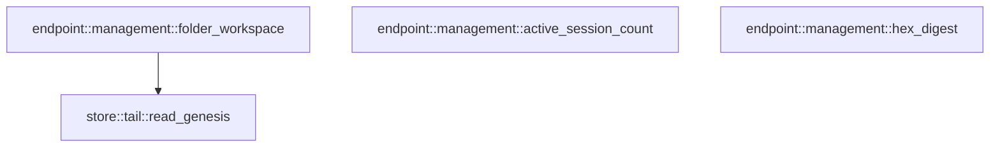

```mermaid
flowchart TD
  n0["endpoint::management::is_hex_digest"]
  n1["endpoint::management::read_canonical"]
  n2["endpoint::management::to_ijson"]
  n3["endpoint::management::intent_kind"]
  n4["endpoint::management::discard_intent"]
  n5["endpoint::management::folder_is_ephemeral"]
  n6["endpoint::management::folder_move_intent"]
  n7["endpoint::management::session_create_intent"]
  n8["endpoint::management::select_model_intent"]
  n9["endpoint::management::fork_intent"]
  n10["endpoint::management::queue_transaction_intent"]
  n11["endpoint::management::pending_queue_transaction"]
  n12["endpoint::management::verify_queue_payload"]
  n13["endpoint::management::completion_for_decision"]
  n14["endpoint::management::queue_completion_value"]
  n15["endpoint::management::queue_completion_from_record"]
  n16["endpoint::management::operation_target_session"]
  n17["endpoint::management::is_uid_principal"]
  n18["endpoint::management::fork_id_from_response"]
  n19["endpoint::management::selected_model_from_response"]
  n20["endpoint::management::active_session_folder"]
  n21["endpoint::management::valid_folder_projection"]
  n22["endpoint::management::folder_reservation"]
  n23["endpoint::management::verify_folder_reservation"]
  n24["endpoint::types::validate_session_id"]
  n25["store::tail::read_ledger_repaired"]
  n26["store::tail::read_genesis"]
  n4 --> n24
  n5 --> n26
  n7 --> n0
  n7 --> n24
  n8 --> n24
  n9 --> n17
  n9 --> n24
  n10 --> n24
  n11 --> n10
  n12 --> n1
  n14 --> n2
  n15 --> n10
  n15 --> n14
  n16 --> n3
  n16 --> n6
  n16 --> n7
  n16 --> n8
  n16 --> n9
  n16 --> n10
  n21 --> n25
  n22 --> n25
  n23 --> n22
```

# endpoint::management

[Package atlas](index.md) · [Source](../../src/management.rs)

## Declarations

Visibility is the declaration spelling; trait members and reexports require their enclosing interface. `cfg` is not evaluated.

| Symbol | Kind | Visibility | Test / cfg |
|---|---|---|---|
| [endpoint::management::VERSION](../../src/management.rs#L28) | const_item | `private` |  |
| [endpoint::management::WorkspaceView](../../src/management.rs#L32) | struct_item | `pub` |  |
| [endpoint::management::WorkspaceFolderView](../../src/management.rs#L44) | struct_item | `pub` |  |
| [endpoint::management::WorkspaceFolders](../../src/management.rs#L52) | struct_item | `pub` |  |
| [endpoint::management::WorkspaceList](../../src/management.rs#L59) | struct_item | `pub` |  |
| [endpoint::management::WorkspaceMetadata](../../src/management.rs#L66) | struct_item | `private` |  |
| [endpoint::management::OperationPhase](../../src/management.rs#L77) | enum_item | `private` |  |
| [endpoint::management::WorkspaceIntent](../../src/management.rs#L87) | struct_item | `private` |  |
| [endpoint::management::FolderMoveIntent](../../src/management.rs#L108) | struct_item | `private` |  |
| [endpoint::management::DiscardIntent](../../src/management.rs#L120) | struct_item | `private` |  |
| [endpoint::management::SessionCreateIntent](../../src/management.rs#L129) | struct_item | `private` |  |
| [endpoint::management::SelectModelIntent](../../src/management.rs#L144) | struct_item | `private` |  |
| [endpoint::management::ForkIntent](../../src/management.rs#L157) | struct_item | `private` |  |
| [endpoint::management::QueueTransactionIntent](../../src/management.rs#L172) | struct_item | `private` |  |
| [endpoint::management::QueueTailSnapshot](../../src/management.rs#L185) | struct_item | `private` |  |
| [endpoint::management::ORIGIN_CLIENT](../../src/management.rs#L193) | const_item | `pub` |  |
| [endpoint::management::LEGACY_ORIGIN_CLIENT](../../src/management.rs#L196) | const_item | `pub` |  |
| [endpoint::management::is_endpoint_origin_client](../../src/management.rs#L199) | function_item | `pub` |  |
| [endpoint::management::OperationRecord](../../src/management.rs#L205) | struct_item | `private` |  |
| [endpoint::management::WorkspaceOperationWrite](../../src/management.rs#L217) | struct_item | `private` |  |
| [endpoint::management::SessionCreateOperation](../../src/management.rs#L230) | struct_item | `pub` |  |
| [endpoint::management::SelectModelOperation](../../src/management.rs#L242) | struct_item | `pub` |  |
| [endpoint::management::ForkSessionOperation](../../src/management.rs#L252) | struct_item | `pub` |  |
| [endpoint::management::ForkLineage](../../src/management.rs#L265) | struct_item | `pub` |  |
| [endpoint::management::QueueTransactionOperation](../../src/management.rs#L270) | struct_item | `pub` |  |
| [endpoint::management::PendingQueueTransaction](../../src/management.rs#L283) | struct_item | `pub` |  |
| [endpoint::management::QueueTransactionDecision](../../src/management.rs#L294) | enum_item | `pub` |  |
| [endpoint::management::QueueTransactionCompletion](../../src/management.rs#L303) | enum_item | `pub` |  |
| [endpoint::management::QueueTransactionState](../../src/management.rs#L312) | enum_item | `pub` |  |
| [endpoint::management::QueueRecoveryDriver](../../src/management.rs#L317) | trait_item | `pub` |  |
| [endpoint::management::QueueRecoveryDriver::execute](../../src/management.rs#L318) | function_signature_item | `private` |  |
| [endpoint::management::SelectedModel](../../src/management.rs#L325) | struct_item | `pub` |  |
| [endpoint::management::CompleteOperations](../../src/management.rs#L334) | struct_item | `pub` |  |
| [endpoint::management::file_identity](../../src/management.rs#L338) | function_item | `private` |  |
| [endpoint::management::ManagementStore](../../src/management.rs#L344) | struct_item | `pub` |  |
| [endpoint::management::ManagementStore::open_at](../../src/management.rs#L355) | function_item | `pub(crate)` | test; #[cfg(test)] |
| [endpoint::management::ManagementStore::open_at_with_queue_driver](../../src/management.rs#L362) | function_item | `pub` |  |
| [endpoint::management::ManagementStore::open_recovering_again](../../src/management.rs#L373) | function_item | `pub` |  |
| [endpoint::management::ManagementStore::open_recovering](../../src/management.rs#L387) | function_item | `private` |  |
| [endpoint::management::ManagementStore::open_light](../../src/management.rs#L422) | function_item | `pub` |  |
| [endpoint::management::ManagementStore::open_light_at](../../src/management.rs#L426) | function_item | `pub` |  |
| [endpoint::management::ManagementStore::heal_workspace_metadata_locked](../../src/management.rs#L457) | function_item | `private` |  |
| [endpoint::management::ManagementStore::lock_exclusive](../../src/management.rs#L494) | function_item | `pub` |  |
| [endpoint::management::ManagementStore::root](../../src/management.rs#L501) | function_item | `pub` |  |
| [endpoint::management::ManagementStore::recover](../../src/management.rs#L506) | function_item | `pub` |  |
| [endpoint::management::ManagementStore::recover_with_queue_driver](../../src/management.rs#L510) | function_item | `pub` |  |
| [endpoint::management::ManagementStore::recover_skipping](../../src/management.rs#L517) | function_item | `private` |  |
| [endpoint::management::ManagementStore::recover_record](../../src/management.rs#L542) | function_item | `private` |  |
| [endpoint::management::ManagementStore::quarantine_corrupt_workspace](../../src/management.rs#L684) | function_item | `private` |  |
| [endpoint::management::ManagementStore::quarantine_operation](../../src/management.rs#L701) | function_item | `private` |  |
| [endpoint::management::ManagementStore::seed_missing_workspace_policies](../../src/management.rs#L750) | function_item | `private` |  |
| [endpoint::management::ManagementStore::reconcile_workspace_metadata](../../src/management.rs#L772) | function_item | `private` |  |
| [endpoint::management::ManagementStore::list_workspaces](../../src/management.rs#L777) | function_item | `pub` |  |
| [endpoint::management::ManagementStore::workspace_paths](../../src/management.rs#L839) | function_item | `pub` |  |
| [endpoint::management::ManagementStore::workspace_path](../../src/management.rs#L849) | function_item | `pub` |  |
| [endpoint::management::ManagementStore::create_session](../../src/management.rs#L862) | function_item | `pub` |  |
| [endpoint::management::ManagementStore::select_model](../../src/management.rs#L986) | function_item | `pub` |  |
| [endpoint::management::ManagementStore::fork_session](../../src/management.rs#L1068) | function_item | `pub` |  |
| [endpoint::management::ManagementStore::prepare_queue_transaction](../../src/management.rs#L1152) | function_item | `pub` |  |
| [endpoint::management::ManagementStore::complete_queue_transaction](../../src/management.rs#L1253) | function_item | `pub` |  |
| [endpoint::management::ManagementStore::has_incomplete_session_operation](../../src/management.rs#L1269) | function_item | `pub` |  |
| [endpoint::management::ManagementStore::completed_fork_lineage](../../src/management.rs#L1286) | function_item | `pub` |  |
| [endpoint::management::ManagementStore::create_workspace](../../src/management.rs#L1307) | function_item | `pub` |  |
| [endpoint::management::ManagementStore::rename_workspace](../../src/management.rs#L1381) | function_item | `pub` |  |
| [endpoint::management::ManagementStore::relocate_workspace](../../src/management.rs#L1427) | function_item | `pub` |  |
| [endpoint::management::ManagementStore::workspace_folders](../../src/management.rs#L1502) | function_item | `pub` |  |
| [endpoint::management::ManagementStore::add_workspace_folder](../../src/management.rs#L1517) | function_item | `pub` |  |
| [endpoint::management::ManagementStore::remove_workspace_folder](../../src/management.rs#L1578) | function_item | `pub` |  |
| [endpoint::management::ManagementStore::resume_folder_operation](../../src/management.rs#L1636) | function_item | `private` |  |
| [endpoint::management::ManagementStore::drive_folder_operation](../../src/management.rs#L1660) | function_item | `private` |  |
| [endpoint::management::ManagementStore::workspace_session_bindings](../../src/management.rs#L1670) | function_item | `private` |  |
| [endpoint::management::ManagementStore::archive_session](../../src/management.rs#L1731) | function_item | `pub` |  |
| [endpoint::management::ManagementStore::unarchive_session](../../src/management.rs#L1761) | function_item | `pub` |  |
| [endpoint::management::ManagementStore::discard_session](../../src/management.rs#L1782) | function_item | `pub` |  |
| [endpoint::management::ManagementStore::drive_discard](../../src/management.rs#L1843) | function_item | `private` |  |
| [endpoint::management::ManagementStore::folder_move](../../src/management.rs#L1898) | function_item | `private` |  |
| [endpoint::management::ManagementStore::begin_workspace_operation](../../src/management.rs#L1974) | function_item | `private` |  |
| [endpoint::management::ManagementStore::drive_workspace_operation](../../src/management.rs#L2031) | function_item | `private` |  |
| [endpoint::management::ManagementStore::workspace_configs](../../src/management.rs#L2138) | function_item | `private` |  |
| [endpoint::management::ManagementStore::operation_created](../../src/management.rs#L2150) | function_item | `private` |  |
| [endpoint::management::ManagementStore::rebuild_candidate](../../src/management.rs#L2184) | function_item | `private` |  |
| [endpoint::management::ManagementStore::drive_session_create](../../src/management.rs#L2309) | function_item | `private` |  |
| [endpoint::management::ManagementStore::session_id_from_response](../../src/management.rs#L2377) | function_item | `private` |  |
| [endpoint::management::ManagementStore::drive_select_model](../../src/management.rs#L2391) | function_item | `private` |  |
| [endpoint::management::ManagementStore::fork_was_quarantined](../../src/management.rs#L2457) | function_item | `private` |  |
| [endpoint::management::ManagementStore::drive_fork](../../src/management.rs#L2486) | function_item | `private` |  |
| [endpoint::management::ManagementStore::drive_queue_completion](../../src/management.rs#L2565) | function_item | `private` |  |
| [endpoint::management::ManagementStore::remove_recordless_payloads](../../src/management.rs#L2624) | function_item | `private` |  |
| [endpoint::management::ManagementStore::remove_recordless_payload](../../src/management.rs#L2651) | function_item | `private` |  |
| [endpoint::management::ManagementStore::drive_folder_move](../../src/management.rs#L2670) | function_item | `private` |  |
| [endpoint::management::ManagementStore::operation_paths](../../src/management.rs#L2740) | function_item | `private` |  |
| [endpoint::management::ManagementStore::operation_path](../../src/management.rs#L2760) | function_item | `private` |  |
| [endpoint::management::ManagementStore::operation_payload_path](../../src/management.rs#L2768) | function_item | `private` |  |
| [endpoint::management::ManagementStore::metadata_path](../../src/management.rs#L2777) | function_item | `private` |  |
| [endpoint::management::ManagementStore::read_metadata](../../src/management.rs#L2783) | function_item | `private` |  |
| [endpoint::management::ManagementStore::read_metadata_optional](../../src/management.rs#L2791) | function_item | `private` |  |
| [endpoint::management::primary_path](../../src/management.rs#L2804) | function_item | `private` |  |
| [endpoint::management::binding_for_path](../../src/management.rs#L2813) | function_item | `private` |  |
| [endpoint::management::binding_for_canonical_path](../../src/management.rs#L2819) | function_item | `private` |  |
| [endpoint::management::execution_path_from_snapshot](../../src/management.rs#L2834) | function_item | `private` |  |
| [endpoint::management::folder_binding_matches_snapshot](../../src/management.rs#L2840) | function_item | `private` |  |
| [endpoint::management::resolve_session_workspace](../../src/management.rs#L2844) | function_item | `private` |  |
| [endpoint::management::existing_session_cwd](../../src/management.rs#L2906) | function_item | `private` |  |
| [endpoint::management::create_genesis](../../src/management.rs#L2927) | function_item | `private` |  |
| [endpoint::management::canonical_event_line](../../src/management.rs#L2958) | function_item | `private` |  |
| [endpoint::management::read_canonical_event](../../src/management.rs#L2964) | function_item | `private` |  |
| [endpoint::management::verify_session_create_genesis](../../src/management.rs#L2975) | function_item | `private` |  |
| [endpoint::management::copy_payload_tree](../../src/management.rs#L3021) | function_item | `private` |  |
| [endpoint::management::sync_operation_payload](../../src/management.rs#L3042) | function_item | `private` |  |
| [endpoint::management::is_hex_digest](../../src/management.rs#L3055) | function_item | `private` |  |
| [endpoint::management::default_workspace_policy](../../src/management.rs#L3069) | function_item | `pub` |  |
| [endpoint::management::relocate_policy_roots](../../src/management.rs#L3083) | function_item | `private` |  |
| [endpoint::management::materialized_folders](../../src/management.rs#L3108) | function_item | `private` |  |
| [endpoint::management::next_folder_id](../../src/management.rs#L3124) | function_item | `private` |  |
| [endpoint::management::with_added_folder](../../src/management.rs#L3135) | function_item | `private` |  |
| [endpoint::management::with_removed_folder](../../src/management.rs#L3159) | function_item | `private` |  |
| [endpoint::management::folders_view](../../src/management.rs#L3192) | function_item | `private` |  |
| [endpoint::management::folder_response](../../src/management.rs#L3206) | function_item | `private` |  |
| [endpoint::management::canonical_workspace_path](../../src/management.rs#L3218) | function_item | `private` |  |
| [endpoint::management::unavailable_absolute_path](../../src/management.rs#L3227) | function_item | `private` |  |
| [endpoint::management::allocate_uuid_v7](../../src/management.rs#L3232) | function_item | `private` |  |
| [endpoint::management::current_timestamp](../../src/management.rs#L3251) | function_item | `private` |  |
| [endpoint::management::validate_title](../../src/management.rs#L3260) | function_item | `private` |  |
| [endpoint::management::ensure_unique_title](../../src/management.rs#L3272) | function_item | `private` |  |
| [endpoint::management::verify_metadata](../../src/management.rs#L3286) | function_item | `private` |  |
| [endpoint::management::workspace_view](../../src/management.rs#L3304) | function_item | `private` |  |
| [endpoint::management::timestamp_from_millis](../../src/management.rs#L3330) | function_item | `private` |  |
| [endpoint::management::publish_canonical](../../src/management.rs#L3354) | function_item | `private` |  |
| [endpoint::management::read_canonical](../../src/management.rs#L3359) | function_item | `private` |  |
| [endpoint::management::decode_canonical](../../src/management.rs#L3363) | function_item | `private` |  |
| [endpoint::management::canonical_line](../../src/management.rs#L3384) | function_item | `private` |  |
| [endpoint::management::to_ijson](../../src/management.rs#L3391) | function_item | `private` |  |
| [endpoint::management::intent_kind](../../src/management.rs#L3399) | function_item | `private` |  |
| [endpoint::management::workspace_intent](../../src/management.rs#L3410) | function_item | `private` |  |
| [endpoint::management::discard_intent](../../src/management.rs#L3442) | function_item | `private` |  |
| [endpoint::management::folder_is_ephemeral](../../src/management.rs#L3454) | function_item | `private` |  |
| [endpoint::management::folder_move_intent](../../src/management.rs#L3460) | function_item | `private` |  |
| [endpoint::management::session_create_intent](../../src/management.rs#L3471) | function_item | `private` |  |
| [endpoint::management::select_model_intent](../../src/management.rs#L3496) | function_item | `private` |  |
| [endpoint::management::fork_intent](../../src/management.rs#L3516) | function_item | `private` |  |
| [endpoint::management::queue_transaction_intent](../../src/management.rs#L3533) | function_item | `private` |  |
| [endpoint::management::pending_queue_transaction](../../src/management.rs#L3561) | function_item | `private` |  |
| [endpoint::management::verify_queue_payload](../../src/management.rs#L3576) | function_item | `private` |  |
| [endpoint::management::completion_for_decision](../../src/management.rs#L3611) | function_item | `private` |  |
| [endpoint::management::queue_completion_value](../../src/management.rs#L3623) | function_item | `private` |  |
| [endpoint::management::queue_completion_from_record](../../src/management.rs#L3661) | function_item | `private` |  |
| [endpoint::management::operation_target_session](../../src/management.rs#L3708) | function_item | `private` |  |
| [endpoint::management::is_uid_principal](../../src/management.rs#L3724) | function_item | `private` |  |
| [endpoint::management::fork_id_from_response](../../src/management.rs#L3730) | function_item | `private` |  |
| [endpoint::management::selected_model_from_response](../../src/management.rs#L3742) | function_item | `private` |  |
| [endpoint::management::active_session_folder](../../src/management.rs#L3780) | function_item | `private` |  |
| [endpoint::management::valid_folder_projection](../../src/management.rs#L3791) | function_item | `private` |  |
| [endpoint::management::folder_reservation](../../src/management.rs#L3804) | function_item | `private` |  |
| [endpoint::management::verify_folder_reservation](../../src/management.rs#L3821) | function_item | `private` |  |
| [endpoint::management::folder_workspace](../../src/management.rs#L3834) | function_item | `private` |  |
| [endpoint::management::active_session_count](../../src/management.rs#L3846) | function_item | `private` |  |
| [endpoint::management::hex_digest](../../src/management.rs#L3856) | function_item | `private` |  |
| [endpoint::management::ManagementError](../../src/management.rs#L3861) | enum_item | `pub` |  |
| [endpoint::management::tests::omitted_identity_is_auto_but_explicit_and_legacy_identity_stay_fixed](../../src/management.rs#L3956) | function_item | `private` | test; #[cfg(test)] |
| [endpoint::management::tests::legacy_session_create_without_folder_binding_remains_recoverable](../../src/management.rs#L3989) | function_item | `private` | test; #[cfg(test)] |
| [endpoint::management::tests::quarantined_fork_does_not_block_recovery_or_claim_success](../../src/management.rs#L4004) | function_item | `private` | test; #[cfg(test)] |
| [endpoint::management::tests::open_light_heals_metadata_after_any_config_writer_without_reading_threads](../../src/management.rs#L4078) | function_item | `private` | test; #[cfg(test)] |
| [endpoint::management::tests::unavailable_workspace_keeps_its_management_operation_pending](../../src/management.rs#L4167) | function_item | `private` | test; #[cfg(test)] |
| [endpoint::management::tests::a_select_model_payload_staged_before_the_rename_is_read_on_recovery](../../src/management.rs#L4206) | function_item | `private` | test; #[cfg(test)] |
| [endpoint::management::tests::a_created_workspace_starts_with_the_interactive_fixed_catalog_writable_in_its_folder](../../src/management.rs#L4274) | function_item | `private` | test; #[cfg(test)] |
| [endpoint::management::tests::opening_the_store_seeds_a_policy_for_a_policy_less_workspace_once](../../src/management.rs#L4318) | function_item | `private` | test; #[cfg(test)] |
| [endpoint::management::tests::relocation_moves_writable_roots_with_their_folder](../../src/management.rs#L4366) | function_item | `private` | test; #[cfg(test)] |
| [endpoint::management::tests::folder_store](../../src/management.rs#L4401) | function_item | `private` | test; #[cfg(test)] |
| [endpoint::management::tests::sibling](../../src/management.rs#L4418) | function_item | `private` | test; #[cfg(test)] |
| [endpoint::management::tests::write_session](../../src/management.rs#L4429) | function_item | `private` | test; #[cfg(test)] |
| [endpoint::management::tests::folders_are_added_listed_and_removed_with_their_writable_roots](../../src/management.rs#L4470) | function_item | `private` | test; #[cfg(test)] |
| [endpoint::management::tests::a_folder_bound_to_a_session_is_not_removed](../../src/management.rs#L4585) | function_item | `private` | test; #[cfg(test)] |
| [endpoint::management::tests::a_legacy_unbound_session_blocks_a_second_folder](../../src/management.rs#L4631) | function_item | `private` | test; #[cfg(test)] |
| [endpoint::management::tests::folder_edits_materialize_a_legacy_cwd_workspace_with_its_synthesized_ids](../../src/management.rs#L4659) | function_item | `private` | test; #[cfg(test)] |
| [endpoint::management::tests::completed_workspace_operation_never_reopens_its_old_path](../../src/management.rs#L4691) | function_item | `private` | test; #[cfg(test)] |
| [endpoint::management::k1_management_race::BOOT](../../src/management.rs#L4722) | const_item | `private` | test; #[cfg(test)] |
| [endpoint::management::k1_management_race::TICK](../../src/management.rs#L4723) | const_item | `private` | test; #[cfg(test)] |
| [endpoint::management::k1_management_race::LATER](../../src/management.rs#L4724) | const_item | `private` | test; #[cfg(test)] |
| [endpoint::management::k1_management_race::WORKSPACE](../../src/management.rs#L4725) | const_item | `private` | test; #[cfg(test)] |
| [endpoint::management::k1_management_race::fixture](../../src/management.rs#L4727) | function_item | `private` | test; #[cfg(test)] |
| [endpoint::management::k1_management_race::policy_with](../../src/management.rs#L4752) | function_item | `private` | test; #[cfg(test)] |
| [endpoint::management::k1_management_race::set_policy](../../src/management.rs#L4758) | function_item | `private` | test; #[cfg(test)] |
| [endpoint::management::k1_management_race::quarantine_root](../../src/management.rs#L4765) | function_item | `private` | test; #[cfg(test)] |
| [endpoint::management::k1_management_race::stale_metadata](../../src/management.rs#L4771) | function_item | `private` | test; #[cfg(test)] |
| [endpoint::management::k1_management_race::metadata_matches](../../src/management.rs#L4778) | function_item | `private` | test; #[cfg(test)] |
| [endpoint::management::k1_management_race::stuck_carriers_record](../../src/management.rs#L4785) | function_item | `private` | test; #[cfg(test)] |
| [endpoint::management::k1_management_race::tick_heals_stale_metadata_without_staging_an_operation](../../src/management.rs#L4819) | function_item | `private` | test; #[cfg(test)] |
| [endpoint::management::k1_management_race::tick_never_fails_while_policy_set_publishes](../../src/management.rs#L4849) | function_item | `private` | test; #[cfg(test)] |
| [endpoint::management::k1_management_race::parked_synthetic_rename](../../src/management.rs#L4894) | function_item | `private` | test; #[cfg(test)] |
| [endpoint::management::k1_management_race::boot_quarantines_the_parked_carriers_record_and_succeeds](../../src/management.rs#L4943) | function_item | `private` | test; #[cfg(test)] |
| [endpoint::management::k1_management_race::record_of_another_version_is_left_in_place_not_quarantined](../../src/management.rs#L4998) | function_item | `private` | test; #[cfg(test)] |
| [endpoint::management::k1_management_race::quarantine_keeps_the_payload_and_never_redrives_the_operation](../../src/management.rs#L5020) | function_item | `private` | test; #[cfg(test)] |
| [endpoint::management::k1_management_race::complete_workspace_record_without_response_is_quarantined](../../src/management.rs#L5083) | function_item | `private` | test; #[cfg(test)] |
| [endpoint::management::k1_management_race::one_failing_record_does_not_stop_the_others_from_recovering](../../src/management.rs#L5119) | function_item | `private` | test; #[cfg(test)] |

## Imports / reexports

| Local name | Source path | Visibility |
|---|---|---|
| `BTreeMap` | `std::collections::BTreeMap` | `private` |
| `fs` | `std::fs` | `private` |
| `File` | `std::fs::File` | `private` |
| `Read` | `std::io::Read` | `private` |
| `MetadataExt` | `std::os::unix::fs::MetadataExt` | `private` |
| `Path` | `std::path::Path` | `private` |
| `PathBuf` | `std::path::PathBuf` | `private` |
| `SystemTime` | `std::time::SystemTime` | `private` |
| `UNIX_EPOCH` | `std::time::UNIX_EPOCH` | `private` |
| `ConfigRepository` | `profile::ConfigRepository` | `private` |
| `InstructionResolver` | `profile::InstructionResolver` | `private` |
| `WorkspaceConfig` | `profile::WorkspaceConfig` | `private` |
| `WorkspaceFolder` | `profile::WorkspaceFolder` | `private` |
| `WorkspacePolicy` | `profile::WorkspacePolicy` | `private` |
| `Event` | `schema::Event` | `private` |
| `IJsonValue` | `schema::IJsonValue` | `private` |
| `OriginTuple` | `schema::OriginTuple` | `private` |
| `ResumePolicy` | `schema::ResumePolicy` | `private` |
| `Deserialize` | `serde::Deserialize` | `private` |
| `Serialize` | `serde::Serialize` | `private` |
| `Value` | `serde_json::Value` | `private` |
| `json` | `serde_json::json` | `private` |
| `Digest` | `sha2::Digest` | `private` |
| `Sha256` | `sha2::Sha256` | `private` |
| `AssetStore` | `store::AssetStore` | `private` |
| `AtomicPublisher` | `store::AtomicPublisher` | `private` |
| `DirectoryLock` | `store::DirectoryLock` | `private` |
| `NamedLock` | `store::NamedLock` | `private` |
| `ThreadStore` | `store::ThreadStore` | `private` |
| `scan_valid_prefix` | `store::scan_valid_prefix` | `private` |
| `Error` | `thiserror::Error` | `private` |
| `Uuid` | `uuid::Uuid` | `private` |
| `SessionInventoryItem` | `crate::SessionInventoryItem` | `private` |
| `ForkIntent` | `super::ForkIntent` | `private` |
| `ManagementError` | `super::ManagementError` | `private` |
| `ManagementStore` | `super::ManagementStore` | `private` |
| `OperationPhase` | `super::OperationPhase` | `private` |
| `OperationRecord` | `super::OperationRecord` | `private` |
| `VERSION` | `super::VERSION` | `private` |
| `WorkspaceMetadata` | `super::WorkspaceMetadata` | `private` |
| `WorkspaceOperationWrite` | `super::WorkspaceOperationWrite` | `private` |
| `WorkspaceView` | `super::WorkspaceView` | `private` |
| `canonical_event_line` | `super::canonical_event_line` | `private` |
| `create_genesis` | `super::create_genesis` | `private` |
| `default_workspace_policy` | `super::default_workspace_policy` | `private` |
| `folder_binding_matches_snapshot` | `super::folder_binding_matches_snapshot` | `private` |
| `publish_canonical` | `super::publish_canonical` | `private` |
| `read_canonical` | `super::read_canonical` | `private` |
| `to_ijson` | `super::to_ijson` | `private` |
| `SessionInventoryItem` | `crate::SessionInventoryItem` | `private` |
| `ConfigRepository` | `profile::ConfigRepository` | `private` |
| `WorkspaceConfig` | `profile::WorkspaceConfig` | `private` |
| `WorkspaceFolder` | `profile::WorkspaceFolder` | `private` |
| `Value` | `serde_json::Value` | `private` |
| `json` | `serde_json::json` | `private` |
| `fs` | `std::fs` | `private` |
| `Path` | `std::path::Path` | `private` |
| `ThreadStore` | `store::ThreadStore` | `private` |
| `*` | `super::*` | `private` |
| `ConfigRepository` | `profile::ConfigRepository` | `private` |
| `WorkspaceConfig` | `profile::WorkspaceConfig` | `private` |
| `WorkspaceFolder` | `profile::WorkspaceFolder` | `private` |
| `Arc` | `std::sync::Arc` | `private` |
| `AtomicBool` | `std::sync::atomic::AtomicBool` | `private` |
| `Ordering` | `std::sync::atomic::Ordering` | `private` |

## Module declarations

| Module | Visibility | Attributes |
|---|---|---|
| `endpoint::management::tests` | `private` | #[cfg(test)] |
| `endpoint::management::k1_management_race` | `private` | #[cfg(test)] |

## Function call graphs

Edges below are syntactically resolved calls only, including private functions. Graphs partition callers into groups of 20; they are not execution order. All unresolved sites are listed below and in the JSON inventory.

Functions 1–20: 72 direct edges

Functions 21–40: 150 direct edges

Functions 41–60: 107 direct edges

Functions 61–80: 16 direct edges

Functions 81–100: 14 direct edges

Functions 101–120: 22 direct edges

Functions 121–123: 1 direct edges

## Call sites

Includes test functions (marked in declarations). Receiver-type-required sites need type analysis/manual tracing. Calls in closures are attributed to their enclosing function; their occurrence here does not mean the closure executes immediately.

| Caller | Callee expression | Source lines | Target / classification |
|---|---|---|---|
| `file_identity` | `fs::metadata(path).ok` | [339](../../src/management.rs#L339) | receiver-type-required |
| `file_identity` | `fs::metadata` | [339](../../src/management.rs#L339) | external-constructor-callback-or-unresolved |
| `file_identity` | `Some` | [340](../../src/management.rs#L340) | external-constructor-callback-or-unresolved |
| `file_identity` | `metadata.len` | [340](../../src/management.rs#L340) | receiver-type-required |
| `file_identity` | `metadata.modified().ok` | [340](../../src/management.rs#L340) | receiver-type-required |
| `file_identity` | `metadata.modified` | [340](../../src/management.rs#L340) | receiver-type-required |
| `open_at` | `Self::open_at_with_queue_driver` | [359](../../src/management.rs#L359) | [endpoint::management::ManagementStore::open_at_with_queue_driver](../../src/management.rs#L362) |
| `open_at_with_queue_driver` | `Self::open_recovering` | [367](../../src/management.rs#L367) | [endpoint::management::ManagementStore::open_recovering](../../src/management.rs#L387) |
| `open_recovering_again` | `Self::open_recovering` | [379](../../src/management.rs#L379) | [endpoint::management::ManagementStore::open_recovering](../../src/management.rs#L387) |
| `open_recovering_again` | `Some` | [383](../../src/management.rs#L383) | external-constructor-callback-or-unresolved |
| `open_recovering` | `storage_root.as_ref().to_path_buf` | [393](../../src/management.rs#L393) | receiver-type-required |
| `open_recovering` | `storage_root.as_ref` | [393](../../src/management.rs#L393) | receiver-type-required |
| `open_recovering` | `ThreadStore::open` | [394](../../src/management.rs#L394) | [store::folder::ThreadStore::open](../../../store/src/folder.rs#L36) |
| `open_recovering` | `store::endpoint_management_root` | [395](../../src/management.rs#L395) | [store::management_root::endpoint_management_root](../../../store/src/management_root.rs#L47) |
| `open_recovering` | `fs::create_dir_all` | [396](../../src/management.rs#L396), [397](../../src/management.rs#L397) | external-constructor-callback-or-unresolved |
| `open_recovering` | `root.join` | [396](../../src/management.rs#L396), [397](../../src/management.rs#L397), [401](../../src/management.rs#L401) | receiver-type-required |
| `open_recovering` | `fs::OpenOptions::new()             .create(true)             .append(true)             .open` | [398](../../src/management.rs#L398) | receiver-type-required |
| `open_recovering` | `fs::OpenOptions::new()             .create(true)             .append` | [398](../../src/management.rs#L398) | receiver-type-required |
| `open_recovering` | `fs::OpenOptions::new()             .create` | [398](../../src/management.rs#L398) | receiver-type-required |
| `open_recovering` | `fs::OpenOptions::new` | [398](../../src/management.rs#L398) | external-constructor-callback-or-unresolved |
| `open_recovering` | `ConfigRepository::open` | [403](../../src/management.rs#L403) | [profile::config::ConfigRepository::open](../../../profile/src/config.rs#L684) |
| `open_recovering` | `store.recover_skipping` | [407](../../src/management.rs#L407) | receiver-type-required |
| `open_recovering` | `store.seed_missing_workspace_policies` | [408](../../src/management.rs#L408) | receiver-type-required |
| `open_recovering` | `store.reconcile_workspace_metadata` | [409](../../src/management.rs#L409) | receiver-type-required |
| `open_recovering` | `Ok` | [413](../../src/management.rs#L413) | external-constructor-callback-or-unresolved |
| `open_light` | `Self::open_light_at` | [423](../../src/management.rs#L423) | [endpoint::management::ManagementStore::open_light_at](../../src/management.rs#L426) |
| `open_light` | `current_timestamp` | [423](../../src/management.rs#L423) | [endpoint::management::current_timestamp](../../src/management.rs#L3251) |
| `open_light_at` | `storage_root.as_ref().to_path_buf` | [430](../../src/management.rs#L430) | receiver-type-required |
| `open_light_at` | `storage_root.as_ref` | [430](../../src/management.rs#L430) | receiver-type-required |
| `open_light_at` | `store::endpoint_management_root` | [431](../../src/management.rs#L431) | [store::management_root::endpoint_management_root](../../../store/src/management_root.rs#L47) |
| `open_light_at` | `fs::create_dir_all` | [432](../../src/management.rs#L432), [433](../../src/management.rs#L433) | external-constructor-callback-or-unresolved |
| `open_light_at` | `root.join` | [432](../../src/management.rs#L432), [433](../../src/management.rs#L433), [437](../../src/management.rs#L437) | receiver-type-required |
| `open_light_at` | `fs::OpenOptions::new()             .create(true)             .append(true)             .open` | [434](../../src/management.rs#L434) | receiver-type-required |
| `open_light_at` | `fs::OpenOptions::new()             .create(true)             .append` | [434](../../src/management.rs#L434) | receiver-type-required |
| `open_light_at` | `fs::OpenOptions::new()             .create` | [434](../../src/management.rs#L434) | receiver-type-required |
| `open_light_at` | `fs::OpenOptions::new` | [434](../../src/management.rs#L434) | external-constructor-callback-or-unresolved |
| `open_light_at` | `ConfigRepository::open` | [439](../../src/management.rs#L439) | [profile::config::ConfigRepository::open](../../../profile/src/config.rs#L684) |
| `open_light_at` | `NamedLock::exclusive` | [443](../../src/management.rs#L443) | [store::platform::NamedLock::exclusive](../../../store/src/platform.rs#L103) |
| `open_light_at` | `store.root.join` | [443](../../src/management.rs#L443) | receiver-type-required |
| `open_light_at` | `store.heal_workspace_metadata_locked` | [444](../../src/management.rs#L444) | receiver-type-required |
| `open_light_at` | `drop` | [445](../../src/management.rs#L445) | external-constructor-callback-or-unresolved |
| `open_light_at` | `Ok` | [446](../../src/management.rs#L446) | external-constructor-callback-or-unresolved |
| `heal_workspace_metadata_locked` | `NamedLock::shared` | [458](../../src/management.rs#L458) | [store::platform::NamedLock::shared](../../../store/src/platform.rs#L99) |
| `heal_workspace_metadata_locked` | `self.storage_root.join` | [458](../../src/management.rs#L458) | receiver-type-required |
| `heal_workspace_metadata_locked` | `self.workspace_configs()?.into_values` | [459](../../src/management.rs#L459) | receiver-type-required |
| `heal_workspace_metadata_locked` | `self.workspace_configs` | [459](../../src/management.rs#L459) | [endpoint::management::ManagementStore::workspace_configs](../../src/management.rs#L2138) |
| `heal_workspace_metadata_locked` | `primary_path(&config).map` | [461](../../src/management.rs#L461) | receiver-type-required |
| `heal_workspace_metadata_locked` | `primary_path` | [461](../../src/management.rs#L461) | [endpoint::management::primary_path](../../src/management.rs#L2804) |
| `heal_workspace_metadata_locked` | `self.read_metadata_optional` | [468](../../src/management.rs#L468) | [endpoint::management::ManagementStore::read_metadata_optional](../../src/management.rs#L2791) |
| `heal_workspace_metadata_locked` | `existing                 .as_ref()                 .is_some_and` | [469](../../src/management.rs#L469) | receiver-type-required |
| `heal_workspace_metadata_locked` | `existing                 .as_ref` | [469](../../src/management.rs#L469) | receiver-type-required |
| `heal_workspace_metadata_locked` | `verify_metadata(&config, metadata).is_ok` | [471](../../src/management.rs#L471) | receiver-type-required |
| `heal_workspace_metadata_locked` | `verify_metadata` | [471](../../src/management.rs#L471) | [endpoint::management::verify_metadata](../../src/management.rs#L3286) |
| `heal_workspace_metadata_locked` | `config.id.clone` | [477](../../src/management.rs#L477) | receiver-type-required |
| `heal_workspace_metadata_locked` | `existing                     .map_or_else` | [479](../../src/management.rs#L479) | receiver-type-required |
| `heal_workspace_metadata_locked` | `started_at.to_owned` | [480](../../src/management.rs#L480), [481](../../src/management.rs#L481) | receiver-type-required |
| `heal_workspace_metadata_locked` | `hex_digest` | [482](../../src/management.rs#L482) | [endpoint::management::hex_digest](../../src/management.rs#L3856) |
| `heal_workspace_metadata_locked` | `canonical_line` | [482](../../src/management.rs#L482) | [endpoint::management::canonical_line](../../src/management.rs#L3384) |
| `heal_workspace_metadata_locked` | `publish_canonical` | [484](../../src/management.rs#L484) | [endpoint::management::publish_canonical](../../src/management.rs#L3354) |
| `heal_workspace_metadata_locked` | `self.metadata_path` | [484](../../src/management.rs#L484) | [endpoint::management::ManagementStore::metadata_path](../../src/management.rs#L2777) |
| `heal_workspace_metadata_locked` | `Ok` | [486](../../src/management.rs#L486) | external-constructor-callback-or-unresolved |
| `lock_exclusive` | `store::endpoint_management_root` | [495](../../src/management.rs#L495) | [store::management_root::endpoint_management_root](../../../store/src/management_root.rs#L47) |
| `lock_exclusive` | `storage_root.as_ref` | [495](../../src/management.rs#L495) | receiver-type-required |
| `lock_exclusive` | `fs::create_dir_all` | [496](../../src/management.rs#L496) | external-constructor-callback-or-unresolved |
| `lock_exclusive` | `Ok` | [497](../../src/management.rs#L497) | external-constructor-callback-or-unresolved |
| `lock_exclusive` | `NamedLock::exclusive` | [497](../../src/management.rs#L497) | [store::platform::NamedLock::exclusive](../../../store/src/platform.rs#L103) |
| `lock_exclusive` | `root.join` | [497](../../src/management.rs#L497) | receiver-type-required |
| `recover` | `self.recover_with_queue_driver` | [507](../../src/management.rs#L507) | [endpoint::management::ManagementStore::recover_with_queue_driver](../../src/management.rs#L510) |
| `recover_with_queue_driver` | `self.recover_skipping` | [514](../../src/management.rs#L514) | [endpoint::management::ManagementStore::recover_skipping](../../src/management.rs#L517) |
| `recover_skipping` | `NamedLock::exclusive` | [526](../../src/management.rs#L526) | [store::platform::NamedLock::exclusive](../../../store/src/platform.rs#L103) |
| `recover_skipping` | `self.root.join` | [526](../../src/management.rs#L526) | receiver-type-required |
| `recover_skipping` | `self.remove_recordless_payloads` | [527](../../src/management.rs#L527) | [endpoint::management::ManagementStore::remove_recordless_payloads](../../src/management.rs#L2624) |
| `recover_skipping` | `self.operation_paths` | [528](../../src/management.rs#L528) | [endpoint::management::ManagementStore::operation_paths](../../src/management.rs#L2740) |
| `recover_skipping` | `self.recover_record` | [534](../../src/management.rs#L534) | [endpoint::management::ManagementStore::recover_record](../../src/management.rs#L542) |
| `recover_skipping` | `validated.as_deref_mut` | [534](../../src/management.rs#L534) | receiver-type-required |
| `recover_skipping` | `first_error.get_or_insert` | [535](../../src/management.rs#L535) | receiver-type-required |
| `recover_skipping` | `first_error.map_or` | [538](../../src/management.rs#L538) | receiver-type-required |
| `recover_skipping` | `Ok` | [538](../../src/management.rs#L538) | external-constructor-callback-or-unresolved |
| `recover_record` | `Some` | [548](../../src/management.rs#L548), [651](../../src/management.rs#L651) | external-constructor-callback-or-unresolved |
| `recover_record` | `NamedLock::exclusive` | [548](../../src/management.rs#L548), [651](../../src/management.rs#L651) | [store::platform::NamedLock::exclusive](../../../store/src/platform.rs#L103) |
| `recover_record` | `self.root.join` | [548](../../src/management.rs#L548), [651](../../src/management.rs#L651) | receiver-type-required |
| `recover_record` | `path.exists` | [549](../../src/management.rs#L549) | receiver-type-required |
| `recover_record` | `Ok` | [550](../../src/management.rs#L550), [555](../../src/management.rs#L555), [568](../../src/management.rs#L568), [596](../../src/management.rs#L596), [614](../../src/management.rs#L614), [636](../../src/management.rs#L636), [654](../../src/management.rs#L654), [681](../../src/management.rs#L681) | external-constructor-callback-or-unresolved |
| `recover_record` | `file_identity` | [552](../../src/management.rs#L552) | [endpoint::management::file_identity](../../src/management.rs#L338) |
| `recover_record` | `validated.as_deref` | [553](../../src/management.rs#L553) | receiver-type-required |
| `recover_record` | `identity.as_ref` | [553](../../src/management.rs#L553) | receiver-type-required |
| `recover_record` | `known.0.contains` | [554](../../src/management.rs#L554) | receiver-type-required |
| `recover_record` | `path.clone` | [554](../../src/management.rs#L554), [572](../../src/management.rs#L572) | receiver-type-required |
| `recover_record` | `read_canonical::<OperationRecord>` | [558](../../src/management.rs#L558), [652](../../src/management.rs#L652) | [endpoint::management::read_canonical](../../src/management.rs#L3359) |
| `recover_record` | `intent_kind` | [559](../../src/management.rs#L559) | [endpoint::management::intent_kind](../../src/management.rs#L3399) |
| `recover_record` | `known.0.insert` | [572](../../src/management.rs#L572) | receiver-type-required |
| `recover_record` | `kind.as_str` | [574](../../src/management.rs#L574), [616](../../src/management.rs#L616) | receiver-type-required |
| `recover_record` | `workspace_intent` | [576](../../src/management.rs#L576), [617](../../src/management.rs#L617) | [endpoint::management::workspace_intent](../../src/management.rs#L3410) |
| `recover_record` | `self.quarantine_corrupt_workspace` | [577](../../src/management.rs#L577), [609](../../src/management.rs#L609), [677](../../src/management.rs#L677) | [endpoint::management::ManagementStore::quarantine_corrupt_workspace](../../src/management.rs#L684) |
| `recover_record` | `folder_move_intent` | [581](../../src/management.rs#L581), [621](../../src/management.rs#L621) | [endpoint::management::folder_move_intent](../../src/management.rs#L3460) |
| `recover_record` | `session_create_intent` | [584](../../src/management.rs#L584), [625](../../src/management.rs#L625) | [endpoint::management::session_create_intent](../../src/management.rs#L3471) |
| `recover_record` | `select_model_intent` | [587](../../src/management.rs#L587), [629](../../src/management.rs#L629) | [endpoint::management::select_model_intent](../../src/management.rs#L3496) |
| `recover_record` | `fork_intent` | [590](../../src/management.rs#L590) | [endpoint::management::fork_intent](../../src/management.rs#L3516) |
| `recover_record` | `queue_transaction_intent` | [593](../../src/management.rs#L593), [641](../../src/management.rs#L641) | [endpoint::management::queue_transaction_intent](../../src/management.rs#L3533) |
| `recover_record` | `verify_queue_payload` | [594](../../src/management.rs#L594), [642](../../src/management.rs#L642) | [endpoint::management::verify_queue_payload](../../src/management.rs#L3576) |
| `recover_record` | `self.operation_payload_path` | [594](../../src/management.rs#L594), [642](../../src/management.rs#L642) | [endpoint::management::ManagementStore::operation_payload_path](../../src/management.rs#L2768) |
| `recover_record` | `queue_completion_from_record` | [595](../../src/management.rs#L595) | [endpoint::management::queue_completion_from_record](../../src/management.rs#L3661) |
| `recover_record` | `Err` | [599](../../src/management.rs#L599), [611](../../src/management.rs#L611), [660](../../src/management.rs#L660), [679](../../src/management.rs#L679) | external-constructor-callback-or-unresolved |
| `recover_record` | `ManagementError::CorruptOperation` | [599](../../src/management.rs#L599), [605](../../src/management.rs#L605), [660](../../src/management.rs#L660) | external-constructor-callback-or-unresolved |
| `recover_record` | `record.response.is_none` | [604](../../src/management.rs#L604) | receiver-type-required |
| `recover_record` | `"complete operation lacks response".to_owned` | [606](../../src/management.rs#L606) | receiver-type-required |
| `recover_record` | `workspace_intent(&record)                 .and_then(&#124;_&#124; self.drive_workspace_operation(&path, record))                 .map` | [617](../../src/management.rs#L617) | receiver-type-required |
| `recover_record` | `workspace_intent(&record)                 .and_then` | [617](../../src/management.rs#L617) | receiver-type-required |
| `recover_record` | `self.drive_workspace_operation` | [618](../../src/management.rs#L618) | [endpoint::management::ManagementStore::drive_workspace_operation](../../src/management.rs#L2031) |
| `recover_record` | `self.drive_folder_move(&path, record, None).map` | [622](../../src/management.rs#L622) | receiver-type-required |
| `recover_record` | `self.drive_folder_move` | [622](../../src/management.rs#L622) | [endpoint::management::ManagementStore::drive_folder_move](../../src/management.rs#L2670) |
| `recover_record` | `self.drive_session_create(&path, record).map` | [626](../../src/management.rs#L626) | receiver-type-required |
| `recover_record` | `self.drive_session_create` | [626](../../src/management.rs#L626) | [endpoint::management::ManagementStore::drive_session_create](../../src/management.rs#L2309) |
| `recover_record` | `self.drive_select_model(&path, record).map` | [630](../../src/management.rs#L630) | receiver-type-required |
| `recover_record` | `self.drive_select_model` | [630](../../src/management.rs#L630) | [endpoint::management::ManagementStore::drive_select_model](../../src/management.rs#L2391) |
| `recover_record` | `self.fork_was_quarantined` | [633](../../src/management.rs#L633) | [endpoint::management::ManagementStore::fork_was_quarantined](../../src/management.rs#L2457) |
| `recover_record` | `self.drive_fork(&path, record).map` | [638](../../src/management.rs#L638) | receiver-type-required |
| `recover_record` | `self.drive_fork` | [638](../../src/management.rs#L638) | [endpoint::management::ManagementStore::drive_fork](../../src/management.rs#L2486) |
| `recover_record` | `pending_queue_transaction` | [643](../../src/management.rs#L643) | [endpoint::management::pending_queue_transaction](../../src/management.rs#L3561) |
| `recover_record` | `queue_driver.ok_or_else` | [644](../../src/management.rs#L644) | receiver-type-required |
| `recover_record` | `ManagementError::QueueRecoveryRequired` | [645](../../src/management.rs#L645) | external-constructor-callback-or-unresolved |
| `recover_record` | `pending.session_id.clone` | [645](../../src/management.rs#L645) | receiver-type-required |
| `recover_record` | `drop` | [649](../../src/management.rs#L649) | external-constructor-callback-or-unresolved |
| `recover_record` | `lock.take` | [649](../../src/management.rs#L649) | receiver-type-required |
| `recover_record` | `driver.execute` | [650](../../src/management.rs#L650) | receiver-type-required |
| `recover_record` | `self.drive_queue_completion(&path, record, decision)                     .map` | [656](../../src/management.rs#L656) | receiver-type-required |
| `recover_record` | `self.drive_queue_completion` | [656](../../src/management.rs#L656) | [endpoint::management::ManagementStore::drive_queue_completion](../../src/management.rs#L2565) |
| `recover_record` | `unavailable_absolute_path` | [668](../../src/management.rs#L668) | [endpoint::management::unavailable_absolute_path](../../src/management.rs#L3227) |
| `quarantine_corrupt_workspace` | `self.quarantine_operation` | [690](../../src/management.rs#L690) | [endpoint::management::ManagementStore::quarantine_operation](../../src/management.rs#L701) |
| `quarantine_corrupt_workspace` | `Err` | [691](../../src/management.rs#L691) | external-constructor-callback-or-unresolved |
| `quarantine_operation` | `path             .file_stem()             .and_then(&#124;value&#124; value.to_str())             .filter(&#124;value&#124; is_hex_digest(value))             .ok_or_else(&#124;&#124; {                 ManagementError::CorruptOperation("operation record has no digest name".to_owned())             })?             .to_owned` | [702](../../src/management.rs#L702) | receiver-type-required |
| `quarantine_operation` | `path             .file_stem()             .and_then(&#124;value&#124; value.to_str())             .filter(&#124;value&#124; is_hex_digest(value))             .ok_or_else` | [702](../../src/management.rs#L702) | receiver-type-required |
| `quarantine_operation` | `path             .file_stem()             .and_then(&#124;value&#124; value.to_str())             .filter` | [702](../../src/management.rs#L702) | receiver-type-required |
| `quarantine_operation` | `path             .file_stem()             .and_then` | [702](../../src/management.rs#L702) | receiver-type-required |
| `quarantine_operation` | `path             .file_stem` | [702](../../src/management.rs#L702) | receiver-type-required |
| `quarantine_operation` | `value.to_str` | [704](../../src/management.rs#L704) | receiver-type-required |
| `quarantine_operation` | `is_hex_digest` | [705](../../src/management.rs#L705) | [endpoint::management::is_hex_digest](../../src/management.rs#L3055) |
| `quarantine_operation` | `ManagementError::CorruptOperation` | [707](../../src/management.rs#L707), [734](../../src/management.rs#L734) | external-constructor-callback-or-unresolved |
| `quarantine_operation` | `"operation record has no digest name".to_owned` | [707](../../src/management.rs#L707) | receiver-type-required |
| `quarantine_operation` | `self.root.join` | [710](../../src/management.rs#L710) | receiver-type-required |
| `quarantine_operation` | `fs::create_dir_all` | [711](../../src/management.rs#L711), [723](../../src/management.rs#L723) | external-constructor-callback-or-unresolved |
| `quarantine_operation` | `quarantine.join` | [713](../../src/management.rs#L713), [716](../../src/management.rs#L716) | receiver-type-required |
| `quarantine_operation` | `target.join("record.json").exists` | [715](../../src/management.rs#L715) | receiver-type-required |
| `quarantine_operation` | `target.join` | [715](../../src/management.rs#L715), [726](../../src/management.rs#L726), [728](../../src/management.rs#L728), [731](../../src/management.rs#L731) | receiver-type-required |
| `quarantine_operation` | `target.exists` | [720](../../src/management.rs#L720) | receiver-type-required |
| `quarantine_operation` | `fs::remove_dir_all` | [721](../../src/management.rs#L721), [738](../../src/management.rs#L738) | external-constructor-callback-or-unresolved |
| `quarantine_operation` | `path.with_extension` | [724](../../src/management.rs#L724) | receiver-type-required |
| `quarantine_operation` | `payload_root.is_dir` | [725](../../src/management.rs#L725), [737](../../src/management.rs#L737) | receiver-type-required |
| `quarantine_operation` | `copy_payload_tree` | [726](../../src/management.rs#L726) | [endpoint::management::copy_payload_tree](../../src/management.rs#L3021) |
| `quarantine_operation` | `AtomicPublisher::replace` | [728](../../src/management.rs#L728) | [store::atomic::AtomicPublisher::replace](../../../store/src/atomic.rs#L16) |
| `quarantine_operation` | `reason.as_bytes` | [728](../../src/management.rs#L728) | receiver-type-required |
| `quarantine_operation` | `File::open(&target)?.sync_all` | [729](../../src/management.rs#L729), [732](../../src/management.rs#L732) | receiver-type-required |
| `quarantine_operation` | `File::open` | [729](../../src/management.rs#L729), [730](../../src/management.rs#L730), [732](../../src/management.rs#L732), [736](../../src/management.rs#L736), [739](../../src/management.rs#L739) | external-constructor-callback-or-unresolved |
| `quarantine_operation` | `File::open(&quarantine)?.sync_all` | [730](../../src/management.rs#L730) | receiver-type-required |
| `quarantine_operation` | `fs::rename` | [731](../../src/management.rs#L731) | external-constructor-callback-or-unresolved |
| `quarantine_operation` | `path.parent().ok_or_else` | [733](../../src/management.rs#L733) | receiver-type-required |
| `quarantine_operation` | `path.parent` | [733](../../src/management.rs#L733) | receiver-type-required |
| `quarantine_operation` | `"operation record has no prefix".to_owned` | [734](../../src/management.rs#L734) | receiver-type-required |
| `quarantine_operation` | `File::open(prefix)?.sync_all` | [736](../../src/management.rs#L736), [739](../../src/management.rs#L739) | receiver-type-required |
| `quarantine_operation` | `Ok` | [742](../../src/management.rs#L742) | external-constructor-callback-or-unresolved |
| `seed_missing_workspace_policies` | `NamedLock::exclusive` | [751](../../src/management.rs#L751) | [store::platform::NamedLock::exclusive](../../../store/src/platform.rs#L103) |
| `seed_missing_workspace_policies` | `self.root.join` | [751](../../src/management.rs#L751) | receiver-type-required |
| `seed_missing_workspace_policies` | `self.workspace_configs()?.into_values` | [752](../../src/management.rs#L752) | receiver-type-required |
| `seed_missing_workspace_policies` | `self.workspace_configs` | [752](../../src/management.rs#L752) | [endpoint::management::ManagementStore::workspace_configs](../../src/management.rs#L2138) |
| `seed_missing_workspace_policies` | `config.policy.is_some` | [753](../../src/management.rs#L753) | receiver-type-required |
| `seed_missing_workspace_policies` | `primary_path(&config).map` | [756](../../src/management.rs#L756) | receiver-type-required |
| `seed_missing_workspace_policies` | `primary_path` | [756](../../src/management.rs#L756) | [endpoint::management::primary_path](../../src/management.rs#L2804) |
| `seed_missing_workspace_policies` | `self.config.publish_workspace_policy` | [759](../../src/management.rs#L759) | receiver-type-required |
| `seed_missing_workspace_policies` | `default_workspace_policy` | [762](../../src/management.rs#L762) | [endpoint::management::default_workspace_policy](../../src/management.rs#L3069) |
| `seed_missing_workspace_policies` | `Ok` | [765](../../src/management.rs#L765) | external-constructor-callback-or-unresolved |
| `reconcile_workspace_metadata` | `NamedLock::exclusive` | [773](../../src/management.rs#L773) | [store::platform::NamedLock::exclusive](../../../store/src/platform.rs#L103) |
| `reconcile_workspace_metadata` | `self.root.join` | [773](../../src/management.rs#L773) | receiver-type-required |
| `reconcile_workspace_metadata` | `self.heal_workspace_metadata_locked` | [774](../../src/management.rs#L774) | [endpoint::management::ManagementStore::heal_workspace_metadata_locked](../../src/management.rs#L457) |
| `list_workspaces` | `NamedLock::exclusive` | [781](../../src/management.rs#L781) | [store::platform::NamedLock::exclusive](../../../store/src/platform.rs#L103) |
| `list_workspaces` | `self.root.join` | [781](../../src/management.rs#L781) | receiver-type-required |
| `list_workspaces` | `self.workspace_configs` | [782](../../src/management.rs#L782), [815](../../src/management.rs#L815) | [endpoint::management::ManagementStore::workspace_configs](../../src/management.rs#L2138) |
| `list_workspaces` | `configs.retain` | [783](../../src/management.rs#L783) | receiver-type-required |
| `list_workspaces` | `primary_path(config).is_ok` | [784](../../src/management.rs#L784), [816](../../src/management.rs#L816) | receiver-type-required |
| `list_workspaces` | `primary_path` | [784](../../src/management.rs#L784), [816](../../src/management.rs#L816) | [endpoint::management::primary_path](../../src/management.rs#L2804) |
| `list_workspaces` | `BTreeMap::<String, Vec<&SessionInventoryItem>>::new` | [790](../../src/management.rs#L790) | external-constructor-callback-or-unresolved |
| `list_workspaces` | `Vec::new` | [791](../../src/management.rs#L791) | external-constructor-callback-or-unresolved |
| `list_workspaces` | `archived_session_ids.push` | [794](../../src/management.rs#L794) | receiver-type-required |
| `list_workspaces` | `session.session_id.clone` | [794](../../src/management.rs#L794) | receiver-type-required |
| `list_workspaces` | `active                     .entry(session.workspace_id.clone())                     .or_default()                     .push` | [796](../../src/management.rs#L796) | receiver-type-required |
| `list_workspaces` | `active                     .entry(session.workspace_id.clone())                     .or_default` | [796](../../src/management.rs#L796) | receiver-type-required |
| `list_workspaces` | `active                     .entry` | [796](../../src/management.rs#L796) | receiver-type-required |
| `list_workspaces` | `session.workspace_id.clone` | [797](../../src/management.rs#L797) | receiver-type-required |
| `list_workspaces` | `archived_session_ids.sort` | [802](../../src/management.rs#L802) | receiver-type-required |
| `list_workspaces` | `configs.values().all` | [806](../../src/management.rs#L806) | receiver-type-required |
| `list_workspaces` | `configs.values` | [806](../../src/management.rs#L806), [820](../../src/management.rs#L820) | receiver-type-required |
| `list_workspaces` | `self.read_metadata_optional(&config.id)                 .ok()                 .flatten()                 .is_some_and` | [807](../../src/management.rs#L807) | receiver-type-required |
| `list_workspaces` | `self.read_metadata_optional(&config.id)                 .ok()                 .flatten` | [807](../../src/management.rs#L807) | receiver-type-required |
| `list_workspaces` | `self.read_metadata_optional(&config.id)                 .ok` | [807](../../src/management.rs#L807) | receiver-type-required |
| `list_workspaces` | `self.read_metadata_optional` | [807](../../src/management.rs#L807) | [endpoint::management::ManagementStore::read_metadata_optional](../../src/management.rs#L2791) |
| `list_workspaces` | `verify_metadata(config, &metadata).is_ok` | [810](../../src/management.rs#L810) | receiver-type-required |
| `list_workspaces` | `verify_metadata` | [810](../../src/management.rs#L810), [822](../../src/management.rs#L822) | [endpoint::management::verify_metadata](../../src/management.rs#L3286) |
| `list_workspaces` | `self.heal_workspace_metadata_locked` | [814](../../src/management.rs#L814) | [endpoint::management::ManagementStore::heal_workspace_metadata_locked](../../src/management.rs#L457) |
| `list_workspaces` | `current_timestamp` | [814](../../src/management.rs#L814) | [endpoint::management::current_timestamp](../../src/management.rs#L3251) |
| `list_workspaces` | `healed.retain` | [816](../../src/management.rs#L816) | receiver-type-required |
| `list_workspaces` | `Vec::with_capacity` | [819](../../src/management.rs#L819) | external-constructor-callback-or-unresolved |
| `list_workspaces` | `configs.len` | [819](../../src/management.rs#L819) | receiver-type-required |
| `list_workspaces` | `self.read_metadata` | [821](../../src/management.rs#L821) | [endpoint::management::ManagementStore::read_metadata](../../src/management.rs#L2783) |
| `list_workspaces` | `items.push` | [823](../../src/management.rs#L823) | receiver-type-required |
| `list_workspaces` | `workspace_view` | [823](../../src/management.rs#L823) | [endpoint::management::workspace_view](../../src/management.rs#L3304) |
| `list_workspaces` | `active.get(&config.id).cloned().unwrap_or_default` | [826](../../src/management.rs#L826) | receiver-type-required |
| `list_workspaces` | `active.get(&config.id).cloned` | [826](../../src/management.rs#L826) | receiver-type-required |
| `list_workspaces` | `active.get` | [826](../../src/management.rs#L826) | receiver-type-required |
| `list_workspaces` | `items.sort_by` | [829](../../src/management.rs#L829) | receiver-type-required |
| `list_workspaces` | `left.workspace_id.cmp` | [829](../../src/management.rs#L829) | receiver-type-required |
| `list_workspaces` | `Ok` | [830](../../src/management.rs#L830) | external-constructor-callback-or-unresolved |
| `workspace_paths` | `NamedLock::shared` | [840](../../src/management.rs#L840) | [store::platform::NamedLock::shared](../../../store/src/platform.rs#L99) |
| `workspace_paths` | `self.root.join` | [840](../../src/management.rs#L840) | receiver-type-required |
| `workspace_paths` | `Ok` | [842](../../src/management.rs#L842) | external-constructor-callback-or-unresolved |
| `workspace_paths` | `self             .workspace_configs()?             .into_iter()             .filter_map(&#124;(id, config)&#124; primary_path(&config).ok().map(&#124;path&#124; (id, path.to_owned())))             .collect` | [842](../../src/management.rs#L842) | receiver-type-required |
| `workspace_paths` | `self             .workspace_configs()?             .into_iter()             .filter_map` | [842](../../src/management.rs#L842) | receiver-type-required |
| `workspace_paths` | `self             .workspace_configs()?             .into_iter` | [842](../../src/management.rs#L842) | receiver-type-required |
| `workspace_paths` | `self             .workspace_configs` | [842](../../src/management.rs#L842) | [endpoint::management::ManagementStore::workspace_configs](../../src/management.rs#L2138) |
| `workspace_paths` | `primary_path(&config).ok().map` | [845](../../src/management.rs#L845) | receiver-type-required |
| `workspace_paths` | `primary_path(&config).ok` | [845](../../src/management.rs#L845) | receiver-type-required |
| `workspace_paths` | `primary_path` | [845](../../src/management.rs#L845) | [endpoint::management::primary_path](../../src/management.rs#L2804) |
| `workspace_paths` | `path.to_owned` | [845](../../src/management.rs#L845) | receiver-type-required |
| `workspace_path` | `NamedLock::exclusive` | [850](../../src/management.rs#L850) | [store::platform::NamedLock::exclusive](../../../store/src/platform.rs#L103) |
| `workspace_path` | `self.root.join` | [850](../../src/management.rs#L850) | receiver-type-required |
| `workspace_path` | `self             .workspace_configs()?             .remove(workspace_id)             .ok_or_else` | [851](../../src/management.rs#L851) | receiver-type-required |
| `workspace_path` | `self             .workspace_configs()?             .remove` | [851](../../src/management.rs#L851) | receiver-type-required |
| `workspace_path` | `self             .workspace_configs` | [851](../../src/management.rs#L851) | [endpoint::management::ManagementStore::workspace_configs](../../src/management.rs#L2138) |
| `workspace_path` | `ManagementError::WorkspaceNotFound` | [854](../../src/management.rs#L854) | external-constructor-callback-or-unresolved |
| `workspace_path` | `workspace_id.to_owned` | [854](../../src/management.rs#L854) | receiver-type-required |
| `workspace_path` | `Ok` | [855](../../src/management.rs#L855) | external-constructor-callback-or-unresolved |
| `workspace_path` | `primary_path(&config)?.to_owned` | [855](../../src/management.rs#L855) | receiver-type-required |
| `workspace_path` | `primary_path` | [855](../../src/management.rs#L855) | [endpoint::management::primary_path](../../src/management.rs#L2804) |
| `create_session` | `NamedLock::exclusive` | [866](../../src/management.rs#L866) | [store::platform::NamedLock::exclusive](../../../store/src/platform.rs#L103) |
| `create_session` | `self.root.join` | [866](../../src/management.rs#L866) | receiver-type-required |
| `create_session` | `self.operation_path` | [867](../../src/management.rs#L867) | [endpoint::management::ManagementStore::operation_path](../../src/management.rs#L2760) |
| `create_session` | `operation_path.exists` | [868](../../src/management.rs#L868) | receiver-type-required |
| `create_session` | `read_canonical::<OperationRecord>` | [869](../../src/management.rs#L869) | [endpoint::management::read_canonical](../../src/management.rs#L3359) |
| `create_session` | `Err` | [874](../../src/management.rs#L874), [884](../../src/management.rs#L884), [899](../../src/management.rs#L899), [951](../../src/management.rs#L951) | external-constructor-callback-or-unresolved |
| `create_session` | `request.rpc_id.to_owned` | [875](../../src/management.rs#L875), [930](../../src/management.rs#L930), [960](../../src/management.rs#L960) | receiver-type-required |
| `create_session` | `"session.create".to_owned` | [876](../../src/management.rs#L876), [929](../../src/management.rs#L929), [961](../../src/management.rs#L961) | receiver-type-required |
| `create_session` | `self                 .session_id_from_response` | [879](../../src/management.rs#L879) | [endpoint::management::ManagementStore::session_id_from_response](../../src/management.rs#L2377) |
| `create_session` | `self.drive_session_create` | [880](../../src/management.rs#L880), [983](../../src/management.rs#L983) | [endpoint::management::ManagementStore::drive_session_create](../../src/management.rs#L2309) |
| `create_session` | `active_session_count` | [883](../../src/management.rs#L883) | [endpoint::management::active_session_count](../../src/management.rs#L3846) |
| `create_session` | `self.workspace_configs` | [886](../../src/management.rs#L886) | [endpoint::management::ManagementStore::workspace_configs](../../src/management.rs#L2138) |
| `create_session` | `resolve_session_workspace` | [888](../../src/management.rs#L888) | [endpoint::management::resolve_session_workspace](../../src/management.rs#L2844) |
| `create_session` | `crate::validate_session_id` | [891](../../src/management.rs#L891) | [endpoint::types::validate_session_id](../../src/types.rs#L130) |
| `create_session` | `value.to_owned` | [892](../../src/management.rs#L892) | receiver-type-required |
| `create_session` | `allocate_uuid_v7` | [894](../../src/management.rs#L894) | [endpoint::management::allocate_uuid_v7](../../src/management.rs#L3232) |
| `create_session` | `self.storage_root.join("threads").join` | [896](../../src/management.rs#L896) | receiver-type-required |
| `create_session` | `self.storage_root.join` | [896](../../src/management.rs#L896), [897](../../src/management.rs#L897) | receiver-type-required |
| `create_session` | `self.storage_root.join("archive").join` | [897](../../src/management.rs#L897) | receiver-type-required |
| `create_session` | `active.exists` | [898](../../src/management.rs#L898) | receiver-type-required |
| `create_session` | `archived.exists` | [898](../../src/management.rs#L898) | receiver-type-required |
| `create_session` | `existing_session_cwd` | [902](../../src/management.rs#L902) | [endpoint::management::existing_session_cwd](../../src/management.rs#L2906) |
| `create_session` | `self             .config             .resolve_for_binding` | [906](../../src/management.rs#L906) | receiver-type-required |
| `create_session` | `InstructionResolver::new_scoped(             request.user_agent_dir,             request                 .user_agent_dir                 .join("workspaces")                 .join(&workspace.id),             config.workspace.cwd.iter().map(Path::new),         )         .capture` | [909](../../src/management.rs#L909) | receiver-type-required |
| `create_session` | `InstructionResolver::new_scoped` | [909](../../src/management.rs#L909) | [profile::instruction::InstructionResolver::new_scoped](../../../profile/src/instruction.rs#L300) |
| `create_session` | `request                 .user_agent_dir                 .join("workspaces")                 .join` | [911](../../src/management.rs#L911) | receiver-type-required |
| `create_session` | `request                 .user_agent_dir                 .join` | [911](../../src/management.rs#L911) | receiver-type-required |
| `create_session` | `config.workspace.cwd.iter().map` | [915](../../src/management.rs#L915) | receiver-type-required |
| `create_session` | `config.workspace.cwd.iter` | [915](../../src/management.rs#L915) | receiver-type-required |
| `create_session` | `instruction.validate_against_config` | [918](../../src/management.rs#L918) | receiver-type-required |
| `create_session` | `config.canonical_bytes` | [919](../../src/management.rs#L919) | receiver-type-required |
| `create_session` | `instruction.canonical_bytes` | [920](../../src/management.rs#L920) | receiver-type-required |
| `create_session` | `hex_digest` | [921](../../src/management.rs#L921), [922](../../src/management.rs#L922) | [endpoint::management::hex_digest](../../src/management.rs#L3856) |
| `create_session` | `request.principal.to_owned` | [926](../../src/management.rs#L926) | receiver-type-required |
| `create_session` | `ORIGIN_CLIENT.to_owned` | [927](../../src/management.rs#L927) | receiver-type-required |
| `create_session` | `session_id.clone` | [928](../../src/management.rs#L928), [967](../../src/management.rs#L967) | receiver-type-required |
| `create_session` | `create_genesis` | [932](../../src/management.rs#L932) | [endpoint::management::create_genesis](../../src/management.rs#L2927) |
| `create_session` | `canonical_event_line` | [942](../../src/management.rs#L942) | [endpoint::management::canonical_event_line](../../src/management.rs#L2958) |
| `create_session` | `self.operation_payload_path` | [943](../../src/management.rs#L943) | [endpoint::management::ManagementStore::operation_payload_path](../../src/management.rs#L2768) |
| `create_session` | `self.remove_recordless_payload` | [944](../../src/management.rs#L944) | [endpoint::management::ManagementStore::remove_recordless_payload](../../src/management.rs#L2651) |
| `create_session` | `AssetStore::new` | [945](../../src/management.rs#L945) | [store::asset::AssetStore::new](../../../store/src/asset.rs#L27) |
| `create_session` | `payload.join` | [945](../../src/management.rs#L945), [955](../../src/management.rs#L955) | receiver-type-required |
| `create_session` | `assets.publish` | [946](../../src/management.rs#L946), [947](../../src/management.rs#L947) | receiver-type-required |
| `create_session` | `ManagementError::CorruptOperation` | [951](../../src/management.rs#L951) | external-constructor-callback-or-unresolved |
| `create_session` | `"session snapshot publication changed digest identity".to_owned` | [952](../../src/management.rs#L952) | receiver-type-required |
| `create_session` | `AtomicPublisher::replace` | [955](../../src/management.rs#L955) | [store::atomic::AtomicPublisher::replace](../../../store/src/atomic.rs#L16) |
| `create_session` | `sync_operation_payload` | [956](../../src/management.rs#L956) | [endpoint::management::sync_operation_payload](../../src/management.rs#L3042) |
| `create_session` | `request.request_sha256.to_owned` | [962](../../src/management.rs#L962) | receiver-type-required |
| `create_session` | `request.started_at.to_owned` | [964](../../src/management.rs#L964) | receiver-type-required |
| `create_session` | `to_ijson` | [965](../../src/management.rs#L965) | [endpoint::management::to_ijson](../../src/management.rs#L3391) |
| `create_session` | `"session-create".to_owned` | [966](../../src/management.rs#L966) | receiver-type-required |
| `create_session` | `workspace.id.clone` | [968](../../src/management.rs#L968) | receiver-type-required |
| `create_session` | `Some` | [973](../../src/management.rs#L973) | external-constructor-callback-or-unresolved |
| `create_session` | `request                         .identity_profile                         .map_or("auto", tools::IdentityProfile::as_str)                         .to_owned` | [974](../../src/management.rs#L974) | receiver-type-required |
| `create_session` | `request                         .identity_profile                         .map_or` | [974](../../src/management.rs#L974) | receiver-type-required |
| `create_session` | `publish_canonical` | [982](../../src/management.rs#L982) | [endpoint::management::publish_canonical](../../src/management.rs#L3354) |
| `create_session` | `self.session_id_from_response` | [983](../../src/management.rs#L983) | [endpoint::management::ManagementStore::session_id_from_response](../../src/management.rs#L2377) |
| `select_model` | `crate::validate_session_id` | [990](../../src/management.rs#L990) | [endpoint::types::validate_session_id](../../src/types.rs#L130) |
| `select_model` | `NamedLock::exclusive` | [991](../../src/management.rs#L991) | [store::platform::NamedLock::exclusive](../../../store/src/platform.rs#L103) |
| `select_model` | `self.root.join` | [991](../../src/management.rs#L991) | receiver-type-required |
| `select_model` | `self.operation_path` | [992](../../src/management.rs#L992) | [endpoint::management::ManagementStore::operation_path](../../src/management.rs#L2760) |
| `select_model` | `operation_path.exists` | [993](../../src/management.rs#L993) | receiver-type-required |
| `select_model` | `read_canonical::<OperationRecord>` | [994](../../src/management.rs#L994) | [endpoint::management::read_canonical](../../src/management.rs#L3359) |
| `select_model` | `Err` | [999](../../src/management.rs#L999), [1010](../../src/management.rs#L1010), [1028](../../src/management.rs#L1028) | external-constructor-callback-or-unresolved |
| `select_model` | `request.rpc_id.to_owned` | [1000](../../src/management.rs#L1000), [1048](../../src/management.rs#L1048) | receiver-type-required |
| `select_model` | `"session.selectModel".to_owned` | [1001](../../src/management.rs#L1001), [1049](../../src/management.rs#L1049) | receiver-type-required |
| `select_model` | `selected_model_from_response` | [1004](../../src/management.rs#L1004), [1065](../../src/management.rs#L1065) | [endpoint::management::selected_model_from_response](../../src/management.rs#L3742) |
| `select_model` | `self.drive_select_model` | [1004](../../src/management.rs#L1004), [1065](../../src/management.rs#L1065) | [endpoint::management::ManagementStore::drive_select_model](../../src/management.rs#L2391) |
| `select_model` | `active_session_folder` | [1006](../../src/management.rs#L1006) | [endpoint::management::active_session_folder](../../src/management.rs#L3780) |
| `select_model` | `ThreadStore::open(&self.storage_root)?             .session_has_live_line_holder` | [1007](../../src/management.rs#L1007) | receiver-type-required |
| `select_model` | `ThreadStore::open` | [1007](../../src/management.rs#L1007) | [store::folder::ThreadStore::open](../../../store/src/folder.rs#L36) |
| `select_model` | `ManagementError::SessionRunning` | [1010](../../src/management.rs#L1010), [1028](../../src/management.rs#L1028) | external-constructor-callback-or-unresolved |
| `select_model` | `request.session_id.to_owned` | [1011](../../src/management.rs#L1011), [1029](../../src/management.rs#L1029), [1055](../../src/management.rs#L1055) | receiver-type-required |
| `select_model` | `valid_folder_projection` | [1014](../../src/management.rs#L1014) | [endpoint::management::valid_folder_projection](../../src/management.rs#L3791) |
| `select_model` | `projection.lifecycle.latest_turn.is_some` | [1020](../../src/management.rs#L1020) | receiver-type-required |
| `select_model` | `projection.lifecycle.live_inputs.is_empty` | [1025](../../src/management.rs#L1025) | receiver-type-required |
| `select_model` | `self.config.session_settings` | [1032](../../src/management.rs#L1032) | receiver-type-required |
| `select_model` | `current.as_ref().map_or` | [1033](../../src/management.rs#L1033) | receiver-type-required |
| `select_model` | `current.as_ref` | [1033](../../src/management.rs#L1033) | receiver-type-required |
| `select_model` | `request.provider.to_owned` | [1037](../../src/management.rs#L1037) | receiver-type-required |
| `select_model` | `request.model.to_owned` | [1038](../../src/management.rs#L1038) | receiver-type-required |
| `select_model` | `request.reasoning_effort.map` | [1039](../../src/management.rs#L1039) | receiver-type-required |
| `select_model` | `candidate.canonical_bytes` | [1041](../../src/management.rs#L1041) | receiver-type-required |
| `select_model` | `self.remove_recordless_payload` | [1042](../../src/management.rs#L1042) | [endpoint::management::ManagementStore::remove_recordless_payload](../../src/management.rs#L2651) |
| `select_model` | `self.operation_payload_path` | [1043](../../src/management.rs#L1043) | [endpoint::management::ManagementStore::operation_payload_path](../../src/management.rs#L2768) |
| `select_model` | `AtomicPublisher::replace` | [1044](../../src/management.rs#L1044) | [store::atomic::AtomicPublisher::replace](../../../store/src/atomic.rs#L16) |
| `select_model` | `payload.join` | [1044](../../src/management.rs#L1044) | receiver-type-required |
| `select_model` | `sync_operation_payload` | [1045](../../src/management.rs#L1045) | [endpoint::management::sync_operation_payload](../../src/management.rs#L3042) |
| `select_model` | `request.request_sha256.to_owned` | [1050](../../src/management.rs#L1050) | receiver-type-required |
| `select_model` | `request.started_at.to_owned` | [1052](../../src/management.rs#L1052) | receiver-type-required |
| `select_model` | `to_ijson` | [1053](../../src/management.rs#L1053) | [endpoint::management::to_ijson](../../src/management.rs#L3391) |
| `select_model` | `"select-model".to_owned` | [1054](../../src/management.rs#L1054) | receiver-type-required |
| `select_model` | `candidate.provider.clone` | [1058](../../src/management.rs#L1058) | receiver-type-required |
| `select_model` | `candidate.model.clone` | [1059](../../src/management.rs#L1059) | receiver-type-required |
| `select_model` | `candidate.reasoning_effort.clone` | [1060](../../src/management.rs#L1060) | receiver-type-required |
| `select_model` | `publish_canonical` | [1064](../../src/management.rs#L1064) | [endpoint::management::publish_canonical](../../src/management.rs#L3354) |
| `fork_session` | `crate::validate_session_id` | [1072](../../src/management.rs#L1072) | [endpoint::types::validate_session_id](../../src/types.rs#L130) |
| `fork_session` | `NamedLock::exclusive` | [1073](../../src/management.rs#L1073) | [store::platform::NamedLock::exclusive](../../../store/src/platform.rs#L103) |
| `fork_session` | `self.root.join` | [1073](../../src/management.rs#L1073) | receiver-type-required |
| `fork_session` | `self.operation_path` | [1074](../../src/management.rs#L1074) | [endpoint::management::ManagementStore::operation_path](../../src/management.rs#L2760) |
| `fork_session` | `operation_path.exists` | [1075](../../src/management.rs#L1075) | receiver-type-required |
| `fork_session` | `read_canonical::<OperationRecord>` | [1076](../../src/management.rs#L1076) | [endpoint::management::read_canonical](../../src/management.rs#L3359) |
| `fork_session` | `Err` | [1081](../../src/management.rs#L1081), [1089](../../src/management.rs#L1089) | external-constructor-callback-or-unresolved |
| `fork_session` | `request.rpc_id.to_owned` | [1082](../../src/management.rs#L1082), [1136](../../src/management.rs#L1136) | receiver-type-required |
| `fork_session` | `"session.fork".to_owned` | [1083](../../src/management.rs#L1083), [1137](../../src/management.rs#L1137) | receiver-type-required |
| `fork_session` | `fork_id_from_response` | [1086](../../src/management.rs#L1086), [1146](../../src/management.rs#L1146) | [endpoint::management::fork_id_from_response](../../src/management.rs#L3730) |
| `fork_session` | `self.drive_fork` | [1086](../../src/management.rs#L1086), [1145](../../src/management.rs#L1145) | [endpoint::management::ManagementStore::drive_fork](../../src/management.rs#L2486) |
| `fork_session` | `active_session_count` | [1088](../../src/management.rs#L1088) | [endpoint::management::active_session_count](../../src/management.rs#L3846) |
| `fork_session` | `active_session_folder` | [1091](../../src/management.rs#L1091) | [endpoint::management::active_session_folder](../../src/management.rs#L3780) |
| `fork_session` | `crate::NativeEndpoint::open(&self.storage_root)?             .reconcile_projection` | [1092](../../src/management.rs#L1092) | receiver-type-required |
| `fork_session` | `crate::NativeEndpoint::open` | [1092](../../src/management.rs#L1092) | [endpoint::service::NativeEndpoint::open](../../src/service.rs#L248) |
| `fork_session` | `crate::EndpointJournal::open` | [1094](../../src/management.rs#L1094) | [endpoint::journal::EndpointJournal::open](../../src/journal.rs#L165) |
| `fork_session` | `journal.last_settled_endpoint_seq()?.ok_or_else` | [1100](../../src/management.rs#L1100) | receiver-type-required |
| `fork_session` | `journal.last_settled_endpoint_seq` | [1100](../../src/management.rs#L1100) | receiver-type-required |
| `fork_session` | `request.source_session_id.to_owned` | [1102](../../src/management.rs#L1102), [1113](../../src/management.rs#L1113), [1126](../../src/management.rs#L1126) | receiver-type-required |
| `fork_session` | `journal             .kernel_anchor_for_endpoint_seq(selected_endpoint_seq)             .map_err` | [1107](../../src/management.rs#L1107) | receiver-type-required |
| `fork_session` | `journal             .kernel_anchor_for_endpoint_seq` | [1107](../../src/management.rs#L1107) | receiver-type-required |
| `fork_session` | `ManagementError::Journal` | [1117](../../src/management.rs#L1117) | external-constructor-callback-or-unresolved |
| `fork_session` | `drop` | [1121](../../src/management.rs#L1121) | external-constructor-callback-or-unresolved |
| `fork_session` | `allocate_uuid_v7` | [1122](../../src/management.rs#L1122) | [endpoint::management::allocate_uuid_v7](../../src/management.rs#L3232) |
| `fork_session` | `"fork".to_owned` | [1125](../../src/management.rs#L1125) | receiver-type-required |
| `fork_session` | `destination.clone` | [1127](../../src/management.rs#L1127) | receiver-type-required |
| `fork_session` | `request.principal.to_owned` | [1131](../../src/management.rs#L1131) | receiver-type-required |
| `fork_session` | `request.request_sha256.to_owned` | [1138](../../src/management.rs#L1138) | receiver-type-required |
| `fork_session` | `request.started_at.to_owned` | [1140](../../src/management.rs#L1140) | receiver-type-required |
| `fork_session` | `to_ijson` | [1141](../../src/management.rs#L1141) | [endpoint::management::to_ijson](../../src/management.rs#L3391) |
| `fork_session` | `publish_canonical` | [1144](../../src/management.rs#L1144) | [endpoint::management::publish_canonical](../../src/management.rs#L3354) |
| `prepare_queue_transaction` | `crate::validate_session_id` | [1156](../../src/management.rs#L1156) | [endpoint::types::validate_session_id](../../src/types.rs#L130) |
| `prepare_queue_transaction` | `request.replacement_origin.is_some_and` | [1161](../../src/management.rs#L1161) | receiver-type-required |
| `prepare_queue_transaction` | `Err` | [1167](../../src/management.rs#L1167), [1179](../../src/management.rs#L1179) | external-constructor-callback-or-unresolved |
| `prepare_queue_transaction` | `ManagementError::CorruptOperation` | [1167](../../src/management.rs#L1167), [1203](../../src/management.rs#L1203), [1208](../../src/management.rs#L1208) | external-constructor-callback-or-unresolved |
| `prepare_queue_transaction` | `"queue transaction binding is invalid".to_owned` | [1168](../../src/management.rs#L1168) | receiver-type-required |
| `prepare_queue_transaction` | `NamedLock::exclusive` | [1171](../../src/management.rs#L1171) | [store::platform::NamedLock::exclusive](../../../store/src/platform.rs#L103) |
| `prepare_queue_transaction` | `self.root.join` | [1171](../../src/management.rs#L1171) | receiver-type-required |
| `prepare_queue_transaction` | `self.operation_path` | [1172](../../src/management.rs#L1172) | [endpoint::management::ManagementStore::operation_path](../../src/management.rs#L2760) |
| `prepare_queue_transaction` | `operation_path.exists` | [1173](../../src/management.rs#L1173) | receiver-type-required |
| `prepare_queue_transaction` | `read_canonical::<OperationRecord>` | [1174](../../src/management.rs#L1174) | [endpoint::management::read_canonical](../../src/management.rs#L3359) |
| `prepare_queue_transaction` | `request.rpc_id.to_owned` | [1180](../../src/management.rs#L1180), [1238](../../src/management.rs#L1238) | receiver-type-required |
| `prepare_queue_transaction` | `"session.updateQueue".to_owned` | [1181](../../src/management.rs#L1181), [1239](../../src/management.rs#L1239) | receiver-type-required |
| `prepare_queue_transaction` | `verify_queue_payload` | [1185](../../src/management.rs#L1185), [1247](../../src/management.rs#L1247) | [endpoint::management::verify_queue_payload](../../src/management.rs#L3576) |
| `prepare_queue_transaction` | `self.operation_payload_path` | [1186](../../src/management.rs#L1186), [1210](../../src/management.rs#L1210) | [endpoint::management::ManagementStore::operation_payload_path](../../src/management.rs#L2768) |
| `prepare_queue_transaction` | `queue_transaction_intent` | [1187](../../src/management.rs#L1187) | [endpoint::management::queue_transaction_intent](../../src/management.rs#L3533) |
| `prepare_queue_transaction` | `Ok` | [1189](../../src/management.rs#L1189), [1193](../../src/management.rs#L1193), [1248](../../src/management.rs#L1248) | external-constructor-callback-or-unresolved |
| `prepare_queue_transaction` | `QueueTransactionState::Complete` | [1189](../../src/management.rs#L1189) | external-constructor-callback-or-unresolved |
| `prepare_queue_transaction` | `queue_completion_from_record` | [1190](../../src/management.rs#L1190) | [endpoint::management::queue_completion_from_record](../../src/management.rs#L3661) |
| `prepare_queue_transaction` | `QueueTransactionState::Pending` | [1193](../../src/management.rs#L1193), [1248](../../src/management.rs#L1248) | external-constructor-callback-or-unresolved |
| `prepare_queue_transaction` | `pending_queue_transaction` | [1193](../../src/management.rs#L1193), [1248](../../src/management.rs#L1248) | [endpoint::management::pending_queue_transaction](../../src/management.rs#L3561) |
| `prepare_queue_transaction` | `active_session_folder` | [1199](../../src/management.rs#L1199) | [endpoint::management::active_session_folder](../../src/management.rs#L3780) |
| `prepare_queue_transaction` | `fs::read` | [1200](../../src/management.rs#L1200) | external-constructor-callback-or-unresolved |
| `prepare_queue_transaction` | `folder.join` | [1200](../../src/management.rs#L1200) | receiver-type-required |
| `prepare_queue_transaction` | `scan_valid_prefix` | [1201](../../src/management.rs#L1201) | [store::tail::scan_valid_prefix](../../../store/src/tail.rs#L37) |
| `prepare_queue_transaction` | `scan.projection.ok_or_else` | [1202](../../src/management.rs#L1202) | receiver-type-required |
| `prepare_queue_transaction` | `"queue target has no valid semantic ledger prefix".to_owned` | [1204](../../src/management.rs#L1204) | receiver-type-required |
| `prepare_queue_transaction` | `usize::try_from(scan.valid_bytes).map_err` | [1207](../../src/management.rs#L1207) | receiver-type-required |
| `prepare_queue_transaction` | `usize::try_from` | [1207](../../src/management.rs#L1207) | external-constructor-callback-or-unresolved |
| `prepare_queue_transaction` | `"queue tail length exceeds this host".to_owned` | [1208](../../src/management.rs#L1208) | receiver-type-required |
| `prepare_queue_transaction` | `self.remove_recordless_payload` | [1211](../../src/management.rs#L1211) | [endpoint::management::ManagementStore::remove_recordless_payload](../../src/management.rs#L2651) |
| `prepare_queue_transaction` | `AtomicPublisher::replace` | [1212](../../src/management.rs#L1212), [1216](../../src/management.rs#L1216) | [store::atomic::AtomicPublisher::replace](../../../store/src/atomic.rs#L16) |
| `prepare_queue_transaction` | `payload.join` | [1213](../../src/management.rs#L1213), [1217](../../src/management.rs#L1217) | receiver-type-required |
| `prepare_queue_transaction` | `request.action.canonical_bytes` | [1214](../../src/management.rs#L1214) | receiver-type-required |
| `prepare_queue_transaction` | `canonical_line` | [1218](../../src/management.rs#L1218) | [endpoint::management::canonical_line](../../src/management.rs#L3384) |
| `prepare_queue_transaction` | `request.session_id.to_owned` | [1220](../../src/management.rs#L1220), [1229](../../src/management.rs#L1229) | receiver-type-required |
| `prepare_queue_transaction` | `sync_operation_payload` | [1226](../../src/management.rs#L1226) | [endpoint::management::sync_operation_payload](../../src/management.rs#L3042) |
| `prepare_queue_transaction` | `"queue-transaction".to_owned` | [1228](../../src/management.rs#L1228) | receiver-type-required |
| `prepare_queue_transaction` | `request.action.clone` | [1231](../../src/management.rs#L1231) | receiver-type-required |
| `prepare_queue_transaction` | `request.retract_origin.clone` | [1232](../../src/management.rs#L1232) | receiver-type-required |
| `prepare_queue_transaction` | `request.replacement_origin.cloned` | [1233](../../src/management.rs#L1233) | receiver-type-required |
| `prepare_queue_transaction` | `request.asset_digests.to_vec` | [1234](../../src/management.rs#L1234) | receiver-type-required |
| `prepare_queue_transaction` | `request.request_sha256.to_owned` | [1240](../../src/management.rs#L1240) | receiver-type-required |
| `prepare_queue_transaction` | `request.started_at.to_owned` | [1242](../../src/management.rs#L1242) | receiver-type-required |
| `prepare_queue_transaction` | `to_ijson` | [1243](../../src/management.rs#L1243) | [endpoint::management::to_ijson](../../src/management.rs#L3391) |
| `prepare_queue_transaction` | `publish_canonical` | [1246](../../src/management.rs#L1246) | [endpoint::management::publish_canonical](../../src/management.rs#L3354) |
| `complete_queue_transaction` | `NamedLock::exclusive` | [1258](../../src/management.rs#L1258) | [store::platform::NamedLock::exclusive](../../../store/src/platform.rs#L103) |
| `complete_queue_transaction` | `self.root.join` | [1258](../../src/management.rs#L1258) | receiver-type-required |
| `complete_queue_transaction` | `self.operation_path` | [1259](../../src/management.rs#L1259) | [endpoint::management::ManagementStore::operation_path](../../src/management.rs#L2760) |
| `complete_queue_transaction` | `read_canonical::<OperationRecord>` | [1260](../../src/management.rs#L1260) | [endpoint::management::read_canonical](../../src/management.rs#L3359) |
| `complete_queue_transaction` | `Err` | [1262](../../src/management.rs#L1262) | external-constructor-callback-or-unresolved |
| `complete_queue_transaction` | `ManagementError::CorruptOperation` | [1262](../../src/management.rs#L1262) | external-constructor-callback-or-unresolved |
| `complete_queue_transaction` | `"queue completion does not match its operation".to_owned` | [1263](../../src/management.rs#L1263) | receiver-type-required |
| `complete_queue_transaction` | `self.drive_queue_completion` | [1266](../../src/management.rs#L1266) | [endpoint::management::ManagementStore::drive_queue_completion](../../src/management.rs#L2565) |
| `has_incomplete_session_operation` | `crate::validate_session_id` | [1273](../../src/management.rs#L1273) | [endpoint::types::validate_session_id](../../src/types.rs#L130) |
| `has_incomplete_session_operation` | `NamedLock::shared` | [1274](../../src/management.rs#L1274) | [store::platform::NamedLock::shared](../../../store/src/platform.rs#L99) |
| `has_incomplete_session_operation` | `self.root.join` | [1274](../../src/management.rs#L1274) | receiver-type-required |
| `has_incomplete_session_operation` | `self.operation_paths` | [1275](../../src/management.rs#L1275) | [endpoint::management::ManagementStore::operation_paths](../../src/management.rs#L2740) |
| `has_incomplete_session_operation` | `read_canonical::<OperationRecord>` | [1276](../../src/management.rs#L1276) | [endpoint::management::read_canonical](../../src/management.rs#L3359) |
| `has_incomplete_session_operation` | `operation_target_session(&record)?.as_deref` | [1278](../../src/management.rs#L1278) | receiver-type-required |
| `has_incomplete_session_operation` | `operation_target_session` | [1278](../../src/management.rs#L1278) | [endpoint::management::operation_target_session](../../src/management.rs#L3708) |
| `has_incomplete_session_operation` | `Some` | [1278](../../src/management.rs#L1278) | external-constructor-callback-or-unresolved |
| `has_incomplete_session_operation` | `Ok` | [1280](../../src/management.rs#L1280), [1283](../../src/management.rs#L1283) | external-constructor-callback-or-unresolved |
| `completed_fork_lineage` | `NamedLock::shared` | [1287](../../src/management.rs#L1287) | [store::platform::NamedLock::shared](../../../store/src/platform.rs#L99) |
| `completed_fork_lineage` | `self.root.join` | [1287](../../src/management.rs#L1287) | receiver-type-required |
| `completed_fork_lineage` | `BTreeMap::new` | [1288](../../src/management.rs#L1288) | external-constructor-callback-or-unresolved |
| `completed_fork_lineage` | `self.operation_paths` | [1289](../../src/management.rs#L1289) | [endpoint::management::ManagementStore::operation_paths](../../src/management.rs#L2740) |
| `completed_fork_lineage` | `read_canonical::<OperationRecord>` | [1290](../../src/management.rs#L1290) | [endpoint::management::read_canonical](../../src/management.rs#L3359) |
| `completed_fork_lineage` | `intent_kind` | [1291](../../src/management.rs#L1291) | [endpoint::management::intent_kind](../../src/management.rs#L3399) |
| `completed_fork_lineage` | `fork_intent` | [1292](../../src/management.rs#L1292) | [endpoint::management::fork_intent](../../src/management.rs#L3516) |
| `completed_fork_lineage` | `lineage.insert(intent.dest, entry).is_some` | [1297](../../src/management.rs#L1297) | receiver-type-required |
| `completed_fork_lineage` | `lineage.insert` | [1297](../../src/management.rs#L1297) | receiver-type-required |
| `completed_fork_lineage` | `Err` | [1298](../../src/management.rs#L1298) | external-constructor-callback-or-unresolved |
| `completed_fork_lineage` | `ManagementError::CorruptOperation` | [1298](../../src/management.rs#L1298) | external-constructor-callback-or-unresolved |
| `completed_fork_lineage` | `"fork destination has more than one completed lineage".to_owned` | [1299](../../src/management.rs#L1299) | receiver-type-required |
| `completed_fork_lineage` | `Ok` | [1304](../../src/management.rs#L1304) | external-constructor-callback-or-unresolved |
| `create_workspace` | `NamedLock::exclusive` | [1314](../../src/management.rs#L1314) | [store::platform::NamedLock::exclusive](../../../store/src/platform.rs#L103) |
| `create_workspace` | `self.root.join` | [1314](../../src/management.rs#L1314) | receiver-type-required |
| `create_workspace` | `canonical_workspace_path` | [1315](../../src/management.rs#L1315) | [endpoint::management::canonical_workspace_path](../../src/management.rs#L3218) |
| `create_workspace` | `canonical.to_string_lossy().into_owned` | [1316](../../src/management.rs#L1316) | receiver-type-required |
| `create_workspace` | `canonical.to_string_lossy` | [1316](../../src/management.rs#L1316) | receiver-type-required |
| `create_workspace` | `self.workspace_configs` | [1317](../../src/management.rs#L1317) | [endpoint::management::ManagementStore::workspace_configs](../../src/management.rs#L2138) |
| `create_workspace` | `configs             .values()             .find` | [1318](../../src/management.rs#L1318) | receiver-type-required |
| `create_workspace` | `configs             .values` | [1318](../../src/management.rs#L1318) | receiver-type-required |
| `create_workspace` | `primary_path(config).ok` | [1320](../../src/management.rs#L1320) | receiver-type-required |
| `create_workspace` | `primary_path` | [1320](../../src/management.rs#L1320) | [endpoint::management::primary_path](../../src/management.rs#L2804) |
| `create_workspace` | `Some` | [1320](../../src/management.rs#L1320), [1345](../../src/management.rs#L1345), [1362](../../src/management.rs#L1362) | external-constructor-callback-or-unresolved |
| `create_workspace` | `canonical_string.as_str` | [1320](../../src/management.rs#L1320), [1327](../../src/management.rs#L1327) | receiver-type-required |
| `create_workspace` | `config.clone` | [1322](../../src/management.rs#L1322) | receiver-type-required |
| `create_workspace` | `configs                 .values()                 .any` | [1325](../../src/management.rs#L1325) | receiver-type-required |
| `create_workspace` | `configs                 .values` | [1325](../../src/management.rs#L1325) | receiver-type-required |
| `create_workspace` | `config.folder_paths().contains` | [1327](../../src/management.rs#L1327) | receiver-type-required |
| `create_workspace` | `config.folder_paths` | [1327](../../src/management.rs#L1327) | receiver-type-required |
| `create_workspace` | `Err` | [1329](../../src/management.rs#L1329) | external-constructor-callback-or-unresolved |
| `create_workspace` | `ManagementError::InvalidPath` | [1329](../../src/management.rs#L1329) | external-constructor-callback-or-unresolved |
| `create_workspace` | `path.to_owned` | [1329](../../src/management.rs#L1329), [1335](../../src/management.rs#L1335) | receiver-type-required |
| `create_workspace` | `canonical                     .file_name()                     .and_then(&#124;name&#124; name.to_str())                     .ok_or_else` | [1332](../../src/management.rs#L1332) | receiver-type-required |
| `create_workspace` | `canonical                     .file_name()                     .and_then` | [1332](../../src/management.rs#L1332) | receiver-type-required |
| `create_workspace` | `canonical                     .file_name` | [1332](../../src/management.rs#L1332) | receiver-type-required |
| `create_workspace` | `name.to_str` | [1334](../../src/management.rs#L1334) | receiver-type-required |
| `create_workspace` | `ManagementError::InvalidTitle` | [1335](../../src/management.rs#L1335) | external-constructor-callback-or-unresolved |
| `create_workspace` | `validate_title` | [1336](../../src/management.rs#L1336) | [endpoint::management::validate_title](../../src/management.rs#L3260) |
| `create_workspace` | `ensure_unique_title` | [1337](../../src/management.rs#L1337) | [endpoint::management::ensure_unique_title](../../src/management.rs#L3272) |
| `create_workspace` | `allocate_uuid_v7` | [1342](../../src/management.rs#L1342) | [endpoint::management::allocate_uuid_v7](../../src/management.rs#L3232) |
| `create_workspace` | `title.to_owned` | [1343](../../src/management.rs#L1343) | receiver-type-required |
| `create_workspace` | `Vec::new` | [1344](../../src/management.rs#L1344) | external-constructor-callback-or-unresolved |
| `create_workspace` | `default_workspace_policy` | [1345](../../src/management.rs#L1345) | [endpoint::management::default_workspace_policy](../../src/management.rs#L3069) |
| `create_workspace` | `self.begin_workspace_operation` | [1355](../../src/management.rs#L1355) | [endpoint::management::ManagementStore::begin_workspace_operation](../../src/management.rs#L1974) |
| `create_workspace` | `self.drive_workspace_operation` | [1366](../../src/management.rs#L1366) | [endpoint::management::ManagementStore::drive_workspace_operation](../../src/management.rs#L2031) |
| `create_workspace` | `response             .get("workspace")             .ok_or` | [1367](../../src/management.rs#L1367) | receiver-type-required |
| `create_workspace` | `response             .get` | [1367](../../src/management.rs#L1367), [1372](../../src/management.rs#L1372) | receiver-type-required |
| `create_workspace` | `ManagementError::CorruptOperation` | [1369](../../src/management.rs#L1369), [1376](../../src/management.rs#L1376) | external-constructor-callback-or-unresolved |
| `create_workspace` | `"missing workspace response".to_owned` | [1370](../../src/management.rs#L1370) | receiver-type-required |
| `create_workspace` | `response             .get("created")             .and_then(Value::as_bool)             .ok_or_else` | [1372](../../src/management.rs#L1372) | receiver-type-required |
| `create_workspace` | `response             .get("created")             .and_then` | [1372](../../src/management.rs#L1372) | receiver-type-required |
| `create_workspace` | `"missing create decision".to_owned` | [1376](../../src/management.rs#L1376) | receiver-type-required |
| `create_workspace` | `Ok` | [1378](../../src/management.rs#L1378) | external-constructor-callback-or-unresolved |
| `create_workspace` | `serde_json::from_value` | [1378](../../src/management.rs#L1378) | external-constructor-callback-or-unresolved |
| `create_workspace` | `workspace.clone` | [1378](../../src/management.rs#L1378) | receiver-type-required |
| `rename_workspace` | `validate_title` | [1389](../../src/management.rs#L1389) | [endpoint::management::validate_title](../../src/management.rs#L3260) |
| `rename_workspace` | `NamedLock::exclusive` | [1390](../../src/management.rs#L1390) | [store::platform::NamedLock::exclusive](../../../store/src/platform.rs#L103) |
| `rename_workspace` | `self.root.join` | [1390](../../src/management.rs#L1390) | receiver-type-required |
| `rename_workspace` | `self.workspace_configs` | [1391](../../src/management.rs#L1391) | [endpoint::management::ManagementStore::workspace_configs](../../src/management.rs#L2138) |
| `rename_workspace` | `ensure_unique_title` | [1392](../../src/management.rs#L1392) | [endpoint::management::ensure_unique_title](../../src/management.rs#L3272) |
| `rename_workspace` | `Some` | [1392](../../src/management.rs#L1392) | external-constructor-callback-or-unresolved |
| `rename_workspace` | `configs             .get(workspace_id)             .ok_or_else` | [1393](../../src/management.rs#L1393) | receiver-type-required |
| `rename_workspace` | `configs             .get` | [1393](../../src/management.rs#L1393) | receiver-type-required |
| `rename_workspace` | `ManagementError::WorkspaceNotFound` | [1395](../../src/management.rs#L1395) | external-constructor-callback-or-unresolved |
| `rename_workspace` | `workspace_id.to_owned` | [1395](../../src/management.rs#L1395) | receiver-type-required |
| `rename_workspace` | `current.id.clone` | [1399](../../src/management.rs#L1399) | receiver-type-required |
| `rename_workspace` | `title.to_owned` | [1400](../../src/management.rs#L1400) | receiver-type-required |
| `rename_workspace` | `current.cwd.clone` | [1401](../../src/management.rs#L1401) | receiver-type-required |
| `rename_workspace` | `current.folders.clone` | [1402](../../src/management.rs#L1402) | receiver-type-required |
| `rename_workspace` | `current.policy.clone` | [1403](../../src/management.rs#L1403) | receiver-type-required |
| `rename_workspace` | `self.begin_workspace_operation` | [1405](../../src/management.rs#L1405) | [endpoint::management::ManagementStore::begin_workspace_operation](../../src/management.rs#L1974) |
| `rename_workspace` | `self.drive_workspace_operation` | [1416](../../src/management.rs#L1416) | [endpoint::management::ManagementStore::drive_workspace_operation](../../src/management.rs#L2031) |
| `rename_workspace` | `serde_json::from_value(response.get("workspace").cloned().ok_or_else(&#124;&#124; {             ManagementError::CorruptOperation("missing workspace response".to_owned())         })?)         .map_err` | [1417](../../src/management.rs#L1417) | receiver-type-required |
| `rename_workspace` | `serde_json::from_value` | [1417](../../src/management.rs#L1417) | external-constructor-callback-or-unresolved |
| `rename_workspace` | `response.get("workspace").cloned().ok_or_else` | [1417](../../src/management.rs#L1417) | receiver-type-required |
| `rename_workspace` | `response.get("workspace").cloned` | [1417](../../src/management.rs#L1417) | receiver-type-required |
| `rename_workspace` | `response.get` | [1417](../../src/management.rs#L1417) | receiver-type-required |
| `rename_workspace` | `ManagementError::CorruptOperation` | [1418](../../src/management.rs#L1418) | external-constructor-callback-or-unresolved |
| `rename_workspace` | `"missing workspace response".to_owned` | [1418](../../src/management.rs#L1418) | receiver-type-required |
| `relocate_workspace` | `canonical_workspace_path` | [1436](../../src/management.rs#L1436) | [endpoint::management::canonical_workspace_path](../../src/management.rs#L3218) |
| `relocate_workspace` | `canonical.to_string_lossy().into_owned` | [1437](../../src/management.rs#L1437) | receiver-type-required |
| `relocate_workspace` | `canonical.to_string_lossy` | [1437](../../src/management.rs#L1437) | receiver-type-required |
| `relocate_workspace` | `NamedLock::exclusive` | [1438](../../src/management.rs#L1438) | [store::platform::NamedLock::exclusive](../../../store/src/platform.rs#L103) |
| `relocate_workspace` | `self.root.join` | [1438](../../src/management.rs#L1438) | receiver-type-required |
| `relocate_workspace` | `self.workspace_configs` | [1439](../../src/management.rs#L1439) | [endpoint::management::ManagementStore::workspace_configs](../../src/management.rs#L2138) |
| `relocate_workspace` | `configs             .get(workspace_id)             .ok_or_else` | [1440](../../src/management.rs#L1440) | receiver-type-required |
| `relocate_workspace` | `configs             .get` | [1440](../../src/management.rs#L1440) | receiver-type-required |
| `relocate_workspace` | `ManagementError::WorkspaceNotFound` | [1442](../../src/management.rs#L1442) | external-constructor-callback-or-unresolved |
| `relocate_workspace` | `workspace_id.to_owned` | [1442](../../src/management.rs#L1442) | receiver-type-required |
| `relocate_workspace` | `current.folders.clone` | [1444](../../src/management.rs#L1444) | receiver-type-required |
| `relocate_workspace` | `folders             .iter_mut()             .find(&#124;folder&#124; folder.path == previous_path)             .ok_or_else` | [1445](../../src/management.rs#L1445) | receiver-type-required |
| `relocate_workspace` | `folders             .iter_mut()             .find` | [1445](../../src/management.rs#L1445) | receiver-type-required |
| `relocate_workspace` | `folders             .iter_mut` | [1445](../../src/management.rs#L1445) | receiver-type-required |
| `relocate_workspace` | `ManagementError::InvalidPath` | [1448](../../src/management.rs#L1448) | external-constructor-callback-or-unresolved |
| `relocate_workspace` | `previous_path.to_owned` | [1448](../../src/management.rs#L1448) | receiver-type-required |
| `relocate_workspace` | `target.id.clone` | [1449](../../src/management.rs#L1449) | receiver-type-required |
| `relocate_workspace` | `configs.values().any` | [1450](../../src/management.rs#L1450) | receiver-type-required |
| `relocate_workspace` | `configs.values` | [1450](../../src/management.rs#L1450) | receiver-type-required |
| `relocate_workspace` | `config.folders.iter().any` | [1451](../../src/management.rs#L1451) | receiver-type-required |
| `relocate_workspace` | `config.folders.iter` | [1451](../../src/management.rs#L1451) | receiver-type-required |
| `relocate_workspace` | `Err` | [1456](../../src/management.rs#L1456) | external-constructor-callback-or-unresolved |
| `relocate_workspace` | `ManagementError::WorkspaceAmbiguous` | [1456](../../src/management.rs#L1456) | external-constructor-callback-or-unresolved |
| `relocate_workspace` | `canonical_string.clone` | [1458](../../src/management.rs#L1458), [1464](../../src/management.rs#L1464) | receiver-type-required |
| `relocate_workspace` | `current             .cwd             .iter()             .map(&#124;candidate&#124; {                 if candidate == previous_path {                     canonical_string.clone()                 } else {                     candidate.clone()                 }             })             .collect` | [1459](../../src/management.rs#L1459) | receiver-type-required |
| `relocate_workspace` | `current             .cwd             .iter()             .map` | [1459](../../src/management.rs#L1459) | receiver-type-required |
| `relocate_workspace` | `current             .cwd             .iter` | [1459](../../src/management.rs#L1459) | receiver-type-required |
| `relocate_workspace` | `candidate.clone` | [1466](../../src/management.rs#L1466) | receiver-type-required |
| `relocate_workspace` | `current.id.clone` | [1473](../../src/management.rs#L1473) | receiver-type-required |
| `relocate_workspace` | `current.name.clone` | [1474](../../src/management.rs#L1474) | receiver-type-required |
| `relocate_workspace` | `current                 .policy                 .clone()                 .map` | [1477](../../src/management.rs#L1477) | receiver-type-required |
| `relocate_workspace` | `current                 .policy                 .clone` | [1477](../../src/management.rs#L1477) | receiver-type-required |
| `relocate_workspace` | `relocate_policy_roots` | [1480](../../src/management.rs#L1480) | [endpoint::management::relocate_policy_roots](../../src/management.rs#L3083) |
| `relocate_workspace` | `self.begin_workspace_operation` | [1482](../../src/management.rs#L1482) | [endpoint::management::ManagementStore::begin_workspace_operation](../../src/management.rs#L1974) |
| `relocate_workspace` | `Some` | [1490](../../src/management.rs#L1490) | external-constructor-callback-or-unresolved |
| `relocate_workspace` | `self.drive_workspace_operation` | [1493](../../src/management.rs#L1493) | [endpoint::management::ManagementStore::drive_workspace_operation](../../src/management.rs#L2031) |
| `relocate_workspace` | `serde_json::from_value(response.get("workspace").cloned().ok_or_else(&#124;&#124; {             ManagementError::CorruptOperation("missing workspace response".to_owned())         })?)         .map_err` | [1494](../../src/management.rs#L1494) | receiver-type-required |
| `relocate_workspace` | `serde_json::from_value` | [1494](../../src/management.rs#L1494) | external-constructor-callback-or-unresolved |
| `relocate_workspace` | `response.get("workspace").cloned().ok_or_else` | [1494](../../src/management.rs#L1494) | receiver-type-required |
| `relocate_workspace` | `response.get("workspace").cloned` | [1494](../../src/management.rs#L1494) | receiver-type-required |
| `relocate_workspace` | `response.get` | [1494](../../src/management.rs#L1494) | receiver-type-required |
| `relocate_workspace` | `ManagementError::CorruptOperation` | [1495](../../src/management.rs#L1495) | external-constructor-callback-or-unresolved |
| `relocate_workspace` | `"missing workspace response".to_owned` | [1495](../../src/management.rs#L1495) | receiver-type-required |
| `workspace_folders` | `self             .workspace_configs()?             .remove(workspace_id)             .ok_or_else` | [1506](../../src/management.rs#L1506) | receiver-type-required |
| `workspace_folders` | `self             .workspace_configs()?             .remove` | [1506](../../src/management.rs#L1506) | receiver-type-required |
| `workspace_folders` | `self             .workspace_configs` | [1506](../../src/management.rs#L1506) | [endpoint::management::ManagementStore::workspace_configs](../../src/management.rs#L2138) |
| `workspace_folders` | `ManagementError::WorkspaceNotFound` | [1509](../../src/management.rs#L1509) | external-constructor-callback-or-unresolved |
| `workspace_folders` | `workspace_id.to_owned` | [1509](../../src/management.rs#L1509) | receiver-type-required |
| `workspace_folders` | `Ok` | [1510](../../src/management.rs#L1510) | external-constructor-callback-or-unresolved |
| `workspace_folders` | `folders_view` | [1510](../../src/management.rs#L1510) | [endpoint::management::folders_view](../../src/management.rs#L3192) |
| `add_workspace_folder` | `NamedLock::exclusive` | [1525](../../src/management.rs#L1525) | [store::platform::NamedLock::exclusive](../../../store/src/platform.rs#L103) |
| `add_workspace_folder` | `self.root.join` | [1525](../../src/management.rs#L1525) | receiver-type-required |
| `add_workspace_folder` | `self.resume_folder_operation` | [1527](../../src/management.rs#L1527) | [endpoint::management::ManagementStore::resume_folder_operation](../../src/management.rs#L1636) |
| `add_workspace_folder` | `folder_response` | [1529](../../src/management.rs#L1529) | [endpoint::management::folder_response](../../src/management.rs#L3206) |
| `add_workspace_folder` | `canonical_workspace_path(path)?             .to_string_lossy()             .into_owned` | [1531](../../src/management.rs#L1531) | receiver-type-required |
| `add_workspace_folder` | `canonical_workspace_path(path)?             .to_string_lossy` | [1531](../../src/management.rs#L1531) | receiver-type-required |
| `add_workspace_folder` | `canonical_workspace_path` | [1531](../../src/management.rs#L1531) | [endpoint::management::canonical_workspace_path](../../src/management.rs#L3218) |
| `add_workspace_folder` | `self.workspace_configs` | [1534](../../src/management.rs#L1534) | [endpoint::management::ManagementStore::workspace_configs](../../src/management.rs#L2138) |
| `add_workspace_folder` | `configs             .get(workspace_id)             .ok_or_else` | [1535](../../src/management.rs#L1535) | receiver-type-required |
| `add_workspace_folder` | `configs             .get` | [1535](../../src/management.rs#L1535) | receiver-type-required |
| `add_workspace_folder` | `ManagementError::WorkspaceNotFound` | [1537](../../src/management.rs#L1537) | external-constructor-callback-or-unresolved |
| `add_workspace_folder` | `workspace_id.to_owned` | [1537](../../src/management.rs#L1537), [1554](../../src/management.rs#L1554) | receiver-type-required |
| `add_workspace_folder` | `configs             .values()             .any` | [1538](../../src/management.rs#L1538) | receiver-type-required |
| `add_workspace_folder` | `configs             .values` | [1538](../../src/management.rs#L1538) | receiver-type-required |
| `add_workspace_folder` | `config.folder_paths().contains` | [1540](../../src/management.rs#L1540) | receiver-type-required |
| `add_workspace_folder` | `config.folder_paths` | [1540](../../src/management.rs#L1540) | receiver-type-required |
| `add_workspace_folder` | `canonical.as_str` | [1540](../../src/management.rs#L1540) | receiver-type-required |
| `add_workspace_folder` | `Err` | [1542](../../src/management.rs#L1542), [1553](../../src/management.rs#L1553) | external-constructor-callback-or-unresolved |
| `add_workspace_folder` | `ManagementError::WorkspaceAmbiguous` | [1542](../../src/management.rs#L1542) | external-constructor-callback-or-unresolved |
| `add_workspace_folder` | `self             .workspace_session_bindings(workspace_id)?             .into_iter()             .filter(&#124;(_, binding)&#124; binding.is_none())             .map(&#124;(session_id, _)&#124; session_id)             .collect::<Vec<_>>` | [1546](../../src/management.rs#L1546) | receiver-type-required |
| `add_workspace_folder` | `self             .workspace_session_bindings(workspace_id)?             .into_iter()             .filter(&#124;(_, binding)&#124; binding.is_none())             .map` | [1546](../../src/management.rs#L1546) | receiver-type-required |
| `add_workspace_folder` | `self             .workspace_session_bindings(workspace_id)?             .into_iter()             .filter` | [1546](../../src/management.rs#L1546) | receiver-type-required |
| `add_workspace_folder` | `self             .workspace_session_bindings(workspace_id)?             .into_iter` | [1546](../../src/management.rs#L1546) | receiver-type-required |
| `add_workspace_folder` | `self             .workspace_session_bindings` | [1546](../../src/management.rs#L1546) | [endpoint::management::ManagementStore::workspace_session_bindings](../../src/management.rs#L1670) |
| `add_workspace_folder` | `binding.is_none` | [1549](../../src/management.rs#L1549) | receiver-type-required |
| `add_workspace_folder` | `legacy.is_empty` | [1552](../../src/management.rs#L1552) | receiver-type-required |
| `add_workspace_folder` | `next_folder_id` | [1558](../../src/management.rs#L1558) | [endpoint::management::next_folder_id](../../src/management.rs#L3124) |
| `add_workspace_folder` | `materialized_folders` | [1558](../../src/management.rs#L1558) | [endpoint::management::materialized_folders](../../src/management.rs#L3108) |
| `add_workspace_folder` | `with_added_folder` | [1559](../../src/management.rs#L1559) | [endpoint::management::with_added_folder](../../src/management.rs#L3135) |
| `add_workspace_folder` | `self.drive_folder_operation` | [1560](../../src/management.rs#L1560) | [endpoint::management::ManagementStore::drive_folder_operation](../../src/management.rs#L1660) |
| `add_workspace_folder` | `Some` | [1569](../../src/management.rs#L1569) | external-constructor-callback-or-unresolved |
| `remove_workspace_folder` | `NamedLock::exclusive` | [1586](../../src/management.rs#L1586) | [store::platform::NamedLock::exclusive](../../../store/src/platform.rs#L103) |
| `remove_workspace_folder` | `self.root.join` | [1586](../../src/management.rs#L1586) | receiver-type-required |
| `remove_workspace_folder` | `self.resume_folder_operation` | [1588](../../src/management.rs#L1588) | [endpoint::management::ManagementStore::resume_folder_operation](../../src/management.rs#L1636) |
| `remove_workspace_folder` | `folder_response` | [1590](../../src/management.rs#L1590) | [endpoint::management::folder_response](../../src/management.rs#L3206) |
| `remove_workspace_folder` | `self.workspace_configs` | [1592](../../src/management.rs#L1592) | [endpoint::management::ManagementStore::workspace_configs](../../src/management.rs#L2138) |
| `remove_workspace_folder` | `configs             .get(workspace_id)             .ok_or_else` | [1593](../../src/management.rs#L1593) | receiver-type-required |
| `remove_workspace_folder` | `configs             .get` | [1593](../../src/management.rs#L1593) | receiver-type-required |
| `remove_workspace_folder` | `ManagementError::WorkspaceNotFound` | [1595](../../src/management.rs#L1595) | external-constructor-callback-or-unresolved |
| `remove_workspace_folder` | `workspace_id.to_owned` | [1595](../../src/management.rs#L1595), [1603](../../src/management.rs#L1603), [1613](../../src/management.rs#L1613) | receiver-type-required |
| `remove_workspace_folder` | `materialized_folders` | [1596](../../src/management.rs#L1596) | [endpoint::management::materialized_folders](../../src/management.rs#L3108) |
| `remove_workspace_folder` | `folders             .iter()             .find(&#124;folder&#124; folder.path == path)             .map(&#124;folder&#124; folder.id.clone())             .ok_or_else` | [1597](../../src/management.rs#L1597) | receiver-type-required |
| `remove_workspace_folder` | `folders             .iter()             .find(&#124;folder&#124; folder.path == path)             .map` | [1597](../../src/management.rs#L1597) | receiver-type-required |
| `remove_workspace_folder` | `folders             .iter()             .find` | [1597](../../src/management.rs#L1597) | receiver-type-required |
| `remove_workspace_folder` | `folders             .iter` | [1597](../../src/management.rs#L1597) | receiver-type-required |
| `remove_workspace_folder` | `folder.id.clone` | [1600](../../src/management.rs#L1600) | receiver-type-required |
| `remove_workspace_folder` | `ManagementError::InvalidPath` | [1601](../../src/management.rs#L1601) | external-constructor-callback-or-unresolved |
| `remove_workspace_folder` | `path.to_owned` | [1601](../../src/management.rs#L1601), [1614](../../src/management.rs#L1614) | receiver-type-required |
| `remove_workspace_folder` | `folders.len` | [1602](../../src/management.rs#L1602) | receiver-type-required |
| `remove_workspace_folder` | `Err` | [1603](../../src/management.rs#L1603), [1612](../../src/management.rs#L1612) | external-constructor-callback-or-unresolved |
| `remove_workspace_folder` | `ManagementError::LastFolder` | [1603](../../src/management.rs#L1603) | external-constructor-callback-or-unresolved |
| `remove_workspace_folder` | `self             .workspace_session_bindings(workspace_id)?             .into_iter()             .filter(&#124;(_, binding)&#124; binding.as_deref() == Some(folder_id.as_str()))             .map(&#124;(session_id, _)&#124; session_id)             .collect::<Vec<_>>` | [1605](../../src/management.rs#L1605) | receiver-type-required |
| `remove_workspace_folder` | `self             .workspace_session_bindings(workspace_id)?             .into_iter()             .filter(&#124;(_, binding)&#124; binding.as_deref() == Some(folder_id.as_str()))             .map` | [1605](../../src/management.rs#L1605) | receiver-type-required |
| `remove_workspace_folder` | `self             .workspace_session_bindings(workspace_id)?             .into_iter()             .filter` | [1605](../../src/management.rs#L1605) | receiver-type-required |
| `remove_workspace_folder` | `self             .workspace_session_bindings(workspace_id)?             .into_iter` | [1605](../../src/management.rs#L1605) | receiver-type-required |
| `remove_workspace_folder` | `self             .workspace_session_bindings` | [1605](../../src/management.rs#L1605) | [endpoint::management::ManagementStore::workspace_session_bindings](../../src/management.rs#L1670) |
| `remove_workspace_folder` | `binding.as_deref` | [1608](../../src/management.rs#L1608) | receiver-type-required |
| `remove_workspace_folder` | `Some` | [1608](../../src/management.rs#L1608), [1630](../../src/management.rs#L1630) | external-constructor-callback-or-unresolved |
| `remove_workspace_folder` | `folder_id.as_str` | [1608](../../src/management.rs#L1608) | receiver-type-required |
| `remove_workspace_folder` | `bound.is_empty` | [1611](../../src/management.rs#L1611) | receiver-type-required |
| `remove_workspace_folder` | `with_removed_folder(current, &folder_id, path).ok_or_else` | [1618](../../src/management.rs#L1618) | receiver-type-required |
| `remove_workspace_folder` | `with_removed_folder` | [1618](../../src/management.rs#L1618) | [endpoint::management::with_removed_folder](../../src/management.rs#L3159) |
| `remove_workspace_folder` | `ManagementError::CorruptOperation` | [1619](../../src/management.rs#L1619) | external-constructor-callback-or-unresolved |
| `remove_workspace_folder` | `"located folder vanished".to_owned` | [1619](../../src/management.rs#L1619) | receiver-type-required |
| `remove_workspace_folder` | `self.drive_folder_operation` | [1621](../../src/management.rs#L1621) | [endpoint::management::ManagementStore::drive_folder_operation](../../src/management.rs#L1660) |
| `resume_folder_operation` | `self.operation_path` | [1642](../../src/management.rs#L1642) | [endpoint::management::ManagementStore::operation_path](../../src/management.rs#L2760) |
| `resume_folder_operation` | `operation_path.exists` | [1643](../../src/management.rs#L1643) | receiver-type-required |
| `resume_folder_operation` | `Ok` | [1644](../../src/management.rs#L1644) | external-constructor-callback-or-unresolved |
| `resume_folder_operation` | `read_canonical::<OperationRecord>` | [1646](../../src/management.rs#L1646) | [endpoint::management::read_canonical](../../src/management.rs#L3359) |
| `resume_folder_operation` | `Err` | [1651](../../src/management.rs#L1651) | external-constructor-callback-or-unresolved |
| `resume_folder_operation` | `rpc_id.to_owned` | [1652](../../src/management.rs#L1652) | receiver-type-required |
| `resume_folder_operation` | `operation.to_owned` | [1653](../../src/management.rs#L1653) | receiver-type-required |
| `resume_folder_operation` | `self.drive_workspace_operation(&operation_path, record)             .map` | [1656](../../src/management.rs#L1656) | receiver-type-required |
| `resume_folder_operation` | `self.drive_workspace_operation` | [1656](../../src/management.rs#L1656) | [endpoint::management::ManagementStore::drive_workspace_operation](../../src/management.rs#L2031) |
| `drive_folder_operation` | `self.begin_workspace_operation` | [1664](../../src/management.rs#L1664) | [endpoint::management::ManagementStore::begin_workspace_operation](../../src/management.rs#L1974) |
| `drive_folder_operation` | `folder_response` | [1665](../../src/management.rs#L1665) | [endpoint::management::folder_response](../../src/management.rs#L3206) |
| `drive_folder_operation` | `self.drive_workspace_operation` | [1665](../../src/management.rs#L1665) | [endpoint::management::ManagementStore::drive_workspace_operation](../../src/management.rs#L2031) |
| `workspace_session_bindings` | `Vec::new` | [1674](../../src/management.rs#L1674), [1691](../../src/management.rs#L1691) | external-constructor-callback-or-unresolved |
| `workspace_session_bindings` | `fs::read_dir` | [1676](../../src/management.rs#L1676) | external-constructor-callback-or-unresolved |
| `workspace_session_bindings` | `self.storage_root.join` | [1676](../../src/management.rs#L1676) | receiver-type-required |
| `workspace_session_bindings` | `error.kind` | [1678](../../src/management.rs#L1678), [1700](../../src/management.rs#L1700) | receiver-type-required |
| `workspace_session_bindings` | `Err` | [1679](../../src/management.rs#L1679), [1701](../../src/management.rs#L1701) | external-constructor-callback-or-unresolved |
| `workspace_session_bindings` | `error.into` | [1679](../../src/management.rs#L1679), [1701](../../src/management.rs#L1701) | receiver-type-required |
| `workspace_session_bindings` | `entry.file_name().to_str().map` | [1683](../../src/management.rs#L1683) | receiver-type-required |
| `workspace_session_bindings` | `entry.file_name().to_str` | [1683](../../src/management.rs#L1683) | receiver-type-required |
| `workspace_session_bindings` | `entry.file_name` | [1683](../../src/management.rs#L1683) | receiver-type-required |
| `workspace_session_bindings` | `entry.file_type()?.is_dir` | [1686](../../src/management.rs#L1686) | receiver-type-required |
| `workspace_session_bindings` | `entry.file_type` | [1686](../../src/management.rs#L1686) | receiver-type-required |
| `workspace_session_bindings` | `crate::validate_session_id(&session_id).is_err` | [1686](../../src/management.rs#L1686) | receiver-type-required |
| `workspace_session_bindings` | `crate::validate_session_id` | [1686](../../src/management.rs#L1686) | [endpoint::types::validate_session_id](../../src/types.rs#L130) |
| `workspace_session_bindings` | `fs::File::open` | [1692](../../src/management.rs#L1692) | external-constructor-callback-or-unresolved |
| `workspace_session_bindings` | `entry.path().join` | [1692](../../src/management.rs#L1692) | receiver-type-required |
| `workspace_session_bindings` | `entry.path` | [1692](../../src/management.rs#L1692) | receiver-type-required |
| `workspace_session_bindings` | `std::io::BufRead::read_until` | [1694](../../src/management.rs#L1694) | external-constructor-callback-or-unresolved |
| `workspace_session_bindings` | `std::io::BufReader::new` | [1695](../../src/management.rs#L1695) | external-constructor-callback-or-unresolved |
| `workspace_session_bindings` | `scan_valid_prefix(&bytes, 1).projection.ok_or_else` | [1703](../../src/management.rs#L1703) | receiver-type-required |
| `workspace_session_bindings` | `scan_valid_prefix` | [1703](../../src/management.rs#L1703) | [store::tail::scan_valid_prefix](../../../store/src/tail.rs#L37) |
| `workspace_session_bindings` | `ManagementError::CorruptOperation` | [1704](../../src/management.rs#L1704), [1707](../../src/management.rs#L1707) | external-constructor-callback-or-unresolved |
| `workspace_session_bindings` | `"session ledger lacks genesis".to_owned` | [1704](../../src/management.rs#L1704), [1707](../../src/management.rs#L1707) | receiver-type-required |
| `workspace_session_bindings` | `projection.events.first().ok_or_else` | [1706](../../src/management.rs#L1706) | receiver-type-required |
| `workspace_session_bindings` | `projection.events.first` | [1706](../../src/management.rs#L1706) | receiver-type-required |
| `workspace_session_bindings` | `genesis.string_field` | [1709](../../src/management.rs#L1709), [1710](../../src/management.rs#L1710) | receiver-type-required |
| `workspace_session_bindings` | `Some` | [1709](../../src/management.rs#L1709) | external-constructor-callback-or-unresolved |
| `workspace_session_bindings` | `genesis.string_field("folder_binding").map` | [1710](../../src/management.rs#L1710) | receiver-type-required |
| `workspace_session_bindings` | `sessions.push` | [1711](../../src/management.rs#L1711), [1723](../../src/management.rs#L1723) | receiver-type-required |
| `workspace_session_bindings` | `self.operation_paths` | [1715](../../src/management.rs#L1715) | [endpoint::management::ManagementStore::operation_paths](../../src/management.rs#L2740) |
| `workspace_session_bindings` | `read_canonical::<OperationRecord>` | [1716](../../src/management.rs#L1716) | [endpoint::management::read_canonical](../../src/management.rs#L3359) |
| `workspace_session_bindings` | `session_create_intent` | [1720](../../src/management.rs#L1720) | [endpoint::management::session_create_intent](../../src/management.rs#L3471) |
| `workspace_session_bindings` | `(!intent.folder_binding.is_empty()).then_some` | [1722](../../src/management.rs#L1722) | receiver-type-required |
| `workspace_session_bindings` | `intent.folder_binding.is_empty` | [1722](../../src/management.rs#L1722) | receiver-type-required |
| `workspace_session_bindings` | `sessions.sort` | [1726](../../src/management.rs#L1726) | receiver-type-required |
| `workspace_session_bindings` | `sessions.dedup` | [1727](../../src/management.rs#L1727) | receiver-type-required |
| `workspace_session_bindings` | `Ok` | [1728](../../src/management.rs#L1728) | external-constructor-callback-or-unresolved |
| `archive_session` | `self.folder_move` | [1738](../../src/management.rs#L1738) | [endpoint::management::ManagementStore::folder_move](../../src/management.rs#L1898) |
| `archive_session` | `value             .get("archivedSessionIds")             .and_then(Value::as_array)             .map(&#124;values&#124; {                 values                     .iter()                     .map(&#124;value&#124; {                         value.as_str().map(str::to_owned).ok_or_else(&#124;&#124; {                             ManagementError::CorruptOperation(                                 "archive response contains a non-string id".to_owned(),                             )                         })                     })                     .collect()             })             .ok_or_else` | [1739](../../src/management.rs#L1739) | receiver-type-required |
| `archive_session` | `value             .get("archivedSessionIds")             .and_then(Value::as_array)             .map` | [1739](../../src/management.rs#L1739) | receiver-type-required |
| `archive_session` | `value             .get("archivedSessionIds")             .and_then` | [1739](../../src/management.rs#L1739) | receiver-type-required |
| `archive_session` | `value             .get` | [1739](../../src/management.rs#L1739) | receiver-type-required |
| `archive_session` | `values                     .iter()                     .map(&#124;value&#124; {                         value.as_str().map(str::to_owned).ok_or_else(&#124;&#124; {                             ManagementError::CorruptOperation(                                 "archive response contains a non-string id".to_owned(),                             )                         })                     })                     .collect` | [1743](../../src/management.rs#L1743) | receiver-type-required |
| `archive_session` | `values                     .iter()                     .map` | [1743](../../src/management.rs#L1743) | receiver-type-required |
| `archive_session` | `values                     .iter` | [1743](../../src/management.rs#L1743) | receiver-type-required |
| `archive_session` | `value.as_str().map(str::to_owned).ok_or_else` | [1746](../../src/management.rs#L1746) | receiver-type-required |
| `archive_session` | `value.as_str().map` | [1746](../../src/management.rs#L1746) | receiver-type-required |
| `archive_session` | `value.as_str` | [1746](../../src/management.rs#L1746) | receiver-type-required |
| `archive_session` | `ManagementError::CorruptOperation` | [1747](../../src/management.rs#L1747), [1755](../../src/management.rs#L1755) | external-constructor-callback-or-unresolved |
| `archive_session` | `"archive response contains a non-string id".to_owned` | [1748](../../src/management.rs#L1748) | receiver-type-required |
| `archive_session` | `"archive response lacks archivedSessionIds".to_owned` | [1756](../../src/management.rs#L1756) | receiver-type-required |
| `unarchive_session` | `self.folder_move` | [1769](../../src/management.rs#L1769) | [endpoint::management::ManagementStore::folder_move](../../src/management.rs#L1898) |
| `unarchive_session` | `value             .get("sessionId")             .and_then(Value::as_str)             .map(str::to_owned)             .ok_or_else` | [1770](../../src/management.rs#L1770) | receiver-type-required |
| `unarchive_session` | `value             .get("sessionId")             .and_then(Value::as_str)             .map` | [1770](../../src/management.rs#L1770) | receiver-type-required |
| `unarchive_session` | `value             .get("sessionId")             .and_then` | [1770](../../src/management.rs#L1770) | receiver-type-required |
| `unarchive_session` | `value             .get` | [1770](../../src/management.rs#L1770) | receiver-type-required |
| `unarchive_session` | `ManagementError::CorruptOperation` | [1775](../../src/management.rs#L1775) | external-constructor-callback-or-unresolved |
| `unarchive_session` | `"unarchive response lacks sessionId".to_owned` | [1775](../../src/management.rs#L1775) | receiver-type-required |
| `discard_session` | `crate::validate_session_id` | [1789](../../src/management.rs#L1789) | [endpoint::types::validate_session_id](../../src/types.rs#L130) |
| `discard_session` | `NamedLock::exclusive` | [1790](../../src/management.rs#L1790) | [store::platform::NamedLock::exclusive](../../../store/src/platform.rs#L103) |
| `discard_session` | `self.root.join` | [1790](../../src/management.rs#L1790) | receiver-type-required |
| `discard_session` | `self.operation_path` | [1791](../../src/management.rs#L1791) | [endpoint::management::ManagementStore::operation_path](../../src/management.rs#L2760) |
| `discard_session` | `operation_path.exists` | [1792](../../src/management.rs#L1792) | receiver-type-required |
| `discard_session` | `read_canonical::<OperationRecord>` | [1793](../../src/management.rs#L1793) | [endpoint::management::read_canonical](../../src/management.rs#L3359) |
| `discard_session` | `Err` | [1798](../../src/management.rs#L1798), [1806](../../src/management.rs#L1806), [1810](../../src/management.rs#L1810), [1813](../../src/management.rs#L1813), [1820](../../src/management.rs#L1820) | external-constructor-callback-or-unresolved |
| `discard_session` | `rpc_id.to_owned` | [1799](../../src/management.rs#L1799), [1826](../../src/management.rs#L1826) | receiver-type-required |
| `discard_session` | `"session.discard".to_owned` | [1800](../../src/management.rs#L1800), [1827](../../src/management.rs#L1827) | receiver-type-required |
| `discard_session` | `self.drive_discard` | [1803](../../src/management.rs#L1803), [1840](../../src/management.rs#L1840) | [endpoint::management::ManagementStore::drive_discard](../../src/management.rs#L1843) |
| `discard_session` | `self.storage_root.join("archive").join(session_id).is_dir` | [1805](../../src/management.rs#L1805) | receiver-type-required |
| `discard_session` | `self.storage_root.join("archive").join` | [1805](../../src/management.rs#L1805) | receiver-type-required |
| `discard_session` | `self.storage_root.join` | [1805](../../src/management.rs#L1805), [1808](../../src/management.rs#L1808) | receiver-type-required |
| `discard_session` | `ManagementError::SessionArchived` | [1806](../../src/management.rs#L1806) | external-constructor-callback-or-unresolved |
| `discard_session` | `session_id.to_owned` | [1806](../../src/management.rs#L1806), [1810](../../src/management.rs#L1810), [1813](../../src/management.rs#L1813), [1816](../../src/management.rs#L1816), [1820](../../src/management.rs#L1820), [1833](../../src/management.rs#L1833) | receiver-type-required |
| `discard_session` | `self.storage_root.join("threads").join` | [1808](../../src/management.rs#L1808) | receiver-type-required |
| `discard_session` | `source.is_dir` | [1809](../../src/management.rs#L1809) | receiver-type-required |
| `discard_session` | `ManagementError::SessionNotFound` | [1810](../../src/management.rs#L1810) | external-constructor-callback-or-unresolved |
| `discard_session` | `folder_is_ephemeral` | [1812](../../src/management.rs#L1812) | [endpoint::management::folder_is_ephemeral](../../src/management.rs#L3454) |
| `discard_session` | `ManagementError::SessionNotEphemeral` | [1813](../../src/management.rs#L1813) | external-constructor-callback-or-unresolved |
| `discard_session` | `DirectoryLock::try_exclusive(&source).map_err` | [1815](../../src/management.rs#L1815) | receiver-type-required |
| `discard_session` | `DirectoryLock::try_exclusive` | [1815](../../src/management.rs#L1815) | [store::platform::DirectoryLock::try_exclusive](../../../store/src/platform.rs#L66) |
| `discard_session` | `ManagementError::SessionRunning` | [1816](../../src/management.rs#L1816), [1820](../../src/management.rs#L1820) | external-constructor-callback-or-unresolved |
| `discard_session` | `ManagementError::Store` | [1817](../../src/management.rs#L1817) | external-constructor-callback-or-unresolved |
| `discard_session` | `ThreadStore::open(&self.storage_root)?.session_has_live_line_holder` | [1819](../../src/management.rs#L1819) | receiver-type-required |
| `discard_session` | `ThreadStore::open` | [1819](../../src/management.rs#L1819) | [store::folder::ThreadStore::open](../../../store/src/folder.rs#L36) |
| `discard_session` | `folder_reservation` | [1822](../../src/management.rs#L1822) | [endpoint::management::folder_reservation](../../src/management.rs#L3804) |
| `discard_session` | `drop` | [1823](../../src/management.rs#L1823) | external-constructor-callback-or-unresolved |
| `discard_session` | `request_sha256.to_owned` | [1828](../../src/management.rs#L1828) | receiver-type-required |
| `discard_session` | `started_at.to_owned` | [1830](../../src/management.rs#L1830) | receiver-type-required |
| `discard_session` | `to_ijson` | [1831](../../src/management.rs#L1831) | [endpoint::management::to_ijson](../../src/management.rs#L3391) |
| `discard_session` | `"discard".to_owned` | [1832](../../src/management.rs#L1832) | receiver-type-required |
| `discard_session` | `publish_canonical` | [1839](../../src/management.rs#L1839) | [endpoint::management::publish_canonical](../../src/management.rs#L3354) |
| `drive_discard` | `discard_intent` | [1848](../../src/management.rs#L1848) | [endpoint::management::discard_intent](../../src/management.rs#L3442) |
| `drive_discard` | `Err` | [1850](../../src/management.rs#L1850), [1863](../../src/management.rs#L1863) | external-constructor-callback-or-unresolved |
| `drive_discard` | `ManagementError::CorruptOperation` | [1850](../../src/management.rs#L1850), [1863](../../src/management.rs#L1863), [1893](../../src/management.rs#L1893) | external-constructor-callback-or-unresolved |
| `drive_discard` | `"unsupported discard operation".to_owned` | [1851](../../src/management.rs#L1851) | receiver-type-required |
| `drive_discard` | `publish_canonical` | [1856](../../src/management.rs#L1856), [1880](../../src/management.rs#L1880), [1885](../../src/management.rs#L1885), [1890](../../src/management.rs#L1890) | [endpoint::management::publish_canonical](../../src/management.rs#L3354) |
| `drive_discard` | `self.storage_root.join("threads").join` | [1859](../../src/management.rs#L1859) | receiver-type-required |
| `drive_discard` | `self.storage_root.join` | [1859](../../src/management.rs#L1859) | receiver-type-required |
| `drive_discard` | `source.is_dir` | [1860](../../src/management.rs#L1860) | receiver-type-required |
| `drive_discard` | `folder_reservation` | [1861](../../src/management.rs#L1861) | [endpoint::management::folder_reservation](../../src/management.rs#L3804) |
| `drive_discard` | `"discard reservation no longer matches target".to_owned` | [1864](../../src/management.rs#L1864) | receiver-type-required |
| `drive_discard` | `ThreadStore::open(&self.storage_root)?                     .discard_ephemeral(&intent.session_id)                     .map_err` | [1867](../../src/management.rs#L1867) | receiver-type-required |
| `drive_discard` | `ThreadStore::open(&self.storage_root)?                     .discard_ephemeral` | [1867](../../src/management.rs#L1867) | receiver-type-required |
| `drive_discard` | `ThreadStore::open` | [1867](../../src/management.rs#L1867) | [store::folder::ThreadStore::open](../../../store/src/folder.rs#L36) |
| `drive_discard` | `ManagementError::SessionRunning` | [1871](../../src/management.rs#L1871) | external-constructor-callback-or-unresolved |
| `drive_discard` | `intent.session_id.clone` | [1871](../../src/management.rs#L1871), [1874](../../src/management.rs#L1874) | receiver-type-required |
| `drive_discard` | `ManagementError::SessionNotEphemeral` | [1874](../../src/management.rs#L1874) | external-constructor-callback-or-unresolved |
| `drive_discard` | `ManagementError::Store` | [1876](../../src/management.rs#L1876) | external-constructor-callback-or-unresolved |
| `drive_discard` | `Some` | [1889](../../src/management.rs#L1889) | external-constructor-callback-or-unresolved |
| `drive_discard` | `to_ijson` | [1889](../../src/management.rs#L1889) | [endpoint::management::to_ijson](../../src/management.rs#L3391) |
| `drive_discard` | `record.response.ok_or_else` | [1892](../../src/management.rs#L1892) | receiver-type-required |
| `drive_discard` | `"complete discard lacks response".to_owned` | [1893](../../src/management.rs#L1893) | receiver-type-required |
| `drive_discard` | `fork_id_from_response` | [1895](../../src/management.rs#L1895) | [endpoint::management::fork_id_from_response](../../src/management.rs#L3730) |
| `drive_discard` | `serde_json::from_slice` | [1895](../../src/management.rs#L1895) | external-constructor-callback-or-unresolved |
| `drive_discard` | `response.canonical_bytes` | [1895](../../src/management.rs#L1895) | receiver-type-required |
| `folder_move` | `crate::validate_session_id` | [1906](../../src/management.rs#L1906) | [endpoint::types::validate_session_id](../../src/types.rs#L130) |
| `folder_move` | `NamedLock::exclusive` | [1907](../../src/management.rs#L1907) | [store::platform::NamedLock::exclusive](../../../store/src/platform.rs#L103) |
| `folder_move` | `self.root.join` | [1907](../../src/management.rs#L1907) | receiver-type-required |
| `folder_move` | `self.operation_path` | [1908](../../src/management.rs#L1908) | [endpoint::management::ManagementStore::operation_path](../../src/management.rs#L2760) |
| `folder_move` | `operation_path.exists` | [1914](../../src/management.rs#L1914) | receiver-type-required |
| `folder_move` | `read_canonical::<OperationRecord>` | [1915](../../src/management.rs#L1915) | [endpoint::management::read_canonical](../../src/management.rs#L3359) |
| `folder_move` | `Err` | [1920](../../src/management.rs#L1920), [1928](../../src/management.rs#L1928), [1937](../../src/management.rs#L1937), [1940](../../src/management.rs#L1940) | external-constructor-callback-or-unresolved |
| `folder_move` | `rpc_id.to_owned` | [1921](../../src/management.rs#L1921), [1949](../../src/management.rs#L1949) | receiver-type-required |
| `folder_move` | `requested_operation.to_owned` | [1922](../../src/management.rs#L1922) | receiver-type-required |
| `folder_move` | `self.drive_folder_move` | [1925](../../src/management.rs#L1925), [1971](../../src/management.rs#L1971) | [endpoint::management::ManagementStore::drive_folder_move](../../src/management.rs#L2670) |
| `folder_move` | `active_session_count` | [1927](../../src/management.rs#L1927) | [endpoint::management::active_session_count](../../src/management.rs#L3846) |
| `folder_move` | `self.storage_root.join(source_area).join` | [1935](../../src/management.rs#L1935) | receiver-type-required |
| `folder_move` | `self.storage_root.join` | [1935](../../src/management.rs#L1935) | receiver-type-required |
| `folder_move` | `source.is_dir` | [1936](../../src/management.rs#L1936) | receiver-type-required |
| `folder_move` | `ManagementError::SessionNotFound` | [1937](../../src/management.rs#L1937) | external-constructor-callback-or-unresolved |
| `folder_move` | `session_id.to_owned` | [1937](../../src/management.rs#L1937), [1940](../../src/management.rs#L1940), [1943](../../src/management.rs#L1943), [1957](../../src/management.rs#L1957) | receiver-type-required |
| `folder_move` | `folder_is_ephemeral` | [1939](../../src/management.rs#L1939) | [endpoint::management::folder_is_ephemeral](../../src/management.rs#L3454) |
| `folder_move` | `ManagementError::SessionEphemeral` | [1940](../../src/management.rs#L1940) | external-constructor-callback-or-unresolved |
| `folder_move` | `DirectoryLock::try_exclusive(&source).map_err` | [1942](../../src/management.rs#L1942) | receiver-type-required |
| `folder_move` | `DirectoryLock::try_exclusive` | [1942](../../src/management.rs#L1942) | [store::platform::DirectoryLock::try_exclusive](../../../store/src/platform.rs#L66) |
| `folder_move` | `ManagementError::SessionRunning` | [1943](../../src/management.rs#L1943) | external-constructor-callback-or-unresolved |
| `folder_move` | `ManagementError::Store` | [1944](../../src/management.rs#L1944) | external-constructor-callback-or-unresolved |
| `folder_move` | `folder_reservation` | [1946](../../src/management.rs#L1946) | [endpoint::management::folder_reservation](../../src/management.rs#L3804) |
| `folder_move` | `operation.to_owned` | [1950](../../src/management.rs#L1950) | receiver-type-required |
| `folder_move` | `request_sha256.to_owned` | [1951](../../src/management.rs#L1951) | receiver-type-required |
| `folder_move` | `started_at.to_owned` | [1953](../../src/management.rs#L1953) | receiver-type-required |
| `folder_move` | `to_ijson` | [1954](../../src/management.rs#L1954) | [endpoint::management::to_ijson](../../src/management.rs#L3391) |
| `folder_move` | `"folder-move".to_owned` | [1955](../../src/management.rs#L1955) | receiver-type-required |
| `folder_move` | `action.to_owned` | [1956](../../src/management.rs#L1956) | receiver-type-required |
| `folder_move` | `source.to_string_lossy().into_owned` | [1958](../../src/management.rs#L1958) | receiver-type-required |
| `folder_move` | `source.to_string_lossy` | [1958](../../src/management.rs#L1958) | receiver-type-required |
| `folder_move` | `self                     .storage_root                     .join(destination_area)                     .join(session_id)                     .to_string_lossy()                     .into_owned` | [1959](../../src/management.rs#L1959) | receiver-type-required |
| `folder_move` | `self                     .storage_root                     .join(destination_area)                     .join(session_id)                     .to_string_lossy` | [1959](../../src/management.rs#L1959) | receiver-type-required |
| `folder_move` | `self                     .storage_root                     .join(destination_area)                     .join` | [1959](../../src/management.rs#L1959) | receiver-type-required |
| `folder_move` | `self                     .storage_root                     .join` | [1959](../../src/management.rs#L1959) | receiver-type-required |
| `folder_move` | `publish_canonical` | [1970](../../src/management.rs#L1970) | [endpoint::management::publish_canonical](../../src/management.rs#L3354) |
| `folder_move` | `Some` | [1971](../../src/management.rs#L1971) | external-constructor-callback-or-unresolved |
| `begin_workspace_operation` | `self.operation_path` | [1978](../../src/management.rs#L1978) | [endpoint::management::ManagementStore::operation_path](../../src/management.rs#L2760) |
| `begin_workspace_operation` | `operation_path.exists` | [1979](../../src/management.rs#L1979) | receiver-type-required |
| `begin_workspace_operation` | `read_canonical::<OperationRecord>` | [1980](../../src/management.rs#L1980) | [endpoint::management::read_canonical](../../src/management.rs#L3359) |
| `begin_workspace_operation` | `Err` | [1985](../../src/management.rs#L1985) | external-constructor-callback-or-unresolved |
| `begin_workspace_operation` | `write.rpc_id.to_owned` | [1986](../../src/management.rs#L1986), [2007](../../src/management.rs#L2007) | receiver-type-required |
| `begin_workspace_operation` | `write.operation.to_owned` | [1987](../../src/management.rs#L1987), [2008](../../src/management.rs#L2008) | receiver-type-required |
| `begin_workspace_operation` | `Ok` | [1990](../../src/management.rs#L1990), [2028](../../src/management.rs#L2028) | external-constructor-callback-or-unresolved |
| `begin_workspace_operation` | `canonical_line` | [1992](../../src/management.rs#L1992) | [endpoint::management::canonical_line](../../src/management.rs#L3384) |
| `begin_workspace_operation` | `hex_digest` | [1993](../../src/management.rs#L1993) | [endpoint::management::hex_digest](../../src/management.rs#L3856) |
| `begin_workspace_operation` | `self.remove_recordless_payload` | [1994](../../src/management.rs#L1994) | [endpoint::management::ManagementStore::remove_recordless_payload](../../src/management.rs#L2651) |
| `begin_workspace_operation` | `self.operation_payload_path` | [1995](../../src/management.rs#L1995) | [endpoint::management::ManagementStore::operation_payload_path](../../src/management.rs#L2768) |
| `begin_workspace_operation` | `payload.join` | [1996](../../src/management.rs#L1996), [2000](../../src/management.rs#L2000) | receiver-type-required |
| `begin_workspace_operation` | `AtomicPublisher::replace` | [1997](../../src/management.rs#L1997) | [store::atomic::AtomicPublisher::replace](../../../store/src/atomic.rs#L16) |
| `begin_workspace_operation` | `publish_canonical` | [1999](../../src/management.rs#L1999), [2027](../../src/management.rs#L2027) | [endpoint::management::publish_canonical](../../src/management.rs#L3354) |
| `begin_workspace_operation` | `sync_operation_payload` | [2004](../../src/management.rs#L2004) | [endpoint::management::sync_operation_payload](../../src/management.rs#L3042) |
| `begin_workspace_operation` | `write.request_sha256.to_owned` | [2009](../../src/management.rs#L2009) | receiver-type-required |
| `begin_workspace_operation` | `write.started_at.to_owned` | [2011](../../src/management.rs#L2011) | receiver-type-required |
| `begin_workspace_operation` | `to_ijson` | [2012](../../src/management.rs#L2012) | [endpoint::management::to_ijson](../../src/management.rs#L3391) |
| `begin_workspace_operation` | `"workspace".to_owned` | [2013](../../src/management.rs#L2013) | receiver-type-required |
| `begin_workspace_operation` | `write.action.to_owned` | [2014](../../src/management.rs#L2014) | receiver-type-required |
| `begin_workspace_operation` | `write.config.id.clone` | [2015](../../src/management.rs#L2015) | receiver-type-required |
| `begin_workspace_operation` | `primary_path(write.config)?.to_owned` | [2016](../../src/management.rs#L2016) | receiver-type-required |
| `begin_workspace_operation` | `primary_path` | [2016](../../src/management.rs#L2016) | [endpoint::management::primary_path](../../src/management.rs#L2804) |
| `begin_workspace_operation` | `write.config.name.clone` | [2017](../../src/management.rs#L2017) | receiver-type-required |
| `begin_workspace_operation` | `write.relocation.map` | [2019](../../src/management.rs#L2019), [2020](../../src/management.rs#L2020), [2021](../../src/management.rs#L2021) | receiver-type-required |
| `begin_workspace_operation` | `value.0.to_owned` | [2019](../../src/management.rs#L2019), [2022](../../src/management.rs#L2022) | receiver-type-required |
| `begin_workspace_operation` | `value.1.to_owned` | [2020](../../src/management.rs#L2020), [2023](../../src/management.rs#L2023) | receiver-type-required |
| `begin_workspace_operation` | `value.2.to_owned` | [2021](../../src/management.rs#L2021) | receiver-type-required |
| `begin_workspace_operation` | `write.folder.map` | [2022](../../src/management.rs#L2022), [2023](../../src/management.rs#L2023) | receiver-type-required |
| `drive_workspace_operation` | `Err` | [2037](../../src/management.rs#L2037), [2052](../../src/management.rs#L2052), [2059](../../src/management.rs#L2059), [2076](../../src/management.rs#L2076) | external-constructor-callback-or-unresolved |
| `drive_workspace_operation` | `ManagementError::CorruptOperation` | [2037](../../src/management.rs#L2037), [2059](../../src/management.rs#L2059), [2076](../../src/management.rs#L2076), [2133](../../src/management.rs#L2133) | external-constructor-callback-or-unresolved |
| `drive_workspace_operation` | `"unsupported management operation record".to_owned` | [2038](../../src/management.rs#L2038) | receiver-type-required |
| `drive_workspace_operation` | `workspace_intent` | [2041](../../src/management.rs#L2041) | [endpoint::management::workspace_intent](../../src/management.rs#L3410) |
| `drive_workspace_operation` | `self             .operation_payload_path(&record.rpc_id)             .join` | [2042](../../src/management.rs#L2042) | receiver-type-required |
| `drive_workspace_operation` | `self             .operation_payload_path` | [2042](../../src/management.rs#L2042) | [endpoint::management::ManagementStore::operation_payload_path](../../src/management.rs#L2768) |
| `drive_workspace_operation` | `fs::read` | [2045](../../src/management.rs#L2045) | external-constructor-callback-or-unresolved |
| `drive_workspace_operation` | `WorkspaceConfig::decode` | [2046](../../src/management.rs#L2046) | external-constructor-callback-or-unresolved |
| `drive_workspace_operation` | `error.kind` | [2047](../../src/management.rs#L2047) | receiver-type-required |
| `drive_workspace_operation` | `self.rebuild_candidate` | [2048](../../src/management.rs#L2048) | [endpoint::management::ManagementStore::rebuild_candidate](../../src/management.rs#L2184) |
| `drive_workspace_operation` | `AtomicPublisher::replace` | [2049](../../src/management.rs#L2049) | [store::atomic::AtomicPublisher::replace](../../../store/src/atomic.rs#L16) |
| `drive_workspace_operation` | `canonical_line` | [2049](../../src/management.rs#L2049), [2057](../../src/management.rs#L2057) | [endpoint::management::canonical_line](../../src/management.rs#L3384) |
| `drive_workspace_operation` | `error.into` | [2052](../../src/management.rs#L2052) | receiver-type-required |
| `drive_workspace_operation` | `primary_path` | [2056](../../src/management.rs#L2056), [2091](../../src/management.rs#L2091), [2099](../../src/management.rs#L2099) | [endpoint::management::primary_path](../../src/management.rs#L2804) |
| `drive_workspace_operation` | `hex_digest` | [2057](../../src/management.rs#L2057) | [endpoint::management::hex_digest](../../src/management.rs#L3856) |
| `drive_workspace_operation` | `"staged workspace does not match immutable intent".to_owned` | [2060](../../src/management.rs#L2060) | receiver-type-required |
| `drive_workspace_operation` | `publish_canonical` | [2065](../../src/management.rs#L2065), [2082](../../src/management.rs#L2082), [2105](../../src/management.rs#L2105), [2107](../../src/management.rs#L2107), [2130](../../src/management.rs#L2130) | [endpoint::management::publish_canonical](../../src/management.rs#L3354) |
| `drive_workspace_operation` | `self.workspace_configs` | [2068](../../src/management.rs#L2068) | [endpoint::management::ManagementStore::workspace_configs](../../src/management.rs#L2138) |
| `drive_workspace_operation` | `configs.get` | [2069](../../src/management.rs#L2069) | receiver-type-required |
| `drive_workspace_operation` | `self.config.publish_workspace` | [2072](../../src/management.rs#L2072), [2074](../../src/management.rs#L2074) | receiver-type-required |
| `drive_workspace_operation` | `"workspace publication does not match prepared revision".to_owned` | [2077](../../src/management.rs#L2077) | receiver-type-required |
| `drive_workspace_operation` | `self.operation_created` | [2085](../../src/management.rs#L2085), [2121](../../src/management.rs#L2121) | [endpoint::management::ManagementStore::operation_created](../../src/management.rs#L2150) |
| `drive_workspace_operation` | `self.read_metadata_optional` | [2086](../../src/management.rs#L2086) | [endpoint::management::ManagementStore::read_metadata_optional](../../src/management.rs#L2791) |
| `drive_workspace_operation` | `config.id.clone` | [2090](../../src/management.rs#L2090), [2098](../../src/management.rs#L2098) | receiver-type-required |
| `drive_workspace_operation` | `primary_path(&config)?.to_owned` | [2091](../../src/management.rs#L2091), [2099](../../src/management.rs#L2099) | receiver-type-required |
| `drive_workspace_operation` | `record.started_at.clone` | [2093](../../src/management.rs#L2093), [2100](../../src/management.rs#L2100), [2101](../../src/management.rs#L2101) | receiver-type-required |
| `drive_workspace_operation` | `intent.config_digest.clone` | [2094](../../src/management.rs#L2094), [2102](../../src/management.rs#L2102) | receiver-type-required |
| `drive_workspace_operation` | `self.metadata_path` | [2105](../../src/management.rs#L2105) | [endpoint::management::ManagementStore::metadata_path](../../src/management.rs#L2777) |
| `drive_workspace_operation` | `self.read_metadata` | [2110](../../src/management.rs#L2110) | [endpoint::management::ManagementStore::read_metadata](../../src/management.rs#L2783) |
| `drive_workspace_operation` | `crate::NativeEndpoint::open(&self.storage_root)?                 .list_sessions` | [2111](../../src/management.rs#L2111) | receiver-type-required |
| `drive_workspace_operation` | `crate::NativeEndpoint::open` | [2111](../../src/management.rs#L2111) | [endpoint::service::NativeEndpoint::open](../../src/service.rs#L248) |
| `drive_workspace_operation` | `std::collections::HashSet::new` | [2112](../../src/management.rs#L2112) | external-constructor-callback-or-unresolved |
| `drive_workspace_operation` | `sessions                 .iter()                 .filter(&#124;session&#124; !session.archived && session.workspace_id == config.id)                 .collect::<Vec<_>>` | [2113](../../src/management.rs#L2113) | receiver-type-required |
| `drive_workspace_operation` | `sessions                 .iter()                 .filter` | [2113](../../src/management.rs#L2113) | receiver-type-required |
| `drive_workspace_operation` | `sessions                 .iter` | [2113](../../src/management.rs#L2113) | receiver-type-required |
| `drive_workspace_operation` | `workspace_view` | [2117](../../src/management.rs#L2117) | [endpoint::management::workspace_view](../../src/management.rs#L3304) |
| `drive_workspace_operation` | `intent.folder_id.is_some` | [2123](../../src/management.rs#L2123) | receiver-type-required |
| `drive_workspace_operation` | `Some` | [2129](../../src/management.rs#L2129) | external-constructor-callback-or-unresolved |
| `drive_workspace_operation` | `IJsonValue::parse` | [2129](../../src/management.rs#L2129) | [schema::ijson::IJsonValue::parse](../../../schema/src/ijson.rs#L16) |
| `drive_workspace_operation` | `serde_json::to_vec` | [2129](../../src/management.rs#L2129) | external-constructor-callback-or-unresolved |
| `drive_workspace_operation` | `record.response.ok_or_else` | [2132](../../src/management.rs#L2132) | receiver-type-required |
| `drive_workspace_operation` | `"complete operation lacks response".to_owned` | [2133](../../src/management.rs#L2133) | receiver-type-required |
| `drive_workspace_operation` | `serde_json::from_slice(&response.canonical_bytes()?).map_err` | [2135](../../src/management.rs#L2135) | receiver-type-required |
| `drive_workspace_operation` | `serde_json::from_slice` | [2135](../../src/management.rs#L2135) | external-constructor-callback-or-unresolved |
| `drive_workspace_operation` | `response.canonical_bytes` | [2135](../../src/management.rs#L2135) | receiver-type-required |
| `workspace_configs` | `BTreeMap::new` | [2139](../../src/management.rs#L2139) | external-constructor-callback-or-unresolved |
| `workspace_configs` | `self.config.workspaces` | [2140](../../src/management.rs#L2140) | receiver-type-required |
| `workspace_configs` | `values.insert(config.id.clone(), config).is_some` | [2141](../../src/management.rs#L2141) | receiver-type-required |
| `workspace_configs` | `values.insert` | [2141](../../src/management.rs#L2141) | receiver-type-required |
| `workspace_configs` | `config.id.clone` | [2141](../../src/management.rs#L2141) | receiver-type-required |
| `workspace_configs` | `Err` | [2142](../../src/management.rs#L2142) | external-constructor-callback-or-unresolved |
| `workspace_configs` | `ManagementError::CorruptOperation` | [2142](../../src/management.rs#L2142) | external-constructor-callback-or-unresolved |
| `workspace_configs` | `"duplicate workspace id".to_owned` | [2143](../../src/management.rs#L2143) | receiver-type-required |
| `workspace_configs` | `Ok` | [2147](../../src/management.rs#L2147) | external-constructor-callback-or-unresolved |
| `operation_created` | `Ok` | [2156](../../src/management.rs#L2156) | external-constructor-callback-or-unresolved |
| `operation_created` | `self             .operation_payload_path(&record.rpc_id)             .join` | [2158](../../src/management.rs#L2158) | receiver-type-required |
| `operation_created` | `self             .operation_payload_path` | [2158](../../src/management.rs#L2158) | [endpoint::management::ManagementStore::operation_payload_path](../../src/management.rs#L2768) |
| `operation_created` | `fs::read` | [2161](../../src/management.rs#L2161) | external-constructor-callback-or-unresolved |
| `operation_created` | `decode_canonical::<Value>` | [2162](../../src/management.rs#L2162) | [endpoint::management::decode_canonical](../../src/management.rs#L3363) |
| `operation_created` | `error.kind` | [2163](../../src/management.rs#L2163) | receiver-type-required |
| `operation_created` | `self.workspace_configs()?.get(&intent.workspace_id).cloned` | [2164](../../src/management.rs#L2164) | receiver-type-required |
| `operation_created` | `self.workspace_configs()?.get` | [2164](../../src/management.rs#L2164) | receiver-type-required |
| `operation_created` | `self.workspace_configs` | [2164](../../src/management.rs#L2164) | [endpoint::management::ManagementStore::workspace_configs](../../src/management.rs#L2138) |
| `operation_created` | `existing.is_none` | [2165](../../src/management.rs#L2165) | receiver-type-required |
| `operation_created` | `publish_canonical` | [2167](../../src/management.rs#L2167) | [endpoint::management::publish_canonical](../../src/management.rs#L3354) |
| `operation_created` | `Err` | [2170](../../src/management.rs#L2170) | external-constructor-callback-or-unresolved |
| `operation_created` | `error.into` | [2170](../../src/management.rs#L2170) | receiver-type-required |
| `operation_created` | `value             .as_object()             .filter(&#124;object&#124; object.len() == 1)             .and_then(&#124;object&#124; object.get("created"))             .and_then(Value::as_bool)             .ok_or_else` | [2172](../../src/management.rs#L2172) | receiver-type-required |
| `operation_created` | `value             .as_object()             .filter(&#124;object&#124; object.len() == 1)             .and_then(&#124;object&#124; object.get("created"))             .and_then` | [2172](../../src/management.rs#L2172) | receiver-type-required |
| `operation_created` | `value             .as_object()             .filter(&#124;object&#124; object.len() == 1)             .and_then` | [2172](../../src/management.rs#L2172) | receiver-type-required |
| `operation_created` | `value             .as_object()             .filter` | [2172](../../src/management.rs#L2172) | receiver-type-required |
| `operation_created` | `value             .as_object` | [2172](../../src/management.rs#L2172) | receiver-type-required |
| `operation_created` | `object.len` | [2174](../../src/management.rs#L2174) | receiver-type-required |
| `operation_created` | `object.get` | [2175](../../src/management.rs#L2175) | receiver-type-required |
| `operation_created` | `ManagementError::CorruptOperation` | [2178](../../src/management.rs#L2178) | external-constructor-callback-or-unresolved |
| `operation_created` | `"workspace create stage lacks exact created decision".to_owned` | [2179](../../src/management.rs#L2179) | receiver-type-required |
| `rebuild_candidate` | `intent.workspace_id.clone` | [2192](../../src/management.rs#L2192) | receiver-type-required |
| `rebuild_candidate` | `intent.title.clone` | [2193](../../src/management.rs#L2193), [2219](../../src/management.rs#L2219) | receiver-type-required |
| `rebuild_candidate` | `Vec::new` | [2194](../../src/management.rs#L2194) | external-constructor-callback-or-unresolved |
| `rebuild_candidate` | `self                 .workspace_configs()?                 .remove(&intent.workspace_id)                 .ok_or_else` | [2202](../../src/management.rs#L2202), [2226](../../src/management.rs#L2226), [2269](../../src/management.rs#L2269) | receiver-type-required |
| `rebuild_candidate` | `self                 .workspace_configs()?                 .remove` | [2202](../../src/management.rs#L2202), [2226](../../src/management.rs#L2226), [2269](../../src/management.rs#L2269) | receiver-type-required |
| `rebuild_candidate` | `self                 .workspace_configs` | [2202](../../src/management.rs#L2202), [2226](../../src/management.rs#L2226), [2269](../../src/management.rs#L2269) | [endpoint::management::ManagementStore::workspace_configs](../../src/management.rs#L2138) |
| `rebuild_candidate` | `ManagementError::CorruptOperation` | [2206](../../src/management.rs#L2206), [2230](../../src/management.rs#L2230), [2238](../../src/management.rs#L2238), [2241](../../src/management.rs#L2241), [2246](../../src/management.rs#L2246), [2255](../../src/management.rs#L2255), [2273](../../src/management.rs#L2273), [2282](../../src/management.rs#L2282), [2290](../../src/management.rs#L2290), [2297](../../src/management.rs#L2297), [2302](../../src/management.rs#L2302) | external-constructor-callback-or-unresolved |
| `rebuild_candidate` | `"rename recovery cannot find source workspace".to_owned` | [2207](../../src/management.rs#L2207) | receiver-type-required |
| `rebuild_candidate` | `hex_digest` | [2211](../../src/management.rs#L2211), [2234](../../src/management.rs#L2234), [2277](../../src/management.rs#L2277), [2301](../../src/management.rs#L2301) | [endpoint::management::hex_digest](../../src/management.rs#L3856) |
| `rebuild_candidate` | `canonical_line` | [2211](../../src/management.rs#L2211), [2234](../../src/management.rs#L2234), [2277](../../src/management.rs#L2277), [2301](../../src/management.rs#L2301) | [endpoint::management::canonical_line](../../src/management.rs#L3384) |
| `rebuild_candidate` | `"relocate recovery cannot find source workspace".to_owned` | [2231](../../src/management.rs#L2231) | receiver-type-required |
| `rebuild_candidate` | `intent.relocate_folder_id.as_deref().ok_or_else` | [2237](../../src/management.rs#L2237) | receiver-type-required |
| `rebuild_candidate` | `intent.relocate_folder_id.as_deref` | [2237](../../src/management.rs#L2237) | receiver-type-required |
| `rebuild_candidate` | `"relocate intent lacks folder id".to_owned` | [2238](../../src/management.rs#L2238) | receiver-type-required |
| `rebuild_candidate` | `intent.previous_path.as_deref().ok_or_else` | [2240](../../src/management.rs#L2240) | receiver-type-required |
| `rebuild_candidate` | `intent.previous_path.as_deref` | [2240](../../src/management.rs#L2240) | receiver-type-required |
| `rebuild_candidate` | `"relocate intent lacks previous path".to_owned` | [2242](../../src/management.rs#L2242) | receiver-type-required |
| `rebuild_candidate` | `intent.relocated_path.as_deref().ok_or_else` | [2245](../../src/management.rs#L2245) | receiver-type-required |
| `rebuild_candidate` | `intent.relocated_path.as_deref` | [2245](../../src/management.rs#L2245) | receiver-type-required |
| `rebuild_candidate` | `"relocate intent lacks destination path".to_owned` | [2247](../../src/management.rs#L2247) | receiver-type-required |
| `rebuild_candidate` | `current                     .folders                     .iter_mut()                     .find(&#124;folder&#124; folder.id == folder_id && folder.path == previous_path)                     .ok_or_else` | [2250](../../src/management.rs#L2250) | receiver-type-required |
| `rebuild_candidate` | `current                     .folders                     .iter_mut()                     .find` | [2250](../../src/management.rs#L2250) | receiver-type-required |
| `rebuild_candidate` | `current                     .folders                     .iter_mut` | [2250](../../src/management.rs#L2250) | receiver-type-required |
| `rebuild_candidate` | `"relocate recovery source no longer matches intent".to_owned` | [2256](../../src/management.rs#L2256) | receiver-type-required |
| `rebuild_candidate` | `relocated_path.to_owned` | [2259](../../src/management.rs#L2259), [2262](../../src/management.rs#L2262) | receiver-type-required |
| `rebuild_candidate` | `"folder recovery cannot find source workspace".to_owned` | [2274](../../src/management.rs#L2274) | receiver-type-required |
| `rebuild_candidate` | `Err` | [2282](../../src/management.rs#L2282), [2297](../../src/management.rs#L2297), [2302](../../src/management.rs#L2302) | external-constructor-callback-or-unresolved |
| `rebuild_candidate` | `"folder intent lacks its folder".to_owned` | [2283](../../src/management.rs#L2283) | receiver-type-required |
| `rebuild_candidate` | `with_added_folder` | [2287](../../src/management.rs#L2287) | [endpoint::management::with_added_folder](../../src/management.rs#L3135) |
| `rebuild_candidate` | `with_removed_folder(&current, folder_id, folder_path).ok_or_else` | [2289](../../src/management.rs#L2289) | receiver-type-required |
| `rebuild_candidate` | `with_removed_folder` | [2289](../../src/management.rs#L2289) | [endpoint::management::with_removed_folder](../../src/management.rs#L3159) |
| `rebuild_candidate` | `"folder removal recovery source no longer matches intent".to_owned` | [2291](../../src/management.rs#L2291) | receiver-type-required |
| `rebuild_candidate` | `"unknown workspace action".to_owned` | [2298](../../src/management.rs#L2298) | receiver-type-required |
| `rebuild_candidate` | `"rebuilt candidate does not match prepared digest".to_owned` | [2303](../../src/management.rs#L2303) | receiver-type-required |
| `rebuild_candidate` | `Ok` | [2306](../../src/management.rs#L2306) | external-constructor-callback-or-unresolved |
| `drive_session_create` | `session_create_intent` | [2314](../../src/management.rs#L2314) | [endpoint::management::session_create_intent](../../src/management.rs#L3471) |
| `drive_session_create` | `Err` | [2316](../../src/management.rs#L2316), [2336](../../src/management.rs#L2336) | external-constructor-callback-or-unresolved |
| `drive_session_create` | `ManagementError::CorruptOperation` | [2316](../../src/management.rs#L2316), [2336](../../src/management.rs#L2336), [2370](../../src/management.rs#L2370) | external-constructor-callback-or-unresolved |
| `drive_session_create` | `"unsupported session-create operation".to_owned` | [2317](../../src/management.rs#L2317) | receiver-type-required |
| `drive_session_create` | `self.operation_payload_path` | [2320](../../src/management.rs#L2320) | [endpoint::management::ManagementStore::operation_payload_path](../../src/management.rs#L2768) |
| `drive_session_create` | `AssetStore::new` | [2321](../../src/management.rs#L2321) | [store::asset::AssetStore::new](../../../store/src/asset.rs#L27) |
| `drive_session_create` | `payload.join` | [2321](../../src/management.rs#L2321), [2340](../../src/management.rs#L2340) | receiver-type-required |
| `drive_session_create` | `asset_store.read_verified` | [2322](../../src/management.rs#L2322), [2323](../../src/management.rs#L2323) | receiver-type-required |
| `drive_session_create` | `profile::ConfigSnapshot::decode` | [2324](../../src/management.rs#L2324) | [profile::config::ConfigSnapshot::decode](../../../profile/src/config.rs#L289) |
| `drive_session_create` | `profile::InstructionSnapshot::decode` | [2325](../../src/management.rs#L2325) | [profile::instruction::InstructionSnapshot::decode](../../../profile/src/instruction.rs#L183) |
| `drive_session_create` | `instruction.validate_against_config` | [2326](../../src/management.rs#L2326) | receiver-type-required |
| `drive_session_create` | `execution_path_from_snapshot` | [2328](../../src/management.rs#L2328) | [endpoint::management::execution_path_from_snapshot](../../src/management.rs#L2834) |
| `drive_session_create` | `folder_binding_matches_snapshot` | [2329](../../src/management.rs#L2329) | [endpoint::management::folder_binding_matches_snapshot](../../src/management.rs#L2840) |
| `drive_session_create` | `config.workspace.folder_binding.as_deref` | [2330](../../src/management.rs#L2330) | receiver-type-required |
| `drive_session_create` | `"session-create snapshots disagree with immutable intent".to_owned` | [2337](../../src/management.rs#L2337) | receiver-type-required |
| `drive_session_create` | `read_canonical_event` | [2340](../../src/management.rs#L2340) | [endpoint::management::read_canonical_event](../../src/management.rs#L2964) |
| `drive_session_create` | `verify_session_create_genesis` | [2341](../../src/management.rs#L2341) | [endpoint::management::verify_session_create_genesis](../../src/management.rs#L2975) |
| `drive_session_create` | `publish_canonical` | [2345](../../src/management.rs#L2345), [2354](../../src/management.rs#L2354), [2359](../../src/management.rs#L2359), [2361](../../src/management.rs#L2361), [2367](../../src/management.rs#L2367) | [endpoint::management::publish_canonical](../../src/management.rs#L3354) |
| `drive_session_create` | `ThreadStore::open(&self.storage_root)?.create_thread_with_assets` | [2348](../../src/management.rs#L2348) | receiver-type-required |
| `drive_session_create` | `ThreadStore::open` | [2348](../../src/management.rs#L2348) | [store::folder::ThreadStore::open](../../../store/src/folder.rs#L36) |
| `drive_session_create` | `self.read_metadata` | [2357](../../src/management.rs#L2357) | [endpoint::management::ManagementStore::read_metadata](../../src/management.rs#L2783) |
| `drive_session_create` | `record.started_at.clone` | [2358](../../src/management.rs#L2358) | receiver-type-required |
| `drive_session_create` | `self.metadata_path` | [2359](../../src/management.rs#L2359) | [endpoint::management::ManagementStore::metadata_path](../../src/management.rs#L2777) |
| `drive_session_create` | `Some` | [2366](../../src/management.rs#L2366) | external-constructor-callback-or-unresolved |
| `drive_session_create` | `to_ijson` | [2366](../../src/management.rs#L2366) | [endpoint::management::to_ijson](../../src/management.rs#L3391) |
| `drive_session_create` | `record.response.ok_or_else` | [2369](../../src/management.rs#L2369) | receiver-type-required |
| `drive_session_create` | `"complete session-create operation lacks response".to_owned` | [2371](../../src/management.rs#L2371) | receiver-type-required |
| `drive_session_create` | `serde_json::from_slice(&response.canonical_bytes()?).map_err` | [2374](../../src/management.rs#L2374) | receiver-type-required |
| `drive_session_create` | `serde_json::from_slice` | [2374](../../src/management.rs#L2374) | external-constructor-callback-or-unresolved |
| `drive_session_create` | `response.canonical_bytes` | [2374](../../src/management.rs#L2374) | receiver-type-required |
| `session_id_from_response` | `response             .as_object()             .filter(&#124;object&#124; object.len() == 1)             .and_then(&#124;object&#124; object.get("sessionId"))             .and_then(Value::as_str)             .map(str::to_owned)             .ok_or_else` | [2378](../../src/management.rs#L2378) | receiver-type-required |
| `session_id_from_response` | `response             .as_object()             .filter(&#124;object&#124; object.len() == 1)             .and_then(&#124;object&#124; object.get("sessionId"))             .and_then(Value::as_str)             .map` | [2378](../../src/management.rs#L2378) | receiver-type-required |
| `session_id_from_response` | `response             .as_object()             .filter(&#124;object&#124; object.len() == 1)             .and_then(&#124;object&#124; object.get("sessionId"))             .and_then` | [2378](../../src/management.rs#L2378) | receiver-type-required |
| `session_id_from_response` | `response             .as_object()             .filter(&#124;object&#124; object.len() == 1)             .and_then` | [2378](../../src/management.rs#L2378) | receiver-type-required |
| `session_id_from_response` | `response             .as_object()             .filter` | [2378](../../src/management.rs#L2378) | receiver-type-required |
| `session_id_from_response` | `response             .as_object` | [2378](../../src/management.rs#L2378) | receiver-type-required |
| `session_id_from_response` | `object.len` | [2380](../../src/management.rs#L2380) | receiver-type-required |
| `session_id_from_response` | `object.get` | [2381](../../src/management.rs#L2381) | receiver-type-required |
| `session_id_from_response` | `ManagementError::CorruptOperation` | [2385](../../src/management.rs#L2385) | external-constructor-callback-or-unresolved |
| `session_id_from_response` | `"session-create response lacks exact sessionId".to_owned` | [2386](../../src/management.rs#L2386) | receiver-type-required |
| `drive_select_model` | `select_model_intent` | [2396](../../src/management.rs#L2396) | [endpoint::management::select_model_intent](../../src/management.rs#L3496) |
| `drive_select_model` | `Err` | [2398](../../src/management.rs#L2398), [2412](../../src/management.rs#L2412) | external-constructor-callback-or-unresolved |
| `drive_select_model` | `ManagementError::CorruptOperation` | [2398](../../src/management.rs#L2398), [2412](../../src/management.rs#L2412), [2450](../../src/management.rs#L2450) | external-constructor-callback-or-unresolved |
| `drive_select_model` | `"unsupported select-model operation".to_owned` | [2399](../../src/management.rs#L2399) | receiver-type-required |
| `drive_select_model` | `self.operation_payload_path` | [2402](../../src/management.rs#L2402) | [endpoint::management::ManagementStore::operation_payload_path](../../src/management.rs#L2768) |
| `drive_select_model` | `store::session_settings_path` | [2405](../../src/management.rs#L2405) | [store::management_root::session_settings_path](../../../store/src/management_root.rs#L57) |
| `drive_select_model` | `profile::SessionSettings::decode` | [2406](../../src/management.rs#L2406) | external-constructor-callback-or-unresolved |
| `drive_select_model` | `fs::read` | [2406](../../src/management.rs#L2406) | external-constructor-callback-or-unresolved |
| `drive_select_model` | `"select-model candidate disagrees with immutable intent".to_owned` | [2413](../../src/management.rs#L2413) | receiver-type-required |
| `drive_select_model` | `publish_canonical` | [2418](../../src/management.rs#L2418), [2425](../../src/management.rs#L2425), [2432](../../src/management.rs#L2432), [2434](../../src/management.rs#L2434), [2447](../../src/management.rs#L2447) | [endpoint::management::publish_canonical](../../src/management.rs#L3354) |
| `drive_select_model` | `active_session_folder` | [2421](../../src/management.rs#L2421), [2428](../../src/management.rs#L2428) | [endpoint::management::active_session_folder](../../src/management.rs#L3780) |
| `drive_select_model` | `self.config                 .publish_session_settings` | [2422](../../src/management.rs#L2422) | receiver-type-required |
| `drive_select_model` | `folder_workspace` | [2429](../../src/management.rs#L2429) | [endpoint::management::folder_workspace](../../src/management.rs#L3834) |
| `drive_select_model` | `self.read_metadata` | [2430](../../src/management.rs#L2430) | [endpoint::management::ManagementStore::read_metadata](../../src/management.rs#L2783) |
| `drive_select_model` | `record.started_at.clone` | [2431](../../src/management.rs#L2431) | receiver-type-required |
| `drive_select_model` | `self.metadata_path` | [2432](../../src/management.rs#L2432) | [endpoint::management::ManagementStore::metadata_path](../../src/management.rs#L2777) |
| `drive_select_model` | `Value::String` | [2442](../../src/management.rs#L2442) | external-constructor-callback-or-unresolved |
| `drive_select_model` | `Some` | [2446](../../src/management.rs#L2446) | external-constructor-callback-or-unresolved |
| `drive_select_model` | `to_ijson` | [2446](../../src/management.rs#L2446) | [endpoint::management::to_ijson](../../src/management.rs#L3391) |
| `drive_select_model` | `record.response.ok_or_else` | [2449](../../src/management.rs#L2449) | receiver-type-required |
| `drive_select_model` | `"complete select-model operation lacks response".to_owned` | [2451](../../src/management.rs#L2451) | receiver-type-required |
| `drive_select_model` | `serde_json::from_slice(&response.canonical_bytes()?).map_err` | [2454](../../src/management.rs#L2454) | receiver-type-required |
| `drive_select_model` | `serde_json::from_slice` | [2454](../../src/management.rs#L2454) | external-constructor-callback-or-unresolved |
| `drive_select_model` | `response.canonical_bytes` | [2454](../../src/management.rs#L2454) | receiver-type-required |
| `fork_was_quarantined` | `fork_intent` | [2458](../../src/management.rs#L2458) | [endpoint::management::fork_intent](../../src/management.rs#L3516) |
| `fork_was_quarantined` | `Ok` | [2463](../../src/management.rs#L2463), [2471](../../src/management.rs#L2471), [2474](../../src/management.rs#L2474) | external-constructor-callback-or-unresolved |
| `fork_was_quarantined` | `self             .storage_root             .join(".rewrite-quarantine")             .join(&intent.rewrite_op_id)             .join` | [2465](../../src/management.rs#L2465) | receiver-type-required |
| `fork_was_quarantined` | `self             .storage_root             .join(".rewrite-quarantine")             .join` | [2465](../../src/management.rs#L2465) | receiver-type-required |
| `fork_was_quarantined` | `self             .storage_root             .join` | [2465](../../src/management.rs#L2465) | receiver-type-required |
| `fork_was_quarantined` | `path.is_file` | [2470](../../src/management.rs#L2470) | receiver-type-required |
| `fork_was_quarantined` | `store::RewriteOperation::decode_canonical` | [2473](../../src/management.rs#L2473) | [store::rewrite::RewriteOperation::decode_canonical](../../../store/src/rewrite.rs#L101) |
| `fork_was_quarantined` | `fs::read` | [2473](../../src/management.rs#L2473) | external-constructor-callback-or-unresolved |
| `fork_was_quarantined` | `self                 .storage_root                 .join("threads")                 .join(&intent.dest)                 .exists` | [2479](../../src/management.rs#L2479) | receiver-type-required |
| `fork_was_quarantined` | `self                 .storage_root                 .join("threads")                 .join` | [2479](../../src/management.rs#L2479) | receiver-type-required |
| `fork_was_quarantined` | `self                 .storage_root                 .join` | [2479](../../src/management.rs#L2479) | receiver-type-required |
| `drive_fork` | `fork_intent` | [2491](../../src/management.rs#L2491) | [endpoint::management::fork_intent](../../src/management.rs#L3516) |
| `drive_fork` | `Err` | [2493](../../src/management.rs#L2493), [2498](../../src/management.rs#L2498), [2535](../../src/management.rs#L2535) | external-constructor-callback-or-unresolved |
| `drive_fork` | `ManagementError::CorruptOperation` | [2493](../../src/management.rs#L2493), [2498](../../src/management.rs#L2498), [2535](../../src/management.rs#L2535), [2560](../../src/management.rs#L2560) | external-constructor-callback-or-unresolved |
| `drive_fork` | `"unsupported fork operation".to_owned` | [2494](../../src/management.rs#L2494) | receiver-type-required |
| `drive_fork` | `self.fork_was_quarantined` | [2497](../../src/management.rs#L2497) | [endpoint::management::ManagementStore::fork_was_quarantined](../../src/management.rs#L2457) |
| `drive_fork` | `"fork could not recover its assets; operation preserved in .rewrite-quarantine"                     .to_owned` | [2499](../../src/management.rs#L2499) | receiver-type-required |
| `drive_fork` | `self             .storage_root             .join("staging")             .join` | [2503](../../src/management.rs#L2503) | receiver-type-required |
| `drive_fork` | `self             .storage_root             .join` | [2503](../../src/management.rs#L2503) | receiver-type-required |
| `drive_fork` | `self.storage_root.join("threads").join` | [2507](../../src/management.rs#L2507) | receiver-type-required |
| `drive_fork` | `self.storage_root.join` | [2507](../../src/management.rs#L2507) | receiver-type-required |
| `drive_fork` | `rewrite_stage.is_dir` | [2509](../../src/management.rs#L2509) | receiver-type-required |
| `drive_fork` | `destination.is_dir` | [2509](../../src/management.rs#L2509), [2534](../../src/management.rs#L2534) | receiver-type-required |
| `drive_fork` | `intent.principal.clone` | [2511](../../src/management.rs#L2511) | receiver-type-required |
| `drive_fork` | `ORIGIN_CLIENT.to_owned` | [2512](../../src/management.rs#L2512) | receiver-type-required |
| `drive_fork` | `intent.dest.clone` | [2513](../../src/management.rs#L2513), [2522](../../src/management.rs#L2522) | receiver-type-required |
| `drive_fork` | `"session.fork".to_owned` | [2514](../../src/management.rs#L2514) | receiver-type-required |
| `drive_fork` | `record.rpc_id.clone` | [2515](../../src/management.rs#L2515) | receiver-type-required |
| `drive_fork` | `ThreadStore::open(&self.storage_root)?.begin_fork_at_kernel_anchor` | [2517](../../src/management.rs#L2517) | receiver-type-required |
| `drive_fork` | `ThreadStore::open` | [2517](../../src/management.rs#L2517), [2533](../../src/management.rs#L2533) | [store::folder::ThreadStore::open](../../../store/src/folder.rs#L36) |
| `drive_fork` | `publish_canonical` | [2530](../../src/management.rs#L2530), [2540](../../src/management.rs#L2540), [2549](../../src/management.rs#L2549), [2552](../../src/management.rs#L2552), [2557](../../src/management.rs#L2557) | [endpoint::management::publish_canonical](../../src/management.rs#L3354) |
| `drive_fork` | `ThreadStore::open(&self.storage_root)?.recover_rewrites` | [2533](../../src/management.rs#L2533) | receiver-type-required |
| `drive_fork` | `"fork rewrite did not publish its destination".to_owned` | [2536](../../src/management.rs#L2536) | receiver-type-required |
| `drive_fork` | `folder_workspace` | [2546](../../src/management.rs#L2546) | [endpoint::management::folder_workspace](../../src/management.rs#L3834) |
| `drive_fork` | `self.read_metadata` | [2547](../../src/management.rs#L2547) | [endpoint::management::ManagementStore::read_metadata](../../src/management.rs#L2783) |
| `drive_fork` | `record.started_at.clone` | [2548](../../src/management.rs#L2548) | receiver-type-required |
| `drive_fork` | `self.metadata_path` | [2549](../../src/management.rs#L2549) | [endpoint::management::ManagementStore::metadata_path](../../src/management.rs#L2777) |
| `drive_fork` | `Some` | [2556](../../src/management.rs#L2556) | external-constructor-callback-or-unresolved |
| `drive_fork` | `to_ijson` | [2556](../../src/management.rs#L2556) | [endpoint::management::to_ijson](../../src/management.rs#L3391) |
| `drive_fork` | `record.response.ok_or_else` | [2559](../../src/management.rs#L2559) | receiver-type-required |
| `drive_fork` | `"complete fork operation lacks response".to_owned` | [2560](../../src/management.rs#L2560) | receiver-type-required |
| `drive_fork` | `serde_json::from_slice(&response.canonical_bytes()?).map_err` | [2562](../../src/management.rs#L2562) | receiver-type-required |
| `drive_fork` | `serde_json::from_slice` | [2562](../../src/management.rs#L2562) | external-constructor-callback-or-unresolved |
| `drive_fork` | `response.canonical_bytes` | [2562](../../src/management.rs#L2562) | receiver-type-required |
| `drive_queue_completion` | `queue_transaction_intent` | [2571](../../src/management.rs#L2571) | [endpoint::management::queue_transaction_intent](../../src/management.rs#L3533) |
| `drive_queue_completion` | `Err` | [2573](../../src/management.rs#L2573), [2580](../../src/management.rs#L2580), [2590](../../src/management.rs#L2590) | external-constructor-callback-or-unresolved |
| `drive_queue_completion` | `ManagementError::CorruptOperation` | [2573](../../src/management.rs#L2573), [2580](../../src/management.rs#L2580), [2590](../../src/management.rs#L2590) | external-constructor-callback-or-unresolved |
| `drive_queue_completion` | `"unsupported queue transaction operation".to_owned` | [2574](../../src/management.rs#L2574) | receiver-type-required |
| `drive_queue_completion` | `queue_completion_from_record` | [2578](../../src/management.rs#L2578), [2619](../../src/management.rs#L2619) | [endpoint::management::queue_completion_from_record](../../src/management.rs#L3661) |
| `drive_queue_completion` | `completion_for_decision` | [2579](../../src/management.rs#L2579) | [endpoint::management::completion_for_decision](../../src/management.rs#L3611) |
| `drive_queue_completion` | `"queue completion decision changed after durability".to_owned` | [2581](../../src/management.rs#L2581) | receiver-type-required |
| `drive_queue_completion` | `Ok` | [2584](../../src/management.rs#L2584), [2598](../../src/management.rs#L2598) | external-constructor-callback-or-unresolved |
| `drive_queue_completion` | `verify_queue_payload` | [2586](../../src/management.rs#L2586) | [endpoint::management::verify_queue_payload](../../src/management.rs#L3576) |
| `drive_queue_completion` | `self.operation_payload_path` | [2586](../../src/management.rs#L2586) | [endpoint::management::ManagementStore::operation_payload_path](../../src/management.rs#L2768) |
| `drive_queue_completion` | `"rejected queue transaction advanced before its decision".to_owned` | [2591](../../src/management.rs#L2591) | receiver-type-required |
| `drive_queue_completion` | `Some` | [2596](../../src/management.rs#L2596), [2616](../../src/management.rs#L2616) | external-constructor-callback-or-unresolved |
| `drive_queue_completion` | `queue_completion_value` | [2596](../../src/management.rs#L2596), [2616](../../src/management.rs#L2616) | [endpoint::management::queue_completion_value](../../src/management.rs#L3623) |
| `drive_queue_completion` | `publish_canonical` | [2597](../../src/management.rs#L2597), [2603](../../src/management.rs#L2603), [2607](../../src/management.rs#L2607), [2611](../../src/management.rs#L2611), [2617](../../src/management.rs#L2617) | [endpoint::management::publish_canonical](../../src/management.rs#L3354) |
| `remove_recordless_payloads` | `self.root.join` | [2625](../../src/management.rs#L2625) | receiver-type-required |
| `remove_recordless_payloads` | `fs::read_dir` | [2626](../../src/management.rs#L2626), [2631](../../src/management.rs#L2631) | external-constructor-callback-or-unresolved |
| `remove_recordless_payloads` | `prefix.file_type()?.is_dir` | [2628](../../src/management.rs#L2628) | receiver-type-required |
| `remove_recordless_payloads` | `prefix.file_type` | [2628](../../src/management.rs#L2628) | receiver-type-required |
| `remove_recordless_payloads` | `prefix.path` | [2631](../../src/management.rs#L2631), [2642](../../src/management.rs#L2642), [2644](../../src/management.rs#L2644) | receiver-type-required |
| `remove_recordless_payloads` | `entry.file_type()?.is_dir` | [2633](../../src/management.rs#L2633) | receiver-type-required |
| `remove_recordless_payloads` | `entry.file_type` | [2633](../../src/management.rs#L2633) | receiver-type-required |
| `remove_recordless_payloads` | `entry.file_name().to_string_lossy().into_owned` | [2636](../../src/management.rs#L2636) | receiver-type-required |
| `remove_recordless_payloads` | `entry.file_name().to_string_lossy` | [2636](../../src/management.rs#L2636) | receiver-type-required |
| `remove_recordless_payloads` | `entry.file_name` | [2636](../../src/management.rs#L2636) | receiver-type-required |
| `remove_recordless_payloads` | `is_hex_digest` | [2637](../../src/management.rs#L2637) | [endpoint::management::is_hex_digest](../../src/management.rs#L3055) |
| `remove_recordless_payloads` | `Err` | [2638](../../src/management.rs#L2638) | external-constructor-callback-or-unresolved |
| `remove_recordless_payloads` | `ManagementError::CorruptOperation` | [2638](../../src/management.rs#L2638) | external-constructor-callback-or-unresolved |
| `remove_recordless_payloads` | `"operation payload directory has invalid digest name".to_owned` | [2639](../../src/management.rs#L2639) | receiver-type-required |
| `remove_recordless_payloads` | `prefix.path().join(format!("{digest}.json")).is_file` | [2642](../../src/management.rs#L2642) | receiver-type-required |
| `remove_recordless_payloads` | `prefix.path().join` | [2642](../../src/management.rs#L2642) | receiver-type-required |
| `remove_recordless_payloads` | `fs::remove_dir_all` | [2643](../../src/management.rs#L2643) | external-constructor-callback-or-unresolved |
| `remove_recordless_payloads` | `entry.path` | [2643](../../src/management.rs#L2643) | receiver-type-required |
| `remove_recordless_payloads` | `File::open(prefix.path())?.sync_all` | [2644](../../src/management.rs#L2644) | receiver-type-required |
| `remove_recordless_payloads` | `File::open` | [2644](../../src/management.rs#L2644) | external-constructor-callback-or-unresolved |
| `remove_recordless_payloads` | `Ok` | [2648](../../src/management.rs#L2648) | external-constructor-callback-or-unresolved |
| `remove_recordless_payload` | `self.operation_path` | [2652](../../src/management.rs#L2652) | [endpoint::management::ManagementStore::operation_path](../../src/management.rs#L2760) |
| `remove_recordless_payload` | `self             .operation_payload_path(rpc_id)             .parent()             .ok_or_else(&#124;&#124; {                 ManagementError::CorruptOperation("operation payload has no root".to_owned())             })?             .to_path_buf` | [2653](../../src/management.rs#L2653) | receiver-type-required |
| `remove_recordless_payload` | `self             .operation_payload_path(rpc_id)             .parent()             .ok_or_else` | [2653](../../src/management.rs#L2653) | receiver-type-required |
| `remove_recordless_payload` | `self             .operation_payload_path(rpc_id)             .parent` | [2653](../../src/management.rs#L2653) | receiver-type-required |
| `remove_recordless_payload` | `self             .operation_payload_path` | [2653](../../src/management.rs#L2653) | [endpoint::management::ManagementStore::operation_payload_path](../../src/management.rs#L2768) |
| `remove_recordless_payload` | `ManagementError::CorruptOperation` | [2657](../../src/management.rs#L2657), [2663](../../src/management.rs#L2663) | external-constructor-callback-or-unresolved |
| `remove_recordless_payload` | `"operation payload has no root".to_owned` | [2657](../../src/management.rs#L2657) | receiver-type-required |
| `remove_recordless_payload` | `operation_path.exists` | [2660](../../src/management.rs#L2660) | receiver-type-required |
| `remove_recordless_payload` | `payload_root.exists` | [2660](../../src/management.rs#L2660) | receiver-type-required |
| `remove_recordless_payload` | `fs::remove_dir_all` | [2661](../../src/management.rs#L2661) | external-constructor-callback-or-unresolved |
| `remove_recordless_payload` | `File::open(payload_root.parent().ok_or_else(&#124;&#124; {                 ManagementError::CorruptOperation("operation payload has no prefix".to_owned())             })?)?             .sync_all` | [2662](../../src/management.rs#L2662) | receiver-type-required |
| `remove_recordless_payload` | `File::open` | [2662](../../src/management.rs#L2662) | external-constructor-callback-or-unresolved |
| `remove_recordless_payload` | `payload_root.parent().ok_or_else` | [2662](../../src/management.rs#L2662) | receiver-type-required |
| `remove_recordless_payload` | `payload_root.parent` | [2662](../../src/management.rs#L2662) | receiver-type-required |
| `remove_recordless_payload` | `"operation payload has no prefix".to_owned` | [2663](../../src/management.rs#L2663) | receiver-type-required |
| `remove_recordless_payload` | `Ok` | [2667](../../src/management.rs#L2667) | external-constructor-callback-or-unresolved |
| `drive_folder_move` | `folder_move_intent` | [2676](../../src/management.rs#L2676) | [endpoint::management::folder_move_intent](../../src/management.rs#L3460) |
| `drive_folder_move` | `Err` | [2678](../../src/management.rs#L2678), [2696](../../src/management.rs#L2696), [2707](../../src/management.rs#L2707) | external-constructor-callback-or-unresolved |
| `drive_folder_move` | `ManagementError::CorruptOperation` | [2678](../../src/management.rs#L2678), [2696](../../src/management.rs#L2696), [2707](../../src/management.rs#L2707), [2735](../../src/management.rs#L2735) | external-constructor-callback-or-unresolved |
| `drive_folder_move` | `"unsupported folder move operation".to_owned` | [2679](../../src/management.rs#L2679) | receiver-type-required |
| `drive_folder_move` | `publish_canonical` | [2684](../../src/management.rs#L2684), [2712](../../src/management.rs#L2712), [2719](../../src/management.rs#L2719), [2722](../../src/management.rs#L2722), [2732](../../src/management.rs#L2732) | [endpoint::management::publish_canonical](../../src/management.rs#L3354) |
| `drive_folder_move` | `Path::new` | [2687](../../src/management.rs#L2687), [2688](../../src/management.rs#L2688), [2715](../../src/management.rs#L2715) | external-constructor-callback-or-unresolved |
| `drive_folder_move` | `source.is_dir` | [2689](../../src/management.rs#L2689) | receiver-type-required |
| `drive_folder_move` | `DirectoryLock::try_exclusive` | [2692](../../src/management.rs#L2692) | [store::platform::DirectoryLock::try_exclusive](../../../store/src/platform.rs#L66) |
| `drive_folder_move` | `verify_folder_reservation` | [2694](../../src/management.rs#L2694), [2705](../../src/management.rs#L2705) | [endpoint::management::verify_folder_reservation](../../src/management.rs#L3821) |
| `drive_folder_move` | `destination.exists` | [2695](../../src/management.rs#L2695) | receiver-type-required |
| `drive_folder_move` | `"folder move destination already exists".to_owned` | [2697](../../src/management.rs#L2697) | receiver-type-required |
| `drive_folder_move` | `store::move_thread_folder` | [2702](../../src/management.rs#L2702) | [store::folder::move_thread_folder](../../../store/src/folder.rs#L980) |
| `drive_folder_move` | `drop` | [2703](../../src/management.rs#L2703) | external-constructor-callback-or-unresolved |
| `drive_folder_move` | `destination.is_dir` | [2704](../../src/management.rs#L2704) | receiver-type-required |
| `drive_folder_move` | `"folder move lost both source and destination".to_owned` | [2708](../../src/management.rs#L2708) | receiver-type-required |
| `drive_folder_move` | `folder_workspace` | [2716](../../src/management.rs#L2716) | [endpoint::management::folder_workspace](../../src/management.rs#L3834) |
| `drive_folder_move` | `self.read_metadata_optional` | [2717](../../src/management.rs#L2717) | [endpoint::management::ManagementStore::read_metadata_optional](../../src/management.rs#L2791) |
| `drive_folder_move` | `record.started_at.clone` | [2718](../../src/management.rs#L2718) | receiver-type-required |
| `drive_folder_move` | `self.metadata_path` | [2719](../../src/management.rs#L2719) | [endpoint::management::ManagementStore::metadata_path](../../src/management.rs#L2777) |
| `drive_folder_move` | `Some` | [2731](../../src/management.rs#L2731) | external-constructor-callback-or-unresolved |
| `drive_folder_move` | `IJsonValue::parse` | [2731](../../src/management.rs#L2731) | [schema::ijson::IJsonValue::parse](../../../schema/src/ijson.rs#L16) |
| `drive_folder_move` | `serde_json::to_vec` | [2731](../../src/management.rs#L2731) | external-constructor-callback-or-unresolved |
| `drive_folder_move` | `record.response.ok_or_else` | [2734](../../src/management.rs#L2734) | receiver-type-required |
| `drive_folder_move` | `"complete folder move lacks response".to_owned` | [2735](../../src/management.rs#L2735) | receiver-type-required |
| `drive_folder_move` | `serde_json::from_slice(&response.canonical_bytes()?).map_err` | [2737](../../src/management.rs#L2737) | receiver-type-required |
| `drive_folder_move` | `serde_json::from_slice` | [2737](../../src/management.rs#L2737) | external-constructor-callback-or-unresolved |
| `drive_folder_move` | `response.canonical_bytes` | [2737](../../src/management.rs#L2737) | receiver-type-required |
| `operation_paths` | `Vec::new` | [2741](../../src/management.rs#L2741) | external-constructor-callback-or-unresolved |
| `operation_paths` | `fs::read_dir` | [2742](../../src/management.rs#L2742), [2747](../../src/management.rs#L2747) | external-constructor-callback-or-unresolved |
| `operation_paths` | `self.root.join` | [2742](../../src/management.rs#L2742) | receiver-type-required |
| `operation_paths` | `prefix.file_type()?.is_dir` | [2744](../../src/management.rs#L2744) | receiver-type-required |
| `operation_paths` | `prefix.file_type` | [2744](../../src/management.rs#L2744) | receiver-type-required |
| `operation_paths` | `prefix.path` | [2747](../../src/management.rs#L2747) | receiver-type-required |
| `operation_paths` | `entry.file_type()?.is_file` | [2749](../../src/management.rs#L2749) | receiver-type-required |
| `operation_paths` | `entry.file_type` | [2749](../../src/management.rs#L2749) | receiver-type-required |
| `operation_paths` | `entry.path().extension().and_then` | [2750](../../src/management.rs#L2750) | receiver-type-required |
| `operation_paths` | `entry.path().extension` | [2750](../../src/management.rs#L2750) | receiver-type-required |
| `operation_paths` | `entry.path` | [2750](../../src/management.rs#L2750), [2752](../../src/management.rs#L2752) | receiver-type-required |
| `operation_paths` | `value.to_str` | [2750](../../src/management.rs#L2750) | receiver-type-required |
| `operation_paths` | `Some` | [2750](../../src/management.rs#L2750) | external-constructor-callback-or-unresolved |
| `operation_paths` | `paths.push` | [2752](../../src/management.rs#L2752) | receiver-type-required |
| `operation_paths` | `paths.sort` | [2756](../../src/management.rs#L2756) | receiver-type-required |
| `operation_paths` | `Ok` | [2757](../../src/management.rs#L2757) | external-constructor-callback-or-unresolved |
| `operation_path` | `hex_digest` | [2761](../../src/management.rs#L2761) | [endpoint::management::hex_digest](../../src/management.rs#L3856) |
| `operation_path` | `rpc_id.as_bytes` | [2761](../../src/management.rs#L2761) | receiver-type-required |
| `operation_path` | `self.root             .join("operations")             .join(&digest[..2])             .join` | [2762](../../src/management.rs#L2762) | receiver-type-required |
| `operation_path` | `self.root             .join("operations")             .join` | [2762](../../src/management.rs#L2762) | receiver-type-required |
| `operation_path` | `self.root             .join` | [2762](../../src/management.rs#L2762) | receiver-type-required |
| `operation_payload_path` | `hex_digest` | [2769](../../src/management.rs#L2769) | [endpoint::management::hex_digest](../../src/management.rs#L3856) |
| `operation_payload_path` | `rpc_id.as_bytes` | [2769](../../src/management.rs#L2769) | receiver-type-required |
| `operation_payload_path` | `self.root             .join("operations")             .join(&digest[..2])             .join(digest)             .join` | [2770](../../src/management.rs#L2770) | receiver-type-required |
| `operation_payload_path` | `self.root             .join("operations")             .join(&digest[..2])             .join` | [2770](../../src/management.rs#L2770) | receiver-type-required |
| `operation_payload_path` | `self.root             .join("operations")             .join` | [2770](../../src/management.rs#L2770) | receiver-type-required |
| `operation_payload_path` | `self.root             .join` | [2770](../../src/management.rs#L2770) | receiver-type-required |
| `metadata_path` | `self.root             .join("workspaces")             .join` | [2778](../../src/management.rs#L2778) | receiver-type-required |
| `metadata_path` | `self.root             .join` | [2778](../../src/management.rs#L2778) | receiver-type-required |
| `read_metadata` | `self.read_metadata_optional(workspace_id)?.ok_or_else` | [2784](../../src/management.rs#L2784) | receiver-type-required |
| `read_metadata` | `self.read_metadata_optional` | [2784](../../src/management.rs#L2784) | [endpoint::management::ManagementStore::read_metadata_optional](../../src/management.rs#L2791) |
| `read_metadata` | `ManagementError::CorruptOperation` | [2785](../../src/management.rs#L2785) | external-constructor-callback-or-unresolved |
| `read_metadata_optional` | `self.metadata_path` | [2795](../../src/management.rs#L2795) | [endpoint::management::ManagementStore::metadata_path](../../src/management.rs#L2777) |
| `read_metadata_optional` | `fs::read` | [2796](../../src/management.rs#L2796) | external-constructor-callback-or-unresolved |
| `read_metadata_optional` | `Ok` | [2797](../../src/management.rs#L2797), [2798](../../src/management.rs#L2798) | external-constructor-callback-or-unresolved |
| `read_metadata_optional` | `Some` | [2797](../../src/management.rs#L2797) | external-constructor-callback-or-unresolved |
| `read_metadata_optional` | `decode_canonical` | [2797](../../src/management.rs#L2797) | [endpoint::management::decode_canonical](../../src/management.rs#L3363) |
| `read_metadata_optional` | `error.kind` | [2798](../../src/management.rs#L2798) | receiver-type-required |
| `read_metadata_optional` | `Err` | [2799](../../src/management.rs#L2799) | external-constructor-callback-or-unresolved |
| `read_metadata_optional` | `error.into` | [2799](../../src/management.rs#L2799) | receiver-type-required |
| `primary_path` | `config         .folders         .first()         .map(&#124;folder&#124; folder.path.as_str())         .or_else(&#124;&#124; config.cwd.first().map(String::as_str))         .ok_or_else` | [2805](../../src/management.rs#L2805) | receiver-type-required |
| `primary_path` | `config         .folders         .first()         .map(&#124;folder&#124; folder.path.as_str())         .or_else` | [2805](../../src/management.rs#L2805) | receiver-type-required |
| `primary_path` | `config         .folders         .first()         .map` | [2805](../../src/management.rs#L2805) | receiver-type-required |
| `primary_path` | `config         .folders         .first` | [2805](../../src/management.rs#L2805) | receiver-type-required |
| `primary_path` | `folder.path.as_str` | [2808](../../src/management.rs#L2808) | receiver-type-required |
| `primary_path` | `config.cwd.first().map` | [2809](../../src/management.rs#L2809) | receiver-type-required |
| `primary_path` | `config.cwd.first` | [2809](../../src/management.rs#L2809) | receiver-type-required |
| `primary_path` | `ManagementError::CorruptOperation` | [2810](../../src/management.rs#L2810) | external-constructor-callback-or-unresolved |
| `primary_path` | `"workspace cwd is empty".to_owned` | [2810](../../src/management.rs#L2810) | receiver-type-required |
| `binding_for_path` | `config.binding_for_path(path).ok_or_else` | [2814](../../src/management.rs#L2814) | receiver-type-required |
| `binding_for_path` | `config.binding_for_path` | [2814](../../src/management.rs#L2814) | receiver-type-required |
| `binding_for_path` | `ManagementError::CorruptOperation` | [2815](../../src/management.rs#L2815) | external-constructor-callback-or-unresolved |
| `binding_for_path` | `"workspace path has no folder binding".to_owned` | [2815](../../src/management.rs#L2815) | receiver-type-required |
| `binding_for_canonical_path` | `config.folder_paths` | [2823](../../src/management.rs#L2823) | receiver-type-required |
| `binding_for_canonical_path` | `canonical_workspace_path(authored)?             .to_string_lossy()             .into_owned` | [2824](../../src/management.rs#L2824) | receiver-type-required |
| `binding_for_canonical_path` | `canonical_workspace_path(authored)?             .to_string_lossy` | [2824](../../src/management.rs#L2824) | receiver-type-required |
| `binding_for_canonical_path` | `canonical_workspace_path` | [2824](../../src/management.rs#L2824) | [endpoint::management::canonical_workspace_path](../../src/management.rs#L3218) |
| `binding_for_canonical_path` | `binding_for_path(config, authored).map` | [2828](../../src/management.rs#L2828) | receiver-type-required |
| `binding_for_canonical_path` | `binding_for_path` | [2828](../../src/management.rs#L2828) | [endpoint::management::binding_for_path](../../src/management.rs#L2813) |
| `binding_for_canonical_path` | `Ok` | [2831](../../src/management.rs#L2831) | external-constructor-callback-or-unresolved |
| `execution_path_from_snapshot` | `config.execution_cwd().ok_or_else` | [2835](../../src/management.rs#L2835) | receiver-type-required |
| `execution_path_from_snapshot` | `config.execution_cwd` | [2835](../../src/management.rs#L2835) | receiver-type-required |
| `execution_path_from_snapshot` | `ManagementError::CorruptOperation` | [2836](../../src/management.rs#L2836) | external-constructor-callback-or-unresolved |
| `execution_path_from_snapshot` | `"snapshot workspace cwd is empty".to_owned` | [2836](../../src/management.rs#L2836) | receiver-type-required |
| `folder_binding_matches_snapshot` | `intent.is_empty` | [2841](../../src/management.rs#L2841) | receiver-type-required |
| `folder_binding_matches_snapshot` | `Some` | [2841](../../src/management.rs#L2841) | external-constructor-callback-or-unresolved |
| `resolve_session_workspace` | `configs                 .get(workspace_id)                 .ok_or_else` | [2851](../../src/management.rs#L2851) | receiver-type-required |
| `resolve_session_workspace` | `configs                 .get` | [2851](../../src/management.rs#L2851) | receiver-type-required |
| `resolve_session_workspace` | `ManagementError::WorkspaceNotFound` | [2853](../../src/management.rs#L2853) | external-constructor-callback-or-unresolved |
| `resolve_session_workspace` | `workspace_id.to_owned` | [2853](../../src/management.rs#L2853) | receiver-type-required |
| `resolve_session_workspace` | `primary_path` | [2854](../../src/management.rs#L2854), [2894](../../src/management.rs#L2894) | [endpoint::management::primary_path](../../src/management.rs#L2804) |
| `resolve_session_workspace` | `canonical_workspace_path(cwd)?                     .to_string_lossy()                     .into_owned` | [2856](../../src/management.rs#L2856) | receiver-type-required |
| `resolve_session_workspace` | `canonical_workspace_path(cwd)?                     .to_string_lossy` | [2856](../../src/management.rs#L2856) | receiver-type-required |
| `resolve_session_workspace` | `canonical_workspace_path` | [2856](../../src/management.rs#L2856), [2863](../../src/management.rs#L2863), [2877](../../src/management.rs#L2877), [2895](../../src/management.rs#L2895) | [endpoint::management::canonical_workspace_path](../../src/management.rs#L3218) |
| `resolve_session_workspace` | `binding_for_canonical_path(workspace, &canonical)?                     .ok_or_else` | [2859](../../src/management.rs#L2859) | receiver-type-required |
| `resolve_session_workspace` | `binding_for_canonical_path` | [2859](../../src/management.rs#L2859), [2869](../../src/management.rs#L2869), [2882](../../src/management.rs#L2882) | [endpoint::management::binding_for_canonical_path](../../src/management.rs#L2819) |
| `resolve_session_workspace` | `ManagementError::InvalidPath` | [2860](../../src/management.rs#L2860), [2888](../../src/management.rs#L2888) | external-constructor-callback-or-unresolved |
| `resolve_session_workspace` | `cwd.to_owned` | [2860](../../src/management.rs#L2860), [2888](../../src/management.rs#L2888) | receiver-type-required |
| `resolve_session_workspace` | `Ok` | [2861](../../src/management.rs#L2861), [2866](../../src/management.rs#L2866), [2887](../../src/management.rs#L2887), [2899](../../src/management.rs#L2899) | external-constructor-callback-or-unresolved |
| `resolve_session_workspace` | `canonical_workspace_path(primary)?                 .to_string_lossy()                 .into_owned` | [2863](../../src/management.rs#L2863) | receiver-type-required |
| `resolve_session_workspace` | `canonical_workspace_path(primary)?                 .to_string_lossy` | [2863](../../src/management.rs#L2863) | receiver-type-required |
| `resolve_session_workspace` | `primary.clone` | [2868](../../src/management.rs#L2868) | receiver-type-required |
| `resolve_session_workspace` | `binding_for_canonical_path(workspace, &primary)?.ok_or_else` | [2869](../../src/management.rs#L2869) | receiver-type-required |
| `resolve_session_workspace` | `ManagementError::CorruptOperation` | [2870](../../src/management.rs#L2870) | external-constructor-callback-or-unresolved |
| `resolve_session_workspace` | `"primary workspace path has no folder binding".to_owned` | [2871](../../src/management.rs#L2871) | receiver-type-required |
| `resolve_session_workspace` | `canonical_workspace_path(cwd)?                 .to_string_lossy()                 .into_owned` | [2877](../../src/management.rs#L2877) | receiver-type-required |
| `resolve_session_workspace` | `canonical_workspace_path(cwd)?                 .to_string_lossy` | [2877](../../src/management.rs#L2877) | receiver-type-required |
| `resolve_session_workspace` | `Vec::new` | [2880](../../src/management.rs#L2880) | external-constructor-callback-or-unresolved |
| `resolve_session_workspace` | `configs.values` | [2881](../../src/management.rs#L2881), [2892](../../src/management.rs#L2892) | receiver-type-required |
| `resolve_session_workspace` | `matches.push` | [2883](../../src/management.rs#L2883) | receiver-type-required |
| `resolve_session_workspace` | `matches.as_slice` | [2886](../../src/management.rs#L2886) | receiver-type-required |
| `resolve_session_workspace` | `binding.clone` | [2887](../../src/management.rs#L2887) | receiver-type-required |
| `resolve_session_workspace` | `Err` | [2888](../../src/management.rs#L2888), [2889](../../src/management.rs#L2889), [2901](../../src/management.rs#L2901) | external-constructor-callback-or-unresolved |
| `resolve_session_workspace` | `ManagementError::WorkspaceAmbiguous` | [2889](../../src/management.rs#L2889) | external-constructor-callback-or-unresolved |
| `resolve_session_workspace` | `configs.values().collect::<Vec<_>>().as_slice` | [2892](../../src/management.rs#L2892) | receiver-type-required |
| `resolve_session_workspace` | `configs.values().collect::<Vec<_>>` | [2892](../../src/management.rs#L2892) | receiver-type-required |
| `resolve_session_workspace` | `canonical_workspace_path(authored)?                     .to_string_lossy()                     .into_owned` | [2895](../../src/management.rs#L2895) | receiver-type-required |
| `resolve_session_workspace` | `canonical_workspace_path(authored)?                     .to_string_lossy` | [2895](../../src/management.rs#L2895) | receiver-type-required |
| `resolve_session_workspace` | `binding_for_path` | [2898](../../src/management.rs#L2898) | [endpoint::management::binding_for_path](../../src/management.rs#L2813) |
| `existing_session_cwd` | `active.is_dir` | [2911](../../src/management.rs#L2911) | receiver-type-required |
| `existing_session_cwd` | `archived.is_dir` | [2913](../../src/management.rs#L2913) | receiver-type-required |
| `existing_session_cwd` | `Ok` | [2916](../../src/management.rs#L2916) | external-constructor-callback-or-unresolved |
| `existing_session_cwd` | `folder_workspace` | [2918](../../src/management.rs#L2918) | [endpoint::management::folder_workspace](../../src/management.rs#L3834) |
| `existing_session_cwd` | `configs         .get(&workspace_id)         .map(primary_path)         .transpose()         .map` | [2919](../../src/management.rs#L2919) | receiver-type-required |
| `existing_session_cwd` | `configs         .get(&workspace_id)         .map(primary_path)         .transpose` | [2919](../../src/management.rs#L2919) | receiver-type-required |
| `existing_session_cwd` | `configs         .get(&workspace_id)         .map` | [2919](../../src/management.rs#L2919) | receiver-type-required |
| `existing_session_cwd` | `configs         .get` | [2919](../../src/management.rs#L2919) | receiver-type-required |
| `existing_session_cwd` | `value.map` | [2923](../../src/management.rs#L2923) | receiver-type-required |
| `create_genesis` | `Event::from_value(IJsonValue::parse(&serde_json::to_vec(&value)?)?).map_err` | [2955](../../src/management.rs#L2955) | receiver-type-required |
| `create_genesis` | `Event::from_value` | [2955](../../src/management.rs#L2955) | [schema::event::Event::from_value](../../../schema/src/event.rs#L179) |
| `create_genesis` | `IJsonValue::parse` | [2955](../../src/management.rs#L2955) | [schema::ijson::IJsonValue::parse](../../../schema/src/ijson.rs#L16) |
| `create_genesis` | `serde_json::to_vec` | [2955](../../src/management.rs#L2955) | external-constructor-callback-or-unresolved |
| `canonical_event_line` | `event.canonical_bytes` | [2959](../../src/management.rs#L2959) | receiver-type-required |
| `canonical_event_line` | `bytes.push` | [2960](../../src/management.rs#L2960) | receiver-type-required |
| `canonical_event_line` | `Ok` | [2961](../../src/management.rs#L2961) | external-constructor-callback-or-unresolved |
| `read_canonical_event` | `fs::read` | [2965](../../src/management.rs#L2965) | external-constructor-callback-or-unresolved |
| `read_canonical_event` | `bytes.ends_with` | [2966](../../src/management.rs#L2966) | receiver-type-required |
| `read_canonical_event` | `bytes.len` | [2966](../../src/management.rs#L2966), [2972](../../src/management.rs#L2972) | receiver-type-required |
| `read_canonical_event` | `Err` | [2967](../../src/management.rs#L2967) | external-constructor-callback-or-unresolved |
| `read_canonical_event` | `ManagementError::CorruptOperation` | [2967](../../src/management.rs#L2967) | external-constructor-callback-or-unresolved |
| `read_canonical_event` | `Event::decode_canonical(&bytes[..bytes.len() - 1]).map_err` | [2972](../../src/management.rs#L2972) | receiver-type-required |
| `read_canonical_event` | `Event::decode_canonical` | [2972](../../src/management.rs#L2972) | [schema::event::Event::decode_canonical](../../../schema/src/event.rs#L168) |
| `verify_session_create_genesis` | `genesis.origin_tuple()?.ok_or_else` | [2980](../../src/management.rs#L2980) | receiver-type-required |
| `verify_session_create_genesis` | `genesis.origin_tuple` | [2980](../../src/management.rs#L2980) | receiver-type-required |
| `verify_session_create_genesis` | `ManagementError::CorruptOperation` | [2981](../../src/management.rs#L2981), [2985](../../src/management.rs#L2985), [3013](../../src/management.rs#L3013) | external-constructor-callback-or-unresolved |
| `verify_session_create_genesis` | `"session-create genesis lacks origin".to_owned` | [2981](../../src/management.rs#L2981) | receiver-type-required |
| `verify_session_create_genesis` | `serde_json::from_slice` | [2983](../../src/management.rs#L2983) | external-constructor-callback-or-unresolved |
| `verify_session_create_genesis` | `genesis.canonical_bytes` | [2983](../../src/management.rs#L2983) | receiver-type-required |
| `verify_session_create_genesis` | `genesis_value.as_object().ok_or_else` | [2984](../../src/management.rs#L2984) | receiver-type-required |
| `verify_session_create_genesis` | `genesis_value.as_object` | [2984](../../src/management.rs#L2984) | receiver-type-required |
| `verify_session_create_genesis` | `"session-create genesis is not an object".to_owned` | [2985](../../src/management.rs#L2985) | receiver-type-required |
| `verify_session_create_genesis` | `object         .get("config")         .and_then(Value::as_object)         .and_then(&#124;value&#124; value.get("digest"))         .and_then` | [2987](../../src/management.rs#L2987) | receiver-type-required |
| `verify_session_create_genesis` | `object         .get("config")         .and_then(Value::as_object)         .and_then` | [2987](../../src/management.rs#L2987) | receiver-type-required |
| `verify_session_create_genesis` | `object         .get("config")         .and_then` | [2987](../../src/management.rs#L2987) | receiver-type-required |
| `verify_session_create_genesis` | `object         .get` | [2987](../../src/management.rs#L2987), [2992](../../src/management.rs#L2992) | receiver-type-required |
| `verify_session_create_genesis` | `value.get` | [2990](../../src/management.rs#L2990), [2995](../../src/management.rs#L2995) | receiver-type-required |
| `verify_session_create_genesis` | `object         .get("instruction")         .and_then(Value::as_object)         .and_then(&#124;value&#124; value.get("digest"))         .and_then` | [2992](../../src/management.rs#L2992) | receiver-type-required |
| `verify_session_create_genesis` | `object         .get("instruction")         .and_then(Value::as_object)         .and_then` | [2992](../../src/management.rs#L2992) | receiver-type-required |
| `verify_session_create_genesis` | `object         .get("instruction")         .and_then` | [2992](../../src/management.rs#L2992) | receiver-type-required |
| `verify_session_create_genesis` | `genesis.seq` | [2997](../../src/management.rs#L2997) | receiver-type-required |
| `verify_session_create_genesis` | `genesis.string_field` | [2998](../../src/management.rs#L2998), [2999](../../src/management.rs#L2999), [3001](../../src/management.rs#L3001), [3002](../../src/management.rs#L3002), [3006](../../src/management.rs#L3006) | receiver-type-required |
| `verify_session_create_genesis` | `Some` | [2998](../../src/management.rs#L2998), [2999](../../src/management.rs#L2999), [3001](../../src/management.rs#L3001), [3002](../../src/management.rs#L3002), [3006](../../src/management.rs#L3006) | external-constructor-callback-or-unresolved |
| `verify_session_create_genesis` | `intent.session_id.as_str` | [2998](../../src/management.rs#L2998) | receiver-type-required |
| `verify_session_create_genesis` | `intent.workspace_id.as_str` | [2999](../../src/management.rs#L2999) | receiver-type-required |
| `verify_session_create_genesis` | `intent.folder_binding.is_empty` | [3000](../../src/management.rs#L3000) | receiver-type-required |
| `verify_session_create_genesis` | `intent.folder_binding.as_str` | [3001](../../src/management.rs#L3001) | receiver-type-required |
| `verify_session_create_genesis` | `record.started_at.as_str` | [3002](../../src/management.rs#L3002) | receiver-type-required |
| `verify_session_create_genesis` | `intent.config_asset.strip_prefix` | [3003](../../src/management.rs#L3003) | receiver-type-required |
| `verify_session_create_genesis` | `intent.instruction_asset.strip_prefix` | [3004](../../src/management.rs#L3004) | receiver-type-required |
| `verify_session_create_genesis` | `intent.identity_profile.as_ref().is_some_and` | [3005](../../src/management.rs#L3005) | receiver-type-required |
| `verify_session_create_genesis` | `intent.identity_profile.as_ref` | [3005](../../src/management.rs#L3005) | receiver-type-required |
| `verify_session_create_genesis` | `profile.as_str` | [3006](../../src/management.rs#L3006) | receiver-type-required |
| `verify_session_create_genesis` | `is_endpoint_origin_client` | [3008](../../src/management.rs#L3008) | [endpoint::management::is_endpoint_origin_client](../../src/management.rs#L199) |
| `verify_session_create_genesis` | `Err` | [3013](../../src/management.rs#L3013) | external-constructor-callback-or-unresolved |
| `verify_session_create_genesis` | `"session-create genesis disagrees with immutable intent".to_owned` | [3014](../../src/management.rs#L3014) | receiver-type-required |
| `verify_session_create_genesis` | `Ok` | [3017](../../src/management.rs#L3017) | external-constructor-callback-or-unresolved |
| `copy_payload_tree` | `fs::create_dir_all` | [3022](../../src/management.rs#L3022) | external-constructor-callback-or-unresolved |
| `copy_payload_tree` | `fs::read_dir` | [3023](../../src/management.rs#L3023) | external-constructor-callback-or-unresolved |
| `copy_payload_tree` | `target.join` | [3025](../../src/management.rs#L3025) | receiver-type-required |
| `copy_payload_tree` | `entry.file_name` | [3025](../../src/management.rs#L3025) | receiver-type-required |
| `copy_payload_tree` | `entry.file_type` | [3026](../../src/management.rs#L3026) | receiver-type-required |
| `copy_payload_tree` | `kind.is_dir` | [3027](../../src/management.rs#L3027) | receiver-type-required |
| `copy_payload_tree` | `copy_payload_tree` | [3028](../../src/management.rs#L3028) | [endpoint::management::copy_payload_tree](../../src/management.rs#L3021) |
| `copy_payload_tree` | `entry.path` | [3028](../../src/management.rs#L3028), [3030](../../src/management.rs#L3030) | receiver-type-required |
| `copy_payload_tree` | `kind.is_file` | [3029](../../src/management.rs#L3029) | receiver-type-required |
| `copy_payload_tree` | `fs::copy` | [3030](../../src/management.rs#L3030) | external-constructor-callback-or-unresolved |
| `copy_payload_tree` | `File::open(&destination)?.sync_all` | [3031](../../src/management.rs#L3031) | receiver-type-required |
| `copy_payload_tree` | `File::open` | [3031](../../src/management.rs#L3031), [3038](../../src/management.rs#L3038) | external-constructor-callback-or-unresolved |
| `copy_payload_tree` | `Err` | [3033](../../src/management.rs#L3033) | external-constructor-callback-or-unresolved |
| `copy_payload_tree` | `ManagementError::CorruptOperation` | [3033](../../src/management.rs#L3033) | external-constructor-callback-or-unresolved |
| `copy_payload_tree` | `"operation payload holds a non-regular entry".to_owned` | [3034](../../src/management.rs#L3034) | receiver-type-required |
| `copy_payload_tree` | `File::open(target)?.sync_all` | [3038](../../src/management.rs#L3038) | receiver-type-required |
| `copy_payload_tree` | `Ok` | [3039](../../src/management.rs#L3039) | external-constructor-callback-or-unresolved |
| `sync_operation_payload` | `File::open(payload)?.sync_all` | [3043](../../src/management.rs#L3043) | receiver-type-required |
| `sync_operation_payload` | `File::open` | [3043](../../src/management.rs#L3043), [3047](../../src/management.rs#L3047), [3051](../../src/management.rs#L3051) | external-constructor-callback-or-unresolved |
| `sync_operation_payload` | `payload.parent().ok_or_else` | [3044](../../src/management.rs#L3044) | receiver-type-required |
| `sync_operation_payload` | `payload.parent` | [3044](../../src/management.rs#L3044) | receiver-type-required |
| `sync_operation_payload` | `ManagementError::CorruptOperation` | [3045](../../src/management.rs#L3045), [3049](../../src/management.rs#L3049) | external-constructor-callback-or-unresolved |
| `sync_operation_payload` | `"operation payload has no rpc root".to_owned` | [3045](../../src/management.rs#L3045) | receiver-type-required |
| `sync_operation_payload` | `File::open(rpc_root)?.sync_all` | [3047](../../src/management.rs#L3047) | receiver-type-required |
| `sync_operation_payload` | `rpc_root.parent().ok_or_else` | [3048](../../src/management.rs#L3048) | receiver-type-required |
| `sync_operation_payload` | `rpc_root.parent` | [3048](../../src/management.rs#L3048) | receiver-type-required |
| `sync_operation_payload` | `"operation payload has no prefix".to_owned` | [3049](../../src/management.rs#L3049) | receiver-type-required |
| `sync_operation_payload` | `File::open(prefix)?.sync_all` | [3051](../../src/management.rs#L3051) | receiver-type-required |
| `sync_operation_payload` | `Ok` | [3052](../../src/management.rs#L3052) | external-constructor-callback-or-unresolved |
| `is_hex_digest` | `value.len` | [3056](../../src/management.rs#L3056) | receiver-type-required |
| `is_hex_digest` | `value             .bytes()             .all` | [3057](../../src/management.rs#L3057) | receiver-type-required |
| `is_hex_digest` | `value             .bytes` | [3057](../../src/management.rs#L3057) | receiver-type-required |
| `is_hex_digest` | `byte.is_ascii_hexdigit` | [3059](../../src/management.rs#L3059) | receiver-type-required |
| `is_hex_digest` | `byte.is_ascii_uppercase` | [3059](../../src/management.rs#L3059) | receiver-type-required |
| `default_workspace_policy` | `Vec::new` | [3072](../../src/management.rs#L3072) | external-constructor-callback-or-unresolved |
| `default_workspace_policy` | `tools::BuiltinManifest::compiled().interactive_names` | [3074](../../src/management.rs#L3074) | receiver-type-required |
| `default_workspace_policy` | `tools::BuiltinManifest::compiled` | [3074](../../src/management.rs#L3074) | [tools::builtin::BuiltinManifest::compiled](../../../tools/src/builtin.rs#L315) |
| `relocate_policy_roots` | `Path::new` | [3088](../../src/management.rs#L3088), [3090](../../src/management.rs#L3090), [3094](../../src/management.rs#L3094) | external-constructor-callback-or-unresolved |
| `relocate_policy_roots` | `Path::new(root.as_str()).strip_prefix` | [3090](../../src/management.rs#L3090) | receiver-type-required |
| `relocate_policy_roots` | `root.as_str` | [3090](../../src/management.rs#L3090) | receiver-type-required |
| `relocate_policy_roots` | `suffix.as_os_str().is_empty` | [3091](../../src/management.rs#L3091) | receiver-type-required |
| `relocate_policy_roots` | `suffix.as_os_str` | [3091](../../src/management.rs#L3091) | receiver-type-required |
| `relocate_policy_roots` | `new_path.to_owned` | [3092](../../src/management.rs#L3092) | receiver-type-required |
| `relocate_policy_roots` | `Path::new(new_path)                     .join(suffix)                     .to_string_lossy()                     .into_owned` | [3094](../../src/management.rs#L3094) | receiver-type-required |
| `relocate_policy_roots` | `Path::new(new_path)                     .join(suffix)                     .to_string_lossy` | [3094](../../src/management.rs#L3094) | receiver-type-required |
| `relocate_policy_roots` | `Path::new(new_path)                     .join` | [3094](../../src/management.rs#L3094) | receiver-type-required |
| `relocate_policy_roots` | `policy.writable_roots.sort` | [3101](../../src/management.rs#L3101) | receiver-type-required |
| `relocate_policy_roots` | `policy.writable_roots.dedup` | [3102](../../src/management.rs#L3102) | receiver-type-required |
| `materialized_folders` | `config.folders.is_empty` | [3109](../../src/management.rs#L3109) | receiver-type-required |
| `materialized_folders` | `config             .cwd             .iter()             .enumerate()             .map(&#124;(index, path)&#124; WorkspaceFolder {                 id: format!("folder-{:04}", index + 1),                 path: path.clone(),             })             .collect` | [3110](../../src/management.rs#L3110) | receiver-type-required |
| `materialized_folders` | `config             .cwd             .iter()             .enumerate()             .map` | [3110](../../src/management.rs#L3110) | receiver-type-required |
| `materialized_folders` | `config             .cwd             .iter()             .enumerate` | [3110](../../src/management.rs#L3110) | receiver-type-required |
| `materialized_folders` | `config             .cwd             .iter` | [3110](../../src/management.rs#L3110) | receiver-type-required |
| `materialized_folders` | `path.clone` | [3116](../../src/management.rs#L3116) | receiver-type-required |
| `materialized_folders` | `config.folders.clone` | [3120](../../src/management.rs#L3120) | receiver-type-required |
| `next_folder_id` | `folders         .iter()         .filter_map(&#124;folder&#124; folder.id.strip_prefix("folder-")?.parse::<u64>().ok())         .max()         .unwrap_or(0)         .checked_add(1)         .ok_or_else` | [3125](../../src/management.rs#L3125) | receiver-type-required |
| `next_folder_id` | `folders         .iter()         .filter_map(&#124;folder&#124; folder.id.strip_prefix("folder-")?.parse::<u64>().ok())         .max()         .unwrap_or(0)         .checked_add` | [3125](../../src/management.rs#L3125) | receiver-type-required |
| `next_folder_id` | `folders         .iter()         .filter_map(&#124;folder&#124; folder.id.strip_prefix("folder-")?.parse::<u64>().ok())         .max()         .unwrap_or` | [3125](../../src/management.rs#L3125) | receiver-type-required |
| `next_folder_id` | `folders         .iter()         .filter_map(&#124;folder&#124; folder.id.strip_prefix("folder-")?.parse::<u64>().ok())         .max` | [3125](../../src/management.rs#L3125) | receiver-type-required |
| `next_folder_id` | `folders         .iter()         .filter_map` | [3125](../../src/management.rs#L3125) | receiver-type-required |
| `next_folder_id` | `folders         .iter` | [3125](../../src/management.rs#L3125) | receiver-type-required |
| `next_folder_id` | `folder.id.strip_prefix("folder-")?.parse::<u64>().ok` | [3127](../../src/management.rs#L3127) | receiver-type-required |
| `next_folder_id` | `folder.id.strip_prefix("folder-")?.parse::<u64>` | [3127](../../src/management.rs#L3127) | receiver-type-required |
| `next_folder_id` | `folder.id.strip_prefix` | [3127](../../src/management.rs#L3127) | receiver-type-required |
| `next_folder_id` | `ManagementError::CorruptOperation` | [3131](../../src/management.rs#L3131) | external-constructor-callback-or-unresolved |
| `next_folder_id` | `"folder ids are exhausted".to_owned` | [3131](../../src/management.rs#L3131) | receiver-type-required |
| `next_folder_id` | `Ok` | [3132](../../src/management.rs#L3132) | external-constructor-callback-or-unresolved |
| `with_added_folder` | `materialized_folders` | [3136](../../src/management.rs#L3136) | [endpoint::management::materialized_folders](../../src/management.rs#L3108) |
| `with_added_folder` | `folders.push` | [3137](../../src/management.rs#L3137) | receiver-type-required |
| `with_added_folder` | `folder_id.to_owned` | [3138](../../src/management.rs#L3138) | receiver-type-required |
| `with_added_folder` | `path.to_owned` | [3139](../../src/management.rs#L3139), [3142](../../src/management.rs#L3142) | receiver-type-required |
| `with_added_folder` | `current.policy.clone().map` | [3141](../../src/management.rs#L3141) | receiver-type-required |
| `with_added_folder` | `current.policy.clone` | [3141](../../src/management.rs#L3141) | receiver-type-required |
| `with_added_folder` | `policy.writable_roots.push` | [3142](../../src/management.rs#L3142) | receiver-type-required |
| `with_added_folder` | `policy.writable_roots.sort` | [3143](../../src/management.rs#L3143) | receiver-type-required |
| `with_added_folder` | `policy.writable_roots.dedup` | [3144](../../src/management.rs#L3144) | receiver-type-required |
| `with_added_folder` | `current.id.clone` | [3150](../../src/management.rs#L3150) | receiver-type-required |
| `with_added_folder` | `current.name.clone` | [3151](../../src/management.rs#L3151) | receiver-type-required |
| `with_added_folder` | `Vec::new` | [3152](../../src/management.rs#L3152) | external-constructor-callback-or-unresolved |
| `with_removed_folder` | `materialized_folders` | [3164](../../src/management.rs#L3164) | [endpoint::management::materialized_folders](../../src/management.rs#L3108) |
| `with_removed_folder` | `folders.len` | [3165](../../src/management.rs#L3165), [3167](../../src/management.rs#L3167) | receiver-type-required |
| `with_removed_folder` | `folders.retain` | [3166](../../src/management.rs#L3166) | receiver-type-required |
| `with_removed_folder` | `Path::new` | [3170](../../src/management.rs#L3170), [3173](../../src/management.rs#L3173), [3177](../../src/management.rs#L3177) | external-constructor-callback-or-unresolved |
| `with_removed_folder` | `current.policy.clone().map` | [3171](../../src/management.rs#L3171) | receiver-type-required |
| `with_removed_folder` | `current.policy.clone` | [3171](../../src/management.rs#L3171) | receiver-type-required |
| `with_removed_folder` | `policy.writable_roots.retain` | [3172](../../src/management.rs#L3172) | receiver-type-required |
| `with_removed_folder` | `root.as_str` | [3173](../../src/management.rs#L3173) | receiver-type-required |
| `with_removed_folder` | `root.starts_with` | [3174](../../src/management.rs#L3174), [3177](../../src/management.rs#L3177) | receiver-type-required |
| `with_removed_folder` | `folders                     .iter()                     .any` | [3175](../../src/management.rs#L3175) | receiver-type-required |
| `with_removed_folder` | `folders                     .iter` | [3175](../../src/management.rs#L3175) | receiver-type-required |
| `with_removed_folder` | `Some` | [3181](../../src/management.rs#L3181) | external-constructor-callback-or-unresolved |
| `with_removed_folder` | `current.id.clone` | [3184](../../src/management.rs#L3184) | receiver-type-required |
| `with_removed_folder` | `current.name.clone` | [3185](../../src/management.rs#L3185) | receiver-type-required |
| `with_removed_folder` | `Vec::new` | [3186](../../src/management.rs#L3186) | external-constructor-callback-or-unresolved |
| `folders_view` | `config.id.clone` | [3194](../../src/management.rs#L3194) | receiver-type-required |
| `folders_view` | `materialized_folders(config)             .into_iter()             .map(&#124;folder&#124; WorkspaceFolderView {                 folder_id: folder.id,                 path: folder.path,             })             .collect` | [3196](../../src/management.rs#L3196) | receiver-type-required |
| `folders_view` | `materialized_folders(config)             .into_iter()             .map` | [3196](../../src/management.rs#L3196) | receiver-type-required |
| `folders_view` | `materialized_folders(config)             .into_iter` | [3196](../../src/management.rs#L3196) | receiver-type-required |
| `folders_view` | `materialized_folders` | [3196](../../src/management.rs#L3196) | [endpoint::management::materialized_folders](../../src/management.rs#L3108) |
| `folder_response` | `response.get(name).cloned().ok_or_else` | [3208](../../src/management.rs#L3208) | receiver-type-required |
| `folder_response` | `response.get(name).cloned` | [3208](../../src/management.rs#L3208) | receiver-type-required |
| `folder_response` | `response.get` | [3208](../../src/management.rs#L3208) | receiver-type-required |
| `folder_response` | `ManagementError::CorruptOperation` | [3209](../../src/management.rs#L3209) | external-constructor-callback-or-unresolved |
| `folder_response` | `Ok` | [3212](../../src/management.rs#L3212) | external-constructor-callback-or-unresolved |
| `folder_response` | `serde_json::from_value` | [3213](../../src/management.rs#L3213), [3214](../../src/management.rs#L3214) | external-constructor-callback-or-unresolved |
| `folder_response` | `field` | [3213](../../src/management.rs#L3213), [3214](../../src/management.rs#L3214) | external-constructor-callback-or-unresolved |
| `canonical_workspace_path` | `Path::new` | [3219](../../src/management.rs#L3219) | external-constructor-callback-or-unresolved |
| `canonical_workspace_path` | `path.is_absolute` | [3220](../../src/management.rs#L3220) | receiver-type-required |
| `canonical_workspace_path` | `Err` | [3221](../../src/management.rs#L3221) | external-constructor-callback-or-unresolved |
| `canonical_workspace_path` | `ManagementError::InvalidPath` | [3221](../../src/management.rs#L3221), [3224](../../src/management.rs#L3224) | external-constructor-callback-or-unresolved |
| `canonical_workspace_path` | `value.to_owned` | [3221](../../src/management.rs#L3221), [3224](../../src/management.rs#L3224) | receiver-type-required |
| `canonical_workspace_path` | `path.canonicalize()         .map_err` | [3223](../../src/management.rs#L3223) | receiver-type-required |
| `canonical_workspace_path` | `path.canonicalize` | [3223](../../src/management.rs#L3223) | receiver-type-required |
| `unavailable_absolute_path` | `Path::new` | [3228](../../src/management.rs#L3228) | external-constructor-callback-or-unresolved |
| `unavailable_absolute_path` | `path.is_absolute` | [3229](../../src/management.rs#L3229) | receiver-type-required |
| `unavailable_absolute_path` | `path.exists` | [3229](../../src/management.rs#L3229) | receiver-type-required |
| `allocate_uuid_v7` | `SystemTime::now()         .duration_since(UNIX_EPOCH)         .map_err(&#124;error&#124; ManagementError::Clock(error.to_string()))?         .as_millis` | [3233](../../src/management.rs#L3233) | receiver-type-required |
| `allocate_uuid_v7` | `SystemTime::now()         .duration_since(UNIX_EPOCH)         .map_err` | [3233](../../src/management.rs#L3233) | receiver-type-required |
| `allocate_uuid_v7` | `SystemTime::now()         .duration_since` | [3233](../../src/management.rs#L3233) | receiver-type-required |
| `allocate_uuid_v7` | `SystemTime::now` | [3233](../../src/management.rs#L3233) | external-constructor-callback-or-unresolved |
| `allocate_uuid_v7` | `ManagementError::Clock` | [3235](../../src/management.rs#L3235), [3238](../../src/management.rs#L3238) | external-constructor-callback-or-unresolved |
| `allocate_uuid_v7` | `error.to_string` | [3235](../../src/management.rs#L3235) | receiver-type-required |
| `allocate_uuid_v7` | `u128::from` | [3237](../../src/management.rs#L3237) | external-constructor-callback-or-unresolved |
| `allocate_uuid_v7` | `Err` | [3238](../../src/management.rs#L3238) | external-constructor-callback-or-unresolved |
| `allocate_uuid_v7` | `"system clock exceeds UUIDv7 timestamp width".to_owned` | [3239](../../src/management.rs#L3239) | receiver-type-required |
| `allocate_uuid_v7` | `fs::File::open("/dev/urandom")?.read_exact` | [3243](../../src/management.rs#L3243) | receiver-type-required |
| `allocate_uuid_v7` | `fs::File::open` | [3243](../../src/management.rs#L3243) | external-constructor-callback-or-unresolved |
| `allocate_uuid_v7` | `(millis as u64).to_be_bytes` | [3244](../../src/management.rs#L3244) | receiver-type-required |
| `allocate_uuid_v7` | `bytes[..6].copy_from_slice` | [3245](../../src/management.rs#L3245) | receiver-type-required |
| `allocate_uuid_v7` | `Ok` | [3248](../../src/management.rs#L3248) | external-constructor-callback-or-unresolved |
| `allocate_uuid_v7` | `Uuid::from_bytes(bytes).hyphenated().to_string` | [3248](../../src/management.rs#L3248) | receiver-type-required |
| `allocate_uuid_v7` | `Uuid::from_bytes(bytes).hyphenated` | [3248](../../src/management.rs#L3248) | receiver-type-required |
| `allocate_uuid_v7` | `Uuid::from_bytes` | [3248](../../src/management.rs#L3248) | external-constructor-callback-or-unresolved |
| `current_timestamp` | `SystemTime::now()         .duration_since(UNIX_EPOCH)         .map_err` | [3252](../../src/management.rs#L3252) | receiver-type-required |
| `current_timestamp` | `SystemTime::now()         .duration_since` | [3252](../../src/management.rs#L3252) | receiver-type-required |
| `current_timestamp` | `SystemTime::now` | [3252](../../src/management.rs#L3252) | external-constructor-callback-or-unresolved |
| `current_timestamp` | `ManagementError::Clock` | [3254](../../src/management.rs#L3254), [3256](../../src/management.rs#L3256) | external-constructor-callback-or-unresolved |
| `current_timestamp` | `error.to_string` | [3254](../../src/management.rs#L3254) | receiver-type-required |
| `current_timestamp` | `timestamp_from_millis` | [3255](../../src/management.rs#L3255) | [endpoint::management::timestamp_from_millis](../../src/management.rs#L3330) |
| `current_timestamp` | `u64::try_from(duration.as_millis()).map_err` | [3255](../../src/management.rs#L3255) | receiver-type-required |
| `current_timestamp` | `u64::try_from` | [3255](../../src/management.rs#L3255) | external-constructor-callback-or-unresolved |
| `current_timestamp` | `duration.as_millis` | [3255](../../src/management.rs#L3255) | receiver-type-required |
| `current_timestamp` | `"system clock exceeds supported millisecond range".to_owned` | [3256](../../src/management.rs#L3256) | receiver-type-required |
| `validate_title` | `title.trim_matches` | [3261](../../src/management.rs#L3261) | receiver-type-required |
| `validate_title` | `title.is_empty` | [3263](../../src/management.rs#L3263) | receiver-type-required |
| `validate_title` | `title.len` | [3264](../../src/management.rs#L3264) | receiver-type-required |
| `validate_title` | `title.chars().any` | [3265](../../src/management.rs#L3265) | receiver-type-required |
| `validate_title` | `title.chars` | [3265](../../src/management.rs#L3265) | receiver-type-required |
| `validate_title` | `Err` | [3267](../../src/management.rs#L3267) | external-constructor-callback-or-unresolved |
| `validate_title` | `ManagementError::InvalidTitle` | [3267](../../src/management.rs#L3267) | external-constructor-callback-or-unresolved |
| `validate_title` | `title.to_owned` | [3267](../../src/management.rs#L3267) | receiver-type-required |
| `validate_title` | `Ok` | [3269](../../src/management.rs#L3269) | external-constructor-callback-or-unresolved |
| `ensure_unique_title` | `configs         .values()         .any` | [3277](../../src/management.rs#L3277) | receiver-type-required |
| `ensure_unique_title` | `configs         .values` | [3277](../../src/management.rs#L3277) | receiver-type-required |
| `ensure_unique_title` | `Some` | [3279](../../src/management.rs#L3279) | external-constructor-callback-or-unresolved |
| `ensure_unique_title` | `config.id.as_str` | [3279](../../src/management.rs#L3279) | receiver-type-required |
| `ensure_unique_title` | `Err` | [3281](../../src/management.rs#L3281) | external-constructor-callback-or-unresolved |
| `ensure_unique_title` | `ManagementError::NameConflict` | [3281](../../src/management.rs#L3281) | external-constructor-callback-or-unresolved |
| `ensure_unique_title` | `title.to_owned` | [3281](../../src/management.rs#L3281) | receiver-type-required |
| `ensure_unique_title` | `Ok` | [3283](../../src/management.rs#L3283) | external-constructor-callback-or-unresolved |
| `verify_metadata` | `hex_digest` | [3290](../../src/management.rs#L3290) | [endpoint::management::hex_digest](../../src/management.rs#L3856) |
| `verify_metadata` | `canonical_line` | [3290](../../src/management.rs#L3290) | [endpoint::management::canonical_line](../../src/management.rs#L3384) |
| `verify_metadata` | `primary_path` | [3293](../../src/management.rs#L3293) | [endpoint::management::primary_path](../../src/management.rs#L2804) |
| `verify_metadata` | `Err` | [3296](../../src/management.rs#L3296) | external-constructor-callback-or-unresolved |
| `verify_metadata` | `ManagementError::CorruptOperation` | [3296](../../src/management.rs#L3296) | external-constructor-callback-or-unresolved |
| `verify_metadata` | `Ok` | [3301](../../src/management.rs#L3301) | external-constructor-callback-or-unresolved |
| `workspace_view` | `members         .iter()         .map(&#124;session&#124; session.session_id.clone())         .collect::<Vec<_>>` | [3309](../../src/management.rs#L3309) | receiver-type-required |
| `workspace_view` | `members         .iter()         .map` | [3309](../../src/management.rs#L3309) | receiver-type-required |
| `workspace_view` | `members         .iter` | [3309](../../src/management.rs#L3309), [3314](../../src/management.rs#L3314) | receiver-type-required |
| `workspace_view` | `session.session_id.clone` | [3311](../../src/management.rs#L3311) | receiver-type-required |
| `workspace_view` | `session_ids.sort` | [3313](../../src/management.rs#L3313) | receiver-type-required |
| `workspace_view` | `members         .iter()         .filter_map(&#124;session&#124; timestamp_from_millis(session.updated_at).ok())         .chain(std::iter::once(metadata.metadata_updated_at.clone()))         .max()         .expect` | [3314](../../src/management.rs#L3314) | receiver-type-required |
| `workspace_view` | `members         .iter()         .filter_map(&#124;session&#124; timestamp_from_millis(session.updated_at).ok())         .chain(std::iter::once(metadata.metadata_updated_at.clone()))         .max` | [3314](../../src/management.rs#L3314) | receiver-type-required |
| `workspace_view` | `members         .iter()         .filter_map(&#124;session&#124; timestamp_from_millis(session.updated_at).ok())         .chain` | [3314](../../src/management.rs#L3314) | receiver-type-required |
| `workspace_view` | `members         .iter()         .filter_map` | [3314](../../src/management.rs#L3314) | receiver-type-required |
| `workspace_view` | `timestamp_from_millis(session.updated_at).ok` | [3316](../../src/management.rs#L3316) | receiver-type-required |
| `workspace_view` | `timestamp_from_millis` | [3316](../../src/management.rs#L3316) | [endpoint::management::timestamp_from_millis](../../src/management.rs#L3330) |
| `workspace_view` | `std::iter::once` | [3317](../../src/management.rs#L3317) | external-constructor-callback-or-unresolved |
| `workspace_view` | `metadata.metadata_updated_at.clone` | [3317](../../src/management.rs#L3317) | receiver-type-required |
| `workspace_view` | `Ok` | [3320](../../src/management.rs#L3320) | external-constructor-callback-or-unresolved |
| `workspace_view` | `config.id.clone` | [3321](../../src/management.rs#L3321) | receiver-type-required |
| `workspace_view` | `primary_path(config)?.to_owned` | [3322](../../src/management.rs#L3322) | receiver-type-required |
| `workspace_view` | `primary_path` | [3322](../../src/management.rs#L3322) | [endpoint::management::primary_path](../../src/management.rs#L2804) |
| `workspace_view` | `config.name.clone` | [3323](../../src/management.rs#L3323) | receiver-type-required |
| `timestamp_from_millis` | `i64::try_from(seconds / 86_400)         .map_err` | [3333](../../src/management.rs#L3333) | receiver-type-required |
| `timestamp_from_millis` | `i64::try_from` | [3333](../../src/management.rs#L3333) | external-constructor-callback-or-unresolved |
| `timestamp_from_millis` | `ManagementError::CorruptOperation` | [3334](../../src/management.rs#L3334) | external-constructor-callback-or-unresolved |
| `timestamp_from_millis` | `"timestamp overflow".to_owned` | [3334](../../src/management.rs#L3334) | receiver-type-required |
| `timestamp_from_millis` | `i64::from` | [3345](../../src/management.rs#L3345) | external-constructor-callback-or-unresolved |
| `timestamp_from_millis` | `Ok` | [3346](../../src/management.rs#L3346) | external-constructor-callback-or-unresolved |
| `publish_canonical` | `AtomicPublisher::replace` | [3355](../../src/management.rs#L3355) | [store::atomic::AtomicPublisher::replace](../../../store/src/atomic.rs#L16) |
| `publish_canonical` | `canonical_line` | [3355](../../src/management.rs#L3355) | [endpoint::management::canonical_line](../../src/management.rs#L3384) |
| `publish_canonical` | `Ok` | [3356](../../src/management.rs#L3356) | external-constructor-callback-or-unresolved |
| `read_canonical` | `decode_canonical` | [3360](../../src/management.rs#L3360) | [endpoint::management::decode_canonical](../../src/management.rs#L3363) |
| `read_canonical` | `fs::read` | [3360](../../src/management.rs#L3360) | external-constructor-callback-or-unresolved |
| `decode_canonical` | `bytes.ends_with` | [3367](../../src/management.rs#L3367) | receiver-type-required |
| `decode_canonical` | `bytes[..bytes.len().saturating_sub(1)].ends_with` | [3367](../../src/management.rs#L3367) | receiver-type-required |
| `decode_canonical` | `bytes.len().saturating_sub` | [3367](../../src/management.rs#L3367) | receiver-type-required |
| `decode_canonical` | `bytes.len` | [3367](../../src/management.rs#L3367), [3373](../../src/management.rs#L3373) | receiver-type-required |
| `decode_canonical` | `Err` | [3368](../../src/management.rs#L3368), [3376](../../src/management.rs#L3376) | external-constructor-callback-or-unresolved |
| `decode_canonical` | `ManagementError::CorruptOperation` | [3368](../../src/management.rs#L3368), [3376](../../src/management.rs#L3376) | external-constructor-callback-or-unresolved |
| `decode_canonical` | `IJsonValue::parse` | [3374](../../src/management.rs#L3374) | [schema::ijson::IJsonValue::parse](../../../schema/src/ijson.rs#L16) |
| `decode_canonical` | `value.canonical_bytes` | [3375](../../src/management.rs#L3375) | receiver-type-required |
| `decode_canonical` | `serde_json::from_slice(body).map_err` | [3381](../../src/management.rs#L3381) | receiver-type-required |
| `decode_canonical` | `serde_json::from_slice` | [3381](../../src/management.rs#L3381) | external-constructor-callback-or-unresolved |
| `canonical_line` | `serde_json_canonicalizer::to_vec(value)         .map_err` | [3385](../../src/management.rs#L3385) | receiver-type-required |
| `canonical_line` | `serde_json_canonicalizer::to_vec` | [3385](../../src/management.rs#L3385) | external-constructor-callback-or-unresolved |
| `canonical_line` | `ManagementError::Canonical` | [3386](../../src/management.rs#L3386) | external-constructor-callback-or-unresolved |
| `canonical_line` | `error.to_string` | [3386](../../src/management.rs#L3386) | receiver-type-required |
| `canonical_line` | `bytes.push` | [3387](../../src/management.rs#L3387) | receiver-type-required |
| `canonical_line` | `Ok` | [3388](../../src/management.rs#L3388) | external-constructor-callback-or-unresolved |
| `to_ijson` | `IJsonValue::parse(         &serde_json_canonicalizer::to_vec(value)             .map_err(&#124;error&#124; ManagementError::Canonical(error.to_string()))?,     )     .map_err` | [3392](../../src/management.rs#L3392) | receiver-type-required |
| `to_ijson` | `IJsonValue::parse` | [3392](../../src/management.rs#L3392) | [schema::ijson::IJsonValue::parse](../../../schema/src/ijson.rs#L16) |
| `to_ijson` | `serde_json_canonicalizer::to_vec(value)             .map_err` | [3393](../../src/management.rs#L3393) | receiver-type-required |
| `to_ijson` | `serde_json_canonicalizer::to_vec` | [3393](../../src/management.rs#L3393) | external-constructor-callback-or-unresolved |
| `to_ijson` | `ManagementError::Canonical` | [3394](../../src/management.rs#L3394) | external-constructor-callback-or-unresolved |
| `to_ijson` | `error.to_string` | [3394](../../src/management.rs#L3394) | receiver-type-required |
| `intent_kind` | `record.intent.canonical_bytes` | [3400](../../src/management.rs#L3400) | receiver-type-required |
| `intent_kind` | `serde_json::from_slice` | [3401](../../src/management.rs#L3401) | external-constructor-callback-or-unresolved |
| `intent_kind` | `value         .as_object()         .and_then(&#124;object&#124; object.get("kind"))         .and_then(Value::as_str)         .map(str::to_owned)         .ok_or_else` | [3402](../../src/management.rs#L3402) | receiver-type-required |
| `intent_kind` | `value         .as_object()         .and_then(&#124;object&#124; object.get("kind"))         .and_then(Value::as_str)         .map` | [3402](../../src/management.rs#L3402) | receiver-type-required |
| `intent_kind` | `value         .as_object()         .and_then(&#124;object&#124; object.get("kind"))         .and_then` | [3402](../../src/management.rs#L3402) | receiver-type-required |
| `intent_kind` | `value         .as_object()         .and_then` | [3402](../../src/management.rs#L3402) | receiver-type-required |
| `intent_kind` | `value         .as_object` | [3402](../../src/management.rs#L3402) | receiver-type-required |
| `intent_kind` | `object.get` | [3404](../../src/management.rs#L3404) | receiver-type-required |
| `intent_kind` | `ManagementError::CorruptOperation` | [3407](../../src/management.rs#L3407) | external-constructor-callback-or-unresolved |
| `intent_kind` | `"operation intent has no kind".to_owned` | [3407](../../src/management.rs#L3407) | receiver-type-required |
| `workspace_intent` | `record.intent.canonical_bytes` | [3411](../../src/management.rs#L3411) | receiver-type-required |
| `workspace_intent` | `serde_json::from_slice` | [3412](../../src/management.rs#L3412) | external-constructor-callback-or-unresolved |
| `workspace_intent` | `intent.action.as_str` | [3419](../../src/management.rs#L3419) | receiver-type-required |
| `workspace_intent` | `relocation.iter().all` | [3421](../../src/management.rs#L3421), [3425](../../src/management.rs#L3425), [3429](../../src/management.rs#L3429) | receiver-type-required |
| `workspace_intent` | `relocation.iter` | [3421](../../src/management.rs#L3421), [3425](../../src/management.rs#L3425), [3429](../../src/management.rs#L3429) | receiver-type-required |
| `workspace_intent` | `field.is_none` | [3421](../../src/management.rs#L3421), [3422](../../src/management.rs#L3422), [3426](../../src/management.rs#L3426), [3429](../../src/management.rs#L3429) | receiver-type-required |
| `workspace_intent` | `folder.iter().all` | [3422](../../src/management.rs#L3422), [3426](../../src/management.rs#L3426), [3430](../../src/management.rs#L3430) | receiver-type-required |
| `workspace_intent` | `folder.iter` | [3422](../../src/management.rs#L3422), [3426](../../src/management.rs#L3426), [3430](../../src/management.rs#L3430) | receiver-type-required |
| `workspace_intent` | `field.is_some` | [3425](../../src/management.rs#L3425), [3430](../../src/management.rs#L3430) | receiver-type-required |
| `workspace_intent` | `Err` | [3435](../../src/management.rs#L3435) | external-constructor-callback-or-unresolved |
| `workspace_intent` | `ManagementError::CorruptOperation` | [3435](../../src/management.rs#L3435) | external-constructor-callback-or-unresolved |
| `workspace_intent` | `"operation is not a workspace intent".to_owned` | [3436](../../src/management.rs#L3436) | receiver-type-required |
| `workspace_intent` | `Ok` | [3439](../../src/management.rs#L3439) | external-constructor-callback-or-unresolved |
| `discard_intent` | `record.intent.canonical_bytes` | [3443](../../src/management.rs#L3443) | receiver-type-required |
| `discard_intent` | `serde_json::from_slice` | [3444](../../src/management.rs#L3444) | external-constructor-callback-or-unresolved |
| `discard_intent` | `Err` | [3446](../../src/management.rs#L3446) | external-constructor-callback-or-unresolved |
| `discard_intent` | `ManagementError::CorruptOperation` | [3446](../../src/management.rs#L3446) | external-constructor-callback-or-unresolved |
| `discard_intent` | `"operation is not a discard intent".to_owned` | [3447](../../src/management.rs#L3447) | receiver-type-required |
| `discard_intent` | `crate::validate_session_id` | [3450](../../src/management.rs#L3450) | [endpoint::types::validate_session_id](../../src/types.rs#L130) |
| `discard_intent` | `Ok` | [3451](../../src/management.rs#L3451) | external-constructor-callback-or-unresolved |
| `folder_is_ephemeral` | `Ok` | [3455](../../src/management.rs#L3455) | external-constructor-callback-or-unresolved |
| `folder_is_ephemeral` | `store::read_genesis(folder.join("main.jsonl"))?         .as_ref()         .is_some_and` | [3455](../../src/management.rs#L3455) | receiver-type-required |
| `folder_is_ephemeral` | `store::read_genesis(folder.join("main.jsonl"))?         .as_ref` | [3455](../../src/management.rs#L3455) | receiver-type-required |
| `folder_is_ephemeral` | `store::read_genesis` | [3455](../../src/management.rs#L3455) | [store::tail::read_genesis](../../../store/src/tail.rs#L86) |
| `folder_is_ephemeral` | `folder.join` | [3455](../../src/management.rs#L3455) | receiver-type-required |
| `folder_move_intent` | `record.intent.canonical_bytes` | [3461](../../src/management.rs#L3461) | receiver-type-required |
| `folder_move_intent` | `serde_json::from_slice` | [3462](../../src/management.rs#L3462) | external-constructor-callback-or-unresolved |
| `folder_move_intent` | `Err` | [3464](../../src/management.rs#L3464) | external-constructor-callback-or-unresolved |
| `folder_move_intent` | `ManagementError::CorruptOperation` | [3464](../../src/management.rs#L3464) | external-constructor-callback-or-unresolved |
| `folder_move_intent` | `"operation is not a folder-move intent".to_owned` | [3465](../../src/management.rs#L3465) | receiver-type-required |
| `folder_move_intent` | `Ok` | [3468](../../src/management.rs#L3468) | external-constructor-callback-or-unresolved |
| `session_create_intent` | `record.intent.canonical_bytes` | [3472](../../src/management.rs#L3472) | receiver-type-required |
| `session_create_intent` | `serde_json::from_slice` | [3473](../../src/management.rs#L3473) | external-constructor-callback-or-unresolved |
| `session_create_intent` | `is_hex_digest` | [3475](../../src/management.rs#L3475), [3481](../../src/management.rs#L3481) | [endpoint::management::is_hex_digest](../../src/management.rs#L3055) |
| `session_create_intent` | `intent                 .config_asset                 .strip_prefix("sha256-")                 .unwrap_or_default` | [3476](../../src/management.rs#L3476) | receiver-type-required |
| `session_create_intent` | `intent                 .config_asset                 .strip_prefix` | [3476](../../src/management.rs#L3476) | receiver-type-required |
| `session_create_intent` | `intent                 .instruction_asset                 .strip_prefix("sha256-")                 .unwrap_or_default` | [3482](../../src/management.rs#L3482) | receiver-type-required |
| `session_create_intent` | `intent                 .instruction_asset                 .strip_prefix` | [3482](../../src/management.rs#L3482) | receiver-type-required |
| `session_create_intent` | `Err` | [3488](../../src/management.rs#L3488) | external-constructor-callback-or-unresolved |
| `session_create_intent` | `ManagementError::CorruptOperation` | [3488](../../src/management.rs#L3488) | external-constructor-callback-or-unresolved |
| `session_create_intent` | `"operation is not a valid session-create intent".to_owned` | [3489](../../src/management.rs#L3489) | receiver-type-required |
| `session_create_intent` | `crate::validate_session_id` | [3492](../../src/management.rs#L3492) | [endpoint::types::validate_session_id](../../src/types.rs#L130) |
| `session_create_intent` | `Ok` | [3493](../../src/management.rs#L3493) | external-constructor-callback-or-unresolved |
| `select_model_intent` | `record.intent.canonical_bytes` | [3497](../../src/management.rs#L3497) | receiver-type-required |
| `select_model_intent` | `serde_json::from_slice` | [3498](../../src/management.rs#L3498) | external-constructor-callback-or-unresolved |
| `select_model_intent` | `intent.provider.is_empty` | [3501](../../src/management.rs#L3501) | receiver-type-required |
| `select_model_intent` | `intent.model.is_empty` | [3502](../../src/management.rs#L3502) | receiver-type-required |
| `select_model_intent` | `intent             .reasoning_effort             .as_deref()             .is_some_and` | [3503](../../src/management.rs#L3503) | receiver-type-required |
| `select_model_intent` | `intent             .reasoning_effort             .as_deref` | [3503](../../src/management.rs#L3503) | receiver-type-required |
| `select_model_intent` | `Err` | [3508](../../src/management.rs#L3508) | external-constructor-callback-or-unresolved |
| `select_model_intent` | `ManagementError::CorruptOperation` | [3508](../../src/management.rs#L3508) | external-constructor-callback-or-unresolved |
| `select_model_intent` | `"operation is not a valid select-model intent".to_owned` | [3509](../../src/management.rs#L3509) | receiver-type-required |
| `select_model_intent` | `crate::validate_session_id` | [3512](../../src/management.rs#L3512) | [endpoint::types::validate_session_id](../../src/types.rs#L130) |
| `select_model_intent` | `Ok` | [3513](../../src/management.rs#L3513) | external-constructor-callback-or-unresolved |
| `fork_intent` | `record.intent.canonical_bytes` | [3517](../../src/management.rs#L3517) | receiver-type-required |
| `fork_intent` | `serde_json::from_slice` | [3518](../../src/management.rs#L3518) | external-constructor-callback-or-unresolved |
| `fork_intent` | `intent.rewrite_op_id.is_empty` | [3521](../../src/management.rs#L3521) | receiver-type-required |
| `fork_intent` | `is_uid_principal` | [3522](../../src/management.rs#L3522) | [endpoint::management::is_uid_principal](../../src/management.rs#L3724) |
| `fork_intent` | `Err` | [3524](../../src/management.rs#L3524) | external-constructor-callback-or-unresolved |
| `fork_intent` | `ManagementError::CorruptOperation` | [3524](../../src/management.rs#L3524) | external-constructor-callback-or-unresolved |
| `fork_intent` | `"operation is not a valid fork intent".to_owned` | [3525](../../src/management.rs#L3525) | receiver-type-required |
| `fork_intent` | `crate::validate_session_id` | [3528](../../src/management.rs#L3528), [3529](../../src/management.rs#L3529) | [endpoint::types::validate_session_id](../../src/types.rs#L130) |
| `fork_intent` | `Ok` | [3530](../../src/management.rs#L3530) | external-constructor-callback-or-unresolved |
| `queue_transaction_intent` | `record.intent.canonical_bytes` | [3536](../../src/management.rs#L3536) | receiver-type-required |
| `queue_transaction_intent` | `serde_json::from_slice` | [3537](../../src/management.rs#L3537) | external-constructor-callback-or-unresolved |
| `queue_transaction_intent` | `intent.replacement_origin.as_ref().is_some_and` | [3543](../../src/management.rs#L3543) | receiver-type-required |
| `queue_transaction_intent` | `intent.replacement_origin.as_ref` | [3543](../../src/management.rs#L3543) | receiver-type-required |
| `queue_transaction_intent` | `intent             .asset_digests             .iter()             .any` | [3548](../../src/management.rs#L3548) | receiver-type-required |
| `queue_transaction_intent` | `intent             .asset_digests             .iter` | [3548](../../src/management.rs#L3548) | receiver-type-required |
| `queue_transaction_intent` | `asset.strip_prefix("sha256-").is_some_and` | [3551](../../src/management.rs#L3551) | receiver-type-required |
| `queue_transaction_intent` | `asset.strip_prefix` | [3551](../../src/management.rs#L3551) | receiver-type-required |
| `queue_transaction_intent` | `Err` | [3553](../../src/management.rs#L3553) | external-constructor-callback-or-unresolved |
| `queue_transaction_intent` | `ManagementError::CorruptOperation` | [3553](../../src/management.rs#L3553) | external-constructor-callback-or-unresolved |
| `queue_transaction_intent` | `"operation is not a valid queue-transaction intent".to_owned` | [3554](../../src/management.rs#L3554) | receiver-type-required |
| `queue_transaction_intent` | `crate::validate_session_id` | [3557](../../src/management.rs#L3557) | [endpoint::types::validate_session_id](../../src/types.rs#L130) |
| `queue_transaction_intent` | `Ok` | [3558](../../src/management.rs#L3558) | external-constructor-callback-or-unresolved |
| `pending_queue_transaction` | `queue_transaction_intent` | [3564](../../src/management.rs#L3564) | [endpoint::management::queue_transaction_intent](../../src/management.rs#L3533) |
| `pending_queue_transaction` | `Ok` | [3565](../../src/management.rs#L3565) | external-constructor-callback-or-unresolved |
| `pending_queue_transaction` | `record.rpc_id.clone` | [3566](../../src/management.rs#L3566) | receiver-type-required |
| `verify_queue_payload` | `payload.join` | [3580](../../src/management.rs#L3580), [3587](../../src/management.rs#L3587), [3602](../../src/management.rs#L3602) | receiver-type-required |
| `verify_queue_payload` | `fs::read` | [3581](../../src/management.rs#L3581) | external-constructor-callback-or-unresolved |
| `verify_queue_payload` | `intent.action.canonical_bytes` | [3582](../../src/management.rs#L3582) | receiver-type-required |
| `verify_queue_payload` | `Err` | [3583](../../src/management.rs#L3583), [3597](../../src/management.rs#L3597), [3603](../../src/management.rs#L3603) | external-constructor-callback-or-unresolved |
| `verify_queue_payload` | `ManagementError::CorruptOperation` | [3583](../../src/management.rs#L3583), [3597](../../src/management.rs#L3597), [3603](../../src/management.rs#L3603) | external-constructor-callback-or-unresolved |
| `verify_queue_payload` | `"queue action staging bytes disagree with prepared intent".to_owned` | [3584](../../src/management.rs#L3584) | receiver-type-required |
| `verify_queue_payload` | `read_canonical` | [3587](../../src/management.rs#L3587) | [endpoint::management::read_canonical](../../src/management.rs#L3359) |
| `verify_queue_payload` | `snapshot             .valid_prefix_digest             .strip_prefix("sha256-")             .is_some_and` | [3592](../../src/management.rs#L3592) | receiver-type-required |
| `verify_queue_payload` | `snapshot             .valid_prefix_digest             .strip_prefix` | [3592](../../src/management.rs#L3592) | receiver-type-required |
| `verify_queue_payload` | `"queue tail snapshot disagrees with prepared intent".to_owned` | [3598](../../src/management.rs#L3598) | receiver-type-required |
| `verify_queue_payload` | `payload.join("assets").join(asset).is_file` | [3602](../../src/management.rs#L3602) | receiver-type-required |
| `verify_queue_payload` | `payload.join("assets").join` | [3602](../../src/management.rs#L3602) | receiver-type-required |
| `verify_queue_payload` | `Ok` | [3608](../../src/management.rs#L3608) | external-constructor-callback-or-unresolved |
| `completion_for_decision` | `code.clone` | [3616](../../src/management.rs#L3616) | receiver-type-required |
| `completion_for_decision` | `reason.clone` | [3617](../../src/management.rs#L3617) | receiver-type-required |
| `queue_completion_value` | `code.as_str` | [3634](../../src/management.rs#L3634) | receiver-type-required |
| `queue_completion_value` | `reason.as_deref` | [3634](../../src/management.rs#L3634) | receiver-type-required |
| `queue_completion_value` | `reason.is_empty` | [3643](../../src/management.rs#L3643) | receiver-type-required |
| `queue_completion_value` | `Err` | [3647](../../src/management.rs#L3647) | external-constructor-callback-or-unresolved |
| `queue_completion_value` | `ManagementError::CorruptOperation` | [3647](../../src/management.rs#L3647) | external-constructor-callback-or-unresolved |
| `queue_completion_value` | `"queue rejection is outside the closed union".to_owned` | [3648](../../src/management.rs#L3648) | receiver-type-required |
| `queue_completion_value` | `to_ijson` | [3658](../../src/management.rs#L3658) | [endpoint::management::to_ijson](../../src/management.rs#L3391) |
| `queue_completion_from_record` | `Err` | [3665](../../src/management.rs#L3665), [3701](../../src/management.rs#L3701) | external-constructor-callback-or-unresolved |
| `queue_completion_from_record` | `ManagementError::CorruptOperation` | [3665](../../src/management.rs#L3665), [3671](../../src/management.rs#L3671), [3682](../../src/management.rs#L3682), [3687](../../src/management.rs#L3687), [3701](../../src/management.rs#L3701) | external-constructor-callback-or-unresolved |
| `queue_completion_from_record` | `"queue operation is not complete".to_owned` | [3666](../../src/management.rs#L3666) | receiver-type-required |
| `queue_completion_from_record` | `queue_transaction_intent` | [3669](../../src/management.rs#L3669) | [endpoint::management::queue_transaction_intent](../../src/management.rs#L3533) |
| `queue_completion_from_record` | `record.response.as_ref().ok_or_else` | [3670](../../src/management.rs#L3670) | receiver-type-required |
| `queue_completion_from_record` | `record.response.as_ref` | [3670](../../src/management.rs#L3670) | receiver-type-required |
| `queue_completion_from_record` | `"complete queue operation lacks response".to_owned` | [3671](../../src/management.rs#L3671) | receiver-type-required |
| `queue_completion_from_record` | `response.canonical_bytes` | [3673](../../src/management.rs#L3673) | receiver-type-required |
| `queue_completion_from_record` | `serde_json::from_slice` | [3674](../../src/management.rs#L3674) | external-constructor-callback-or-unresolved |
| `queue_completion_from_record` | `value.get` | [3675](../../src/management.rs#L3675) | receiver-type-required |
| `queue_completion_from_record` | `Some` | [3675](../../src/management.rs#L3675) | external-constructor-callback-or-unresolved |
| `queue_completion_from_record` | `Value::Bool` | [3675](../../src/management.rs#L3675) | external-constructor-callback-or-unresolved |
| `queue_completion_from_record` | `value             .get("error")             .and_then(Value::as_object)             .ok_or_else` | [3678](../../src/management.rs#L3678) | receiver-type-required |
| `queue_completion_from_record` | `value             .get("error")             .and_then` | [3678](../../src/management.rs#L3678) | receiver-type-required |
| `queue_completion_from_record` | `value             .get` | [3678](../../src/management.rs#L3678) | receiver-type-required |
| `queue_completion_from_record` | `"queue completion lacks its exact error".to_owned` | [3683](../../src/management.rs#L3683) | receiver-type-required |
| `queue_completion_from_record` | `error.get("code").and_then(Value::as_str).ok_or_else` | [3686](../../src/management.rs#L3686) | receiver-type-required |
| `queue_completion_from_record` | `error.get("code").and_then` | [3686](../../src/management.rs#L3686) | receiver-type-required |
| `queue_completion_from_record` | `error.get` | [3686](../../src/management.rs#L3686) | receiver-type-required |
| `queue_completion_from_record` | `"queue completion lacks error code".to_owned` | [3687](../../src/management.rs#L3687) | receiver-type-required |
| `queue_completion_from_record` | `error             .get("details")             .and_then(Value::as_object)             .and_then(&#124;details&#124; details.get("reason"))             .and_then(Value::as_str)             .map` | [3689](../../src/management.rs#L3689) | receiver-type-required |
| `queue_completion_from_record` | `error             .get("details")             .and_then(Value::as_object)             .and_then(&#124;details&#124; details.get("reason"))             .and_then` | [3689](../../src/management.rs#L3689) | receiver-type-required |
| `queue_completion_from_record` | `error             .get("details")             .and_then(Value::as_object)             .and_then` | [3689](../../src/management.rs#L3689) | receiver-type-required |
| `queue_completion_from_record` | `error             .get("details")             .and_then` | [3689](../../src/management.rs#L3689) | receiver-type-required |
| `queue_completion_from_record` | `error             .get` | [3689](../../src/management.rs#L3689) | receiver-type-required |
| `queue_completion_from_record` | `details.get` | [3692](../../src/management.rs#L3692) | receiver-type-required |
| `queue_completion_from_record` | `code.to_owned` | [3696](../../src/management.rs#L3696) | receiver-type-required |
| `queue_completion_from_record` | `queue_completion_value` | [3700](../../src/management.rs#L3700) | [endpoint::management::queue_completion_value](../../src/management.rs#L3623) |
| `queue_completion_from_record` | `"queue completion response is not exact".to_owned` | [3702](../../src/management.rs#L3702) | receiver-type-required |
| `queue_completion_from_record` | `Ok` | [3705](../../src/management.rs#L3705) | external-constructor-callback-or-unresolved |
| `operation_target_session` | `Ok` | [3709](../../src/management.rs#L3709) | external-constructor-callback-or-unresolved |
| `operation_target_session` | `intent_kind(record)?.as_str` | [3709](../../src/management.rs#L3709) | receiver-type-required |
| `operation_target_session` | `intent_kind` | [3709](../../src/management.rs#L3709) | [endpoint::management::intent_kind](../../src/management.rs#L3399) |
| `operation_target_session` | `Some` | [3710](../../src/management.rs#L3710), [3711](../../src/management.rs#L3711), [3712](../../src/management.rs#L3712), [3713](../../src/management.rs#L3713), [3714](../../src/management.rs#L3714) | external-constructor-callback-or-unresolved |
| `operation_target_session` | `session_create_intent` | [3710](../../src/management.rs#L3710) | [endpoint::management::session_create_intent](../../src/management.rs#L3471) |
| `operation_target_session` | `select_model_intent` | [3711](../../src/management.rs#L3711) | [endpoint::management::select_model_intent](../../src/management.rs#L3496) |
| `operation_target_session` | `folder_move_intent` | [3712](../../src/management.rs#L3712) | [endpoint::management::folder_move_intent](../../src/management.rs#L3460) |
| `operation_target_session` | `fork_intent` | [3713](../../src/management.rs#L3713) | [endpoint::management::fork_intent](../../src/management.rs#L3516) |
| `operation_target_session` | `queue_transaction_intent` | [3714](../../src/management.rs#L3714) | [endpoint::management::queue_transaction_intent](../../src/management.rs#L3533) |
| `operation_target_session` | `Err` | [3717](../../src/management.rs#L3717) | external-constructor-callback-or-unresolved |
| `operation_target_session` | `ManagementError::CorruptOperation` | [3717](../../src/management.rs#L3717) | external-constructor-callback-or-unresolved |
| `is_uid_principal` | `value.strip_prefix("uid:").is_some_and` | [3725](../../src/management.rs#L3725) | receiver-type-required |
| `is_uid_principal` | `value.strip_prefix` | [3725](../../src/management.rs#L3725) | receiver-type-required |
| `is_uid_principal` | `digits.is_empty` | [3726](../../src/management.rs#L3726) | receiver-type-required |
| `is_uid_principal` | `digits.bytes().all` | [3726](../../src/management.rs#L3726) | receiver-type-required |
| `is_uid_principal` | `digits.bytes` | [3726](../../src/management.rs#L3726) | receiver-type-required |
| `is_uid_principal` | `byte.is_ascii_digit` | [3726](../../src/management.rs#L3726) | receiver-type-required |
| `fork_id_from_response` | `response         .as_object()         .filter(&#124;object&#124; object.len() == 1)         .and_then(&#124;object&#124; object.get("sessionId"))         .and_then(Value::as_str)         .map(str::to_owned)         .ok_or_else` | [3731](../../src/management.rs#L3731) | receiver-type-required |
| `fork_id_from_response` | `response         .as_object()         .filter(&#124;object&#124; object.len() == 1)         .and_then(&#124;object&#124; object.get("sessionId"))         .and_then(Value::as_str)         .map` | [3731](../../src/management.rs#L3731) | receiver-type-required |
| `fork_id_from_response` | `response         .as_object()         .filter(&#124;object&#124; object.len() == 1)         .and_then(&#124;object&#124; object.get("sessionId"))         .and_then` | [3731](../../src/management.rs#L3731) | receiver-type-required |
| `fork_id_from_response` | `response         .as_object()         .filter(&#124;object&#124; object.len() == 1)         .and_then` | [3731](../../src/management.rs#L3731) | receiver-type-required |
| `fork_id_from_response` | `response         .as_object()         .filter` | [3731](../../src/management.rs#L3731) | receiver-type-required |
| `fork_id_from_response` | `response         .as_object` | [3731](../../src/management.rs#L3731) | receiver-type-required |
| `fork_id_from_response` | `object.len` | [3733](../../src/management.rs#L3733) | receiver-type-required |
| `fork_id_from_response` | `object.get` | [3734](../../src/management.rs#L3734) | receiver-type-required |
| `fork_id_from_response` | `ManagementError::CorruptOperation` | [3738](../../src/management.rs#L3738) | external-constructor-callback-or-unresolved |
| `fork_id_from_response` | `"fork response lacks exact sessionId".to_owned` | [3738](../../src/management.rs#L3738) | receiver-type-required |
| `selected_model_from_response` | `response         .as_object()         .filter(&#124;object&#124; object.len() == 1)         .and_then(&#124;object&#124; object.get("selected"))         .and_then(Value::as_object)         .ok_or_else` | [3743](../../src/management.rs#L3743) | receiver-type-required |
| `selected_model_from_response` | `response         .as_object()         .filter(&#124;object&#124; object.len() == 1)         .and_then(&#124;object&#124; object.get("selected"))         .and_then` | [3743](../../src/management.rs#L3743) | receiver-type-required |
| `selected_model_from_response` | `response         .as_object()         .filter(&#124;object&#124; object.len() == 1)         .and_then` | [3743](../../src/management.rs#L3743) | receiver-type-required |
| `selected_model_from_response` | `response         .as_object()         .filter` | [3743](../../src/management.rs#L3743) | receiver-type-required |
| `selected_model_from_response` | `response         .as_object` | [3743](../../src/management.rs#L3743) | receiver-type-required |
| `selected_model_from_response` | `object.len` | [3745](../../src/management.rs#L3745) | receiver-type-required |
| `selected_model_from_response` | `object.get` | [3746](../../src/management.rs#L3746) | receiver-type-required |
| `selected_model_from_response` | `ManagementError::CorruptOperation` | [3749](../../src/management.rs#L3749), [3757](../../src/management.rs#L3757), [3762](../../src/management.rs#L3762), [3767](../../src/management.rs#L3767) | external-constructor-callback-or-unresolved |
| `selected_model_from_response` | `"select-model response lacks exact selected value".to_owned` | [3750](../../src/management.rs#L3750) | receiver-type-required |
| `selected_model_from_response` | `selected         .get("provider")         .and_then(Value::as_str)         .ok_or_else` | [3753](../../src/management.rs#L3753) | receiver-type-required |
| `selected_model_from_response` | `selected         .get("provider")         .and_then` | [3753](../../src/management.rs#L3753) | receiver-type-required |
| `selected_model_from_response` | `selected         .get` | [3753](../../src/management.rs#L3753), [3759](../../src/management.rs#L3759), [3763](../../src/management.rs#L3763) | receiver-type-required |
| `selected_model_from_response` | `"selected provider is missing".to_owned` | [3757](../../src/management.rs#L3757) | receiver-type-required |
| `selected_model_from_response` | `selected         .get("model")         .and_then(Value::as_str)         .ok_or_else` | [3759](../../src/management.rs#L3759) | receiver-type-required |
| `selected_model_from_response` | `selected         .get("model")         .and_then` | [3759](../../src/management.rs#L3759) | receiver-type-required |
| `selected_model_from_response` | `"selected model is missing".to_owned` | [3762](../../src/management.rs#L3762) | receiver-type-required |
| `selected_model_from_response` | `selected         .get("reasoningEffort")         .map(&#124;value&#124; {             value.as_str().map(str::to_owned).ok_or_else(&#124;&#124; {                 ManagementError::CorruptOperation(                     "selected reasoning effort is not a string".to_owned(),                 )             })         })         .transpose` | [3763](../../src/management.rs#L3763) | receiver-type-required |
| `selected_model_from_response` | `selected         .get("reasoningEffort")         .map` | [3763](../../src/management.rs#L3763) | receiver-type-required |
| `selected_model_from_response` | `value.as_str().map(str::to_owned).ok_or_else` | [3766](../../src/management.rs#L3766) | receiver-type-required |
| `selected_model_from_response` | `value.as_str().map` | [3766](../../src/management.rs#L3766) | receiver-type-required |
| `selected_model_from_response` | `value.as_str` | [3766](../../src/management.rs#L3766) | receiver-type-required |
| `selected_model_from_response` | `"selected reasoning effort is not a string".to_owned` | [3768](../../src/management.rs#L3768) | receiver-type-required |
| `selected_model_from_response` | `Ok` | [3773](../../src/management.rs#L3773) | external-constructor-callback-or-unresolved |
| `selected_model_from_response` | `provider.to_owned` | [3774](../../src/management.rs#L3774) | receiver-type-required |
| `selected_model_from_response` | `model.to_owned` | [3775](../../src/management.rs#L3775) | receiver-type-required |
| `active_session_folder` | `root.join("archive").join(session_id).is_dir` | [3781](../../src/management.rs#L3781) | receiver-type-required |
| `active_session_folder` | `root.join("archive").join` | [3781](../../src/management.rs#L3781) | receiver-type-required |
| `active_session_folder` | `root.join` | [3781](../../src/management.rs#L3781), [3784](../../src/management.rs#L3784) | receiver-type-required |
| `active_session_folder` | `Err` | [3782](../../src/management.rs#L3782), [3786](../../src/management.rs#L3786) | external-constructor-callback-or-unresolved |
| `active_session_folder` | `ManagementError::SessionArchived` | [3782](../../src/management.rs#L3782) | external-constructor-callback-or-unresolved |
| `active_session_folder` | `session_id.to_owned` | [3782](../../src/management.rs#L3782), [3786](../../src/management.rs#L3786) | receiver-type-required |
| `active_session_folder` | `root.join("threads").join` | [3784](../../src/management.rs#L3784) | receiver-type-required |
| `active_session_folder` | `folder.is_dir` | [3785](../../src/management.rs#L3785) | receiver-type-required |
| `active_session_folder` | `ManagementError::SessionNotFound` | [3786](../../src/management.rs#L3786) | external-constructor-callback-or-unresolved |
| `active_session_folder` | `Ok` | [3788](../../src/management.rs#L3788) | external-constructor-callback-or-unresolved |
| `valid_folder_projection` | `store::read_ledger_repaired` | [3793](../../src/management.rs#L3793) | [store::tail::read_ledger_repaired](../../../store/src/tail.rs#L651) |
| `valid_folder_projection` | `folder.join` | [3793](../../src/management.rs#L3793) | receiver-type-required |
| `valid_folder_projection` | `Err` | [3795](../../src/management.rs#L3795) | external-constructor-callback-or-unresolved |
| `valid_folder_projection` | `ManagementError::CorruptOperation` | [3795](../../src/management.rs#L3795), [3800](../../src/management.rs#L3800) | external-constructor-callback-or-unresolved |
| `valid_folder_projection` | `"session ledger has a torn or invalid tail".to_owned` | [3796](../../src/management.rs#L3796) | receiver-type-required |
| `valid_folder_projection` | `scan.projection.ok_or_else` | [3799](../../src/management.rs#L3799) | receiver-type-required |
| `valid_folder_projection` | `"session ledger has no valid genesis".to_owned` | [3800](../../src/management.rs#L3800) | receiver-type-required |
| `folder_reservation` | `fs::metadata` | [3805](../../src/management.rs#L3805) | external-constructor-callback-or-unresolved |
| `folder_reservation` | `store::read_ledger_repaired` | [3806](../../src/management.rs#L3806) | [store::tail::read_ledger_repaired](../../../store/src/tail.rs#L651) |
| `folder_reservation` | `folder.join` | [3806](../../src/management.rs#L3806) | receiver-type-required |
| `folder_reservation` | `scan.projection.is_none` | [3807](../../src/management.rs#L3807) | receiver-type-required |
| `folder_reservation` | `Err` | [3808](../../src/management.rs#L3808) | external-constructor-callback-or-unresolved |
| `folder_reservation` | `ManagementError::CorruptOperation` | [3808](../../src/management.rs#L3808), [3813](../../src/management.rs#L3813) | external-constructor-callback-or-unresolved |
| `folder_reservation` | `"folder move source has no complete valid ledger prefix".to_owned` | [3809](../../src/management.rs#L3809) | receiver-type-required |
| `folder_reservation` | `usize::try_from(scan.valid_bytes).map_err` | [3812](../../src/management.rs#L3812) | receiver-type-required |
| `folder_reservation` | `usize::try_from` | [3812](../../src/management.rs#L3812) | external-constructor-callback-or-unresolved |
| `folder_reservation` | `"valid prefix length exceeds usize".to_owned` | [3813](../../src/management.rs#L3813) | receiver-type-required |
| `folder_reservation` | `Ok` | [3815](../../src/management.rs#L3815) | external-constructor-callback-or-unresolved |
| `verify_folder_reservation` | `folder_reservation` | [3825](../../src/management.rs#L3825) | [endpoint::management::folder_reservation](../../src/management.rs#L3804) |
| `verify_folder_reservation` | `Err` | [3827](../../src/management.rs#L3827) | external-constructor-callback-or-unresolved |
| `verify_folder_reservation` | `ManagementError::CorruptOperation` | [3827](../../src/management.rs#L3827) | external-constructor-callback-or-unresolved |
| `verify_folder_reservation` | `"folder move reservation no longer matches target".to_owned` | [3828](../../src/management.rs#L3828) | receiver-type-required |
| `verify_folder_reservation` | `Ok` | [3831](../../src/management.rs#L3831) | external-constructor-callback-or-unresolved |
| `folder_workspace` | `store::read_genesis(folder.join("main.jsonl"))?.ok_or_else` | [3835](../../src/management.rs#L3835) | receiver-type-required |
| `folder_workspace` | `store::read_genesis` | [3835](../../src/management.rs#L3835) | [store::tail::read_genesis](../../../store/src/tail.rs#L86) |
| `folder_workspace` | `folder.join` | [3835](../../src/management.rs#L3835) | receiver-type-required |
| `folder_workspace` | `ManagementError::CorruptOperation` | [3836](../../src/management.rs#L3836), [3842](../../src/management.rs#L3842) | external-constructor-callback-or-unresolved |
| `folder_workspace` | `"folder ledger lacks genesis".to_owned` | [3836](../../src/management.rs#L3836) | receiver-type-required |
| `folder_workspace` | `genesis         .string_field("workspace")         .map(str::to_owned)         .ok_or_else` | [3838](../../src/management.rs#L3838) | receiver-type-required |
| `folder_workspace` | `genesis         .string_field("workspace")         .map` | [3838](../../src/management.rs#L3838) | receiver-type-required |
| `folder_workspace` | `genesis         .string_field` | [3838](../../src/management.rs#L3838) | receiver-type-required |
| `folder_workspace` | `"folder genesis lacks workspace".to_owned` | [3842](../../src/management.rs#L3842) | receiver-type-required |
| `active_session_count` | `fs::read_dir` | [3848](../../src/management.rs#L3848) | external-constructor-callback-or-unresolved |
| `active_session_count` | `root.join` | [3848](../../src/management.rs#L3848) | receiver-type-required |
| `active_session_count` | `entry?.file_type()?.is_dir` | [3849](../../src/management.rs#L3849) | receiver-type-required |
| `active_session_count` | `entry?.file_type` | [3849](../../src/management.rs#L3849) | receiver-type-required |
| `active_session_count` | `Ok` | [3853](../../src/management.rs#L3853) | external-constructor-callback-or-unresolved |
| `omitted_identity_is_auto_but_explicit_and_legacy_identity_stay_fixed` | `"test".to_owned` | [3958](../../src/management.rs#L3958) | receiver-type-required |
| `omitted_identity_is_auto_but_explicit_and_legacy_identity_stay_fixed` | `"session-endpoint".to_owned` | [3959](../../src/management.rs#L3959) | receiver-type-required |
| `omitted_identity_is_auto_but_explicit_and_legacy_identity_stay_fixed` | `"018f0000-0000-7000-8000-000000000003".to_owned` | [3960](../../src/management.rs#L3960) | receiver-type-required |
| `omitted_identity_is_auto_but_explicit_and_legacy_identity_stay_fixed` | `"session.create".to_owned` | [3961](../../src/management.rs#L3961) | receiver-type-required |
| `omitted_identity_is_auto_but_explicit_and_legacy_identity_stay_fixed` | `"create".to_owned` | [3962](../../src/management.rs#L3962) | receiver-type-required |
| `omitted_identity_is_auto_but_explicit_and_legacy_identity_stay_fixed` | `create_genesis(                 &origin.target,                 "ws",                 "folder-1",                 "cfg",                 "ins",                 identity,                 "2026-09-27T00:00:00.000Z",                 &origin,             )             .unwrap` | [3965](../../src/management.rs#L3965) | receiver-type-required |
| `omitted_identity_is_auto_but_explicit_and_legacy_identity_stay_fixed` | `create_genesis` | [3965](../../src/management.rs#L3965) | [endpoint::management::create_genesis](../../src/management.rs#L2927) |
| `quarantined_fork_does_not_block_recovery_or_claim_success` | `tempfile::tempdir().unwrap` | [4005](../../src/management.rs#L4005) | receiver-type-required |
| `quarantined_fork_does_not_block_recovery_or_claim_success` | `tempfile::tempdir` | [4005](../../src/management.rs#L4005) | external-constructor-callback-or-unresolved |
| `quarantined_fork_does_not_block_recovery_or_claim_success` | `ManagementStore::open_at(root.path(), timestamp).unwrap` | [4007](../../src/management.rs#L4007), [4059](../../src/management.rs#L4059) | receiver-type-required |
| `quarantined_fork_does_not_block_recovery_or_claim_success` | `ManagementStore::open_at` | [4007](../../src/management.rs#L4007), [4059](../../src/management.rs#L4059) | [endpoint::management::ManagementStore::open_at](../../src/management.rs#L355) |
| `quarantined_fork_does_not_block_recovery_or_claim_success` | `root.path` | [4007](../../src/management.rs#L4007), [4008](../../src/management.rs#L4008), [4011](../../src/management.rs#L4011), [4059](../../src/management.rs#L4059) | receiver-type-required |
| `quarantined_fork_does_not_block_recovery_or_claim_success` | `ThreadStore::open(root.path()).unwrap` | [4008](../../src/management.rs#L4008) | receiver-type-required |
| `quarantined_fork_does_not_block_recovery_or_claim_success` | `ThreadStore::open` | [4008](../../src/management.rs#L4008) | [store::folder::ThreadStore::open](../../../store/src/folder.rs#L36) |
| `quarantined_fork_does_not_block_recovery_or_claim_success` | `root.path().join("threads").join` | [4011](../../src/management.rs#L4011) | receiver-type-required |
| `quarantined_fork_does_not_block_recovery_or_claim_success` | `root.path().join` | [4011](../../src/management.rs#L4011) | receiver-type-required |
| `quarantined_fork_does_not_block_recovery_or_claim_success` | `fs::create_dir(&folder).unwrap` | [4012](../../src/management.rs#L4012) | receiver-type-required |
| `quarantined_fork_does_not_block_recovery_or_claim_success` | `fs::create_dir` | [4012](../../src/management.rs#L4012) | external-constructor-callback-or-unresolved |
| `quarantined_fork_does_not_block_recovery_or_claim_success` | `baseline             .split(&#124;b&#124; *b == b'\n')             .filter(&#124;line&#124; !line.is_empty())             .map(&#124;line&#124; serde_json::from_slice(line).unwrap())             .collect` | [4014](../../src/management.rs#L4014) | receiver-type-required |
| `quarantined_fork_does_not_block_recovery_or_claim_success` | `baseline             .split(&#124;b&#124; *b == b'\n')             .filter(&#124;line&#124; !line.is_empty())             .map` | [4014](../../src/management.rs#L4014) | receiver-type-required |
| `quarantined_fork_does_not_block_recovery_or_claim_success` | `baseline             .split(&#124;b&#124; *b == b'\n')             .filter` | [4014](../../src/management.rs#L4014) | receiver-type-required |
| `quarantined_fork_does_not_block_recovery_or_claim_success` | `baseline             .split` | [4014](../../src/management.rs#L4014) | receiver-type-required |
| `quarantined_fork_does_not_block_recovery_or_claim_success` | `line.is_empty` | [4016](../../src/management.rs#L4016) | receiver-type-required |
| `quarantined_fork_does_not_block_recovery_or_claim_success` | `serde_json::from_slice(line).unwrap` | [4017](../../src/management.rs#L4017) | receiver-type-required |
| `quarantined_fork_does_not_block_recovery_or_claim_success` | `serde_json::from_slice` | [4017](../../src/management.rs#L4017) | external-constructor-callback-or-unresolved |
| `quarantined_fork_does_not_block_recovery_or_claim_success` | `events             .iter_mut()             .find(&#124;event&#124; event["kind"] == "run_start")             .unwrap()             .as_object_mut()             .unwrap()             .insert` | [4019](../../src/management.rs#L4019) | receiver-type-required |
| `quarantined_fork_does_not_block_recovery_or_claim_success` | `events             .iter_mut()             .find(&#124;event&#124; event["kind"] == "run_start")             .unwrap()             .as_object_mut()             .unwrap` | [4019](../../src/management.rs#L4019) | receiver-type-required |
| `quarantined_fork_does_not_block_recovery_or_claim_success` | `events             .iter_mut()             .find(&#124;event&#124; event["kind"] == "run_start")             .unwrap()             .as_object_mut` | [4019](../../src/management.rs#L4019) | receiver-type-required |
| `quarantined_fork_does_not_block_recovery_or_claim_success` | `events             .iter_mut()             .find(&#124;event&#124; event["kind"] == "run_start")             .unwrap` | [4019](../../src/management.rs#L4019) | receiver-type-required |
| `quarantined_fork_does_not_block_recovery_or_claim_success` | `events             .iter_mut()             .find` | [4019](../../src/management.rs#L4019) | receiver-type-required |
| `quarantined_fork_does_not_block_recovery_or_claim_success` | `events             .iter_mut` | [4019](../../src/management.rs#L4019) | receiver-type-required |
| `quarantined_fork_does_not_block_recovery_or_claim_success` | `"launch_bindings_digest".into` | [4025](../../src/management.rs#L4025) | receiver-type-required |
| `quarantined_fork_does_not_block_recovery_or_claim_success` | `Vec::new` | [4026](../../src/management.rs#L4026) | external-constructor-callback-or-unresolved |
| `quarantined_fork_does_not_block_recovery_or_claim_success` | `ledger.extend` | [4028](../../src/management.rs#L4028) | receiver-type-required |
| `quarantined_fork_does_not_block_recovery_or_claim_success` | `serde_json_canonicalizer::to_vec(&event).unwrap` | [4028](../../src/management.rs#L4028) | receiver-type-required |
| `quarantined_fork_does_not_block_recovery_or_claim_success` | `serde_json_canonicalizer::to_vec` | [4028](../../src/management.rs#L4028) | external-constructor-callback-or-unresolved |
| `quarantined_fork_does_not_block_recovery_or_claim_success` | `ledger.push` | [4029](../../src/management.rs#L4029) | receiver-type-required |
| `quarantined_fork_does_not_block_recovery_or_claim_success` | `fs::write(folder.join("main.jsonl"), &ledger).unwrap` | [4031](../../src/management.rs#L4031) | receiver-type-required |
| `quarantined_fork_does_not_block_recovery_or_claim_success` | `fs::write` | [4031](../../src/management.rs#L4031) | external-constructor-callback-or-unresolved |
| `quarantined_fork_does_not_block_recovery_or_claim_success` | `folder.join` | [4031](../../src/management.rs#L4031) | receiver-type-required |
| `quarantined_fork_does_not_block_recovery_or_claim_success` | `store             .begin_fork("failed-fork", source, dest, timestamp)             .unwrap` | [4032](../../src/management.rs#L4032) | receiver-type-required |
| `quarantined_fork_does_not_block_recovery_or_claim_success` | `store             .begin_fork` | [4032](../../src/management.rs#L4032) | receiver-type-required |
| `quarantined_fork_does_not_block_recovery_or_claim_success` | `"failed-fork-rpc".into` | [4037](../../src/management.rs#L4037) | receiver-type-required |
| `quarantined_fork_does_not_block_recovery_or_claim_success` | `"session.fork".into` | [4038](../../src/management.rs#L4038) | receiver-type-required |
| `quarantined_fork_does_not_block_recovery_or_claim_success` | `"0".repeat` | [4039](../../src/management.rs#L4039) | receiver-type-required |
| `quarantined_fork_does_not_block_recovery_or_claim_success` | `timestamp.into` | [4041](../../src/management.rs#L4041) | receiver-type-required |
| `quarantined_fork_does_not_block_recovery_or_claim_success` | `to_ijson(&ForkIntent {                 kind: "fork".into(),                 source: source.into(),                 dest: dest.into(),                 at_endpoint_seq: None,                 kernel_anchor: 8,                 rewrite_op_id: "failed-fork".into(),                 principal: "uid:501".into(),                 ephemeral: false,             })             .unwrap` | [4043](../../src/management.rs#L4043) | receiver-type-required |
| `quarantined_fork_does_not_block_recovery_or_claim_success` | `to_ijson` | [4043](../../src/management.rs#L4043) | [endpoint::management::to_ijson](../../src/management.rs#L3391) |
| `quarantined_fork_does_not_block_recovery_or_claim_success` | `"fork".into` | [4044](../../src/management.rs#L4044) | receiver-type-required |
| `quarantined_fork_does_not_block_recovery_or_claim_success` | `source.into` | [4045](../../src/management.rs#L4045) | receiver-type-required |
| `quarantined_fork_does_not_block_recovery_or_claim_success` | `dest.into` | [4046](../../src/management.rs#L4046) | receiver-type-required |
| `quarantined_fork_does_not_block_recovery_or_claim_success` | `"failed-fork".into` | [4049](../../src/management.rs#L4049) | receiver-type-required |
| `quarantined_fork_does_not_block_recovery_or_claim_success` | `"uid:501".into` | [4050](../../src/management.rs#L4050) | receiver-type-required |
| `quarantined_fork_does_not_block_recovery_or_claim_success` | `management.operation_path` | [4055](../../src/management.rs#L4055) | receiver-type-required |
| `quarantined_fork_does_not_block_recovery_or_claim_success` | `publish_canonical(&path, &record).unwrap` | [4056](../../src/management.rs#L4056) | receiver-type-required |
| `quarantined_fork_does_not_block_recovery_or_claim_success` | `publish_canonical` | [4056](../../src/management.rs#L4056) | [endpoint::management::publish_canonical](../../src/management.rs#L3354) |
| `quarantined_fork_does_not_block_recovery_or_claim_success` | `store.recover_rewrites_for_startup().unwrap` | [4057](../../src/management.rs#L4057) | receiver-type-required |
| `quarantined_fork_does_not_block_recovery_or_claim_success` | `store.recover_rewrites_for_startup` | [4057](../../src/management.rs#L4057) | receiver-type-required |
| `quarantined_fork_does_not_block_recovery_or_claim_success` | `management.recover().unwrap` | [4058](../../src/management.rs#L4058) | receiver-type-required |
| `quarantined_fork_does_not_block_recovery_or_claim_success` | `management.recover` | [4058](../../src/management.rs#L4058) | receiver-type-required |
| `open_light_heals_metadata_after_any_config_writer_without_reading_threads` | `tempfile::tempdir().expect` | [4080](../../src/management.rs#L4080) | receiver-type-required |
| `open_light_heals_metadata_after_any_config_writer_without_reading_threads` | `tempfile::tempdir` | [4080](../../src/management.rs#L4080) | external-constructor-callback-or-unresolved |
| `open_light_heals_metadata_after_any_config_writer_without_reading_threads` | `root.path().join` | [4081](../../src/management.rs#L4081) | receiver-type-required |
| `open_light_heals_metadata_after_any_config_writer_without_reading_threads` | `root.path` | [4081](../../src/management.rs#L4081), [4095](../../src/management.rs#L4095), [4098](../../src/management.rs#L4098), [4121](../../src/management.rs#L4121), [4134](../../src/management.rs#L4134), [4144](../../src/management.rs#L4144), [4157](../../src/management.rs#L4157) | receiver-type-required |
| `open_light_heals_metadata_after_any_config_writer_without_reading_threads` | `std::fs::create_dir(&project).expect` | [4082](../../src/management.rs#L4082) | receiver-type-required |
| `open_light_heals_metadata_after_any_config_writer_without_reading_threads` | `std::fs::create_dir` | [4082](../../src/management.rs#L4082) | external-constructor-callback-or-unresolved |
| `open_light_heals_metadata_after_any_config_writer_without_reading_threads` | `"ws-light".to_owned` | [4086](../../src/management.rs#L4086) | receiver-type-required |
| `open_light_heals_metadata_after_any_config_writer_without_reading_threads` | `"Light".to_owned` | [4087](../../src/management.rs#L4087) | receiver-type-required |
| `open_light_heals_metadata_after_any_config_writer_without_reading_threads` | `Vec::new` | [4088](../../src/management.rs#L4088), [4100](../../src/management.rs#L4100) | external-constructor-callback-or-unresolved |
| `open_light_heals_metadata_after_any_config_writer_without_reading_threads` | `ConfigRepository::open(root.path()).expect` | [4095](../../src/management.rs#L4095) | receiver-type-required |
| `open_light_heals_metadata_after_any_config_writer_without_reading_threads` | `ConfigRepository::open` | [4095](../../src/management.rs#L4095) | [profile::config::ConfigRepository::open](../../../profile/src/config.rs#L684) |
| `open_light_heals_metadata_after_any_config_writer_without_reading_threads` | `repository.publish_workspace(0, &config).expect` | [4096](../../src/management.rs#L4096) | receiver-type-required |
| `open_light_heals_metadata_after_any_config_writer_without_reading_threads` | `repository.publish_workspace` | [4096](../../src/management.rs#L4096) | receiver-type-required |
| `open_light_heals_metadata_after_any_config_writer_without_reading_threads` | `ManagementStore::open_at(root.path(), "2026-10-12T00:00:00.000Z")             .expect` | [4098](../../src/management.rs#L4098) | receiver-type-required |
| `open_light_heals_metadata_after_any_config_writer_without_reading_threads` | `ManagementStore::open_at` | [4098](../../src/management.rs#L4098) | [endpoint::management::ManagementStore::open_at](../../src/management.rs#L355) |
| `open_light_heals_metadata_after_any_config_writer_without_reading_threads` | `recovering             .list_workspaces(&sessions)             .expect` | [4101](../../src/management.rs#L4101) | receiver-type-required |
| `open_light_heals_metadata_after_any_config_writer_without_reading_threads` | `recovering             .list_workspaces` | [4101](../../src/management.rs#L4101) | receiver-type-required |
| `open_light_heals_metadata_after_any_config_writer_without_reading_threads` | `root             .path()             .join` | [4106](../../src/management.rs#L4106) | receiver-type-required |
| `open_light_heals_metadata_after_any_config_writer_without_reading_threads` | `root             .path` | [4106](../../src/management.rs#L4106) | receiver-type-required |
| `open_light_heals_metadata_after_any_config_writer_without_reading_threads` | `std::fs::create_dir_all(&trap).expect` | [4109](../../src/management.rs#L4109) | receiver-type-required |
| `open_light_heals_metadata_after_any_config_writer_without_reading_threads` | `std::fs::create_dir_all` | [4109](../../src/management.rs#L4109) | external-constructor-callback-or-unresolved |
| `open_light_heals_metadata_after_any_config_writer_without_reading_threads` | `std::fs::set_permissions(&trap, std::fs::Permissions::from_mode(0o000)).expect` | [4110](../../src/management.rs#L4110) | receiver-type-required |
| `open_light_heals_metadata_after_any_config_writer_without_reading_threads` | `std::fs::set_permissions` | [4110](../../src/management.rs#L4110), [4163](../../src/management.rs#L4163) | external-constructor-callback-or-unresolved |
| `open_light_heals_metadata_after_any_config_writer_without_reading_threads` | `std::fs::Permissions::from_mode` | [4110](../../src/management.rs#L4110), [4163](../../src/management.rs#L4163) | external-constructor-callback-or-unresolved |
| `open_light_heals_metadata_after_any_config_writer_without_reading_threads` | `repository.workspace("ws-light").expect` | [4113](../../src/management.rs#L4113), [4128](../../src/management.rs#L4128), [4141](../../src/management.rs#L4141) | receiver-type-required |
| `open_light_heals_metadata_after_any_config_writer_without_reading_threads` | `repository.workspace` | [4113](../../src/management.rs#L4113), [4128](../../src/management.rs#L4128), [4141](../../src/management.rs#L4141) | receiver-type-required |
| `open_light_heals_metadata_after_any_config_writer_without_reading_threads` | `repository             .publish_workspace_policy(                 "ws-light",                 current.revision,                 default_workspace_policy(project.to_str().unwrap()),             )             .expect` | [4114](../../src/management.rs#L4114) | receiver-type-required |
| `open_light_heals_metadata_after_any_config_writer_without_reading_threads` | `repository             .publish_workspace_policy` | [4114](../../src/management.rs#L4114) | receiver-type-required |
| `open_light_heals_metadata_after_any_config_writer_without_reading_threads` | `default_workspace_policy` | [4118](../../src/management.rs#L4118) | [endpoint::management::default_workspace_policy](../../src/management.rs#L3069) |
| `open_light_heals_metadata_after_any_config_writer_without_reading_threads` | `project.to_str().unwrap` | [4118](../../src/management.rs#L4118) | receiver-type-required |
| `open_light_heals_metadata_after_any_config_writer_without_reading_threads` | `project.to_str` | [4118](../../src/management.rs#L4118) | receiver-type-required |
| `open_light_heals_metadata_after_any_config_writer_without_reading_threads` | `ManagementStore::open_light(root.path()).expect` | [4121](../../src/management.rs#L4121), [4144](../../src/management.rs#L4144) | receiver-type-required |
| `open_light_heals_metadata_after_any_config_writer_without_reading_threads` | `ManagementStore::open_light` | [4121](../../src/management.rs#L4121), [4134](../../src/management.rs#L4134), [4144](../../src/management.rs#L4144) | [endpoint::management::ManagementStore::open_light](../../src/management.rs#L422) |
| `open_light_heals_metadata_after_any_config_writer_without_reading_threads` | `light             .list_workspaces(&sessions)             .expect` | [4122](../../src/management.rs#L4122) | receiver-type-required |
| `open_light_heals_metadata_after_any_config_writer_without_reading_threads` | `light             .list_workspaces` | [4122](../../src/management.rs#L4122) | receiver-type-required |
| `open_light_heals_metadata_after_any_config_writer_without_reading_threads` | `"Renamed".to_owned` | [4129](../../src/management.rs#L4129) | receiver-type-required |
| `open_light_heals_metadata_after_any_config_writer_without_reading_threads` | `repository             .publish_workspace(renamed.revision - 1, &renamed)             .expect` | [4131](../../src/management.rs#L4131) | receiver-type-required |
| `open_light_heals_metadata_after_any_config_writer_without_reading_threads` | `repository             .publish_workspace` | [4131](../../src/management.rs#L4131), [4145](../../src/management.rs#L4145) | receiver-type-required |
| `open_light_heals_metadata_after_any_config_writer_without_reading_threads` | `ManagementStore::open_light(root.path())             .expect("light open")             .list_workspaces(&sessions)             .expect` | [4134](../../src/management.rs#L4134) | receiver-type-required |
| `open_light_heals_metadata_after_any_config_writer_without_reading_threads` | `ManagementStore::open_light(root.path())             .expect("light open")             .list_workspaces` | [4134](../../src/management.rs#L4134) | receiver-type-required |
| `open_light_heals_metadata_after_any_config_writer_without_reading_threads` | `ManagementStore::open_light(root.path())             .expect` | [4134](../../src/management.rs#L4134) | receiver-type-required |
| `open_light_heals_metadata_after_any_config_writer_without_reading_threads` | `"Third".to_owned` | [4142](../../src/management.rs#L4142) | receiver-type-required |
| `open_light_heals_metadata_after_any_config_writer_without_reading_threads` | `repository             .publish_workspace(third.revision - 1, &third)             .expect` | [4145](../../src/management.rs#L4145) | receiver-type-required |
| `open_light_heals_metadata_after_any_config_writer_without_reading_threads` | `stale_view             .list_workspaces(&sessions)             .expect` | [4148](../../src/management.rs#L4148) | receiver-type-required |
| `open_light_heals_metadata_after_any_config_writer_without_reading_threads` | `stale_view             .list_workspaces` | [4148](../../src/management.rs#L4148) | receiver-type-required |
| `open_light_heals_metadata_after_any_config_writer_without_reading_threads` | `light.metadata_path` | [4154](../../src/management.rs#L4154) | receiver-type-required |
| `open_light_heals_metadata_after_any_config_writer_without_reading_threads` | `read_canonical(&metadata_path).expect` | [4155](../../src/management.rs#L4155) | receiver-type-required |
| `open_light_heals_metadata_after_any_config_writer_without_reading_threads` | `read_canonical` | [4155](../../src/management.rs#L4155) | [endpoint::management::read_canonical](../../src/management.rs#L3359) |
| `open_light_heals_metadata_after_any_config_writer_without_reading_threads` | `std::fs::remove_file(&metadata_path).expect` | [4156](../../src/management.rs#L4156) | receiver-type-required |
| `open_light_heals_metadata_after_any_config_writer_without_reading_threads` | `std::fs::remove_file` | [4156](../../src/management.rs#L4156) | external-constructor-callback-or-unresolved |
| `open_light_heals_metadata_after_any_config_writer_without_reading_threads` | `ManagementStore::open_light_at(root.path(), "2026-10-12T05:00:00.000Z")             .expect("light open")             .read_metadata("ws-light")             .expect` | [4157](../../src/management.rs#L4157) | receiver-type-required |
| `open_light_heals_metadata_after_any_config_writer_without_reading_threads` | `ManagementStore::open_light_at(root.path(), "2026-10-12T05:00:00.000Z")             .expect("light open")             .read_metadata` | [4157](../../src/management.rs#L4157) | receiver-type-required |
| `open_light_heals_metadata_after_any_config_writer_without_reading_threads` | `ManagementStore::open_light_at(root.path(), "2026-10-12T05:00:00.000Z")             .expect` | [4157](../../src/management.rs#L4157) | receiver-type-required |
| `open_light_heals_metadata_after_any_config_writer_without_reading_threads` | `ManagementStore::open_light_at` | [4157](../../src/management.rs#L4157) | [endpoint::management::ManagementStore::open_light_at](../../src/management.rs#L426) |
| `open_light_heals_metadata_after_any_config_writer_without_reading_threads` | `std::fs::set_permissions(&trap, std::fs::Permissions::from_mode(0o700)).expect` | [4163](../../src/management.rs#L4163) | receiver-type-required |
| `unavailable_workspace_keeps_its_management_operation_pending` | `tempfile::tempdir().expect` | [4168](../../src/management.rs#L4168) | receiver-type-required |
| `unavailable_workspace_keeps_its_management_operation_pending` | `tempfile::tempdir` | [4168](../../src/management.rs#L4168) | external-constructor-callback-or-unresolved |
| `unavailable_workspace_keeps_its_management_operation_pending` | `root.path().join` | [4169](../../src/management.rs#L4169) | receiver-type-required |
| `unavailable_workspace_keeps_its_management_operation_pending` | `root.path` | [4169](../../src/management.rs#L4169), [4171](../../src/management.rs#L4171), [4200](../../src/management.rs#L4200) | receiver-type-required |
| `unavailable_workspace_keeps_its_management_operation_pending` | `std::fs::create_dir(&project).expect` | [4170](../../src/management.rs#L4170) | receiver-type-required |
| `unavailable_workspace_keeps_its_management_operation_pending` | `std::fs::create_dir` | [4170](../../src/management.rs#L4170) | external-constructor-callback-or-unresolved |
| `unavailable_workspace_keeps_its_management_operation_pending` | `ManagementStore::open_at(root.path(), "2026-09-01T00:00:00.000Z")             .expect` | [4171](../../src/management.rs#L4171) | receiver-type-required |
| `unavailable_workspace_keeps_its_management_operation_pending` | `ManagementStore::open_at` | [4171](../../src/management.rs#L4171), [4200](../../src/management.rs#L4200) | [endpoint::management::ManagementStore::open_at](../../src/management.rs#L355) |
| `unavailable_workspace_keeps_its_management_operation_pending` | `"workspace-offline".to_owned` | [4176](../../src/management.rs#L4176) | receiver-type-required |
| `unavailable_workspace_keeps_its_management_operation_pending` | `"Offline".to_owned` | [4177](../../src/management.rs#L4177) | receiver-type-required |
| `unavailable_workspace_keeps_its_management_operation_pending` | `Vec::new` | [4178](../../src/management.rs#L4178) | external-constructor-callback-or-unresolved |
| `unavailable_workspace_keeps_its_management_operation_pending` | `store             .begin_workspace_operation(WorkspaceOperationWrite {                 rpc_id: "workspace-offline-create",                 request_sha256: &"0".repeat(64),                 operation: "workspace.create",                 action: "create",                 config: &config,                 started_at: "2026-09-01T00:00:00.000Z",                 created: Some(true),                 relocation: None,                 folder: None,             })             .expect` | [4185](../../src/management.rs#L4185) | receiver-type-required |
| `unavailable_workspace_keeps_its_management_operation_pending` | `store             .begin_workspace_operation` | [4185](../../src/management.rs#L4185) | receiver-type-required |
| `unavailable_workspace_keeps_its_management_operation_pending` | `"0".repeat` | [4188](../../src/management.rs#L4188) | receiver-type-required |
| `unavailable_workspace_keeps_its_management_operation_pending` | `Some` | [4193](../../src/management.rs#L4193) | external-constructor-callback-or-unresolved |
| `unavailable_workspace_keeps_its_management_operation_pending` | `std::fs::remove_dir(&project).expect` | [4198](../../src/management.rs#L4198) | receiver-type-required |
| `unavailable_workspace_keeps_its_management_operation_pending` | `std::fs::remove_dir` | [4198](../../src/management.rs#L4198) | external-constructor-callback-or-unresolved |
| `unavailable_workspace_keeps_its_management_operation_pending` | `ManagementStore::open_at(root.path(), "2026-09-01T00:00:01.000Z")             .expect` | [4200](../../src/management.rs#L4200) | receiver-type-required |
| `a_select_model_payload_staged_before_the_rename_is_read_on_recovery` | `tempfile::tempdir().expect` | [4207](../../src/management.rs#L4207) | receiver-type-required |
| `a_select_model_payload_staged_before_the_rename_is_read_on_recovery` | `tempfile::tempdir` | [4207](../../src/management.rs#L4207) | external-constructor-callback-or-unresolved |
| `a_select_model_payload_staged_before_the_rename_is_read_on_recovery` | `ManagementStore::open_at(root.path(), "2026-09-01T00:00:00.000Z")             .expect` | [4208](../../src/management.rs#L4208) | receiver-type-required |
| `a_select_model_payload_staged_before_the_rename_is_read_on_recovery` | `ManagementStore::open_at` | [4208](../../src/management.rs#L4208), [4250](../../src/management.rs#L4250) | [endpoint::management::ManagementStore::open_at](../../src/management.rs#L355) |
| `a_select_model_payload_staged_before_the_rename_is_read_on_recovery` | `root.path` | [4208](../../src/management.rs#L4208), [4250](../../src/management.rs#L4250) | receiver-type-required |
| `a_select_model_payload_staged_before_the_rename_is_read_on_recovery` | `store.operation_payload_path` | [4211](../../src/management.rs#L4211) | receiver-type-required |
| `a_select_model_payload_staged_before_the_rename_is_read_on_recovery` | `std::fs::create_dir_all(&payload).expect` | [4212](../../src/management.rs#L4212) | receiver-type-required |
| `a_select_model_payload_staged_before_the_rename_is_read_on_recovery` | `std::fs::create_dir_all` | [4212](../../src/management.rs#L4212), [4242](../../src/management.rs#L4242) | external-constructor-callback-or-unresolved |
| `a_select_model_payload_staged_before_the_rename_is_read_on_recovery` | `serde_json_canonicalizer::to_vec(&candidate).expect` | [4219](../../src/management.rs#L4219) | receiver-type-required |
| `a_select_model_payload_staged_before_the_rename_is_read_on_recovery` | `serde_json_canonicalizer::to_vec` | [4219](../../src/management.rs#L4219), [4243](../../src/management.rs#L4243) | external-constructor-callback-or-unresolved |
| `a_select_model_payload_staged_before_the_rename_is_read_on_recovery` | `bytes.push` | [4220](../../src/management.rs#L4220) | receiver-type-required |
| `a_select_model_payload_staged_before_the_rename_is_read_on_recovery` | `std::fs::write(payload.join("session-settings-v1.json"), &candidate_bytes)             .expect` | [4223](../../src/management.rs#L4223) | receiver-type-required |
| `a_select_model_payload_staged_before_the_rename_is_read_on_recovery` | `std::fs::write` | [4223](../../src/management.rs#L4223), [4245](../../src/management.rs#L4245) | external-constructor-callback-or-unresolved |
| `a_select_model_payload_staged_before_the_rename_is_read_on_recovery` | `payload.join` | [4223](../../src/management.rs#L4223) | receiver-type-required |
| `a_select_model_payload_staged_before_the_rename_is_read_on_recovery` | `store.operation_path` | [4241](../../src/management.rs#L4241) | receiver-type-required |
| `a_select_model_payload_staged_before_the_rename_is_read_on_recovery` | `std::fs::create_dir_all(operation_path.parent().expect("prefix")).expect` | [4242](../../src/management.rs#L4242) | receiver-type-required |
| `a_select_model_payload_staged_before_the_rename_is_read_on_recovery` | `operation_path.parent().expect` | [4242](../../src/management.rs#L4242) | receiver-type-required |
| `a_select_model_payload_staged_before_the_rename_is_read_on_recovery` | `operation_path.parent` | [4242](../../src/management.rs#L4242) | receiver-type-required |
| `a_select_model_payload_staged_before_the_rename_is_read_on_recovery` | `serde_json_canonicalizer::to_vec(&record).expect` | [4243](../../src/management.rs#L4243) | receiver-type-required |
| `a_select_model_payload_staged_before_the_rename_is_read_on_recovery` | `record_bytes.push` | [4244](../../src/management.rs#L4244) | receiver-type-required |
| `a_select_model_payload_staged_before_the_rename_is_read_on_recovery` | `std::fs::write(&operation_path, &record_bytes).expect` | [4245](../../src/management.rs#L4245) | receiver-type-required |
| `a_select_model_payload_staged_before_the_rename_is_read_on_recovery` | `recovered             .err()             .map(&#124;error&#124; error.to_string())             .unwrap_or_default` | [4253](../../src/management.rs#L4253) | receiver-type-required |
| `a_select_model_payload_staged_before_the_rename_is_read_on_recovery` | `recovered             .err()             .map` | [4253](../../src/management.rs#L4253) | receiver-type-required |
| `a_select_model_payload_staged_before_the_rename_is_read_on_recovery` | `recovered             .err` | [4253](../../src/management.rs#L4253) | receiver-type-required |
| `a_select_model_payload_staged_before_the_rename_is_read_on_recovery` | `error.to_string` | [4255](../../src/management.rs#L4255) | receiver-type-required |
| `a_created_workspace_starts_with_the_interactive_fixed_catalog_writable_in_its_folder` | `tempfile::tempdir().expect` | [4275](../../src/management.rs#L4275) | receiver-type-required |
| `a_created_workspace_starts_with_the_interactive_fixed_catalog_writable_in_its_folder` | `tempfile::tempdir` | [4275](../../src/management.rs#L4275) | external-constructor-callback-or-unresolved |
| `a_created_workspace_starts_with_the_interactive_fixed_catalog_writable_in_its_folder` | `root.path().join` | [4276](../../src/management.rs#L4276) | receiver-type-required |
| `a_created_workspace_starts_with_the_interactive_fixed_catalog_writable_in_its_folder` | `root.path` | [4276](../../src/management.rs#L4276), [4278](../../src/management.rs#L4278), [4303](../../src/management.rs#L4303) | receiver-type-required |
| `a_created_workspace_starts_with_the_interactive_fixed_catalog_writable_in_its_folder` | `std::fs::create_dir(&project).expect` | [4277](../../src/management.rs#L4277) | receiver-type-required |
| `a_created_workspace_starts_with_the_interactive_fixed_catalog_writable_in_its_folder` | `std::fs::create_dir` | [4277](../../src/management.rs#L4277) | external-constructor-callback-or-unresolved |
| `a_created_workspace_starts_with_the_interactive_fixed_catalog_writable_in_its_folder` | `ManagementStore::open_at(root.path(), "2026-09-14T00:00:00.000Z")             .expect` | [4278](../../src/management.rs#L4278) | receiver-type-required |
| `a_created_workspace_starts_with_the_interactive_fixed_catalog_writable_in_its_folder` | `ManagementStore::open_at` | [4278](../../src/management.rs#L4278) | [endpoint::management::ManagementStore::open_at](../../src/management.rs#L355) |
| `a_created_workspace_starts_with_the_interactive_fixed_catalog_writable_in_its_folder` | `store             .create_workspace(                 "seeded-create",                 &"2".repeat(64),                 &project.to_string_lossy(),                 "2026-09-14T00:00:00.000Z",             )             .expect` | [4280](../../src/management.rs#L4280) | receiver-type-required |
| `a_created_workspace_starts_with_the_interactive_fixed_catalog_writable_in_its_folder` | `store             .create_workspace` | [4280](../../src/management.rs#L4280) | receiver-type-required |
| `a_created_workspace_starts_with_the_interactive_fixed_catalog_writable_in_its_folder` | `"2".repeat` | [4283](../../src/management.rs#L4283) | receiver-type-required |
| `a_created_workspace_starts_with_the_interactive_fixed_catalog_writable_in_its_folder` | `project.to_string_lossy` | [4284](../../src/management.rs#L4284) | receiver-type-required |
| `a_created_workspace_starts_with_the_interactive_fixed_catalog_writable_in_its_folder` | `store.workspace_configs().expect("configs")[&view.workspace_id].clone` | [4289](../../src/management.rs#L4289) | receiver-type-required |
| `a_created_workspace_starts_with_the_interactive_fixed_catalog_writable_in_its_folder` | `store.workspace_configs().expect` | [4289](../../src/management.rs#L4289) | receiver-type-required |
| `a_created_workspace_starts_with_the_interactive_fixed_catalog_writable_in_its_folder` | `store.workspace_configs` | [4289](../../src/management.rs#L4289) | receiver-type-required |
| `a_created_workspace_starts_with_the_interactive_fixed_catalog_writable_in_its_folder` | `config.policy.expect` | [4290](../../src/management.rs#L4290) | receiver-type-required |
| `a_created_workspace_starts_with_the_interactive_fixed_catalog_writable_in_its_folder` | `profile::ConfigRepository::open(root.path())             .expect("repository")             .resolve(&view.workspace_id)             .expect` | [4303](../../src/management.rs#L4303) | receiver-type-required |
| `a_created_workspace_starts_with_the_interactive_fixed_catalog_writable_in_its_folder` | `profile::ConfigRepository::open(root.path())             .expect("repository")             .resolve` | [4303](../../src/management.rs#L4303) | receiver-type-required |
| `a_created_workspace_starts_with_the_interactive_fixed_catalog_writable_in_its_folder` | `profile::ConfigRepository::open(root.path())             .expect` | [4303](../../src/management.rs#L4303) | receiver-type-required |
| `a_created_workspace_starts_with_the_interactive_fixed_catalog_writable_in_its_folder` | `profile::ConfigRepository::open` | [4303](../../src/management.rs#L4303) | [profile::config::ConfigRepository::open](../../../profile/src/config.rs#L684) |
| `opening_the_store_seeds_a_policy_for_a_policy_less_workspace_once` | `tempfile::tempdir().expect` | [4319](../../src/management.rs#L4319) | receiver-type-required |
| `opening_the_store_seeds_a_policy_for_a_policy_less_workspace_once` | `tempfile::tempdir` | [4319](../../src/management.rs#L4319) | external-constructor-callback-or-unresolved |
| `opening_the_store_seeds_a_policy_for_a_policy_less_workspace_once` | `root.path().join` | [4320](../../src/management.rs#L4320) | receiver-type-required |
| `opening_the_store_seeds_a_policy_for_a_policy_less_workspace_once` | `root.path` | [4320](../../src/management.rs#L4320), [4322](../../src/management.rs#L4322), [4346](../../src/management.rs#L4346), [4359](../../src/management.rs#L4359) | receiver-type-required |
| `opening_the_store_seeds_a_policy_for_a_policy_less_workspace_once` | `std::fs::create_dir(&project).expect` | [4321](../../src/management.rs#L4321) | receiver-type-required |
| `opening_the_store_seeds_a_policy_for_a_policy_less_workspace_once` | `std::fs::create_dir` | [4321](../../src/management.rs#L4321) | external-constructor-callback-or-unresolved |
| `opening_the_store_seeds_a_policy_for_a_policy_less_workspace_once` | `ManagementStore::open_at(root.path(), "2026-09-14T00:00:00.000Z")             .expect` | [4322](../../src/management.rs#L4322) | receiver-type-required |
| `opening_the_store_seeds_a_policy_for_a_policy_less_workspace_once` | `ManagementStore::open_at` | [4322](../../src/management.rs#L4322), [4346](../../src/management.rs#L4346), [4359](../../src/management.rs#L4359) | [endpoint::management::ManagementStore::open_at](../../src/management.rs#L355) |
| `opening_the_store_seeds_a_policy_for_a_policy_less_workspace_once` | `store             .create_workspace(                 "legacy-create",                 &"5".repeat(64),                 &project.to_string_lossy(),                 "2026-09-14T00:00:00.000Z",             )             .expect` | [4324](../../src/management.rs#L4324) | receiver-type-required |
| `opening_the_store_seeds_a_policy_for_a_policy_less_workspace_once` | `store             .create_workspace` | [4324](../../src/management.rs#L4324) | receiver-type-required |
| `opening_the_store_seeds_a_policy_for_a_policy_less_workspace_once` | `"5".repeat` | [4327](../../src/management.rs#L4327) | receiver-type-required |
| `opening_the_store_seeds_a_policy_for_a_policy_less_workspace_once` | `project.to_string_lossy` | [4328](../../src/management.rs#L4328) | receiver-type-required |
| `opening_the_store_seeds_a_policy_for_a_policy_less_workspace_once` | `root             .path()             .join("workspaces")             .join(&view.workspace_id)             .join` | [4333](../../src/management.rs#L4333) | receiver-type-required |
| `opening_the_store_seeds_a_policy_for_a_policy_less_workspace_once` | `root             .path()             .join("workspaces")             .join` | [4333](../../src/management.rs#L4333) | receiver-type-required |
| `opening_the_store_seeds_a_policy_for_a_policy_less_workspace_once` | `root             .path()             .join` | [4333](../../src/management.rs#L4333) | receiver-type-required |
| `opening_the_store_seeds_a_policy_for_a_policy_less_workspace_once` | `root             .path` | [4333](../../src/management.rs#L4333) | receiver-type-required |
| `opening_the_store_seeds_a_policy_for_a_policy_less_workspace_once` | `serde_json::from_slice(&std::fs::read(&path).expect("document")).expect` | [4339](../../src/management.rs#L4339) | receiver-type-required |
| `opening_the_store_seeds_a_policy_for_a_policy_less_workspace_once` | `serde_json::from_slice` | [4339](../../src/management.rs#L4339) | external-constructor-callback-or-unresolved |
| `opening_the_store_seeds_a_policy_for_a_policy_less_workspace_once` | `std::fs::read(&path).expect` | [4339](../../src/management.rs#L4339) | receiver-type-required |
| `opening_the_store_seeds_a_policy_for_a_policy_less_workspace_once` | `std::fs::read` | [4339](../../src/management.rs#L4339) | external-constructor-callback-or-unresolved |
| `opening_the_store_seeds_a_policy_for_a_policy_less_workspace_once` | `document.as_object_mut().expect("object").remove` | [4340](../../src/management.rs#L4340) | receiver-type-required |
| `opening_the_store_seeds_a_policy_for_a_policy_less_workspace_once` | `document.as_object_mut().expect` | [4340](../../src/management.rs#L4340) | receiver-type-required |
| `opening_the_store_seeds_a_policy_for_a_policy_less_workspace_once` | `document.as_object_mut` | [4340](../../src/management.rs#L4340) | receiver-type-required |
| `opening_the_store_seeds_a_policy_for_a_policy_less_workspace_once` | `serde_json_canonicalizer::to_vec(&document).expect` | [4341](../../src/management.rs#L4341) | receiver-type-required |
| `opening_the_store_seeds_a_policy_for_a_policy_less_workspace_once` | `serde_json_canonicalizer::to_vec` | [4341](../../src/management.rs#L4341) | external-constructor-callback-or-unresolved |
| `opening_the_store_seeds_a_policy_for_a_policy_less_workspace_once` | `bytes.push` | [4342](../../src/management.rs#L4342) | receiver-type-required |
| `opening_the_store_seeds_a_policy_for_a_policy_less_workspace_once` | `std::fs::write(&path, bytes).expect` | [4343](../../src/management.rs#L4343) | receiver-type-required |
| `opening_the_store_seeds_a_policy_for_a_policy_less_workspace_once` | `std::fs::write` | [4343](../../src/management.rs#L4343) | external-constructor-callback-or-unresolved |
| `opening_the_store_seeds_a_policy_for_a_policy_less_workspace_once` | `drop` | [4344](../../src/management.rs#L4344), [4356](../../src/management.rs#L4356) | external-constructor-callback-or-unresolved |
| `opening_the_store_seeds_a_policy_for_a_policy_less_workspace_once` | `ManagementStore::open_at(root.path(), "2026-09-14T00:00:01.000Z")             .expect` | [4346](../../src/management.rs#L4346) | receiver-type-required |
| `opening_the_store_seeds_a_policy_for_a_policy_less_workspace_once` | `reopened.workspace_configs().expect("configs")[&view.workspace_id].clone` | [4348](../../src/management.rs#L4348) | receiver-type-required |
| `opening_the_store_seeds_a_policy_for_a_policy_less_workspace_once` | `reopened.workspace_configs().expect` | [4348](../../src/management.rs#L4348) | receiver-type-required |
| `opening_the_store_seeds_a_policy_for_a_policy_less_workspace_once` | `reopened.workspace_configs` | [4348](../../src/management.rs#L4348) | receiver-type-required |
| `opening_the_store_seeds_a_policy_for_a_policy_less_workspace_once` | `config.policy.expect` | [4349](../../src/management.rs#L4349) | receiver-type-required |
| `opening_the_store_seeds_a_policy_for_a_policy_less_workspace_once` | `ManagementStore::open_at(root.path(), "2026-09-14T00:00:02.000Z")             .expect` | [4359](../../src/management.rs#L4359) | receiver-type-required |
| `opening_the_store_seeds_a_policy_for_a_policy_less_workspace_once` | `again.workspace_configs().expect("configs")[&view.workspace_id].clone` | [4361](../../src/management.rs#L4361) | receiver-type-required |
| `opening_the_store_seeds_a_policy_for_a_policy_less_workspace_once` | `again.workspace_configs().expect` | [4361](../../src/management.rs#L4361) | receiver-type-required |
| `opening_the_store_seeds_a_policy_for_a_policy_less_workspace_once` | `again.workspace_configs` | [4361](../../src/management.rs#L4361) | receiver-type-required |
| `relocation_moves_writable_roots_with_their_folder` | `tempfile::tempdir().expect` | [4367](../../src/management.rs#L4367) | receiver-type-required |
| `relocation_moves_writable_roots_with_their_folder` | `tempfile::tempdir` | [4367](../../src/management.rs#L4367) | external-constructor-callback-or-unresolved |
| `relocation_moves_writable_roots_with_their_folder` | `root.path().join` | [4368](../../src/management.rs#L4368), [4380](../../src/management.rs#L4380) | receiver-type-required |
| `relocation_moves_writable_roots_with_their_folder` | `root.path` | [4368](../../src/management.rs#L4368), [4370](../../src/management.rs#L4370), [4380](../../src/management.rs#L4380) | receiver-type-required |
| `relocation_moves_writable_roots_with_their_folder` | `std::fs::create_dir(&before).expect` | [4369](../../src/management.rs#L4369) | receiver-type-required |
| `relocation_moves_writable_roots_with_their_folder` | `std::fs::create_dir` | [4369](../../src/management.rs#L4369) | external-constructor-callback-or-unresolved |
| `relocation_moves_writable_roots_with_their_folder` | `ManagementStore::open_at(root.path(), "2026-09-14T00:00:00.000Z")             .expect` | [4370](../../src/management.rs#L4370) | receiver-type-required |
| `relocation_moves_writable_roots_with_their_folder` | `ManagementStore::open_at` | [4370](../../src/management.rs#L4370) | [endpoint::management::ManagementStore::open_at](../../src/management.rs#L355) |
| `relocation_moves_writable_roots_with_their_folder` | `store             .create_workspace(                 "relocate-create",                 &"3".repeat(64),                 &before.to_string_lossy(),                 "2026-09-14T00:00:00.000Z",             )             .expect` | [4372](../../src/management.rs#L4372) | receiver-type-required |
| `relocation_moves_writable_roots_with_their_folder` | `store             .create_workspace` | [4372](../../src/management.rs#L4372) | receiver-type-required |
| `relocation_moves_writable_roots_with_their_folder` | `"3".repeat` | [4375](../../src/management.rs#L4375) | receiver-type-required |
| `relocation_moves_writable_roots_with_their_folder` | `before.to_string_lossy` | [4376](../../src/management.rs#L4376) | receiver-type-required |
| `relocation_moves_writable_roots_with_their_folder` | `std::fs::rename(&before, &after).expect` | [4381](../../src/management.rs#L4381) | receiver-type-required |
| `relocation_moves_writable_roots_with_their_folder` | `std::fs::rename` | [4381](../../src/management.rs#L4381) | external-constructor-callback-or-unresolved |
| `relocation_moves_writable_roots_with_their_folder` | `store             .relocate_workspace(                 "relocate-move",                 &"4".repeat(64),                 &view.workspace_id,                 &view.path,                 &after.to_string_lossy(),                 "2026-09-14T00:00:01.000Z",             )             .expect` | [4382](../../src/management.rs#L4382) | receiver-type-required |
| `relocation_moves_writable_roots_with_their_folder` | `store             .relocate_workspace` | [4382](../../src/management.rs#L4382) | receiver-type-required |
| `relocation_moves_writable_roots_with_their_folder` | `"4".repeat` | [4385](../../src/management.rs#L4385) | receiver-type-required |
| `relocation_moves_writable_roots_with_their_folder` | `after.to_string_lossy` | [4388](../../src/management.rs#L4388) | receiver-type-required |
| `relocation_moves_writable_roots_with_their_folder` | `store.workspace_configs().expect("configs")[&view.workspace_id].clone` | [4392](../../src/management.rs#L4392) | receiver-type-required |
| `relocation_moves_writable_roots_with_their_folder` | `store.workspace_configs().expect` | [4392](../../src/management.rs#L4392) | receiver-type-required |
| `relocation_moves_writable_roots_with_their_folder` | `store.workspace_configs` | [4392](../../src/management.rs#L4392) | receiver-type-required |
| `relocation_moves_writable_roots_with_their_folder` | `config.policy.expect` | [4393](../../src/management.rs#L4393) | receiver-type-required |
| `folder_store` | `tempfile::tempdir().expect` | [4402](../../src/management.rs#L4402) | receiver-type-required |
| `folder_store` | `tempfile::tempdir` | [4402](../../src/management.rs#L4402) | external-constructor-callback-or-unresolved |
| `folder_store` | `root.path().join` | [4403](../../src/management.rs#L4403) | receiver-type-required |
| `folder_store` | `root.path` | [4403](../../src/management.rs#L4403), [4405](../../src/management.rs#L4405) | receiver-type-required |
| `folder_store` | `std::fs::create_dir(&project).expect` | [4404](../../src/management.rs#L4404) | receiver-type-required |
| `folder_store` | `std::fs::create_dir` | [4404](../../src/management.rs#L4404) | external-constructor-callback-or-unresolved |
| `folder_store` | `ManagementStore::open_at(root.path(), "2026-10-08T00:00:00.000Z")             .expect` | [4405](../../src/management.rs#L4405) | receiver-type-required |
| `folder_store` | `ManagementStore::open_at` | [4405](../../src/management.rs#L4405) | [endpoint::management::ManagementStore::open_at](../../src/management.rs#L355) |
| `folder_store` | `store             .create_workspace(                 &format!("{name}-create"),                 &"5".repeat(64),                 &project.to_string_lossy(),                 "2026-10-08T00:00:00.000Z",             )             .expect` | [4407](../../src/management.rs#L4407) | receiver-type-required |
| `folder_store` | `store             .create_workspace` | [4407](../../src/management.rs#L4407) | receiver-type-required |
| `folder_store` | `"5".repeat` | [4410](../../src/management.rs#L4410) | receiver-type-required |
| `folder_store` | `project.to_string_lossy` | [4411](../../src/management.rs#L4411) | receiver-type-required |
| `sibling` | `root.path().join` | [4419](../../src/management.rs#L4419) | receiver-type-required |
| `sibling` | `root.path` | [4419](../../src/management.rs#L4419) | receiver-type-required |
| `sibling` | `std::fs::create_dir_all(&path).expect` | [4420](../../src/management.rs#L4420) | receiver-type-required |
| `sibling` | `std::fs::create_dir_all` | [4420](../../src/management.rs#L4420) | external-constructor-callback-or-unresolved |
| `sibling` | `path.canonicalize()             .expect("canonical")             .to_string_lossy()             .into_owned` | [4421](../../src/management.rs#L4421) | receiver-type-required |
| `sibling` | `path.canonicalize()             .expect("canonical")             .to_string_lossy` | [4421](../../src/management.rs#L4421) | receiver-type-required |
| `sibling` | `path.canonicalize()             .expect` | [4421](../../src/management.rs#L4421) | receiver-type-required |
| `sibling` | `path.canonicalize` | [4421](../../src/management.rs#L4421) | receiver-type-required |
| `write_session` | `"test".to_owned` | [4431](../../src/management.rs#L4431) | receiver-type-required |
| `write_session` | `"session-endpoint".to_owned` | [4432](../../src/management.rs#L4432) | receiver-type-required |
| `write_session` | `session_id.to_owned` | [4433](../../src/management.rs#L4433), [4435](../../src/management.rs#L4435) | receiver-type-required |
| `write_session` | `"session.create".to_owned` | [4434](../../src/management.rs#L4434) | receiver-type-required |
| `write_session` | `create_genesis(             session_id,             workspace_id,             binding.unwrap_or("folder-0001"),             &format!("sha256-{}", "a".repeat(64)),             &format!("sha256-{}", "b".repeat(64)),             None,             "2026-10-08T00:00:00.000Z",             &origin,         )         .expect` | [4437](../../src/management.rs#L4437) | receiver-type-required |
| `write_session` | `create_genesis` | [4437](../../src/management.rs#L4437) | [endpoint::management::create_genesis](../../src/management.rs#L2927) |
| `write_session` | `binding.unwrap_or` | [4440](../../src/management.rs#L4440) | receiver-type-required |
| `write_session` | `serde_json::from_slice(&genesis.canonical_bytes().expect("bytes")).expect` | [4449](../../src/management.rs#L4449) | receiver-type-required |
| `write_session` | `serde_json::from_slice` | [4449](../../src/management.rs#L4449) | external-constructor-callback-or-unresolved |
| `write_session` | `genesis.canonical_bytes().expect` | [4449](../../src/management.rs#L4449) | receiver-type-required |
| `write_session` | `genesis.canonical_bytes` | [4449](../../src/management.rs#L4449) | receiver-type-required |
| `write_session` | `binding.is_none` | [4450](../../src/management.rs#L4450) | receiver-type-required |
| `write_session` | `value                 .as_object_mut()                 .expect("object")                 .remove` | [4451](../../src/management.rs#L4451) | receiver-type-required |
| `write_session` | `value                 .as_object_mut()                 .expect` | [4451](../../src/management.rs#L4451) | receiver-type-required |
| `write_session` | `value                 .as_object_mut` | [4451](../../src/management.rs#L4451) | receiver-type-required |
| `write_session` | `schema::Event::from_value(             schema::IJsonValue::parse(&serde_json::to_vec(&value).expect("json")).expect("ijson"),         )         .expect` | [4456](../../src/management.rs#L4456) | receiver-type-required |
| `write_session` | `schema::Event::from_value` | [4456](../../src/management.rs#L4456) | [schema::event::Event::from_value](../../../schema/src/event.rs#L179) |
| `write_session` | `schema::IJsonValue::parse(&serde_json::to_vec(&value).expect("json")).expect` | [4457](../../src/management.rs#L4457) | receiver-type-required |
| `write_session` | `schema::IJsonValue::parse` | [4457](../../src/management.rs#L4457) | [schema::ijson::IJsonValue::parse](../../../schema/src/ijson.rs#L16) |
| `write_session` | `serde_json::to_vec(&value).expect` | [4457](../../src/management.rs#L4457) | receiver-type-required |
| `write_session` | `serde_json::to_vec` | [4457](../../src/management.rs#L4457) | external-constructor-callback-or-unresolved |
| `write_session` | `root.join("threads").join` | [4460](../../src/management.rs#L4460) | receiver-type-required |
| `write_session` | `root.join` | [4460](../../src/management.rs#L4460) | receiver-type-required |
| `write_session` | `std::fs::create_dir_all(&folder).expect` | [4461](../../src/management.rs#L4461) | receiver-type-required |
| `write_session` | `std::fs::create_dir_all` | [4461](../../src/management.rs#L4461) | external-constructor-callback-or-unresolved |
| `write_session` | `std::fs::write(             folder.join("main.jsonl"),             canonical_event_line(&event).expect("line"),         )         .expect` | [4462](../../src/management.rs#L4462) | receiver-type-required |
| `write_session` | `std::fs::write` | [4462](../../src/management.rs#L4462) | external-constructor-callback-or-unresolved |
| `write_session` | `folder.join` | [4463](../../src/management.rs#L4463) | receiver-type-required |
| `write_session` | `canonical_event_line(&event).expect` | [4464](../../src/management.rs#L4464) | receiver-type-required |
| `write_session` | `canonical_event_line` | [4464](../../src/management.rs#L4464) | [endpoint::management::canonical_event_line](../../src/management.rs#L2958) |
| `folders_are_added_listed_and_removed_with_their_writable_roots` | `folder_store` | [4471](../../src/management.rs#L4471) | [endpoint::management::tests::folder_store](../../src/management.rs#L4401) |
| `folders_are_added_listed_and_removed_with_their_writable_roots` | `sibling` | [4472](../../src/management.rs#L4472) | [endpoint::management::tests::sibling](../../src/management.rs#L4418) |
| `folders_are_added_listed_and_removed_with_their_writable_roots` | `store             .add_workspace_folder(                 "folders-add",                 &"6".repeat(64),                 &view.workspace_id,                 &second,                 "2026-10-08T00:00:01.000Z",             )             .expect` | [4473](../../src/management.rs#L4473) | receiver-type-required |
| `folders_are_added_listed_and_removed_with_their_writable_roots` | `store             .add_workspace_folder` | [4473](../../src/management.rs#L4473), [4506](../../src/management.rs#L4506) | receiver-type-required |
| `folders_are_added_listed_and_removed_with_their_writable_roots` | `"6".repeat` | [4476](../../src/management.rs#L4476), [4509](../../src/management.rs#L4509) | receiver-type-required |
| `folders_are_added_listed_and_removed_with_their_writable_roots` | `store.workspace_configs().unwrap()[&view.workspace_id].clone` | [4499](../../src/management.rs#L4499), [4561](../../src/management.rs#L4561) | receiver-type-required |
| `folders_are_added_listed_and_removed_with_their_writable_roots` | `store.workspace_configs().unwrap` | [4499](../../src/management.rs#L4499), [4561](../../src/management.rs#L4561) | receiver-type-required |
| `folders_are_added_listed_and_removed_with_their_writable_roots` | `store.workspace_configs` | [4499](../../src/management.rs#L4499), [4561](../../src/management.rs#L4561) | receiver-type-required |
| `folders_are_added_listed_and_removed_with_their_writable_roots` | `expected_roots.sort` | [4501](../../src/management.rs#L4501) | receiver-type-required |
| `folders_are_added_listed_and_removed_with_their_writable_roots` | `store             .add_workspace_folder(                 "folders-add",                 &"6".repeat(64),                 &view.workspace_id,                 &second,                 "2026-10-08T00:00:09.000Z",             )             .expect` | [4506](../../src/management.rs#L4506) | receiver-type-required |
| `folders_are_added_listed_and_removed_with_their_writable_roots` | `store             .remove_workspace_folder(                 "folders-remove",                 &"a".repeat(64),                 &view.workspace_id,                 &view.path,                 "2026-10-08T00:00:03.000Z",             )             .expect` | [4548](../../src/management.rs#L4548) | receiver-type-required |
| `folders_are_added_listed_and_removed_with_their_writable_roots` | `store             .remove_workspace_folder` | [4548](../../src/management.rs#L4548) | receiver-type-required |
| `folders_are_added_listed_and_removed_with_their_writable_roots` | `"a".repeat` | [4551](../../src/management.rs#L4551) | receiver-type-required |
| `folders_are_added_listed_and_removed_with_their_writable_roots` | `drop` | [4575](../../src/management.rs#L4575) | external-constructor-callback-or-unresolved |
| `folders_are_added_listed_and_removed_with_their_writable_roots` | `ManagementStore::open_at(root.path(), "2026-10-08T00:01:00.000Z").expect` | [4577](../../src/management.rs#L4577) | receiver-type-required |
| `folders_are_added_listed_and_removed_with_their_writable_roots` | `ManagementStore::open_at` | [4577](../../src/management.rs#L4577) | [endpoint::management::ManagementStore::open_at](../../src/management.rs#L355) |
| `folders_are_added_listed_and_removed_with_their_writable_roots` | `root.path` | [4577](../../src/management.rs#L4577) | receiver-type-required |
| `a_folder_bound_to_a_session_is_not_removed` | `folder_store` | [4586](../../src/management.rs#L4586) | [endpoint::management::tests::folder_store](../../src/management.rs#L4401) |
| `a_folder_bound_to_a_session_is_not_removed` | `sibling` | [4587](../../src/management.rs#L4587) | [endpoint::management::tests::sibling](../../src/management.rs#L4418) |
| `a_folder_bound_to_a_session_is_not_removed` | `store             .add_workspace_folder(                 "bound-add",                 &"6".repeat(64),                 &view.workspace_id,                 &second,                 "2026-10-08T00:00:01.000Z",             )             .expect` | [4588](../../src/management.rs#L4588) | receiver-type-required |
| `a_folder_bound_to_a_session_is_not_removed` | `store             .add_workspace_folder` | [4588](../../src/management.rs#L4588) | receiver-type-required |
| `a_folder_bound_to_a_session_is_not_removed` | `"6".repeat` | [4591](../../src/management.rs#L4591) | receiver-type-required |
| `a_folder_bound_to_a_session_is_not_removed` | `write_session` | [4598](../../src/management.rs#L4598) | [endpoint::management::tests::write_session](../../src/management.rs#L4429) |
| `a_folder_bound_to_a_session_is_not_removed` | `root.path` | [4599](../../src/management.rs#L4599) | receiver-type-required |
| `a_folder_bound_to_a_session_is_not_removed` | `Some` | [4602](../../src/management.rs#L4602) | external-constructor-callback-or-unresolved |
| `a_folder_bound_to_a_session_is_not_removed` | `store.remove_workspace_folder` | [4604](../../src/management.rs#L4604) | receiver-type-required |
| `a_folder_bound_to_a_session_is_not_removed` | `"a".repeat` | [4606](../../src/management.rs#L4606) | receiver-type-required |
| `a_legacy_unbound_session_blocks_a_second_folder` | `folder_store` | [4632](../../src/management.rs#L4632) | [endpoint::management::tests::folder_store](../../src/management.rs#L4401) |
| `a_legacy_unbound_session_blocks_a_second_folder` | `sibling` | [4633](../../src/management.rs#L4633) | [endpoint::management::tests::sibling](../../src/management.rs#L4418) |
| `a_legacy_unbound_session_blocks_a_second_folder` | `write_session` | [4635](../../src/management.rs#L4635) | [endpoint::management::tests::write_session](../../src/management.rs#L4429) |
| `a_legacy_unbound_session_blocks_a_second_folder` | `root.path` | [4635](../../src/management.rs#L4635) | receiver-type-required |
| `a_legacy_unbound_session_blocks_a_second_folder` | `store.add_workspace_folder` | [4636](../../src/management.rs#L4636) | receiver-type-required |
| `a_legacy_unbound_session_blocks_a_second_folder` | `"6".repeat` | [4638](../../src/management.rs#L4638) | receiver-type-required |
| `folder_edits_materialize_a_legacy_cwd_workspace_with_its_synthesized_ids` | `"legacy".to_owned` | [4663](../../src/management.rs#L4663), [4664](../../src/management.rs#L4664) | receiver-type-required |
| `folder_edits_materialize_a_legacy_cwd_workspace_with_its_synthesized_ids` | `Vec::new` | [4666](../../src/management.rs#L4666) | external-constructor-callback-or-unresolved |
| `folder_edits_materialize_a_legacy_cwd_workspace_with_its_synthesized_ids` | `super::with_added_folder` | [4669](../../src/management.rs#L4669) | [endpoint::management::with_added_folder](../../src/management.rs#L3135) |
| `completed_workspace_operation_never_reopens_its_old_path` | `tempfile::tempdir().expect` | [4692](../../src/management.rs#L4692) | receiver-type-required |
| `completed_workspace_operation_never_reopens_its_old_path` | `tempfile::tempdir` | [4692](../../src/management.rs#L4692) | external-constructor-callback-or-unresolved |
| `completed_workspace_operation_never_reopens_its_old_path` | `root.path().join` | [4693](../../src/management.rs#L4693) | receiver-type-required |
| `completed_workspace_operation_never_reopens_its_old_path` | `root.path` | [4693](../../src/management.rs#L4693), [4695](../../src/management.rs#L4695), [4707](../../src/management.rs#L4707) | receiver-type-required |
| `completed_workspace_operation_never_reopens_its_old_path` | `std::fs::create_dir(&project).expect` | [4694](../../src/management.rs#L4694) | receiver-type-required |
| `completed_workspace_operation_never_reopens_its_old_path` | `std::fs::create_dir` | [4694](../../src/management.rs#L4694) | external-constructor-callback-or-unresolved |
| `completed_workspace_operation_never_reopens_its_old_path` | `ManagementStore::open_at(root.path(), "2026-09-01T00:00:00.000Z")             .expect` | [4695](../../src/management.rs#L4695) | receiver-type-required |
| `completed_workspace_operation_never_reopens_its_old_path` | `ManagementStore::open_at` | [4695](../../src/management.rs#L4695), [4707](../../src/management.rs#L4707) | [endpoint::management::ManagementStore::open_at](../../src/management.rs#L355) |
| `completed_workspace_operation_never_reopens_its_old_path` | `store             .create_workspace(                 "completed-workspace-create",                 &"1".repeat(64),                 &project.to_string_lossy(),                 "2026-09-01T00:00:00.000Z",             )             .expect` | [4697](../../src/management.rs#L4697) | receiver-type-required |
| `completed_workspace_operation_never_reopens_its_old_path` | `store             .create_workspace` | [4697](../../src/management.rs#L4697) | receiver-type-required |
| `completed_workspace_operation_never_reopens_its_old_path` | `"1".repeat` | [4700](../../src/management.rs#L4700) | receiver-type-required |
| `completed_workspace_operation_never_reopens_its_old_path` | `project.to_string_lossy` | [4701](../../src/management.rs#L4701) | receiver-type-required |
| `completed_workspace_operation_never_reopens_its_old_path` | `std::fs::remove_dir(&project).expect` | [4705](../../src/management.rs#L4705) | receiver-type-required |
| `completed_workspace_operation_never_reopens_its_old_path` | `std::fs::remove_dir` | [4705](../../src/management.rs#L4705) | external-constructor-callback-or-unresolved |
| `completed_workspace_operation_never_reopens_its_old_path` | `ManagementStore::open_at(root.path(), "2026-09-01T00:00:01.000Z")             .expect` | [4707](../../src/management.rs#L4707) | receiver-type-required |
| `fixture` | `root.join` | [4728](../../src/management.rs#L4728) | receiver-type-required |
| `fixture` | `fs::create_dir(&project).expect` | [4729](../../src/management.rs#L4729) | receiver-type-required |
| `fixture` | `fs::create_dir` | [4729](../../src/management.rs#L4729) | external-constructor-callback-or-unresolved |
| `fixture` | `project.to_string_lossy().into_owned` | [4730](../../src/management.rs#L4730) | receiver-type-required |
| `fixture` | `project.to_string_lossy` | [4730](../../src/management.rs#L4730) | receiver-type-required |
| `fixture` | `ConfigRepository::open(root).expect` | [4731](../../src/management.rs#L4731) | receiver-type-required |
| `fixture` | `ConfigRepository::open` | [4731](../../src/management.rs#L4731) | [profile::config::ConfigRepository::open](../../../profile/src/config.rs#L684) |
| `fixture` | `repository             .publish_workspace(                 0,                 &WorkspaceConfig {                     format: 1,                     revision: 1,                     id: WORKSPACE.to_owned(),                     name: "K1".to_owned(),                     cwd: Vec::new(),                     folders: vec![WorkspaceFolder {                         id: "folder-0001".to_owned(),                         path: folder.clone(),                     }],                     policy: Some(default_workspace_policy(&folder)),                 },             )             .expect` | [4732](../../src/management.rs#L4732) | receiver-type-required |
| `fixture` | `repository             .publish_workspace` | [4732](../../src/management.rs#L4732) | receiver-type-required |
| `fixture` | `WORKSPACE.to_owned` | [4738](../../src/management.rs#L4738) | receiver-type-required |
| `fixture` | `"K1".to_owned` | [4739](../../src/management.rs#L4739) | receiver-type-required |
| `fixture` | `Vec::new` | [4740](../../src/management.rs#L4740) | external-constructor-callback-or-unresolved |
| `fixture` | `Some` | [4745](../../src/management.rs#L4745) | external-constructor-callback-or-unresolved |
| `fixture` | `default_workspace_policy` | [4745](../../src/management.rs#L4745) | external-constructor-callback-or-unresolved |
| `policy_with` | `default_workspace_policy` | [4753](../../src/management.rs#L4753) | external-constructor-callback-or-unresolved |
| `policy_with` | `project.to_string_lossy` | [4753](../../src/management.rs#L4753) | receiver-type-required |
| `policy_with` | `policy.allowed_tools.push` | [4754](../../src/management.rs#L4754) | receiver-type-required |
| `policy_with` | `extra.to_owned` | [4754](../../src/management.rs#L4754) | receiver-type-required |
| `set_policy` | `repository.workspace(WORKSPACE).expect` | [4759](../../src/management.rs#L4759) | receiver-type-required |
| `set_policy` | `repository.workspace` | [4759](../../src/management.rs#L4759) | receiver-type-required |
| `set_policy` | `repository             .publish_workspace_policy(WORKSPACE, revision, policy_with(project, extra))             .expect` | [4760](../../src/management.rs#L4760) | receiver-type-required |
| `set_policy` | `repository             .publish_workspace_policy` | [4760](../../src/management.rs#L4760) | receiver-type-required |
| `set_policy` | `policy_with` | [4761](../../src/management.rs#L4761) | [endpoint::management::k1_management_race::policy_with](../../src/management.rs#L4752) |
| `quarantine_root` | `store::endpoint_management_root(root)             .expect("management root")             .join` | [4766](../../src/management.rs#L4766) | receiver-type-required |
| `quarantine_root` | `store::endpoint_management_root(root)             .expect` | [4766](../../src/management.rs#L4766) | receiver-type-required |
| `quarantine_root` | `store::endpoint_management_root` | [4766](../../src/management.rs#L4766) | [store::management_root::endpoint_management_root](../../../store/src/management_root.rs#L47) |
| `stale_metadata` | `store.metadata_path` | [4772](../../src/management.rs#L4772) | receiver-type-required |
| `stale_metadata` | `read_canonical(&path).expect` | [4773](../../src/management.rs#L4773) | receiver-type-required |
| `stale_metadata` | `read_canonical` | [4773](../../src/management.rs#L4773) | external-constructor-callback-or-unresolved |
| `stale_metadata` | `"0".repeat` | [4774](../../src/management.rs#L4774) | receiver-type-required |
| `stale_metadata` | `publish_canonical(&path, &metadata).expect` | [4775](../../src/management.rs#L4775) | receiver-type-required |
| `stale_metadata` | `publish_canonical` | [4775](../../src/management.rs#L4775) | external-constructor-callback-or-unresolved |
| `metadata_matches` | `store.workspace_configs().expect("configs")[id].clone` | [4779](../../src/management.rs#L4779) | receiver-type-required |
| `metadata_matches` | `store.workspace_configs().expect` | [4779](../../src/management.rs#L4779) | receiver-type-required |
| `metadata_matches` | `store.workspace_configs` | [4779](../../src/management.rs#L4779) | receiver-type-required |
| `metadata_matches` | `verify_metadata(&config, &store.read_metadata(id).expect("metadata")).is_ok` | [4780](../../src/management.rs#L4780) | receiver-type-required |
| `metadata_matches` | `verify_metadata` | [4780](../../src/management.rs#L4780) | external-constructor-callback-or-unresolved |
| `metadata_matches` | `store.read_metadata(id).expect` | [4780](../../src/management.rs#L4780) | receiver-type-required |
| `metadata_matches` | `store.read_metadata` | [4780](../../src/management.rs#L4780) | receiver-type-required |
| `stuck_carriers_record` | `store.workspace_configs().expect("configs")[WORKSPACE].clone` | [4791](../../src/management.rs#L4791) | receiver-type-required |
| `stuck_carriers_record` | `store.workspace_configs().expect` | [4791](../../src/management.rs#L4791) | receiver-type-required |
| `stuck_carriers_record` | `store.workspace_configs` | [4791](../../src/management.rs#L4791) | receiver-type-required |
| `stuck_carriers_record` | `"K1 renamed".to_owned` | [4793](../../src/management.rs#L4793) | receiver-type-required |
| `stuck_carriers_record` | `hex_digest` | [4794](../../src/management.rs#L4794) | external-constructor-callback-or-unresolved |
| `stuck_carriers_record` | `canonical_line(&config).expect` | [4794](../../src/management.rs#L4794) | receiver-type-required |
| `stuck_carriers_record` | `canonical_line` | [4794](../../src/management.rs#L4794) | external-constructor-callback-or-unresolved |
| `stuck_carriers_record` | `store             .begin_workspace_operation(WorkspaceOperationWrite {                 rpc_id,                 request_sha256: &digest,                 operation: "workspace.rename",                 action: "rename",                 config: &config,                 started_at: TICK,                 created: None,                 relocation: None,                 folder: None,             })             .expect` | [4795](../../src/management.rs#L4795) | receiver-type-required |
| `stuck_carriers_record` | `store             .begin_workspace_operation` | [4795](../../src/management.rs#L4795) | receiver-type-required |
| `stuck_carriers_record` | `publish_canonical(&path, &record).expect` | [4809](../../src/management.rs#L4809) | receiver-type-required |
| `stuck_carriers_record` | `publish_canonical` | [4809](../../src/management.rs#L4809) | external-constructor-callback-or-unresolved |
| `stuck_carriers_record` | `set_policy` | [4810](../../src/management.rs#L4810), [4811](../../src/management.rs#L4811) | [endpoint::management::k1_management_race::set_policy](../../src/management.rs#L4758) |
| `tick_heals_stale_metadata_without_staging_an_operation` | `tempfile::tempdir().expect` | [4820](../../src/management.rs#L4820) | receiver-type-required |
| `tick_heals_stale_metadata_without_staging_an_operation` | `tempfile::tempdir` | [4820](../../src/management.rs#L4820) | external-constructor-callback-or-unresolved |
| `tick_heals_stale_metadata_without_staging_an_operation` | `fixture` | [4821](../../src/management.rs#L4821) | [endpoint::management::k1_management_race::fixture](../../src/management.rs#L4727) |
| `tick_heals_stale_metadata_without_staging_an_operation` | `root.path` | [4821](../../src/management.rs#L4821), [4822](../../src/management.rs#L4822), [4829](../../src/management.rs#L4829), [4843](../../src/management.rs#L4843) | receiver-type-required |
| `tick_heals_stale_metadata_without_staging_an_operation` | `ManagementStore::open_at(root.path(), BOOT).expect` | [4822](../../src/management.rs#L4822) | receiver-type-required |
| `tick_heals_stale_metadata_without_staging_an_operation` | `ManagementStore::open_at` | [4822](../../src/management.rs#L4822) | external-constructor-callback-or-unresolved |
| `tick_heals_stale_metadata_without_staging_an_operation` | `store.operation_paths().expect` | [4823](../../src/management.rs#L4823) | receiver-type-required |
| `tick_heals_stale_metadata_without_staging_an_operation` | `store.operation_paths` | [4823](../../src/management.rs#L4823) | receiver-type-required |
| `tick_heals_stale_metadata_without_staging_an_operation` | `set_policy` | [4824](../../src/management.rs#L4824), [4842](../../src/management.rs#L4842) | [endpoint::management::k1_management_race::set_policy](../../src/management.rs#L4758) |
| `tick_heals_stale_metadata_without_staging_an_operation` | `stale_metadata` | [4825](../../src/management.rs#L4825) | [endpoint::management::k1_management_race::stale_metadata](../../src/management.rs#L4771) |
| `tick_heals_stale_metadata_without_staging_an_operation` | `CompleteOperations::default` | [4828](../../src/management.rs#L4828) | external-constructor-callback-or-unresolved |
| `tick_heals_stale_metadata_without_staging_an_operation` | `ManagementStore::open_recovering_again(root.path(), TICK, None, &mut validated)             .expect` | [4829](../../src/management.rs#L4829) | receiver-type-required |
| `tick_heals_stale_metadata_without_staging_an_operation` | `ManagementStore::open_recovering_again` | [4829](../../src/management.rs#L4829) | external-constructor-callback-or-unresolved |
| `tick_heals_stale_metadata_without_staging_an_operation` | `ManagementStore::open_at_with_queue_driver(root.path(), LATER, None).expect` | [4843](../../src/management.rs#L4843) | receiver-type-required |
| `tick_heals_stale_metadata_without_staging_an_operation` | `ManagementStore::open_at_with_queue_driver` | [4843](../../src/management.rs#L4843) | external-constructor-callback-or-unresolved |
| `tick_never_fails_while_policy_set_publishes` | `tempfile::tempdir().expect` | [4850](../../src/management.rs#L4850) | receiver-type-required |
| `tick_never_fails_while_policy_set_publishes` | `tempfile::tempdir` | [4850](../../src/management.rs#L4850) | external-constructor-callback-or-unresolved |
| `tick_never_fails_while_policy_set_publishes` | `fixture` | [4851](../../src/management.rs#L4851) | [endpoint::management::k1_management_race::fixture](../../src/management.rs#L4727) |
| `tick_never_fails_while_policy_set_publishes` | `root.path` | [4851](../../src/management.rs#L4851), [4852](../../src/management.rs#L4852), [4856](../../src/management.rs#L4856), [4875](../../src/management.rs#L4875), [4886](../../src/management.rs#L4886) | receiver-type-required |
| `tick_never_fails_while_policy_set_publishes` | `ManagementStore::open_at(root.path(), BOOT).expect` | [4852](../../src/management.rs#L4852) | receiver-type-required |
| `tick_never_fails_while_policy_set_publishes` | `ManagementStore::open_at` | [4852](../../src/management.rs#L4852) | external-constructor-callback-or-unresolved |
| `tick_never_fails_while_policy_set_publishes` | `Arc::new` | [4853](../../src/management.rs#L4853) | external-constructor-callback-or-unresolved |
| `tick_never_fails_while_policy_set_publishes` | `AtomicBool::new` | [4853](../../src/management.rs#L4853) | external-constructor-callback-or-unresolved |
| `tick_never_fails_while_policy_set_publishes` | `Arc::clone` | [4855](../../src/management.rs#L4855) | external-constructor-callback-or-unresolved |
| `tick_never_fails_while_policy_set_publishes` | `root.path().to_path_buf` | [4856](../../src/management.rs#L4856) | receiver-type-required |
| `tick_never_fails_while_policy_set_publishes` | `std::thread::spawn` | [4857](../../src/management.rs#L4857) | external-constructor-callback-or-unresolved |
| `tick_never_fails_while_policy_set_publishes` | `ConfigRepository::open(&root).expect` | [4858](../../src/management.rs#L4858) | receiver-type-required |
| `tick_never_fails_while_policy_set_publishes` | `ConfigRepository::open` | [4858](../../src/management.rs#L4858) | [profile::config::ConfigRepository::open](../../../profile/src/config.rs#L684) |
| `tick_never_fails_while_policy_set_publishes` | `stop.load` | [4860](../../src/management.rs#L4860) | receiver-type-required |
| `tick_never_fails_while_policy_set_publishes` | `repository.workspace(WORKSPACE).expect` | [4861](../../src/management.rs#L4861) | receiver-type-required |
| `tick_never_fails_while_policy_set_publishes` | `repository.workspace` | [4861](../../src/management.rs#L4861) | receiver-type-required |
| `tick_never_fails_while_policy_set_publishes` | `repository.publish_workspace_policy` | [4862](../../src/management.rs#L4862) | receiver-type-required |
| `tick_never_fails_while_policy_set_publishes` | `policy_with` | [4865](../../src/management.rs#L4865) | [endpoint::management::k1_management_race::policy_with](../../src/management.rs#L4752) |
| `tick_never_fails_while_policy_set_publishes` | `CompleteOperations::default` | [4872](../../src/management.rs#L4872) | external-constructor-callback-or-unresolved |
| `tick_never_fails_while_policy_set_publishes` | `ManagementStore::open_recovering_again(root.path(), TICK, None, &mut validated)                 .is_err` | [4875](../../src/management.rs#L4875) | receiver-type-required |
| `tick_never_fails_while_policy_set_publishes` | `ManagementStore::open_recovering_again` | [4875](../../src/management.rs#L4875) | external-constructor-callback-or-unresolved |
| `tick_never_fails_while_policy_set_publishes` | `stop.store` | [4881](../../src/management.rs#L4881) | receiver-type-required |
| `tick_never_fails_while_policy_set_publishes` | `writer.join().expect` | [4882](../../src/management.rs#L4882) | receiver-type-required |
| `tick_never_fails_while_policy_set_publishes` | `writer.join` | [4882](../../src/management.rs#L4882) | receiver-type-required |
| `tick_never_fails_while_policy_set_publishes` | `ManagementStore::open_at_with_queue_driver(root.path(), LATER, None).expect` | [4886](../../src/management.rs#L4886) | receiver-type-required |
| `tick_never_fails_while_policy_set_publishes` | `ManagementStore::open_at_with_queue_driver` | [4886](../../src/management.rs#L4886) | external-constructor-callback-or-unresolved |
| `parked_synthetic_rename` | `fixture` | [4895](../../src/management.rs#L4895) | [endpoint::management::k1_management_race::fixture](../../src/management.rs#L4727) |
| `parked_synthetic_rename` | `ManagementStore::open_at(root, BOOT).expect` | [4896](../../src/management.rs#L4896) | receiver-type-required |
| `parked_synthetic_rename` | `ManagementStore::open_at` | [4896](../../src/management.rs#L4896) | external-constructor-callback-or-unresolved |
| `parked_synthetic_rename` | `default_workspace_policy` | [4898](../../src/management.rs#L4898) | external-constructor-callback-or-unresolved |
| `parked_synthetic_rename` | `project.to_string_lossy` | [4898](../../src/management.rs#L4898) | receiver-type-required |
| `parked_synthetic_rename` | `(0..232)             .map(&#124;index&#124; format!("mcp__fixture_server__tool_{index:03}"))             .collect` | [4899](../../src/management.rs#L4899) | receiver-type-required |
| `parked_synthetic_rename` | `(0..232)             .map` | [4899](../../src/management.rs#L4899) | receiver-type-required |
| `parked_synthetic_rename` | `repository.workspace(WORKSPACE).expect` | [4902](../../src/management.rs#L4902) | receiver-type-required |
| `parked_synthetic_rename` | `repository.workspace` | [4902](../../src/management.rs#L4902) | receiver-type-required |
| `parked_synthetic_rename` | `repository             .publish_workspace_policy(WORKSPACE, revision, policy)             .expect` | [4903](../../src/management.rs#L4903) | receiver-type-required |
| `parked_synthetic_rename` | `repository             .publish_workspace_policy` | [4903](../../src/management.rs#L4903) | receiver-type-required |
| `parked_synthetic_rename` | `stale_metadata` | [4906](../../src/management.rs#L4906) | [endpoint::management::k1_management_race::stale_metadata](../../src/management.rs#L4771) |
| `parked_synthetic_rename` | `store.workspace_configs().expect("configs")[WORKSPACE].clone` | [4907](../../src/management.rs#L4907) | receiver-type-required |
| `parked_synthetic_rename` | `store.workspace_configs().expect` | [4907](../../src/management.rs#L4907) | receiver-type-required |
| `parked_synthetic_rename` | `store.workspace_configs` | [4907](../../src/management.rs#L4907) | receiver-type-required |
| `parked_synthetic_rename` | `hex_digest` | [4909](../../src/management.rs#L4909) | external-constructor-callback-or-unresolved |
| `parked_synthetic_rename` | `canonical_line(&config).expect` | [4909](../../src/management.rs#L4909) | receiver-type-required |
| `parked_synthetic_rename` | `canonical_line` | [4909](../../src/management.rs#L4909) | external-constructor-callback-or-unresolved |
| `parked_synthetic_rename` | `store             .begin_workspace_operation(WorkspaceOperationWrite {                 rpc_id: &rpc_id,                 request_sha256: &digest,                 operation: "workspace.rename",                 action: "rename",                 config: &config,                 started_at: TICK,                 created: None,                 relocation: None,                 folder: None,             })             .expect` | [4912](../../src/management.rs#L4912) | receiver-type-required |
| `parked_synthetic_rename` | `store             .begin_workspace_operation` | [4912](../../src/management.rs#L4912) | receiver-type-required |
| `parked_synthetic_rename` | `publish_canonical(&path, &record).expect` | [4926](../../src/management.rs#L4926) | receiver-type-required |
| `parked_synthetic_rename` | `publish_canonical` | [4926](../../src/management.rs#L4926) | external-constructor-callback-or-unresolved |
| `parked_synthetic_rename` | `set_policy` | [4932](../../src/management.rs#L4932) | [endpoint::management::k1_management_race::set_policy](../../src/management.rs#L4758) |
| `parked_synthetic_rename` | `fs::read(store.operation_payload_path(&rpc_id).join("workspace.json")).expect` | [4935](../../src/management.rs#L4935) | receiver-type-required |
| `parked_synthetic_rename` | `fs::read` | [4935](../../src/management.rs#L4935), [4936](../../src/management.rs#L4936) | external-constructor-callback-or-unresolved |
| `parked_synthetic_rename` | `store.operation_payload_path(&rpc_id).join` | [4935](../../src/management.rs#L4935) | receiver-type-required |
| `parked_synthetic_rename` | `store.operation_payload_path` | [4935](../../src/management.rs#L4935) | receiver-type-required |
| `parked_synthetic_rename` | `fs::read(&path).expect` | [4936](../../src/management.rs#L4936) | receiver-type-required |
| `boot_quarantines_the_parked_carriers_record_and_succeeds` | `tempfile::tempdir().expect` | [4944](../../src/management.rs#L4944) | receiver-type-required |
| `boot_quarantines_the_parked_carriers_record_and_succeeds` | `tempfile::tempdir` | [4944](../../src/management.rs#L4944) | external-constructor-callback-or-unresolved |
| `boot_quarantines_the_parked_carriers_record_and_succeeds` | `parked_synthetic_rename` | [4945](../../src/management.rs#L4945) | [endpoint::management::k1_management_race::parked_synthetic_rename](../../src/management.rs#L4894) |
| `boot_quarantines_the_parked_carriers_record_and_succeeds` | `root.path` | [4945](../../src/management.rs#L4945), [4946](../../src/management.rs#L4946), [4955](../../src/management.rs#L4955), [4959](../../src/management.rs#L4959), [4986](../../src/management.rs#L4986) | receiver-type-required |
| `boot_quarantines_the_parked_carriers_record_and_succeeds` | `ConfigRepository::open(root.path()).expect` | [4946](../../src/management.rs#L4946) | receiver-type-required |
| `boot_quarantines_the_parked_carriers_record_and_succeeds` | `ConfigRepository::open` | [4946](../../src/management.rs#L4946) | [profile::config::ConfigRepository::open](../../../profile/src/config.rs#L684) |
| `boot_quarantines_the_parked_carriers_record_and_succeeds` | `path             .file_stem()             .expect("stem")             .to_string_lossy()             .into_owned` | [4948](../../src/management.rs#L4948) | receiver-type-required |
| `boot_quarantines_the_parked_carriers_record_and_succeeds` | `path             .file_stem()             .expect("stem")             .to_string_lossy` | [4948](../../src/management.rs#L4948) | receiver-type-required |
| `boot_quarantines_the_parked_carriers_record_and_succeeds` | `path             .file_stem()             .expect` | [4948](../../src/management.rs#L4948) | receiver-type-required |
| `boot_quarantines_the_parked_carriers_record_and_succeeds` | `path             .file_stem` | [4948](../../src/management.rs#L4948) | receiver-type-required |
| `boot_quarantines_the_parked_carriers_record_and_succeeds` | `ManagementStore::open_at_with_queue_driver(root.path(), LATER, None)             .expect` | [4955](../../src/management.rs#L4955) | receiver-type-required |
| `boot_quarantines_the_parked_carriers_record_and_succeeds` | `ManagementStore::open_at_with_queue_driver` | [4955](../../src/management.rs#L4955), [4986](../../src/management.rs#L4986) | external-constructor-callback-or-unresolved |
| `boot_quarantines_the_parked_carriers_record_and_succeeds` | `quarantine_root(root.path()).join` | [4959](../../src/management.rs#L4959) | receiver-type-required |
| `boot_quarantines_the_parked_carriers_record_and_succeeds` | `quarantine_root` | [4959](../../src/management.rs#L4959) | [endpoint::management::k1_management_race::quarantine_root](../../src/management.rs#L4765) |
| `boot_quarantines_the_parked_carriers_record_and_succeeds` | `ManagementStore::open_at_with_queue_driver(root.path(), LATER, None).expect` | [4986](../../src/management.rs#L4986) | receiver-type-required |
| `record_of_another_version_is_left_in_place_not_quarantined` | `tempfile::tempdir().expect` | [4999](../../src/management.rs#L4999) | receiver-type-required |
| `record_of_another_version_is_left_in_place_not_quarantined` | `tempfile::tempdir` | [4999](../../src/management.rs#L4999) | external-constructor-callback-or-unresolved |
| `record_of_another_version_is_left_in_place_not_quarantined` | `parked_synthetic_rename` | [5000](../../src/management.rs#L5000) | [endpoint::management::k1_management_race::parked_synthetic_rename](../../src/management.rs#L4894) |
| `record_of_another_version_is_left_in_place_not_quarantined` | `root.path` | [5000](../../src/management.rs#L5000), [5006](../../src/management.rs#L5006) | receiver-type-required |
| `record_of_another_version_is_left_in_place_not_quarantined` | `read_canonical(&path).expect` | [5001](../../src/management.rs#L5001) | receiver-type-required |
| `record_of_another_version_is_left_in_place_not_quarantined` | `read_canonical` | [5001](../../src/management.rs#L5001) | external-constructor-callback-or-unresolved |
| `record_of_another_version_is_left_in_place_not_quarantined` | `publish_canonical(&path, &record).expect` | [5003](../../src/management.rs#L5003) | receiver-type-required |
| `record_of_another_version_is_left_in_place_not_quarantined` | `publish_canonical` | [5003](../../src/management.rs#L5003) | external-constructor-callback-or-unresolved |
| `record_of_another_version_is_left_in_place_not_quarantined` | `fs::read(&path).expect` | [5004](../../src/management.rs#L5004) | receiver-type-required |
| `record_of_another_version_is_left_in_place_not_quarantined` | `fs::read` | [5004](../../src/management.rs#L5004) | external-constructor-callback-or-unresolved |
| `record_of_another_version_is_left_in_place_not_quarantined` | `ManagementStore::open_at_with_queue_driver(root.path(), LATER, None)             .expect` | [5006](../../src/management.rs#L5006) | receiver-type-required |
| `record_of_another_version_is_left_in_place_not_quarantined` | `ManagementStore::open_at_with_queue_driver` | [5006](../../src/management.rs#L5006) | external-constructor-callback-or-unresolved |
| `quarantine_keeps_the_payload_and_never_redrives_the_operation` | `tempfile::tempdir().expect` | [5021](../../src/management.rs#L5021) | receiver-type-required |
| `quarantine_keeps_the_payload_and_never_redrives_the_operation` | `tempfile::tempdir` | [5021](../../src/management.rs#L5021) | external-constructor-callback-or-unresolved |
| `quarantine_keeps_the_payload_and_never_redrives_the_operation` | `fixture` | [5022](../../src/management.rs#L5022) | [endpoint::management::k1_management_race::fixture](../../src/management.rs#L4727) |
| `quarantine_keeps_the_payload_and_never_redrives_the_operation` | `root.path` | [5022](../../src/management.rs#L5022), [5023](../../src/management.rs#L5023), [5038](../../src/management.rs#L5038), [5043](../../src/management.rs#L5043), [5045](../../src/management.rs#L5045), [5062](../../src/management.rs#L5062), [5071](../../src/management.rs#L5071), [5072](../../src/management.rs#L5072) | receiver-type-required |
| `quarantine_keeps_the_payload_and_never_redrives_the_operation` | `ManagementStore::open_at(root.path(), BOOT).expect` | [5023](../../src/management.rs#L5023) | receiver-type-required |
| `quarantine_keeps_the_payload_and_never_redrives_the_operation` | `ManagementStore::open_at` | [5023](../../src/management.rs#L5023) | external-constructor-callback-or-unresolved |
| `quarantine_keeps_the_payload_and_never_redrives_the_operation` | `stuck_carriers_record` | [5024](../../src/management.rs#L5024), [5069](../../src/management.rs#L5069) | [endpoint::management::k1_management_race::stuck_carriers_record](../../src/management.rs#L4785) |
| `quarantine_keeps_the_payload_and_never_redrives_the_operation` | `path             .file_stem()             .expect("stem")             .to_string_lossy()             .into_owned` | [5025](../../src/management.rs#L5025) | receiver-type-required |
| `quarantine_keeps_the_payload_and_never_redrives_the_operation` | `path             .file_stem()             .expect("stem")             .to_string_lossy` | [5025](../../src/management.rs#L5025) | receiver-type-required |
| `quarantine_keeps_the_payload_and_never_redrives_the_operation` | `path             .file_stem()             .expect` | [5025](../../src/management.rs#L5025) | receiver-type-required |
| `quarantine_keeps_the_payload_and_never_redrives_the_operation` | `path             .file_stem` | [5025](../../src/management.rs#L5025) | receiver-type-required |
| `quarantine_keeps_the_payload_and_never_redrives_the_operation` | `fs::read(&path).expect` | [5030](../../src/management.rs#L5030) | receiver-type-required |
| `quarantine_keeps_the_payload_and_never_redrives_the_operation` | `fs::read` | [5030](../../src/management.rs#L5030), [5031](../../src/management.rs#L5031) | external-constructor-callback-or-unresolved |
| `quarantine_keeps_the_payload_and_never_redrives_the_operation` | `fs::read(             store                 .operation_payload_path("rpc-stuck")                 .join("workspace.json"),         )         .expect` | [5031](../../src/management.rs#L5031) | receiver-type-required |
| `quarantine_keeps_the_payload_and_never_redrives_the_operation` | `store                 .operation_payload_path("rpc-stuck")                 .join` | [5032](../../src/management.rs#L5032) | receiver-type-required |
| `quarantine_keeps_the_payload_and_never_redrives_the_operation` | `store                 .operation_payload_path` | [5032](../../src/management.rs#L5032) | receiver-type-required |
| `quarantine_keeps_the_payload_and_never_redrives_the_operation` | `quarantine_root(root.path()).join` | [5038](../../src/management.rs#L5038), [5045](../../src/management.rs#L5045), [5072](../../src/management.rs#L5072) | receiver-type-required |
| `quarantine_keeps_the_payload_and_never_redrives_the_operation` | `quarantine_root` | [5038](../../src/management.rs#L5038), [5045](../../src/management.rs#L5045), [5072](../../src/management.rs#L5072) | [endpoint::management::k1_management_race::quarantine_root](../../src/management.rs#L4765) |
| `quarantine_keeps_the_payload_and_never_redrives_the_operation` | `fs::create_dir_all(partial.join("payload-root/stale")).expect` | [5039](../../src/management.rs#L5039) | receiver-type-required |
| `quarantine_keeps_the_payload_and_never_redrives_the_operation` | `fs::create_dir_all` | [5039](../../src/management.rs#L5039) | external-constructor-callback-or-unresolved |
| `quarantine_keeps_the_payload_and_never_redrives_the_operation` | `partial.join` | [5039](../../src/management.rs#L5039), [5040](../../src/management.rs#L5040) | receiver-type-required |
| `quarantine_keeps_the_payload_and_never_redrives_the_operation` | `fs::write(partial.join("payload-root/stale/leftover"), b"x").expect` | [5040](../../src/management.rs#L5040) | receiver-type-required |
| `quarantine_keeps_the_payload_and_never_redrives_the_operation` | `fs::write` | [5040](../../src/management.rs#L5040) | external-constructor-callback-or-unresolved |
| `quarantine_keeps_the_payload_and_never_redrives_the_operation` | `repository.workspace(WORKSPACE).expect` | [5041](../../src/management.rs#L5041) | receiver-type-required |
| `quarantine_keeps_the_payload_and_never_redrives_the_operation` | `repository.workspace` | [5041](../../src/management.rs#L5041) | receiver-type-required |
| `quarantine_keeps_the_payload_and_never_redrives_the_operation` | `ManagementStore::open_at_with_queue_driver(root.path(), LATER, None).expect` | [5043](../../src/management.rs#L5043), [5062](../../src/management.rs#L5062), [5071](../../src/management.rs#L5071) | receiver-type-required |
| `quarantine_keeps_the_payload_and_never_redrives_the_operation` | `ManagementStore::open_at_with_queue_driver` | [5043](../../src/management.rs#L5043), [5062](../../src/management.rs#L5062), [5071](../../src/management.rs#L5071) | external-constructor-callback-or-unresolved |
| `complete_workspace_record_without_response_is_quarantined` | `tempfile::tempdir().expect` | [5084](../../src/management.rs#L5084) | receiver-type-required |
| `complete_workspace_record_without_response_is_quarantined` | `tempfile::tempdir` | [5084](../../src/management.rs#L5084) | external-constructor-callback-or-unresolved |
| `complete_workspace_record_without_response_is_quarantined` | `fixture` | [5085](../../src/management.rs#L5085) | [endpoint::management::k1_management_race::fixture](../../src/management.rs#L4727) |
| `complete_workspace_record_without_response_is_quarantined` | `root.path` | [5085](../../src/management.rs#L5085), [5086](../../src/management.rs#L5086), [5104](../../src/management.rs#L5104) | receiver-type-required |
| `complete_workspace_record_without_response_is_quarantined` | `ManagementStore::open_at(root.path(), BOOT).expect` | [5086](../../src/management.rs#L5086) | receiver-type-required |
| `complete_workspace_record_without_response_is_quarantined` | `ManagementStore::open_at` | [5086](../../src/management.rs#L5086) | external-constructor-callback-or-unresolved |
| `complete_workspace_record_without_response_is_quarantined` | `store.workspace_configs().expect("configs")[WORKSPACE].clone` | [5087](../../src/management.rs#L5087) | receiver-type-required |
| `complete_workspace_record_without_response_is_quarantined` | `store.workspace_configs().expect` | [5087](../../src/management.rs#L5087) | receiver-type-required |
| `complete_workspace_record_without_response_is_quarantined` | `store.workspace_configs` | [5087](../../src/management.rs#L5087) | receiver-type-required |
| `complete_workspace_record_without_response_is_quarantined` | `store             .begin_workspace_operation(WorkspaceOperationWrite {                 rpc_id: "rpc-complete",                 request_sha256: &"1".repeat(64),                 operation: "workspace.rename",                 action: "rename",                 config: &config,                 started_at: TICK,                 created: None,                 relocation: None,                 folder: None,             })             .expect` | [5088](../../src/management.rs#L5088) | receiver-type-required |
| `complete_workspace_record_without_response_is_quarantined` | `store             .begin_workspace_operation` | [5088](../../src/management.rs#L5088) | receiver-type-required |
| `complete_workspace_record_without_response_is_quarantined` | `"1".repeat` | [5091](../../src/management.rs#L5091) | receiver-type-required |
| `complete_workspace_record_without_response_is_quarantined` | `publish_canonical(&path, &record).expect` | [5102](../../src/management.rs#L5102) | receiver-type-required |
| `complete_workspace_record_without_response_is_quarantined` | `publish_canonical` | [5102](../../src/management.rs#L5102) | external-constructor-callback-or-unresolved |
| `complete_workspace_record_without_response_is_quarantined` | `ManagementStore::open_at_with_queue_driver(root.path(), LATER, None).expect` | [5104](../../src/management.rs#L5104) | receiver-type-required |
| `complete_workspace_record_without_response_is_quarantined` | `ManagementStore::open_at_with_queue_driver` | [5104](../../src/management.rs#L5104) | external-constructor-callback-or-unresolved |
| `complete_workspace_record_without_response_is_quarantined` | `path.file_stem().expect` | [5107](../../src/management.rs#L5107) | receiver-type-required |
| `complete_workspace_record_without_response_is_quarantined` | `path.file_stem` | [5107](../../src/management.rs#L5107) | receiver-type-required |
| `one_failing_record_does_not_stop_the_others_from_recovering` | `tempfile::tempdir().expect` | [5120](../../src/management.rs#L5120) | receiver-type-required |
| `one_failing_record_does_not_stop_the_others_from_recovering` | `tempfile::tempdir` | [5120](../../src/management.rs#L5120) | external-constructor-callback-or-unresolved |
| `one_failing_record_does_not_stop_the_others_from_recovering` | `fixture` | [5121](../../src/management.rs#L5121) | [endpoint::management::k1_management_race::fixture](../../src/management.rs#L4727) |
| `one_failing_record_does_not_stop_the_others_from_recovering` | `root.path` | [5121](../../src/management.rs#L5121), [5122](../../src/management.rs#L5122) | receiver-type-required |
| `one_failing_record_does_not_stop_the_others_from_recovering` | `ManagementStore::open_at(root.path(), BOOT).expect` | [5122](../../src/management.rs#L5122) | receiver-type-required |
| `one_failing_record_does_not_stop_the_others_from_recovering` | `ManagementStore::open_at` | [5122](../../src/management.rs#L5122) | external-constructor-callback-or-unresolved |
| `one_failing_record_does_not_stop_the_others_from_recovering` | `store.workspace_configs().expect("configs")[WORKSPACE].clone` | [5123](../../src/management.rs#L5123) | receiver-type-required |
| `one_failing_record_does_not_stop_the_others_from_recovering` | `store.workspace_configs().expect` | [5123](../../src/management.rs#L5123) | receiver-type-required |
| `one_failing_record_does_not_stop_the_others_from_recovering` | `store.workspace_configs` | [5123](../../src/management.rs#L5123) | receiver-type-required |
| `one_failing_record_does_not_stop_the_others_from_recovering` | `"K1 recovered".to_owned` | [5125](../../src/management.rs#L5125) | receiver-type-required |
| `one_failing_record_does_not_stop_the_others_from_recovering` | `hex_digest` | [5126](../../src/management.rs#L5126) | external-constructor-callback-or-unresolved |
| `one_failing_record_does_not_stop_the_others_from_recovering` | `canonical_line(&config).expect` | [5126](../../src/management.rs#L5126) | receiver-type-required |
| `one_failing_record_does_not_stop_the_others_from_recovering` | `canonical_line` | [5126](../../src/management.rs#L5126) | external-constructor-callback-or-unresolved |
| `one_failing_record_does_not_stop_the_others_from_recovering` | `store             .begin_workspace_operation(WorkspaceOperationWrite {                 rpc_id: "rpc-pending",                 request_sha256: &digest,                 operation: "workspace.rename",                 action: "rename",                 config: &config,                 started_at: TICK,                 created: None,                 relocation: None,                 folder: None,             })             .expect` | [5127](../../src/management.rs#L5127) | receiver-type-required |
| `one_failing_record_does_not_stop_the_others_from_recovering` | `store             .begin_workspace_operation` | [5127](../../src/management.rs#L5127) | receiver-type-required |
| `one_failing_record_does_not_stop_the_others_from_recovering` | `(0..)             .map(&#124;index&#124; format!("rpc-bogus-{index}"))             .find(&#124;rpc_id&#124; store.operation_path(rpc_id) < pending)             .expect` | [5141](../../src/management.rs#L5141) | receiver-type-required |
| `one_failing_record_does_not_stop_the_others_from_recovering` | `(0..)             .map(&#124;index&#124; format!("rpc-bogus-{index}"))             .find` | [5141](../../src/management.rs#L5141) | receiver-type-required |
| `one_failing_record_does_not_stop_the_others_from_recovering` | `(0..)             .map` | [5141](../../src/management.rs#L5141) | receiver-type-required |
| `one_failing_record_does_not_stop_the_others_from_recovering` | `store.operation_path` | [5143](../../src/management.rs#L5143), [5145](../../src/management.rs#L5145) | receiver-type-required |
| `one_failing_record_does_not_stop_the_others_from_recovering` | `fs::create_dir_all(bogus_path.parent().expect("prefix")).expect` | [5146](../../src/management.rs#L5146) | receiver-type-required |
| `one_failing_record_does_not_stop_the_others_from_recovering` | `fs::create_dir_all` | [5146](../../src/management.rs#L5146) | external-constructor-callback-or-unresolved |
| `one_failing_record_does_not_stop_the_others_from_recovering` | `bogus_path.parent().expect` | [5146](../../src/management.rs#L5146) | receiver-type-required |
| `one_failing_record_does_not_stop_the_others_from_recovering` | `bogus_path.parent` | [5146](../../src/management.rs#L5146) | receiver-type-required |
| `one_failing_record_does_not_stop_the_others_from_recovering` | `publish_canonical(             &bogus_path,             &OperationRecord {                 v: VERSION,                 rpc_id: bogus,                 operation: "bogus".to_owned(),                 request_sha256: "0".repeat(64),                 phase: OperationPhase::Prepared,                 started_at: TICK.to_owned(),                 intent: to_ijson(&json!({"kind":"bogus"})).expect("intent"),                 response: None,             },         )         .expect` | [5147](../../src/management.rs#L5147) | receiver-type-required |
| `one_failing_record_does_not_stop_the_others_from_recovering` | `publish_canonical` | [5147](../../src/management.rs#L5147) | external-constructor-callback-or-unresolved |
| `one_failing_record_does_not_stop_the_others_from_recovering` | `"bogus".to_owned` | [5152](../../src/management.rs#L5152) | receiver-type-required |
| `one_failing_record_does_not_stop_the_others_from_recovering` | `"0".repeat` | [5153](../../src/management.rs#L5153) | receiver-type-required |
| `one_failing_record_does_not_stop_the_others_from_recovering` | `TICK.to_owned` | [5155](../../src/management.rs#L5155) | receiver-type-required |
| `one_failing_record_does_not_stop_the_others_from_recovering` | `to_ijson(&json!({"kind":"bogus"})).expect` | [5156](../../src/management.rs#L5156) | receiver-type-required |
| `one_failing_record_does_not_stop_the_others_from_recovering` | `to_ijson` | [5156](../../src/management.rs#L5156) | external-constructor-callback-or-unresolved |
| `one_failing_record_does_not_stop_the_others_from_recovering` | `store             .recover()             .expect_err` | [5162](../../src/management.rs#L5162) | receiver-type-required |
| `one_failing_record_does_not_stop_the_others_from_recovering` | `store             .recover` | [5162](../../src/management.rs#L5162) | receiver-type-required |
| `one_failing_record_does_not_stop_the_others_from_recovering` | `read_canonical(&pending).expect` | [5172](../../src/management.rs#L5172) | receiver-type-required |
| `one_failing_record_does_not_stop_the_others_from_recovering` | `read_canonical` | [5172](../../src/management.rs#L5172) | external-constructor-callback-or-unresolved |
