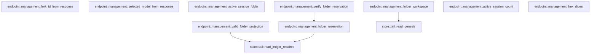

```mermaid
flowchart TD
  n0["endpoint::management::is_hex_digest"]
  n1["endpoint::management::read_canonical"]
  n2["endpoint::management::decode_canonical"]
  n3["endpoint::management::canonical_line"]
  n4["endpoint::management::to_ijson"]
  n5["endpoint::management::intent_kind"]
  n6["endpoint::management::workspace_intent"]
  n7["endpoint::management::discard_intent"]
  n8["endpoint::management::folder_is_ephemeral"]
  n9["endpoint::management::folder_move_intent"]
  n10["endpoint::management::session_create_intent"]
  n11["endpoint::management::select_model_intent"]
  n12["endpoint::management::fork_intent"]
  n13["endpoint::management::queue_transaction_intent"]
  n14["endpoint::management::pending_queue_transaction"]
  n15["endpoint::management::verify_queue_payload"]
  n16["endpoint::management::completion_for_decision"]
  n17["endpoint::management::queue_completion_value"]
  n18["endpoint::management::queue_completion_from_record"]
  n19["endpoint::management::operation_target_session"]
  n20["endpoint::management::is_uid_principal"]
  n21["endpoint::types::validate_session_id"]
  n22["schema::ijson::IJsonValue::parse"]
  n23["store::tail::read_genesis"]
  n1 --> n2
  n2 --> n22
  n4 --> n22
  n7 --> n21
  n8 --> n23
  n10 --> n0
  n10 --> n21
  n11 --> n21
  n12 --> n20
  n12 --> n21
  n13 --> n21
  n14 --> n13
  n15 --> n1
  n17 --> n4
  n18 --> n13
  n18 --> n17
  n19 --> n5
  n19 --> n9
  n19 --> n10
  n19 --> n11
  n19 --> n12
  n19 --> n13
```

# endpoint::management

[Package atlas](index.md) · [Source](../../src/management.rs)

## Declarations

Visibility is the declaration spelling; trait members and reexports require their enclosing interface. `cfg` is not evaluated.

| Symbol | Kind | Visibility | Test / cfg |
|---|---|---|---|
| [endpoint::management::VERSION](../../src/management.rs#L28) | const_item | `private` |  |
| [endpoint::management::WorkspaceView](../../src/management.rs#L32) | struct_item | `pub` |  |
| [endpoint::management::WorkspaceFolderView](../../src/management.rs#L44) | struct_item | `pub` |  |
| [endpoint::management::WorkspaceFolders](../../src/management.rs#L52) | struct_item | `pub` |  |
| [endpoint::management::WorkspaceList](../../src/management.rs#L59) | struct_item | `pub` |  |
| [endpoint::management::WorkspaceMetadata](../../src/management.rs#L66) | struct_item | `private` |  |
| [endpoint::management::OperationPhase](../../src/management.rs#L77) | enum_item | `private` |  |
| [endpoint::management::WorkspaceIntent](../../src/management.rs#L87) | struct_item | `private` |  |
| [endpoint::management::FolderMoveIntent](../../src/management.rs#L108) | struct_item | `private` |  |
| [endpoint::management::DiscardIntent](../../src/management.rs#L120) | struct_item | `private` |  |
| [endpoint::management::SessionCreateIntent](../../src/management.rs#L129) | struct_item | `private` |  |
| [endpoint::management::SelectModelIntent](../../src/management.rs#L146) | struct_item | `private` |  |
| [endpoint::management::ForkIntent](../../src/management.rs#L159) | struct_item | `private` |  |
| [endpoint::management::QueueTransactionIntent](../../src/management.rs#L174) | struct_item | `private` |  |
| [endpoint::management::QueueTailSnapshot](../../src/management.rs#L187) | struct_item | `private` |  |
| [endpoint::management::ORIGIN_CLIENT](../../src/management.rs#L195) | const_item | `pub` |  |
| [endpoint::management::LEGACY_ORIGIN_CLIENT](../../src/management.rs#L198) | const_item | `pub` |  |
| [endpoint::management::is_endpoint_origin_client](../../src/management.rs#L201) | function_item | `pub` |  |
| [endpoint::management::OperationRecord](../../src/management.rs#L207) | struct_item | `private` |  |
| [endpoint::management::WorkspaceOperationWrite](../../src/management.rs#L219) | struct_item | `private` |  |
| [endpoint::management::PresetMcpSource](../../src/management.rs#L234) | trait_item | `pub` |  |
| [endpoint::management::PresetMcpSource::server_digest](../../src/management.rs#L237) | function_signature_item | `private` |  |
| [endpoint::management::PresetMcpSource::tool_name](../../src/management.rs#L239) | function_signature_item | `private` |  |
| [endpoint::management::SessionPresetEnvironment](../../src/management.rs#L245) | struct_item | `pub` |  |
| [endpoint::management::SessionPresetEnvironment::new](../../src/management.rs#L254) | function_item | `pub` |  |
| [endpoint::management::SessionPresetEnvironment::permitted_tools](../../src/management.rs#L274) | function_item | `private` |  |
| [endpoint::management::SessionPresetEnvironment::mcp_server_digest](../../src/management.rs#L278) | function_item | `private` |  |
| [endpoint::management::SessionPresetEnvironment::mcp_tool_name](../../src/management.rs#L282) | function_item | `private` |  |
| [endpoint::management::SessionPresetEnvironment::skill_known](../../src/management.rs#L286) | function_item | `private` |  |
| [endpoint::management::SessionCreateOperation](../../src/management.rs#L291) | struct_item | `pub` |  |
| [endpoint::management::SelectModelOperation](../../src/management.rs#L307) | struct_item | `pub` |  |
| [endpoint::management::ForkSessionOperation](../../src/management.rs#L317) | struct_item | `pub` |  |
| [endpoint::management::ForkLineage](../../src/management.rs#L330) | struct_item | `pub` |  |
| [endpoint::management::QueueTransactionOperation](../../src/management.rs#L335) | struct_item | `pub` |  |
| [endpoint::management::PendingQueueTransaction](../../src/management.rs#L348) | struct_item | `pub` |  |
| [endpoint::management::QueueTransactionDecision](../../src/management.rs#L359) | enum_item | `pub` |  |
| [endpoint::management::QueueTransactionCompletion](../../src/management.rs#L368) | enum_item | `pub` |  |
| [endpoint::management::QueueTransactionState](../../src/management.rs#L379) | enum_item | `pub` |  |
| [endpoint::management::QueueRecoveryDriver](../../src/management.rs#L384) | trait_item | `pub` |  |
| [endpoint::management::QueueRecoveryDriver::execute](../../src/management.rs#L385) | function_signature_item | `private` |  |
| [endpoint::management::SelectedModel](../../src/management.rs#L392) | struct_item | `pub` |  |
| [endpoint::management::CompleteOperations](../../src/management.rs#L401) | struct_item | `pub` |  |
| [endpoint::management::file_identity](../../src/management.rs#L405) | function_item | `private` |  |
| [endpoint::management::ManagementStore](../../src/management.rs#L411) | struct_item | `pub` |  |
| [endpoint::management::ManagementStore::open_at](../../src/management.rs#L422) | function_item | `pub(crate)` | test; #[cfg(test)] |
| [endpoint::management::ManagementStore::open_at_with_queue_driver](../../src/management.rs#L429) | function_item | `pub` |  |
| [endpoint::management::ManagementStore::open_recovering_again](../../src/management.rs#L440) | function_item | `pub` |  |
| [endpoint::management::ManagementStore::open_recovering](../../src/management.rs#L454) | function_item | `private` |  |
| [endpoint::management::ManagementStore::open_light](../../src/management.rs#L489) | function_item | `pub` |  |
| [endpoint::management::ManagementStore::open_light_at](../../src/management.rs#L493) | function_item | `pub` |  |
| [endpoint::management::ManagementStore::heal_workspace_metadata_locked](../../src/management.rs#L524) | function_item | `private` |  |
| [endpoint::management::ManagementStore::lock_exclusive](../../src/management.rs#L561) | function_item | `pub` |  |
| [endpoint::management::ManagementStore::root](../../src/management.rs#L568) | function_item | `pub` |  |
| [endpoint::management::ManagementStore::recover](../../src/management.rs#L573) | function_item | `pub` |  |
| [endpoint::management::ManagementStore::recover_with_queue_driver](../../src/management.rs#L577) | function_item | `pub` |  |
| [endpoint::management::ManagementStore::recover_skipping](../../src/management.rs#L584) | function_item | `private` |  |
| [endpoint::management::ManagementStore::recover_record](../../src/management.rs#L609) | function_item | `private` |  |
| [endpoint::management::ManagementStore::quarantine_corrupt_workspace](../../src/management.rs#L751) | function_item | `private` |  |
| [endpoint::management::ManagementStore::quarantine_operation](../../src/management.rs#L768) | function_item | `private` |  |
| [endpoint::management::ManagementStore::seed_missing_workspace_policies](../../src/management.rs#L817) | function_item | `private` |  |
| [endpoint::management::ManagementStore::reconcile_workspace_metadata](../../src/management.rs#L839) | function_item | `private` |  |
| [endpoint::management::ManagementStore::list_workspaces](../../src/management.rs#L844) | function_item | `pub` |  |
| [endpoint::management::ManagementStore::workspace_paths](../../src/management.rs#L906) | function_item | `pub` |  |
| [endpoint::management::ManagementStore::workspace_path](../../src/management.rs#L916) | function_item | `pub` |  |
| [endpoint::management::ManagementStore::create_session](../../src/management.rs#L929) | function_item | `pub` |  |
| [endpoint::management::ManagementStore::select_model](../../src/management.rs#L1063) | function_item | `pub` |  |
| [endpoint::management::ManagementStore::fork_session](../../src/management.rs#L1145) | function_item | `pub` |  |
| [endpoint::management::ManagementStore::prepare_queue_transaction](../../src/management.rs#L1229) | function_item | `pub` |  |
| [endpoint::management::ManagementStore::complete_queue_transaction](../../src/management.rs#L1330) | function_item | `pub` |  |
| [endpoint::management::ManagementStore::has_incomplete_session_operation](../../src/management.rs#L1346) | function_item | `pub` |  |
| [endpoint::management::ManagementStore::completed_fork_lineage](../../src/management.rs#L1363) | function_item | `pub` |  |
| [endpoint::management::ManagementStore::create_workspace](../../src/management.rs#L1384) | function_item | `pub` |  |
| [endpoint::management::ManagementStore::rename_workspace](../../src/management.rs#L1458) | function_item | `pub` |  |
| [endpoint::management::ManagementStore::relocate_workspace](../../src/management.rs#L1504) | function_item | `pub` |  |
| [endpoint::management::ManagementStore::workspace_folders](../../src/management.rs#L1579) | function_item | `pub` |  |
| [endpoint::management::ManagementStore::add_workspace_folder](../../src/management.rs#L1594) | function_item | `pub` |  |
| [endpoint::management::ManagementStore::remove_workspace_folder](../../src/management.rs#L1655) | function_item | `pub` |  |
| [endpoint::management::ManagementStore::resume_folder_operation](../../src/management.rs#L1713) | function_item | `private` |  |
| [endpoint::management::ManagementStore::drive_folder_operation](../../src/management.rs#L1737) | function_item | `private` |  |
| [endpoint::management::ManagementStore::workspace_session_bindings](../../src/management.rs#L1747) | function_item | `private` |  |
| [endpoint::management::ManagementStore::archive_session](../../src/management.rs#L1810) | function_item | `pub` |  |
| [endpoint::management::ManagementStore::unarchive_session](../../src/management.rs#L1840) | function_item | `pub` |  |
| [endpoint::management::ManagementStore::discard_session](../../src/management.rs#L1861) | function_item | `pub` |  |
| [endpoint::management::ManagementStore::drive_discard](../../src/management.rs#L1922) | function_item | `private` |  |
| [endpoint::management::ManagementStore::folder_move](../../src/management.rs#L1977) | function_item | `private` |  |
| [endpoint::management::ManagementStore::begin_workspace_operation](../../src/management.rs#L2053) | function_item | `private` |  |
| [endpoint::management::ManagementStore::drive_workspace_operation](../../src/management.rs#L2110) | function_item | `private` |  |
| [endpoint::management::ManagementStore::workspace_configs](../../src/management.rs#L2217) | function_item | `private` |  |
| [endpoint::management::ManagementStore::operation_created](../../src/management.rs#L2229) | function_item | `private` |  |
| [endpoint::management::ManagementStore::rebuild_candidate](../../src/management.rs#L2263) | function_item | `private` |  |
| [endpoint::management::ManagementStore::drive_session_create](../../src/management.rs#L2388) | function_item | `private` |  |
| [endpoint::management::ManagementStore::session_id_from_response](../../src/management.rs#L2456) | function_item | `private` |  |
| [endpoint::management::ManagementStore::drive_select_model](../../src/management.rs#L2470) | function_item | `private` |  |
| [endpoint::management::ManagementStore::fork_was_quarantined](../../src/management.rs#L2536) | function_item | `private` |  |
| [endpoint::management::ManagementStore::drive_fork](../../src/management.rs#L2565) | function_item | `private` |  |
| [endpoint::management::ManagementStore::drive_queue_completion](../../src/management.rs#L2644) | function_item | `private` |  |
| [endpoint::management::ManagementStore::remove_recordless_payloads](../../src/management.rs#L2703) | function_item | `private` |  |
| [endpoint::management::ManagementStore::remove_recordless_payload](../../src/management.rs#L2730) | function_item | `private` |  |
| [endpoint::management::ManagementStore::drive_folder_move](../../src/management.rs#L2749) | function_item | `private` |  |
| [endpoint::management::ManagementStore::operation_paths](../../src/management.rs#L2819) | function_item | `private` |  |
| [endpoint::management::ManagementStore::operation_path](../../src/management.rs#L2839) | function_item | `private` |  |
| [endpoint::management::ManagementStore::operation_payload_path](../../src/management.rs#L2847) | function_item | `private` |  |
| [endpoint::management::ManagementStore::metadata_path](../../src/management.rs#L2856) | function_item | `private` |  |
| [endpoint::management::ManagementStore::read_metadata](../../src/management.rs#L2862) | function_item | `private` |  |
| [endpoint::management::ManagementStore::read_metadata_optional](../../src/management.rs#L2870) | function_item | `private` |  |
| [endpoint::management::primary_path](../../src/management.rs#L2883) | function_item | `private` |  |
| [endpoint::management::binding_for_path](../../src/management.rs#L2892) | function_item | `private` |  |
| [endpoint::management::binding_for_canonical_path](../../src/management.rs#L2898) | function_item | `private` |  |
| [endpoint::management::execution_path_from_snapshot](../../src/management.rs#L2913) | function_item | `private` |  |
| [endpoint::management::folder_binding_matches_snapshot](../../src/management.rs#L2919) | function_item | `private` |  |
| [endpoint::management::resolve_session_workspace](../../src/management.rs#L2923) | function_item | `private` |  |
| [endpoint::management::existing_session_cwd](../../src/management.rs#L2985) | function_item | `private` |  |
| [endpoint::management::session_preset](../../src/management.rs#L3008) | function_item | `private` |  |
| [endpoint::management::create_genesis](../../src/management.rs#L3032) | function_item | `private` |  |
| [endpoint::management::canonical_event_line](../../src/management.rs#L3072) | function_item | `private` |  |
| [endpoint::management::read_canonical_event](../../src/management.rs#L3078) | function_item | `private` |  |
| [endpoint::management::verify_session_create_genesis](../../src/management.rs#L3089) | function_item | `private` |  |
| [endpoint::management::copy_payload_tree](../../src/management.rs#L3140) | function_item | `private` |  |
| [endpoint::management::sync_operation_payload](../../src/management.rs#L3161) | function_item | `private` |  |
| [endpoint::management::is_hex_digest](../../src/management.rs#L3174) | function_item | `private` |  |
| [endpoint::management::default_workspace_policy](../../src/management.rs#L3188) | function_item | `pub` |  |
| [endpoint::management::relocate_policy_roots](../../src/management.rs#L3203) | function_item | `private` |  |
| [endpoint::management::materialized_folders](../../src/management.rs#L3228) | function_item | `private` |  |
| [endpoint::management::next_folder_id](../../src/management.rs#L3244) | function_item | `private` |  |
| [endpoint::management::with_added_folder](../../src/management.rs#L3255) | function_item | `private` |  |
| [endpoint::management::with_removed_folder](../../src/management.rs#L3279) | function_item | `private` |  |
| [endpoint::management::folders_view](../../src/management.rs#L3312) | function_item | `private` |  |
| [endpoint::management::folder_response](../../src/management.rs#L3326) | function_item | `private` |  |
| [endpoint::management::canonical_workspace_path](../../src/management.rs#L3338) | function_item | `private` |  |
| [endpoint::management::unavailable_absolute_path](../../src/management.rs#L3347) | function_item | `private` |  |
| [endpoint::management::allocate_uuid_v7](../../src/management.rs#L3352) | function_item | `private` |  |
| [endpoint::management::current_timestamp](../../src/management.rs#L3371) | function_item | `private` |  |
| [endpoint::management::validate_title](../../src/management.rs#L3380) | function_item | `private` |  |
| [endpoint::management::ensure_unique_title](../../src/management.rs#L3392) | function_item | `private` |  |
| [endpoint::management::verify_metadata](../../src/management.rs#L3406) | function_item | `private` |  |
| [endpoint::management::workspace_view](../../src/management.rs#L3424) | function_item | `private` |  |
| [endpoint::management::timestamp_from_millis](../../src/management.rs#L3450) | function_item | `private` |  |
| [endpoint::management::publish_canonical](../../src/management.rs#L3474) | function_item | `private` |  |
| [endpoint::management::read_canonical](../../src/management.rs#L3479) | function_item | `private` |  |
| [endpoint::management::decode_canonical](../../src/management.rs#L3483) | function_item | `private` |  |
| [endpoint::management::canonical_line](../../src/management.rs#L3504) | function_item | `private` |  |
| [endpoint::management::to_ijson](../../src/management.rs#L3511) | function_item | `private` |  |
| [endpoint::management::intent_kind](../../src/management.rs#L3519) | function_item | `private` |  |
| [endpoint::management::workspace_intent](../../src/management.rs#L3530) | function_item | `private` |  |
| [endpoint::management::discard_intent](../../src/management.rs#L3562) | function_item | `private` |  |
| [endpoint::management::folder_is_ephemeral](../../src/management.rs#L3574) | function_item | `private` |  |
| [endpoint::management::folder_move_intent](../../src/management.rs#L3580) | function_item | `private` |  |
| [endpoint::management::session_create_intent](../../src/management.rs#L3591) | function_item | `private` |  |
| [endpoint::management::select_model_intent](../../src/management.rs#L3616) | function_item | `private` |  |
| [endpoint::management::fork_intent](../../src/management.rs#L3636) | function_item | `private` |  |
| [endpoint::management::queue_transaction_intent](../../src/management.rs#L3653) | function_item | `private` |  |
| [endpoint::management::pending_queue_transaction](../../src/management.rs#L3681) | function_item | `private` |  |
| [endpoint::management::verify_queue_payload](../../src/management.rs#L3696) | function_item | `private` |  |
| [endpoint::management::completion_for_decision](../../src/management.rs#L3731) | function_item | `private` |  |
| [endpoint::management::queue_completion_value](../../src/management.rs#L3743) | function_item | `private` |  |
| [endpoint::management::queue_completion_from_record](../../src/management.rs#L3781) | function_item | `private` |  |
| [endpoint::management::operation_target_session](../../src/management.rs#L3828) | function_item | `private` |  |
| [endpoint::management::is_uid_principal](../../src/management.rs#L3844) | function_item | `private` |  |
| [endpoint::management::fork_id_from_response](../../src/management.rs#L3850) | function_item | `private` |  |
| [endpoint::management::selected_model_from_response](../../src/management.rs#L3862) | function_item | `private` |  |
| [endpoint::management::active_session_folder](../../src/management.rs#L3900) | function_item | `private` |  |
| [endpoint::management::valid_folder_projection](../../src/management.rs#L3911) | function_item | `private` |  |
| [endpoint::management::folder_reservation](../../src/management.rs#L3924) | function_item | `private` |  |
| [endpoint::management::verify_folder_reservation](../../src/management.rs#L3941) | function_item | `private` |  |
| [endpoint::management::folder_workspace](../../src/management.rs#L3954) | function_item | `private` |  |
| [endpoint::management::active_session_count](../../src/management.rs#L3966) | function_item | `private` |  |
| [endpoint::management::hex_digest](../../src/management.rs#L3976) | function_item | `private` |  |
| [endpoint::management::ManagementError](../../src/management.rs#L3981) | enum_item | `pub` |  |
| [endpoint::management::tests::omitted_identity_is_auto_but_explicit_and_legacy_identity_stay_fixed](../../src/management.rs#L4080) | function_item | `private` | test; #[cfg(test)] |
| [endpoint::management::tests::preset_genesis_replaces_identity_and_needs_reader_two](../../src/management.rs#L4114) | function_item | `private` | test; #[cfg(test)] |
| [endpoint::management::tests::legacy_session_create_without_folder_binding_remains_recoverable](../../src/management.rs#L4201) | function_item | `private` | test; #[cfg(test)] |
| [endpoint::management::tests::quarantined_fork_does_not_block_recovery_or_claim_success](../../src/management.rs#L4216) | function_item | `private` | test; #[cfg(test)] |
| [endpoint::management::tests::open_light_heals_metadata_after_any_config_writer_without_reading_threads](../../src/management.rs#L4290) | function_item | `private` | test; #[cfg(test)] |
| [endpoint::management::tests::unavailable_workspace_keeps_its_management_operation_pending](../../src/management.rs#L4379) | function_item | `private` | test; #[cfg(test)] |
| [endpoint::management::tests::a_select_model_payload_staged_before_the_rename_is_read_on_recovery](../../src/management.rs#L4418) | function_item | `private` | test; #[cfg(test)] |
| [endpoint::management::tests::a_created_workspace_starts_with_the_interactive_fixed_catalog_writable_in_its_folder](../../src/management.rs#L4486) | function_item | `private` | test; #[cfg(test)] |
| [endpoint::management::tests::opening_the_store_seeds_a_policy_for_a_policy_less_workspace_once](../../src/management.rs#L4530) | function_item | `private` | test; #[cfg(test)] |
| [endpoint::management::tests::relocation_moves_writable_roots_with_their_folder](../../src/management.rs#L4578) | function_item | `private` | test; #[cfg(test)] |
| [endpoint::management::tests::folder_store](../../src/management.rs#L4613) | function_item | `private` | test; #[cfg(test)] |
| [endpoint::management::tests::sibling](../../src/management.rs#L4630) | function_item | `private` | test; #[cfg(test)] |
| [endpoint::management::tests::write_session](../../src/management.rs#L4641) | function_item | `private` | test; #[cfg(test)] |
| [endpoint::management::tests::folders_are_added_listed_and_removed_with_their_writable_roots](../../src/management.rs#L4683) | function_item | `private` | test; #[cfg(test)] |
| [endpoint::management::tests::a_folder_bound_to_a_session_is_not_removed](../../src/management.rs#L4798) | function_item | `private` | test; #[cfg(test)] |
| [endpoint::management::tests::a_legacy_unbound_session_blocks_a_second_folder](../../src/management.rs#L4844) | function_item | `private` | test; #[cfg(test)] |
| [endpoint::management::tests::folder_edits_materialize_a_legacy_cwd_workspace_with_its_synthesized_ids](../../src/management.rs#L4872) | function_item | `private` | test; #[cfg(test)] |
| [endpoint::management::tests::completed_workspace_operation_never_reopens_its_old_path](../../src/management.rs#L4904) | function_item | `private` | test; #[cfg(test)] |
| [endpoint::management::k1_management_race::BOOT](../../src/management.rs#L4935) | const_item | `private` | test; #[cfg(test)] |
| [endpoint::management::k1_management_race::TICK](../../src/management.rs#L4936) | const_item | `private` | test; #[cfg(test)] |
| [endpoint::management::k1_management_race::LATER](../../src/management.rs#L4937) | const_item | `private` | test; #[cfg(test)] |
| [endpoint::management::k1_management_race::WORKSPACE](../../src/management.rs#L4938) | const_item | `private` | test; #[cfg(test)] |
| [endpoint::management::k1_management_race::fixture](../../src/management.rs#L4940) | function_item | `private` | test; #[cfg(test)] |
| [endpoint::management::k1_management_race::policy_with](../../src/management.rs#L4965) | function_item | `private` | test; #[cfg(test)] |
| [endpoint::management::k1_management_race::set_policy](../../src/management.rs#L4971) | function_item | `private` | test; #[cfg(test)] |
| [endpoint::management::k1_management_race::quarantine_root](../../src/management.rs#L4978) | function_item | `private` | test; #[cfg(test)] |
| [endpoint::management::k1_management_race::stale_metadata](../../src/management.rs#L4984) | function_item | `private` | test; #[cfg(test)] |
| [endpoint::management::k1_management_race::metadata_matches](../../src/management.rs#L4991) | function_item | `private` | test; #[cfg(test)] |
| [endpoint::management::k1_management_race::stuck_carriers_record](../../src/management.rs#L4998) | function_item | `private` | test; #[cfg(test)] |
| [endpoint::management::k1_management_race::tick_heals_stale_metadata_without_staging_an_operation](../../src/management.rs#L5032) | function_item | `private` | test; #[cfg(test)] |
| [endpoint::management::k1_management_race::tick_never_fails_while_policy_set_publishes](../../src/management.rs#L5062) | function_item | `private` | test; #[cfg(test)] |
| [endpoint::management::k1_management_race::parked_synthetic_rename](../../src/management.rs#L5107) | function_item | `private` | test; #[cfg(test)] |
| [endpoint::management::k1_management_race::boot_quarantines_the_parked_carriers_record_and_succeeds](../../src/management.rs#L5156) | function_item | `private` | test; #[cfg(test)] |
| [endpoint::management::k1_management_race::record_of_another_version_is_left_in_place_not_quarantined](../../src/management.rs#L5211) | function_item | `private` | test; #[cfg(test)] |
| [endpoint::management::k1_management_race::quarantine_keeps_the_payload_and_never_redrives_the_operation](../../src/management.rs#L5233) | function_item | `private` | test; #[cfg(test)] |
| [endpoint::management::k1_management_race::complete_workspace_record_without_response_is_quarantined](../../src/management.rs#L5296) | function_item | `private` | test; #[cfg(test)] |
| [endpoint::management::k1_management_race::one_failing_record_does_not_stop_the_others_from_recovering](../../src/management.rs#L5332) | function_item | `private` | test; #[cfg(test)] |

## Imports / reexports

| Local name | Source path | Visibility |
|---|---|---|
| `BTreeMap` | `std::collections::BTreeMap` | `private` |
| `fs` | `std::fs` | `private` |
| `File` | `std::fs::File` | `private` |
| `Read` | `std::io::Read` | `private` |
| `MetadataExt` | `std::os::unix::fs::MetadataExt` | `private` |
| `Path` | `std::path::Path` | `private` |
| `PathBuf` | `std::path::PathBuf` | `private` |
| `SystemTime` | `std::time::SystemTime` | `private` |
| `UNIX_EPOCH` | `std::time::UNIX_EPOCH` | `private` |
| `ConfigRepository` | `profile::ConfigRepository` | `private` |
| `InstructionResolver` | `profile::InstructionResolver` | `private` |
| `WorkspaceConfig` | `profile::WorkspaceConfig` | `private` |
| `WorkspaceFolder` | `profile::WorkspaceFolder` | `private` |
| `WorkspacePolicy` | `profile::WorkspacePolicy` | `private` |
| `Event` | `schema::Event` | `private` |
| `IJsonValue` | `schema::IJsonValue` | `private` |
| `OriginTuple` | `schema::OriginTuple` | `private` |
| `ResumePolicy` | `schema::ResumePolicy` | `private` |
| `Deserialize` | `serde::Deserialize` | `private` |
| `Serialize` | `serde::Serialize` | `private` |
| `Value` | `serde_json::Value` | `private` |
| `json` | `serde_json::json` | `private` |
| `Digest` | `sha2::Digest` | `private` |
| `Sha256` | `sha2::Sha256` | `private` |
| `AssetStore` | `store::AssetStore` | `private` |
| `AtomicPublisher` | `store::AtomicPublisher` | `private` |
| `DirectoryLock` | `store::DirectoryLock` | `private` |
| `NamedLock` | `store::NamedLock` | `private` |
| `ThreadStore` | `store::ThreadStore` | `private` |
| `scan_valid_prefix` | `store::scan_valid_prefix` | `private` |
| `Error` | `thiserror::Error` | `private` |
| `Uuid` | `uuid::Uuid` | `private` |
| `SessionInventoryItem` | `crate::SessionInventoryItem` | `private` |
| `ForkIntent` | `super::ForkIntent` | `private` |
| `ManagementError` | `super::ManagementError` | `private` |
| `ManagementStore` | `super::ManagementStore` | `private` |
| `OperationPhase` | `super::OperationPhase` | `private` |
| `OperationRecord` | `super::OperationRecord` | `private` |
| `VERSION` | `super::VERSION` | `private` |
| `WorkspaceMetadata` | `super::WorkspaceMetadata` | `private` |
| `WorkspaceOperationWrite` | `super::WorkspaceOperationWrite` | `private` |
| `WorkspaceView` | `super::WorkspaceView` | `private` |
| `canonical_event_line` | `super::canonical_event_line` | `private` |
| `create_genesis` | `super::create_genesis` | `private` |
| `default_workspace_policy` | `super::default_workspace_policy` | `private` |
| `folder_binding_matches_snapshot` | `super::folder_binding_matches_snapshot` | `private` |
| `publish_canonical` | `super::publish_canonical` | `private` |
| `read_canonical` | `super::read_canonical` | `private` |
| `session_preset` | `super::session_preset` | `private` |
| `to_ijson` | `super::to_ijson` | `private` |
| `SessionInventoryItem` | `crate::SessionInventoryItem` | `private` |
| `ConfigRepository` | `profile::ConfigRepository` | `private` |
| `WorkspaceConfig` | `profile::WorkspaceConfig` | `private` |
| `WorkspaceFolder` | `profile::WorkspaceFolder` | `private` |
| `Value` | `serde_json::Value` | `private` |
| `json` | `serde_json::json` | `private` |
| `fs` | `std::fs` | `private` |
| `Path` | `std::path::Path` | `private` |
| `ThreadStore` | `store::ThreadStore` | `private` |
| `*` | `super::*` | `private` |
| `ConfigRepository` | `profile::ConfigRepository` | `private` |
| `WorkspaceConfig` | `profile::WorkspaceConfig` | `private` |
| `WorkspaceFolder` | `profile::WorkspaceFolder` | `private` |
| `Arc` | `std::sync::Arc` | `private` |
| `AtomicBool` | `std::sync::atomic::AtomicBool` | `private` |
| `Ordering` | `std::sync::atomic::Ordering` | `private` |

## Module declarations

| Module | Visibility | Attributes |
|---|---|---|
| `endpoint::management::tests` | `private` | #[cfg(test)] |
| `endpoint::management::k1_management_race` | `private` | #[cfg(test)] |

## Function call graphs

Edges below are syntactically resolved calls only, including private functions. Graphs partition callers into groups of 20; they are not execution order. All unresolved sites are listed below and in the JSON inventory.

```mermaid
flowchart TD
  n0["endpoint::management::is_endpoint_origin_client"]
  n1["endpoint::management::ManagementStore::drive_workspace_operation"]
  n2["endpoint::management::ManagementStore::workspace_configs"]
  n3["endpoint::management::ManagementStore::drive_session_create"]
  n4["endpoint::management::ManagementStore::drive_select_model"]
  n5["endpoint::management::ManagementStore::fork_was_quarantined"]
  n6["endpoint::management::SessionPresetEnvironment::new"]
  n7["endpoint::management::ManagementStore::drive_fork"]
  n8["endpoint::management::ManagementStore::drive_queue_completion"]
  n9["endpoint::management::ManagementStore::remove_recordless_payloads"]
  n10["endpoint::management::ManagementStore::drive_folder_move"]
  n11["endpoint::management::SessionPresetEnvironment::permitted_tools"]
  n12["endpoint::management::SessionPresetEnvironment::mcp_server_digest"]
  n13["endpoint::management::ManagementStore::operation_paths"]
  n14["endpoint::management::SessionPresetEnvironment::mcp_tool_name"]
  n15["endpoint::management::ManagementStore::operation_payload_path"]
  n16["endpoint::management::ManagementStore::metadata_path"]
  n17["endpoint::management::SessionPresetEnvironment::skill_known"]
  n18["endpoint::management::ManagementStore::read_metadata_optional"]
  n19["endpoint::management::primary_path"]
  n20["endpoint::management::unavailable_absolute_path"]
  n21["endpoint::management::current_timestamp"]
  n22["endpoint::management::verify_metadata"]
  n23["endpoint::management::publish_canonical"]
  n24["endpoint::management::read_canonical"]
  n25["endpoint::management::canonical_line"]
  n26["endpoint::management::intent_kind"]
  n27["endpoint::management::workspace_intent"]
  n28["endpoint::management::folder_move_intent"]
  n29["endpoint::management::session_create_intent"]
  n30["endpoint::management::select_model_intent"]
  n31["endpoint::management::fork_intent"]
  n32["endpoint::management::queue_transaction_intent"]
  n33["endpoint::management::pending_queue_transaction"]
  n34["endpoint::management::verify_queue_payload"]
  n35["endpoint::management::queue_completion_from_record"]
  n36["endpoint::management::hex_digest"]
  n37["endpoint::management::file_identity"]
  n38["endpoint::management::ManagementStore::open_at_with_queue_driver"]
  n39["endpoint::management::ManagementStore::open_recovering_again"]
  n40["endpoint::management::ManagementStore::open_recovering"]
  n41["endpoint::management::ManagementStore::open_light"]
  n42["endpoint::management::ManagementStore::open_light_at"]
  n43["endpoint::management::ManagementStore::heal_workspace_metadata_locked"]
  n44["endpoint::management::ManagementStore::lock_exclusive"]
  n45["endpoint::management::ManagementStore::root"]
  n46["endpoint::management::ManagementStore::recover"]
  n47["endpoint::management::ManagementStore::recover_with_queue_driver"]
  n48["endpoint::management::ManagementStore::recover_skipping"]
  n49["endpoint::management::ManagementStore::recover_record"]
  n50["endpoint::management::ManagementStore::quarantine_corrupt_workspace"]
  n51["endpoint::management::ManagementStore::quarantine_operation"]
  n52["profile::config::ConfigRepository::open"]
  n53["store::folder::ThreadStore::open"]
  n54["store::management_root::endpoint_management_root"]
  n55["store::platform::NamedLock::exclusive"]
  n56["store::platform::NamedLock::shared"]
  n38 --> n40
  n39 --> n40
  n40 --> n52
  n40 --> n53
  n40 --> n54
  n41 --> n21
  n41 --> n42
  n42 --> n52
  n42 --> n54
  n42 --> n55
  n43 --> n2
  n43 --> n16
  n43 --> n18
  n43 --> n19
  n43 --> n22
  n43 --> n23
  n43 --> n25
  n43 --> n36
  n43 --> n56
  n44 --> n54
  n44 --> n55
  n46 --> n47
  n47 --> n48
  n48 --> n9
  n48 --> n13
  n48 --> n49
  n48 --> n55
  n49 --> n1
  n49 --> n3
  n49 --> n4
  n49 --> n5
  n49 --> n7
  n49 --> n8
  n49 --> n10
  n49 --> n15
  n49 --> n20
  n49 --> n24
  n49 --> n26
  n49 --> n27
  n49 --> n28
  n49 --> n29
  n49 --> n30
  n49 --> n31
  n49 --> n32
  n49 --> n33
  n49 --> n34
  n49 --> n35
  n49 --> n37
  n49 --> n50
  n49 --> n55
  n50 --> n51
```

Functions 1–20: 51 direct edges

Functions 21–40: 152 direct edges

Functions 41–60: 117 direct edges

Functions 61–80: 28 direct edges

Functions 81–100: 12 direct edges

Functions 101–120: 22 direct edges

Functions 121–129: 4 direct edges

## Call sites

Includes test functions (marked in declarations). Receiver-type-required sites need type analysis/manual tracing. Calls in closures are attributed to their enclosing function; their occurrence here does not mean the closure executes immediately.

| Caller | Callee expression | Source lines | Target / classification |
|---|---|---|---|
| `new` | `instruction                 .effective                 .policy                 .allowed_tools                 .as_ref()                 .map` | [261](../../src/management.rs#L261) | receiver-type-required |
| `new` | `instruction                 .effective                 .policy                 .allowed_tools                 .as_ref` | [261](../../src/management.rs#L261) | receiver-type-required |
| `new` | `tools.iter().cloned().collect` | [266](../../src/management.rs#L266) | receiver-type-required |
| `new` | `tools.iter().cloned` | [266](../../src/management.rs#L266) | receiver-type-required |
| `new` | `tools.iter` | [266](../../src/management.rs#L266) | receiver-type-required |
| `permitted_tools` | `self.permitted.as_ref` | [275](../../src/management.rs#L275) | receiver-type-required |
| `mcp_server_digest` | `self.mcp?.server_digest` | [279](../../src/management.rs#L279) | receiver-type-required |
| `mcp_tool_name` | `self.mcp?.tool_name` | [283](../../src/management.rs#L283) | receiver-type-required |
| `skill_known` | `self.skills.contains_key` | [287](../../src/management.rs#L287) | receiver-type-required |
| `file_identity` | `fs::metadata(path).ok` | [406](../../src/management.rs#L406) | receiver-type-required |
| `file_identity` | `fs::metadata` | [406](../../src/management.rs#L406) | external-constructor-callback-or-unresolved |
| `file_identity` | `Some` | [407](../../src/management.rs#L407) | external-constructor-callback-or-unresolved |
| `file_identity` | `metadata.len` | [407](../../src/management.rs#L407) | receiver-type-required |
| `file_identity` | `metadata.modified().ok` | [407](../../src/management.rs#L407) | receiver-type-required |
| `file_identity` | `metadata.modified` | [407](../../src/management.rs#L407) | receiver-type-required |
| `open_at` | `Self::open_at_with_queue_driver` | [426](../../src/management.rs#L426) | [endpoint::management::ManagementStore::open_at_with_queue_driver](../../src/management.rs#L429) |
| `open_at_with_queue_driver` | `Self::open_recovering` | [434](../../src/management.rs#L434) | [endpoint::management::ManagementStore::open_recovering](../../src/management.rs#L454) |
| `open_recovering_again` | `Self::open_recovering` | [446](../../src/management.rs#L446) | [endpoint::management::ManagementStore::open_recovering](../../src/management.rs#L454) |
| `open_recovering_again` | `Some` | [450](../../src/management.rs#L450) | external-constructor-callback-or-unresolved |
| `open_recovering` | `storage_root.as_ref().to_path_buf` | [460](../../src/management.rs#L460) | receiver-type-required |
| `open_recovering` | `storage_root.as_ref` | [460](../../src/management.rs#L460) | receiver-type-required |
| `open_recovering` | `ThreadStore::open` | [461](../../src/management.rs#L461) | [store::folder::ThreadStore::open](../../../store/src/folder.rs#L36) |
| `open_recovering` | `store::endpoint_management_root` | [462](../../src/management.rs#L462) | [store::management_root::endpoint_management_root](../../../store/src/management_root.rs#L47) |
| `open_recovering` | `fs::create_dir_all` | [463](../../src/management.rs#L463), [464](../../src/management.rs#L464) | external-constructor-callback-or-unresolved |
| `open_recovering` | `root.join` | [463](../../src/management.rs#L463), [464](../../src/management.rs#L464), [468](../../src/management.rs#L468) | receiver-type-required |
| `open_recovering` | `fs::OpenOptions::new()             .create(true)             .append(true)             .open` | [465](../../src/management.rs#L465) | receiver-type-required |
| `open_recovering` | `fs::OpenOptions::new()             .create(true)             .append` | [465](../../src/management.rs#L465) | receiver-type-required |
| `open_recovering` | `fs::OpenOptions::new()             .create` | [465](../../src/management.rs#L465) | receiver-type-required |
| `open_recovering` | `fs::OpenOptions::new` | [465](../../src/management.rs#L465) | external-constructor-callback-or-unresolved |
| `open_recovering` | `ConfigRepository::open` | [470](../../src/management.rs#L470) | [profile::config::ConfigRepository::open](../../../profile/src/config.rs#L688) |
| `open_recovering` | `store.recover_skipping` | [474](../../src/management.rs#L474) | receiver-type-required |
| `open_recovering` | `store.seed_missing_workspace_policies` | [475](../../src/management.rs#L475) | receiver-type-required |
| `open_recovering` | `store.reconcile_workspace_metadata` | [476](../../src/management.rs#L476) | receiver-type-required |
| `open_recovering` | `Ok` | [480](../../src/management.rs#L480) | external-constructor-callback-or-unresolved |
| `open_light` | `Self::open_light_at` | [490](../../src/management.rs#L490) | [endpoint::management::ManagementStore::open_light_at](../../src/management.rs#L493) |
| `open_light` | `current_timestamp` | [490](../../src/management.rs#L490) | [endpoint::management::current_timestamp](../../src/management.rs#L3371) |
| `open_light_at` | `storage_root.as_ref().to_path_buf` | [497](../../src/management.rs#L497) | receiver-type-required |
| `open_light_at` | `storage_root.as_ref` | [497](../../src/management.rs#L497) | receiver-type-required |
| `open_light_at` | `store::endpoint_management_root` | [498](../../src/management.rs#L498) | [store::management_root::endpoint_management_root](../../../store/src/management_root.rs#L47) |
| `open_light_at` | `fs::create_dir_all` | [499](../../src/management.rs#L499), [500](../../src/management.rs#L500) | external-constructor-callback-or-unresolved |
| `open_light_at` | `root.join` | [499](../../src/management.rs#L499), [500](../../src/management.rs#L500), [504](../../src/management.rs#L504) | receiver-type-required |
| `open_light_at` | `fs::OpenOptions::new()             .create(true)             .append(true)             .open` | [501](../../src/management.rs#L501) | receiver-type-required |
| `open_light_at` | `fs::OpenOptions::new()             .create(true)             .append` | [501](../../src/management.rs#L501) | receiver-type-required |
| `open_light_at` | `fs::OpenOptions::new()             .create` | [501](../../src/management.rs#L501) | receiver-type-required |
| `open_light_at` | `fs::OpenOptions::new` | [501](../../src/management.rs#L501) | external-constructor-callback-or-unresolved |
| `open_light_at` | `ConfigRepository::open` | [506](../../src/management.rs#L506) | [profile::config::ConfigRepository::open](../../../profile/src/config.rs#L688) |
| `open_light_at` | `NamedLock::exclusive` | [510](../../src/management.rs#L510) | [store::platform::NamedLock::exclusive](../../../store/src/platform.rs#L103) |
| `open_light_at` | `store.root.join` | [510](../../src/management.rs#L510) | receiver-type-required |
| `open_light_at` | `store.heal_workspace_metadata_locked` | [511](../../src/management.rs#L511) | receiver-type-required |
| `open_light_at` | `drop` | [512](../../src/management.rs#L512) | external-constructor-callback-or-unresolved |
| `open_light_at` | `Ok` | [513](../../src/management.rs#L513) | external-constructor-callback-or-unresolved |
| `heal_workspace_metadata_locked` | `NamedLock::shared` | [525](../../src/management.rs#L525) | [store::platform::NamedLock::shared](../../../store/src/platform.rs#L99) |
| `heal_workspace_metadata_locked` | `self.storage_root.join` | [525](../../src/management.rs#L525) | receiver-type-required |
| `heal_workspace_metadata_locked` | `self.workspace_configs()?.into_values` | [526](../../src/management.rs#L526) | receiver-type-required |
| `heal_workspace_metadata_locked` | `self.workspace_configs` | [526](../../src/management.rs#L526) | [endpoint::management::ManagementStore::workspace_configs](../../src/management.rs#L2217) |
| `heal_workspace_metadata_locked` | `primary_path(&config).map` | [528](../../src/management.rs#L528) | receiver-type-required |
| `heal_workspace_metadata_locked` | `primary_path` | [528](../../src/management.rs#L528) | [endpoint::management::primary_path](../../src/management.rs#L2883) |
| `heal_workspace_metadata_locked` | `self.read_metadata_optional` | [535](../../src/management.rs#L535) | [endpoint::management::ManagementStore::read_metadata_optional](../../src/management.rs#L2870) |
| `heal_workspace_metadata_locked` | `existing                 .as_ref()                 .is_some_and` | [536](../../src/management.rs#L536) | receiver-type-required |
| `heal_workspace_metadata_locked` | `existing                 .as_ref` | [536](../../src/management.rs#L536) | receiver-type-required |
| `heal_workspace_metadata_locked` | `verify_metadata(&config, metadata).is_ok` | [538](../../src/management.rs#L538) | receiver-type-required |
| `heal_workspace_metadata_locked` | `verify_metadata` | [538](../../src/management.rs#L538) | [endpoint::management::verify_metadata](../../src/management.rs#L3406) |
| `heal_workspace_metadata_locked` | `config.id.clone` | [544](../../src/management.rs#L544) | receiver-type-required |
| `heal_workspace_metadata_locked` | `existing                     .map_or_else` | [546](../../src/management.rs#L546) | receiver-type-required |
| `heal_workspace_metadata_locked` | `started_at.to_owned` | [547](../../src/management.rs#L547), [548](../../src/management.rs#L548) | receiver-type-required |
| `heal_workspace_metadata_locked` | `hex_digest` | [549](../../src/management.rs#L549) | [endpoint::management::hex_digest](../../src/management.rs#L3976) |
| `heal_workspace_metadata_locked` | `canonical_line` | [549](../../src/management.rs#L549) | [endpoint::management::canonical_line](../../src/management.rs#L3504) |
| `heal_workspace_metadata_locked` | `publish_canonical` | [551](../../src/management.rs#L551) | [endpoint::management::publish_canonical](../../src/management.rs#L3474) |
| `heal_workspace_metadata_locked` | `self.metadata_path` | [551](../../src/management.rs#L551) | [endpoint::management::ManagementStore::metadata_path](../../src/management.rs#L2856) |
| `heal_workspace_metadata_locked` | `Ok` | [553](../../src/management.rs#L553) | external-constructor-callback-or-unresolved |
| `lock_exclusive` | `store::endpoint_management_root` | [562](../../src/management.rs#L562) | [store::management_root::endpoint_management_root](../../../store/src/management_root.rs#L47) |
| `lock_exclusive` | `storage_root.as_ref` | [562](../../src/management.rs#L562) | receiver-type-required |
| `lock_exclusive` | `fs::create_dir_all` | [563](../../src/management.rs#L563) | external-constructor-callback-or-unresolved |
| `lock_exclusive` | `Ok` | [564](../../src/management.rs#L564) | external-constructor-callback-or-unresolved |
| `lock_exclusive` | `NamedLock::exclusive` | [564](../../src/management.rs#L564) | [store::platform::NamedLock::exclusive](../../../store/src/platform.rs#L103) |
| `lock_exclusive` | `root.join` | [564](../../src/management.rs#L564) | receiver-type-required |
| `recover` | `self.recover_with_queue_driver` | [574](../../src/management.rs#L574) | [endpoint::management::ManagementStore::recover_with_queue_driver](../../src/management.rs#L577) |
| `recover_with_queue_driver` | `self.recover_skipping` | [581](../../src/management.rs#L581) | [endpoint::management::ManagementStore::recover_skipping](../../src/management.rs#L584) |
| `recover_skipping` | `NamedLock::exclusive` | [593](../../src/management.rs#L593) | [store::platform::NamedLock::exclusive](../../../store/src/platform.rs#L103) |
| `recover_skipping` | `self.root.join` | [593](../../src/management.rs#L593) | receiver-type-required |
| `recover_skipping` | `self.remove_recordless_payloads` | [594](../../src/management.rs#L594) | [endpoint::management::ManagementStore::remove_recordless_payloads](../../src/management.rs#L2703) |
| `recover_skipping` | `self.operation_paths` | [595](../../src/management.rs#L595) | [endpoint::management::ManagementStore::operation_paths](../../src/management.rs#L2819) |
| `recover_skipping` | `self.recover_record` | [601](../../src/management.rs#L601) | [endpoint::management::ManagementStore::recover_record](../../src/management.rs#L609) |
| `recover_skipping` | `validated.as_deref_mut` | [601](../../src/management.rs#L601) | receiver-type-required |
| `recover_skipping` | `first_error.get_or_insert` | [602](../../src/management.rs#L602) | receiver-type-required |
| `recover_skipping` | `first_error.map_or` | [605](../../src/management.rs#L605) | receiver-type-required |
| `recover_skipping` | `Ok` | [605](../../src/management.rs#L605) | external-constructor-callback-or-unresolved |
| `recover_record` | `Some` | [615](../../src/management.rs#L615), [718](../../src/management.rs#L718) | external-constructor-callback-or-unresolved |
| `recover_record` | `NamedLock::exclusive` | [615](../../src/management.rs#L615), [718](../../src/management.rs#L718) | [store::platform::NamedLock::exclusive](../../../store/src/platform.rs#L103) |
| `recover_record` | `self.root.join` | [615](../../src/management.rs#L615), [718](../../src/management.rs#L718) | receiver-type-required |
| `recover_record` | `path.exists` | [616](../../src/management.rs#L616) | receiver-type-required |
| `recover_record` | `Ok` | [617](../../src/management.rs#L617), [623](../../src/management.rs#L623), [635](../../src/management.rs#L635), [663](../../src/management.rs#L663), [681](../../src/management.rs#L681), [703](../../src/management.rs#L703), [721](../../src/management.rs#L721), [748](../../src/management.rs#L748) | external-constructor-callback-or-unresolved |
| `recover_record` | `file_identity` | [619](../../src/management.rs#L619) | [endpoint::management::file_identity](../../src/management.rs#L405) |
| `recover_record` | `validated.as_deref` | [620](../../src/management.rs#L620) | receiver-type-required |
| `recover_record` | `identity.as_ref` | [620](../../src/management.rs#L620) | receiver-type-required |
| `recover_record` | `known.0.contains` | [621](../../src/management.rs#L621) | receiver-type-required |
| `recover_record` | `path.clone` | [621](../../src/management.rs#L621), [639](../../src/management.rs#L639) | receiver-type-required |
| `recover_record` | `read_canonical::<OperationRecord>` | [625](../../src/management.rs#L625), [719](../../src/management.rs#L719) | [endpoint::management::read_canonical](../../src/management.rs#L3479) |
| `recover_record` | `intent_kind` | [626](../../src/management.rs#L626) | [endpoint::management::intent_kind](../../src/management.rs#L3519) |
| `recover_record` | `known.0.insert` | [639](../../src/management.rs#L639) | receiver-type-required |
| `recover_record` | `kind.as_str` | [641](../../src/management.rs#L641), [683](../../src/management.rs#L683) | receiver-type-required |
| `recover_record` | `workspace_intent` | [643](../../src/management.rs#L643), [684](../../src/management.rs#L684) | [endpoint::management::workspace_intent](../../src/management.rs#L3530) |
| `recover_record` | `self.quarantine_corrupt_workspace` | [644](../../src/management.rs#L644), [676](../../src/management.rs#L676), [744](../../src/management.rs#L744) | [endpoint::management::ManagementStore::quarantine_corrupt_workspace](../../src/management.rs#L751) |
| `recover_record` | `folder_move_intent` | [648](../../src/management.rs#L648), [688](../../src/management.rs#L688) | [endpoint::management::folder_move_intent](../../src/management.rs#L3580) |
| `recover_record` | `session_create_intent` | [651](../../src/management.rs#L651), [692](../../src/management.rs#L692) | [endpoint::management::session_create_intent](../../src/management.rs#L3591) |
| `recover_record` | `select_model_intent` | [654](../../src/management.rs#L654), [696](../../src/management.rs#L696) | [endpoint::management::select_model_intent](../../src/management.rs#L3616) |
| `recover_record` | `fork_intent` | [657](../../src/management.rs#L657) | [endpoint::management::fork_intent](../../src/management.rs#L3636) |
| `recover_record` | `queue_transaction_intent` | [660](../../src/management.rs#L660), [708](../../src/management.rs#L708) | [endpoint::management::queue_transaction_intent](../../src/management.rs#L3653) |
| `recover_record` | `verify_queue_payload` | [661](../../src/management.rs#L661), [709](../../src/management.rs#L709) | [endpoint::management::verify_queue_payload](../../src/management.rs#L3696) |
| `recover_record` | `self.operation_payload_path` | [661](../../src/management.rs#L661), [709](../../src/management.rs#L709) | [endpoint::management::ManagementStore::operation_payload_path](../../src/management.rs#L2847) |
| `recover_record` | `queue_completion_from_record` | [662](../../src/management.rs#L662) | [endpoint::management::queue_completion_from_record](../../src/management.rs#L3781) |
| `recover_record` | `Err` | [666](../../src/management.rs#L666), [678](../../src/management.rs#L678), [727](../../src/management.rs#L727), [746](../../src/management.rs#L746) | external-constructor-callback-or-unresolved |
| `recover_record` | `ManagementError::CorruptOperation` | [666](../../src/management.rs#L666), [672](../../src/management.rs#L672), [727](../../src/management.rs#L727) | external-constructor-callback-or-unresolved |
| `recover_record` | `record.response.is_none` | [671](../../src/management.rs#L671) | receiver-type-required |
| `recover_record` | `"complete operation lacks response".to_owned` | [673](../../src/management.rs#L673) | receiver-type-required |
| `recover_record` | `workspace_intent(&record)                 .and_then(&#124;_&#124; self.drive_workspace_operation(&path, record))                 .map` | [684](../../src/management.rs#L684) | receiver-type-required |
| `recover_record` | `workspace_intent(&record)                 .and_then` | [684](../../src/management.rs#L684) | receiver-type-required |
| `recover_record` | `self.drive_workspace_operation` | [685](../../src/management.rs#L685) | [endpoint::management::ManagementStore::drive_workspace_operation](../../src/management.rs#L2110) |
| `recover_record` | `self.drive_folder_move(&path, record, None).map` | [689](../../src/management.rs#L689) | receiver-type-required |
| `recover_record` | `self.drive_folder_move` | [689](../../src/management.rs#L689) | [endpoint::management::ManagementStore::drive_folder_move](../../src/management.rs#L2749) |
| `recover_record` | `self.drive_session_create(&path, record).map` | [693](../../src/management.rs#L693) | receiver-type-required |
| `recover_record` | `self.drive_session_create` | [693](../../src/management.rs#L693) | [endpoint::management::ManagementStore::drive_session_create](../../src/management.rs#L2388) |
| `recover_record` | `self.drive_select_model(&path, record).map` | [697](../../src/management.rs#L697) | receiver-type-required |
| `recover_record` | `self.drive_select_model` | [697](../../src/management.rs#L697) | [endpoint::management::ManagementStore::drive_select_model](../../src/management.rs#L2470) |
| `recover_record` | `self.fork_was_quarantined` | [700](../../src/management.rs#L700) | [endpoint::management::ManagementStore::fork_was_quarantined](../../src/management.rs#L2536) |
| `recover_record` | `self.drive_fork(&path, record).map` | [705](../../src/management.rs#L705) | receiver-type-required |
| `recover_record` | `self.drive_fork` | [705](../../src/management.rs#L705) | [endpoint::management::ManagementStore::drive_fork](../../src/management.rs#L2565) |
| `recover_record` | `pending_queue_transaction` | [710](../../src/management.rs#L710) | [endpoint::management::pending_queue_transaction](../../src/management.rs#L3681) |
| `recover_record` | `queue_driver.ok_or_else` | [711](../../src/management.rs#L711) | receiver-type-required |
| `recover_record` | `ManagementError::QueueRecoveryRequired` | [712](../../src/management.rs#L712) | external-constructor-callback-or-unresolved |
| `recover_record` | `pending.session_id.clone` | [712](../../src/management.rs#L712) | receiver-type-required |
| `recover_record` | `drop` | [716](../../src/management.rs#L716) | external-constructor-callback-or-unresolved |
| `recover_record` | `lock.take` | [716](../../src/management.rs#L716) | receiver-type-required |
| `recover_record` | `driver.execute` | [717](../../src/management.rs#L717) | receiver-type-required |
| `recover_record` | `self.drive_queue_completion(&path, record, decision)                     .map` | [723](../../src/management.rs#L723) | receiver-type-required |
| `recover_record` | `self.drive_queue_completion` | [723](../../src/management.rs#L723) | [endpoint::management::ManagementStore::drive_queue_completion](../../src/management.rs#L2644) |
| `recover_record` | `unavailable_absolute_path` | [735](../../src/management.rs#L735) | [endpoint::management::unavailable_absolute_path](../../src/management.rs#L3347) |
| `quarantine_corrupt_workspace` | `self.quarantine_operation` | [757](../../src/management.rs#L757) | [endpoint::management::ManagementStore::quarantine_operation](../../src/management.rs#L768) |
| `quarantine_corrupt_workspace` | `Err` | [758](../../src/management.rs#L758) | external-constructor-callback-or-unresolved |
| `quarantine_operation` | `path             .file_stem()             .and_then(&#124;value&#124; value.to_str())             .filter(&#124;value&#124; is_hex_digest(value))             .ok_or_else(&#124;&#124; {                 ManagementError::CorruptOperation("operation record has no digest name".to_owned())             })?             .to_owned` | [769](../../src/management.rs#L769) | receiver-type-required |
| `quarantine_operation` | `path             .file_stem()             .and_then(&#124;value&#124; value.to_str())             .filter(&#124;value&#124; is_hex_digest(value))             .ok_or_else` | [769](../../src/management.rs#L769) | receiver-type-required |
| `quarantine_operation` | `path             .file_stem()             .and_then(&#124;value&#124; value.to_str())             .filter` | [769](../../src/management.rs#L769) | receiver-type-required |
| `quarantine_operation` | `path             .file_stem()             .and_then` | [769](../../src/management.rs#L769) | receiver-type-required |
| `quarantine_operation` | `path             .file_stem` | [769](../../src/management.rs#L769) | receiver-type-required |
| `quarantine_operation` | `value.to_str` | [771](../../src/management.rs#L771) | receiver-type-required |
| `quarantine_operation` | `is_hex_digest` | [772](../../src/management.rs#L772) | [endpoint::management::is_hex_digest](../../src/management.rs#L3174) |
| `quarantine_operation` | `ManagementError::CorruptOperation` | [774](../../src/management.rs#L774), [801](../../src/management.rs#L801) | external-constructor-callback-or-unresolved |
| `quarantine_operation` | `"operation record has no digest name".to_owned` | [774](../../src/management.rs#L774) | receiver-type-required |
| `quarantine_operation` | `self.root.join` | [777](../../src/management.rs#L777) | receiver-type-required |
| `quarantine_operation` | `fs::create_dir_all` | [778](../../src/management.rs#L778), [790](../../src/management.rs#L790) | external-constructor-callback-or-unresolved |
| `quarantine_operation` | `quarantine.join` | [780](../../src/management.rs#L780), [783](../../src/management.rs#L783) | receiver-type-required |
| `quarantine_operation` | `target.join("record.json").exists` | [782](../../src/management.rs#L782) | receiver-type-required |
| `quarantine_operation` | `target.join` | [782](../../src/management.rs#L782), [793](../../src/management.rs#L793), [795](../../src/management.rs#L795), [798](../../src/management.rs#L798) | receiver-type-required |
| `quarantine_operation` | `target.exists` | [787](../../src/management.rs#L787) | receiver-type-required |
| `quarantine_operation` | `fs::remove_dir_all` | [788](../../src/management.rs#L788), [805](../../src/management.rs#L805) | external-constructor-callback-or-unresolved |
| `quarantine_operation` | `path.with_extension` | [791](../../src/management.rs#L791) | receiver-type-required |
| `quarantine_operation` | `payload_root.is_dir` | [792](../../src/management.rs#L792), [804](../../src/management.rs#L804) | receiver-type-required |
| `quarantine_operation` | `copy_payload_tree` | [793](../../src/management.rs#L793) | [endpoint::management::copy_payload_tree](../../src/management.rs#L3140) |
| `quarantine_operation` | `AtomicPublisher::replace` | [795](../../src/management.rs#L795) | [store::atomic::AtomicPublisher::replace](../../../store/src/atomic.rs#L16) |
| `quarantine_operation` | `reason.as_bytes` | [795](../../src/management.rs#L795) | receiver-type-required |
| `quarantine_operation` | `File::open(&target)?.sync_all` | [796](../../src/management.rs#L796), [799](../../src/management.rs#L799) | receiver-type-required |
| `quarantine_operation` | `File::open` | [796](../../src/management.rs#L796), [797](../../src/management.rs#L797), [799](../../src/management.rs#L799), [803](../../src/management.rs#L803), [806](../../src/management.rs#L806) | external-constructor-callback-or-unresolved |
| `quarantine_operation` | `File::open(&quarantine)?.sync_all` | [797](../../src/management.rs#L797) | receiver-type-required |
| `quarantine_operation` | `fs::rename` | [798](../../src/management.rs#L798) | external-constructor-callback-or-unresolved |
| `quarantine_operation` | `path.parent().ok_or_else` | [800](../../src/management.rs#L800) | receiver-type-required |
| `quarantine_operation` | `path.parent` | [800](../../src/management.rs#L800) | receiver-type-required |
| `quarantine_operation` | `"operation record has no prefix".to_owned` | [801](../../src/management.rs#L801) | receiver-type-required |
| `quarantine_operation` | `File::open(prefix)?.sync_all` | [803](../../src/management.rs#L803), [806](../../src/management.rs#L806) | receiver-type-required |
| `quarantine_operation` | `Ok` | [809](../../src/management.rs#L809) | external-constructor-callback-or-unresolved |
| `seed_missing_workspace_policies` | `NamedLock::exclusive` | [818](../../src/management.rs#L818) | [store::platform::NamedLock::exclusive](../../../store/src/platform.rs#L103) |
| `seed_missing_workspace_policies` | `self.root.join` | [818](../../src/management.rs#L818) | receiver-type-required |
| `seed_missing_workspace_policies` | `self.workspace_configs()?.into_values` | [819](../../src/management.rs#L819) | receiver-type-required |
| `seed_missing_workspace_policies` | `self.workspace_configs` | [819](../../src/management.rs#L819) | [endpoint::management::ManagementStore::workspace_configs](../../src/management.rs#L2217) |
| `seed_missing_workspace_policies` | `config.policy.is_some` | [820](../../src/management.rs#L820) | receiver-type-required |
| `seed_missing_workspace_policies` | `primary_path(&config).map` | [823](../../src/management.rs#L823) | receiver-type-required |
| `seed_missing_workspace_policies` | `primary_path` | [823](../../src/management.rs#L823) | [endpoint::management::primary_path](../../src/management.rs#L2883) |
| `seed_missing_workspace_policies` | `self.config.publish_workspace_policy` | [826](../../src/management.rs#L826) | receiver-type-required |
| `seed_missing_workspace_policies` | `default_workspace_policy` | [829](../../src/management.rs#L829) | [endpoint::management::default_workspace_policy](../../src/management.rs#L3188) |
| `seed_missing_workspace_policies` | `Ok` | [832](../../src/management.rs#L832) | external-constructor-callback-or-unresolved |
| `reconcile_workspace_metadata` | `NamedLock::exclusive` | [840](../../src/management.rs#L840) | [store::platform::NamedLock::exclusive](../../../store/src/platform.rs#L103) |
| `reconcile_workspace_metadata` | `self.root.join` | [840](../../src/management.rs#L840) | receiver-type-required |
| `reconcile_workspace_metadata` | `self.heal_workspace_metadata_locked` | [841](../../src/management.rs#L841) | [endpoint::management::ManagementStore::heal_workspace_metadata_locked](../../src/management.rs#L524) |
| `list_workspaces` | `NamedLock::exclusive` | [848](../../src/management.rs#L848) | [store::platform::NamedLock::exclusive](../../../store/src/platform.rs#L103) |
| `list_workspaces` | `self.root.join` | [848](../../src/management.rs#L848) | receiver-type-required |
| `list_workspaces` | `self.workspace_configs` | [849](../../src/management.rs#L849), [882](../../src/management.rs#L882) | [endpoint::management::ManagementStore::workspace_configs](../../src/management.rs#L2217) |
| `list_workspaces` | `configs.retain` | [850](../../src/management.rs#L850) | receiver-type-required |
| `list_workspaces` | `primary_path(config).is_ok` | [851](../../src/management.rs#L851), [883](../../src/management.rs#L883) | receiver-type-required |
| `list_workspaces` | `primary_path` | [851](../../src/management.rs#L851), [883](../../src/management.rs#L883) | [endpoint::management::primary_path](../../src/management.rs#L2883) |
| `list_workspaces` | `BTreeMap::<String, Vec<&SessionInventoryItem>>::new` | [857](../../src/management.rs#L857) | external-constructor-callback-or-unresolved |
| `list_workspaces` | `Vec::new` | [858](../../src/management.rs#L858) | external-constructor-callback-or-unresolved |
| `list_workspaces` | `archived_session_ids.push` | [861](../../src/management.rs#L861) | receiver-type-required |
| `list_workspaces` | `session.session_id.clone` | [861](../../src/management.rs#L861) | receiver-type-required |
| `list_workspaces` | `active                     .entry(session.workspace_id.clone())                     .or_default()                     .push` | [863](../../src/management.rs#L863) | receiver-type-required |
| `list_workspaces` | `active                     .entry(session.workspace_id.clone())                     .or_default` | [863](../../src/management.rs#L863) | receiver-type-required |
| `list_workspaces` | `active                     .entry` | [863](../../src/management.rs#L863) | receiver-type-required |
| `list_workspaces` | `session.workspace_id.clone` | [864](../../src/management.rs#L864) | receiver-type-required |
| `list_workspaces` | `archived_session_ids.sort` | [869](../../src/management.rs#L869) | receiver-type-required |
| `list_workspaces` | `configs.values().all` | [873](../../src/management.rs#L873) | receiver-type-required |
| `list_workspaces` | `configs.values` | [873](../../src/management.rs#L873), [887](../../src/management.rs#L887) | receiver-type-required |
| `list_workspaces` | `self.read_metadata_optional(&config.id)                 .ok()                 .flatten()                 .is_some_and` | [874](../../src/management.rs#L874) | receiver-type-required |
| `list_workspaces` | `self.read_metadata_optional(&config.id)                 .ok()                 .flatten` | [874](../../src/management.rs#L874) | receiver-type-required |
| `list_workspaces` | `self.read_metadata_optional(&config.id)                 .ok` | [874](../../src/management.rs#L874) | receiver-type-required |
| `list_workspaces` | `self.read_metadata_optional` | [874](../../src/management.rs#L874) | [endpoint::management::ManagementStore::read_metadata_optional](../../src/management.rs#L2870) |
| `list_workspaces` | `verify_metadata(config, &metadata).is_ok` | [877](../../src/management.rs#L877) | receiver-type-required |
| `list_workspaces` | `verify_metadata` | [877](../../src/management.rs#L877), [889](../../src/management.rs#L889) | [endpoint::management::verify_metadata](../../src/management.rs#L3406) |
| `list_workspaces` | `self.heal_workspace_metadata_locked` | [881](../../src/management.rs#L881) | [endpoint::management::ManagementStore::heal_workspace_metadata_locked](../../src/management.rs#L524) |
| `list_workspaces` | `current_timestamp` | [881](../../src/management.rs#L881) | [endpoint::management::current_timestamp](../../src/management.rs#L3371) |
| `list_workspaces` | `healed.retain` | [883](../../src/management.rs#L883) | receiver-type-required |
| `list_workspaces` | `Vec::with_capacity` | [886](../../src/management.rs#L886) | external-constructor-callback-or-unresolved |
| `list_workspaces` | `configs.len` | [886](../../src/management.rs#L886) | receiver-type-required |
| `list_workspaces` | `self.read_metadata` | [888](../../src/management.rs#L888) | [endpoint::management::ManagementStore::read_metadata](../../src/management.rs#L2862) |
| `list_workspaces` | `items.push` | [890](../../src/management.rs#L890) | receiver-type-required |
| `list_workspaces` | `workspace_view` | [890](../../src/management.rs#L890) | [endpoint::management::workspace_view](../../src/management.rs#L3424) |
| `list_workspaces` | `active.get(&config.id).cloned().unwrap_or_default` | [893](../../src/management.rs#L893) | receiver-type-required |
| `list_workspaces` | `active.get(&config.id).cloned` | [893](../../src/management.rs#L893) | receiver-type-required |
| `list_workspaces` | `active.get` | [893](../../src/management.rs#L893) | receiver-type-required |
| `list_workspaces` | `items.sort_by` | [896](../../src/management.rs#L896) | receiver-type-required |
| `list_workspaces` | `left.workspace_id.cmp` | [896](../../src/management.rs#L896) | receiver-type-required |
| `list_workspaces` | `Ok` | [897](../../src/management.rs#L897) | external-constructor-callback-or-unresolved |
| `workspace_paths` | `NamedLock::shared` | [907](../../src/management.rs#L907) | [store::platform::NamedLock::shared](../../../store/src/platform.rs#L99) |
| `workspace_paths` | `self.root.join` | [907](../../src/management.rs#L907) | receiver-type-required |
| `workspace_paths` | `Ok` | [909](../../src/management.rs#L909) | external-constructor-callback-or-unresolved |
| `workspace_paths` | `self             .workspace_configs()?             .into_iter()             .filter_map(&#124;(id, config)&#124; primary_path(&config).ok().map(&#124;path&#124; (id, path.to_owned())))             .collect` | [909](../../src/management.rs#L909) | receiver-type-required |
| `workspace_paths` | `self             .workspace_configs()?             .into_iter()             .filter_map` | [909](../../src/management.rs#L909) | receiver-type-required |
| `workspace_paths` | `self             .workspace_configs()?             .into_iter` | [909](../../src/management.rs#L909) | receiver-type-required |
| `workspace_paths` | `self             .workspace_configs` | [909](../../src/management.rs#L909) | [endpoint::management::ManagementStore::workspace_configs](../../src/management.rs#L2217) |
| `workspace_paths` | `primary_path(&config).ok().map` | [912](../../src/management.rs#L912) | receiver-type-required |
| `workspace_paths` | `primary_path(&config).ok` | [912](../../src/management.rs#L912) | receiver-type-required |
| `workspace_paths` | `primary_path` | [912](../../src/management.rs#L912) | [endpoint::management::primary_path](../../src/management.rs#L2883) |
| `workspace_paths` | `path.to_owned` | [912](../../src/management.rs#L912) | receiver-type-required |
| `workspace_path` | `NamedLock::exclusive` | [917](../../src/management.rs#L917) | [store::platform::NamedLock::exclusive](../../../store/src/platform.rs#L103) |
| `workspace_path` | `self.root.join` | [917](../../src/management.rs#L917) | receiver-type-required |
| `workspace_path` | `self             .workspace_configs()?             .remove(workspace_id)             .ok_or_else` | [918](../../src/management.rs#L918) | receiver-type-required |
| `workspace_path` | `self             .workspace_configs()?             .remove` | [918](../../src/management.rs#L918) | receiver-type-required |
| `workspace_path` | `self             .workspace_configs` | [918](../../src/management.rs#L918) | [endpoint::management::ManagementStore::workspace_configs](../../src/management.rs#L2217) |
| `workspace_path` | `ManagementError::WorkspaceNotFound` | [921](../../src/management.rs#L921) | external-constructor-callback-or-unresolved |
| `workspace_path` | `workspace_id.to_owned` | [921](../../src/management.rs#L921) | receiver-type-required |
| `workspace_path` | `Ok` | [922](../../src/management.rs#L922) | external-constructor-callback-or-unresolved |
| `workspace_path` | `primary_path(&config)?.to_owned` | [922](../../src/management.rs#L922) | receiver-type-required |
| `workspace_path` | `primary_path` | [922](../../src/management.rs#L922) | [endpoint::management::primary_path](../../src/management.rs#L2883) |
| `create_session` | `NamedLock::exclusive` | [933](../../src/management.rs#L933) | [store::platform::NamedLock::exclusive](../../../store/src/platform.rs#L103) |
| `create_session` | `self.root.join` | [933](../../src/management.rs#L933) | receiver-type-required |
| `create_session` | `self.operation_path` | [934](../../src/management.rs#L934) | [endpoint::management::ManagementStore::operation_path](../../src/management.rs#L2839) |
| `create_session` | `operation_path.exists` | [935](../../src/management.rs#L935) | receiver-type-required |
| `create_session` | `read_canonical::<OperationRecord>` | [936](../../src/management.rs#L936) | [endpoint::management::read_canonical](../../src/management.rs#L3479) |
| `create_session` | `Err` | [941](../../src/management.rs#L941), [951](../../src/management.rs#L951), [966](../../src/management.rs#L966), [1027](../../src/management.rs#L1027) | external-constructor-callback-or-unresolved |
| `create_session` | `request.rpc_id.to_owned` | [942](../../src/management.rs#L942), [1005](../../src/management.rs#L1005), [1036](../../src/management.rs#L1036) | receiver-type-required |
| `create_session` | `"session.create".to_owned` | [943](../../src/management.rs#L943), [1004](../../src/management.rs#L1004), [1037](../../src/management.rs#L1037) | receiver-type-required |
| `create_session` | `self                 .session_id_from_response` | [946](../../src/management.rs#L946) | [endpoint::management::ManagementStore::session_id_from_response](../../src/management.rs#L2456) |
| `create_session` | `self.drive_session_create` | [947](../../src/management.rs#L947), [1060](../../src/management.rs#L1060) | [endpoint::management::ManagementStore::drive_session_create](../../src/management.rs#L2388) |
| `create_session` | `active_session_count` | [950](../../src/management.rs#L950) | [endpoint::management::active_session_count](../../src/management.rs#L3966) |
| `create_session` | `self.workspace_configs` | [953](../../src/management.rs#L953) | [endpoint::management::ManagementStore::workspace_configs](../../src/management.rs#L2217) |
| `create_session` | `resolve_session_workspace` | [955](../../src/management.rs#L955) | [endpoint::management::resolve_session_workspace](../../src/management.rs#L2923) |
| `create_session` | `crate::validate_session_id` | [958](../../src/management.rs#L958) | [endpoint::types::validate_session_id](../../src/types.rs#L130) |
| `create_session` | `value.to_owned` | [959](../../src/management.rs#L959) | receiver-type-required |
| `create_session` | `allocate_uuid_v7` | [961](../../src/management.rs#L961) | [endpoint::management::allocate_uuid_v7](../../src/management.rs#L3352) |
| `create_session` | `self.storage_root.join("threads").join` | [963](../../src/management.rs#L963) | receiver-type-required |
| `create_session` | `self.storage_root.join` | [963](../../src/management.rs#L963), [964](../../src/management.rs#L964) | receiver-type-required |
| `create_session` | `self.storage_root.join("archive").join` | [964](../../src/management.rs#L964) | receiver-type-required |
| `create_session` | `active.exists` | [965](../../src/management.rs#L965) | receiver-type-required |
| `create_session` | `archived.exists` | [965](../../src/management.rs#L965) | receiver-type-required |
| `create_session` | `existing_session_cwd` | [969](../../src/management.rs#L969) | [endpoint::management::existing_session_cwd](../../src/management.rs#L2985) |
| `create_session` | `self             .config             .resolve_for_binding` | [973](../../src/management.rs#L973) | receiver-type-required |
| `create_session` | `InstructionResolver::new_scoped(             request.user_agent_dir,             request                 .user_agent_dir                 .join("workspaces")                 .join(&workspace.id),             config.workspace.cwd.iter().map(Path::new),         )         .capture` | [976](../../src/management.rs#L976) | receiver-type-required |
| `create_session` | `InstructionResolver::new_scoped` | [976](../../src/management.rs#L976) | [profile::instruction::InstructionResolver::new_scoped](../../../profile/src/instruction.rs#L300) |
| `create_session` | `request                 .user_agent_dir                 .join("workspaces")                 .join` | [978](../../src/management.rs#L978) | receiver-type-required |
| `create_session` | `request                 .user_agent_dir                 .join` | [978](../../src/management.rs#L978) | receiver-type-required |
| `create_session` | `config.workspace.cwd.iter().map` | [982](../../src/management.rs#L982) | receiver-type-required |
| `create_session` | `config.workspace.cwd.iter` | [982](../../src/management.rs#L982) | receiver-type-required |
| `create_session` | `instruction.validate_against_config` | [985](../../src/management.rs#L985) | receiver-type-required |
| `create_session` | `SessionPresetEnvironment::new` | [987](../../src/management.rs#L987) | [endpoint::management::SessionPresetEnvironment::new](../../src/management.rs#L254) |
| `create_session` | `session_preset` | [988](../../src/management.rs#L988) | [endpoint::management::session_preset](../../src/management.rs#L3008) |
| `create_session` | `config.workspace.policy.base.unwrap_or_default` | [991](../../src/management.rs#L991) | receiver-type-required |
| `create_session` | `config.canonical_bytes` | [994](../../src/management.rs#L994) | receiver-type-required |
| `create_session` | `instruction.canonical_bytes` | [995](../../src/management.rs#L995) | receiver-type-required |
| `create_session` | `hex_digest` | [996](../../src/management.rs#L996), [997](../../src/management.rs#L997) | [endpoint::management::hex_digest](../../src/management.rs#L3976) |
| `create_session` | `request.principal.to_owned` | [1001](../../src/management.rs#L1001) | receiver-type-required |
| `create_session` | `ORIGIN_CLIENT.to_owned` | [1002](../../src/management.rs#L1002) | receiver-type-required |
| `create_session` | `session_id.clone` | [1003](../../src/management.rs#L1003), [1043](../../src/management.rs#L1043) | receiver-type-required |
| `create_session` | `create_genesis` | [1007](../../src/management.rs#L1007) | [endpoint::management::create_genesis](../../src/management.rs#L3032) |
| `create_session` | `preset.as_ref` | [1014](../../src/management.rs#L1014), [1055](../../src/management.rs#L1055) | receiver-type-required |
| `create_session` | `canonical_event_line` | [1018](../../src/management.rs#L1018) | [endpoint::management::canonical_event_line](../../src/management.rs#L3072) |
| `create_session` | `self.operation_payload_path` | [1019](../../src/management.rs#L1019) | [endpoint::management::ManagementStore::operation_payload_path](../../src/management.rs#L2847) |
| `create_session` | `self.remove_recordless_payload` | [1020](../../src/management.rs#L1020) | [endpoint::management::ManagementStore::remove_recordless_payload](../../src/management.rs#L2730) |
| `create_session` | `AssetStore::new` | [1021](../../src/management.rs#L1021) | [store::asset::AssetStore::new](../../../store/src/asset.rs#L27) |
| `create_session` | `payload.join` | [1021](../../src/management.rs#L1021), [1031](../../src/management.rs#L1031) | receiver-type-required |
| `create_session` | `assets.publish` | [1022](../../src/management.rs#L1022), [1023](../../src/management.rs#L1023) | receiver-type-required |
| `create_session` | `ManagementError::CorruptOperation` | [1027](../../src/management.rs#L1027) | external-constructor-callback-or-unresolved |
| `create_session` | `"session snapshot publication changed digest identity".to_owned` | [1028](../../src/management.rs#L1028) | receiver-type-required |
| `create_session` | `AtomicPublisher::replace` | [1031](../../src/management.rs#L1031) | [store::atomic::AtomicPublisher::replace](../../../store/src/atomic.rs#L16) |
| `create_session` | `sync_operation_payload` | [1032](../../src/management.rs#L1032) | [endpoint::management::sync_operation_payload](../../src/management.rs#L3161) |
| `create_session` | `request.request_sha256.to_owned` | [1038](../../src/management.rs#L1038) | receiver-type-required |
| `create_session` | `request.started_at.to_owned` | [1040](../../src/management.rs#L1040) | receiver-type-required |
| `create_session` | `to_ijson` | [1041](../../src/management.rs#L1041) | [endpoint::management::to_ijson](../../src/management.rs#L3511) |
| `create_session` | `"session-create".to_owned` | [1042](../../src/management.rs#L1042) | receiver-type-required |
| `create_session` | `workspace.id.clone` | [1044](../../src/management.rs#L1044) | receiver-type-required |
| `create_session` | `preset.is_none().then` | [1049](../../src/management.rs#L1049) | receiver-type-required |
| `create_session` | `preset.is_none` | [1049](../../src/management.rs#L1049) | receiver-type-required |
| `create_session` | `request                         .identity_profile                         .map_or("auto", tools::IdentityProfile::as_str)                         .to_owned` | [1050](../../src/management.rs#L1050) | receiver-type-required |
| `create_session` | `request                         .identity_profile                         .map_or` | [1050](../../src/management.rs#L1050) | receiver-type-required |
| `create_session` | `preset.as_ref().map` | [1055](../../src/management.rs#L1055) | receiver-type-required |
| `create_session` | `preset.digest.clone` | [1055](../../src/management.rs#L1055) | receiver-type-required |
| `create_session` | `publish_canonical` | [1059](../../src/management.rs#L1059) | [endpoint::management::publish_canonical](../../src/management.rs#L3474) |
| `create_session` | `self.session_id_from_response` | [1060](../../src/management.rs#L1060) | [endpoint::management::ManagementStore::session_id_from_response](../../src/management.rs#L2456) |
| `select_model` | `crate::validate_session_id` | [1067](../../src/management.rs#L1067) | [endpoint::types::validate_session_id](../../src/types.rs#L130) |
| `select_model` | `NamedLock::exclusive` | [1068](../../src/management.rs#L1068) | [store::platform::NamedLock::exclusive](../../../store/src/platform.rs#L103) |
| `select_model` | `self.root.join` | [1068](../../src/management.rs#L1068) | receiver-type-required |
| `select_model` | `self.operation_path` | [1069](../../src/management.rs#L1069) | [endpoint::management::ManagementStore::operation_path](../../src/management.rs#L2839) |
| `select_model` | `operation_path.exists` | [1070](../../src/management.rs#L1070) | receiver-type-required |
| `select_model` | `read_canonical::<OperationRecord>` | [1071](../../src/management.rs#L1071) | [endpoint::management::read_canonical](../../src/management.rs#L3479) |
| `select_model` | `Err` | [1076](../../src/management.rs#L1076), [1087](../../src/management.rs#L1087), [1105](../../src/management.rs#L1105) | external-constructor-callback-or-unresolved |
| `select_model` | `request.rpc_id.to_owned` | [1077](../../src/management.rs#L1077), [1125](../../src/management.rs#L1125) | receiver-type-required |
| `select_model` | `"session.selectModel".to_owned` | [1078](../../src/management.rs#L1078), [1126](../../src/management.rs#L1126) | receiver-type-required |
| `select_model` | `selected_model_from_response` | [1081](../../src/management.rs#L1081), [1142](../../src/management.rs#L1142) | [endpoint::management::selected_model_from_response](../../src/management.rs#L3862) |
| `select_model` | `self.drive_select_model` | [1081](../../src/management.rs#L1081), [1142](../../src/management.rs#L1142) | [endpoint::management::ManagementStore::drive_select_model](../../src/management.rs#L2470) |
| `select_model` | `active_session_folder` | [1083](../../src/management.rs#L1083) | [endpoint::management::active_session_folder](../../src/management.rs#L3900) |
| `select_model` | `ThreadStore::open(&self.storage_root)?             .session_has_live_line_holder` | [1084](../../src/management.rs#L1084) | receiver-type-required |
| `select_model` | `ThreadStore::open` | [1084](../../src/management.rs#L1084) | [store::folder::ThreadStore::open](../../../store/src/folder.rs#L36) |
| `select_model` | `ManagementError::SessionRunning` | [1087](../../src/management.rs#L1087), [1105](../../src/management.rs#L1105) | external-constructor-callback-or-unresolved |
| `select_model` | `request.session_id.to_owned` | [1088](../../src/management.rs#L1088), [1106](../../src/management.rs#L1106), [1132](../../src/management.rs#L1132) | receiver-type-required |
| `select_model` | `valid_folder_projection` | [1091](../../src/management.rs#L1091) | [endpoint::management::valid_folder_projection](../../src/management.rs#L3911) |
| `select_model` | `projection.lifecycle.latest_turn.is_some` | [1097](../../src/management.rs#L1097) | receiver-type-required |
| `select_model` | `projection.lifecycle.live_inputs.is_empty` | [1102](../../src/management.rs#L1102) | receiver-type-required |
| `select_model` | `self.config.session_settings` | [1109](../../src/management.rs#L1109) | receiver-type-required |
| `select_model` | `current.as_ref().map_or` | [1110](../../src/management.rs#L1110) | receiver-type-required |
| `select_model` | `current.as_ref` | [1110](../../src/management.rs#L1110) | receiver-type-required |
| `select_model` | `request.provider.to_owned` | [1114](../../src/management.rs#L1114) | receiver-type-required |
| `select_model` | `request.model.to_owned` | [1115](../../src/management.rs#L1115) | receiver-type-required |
| `select_model` | `request.reasoning_effort.map` | [1116](../../src/management.rs#L1116) | receiver-type-required |
| `select_model` | `candidate.canonical_bytes` | [1118](../../src/management.rs#L1118) | receiver-type-required |
| `select_model` | `self.remove_recordless_payload` | [1119](../../src/management.rs#L1119) | [endpoint::management::ManagementStore::remove_recordless_payload](../../src/management.rs#L2730) |
| `select_model` | `self.operation_payload_path` | [1120](../../src/management.rs#L1120) | [endpoint::management::ManagementStore::operation_payload_path](../../src/management.rs#L2847) |
| `select_model` | `AtomicPublisher::replace` | [1121](../../src/management.rs#L1121) | [store::atomic::AtomicPublisher::replace](../../../store/src/atomic.rs#L16) |
| `select_model` | `payload.join` | [1121](../../src/management.rs#L1121) | receiver-type-required |
| `select_model` | `sync_operation_payload` | [1122](../../src/management.rs#L1122) | [endpoint::management::sync_operation_payload](../../src/management.rs#L3161) |
| `select_model` | `request.request_sha256.to_owned` | [1127](../../src/management.rs#L1127) | receiver-type-required |
| `select_model` | `request.started_at.to_owned` | [1129](../../src/management.rs#L1129) | receiver-type-required |
| `select_model` | `to_ijson` | [1130](../../src/management.rs#L1130) | [endpoint::management::to_ijson](../../src/management.rs#L3511) |
| `select_model` | `"select-model".to_owned` | [1131](../../src/management.rs#L1131) | receiver-type-required |
| `select_model` | `candidate.provider.clone` | [1135](../../src/management.rs#L1135) | receiver-type-required |
| `select_model` | `candidate.model.clone` | [1136](../../src/management.rs#L1136) | receiver-type-required |
| `select_model` | `candidate.reasoning_effort.clone` | [1137](../../src/management.rs#L1137) | receiver-type-required |
| `select_model` | `publish_canonical` | [1141](../../src/management.rs#L1141) | [endpoint::management::publish_canonical](../../src/management.rs#L3474) |
| `fork_session` | `crate::validate_session_id` | [1149](../../src/management.rs#L1149) | [endpoint::types::validate_session_id](../../src/types.rs#L130) |
| `fork_session` | `NamedLock::exclusive` | [1150](../../src/management.rs#L1150) | [store::platform::NamedLock::exclusive](../../../store/src/platform.rs#L103) |
| `fork_session` | `self.root.join` | [1150](../../src/management.rs#L1150) | receiver-type-required |
| `fork_session` | `self.operation_path` | [1151](../../src/management.rs#L1151) | [endpoint::management::ManagementStore::operation_path](../../src/management.rs#L2839) |
| `fork_session` | `operation_path.exists` | [1152](../../src/management.rs#L1152) | receiver-type-required |
| `fork_session` | `read_canonical::<OperationRecord>` | [1153](../../src/management.rs#L1153) | [endpoint::management::read_canonical](../../src/management.rs#L3479) |
| `fork_session` | `Err` | [1158](../../src/management.rs#L1158), [1166](../../src/management.rs#L1166) | external-constructor-callback-or-unresolved |
| `fork_session` | `request.rpc_id.to_owned` | [1159](../../src/management.rs#L1159), [1213](../../src/management.rs#L1213) | receiver-type-required |
| `fork_session` | `"session.fork".to_owned` | [1160](../../src/management.rs#L1160), [1214](../../src/management.rs#L1214) | receiver-type-required |
| `fork_session` | `fork_id_from_response` | [1163](../../src/management.rs#L1163), [1223](../../src/management.rs#L1223) | [endpoint::management::fork_id_from_response](../../src/management.rs#L3850) |
| `fork_session` | `self.drive_fork` | [1163](../../src/management.rs#L1163), [1222](../../src/management.rs#L1222) | [endpoint::management::ManagementStore::drive_fork](../../src/management.rs#L2565) |
| `fork_session` | `active_session_count` | [1165](../../src/management.rs#L1165) | [endpoint::management::active_session_count](../../src/management.rs#L3966) |
| `fork_session` | `active_session_folder` | [1168](../../src/management.rs#L1168) | [endpoint::management::active_session_folder](../../src/management.rs#L3900) |
| `fork_session` | `crate::NativeEndpoint::open(&self.storage_root)?             .reconcile_projection` | [1169](../../src/management.rs#L1169) | receiver-type-required |
| `fork_session` | `crate::NativeEndpoint::open` | [1169](../../src/management.rs#L1169) | [endpoint::service::NativeEndpoint::open](../../src/service.rs#L263) |
| `fork_session` | `crate::EndpointJournal::open` | [1171](../../src/management.rs#L1171) | [endpoint::journal::EndpointJournal::open](../../src/journal.rs#L165) |
| `fork_session` | `journal.last_settled_endpoint_seq()?.ok_or_else` | [1177](../../src/management.rs#L1177) | receiver-type-required |
| `fork_session` | `journal.last_settled_endpoint_seq` | [1177](../../src/management.rs#L1177) | receiver-type-required |
| `fork_session` | `request.source_session_id.to_owned` | [1179](../../src/management.rs#L1179), [1190](../../src/management.rs#L1190), [1203](../../src/management.rs#L1203) | receiver-type-required |
| `fork_session` | `journal             .kernel_anchor_for_endpoint_seq(selected_endpoint_seq)             .map_err` | [1184](../../src/management.rs#L1184) | receiver-type-required |
| `fork_session` | `journal             .kernel_anchor_for_endpoint_seq` | [1184](../../src/management.rs#L1184) | receiver-type-required |
| `fork_session` | `ManagementError::Journal` | [1194](../../src/management.rs#L1194) | external-constructor-callback-or-unresolved |
| `fork_session` | `drop` | [1198](../../src/management.rs#L1198) | external-constructor-callback-or-unresolved |
| `fork_session` | `allocate_uuid_v7` | [1199](../../src/management.rs#L1199) | [endpoint::management::allocate_uuid_v7](../../src/management.rs#L3352) |
| `fork_session` | `"fork".to_owned` | [1202](../../src/management.rs#L1202) | receiver-type-required |
| `fork_session` | `destination.clone` | [1204](../../src/management.rs#L1204) | receiver-type-required |
| `fork_session` | `request.principal.to_owned` | [1208](../../src/management.rs#L1208) | receiver-type-required |
| `fork_session` | `request.request_sha256.to_owned` | [1215](../../src/management.rs#L1215) | receiver-type-required |
| `fork_session` | `request.started_at.to_owned` | [1217](../../src/management.rs#L1217) | receiver-type-required |
| `fork_session` | `to_ijson` | [1218](../../src/management.rs#L1218) | [endpoint::management::to_ijson](../../src/management.rs#L3511) |
| `fork_session` | `publish_canonical` | [1221](../../src/management.rs#L1221) | [endpoint::management::publish_canonical](../../src/management.rs#L3474) |
| `prepare_queue_transaction` | `crate::validate_session_id` | [1233](../../src/management.rs#L1233) | [endpoint::types::validate_session_id](../../src/types.rs#L130) |
| `prepare_queue_transaction` | `request.replacement_origin.is_some_and` | [1238](../../src/management.rs#L1238) | receiver-type-required |
| `prepare_queue_transaction` | `Err` | [1244](../../src/management.rs#L1244), [1256](../../src/management.rs#L1256) | external-constructor-callback-or-unresolved |
| `prepare_queue_transaction` | `ManagementError::CorruptOperation` | [1244](../../src/management.rs#L1244), [1280](../../src/management.rs#L1280), [1285](../../src/management.rs#L1285) | external-constructor-callback-or-unresolved |
| `prepare_queue_transaction` | `"queue transaction binding is invalid".to_owned` | [1245](../../src/management.rs#L1245) | receiver-type-required |
| `prepare_queue_transaction` | `NamedLock::exclusive` | [1248](../../src/management.rs#L1248) | [store::platform::NamedLock::exclusive](../../../store/src/platform.rs#L103) |
| `prepare_queue_transaction` | `self.root.join` | [1248](../../src/management.rs#L1248) | receiver-type-required |
| `prepare_queue_transaction` | `self.operation_path` | [1249](../../src/management.rs#L1249) | [endpoint::management::ManagementStore::operation_path](../../src/management.rs#L2839) |
| `prepare_queue_transaction` | `operation_path.exists` | [1250](../../src/management.rs#L1250) | receiver-type-required |
| `prepare_queue_transaction` | `read_canonical::<OperationRecord>` | [1251](../../src/management.rs#L1251) | [endpoint::management::read_canonical](../../src/management.rs#L3479) |
| `prepare_queue_transaction` | `request.rpc_id.to_owned` | [1257](../../src/management.rs#L1257), [1315](../../src/management.rs#L1315) | receiver-type-required |
| `prepare_queue_transaction` | `"session.updateQueue".to_owned` | [1258](../../src/management.rs#L1258), [1316](../../src/management.rs#L1316) | receiver-type-required |
| `prepare_queue_transaction` | `verify_queue_payload` | [1262](../../src/management.rs#L1262), [1324](../../src/management.rs#L1324) | [endpoint::management::verify_queue_payload](../../src/management.rs#L3696) |
| `prepare_queue_transaction` | `self.operation_payload_path` | [1263](../../src/management.rs#L1263), [1287](../../src/management.rs#L1287) | [endpoint::management::ManagementStore::operation_payload_path](../../src/management.rs#L2847) |
| `prepare_queue_transaction` | `queue_transaction_intent` | [1264](../../src/management.rs#L1264) | [endpoint::management::queue_transaction_intent](../../src/management.rs#L3653) |
| `prepare_queue_transaction` | `Ok` | [1266](../../src/management.rs#L1266), [1270](../../src/management.rs#L1270), [1325](../../src/management.rs#L1325) | external-constructor-callback-or-unresolved |
| `prepare_queue_transaction` | `QueueTransactionState::Complete` | [1266](../../src/management.rs#L1266) | external-constructor-callback-or-unresolved |
| `prepare_queue_transaction` | `queue_completion_from_record` | [1267](../../src/management.rs#L1267) | [endpoint::management::queue_completion_from_record](../../src/management.rs#L3781) |
| `prepare_queue_transaction` | `QueueTransactionState::Pending` | [1270](../../src/management.rs#L1270), [1325](../../src/management.rs#L1325) | external-constructor-callback-or-unresolved |
| `prepare_queue_transaction` | `pending_queue_transaction` | [1270](../../src/management.rs#L1270), [1325](../../src/management.rs#L1325) | [endpoint::management::pending_queue_transaction](../../src/management.rs#L3681) |
| `prepare_queue_transaction` | `active_session_folder` | [1276](../../src/management.rs#L1276) | [endpoint::management::active_session_folder](../../src/management.rs#L3900) |
| `prepare_queue_transaction` | `fs::read` | [1277](../../src/management.rs#L1277) | external-constructor-callback-or-unresolved |
| `prepare_queue_transaction` | `folder.join` | [1277](../../src/management.rs#L1277) | receiver-type-required |
| `prepare_queue_transaction` | `scan_valid_prefix` | [1278](../../src/management.rs#L1278) | [store::tail::scan_valid_prefix](../../../store/src/tail.rs#L37) |
| `prepare_queue_transaction` | `scan.projection.ok_or_else` | [1279](../../src/management.rs#L1279) | receiver-type-required |
| `prepare_queue_transaction` | `"queue target has no valid semantic ledger prefix".to_owned` | [1281](../../src/management.rs#L1281) | receiver-type-required |
| `prepare_queue_transaction` | `usize::try_from(scan.valid_bytes).map_err` | [1284](../../src/management.rs#L1284) | receiver-type-required |
| `prepare_queue_transaction` | `usize::try_from` | [1284](../../src/management.rs#L1284) | external-constructor-callback-or-unresolved |
| `prepare_queue_transaction` | `"queue tail length exceeds this host".to_owned` | [1285](../../src/management.rs#L1285) | receiver-type-required |
| `prepare_queue_transaction` | `self.remove_recordless_payload` | [1288](../../src/management.rs#L1288) | [endpoint::management::ManagementStore::remove_recordless_payload](../../src/management.rs#L2730) |
| `prepare_queue_transaction` | `AtomicPublisher::replace` | [1289](../../src/management.rs#L1289), [1293](../../src/management.rs#L1293) | [store::atomic::AtomicPublisher::replace](../../../store/src/atomic.rs#L16) |
| `prepare_queue_transaction` | `payload.join` | [1290](../../src/management.rs#L1290), [1294](../../src/management.rs#L1294) | receiver-type-required |
| `prepare_queue_transaction` | `request.action.canonical_bytes` | [1291](../../src/management.rs#L1291) | receiver-type-required |
| `prepare_queue_transaction` | `canonical_line` | [1295](../../src/management.rs#L1295) | [endpoint::management::canonical_line](../../src/management.rs#L3504) |
| `prepare_queue_transaction` | `request.session_id.to_owned` | [1297](../../src/management.rs#L1297), [1306](../../src/management.rs#L1306) | receiver-type-required |
| `prepare_queue_transaction` | `sync_operation_payload` | [1303](../../src/management.rs#L1303) | [endpoint::management::sync_operation_payload](../../src/management.rs#L3161) |
| `prepare_queue_transaction` | `"queue-transaction".to_owned` | [1305](../../src/management.rs#L1305) | receiver-type-required |
| `prepare_queue_transaction` | `request.action.clone` | [1308](../../src/management.rs#L1308) | receiver-type-required |
| `prepare_queue_transaction` | `request.retract_origin.clone` | [1309](../../src/management.rs#L1309) | receiver-type-required |
| `prepare_queue_transaction` | `request.replacement_origin.cloned` | [1310](../../src/management.rs#L1310) | receiver-type-required |
| `prepare_queue_transaction` | `request.asset_digests.to_vec` | [1311](../../src/management.rs#L1311) | receiver-type-required |
| `prepare_queue_transaction` | `request.request_sha256.to_owned` | [1317](../../src/management.rs#L1317) | receiver-type-required |
| `prepare_queue_transaction` | `request.started_at.to_owned` | [1319](../../src/management.rs#L1319) | receiver-type-required |
| `prepare_queue_transaction` | `to_ijson` | [1320](../../src/management.rs#L1320) | [endpoint::management::to_ijson](../../src/management.rs#L3511) |
| `prepare_queue_transaction` | `publish_canonical` | [1323](../../src/management.rs#L1323) | [endpoint::management::publish_canonical](../../src/management.rs#L3474) |
| `complete_queue_transaction` | `NamedLock::exclusive` | [1335](../../src/management.rs#L1335) | [store::platform::NamedLock::exclusive](../../../store/src/platform.rs#L103) |
| `complete_queue_transaction` | `self.root.join` | [1335](../../src/management.rs#L1335) | receiver-type-required |
| `complete_queue_transaction` | `self.operation_path` | [1336](../../src/management.rs#L1336) | [endpoint::management::ManagementStore::operation_path](../../src/management.rs#L2839) |
| `complete_queue_transaction` | `read_canonical::<OperationRecord>` | [1337](../../src/management.rs#L1337) | [endpoint::management::read_canonical](../../src/management.rs#L3479) |
| `complete_queue_transaction` | `Err` | [1339](../../src/management.rs#L1339) | external-constructor-callback-or-unresolved |
| `complete_queue_transaction` | `ManagementError::CorruptOperation` | [1339](../../src/management.rs#L1339) | external-constructor-callback-or-unresolved |
| `complete_queue_transaction` | `"queue completion does not match its operation".to_owned` | [1340](../../src/management.rs#L1340) | receiver-type-required |
| `complete_queue_transaction` | `self.drive_queue_completion` | [1343](../../src/management.rs#L1343) | [endpoint::management::ManagementStore::drive_queue_completion](../../src/management.rs#L2644) |
| `has_incomplete_session_operation` | `crate::validate_session_id` | [1350](../../src/management.rs#L1350) | [endpoint::types::validate_session_id](../../src/types.rs#L130) |
| `has_incomplete_session_operation` | `NamedLock::shared` | [1351](../../src/management.rs#L1351) | [store::platform::NamedLock::shared](../../../store/src/platform.rs#L99) |
| `has_incomplete_session_operation` | `self.root.join` | [1351](../../src/management.rs#L1351) | receiver-type-required |
| `has_incomplete_session_operation` | `self.operation_paths` | [1352](../../src/management.rs#L1352) | [endpoint::management::ManagementStore::operation_paths](../../src/management.rs#L2819) |
| `has_incomplete_session_operation` | `read_canonical::<OperationRecord>` | [1353](../../src/management.rs#L1353) | [endpoint::management::read_canonical](../../src/management.rs#L3479) |
| `has_incomplete_session_operation` | `operation_target_session(&record)?.as_deref` | [1355](../../src/management.rs#L1355) | receiver-type-required |
| `has_incomplete_session_operation` | `operation_target_session` | [1355](../../src/management.rs#L1355) | [endpoint::management::operation_target_session](../../src/management.rs#L3828) |
| `has_incomplete_session_operation` | `Some` | [1355](../../src/management.rs#L1355) | external-constructor-callback-or-unresolved |
| `has_incomplete_session_operation` | `Ok` | [1357](../../src/management.rs#L1357), [1360](../../src/management.rs#L1360) | external-constructor-callback-or-unresolved |
| `completed_fork_lineage` | `NamedLock::shared` | [1364](../../src/management.rs#L1364) | [store::platform::NamedLock::shared](../../../store/src/platform.rs#L99) |
| `completed_fork_lineage` | `self.root.join` | [1364](../../src/management.rs#L1364) | receiver-type-required |
| `completed_fork_lineage` | `BTreeMap::new` | [1365](../../src/management.rs#L1365) | external-constructor-callback-or-unresolved |
| `completed_fork_lineage` | `self.operation_paths` | [1366](../../src/management.rs#L1366) | [endpoint::management::ManagementStore::operation_paths](../../src/management.rs#L2819) |
| `completed_fork_lineage` | `read_canonical::<OperationRecord>` | [1367](../../src/management.rs#L1367) | [endpoint::management::read_canonical](../../src/management.rs#L3479) |
| `completed_fork_lineage` | `intent_kind` | [1368](../../src/management.rs#L1368) | [endpoint::management::intent_kind](../../src/management.rs#L3519) |
| `completed_fork_lineage` | `fork_intent` | [1369](../../src/management.rs#L1369) | [endpoint::management::fork_intent](../../src/management.rs#L3636) |
| `completed_fork_lineage` | `lineage.insert(intent.dest, entry).is_some` | [1374](../../src/management.rs#L1374) | receiver-type-required |
| `completed_fork_lineage` | `lineage.insert` | [1374](../../src/management.rs#L1374) | receiver-type-required |
| `completed_fork_lineage` | `Err` | [1375](../../src/management.rs#L1375) | external-constructor-callback-or-unresolved |
| `completed_fork_lineage` | `ManagementError::CorruptOperation` | [1375](../../src/management.rs#L1375) | external-constructor-callback-or-unresolved |
| `completed_fork_lineage` | `"fork destination has more than one completed lineage".to_owned` | [1376](../../src/management.rs#L1376) | receiver-type-required |
| `completed_fork_lineage` | `Ok` | [1381](../../src/management.rs#L1381) | external-constructor-callback-or-unresolved |
| `create_workspace` | `NamedLock::exclusive` | [1391](../../src/management.rs#L1391) | [store::platform::NamedLock::exclusive](../../../store/src/platform.rs#L103) |
| `create_workspace` | `self.root.join` | [1391](../../src/management.rs#L1391) | receiver-type-required |
| `create_workspace` | `canonical_workspace_path` | [1392](../../src/management.rs#L1392) | [endpoint::management::canonical_workspace_path](../../src/management.rs#L3338) |
| `create_workspace` | `canonical.to_string_lossy().into_owned` | [1393](../../src/management.rs#L1393) | receiver-type-required |
| `create_workspace` | `canonical.to_string_lossy` | [1393](../../src/management.rs#L1393) | receiver-type-required |
| `create_workspace` | `self.workspace_configs` | [1394](../../src/management.rs#L1394) | [endpoint::management::ManagementStore::workspace_configs](../../src/management.rs#L2217) |
| `create_workspace` | `configs             .values()             .find` | [1395](../../src/management.rs#L1395) | receiver-type-required |
| `create_workspace` | `configs             .values` | [1395](../../src/management.rs#L1395) | receiver-type-required |
| `create_workspace` | `primary_path(config).ok` | [1397](../../src/management.rs#L1397) | receiver-type-required |
| `create_workspace` | `primary_path` | [1397](../../src/management.rs#L1397) | [endpoint::management::primary_path](../../src/management.rs#L2883) |
| `create_workspace` | `Some` | [1397](../../src/management.rs#L1397), [1422](../../src/management.rs#L1422), [1439](../../src/management.rs#L1439) | external-constructor-callback-or-unresolved |
| `create_workspace` | `canonical_string.as_str` | [1397](../../src/management.rs#L1397), [1404](../../src/management.rs#L1404) | receiver-type-required |
| `create_workspace` | `config.clone` | [1399](../../src/management.rs#L1399) | receiver-type-required |
| `create_workspace` | `configs                 .values()                 .any` | [1402](../../src/management.rs#L1402) | receiver-type-required |
| `create_workspace` | `configs                 .values` | [1402](../../src/management.rs#L1402) | receiver-type-required |
| `create_workspace` | `config.folder_paths().contains` | [1404](../../src/management.rs#L1404) | receiver-type-required |
| `create_workspace` | `config.folder_paths` | [1404](../../src/management.rs#L1404) | receiver-type-required |
| `create_workspace` | `Err` | [1406](../../src/management.rs#L1406) | external-constructor-callback-or-unresolved |
| `create_workspace` | `ManagementError::InvalidPath` | [1406](../../src/management.rs#L1406) | external-constructor-callback-or-unresolved |
| `create_workspace` | `path.to_owned` | [1406](../../src/management.rs#L1406), [1412](../../src/management.rs#L1412) | receiver-type-required |
| `create_workspace` | `canonical                     .file_name()                     .and_then(&#124;name&#124; name.to_str())                     .ok_or_else` | [1409](../../src/management.rs#L1409) | receiver-type-required |
| `create_workspace` | `canonical                     .file_name()                     .and_then` | [1409](../../src/management.rs#L1409) | receiver-type-required |
| `create_workspace` | `canonical                     .file_name` | [1409](../../src/management.rs#L1409) | receiver-type-required |
| `create_workspace` | `name.to_str` | [1411](../../src/management.rs#L1411) | receiver-type-required |
| `create_workspace` | `ManagementError::InvalidTitle` | [1412](../../src/management.rs#L1412) | external-constructor-callback-or-unresolved |
| `create_workspace` | `validate_title` | [1413](../../src/management.rs#L1413) | [endpoint::management::validate_title](../../src/management.rs#L3380) |
| `create_workspace` | `ensure_unique_title` | [1414](../../src/management.rs#L1414) | [endpoint::management::ensure_unique_title](../../src/management.rs#L3392) |
| `create_workspace` | `allocate_uuid_v7` | [1419](../../src/management.rs#L1419) | [endpoint::management::allocate_uuid_v7](../../src/management.rs#L3352) |
| `create_workspace` | `title.to_owned` | [1420](../../src/management.rs#L1420) | receiver-type-required |
| `create_workspace` | `Vec::new` | [1421](../../src/management.rs#L1421) | external-constructor-callback-or-unresolved |
| `create_workspace` | `default_workspace_policy` | [1422](../../src/management.rs#L1422) | [endpoint::management::default_workspace_policy](../../src/management.rs#L3188) |
| `create_workspace` | `self.begin_workspace_operation` | [1432](../../src/management.rs#L1432) | [endpoint::management::ManagementStore::begin_workspace_operation](../../src/management.rs#L2053) |
| `create_workspace` | `self.drive_workspace_operation` | [1443](../../src/management.rs#L1443) | [endpoint::management::ManagementStore::drive_workspace_operation](../../src/management.rs#L2110) |
| `create_workspace` | `response             .get("workspace")             .ok_or` | [1444](../../src/management.rs#L1444) | receiver-type-required |
| `create_workspace` | `response             .get` | [1444](../../src/management.rs#L1444), [1449](../../src/management.rs#L1449) | receiver-type-required |
| `create_workspace` | `ManagementError::CorruptOperation` | [1446](../../src/management.rs#L1446), [1453](../../src/management.rs#L1453) | external-constructor-callback-or-unresolved |
| `create_workspace` | `"missing workspace response".to_owned` | [1447](../../src/management.rs#L1447) | receiver-type-required |
| `create_workspace` | `response             .get("created")             .and_then(Value::as_bool)             .ok_or_else` | [1449](../../src/management.rs#L1449) | receiver-type-required |
| `create_workspace` | `response             .get("created")             .and_then` | [1449](../../src/management.rs#L1449) | receiver-type-required |
| `create_workspace` | `"missing create decision".to_owned` | [1453](../../src/management.rs#L1453) | receiver-type-required |
| `create_workspace` | `Ok` | [1455](../../src/management.rs#L1455) | external-constructor-callback-or-unresolved |
| `create_workspace` | `serde_json::from_value` | [1455](../../src/management.rs#L1455) | external-constructor-callback-or-unresolved |
| `create_workspace` | `workspace.clone` | [1455](../../src/management.rs#L1455) | receiver-type-required |
| `rename_workspace` | `validate_title` | [1466](../../src/management.rs#L1466) | [endpoint::management::validate_title](../../src/management.rs#L3380) |
| `rename_workspace` | `NamedLock::exclusive` | [1467](../../src/management.rs#L1467) | [store::platform::NamedLock::exclusive](../../../store/src/platform.rs#L103) |
| `rename_workspace` | `self.root.join` | [1467](../../src/management.rs#L1467) | receiver-type-required |
| `rename_workspace` | `self.workspace_configs` | [1468](../../src/management.rs#L1468) | [endpoint::management::ManagementStore::workspace_configs](../../src/management.rs#L2217) |
| `rename_workspace` | `ensure_unique_title` | [1469](../../src/management.rs#L1469) | [endpoint::management::ensure_unique_title](../../src/management.rs#L3392) |
| `rename_workspace` | `Some` | [1469](../../src/management.rs#L1469) | external-constructor-callback-or-unresolved |
| `rename_workspace` | `configs             .get(workspace_id)             .ok_or_else` | [1470](../../src/management.rs#L1470) | receiver-type-required |
| `rename_workspace` | `configs             .get` | [1470](../../src/management.rs#L1470) | receiver-type-required |
| `rename_workspace` | `ManagementError::WorkspaceNotFound` | [1472](../../src/management.rs#L1472) | external-constructor-callback-or-unresolved |
| `rename_workspace` | `workspace_id.to_owned` | [1472](../../src/management.rs#L1472) | receiver-type-required |
| `rename_workspace` | `current.id.clone` | [1476](../../src/management.rs#L1476) | receiver-type-required |
| `rename_workspace` | `title.to_owned` | [1477](../../src/management.rs#L1477) | receiver-type-required |
| `rename_workspace` | `current.cwd.clone` | [1478](../../src/management.rs#L1478) | receiver-type-required |
| `rename_workspace` | `current.folders.clone` | [1479](../../src/management.rs#L1479) | receiver-type-required |
| `rename_workspace` | `current.policy.clone` | [1480](../../src/management.rs#L1480) | receiver-type-required |
| `rename_workspace` | `self.begin_workspace_operation` | [1482](../../src/management.rs#L1482) | [endpoint::management::ManagementStore::begin_workspace_operation](../../src/management.rs#L2053) |
| `rename_workspace` | `self.drive_workspace_operation` | [1493](../../src/management.rs#L1493) | [endpoint::management::ManagementStore::drive_workspace_operation](../../src/management.rs#L2110) |
| `rename_workspace` | `serde_json::from_value(response.get("workspace").cloned().ok_or_else(&#124;&#124; {             ManagementError::CorruptOperation("missing workspace response".to_owned())         })?)         .map_err` | [1494](../../src/management.rs#L1494) | receiver-type-required |
| `rename_workspace` | `serde_json::from_value` | [1494](../../src/management.rs#L1494) | external-constructor-callback-or-unresolved |
| `rename_workspace` | `response.get("workspace").cloned().ok_or_else` | [1494](../../src/management.rs#L1494) | receiver-type-required |
| `rename_workspace` | `response.get("workspace").cloned` | [1494](../../src/management.rs#L1494) | receiver-type-required |
| `rename_workspace` | `response.get` | [1494](../../src/management.rs#L1494) | receiver-type-required |
| `rename_workspace` | `ManagementError::CorruptOperation` | [1495](../../src/management.rs#L1495) | external-constructor-callback-or-unresolved |
| `rename_workspace` | `"missing workspace response".to_owned` | [1495](../../src/management.rs#L1495) | receiver-type-required |
| `relocate_workspace` | `canonical_workspace_path` | [1513](../../src/management.rs#L1513) | [endpoint::management::canonical_workspace_path](../../src/management.rs#L3338) |
| `relocate_workspace` | `canonical.to_string_lossy().into_owned` | [1514](../../src/management.rs#L1514) | receiver-type-required |
| `relocate_workspace` | `canonical.to_string_lossy` | [1514](../../src/management.rs#L1514) | receiver-type-required |
| `relocate_workspace` | `NamedLock::exclusive` | [1515](../../src/management.rs#L1515) | [store::platform::NamedLock::exclusive](../../../store/src/platform.rs#L103) |
| `relocate_workspace` | `self.root.join` | [1515](../../src/management.rs#L1515) | receiver-type-required |
| `relocate_workspace` | `self.workspace_configs` | [1516](../../src/management.rs#L1516) | [endpoint::management::ManagementStore::workspace_configs](../../src/management.rs#L2217) |
| `relocate_workspace` | `configs             .get(workspace_id)             .ok_or_else` | [1517](../../src/management.rs#L1517) | receiver-type-required |
| `relocate_workspace` | `configs             .get` | [1517](../../src/management.rs#L1517) | receiver-type-required |
| `relocate_workspace` | `ManagementError::WorkspaceNotFound` | [1519](../../src/management.rs#L1519) | external-constructor-callback-or-unresolved |
| `relocate_workspace` | `workspace_id.to_owned` | [1519](../../src/management.rs#L1519) | receiver-type-required |
| `relocate_workspace` | `current.folders.clone` | [1521](../../src/management.rs#L1521) | receiver-type-required |
| `relocate_workspace` | `folders             .iter_mut()             .find(&#124;folder&#124; folder.path == previous_path)             .ok_or_else` | [1522](../../src/management.rs#L1522) | receiver-type-required |
| `relocate_workspace` | `folders             .iter_mut()             .find` | [1522](../../src/management.rs#L1522) | receiver-type-required |
| `relocate_workspace` | `folders             .iter_mut` | [1522](../../src/management.rs#L1522) | receiver-type-required |
| `relocate_workspace` | `ManagementError::InvalidPath` | [1525](../../src/management.rs#L1525) | external-constructor-callback-or-unresolved |
| `relocate_workspace` | `previous_path.to_owned` | [1525](../../src/management.rs#L1525) | receiver-type-required |
| `relocate_workspace` | `target.id.clone` | [1526](../../src/management.rs#L1526) | receiver-type-required |
| `relocate_workspace` | `configs.values().any` | [1527](../../src/management.rs#L1527) | receiver-type-required |
| `relocate_workspace` | `configs.values` | [1527](../../src/management.rs#L1527) | receiver-type-required |
| `relocate_workspace` | `config.folders.iter().any` | [1528](../../src/management.rs#L1528) | receiver-type-required |
| `relocate_workspace` | `config.folders.iter` | [1528](../../src/management.rs#L1528) | receiver-type-required |
| `relocate_workspace` | `Err` | [1533](../../src/management.rs#L1533) | external-constructor-callback-or-unresolved |
| `relocate_workspace` | `ManagementError::WorkspaceAmbiguous` | [1533](../../src/management.rs#L1533) | external-constructor-callback-or-unresolved |
| `relocate_workspace` | `canonical_string.clone` | [1535](../../src/management.rs#L1535), [1541](../../src/management.rs#L1541) | receiver-type-required |
| `relocate_workspace` | `current             .cwd             .iter()             .map(&#124;candidate&#124; {                 if candidate == previous_path {                     canonical_string.clone()                 } else {                     candidate.clone()                 }             })             .collect` | [1536](../../src/management.rs#L1536) | receiver-type-required |
| `relocate_workspace` | `current             .cwd             .iter()             .map` | [1536](../../src/management.rs#L1536) | receiver-type-required |
| `relocate_workspace` | `current             .cwd             .iter` | [1536](../../src/management.rs#L1536) | receiver-type-required |
| `relocate_workspace` | `candidate.clone` | [1543](../../src/management.rs#L1543) | receiver-type-required |
| `relocate_workspace` | `current.id.clone` | [1550](../../src/management.rs#L1550) | receiver-type-required |
| `relocate_workspace` | `current.name.clone` | [1551](../../src/management.rs#L1551) | receiver-type-required |
| `relocate_workspace` | `current                 .policy                 .clone()                 .map` | [1554](../../src/management.rs#L1554) | receiver-type-required |
| `relocate_workspace` | `current                 .policy                 .clone` | [1554](../../src/management.rs#L1554) | receiver-type-required |
| `relocate_workspace` | `relocate_policy_roots` | [1557](../../src/management.rs#L1557) | [endpoint::management::relocate_policy_roots](../../src/management.rs#L3203) |
| `relocate_workspace` | `self.begin_workspace_operation` | [1559](../../src/management.rs#L1559) | [endpoint::management::ManagementStore::begin_workspace_operation](../../src/management.rs#L2053) |
| `relocate_workspace` | `Some` | [1567](../../src/management.rs#L1567) | external-constructor-callback-or-unresolved |
| `relocate_workspace` | `self.drive_workspace_operation` | [1570](../../src/management.rs#L1570) | [endpoint::management::ManagementStore::drive_workspace_operation](../../src/management.rs#L2110) |
| `relocate_workspace` | `serde_json::from_value(response.get("workspace").cloned().ok_or_else(&#124;&#124; {             ManagementError::CorruptOperation("missing workspace response".to_owned())         })?)         .map_err` | [1571](../../src/management.rs#L1571) | receiver-type-required |
| `relocate_workspace` | `serde_json::from_value` | [1571](../../src/management.rs#L1571) | external-constructor-callback-or-unresolved |
| `relocate_workspace` | `response.get("workspace").cloned().ok_or_else` | [1571](../../src/management.rs#L1571) | receiver-type-required |
| `relocate_workspace` | `response.get("workspace").cloned` | [1571](../../src/management.rs#L1571) | receiver-type-required |
| `relocate_workspace` | `response.get` | [1571](../../src/management.rs#L1571) | receiver-type-required |
| `relocate_workspace` | `ManagementError::CorruptOperation` | [1572](../../src/management.rs#L1572) | external-constructor-callback-or-unresolved |
| `relocate_workspace` | `"missing workspace response".to_owned` | [1572](../../src/management.rs#L1572) | receiver-type-required |
| `workspace_folders` | `self             .workspace_configs()?             .remove(workspace_id)             .ok_or_else` | [1583](../../src/management.rs#L1583) | receiver-type-required |
| `workspace_folders` | `self             .workspace_configs()?             .remove` | [1583](../../src/management.rs#L1583) | receiver-type-required |
| `workspace_folders` | `self             .workspace_configs` | [1583](../../src/management.rs#L1583) | [endpoint::management::ManagementStore::workspace_configs](../../src/management.rs#L2217) |
| `workspace_folders` | `ManagementError::WorkspaceNotFound` | [1586](../../src/management.rs#L1586) | external-constructor-callback-or-unresolved |
| `workspace_folders` | `workspace_id.to_owned` | [1586](../../src/management.rs#L1586) | receiver-type-required |
| `workspace_folders` | `Ok` | [1587](../../src/management.rs#L1587) | external-constructor-callback-or-unresolved |
| `workspace_folders` | `folders_view` | [1587](../../src/management.rs#L1587) | [endpoint::management::folders_view](../../src/management.rs#L3312) |
| `add_workspace_folder` | `NamedLock::exclusive` | [1602](../../src/management.rs#L1602) | [store::platform::NamedLock::exclusive](../../../store/src/platform.rs#L103) |
| `add_workspace_folder` | `self.root.join` | [1602](../../src/management.rs#L1602) | receiver-type-required |
| `add_workspace_folder` | `self.resume_folder_operation` | [1604](../../src/management.rs#L1604) | [endpoint::management::ManagementStore::resume_folder_operation](../../src/management.rs#L1713) |
| `add_workspace_folder` | `folder_response` | [1606](../../src/management.rs#L1606) | [endpoint::management::folder_response](../../src/management.rs#L3326) |
| `add_workspace_folder` | `canonical_workspace_path(path)?             .to_string_lossy()             .into_owned` | [1608](../../src/management.rs#L1608) | receiver-type-required |
| `add_workspace_folder` | `canonical_workspace_path(path)?             .to_string_lossy` | [1608](../../src/management.rs#L1608) | receiver-type-required |
| `add_workspace_folder` | `canonical_workspace_path` | [1608](../../src/management.rs#L1608) | [endpoint::management::canonical_workspace_path](../../src/management.rs#L3338) |
| `add_workspace_folder` | `self.workspace_configs` | [1611](../../src/management.rs#L1611) | [endpoint::management::ManagementStore::workspace_configs](../../src/management.rs#L2217) |
| `add_workspace_folder` | `configs             .get(workspace_id)             .ok_or_else` | [1612](../../src/management.rs#L1612) | receiver-type-required |
| `add_workspace_folder` | `configs             .get` | [1612](../../src/management.rs#L1612) | receiver-type-required |
| `add_workspace_folder` | `ManagementError::WorkspaceNotFound` | [1614](../../src/management.rs#L1614) | external-constructor-callback-or-unresolved |
| `add_workspace_folder` | `workspace_id.to_owned` | [1614](../../src/management.rs#L1614), [1631](../../src/management.rs#L1631) | receiver-type-required |
| `add_workspace_folder` | `configs             .values()             .any` | [1615](../../src/management.rs#L1615) | receiver-type-required |
| `add_workspace_folder` | `configs             .values` | [1615](../../src/management.rs#L1615) | receiver-type-required |
| `add_workspace_folder` | `config.folder_paths().contains` | [1617](../../src/management.rs#L1617) | receiver-type-required |
| `add_workspace_folder` | `config.folder_paths` | [1617](../../src/management.rs#L1617) | receiver-type-required |
| `add_workspace_folder` | `canonical.as_str` | [1617](../../src/management.rs#L1617) | receiver-type-required |
| `add_workspace_folder` | `Err` | [1619](../../src/management.rs#L1619), [1630](../../src/management.rs#L1630) | external-constructor-callback-or-unresolved |
| `add_workspace_folder` | `ManagementError::WorkspaceAmbiguous` | [1619](../../src/management.rs#L1619) | external-constructor-callback-or-unresolved |
| `add_workspace_folder` | `self             .workspace_session_bindings(workspace_id)?             .into_iter()             .filter(&#124;(_, binding)&#124; binding.is_none())             .map(&#124;(session_id, _)&#124; session_id)             .collect::<Vec<_>>` | [1623](../../src/management.rs#L1623) | receiver-type-required |
| `add_workspace_folder` | `self             .workspace_session_bindings(workspace_id)?             .into_iter()             .filter(&#124;(_, binding)&#124; binding.is_none())             .map` | [1623](../../src/management.rs#L1623) | receiver-type-required |
| `add_workspace_folder` | `self             .workspace_session_bindings(workspace_id)?             .into_iter()             .filter` | [1623](../../src/management.rs#L1623) | receiver-type-required |
| `add_workspace_folder` | `self             .workspace_session_bindings(workspace_id)?             .into_iter` | [1623](../../src/management.rs#L1623) | receiver-type-required |
| `add_workspace_folder` | `self             .workspace_session_bindings` | [1623](../../src/management.rs#L1623) | [endpoint::management::ManagementStore::workspace_session_bindings](../../src/management.rs#L1747) |
| `add_workspace_folder` | `binding.is_none` | [1626](../../src/management.rs#L1626) | receiver-type-required |
| `add_workspace_folder` | `legacy.is_empty` | [1629](../../src/management.rs#L1629) | receiver-type-required |
| `add_workspace_folder` | `next_folder_id` | [1635](../../src/management.rs#L1635) | [endpoint::management::next_folder_id](../../src/management.rs#L3244) |
| `add_workspace_folder` | `materialized_folders` | [1635](../../src/management.rs#L1635) | [endpoint::management::materialized_folders](../../src/management.rs#L3228) |
| `add_workspace_folder` | `with_added_folder` | [1636](../../src/management.rs#L1636) | [endpoint::management::with_added_folder](../../src/management.rs#L3255) |
| `add_workspace_folder` | `self.drive_folder_operation` | [1637](../../src/management.rs#L1637) | [endpoint::management::ManagementStore::drive_folder_operation](../../src/management.rs#L1737) |
| `add_workspace_folder` | `Some` | [1646](../../src/management.rs#L1646) | external-constructor-callback-or-unresolved |
| `remove_workspace_folder` | `NamedLock::exclusive` | [1663](../../src/management.rs#L1663) | [store::platform::NamedLock::exclusive](../../../store/src/platform.rs#L103) |
| `remove_workspace_folder` | `self.root.join` | [1663](../../src/management.rs#L1663) | receiver-type-required |
| `remove_workspace_folder` | `self.resume_folder_operation` | [1665](../../src/management.rs#L1665) | [endpoint::management::ManagementStore::resume_folder_operation](../../src/management.rs#L1713) |
| `remove_workspace_folder` | `folder_response` | [1667](../../src/management.rs#L1667) | [endpoint::management::folder_response](../../src/management.rs#L3326) |
| `remove_workspace_folder` | `self.workspace_configs` | [1669](../../src/management.rs#L1669) | [endpoint::management::ManagementStore::workspace_configs](../../src/management.rs#L2217) |
| `remove_workspace_folder` | `configs             .get(workspace_id)             .ok_or_else` | [1670](../../src/management.rs#L1670) | receiver-type-required |
| `remove_workspace_folder` | `configs             .get` | [1670](../../src/management.rs#L1670) | receiver-type-required |
| `remove_workspace_folder` | `ManagementError::WorkspaceNotFound` | [1672](../../src/management.rs#L1672) | external-constructor-callback-or-unresolved |
| `remove_workspace_folder` | `workspace_id.to_owned` | [1672](../../src/management.rs#L1672), [1680](../../src/management.rs#L1680), [1690](../../src/management.rs#L1690) | receiver-type-required |
| `remove_workspace_folder` | `materialized_folders` | [1673](../../src/management.rs#L1673) | [endpoint::management::materialized_folders](../../src/management.rs#L3228) |
| `remove_workspace_folder` | `folders             .iter()             .find(&#124;folder&#124; folder.path == path)             .map(&#124;folder&#124; folder.id.clone())             .ok_or_else` | [1674](../../src/management.rs#L1674) | receiver-type-required |
| `remove_workspace_folder` | `folders             .iter()             .find(&#124;folder&#124; folder.path == path)             .map` | [1674](../../src/management.rs#L1674) | receiver-type-required |
| `remove_workspace_folder` | `folders             .iter()             .find` | [1674](../../src/management.rs#L1674) | receiver-type-required |
| `remove_workspace_folder` | `folders             .iter` | [1674](../../src/management.rs#L1674) | receiver-type-required |
| `remove_workspace_folder` | `folder.id.clone` | [1677](../../src/management.rs#L1677) | receiver-type-required |
| `remove_workspace_folder` | `ManagementError::InvalidPath` | [1678](../../src/management.rs#L1678) | external-constructor-callback-or-unresolved |
| `remove_workspace_folder` | `path.to_owned` | [1678](../../src/management.rs#L1678), [1691](../../src/management.rs#L1691) | receiver-type-required |
| `remove_workspace_folder` | `folders.len` | [1679](../../src/management.rs#L1679) | receiver-type-required |
| `remove_workspace_folder` | `Err` | [1680](../../src/management.rs#L1680), [1689](../../src/management.rs#L1689) | external-constructor-callback-or-unresolved |
| `remove_workspace_folder` | `ManagementError::LastFolder` | [1680](../../src/management.rs#L1680) | external-constructor-callback-or-unresolved |
| `remove_workspace_folder` | `self             .workspace_session_bindings(workspace_id)?             .into_iter()             .filter(&#124;(_, binding)&#124; binding.as_deref() == Some(folder_id.as_str()))             .map(&#124;(session_id, _)&#124; session_id)             .collect::<Vec<_>>` | [1682](../../src/management.rs#L1682) | receiver-type-required |
| `remove_workspace_folder` | `self             .workspace_session_bindings(workspace_id)?             .into_iter()             .filter(&#124;(_, binding)&#124; binding.as_deref() == Some(folder_id.as_str()))             .map` | [1682](../../src/management.rs#L1682) | receiver-type-required |
| `remove_workspace_folder` | `self             .workspace_session_bindings(workspace_id)?             .into_iter()             .filter` | [1682](../../src/management.rs#L1682) | receiver-type-required |
| `remove_workspace_folder` | `self             .workspace_session_bindings(workspace_id)?             .into_iter` | [1682](../../src/management.rs#L1682) | receiver-type-required |
| `remove_workspace_folder` | `self             .workspace_session_bindings` | [1682](../../src/management.rs#L1682) | [endpoint::management::ManagementStore::workspace_session_bindings](../../src/management.rs#L1747) |
| `remove_workspace_folder` | `binding.as_deref` | [1685](../../src/management.rs#L1685) | receiver-type-required |
| `remove_workspace_folder` | `Some` | [1685](../../src/management.rs#L1685), [1707](../../src/management.rs#L1707) | external-constructor-callback-or-unresolved |
| `remove_workspace_folder` | `folder_id.as_str` | [1685](../../src/management.rs#L1685) | receiver-type-required |
| `remove_workspace_folder` | `bound.is_empty` | [1688](../../src/management.rs#L1688) | receiver-type-required |
| `remove_workspace_folder` | `with_removed_folder(current, &folder_id, path).ok_or_else` | [1695](../../src/management.rs#L1695) | receiver-type-required |
| `remove_workspace_folder` | `with_removed_folder` | [1695](../../src/management.rs#L1695) | [endpoint::management::with_removed_folder](../../src/management.rs#L3279) |
| `remove_workspace_folder` | `ManagementError::CorruptOperation` | [1696](../../src/management.rs#L1696) | external-constructor-callback-or-unresolved |
| `remove_workspace_folder` | `"located folder vanished".to_owned` | [1696](../../src/management.rs#L1696) | receiver-type-required |
| `remove_workspace_folder` | `self.drive_folder_operation` | [1698](../../src/management.rs#L1698) | [endpoint::management::ManagementStore::drive_folder_operation](../../src/management.rs#L1737) |
| `resume_folder_operation` | `self.operation_path` | [1719](../../src/management.rs#L1719) | [endpoint::management::ManagementStore::operation_path](../../src/management.rs#L2839) |
| `resume_folder_operation` | `operation_path.exists` | [1720](../../src/management.rs#L1720) | receiver-type-required |
| `resume_folder_operation` | `Ok` | [1721](../../src/management.rs#L1721) | external-constructor-callback-or-unresolved |
| `resume_folder_operation` | `read_canonical::<OperationRecord>` | [1723](../../src/management.rs#L1723) | [endpoint::management::read_canonical](../../src/management.rs#L3479) |
| `resume_folder_operation` | `Err` | [1728](../../src/management.rs#L1728) | external-constructor-callback-or-unresolved |
| `resume_folder_operation` | `rpc_id.to_owned` | [1729](../../src/management.rs#L1729) | receiver-type-required |
| `resume_folder_operation` | `operation.to_owned` | [1730](../../src/management.rs#L1730) | receiver-type-required |
| `resume_folder_operation` | `self.drive_workspace_operation(&operation_path, record)             .map` | [1733](../../src/management.rs#L1733) | receiver-type-required |
| `resume_folder_operation` | `self.drive_workspace_operation` | [1733](../../src/management.rs#L1733) | [endpoint::management::ManagementStore::drive_workspace_operation](../../src/management.rs#L2110) |
| `drive_folder_operation` | `self.begin_workspace_operation` | [1741](../../src/management.rs#L1741) | [endpoint::management::ManagementStore::begin_workspace_operation](../../src/management.rs#L2053) |
| `drive_folder_operation` | `folder_response` | [1742](../../src/management.rs#L1742) | [endpoint::management::folder_response](../../src/management.rs#L3326) |
| `drive_folder_operation` | `self.drive_workspace_operation` | [1742](../../src/management.rs#L1742) | [endpoint::management::ManagementStore::drive_workspace_operation](../../src/management.rs#L2110) |
| `workspace_session_bindings` | `Vec::new` | [1751](../../src/management.rs#L1751), [1768](../../src/management.rs#L1768) | external-constructor-callback-or-unresolved |
| `workspace_session_bindings` | `fs::read_dir` | [1753](../../src/management.rs#L1753) | external-constructor-callback-or-unresolved |
| `workspace_session_bindings` | `self.storage_root.join` | [1753](../../src/management.rs#L1753) | receiver-type-required |
| `workspace_session_bindings` | `error.kind` | [1755](../../src/management.rs#L1755), [1777](../../src/management.rs#L1777) | receiver-type-required |
| `workspace_session_bindings` | `Err` | [1756](../../src/management.rs#L1756), [1778](../../src/management.rs#L1778) | external-constructor-callback-or-unresolved |
| `workspace_session_bindings` | `error.into` | [1756](../../src/management.rs#L1756), [1778](../../src/management.rs#L1778) | receiver-type-required |
| `workspace_session_bindings` | `entry.file_name().to_str().map` | [1760](../../src/management.rs#L1760) | receiver-type-required |
| `workspace_session_bindings` | `entry.file_name().to_str` | [1760](../../src/management.rs#L1760) | receiver-type-required |
| `workspace_session_bindings` | `entry.file_name` | [1760](../../src/management.rs#L1760) | receiver-type-required |
| `workspace_session_bindings` | `entry.file_type()?.is_dir` | [1763](../../src/management.rs#L1763) | receiver-type-required |
| `workspace_session_bindings` | `entry.file_type` | [1763](../../src/management.rs#L1763) | receiver-type-required |
| `workspace_session_bindings` | `crate::validate_session_id(&session_id).is_err` | [1763](../../src/management.rs#L1763) | receiver-type-required |
| `workspace_session_bindings` | `crate::validate_session_id` | [1763](../../src/management.rs#L1763) | [endpoint::types::validate_session_id](../../src/types.rs#L130) |
| `workspace_session_bindings` | `fs::File::open` | [1769](../../src/management.rs#L1769) | external-constructor-callback-or-unresolved |
| `workspace_session_bindings` | `entry.path().join` | [1769](../../src/management.rs#L1769) | receiver-type-required |
| `workspace_session_bindings` | `entry.path` | [1769](../../src/management.rs#L1769) | receiver-type-required |
| `workspace_session_bindings` | `std::io::BufRead::read_until` | [1771](../../src/management.rs#L1771) | external-constructor-callback-or-unresolved |
| `workspace_session_bindings` | `std::io::BufReader::new` | [1772](../../src/management.rs#L1772) | external-constructor-callback-or-unresolved |
| `workspace_session_bindings` | `scan_valid_prefix(&bytes, schema::READER_VERSION)                     .projection                     .ok_or_else` | [1780](../../src/management.rs#L1780) | receiver-type-required |
| `workspace_session_bindings` | `scan_valid_prefix` | [1780](../../src/management.rs#L1780) | [store::tail::scan_valid_prefix](../../../store/src/tail.rs#L37) |
| `workspace_session_bindings` | `ManagementError::CorruptOperation` | [1783](../../src/management.rs#L1783), [1786](../../src/management.rs#L1786) | external-constructor-callback-or-unresolved |
| `workspace_session_bindings` | `"session ledger lacks genesis".to_owned` | [1783](../../src/management.rs#L1783), [1786](../../src/management.rs#L1786) | receiver-type-required |
| `workspace_session_bindings` | `projection.events.first().ok_or_else` | [1785](../../src/management.rs#L1785) | receiver-type-required |
| `workspace_session_bindings` | `projection.events.first` | [1785](../../src/management.rs#L1785) | receiver-type-required |
| `workspace_session_bindings` | `genesis.string_field` | [1788](../../src/management.rs#L1788), [1789](../../src/management.rs#L1789) | receiver-type-required |
| `workspace_session_bindings` | `Some` | [1788](../../src/management.rs#L1788) | external-constructor-callback-or-unresolved |
| `workspace_session_bindings` | `genesis.string_field("folder_binding").map` | [1789](../../src/management.rs#L1789) | receiver-type-required |
| `workspace_session_bindings` | `sessions.push` | [1790](../../src/management.rs#L1790), [1802](../../src/management.rs#L1802) | receiver-type-required |
| `workspace_session_bindings` | `self.operation_paths` | [1794](../../src/management.rs#L1794) | [endpoint::management::ManagementStore::operation_paths](../../src/management.rs#L2819) |
| `workspace_session_bindings` | `read_canonical::<OperationRecord>` | [1795](../../src/management.rs#L1795) | [endpoint::management::read_canonical](../../src/management.rs#L3479) |
| `workspace_session_bindings` | `session_create_intent` | [1799](../../src/management.rs#L1799) | [endpoint::management::session_create_intent](../../src/management.rs#L3591) |
| `workspace_session_bindings` | `(!intent.folder_binding.is_empty()).then_some` | [1801](../../src/management.rs#L1801) | receiver-type-required |
| `workspace_session_bindings` | `intent.folder_binding.is_empty` | [1801](../../src/management.rs#L1801) | receiver-type-required |
| `workspace_session_bindings` | `sessions.sort` | [1805](../../src/management.rs#L1805) | receiver-type-required |
| `workspace_session_bindings` | `sessions.dedup` | [1806](../../src/management.rs#L1806) | receiver-type-required |
| `workspace_session_bindings` | `Ok` | [1807](../../src/management.rs#L1807) | external-constructor-callback-or-unresolved |
| `archive_session` | `self.folder_move` | [1817](../../src/management.rs#L1817) | [endpoint::management::ManagementStore::folder_move](../../src/management.rs#L1977) |
| `archive_session` | `value             .get("archivedSessionIds")             .and_then(Value::as_array)             .map(&#124;values&#124; {                 values                     .iter()                     .map(&#124;value&#124; {                         value.as_str().map(str::to_owned).ok_or_else(&#124;&#124; {                             ManagementError::CorruptOperation(                                 "archive response contains a non-string id".to_owned(),                             )                         })                     })                     .collect()             })             .ok_or_else` | [1818](../../src/management.rs#L1818) | receiver-type-required |
| `archive_session` | `value             .get("archivedSessionIds")             .and_then(Value::as_array)             .map` | [1818](../../src/management.rs#L1818) | receiver-type-required |
| `archive_session` | `value             .get("archivedSessionIds")             .and_then` | [1818](../../src/management.rs#L1818) | receiver-type-required |
| `archive_session` | `value             .get` | [1818](../../src/management.rs#L1818) | receiver-type-required |
| `archive_session` | `values                     .iter()                     .map(&#124;value&#124; {                         value.as_str().map(str::to_owned).ok_or_else(&#124;&#124; {                             ManagementError::CorruptOperation(                                 "archive response contains a non-string id".to_owned(),                             )                         })                     })                     .collect` | [1822](../../src/management.rs#L1822) | receiver-type-required |
| `archive_session` | `values                     .iter()                     .map` | [1822](../../src/management.rs#L1822) | receiver-type-required |
| `archive_session` | `values                     .iter` | [1822](../../src/management.rs#L1822) | receiver-type-required |
| `archive_session` | `value.as_str().map(str::to_owned).ok_or_else` | [1825](../../src/management.rs#L1825) | receiver-type-required |
| `archive_session` | `value.as_str().map` | [1825](../../src/management.rs#L1825) | receiver-type-required |
| `archive_session` | `value.as_str` | [1825](../../src/management.rs#L1825) | receiver-type-required |
| `archive_session` | `ManagementError::CorruptOperation` | [1826](../../src/management.rs#L1826), [1834](../../src/management.rs#L1834) | external-constructor-callback-or-unresolved |
| `archive_session` | `"archive response contains a non-string id".to_owned` | [1827](../../src/management.rs#L1827) | receiver-type-required |
| `archive_session` | `"archive response lacks archivedSessionIds".to_owned` | [1835](../../src/management.rs#L1835) | receiver-type-required |
| `unarchive_session` | `self.folder_move` | [1848](../../src/management.rs#L1848) | [endpoint::management::ManagementStore::folder_move](../../src/management.rs#L1977) |
| `unarchive_session` | `value             .get("sessionId")             .and_then(Value::as_str)             .map(str::to_owned)             .ok_or_else` | [1849](../../src/management.rs#L1849) | receiver-type-required |
| `unarchive_session` | `value             .get("sessionId")             .and_then(Value::as_str)             .map` | [1849](../../src/management.rs#L1849) | receiver-type-required |
| `unarchive_session` | `value             .get("sessionId")             .and_then` | [1849](../../src/management.rs#L1849) | receiver-type-required |
| `unarchive_session` | `value             .get` | [1849](../../src/management.rs#L1849) | receiver-type-required |
| `unarchive_session` | `ManagementError::CorruptOperation` | [1854](../../src/management.rs#L1854) | external-constructor-callback-or-unresolved |
| `unarchive_session` | `"unarchive response lacks sessionId".to_owned` | [1854](../../src/management.rs#L1854) | receiver-type-required |
| `discard_session` | `crate::validate_session_id` | [1868](../../src/management.rs#L1868) | [endpoint::types::validate_session_id](../../src/types.rs#L130) |
| `discard_session` | `NamedLock::exclusive` | [1869](../../src/management.rs#L1869) | [store::platform::NamedLock::exclusive](../../../store/src/platform.rs#L103) |
| `discard_session` | `self.root.join` | [1869](../../src/management.rs#L1869) | receiver-type-required |
| `discard_session` | `self.operation_path` | [1870](../../src/management.rs#L1870) | [endpoint::management::ManagementStore::operation_path](../../src/management.rs#L2839) |
| `discard_session` | `operation_path.exists` | [1871](../../src/management.rs#L1871) | receiver-type-required |
| `discard_session` | `read_canonical::<OperationRecord>` | [1872](../../src/management.rs#L1872) | [endpoint::management::read_canonical](../../src/management.rs#L3479) |
| `discard_session` | `Err` | [1877](../../src/management.rs#L1877), [1885](../../src/management.rs#L1885), [1889](../../src/management.rs#L1889), [1892](../../src/management.rs#L1892), [1899](../../src/management.rs#L1899) | external-constructor-callback-or-unresolved |
| `discard_session` | `rpc_id.to_owned` | [1878](../../src/management.rs#L1878), [1905](../../src/management.rs#L1905) | receiver-type-required |
| `discard_session` | `"session.discard".to_owned` | [1879](../../src/management.rs#L1879), [1906](../../src/management.rs#L1906) | receiver-type-required |
| `discard_session` | `self.drive_discard` | [1882](../../src/management.rs#L1882), [1919](../../src/management.rs#L1919) | [endpoint::management::ManagementStore::drive_discard](../../src/management.rs#L1922) |
| `discard_session` | `self.storage_root.join("archive").join(session_id).is_dir` | [1884](../../src/management.rs#L1884) | receiver-type-required |
| `discard_session` | `self.storage_root.join("archive").join` | [1884](../../src/management.rs#L1884) | receiver-type-required |
| `discard_session` | `self.storage_root.join` | [1884](../../src/management.rs#L1884), [1887](../../src/management.rs#L1887) | receiver-type-required |
| `discard_session` | `ManagementError::SessionArchived` | [1885](../../src/management.rs#L1885) | external-constructor-callback-or-unresolved |
| `discard_session` | `session_id.to_owned` | [1885](../../src/management.rs#L1885), [1889](../../src/management.rs#L1889), [1892](../../src/management.rs#L1892), [1895](../../src/management.rs#L1895), [1899](../../src/management.rs#L1899), [1912](../../src/management.rs#L1912) | receiver-type-required |
| `discard_session` | `self.storage_root.join("threads").join` | [1887](../../src/management.rs#L1887) | receiver-type-required |
| `discard_session` | `source.is_dir` | [1888](../../src/management.rs#L1888) | receiver-type-required |
| `discard_session` | `ManagementError::SessionNotFound` | [1889](../../src/management.rs#L1889) | external-constructor-callback-or-unresolved |
| `discard_session` | `folder_is_ephemeral` | [1891](../../src/management.rs#L1891) | [endpoint::management::folder_is_ephemeral](../../src/management.rs#L3574) |
| `discard_session` | `ManagementError::SessionNotEphemeral` | [1892](../../src/management.rs#L1892) | external-constructor-callback-or-unresolved |
| `discard_session` | `DirectoryLock::try_exclusive(&source).map_err` | [1894](../../src/management.rs#L1894) | receiver-type-required |
| `discard_session` | `DirectoryLock::try_exclusive` | [1894](../../src/management.rs#L1894) | [store::platform::DirectoryLock::try_exclusive](../../../store/src/platform.rs#L66) |
| `discard_session` | `ManagementError::SessionRunning` | [1895](../../src/management.rs#L1895), [1899](../../src/management.rs#L1899) | external-constructor-callback-or-unresolved |
| `discard_session` | `ManagementError::Store` | [1896](../../src/management.rs#L1896) | external-constructor-callback-or-unresolved |
| `discard_session` | `ThreadStore::open(&self.storage_root)?.session_has_live_line_holder` | [1898](../../src/management.rs#L1898) | receiver-type-required |
| `discard_session` | `ThreadStore::open` | [1898](../../src/management.rs#L1898) | [store::folder::ThreadStore::open](../../../store/src/folder.rs#L36) |
| `discard_session` | `folder_reservation` | [1901](../../src/management.rs#L1901) | [endpoint::management::folder_reservation](../../src/management.rs#L3924) |
| `discard_session` | `drop` | [1902](../../src/management.rs#L1902) | external-constructor-callback-or-unresolved |
| `discard_session` | `request_sha256.to_owned` | [1907](../../src/management.rs#L1907) | receiver-type-required |
| `discard_session` | `started_at.to_owned` | [1909](../../src/management.rs#L1909) | receiver-type-required |
| `discard_session` | `to_ijson` | [1910](../../src/management.rs#L1910) | [endpoint::management::to_ijson](../../src/management.rs#L3511) |
| `discard_session` | `"discard".to_owned` | [1911](../../src/management.rs#L1911) | receiver-type-required |
| `discard_session` | `publish_canonical` | [1918](../../src/management.rs#L1918) | [endpoint::management::publish_canonical](../../src/management.rs#L3474) |
| `drive_discard` | `discard_intent` | [1927](../../src/management.rs#L1927) | [endpoint::management::discard_intent](../../src/management.rs#L3562) |
| `drive_discard` | `Err` | [1929](../../src/management.rs#L1929), [1942](../../src/management.rs#L1942) | external-constructor-callback-or-unresolved |
| `drive_discard` | `ManagementError::CorruptOperation` | [1929](../../src/management.rs#L1929), [1942](../../src/management.rs#L1942), [1972](../../src/management.rs#L1972) | external-constructor-callback-or-unresolved |
| `drive_discard` | `"unsupported discard operation".to_owned` | [1930](../../src/management.rs#L1930) | receiver-type-required |
| `drive_discard` | `publish_canonical` | [1935](../../src/management.rs#L1935), [1959](../../src/management.rs#L1959), [1964](../../src/management.rs#L1964), [1969](../../src/management.rs#L1969) | [endpoint::management::publish_canonical](../../src/management.rs#L3474) |
| `drive_discard` | `self.storage_root.join("threads").join` | [1938](../../src/management.rs#L1938) | receiver-type-required |
| `drive_discard` | `self.storage_root.join` | [1938](../../src/management.rs#L1938) | receiver-type-required |
| `drive_discard` | `source.is_dir` | [1939](../../src/management.rs#L1939) | receiver-type-required |
| `drive_discard` | `folder_reservation` | [1940](../../src/management.rs#L1940) | [endpoint::management::folder_reservation](../../src/management.rs#L3924) |
| `drive_discard` | `"discard reservation no longer matches target".to_owned` | [1943](../../src/management.rs#L1943) | receiver-type-required |
| `drive_discard` | `ThreadStore::open(&self.storage_root)?                     .discard_ephemeral(&intent.session_id)                     .map_err` | [1946](../../src/management.rs#L1946) | receiver-type-required |
| `drive_discard` | `ThreadStore::open(&self.storage_root)?                     .discard_ephemeral` | [1946](../../src/management.rs#L1946) | receiver-type-required |
| `drive_discard` | `ThreadStore::open` | [1946](../../src/management.rs#L1946) | [store::folder::ThreadStore::open](../../../store/src/folder.rs#L36) |
| `drive_discard` | `ManagementError::SessionRunning` | [1950](../../src/management.rs#L1950) | external-constructor-callback-or-unresolved |
| `drive_discard` | `intent.session_id.clone` | [1950](../../src/management.rs#L1950), [1953](../../src/management.rs#L1953) | receiver-type-required |
| `drive_discard` | `ManagementError::SessionNotEphemeral` | [1953](../../src/management.rs#L1953) | external-constructor-callback-or-unresolved |
| `drive_discard` | `ManagementError::Store` | [1955](../../src/management.rs#L1955) | external-constructor-callback-or-unresolved |
| `drive_discard` | `Some` | [1968](../../src/management.rs#L1968) | external-constructor-callback-or-unresolved |
| `drive_discard` | `to_ijson` | [1968](../../src/management.rs#L1968) | [endpoint::management::to_ijson](../../src/management.rs#L3511) |
| `drive_discard` | `record.response.ok_or_else` | [1971](../../src/management.rs#L1971) | receiver-type-required |
| `drive_discard` | `"complete discard lacks response".to_owned` | [1972](../../src/management.rs#L1972) | receiver-type-required |
| `drive_discard` | `fork_id_from_response` | [1974](../../src/management.rs#L1974) | [endpoint::management::fork_id_from_response](../../src/management.rs#L3850) |
| `drive_discard` | `serde_json::from_slice` | [1974](../../src/management.rs#L1974) | external-constructor-callback-or-unresolved |
| `drive_discard` | `response.canonical_bytes` | [1974](../../src/management.rs#L1974) | receiver-type-required |
| `folder_move` | `crate::validate_session_id` | [1985](../../src/management.rs#L1985) | [endpoint::types::validate_session_id](../../src/types.rs#L130) |
| `folder_move` | `NamedLock::exclusive` | [1986](../../src/management.rs#L1986) | [store::platform::NamedLock::exclusive](../../../store/src/platform.rs#L103) |
| `folder_move` | `self.root.join` | [1986](../../src/management.rs#L1986) | receiver-type-required |
| `folder_move` | `self.operation_path` | [1987](../../src/management.rs#L1987) | [endpoint::management::ManagementStore::operation_path](../../src/management.rs#L2839) |
| `folder_move` | `operation_path.exists` | [1993](../../src/management.rs#L1993) | receiver-type-required |
| `folder_move` | `read_canonical::<OperationRecord>` | [1994](../../src/management.rs#L1994) | [endpoint::management::read_canonical](../../src/management.rs#L3479) |
| `folder_move` | `Err` | [1999](../../src/management.rs#L1999), [2007](../../src/management.rs#L2007), [2016](../../src/management.rs#L2016), [2019](../../src/management.rs#L2019) | external-constructor-callback-or-unresolved |
| `folder_move` | `rpc_id.to_owned` | [2000](../../src/management.rs#L2000), [2028](../../src/management.rs#L2028) | receiver-type-required |
| `folder_move` | `requested_operation.to_owned` | [2001](../../src/management.rs#L2001) | receiver-type-required |
| `folder_move` | `self.drive_folder_move` | [2004](../../src/management.rs#L2004), [2050](../../src/management.rs#L2050) | [endpoint::management::ManagementStore::drive_folder_move](../../src/management.rs#L2749) |
| `folder_move` | `active_session_count` | [2006](../../src/management.rs#L2006) | [endpoint::management::active_session_count](../../src/management.rs#L3966) |
| `folder_move` | `self.storage_root.join(source_area).join` | [2014](../../src/management.rs#L2014) | receiver-type-required |
| `folder_move` | `self.storage_root.join` | [2014](../../src/management.rs#L2014) | receiver-type-required |
| `folder_move` | `source.is_dir` | [2015](../../src/management.rs#L2015) | receiver-type-required |
| `folder_move` | `ManagementError::SessionNotFound` | [2016](../../src/management.rs#L2016) | external-constructor-callback-or-unresolved |
| `folder_move` | `session_id.to_owned` | [2016](../../src/management.rs#L2016), [2019](../../src/management.rs#L2019), [2022](../../src/management.rs#L2022), [2036](../../src/management.rs#L2036) | receiver-type-required |
| `folder_move` | `folder_is_ephemeral` | [2018](../../src/management.rs#L2018) | [endpoint::management::folder_is_ephemeral](../../src/management.rs#L3574) |
| `folder_move` | `ManagementError::SessionEphemeral` | [2019](../../src/management.rs#L2019) | external-constructor-callback-or-unresolved |
| `folder_move` | `DirectoryLock::try_exclusive(&source).map_err` | [2021](../../src/management.rs#L2021) | receiver-type-required |
| `folder_move` | `DirectoryLock::try_exclusive` | [2021](../../src/management.rs#L2021) | [store::platform::DirectoryLock::try_exclusive](../../../store/src/platform.rs#L66) |
| `folder_move` | `ManagementError::SessionRunning` | [2022](../../src/management.rs#L2022) | external-constructor-callback-or-unresolved |
| `folder_move` | `ManagementError::Store` | [2023](../../src/management.rs#L2023) | external-constructor-callback-or-unresolved |
| `folder_move` | `folder_reservation` | [2025](../../src/management.rs#L2025) | [endpoint::management::folder_reservation](../../src/management.rs#L3924) |
| `folder_move` | `operation.to_owned` | [2029](../../src/management.rs#L2029) | receiver-type-required |
| `folder_move` | `request_sha256.to_owned` | [2030](../../src/management.rs#L2030) | receiver-type-required |
| `folder_move` | `started_at.to_owned` | [2032](../../src/management.rs#L2032) | receiver-type-required |
| `folder_move` | `to_ijson` | [2033](../../src/management.rs#L2033) | [endpoint::management::to_ijson](../../src/management.rs#L3511) |
| `folder_move` | `"folder-move".to_owned` | [2034](../../src/management.rs#L2034) | receiver-type-required |
| `folder_move` | `action.to_owned` | [2035](../../src/management.rs#L2035) | receiver-type-required |
| `folder_move` | `source.to_string_lossy().into_owned` | [2037](../../src/management.rs#L2037) | receiver-type-required |
| `folder_move` | `source.to_string_lossy` | [2037](../../src/management.rs#L2037) | receiver-type-required |
| `folder_move` | `self                     .storage_root                     .join(destination_area)                     .join(session_id)                     .to_string_lossy()                     .into_owned` | [2038](../../src/management.rs#L2038) | receiver-type-required |
| `folder_move` | `self                     .storage_root                     .join(destination_area)                     .join(session_id)                     .to_string_lossy` | [2038](../../src/management.rs#L2038) | receiver-type-required |
| `folder_move` | `self                     .storage_root                     .join(destination_area)                     .join` | [2038](../../src/management.rs#L2038) | receiver-type-required |
| `folder_move` | `self                     .storage_root                     .join` | [2038](../../src/management.rs#L2038) | receiver-type-required |
| `folder_move` | `publish_canonical` | [2049](../../src/management.rs#L2049) | [endpoint::management::publish_canonical](../../src/management.rs#L3474) |
| `folder_move` | `Some` | [2050](../../src/management.rs#L2050) | external-constructor-callback-or-unresolved |
| `begin_workspace_operation` | `self.operation_path` | [2057](../../src/management.rs#L2057) | [endpoint::management::ManagementStore::operation_path](../../src/management.rs#L2839) |
| `begin_workspace_operation` | `operation_path.exists` | [2058](../../src/management.rs#L2058) | receiver-type-required |
| `begin_workspace_operation` | `read_canonical::<OperationRecord>` | [2059](../../src/management.rs#L2059) | [endpoint::management::read_canonical](../../src/management.rs#L3479) |
| `begin_workspace_operation` | `Err` | [2064](../../src/management.rs#L2064) | external-constructor-callback-or-unresolved |
| `begin_workspace_operation` | `write.rpc_id.to_owned` | [2065](../../src/management.rs#L2065), [2086](../../src/management.rs#L2086) | receiver-type-required |
| `begin_workspace_operation` | `write.operation.to_owned` | [2066](../../src/management.rs#L2066), [2087](../../src/management.rs#L2087) | receiver-type-required |
| `begin_workspace_operation` | `Ok` | [2069](../../src/management.rs#L2069), [2107](../../src/management.rs#L2107) | external-constructor-callback-or-unresolved |
| `begin_workspace_operation` | `canonical_line` | [2071](../../src/management.rs#L2071) | [endpoint::management::canonical_line](../../src/management.rs#L3504) |
| `begin_workspace_operation` | `hex_digest` | [2072](../../src/management.rs#L2072) | [endpoint::management::hex_digest](../../src/management.rs#L3976) |
| `begin_workspace_operation` | `self.remove_recordless_payload` | [2073](../../src/management.rs#L2073) | [endpoint::management::ManagementStore::remove_recordless_payload](../../src/management.rs#L2730) |
| `begin_workspace_operation` | `self.operation_payload_path` | [2074](../../src/management.rs#L2074) | [endpoint::management::ManagementStore::operation_payload_path](../../src/management.rs#L2847) |
| `begin_workspace_operation` | `payload.join` | [2075](../../src/management.rs#L2075), [2079](../../src/management.rs#L2079) | receiver-type-required |
| `begin_workspace_operation` | `AtomicPublisher::replace` | [2076](../../src/management.rs#L2076) | [store::atomic::AtomicPublisher::replace](../../../store/src/atomic.rs#L16) |
| `begin_workspace_operation` | `publish_canonical` | [2078](../../src/management.rs#L2078), [2106](../../src/management.rs#L2106) | [endpoint::management::publish_canonical](../../src/management.rs#L3474) |
| `begin_workspace_operation` | `sync_operation_payload` | [2083](../../src/management.rs#L2083) | [endpoint::management::sync_operation_payload](../../src/management.rs#L3161) |
| `begin_workspace_operation` | `write.request_sha256.to_owned` | [2088](../../src/management.rs#L2088) | receiver-type-required |
| `begin_workspace_operation` | `write.started_at.to_owned` | [2090](../../src/management.rs#L2090) | receiver-type-required |
| `begin_workspace_operation` | `to_ijson` | [2091](../../src/management.rs#L2091) | [endpoint::management::to_ijson](../../src/management.rs#L3511) |
| `begin_workspace_operation` | `"workspace".to_owned` | [2092](../../src/management.rs#L2092) | receiver-type-required |
| `begin_workspace_operation` | `write.action.to_owned` | [2093](../../src/management.rs#L2093) | receiver-type-required |
| `begin_workspace_operation` | `write.config.id.clone` | [2094](../../src/management.rs#L2094) | receiver-type-required |
| `begin_workspace_operation` | `primary_path(write.config)?.to_owned` | [2095](../../src/management.rs#L2095) | receiver-type-required |
| `begin_workspace_operation` | `primary_path` | [2095](../../src/management.rs#L2095) | [endpoint::management::primary_path](../../src/management.rs#L2883) |
| `begin_workspace_operation` | `write.config.name.clone` | [2096](../../src/management.rs#L2096) | receiver-type-required |
| `begin_workspace_operation` | `write.relocation.map` | [2098](../../src/management.rs#L2098), [2099](../../src/management.rs#L2099), [2100](../../src/management.rs#L2100) | receiver-type-required |
| `begin_workspace_operation` | `value.0.to_owned` | [2098](../../src/management.rs#L2098), [2101](../../src/management.rs#L2101) | receiver-type-required |
| `begin_workspace_operation` | `value.1.to_owned` | [2099](../../src/management.rs#L2099), [2102](../../src/management.rs#L2102) | receiver-type-required |
| `begin_workspace_operation` | `value.2.to_owned` | [2100](../../src/management.rs#L2100) | receiver-type-required |
| `begin_workspace_operation` | `write.folder.map` | [2101](../../src/management.rs#L2101), [2102](../../src/management.rs#L2102) | receiver-type-required |
| `drive_workspace_operation` | `Err` | [2116](../../src/management.rs#L2116), [2131](../../src/management.rs#L2131), [2138](../../src/management.rs#L2138), [2155](../../src/management.rs#L2155) | external-constructor-callback-or-unresolved |
| `drive_workspace_operation` | `ManagementError::CorruptOperation` | [2116](../../src/management.rs#L2116), [2138](../../src/management.rs#L2138), [2155](../../src/management.rs#L2155), [2212](../../src/management.rs#L2212) | external-constructor-callback-or-unresolved |
| `drive_workspace_operation` | `"unsupported management operation record".to_owned` | [2117](../../src/management.rs#L2117) | receiver-type-required |
| `drive_workspace_operation` | `workspace_intent` | [2120](../../src/management.rs#L2120) | [endpoint::management::workspace_intent](../../src/management.rs#L3530) |
| `drive_workspace_operation` | `self             .operation_payload_path(&record.rpc_id)             .join` | [2121](../../src/management.rs#L2121) | receiver-type-required |
| `drive_workspace_operation` | `self             .operation_payload_path` | [2121](../../src/management.rs#L2121) | [endpoint::management::ManagementStore::operation_payload_path](../../src/management.rs#L2847) |
| `drive_workspace_operation` | `fs::read` | [2124](../../src/management.rs#L2124) | external-constructor-callback-or-unresolved |
| `drive_workspace_operation` | `WorkspaceConfig::decode` | [2125](../../src/management.rs#L2125) | external-constructor-callback-or-unresolved |
| `drive_workspace_operation` | `error.kind` | [2126](../../src/management.rs#L2126) | receiver-type-required |
| `drive_workspace_operation` | `self.rebuild_candidate` | [2127](../../src/management.rs#L2127) | [endpoint::management::ManagementStore::rebuild_candidate](../../src/management.rs#L2263) |
| `drive_workspace_operation` | `AtomicPublisher::replace` | [2128](../../src/management.rs#L2128) | [store::atomic::AtomicPublisher::replace](../../../store/src/atomic.rs#L16) |
| `drive_workspace_operation` | `canonical_line` | [2128](../../src/management.rs#L2128), [2136](../../src/management.rs#L2136) | [endpoint::management::canonical_line](../../src/management.rs#L3504) |
| `drive_workspace_operation` | `error.into` | [2131](../../src/management.rs#L2131) | receiver-type-required |
| `drive_workspace_operation` | `primary_path` | [2135](../../src/management.rs#L2135), [2170](../../src/management.rs#L2170), [2178](../../src/management.rs#L2178) | [endpoint::management::primary_path](../../src/management.rs#L2883) |
| `drive_workspace_operation` | `hex_digest` | [2136](../../src/management.rs#L2136) | [endpoint::management::hex_digest](../../src/management.rs#L3976) |
| `drive_workspace_operation` | `"staged workspace does not match immutable intent".to_owned` | [2139](../../src/management.rs#L2139) | receiver-type-required |
| `drive_workspace_operation` | `publish_canonical` | [2144](../../src/management.rs#L2144), [2161](../../src/management.rs#L2161), [2184](../../src/management.rs#L2184), [2186](../../src/management.rs#L2186), [2209](../../src/management.rs#L2209) | [endpoint::management::publish_canonical](../../src/management.rs#L3474) |
| `drive_workspace_operation` | `self.workspace_configs` | [2147](../../src/management.rs#L2147) | [endpoint::management::ManagementStore::workspace_configs](../../src/management.rs#L2217) |
| `drive_workspace_operation` | `configs.get` | [2148](../../src/management.rs#L2148) | receiver-type-required |
| `drive_workspace_operation` | `self.config.publish_workspace` | [2151](../../src/management.rs#L2151), [2153](../../src/management.rs#L2153) | receiver-type-required |
| `drive_workspace_operation` | `"workspace publication does not match prepared revision".to_owned` | [2156](../../src/management.rs#L2156) | receiver-type-required |
| `drive_workspace_operation` | `self.operation_created` | [2164](../../src/management.rs#L2164), [2200](../../src/management.rs#L2200) | [endpoint::management::ManagementStore::operation_created](../../src/management.rs#L2229) |
| `drive_workspace_operation` | `self.read_metadata_optional` | [2165](../../src/management.rs#L2165) | [endpoint::management::ManagementStore::read_metadata_optional](../../src/management.rs#L2870) |
| `drive_workspace_operation` | `config.id.clone` | [2169](../../src/management.rs#L2169), [2177](../../src/management.rs#L2177) | receiver-type-required |
| `drive_workspace_operation` | `primary_path(&config)?.to_owned` | [2170](../../src/management.rs#L2170), [2178](../../src/management.rs#L2178) | receiver-type-required |
| `drive_workspace_operation` | `record.started_at.clone` | [2172](../../src/management.rs#L2172), [2179](../../src/management.rs#L2179), [2180](../../src/management.rs#L2180) | receiver-type-required |
| `drive_workspace_operation` | `intent.config_digest.clone` | [2173](../../src/management.rs#L2173), [2181](../../src/management.rs#L2181) | receiver-type-required |
| `drive_workspace_operation` | `self.metadata_path` | [2184](../../src/management.rs#L2184) | [endpoint::management::ManagementStore::metadata_path](../../src/management.rs#L2856) |
| `drive_workspace_operation` | `self.read_metadata` | [2189](../../src/management.rs#L2189) | [endpoint::management::ManagementStore::read_metadata](../../src/management.rs#L2862) |
| `drive_workspace_operation` | `crate::NativeEndpoint::open(&self.storage_root)?                 .list_sessions` | [2190](../../src/management.rs#L2190) | receiver-type-required |
| `drive_workspace_operation` | `crate::NativeEndpoint::open` | [2190](../../src/management.rs#L2190) | [endpoint::service::NativeEndpoint::open](../../src/service.rs#L263) |
| `drive_workspace_operation` | `std::collections::HashSet::new` | [2191](../../src/management.rs#L2191) | external-constructor-callback-or-unresolved |
| `drive_workspace_operation` | `sessions                 .iter()                 .filter(&#124;session&#124; !session.archived && session.workspace_id == config.id)                 .collect::<Vec<_>>` | [2192](../../src/management.rs#L2192) | receiver-type-required |
| `drive_workspace_operation` | `sessions                 .iter()                 .filter` | [2192](../../src/management.rs#L2192) | receiver-type-required |
| `drive_workspace_operation` | `sessions                 .iter` | [2192](../../src/management.rs#L2192) | receiver-type-required |
| `drive_workspace_operation` | `workspace_view` | [2196](../../src/management.rs#L2196) | [endpoint::management::workspace_view](../../src/management.rs#L3424) |
| `drive_workspace_operation` | `intent.folder_id.is_some` | [2202](../../src/management.rs#L2202) | receiver-type-required |
| `drive_workspace_operation` | `Some` | [2208](../../src/management.rs#L2208) | external-constructor-callback-or-unresolved |
| `drive_workspace_operation` | `IJsonValue::parse` | [2208](../../src/management.rs#L2208) | [schema::ijson::IJsonValue::parse](../../../schema/src/ijson.rs#L16) |
| `drive_workspace_operation` | `serde_json::to_vec` | [2208](../../src/management.rs#L2208) | external-constructor-callback-or-unresolved |
| `drive_workspace_operation` | `record.response.ok_or_else` | [2211](../../src/management.rs#L2211) | receiver-type-required |
| `drive_workspace_operation` | `"complete operation lacks response".to_owned` | [2212](../../src/management.rs#L2212) | receiver-type-required |
| `drive_workspace_operation` | `serde_json::from_slice(&response.canonical_bytes()?).map_err` | [2214](../../src/management.rs#L2214) | receiver-type-required |
| `drive_workspace_operation` | `serde_json::from_slice` | [2214](../../src/management.rs#L2214) | external-constructor-callback-or-unresolved |
| `drive_workspace_operation` | `response.canonical_bytes` | [2214](../../src/management.rs#L2214) | receiver-type-required |
| `workspace_configs` | `BTreeMap::new` | [2218](../../src/management.rs#L2218) | external-constructor-callback-or-unresolved |
| `workspace_configs` | `self.config.workspaces` | [2219](../../src/management.rs#L2219) | receiver-type-required |
| `workspace_configs` | `values.insert(config.id.clone(), config).is_some` | [2220](../../src/management.rs#L2220) | receiver-type-required |
| `workspace_configs` | `values.insert` | [2220](../../src/management.rs#L2220) | receiver-type-required |
| `workspace_configs` | `config.id.clone` | [2220](../../src/management.rs#L2220) | receiver-type-required |
| `workspace_configs` | `Err` | [2221](../../src/management.rs#L2221) | external-constructor-callback-or-unresolved |
| `workspace_configs` | `ManagementError::CorruptOperation` | [2221](../../src/management.rs#L2221) | external-constructor-callback-or-unresolved |
| `workspace_configs` | `"duplicate workspace id".to_owned` | [2222](../../src/management.rs#L2222) | receiver-type-required |
| `workspace_configs` | `Ok` | [2226](../../src/management.rs#L2226) | external-constructor-callback-or-unresolved |
| `operation_created` | `Ok` | [2235](../../src/management.rs#L2235) | external-constructor-callback-or-unresolved |
| `operation_created` | `self             .operation_payload_path(&record.rpc_id)             .join` | [2237](../../src/management.rs#L2237) | receiver-type-required |
| `operation_created` | `self             .operation_payload_path` | [2237](../../src/management.rs#L2237) | [endpoint::management::ManagementStore::operation_payload_path](../../src/management.rs#L2847) |
| `operation_created` | `fs::read` | [2240](../../src/management.rs#L2240) | external-constructor-callback-or-unresolved |
| `operation_created` | `decode_canonical::<Value>` | [2241](../../src/management.rs#L2241) | [endpoint::management::decode_canonical](../../src/management.rs#L3483) |
| `operation_created` | `error.kind` | [2242](../../src/management.rs#L2242) | receiver-type-required |
| `operation_created` | `self.workspace_configs()?.get(&intent.workspace_id).cloned` | [2243](../../src/management.rs#L2243) | receiver-type-required |
| `operation_created` | `self.workspace_configs()?.get` | [2243](../../src/management.rs#L2243) | receiver-type-required |
| `operation_created` | `self.workspace_configs` | [2243](../../src/management.rs#L2243) | [endpoint::management::ManagementStore::workspace_configs](../../src/management.rs#L2217) |
| `operation_created` | `existing.is_none` | [2244](../../src/management.rs#L2244) | receiver-type-required |
| `operation_created` | `publish_canonical` | [2246](../../src/management.rs#L2246) | [endpoint::management::publish_canonical](../../src/management.rs#L3474) |
| `operation_created` | `Err` | [2249](../../src/management.rs#L2249) | external-constructor-callback-or-unresolved |
| `operation_created` | `error.into` | [2249](../../src/management.rs#L2249) | receiver-type-required |
| `operation_created` | `value             .as_object()             .filter(&#124;object&#124; object.len() == 1)             .and_then(&#124;object&#124; object.get("created"))             .and_then(Value::as_bool)             .ok_or_else` | [2251](../../src/management.rs#L2251) | receiver-type-required |
| `operation_created` | `value             .as_object()             .filter(&#124;object&#124; object.len() == 1)             .and_then(&#124;object&#124; object.get("created"))             .and_then` | [2251](../../src/management.rs#L2251) | receiver-type-required |
| `operation_created` | `value             .as_object()             .filter(&#124;object&#124; object.len() == 1)             .and_then` | [2251](../../src/management.rs#L2251) | receiver-type-required |
| `operation_created` | `value             .as_object()             .filter` | [2251](../../src/management.rs#L2251) | receiver-type-required |
| `operation_created` | `value             .as_object` | [2251](../../src/management.rs#L2251) | receiver-type-required |
| `operation_created` | `object.len` | [2253](../../src/management.rs#L2253) | receiver-type-required |
| `operation_created` | `object.get` | [2254](../../src/management.rs#L2254) | receiver-type-required |
| `operation_created` | `ManagementError::CorruptOperation` | [2257](../../src/management.rs#L2257) | external-constructor-callback-or-unresolved |
| `operation_created` | `"workspace create stage lacks exact created decision".to_owned` | [2258](../../src/management.rs#L2258) | receiver-type-required |
| `rebuild_candidate` | `intent.workspace_id.clone` | [2271](../../src/management.rs#L2271) | receiver-type-required |
| `rebuild_candidate` | `intent.title.clone` | [2272](../../src/management.rs#L2272), [2298](../../src/management.rs#L2298) | receiver-type-required |
| `rebuild_candidate` | `Vec::new` | [2273](../../src/management.rs#L2273) | external-constructor-callback-or-unresolved |
| `rebuild_candidate` | `self                 .workspace_configs()?                 .remove(&intent.workspace_id)                 .ok_or_else` | [2281](../../src/management.rs#L2281), [2305](../../src/management.rs#L2305), [2348](../../src/management.rs#L2348) | receiver-type-required |
| `rebuild_candidate` | `self                 .workspace_configs()?                 .remove` | [2281](../../src/management.rs#L2281), [2305](../../src/management.rs#L2305), [2348](../../src/management.rs#L2348) | receiver-type-required |
| `rebuild_candidate` | `self                 .workspace_configs` | [2281](../../src/management.rs#L2281), [2305](../../src/management.rs#L2305), [2348](../../src/management.rs#L2348) | [endpoint::management::ManagementStore::workspace_configs](../../src/management.rs#L2217) |
| `rebuild_candidate` | `ManagementError::CorruptOperation` | [2285](../../src/management.rs#L2285), [2309](../../src/management.rs#L2309), [2317](../../src/management.rs#L2317), [2320](../../src/management.rs#L2320), [2325](../../src/management.rs#L2325), [2334](../../src/management.rs#L2334), [2352](../../src/management.rs#L2352), [2361](../../src/management.rs#L2361), [2369](../../src/management.rs#L2369), [2376](../../src/management.rs#L2376), [2381](../../src/management.rs#L2381) | external-constructor-callback-or-unresolved |
| `rebuild_candidate` | `"rename recovery cannot find source workspace".to_owned` | [2286](../../src/management.rs#L2286) | receiver-type-required |
| `rebuild_candidate` | `hex_digest` | [2290](../../src/management.rs#L2290), [2313](../../src/management.rs#L2313), [2356](../../src/management.rs#L2356), [2380](../../src/management.rs#L2380) | [endpoint::management::hex_digest](../../src/management.rs#L3976) |
| `rebuild_candidate` | `canonical_line` | [2290](../../src/management.rs#L2290), [2313](../../src/management.rs#L2313), [2356](../../src/management.rs#L2356), [2380](../../src/management.rs#L2380) | [endpoint::management::canonical_line](../../src/management.rs#L3504) |
| `rebuild_candidate` | `"relocate recovery cannot find source workspace".to_owned` | [2310](../../src/management.rs#L2310) | receiver-type-required |
| `rebuild_candidate` | `intent.relocate_folder_id.as_deref().ok_or_else` | [2316](../../src/management.rs#L2316) | receiver-type-required |
| `rebuild_candidate` | `intent.relocate_folder_id.as_deref` | [2316](../../src/management.rs#L2316) | receiver-type-required |
| `rebuild_candidate` | `"relocate intent lacks folder id".to_owned` | [2317](../../src/management.rs#L2317) | receiver-type-required |
| `rebuild_candidate` | `intent.previous_path.as_deref().ok_or_else` | [2319](../../src/management.rs#L2319) | receiver-type-required |
| `rebuild_candidate` | `intent.previous_path.as_deref` | [2319](../../src/management.rs#L2319) | receiver-type-required |
| `rebuild_candidate` | `"relocate intent lacks previous path".to_owned` | [2321](../../src/management.rs#L2321) | receiver-type-required |
| `rebuild_candidate` | `intent.relocated_path.as_deref().ok_or_else` | [2324](../../src/management.rs#L2324) | receiver-type-required |
| `rebuild_candidate` | `intent.relocated_path.as_deref` | [2324](../../src/management.rs#L2324) | receiver-type-required |
| `rebuild_candidate` | `"relocate intent lacks destination path".to_owned` | [2326](../../src/management.rs#L2326) | receiver-type-required |
| `rebuild_candidate` | `current                     .folders                     .iter_mut()                     .find(&#124;folder&#124; folder.id == folder_id && folder.path == previous_path)                     .ok_or_else` | [2329](../../src/management.rs#L2329) | receiver-type-required |
| `rebuild_candidate` | `current                     .folders                     .iter_mut()                     .find` | [2329](../../src/management.rs#L2329) | receiver-type-required |
| `rebuild_candidate` | `current                     .folders                     .iter_mut` | [2329](../../src/management.rs#L2329) | receiver-type-required |
| `rebuild_candidate` | `"relocate recovery source no longer matches intent".to_owned` | [2335](../../src/management.rs#L2335) | receiver-type-required |
| `rebuild_candidate` | `relocated_path.to_owned` | [2338](../../src/management.rs#L2338), [2341](../../src/management.rs#L2341) | receiver-type-required |
| `rebuild_candidate` | `"folder recovery cannot find source workspace".to_owned` | [2353](../../src/management.rs#L2353) | receiver-type-required |
| `rebuild_candidate` | `Err` | [2361](../../src/management.rs#L2361), [2376](../../src/management.rs#L2376), [2381](../../src/management.rs#L2381) | external-constructor-callback-or-unresolved |
| `rebuild_candidate` | `"folder intent lacks its folder".to_owned` | [2362](../../src/management.rs#L2362) | receiver-type-required |
| `rebuild_candidate` | `with_added_folder` | [2366](../../src/management.rs#L2366) | [endpoint::management::with_added_folder](../../src/management.rs#L3255) |
| `rebuild_candidate` | `with_removed_folder(&current, folder_id, folder_path).ok_or_else` | [2368](../../src/management.rs#L2368) | receiver-type-required |
| `rebuild_candidate` | `with_removed_folder` | [2368](../../src/management.rs#L2368) | [endpoint::management::with_removed_folder](../../src/management.rs#L3279) |
| `rebuild_candidate` | `"folder removal recovery source no longer matches intent".to_owned` | [2370](../../src/management.rs#L2370) | receiver-type-required |
| `rebuild_candidate` | `"unknown workspace action".to_owned` | [2377](../../src/management.rs#L2377) | receiver-type-required |
| `rebuild_candidate` | `"rebuilt candidate does not match prepared digest".to_owned` | [2382](../../src/management.rs#L2382) | receiver-type-required |
| `rebuild_candidate` | `Ok` | [2385](../../src/management.rs#L2385) | external-constructor-callback-or-unresolved |
| `drive_session_create` | `session_create_intent` | [2393](../../src/management.rs#L2393) | [endpoint::management::session_create_intent](../../src/management.rs#L3591) |
| `drive_session_create` | `Err` | [2395](../../src/management.rs#L2395), [2415](../../src/management.rs#L2415) | external-constructor-callback-or-unresolved |
| `drive_session_create` | `ManagementError::CorruptOperation` | [2395](../../src/management.rs#L2395), [2415](../../src/management.rs#L2415), [2449](../../src/management.rs#L2449) | external-constructor-callback-or-unresolved |
| `drive_session_create` | `"unsupported session-create operation".to_owned` | [2396](../../src/management.rs#L2396) | receiver-type-required |
| `drive_session_create` | `self.operation_payload_path` | [2399](../../src/management.rs#L2399) | [endpoint::management::ManagementStore::operation_payload_path](../../src/management.rs#L2847) |
| `drive_session_create` | `AssetStore::new` | [2400](../../src/management.rs#L2400) | [store::asset::AssetStore::new](../../../store/src/asset.rs#L27) |
| `drive_session_create` | `payload.join` | [2400](../../src/management.rs#L2400), [2419](../../src/management.rs#L2419) | receiver-type-required |
| `drive_session_create` | `asset_store.read_verified` | [2401](../../src/management.rs#L2401), [2402](../../src/management.rs#L2402) | receiver-type-required |
| `drive_session_create` | `profile::ConfigSnapshot::decode` | [2403](../../src/management.rs#L2403) | [profile::config::ConfigSnapshot::decode](../../../profile/src/config.rs#L293) |
| `drive_session_create` | `profile::InstructionSnapshot::decode` | [2404](../../src/management.rs#L2404) | [profile::instruction::InstructionSnapshot::decode](../../../profile/src/instruction.rs#L183) |
| `drive_session_create` | `instruction.validate_against_config` | [2405](../../src/management.rs#L2405) | receiver-type-required |
| `drive_session_create` | `execution_path_from_snapshot` | [2407](../../src/management.rs#L2407) | [endpoint::management::execution_path_from_snapshot](../../src/management.rs#L2913) |
| `drive_session_create` | `folder_binding_matches_snapshot` | [2408](../../src/management.rs#L2408) | [endpoint::management::folder_binding_matches_snapshot](../../src/management.rs#L2919) |
| `drive_session_create` | `config.workspace.folder_binding.as_deref` | [2409](../../src/management.rs#L2409) | receiver-type-required |
| `drive_session_create` | `"session-create snapshots disagree with immutable intent".to_owned` | [2416](../../src/management.rs#L2416) | receiver-type-required |
| `drive_session_create` | `read_canonical_event` | [2419](../../src/management.rs#L2419) | [endpoint::management::read_canonical_event](../../src/management.rs#L3078) |
| `drive_session_create` | `verify_session_create_genesis` | [2420](../../src/management.rs#L2420) | [endpoint::management::verify_session_create_genesis](../../src/management.rs#L3089) |
| `drive_session_create` | `publish_canonical` | [2424](../../src/management.rs#L2424), [2433](../../src/management.rs#L2433), [2438](../../src/management.rs#L2438), [2440](../../src/management.rs#L2440), [2446](../../src/management.rs#L2446) | [endpoint::management::publish_canonical](../../src/management.rs#L3474) |
| `drive_session_create` | `ThreadStore::open(&self.storage_root)?.create_thread_with_assets` | [2427](../../src/management.rs#L2427) | receiver-type-required |
| `drive_session_create` | `ThreadStore::open` | [2427](../../src/management.rs#L2427) | [store::folder::ThreadStore::open](../../../store/src/folder.rs#L36) |
| `drive_session_create` | `self.read_metadata` | [2436](../../src/management.rs#L2436) | [endpoint::management::ManagementStore::read_metadata](../../src/management.rs#L2862) |
| `drive_session_create` | `record.started_at.clone` | [2437](../../src/management.rs#L2437) | receiver-type-required |
| `drive_session_create` | `self.metadata_path` | [2438](../../src/management.rs#L2438) | [endpoint::management::ManagementStore::metadata_path](../../src/management.rs#L2856) |
| `drive_session_create` | `Some` | [2445](../../src/management.rs#L2445) | external-constructor-callback-or-unresolved |
| `drive_session_create` | `to_ijson` | [2445](../../src/management.rs#L2445) | [endpoint::management::to_ijson](../../src/management.rs#L3511) |
| `drive_session_create` | `record.response.ok_or_else` | [2448](../../src/management.rs#L2448) | receiver-type-required |
| `drive_session_create` | `"complete session-create operation lacks response".to_owned` | [2450](../../src/management.rs#L2450) | receiver-type-required |
| `drive_session_create` | `serde_json::from_slice(&response.canonical_bytes()?).map_err` | [2453](../../src/management.rs#L2453) | receiver-type-required |
| `drive_session_create` | `serde_json::from_slice` | [2453](../../src/management.rs#L2453) | external-constructor-callback-or-unresolved |
| `drive_session_create` | `response.canonical_bytes` | [2453](../../src/management.rs#L2453) | receiver-type-required |
| `session_id_from_response` | `response             .as_object()             .filter(&#124;object&#124; object.len() == 1)             .and_then(&#124;object&#124; object.get("sessionId"))             .and_then(Value::as_str)             .map(str::to_owned)             .ok_or_else` | [2457](../../src/management.rs#L2457) | receiver-type-required |
| `session_id_from_response` | `response             .as_object()             .filter(&#124;object&#124; object.len() == 1)             .and_then(&#124;object&#124; object.get("sessionId"))             .and_then(Value::as_str)             .map` | [2457](../../src/management.rs#L2457) | receiver-type-required |
| `session_id_from_response` | `response             .as_object()             .filter(&#124;object&#124; object.len() == 1)             .and_then(&#124;object&#124; object.get("sessionId"))             .and_then` | [2457](../../src/management.rs#L2457) | receiver-type-required |
| `session_id_from_response` | `response             .as_object()             .filter(&#124;object&#124; object.len() == 1)             .and_then` | [2457](../../src/management.rs#L2457) | receiver-type-required |
| `session_id_from_response` | `response             .as_object()             .filter` | [2457](../../src/management.rs#L2457) | receiver-type-required |
| `session_id_from_response` | `response             .as_object` | [2457](../../src/management.rs#L2457) | receiver-type-required |
| `session_id_from_response` | `object.len` | [2459](../../src/management.rs#L2459) | receiver-type-required |
| `session_id_from_response` | `object.get` | [2460](../../src/management.rs#L2460) | receiver-type-required |
| `session_id_from_response` | `ManagementError::CorruptOperation` | [2464](../../src/management.rs#L2464) | external-constructor-callback-or-unresolved |
| `session_id_from_response` | `"session-create response lacks exact sessionId".to_owned` | [2465](../../src/management.rs#L2465) | receiver-type-required |
| `drive_select_model` | `select_model_intent` | [2475](../../src/management.rs#L2475) | [endpoint::management::select_model_intent](../../src/management.rs#L3616) |
| `drive_select_model` | `Err` | [2477](../../src/management.rs#L2477), [2491](../../src/management.rs#L2491) | external-constructor-callback-or-unresolved |
| `drive_select_model` | `ManagementError::CorruptOperation` | [2477](../../src/management.rs#L2477), [2491](../../src/management.rs#L2491), [2529](../../src/management.rs#L2529) | external-constructor-callback-or-unresolved |
| `drive_select_model` | `"unsupported select-model operation".to_owned` | [2478](../../src/management.rs#L2478) | receiver-type-required |
| `drive_select_model` | `self.operation_payload_path` | [2481](../../src/management.rs#L2481) | [endpoint::management::ManagementStore::operation_payload_path](../../src/management.rs#L2847) |
| `drive_select_model` | `store::session_settings_path` | [2484](../../src/management.rs#L2484) | [store::management_root::session_settings_path](../../../store/src/management_root.rs#L57) |
| `drive_select_model` | `profile::SessionSettings::decode` | [2485](../../src/management.rs#L2485) | external-constructor-callback-or-unresolved |
| `drive_select_model` | `fs::read` | [2485](../../src/management.rs#L2485) | external-constructor-callback-or-unresolved |
| `drive_select_model` | `"select-model candidate disagrees with immutable intent".to_owned` | [2492](../../src/management.rs#L2492) | receiver-type-required |
| `drive_select_model` | `publish_canonical` | [2497](../../src/management.rs#L2497), [2504](../../src/management.rs#L2504), [2511](../../src/management.rs#L2511), [2513](../../src/management.rs#L2513), [2526](../../src/management.rs#L2526) | [endpoint::management::publish_canonical](../../src/management.rs#L3474) |
| `drive_select_model` | `active_session_folder` | [2500](../../src/management.rs#L2500), [2507](../../src/management.rs#L2507) | [endpoint::management::active_session_folder](../../src/management.rs#L3900) |
| `drive_select_model` | `self.config                 .publish_session_settings` | [2501](../../src/management.rs#L2501) | receiver-type-required |
| `drive_select_model` | `folder_workspace` | [2508](../../src/management.rs#L2508) | [endpoint::management::folder_workspace](../../src/management.rs#L3954) |
| `drive_select_model` | `self.read_metadata` | [2509](../../src/management.rs#L2509) | [endpoint::management::ManagementStore::read_metadata](../../src/management.rs#L2862) |
| `drive_select_model` | `record.started_at.clone` | [2510](../../src/management.rs#L2510) | receiver-type-required |
| `drive_select_model` | `self.metadata_path` | [2511](../../src/management.rs#L2511) | [endpoint::management::ManagementStore::metadata_path](../../src/management.rs#L2856) |
| `drive_select_model` | `Value::String` | [2521](../../src/management.rs#L2521) | external-constructor-callback-or-unresolved |
| `drive_select_model` | `Some` | [2525](../../src/management.rs#L2525) | external-constructor-callback-or-unresolved |
| `drive_select_model` | `to_ijson` | [2525](../../src/management.rs#L2525) | [endpoint::management::to_ijson](../../src/management.rs#L3511) |
| `drive_select_model` | `record.response.ok_or_else` | [2528](../../src/management.rs#L2528) | receiver-type-required |
| `drive_select_model` | `"complete select-model operation lacks response".to_owned` | [2530](../../src/management.rs#L2530) | receiver-type-required |
| `drive_select_model` | `serde_json::from_slice(&response.canonical_bytes()?).map_err` | [2533](../../src/management.rs#L2533) | receiver-type-required |
| `drive_select_model` | `serde_json::from_slice` | [2533](../../src/management.rs#L2533) | external-constructor-callback-or-unresolved |
| `drive_select_model` | `response.canonical_bytes` | [2533](../../src/management.rs#L2533) | receiver-type-required |
| `fork_was_quarantined` | `fork_intent` | [2537](../../src/management.rs#L2537) | [endpoint::management::fork_intent](../../src/management.rs#L3636) |
| `fork_was_quarantined` | `Ok` | [2542](../../src/management.rs#L2542), [2550](../../src/management.rs#L2550), [2553](../../src/management.rs#L2553) | external-constructor-callback-or-unresolved |
| `fork_was_quarantined` | `self             .storage_root             .join(".rewrite-quarantine")             .join(&intent.rewrite_op_id)             .join` | [2544](../../src/management.rs#L2544) | receiver-type-required |
| `fork_was_quarantined` | `self             .storage_root             .join(".rewrite-quarantine")             .join` | [2544](../../src/management.rs#L2544) | receiver-type-required |
| `fork_was_quarantined` | `self             .storage_root             .join` | [2544](../../src/management.rs#L2544) | receiver-type-required |
| `fork_was_quarantined` | `path.is_file` | [2549](../../src/management.rs#L2549) | receiver-type-required |
| `fork_was_quarantined` | `store::RewriteOperation::decode_canonical` | [2552](../../src/management.rs#L2552) | [store::rewrite::RewriteOperation::decode_canonical](../../../store/src/rewrite.rs#L101) |
| `fork_was_quarantined` | `fs::read` | [2552](../../src/management.rs#L2552) | external-constructor-callback-or-unresolved |
| `fork_was_quarantined` | `self                 .storage_root                 .join("threads")                 .join(&intent.dest)                 .exists` | [2558](../../src/management.rs#L2558) | receiver-type-required |
| `fork_was_quarantined` | `self                 .storage_root                 .join("threads")                 .join` | [2558](../../src/management.rs#L2558) | receiver-type-required |
| `fork_was_quarantined` | `self                 .storage_root                 .join` | [2558](../../src/management.rs#L2558) | receiver-type-required |
| `drive_fork` | `fork_intent` | [2570](../../src/management.rs#L2570) | [endpoint::management::fork_intent](../../src/management.rs#L3636) |
| `drive_fork` | `Err` | [2572](../../src/management.rs#L2572), [2577](../../src/management.rs#L2577), [2614](../../src/management.rs#L2614) | external-constructor-callback-or-unresolved |
| `drive_fork` | `ManagementError::CorruptOperation` | [2572](../../src/management.rs#L2572), [2577](../../src/management.rs#L2577), [2614](../../src/management.rs#L2614), [2639](../../src/management.rs#L2639) | external-constructor-callback-or-unresolved |
| `drive_fork` | `"unsupported fork operation".to_owned` | [2573](../../src/management.rs#L2573) | receiver-type-required |
| `drive_fork` | `self.fork_was_quarantined` | [2576](../../src/management.rs#L2576) | [endpoint::management::ManagementStore::fork_was_quarantined](../../src/management.rs#L2536) |
| `drive_fork` | `"fork could not recover its assets; operation preserved in .rewrite-quarantine"                     .to_owned` | [2578](../../src/management.rs#L2578) | receiver-type-required |
| `drive_fork` | `self             .storage_root             .join("staging")             .join` | [2582](../../src/management.rs#L2582) | receiver-type-required |
| `drive_fork` | `self             .storage_root             .join` | [2582](../../src/management.rs#L2582) | receiver-type-required |
| `drive_fork` | `self.storage_root.join("threads").join` | [2586](../../src/management.rs#L2586) | receiver-type-required |
| `drive_fork` | `self.storage_root.join` | [2586](../../src/management.rs#L2586) | receiver-type-required |
| `drive_fork` | `rewrite_stage.is_dir` | [2588](../../src/management.rs#L2588) | receiver-type-required |
| `drive_fork` | `destination.is_dir` | [2588](../../src/management.rs#L2588), [2613](../../src/management.rs#L2613) | receiver-type-required |
| `drive_fork` | `intent.principal.clone` | [2590](../../src/management.rs#L2590) | receiver-type-required |
| `drive_fork` | `ORIGIN_CLIENT.to_owned` | [2591](../../src/management.rs#L2591) | receiver-type-required |
| `drive_fork` | `intent.dest.clone` | [2592](../../src/management.rs#L2592), [2601](../../src/management.rs#L2601) | receiver-type-required |
| `drive_fork` | `"session.fork".to_owned` | [2593](../../src/management.rs#L2593) | receiver-type-required |
| `drive_fork` | `record.rpc_id.clone` | [2594](../../src/management.rs#L2594) | receiver-type-required |
| `drive_fork` | `ThreadStore::open(&self.storage_root)?.begin_fork_at_kernel_anchor` | [2596](../../src/management.rs#L2596) | receiver-type-required |
| `drive_fork` | `ThreadStore::open` | [2596](../../src/management.rs#L2596), [2612](../../src/management.rs#L2612) | [store::folder::ThreadStore::open](../../../store/src/folder.rs#L36) |
| `drive_fork` | `publish_canonical` | [2609](../../src/management.rs#L2609), [2619](../../src/management.rs#L2619), [2628](../../src/management.rs#L2628), [2631](../../src/management.rs#L2631), [2636](../../src/management.rs#L2636) | [endpoint::management::publish_canonical](../../src/management.rs#L3474) |
| `drive_fork` | `ThreadStore::open(&self.storage_root)?.recover_rewrites` | [2612](../../src/management.rs#L2612) | receiver-type-required |
| `drive_fork` | `"fork rewrite did not publish its destination".to_owned` | [2615](../../src/management.rs#L2615) | receiver-type-required |
| `drive_fork` | `folder_workspace` | [2625](../../src/management.rs#L2625) | [endpoint::management::folder_workspace](../../src/management.rs#L3954) |
| `drive_fork` | `self.read_metadata` | [2626](../../src/management.rs#L2626) | [endpoint::management::ManagementStore::read_metadata](../../src/management.rs#L2862) |
| `drive_fork` | `record.started_at.clone` | [2627](../../src/management.rs#L2627) | receiver-type-required |
| `drive_fork` | `self.metadata_path` | [2628](../../src/management.rs#L2628) | [endpoint::management::ManagementStore::metadata_path](../../src/management.rs#L2856) |
| `drive_fork` | `Some` | [2635](../../src/management.rs#L2635) | external-constructor-callback-or-unresolved |
| `drive_fork` | `to_ijson` | [2635](../../src/management.rs#L2635) | [endpoint::management::to_ijson](../../src/management.rs#L3511) |
| `drive_fork` | `record.response.ok_or_else` | [2638](../../src/management.rs#L2638) | receiver-type-required |
| `drive_fork` | `"complete fork operation lacks response".to_owned` | [2639](../../src/management.rs#L2639) | receiver-type-required |
| `drive_fork` | `serde_json::from_slice(&response.canonical_bytes()?).map_err` | [2641](../../src/management.rs#L2641) | receiver-type-required |
| `drive_fork` | `serde_json::from_slice` | [2641](../../src/management.rs#L2641) | external-constructor-callback-or-unresolved |
| `drive_fork` | `response.canonical_bytes` | [2641](../../src/management.rs#L2641) | receiver-type-required |
| `drive_queue_completion` | `queue_transaction_intent` | [2650](../../src/management.rs#L2650) | [endpoint::management::queue_transaction_intent](../../src/management.rs#L3653) |
| `drive_queue_completion` | `Err` | [2652](../../src/management.rs#L2652), [2659](../../src/management.rs#L2659), [2669](../../src/management.rs#L2669) | external-constructor-callback-or-unresolved |
| `drive_queue_completion` | `ManagementError::CorruptOperation` | [2652](../../src/management.rs#L2652), [2659](../../src/management.rs#L2659), [2669](../../src/management.rs#L2669) | external-constructor-callback-or-unresolved |
| `drive_queue_completion` | `"unsupported queue transaction operation".to_owned` | [2653](../../src/management.rs#L2653) | receiver-type-required |
| `drive_queue_completion` | `queue_completion_from_record` | [2657](../../src/management.rs#L2657), [2698](../../src/management.rs#L2698) | [endpoint::management::queue_completion_from_record](../../src/management.rs#L3781) |
| `drive_queue_completion` | `completion_for_decision` | [2658](../../src/management.rs#L2658) | [endpoint::management::completion_for_decision](../../src/management.rs#L3731) |
| `drive_queue_completion` | `"queue completion decision changed after durability".to_owned` | [2660](../../src/management.rs#L2660) | receiver-type-required |
| `drive_queue_completion` | `Ok` | [2663](../../src/management.rs#L2663), [2677](../../src/management.rs#L2677) | external-constructor-callback-or-unresolved |
| `drive_queue_completion` | `verify_queue_payload` | [2665](../../src/management.rs#L2665) | [endpoint::management::verify_queue_payload](../../src/management.rs#L3696) |
| `drive_queue_completion` | `self.operation_payload_path` | [2665](../../src/management.rs#L2665) | [endpoint::management::ManagementStore::operation_payload_path](../../src/management.rs#L2847) |
| `drive_queue_completion` | `"rejected queue transaction advanced before its decision".to_owned` | [2670](../../src/management.rs#L2670) | receiver-type-required |
| `drive_queue_completion` | `Some` | [2675](../../src/management.rs#L2675), [2695](../../src/management.rs#L2695) | external-constructor-callback-or-unresolved |
| `drive_queue_completion` | `queue_completion_value` | [2675](../../src/management.rs#L2675), [2695](../../src/management.rs#L2695) | [endpoint::management::queue_completion_value](../../src/management.rs#L3743) |
| `drive_queue_completion` | `publish_canonical` | [2676](../../src/management.rs#L2676), [2682](../../src/management.rs#L2682), [2686](../../src/management.rs#L2686), [2690](../../src/management.rs#L2690), [2696](../../src/management.rs#L2696) | [endpoint::management::publish_canonical](../../src/management.rs#L3474) |
| `remove_recordless_payloads` | `self.root.join` | [2704](../../src/management.rs#L2704) | receiver-type-required |
| `remove_recordless_payloads` | `fs::read_dir` | [2705](../../src/management.rs#L2705), [2710](../../src/management.rs#L2710) | external-constructor-callback-or-unresolved |
| `remove_recordless_payloads` | `prefix.file_type()?.is_dir` | [2707](../../src/management.rs#L2707) | receiver-type-required |
| `remove_recordless_payloads` | `prefix.file_type` | [2707](../../src/management.rs#L2707) | receiver-type-required |
| `remove_recordless_payloads` | `prefix.path` | [2710](../../src/management.rs#L2710), [2721](../../src/management.rs#L2721), [2723](../../src/management.rs#L2723) | receiver-type-required |
| `remove_recordless_payloads` | `entry.file_type()?.is_dir` | [2712](../../src/management.rs#L2712) | receiver-type-required |
| `remove_recordless_payloads` | `entry.file_type` | [2712](../../src/management.rs#L2712) | receiver-type-required |
| `remove_recordless_payloads` | `entry.file_name().to_string_lossy().into_owned` | [2715](../../src/management.rs#L2715) | receiver-type-required |
| `remove_recordless_payloads` | `entry.file_name().to_string_lossy` | [2715](../../src/management.rs#L2715) | receiver-type-required |
| `remove_recordless_payloads` | `entry.file_name` | [2715](../../src/management.rs#L2715) | receiver-type-required |
| `remove_recordless_payloads` | `is_hex_digest` | [2716](../../src/management.rs#L2716) | [endpoint::management::is_hex_digest](../../src/management.rs#L3174) |
| `remove_recordless_payloads` | `Err` | [2717](../../src/management.rs#L2717) | external-constructor-callback-or-unresolved |
| `remove_recordless_payloads` | `ManagementError::CorruptOperation` | [2717](../../src/management.rs#L2717) | external-constructor-callback-or-unresolved |
| `remove_recordless_payloads` | `"operation payload directory has invalid digest name".to_owned` | [2718](../../src/management.rs#L2718) | receiver-type-required |
| `remove_recordless_payloads` | `prefix.path().join(format!("{digest}.json")).is_file` | [2721](../../src/management.rs#L2721) | receiver-type-required |
| `remove_recordless_payloads` | `prefix.path().join` | [2721](../../src/management.rs#L2721) | receiver-type-required |
| `remove_recordless_payloads` | `fs::remove_dir_all` | [2722](../../src/management.rs#L2722) | external-constructor-callback-or-unresolved |
| `remove_recordless_payloads` | `entry.path` | [2722](../../src/management.rs#L2722) | receiver-type-required |
| `remove_recordless_payloads` | `File::open(prefix.path())?.sync_all` | [2723](../../src/management.rs#L2723) | receiver-type-required |
| `remove_recordless_payloads` | `File::open` | [2723](../../src/management.rs#L2723) | external-constructor-callback-or-unresolved |
| `remove_recordless_payloads` | `Ok` | [2727](../../src/management.rs#L2727) | external-constructor-callback-or-unresolved |
| `remove_recordless_payload` | `self.operation_path` | [2731](../../src/management.rs#L2731) | [endpoint::management::ManagementStore::operation_path](../../src/management.rs#L2839) |
| `remove_recordless_payload` | `self             .operation_payload_path(rpc_id)             .parent()             .ok_or_else(&#124;&#124; {                 ManagementError::CorruptOperation("operation payload has no root".to_owned())             })?             .to_path_buf` | [2732](../../src/management.rs#L2732) | receiver-type-required |
| `remove_recordless_payload` | `self             .operation_payload_path(rpc_id)             .parent()             .ok_or_else` | [2732](../../src/management.rs#L2732) | receiver-type-required |
| `remove_recordless_payload` | `self             .operation_payload_path(rpc_id)             .parent` | [2732](../../src/management.rs#L2732) | receiver-type-required |
| `remove_recordless_payload` | `self             .operation_payload_path` | [2732](../../src/management.rs#L2732) | [endpoint::management::ManagementStore::operation_payload_path](../../src/management.rs#L2847) |
| `remove_recordless_payload` | `ManagementError::CorruptOperation` | [2736](../../src/management.rs#L2736), [2742](../../src/management.rs#L2742) | external-constructor-callback-or-unresolved |
| `remove_recordless_payload` | `"operation payload has no root".to_owned` | [2736](../../src/management.rs#L2736) | receiver-type-required |
| `remove_recordless_payload` | `operation_path.exists` | [2739](../../src/management.rs#L2739) | receiver-type-required |
| `remove_recordless_payload` | `payload_root.exists` | [2739](../../src/management.rs#L2739) | receiver-type-required |
| `remove_recordless_payload` | `fs::remove_dir_all` | [2740](../../src/management.rs#L2740) | external-constructor-callback-or-unresolved |
| `remove_recordless_payload` | `File::open(payload_root.parent().ok_or_else(&#124;&#124; {                 ManagementError::CorruptOperation("operation payload has no prefix".to_owned())             })?)?             .sync_all` | [2741](../../src/management.rs#L2741) | receiver-type-required |
| `remove_recordless_payload` | `File::open` | [2741](../../src/management.rs#L2741) | external-constructor-callback-or-unresolved |
| `remove_recordless_payload` | `payload_root.parent().ok_or_else` | [2741](../../src/management.rs#L2741) | receiver-type-required |
| `remove_recordless_payload` | `payload_root.parent` | [2741](../../src/management.rs#L2741) | receiver-type-required |
| `remove_recordless_payload` | `"operation payload has no prefix".to_owned` | [2742](../../src/management.rs#L2742) | receiver-type-required |
| `remove_recordless_payload` | `Ok` | [2746](../../src/management.rs#L2746) | external-constructor-callback-or-unresolved |
| `drive_folder_move` | `folder_move_intent` | [2755](../../src/management.rs#L2755) | [endpoint::management::folder_move_intent](../../src/management.rs#L3580) |
| `drive_folder_move` | `Err` | [2757](../../src/management.rs#L2757), [2775](../../src/management.rs#L2775), [2786](../../src/management.rs#L2786) | external-constructor-callback-or-unresolved |
| `drive_folder_move` | `ManagementError::CorruptOperation` | [2757](../../src/management.rs#L2757), [2775](../../src/management.rs#L2775), [2786](../../src/management.rs#L2786), [2814](../../src/management.rs#L2814) | external-constructor-callback-or-unresolved |
| `drive_folder_move` | `"unsupported folder move operation".to_owned` | [2758](../../src/management.rs#L2758) | receiver-type-required |
| `drive_folder_move` | `publish_canonical` | [2763](../../src/management.rs#L2763), [2791](../../src/management.rs#L2791), [2798](../../src/management.rs#L2798), [2801](../../src/management.rs#L2801), [2811](../../src/management.rs#L2811) | [endpoint::management::publish_canonical](../../src/management.rs#L3474) |
| `drive_folder_move` | `Path::new` | [2766](../../src/management.rs#L2766), [2767](../../src/management.rs#L2767), [2794](../../src/management.rs#L2794) | external-constructor-callback-or-unresolved |
| `drive_folder_move` | `source.is_dir` | [2768](../../src/management.rs#L2768) | receiver-type-required |
| `drive_folder_move` | `DirectoryLock::try_exclusive` | [2771](../../src/management.rs#L2771) | [store::platform::DirectoryLock::try_exclusive](../../../store/src/platform.rs#L66) |
| `drive_folder_move` | `verify_folder_reservation` | [2773](../../src/management.rs#L2773), [2784](../../src/management.rs#L2784) | [endpoint::management::verify_folder_reservation](../../src/management.rs#L3941) |
| `drive_folder_move` | `destination.exists` | [2774](../../src/management.rs#L2774) | receiver-type-required |
| `drive_folder_move` | `"folder move destination already exists".to_owned` | [2776](../../src/management.rs#L2776) | receiver-type-required |
| `drive_folder_move` | `store::move_thread_folder` | [2781](../../src/management.rs#L2781) | [store::folder::move_thread_folder](../../../store/src/folder.rs#L986) |
| `drive_folder_move` | `drop` | [2782](../../src/management.rs#L2782) | external-constructor-callback-or-unresolved |
| `drive_folder_move` | `destination.is_dir` | [2783](../../src/management.rs#L2783) | receiver-type-required |
| `drive_folder_move` | `"folder move lost both source and destination".to_owned` | [2787](../../src/management.rs#L2787) | receiver-type-required |
| `drive_folder_move` | `folder_workspace` | [2795](../../src/management.rs#L2795) | [endpoint::management::folder_workspace](../../src/management.rs#L3954) |
| `drive_folder_move` | `self.read_metadata_optional` | [2796](../../src/management.rs#L2796) | [endpoint::management::ManagementStore::read_metadata_optional](../../src/management.rs#L2870) |
| `drive_folder_move` | `record.started_at.clone` | [2797](../../src/management.rs#L2797) | receiver-type-required |
| `drive_folder_move` | `self.metadata_path` | [2798](../../src/management.rs#L2798) | [endpoint::management::ManagementStore::metadata_path](../../src/management.rs#L2856) |
| `drive_folder_move` | `Some` | [2810](../../src/management.rs#L2810) | external-constructor-callback-or-unresolved |
| `drive_folder_move` | `IJsonValue::parse` | [2810](../../src/management.rs#L2810) | [schema::ijson::IJsonValue::parse](../../../schema/src/ijson.rs#L16) |
| `drive_folder_move` | `serde_json::to_vec` | [2810](../../src/management.rs#L2810) | external-constructor-callback-or-unresolved |
| `drive_folder_move` | `record.response.ok_or_else` | [2813](../../src/management.rs#L2813) | receiver-type-required |
| `drive_folder_move` | `"complete folder move lacks response".to_owned` | [2814](../../src/management.rs#L2814) | receiver-type-required |
| `drive_folder_move` | `serde_json::from_slice(&response.canonical_bytes()?).map_err` | [2816](../../src/management.rs#L2816) | receiver-type-required |
| `drive_folder_move` | `serde_json::from_slice` | [2816](../../src/management.rs#L2816) | external-constructor-callback-or-unresolved |
| `drive_folder_move` | `response.canonical_bytes` | [2816](../../src/management.rs#L2816) | receiver-type-required |
| `operation_paths` | `Vec::new` | [2820](../../src/management.rs#L2820) | external-constructor-callback-or-unresolved |
| `operation_paths` | `fs::read_dir` | [2821](../../src/management.rs#L2821), [2826](../../src/management.rs#L2826) | external-constructor-callback-or-unresolved |
| `operation_paths` | `self.root.join` | [2821](../../src/management.rs#L2821) | receiver-type-required |
| `operation_paths` | `prefix.file_type()?.is_dir` | [2823](../../src/management.rs#L2823) | receiver-type-required |
| `operation_paths` | `prefix.file_type` | [2823](../../src/management.rs#L2823) | receiver-type-required |
| `operation_paths` | `prefix.path` | [2826](../../src/management.rs#L2826) | receiver-type-required |
| `operation_paths` | `entry.file_type()?.is_file` | [2828](../../src/management.rs#L2828) | receiver-type-required |
| `operation_paths` | `entry.file_type` | [2828](../../src/management.rs#L2828) | receiver-type-required |
| `operation_paths` | `entry.path().extension().and_then` | [2829](../../src/management.rs#L2829) | receiver-type-required |
| `operation_paths` | `entry.path().extension` | [2829](../../src/management.rs#L2829) | receiver-type-required |
| `operation_paths` | `entry.path` | [2829](../../src/management.rs#L2829), [2831](../../src/management.rs#L2831) | receiver-type-required |
| `operation_paths` | `value.to_str` | [2829](../../src/management.rs#L2829) | receiver-type-required |
| `operation_paths` | `Some` | [2829](../../src/management.rs#L2829) | external-constructor-callback-or-unresolved |
| `operation_paths` | `paths.push` | [2831](../../src/management.rs#L2831) | receiver-type-required |
| `operation_paths` | `paths.sort` | [2835](../../src/management.rs#L2835) | receiver-type-required |
| `operation_paths` | `Ok` | [2836](../../src/management.rs#L2836) | external-constructor-callback-or-unresolved |
| `operation_path` | `hex_digest` | [2840](../../src/management.rs#L2840) | [endpoint::management::hex_digest](../../src/management.rs#L3976) |
| `operation_path` | `rpc_id.as_bytes` | [2840](../../src/management.rs#L2840) | receiver-type-required |
| `operation_path` | `self.root             .join("operations")             .join(&digest[..2])             .join` | [2841](../../src/management.rs#L2841) | receiver-type-required |
| `operation_path` | `self.root             .join("operations")             .join` | [2841](../../src/management.rs#L2841) | receiver-type-required |
| `operation_path` | `self.root             .join` | [2841](../../src/management.rs#L2841) | receiver-type-required |
| `operation_payload_path` | `hex_digest` | [2848](../../src/management.rs#L2848) | [endpoint::management::hex_digest](../../src/management.rs#L3976) |
| `operation_payload_path` | `rpc_id.as_bytes` | [2848](../../src/management.rs#L2848) | receiver-type-required |
| `operation_payload_path` | `self.root             .join("operations")             .join(&digest[..2])             .join(digest)             .join` | [2849](../../src/management.rs#L2849) | receiver-type-required |
| `operation_payload_path` | `self.root             .join("operations")             .join(&digest[..2])             .join` | [2849](../../src/management.rs#L2849) | receiver-type-required |
| `operation_payload_path` | `self.root             .join("operations")             .join` | [2849](../../src/management.rs#L2849) | receiver-type-required |
| `operation_payload_path` | `self.root             .join` | [2849](../../src/management.rs#L2849) | receiver-type-required |
| `metadata_path` | `self.root             .join("workspaces")             .join` | [2857](../../src/management.rs#L2857) | receiver-type-required |
| `metadata_path` | `self.root             .join` | [2857](../../src/management.rs#L2857) | receiver-type-required |
| `read_metadata` | `self.read_metadata_optional(workspace_id)?.ok_or_else` | [2863](../../src/management.rs#L2863) | receiver-type-required |
| `read_metadata` | `self.read_metadata_optional` | [2863](../../src/management.rs#L2863) | [endpoint::management::ManagementStore::read_metadata_optional](../../src/management.rs#L2870) |
| `read_metadata` | `ManagementError::CorruptOperation` | [2864](../../src/management.rs#L2864) | external-constructor-callback-or-unresolved |
| `read_metadata_optional` | `self.metadata_path` | [2874](../../src/management.rs#L2874) | [endpoint::management::ManagementStore::metadata_path](../../src/management.rs#L2856) |
| `read_metadata_optional` | `fs::read` | [2875](../../src/management.rs#L2875) | external-constructor-callback-or-unresolved |
| `read_metadata_optional` | `Ok` | [2876](../../src/management.rs#L2876), [2877](../../src/management.rs#L2877) | external-constructor-callback-or-unresolved |
| `read_metadata_optional` | `Some` | [2876](../../src/management.rs#L2876) | external-constructor-callback-or-unresolved |
| `read_metadata_optional` | `decode_canonical` | [2876](../../src/management.rs#L2876) | [endpoint::management::decode_canonical](../../src/management.rs#L3483) |
| `read_metadata_optional` | `error.kind` | [2877](../../src/management.rs#L2877) | receiver-type-required |
| `read_metadata_optional` | `Err` | [2878](../../src/management.rs#L2878) | external-constructor-callback-or-unresolved |
| `read_metadata_optional` | `error.into` | [2878](../../src/management.rs#L2878) | receiver-type-required |
| `primary_path` | `config         .folders         .first()         .map(&#124;folder&#124; folder.path.as_str())         .or_else(&#124;&#124; config.cwd.first().map(String::as_str))         .ok_or_else` | [2884](../../src/management.rs#L2884) | receiver-type-required |
| `primary_path` | `config         .folders         .first()         .map(&#124;folder&#124; folder.path.as_str())         .or_else` | [2884](../../src/management.rs#L2884) | receiver-type-required |
| `primary_path` | `config         .folders         .first()         .map` | [2884](../../src/management.rs#L2884) | receiver-type-required |
| `primary_path` | `config         .folders         .first` | [2884](../../src/management.rs#L2884) | receiver-type-required |
| `primary_path` | `folder.path.as_str` | [2887](../../src/management.rs#L2887) | receiver-type-required |
| `primary_path` | `config.cwd.first().map` | [2888](../../src/management.rs#L2888) | receiver-type-required |
| `primary_path` | `config.cwd.first` | [2888](../../src/management.rs#L2888) | receiver-type-required |
| `primary_path` | `ManagementError::CorruptOperation` | [2889](../../src/management.rs#L2889) | external-constructor-callback-or-unresolved |
| `primary_path` | `"workspace cwd is empty".to_owned` | [2889](../../src/management.rs#L2889) | receiver-type-required |
| `binding_for_path` | `config.binding_for_path(path).ok_or_else` | [2893](../../src/management.rs#L2893) | receiver-type-required |
| `binding_for_path` | `config.binding_for_path` | [2893](../../src/management.rs#L2893) | receiver-type-required |
| `binding_for_path` | `ManagementError::CorruptOperation` | [2894](../../src/management.rs#L2894) | external-constructor-callback-or-unresolved |
| `binding_for_path` | `"workspace path has no folder binding".to_owned` | [2894](../../src/management.rs#L2894) | receiver-type-required |
| `binding_for_canonical_path` | `config.folder_paths` | [2902](../../src/management.rs#L2902) | receiver-type-required |
| `binding_for_canonical_path` | `canonical_workspace_path(authored)?             .to_string_lossy()             .into_owned` | [2903](../../src/management.rs#L2903) | receiver-type-required |
| `binding_for_canonical_path` | `canonical_workspace_path(authored)?             .to_string_lossy` | [2903](../../src/management.rs#L2903) | receiver-type-required |
| `binding_for_canonical_path` | `canonical_workspace_path` | [2903](../../src/management.rs#L2903) | [endpoint::management::canonical_workspace_path](../../src/management.rs#L3338) |
| `binding_for_canonical_path` | `binding_for_path(config, authored).map` | [2907](../../src/management.rs#L2907) | receiver-type-required |
| `binding_for_canonical_path` | `binding_for_path` | [2907](../../src/management.rs#L2907) | [endpoint::management::binding_for_path](../../src/management.rs#L2892) |
| `binding_for_canonical_path` | `Ok` | [2910](../../src/management.rs#L2910) | external-constructor-callback-or-unresolved |
| `execution_path_from_snapshot` | `config.execution_cwd().ok_or_else` | [2914](../../src/management.rs#L2914) | receiver-type-required |
| `execution_path_from_snapshot` | `config.execution_cwd` | [2914](../../src/management.rs#L2914) | receiver-type-required |
| `execution_path_from_snapshot` | `ManagementError::CorruptOperation` | [2915](../../src/management.rs#L2915) | external-constructor-callback-or-unresolved |
| `execution_path_from_snapshot` | `"snapshot workspace cwd is empty".to_owned` | [2915](../../src/management.rs#L2915) | receiver-type-required |
| `folder_binding_matches_snapshot` | `intent.is_empty` | [2920](../../src/management.rs#L2920) | receiver-type-required |
| `folder_binding_matches_snapshot` | `Some` | [2920](../../src/management.rs#L2920) | external-constructor-callback-or-unresolved |
| `resolve_session_workspace` | `configs                 .get(workspace_id)                 .ok_or_else` | [2930](../../src/management.rs#L2930) | receiver-type-required |
| `resolve_session_workspace` | `configs                 .get` | [2930](../../src/management.rs#L2930) | receiver-type-required |
| `resolve_session_workspace` | `ManagementError::WorkspaceNotFound` | [2932](../../src/management.rs#L2932) | external-constructor-callback-or-unresolved |
| `resolve_session_workspace` | `workspace_id.to_owned` | [2932](../../src/management.rs#L2932) | receiver-type-required |
| `resolve_session_workspace` | `primary_path` | [2933](../../src/management.rs#L2933), [2973](../../src/management.rs#L2973) | [endpoint::management::primary_path](../../src/management.rs#L2883) |
| `resolve_session_workspace` | `canonical_workspace_path(cwd)?                     .to_string_lossy()                     .into_owned` | [2935](../../src/management.rs#L2935) | receiver-type-required |
| `resolve_session_workspace` | `canonical_workspace_path(cwd)?                     .to_string_lossy` | [2935](../../src/management.rs#L2935) | receiver-type-required |
| `resolve_session_workspace` | `canonical_workspace_path` | [2935](../../src/management.rs#L2935), [2942](../../src/management.rs#L2942), [2956](../../src/management.rs#L2956), [2974](../../src/management.rs#L2974) | [endpoint::management::canonical_workspace_path](../../src/management.rs#L3338) |
| `resolve_session_workspace` | `binding_for_canonical_path(workspace, &canonical)?                     .ok_or_else` | [2938](../../src/management.rs#L2938) | receiver-type-required |
| `resolve_session_workspace` | `binding_for_canonical_path` | [2938](../../src/management.rs#L2938), [2948](../../src/management.rs#L2948), [2961](../../src/management.rs#L2961) | [endpoint::management::binding_for_canonical_path](../../src/management.rs#L2898) |
| `resolve_session_workspace` | `ManagementError::InvalidPath` | [2939](../../src/management.rs#L2939), [2967](../../src/management.rs#L2967) | external-constructor-callback-or-unresolved |
| `resolve_session_workspace` | `cwd.to_owned` | [2939](../../src/management.rs#L2939), [2967](../../src/management.rs#L2967) | receiver-type-required |
| `resolve_session_workspace` | `Ok` | [2940](../../src/management.rs#L2940), [2945](../../src/management.rs#L2945), [2966](../../src/management.rs#L2966), [2978](../../src/management.rs#L2978) | external-constructor-callback-or-unresolved |
| `resolve_session_workspace` | `canonical_workspace_path(primary)?                 .to_string_lossy()                 .into_owned` | [2942](../../src/management.rs#L2942) | receiver-type-required |
| `resolve_session_workspace` | `canonical_workspace_path(primary)?                 .to_string_lossy` | [2942](../../src/management.rs#L2942) | receiver-type-required |
| `resolve_session_workspace` | `primary.clone` | [2947](../../src/management.rs#L2947) | receiver-type-required |
| `resolve_session_workspace` | `binding_for_canonical_path(workspace, &primary)?.ok_or_else` | [2948](../../src/management.rs#L2948) | receiver-type-required |
| `resolve_session_workspace` | `ManagementError::CorruptOperation` | [2949](../../src/management.rs#L2949) | external-constructor-callback-or-unresolved |
| `resolve_session_workspace` | `"primary workspace path has no folder binding".to_owned` | [2950](../../src/management.rs#L2950) | receiver-type-required |
| `resolve_session_workspace` | `canonical_workspace_path(cwd)?                 .to_string_lossy()                 .into_owned` | [2956](../../src/management.rs#L2956) | receiver-type-required |
| `resolve_session_workspace` | `canonical_workspace_path(cwd)?                 .to_string_lossy` | [2956](../../src/management.rs#L2956) | receiver-type-required |
| `resolve_session_workspace` | `Vec::new` | [2959](../../src/management.rs#L2959) | external-constructor-callback-or-unresolved |
| `resolve_session_workspace` | `configs.values` | [2960](../../src/management.rs#L2960), [2971](../../src/management.rs#L2971) | receiver-type-required |
| `resolve_session_workspace` | `matches.push` | [2962](../../src/management.rs#L2962) | receiver-type-required |
| `resolve_session_workspace` | `matches.as_slice` | [2965](../../src/management.rs#L2965) | receiver-type-required |
| `resolve_session_workspace` | `binding.clone` | [2966](../../src/management.rs#L2966) | receiver-type-required |
| `resolve_session_workspace` | `Err` | [2967](../../src/management.rs#L2967), [2968](../../src/management.rs#L2968), [2980](../../src/management.rs#L2980) | external-constructor-callback-or-unresolved |
| `resolve_session_workspace` | `ManagementError::WorkspaceAmbiguous` | [2968](../../src/management.rs#L2968) | external-constructor-callback-or-unresolved |
| `resolve_session_workspace` | `configs.values().collect::<Vec<_>>().as_slice` | [2971](../../src/management.rs#L2971) | receiver-type-required |
| `resolve_session_workspace` | `configs.values().collect::<Vec<_>>` | [2971](../../src/management.rs#L2971) | receiver-type-required |
| `resolve_session_workspace` | `canonical_workspace_path(authored)?                     .to_string_lossy()                     .into_owned` | [2974](../../src/management.rs#L2974) | receiver-type-required |
| `resolve_session_workspace` | `canonical_workspace_path(authored)?                     .to_string_lossy` | [2974](../../src/management.rs#L2974) | receiver-type-required |
| `resolve_session_workspace` | `binding_for_path` | [2977](../../src/management.rs#L2977) | [endpoint::management::binding_for_path](../../src/management.rs#L2892) |
| `existing_session_cwd` | `active.is_dir` | [2990](../../src/management.rs#L2990) | receiver-type-required |
| `existing_session_cwd` | `archived.is_dir` | [2992](../../src/management.rs#L2992) | receiver-type-required |
| `existing_session_cwd` | `Ok` | [2995](../../src/management.rs#L2995) | external-constructor-callback-or-unresolved |
| `existing_session_cwd` | `folder_workspace` | [2997](../../src/management.rs#L2997) | [endpoint::management::folder_workspace](../../src/management.rs#L3954) |
| `existing_session_cwd` | `configs         .get(&workspace_id)         .map(primary_path)         .transpose()         .map` | [2998](../../src/management.rs#L2998) | receiver-type-required |
| `existing_session_cwd` | `configs         .get(&workspace_id)         .map(primary_path)         .transpose` | [2998](../../src/management.rs#L2998) | receiver-type-required |
| `existing_session_cwd` | `configs         .get(&workspace_id)         .map` | [2998](../../src/management.rs#L2998) | receiver-type-required |
| `existing_session_cwd` | `configs         .get` | [2998](../../src/management.rs#L2998) | receiver-type-required |
| `existing_session_cwd` | `value.map` | [3002](../../src/management.rs#L3002) | receiver-type-required |
| `session_preset` | `tools::ResolvedPreset::resolve_request(request, base, environment)             .map(Some)             .map_err` | [3015](../../src/management.rs#L3015) | receiver-type-required |
| `session_preset` | `tools::ResolvedPreset::resolve_request(request, base, environment)             .map` | [3015](../../src/management.rs#L3015) | receiver-type-required |
| `session_preset` | `tools::ResolvedPreset::resolve_request` | [3015](../../src/management.rs#L3015) | [tools::preset::ResolvedPreset::resolve_request](../../../tools/src/preset.rs#L655) |
| `session_preset` | `ManagementError::PresetBadRequest` | [3019](../../src/management.rs#L3019) | external-constructor-callback-or-unresolved |
| `session_preset` | `ManagementError::PresetInvalid` | [3021](../../src/management.rs#L3021) | external-constructor-callback-or-unresolved |
| `session_preset` | `Ok` | [3023](../../src/management.rs#L3023), [3027](../../src/management.rs#L3027) | external-constructor-callback-or-unresolved |
| `session_preset` | `Some` | [3023](../../src/management.rs#L3023) | external-constructor-callback-or-unresolved |
| `session_preset` | `tools::ResolvedPreset::from_identity` | [3023](../../src/management.rs#L3023) | [tools::preset::ResolvedPreset::from_identity](../../../tools/src/preset.rs#L699) |
| `create_genesis` | `value.as_object_mut().expect` | [3064](../../src/management.rs#L3064) | receiver-type-required |
| `create_genesis` | `value.as_object_mut` | [3064](../../src/management.rs#L3064) | receiver-type-required |
| `create_genesis` | `object.remove` | [3065](../../src/management.rs#L3065) | receiver-type-required |
| `create_genesis` | `object.insert` | [3066](../../src/management.rs#L3066), [3067](../../src/management.rs#L3067) | receiver-type-required |
| `create_genesis` | `"min_reader".to_owned` | [3066](../../src/management.rs#L3066) | receiver-type-required |
| `create_genesis` | `"preset".to_owned` | [3067](../../src/management.rs#L3067) | receiver-type-required |
| `create_genesis` | `serde_json::to_value` | [3067](../../src/management.rs#L3067) | external-constructor-callback-or-unresolved |
| `create_genesis` | `Event::from_value(IJsonValue::parse(&serde_json::to_vec(&value)?)?).map_err` | [3069](../../src/management.rs#L3069) | receiver-type-required |
| `create_genesis` | `Event::from_value` | [3069](../../src/management.rs#L3069) | [schema::event::Event::from_value](../../../schema/src/event.rs#L179) |
| `create_genesis` | `IJsonValue::parse` | [3069](../../src/management.rs#L3069) | [schema::ijson::IJsonValue::parse](../../../schema/src/ijson.rs#L16) |
| `create_genesis` | `serde_json::to_vec` | [3069](../../src/management.rs#L3069) | external-constructor-callback-or-unresolved |
| `canonical_event_line` | `event.canonical_bytes` | [3073](../../src/management.rs#L3073) | receiver-type-required |
| `canonical_event_line` | `bytes.push` | [3074](../../src/management.rs#L3074) | receiver-type-required |
| `canonical_event_line` | `Ok` | [3075](../../src/management.rs#L3075) | external-constructor-callback-or-unresolved |
| `read_canonical_event` | `fs::read` | [3079](../../src/management.rs#L3079) | external-constructor-callback-or-unresolved |
| `read_canonical_event` | `bytes.ends_with` | [3080](../../src/management.rs#L3080) | receiver-type-required |
| `read_canonical_event` | `bytes.len` | [3080](../../src/management.rs#L3080), [3086](../../src/management.rs#L3086) | receiver-type-required |
| `read_canonical_event` | `Err` | [3081](../../src/management.rs#L3081) | external-constructor-callback-or-unresolved |
| `read_canonical_event` | `ManagementError::CorruptOperation` | [3081](../../src/management.rs#L3081) | external-constructor-callback-or-unresolved |
| `read_canonical_event` | `Event::decode_canonical(&bytes[..bytes.len() - 1]).map_err` | [3086](../../src/management.rs#L3086) | receiver-type-required |
| `read_canonical_event` | `Event::decode_canonical` | [3086](../../src/management.rs#L3086) | [schema::event::Event::decode_canonical](../../../schema/src/event.rs#L168) |
| `verify_session_create_genesis` | `genesis.origin_tuple()?.ok_or_else` | [3094](../../src/management.rs#L3094) | receiver-type-required |
| `verify_session_create_genesis` | `genesis.origin_tuple` | [3094](../../src/management.rs#L3094) | receiver-type-required |
| `verify_session_create_genesis` | `ManagementError::CorruptOperation` | [3095](../../src/management.rs#L3095), [3099](../../src/management.rs#L3099), [3132](../../src/management.rs#L3132) | external-constructor-callback-or-unresolved |
| `verify_session_create_genesis` | `"session-create genesis lacks origin".to_owned` | [3095](../../src/management.rs#L3095) | receiver-type-required |
| `verify_session_create_genesis` | `serde_json::from_slice` | [3097](../../src/management.rs#L3097) | external-constructor-callback-or-unresolved |
| `verify_session_create_genesis` | `genesis.canonical_bytes` | [3097](../../src/management.rs#L3097) | receiver-type-required |
| `verify_session_create_genesis` | `genesis_value.as_object().ok_or_else` | [3098](../../src/management.rs#L3098) | receiver-type-required |
| `verify_session_create_genesis` | `genesis_value.as_object` | [3098](../../src/management.rs#L3098) | receiver-type-required |
| `verify_session_create_genesis` | `"session-create genesis is not an object".to_owned` | [3099](../../src/management.rs#L3099) | receiver-type-required |
| `verify_session_create_genesis` | `object         .get("config")         .and_then(Value::as_object)         .and_then(&#124;value&#124; value.get("digest"))         .and_then` | [3101](../../src/management.rs#L3101) | receiver-type-required |
| `verify_session_create_genesis` | `object         .get("config")         .and_then(Value::as_object)         .and_then` | [3101](../../src/management.rs#L3101) | receiver-type-required |
| `verify_session_create_genesis` | `object         .get("config")         .and_then` | [3101](../../src/management.rs#L3101) | receiver-type-required |
| `verify_session_create_genesis` | `object         .get` | [3101](../../src/management.rs#L3101), [3106](../../src/management.rs#L3106) | receiver-type-required |
| `verify_session_create_genesis` | `value.get` | [3104](../../src/management.rs#L3104), [3109](../../src/management.rs#L3109) | receiver-type-required |
| `verify_session_create_genesis` | `object         .get("instruction")         .and_then(Value::as_object)         .and_then(&#124;value&#124; value.get("digest"))         .and_then` | [3106](../../src/management.rs#L3106) | receiver-type-required |
| `verify_session_create_genesis` | `object         .get("instruction")         .and_then(Value::as_object)         .and_then` | [3106](../../src/management.rs#L3106) | receiver-type-required |
| `verify_session_create_genesis` | `object         .get("instruction")         .and_then` | [3106](../../src/management.rs#L3106) | receiver-type-required |
| `verify_session_create_genesis` | `genesis.seq` | [3111](../../src/management.rs#L3111) | receiver-type-required |
| `verify_session_create_genesis` | `genesis.string_field` | [3112](../../src/management.rs#L3112), [3113](../../src/management.rs#L3113), [3115](../../src/management.rs#L3115), [3116](../../src/management.rs#L3116), [3120](../../src/management.rs#L3120) | receiver-type-required |
| `verify_session_create_genesis` | `Some` | [3112](../../src/management.rs#L3112), [3113](../../src/management.rs#L3113), [3115](../../src/management.rs#L3115), [3116](../../src/management.rs#L3116), [3120](../../src/management.rs#L3120) | external-constructor-callback-or-unresolved |
| `verify_session_create_genesis` | `intent.session_id.as_str` | [3112](../../src/management.rs#L3112) | receiver-type-required |
| `verify_session_create_genesis` | `intent.workspace_id.as_str` | [3113](../../src/management.rs#L3113) | receiver-type-required |
| `verify_session_create_genesis` | `intent.folder_binding.is_empty` | [3114](../../src/management.rs#L3114) | receiver-type-required |
| `verify_session_create_genesis` | `intent.folder_binding.as_str` | [3115](../../src/management.rs#L3115) | receiver-type-required |
| `verify_session_create_genesis` | `record.started_at.as_str` | [3116](../../src/management.rs#L3116) | receiver-type-required |
| `verify_session_create_genesis` | `intent.config_asset.strip_prefix` | [3117](../../src/management.rs#L3117) | receiver-type-required |
| `verify_session_create_genesis` | `intent.instruction_asset.strip_prefix` | [3118](../../src/management.rs#L3118) | receiver-type-required |
| `verify_session_create_genesis` | `intent.identity_profile.as_ref().is_some_and` | [3119](../../src/management.rs#L3119) | receiver-type-required |
| `verify_session_create_genesis` | `intent.identity_profile.as_ref` | [3119](../../src/management.rs#L3119) | receiver-type-required |
| `verify_session_create_genesis` | `profile.as_str` | [3120](../../src/management.rs#L3120) | receiver-type-required |
| `verify_session_create_genesis` | `intent.preset_digest.as_deref` | [3122](../../src/management.rs#L3122) | receiver-type-required |
| `verify_session_create_genesis` | `object                 .get("preset")                 .and_then(&#124;preset&#124; preset.get("digest"))                 .and_then` | [3123](../../src/management.rs#L3123) | receiver-type-required |
| `verify_session_create_genesis` | `object                 .get("preset")                 .and_then` | [3123](../../src/management.rs#L3123) | receiver-type-required |
| `verify_session_create_genesis` | `object                 .get` | [3123](../../src/management.rs#L3123) | receiver-type-required |
| `verify_session_create_genesis` | `preset.get` | [3125](../../src/management.rs#L3125) | receiver-type-required |
| `verify_session_create_genesis` | `is_endpoint_origin_client` | [3127](../../src/management.rs#L3127) | [endpoint::management::is_endpoint_origin_client](../../src/management.rs#L201) |
| `verify_session_create_genesis` | `Err` | [3132](../../src/management.rs#L3132) | external-constructor-callback-or-unresolved |
| `verify_session_create_genesis` | `"session-create genesis disagrees with immutable intent".to_owned` | [3133](../../src/management.rs#L3133) | receiver-type-required |
| `verify_session_create_genesis` | `Ok` | [3136](../../src/management.rs#L3136) | external-constructor-callback-or-unresolved |
| `copy_payload_tree` | `fs::create_dir_all` | [3141](../../src/management.rs#L3141) | external-constructor-callback-or-unresolved |
| `copy_payload_tree` | `fs::read_dir` | [3142](../../src/management.rs#L3142) | external-constructor-callback-or-unresolved |
| `copy_payload_tree` | `target.join` | [3144](../../src/management.rs#L3144) | receiver-type-required |
| `copy_payload_tree` | `entry.file_name` | [3144](../../src/management.rs#L3144) | receiver-type-required |
| `copy_payload_tree` | `entry.file_type` | [3145](../../src/management.rs#L3145) | receiver-type-required |
| `copy_payload_tree` | `kind.is_dir` | [3146](../../src/management.rs#L3146) | receiver-type-required |
| `copy_payload_tree` | `copy_payload_tree` | [3147](../../src/management.rs#L3147) | [endpoint::management::copy_payload_tree](../../src/management.rs#L3140) |
| `copy_payload_tree` | `entry.path` | [3147](../../src/management.rs#L3147), [3149](../../src/management.rs#L3149) | receiver-type-required |
| `copy_payload_tree` | `kind.is_file` | [3148](../../src/management.rs#L3148) | receiver-type-required |
| `copy_payload_tree` | `fs::copy` | [3149](../../src/management.rs#L3149) | external-constructor-callback-or-unresolved |
| `copy_payload_tree` | `File::open(&destination)?.sync_all` | [3150](../../src/management.rs#L3150) | receiver-type-required |
| `copy_payload_tree` | `File::open` | [3150](../../src/management.rs#L3150), [3157](../../src/management.rs#L3157) | external-constructor-callback-or-unresolved |
| `copy_payload_tree` | `Err` | [3152](../../src/management.rs#L3152) | external-constructor-callback-or-unresolved |
| `copy_payload_tree` | `ManagementError::CorruptOperation` | [3152](../../src/management.rs#L3152) | external-constructor-callback-or-unresolved |
| `copy_payload_tree` | `"operation payload holds a non-regular entry".to_owned` | [3153](../../src/management.rs#L3153) | receiver-type-required |
| `copy_payload_tree` | `File::open(target)?.sync_all` | [3157](../../src/management.rs#L3157) | receiver-type-required |
| `copy_payload_tree` | `Ok` | [3158](../../src/management.rs#L3158) | external-constructor-callback-or-unresolved |
| `sync_operation_payload` | `File::open(payload)?.sync_all` | [3162](../../src/management.rs#L3162) | receiver-type-required |
| `sync_operation_payload` | `File::open` | [3162](../../src/management.rs#L3162), [3166](../../src/management.rs#L3166), [3170](../../src/management.rs#L3170) | external-constructor-callback-or-unresolved |
| `sync_operation_payload` | `payload.parent().ok_or_else` | [3163](../../src/management.rs#L3163) | receiver-type-required |
| `sync_operation_payload` | `payload.parent` | [3163](../../src/management.rs#L3163) | receiver-type-required |
| `sync_operation_payload` | `ManagementError::CorruptOperation` | [3164](../../src/management.rs#L3164), [3168](../../src/management.rs#L3168) | external-constructor-callback-or-unresolved |
| `sync_operation_payload` | `"operation payload has no rpc root".to_owned` | [3164](../../src/management.rs#L3164) | receiver-type-required |
| `sync_operation_payload` | `File::open(rpc_root)?.sync_all` | [3166](../../src/management.rs#L3166) | receiver-type-required |
| `sync_operation_payload` | `rpc_root.parent().ok_or_else` | [3167](../../src/management.rs#L3167) | receiver-type-required |
| `sync_operation_payload` | `rpc_root.parent` | [3167](../../src/management.rs#L3167) | receiver-type-required |
| `sync_operation_payload` | `"operation payload has no prefix".to_owned` | [3168](../../src/management.rs#L3168) | receiver-type-required |
| `sync_operation_payload` | `File::open(prefix)?.sync_all` | [3170](../../src/management.rs#L3170) | receiver-type-required |
| `sync_operation_payload` | `Ok` | [3171](../../src/management.rs#L3171) | external-constructor-callback-or-unresolved |
| `is_hex_digest` | `value.len` | [3175](../../src/management.rs#L3175) | receiver-type-required |
| `is_hex_digest` | `value             .bytes()             .all` | [3176](../../src/management.rs#L3176) | receiver-type-required |
| `is_hex_digest` | `value             .bytes` | [3176](../../src/management.rs#L3176) | receiver-type-required |
| `is_hex_digest` | `byte.is_ascii_hexdigit` | [3178](../../src/management.rs#L3178) | receiver-type-required |
| `is_hex_digest` | `byte.is_ascii_uppercase` | [3178](../../src/management.rs#L3178) | receiver-type-required |
| `default_workspace_policy` | `Vec::new` | [3191](../../src/management.rs#L3191) | external-constructor-callback-or-unresolved |
| `default_workspace_policy` | `tools::BuiltinManifest::compiled().interactive_names` | [3193](../../src/management.rs#L3193) | receiver-type-required |
| `default_workspace_policy` | `tools::BuiltinManifest::compiled` | [3193](../../src/management.rs#L3193) | [tools::builtin::BuiltinManifest::compiled](../../../tools/src/builtin.rs#L315) |
| `relocate_policy_roots` | `Path::new` | [3208](../../src/management.rs#L3208), [3210](../../src/management.rs#L3210), [3214](../../src/management.rs#L3214) | external-constructor-callback-or-unresolved |
| `relocate_policy_roots` | `Path::new(root.as_str()).strip_prefix` | [3210](../../src/management.rs#L3210) | receiver-type-required |
| `relocate_policy_roots` | `root.as_str` | [3210](../../src/management.rs#L3210) | receiver-type-required |
| `relocate_policy_roots` | `suffix.as_os_str().is_empty` | [3211](../../src/management.rs#L3211) | receiver-type-required |
| `relocate_policy_roots` | `suffix.as_os_str` | [3211](../../src/management.rs#L3211) | receiver-type-required |
| `relocate_policy_roots` | `new_path.to_owned` | [3212](../../src/management.rs#L3212) | receiver-type-required |
| `relocate_policy_roots` | `Path::new(new_path)                     .join(suffix)                     .to_string_lossy()                     .into_owned` | [3214](../../src/management.rs#L3214) | receiver-type-required |
| `relocate_policy_roots` | `Path::new(new_path)                     .join(suffix)                     .to_string_lossy` | [3214](../../src/management.rs#L3214) | receiver-type-required |
| `relocate_policy_roots` | `Path::new(new_path)                     .join` | [3214](../../src/management.rs#L3214) | receiver-type-required |
| `relocate_policy_roots` | `policy.writable_roots.sort` | [3221](../../src/management.rs#L3221) | receiver-type-required |
| `relocate_policy_roots` | `policy.writable_roots.dedup` | [3222](../../src/management.rs#L3222) | receiver-type-required |
| `materialized_folders` | `config.folders.is_empty` | [3229](../../src/management.rs#L3229) | receiver-type-required |
| `materialized_folders` | `config             .cwd             .iter()             .enumerate()             .map(&#124;(index, path)&#124; WorkspaceFolder {                 id: format!("folder-{:04}", index + 1),                 path: path.clone(),             })             .collect` | [3230](../../src/management.rs#L3230) | receiver-type-required |
| `materialized_folders` | `config             .cwd             .iter()             .enumerate()             .map` | [3230](../../src/management.rs#L3230) | receiver-type-required |
| `materialized_folders` | `config             .cwd             .iter()             .enumerate` | [3230](../../src/management.rs#L3230) | receiver-type-required |
| `materialized_folders` | `config             .cwd             .iter` | [3230](../../src/management.rs#L3230) | receiver-type-required |
| `materialized_folders` | `path.clone` | [3236](../../src/management.rs#L3236) | receiver-type-required |
| `materialized_folders` | `config.folders.clone` | [3240](../../src/management.rs#L3240) | receiver-type-required |
| `next_folder_id` | `folders         .iter()         .filter_map(&#124;folder&#124; folder.id.strip_prefix("folder-")?.parse::<u64>().ok())         .max()         .unwrap_or(0)         .checked_add(1)         .ok_or_else` | [3245](../../src/management.rs#L3245) | receiver-type-required |
| `next_folder_id` | `folders         .iter()         .filter_map(&#124;folder&#124; folder.id.strip_prefix("folder-")?.parse::<u64>().ok())         .max()         .unwrap_or(0)         .checked_add` | [3245](../../src/management.rs#L3245) | receiver-type-required |
| `next_folder_id` | `folders         .iter()         .filter_map(&#124;folder&#124; folder.id.strip_prefix("folder-")?.parse::<u64>().ok())         .max()         .unwrap_or` | [3245](../../src/management.rs#L3245) | receiver-type-required |
| `next_folder_id` | `folders         .iter()         .filter_map(&#124;folder&#124; folder.id.strip_prefix("folder-")?.parse::<u64>().ok())         .max` | [3245](../../src/management.rs#L3245) | receiver-type-required |
| `next_folder_id` | `folders         .iter()         .filter_map` | [3245](../../src/management.rs#L3245) | receiver-type-required |
| `next_folder_id` | `folders         .iter` | [3245](../../src/management.rs#L3245) | receiver-type-required |
| `next_folder_id` | `folder.id.strip_prefix("folder-")?.parse::<u64>().ok` | [3247](../../src/management.rs#L3247) | receiver-type-required |
| `next_folder_id` | `folder.id.strip_prefix("folder-")?.parse::<u64>` | [3247](../../src/management.rs#L3247) | receiver-type-required |
| `next_folder_id` | `folder.id.strip_prefix` | [3247](../../src/management.rs#L3247) | receiver-type-required |
| `next_folder_id` | `ManagementError::CorruptOperation` | [3251](../../src/management.rs#L3251) | external-constructor-callback-or-unresolved |
| `next_folder_id` | `"folder ids are exhausted".to_owned` | [3251](../../src/management.rs#L3251) | receiver-type-required |
| `next_folder_id` | `Ok` | [3252](../../src/management.rs#L3252) | external-constructor-callback-or-unresolved |
| `with_added_folder` | `materialized_folders` | [3256](../../src/management.rs#L3256) | [endpoint::management::materialized_folders](../../src/management.rs#L3228) |
| `with_added_folder` | `folders.push` | [3257](../../src/management.rs#L3257) | receiver-type-required |
| `with_added_folder` | `folder_id.to_owned` | [3258](../../src/management.rs#L3258) | receiver-type-required |
| `with_added_folder` | `path.to_owned` | [3259](../../src/management.rs#L3259), [3262](../../src/management.rs#L3262) | receiver-type-required |
| `with_added_folder` | `current.policy.clone().map` | [3261](../../src/management.rs#L3261) | receiver-type-required |
| `with_added_folder` | `current.policy.clone` | [3261](../../src/management.rs#L3261) | receiver-type-required |
| `with_added_folder` | `policy.writable_roots.push` | [3262](../../src/management.rs#L3262) | receiver-type-required |
| `with_added_folder` | `policy.writable_roots.sort` | [3263](../../src/management.rs#L3263) | receiver-type-required |
| `with_added_folder` | `policy.writable_roots.dedup` | [3264](../../src/management.rs#L3264) | receiver-type-required |
| `with_added_folder` | `current.id.clone` | [3270](../../src/management.rs#L3270) | receiver-type-required |
| `with_added_folder` | `current.name.clone` | [3271](../../src/management.rs#L3271) | receiver-type-required |
| `with_added_folder` | `Vec::new` | [3272](../../src/management.rs#L3272) | external-constructor-callback-or-unresolved |
| `with_removed_folder` | `materialized_folders` | [3284](../../src/management.rs#L3284) | [endpoint::management::materialized_folders](../../src/management.rs#L3228) |
| `with_removed_folder` | `folders.len` | [3285](../../src/management.rs#L3285), [3287](../../src/management.rs#L3287) | receiver-type-required |
| `with_removed_folder` | `folders.retain` | [3286](../../src/management.rs#L3286) | receiver-type-required |
| `with_removed_folder` | `Path::new` | [3290](../../src/management.rs#L3290), [3293](../../src/management.rs#L3293), [3297](../../src/management.rs#L3297) | external-constructor-callback-or-unresolved |
| `with_removed_folder` | `current.policy.clone().map` | [3291](../../src/management.rs#L3291) | receiver-type-required |
| `with_removed_folder` | `current.policy.clone` | [3291](../../src/management.rs#L3291) | receiver-type-required |
| `with_removed_folder` | `policy.writable_roots.retain` | [3292](../../src/management.rs#L3292) | receiver-type-required |
| `with_removed_folder` | `root.as_str` | [3293](../../src/management.rs#L3293) | receiver-type-required |
| `with_removed_folder` | `root.starts_with` | [3294](../../src/management.rs#L3294), [3297](../../src/management.rs#L3297) | receiver-type-required |
| `with_removed_folder` | `folders                     .iter()                     .any` | [3295](../../src/management.rs#L3295) | receiver-type-required |
| `with_removed_folder` | `folders                     .iter` | [3295](../../src/management.rs#L3295) | receiver-type-required |
| `with_removed_folder` | `Some` | [3301](../../src/management.rs#L3301) | external-constructor-callback-or-unresolved |
| `with_removed_folder` | `current.id.clone` | [3304](../../src/management.rs#L3304) | receiver-type-required |
| `with_removed_folder` | `current.name.clone` | [3305](../../src/management.rs#L3305) | receiver-type-required |
| `with_removed_folder` | `Vec::new` | [3306](../../src/management.rs#L3306) | external-constructor-callback-or-unresolved |
| `folders_view` | `config.id.clone` | [3314](../../src/management.rs#L3314) | receiver-type-required |
| `folders_view` | `materialized_folders(config)             .into_iter()             .map(&#124;folder&#124; WorkspaceFolderView {                 folder_id: folder.id,                 path: folder.path,             })             .collect` | [3316](../../src/management.rs#L3316) | receiver-type-required |
| `folders_view` | `materialized_folders(config)             .into_iter()             .map` | [3316](../../src/management.rs#L3316) | receiver-type-required |
| `folders_view` | `materialized_folders(config)             .into_iter` | [3316](../../src/management.rs#L3316) | receiver-type-required |
| `folders_view` | `materialized_folders` | [3316](../../src/management.rs#L3316) | [endpoint::management::materialized_folders](../../src/management.rs#L3228) |
| `folder_response` | `response.get(name).cloned().ok_or_else` | [3328](../../src/management.rs#L3328) | receiver-type-required |
| `folder_response` | `response.get(name).cloned` | [3328](../../src/management.rs#L3328) | receiver-type-required |
| `folder_response` | `response.get` | [3328](../../src/management.rs#L3328) | receiver-type-required |
| `folder_response` | `ManagementError::CorruptOperation` | [3329](../../src/management.rs#L3329) | external-constructor-callback-or-unresolved |
| `folder_response` | `Ok` | [3332](../../src/management.rs#L3332) | external-constructor-callback-or-unresolved |
| `folder_response` | `serde_json::from_value` | [3333](../../src/management.rs#L3333), [3334](../../src/management.rs#L3334) | external-constructor-callback-or-unresolved |
| `folder_response` | `field` | [3333](../../src/management.rs#L3333), [3334](../../src/management.rs#L3334) | external-constructor-callback-or-unresolved |
| `canonical_workspace_path` | `Path::new` | [3339](../../src/management.rs#L3339) | external-constructor-callback-or-unresolved |
| `canonical_workspace_path` | `path.is_absolute` | [3340](../../src/management.rs#L3340) | receiver-type-required |
| `canonical_workspace_path` | `Err` | [3341](../../src/management.rs#L3341) | external-constructor-callback-or-unresolved |
| `canonical_workspace_path` | `ManagementError::InvalidPath` | [3341](../../src/management.rs#L3341), [3344](../../src/management.rs#L3344) | external-constructor-callback-or-unresolved |
| `canonical_workspace_path` | `value.to_owned` | [3341](../../src/management.rs#L3341), [3344](../../src/management.rs#L3344) | receiver-type-required |
| `canonical_workspace_path` | `path.canonicalize()         .map_err` | [3343](../../src/management.rs#L3343) | receiver-type-required |
| `canonical_workspace_path` | `path.canonicalize` | [3343](../../src/management.rs#L3343) | receiver-type-required |
| `unavailable_absolute_path` | `Path::new` | [3348](../../src/management.rs#L3348) | external-constructor-callback-or-unresolved |
| `unavailable_absolute_path` | `path.is_absolute` | [3349](../../src/management.rs#L3349) | receiver-type-required |
| `unavailable_absolute_path` | `path.exists` | [3349](../../src/management.rs#L3349) | receiver-type-required |
| `allocate_uuid_v7` | `SystemTime::now()         .duration_since(UNIX_EPOCH)         .map_err(&#124;error&#124; ManagementError::Clock(error.to_string()))?         .as_millis` | [3353](../../src/management.rs#L3353) | receiver-type-required |
| `allocate_uuid_v7` | `SystemTime::now()         .duration_since(UNIX_EPOCH)         .map_err` | [3353](../../src/management.rs#L3353) | receiver-type-required |
| `allocate_uuid_v7` | `SystemTime::now()         .duration_since` | [3353](../../src/management.rs#L3353) | receiver-type-required |
| `allocate_uuid_v7` | `SystemTime::now` | [3353](../../src/management.rs#L3353) | external-constructor-callback-or-unresolved |
| `allocate_uuid_v7` | `ManagementError::Clock` | [3355](../../src/management.rs#L3355), [3358](../../src/management.rs#L3358) | external-constructor-callback-or-unresolved |
| `allocate_uuid_v7` | `error.to_string` | [3355](../../src/management.rs#L3355) | receiver-type-required |
| `allocate_uuid_v7` | `u128::from` | [3357](../../src/management.rs#L3357) | external-constructor-callback-or-unresolved |
| `allocate_uuid_v7` | `Err` | [3358](../../src/management.rs#L3358) | external-constructor-callback-or-unresolved |
| `allocate_uuid_v7` | `"system clock exceeds UUIDv7 timestamp width".to_owned` | [3359](../../src/management.rs#L3359) | receiver-type-required |
| `allocate_uuid_v7` | `fs::File::open("/dev/urandom")?.read_exact` | [3363](../../src/management.rs#L3363) | receiver-type-required |
| `allocate_uuid_v7` | `fs::File::open` | [3363](../../src/management.rs#L3363) | external-constructor-callback-or-unresolved |
| `allocate_uuid_v7` | `(millis as u64).to_be_bytes` | [3364](../../src/management.rs#L3364) | receiver-type-required |
| `allocate_uuid_v7` | `bytes[..6].copy_from_slice` | [3365](../../src/management.rs#L3365) | receiver-type-required |
| `allocate_uuid_v7` | `Ok` | [3368](../../src/management.rs#L3368) | external-constructor-callback-or-unresolved |
| `allocate_uuid_v7` | `Uuid::from_bytes(bytes).hyphenated().to_string` | [3368](../../src/management.rs#L3368) | receiver-type-required |
| `allocate_uuid_v7` | `Uuid::from_bytes(bytes).hyphenated` | [3368](../../src/management.rs#L3368) | receiver-type-required |
| `allocate_uuid_v7` | `Uuid::from_bytes` | [3368](../../src/management.rs#L3368) | external-constructor-callback-or-unresolved |
| `current_timestamp` | `SystemTime::now()         .duration_since(UNIX_EPOCH)         .map_err` | [3372](../../src/management.rs#L3372) | receiver-type-required |
| `current_timestamp` | `SystemTime::now()         .duration_since` | [3372](../../src/management.rs#L3372) | receiver-type-required |
| `current_timestamp` | `SystemTime::now` | [3372](../../src/management.rs#L3372) | external-constructor-callback-or-unresolved |
| `current_timestamp` | `ManagementError::Clock` | [3374](../../src/management.rs#L3374), [3376](../../src/management.rs#L3376) | external-constructor-callback-or-unresolved |
| `current_timestamp` | `error.to_string` | [3374](../../src/management.rs#L3374) | receiver-type-required |
| `current_timestamp` | `timestamp_from_millis` | [3375](../../src/management.rs#L3375) | [endpoint::management::timestamp_from_millis](../../src/management.rs#L3450) |
| `current_timestamp` | `u64::try_from(duration.as_millis()).map_err` | [3375](../../src/management.rs#L3375) | receiver-type-required |
| `current_timestamp` | `u64::try_from` | [3375](../../src/management.rs#L3375) | external-constructor-callback-or-unresolved |
| `current_timestamp` | `duration.as_millis` | [3375](../../src/management.rs#L3375) | receiver-type-required |
| `current_timestamp` | `"system clock exceeds supported millisecond range".to_owned` | [3376](../../src/management.rs#L3376) | receiver-type-required |
| `validate_title` | `title.trim_matches` | [3381](../../src/management.rs#L3381) | receiver-type-required |
| `validate_title` | `title.is_empty` | [3383](../../src/management.rs#L3383) | receiver-type-required |
| `validate_title` | `title.len` | [3384](../../src/management.rs#L3384) | receiver-type-required |
| `validate_title` | `title.chars().any` | [3385](../../src/management.rs#L3385) | receiver-type-required |
| `validate_title` | `title.chars` | [3385](../../src/management.rs#L3385) | receiver-type-required |
| `validate_title` | `Err` | [3387](../../src/management.rs#L3387) | external-constructor-callback-or-unresolved |
| `validate_title` | `ManagementError::InvalidTitle` | [3387](../../src/management.rs#L3387) | external-constructor-callback-or-unresolved |
| `validate_title` | `title.to_owned` | [3387](../../src/management.rs#L3387) | receiver-type-required |
| `validate_title` | `Ok` | [3389](../../src/management.rs#L3389) | external-constructor-callback-or-unresolved |
| `ensure_unique_title` | `configs         .values()         .any` | [3397](../../src/management.rs#L3397) | receiver-type-required |
| `ensure_unique_title` | `configs         .values` | [3397](../../src/management.rs#L3397) | receiver-type-required |
| `ensure_unique_title` | `Some` | [3399](../../src/management.rs#L3399) | external-constructor-callback-or-unresolved |
| `ensure_unique_title` | `config.id.as_str` | [3399](../../src/management.rs#L3399) | receiver-type-required |
| `ensure_unique_title` | `Err` | [3401](../../src/management.rs#L3401) | external-constructor-callback-or-unresolved |
| `ensure_unique_title` | `ManagementError::NameConflict` | [3401](../../src/management.rs#L3401) | external-constructor-callback-or-unresolved |
| `ensure_unique_title` | `title.to_owned` | [3401](../../src/management.rs#L3401) | receiver-type-required |
| `ensure_unique_title` | `Ok` | [3403](../../src/management.rs#L3403) | external-constructor-callback-or-unresolved |
| `verify_metadata` | `hex_digest` | [3410](../../src/management.rs#L3410) | [endpoint::management::hex_digest](../../src/management.rs#L3976) |
| `verify_metadata` | `canonical_line` | [3410](../../src/management.rs#L3410) | [endpoint::management::canonical_line](../../src/management.rs#L3504) |
| `verify_metadata` | `primary_path` | [3413](../../src/management.rs#L3413) | [endpoint::management::primary_path](../../src/management.rs#L2883) |
| `verify_metadata` | `Err` | [3416](../../src/management.rs#L3416) | external-constructor-callback-or-unresolved |
| `verify_metadata` | `ManagementError::CorruptOperation` | [3416](../../src/management.rs#L3416) | external-constructor-callback-or-unresolved |
| `verify_metadata` | `Ok` | [3421](../../src/management.rs#L3421) | external-constructor-callback-or-unresolved |
| `workspace_view` | `members         .iter()         .map(&#124;session&#124; session.session_id.clone())         .collect::<Vec<_>>` | [3429](../../src/management.rs#L3429) | receiver-type-required |
| `workspace_view` | `members         .iter()         .map` | [3429](../../src/management.rs#L3429) | receiver-type-required |
| `workspace_view` | `members         .iter` | [3429](../../src/management.rs#L3429), [3434](../../src/management.rs#L3434) | receiver-type-required |
| `workspace_view` | `session.session_id.clone` | [3431](../../src/management.rs#L3431) | receiver-type-required |
| `workspace_view` | `session_ids.sort` | [3433](../../src/management.rs#L3433) | receiver-type-required |
| `workspace_view` | `members         .iter()         .filter_map(&#124;session&#124; timestamp_from_millis(session.updated_at).ok())         .chain(std::iter::once(metadata.metadata_updated_at.clone()))         .max()         .expect` | [3434](../../src/management.rs#L3434) | receiver-type-required |
| `workspace_view` | `members         .iter()         .filter_map(&#124;session&#124; timestamp_from_millis(session.updated_at).ok())         .chain(std::iter::once(metadata.metadata_updated_at.clone()))         .max` | [3434](../../src/management.rs#L3434) | receiver-type-required |
| `workspace_view` | `members         .iter()         .filter_map(&#124;session&#124; timestamp_from_millis(session.updated_at).ok())         .chain` | [3434](../../src/management.rs#L3434) | receiver-type-required |
| `workspace_view` | `members         .iter()         .filter_map` | [3434](../../src/management.rs#L3434) | receiver-type-required |
| `workspace_view` | `timestamp_from_millis(session.updated_at).ok` | [3436](../../src/management.rs#L3436) | receiver-type-required |
| `workspace_view` | `timestamp_from_millis` | [3436](../../src/management.rs#L3436) | [endpoint::management::timestamp_from_millis](../../src/management.rs#L3450) |
| `workspace_view` | `std::iter::once` | [3437](../../src/management.rs#L3437) | external-constructor-callback-or-unresolved |
| `workspace_view` | `metadata.metadata_updated_at.clone` | [3437](../../src/management.rs#L3437) | receiver-type-required |
| `workspace_view` | `Ok` | [3440](../../src/management.rs#L3440) | external-constructor-callback-or-unresolved |
| `workspace_view` | `config.id.clone` | [3441](../../src/management.rs#L3441) | receiver-type-required |
| `workspace_view` | `primary_path(config)?.to_owned` | [3442](../../src/management.rs#L3442) | receiver-type-required |
| `workspace_view` | `primary_path` | [3442](../../src/management.rs#L3442) | [endpoint::management::primary_path](../../src/management.rs#L2883) |
| `workspace_view` | `config.name.clone` | [3443](../../src/management.rs#L3443) | receiver-type-required |
| `timestamp_from_millis` | `i64::try_from(seconds / 86_400)         .map_err` | [3453](../../src/management.rs#L3453) | receiver-type-required |
| `timestamp_from_millis` | `i64::try_from` | [3453](../../src/management.rs#L3453) | external-constructor-callback-or-unresolved |
| `timestamp_from_millis` | `ManagementError::CorruptOperation` | [3454](../../src/management.rs#L3454) | external-constructor-callback-or-unresolved |
| `timestamp_from_millis` | `"timestamp overflow".to_owned` | [3454](../../src/management.rs#L3454) | receiver-type-required |
| `timestamp_from_millis` | `i64::from` | [3465](../../src/management.rs#L3465) | external-constructor-callback-or-unresolved |
| `timestamp_from_millis` | `Ok` | [3466](../../src/management.rs#L3466) | external-constructor-callback-or-unresolved |
| `publish_canonical` | `AtomicPublisher::replace` | [3475](../../src/management.rs#L3475) | [store::atomic::AtomicPublisher::replace](../../../store/src/atomic.rs#L16) |
| `publish_canonical` | `canonical_line` | [3475](../../src/management.rs#L3475) | [endpoint::management::canonical_line](../../src/management.rs#L3504) |
| `publish_canonical` | `Ok` | [3476](../../src/management.rs#L3476) | external-constructor-callback-or-unresolved |
| `read_canonical` | `decode_canonical` | [3480](../../src/management.rs#L3480) | [endpoint::management::decode_canonical](../../src/management.rs#L3483) |
| `read_canonical` | `fs::read` | [3480](../../src/management.rs#L3480) | external-constructor-callback-or-unresolved |
| `decode_canonical` | `bytes.ends_with` | [3487](../../src/management.rs#L3487) | receiver-type-required |
| `decode_canonical` | `bytes[..bytes.len().saturating_sub(1)].ends_with` | [3487](../../src/management.rs#L3487) | receiver-type-required |
| `decode_canonical` | `bytes.len().saturating_sub` | [3487](../../src/management.rs#L3487) | receiver-type-required |
| `decode_canonical` | `bytes.len` | [3487](../../src/management.rs#L3487), [3493](../../src/management.rs#L3493) | receiver-type-required |
| `decode_canonical` | `Err` | [3488](../../src/management.rs#L3488), [3496](../../src/management.rs#L3496) | external-constructor-callback-or-unresolved |
| `decode_canonical` | `ManagementError::CorruptOperation` | [3488](../../src/management.rs#L3488), [3496](../../src/management.rs#L3496) | external-constructor-callback-or-unresolved |
| `decode_canonical` | `IJsonValue::parse` | [3494](../../src/management.rs#L3494) | [schema::ijson::IJsonValue::parse](../../../schema/src/ijson.rs#L16) |
| `decode_canonical` | `value.canonical_bytes` | [3495](../../src/management.rs#L3495) | receiver-type-required |
| `decode_canonical` | `serde_json::from_slice(body).map_err` | [3501](../../src/management.rs#L3501) | receiver-type-required |
| `decode_canonical` | `serde_json::from_slice` | [3501](../../src/management.rs#L3501) | external-constructor-callback-or-unresolved |
| `canonical_line` | `serde_json_canonicalizer::to_vec(value)         .map_err` | [3505](../../src/management.rs#L3505) | receiver-type-required |
| `canonical_line` | `serde_json_canonicalizer::to_vec` | [3505](../../src/management.rs#L3505) | external-constructor-callback-or-unresolved |
| `canonical_line` | `ManagementError::Canonical` | [3506](../../src/management.rs#L3506) | external-constructor-callback-or-unresolved |
| `canonical_line` | `error.to_string` | [3506](../../src/management.rs#L3506) | receiver-type-required |
| `canonical_line` | `bytes.push` | [3507](../../src/management.rs#L3507) | receiver-type-required |
| `canonical_line` | `Ok` | [3508](../../src/management.rs#L3508) | external-constructor-callback-or-unresolved |
| `to_ijson` | `IJsonValue::parse(         &serde_json_canonicalizer::to_vec(value)             .map_err(&#124;error&#124; ManagementError::Canonical(error.to_string()))?,     )     .map_err` | [3512](../../src/management.rs#L3512) | receiver-type-required |
| `to_ijson` | `IJsonValue::parse` | [3512](../../src/management.rs#L3512) | [schema::ijson::IJsonValue::parse](../../../schema/src/ijson.rs#L16) |
| `to_ijson` | `serde_json_canonicalizer::to_vec(value)             .map_err` | [3513](../../src/management.rs#L3513) | receiver-type-required |
| `to_ijson` | `serde_json_canonicalizer::to_vec` | [3513](../../src/management.rs#L3513) | external-constructor-callback-or-unresolved |
| `to_ijson` | `ManagementError::Canonical` | [3514](../../src/management.rs#L3514) | external-constructor-callback-or-unresolved |
| `to_ijson` | `error.to_string` | [3514](../../src/management.rs#L3514) | receiver-type-required |
| `intent_kind` | `record.intent.canonical_bytes` | [3520](../../src/management.rs#L3520) | receiver-type-required |
| `intent_kind` | `serde_json::from_slice` | [3521](../../src/management.rs#L3521) | external-constructor-callback-or-unresolved |
| `intent_kind` | `value         .as_object()         .and_then(&#124;object&#124; object.get("kind"))         .and_then(Value::as_str)         .map(str::to_owned)         .ok_or_else` | [3522](../../src/management.rs#L3522) | receiver-type-required |
| `intent_kind` | `value         .as_object()         .and_then(&#124;object&#124; object.get("kind"))         .and_then(Value::as_str)         .map` | [3522](../../src/management.rs#L3522) | receiver-type-required |
| `intent_kind` | `value         .as_object()         .and_then(&#124;object&#124; object.get("kind"))         .and_then` | [3522](../../src/management.rs#L3522) | receiver-type-required |
| `intent_kind` | `value         .as_object()         .and_then` | [3522](../../src/management.rs#L3522) | receiver-type-required |
| `intent_kind` | `value         .as_object` | [3522](../../src/management.rs#L3522) | receiver-type-required |
| `intent_kind` | `object.get` | [3524](../../src/management.rs#L3524) | receiver-type-required |
| `intent_kind` | `ManagementError::CorruptOperation` | [3527](../../src/management.rs#L3527) | external-constructor-callback-or-unresolved |
| `intent_kind` | `"operation intent has no kind".to_owned` | [3527](../../src/management.rs#L3527) | receiver-type-required |
| `workspace_intent` | `record.intent.canonical_bytes` | [3531](../../src/management.rs#L3531) | receiver-type-required |
| `workspace_intent` | `serde_json::from_slice` | [3532](../../src/management.rs#L3532) | external-constructor-callback-or-unresolved |
| `workspace_intent` | `intent.action.as_str` | [3539](../../src/management.rs#L3539) | receiver-type-required |
| `workspace_intent` | `relocation.iter().all` | [3541](../../src/management.rs#L3541), [3545](../../src/management.rs#L3545), [3549](../../src/management.rs#L3549) | receiver-type-required |
| `workspace_intent` | `relocation.iter` | [3541](../../src/management.rs#L3541), [3545](../../src/management.rs#L3545), [3549](../../src/management.rs#L3549) | receiver-type-required |
| `workspace_intent` | `field.is_none` | [3541](../../src/management.rs#L3541), [3542](../../src/management.rs#L3542), [3546](../../src/management.rs#L3546), [3549](../../src/management.rs#L3549) | receiver-type-required |
| `workspace_intent` | `folder.iter().all` | [3542](../../src/management.rs#L3542), [3546](../../src/management.rs#L3546), [3550](../../src/management.rs#L3550) | receiver-type-required |
| `workspace_intent` | `folder.iter` | [3542](../../src/management.rs#L3542), [3546](../../src/management.rs#L3546), [3550](../../src/management.rs#L3550) | receiver-type-required |
| `workspace_intent` | `field.is_some` | [3545](../../src/management.rs#L3545), [3550](../../src/management.rs#L3550) | receiver-type-required |
| `workspace_intent` | `Err` | [3555](../../src/management.rs#L3555) | external-constructor-callback-or-unresolved |
| `workspace_intent` | `ManagementError::CorruptOperation` | [3555](../../src/management.rs#L3555) | external-constructor-callback-or-unresolved |
| `workspace_intent` | `"operation is not a workspace intent".to_owned` | [3556](../../src/management.rs#L3556) | receiver-type-required |
| `workspace_intent` | `Ok` | [3559](../../src/management.rs#L3559) | external-constructor-callback-or-unresolved |
| `discard_intent` | `record.intent.canonical_bytes` | [3563](../../src/management.rs#L3563) | receiver-type-required |
| `discard_intent` | `serde_json::from_slice` | [3564](../../src/management.rs#L3564) | external-constructor-callback-or-unresolved |
| `discard_intent` | `Err` | [3566](../../src/management.rs#L3566) | external-constructor-callback-or-unresolved |
| `discard_intent` | `ManagementError::CorruptOperation` | [3566](../../src/management.rs#L3566) | external-constructor-callback-or-unresolved |
| `discard_intent` | `"operation is not a discard intent".to_owned` | [3567](../../src/management.rs#L3567) | receiver-type-required |
| `discard_intent` | `crate::validate_session_id` | [3570](../../src/management.rs#L3570) | [endpoint::types::validate_session_id](../../src/types.rs#L130) |
| `discard_intent` | `Ok` | [3571](../../src/management.rs#L3571) | external-constructor-callback-or-unresolved |
| `folder_is_ephemeral` | `Ok` | [3575](../../src/management.rs#L3575) | external-constructor-callback-or-unresolved |
| `folder_is_ephemeral` | `store::read_genesis(folder.join("main.jsonl"))?         .as_ref()         .is_some_and` | [3575](../../src/management.rs#L3575) | receiver-type-required |
| `folder_is_ephemeral` | `store::read_genesis(folder.join("main.jsonl"))?         .as_ref` | [3575](../../src/management.rs#L3575) | receiver-type-required |
| `folder_is_ephemeral` | `store::read_genesis` | [3575](../../src/management.rs#L3575) | [store::tail::read_genesis](../../../store/src/tail.rs#L86) |
| `folder_is_ephemeral` | `folder.join` | [3575](../../src/management.rs#L3575) | receiver-type-required |
| `folder_move_intent` | `record.intent.canonical_bytes` | [3581](../../src/management.rs#L3581) | receiver-type-required |
| `folder_move_intent` | `serde_json::from_slice` | [3582](../../src/management.rs#L3582) | external-constructor-callback-or-unresolved |
| `folder_move_intent` | `Err` | [3584](../../src/management.rs#L3584) | external-constructor-callback-or-unresolved |
| `folder_move_intent` | `ManagementError::CorruptOperation` | [3584](../../src/management.rs#L3584) | external-constructor-callback-or-unresolved |
| `folder_move_intent` | `"operation is not a folder-move intent".to_owned` | [3585](../../src/management.rs#L3585) | receiver-type-required |
| `folder_move_intent` | `Ok` | [3588](../../src/management.rs#L3588) | external-constructor-callback-or-unresolved |
| `session_create_intent` | `record.intent.canonical_bytes` | [3592](../../src/management.rs#L3592) | receiver-type-required |
| `session_create_intent` | `serde_json::from_slice` | [3593](../../src/management.rs#L3593) | external-constructor-callback-or-unresolved |
| `session_create_intent` | `is_hex_digest` | [3595](../../src/management.rs#L3595), [3601](../../src/management.rs#L3601) | [endpoint::management::is_hex_digest](../../src/management.rs#L3174) |
| `session_create_intent` | `intent                 .config_asset                 .strip_prefix("sha256-")                 .unwrap_or_default` | [3596](../../src/management.rs#L3596) | receiver-type-required |
| `session_create_intent` | `intent                 .config_asset                 .strip_prefix` | [3596](../../src/management.rs#L3596) | receiver-type-required |
| `session_create_intent` | `intent                 .instruction_asset                 .strip_prefix("sha256-")                 .unwrap_or_default` | [3602](../../src/management.rs#L3602) | receiver-type-required |
| `session_create_intent` | `intent                 .instruction_asset                 .strip_prefix` | [3602](../../src/management.rs#L3602) | receiver-type-required |
| `session_create_intent` | `Err` | [3608](../../src/management.rs#L3608) | external-constructor-callback-or-unresolved |
| `session_create_intent` | `ManagementError::CorruptOperation` | [3608](../../src/management.rs#L3608) | external-constructor-callback-or-unresolved |
| `session_create_intent` | `"operation is not a valid session-create intent".to_owned` | [3609](../../src/management.rs#L3609) | receiver-type-required |
| `session_create_intent` | `crate::validate_session_id` | [3612](../../src/management.rs#L3612) | [endpoint::types::validate_session_id](../../src/types.rs#L130) |
| `session_create_intent` | `Ok` | [3613](../../src/management.rs#L3613) | external-constructor-callback-or-unresolved |
| `select_model_intent` | `record.intent.canonical_bytes` | [3617](../../src/management.rs#L3617) | receiver-type-required |
| `select_model_intent` | `serde_json::from_slice` | [3618](../../src/management.rs#L3618) | external-constructor-callback-or-unresolved |
| `select_model_intent` | `intent.provider.is_empty` | [3621](../../src/management.rs#L3621) | receiver-type-required |
| `select_model_intent` | `intent.model.is_empty` | [3622](../../src/management.rs#L3622) | receiver-type-required |
| `select_model_intent` | `intent             .reasoning_effort             .as_deref()             .is_some_and` | [3623](../../src/management.rs#L3623) | receiver-type-required |
| `select_model_intent` | `intent             .reasoning_effort             .as_deref` | [3623](../../src/management.rs#L3623) | receiver-type-required |
| `select_model_intent` | `Err` | [3628](../../src/management.rs#L3628) | external-constructor-callback-or-unresolved |
| `select_model_intent` | `ManagementError::CorruptOperation` | [3628](../../src/management.rs#L3628) | external-constructor-callback-or-unresolved |
| `select_model_intent` | `"operation is not a valid select-model intent".to_owned` | [3629](../../src/management.rs#L3629) | receiver-type-required |
| `select_model_intent` | `crate::validate_session_id` | [3632](../../src/management.rs#L3632) | [endpoint::types::validate_session_id](../../src/types.rs#L130) |
| `select_model_intent` | `Ok` | [3633](../../src/management.rs#L3633) | external-constructor-callback-or-unresolved |
| `fork_intent` | `record.intent.canonical_bytes` | [3637](../../src/management.rs#L3637) | receiver-type-required |
| `fork_intent` | `serde_json::from_slice` | [3638](../../src/management.rs#L3638) | external-constructor-callback-or-unresolved |
| `fork_intent` | `intent.rewrite_op_id.is_empty` | [3641](../../src/management.rs#L3641) | receiver-type-required |
| `fork_intent` | `is_uid_principal` | [3642](../../src/management.rs#L3642) | [endpoint::management::is_uid_principal](../../src/management.rs#L3844) |
| `fork_intent` | `Err` | [3644](../../src/management.rs#L3644) | external-constructor-callback-or-unresolved |
| `fork_intent` | `ManagementError::CorruptOperation` | [3644](../../src/management.rs#L3644) | external-constructor-callback-or-unresolved |
| `fork_intent` | `"operation is not a valid fork intent".to_owned` | [3645](../../src/management.rs#L3645) | receiver-type-required |
| `fork_intent` | `crate::validate_session_id` | [3648](../../src/management.rs#L3648), [3649](../../src/management.rs#L3649) | [endpoint::types::validate_session_id](../../src/types.rs#L130) |
| `fork_intent` | `Ok` | [3650](../../src/management.rs#L3650) | external-constructor-callback-or-unresolved |
| `queue_transaction_intent` | `record.intent.canonical_bytes` | [3656](../../src/management.rs#L3656) | receiver-type-required |
| `queue_transaction_intent` | `serde_json::from_slice` | [3657](../../src/management.rs#L3657) | external-constructor-callback-or-unresolved |
| `queue_transaction_intent` | `intent.replacement_origin.as_ref().is_some_and` | [3663](../../src/management.rs#L3663) | receiver-type-required |
| `queue_transaction_intent` | `intent.replacement_origin.as_ref` | [3663](../../src/management.rs#L3663) | receiver-type-required |
| `queue_transaction_intent` | `intent             .asset_digests             .iter()             .any` | [3668](../../src/management.rs#L3668) | receiver-type-required |
| `queue_transaction_intent` | `intent             .asset_digests             .iter` | [3668](../../src/management.rs#L3668) | receiver-type-required |
| `queue_transaction_intent` | `asset.strip_prefix("sha256-").is_some_and` | [3671](../../src/management.rs#L3671) | receiver-type-required |
| `queue_transaction_intent` | `asset.strip_prefix` | [3671](../../src/management.rs#L3671) | receiver-type-required |
| `queue_transaction_intent` | `Err` | [3673](../../src/management.rs#L3673) | external-constructor-callback-or-unresolved |
| `queue_transaction_intent` | `ManagementError::CorruptOperation` | [3673](../../src/management.rs#L3673) | external-constructor-callback-or-unresolved |
| `queue_transaction_intent` | `"operation is not a valid queue-transaction intent".to_owned` | [3674](../../src/management.rs#L3674) | receiver-type-required |
| `queue_transaction_intent` | `crate::validate_session_id` | [3677](../../src/management.rs#L3677) | [endpoint::types::validate_session_id](../../src/types.rs#L130) |
| `queue_transaction_intent` | `Ok` | [3678](../../src/management.rs#L3678) | external-constructor-callback-or-unresolved |
| `pending_queue_transaction` | `queue_transaction_intent` | [3684](../../src/management.rs#L3684) | [endpoint::management::queue_transaction_intent](../../src/management.rs#L3653) |
| `pending_queue_transaction` | `Ok` | [3685](../../src/management.rs#L3685) | external-constructor-callback-or-unresolved |
| `pending_queue_transaction` | `record.rpc_id.clone` | [3686](../../src/management.rs#L3686) | receiver-type-required |
| `verify_queue_payload` | `payload.join` | [3700](../../src/management.rs#L3700), [3707](../../src/management.rs#L3707), [3722](../../src/management.rs#L3722) | receiver-type-required |
| `verify_queue_payload` | `fs::read` | [3701](../../src/management.rs#L3701) | external-constructor-callback-or-unresolved |
| `verify_queue_payload` | `intent.action.canonical_bytes` | [3702](../../src/management.rs#L3702) | receiver-type-required |
| `verify_queue_payload` | `Err` | [3703](../../src/management.rs#L3703), [3717](../../src/management.rs#L3717), [3723](../../src/management.rs#L3723) | external-constructor-callback-or-unresolved |
| `verify_queue_payload` | `ManagementError::CorruptOperation` | [3703](../../src/management.rs#L3703), [3717](../../src/management.rs#L3717), [3723](../../src/management.rs#L3723) | external-constructor-callback-or-unresolved |
| `verify_queue_payload` | `"queue action staging bytes disagree with prepared intent".to_owned` | [3704](../../src/management.rs#L3704) | receiver-type-required |
| `verify_queue_payload` | `read_canonical` | [3707](../../src/management.rs#L3707) | [endpoint::management::read_canonical](../../src/management.rs#L3479) |
| `verify_queue_payload` | `snapshot             .valid_prefix_digest             .strip_prefix("sha256-")             .is_some_and` | [3712](../../src/management.rs#L3712) | receiver-type-required |
| `verify_queue_payload` | `snapshot             .valid_prefix_digest             .strip_prefix` | [3712](../../src/management.rs#L3712) | receiver-type-required |
| `verify_queue_payload` | `"queue tail snapshot disagrees with prepared intent".to_owned` | [3718](../../src/management.rs#L3718) | receiver-type-required |
| `verify_queue_payload` | `payload.join("assets").join(asset).is_file` | [3722](../../src/management.rs#L3722) | receiver-type-required |
| `verify_queue_payload` | `payload.join("assets").join` | [3722](../../src/management.rs#L3722) | receiver-type-required |
| `verify_queue_payload` | `Ok` | [3728](../../src/management.rs#L3728) | external-constructor-callback-or-unresolved |
| `completion_for_decision` | `code.clone` | [3736](../../src/management.rs#L3736) | receiver-type-required |
| `completion_for_decision` | `reason.clone` | [3737](../../src/management.rs#L3737) | receiver-type-required |
| `queue_completion_value` | `code.as_str` | [3754](../../src/management.rs#L3754) | receiver-type-required |
| `queue_completion_value` | `reason.as_deref` | [3754](../../src/management.rs#L3754) | receiver-type-required |
| `queue_completion_value` | `reason.is_empty` | [3763](../../src/management.rs#L3763) | receiver-type-required |
| `queue_completion_value` | `Err` | [3767](../../src/management.rs#L3767) | external-constructor-callback-or-unresolved |
| `queue_completion_value` | `ManagementError::CorruptOperation` | [3767](../../src/management.rs#L3767) | external-constructor-callback-or-unresolved |
| `queue_completion_value` | `"queue rejection is outside the closed union".to_owned` | [3768](../../src/management.rs#L3768) | receiver-type-required |
| `queue_completion_value` | `to_ijson` | [3778](../../src/management.rs#L3778) | [endpoint::management::to_ijson](../../src/management.rs#L3511) |
| `queue_completion_from_record` | `Err` | [3785](../../src/management.rs#L3785), [3821](../../src/management.rs#L3821) | external-constructor-callback-or-unresolved |
| `queue_completion_from_record` | `ManagementError::CorruptOperation` | [3785](../../src/management.rs#L3785), [3791](../../src/management.rs#L3791), [3802](../../src/management.rs#L3802), [3807](../../src/management.rs#L3807), [3821](../../src/management.rs#L3821) | external-constructor-callback-or-unresolved |
| `queue_completion_from_record` | `"queue operation is not complete".to_owned` | [3786](../../src/management.rs#L3786) | receiver-type-required |
| `queue_completion_from_record` | `queue_transaction_intent` | [3789](../../src/management.rs#L3789) | [endpoint::management::queue_transaction_intent](../../src/management.rs#L3653) |
| `queue_completion_from_record` | `record.response.as_ref().ok_or_else` | [3790](../../src/management.rs#L3790) | receiver-type-required |
| `queue_completion_from_record` | `record.response.as_ref` | [3790](../../src/management.rs#L3790) | receiver-type-required |
| `queue_completion_from_record` | `"complete queue operation lacks response".to_owned` | [3791](../../src/management.rs#L3791) | receiver-type-required |
| `queue_completion_from_record` | `response.canonical_bytes` | [3793](../../src/management.rs#L3793) | receiver-type-required |
| `queue_completion_from_record` | `serde_json::from_slice` | [3794](../../src/management.rs#L3794) | external-constructor-callback-or-unresolved |
| `queue_completion_from_record` | `value.get` | [3795](../../src/management.rs#L3795) | receiver-type-required |
| `queue_completion_from_record` | `Some` | [3795](../../src/management.rs#L3795) | external-constructor-callback-or-unresolved |
| `queue_completion_from_record` | `Value::Bool` | [3795](../../src/management.rs#L3795) | external-constructor-callback-or-unresolved |
| `queue_completion_from_record` | `value             .get("error")             .and_then(Value::as_object)             .ok_or_else` | [3798](../../src/management.rs#L3798) | receiver-type-required |
| `queue_completion_from_record` | `value             .get("error")             .and_then` | [3798](../../src/management.rs#L3798) | receiver-type-required |
| `queue_completion_from_record` | `value             .get` | [3798](../../src/management.rs#L3798) | receiver-type-required |
| `queue_completion_from_record` | `"queue completion lacks its exact error".to_owned` | [3803](../../src/management.rs#L3803) | receiver-type-required |
| `queue_completion_from_record` | `error.get("code").and_then(Value::as_str).ok_or_else` | [3806](../../src/management.rs#L3806) | receiver-type-required |
| `queue_completion_from_record` | `error.get("code").and_then` | [3806](../../src/management.rs#L3806) | receiver-type-required |
| `queue_completion_from_record` | `error.get` | [3806](../../src/management.rs#L3806) | receiver-type-required |
| `queue_completion_from_record` | `"queue completion lacks error code".to_owned` | [3807](../../src/management.rs#L3807) | receiver-type-required |
| `queue_completion_from_record` | `error             .get("details")             .and_then(Value::as_object)             .and_then(&#124;details&#124; details.get("reason"))             .and_then(Value::as_str)             .map` | [3809](../../src/management.rs#L3809) | receiver-type-required |
| `queue_completion_from_record` | `error             .get("details")             .and_then(Value::as_object)             .and_then(&#124;details&#124; details.get("reason"))             .and_then` | [3809](../../src/management.rs#L3809) | receiver-type-required |
| `queue_completion_from_record` | `error             .get("details")             .and_then(Value::as_object)             .and_then` | [3809](../../src/management.rs#L3809) | receiver-type-required |
| `queue_completion_from_record` | `error             .get("details")             .and_then` | [3809](../../src/management.rs#L3809) | receiver-type-required |
| `queue_completion_from_record` | `error             .get` | [3809](../../src/management.rs#L3809) | receiver-type-required |
| `queue_completion_from_record` | `details.get` | [3812](../../src/management.rs#L3812) | receiver-type-required |
| `queue_completion_from_record` | `code.to_owned` | [3816](../../src/management.rs#L3816) | receiver-type-required |
| `queue_completion_from_record` | `queue_completion_value` | [3820](../../src/management.rs#L3820) | [endpoint::management::queue_completion_value](../../src/management.rs#L3743) |
| `queue_completion_from_record` | `"queue completion response is not exact".to_owned` | [3822](../../src/management.rs#L3822) | receiver-type-required |
| `queue_completion_from_record` | `Ok` | [3825](../../src/management.rs#L3825) | external-constructor-callback-or-unresolved |
| `operation_target_session` | `Ok` | [3829](../../src/management.rs#L3829) | external-constructor-callback-or-unresolved |
| `operation_target_session` | `intent_kind(record)?.as_str` | [3829](../../src/management.rs#L3829) | receiver-type-required |
| `operation_target_session` | `intent_kind` | [3829](../../src/management.rs#L3829) | [endpoint::management::intent_kind](../../src/management.rs#L3519) |
| `operation_target_session` | `Some` | [3830](../../src/management.rs#L3830), [3831](../../src/management.rs#L3831), [3832](../../src/management.rs#L3832), [3833](../../src/management.rs#L3833), [3834](../../src/management.rs#L3834) | external-constructor-callback-or-unresolved |
| `operation_target_session` | `session_create_intent` | [3830](../../src/management.rs#L3830) | [endpoint::management::session_create_intent](../../src/management.rs#L3591) |
| `operation_target_session` | `select_model_intent` | [3831](../../src/management.rs#L3831) | [endpoint::management::select_model_intent](../../src/management.rs#L3616) |
| `operation_target_session` | `folder_move_intent` | [3832](../../src/management.rs#L3832) | [endpoint::management::folder_move_intent](../../src/management.rs#L3580) |
| `operation_target_session` | `fork_intent` | [3833](../../src/management.rs#L3833) | [endpoint::management::fork_intent](../../src/management.rs#L3636) |
| `operation_target_session` | `queue_transaction_intent` | [3834](../../src/management.rs#L3834) | [endpoint::management::queue_transaction_intent](../../src/management.rs#L3653) |
| `operation_target_session` | `Err` | [3837](../../src/management.rs#L3837) | external-constructor-callback-or-unresolved |
| `operation_target_session` | `ManagementError::CorruptOperation` | [3837](../../src/management.rs#L3837) | external-constructor-callback-or-unresolved |
| `is_uid_principal` | `value.strip_prefix("uid:").is_some_and` | [3845](../../src/management.rs#L3845) | receiver-type-required |
| `is_uid_principal` | `value.strip_prefix` | [3845](../../src/management.rs#L3845) | receiver-type-required |
| `is_uid_principal` | `digits.is_empty` | [3846](../../src/management.rs#L3846) | receiver-type-required |
| `is_uid_principal` | `digits.bytes().all` | [3846](../../src/management.rs#L3846) | receiver-type-required |
| `is_uid_principal` | `digits.bytes` | [3846](../../src/management.rs#L3846) | receiver-type-required |
| `is_uid_principal` | `byte.is_ascii_digit` | [3846](../../src/management.rs#L3846) | receiver-type-required |
| `fork_id_from_response` | `response         .as_object()         .filter(&#124;object&#124; object.len() == 1)         .and_then(&#124;object&#124; object.get("sessionId"))         .and_then(Value::as_str)         .map(str::to_owned)         .ok_or_else` | [3851](../../src/management.rs#L3851) | receiver-type-required |
| `fork_id_from_response` | `response         .as_object()         .filter(&#124;object&#124; object.len() == 1)         .and_then(&#124;object&#124; object.get("sessionId"))         .and_then(Value::as_str)         .map` | [3851](../../src/management.rs#L3851) | receiver-type-required |
| `fork_id_from_response` | `response         .as_object()         .filter(&#124;object&#124; object.len() == 1)         .and_then(&#124;object&#124; object.get("sessionId"))         .and_then` | [3851](../../src/management.rs#L3851) | receiver-type-required |
| `fork_id_from_response` | `response         .as_object()         .filter(&#124;object&#124; object.len() == 1)         .and_then` | [3851](../../src/management.rs#L3851) | receiver-type-required |
| `fork_id_from_response` | `response         .as_object()         .filter` | [3851](../../src/management.rs#L3851) | receiver-type-required |
| `fork_id_from_response` | `response         .as_object` | [3851](../../src/management.rs#L3851) | receiver-type-required |
| `fork_id_from_response` | `object.len` | [3853](../../src/management.rs#L3853) | receiver-type-required |
| `fork_id_from_response` | `object.get` | [3854](../../src/management.rs#L3854) | receiver-type-required |
| `fork_id_from_response` | `ManagementError::CorruptOperation` | [3858](../../src/management.rs#L3858) | external-constructor-callback-or-unresolved |
| `fork_id_from_response` | `"fork response lacks exact sessionId".to_owned` | [3858](../../src/management.rs#L3858) | receiver-type-required |
| `selected_model_from_response` | `response         .as_object()         .filter(&#124;object&#124; object.len() == 1)         .and_then(&#124;object&#124; object.get("selected"))         .and_then(Value::as_object)         .ok_or_else` | [3863](../../src/management.rs#L3863) | receiver-type-required |
| `selected_model_from_response` | `response         .as_object()         .filter(&#124;object&#124; object.len() == 1)         .and_then(&#124;object&#124; object.get("selected"))         .and_then` | [3863](../../src/management.rs#L3863) | receiver-type-required |
| `selected_model_from_response` | `response         .as_object()         .filter(&#124;object&#124; object.len() == 1)         .and_then` | [3863](../../src/management.rs#L3863) | receiver-type-required |
| `selected_model_from_response` | `response         .as_object()         .filter` | [3863](../../src/management.rs#L3863) | receiver-type-required |
| `selected_model_from_response` | `response         .as_object` | [3863](../../src/management.rs#L3863) | receiver-type-required |
| `selected_model_from_response` | `object.len` | [3865](../../src/management.rs#L3865) | receiver-type-required |
| `selected_model_from_response` | `object.get` | [3866](../../src/management.rs#L3866) | receiver-type-required |
| `selected_model_from_response` | `ManagementError::CorruptOperation` | [3869](../../src/management.rs#L3869), [3877](../../src/management.rs#L3877), [3882](../../src/management.rs#L3882), [3887](../../src/management.rs#L3887) | external-constructor-callback-or-unresolved |
| `selected_model_from_response` | `"select-model response lacks exact selected value".to_owned` | [3870](../../src/management.rs#L3870) | receiver-type-required |
| `selected_model_from_response` | `selected         .get("provider")         .and_then(Value::as_str)         .ok_or_else` | [3873](../../src/management.rs#L3873) | receiver-type-required |
| `selected_model_from_response` | `selected         .get("provider")         .and_then` | [3873](../../src/management.rs#L3873) | receiver-type-required |
| `selected_model_from_response` | `selected         .get` | [3873](../../src/management.rs#L3873), [3879](../../src/management.rs#L3879), [3883](../../src/management.rs#L3883) | receiver-type-required |
| `selected_model_from_response` | `"selected provider is missing".to_owned` | [3877](../../src/management.rs#L3877) | receiver-type-required |
| `selected_model_from_response` | `selected         .get("model")         .and_then(Value::as_str)         .ok_or_else` | [3879](../../src/management.rs#L3879) | receiver-type-required |
| `selected_model_from_response` | `selected         .get("model")         .and_then` | [3879](../../src/management.rs#L3879) | receiver-type-required |
| `selected_model_from_response` | `"selected model is missing".to_owned` | [3882](../../src/management.rs#L3882) | receiver-type-required |
| `selected_model_from_response` | `selected         .get("reasoningEffort")         .map(&#124;value&#124; {             value.as_str().map(str::to_owned).ok_or_else(&#124;&#124; {                 ManagementError::CorruptOperation(                     "selected reasoning effort is not a string".to_owned(),                 )             })         })         .transpose` | [3883](../../src/management.rs#L3883) | receiver-type-required |
| `selected_model_from_response` | `selected         .get("reasoningEffort")         .map` | [3883](../../src/management.rs#L3883) | receiver-type-required |
| `selected_model_from_response` | `value.as_str().map(str::to_owned).ok_or_else` | [3886](../../src/management.rs#L3886) | receiver-type-required |
| `selected_model_from_response` | `value.as_str().map` | [3886](../../src/management.rs#L3886) | receiver-type-required |
| `selected_model_from_response` | `value.as_str` | [3886](../../src/management.rs#L3886) | receiver-type-required |
| `selected_model_from_response` | `"selected reasoning effort is not a string".to_owned` | [3888](../../src/management.rs#L3888) | receiver-type-required |
| `selected_model_from_response` | `Ok` | [3893](../../src/management.rs#L3893) | external-constructor-callback-or-unresolved |
| `selected_model_from_response` | `provider.to_owned` | [3894](../../src/management.rs#L3894) | receiver-type-required |
| `selected_model_from_response` | `model.to_owned` | [3895](../../src/management.rs#L3895) | receiver-type-required |
| `active_session_folder` | `root.join("archive").join(session_id).is_dir` | [3901](../../src/management.rs#L3901) | receiver-type-required |
| `active_session_folder` | `root.join("archive").join` | [3901](../../src/management.rs#L3901) | receiver-type-required |
| `active_session_folder` | `root.join` | [3901](../../src/management.rs#L3901), [3904](../../src/management.rs#L3904) | receiver-type-required |
| `active_session_folder` | `Err` | [3902](../../src/management.rs#L3902), [3906](../../src/management.rs#L3906) | external-constructor-callback-or-unresolved |
| `active_session_folder` | `ManagementError::SessionArchived` | [3902](../../src/management.rs#L3902) | external-constructor-callback-or-unresolved |
| `active_session_folder` | `session_id.to_owned` | [3902](../../src/management.rs#L3902), [3906](../../src/management.rs#L3906) | receiver-type-required |
| `active_session_folder` | `root.join("threads").join` | [3904](../../src/management.rs#L3904) | receiver-type-required |
| `active_session_folder` | `folder.is_dir` | [3905](../../src/management.rs#L3905) | receiver-type-required |
| `active_session_folder` | `ManagementError::SessionNotFound` | [3906](../../src/management.rs#L3906) | external-constructor-callback-or-unresolved |
| `active_session_folder` | `Ok` | [3908](../../src/management.rs#L3908) | external-constructor-callback-or-unresolved |
| `valid_folder_projection` | `store::read_ledger_repaired` | [3913](../../src/management.rs#L3913) | [store::tail::read_ledger_repaired](../../../store/src/tail.rs#L651) |
| `valid_folder_projection` | `folder.join` | [3913](../../src/management.rs#L3913) | receiver-type-required |
| `valid_folder_projection` | `Err` | [3915](../../src/management.rs#L3915) | external-constructor-callback-or-unresolved |
| `valid_folder_projection` | `ManagementError::CorruptOperation` | [3915](../../src/management.rs#L3915), [3920](../../src/management.rs#L3920) | external-constructor-callback-or-unresolved |
| `valid_folder_projection` | `"session ledger has a torn or invalid tail".to_owned` | [3916](../../src/management.rs#L3916) | receiver-type-required |
| `valid_folder_projection` | `scan.projection.ok_or_else` | [3919](../../src/management.rs#L3919) | receiver-type-required |
| `valid_folder_projection` | `"session ledger has no valid genesis".to_owned` | [3920](../../src/management.rs#L3920) | receiver-type-required |
| `folder_reservation` | `fs::metadata` | [3925](../../src/management.rs#L3925) | external-constructor-callback-or-unresolved |
| `folder_reservation` | `store::read_ledger_repaired` | [3926](../../src/management.rs#L3926) | [store::tail::read_ledger_repaired](../../../store/src/tail.rs#L651) |
| `folder_reservation` | `folder.join` | [3926](../../src/management.rs#L3926) | receiver-type-required |
| `folder_reservation` | `scan.projection.is_none` | [3927](../../src/management.rs#L3927) | receiver-type-required |
| `folder_reservation` | `Err` | [3928](../../src/management.rs#L3928) | external-constructor-callback-or-unresolved |
| `folder_reservation` | `ManagementError::CorruptOperation` | [3928](../../src/management.rs#L3928), [3933](../../src/management.rs#L3933) | external-constructor-callback-or-unresolved |
| `folder_reservation` | `"folder move source has no complete valid ledger prefix".to_owned` | [3929](../../src/management.rs#L3929) | receiver-type-required |
| `folder_reservation` | `usize::try_from(scan.valid_bytes).map_err` | [3932](../../src/management.rs#L3932) | receiver-type-required |
| `folder_reservation` | `usize::try_from` | [3932](../../src/management.rs#L3932) | external-constructor-callback-or-unresolved |
| `folder_reservation` | `"valid prefix length exceeds usize".to_owned` | [3933](../../src/management.rs#L3933) | receiver-type-required |
| `folder_reservation` | `Ok` | [3935](../../src/management.rs#L3935) | external-constructor-callback-or-unresolved |
| `verify_folder_reservation` | `folder_reservation` | [3945](../../src/management.rs#L3945) | [endpoint::management::folder_reservation](../../src/management.rs#L3924) |
| `verify_folder_reservation` | `Err` | [3947](../../src/management.rs#L3947) | external-constructor-callback-or-unresolved |
| `verify_folder_reservation` | `ManagementError::CorruptOperation` | [3947](../../src/management.rs#L3947) | external-constructor-callback-or-unresolved |
| `verify_folder_reservation` | `"folder move reservation no longer matches target".to_owned` | [3948](../../src/management.rs#L3948) | receiver-type-required |
| `verify_folder_reservation` | `Ok` | [3951](../../src/management.rs#L3951) | external-constructor-callback-or-unresolved |
| `folder_workspace` | `store::read_genesis(folder.join("main.jsonl"))?.ok_or_else` | [3955](../../src/management.rs#L3955) | receiver-type-required |
| `folder_workspace` | `store::read_genesis` | [3955](../../src/management.rs#L3955) | [store::tail::read_genesis](../../../store/src/tail.rs#L86) |
| `folder_workspace` | `folder.join` | [3955](../../src/management.rs#L3955) | receiver-type-required |
| `folder_workspace` | `ManagementError::CorruptOperation` | [3956](../../src/management.rs#L3956), [3962](../../src/management.rs#L3962) | external-constructor-callback-or-unresolved |
| `folder_workspace` | `"folder ledger lacks genesis".to_owned` | [3956](../../src/management.rs#L3956) | receiver-type-required |
| `folder_workspace` | `genesis         .string_field("workspace")         .map(str::to_owned)         .ok_or_else` | [3958](../../src/management.rs#L3958) | receiver-type-required |
| `folder_workspace` | `genesis         .string_field("workspace")         .map` | [3958](../../src/management.rs#L3958) | receiver-type-required |
| `folder_workspace` | `genesis         .string_field` | [3958](../../src/management.rs#L3958) | receiver-type-required |
| `folder_workspace` | `"folder genesis lacks workspace".to_owned` | [3962](../../src/management.rs#L3962) | receiver-type-required |
| `active_session_count` | `fs::read_dir` | [3968](../../src/management.rs#L3968) | external-constructor-callback-or-unresolved |
| `active_session_count` | `root.join` | [3968](../../src/management.rs#L3968) | receiver-type-required |
| `active_session_count` | `entry?.file_type()?.is_dir` | [3969](../../src/management.rs#L3969) | receiver-type-required |
| `active_session_count` | `entry?.file_type` | [3969](../../src/management.rs#L3969) | receiver-type-required |
| `active_session_count` | `Ok` | [3973](../../src/management.rs#L3973) | external-constructor-callback-or-unresolved |
| `omitted_identity_is_auto_but_explicit_and_legacy_identity_stay_fixed` | `"test".to_owned` | [4082](../../src/management.rs#L4082) | receiver-type-required |
| `omitted_identity_is_auto_but_explicit_and_legacy_identity_stay_fixed` | `"session-endpoint".to_owned` | [4083](../../src/management.rs#L4083) | receiver-type-required |
| `omitted_identity_is_auto_but_explicit_and_legacy_identity_stay_fixed` | `"018f0000-0000-7000-8000-000000000003".to_owned` | [4084](../../src/management.rs#L4084) | receiver-type-required |
| `omitted_identity_is_auto_but_explicit_and_legacy_identity_stay_fixed` | `"session.create".to_owned` | [4085](../../src/management.rs#L4085) | receiver-type-required |
| `omitted_identity_is_auto_but_explicit_and_legacy_identity_stay_fixed` | `"create".to_owned` | [4086](../../src/management.rs#L4086) | receiver-type-required |
| `omitted_identity_is_auto_but_explicit_and_legacy_identity_stay_fixed` | `create_genesis(                 &origin.target,                 "ws",                 "folder-1",                 "cfg",                 "ins",                 identity,                 None,                 "2026-09-27T00:00:00.000Z",                 &origin,             )             .unwrap` | [4089](../../src/management.rs#L4089) | receiver-type-required |
| `omitted_identity_is_auto_but_explicit_and_legacy_identity_stay_fixed` | `create_genesis` | [4089](../../src/management.rs#L4089) | [endpoint::management::create_genesis](../../src/management.rs#L3032) |
| `preset_genesis_replaces_identity_and_needs_reader_two` | `"test".to_owned` | [4116](../../src/management.rs#L4116) | receiver-type-required |
| `preset_genesis_replaces_identity_and_needs_reader_two` | `"session-endpoint".to_owned` | [4117](../../src/management.rs#L4117) | receiver-type-required |
| `preset_genesis_replaces_identity_and_needs_reader_two` | `"018f0000-0000-7000-8000-000000000003".to_owned` | [4118](../../src/management.rs#L4118) | receiver-type-required |
| `preset_genesis_replaces_identity_and_needs_reader_two` | `"session.create".to_owned` | [4119](../../src/management.rs#L4119) | receiver-type-required |
| `preset_genesis_replaces_identity_and_needs_reader_two` | `"create".to_owned` | [4120](../../src/management.rs#L4120) | receiver-type-required |
| `preset_genesis_replaces_identity_and_needs_reader_two` | `session_preset(             Some(&request),             None,             tools::PresetBase::General,             &tools::NoPresetEnvironment,         )         .unwrap()         .expect` | [4124](../../src/management.rs#L4124) | receiver-type-required |
| `preset_genesis_replaces_identity_and_needs_reader_two` | `session_preset(             Some(&request),             None,             tools::PresetBase::General,             &tools::NoPresetEnvironment,         )         .unwrap` | [4124](../../src/management.rs#L4124) | receiver-type-required |
| `preset_genesis_replaces_identity_and_needs_reader_two` | `session_preset` | [4124](../../src/management.rs#L4124) | [endpoint::management::session_preset](../../src/management.rs#L3008) |
| `preset_genesis_replaces_identity_and_needs_reader_two` | `Some` | [4125](../../src/management.rs#L4125), [4139](../../src/management.rs#L4139) | external-constructor-callback-or-unresolved |
| `preset_genesis_replaces_identity_and_needs_reader_two` | `create_genesis(             &origin.target,             "ws",             "folder-1",             "cfg",             "ins",             None,             Some(&preset),             "2026-09-27T00:00:00.000Z",             &origin,         )         .unwrap` | [4132](../../src/management.rs#L4132) | receiver-type-required |
| `preset_genesis_replaces_identity_and_needs_reader_two` | `create_genesis` | [4132](../../src/management.rs#L4132) | [endpoint::management::create_genesis](../../src/management.rs#L3032) |
| `preset_genesis_replaces_identity_and_needs_reader_two` | `serde_json::from_slice(&genesis.canonical_bytes().unwrap()).unwrap` | [4146](../../src/management.rs#L4146) | receiver-type-required |
| `preset_genesis_replaces_identity_and_needs_reader_two` | `serde_json::from_slice` | [4146](../../src/management.rs#L4146) | external-constructor-callback-or-unresolved |
| `preset_genesis_replaces_identity_and_needs_reader_two` | `genesis.canonical_bytes().unwrap` | [4146](../../src/management.rs#L4146) | receiver-type-required |
| `preset_genesis_replaces_identity_and_needs_reader_two` | `genesis.canonical_bytes` | [4146](../../src/management.rs#L4146) | receiver-type-required |
| `quarantined_fork_does_not_block_recovery_or_claim_success` | `tempfile::tempdir().unwrap` | [4217](../../src/management.rs#L4217) | receiver-type-required |
| `quarantined_fork_does_not_block_recovery_or_claim_success` | `tempfile::tempdir` | [4217](../../src/management.rs#L4217) | external-constructor-callback-or-unresolved |
| `quarantined_fork_does_not_block_recovery_or_claim_success` | `ManagementStore::open_at(root.path(), timestamp).unwrap` | [4219](../../src/management.rs#L4219), [4271](../../src/management.rs#L4271) | receiver-type-required |
| `quarantined_fork_does_not_block_recovery_or_claim_success` | `ManagementStore::open_at` | [4219](../../src/management.rs#L4219), [4271](../../src/management.rs#L4271) | [endpoint::management::ManagementStore::open_at](../../src/management.rs#L422) |
| `quarantined_fork_does_not_block_recovery_or_claim_success` | `root.path` | [4219](../../src/management.rs#L4219), [4220](../../src/management.rs#L4220), [4223](../../src/management.rs#L4223), [4271](../../src/management.rs#L4271) | receiver-type-required |
| `quarantined_fork_does_not_block_recovery_or_claim_success` | `ThreadStore::open(root.path()).unwrap` | [4220](../../src/management.rs#L4220) | receiver-type-required |
| `quarantined_fork_does_not_block_recovery_or_claim_success` | `ThreadStore::open` | [4220](../../src/management.rs#L4220) | [store::folder::ThreadStore::open](../../../store/src/folder.rs#L36) |
| `quarantined_fork_does_not_block_recovery_or_claim_success` | `root.path().join("threads").join` | [4223](../../src/management.rs#L4223) | receiver-type-required |
| `quarantined_fork_does_not_block_recovery_or_claim_success` | `root.path().join` | [4223](../../src/management.rs#L4223) | receiver-type-required |
| `quarantined_fork_does_not_block_recovery_or_claim_success` | `fs::create_dir(&folder).unwrap` | [4224](../../src/management.rs#L4224) | receiver-type-required |
| `quarantined_fork_does_not_block_recovery_or_claim_success` | `fs::create_dir` | [4224](../../src/management.rs#L4224) | external-constructor-callback-or-unresolved |
| `quarantined_fork_does_not_block_recovery_or_claim_success` | `baseline             .split(&#124;b&#124; *b == b'\n')             .filter(&#124;line&#124; !line.is_empty())             .map(&#124;line&#124; serde_json::from_slice(line).unwrap())             .collect` | [4226](../../src/management.rs#L4226) | receiver-type-required |
| `quarantined_fork_does_not_block_recovery_or_claim_success` | `baseline             .split(&#124;b&#124; *b == b'\n')             .filter(&#124;line&#124; !line.is_empty())             .map` | [4226](../../src/management.rs#L4226) | receiver-type-required |
| `quarantined_fork_does_not_block_recovery_or_claim_success` | `baseline             .split(&#124;b&#124; *b == b'\n')             .filter` | [4226](../../src/management.rs#L4226) | receiver-type-required |
| `quarantined_fork_does_not_block_recovery_or_claim_success` | `baseline             .split` | [4226](../../src/management.rs#L4226) | receiver-type-required |
| `quarantined_fork_does_not_block_recovery_or_claim_success` | `line.is_empty` | [4228](../../src/management.rs#L4228) | receiver-type-required |
| `quarantined_fork_does_not_block_recovery_or_claim_success` | `serde_json::from_slice(line).unwrap` | [4229](../../src/management.rs#L4229) | receiver-type-required |
| `quarantined_fork_does_not_block_recovery_or_claim_success` | `serde_json::from_slice` | [4229](../../src/management.rs#L4229) | external-constructor-callback-or-unresolved |
| `quarantined_fork_does_not_block_recovery_or_claim_success` | `events             .iter_mut()             .find(&#124;event&#124; event["kind"] == "run_start")             .unwrap()             .as_object_mut()             .unwrap()             .insert` | [4231](../../src/management.rs#L4231) | receiver-type-required |
| `quarantined_fork_does_not_block_recovery_or_claim_success` | `events             .iter_mut()             .find(&#124;event&#124; event["kind"] == "run_start")             .unwrap()             .as_object_mut()             .unwrap` | [4231](../../src/management.rs#L4231) | receiver-type-required |
| `quarantined_fork_does_not_block_recovery_or_claim_success` | `events             .iter_mut()             .find(&#124;event&#124; event["kind"] == "run_start")             .unwrap()             .as_object_mut` | [4231](../../src/management.rs#L4231) | receiver-type-required |
| `quarantined_fork_does_not_block_recovery_or_claim_success` | `events             .iter_mut()             .find(&#124;event&#124; event["kind"] == "run_start")             .unwrap` | [4231](../../src/management.rs#L4231) | receiver-type-required |
| `quarantined_fork_does_not_block_recovery_or_claim_success` | `events             .iter_mut()             .find` | [4231](../../src/management.rs#L4231) | receiver-type-required |
| `quarantined_fork_does_not_block_recovery_or_claim_success` | `events             .iter_mut` | [4231](../../src/management.rs#L4231) | receiver-type-required |
| `quarantined_fork_does_not_block_recovery_or_claim_success` | `"launch_bindings_digest".into` | [4237](../../src/management.rs#L4237) | receiver-type-required |
| `quarantined_fork_does_not_block_recovery_or_claim_success` | `Vec::new` | [4238](../../src/management.rs#L4238) | external-constructor-callback-or-unresolved |
| `quarantined_fork_does_not_block_recovery_or_claim_success` | `ledger.extend` | [4240](../../src/management.rs#L4240) | receiver-type-required |
| `quarantined_fork_does_not_block_recovery_or_claim_success` | `serde_json_canonicalizer::to_vec(&event).unwrap` | [4240](../../src/management.rs#L4240) | receiver-type-required |
| `quarantined_fork_does_not_block_recovery_or_claim_success` | `serde_json_canonicalizer::to_vec` | [4240](../../src/management.rs#L4240) | external-constructor-callback-or-unresolved |
| `quarantined_fork_does_not_block_recovery_or_claim_success` | `ledger.push` | [4241](../../src/management.rs#L4241) | receiver-type-required |
| `quarantined_fork_does_not_block_recovery_or_claim_success` | `fs::write(folder.join("main.jsonl"), &ledger).unwrap` | [4243](../../src/management.rs#L4243) | receiver-type-required |
| `quarantined_fork_does_not_block_recovery_or_claim_success` | `fs::write` | [4243](../../src/management.rs#L4243) | external-constructor-callback-or-unresolved |
| `quarantined_fork_does_not_block_recovery_or_claim_success` | `folder.join` | [4243](../../src/management.rs#L4243) | receiver-type-required |
| `quarantined_fork_does_not_block_recovery_or_claim_success` | `store             .begin_fork("failed-fork", source, dest, timestamp)             .unwrap` | [4244](../../src/management.rs#L4244) | receiver-type-required |
| `quarantined_fork_does_not_block_recovery_or_claim_success` | `store             .begin_fork` | [4244](../../src/management.rs#L4244) | receiver-type-required |
| `quarantined_fork_does_not_block_recovery_or_claim_success` | `"failed-fork-rpc".into` | [4249](../../src/management.rs#L4249) | receiver-type-required |
| `quarantined_fork_does_not_block_recovery_or_claim_success` | `"session.fork".into` | [4250](../../src/management.rs#L4250) | receiver-type-required |
| `quarantined_fork_does_not_block_recovery_or_claim_success` | `"0".repeat` | [4251](../../src/management.rs#L4251) | receiver-type-required |
| `quarantined_fork_does_not_block_recovery_or_claim_success` | `timestamp.into` | [4253](../../src/management.rs#L4253) | receiver-type-required |
| `quarantined_fork_does_not_block_recovery_or_claim_success` | `to_ijson(&ForkIntent {                 kind: "fork".into(),                 source: source.into(),                 dest: dest.into(),                 at_endpoint_seq: None,                 kernel_anchor: 8,                 rewrite_op_id: "failed-fork".into(),                 principal: "uid:501".into(),                 ephemeral: false,             })             .unwrap` | [4255](../../src/management.rs#L4255) | receiver-type-required |
| `quarantined_fork_does_not_block_recovery_or_claim_success` | `to_ijson` | [4255](../../src/management.rs#L4255) | [endpoint::management::to_ijson](../../src/management.rs#L3511) |
| `quarantined_fork_does_not_block_recovery_or_claim_success` | `"fork".into` | [4256](../../src/management.rs#L4256) | receiver-type-required |
| `quarantined_fork_does_not_block_recovery_or_claim_success` | `source.into` | [4257](../../src/management.rs#L4257) | receiver-type-required |
| `quarantined_fork_does_not_block_recovery_or_claim_success` | `dest.into` | [4258](../../src/management.rs#L4258) | receiver-type-required |
| `quarantined_fork_does_not_block_recovery_or_claim_success` | `"failed-fork".into` | [4261](../../src/management.rs#L4261) | receiver-type-required |
| `quarantined_fork_does_not_block_recovery_or_claim_success` | `"uid:501".into` | [4262](../../src/management.rs#L4262) | receiver-type-required |
| `quarantined_fork_does_not_block_recovery_or_claim_success` | `management.operation_path` | [4267](../../src/management.rs#L4267) | receiver-type-required |
| `quarantined_fork_does_not_block_recovery_or_claim_success` | `publish_canonical(&path, &record).unwrap` | [4268](../../src/management.rs#L4268) | receiver-type-required |
| `quarantined_fork_does_not_block_recovery_or_claim_success` | `publish_canonical` | [4268](../../src/management.rs#L4268) | [endpoint::management::publish_canonical](../../src/management.rs#L3474) |
| `quarantined_fork_does_not_block_recovery_or_claim_success` | `store.recover_rewrites_for_startup().unwrap` | [4269](../../src/management.rs#L4269) | receiver-type-required |
| `quarantined_fork_does_not_block_recovery_or_claim_success` | `store.recover_rewrites_for_startup` | [4269](../../src/management.rs#L4269) | receiver-type-required |
| `quarantined_fork_does_not_block_recovery_or_claim_success` | `management.recover().unwrap` | [4270](../../src/management.rs#L4270) | receiver-type-required |
| `quarantined_fork_does_not_block_recovery_or_claim_success` | `management.recover` | [4270](../../src/management.rs#L4270) | receiver-type-required |
| `open_light_heals_metadata_after_any_config_writer_without_reading_threads` | `tempfile::tempdir().expect` | [4292](../../src/management.rs#L4292) | receiver-type-required |
| `open_light_heals_metadata_after_any_config_writer_without_reading_threads` | `tempfile::tempdir` | [4292](../../src/management.rs#L4292) | external-constructor-callback-or-unresolved |
| `open_light_heals_metadata_after_any_config_writer_without_reading_threads` | `root.path().join` | [4293](../../src/management.rs#L4293) | receiver-type-required |
| `open_light_heals_metadata_after_any_config_writer_without_reading_threads` | `root.path` | [4293](../../src/management.rs#L4293), [4307](../../src/management.rs#L4307), [4310](../../src/management.rs#L4310), [4333](../../src/management.rs#L4333), [4346](../../src/management.rs#L4346), [4356](../../src/management.rs#L4356), [4369](../../src/management.rs#L4369) | receiver-type-required |
| `open_light_heals_metadata_after_any_config_writer_without_reading_threads` | `std::fs::create_dir(&project).expect` | [4294](../../src/management.rs#L4294) | receiver-type-required |
| `open_light_heals_metadata_after_any_config_writer_without_reading_threads` | `std::fs::create_dir` | [4294](../../src/management.rs#L4294) | external-constructor-callback-or-unresolved |
| `open_light_heals_metadata_after_any_config_writer_without_reading_threads` | `"ws-light".to_owned` | [4298](../../src/management.rs#L4298) | receiver-type-required |
| `open_light_heals_metadata_after_any_config_writer_without_reading_threads` | `"Light".to_owned` | [4299](../../src/management.rs#L4299) | receiver-type-required |
| `open_light_heals_metadata_after_any_config_writer_without_reading_threads` | `Vec::new` | [4300](../../src/management.rs#L4300), [4312](../../src/management.rs#L4312) | external-constructor-callback-or-unresolved |
| `open_light_heals_metadata_after_any_config_writer_without_reading_threads` | `ConfigRepository::open(root.path()).expect` | [4307](../../src/management.rs#L4307) | receiver-type-required |
| `open_light_heals_metadata_after_any_config_writer_without_reading_threads` | `ConfigRepository::open` | [4307](../../src/management.rs#L4307) | [profile::config::ConfigRepository::open](../../../profile/src/config.rs#L688) |
| `open_light_heals_metadata_after_any_config_writer_without_reading_threads` | `repository.publish_workspace(0, &config).expect` | [4308](../../src/management.rs#L4308) | receiver-type-required |
| `open_light_heals_metadata_after_any_config_writer_without_reading_threads` | `repository.publish_workspace` | [4308](../../src/management.rs#L4308) | receiver-type-required |
| `open_light_heals_metadata_after_any_config_writer_without_reading_threads` | `ManagementStore::open_at(root.path(), "2026-10-12T00:00:00.000Z")             .expect` | [4310](../../src/management.rs#L4310) | receiver-type-required |
| `open_light_heals_metadata_after_any_config_writer_without_reading_threads` | `ManagementStore::open_at` | [4310](../../src/management.rs#L4310) | [endpoint::management::ManagementStore::open_at](../../src/management.rs#L422) |
| `open_light_heals_metadata_after_any_config_writer_without_reading_threads` | `recovering             .list_workspaces(&sessions)             .expect` | [4313](../../src/management.rs#L4313) | receiver-type-required |
| `open_light_heals_metadata_after_any_config_writer_without_reading_threads` | `recovering             .list_workspaces` | [4313](../../src/management.rs#L4313) | receiver-type-required |
| `open_light_heals_metadata_after_any_config_writer_without_reading_threads` | `root             .path()             .join` | [4318](../../src/management.rs#L4318) | receiver-type-required |
| `open_light_heals_metadata_after_any_config_writer_without_reading_threads` | `root             .path` | [4318](../../src/management.rs#L4318) | receiver-type-required |
| `open_light_heals_metadata_after_any_config_writer_without_reading_threads` | `std::fs::create_dir_all(&trap).expect` | [4321](../../src/management.rs#L4321) | receiver-type-required |
| `open_light_heals_metadata_after_any_config_writer_without_reading_threads` | `std::fs::create_dir_all` | [4321](../../src/management.rs#L4321) | external-constructor-callback-or-unresolved |
| `open_light_heals_metadata_after_any_config_writer_without_reading_threads` | `std::fs::set_permissions(&trap, std::fs::Permissions::from_mode(0o000)).expect` | [4322](../../src/management.rs#L4322) | receiver-type-required |
| `open_light_heals_metadata_after_any_config_writer_without_reading_threads` | `std::fs::set_permissions` | [4322](../../src/management.rs#L4322), [4375](../../src/management.rs#L4375) | external-constructor-callback-or-unresolved |
| `open_light_heals_metadata_after_any_config_writer_without_reading_threads` | `std::fs::Permissions::from_mode` | [4322](../../src/management.rs#L4322), [4375](../../src/management.rs#L4375) | external-constructor-callback-or-unresolved |
| `open_light_heals_metadata_after_any_config_writer_without_reading_threads` | `repository.workspace("ws-light").expect` | [4325](../../src/management.rs#L4325), [4340](../../src/management.rs#L4340), [4353](../../src/management.rs#L4353) | receiver-type-required |
| `open_light_heals_metadata_after_any_config_writer_without_reading_threads` | `repository.workspace` | [4325](../../src/management.rs#L4325), [4340](../../src/management.rs#L4340), [4353](../../src/management.rs#L4353) | receiver-type-required |
| `open_light_heals_metadata_after_any_config_writer_without_reading_threads` | `repository             .publish_workspace_policy(                 "ws-light",                 current.revision,                 default_workspace_policy(project.to_str().unwrap()),             )             .expect` | [4326](../../src/management.rs#L4326) | receiver-type-required |
| `open_light_heals_metadata_after_any_config_writer_without_reading_threads` | `repository             .publish_workspace_policy` | [4326](../../src/management.rs#L4326) | receiver-type-required |
| `open_light_heals_metadata_after_any_config_writer_without_reading_threads` | `default_workspace_policy` | [4330](../../src/management.rs#L4330) | [endpoint::management::default_workspace_policy](../../src/management.rs#L3188) |
| `open_light_heals_metadata_after_any_config_writer_without_reading_threads` | `project.to_str().unwrap` | [4330](../../src/management.rs#L4330) | receiver-type-required |
| `open_light_heals_metadata_after_any_config_writer_without_reading_threads` | `project.to_str` | [4330](../../src/management.rs#L4330) | receiver-type-required |
| `open_light_heals_metadata_after_any_config_writer_without_reading_threads` | `ManagementStore::open_light(root.path()).expect` | [4333](../../src/management.rs#L4333), [4356](../../src/management.rs#L4356) | receiver-type-required |
| `open_light_heals_metadata_after_any_config_writer_without_reading_threads` | `ManagementStore::open_light` | [4333](../../src/management.rs#L4333), [4346](../../src/management.rs#L4346), [4356](../../src/management.rs#L4356) | [endpoint::management::ManagementStore::open_light](../../src/management.rs#L489) |
| `open_light_heals_metadata_after_any_config_writer_without_reading_threads` | `light             .list_workspaces(&sessions)             .expect` | [4334](../../src/management.rs#L4334) | receiver-type-required |
| `open_light_heals_metadata_after_any_config_writer_without_reading_threads` | `light             .list_workspaces` | [4334](../../src/management.rs#L4334) | receiver-type-required |
| `open_light_heals_metadata_after_any_config_writer_without_reading_threads` | `"Renamed".to_owned` | [4341](../../src/management.rs#L4341) | receiver-type-required |
| `open_light_heals_metadata_after_any_config_writer_without_reading_threads` | `repository             .publish_workspace(renamed.revision - 1, &renamed)             .expect` | [4343](../../src/management.rs#L4343) | receiver-type-required |
| `open_light_heals_metadata_after_any_config_writer_without_reading_threads` | `repository             .publish_workspace` | [4343](../../src/management.rs#L4343), [4357](../../src/management.rs#L4357) | receiver-type-required |
| `open_light_heals_metadata_after_any_config_writer_without_reading_threads` | `ManagementStore::open_light(root.path())             .expect("light open")             .list_workspaces(&sessions)             .expect` | [4346](../../src/management.rs#L4346) | receiver-type-required |
| `open_light_heals_metadata_after_any_config_writer_without_reading_threads` | `ManagementStore::open_light(root.path())             .expect("light open")             .list_workspaces` | [4346](../../src/management.rs#L4346) | receiver-type-required |
| `open_light_heals_metadata_after_any_config_writer_without_reading_threads` | `ManagementStore::open_light(root.path())             .expect` | [4346](../../src/management.rs#L4346) | receiver-type-required |
| `open_light_heals_metadata_after_any_config_writer_without_reading_threads` | `"Third".to_owned` | [4354](../../src/management.rs#L4354) | receiver-type-required |
| `open_light_heals_metadata_after_any_config_writer_without_reading_threads` | `repository             .publish_workspace(third.revision - 1, &third)             .expect` | [4357](../../src/management.rs#L4357) | receiver-type-required |
| `open_light_heals_metadata_after_any_config_writer_without_reading_threads` | `stale_view             .list_workspaces(&sessions)             .expect` | [4360](../../src/management.rs#L4360) | receiver-type-required |
| `open_light_heals_metadata_after_any_config_writer_without_reading_threads` | `stale_view             .list_workspaces` | [4360](../../src/management.rs#L4360) | receiver-type-required |
| `open_light_heals_metadata_after_any_config_writer_without_reading_threads` | `light.metadata_path` | [4366](../../src/management.rs#L4366) | receiver-type-required |
| `open_light_heals_metadata_after_any_config_writer_without_reading_threads` | `read_canonical(&metadata_path).expect` | [4367](../../src/management.rs#L4367) | receiver-type-required |
| `open_light_heals_metadata_after_any_config_writer_without_reading_threads` | `read_canonical` | [4367](../../src/management.rs#L4367) | [endpoint::management::read_canonical](../../src/management.rs#L3479) |
| `open_light_heals_metadata_after_any_config_writer_without_reading_threads` | `std::fs::remove_file(&metadata_path).expect` | [4368](../../src/management.rs#L4368) | receiver-type-required |
| `open_light_heals_metadata_after_any_config_writer_without_reading_threads` | `std::fs::remove_file` | [4368](../../src/management.rs#L4368) | external-constructor-callback-or-unresolved |
| `open_light_heals_metadata_after_any_config_writer_without_reading_threads` | `ManagementStore::open_light_at(root.path(), "2026-10-12T05:00:00.000Z")             .expect("light open")             .read_metadata("ws-light")             .expect` | [4369](../../src/management.rs#L4369) | receiver-type-required |
| `open_light_heals_metadata_after_any_config_writer_without_reading_threads` | `ManagementStore::open_light_at(root.path(), "2026-10-12T05:00:00.000Z")             .expect("light open")             .read_metadata` | [4369](../../src/management.rs#L4369) | receiver-type-required |
| `open_light_heals_metadata_after_any_config_writer_without_reading_threads` | `ManagementStore::open_light_at(root.path(), "2026-10-12T05:00:00.000Z")             .expect` | [4369](../../src/management.rs#L4369) | receiver-type-required |
| `open_light_heals_metadata_after_any_config_writer_without_reading_threads` | `ManagementStore::open_light_at` | [4369](../../src/management.rs#L4369) | [endpoint::management::ManagementStore::open_light_at](../../src/management.rs#L493) |
| `open_light_heals_metadata_after_any_config_writer_without_reading_threads` | `std::fs::set_permissions(&trap, std::fs::Permissions::from_mode(0o700)).expect` | [4375](../../src/management.rs#L4375) | receiver-type-required |
| `unavailable_workspace_keeps_its_management_operation_pending` | `tempfile::tempdir().expect` | [4380](../../src/management.rs#L4380) | receiver-type-required |
| `unavailable_workspace_keeps_its_management_operation_pending` | `tempfile::tempdir` | [4380](../../src/management.rs#L4380) | external-constructor-callback-or-unresolved |
| `unavailable_workspace_keeps_its_management_operation_pending` | `root.path().join` | [4381](../../src/management.rs#L4381) | receiver-type-required |
| `unavailable_workspace_keeps_its_management_operation_pending` | `root.path` | [4381](../../src/management.rs#L4381), [4383](../../src/management.rs#L4383), [4412](../../src/management.rs#L4412) | receiver-type-required |
| `unavailable_workspace_keeps_its_management_operation_pending` | `std::fs::create_dir(&project).expect` | [4382](../../src/management.rs#L4382) | receiver-type-required |
| `unavailable_workspace_keeps_its_management_operation_pending` | `std::fs::create_dir` | [4382](../../src/management.rs#L4382) | external-constructor-callback-or-unresolved |
| `unavailable_workspace_keeps_its_management_operation_pending` | `ManagementStore::open_at(root.path(), "2026-09-01T00:00:00.000Z")             .expect` | [4383](../../src/management.rs#L4383) | receiver-type-required |
| `unavailable_workspace_keeps_its_management_operation_pending` | `ManagementStore::open_at` | [4383](../../src/management.rs#L4383), [4412](../../src/management.rs#L4412) | [endpoint::management::ManagementStore::open_at](../../src/management.rs#L422) |
| `unavailable_workspace_keeps_its_management_operation_pending` | `"workspace-offline".to_owned` | [4388](../../src/management.rs#L4388) | receiver-type-required |
| `unavailable_workspace_keeps_its_management_operation_pending` | `"Offline".to_owned` | [4389](../../src/management.rs#L4389) | receiver-type-required |
| `unavailable_workspace_keeps_its_management_operation_pending` | `Vec::new` | [4390](../../src/management.rs#L4390) | external-constructor-callback-or-unresolved |
| `unavailable_workspace_keeps_its_management_operation_pending` | `store             .begin_workspace_operation(WorkspaceOperationWrite {                 rpc_id: "workspace-offline-create",                 request_sha256: &"0".repeat(64),                 operation: "workspace.create",                 action: "create",                 config: &config,                 started_at: "2026-09-01T00:00:00.000Z",                 created: Some(true),                 relocation: None,                 folder: None,             })             .expect` | [4397](../../src/management.rs#L4397) | receiver-type-required |
| `unavailable_workspace_keeps_its_management_operation_pending` | `store             .begin_workspace_operation` | [4397](../../src/management.rs#L4397) | receiver-type-required |
| `unavailable_workspace_keeps_its_management_operation_pending` | `"0".repeat` | [4400](../../src/management.rs#L4400) | receiver-type-required |
| `unavailable_workspace_keeps_its_management_operation_pending` | `Some` | [4405](../../src/management.rs#L4405) | external-constructor-callback-or-unresolved |
| `unavailable_workspace_keeps_its_management_operation_pending` | `std::fs::remove_dir(&project).expect` | [4410](../../src/management.rs#L4410) | receiver-type-required |
| `unavailable_workspace_keeps_its_management_operation_pending` | `std::fs::remove_dir` | [4410](../../src/management.rs#L4410) | external-constructor-callback-or-unresolved |
| `unavailable_workspace_keeps_its_management_operation_pending` | `ManagementStore::open_at(root.path(), "2026-09-01T00:00:01.000Z")             .expect` | [4412](../../src/management.rs#L4412) | receiver-type-required |
| `a_select_model_payload_staged_before_the_rename_is_read_on_recovery` | `tempfile::tempdir().expect` | [4419](../../src/management.rs#L4419) | receiver-type-required |
| `a_select_model_payload_staged_before_the_rename_is_read_on_recovery` | `tempfile::tempdir` | [4419](../../src/management.rs#L4419) | external-constructor-callback-or-unresolved |
| `a_select_model_payload_staged_before_the_rename_is_read_on_recovery` | `ManagementStore::open_at(root.path(), "2026-09-01T00:00:00.000Z")             .expect` | [4420](../../src/management.rs#L4420) | receiver-type-required |
| `a_select_model_payload_staged_before_the_rename_is_read_on_recovery` | `ManagementStore::open_at` | [4420](../../src/management.rs#L4420), [4462](../../src/management.rs#L4462) | [endpoint::management::ManagementStore::open_at](../../src/management.rs#L422) |
| `a_select_model_payload_staged_before_the_rename_is_read_on_recovery` | `root.path` | [4420](../../src/management.rs#L4420), [4462](../../src/management.rs#L4462) | receiver-type-required |
| `a_select_model_payload_staged_before_the_rename_is_read_on_recovery` | `store.operation_payload_path` | [4423](../../src/management.rs#L4423) | receiver-type-required |
| `a_select_model_payload_staged_before_the_rename_is_read_on_recovery` | `std::fs::create_dir_all(&payload).expect` | [4424](../../src/management.rs#L4424) | receiver-type-required |
| `a_select_model_payload_staged_before_the_rename_is_read_on_recovery` | `std::fs::create_dir_all` | [4424](../../src/management.rs#L4424), [4454](../../src/management.rs#L4454) | external-constructor-callback-or-unresolved |
| `a_select_model_payload_staged_before_the_rename_is_read_on_recovery` | `serde_json_canonicalizer::to_vec(&candidate).expect` | [4431](../../src/management.rs#L4431) | receiver-type-required |
| `a_select_model_payload_staged_before_the_rename_is_read_on_recovery` | `serde_json_canonicalizer::to_vec` | [4431](../../src/management.rs#L4431), [4455](../../src/management.rs#L4455) | external-constructor-callback-or-unresolved |
| `a_select_model_payload_staged_before_the_rename_is_read_on_recovery` | `bytes.push` | [4432](../../src/management.rs#L4432) | receiver-type-required |
| `a_select_model_payload_staged_before_the_rename_is_read_on_recovery` | `std::fs::write(payload.join("session-settings-v1.json"), &candidate_bytes)             .expect` | [4435](../../src/management.rs#L4435) | receiver-type-required |
| `a_select_model_payload_staged_before_the_rename_is_read_on_recovery` | `std::fs::write` | [4435](../../src/management.rs#L4435), [4457](../../src/management.rs#L4457) | external-constructor-callback-or-unresolved |
| `a_select_model_payload_staged_before_the_rename_is_read_on_recovery` | `payload.join` | [4435](../../src/management.rs#L4435) | receiver-type-required |
| `a_select_model_payload_staged_before_the_rename_is_read_on_recovery` | `store.operation_path` | [4453](../../src/management.rs#L4453) | receiver-type-required |
| `a_select_model_payload_staged_before_the_rename_is_read_on_recovery` | `std::fs::create_dir_all(operation_path.parent().expect("prefix")).expect` | [4454](../../src/management.rs#L4454) | receiver-type-required |
| `a_select_model_payload_staged_before_the_rename_is_read_on_recovery` | `operation_path.parent().expect` | [4454](../../src/management.rs#L4454) | receiver-type-required |
| `a_select_model_payload_staged_before_the_rename_is_read_on_recovery` | `operation_path.parent` | [4454](../../src/management.rs#L4454) | receiver-type-required |
| `a_select_model_payload_staged_before_the_rename_is_read_on_recovery` | `serde_json_canonicalizer::to_vec(&record).expect` | [4455](../../src/management.rs#L4455) | receiver-type-required |
| `a_select_model_payload_staged_before_the_rename_is_read_on_recovery` | `record_bytes.push` | [4456](../../src/management.rs#L4456) | receiver-type-required |
| `a_select_model_payload_staged_before_the_rename_is_read_on_recovery` | `std::fs::write(&operation_path, &record_bytes).expect` | [4457](../../src/management.rs#L4457) | receiver-type-required |
| `a_select_model_payload_staged_before_the_rename_is_read_on_recovery` | `recovered             .err()             .map(&#124;error&#124; error.to_string())             .unwrap_or_default` | [4465](../../src/management.rs#L4465) | receiver-type-required |
| `a_select_model_payload_staged_before_the_rename_is_read_on_recovery` | `recovered             .err()             .map` | [4465](../../src/management.rs#L4465) | receiver-type-required |
| `a_select_model_payload_staged_before_the_rename_is_read_on_recovery` | `recovered             .err` | [4465](../../src/management.rs#L4465) | receiver-type-required |
| `a_select_model_payload_staged_before_the_rename_is_read_on_recovery` | `error.to_string` | [4467](../../src/management.rs#L4467) | receiver-type-required |
| `a_created_workspace_starts_with_the_interactive_fixed_catalog_writable_in_its_folder` | `tempfile::tempdir().expect` | [4487](../../src/management.rs#L4487) | receiver-type-required |
| `a_created_workspace_starts_with_the_interactive_fixed_catalog_writable_in_its_folder` | `tempfile::tempdir` | [4487](../../src/management.rs#L4487) | external-constructor-callback-or-unresolved |
| `a_created_workspace_starts_with_the_interactive_fixed_catalog_writable_in_its_folder` | `root.path().join` | [4488](../../src/management.rs#L4488) | receiver-type-required |
| `a_created_workspace_starts_with_the_interactive_fixed_catalog_writable_in_its_folder` | `root.path` | [4488](../../src/management.rs#L4488), [4490](../../src/management.rs#L4490), [4515](../../src/management.rs#L4515) | receiver-type-required |
| `a_created_workspace_starts_with_the_interactive_fixed_catalog_writable_in_its_folder` | `std::fs::create_dir(&project).expect` | [4489](../../src/management.rs#L4489) | receiver-type-required |
| `a_created_workspace_starts_with_the_interactive_fixed_catalog_writable_in_its_folder` | `std::fs::create_dir` | [4489](../../src/management.rs#L4489) | external-constructor-callback-or-unresolved |
| `a_created_workspace_starts_with_the_interactive_fixed_catalog_writable_in_its_folder` | `ManagementStore::open_at(root.path(), "2026-09-14T00:00:00.000Z")             .expect` | [4490](../../src/management.rs#L4490) | receiver-type-required |
| `a_created_workspace_starts_with_the_interactive_fixed_catalog_writable_in_its_folder` | `ManagementStore::open_at` | [4490](../../src/management.rs#L4490) | [endpoint::management::ManagementStore::open_at](../../src/management.rs#L422) |
| `a_created_workspace_starts_with_the_interactive_fixed_catalog_writable_in_its_folder` | `store             .create_workspace(                 "seeded-create",                 &"2".repeat(64),                 &project.to_string_lossy(),                 "2026-09-14T00:00:00.000Z",             )             .expect` | [4492](../../src/management.rs#L4492) | receiver-type-required |
| `a_created_workspace_starts_with_the_interactive_fixed_catalog_writable_in_its_folder` | `store             .create_workspace` | [4492](../../src/management.rs#L4492) | receiver-type-required |
| `a_created_workspace_starts_with_the_interactive_fixed_catalog_writable_in_its_folder` | `"2".repeat` | [4495](../../src/management.rs#L4495) | receiver-type-required |
| `a_created_workspace_starts_with_the_interactive_fixed_catalog_writable_in_its_folder` | `project.to_string_lossy` | [4496](../../src/management.rs#L4496) | receiver-type-required |
| `a_created_workspace_starts_with_the_interactive_fixed_catalog_writable_in_its_folder` | `store.workspace_configs().expect("configs")[&view.workspace_id].clone` | [4501](../../src/management.rs#L4501) | receiver-type-required |
| `a_created_workspace_starts_with_the_interactive_fixed_catalog_writable_in_its_folder` | `store.workspace_configs().expect` | [4501](../../src/management.rs#L4501) | receiver-type-required |
| `a_created_workspace_starts_with_the_interactive_fixed_catalog_writable_in_its_folder` | `store.workspace_configs` | [4501](../../src/management.rs#L4501) | receiver-type-required |
| `a_created_workspace_starts_with_the_interactive_fixed_catalog_writable_in_its_folder` | `config.policy.expect` | [4502](../../src/management.rs#L4502) | receiver-type-required |
| `a_created_workspace_starts_with_the_interactive_fixed_catalog_writable_in_its_folder` | `profile::ConfigRepository::open(root.path())             .expect("repository")             .resolve(&view.workspace_id)             .expect` | [4515](../../src/management.rs#L4515) | receiver-type-required |
| `a_created_workspace_starts_with_the_interactive_fixed_catalog_writable_in_its_folder` | `profile::ConfigRepository::open(root.path())             .expect("repository")             .resolve` | [4515](../../src/management.rs#L4515) | receiver-type-required |
| `a_created_workspace_starts_with_the_interactive_fixed_catalog_writable_in_its_folder` | `profile::ConfigRepository::open(root.path())             .expect` | [4515](../../src/management.rs#L4515) | receiver-type-required |
| `a_created_workspace_starts_with_the_interactive_fixed_catalog_writable_in_its_folder` | `profile::ConfigRepository::open` | [4515](../../src/management.rs#L4515) | [profile::config::ConfigRepository::open](../../../profile/src/config.rs#L688) |
| `opening_the_store_seeds_a_policy_for_a_policy_less_workspace_once` | `tempfile::tempdir().expect` | [4531](../../src/management.rs#L4531) | receiver-type-required |
| `opening_the_store_seeds_a_policy_for_a_policy_less_workspace_once` | `tempfile::tempdir` | [4531](../../src/management.rs#L4531) | external-constructor-callback-or-unresolved |
| `opening_the_store_seeds_a_policy_for_a_policy_less_workspace_once` | `root.path().join` | [4532](../../src/management.rs#L4532) | receiver-type-required |
| `opening_the_store_seeds_a_policy_for_a_policy_less_workspace_once` | `root.path` | [4532](../../src/management.rs#L4532), [4534](../../src/management.rs#L4534), [4558](../../src/management.rs#L4558), [4571](../../src/management.rs#L4571) | receiver-type-required |
| `opening_the_store_seeds_a_policy_for_a_policy_less_workspace_once` | `std::fs::create_dir(&project).expect` | [4533](../../src/management.rs#L4533) | receiver-type-required |
| `opening_the_store_seeds_a_policy_for_a_policy_less_workspace_once` | `std::fs::create_dir` | [4533](../../src/management.rs#L4533) | external-constructor-callback-or-unresolved |
| `opening_the_store_seeds_a_policy_for_a_policy_less_workspace_once` | `ManagementStore::open_at(root.path(), "2026-09-14T00:00:00.000Z")             .expect` | [4534](../../src/management.rs#L4534) | receiver-type-required |
| `opening_the_store_seeds_a_policy_for_a_policy_less_workspace_once` | `ManagementStore::open_at` | [4534](../../src/management.rs#L4534), [4558](../../src/management.rs#L4558), [4571](../../src/management.rs#L4571) | [endpoint::management::ManagementStore::open_at](../../src/management.rs#L422) |
| `opening_the_store_seeds_a_policy_for_a_policy_less_workspace_once` | `store             .create_workspace(                 "legacy-create",                 &"5".repeat(64),                 &project.to_string_lossy(),                 "2026-09-14T00:00:00.000Z",             )             .expect` | [4536](../../src/management.rs#L4536) | receiver-type-required |
| `opening_the_store_seeds_a_policy_for_a_policy_less_workspace_once` | `store             .create_workspace` | [4536](../../src/management.rs#L4536) | receiver-type-required |
| `opening_the_store_seeds_a_policy_for_a_policy_less_workspace_once` | `"5".repeat` | [4539](../../src/management.rs#L4539) | receiver-type-required |
| `opening_the_store_seeds_a_policy_for_a_policy_less_workspace_once` | `project.to_string_lossy` | [4540](../../src/management.rs#L4540) | receiver-type-required |
| `opening_the_store_seeds_a_policy_for_a_policy_less_workspace_once` | `root             .path()             .join("workspaces")             .join(&view.workspace_id)             .join` | [4545](../../src/management.rs#L4545) | receiver-type-required |
| `opening_the_store_seeds_a_policy_for_a_policy_less_workspace_once` | `root             .path()             .join("workspaces")             .join` | [4545](../../src/management.rs#L4545) | receiver-type-required |
| `opening_the_store_seeds_a_policy_for_a_policy_less_workspace_once` | `root             .path()             .join` | [4545](../../src/management.rs#L4545) | receiver-type-required |
| `opening_the_store_seeds_a_policy_for_a_policy_less_workspace_once` | `root             .path` | [4545](../../src/management.rs#L4545) | receiver-type-required |
| `opening_the_store_seeds_a_policy_for_a_policy_less_workspace_once` | `serde_json::from_slice(&std::fs::read(&path).expect("document")).expect` | [4551](../../src/management.rs#L4551) | receiver-type-required |
| `opening_the_store_seeds_a_policy_for_a_policy_less_workspace_once` | `serde_json::from_slice` | [4551](../../src/management.rs#L4551) | external-constructor-callback-or-unresolved |
| `opening_the_store_seeds_a_policy_for_a_policy_less_workspace_once` | `std::fs::read(&path).expect` | [4551](../../src/management.rs#L4551) | receiver-type-required |
| `opening_the_store_seeds_a_policy_for_a_policy_less_workspace_once` | `std::fs::read` | [4551](../../src/management.rs#L4551) | external-constructor-callback-or-unresolved |
| `opening_the_store_seeds_a_policy_for_a_policy_less_workspace_once` | `document.as_object_mut().expect("object").remove` | [4552](../../src/management.rs#L4552) | receiver-type-required |
| `opening_the_store_seeds_a_policy_for_a_policy_less_workspace_once` | `document.as_object_mut().expect` | [4552](../../src/management.rs#L4552) | receiver-type-required |
| `opening_the_store_seeds_a_policy_for_a_policy_less_workspace_once` | `document.as_object_mut` | [4552](../../src/management.rs#L4552) | receiver-type-required |
| `opening_the_store_seeds_a_policy_for_a_policy_less_workspace_once` | `serde_json_canonicalizer::to_vec(&document).expect` | [4553](../../src/management.rs#L4553) | receiver-type-required |
| `opening_the_store_seeds_a_policy_for_a_policy_less_workspace_once` | `serde_json_canonicalizer::to_vec` | [4553](../../src/management.rs#L4553) | external-constructor-callback-or-unresolved |
| `opening_the_store_seeds_a_policy_for_a_policy_less_workspace_once` | `bytes.push` | [4554](../../src/management.rs#L4554) | receiver-type-required |
| `opening_the_store_seeds_a_policy_for_a_policy_less_workspace_once` | `std::fs::write(&path, bytes).expect` | [4555](../../src/management.rs#L4555) | receiver-type-required |
| `opening_the_store_seeds_a_policy_for_a_policy_less_workspace_once` | `std::fs::write` | [4555](../../src/management.rs#L4555) | external-constructor-callback-or-unresolved |
| `opening_the_store_seeds_a_policy_for_a_policy_less_workspace_once` | `drop` | [4556](../../src/management.rs#L4556), [4568](../../src/management.rs#L4568) | external-constructor-callback-or-unresolved |
| `opening_the_store_seeds_a_policy_for_a_policy_less_workspace_once` | `ManagementStore::open_at(root.path(), "2026-09-14T00:00:01.000Z")             .expect` | [4558](../../src/management.rs#L4558) | receiver-type-required |
| `opening_the_store_seeds_a_policy_for_a_policy_less_workspace_once` | `reopened.workspace_configs().expect("configs")[&view.workspace_id].clone` | [4560](../../src/management.rs#L4560) | receiver-type-required |
| `opening_the_store_seeds_a_policy_for_a_policy_less_workspace_once` | `reopened.workspace_configs().expect` | [4560](../../src/management.rs#L4560) | receiver-type-required |
| `opening_the_store_seeds_a_policy_for_a_policy_less_workspace_once` | `reopened.workspace_configs` | [4560](../../src/management.rs#L4560) | receiver-type-required |
| `opening_the_store_seeds_a_policy_for_a_policy_less_workspace_once` | `config.policy.expect` | [4561](../../src/management.rs#L4561) | receiver-type-required |
| `opening_the_store_seeds_a_policy_for_a_policy_less_workspace_once` | `ManagementStore::open_at(root.path(), "2026-09-14T00:00:02.000Z")             .expect` | [4571](../../src/management.rs#L4571) | receiver-type-required |
| `opening_the_store_seeds_a_policy_for_a_policy_less_workspace_once` | `again.workspace_configs().expect("configs")[&view.workspace_id].clone` | [4573](../../src/management.rs#L4573) | receiver-type-required |
| `opening_the_store_seeds_a_policy_for_a_policy_less_workspace_once` | `again.workspace_configs().expect` | [4573](../../src/management.rs#L4573) | receiver-type-required |
| `opening_the_store_seeds_a_policy_for_a_policy_less_workspace_once` | `again.workspace_configs` | [4573](../../src/management.rs#L4573) | receiver-type-required |
| `relocation_moves_writable_roots_with_their_folder` | `tempfile::tempdir().expect` | [4579](../../src/management.rs#L4579) | receiver-type-required |
| `relocation_moves_writable_roots_with_their_folder` | `tempfile::tempdir` | [4579](../../src/management.rs#L4579) | external-constructor-callback-or-unresolved |
| `relocation_moves_writable_roots_with_their_folder` | `root.path().join` | [4580](../../src/management.rs#L4580), [4592](../../src/management.rs#L4592) | receiver-type-required |
| `relocation_moves_writable_roots_with_their_folder` | `root.path` | [4580](../../src/management.rs#L4580), [4582](../../src/management.rs#L4582), [4592](../../src/management.rs#L4592) | receiver-type-required |
| `relocation_moves_writable_roots_with_their_folder` | `std::fs::create_dir(&before).expect` | [4581](../../src/management.rs#L4581) | receiver-type-required |
| `relocation_moves_writable_roots_with_their_folder` | `std::fs::create_dir` | [4581](../../src/management.rs#L4581) | external-constructor-callback-or-unresolved |
| `relocation_moves_writable_roots_with_their_folder` | `ManagementStore::open_at(root.path(), "2026-09-14T00:00:00.000Z")             .expect` | [4582](../../src/management.rs#L4582) | receiver-type-required |
| `relocation_moves_writable_roots_with_their_folder` | `ManagementStore::open_at` | [4582](../../src/management.rs#L4582) | [endpoint::management::ManagementStore::open_at](../../src/management.rs#L422) |
| `relocation_moves_writable_roots_with_their_folder` | `store             .create_workspace(                 "relocate-create",                 &"3".repeat(64),                 &before.to_string_lossy(),                 "2026-09-14T00:00:00.000Z",             )             .expect` | [4584](../../src/management.rs#L4584) | receiver-type-required |
| `relocation_moves_writable_roots_with_their_folder` | `store             .create_workspace` | [4584](../../src/management.rs#L4584) | receiver-type-required |
| `relocation_moves_writable_roots_with_their_folder` | `"3".repeat` | [4587](../../src/management.rs#L4587) | receiver-type-required |
| `relocation_moves_writable_roots_with_their_folder` | `before.to_string_lossy` | [4588](../../src/management.rs#L4588) | receiver-type-required |
| `relocation_moves_writable_roots_with_their_folder` | `std::fs::rename(&before, &after).expect` | [4593](../../src/management.rs#L4593) | receiver-type-required |
| `relocation_moves_writable_roots_with_their_folder` | `std::fs::rename` | [4593](../../src/management.rs#L4593) | external-constructor-callback-or-unresolved |
| `relocation_moves_writable_roots_with_their_folder` | `store             .relocate_workspace(                 "relocate-move",                 &"4".repeat(64),                 &view.workspace_id,                 &view.path,                 &after.to_string_lossy(),                 "2026-09-14T00:00:01.000Z",             )             .expect` | [4594](../../src/management.rs#L4594) | receiver-type-required |
| `relocation_moves_writable_roots_with_their_folder` | `store             .relocate_workspace` | [4594](../../src/management.rs#L4594) | receiver-type-required |
| `relocation_moves_writable_roots_with_their_folder` | `"4".repeat` | [4597](../../src/management.rs#L4597) | receiver-type-required |
| `relocation_moves_writable_roots_with_their_folder` | `after.to_string_lossy` | [4600](../../src/management.rs#L4600) | receiver-type-required |
| `relocation_moves_writable_roots_with_their_folder` | `store.workspace_configs().expect("configs")[&view.workspace_id].clone` | [4604](../../src/management.rs#L4604) | receiver-type-required |
| `relocation_moves_writable_roots_with_their_folder` | `store.workspace_configs().expect` | [4604](../../src/management.rs#L4604) | receiver-type-required |
| `relocation_moves_writable_roots_with_their_folder` | `store.workspace_configs` | [4604](../../src/management.rs#L4604) | receiver-type-required |
| `relocation_moves_writable_roots_with_their_folder` | `config.policy.expect` | [4605](../../src/management.rs#L4605) | receiver-type-required |
| `folder_store` | `tempfile::tempdir().expect` | [4614](../../src/management.rs#L4614) | receiver-type-required |
| `folder_store` | `tempfile::tempdir` | [4614](../../src/management.rs#L4614) | external-constructor-callback-or-unresolved |
| `folder_store` | `root.path().join` | [4615](../../src/management.rs#L4615) | receiver-type-required |
| `folder_store` | `root.path` | [4615](../../src/management.rs#L4615), [4617](../../src/management.rs#L4617) | receiver-type-required |
| `folder_store` | `std::fs::create_dir(&project).expect` | [4616](../../src/management.rs#L4616) | receiver-type-required |
| `folder_store` | `std::fs::create_dir` | [4616](../../src/management.rs#L4616) | external-constructor-callback-or-unresolved |
| `folder_store` | `ManagementStore::open_at(root.path(), "2026-10-08T00:00:00.000Z")             .expect` | [4617](../../src/management.rs#L4617) | receiver-type-required |
| `folder_store` | `ManagementStore::open_at` | [4617](../../src/management.rs#L4617) | [endpoint::management::ManagementStore::open_at](../../src/management.rs#L422) |
| `folder_store` | `store             .create_workspace(                 &format!("{name}-create"),                 &"5".repeat(64),                 &project.to_string_lossy(),                 "2026-10-08T00:00:00.000Z",             )             .expect` | [4619](../../src/management.rs#L4619) | receiver-type-required |
| `folder_store` | `store             .create_workspace` | [4619](../../src/management.rs#L4619) | receiver-type-required |
| `folder_store` | `"5".repeat` | [4622](../../src/management.rs#L4622) | receiver-type-required |
| `folder_store` | `project.to_string_lossy` | [4623](../../src/management.rs#L4623) | receiver-type-required |
| `sibling` | `root.path().join` | [4631](../../src/management.rs#L4631) | receiver-type-required |
| `sibling` | `root.path` | [4631](../../src/management.rs#L4631) | receiver-type-required |
| `sibling` | `std::fs::create_dir_all(&path).expect` | [4632](../../src/management.rs#L4632) | receiver-type-required |
| `sibling` | `std::fs::create_dir_all` | [4632](../../src/management.rs#L4632) | external-constructor-callback-or-unresolved |
| `sibling` | `path.canonicalize()             .expect("canonical")             .to_string_lossy()             .into_owned` | [4633](../../src/management.rs#L4633) | receiver-type-required |
| `sibling` | `path.canonicalize()             .expect("canonical")             .to_string_lossy` | [4633](../../src/management.rs#L4633) | receiver-type-required |
| `sibling` | `path.canonicalize()             .expect` | [4633](../../src/management.rs#L4633) | receiver-type-required |
| `sibling` | `path.canonicalize` | [4633](../../src/management.rs#L4633) | receiver-type-required |
| `write_session` | `"test".to_owned` | [4643](../../src/management.rs#L4643) | receiver-type-required |
| `write_session` | `"session-endpoint".to_owned` | [4644](../../src/management.rs#L4644) | receiver-type-required |
| `write_session` | `session_id.to_owned` | [4645](../../src/management.rs#L4645), [4647](../../src/management.rs#L4647) | receiver-type-required |
| `write_session` | `"session.create".to_owned` | [4646](../../src/management.rs#L4646) | receiver-type-required |
| `write_session` | `create_genesis(             session_id,             workspace_id,             binding.unwrap_or("folder-0001"),             &format!("sha256-{}", "a".repeat(64)),             &format!("sha256-{}", "b".repeat(64)),             None,             None,             "2026-10-08T00:00:00.000Z",             &origin,         )         .expect` | [4649](../../src/management.rs#L4649) | receiver-type-required |
| `write_session` | `create_genesis` | [4649](../../src/management.rs#L4649) | [endpoint::management::create_genesis](../../src/management.rs#L3032) |
| `write_session` | `binding.unwrap_or` | [4652](../../src/management.rs#L4652) | receiver-type-required |
| `write_session` | `serde_json::from_slice(&genesis.canonical_bytes().expect("bytes")).expect` | [4662](../../src/management.rs#L4662) | receiver-type-required |
| `write_session` | `serde_json::from_slice` | [4662](../../src/management.rs#L4662) | external-constructor-callback-or-unresolved |
| `write_session` | `genesis.canonical_bytes().expect` | [4662](../../src/management.rs#L4662) | receiver-type-required |
| `write_session` | `genesis.canonical_bytes` | [4662](../../src/management.rs#L4662) | receiver-type-required |
| `write_session` | `binding.is_none` | [4663](../../src/management.rs#L4663) | receiver-type-required |
| `write_session` | `value                 .as_object_mut()                 .expect("object")                 .remove` | [4664](../../src/management.rs#L4664) | receiver-type-required |
| `write_session` | `value                 .as_object_mut()                 .expect` | [4664](../../src/management.rs#L4664) | receiver-type-required |
| `write_session` | `value                 .as_object_mut` | [4664](../../src/management.rs#L4664) | receiver-type-required |
| `write_session` | `schema::Event::from_value(             schema::IJsonValue::parse(&serde_json::to_vec(&value).expect("json")).expect("ijson"),         )         .expect` | [4669](../../src/management.rs#L4669) | receiver-type-required |
| `write_session` | `schema::Event::from_value` | [4669](../../src/management.rs#L4669) | [schema::event::Event::from_value](../../../schema/src/event.rs#L179) |
| `write_session` | `schema::IJsonValue::parse(&serde_json::to_vec(&value).expect("json")).expect` | [4670](../../src/management.rs#L4670) | receiver-type-required |
| `write_session` | `schema::IJsonValue::parse` | [4670](../../src/management.rs#L4670) | [schema::ijson::IJsonValue::parse](../../../schema/src/ijson.rs#L16) |
| `write_session` | `serde_json::to_vec(&value).expect` | [4670](../../src/management.rs#L4670) | receiver-type-required |
| `write_session` | `serde_json::to_vec` | [4670](../../src/management.rs#L4670) | external-constructor-callback-or-unresolved |
| `write_session` | `root.join("threads").join` | [4673](../../src/management.rs#L4673) | receiver-type-required |
| `write_session` | `root.join` | [4673](../../src/management.rs#L4673) | receiver-type-required |
| `write_session` | `std::fs::create_dir_all(&folder).expect` | [4674](../../src/management.rs#L4674) | receiver-type-required |
| `write_session` | `std::fs::create_dir_all` | [4674](../../src/management.rs#L4674) | external-constructor-callback-or-unresolved |
| `write_session` | `std::fs::write(             folder.join("main.jsonl"),             canonical_event_line(&event).expect("line"),         )         .expect` | [4675](../../src/management.rs#L4675) | receiver-type-required |
| `write_session` | `std::fs::write` | [4675](../../src/management.rs#L4675) | external-constructor-callback-or-unresolved |
| `write_session` | `folder.join` | [4676](../../src/management.rs#L4676) | receiver-type-required |
| `write_session` | `canonical_event_line(&event).expect` | [4677](../../src/management.rs#L4677) | receiver-type-required |
| `write_session` | `canonical_event_line` | [4677](../../src/management.rs#L4677) | [endpoint::management::canonical_event_line](../../src/management.rs#L3072) |
| `folders_are_added_listed_and_removed_with_their_writable_roots` | `folder_store` | [4684](../../src/management.rs#L4684) | [endpoint::management::tests::folder_store](../../src/management.rs#L4613) |
| `folders_are_added_listed_and_removed_with_their_writable_roots` | `sibling` | [4685](../../src/management.rs#L4685) | [endpoint::management::tests::sibling](../../src/management.rs#L4630) |
| `folders_are_added_listed_and_removed_with_their_writable_roots` | `store             .add_workspace_folder(                 "folders-add",                 &"6".repeat(64),                 &view.workspace_id,                 &second,                 "2026-10-08T00:00:01.000Z",             )             .expect` | [4686](../../src/management.rs#L4686) | receiver-type-required |
| `folders_are_added_listed_and_removed_with_their_writable_roots` | `store             .add_workspace_folder` | [4686](../../src/management.rs#L4686), [4719](../../src/management.rs#L4719) | receiver-type-required |
| `folders_are_added_listed_and_removed_with_their_writable_roots` | `"6".repeat` | [4689](../../src/management.rs#L4689), [4722](../../src/management.rs#L4722) | receiver-type-required |
| `folders_are_added_listed_and_removed_with_their_writable_roots` | `store.workspace_configs().unwrap()[&view.workspace_id].clone` | [4712](../../src/management.rs#L4712), [4774](../../src/management.rs#L4774) | receiver-type-required |
| `folders_are_added_listed_and_removed_with_their_writable_roots` | `store.workspace_configs().unwrap` | [4712](../../src/management.rs#L4712), [4774](../../src/management.rs#L4774) | receiver-type-required |
| `folders_are_added_listed_and_removed_with_their_writable_roots` | `store.workspace_configs` | [4712](../../src/management.rs#L4712), [4774](../../src/management.rs#L4774) | receiver-type-required |
| `folders_are_added_listed_and_removed_with_their_writable_roots` | `expected_roots.sort` | [4714](../../src/management.rs#L4714) | receiver-type-required |
| `folders_are_added_listed_and_removed_with_their_writable_roots` | `store             .add_workspace_folder(                 "folders-add",                 &"6".repeat(64),                 &view.workspace_id,                 &second,                 "2026-10-08T00:00:09.000Z",             )             .expect` | [4719](../../src/management.rs#L4719) | receiver-type-required |
| `folders_are_added_listed_and_removed_with_their_writable_roots` | `store             .remove_workspace_folder(                 "folders-remove",                 &"a".repeat(64),                 &view.workspace_id,                 &view.path,                 "2026-10-08T00:00:03.000Z",             )             .expect` | [4761](../../src/management.rs#L4761) | receiver-type-required |
| `folders_are_added_listed_and_removed_with_their_writable_roots` | `store             .remove_workspace_folder` | [4761](../../src/management.rs#L4761) | receiver-type-required |
| `folders_are_added_listed_and_removed_with_their_writable_roots` | `"a".repeat` | [4764](../../src/management.rs#L4764) | receiver-type-required |
| `folders_are_added_listed_and_removed_with_their_writable_roots` | `drop` | [4788](../../src/management.rs#L4788) | external-constructor-callback-or-unresolved |
| `folders_are_added_listed_and_removed_with_their_writable_roots` | `ManagementStore::open_at(root.path(), "2026-10-08T00:01:00.000Z").expect` | [4790](../../src/management.rs#L4790) | receiver-type-required |
| `folders_are_added_listed_and_removed_with_their_writable_roots` | `ManagementStore::open_at` | [4790](../../src/management.rs#L4790) | [endpoint::management::ManagementStore::open_at](../../src/management.rs#L422) |
| `folders_are_added_listed_and_removed_with_their_writable_roots` | `root.path` | [4790](../../src/management.rs#L4790) | receiver-type-required |
| `a_folder_bound_to_a_session_is_not_removed` | `folder_store` | [4799](../../src/management.rs#L4799) | [endpoint::management::tests::folder_store](../../src/management.rs#L4613) |
| `a_folder_bound_to_a_session_is_not_removed` | `sibling` | [4800](../../src/management.rs#L4800) | [endpoint::management::tests::sibling](../../src/management.rs#L4630) |
| `a_folder_bound_to_a_session_is_not_removed` | `store             .add_workspace_folder(                 "bound-add",                 &"6".repeat(64),                 &view.workspace_id,                 &second,                 "2026-10-08T00:00:01.000Z",             )             .expect` | [4801](../../src/management.rs#L4801) | receiver-type-required |
| `a_folder_bound_to_a_session_is_not_removed` | `store             .add_workspace_folder` | [4801](../../src/management.rs#L4801) | receiver-type-required |
| `a_folder_bound_to_a_session_is_not_removed` | `"6".repeat` | [4804](../../src/management.rs#L4804) | receiver-type-required |
| `a_folder_bound_to_a_session_is_not_removed` | `write_session` | [4811](../../src/management.rs#L4811) | [endpoint::management::tests::write_session](../../src/management.rs#L4641) |
| `a_folder_bound_to_a_session_is_not_removed` | `root.path` | [4812](../../src/management.rs#L4812) | receiver-type-required |
| `a_folder_bound_to_a_session_is_not_removed` | `Some` | [4815](../../src/management.rs#L4815) | external-constructor-callback-or-unresolved |
| `a_folder_bound_to_a_session_is_not_removed` | `store.remove_workspace_folder` | [4817](../../src/management.rs#L4817) | receiver-type-required |
| `a_folder_bound_to_a_session_is_not_removed` | `"a".repeat` | [4819](../../src/management.rs#L4819) | receiver-type-required |
| `a_legacy_unbound_session_blocks_a_second_folder` | `folder_store` | [4845](../../src/management.rs#L4845) | [endpoint::management::tests::folder_store](../../src/management.rs#L4613) |
| `a_legacy_unbound_session_blocks_a_second_folder` | `sibling` | [4846](../../src/management.rs#L4846) | [endpoint::management::tests::sibling](../../src/management.rs#L4630) |
| `a_legacy_unbound_session_blocks_a_second_folder` | `write_session` | [4848](../../src/management.rs#L4848) | [endpoint::management::tests::write_session](../../src/management.rs#L4641) |
| `a_legacy_unbound_session_blocks_a_second_folder` | `root.path` | [4848](../../src/management.rs#L4848) | receiver-type-required |
| `a_legacy_unbound_session_blocks_a_second_folder` | `store.add_workspace_folder` | [4849](../../src/management.rs#L4849) | receiver-type-required |
| `a_legacy_unbound_session_blocks_a_second_folder` | `"6".repeat` | [4851](../../src/management.rs#L4851) | receiver-type-required |
| `folder_edits_materialize_a_legacy_cwd_workspace_with_its_synthesized_ids` | `"legacy".to_owned` | [4876](../../src/management.rs#L4876), [4877](../../src/management.rs#L4877) | receiver-type-required |
| `folder_edits_materialize_a_legacy_cwd_workspace_with_its_synthesized_ids` | `Vec::new` | [4879](../../src/management.rs#L4879) | external-constructor-callback-or-unresolved |
| `folder_edits_materialize_a_legacy_cwd_workspace_with_its_synthesized_ids` | `super::with_added_folder` | [4882](../../src/management.rs#L4882) | [endpoint::management::with_added_folder](../../src/management.rs#L3255) |
| `completed_workspace_operation_never_reopens_its_old_path` | `tempfile::tempdir().expect` | [4905](../../src/management.rs#L4905) | receiver-type-required |
| `completed_workspace_operation_never_reopens_its_old_path` | `tempfile::tempdir` | [4905](../../src/management.rs#L4905) | external-constructor-callback-or-unresolved |
| `completed_workspace_operation_never_reopens_its_old_path` | `root.path().join` | [4906](../../src/management.rs#L4906) | receiver-type-required |
| `completed_workspace_operation_never_reopens_its_old_path` | `root.path` | [4906](../../src/management.rs#L4906), [4908](../../src/management.rs#L4908), [4920](../../src/management.rs#L4920) | receiver-type-required |
| `completed_workspace_operation_never_reopens_its_old_path` | `std::fs::create_dir(&project).expect` | [4907](../../src/management.rs#L4907) | receiver-type-required |
| `completed_workspace_operation_never_reopens_its_old_path` | `std::fs::create_dir` | [4907](../../src/management.rs#L4907) | external-constructor-callback-or-unresolved |
| `completed_workspace_operation_never_reopens_its_old_path` | `ManagementStore::open_at(root.path(), "2026-09-01T00:00:00.000Z")             .expect` | [4908](../../src/management.rs#L4908) | receiver-type-required |
| `completed_workspace_operation_never_reopens_its_old_path` | `ManagementStore::open_at` | [4908](../../src/management.rs#L4908), [4920](../../src/management.rs#L4920) | [endpoint::management::ManagementStore::open_at](../../src/management.rs#L422) |
| `completed_workspace_operation_never_reopens_its_old_path` | `store             .create_workspace(                 "completed-workspace-create",                 &"1".repeat(64),                 &project.to_string_lossy(),                 "2026-09-01T00:00:00.000Z",             )             .expect` | [4910](../../src/management.rs#L4910) | receiver-type-required |
| `completed_workspace_operation_never_reopens_its_old_path` | `store             .create_workspace` | [4910](../../src/management.rs#L4910) | receiver-type-required |
| `completed_workspace_operation_never_reopens_its_old_path` | `"1".repeat` | [4913](../../src/management.rs#L4913) | receiver-type-required |
| `completed_workspace_operation_never_reopens_its_old_path` | `project.to_string_lossy` | [4914](../../src/management.rs#L4914) | receiver-type-required |
| `completed_workspace_operation_never_reopens_its_old_path` | `std::fs::remove_dir(&project).expect` | [4918](../../src/management.rs#L4918) | receiver-type-required |
| `completed_workspace_operation_never_reopens_its_old_path` | `std::fs::remove_dir` | [4918](../../src/management.rs#L4918) | external-constructor-callback-or-unresolved |
| `completed_workspace_operation_never_reopens_its_old_path` | `ManagementStore::open_at(root.path(), "2026-09-01T00:00:01.000Z")             .expect` | [4920](../../src/management.rs#L4920) | receiver-type-required |
| `fixture` | `root.join` | [4941](../../src/management.rs#L4941) | receiver-type-required |
| `fixture` | `fs::create_dir(&project).expect` | [4942](../../src/management.rs#L4942) | receiver-type-required |
| `fixture` | `fs::create_dir` | [4942](../../src/management.rs#L4942) | external-constructor-callback-or-unresolved |
| `fixture` | `project.to_string_lossy().into_owned` | [4943](../../src/management.rs#L4943) | receiver-type-required |
| `fixture` | `project.to_string_lossy` | [4943](../../src/management.rs#L4943) | receiver-type-required |
| `fixture` | `ConfigRepository::open(root).expect` | [4944](../../src/management.rs#L4944) | receiver-type-required |
| `fixture` | `ConfigRepository::open` | [4944](../../src/management.rs#L4944) | [profile::config::ConfigRepository::open](../../../profile/src/config.rs#L688) |
| `fixture` | `repository             .publish_workspace(                 0,                 &WorkspaceConfig {                     format: 1,                     revision: 1,                     id: WORKSPACE.to_owned(),                     name: "K1".to_owned(),                     cwd: Vec::new(),                     folders: vec![WorkspaceFolder {                         id: "folder-0001".to_owned(),                         path: folder.clone(),                     }],                     policy: Some(default_workspace_policy(&folder)),                 },             )             .expect` | [4945](../../src/management.rs#L4945) | receiver-type-required |
| `fixture` | `repository             .publish_workspace` | [4945](../../src/management.rs#L4945) | receiver-type-required |
| `fixture` | `WORKSPACE.to_owned` | [4951](../../src/management.rs#L4951) | receiver-type-required |
| `fixture` | `"K1".to_owned` | [4952](../../src/management.rs#L4952) | receiver-type-required |
| `fixture` | `Vec::new` | [4953](../../src/management.rs#L4953) | external-constructor-callback-or-unresolved |
| `fixture` | `Some` | [4958](../../src/management.rs#L4958) | external-constructor-callback-or-unresolved |
| `fixture` | `default_workspace_policy` | [4958](../../src/management.rs#L4958) | external-constructor-callback-or-unresolved |
| `policy_with` | `default_workspace_policy` | [4966](../../src/management.rs#L4966) | external-constructor-callback-or-unresolved |
| `policy_with` | `project.to_string_lossy` | [4966](../../src/management.rs#L4966) | receiver-type-required |
| `policy_with` | `policy.allowed_tools.push` | [4967](../../src/management.rs#L4967) | receiver-type-required |
| `policy_with` | `extra.to_owned` | [4967](../../src/management.rs#L4967) | receiver-type-required |
| `set_policy` | `repository.workspace(WORKSPACE).expect` | [4972](../../src/management.rs#L4972) | receiver-type-required |
| `set_policy` | `repository.workspace` | [4972](../../src/management.rs#L4972) | receiver-type-required |
| `set_policy` | `repository             .publish_workspace_policy(WORKSPACE, revision, policy_with(project, extra))             .expect` | [4973](../../src/management.rs#L4973) | receiver-type-required |
| `set_policy` | `repository             .publish_workspace_policy` | [4973](../../src/management.rs#L4973) | receiver-type-required |
| `set_policy` | `policy_with` | [4974](../../src/management.rs#L4974) | [endpoint::management::k1_management_race::policy_with](../../src/management.rs#L4965) |
| `quarantine_root` | `store::endpoint_management_root(root)             .expect("management root")             .join` | [4979](../../src/management.rs#L4979) | receiver-type-required |
| `quarantine_root` | `store::endpoint_management_root(root)             .expect` | [4979](../../src/management.rs#L4979) | receiver-type-required |
| `quarantine_root` | `store::endpoint_management_root` | [4979](../../src/management.rs#L4979) | [store::management_root::endpoint_management_root](../../../store/src/management_root.rs#L47) |
| `stale_metadata` | `store.metadata_path` | [4985](../../src/management.rs#L4985) | receiver-type-required |
| `stale_metadata` | `read_canonical(&path).expect` | [4986](../../src/management.rs#L4986) | receiver-type-required |
| `stale_metadata` | `read_canonical` | [4986](../../src/management.rs#L4986) | external-constructor-callback-or-unresolved |
| `stale_metadata` | `"0".repeat` | [4987](../../src/management.rs#L4987) | receiver-type-required |
| `stale_metadata` | `publish_canonical(&path, &metadata).expect` | [4988](../../src/management.rs#L4988) | receiver-type-required |
| `stale_metadata` | `publish_canonical` | [4988](../../src/management.rs#L4988) | external-constructor-callback-or-unresolved |
| `metadata_matches` | `store.workspace_configs().expect("configs")[id].clone` | [4992](../../src/management.rs#L4992) | receiver-type-required |
| `metadata_matches` | `store.workspace_configs().expect` | [4992](../../src/management.rs#L4992) | receiver-type-required |
| `metadata_matches` | `store.workspace_configs` | [4992](../../src/management.rs#L4992) | receiver-type-required |
| `metadata_matches` | `verify_metadata(&config, &store.read_metadata(id).expect("metadata")).is_ok` | [4993](../../src/management.rs#L4993) | receiver-type-required |
| `metadata_matches` | `verify_metadata` | [4993](../../src/management.rs#L4993) | external-constructor-callback-or-unresolved |
| `metadata_matches` | `store.read_metadata(id).expect` | [4993](../../src/management.rs#L4993) | receiver-type-required |
| `metadata_matches` | `store.read_metadata` | [4993](../../src/management.rs#L4993) | receiver-type-required |
| `stuck_carriers_record` | `store.workspace_configs().expect("configs")[WORKSPACE].clone` | [5004](../../src/management.rs#L5004) | receiver-type-required |
| `stuck_carriers_record` | `store.workspace_configs().expect` | [5004](../../src/management.rs#L5004) | receiver-type-required |
| `stuck_carriers_record` | `store.workspace_configs` | [5004](../../src/management.rs#L5004) | receiver-type-required |
| `stuck_carriers_record` | `"K1 renamed".to_owned` | [5006](../../src/management.rs#L5006) | receiver-type-required |
| `stuck_carriers_record` | `hex_digest` | [5007](../../src/management.rs#L5007) | external-constructor-callback-or-unresolved |
| `stuck_carriers_record` | `canonical_line(&config).expect` | [5007](../../src/management.rs#L5007) | receiver-type-required |
| `stuck_carriers_record` | `canonical_line` | [5007](../../src/management.rs#L5007) | external-constructor-callback-or-unresolved |
| `stuck_carriers_record` | `store             .begin_workspace_operation(WorkspaceOperationWrite {                 rpc_id,                 request_sha256: &digest,                 operation: "workspace.rename",                 action: "rename",                 config: &config,                 started_at: TICK,                 created: None,                 relocation: None,                 folder: None,             })             .expect` | [5008](../../src/management.rs#L5008) | receiver-type-required |
| `stuck_carriers_record` | `store             .begin_workspace_operation` | [5008](../../src/management.rs#L5008) | receiver-type-required |
| `stuck_carriers_record` | `publish_canonical(&path, &record).expect` | [5022](../../src/management.rs#L5022) | receiver-type-required |
| `stuck_carriers_record` | `publish_canonical` | [5022](../../src/management.rs#L5022) | external-constructor-callback-or-unresolved |
| `stuck_carriers_record` | `set_policy` | [5023](../../src/management.rs#L5023), [5024](../../src/management.rs#L5024) | [endpoint::management::k1_management_race::set_policy](../../src/management.rs#L4971) |
| `tick_heals_stale_metadata_without_staging_an_operation` | `tempfile::tempdir().expect` | [5033](../../src/management.rs#L5033) | receiver-type-required |
| `tick_heals_stale_metadata_without_staging_an_operation` | `tempfile::tempdir` | [5033](../../src/management.rs#L5033) | external-constructor-callback-or-unresolved |
| `tick_heals_stale_metadata_without_staging_an_operation` | `fixture` | [5034](../../src/management.rs#L5034) | [endpoint::management::k1_management_race::fixture](../../src/management.rs#L4940) |
| `tick_heals_stale_metadata_without_staging_an_operation` | `root.path` | [5034](../../src/management.rs#L5034), [5035](../../src/management.rs#L5035), [5042](../../src/management.rs#L5042), [5056](../../src/management.rs#L5056) | receiver-type-required |
| `tick_heals_stale_metadata_without_staging_an_operation` | `ManagementStore::open_at(root.path(), BOOT).expect` | [5035](../../src/management.rs#L5035) | receiver-type-required |
| `tick_heals_stale_metadata_without_staging_an_operation` | `ManagementStore::open_at` | [5035](../../src/management.rs#L5035) | external-constructor-callback-or-unresolved |
| `tick_heals_stale_metadata_without_staging_an_operation` | `store.operation_paths().expect` | [5036](../../src/management.rs#L5036) | receiver-type-required |
| `tick_heals_stale_metadata_without_staging_an_operation` | `store.operation_paths` | [5036](../../src/management.rs#L5036) | receiver-type-required |
| `tick_heals_stale_metadata_without_staging_an_operation` | `set_policy` | [5037](../../src/management.rs#L5037), [5055](../../src/management.rs#L5055) | [endpoint::management::k1_management_race::set_policy](../../src/management.rs#L4971) |
| `tick_heals_stale_metadata_without_staging_an_operation` | `stale_metadata` | [5038](../../src/management.rs#L5038) | [endpoint::management::k1_management_race::stale_metadata](../../src/management.rs#L4984) |
| `tick_heals_stale_metadata_without_staging_an_operation` | `CompleteOperations::default` | [5041](../../src/management.rs#L5041) | external-constructor-callback-or-unresolved |
| `tick_heals_stale_metadata_without_staging_an_operation` | `ManagementStore::open_recovering_again(root.path(), TICK, None, &mut validated)             .expect` | [5042](../../src/management.rs#L5042) | receiver-type-required |
| `tick_heals_stale_metadata_without_staging_an_operation` | `ManagementStore::open_recovering_again` | [5042](../../src/management.rs#L5042) | external-constructor-callback-or-unresolved |
| `tick_heals_stale_metadata_without_staging_an_operation` | `ManagementStore::open_at_with_queue_driver(root.path(), LATER, None).expect` | [5056](../../src/management.rs#L5056) | receiver-type-required |
| `tick_heals_stale_metadata_without_staging_an_operation` | `ManagementStore::open_at_with_queue_driver` | [5056](../../src/management.rs#L5056) | external-constructor-callback-or-unresolved |
| `tick_never_fails_while_policy_set_publishes` | `tempfile::tempdir().expect` | [5063](../../src/management.rs#L5063) | receiver-type-required |
| `tick_never_fails_while_policy_set_publishes` | `tempfile::tempdir` | [5063](../../src/management.rs#L5063) | external-constructor-callback-or-unresolved |
| `tick_never_fails_while_policy_set_publishes` | `fixture` | [5064](../../src/management.rs#L5064) | [endpoint::management::k1_management_race::fixture](../../src/management.rs#L4940) |
| `tick_never_fails_while_policy_set_publishes` | `root.path` | [5064](../../src/management.rs#L5064), [5065](../../src/management.rs#L5065), [5069](../../src/management.rs#L5069), [5088](../../src/management.rs#L5088), [5099](../../src/management.rs#L5099) | receiver-type-required |
| `tick_never_fails_while_policy_set_publishes` | `ManagementStore::open_at(root.path(), BOOT).expect` | [5065](../../src/management.rs#L5065) | receiver-type-required |
| `tick_never_fails_while_policy_set_publishes` | `ManagementStore::open_at` | [5065](../../src/management.rs#L5065) | external-constructor-callback-or-unresolved |
| `tick_never_fails_while_policy_set_publishes` | `Arc::new` | [5066](../../src/management.rs#L5066) | external-constructor-callback-or-unresolved |
| `tick_never_fails_while_policy_set_publishes` | `AtomicBool::new` | [5066](../../src/management.rs#L5066) | external-constructor-callback-or-unresolved |
| `tick_never_fails_while_policy_set_publishes` | `Arc::clone` | [5068](../../src/management.rs#L5068) | external-constructor-callback-or-unresolved |
| `tick_never_fails_while_policy_set_publishes` | `root.path().to_path_buf` | [5069](../../src/management.rs#L5069) | receiver-type-required |
| `tick_never_fails_while_policy_set_publishes` | `std::thread::spawn` | [5070](../../src/management.rs#L5070) | external-constructor-callback-or-unresolved |
| `tick_never_fails_while_policy_set_publishes` | `ConfigRepository::open(&root).expect` | [5071](../../src/management.rs#L5071) | receiver-type-required |
| `tick_never_fails_while_policy_set_publishes` | `ConfigRepository::open` | [5071](../../src/management.rs#L5071) | [profile::config::ConfigRepository::open](../../../profile/src/config.rs#L688) |
| `tick_never_fails_while_policy_set_publishes` | `stop.load` | [5073](../../src/management.rs#L5073) | receiver-type-required |
| `tick_never_fails_while_policy_set_publishes` | `repository.workspace(WORKSPACE).expect` | [5074](../../src/management.rs#L5074) | receiver-type-required |
| `tick_never_fails_while_policy_set_publishes` | `repository.workspace` | [5074](../../src/management.rs#L5074) | receiver-type-required |
| `tick_never_fails_while_policy_set_publishes` | `repository.publish_workspace_policy` | [5075](../../src/management.rs#L5075) | receiver-type-required |
| `tick_never_fails_while_policy_set_publishes` | `policy_with` | [5078](../../src/management.rs#L5078) | [endpoint::management::k1_management_race::policy_with](../../src/management.rs#L4965) |
| `tick_never_fails_while_policy_set_publishes` | `CompleteOperations::default` | [5085](../../src/management.rs#L5085) | external-constructor-callback-or-unresolved |
| `tick_never_fails_while_policy_set_publishes` | `ManagementStore::open_recovering_again(root.path(), TICK, None, &mut validated)                 .is_err` | [5088](../../src/management.rs#L5088) | receiver-type-required |
| `tick_never_fails_while_policy_set_publishes` | `ManagementStore::open_recovering_again` | [5088](../../src/management.rs#L5088) | external-constructor-callback-or-unresolved |
| `tick_never_fails_while_policy_set_publishes` | `stop.store` | [5094](../../src/management.rs#L5094) | receiver-type-required |
| `tick_never_fails_while_policy_set_publishes` | `writer.join().expect` | [5095](../../src/management.rs#L5095) | receiver-type-required |
| `tick_never_fails_while_policy_set_publishes` | `writer.join` | [5095](../../src/management.rs#L5095) | receiver-type-required |
| `tick_never_fails_while_policy_set_publishes` | `ManagementStore::open_at_with_queue_driver(root.path(), LATER, None).expect` | [5099](../../src/management.rs#L5099) | receiver-type-required |
| `tick_never_fails_while_policy_set_publishes` | `ManagementStore::open_at_with_queue_driver` | [5099](../../src/management.rs#L5099) | external-constructor-callback-or-unresolved |
| `parked_synthetic_rename` | `fixture` | [5108](../../src/management.rs#L5108) | [endpoint::management::k1_management_race::fixture](../../src/management.rs#L4940) |
| `parked_synthetic_rename` | `ManagementStore::open_at(root, BOOT).expect` | [5109](../../src/management.rs#L5109) | receiver-type-required |
| `parked_synthetic_rename` | `ManagementStore::open_at` | [5109](../../src/management.rs#L5109) | external-constructor-callback-or-unresolved |
| `parked_synthetic_rename` | `default_workspace_policy` | [5111](../../src/management.rs#L5111) | external-constructor-callback-or-unresolved |
| `parked_synthetic_rename` | `project.to_string_lossy` | [5111](../../src/management.rs#L5111) | receiver-type-required |
| `parked_synthetic_rename` | `(0..232)             .map(&#124;index&#124; format!("mcp__fixture_server__tool_{index:03}"))             .collect` | [5112](../../src/management.rs#L5112) | receiver-type-required |
| `parked_synthetic_rename` | `(0..232)             .map` | [5112](../../src/management.rs#L5112) | receiver-type-required |
| `parked_synthetic_rename` | `repository.workspace(WORKSPACE).expect` | [5115](../../src/management.rs#L5115) | receiver-type-required |
| `parked_synthetic_rename` | `repository.workspace` | [5115](../../src/management.rs#L5115) | receiver-type-required |
| `parked_synthetic_rename` | `repository             .publish_workspace_policy(WORKSPACE, revision, policy)             .expect` | [5116](../../src/management.rs#L5116) | receiver-type-required |
| `parked_synthetic_rename` | `repository             .publish_workspace_policy` | [5116](../../src/management.rs#L5116) | receiver-type-required |
| `parked_synthetic_rename` | `stale_metadata` | [5119](../../src/management.rs#L5119) | [endpoint::management::k1_management_race::stale_metadata](../../src/management.rs#L4984) |
| `parked_synthetic_rename` | `store.workspace_configs().expect("configs")[WORKSPACE].clone` | [5120](../../src/management.rs#L5120) | receiver-type-required |
| `parked_synthetic_rename` | `store.workspace_configs().expect` | [5120](../../src/management.rs#L5120) | receiver-type-required |
| `parked_synthetic_rename` | `store.workspace_configs` | [5120](../../src/management.rs#L5120) | receiver-type-required |
| `parked_synthetic_rename` | `hex_digest` | [5122](../../src/management.rs#L5122) | external-constructor-callback-or-unresolved |
| `parked_synthetic_rename` | `canonical_line(&config).expect` | [5122](../../src/management.rs#L5122) | receiver-type-required |
| `parked_synthetic_rename` | `canonical_line` | [5122](../../src/management.rs#L5122) | external-constructor-callback-or-unresolved |
| `parked_synthetic_rename` | `store             .begin_workspace_operation(WorkspaceOperationWrite {                 rpc_id: &rpc_id,                 request_sha256: &digest,                 operation: "workspace.rename",                 action: "rename",                 config: &config,                 started_at: TICK,                 created: None,                 relocation: None,                 folder: None,             })             .expect` | [5125](../../src/management.rs#L5125) | receiver-type-required |
| `parked_synthetic_rename` | `store             .begin_workspace_operation` | [5125](../../src/management.rs#L5125) | receiver-type-required |
| `parked_synthetic_rename` | `publish_canonical(&path, &record).expect` | [5139](../../src/management.rs#L5139) | receiver-type-required |
| `parked_synthetic_rename` | `publish_canonical` | [5139](../../src/management.rs#L5139) | external-constructor-callback-or-unresolved |
| `parked_synthetic_rename` | `set_policy` | [5145](../../src/management.rs#L5145) | [endpoint::management::k1_management_race::set_policy](../../src/management.rs#L4971) |
| `parked_synthetic_rename` | `fs::read(store.operation_payload_path(&rpc_id).join("workspace.json")).expect` | [5148](../../src/management.rs#L5148) | receiver-type-required |
| `parked_synthetic_rename` | `fs::read` | [5148](../../src/management.rs#L5148), [5149](../../src/management.rs#L5149) | external-constructor-callback-or-unresolved |
| `parked_synthetic_rename` | `store.operation_payload_path(&rpc_id).join` | [5148](../../src/management.rs#L5148) | receiver-type-required |
| `parked_synthetic_rename` | `store.operation_payload_path` | [5148](../../src/management.rs#L5148) | receiver-type-required |
| `parked_synthetic_rename` | `fs::read(&path).expect` | [5149](../../src/management.rs#L5149) | receiver-type-required |
| `boot_quarantines_the_parked_carriers_record_and_succeeds` | `tempfile::tempdir().expect` | [5157](../../src/management.rs#L5157) | receiver-type-required |
| `boot_quarantines_the_parked_carriers_record_and_succeeds` | `tempfile::tempdir` | [5157](../../src/management.rs#L5157) | external-constructor-callback-or-unresolved |
| `boot_quarantines_the_parked_carriers_record_and_succeeds` | `parked_synthetic_rename` | [5158](../../src/management.rs#L5158) | [endpoint::management::k1_management_race::parked_synthetic_rename](../../src/management.rs#L5107) |
| `boot_quarantines_the_parked_carriers_record_and_succeeds` | `root.path` | [5158](../../src/management.rs#L5158), [5159](../../src/management.rs#L5159), [5168](../../src/management.rs#L5168), [5172](../../src/management.rs#L5172), [5199](../../src/management.rs#L5199) | receiver-type-required |
| `boot_quarantines_the_parked_carriers_record_and_succeeds` | `ConfigRepository::open(root.path()).expect` | [5159](../../src/management.rs#L5159) | receiver-type-required |
| `boot_quarantines_the_parked_carriers_record_and_succeeds` | `ConfigRepository::open` | [5159](../../src/management.rs#L5159) | [profile::config::ConfigRepository::open](../../../profile/src/config.rs#L688) |
| `boot_quarantines_the_parked_carriers_record_and_succeeds` | `path             .file_stem()             .expect("stem")             .to_string_lossy()             .into_owned` | [5161](../../src/management.rs#L5161) | receiver-type-required |
| `boot_quarantines_the_parked_carriers_record_and_succeeds` | `path             .file_stem()             .expect("stem")             .to_string_lossy` | [5161](../../src/management.rs#L5161) | receiver-type-required |
| `boot_quarantines_the_parked_carriers_record_and_succeeds` | `path             .file_stem()             .expect` | [5161](../../src/management.rs#L5161) | receiver-type-required |
| `boot_quarantines_the_parked_carriers_record_and_succeeds` | `path             .file_stem` | [5161](../../src/management.rs#L5161) | receiver-type-required |
| `boot_quarantines_the_parked_carriers_record_and_succeeds` | `ManagementStore::open_at_with_queue_driver(root.path(), LATER, None)             .expect` | [5168](../../src/management.rs#L5168) | receiver-type-required |
| `boot_quarantines_the_parked_carriers_record_and_succeeds` | `ManagementStore::open_at_with_queue_driver` | [5168](../../src/management.rs#L5168), [5199](../../src/management.rs#L5199) | external-constructor-callback-or-unresolved |
| `boot_quarantines_the_parked_carriers_record_and_succeeds` | `quarantine_root(root.path()).join` | [5172](../../src/management.rs#L5172) | receiver-type-required |
| `boot_quarantines_the_parked_carriers_record_and_succeeds` | `quarantine_root` | [5172](../../src/management.rs#L5172) | [endpoint::management::k1_management_race::quarantine_root](../../src/management.rs#L4978) |
| `boot_quarantines_the_parked_carriers_record_and_succeeds` | `ManagementStore::open_at_with_queue_driver(root.path(), LATER, None).expect` | [5199](../../src/management.rs#L5199) | receiver-type-required |
| `record_of_another_version_is_left_in_place_not_quarantined` | `tempfile::tempdir().expect` | [5212](../../src/management.rs#L5212) | receiver-type-required |
| `record_of_another_version_is_left_in_place_not_quarantined` | `tempfile::tempdir` | [5212](../../src/management.rs#L5212) | external-constructor-callback-or-unresolved |
| `record_of_another_version_is_left_in_place_not_quarantined` | `parked_synthetic_rename` | [5213](../../src/management.rs#L5213) | [endpoint::management::k1_management_race::parked_synthetic_rename](../../src/management.rs#L5107) |
| `record_of_another_version_is_left_in_place_not_quarantined` | `root.path` | [5213](../../src/management.rs#L5213), [5219](../../src/management.rs#L5219) | receiver-type-required |
| `record_of_another_version_is_left_in_place_not_quarantined` | `read_canonical(&path).expect` | [5214](../../src/management.rs#L5214) | receiver-type-required |
| `record_of_another_version_is_left_in_place_not_quarantined` | `read_canonical` | [5214](../../src/management.rs#L5214) | external-constructor-callback-or-unresolved |
| `record_of_another_version_is_left_in_place_not_quarantined` | `publish_canonical(&path, &record).expect` | [5216](../../src/management.rs#L5216) | receiver-type-required |
| `record_of_another_version_is_left_in_place_not_quarantined` | `publish_canonical` | [5216](../../src/management.rs#L5216) | external-constructor-callback-or-unresolved |
| `record_of_another_version_is_left_in_place_not_quarantined` | `fs::read(&path).expect` | [5217](../../src/management.rs#L5217) | receiver-type-required |
| `record_of_another_version_is_left_in_place_not_quarantined` | `fs::read` | [5217](../../src/management.rs#L5217) | external-constructor-callback-or-unresolved |
| `record_of_another_version_is_left_in_place_not_quarantined` | `ManagementStore::open_at_with_queue_driver(root.path(), LATER, None)             .expect` | [5219](../../src/management.rs#L5219) | receiver-type-required |
| `record_of_another_version_is_left_in_place_not_quarantined` | `ManagementStore::open_at_with_queue_driver` | [5219](../../src/management.rs#L5219) | external-constructor-callback-or-unresolved |
| `quarantine_keeps_the_payload_and_never_redrives_the_operation` | `tempfile::tempdir().expect` | [5234](../../src/management.rs#L5234) | receiver-type-required |
| `quarantine_keeps_the_payload_and_never_redrives_the_operation` | `tempfile::tempdir` | [5234](../../src/management.rs#L5234) | external-constructor-callback-or-unresolved |
| `quarantine_keeps_the_payload_and_never_redrives_the_operation` | `fixture` | [5235](../../src/management.rs#L5235) | [endpoint::management::k1_management_race::fixture](../../src/management.rs#L4940) |
| `quarantine_keeps_the_payload_and_never_redrives_the_operation` | `root.path` | [5235](../../src/management.rs#L5235), [5236](../../src/management.rs#L5236), [5251](../../src/management.rs#L5251), [5256](../../src/management.rs#L5256), [5258](../../src/management.rs#L5258), [5275](../../src/management.rs#L5275), [5284](../../src/management.rs#L5284), [5285](../../src/management.rs#L5285) | receiver-type-required |
| `quarantine_keeps_the_payload_and_never_redrives_the_operation` | `ManagementStore::open_at(root.path(), BOOT).expect` | [5236](../../src/management.rs#L5236) | receiver-type-required |
| `quarantine_keeps_the_payload_and_never_redrives_the_operation` | `ManagementStore::open_at` | [5236](../../src/management.rs#L5236) | external-constructor-callback-or-unresolved |
| `quarantine_keeps_the_payload_and_never_redrives_the_operation` | `stuck_carriers_record` | [5237](../../src/management.rs#L5237), [5282](../../src/management.rs#L5282) | [endpoint::management::k1_management_race::stuck_carriers_record](../../src/management.rs#L4998) |
| `quarantine_keeps_the_payload_and_never_redrives_the_operation` | `path             .file_stem()             .expect("stem")             .to_string_lossy()             .into_owned` | [5238](../../src/management.rs#L5238) | receiver-type-required |
| `quarantine_keeps_the_payload_and_never_redrives_the_operation` | `path             .file_stem()             .expect("stem")             .to_string_lossy` | [5238](../../src/management.rs#L5238) | receiver-type-required |
| `quarantine_keeps_the_payload_and_never_redrives_the_operation` | `path             .file_stem()             .expect` | [5238](../../src/management.rs#L5238) | receiver-type-required |
| `quarantine_keeps_the_payload_and_never_redrives_the_operation` | `path             .file_stem` | [5238](../../src/management.rs#L5238) | receiver-type-required |
| `quarantine_keeps_the_payload_and_never_redrives_the_operation` | `fs::read(&path).expect` | [5243](../../src/management.rs#L5243) | receiver-type-required |
| `quarantine_keeps_the_payload_and_never_redrives_the_operation` | `fs::read` | [5243](../../src/management.rs#L5243), [5244](../../src/management.rs#L5244) | external-constructor-callback-or-unresolved |
| `quarantine_keeps_the_payload_and_never_redrives_the_operation` | `fs::read(             store                 .operation_payload_path("rpc-stuck")                 .join("workspace.json"),         )         .expect` | [5244](../../src/management.rs#L5244) | receiver-type-required |
| `quarantine_keeps_the_payload_and_never_redrives_the_operation` | `store                 .operation_payload_path("rpc-stuck")                 .join` | [5245](../../src/management.rs#L5245) | receiver-type-required |
| `quarantine_keeps_the_payload_and_never_redrives_the_operation` | `store                 .operation_payload_path` | [5245](../../src/management.rs#L5245) | receiver-type-required |
| `quarantine_keeps_the_payload_and_never_redrives_the_operation` | `quarantine_root(root.path()).join` | [5251](../../src/management.rs#L5251), [5258](../../src/management.rs#L5258), [5285](../../src/management.rs#L5285) | receiver-type-required |
| `quarantine_keeps_the_payload_and_never_redrives_the_operation` | `quarantine_root` | [5251](../../src/management.rs#L5251), [5258](../../src/management.rs#L5258), [5285](../../src/management.rs#L5285) | [endpoint::management::k1_management_race::quarantine_root](../../src/management.rs#L4978) |
| `quarantine_keeps_the_payload_and_never_redrives_the_operation` | `fs::create_dir_all(partial.join("payload-root/stale")).expect` | [5252](../../src/management.rs#L5252) | receiver-type-required |
| `quarantine_keeps_the_payload_and_never_redrives_the_operation` | `fs::create_dir_all` | [5252](../../src/management.rs#L5252) | external-constructor-callback-or-unresolved |
| `quarantine_keeps_the_payload_and_never_redrives_the_operation` | `partial.join` | [5252](../../src/management.rs#L5252), [5253](../../src/management.rs#L5253) | receiver-type-required |
| `quarantine_keeps_the_payload_and_never_redrives_the_operation` | `fs::write(partial.join("payload-root/stale/leftover"), b"x").expect` | [5253](../../src/management.rs#L5253) | receiver-type-required |
| `quarantine_keeps_the_payload_and_never_redrives_the_operation` | `fs::write` | [5253](../../src/management.rs#L5253) | external-constructor-callback-or-unresolved |
| `quarantine_keeps_the_payload_and_never_redrives_the_operation` | `repository.workspace(WORKSPACE).expect` | [5254](../../src/management.rs#L5254) | receiver-type-required |
| `quarantine_keeps_the_payload_and_never_redrives_the_operation` | `repository.workspace` | [5254](../../src/management.rs#L5254) | receiver-type-required |
| `quarantine_keeps_the_payload_and_never_redrives_the_operation` | `ManagementStore::open_at_with_queue_driver(root.path(), LATER, None).expect` | [5256](../../src/management.rs#L5256), [5275](../../src/management.rs#L5275), [5284](../../src/management.rs#L5284) | receiver-type-required |
| `quarantine_keeps_the_payload_and_never_redrives_the_operation` | `ManagementStore::open_at_with_queue_driver` | [5256](../../src/management.rs#L5256), [5275](../../src/management.rs#L5275), [5284](../../src/management.rs#L5284) | external-constructor-callback-or-unresolved |
| `complete_workspace_record_without_response_is_quarantined` | `tempfile::tempdir().expect` | [5297](../../src/management.rs#L5297) | receiver-type-required |
| `complete_workspace_record_without_response_is_quarantined` | `tempfile::tempdir` | [5297](../../src/management.rs#L5297) | external-constructor-callback-or-unresolved |
| `complete_workspace_record_without_response_is_quarantined` | `fixture` | [5298](../../src/management.rs#L5298) | [endpoint::management::k1_management_race::fixture](../../src/management.rs#L4940) |
| `complete_workspace_record_without_response_is_quarantined` | `root.path` | [5298](../../src/management.rs#L5298), [5299](../../src/management.rs#L5299), [5317](../../src/management.rs#L5317) | receiver-type-required |
| `complete_workspace_record_without_response_is_quarantined` | `ManagementStore::open_at(root.path(), BOOT).expect` | [5299](../../src/management.rs#L5299) | receiver-type-required |
| `complete_workspace_record_without_response_is_quarantined` | `ManagementStore::open_at` | [5299](../../src/management.rs#L5299) | external-constructor-callback-or-unresolved |
| `complete_workspace_record_without_response_is_quarantined` | `store.workspace_configs().expect("configs")[WORKSPACE].clone` | [5300](../../src/management.rs#L5300) | receiver-type-required |
| `complete_workspace_record_without_response_is_quarantined` | `store.workspace_configs().expect` | [5300](../../src/management.rs#L5300) | receiver-type-required |
| `complete_workspace_record_without_response_is_quarantined` | `store.workspace_configs` | [5300](../../src/management.rs#L5300) | receiver-type-required |
| `complete_workspace_record_without_response_is_quarantined` | `store             .begin_workspace_operation(WorkspaceOperationWrite {                 rpc_id: "rpc-complete",                 request_sha256: &"1".repeat(64),                 operation: "workspace.rename",                 action: "rename",                 config: &config,                 started_at: TICK,                 created: None,                 relocation: None,                 folder: None,             })             .expect` | [5301](../../src/management.rs#L5301) | receiver-type-required |
| `complete_workspace_record_without_response_is_quarantined` | `store             .begin_workspace_operation` | [5301](../../src/management.rs#L5301) | receiver-type-required |
| `complete_workspace_record_without_response_is_quarantined` | `"1".repeat` | [5304](../../src/management.rs#L5304) | receiver-type-required |
| `complete_workspace_record_without_response_is_quarantined` | `publish_canonical(&path, &record).expect` | [5315](../../src/management.rs#L5315) | receiver-type-required |
| `complete_workspace_record_without_response_is_quarantined` | `publish_canonical` | [5315](../../src/management.rs#L5315) | external-constructor-callback-or-unresolved |
| `complete_workspace_record_without_response_is_quarantined` | `ManagementStore::open_at_with_queue_driver(root.path(), LATER, None).expect` | [5317](../../src/management.rs#L5317) | receiver-type-required |
| `complete_workspace_record_without_response_is_quarantined` | `ManagementStore::open_at_with_queue_driver` | [5317](../../src/management.rs#L5317) | external-constructor-callback-or-unresolved |
| `complete_workspace_record_without_response_is_quarantined` | `path.file_stem().expect` | [5320](../../src/management.rs#L5320) | receiver-type-required |
| `complete_workspace_record_without_response_is_quarantined` | `path.file_stem` | [5320](../../src/management.rs#L5320) | receiver-type-required |
| `one_failing_record_does_not_stop_the_others_from_recovering` | `tempfile::tempdir().expect` | [5333](../../src/management.rs#L5333) | receiver-type-required |
| `one_failing_record_does_not_stop_the_others_from_recovering` | `tempfile::tempdir` | [5333](../../src/management.rs#L5333) | external-constructor-callback-or-unresolved |
| `one_failing_record_does_not_stop_the_others_from_recovering` | `fixture` | [5334](../../src/management.rs#L5334) | [endpoint::management::k1_management_race::fixture](../../src/management.rs#L4940) |
| `one_failing_record_does_not_stop_the_others_from_recovering` | `root.path` | [5334](../../src/management.rs#L5334), [5335](../../src/management.rs#L5335) | receiver-type-required |
| `one_failing_record_does_not_stop_the_others_from_recovering` | `ManagementStore::open_at(root.path(), BOOT).expect` | [5335](../../src/management.rs#L5335) | receiver-type-required |
| `one_failing_record_does_not_stop_the_others_from_recovering` | `ManagementStore::open_at` | [5335](../../src/management.rs#L5335) | external-constructor-callback-or-unresolved |
| `one_failing_record_does_not_stop_the_others_from_recovering` | `store.workspace_configs().expect("configs")[WORKSPACE].clone` | [5336](../../src/management.rs#L5336) | receiver-type-required |
| `one_failing_record_does_not_stop_the_others_from_recovering` | `store.workspace_configs().expect` | [5336](../../src/management.rs#L5336) | receiver-type-required |
| `one_failing_record_does_not_stop_the_others_from_recovering` | `store.workspace_configs` | [5336](../../src/management.rs#L5336) | receiver-type-required |
| `one_failing_record_does_not_stop_the_others_from_recovering` | `"K1 recovered".to_owned` | [5338](../../src/management.rs#L5338) | receiver-type-required |
| `one_failing_record_does_not_stop_the_others_from_recovering` | `hex_digest` | [5339](../../src/management.rs#L5339) | external-constructor-callback-or-unresolved |
| `one_failing_record_does_not_stop_the_others_from_recovering` | `canonical_line(&config).expect` | [5339](../../src/management.rs#L5339) | receiver-type-required |
| `one_failing_record_does_not_stop_the_others_from_recovering` | `canonical_line` | [5339](../../src/management.rs#L5339) | external-constructor-callback-or-unresolved |
| `one_failing_record_does_not_stop_the_others_from_recovering` | `store             .begin_workspace_operation(WorkspaceOperationWrite {                 rpc_id: "rpc-pending",                 request_sha256: &digest,                 operation: "workspace.rename",                 action: "rename",                 config: &config,                 started_at: TICK,                 created: None,                 relocation: None,                 folder: None,             })             .expect` | [5340](../../src/management.rs#L5340) | receiver-type-required |
| `one_failing_record_does_not_stop_the_others_from_recovering` | `store             .begin_workspace_operation` | [5340](../../src/management.rs#L5340) | receiver-type-required |
| `one_failing_record_does_not_stop_the_others_from_recovering` | `(0..)             .map(&#124;index&#124; format!("rpc-bogus-{index}"))             .find(&#124;rpc_id&#124; store.operation_path(rpc_id) < pending)             .expect` | [5354](../../src/management.rs#L5354) | receiver-type-required |
| `one_failing_record_does_not_stop_the_others_from_recovering` | `(0..)             .map(&#124;index&#124; format!("rpc-bogus-{index}"))             .find` | [5354](../../src/management.rs#L5354) | receiver-type-required |
| `one_failing_record_does_not_stop_the_others_from_recovering` | `(0..)             .map` | [5354](../../src/management.rs#L5354) | receiver-type-required |
| `one_failing_record_does_not_stop_the_others_from_recovering` | `store.operation_path` | [5356](../../src/management.rs#L5356), [5358](../../src/management.rs#L5358) | receiver-type-required |
| `one_failing_record_does_not_stop_the_others_from_recovering` | `fs::create_dir_all(bogus_path.parent().expect("prefix")).expect` | [5359](../../src/management.rs#L5359) | receiver-type-required |
| `one_failing_record_does_not_stop_the_others_from_recovering` | `fs::create_dir_all` | [5359](../../src/management.rs#L5359) | external-constructor-callback-or-unresolved |
| `one_failing_record_does_not_stop_the_others_from_recovering` | `bogus_path.parent().expect` | [5359](../../src/management.rs#L5359) | receiver-type-required |
| `one_failing_record_does_not_stop_the_others_from_recovering` | `bogus_path.parent` | [5359](../../src/management.rs#L5359) | receiver-type-required |
| `one_failing_record_does_not_stop_the_others_from_recovering` | `publish_canonical(             &bogus_path,             &OperationRecord {                 v: VERSION,                 rpc_id: bogus,                 operation: "bogus".to_owned(),                 request_sha256: "0".repeat(64),                 phase: OperationPhase::Prepared,                 started_at: TICK.to_owned(),                 intent: to_ijson(&json!({"kind":"bogus"})).expect("intent"),                 response: None,             },         )         .expect` | [5360](../../src/management.rs#L5360) | receiver-type-required |
| `one_failing_record_does_not_stop_the_others_from_recovering` | `publish_canonical` | [5360](../../src/management.rs#L5360) | external-constructor-callback-or-unresolved |
| `one_failing_record_does_not_stop_the_others_from_recovering` | `"bogus".to_owned` | [5365](../../src/management.rs#L5365) | receiver-type-required |
| `one_failing_record_does_not_stop_the_others_from_recovering` | `"0".repeat` | [5366](../../src/management.rs#L5366) | receiver-type-required |
| `one_failing_record_does_not_stop_the_others_from_recovering` | `TICK.to_owned` | [5368](../../src/management.rs#L5368) | receiver-type-required |
| `one_failing_record_does_not_stop_the_others_from_recovering` | `to_ijson(&json!({"kind":"bogus"})).expect` | [5369](../../src/management.rs#L5369) | receiver-type-required |
| `one_failing_record_does_not_stop_the_others_from_recovering` | `to_ijson` | [5369](../../src/management.rs#L5369) | external-constructor-callback-or-unresolved |
| `one_failing_record_does_not_stop_the_others_from_recovering` | `store             .recover()             .expect_err` | [5375](../../src/management.rs#L5375) | receiver-type-required |
| `one_failing_record_does_not_stop_the_others_from_recovering` | `store             .recover` | [5375](../../src/management.rs#L5375) | receiver-type-required |
| `one_failing_record_does_not_stop_the_others_from_recovering` | `read_canonical(&pending).expect` | [5385](../../src/management.rs#L5385) | receiver-type-required |
| `one_failing_record_does_not_stop_the_others_from_recovering` | `read_canonical` | [5385](../../src/management.rs#L5385) | external-constructor-callback-or-unresolved |
