```mermaid
flowchart TD
  n0["endpoint::management::ManagementStore::apply_preset_defaults"]
  n1["endpoint::management::ManagementStore::create_workspace_locked"]
  n2["endpoint::management::ManagementStore::guard_folder_entry"]
  n3["endpoint::management::ManagementStore::register_session_cwd"]
  n4["endpoint::management::ManagementStore::rename_workspace"]
  n5["endpoint::management::ManagementStore::relocate_workspace"]
  n6["endpoint::management::ManagementStore::workspace_folders"]
  n7["endpoint::management::ManagementStore::add_workspace_folder"]
  n8["endpoint::management::ManagementStore::remove_workspace_folder"]
  n9["endpoint::management::ManagementStore::resume_folder_operation"]
  n10["endpoint::management::ManagementStore::drive_folder_operation"]
  n11["endpoint::management::ManagementStore::workspace_session_bindings"]
  n12["endpoint::management::ManagementStore::archive_session"]
  n13["endpoint::management::ManagementStore::unarchive_session"]
  n14["endpoint::management::ManagementStore::discard_session"]
  n15["endpoint::management::ManagementStore::drive_discard"]
  n16["endpoint::management::ManagementStore::folder_move"]
  n17["endpoint::management::ManagementStore::begin_workspace_operation"]
  n18["endpoint::management::ManagementStore::drive_workspace_operation"]
  n19["endpoint::management::ManagementStore::workspace_configs"]
  n20["endpoint::management::ManagementStore::operation_created"]
  n21["endpoint::management::ManagementStore::rebuild_candidate"]
  n22["endpoint::management::ManagementStore::drive_session_create"]
  n23["endpoint::management::ManagementStore::remove_recordless_payload"]
  n24["endpoint::management::ManagementStore::drive_folder_move"]
  n25["endpoint::management::ManagementStore::operation_paths"]
  n26["endpoint::management::ManagementStore::operation_path"]
  n27["endpoint::management::ManagementStore::operation_payload_path"]
  n28["endpoint::management::ManagementStore::metadata_path"]
  n29["endpoint::management::ManagementStore::read_metadata"]
  n30["endpoint::management::ManagementStore::read_metadata_optional"]
  n31["endpoint::management::primary_path"]
  n32["endpoint::management::binding_for_canonical_path"]
  n33["endpoint::management::execution_path_from_snapshot"]
  n34["endpoint::management::folder_binding_matches_snapshot"]
  n35["endpoint::management::genesis_preset_defaults"]
  n36["endpoint::management::read_canonical_event"]
  n37["endpoint::management::verify_session_create_genesis"]
  n38["endpoint::management::sync_operation_payload"]
  n39["endpoint::management::relocate_policy_roots"]
  n40["endpoint::management::materialized_folders"]
  n41["endpoint::management::next_folder_id"]
  n42["endpoint::management::with_added_folder"]
  n43["endpoint::management::with_removed_folder"]
  n44["endpoint::management::folders_view"]
  n45["endpoint::management::folder_response"]
  n46["endpoint::management::canonical_workspace_path"]
  n47["endpoint::management::validate_title"]
  n48["endpoint::management::ensure_unique_title"]
  n49["endpoint::management::workspace_view"]
  n50["endpoint::management::publish_canonical"]
  n51["endpoint::management::read_canonical"]
  n52["endpoint::management::decode_canonical"]
  n53["endpoint::management::canonical_line"]
  n54["endpoint::management::to_ijson"]
  n55["endpoint::management::workspace_intent"]
  n56["endpoint::management::discard_intent"]
  n57["endpoint::management::folder_is_ephemeral"]
  n58["endpoint::management::session_create_intent"]
  n59["endpoint::management::fork_id_from_response"]
  n60["endpoint::management::folder_reservation"]
  n61["endpoint::management::active_session_count"]
  n62["endpoint::management::hex_digest"]
  n63["endpoint::service::NativeEndpoint::open"]
  n64["endpoint::types::validate_session_id"]
  n65["profile::config::ConfigSnapshot::decode"]
  n66["profile::instruction::InstructionSnapshot::decode"]
  n67["schema::ijson::IJsonValue::parse"]
  n68["store::asset::AssetStore::new"]
  n69["store::atomic::AtomicPublisher::replace"]
  n70["store::folder::ThreadStore::open"]
  n71["store::platform::NamedLock::exclusive"]
  n72["store::platform::DirectoryLock::try_exclusive"]
  n73["store::tail::scan_valid_prefix"]
  n3 --> n1
  n3 --> n32
  n3 --> n46
  n4 --> n17
  n4 --> n18
  n4 --> n19
  n4 --> n47
  n4 --> n48
  n4 --> n71
  n5 --> n2
  n5 --> n17
  n5 --> n18
  n5 --> n19
  n5 --> n39
  n5 --> n46
  n5 --> n71
  n6 --> n19
  n6 --> n44
  n7 --> n2
  n7 --> n9
  n7 --> n10
  n7 --> n11
  n7 --> n19
  n7 --> n40
  n7 --> n41
  n7 --> n42
  n7 --> n45
  n7 --> n46
  n7 --> n71
  n8 --> n9
  n8 --> n10
  n8 --> n11
  n8 --> n19
  n8 --> n40
  n8 --> n43
  n8 --> n45
  n8 --> n71
  n9 --> n18
  n9 --> n26
  n9 --> n51
  n10 --> n17
  n10 --> n18
  n10 --> n45
  n11 --> n25
  n11 --> n51
  n11 --> n58
  n11 --> n64
  n11 --> n73
  n12 --> n16
  n13 --> n16
  n14 --> n15
  n14 --> n26
  n14 --> n50
  n14 --> n51
  n14 --> n54
  n14 --> n57
  n14 --> n60
  n14 --> n64
  n14 --> n70
  n14 --> n71
  n14 --> n72
  n15 --> n50
  n15 --> n54
  n15 --> n56
  n15 --> n59
  n15 --> n60
  n15 --> n70
  n16 --> n24
  n16 --> n26
  n16 --> n50
  n16 --> n51
  n16 --> n54
  n16 --> n57
  n16 --> n60
  n16 --> n61
  n16 --> n64
  n16 --> n71
  n16 --> n72
  n17 --> n23
  n17 --> n26
  n17 --> n27
  n17 --> n31
  n17 --> n38
  n17 --> n50
  n17 --> n51
  n17 --> n53
  n17 --> n54
  n17 --> n62
  n17 --> n69
  n18 --> n19
  n18 --> n20
  n18 --> n21
  n18 --> n27
  n18 --> n28
  n18 --> n29
  n18 --> n30
  n18 --> n31
  n18 --> n49
  n18 --> n50
  n18 --> n53
  n18 --> n55
  n18 --> n62
  n18 --> n63
  n18 --> n67
  n18 --> n69
  n20 --> n19
  n20 --> n27
  n20 --> n50
  n20 --> n52
  n21 --> n19
  n21 --> n42
  n21 --> n43
  n21 --> n53
  n21 --> n62
  n22 --> n0
  n22 --> n27
  n22 --> n28
  n22 --> n29
  n22 --> n33
  n22 --> n34
  n22 --> n35
  n22 --> n36
  n22 --> n37
  n22 --> n50
  n22 --> n54
  n22 --> n58
  n22 --> n65
  n22 --> n66
  n22 --> n68
  n22 --> n70
```

```mermaid
flowchart TD
  n0["endpoint::management::primary_path"]
  n1["endpoint::management::is_hex_digest"]
  n2["endpoint::management::allocate_uuid_v7"]
  n3["endpoint::management::current_timestamp"]
  n4["endpoint::management::validate_title"]
  n5["endpoint::management::SessionFolderUse::uses"]
  n6["endpoint::management::first_free_title"]
  n7["endpoint::management::ensure_unique_title"]
  n8["endpoint::management::verify_metadata"]
  n9["endpoint::management::workspace_view"]
  n10["endpoint::management::timestamp_from_millis"]
  n11["endpoint::management::publish_canonical"]
  n12["endpoint::management::read_canonical"]
  n13["endpoint::management::decode_canonical"]
  n14["endpoint::management::canonical_line"]
  n15["endpoint::management::to_ijson"]
  n16["endpoint::management::intent_kind"]
  n17["endpoint::management::workspace_intent"]
  n18["endpoint::management::discard_intent"]
  n19["endpoint::management::folder_is_ephemeral"]
  n20["endpoint::management::folder_move_intent"]
  n21["endpoint::management::session_create_intent"]
  n22["endpoint::management::hex_digest"]
  n23["endpoint::types::validate_session_id"]
  n24["schema::ijson::IJsonValue::parse"]
  n25["store::atomic::AtomicPublisher::replace"]
  n26["store::tail::read_genesis"]
  n3 --> n10
  n6 --> n4
  n8 --> n0
  n8 --> n14
  n8 --> n22
  n9 --> n0
  n9 --> n10
  n11 --> n14
  n11 --> n25
  n12 --> n13
  n13 --> n24
  n15 --> n24
  n18 --> n23
  n19 --> n26
  n21 --> n1
  n21 --> n23
```

# endpoint::management

[Package atlas](index.md) · [Source](../../src/management.rs)

## Declarations

Visibility is the declaration spelling; trait members and reexports require their enclosing interface. `cfg` is not evaluated.

| Symbol | Kind | Visibility | Test / cfg |
|---|---|---|---|
| [endpoint::management::VERSION](../../src/management.rs#L26) | const_item | `private` |  |
| [endpoint::management::WorkspaceView](../../src/management.rs#L30) | struct_item | `pub` |  |
| [endpoint::management::WorkspaceFolderView](../../src/management.rs#L42) | struct_item | `pub` |  |
| [endpoint::management::WorkspaceFolders](../../src/management.rs#L50) | struct_item | `pub` |  |
| [endpoint::management::WorkspaceList](../../src/management.rs#L57) | struct_item | `pub` |  |
| [endpoint::management::WorkspaceMetadata](../../src/management.rs#L64) | struct_item | `private` |  |
| [endpoint::management::OperationPhase](../../src/management.rs#L75) | enum_item | `private` |  |
| [endpoint::management::WorkspaceIntent](../../src/management.rs#L85) | struct_item | `private` |  |
| [endpoint::management::FolderMoveIntent](../../src/management.rs#L106) | struct_item | `private` |  |
| [endpoint::management::DiscardIntent](../../src/management.rs#L118) | struct_item | `private` |  |
| [endpoint::management::SessionCreateIntent](../../src/management.rs#L127) | struct_item | `private` |  |
| [endpoint::management::SelectModelIntent](../../src/management.rs#L146) | struct_item | `private` |  |
| [endpoint::management::ForkIntent](../../src/management.rs#L159) | struct_item | `private` |  |
| [endpoint::management::QueueTransactionIntent](../../src/management.rs#L178) | struct_item | `private` |  |
| [endpoint::management::QueueTailSnapshot](../../src/management.rs#L191) | struct_item | `private` |  |
| [endpoint::management::ORIGIN_CLIENT](../../src/management.rs#L199) | const_item | `pub` |  |
| [endpoint::management::LEGACY_ORIGIN_CLIENT](../../src/management.rs#L202) | const_item | `pub` |  |
| [endpoint::management::is_endpoint_origin_client](../../src/management.rs#L205) | function_item | `pub` |  |
| [endpoint::management::OperationRecord](../../src/management.rs#L211) | struct_item | `private` |  |
| [endpoint::management::WorkspaceOperationWrite](../../src/management.rs#L223) | struct_item | `private` |  |
| [endpoint::management::PresetMcpSource](../../src/management.rs#L238) | trait_item | `pub` |  |
| [endpoint::management::PresetMcpSource::server_digest](../../src/management.rs#L241) | function_signature_item | `private` |  |
| [endpoint::management::PresetMcpSource::tool_name](../../src/management.rs#L243) | function_signature_item | `private` |  |
| [endpoint::management::PresetModelSource](../../src/management.rs#L248) | trait_item | `pub` |  |
| [endpoint::management::PresetModelSource::model_available](../../src/management.rs#L251) | function_signature_item | `private` |  |
| [endpoint::management::SessionPresetEnvironment](../../src/management.rs#L263) | struct_item | `pub` |  |
| [endpoint::management::SessionPresetEnvironment::new](../../src/management.rs#L275) | function_item | `pub` |  |
| [endpoint::management::SessionPresetEnvironment::with_models](../../src/management.rs#L296) | function_item | `pub` |  |
| [endpoint::management::SessionPresetEnvironment::permitted_tools](../../src/management.rs#L307) | function_item | `private` |  |
| [endpoint::management::SessionPresetEnvironment::mcp_server_digest](../../src/management.rs#L311) | function_item | `private` |  |
| [endpoint::management::SessionPresetEnvironment::mcp_tool_name](../../src/management.rs#L315) | function_item | `private` |  |
| [endpoint::management::SessionPresetEnvironment::skill_known](../../src/management.rs#L319) | function_item | `private` |  |
| [endpoint::management::SessionPresetEnvironment::model_available](../../src/management.rs#L323) | function_item | `private` |  |
| [endpoint::management::SessionCreateOperation](../../src/management.rs#L329) | struct_item | `pub` |  |
| [endpoint::management::SelectModelOperation](../../src/management.rs#L348) | struct_item | `pub` |  |
| [endpoint::management::ForkSessionOperation](../../src/management.rs#L358) | struct_item | `pub` |  |
| [endpoint::management::ForkLineage](../../src/management.rs#L377) | struct_item | `pub` |  |
| [endpoint::management::QueueTransactionOperation](../../src/management.rs#L382) | struct_item | `pub` |  |
| [endpoint::management::PendingQueueTransaction](../../src/management.rs#L395) | struct_item | `pub` |  |
| [endpoint::management::QueueTransactionDecision](../../src/management.rs#L406) | enum_item | `pub` |  |
| [endpoint::management::QueueTransactionCompletion](../../src/management.rs#L415) | enum_item | `pub` |  |
| [endpoint::management::QueueTransactionState](../../src/management.rs#L426) | enum_item | `pub` |  |
| [endpoint::management::QueueRecoveryDriver](../../src/management.rs#L431) | trait_item | `pub` |  |
| [endpoint::management::QueueRecoveryDriver::execute](../../src/management.rs#L432) | function_signature_item | `private` |  |
| [endpoint::management::SelectedModel](../../src/management.rs#L439) | struct_item | `pub` |  |
| [endpoint::management::CompleteOperations](../../src/management.rs#L448) | struct_item | `pub` |  |
| [endpoint::management::file_identity](../../src/management.rs#L452) | function_item | `private` |  |
| [endpoint::management::ManagementStore](../../src/management.rs#L458) | struct_item | `pub` |  |
| [endpoint::management::ManagementStore::open_at](../../src/management.rs#L469) | function_item | `pub(crate)` | test; #[cfg(test)] |
| [endpoint::management::ManagementStore::open_at_with_queue_driver](../../src/management.rs#L476) | function_item | `pub` |  |
| [endpoint::management::ManagementStore::open_recovering_again](../../src/management.rs#L487) | function_item | `pub` |  |
| [endpoint::management::ManagementStore::open_recovering](../../src/management.rs#L501) | function_item | `private` |  |
| [endpoint::management::ManagementStore::open_light](../../src/management.rs#L536) | function_item | `pub` |  |
| [endpoint::management::ManagementStore::open_light_at](../../src/management.rs#L540) | function_item | `pub` |  |
| [endpoint::management::ManagementStore::heal_workspace_metadata_locked](../../src/management.rs#L571) | function_item | `private` |  |
| [endpoint::management::ManagementStore::lock_exclusive](../../src/management.rs#L608) | function_item | `pub` |  |
| [endpoint::management::ManagementStore::root](../../src/management.rs#L615) | function_item | `pub` |  |
| [endpoint::management::ManagementStore::recover](../../src/management.rs#L620) | function_item | `pub` |  |
| [endpoint::management::ManagementStore::recover_with_queue_driver](../../src/management.rs#L624) | function_item | `pub` |  |
| [endpoint::management::ManagementStore::recover_skipping](../../src/management.rs#L631) | function_item | `private` |  |
| [endpoint::management::ManagementStore::recover_record](../../src/management.rs#L656) | function_item | `private` |  |
| [endpoint::management::ManagementStore::quarantine_corrupt_workspace](../../src/management.rs#L798) | function_item | `private` |  |
| [endpoint::management::ManagementStore::quarantine_operation](../../src/management.rs#L815) | function_item | `private` |  |
| [endpoint::management::ManagementStore::seed_missing_workspace_policies](../../src/management.rs#L864) | function_item | `private` |  |
| [endpoint::management::ManagementStore::reconcile_workspace_metadata](../../src/management.rs#L886) | function_item | `private` |  |
| [endpoint::management::ManagementStore::list_workspaces](../../src/management.rs#L891) | function_item | `pub` |  |
| [endpoint::management::ManagementStore::workspace_paths](../../src/management.rs#L953) | function_item | `pub` |  |
| [endpoint::management::ManagementStore::workspace_path](../../src/management.rs#L963) | function_item | `pub` |  |
| [endpoint::management::ManagementStore::create_session](../../src/management.rs#L976) | function_item | `pub` |  |
| [endpoint::management::ManagementStore::select_model](../../src/management.rs#L1140) | function_item | `pub` |  |
| [endpoint::management::ManagementStore::fork_session](../../src/management.rs#L1222) | function_item | `pub` |  |
| [endpoint::management::ManagementStore::apply_preset_defaults](../../src/management.rs#L1318) | function_item | `private` |  |
| [endpoint::management::ManagementStore::resolve_fork_preset](../../src/management.rs#L1348) | function_item | `private` |  |
| [endpoint::management::ManagementStore::prepare_queue_transaction](../../src/management.rs#L1376) | function_item | `pub` |  |
| [endpoint::management::ManagementStore::complete_queue_transaction](../../src/management.rs#L1477) | function_item | `pub` |  |
| [endpoint::management::ManagementStore::has_incomplete_session_operation](../../src/management.rs#L1493) | function_item | `pub` |  |
| [endpoint::management::ManagementStore::completed_fork_lineage](../../src/management.rs#L1510) | function_item | `pub` |  |
| [endpoint::management::ManagementStore::create_workspace](../../src/management.rs#L1531) | function_item | `pub` |  |
| [endpoint::management::ManagementStore::create_workspace_locked](../../src/management.rs#L1552) | function_item | `private` |  |
| [endpoint::management::ManagementStore::guard_folder_entry](../../src/management.rs#L1642) | function_item | `private` |  |
| [endpoint::management::ManagementStore::register_session_cwd](../../src/management.rs#L1658) | function_item | `private` |  |
| [endpoint::management::ManagementStore::rename_workspace](../../src/management.rs#L1687) | function_item | `pub` |  |
| [endpoint::management::ManagementStore::relocate_workspace](../../src/management.rs#L1733) | function_item | `pub` |  |
| [endpoint::management::ManagementStore::workspace_folders](../../src/management.rs#L1809) | function_item | `pub` |  |
| [endpoint::management::ManagementStore::add_workspace_folder](../../src/management.rs#L1824) | function_item | `pub` |  |
| [endpoint::management::ManagementStore::remove_workspace_folder](../../src/management.rs#L1885) | function_item | `pub` |  |
| [endpoint::management::ManagementStore::resume_folder_operation](../../src/management.rs#L1945) | function_item | `private` |  |
| [endpoint::management::ManagementStore::drive_folder_operation](../../src/management.rs#L1969) | function_item | `private` |  |
| [endpoint::management::ManagementStore::workspace_session_bindings](../../src/management.rs#L1979) | function_item | `private` |  |
| [endpoint::management::ManagementStore::archive_session](../../src/management.rs#L2061) | function_item | `pub` |  |
| [endpoint::management::ManagementStore::unarchive_session](../../src/management.rs#L2091) | function_item | `pub` |  |
| [endpoint::management::ManagementStore::discard_session](../../src/management.rs#L2112) | function_item | `pub` |  |
| [endpoint::management::ManagementStore::drive_discard](../../src/management.rs#L2173) | function_item | `private` |  |
| [endpoint::management::ManagementStore::folder_move](../../src/management.rs#L2228) | function_item | `private` |  |
| [endpoint::management::ManagementStore::begin_workspace_operation](../../src/management.rs#L2304) | function_item | `private` |  |
| [endpoint::management::ManagementStore::drive_workspace_operation](../../src/management.rs#L2361) | function_item | `private` |  |
| [endpoint::management::ManagementStore::workspace_configs](../../src/management.rs#L2468) | function_item | `private` |  |
| [endpoint::management::ManagementStore::operation_created](../../src/management.rs#L2480) | function_item | `private` |  |
| [endpoint::management::ManagementStore::rebuild_candidate](../../src/management.rs#L2514) | function_item | `private` |  |
| [endpoint::management::ManagementStore::drive_session_create](../../src/management.rs#L2639) | function_item | `private` |  |
| [endpoint::management::ManagementStore::session_id_from_response](../../src/management.rs#L2717) | function_item | `private` |  |
| [endpoint::management::ManagementStore::drive_select_model](../../src/management.rs#L2731) | function_item | `private` |  |
| [endpoint::management::ManagementStore::fork_was_quarantined](../../src/management.rs#L2797) | function_item | `private` |  |
| [endpoint::management::ManagementStore::drive_fork](../../src/management.rs#L2826) | function_item | `private` |  |
| [endpoint::management::ManagementStore::drive_queue_completion](../../src/management.rs#L2917) | function_item | `private` |  |
| [endpoint::management::ManagementStore::remove_recordless_payloads](../../src/management.rs#L2976) | function_item | `private` |  |
| [endpoint::management::ManagementStore::remove_recordless_payload](../../src/management.rs#L3003) | function_item | `private` |  |
| [endpoint::management::ManagementStore::drive_folder_move](../../src/management.rs#L3022) | function_item | `private` |  |
| [endpoint::management::ManagementStore::operation_paths](../../src/management.rs#L3092) | function_item | `private` |  |
| [endpoint::management::ManagementStore::operation_path](../../src/management.rs#L3112) | function_item | `private` |  |
| [endpoint::management::ManagementStore::operation_payload_path](../../src/management.rs#L3120) | function_item | `private` |  |
| [endpoint::management::ManagementStore::metadata_path](../../src/management.rs#L3129) | function_item | `private` |  |
| [endpoint::management::ManagementStore::read_metadata](../../src/management.rs#L3135) | function_item | `private` |  |
| [endpoint::management::ManagementStore::read_metadata_optional](../../src/management.rs#L3143) | function_item | `private` |  |
| [endpoint::management::primary_path](../../src/management.rs#L3156) | function_item | `private` |  |
| [endpoint::management::binding_for_path](../../src/management.rs#L3165) | function_item | `private` |  |
| [endpoint::management::binding_for_canonical_path](../../src/management.rs#L3171) | function_item | `private` |  |
| [endpoint::management::execution_path_from_snapshot](../../src/management.rs#L3186) | function_item | `private` |  |
| [endpoint::management::folder_binding_matches_snapshot](../../src/management.rs#L3192) | function_item | `private` |  |
| [endpoint::management::resolve_session_workspace](../../src/management.rs#L3196) | function_item | `private` |  |
| [endpoint::management::existing_session_cwd](../../src/management.rs#L3258) | function_item | `private` |  |
| [endpoint::management::session_preset](../../src/management.rs#L3281) | function_item | `private` |  |
| [endpoint::management::genesis_preset_defaults](../../src/management.rs#L3305) | function_item | `private` |  |
| [endpoint::management::create_genesis](../../src/management.rs#L3318) | function_item | `private` |  |
| [endpoint::management::canonical_event_line](../../src/management.rs#L3363) | function_item | `private` |  |
| [endpoint::management::read_canonical_event](../../src/management.rs#L3369) | function_item | `private` |  |
| [endpoint::management::verify_session_create_genesis](../../src/management.rs#L3380) | function_item | `private` |  |
| [endpoint::management::copy_payload_tree](../../src/management.rs#L3435) | function_item | `private` |  |
| [endpoint::management::sync_operation_payload](../../src/management.rs#L3456) | function_item | `private` |  |
| [endpoint::management::is_hex_digest](../../src/management.rs#L3469) | function_item | `private` |  |
| [endpoint::management::default_workspace_policy](../../src/management.rs#L3483) | function_item | `pub` |  |
| [endpoint::management::relocate_policy_roots](../../src/management.rs#L3498) | function_item | `private` |  |
| [endpoint::management::materialized_folders](../../src/management.rs#L3523) | function_item | `private` |  |
| [endpoint::management::next_folder_id](../../src/management.rs#L3539) | function_item | `private` |  |
| [endpoint::management::with_added_folder](../../src/management.rs#L3550) | function_item | `private` |  |
| [endpoint::management::with_removed_folder](../../src/management.rs#L3574) | function_item | `private` |  |
| [endpoint::management::folders_view](../../src/management.rs#L3607) | function_item | `private` |  |
| [endpoint::management::folder_response](../../src/management.rs#L3621) | function_item | `private` |  |
| [endpoint::management::canonical_workspace_path](../../src/management.rs#L3633) | function_item | `private` |  |
| [endpoint::management::unavailable_absolute_path](../../src/management.rs#L3642) | function_item | `private` |  |
| [endpoint::management::allocate_uuid_v7](../../src/management.rs#L3647) | function_item | `private` |  |
| [endpoint::management::current_timestamp](../../src/management.rs#L3666) | function_item | `private` |  |
| [endpoint::management::validate_title](../../src/management.rs#L3675) | function_item | `private` |  |
| [endpoint::management::SessionFolderUse](../../src/management.rs#L3689) | struct_item | `private` |  |
| [endpoint::management::SessionFolderUse::uses](../../src/management.rs#L3700) | function_item | `private` |  |
| [endpoint::management::TitleChoice](../../src/management.rs#L3711) | enum_item | `private` |  |
| [endpoint::management::WorkspaceCreate](../../src/management.rs#L3719) | struct_item | `private` |  |
| [endpoint::management::first_free_title](../../src/management.rs#L3728) | function_item | `private` |  |
| [endpoint::management::ensure_unique_title](../../src/management.rs#L3746) | function_item | `private` |  |
| [endpoint::management::verify_metadata](../../src/management.rs#L3760) | function_item | `private` |  |
| [endpoint::management::workspace_view](../../src/management.rs#L3778) | function_item | `private` |  |
| [endpoint::management::timestamp_from_millis](../../src/management.rs#L3804) | function_item | `private` |  |
| [endpoint::management::publish_canonical](../../src/management.rs#L3828) | function_item | `private` |  |
| [endpoint::management::read_canonical](../../src/management.rs#L3833) | function_item | `private` |  |
| [endpoint::management::decode_canonical](../../src/management.rs#L3837) | function_item | `private` |  |
| [endpoint::management::canonical_line](../../src/management.rs#L3858) | function_item | `private` |  |
| [endpoint::management::to_ijson](../../src/management.rs#L3865) | function_item | `private` |  |
| [endpoint::management::intent_kind](../../src/management.rs#L3873) | function_item | `private` |  |
| [endpoint::management::workspace_intent](../../src/management.rs#L3884) | function_item | `private` |  |
| [endpoint::management::discard_intent](../../src/management.rs#L3916) | function_item | `private` |  |
| [endpoint::management::folder_is_ephemeral](../../src/management.rs#L3928) | function_item | `private` |  |
| [endpoint::management::folder_move_intent](../../src/management.rs#L3934) | function_item | `private` |  |
| [endpoint::management::session_create_intent](../../src/management.rs#L3945) | function_item | `private` |  |
| [endpoint::management::select_model_intent](../../src/management.rs#L3970) | function_item | `private` |  |
| [endpoint::management::fork_intent](../../src/management.rs#L3990) | function_item | `private` |  |
| [endpoint::management::queue_transaction_intent](../../src/management.rs#L4007) | function_item | `private` |  |
| [endpoint::management::pending_queue_transaction](../../src/management.rs#L4035) | function_item | `private` |  |
| [endpoint::management::verify_queue_payload](../../src/management.rs#L4050) | function_item | `private` |  |
| [endpoint::management::completion_for_decision](../../src/management.rs#L4085) | function_item | `private` |  |
| [endpoint::management::queue_completion_value](../../src/management.rs#L4097) | function_item | `private` |  |
| [endpoint::management::queue_completion_from_record](../../src/management.rs#L4135) | function_item | `private` |  |
| [endpoint::management::operation_target_session](../../src/management.rs#L4182) | function_item | `private` |  |
| [endpoint::management::is_uid_principal](../../src/management.rs#L4198) | function_item | `private` |  |
| [endpoint::management::fork_id_from_response](../../src/management.rs#L4204) | function_item | `private` |  |
| [endpoint::management::selected_model_from_response](../../src/management.rs#L4216) | function_item | `private` |  |
| [endpoint::management::active_session_folder](../../src/management.rs#L4254) | function_item | `private` |  |
| [endpoint::management::valid_folder_projection](../../src/management.rs#L4265) | function_item | `private` |  |
| [endpoint::management::folder_reservation](../../src/management.rs#L4278) | function_item | `private` |  |
| [endpoint::management::verify_folder_reservation](../../src/management.rs#L4295) | function_item | `private` |  |
| [endpoint::management::folder_workspace](../../src/management.rs#L4308) | function_item | `private` |  |
| [endpoint::management::active_session_count](../../src/management.rs#L4320) | function_item | `private` |  |
| [endpoint::management::hex_digest](../../src/management.rs#L4330) | function_item | `private` |  |
| [endpoint::management::ManagementError](../../src/management.rs#L4335) | enum_item | `pub` |  |
| [endpoint::management::tests::omitted_identity_is_auto_but_explicit_and_legacy_identity_stay_fixed](../../src/management.rs#L4436) | function_item | `private` | test; #[cfg(test)] |
| [endpoint::management::tests::preset_genesis_replaces_identity_and_needs_reader_three](../../src/management.rs#L4472) | function_item | `private` | test; #[cfg(test)] |
| [endpoint::management::tests::preset_skills_resolve_against_package_names](../../src/management.rs#L4562) | function_item | `private` | test; #[cfg(test)] |
| [endpoint::management::tests::legacy_session_create_without_folder_binding_remains_recoverable](../../src/management.rs#L4596) | function_item | `private` | test; #[cfg(test)] |
| [endpoint::management::tests::quarantined_fork_does_not_block_recovery_or_claim_success](../../src/management.rs#L4611) | function_item | `private` | test; #[cfg(test)] |
| [endpoint::management::tests::open_light_heals_metadata_after_any_config_writer_without_reading_threads](../../src/management.rs#L4686) | function_item | `private` | test; #[cfg(test)] |
| [endpoint::management::tests::unavailable_workspace_keeps_its_management_operation_pending](../../src/management.rs#L4775) | function_item | `private` | test; #[cfg(test)] |
| [endpoint::management::tests::a_select_model_payload_staged_before_the_rename_is_read_on_recovery](../../src/management.rs#L4814) | function_item | `private` | test; #[cfg(test)] |
| [endpoint::management::tests::a_created_workspace_starts_with_the_interactive_fixed_catalog_writable_in_its_folder](../../src/management.rs#L4882) | function_item | `private` | test; #[cfg(test)] |
| [endpoint::management::tests::opening_the_store_seeds_a_policy_for_a_policy_less_workspace_once](../../src/management.rs#L4927) | function_item | `private` | test; #[cfg(test)] |
| [endpoint::management::tests::relocation_moves_writable_roots_with_their_folder](../../src/management.rs#L4979) | function_item | `private` | test; #[cfg(test)] |
| [endpoint::management::tests::folder_store](../../src/management.rs#L5015) | function_item | `private` | test; #[cfg(test)] |
| [endpoint::management::tests::sibling](../../src/management.rs#L5033) | function_item | `private` | test; #[cfg(test)] |
| [endpoint::management::tests::write_session](../../src/management.rs#L5044) | function_item | `private` | test; #[cfg(test)] |
| [endpoint::management::tests::folders_are_added_listed_and_removed_with_their_writable_roots](../../src/management.rs#L5089) | function_item | `private` | test; #[cfg(test)] |
| [endpoint::management::tests::a_folder_bound_to_a_session_is_not_removed](../../src/management.rs#L5205) | function_item | `private` | test; #[cfg(test)] |
| [endpoint::management::tests::a_legacy_unbound_session_blocks_a_second_folder](../../src/management.rs#L5251) | function_item | `private` | test; #[cfg(test)] |
| [endpoint::management::tests::folder_edits_materialize_a_legacy_cwd_workspace_with_its_synthesized_ids](../../src/management.rs#L5284) | function_item | `private` | test; #[cfg(test)] |
| [endpoint::management::tests::completed_workspace_operation_never_reopens_its_old_path](../../src/management.rs#L5316) | function_item | `private` | test; #[cfg(test)] |
| [endpoint::management::tests::create_in](../../src/management.rs#L5337) | function_item | `private` | test; #[cfg(test)] |
| [endpoint::management::tests::session_create_registers_an_unknown_cwd_once](../../src/management.rs#L5358) | function_item | `private` | test; #[cfg(test)] |
| [endpoint::management::tests::session_create_reads_workspace_skills_where_the_worker_launch_does](../../src/management.rs#L5425) | function_item | `private` | test; #[cfg(test)] |
| [endpoint::management::tests::session_folders_are_recorded_at_create_and_never_widened](../../src/management.rs#L5482) | function_item | `private` | test; #[cfg(test)] |
| [endpoint::management::tests::folders_never_name_the_filesystem_root_or_kernel_storage](../../src/management.rs#L5540) | function_item | `private` | test; #[cfg(test)] |
| [endpoint::management::k1_management_race::BOOT](../../src/management.rs#L5635) | const_item | `private` | test; #[cfg(test)] |
| [endpoint::management::k1_management_race::TICK](../../src/management.rs#L5636) | const_item | `private` | test; #[cfg(test)] |
| [endpoint::management::k1_management_race::LATER](../../src/management.rs#L5637) | const_item | `private` | test; #[cfg(test)] |
| [endpoint::management::k1_management_race::WORKSPACE](../../src/management.rs#L5638) | const_item | `private` | test; #[cfg(test)] |
| [endpoint::management::k1_management_race::fixture](../../src/management.rs#L5640) | function_item | `private` | test; #[cfg(test)] |
| [endpoint::management::k1_management_race::policy_with](../../src/management.rs#L5665) | function_item | `private` | test; #[cfg(test)] |
| [endpoint::management::k1_management_race::set_policy](../../src/management.rs#L5671) | function_item | `private` | test; #[cfg(test)] |
| [endpoint::management::k1_management_race::quarantine_root](../../src/management.rs#L5678) | function_item | `private` | test; #[cfg(test)] |
| [endpoint::management::k1_management_race::stale_metadata](../../src/management.rs#L5684) | function_item | `private` | test; #[cfg(test)] |
| [endpoint::management::k1_management_race::metadata_matches](../../src/management.rs#L5691) | function_item | `private` | test; #[cfg(test)] |
| [endpoint::management::k1_management_race::stuck_carriers_record](../../src/management.rs#L5698) | function_item | `private` | test; #[cfg(test)] |
| [endpoint::management::k1_management_race::tick_heals_stale_metadata_without_staging_an_operation](../../src/management.rs#L5732) | function_item | `private` | test; #[cfg(test)] |
| [endpoint::management::k1_management_race::tick_never_fails_while_policy_set_publishes](../../src/management.rs#L5762) | function_item | `private` | test; #[cfg(test)] |
| [endpoint::management::k1_management_race::parked_synthetic_rename](../../src/management.rs#L5807) | function_item | `private` | test; #[cfg(test)] |
| [endpoint::management::k1_management_race::boot_quarantines_the_parked_carriers_record_and_succeeds](../../src/management.rs#L5856) | function_item | `private` | test; #[cfg(test)] |
| [endpoint::management::k1_management_race::record_of_another_version_is_left_in_place_not_quarantined](../../src/management.rs#L5911) | function_item | `private` | test; #[cfg(test)] |
| [endpoint::management::k1_management_race::quarantine_keeps_the_payload_and_never_redrives_the_operation](../../src/management.rs#L5933) | function_item | `private` | test; #[cfg(test)] |
| [endpoint::management::k1_management_race::complete_workspace_record_without_response_is_quarantined](../../src/management.rs#L5996) | function_item | `private` | test; #[cfg(test)] |
| [endpoint::management::k1_management_race::one_failing_record_does_not_stop_the_others_from_recovering](../../src/management.rs#L6032) | function_item | `private` | test; #[cfg(test)] |

## Imports / reexports

| Local name | Source path | Visibility |
|---|---|---|
| `BTreeMap` | `std::collections::BTreeMap` | `private` |
| `fs` | `std::fs` | `private` |
| `File` | `std::fs::File` | `private` |
| `Read` | `std::io::Read` | `private` |
| `MetadataExt` | `std::os::unix::fs::MetadataExt` | `private` |
| `Path` | `std::path::Path` | `private` |
| `PathBuf` | `std::path::PathBuf` | `private` |
| `SystemTime` | `std::time::SystemTime` | `private` |
| `UNIX_EPOCH` | `std::time::UNIX_EPOCH` | `private` |
| `ConfigRepository` | `profile::ConfigRepository` | `private` |
| `WorkspaceConfig` | `profile::WorkspaceConfig` | `private` |
| `WorkspaceFolder` | `profile::WorkspaceFolder` | `private` |
| `WorkspacePolicy` | `profile::WorkspacePolicy` | `private` |
| `Event` | `schema::Event` | `private` |
| `IJsonValue` | `schema::IJsonValue` | `private` |
| `OriginTuple` | `schema::OriginTuple` | `private` |
| `ResumePolicy` | `schema::ResumePolicy` | `private` |
| `Deserialize` | `serde::Deserialize` | `private` |
| `Serialize` | `serde::Serialize` | `private` |
| `Value` | `serde_json::Value` | `private` |
| `json` | `serde_json::json` | `private` |
| `Digest` | `sha2::Digest` | `private` |
| `Sha256` | `sha2::Sha256` | `private` |
| `AssetStore` | `store::AssetStore` | `private` |
| `AtomicPublisher` | `store::AtomicPublisher` | `private` |
| `DirectoryLock` | `store::DirectoryLock` | `private` |
| `NamedLock` | `store::NamedLock` | `private` |
| `ThreadStore` | `store::ThreadStore` | `private` |
| `scan_valid_prefix` | `store::scan_valid_prefix` | `private` |
| `Error` | `thiserror::Error` | `private` |
| `Uuid` | `uuid::Uuid` | `private` |
| `SessionInventoryItem` | `crate::SessionInventoryItem` | `private` |
| `ForkIntent` | `super::ForkIntent` | `private` |
| `ManagementError` | `super::ManagementError` | `private` |
| `ManagementStore` | `super::ManagementStore` | `private` |
| `OperationPhase` | `super::OperationPhase` | `private` |
| `OperationRecord` | `super::OperationRecord` | `private` |
| `VERSION` | `super::VERSION` | `private` |
| `WorkspaceMetadata` | `super::WorkspaceMetadata` | `private` |
| `WorkspaceOperationWrite` | `super::WorkspaceOperationWrite` | `private` |
| `WorkspaceView` | `super::WorkspaceView` | `private` |
| `canonical_event_line` | `super::canonical_event_line` | `private` |
| `create_genesis` | `super::create_genesis` | `private` |
| `default_workspace_policy` | `super::default_workspace_policy` | `private` |
| `folder_binding_matches_snapshot` | `super::folder_binding_matches_snapshot` | `private` |
| `publish_canonical` | `super::publish_canonical` | `private` |
| `read_canonical` | `super::read_canonical` | `private` |
| `session_preset` | `super::session_preset` | `private` |
| `to_ijson` | `super::to_ijson` | `private` |
| `SessionInventoryItem` | `crate::SessionInventoryItem` | `private` |
| `ConfigRepository` | `profile::ConfigRepository` | `private` |
| `WorkspaceConfig` | `profile::WorkspaceConfig` | `private` |
| `WorkspaceFolder` | `profile::WorkspaceFolder` | `private` |
| `Value` | `serde_json::Value` | `private` |
| `json` | `serde_json::json` | `private` |
| `fs` | `std::fs` | `private` |
| `Path` | `std::path::Path` | `private` |
| `ThreadStore` | `store::ThreadStore` | `private` |
| `*` | `super::*` | `private` |
| `ConfigRepository` | `profile::ConfigRepository` | `private` |
| `WorkspaceConfig` | `profile::WorkspaceConfig` | `private` |
| `WorkspaceFolder` | `profile::WorkspaceFolder` | `private` |
| `Arc` | `std::sync::Arc` | `private` |
| `AtomicBool` | `std::sync::atomic::AtomicBool` | `private` |
| `Ordering` | `std::sync::atomic::Ordering` | `private` |

## Module declarations

| Module | Visibility | Attributes |
|---|---|---|
| `endpoint::management::tests` | `private` | #[cfg(test)] |
| `endpoint::management::k1_management_race` | `private` | #[cfg(test)] |

## Function call graphs

Edges below are syntactically resolved calls only, including private functions. Graphs partition callers into groups of 20; they are not execution order. All unresolved sites are listed below and in the JSON inventory.

```mermaid
flowchart TD
  n0["endpoint::management::is_endpoint_origin_client"]
  n1["endpoint::management::ManagementStore::workspace_configs"]
  n2["endpoint::management::SessionPresetEnvironment::new"]
  n3["endpoint::management::ManagementStore::remove_recordless_payloads"]
  n4["endpoint::management::SessionPresetEnvironment::with_models"]
  n5["endpoint::management::ManagementStore::operation_paths"]
  n6["endpoint::management::ManagementStore::metadata_path"]
  n7["endpoint::management::ManagementStore::read_metadata_optional"]
  n8["endpoint::management::primary_path"]
  n9["endpoint::management::SessionPresetEnvironment::permitted_tools"]
  n10["endpoint::management::SessionPresetEnvironment::mcp_server_digest"]
  n11["endpoint::management::SessionPresetEnvironment::mcp_tool_name"]
  n12["endpoint::management::SessionPresetEnvironment::skill_known"]
  n13["endpoint::management::SessionPresetEnvironment::model_available"]
  n14["endpoint::management::current_timestamp"]
  n15["endpoint::management::verify_metadata"]
  n16["endpoint::management::publish_canonical"]
  n17["endpoint::management::canonical_line"]
  n18["endpoint::management::hex_digest"]
  n19["endpoint::management::file_identity"]
  n20["endpoint::management::ManagementStore::open_at_with_queue_driver"]
  n21["endpoint::management::ManagementStore::open_recovering_again"]
  n22["endpoint::management::ManagementStore::open_recovering"]
  n23["endpoint::management::ManagementStore::open_light"]
  n24["endpoint::management::ManagementStore::open_light_at"]
  n25["endpoint::management::ManagementStore::heal_workspace_metadata_locked"]
  n26["endpoint::management::ManagementStore::lock_exclusive"]
  n27["endpoint::management::ManagementStore::root"]
  n28["endpoint::management::ManagementStore::recover"]
  n29["endpoint::management::ManagementStore::recover_with_queue_driver"]
  n30["endpoint::management::ManagementStore::recover_skipping"]
  n31["endpoint::management::ManagementStore::recover_record"]
  n32["profile::config::ConfigRepository::open"]
  n33["profile::resources::ResourceCatalog::skill_package_names"]
  n34["store::folder::ThreadStore::open"]
  n35["store::management_root::endpoint_management_root"]
  n36["store::platform::NamedLock::exclusive"]
  n37["store::platform::NamedLock::shared"]
  n2 --> n33
  n20 --> n22
  n21 --> n22
  n22 --> n32
  n22 --> n34
  n22 --> n35
  n23 --> n14
  n23 --> n24
  n24 --> n32
  n24 --> n35
  n24 --> n36
  n25 --> n1
  n25 --> n6
  n25 --> n7
  n25 --> n8
  n25 --> n15
  n25 --> n16
  n25 --> n17
  n25 --> n18
  n25 --> n37
  n26 --> n35
  n26 --> n36
  n28 --> n29
  n29 --> n30
  n30 --> n3
  n30 --> n5
  n30 --> n31
  n30 --> n36
```

Functions 1–20: 28 direct edges

Functions 21–40: 151 direct edges

Functions 41–60: 130 direct edges

Functions 61–80: 50 direct edges

Functions 81–100: 13 direct edges

Functions 101–120: 16 direct edges

Functions 121–139: 19 direct edges

## Call sites

Includes test functions (marked in declarations). Receiver-type-required sites need type analysis/manual tracing. Calls in closures are attributed to their enclosing function; their occurrence here does not mean the closure executes immediately.

| Caller | Callee expression | Source lines | Target / classification |
|---|---|---|---|
| `new` | `instruction                 .effective                 .policy                 .allowed_tools                 .as_ref()                 .map` | [282](../../src/management.rs#L282) | receiver-type-required |
| `new` | `instruction                 .effective                 .policy                 .allowed_tools                 .as_ref` | [282](../../src/management.rs#L282) | receiver-type-required |
| `new` | `tools.iter().cloned().collect` | [287](../../src/management.rs#L287) | receiver-type-required |
| `new` | `tools.iter().cloned` | [287](../../src/management.rs#L287) | receiver-type-required |
| `new` | `tools.iter` | [287](../../src/management.rs#L287) | receiver-type-required |
| `new` | `profile::ResourceCatalog::skill_package_names` | [288](../../src/management.rs#L288) | [profile::resources::ResourceCatalog::skill_package_names](../../../profile/src/resources.rs#L109) |
| `with_models` | `models.map` | [301](../../src/management.rs#L301) | receiver-type-required |
| `permitted_tools` | `self.permitted.as_ref` | [308](../../src/management.rs#L308) | receiver-type-required |
| `mcp_server_digest` | `self.mcp?.server_digest` | [312](../../src/management.rs#L312) | receiver-type-required |
| `mcp_tool_name` | `self.mcp?.tool_name` | [316](../../src/management.rs#L316) | receiver-type-required |
| `skill_known` | `self.skills.contains` | [320](../../src/management.rs#L320) | receiver-type-required |
| `model_available` | `self.models             .is_some_and` | [324](../../src/management.rs#L324) | receiver-type-required |
| `model_available` | `models.model_available` | [325](../../src/management.rs#L325) | receiver-type-required |
| `file_identity` | `fs::metadata(path).ok` | [453](../../src/management.rs#L453) | receiver-type-required |
| `file_identity` | `fs::metadata` | [453](../../src/management.rs#L453) | external-constructor-callback-or-unresolved |
| `file_identity` | `Some` | [454](../../src/management.rs#L454) | external-constructor-callback-or-unresolved |
| `file_identity` | `metadata.len` | [454](../../src/management.rs#L454) | receiver-type-required |
| `file_identity` | `metadata.modified().ok` | [454](../../src/management.rs#L454) | receiver-type-required |
| `file_identity` | `metadata.modified` | [454](../../src/management.rs#L454) | receiver-type-required |
| `open_at` | `Self::open_at_with_queue_driver` | [473](../../src/management.rs#L473) | [endpoint::management::ManagementStore::open_at_with_queue_driver](../../src/management.rs#L476) |
| `open_at_with_queue_driver` | `Self::open_recovering` | [481](../../src/management.rs#L481) | [endpoint::management::ManagementStore::open_recovering](../../src/management.rs#L501) |
| `open_recovering_again` | `Self::open_recovering` | [493](../../src/management.rs#L493) | [endpoint::management::ManagementStore::open_recovering](../../src/management.rs#L501) |
| `open_recovering_again` | `Some` | [497](../../src/management.rs#L497) | external-constructor-callback-or-unresolved |
| `open_recovering` | `storage_root.as_ref().to_path_buf` | [507](../../src/management.rs#L507) | receiver-type-required |
| `open_recovering` | `storage_root.as_ref` | [507](../../src/management.rs#L507) | receiver-type-required |
| `open_recovering` | `ThreadStore::open` | [508](../../src/management.rs#L508) | [store::folder::ThreadStore::open](../../../store/src/folder.rs#L36) |
| `open_recovering` | `store::endpoint_management_root` | [509](../../src/management.rs#L509) | [store::management_root::endpoint_management_root](../../../store/src/management_root.rs#L47) |
| `open_recovering` | `fs::create_dir_all` | [510](../../src/management.rs#L510), [511](../../src/management.rs#L511) | external-constructor-callback-or-unresolved |
| `open_recovering` | `root.join` | [510](../../src/management.rs#L510), [511](../../src/management.rs#L511), [515](../../src/management.rs#L515) | receiver-type-required |
| `open_recovering` | `fs::OpenOptions::new()             .create(true)             .append(true)             .open` | [512](../../src/management.rs#L512) | receiver-type-required |
| `open_recovering` | `fs::OpenOptions::new()             .create(true)             .append` | [512](../../src/management.rs#L512) | receiver-type-required |
| `open_recovering` | `fs::OpenOptions::new()             .create` | [512](../../src/management.rs#L512) | receiver-type-required |
| `open_recovering` | `fs::OpenOptions::new` | [512](../../src/management.rs#L512) | external-constructor-callback-or-unresolved |
| `open_recovering` | `ConfigRepository::open` | [517](../../src/management.rs#L517) | [profile::config::ConfigRepository::open](../../../profile/src/config.rs#L802) |
| `open_recovering` | `store.recover_skipping` | [521](../../src/management.rs#L521) | receiver-type-required |
| `open_recovering` | `store.seed_missing_workspace_policies` | [522](../../src/management.rs#L522) | receiver-type-required |
| `open_recovering` | `store.reconcile_workspace_metadata` | [523](../../src/management.rs#L523) | receiver-type-required |
| `open_recovering` | `Ok` | [527](../../src/management.rs#L527) | external-constructor-callback-or-unresolved |
| `open_light` | `Self::open_light_at` | [537](../../src/management.rs#L537) | [endpoint::management::ManagementStore::open_light_at](../../src/management.rs#L540) |
| `open_light` | `current_timestamp` | [537](../../src/management.rs#L537) | [endpoint::management::current_timestamp](../../src/management.rs#L3666) |
| `open_light_at` | `storage_root.as_ref().to_path_buf` | [544](../../src/management.rs#L544) | receiver-type-required |
| `open_light_at` | `storage_root.as_ref` | [544](../../src/management.rs#L544) | receiver-type-required |
| `open_light_at` | `store::endpoint_management_root` | [545](../../src/management.rs#L545) | [store::management_root::endpoint_management_root](../../../store/src/management_root.rs#L47) |
| `open_light_at` | `fs::create_dir_all` | [546](../../src/management.rs#L546), [547](../../src/management.rs#L547) | external-constructor-callback-or-unresolved |
| `open_light_at` | `root.join` | [546](../../src/management.rs#L546), [547](../../src/management.rs#L547), [551](../../src/management.rs#L551) | receiver-type-required |
| `open_light_at` | `fs::OpenOptions::new()             .create(true)             .append(true)             .open` | [548](../../src/management.rs#L548) | receiver-type-required |
| `open_light_at` | `fs::OpenOptions::new()             .create(true)             .append` | [548](../../src/management.rs#L548) | receiver-type-required |
| `open_light_at` | `fs::OpenOptions::new()             .create` | [548](../../src/management.rs#L548) | receiver-type-required |
| `open_light_at` | `fs::OpenOptions::new` | [548](../../src/management.rs#L548) | external-constructor-callback-or-unresolved |
| `open_light_at` | `ConfigRepository::open` | [553](../../src/management.rs#L553) | [profile::config::ConfigRepository::open](../../../profile/src/config.rs#L802) |
| `open_light_at` | `NamedLock::exclusive` | [557](../../src/management.rs#L557) | [store::platform::NamedLock::exclusive](../../../store/src/platform.rs#L103) |
| `open_light_at` | `store.root.join` | [557](../../src/management.rs#L557) | receiver-type-required |
| `open_light_at` | `store.heal_workspace_metadata_locked` | [558](../../src/management.rs#L558) | receiver-type-required |
| `open_light_at` | `drop` | [559](../../src/management.rs#L559) | external-constructor-callback-or-unresolved |
| `open_light_at` | `Ok` | [560](../../src/management.rs#L560) | external-constructor-callback-or-unresolved |
| `heal_workspace_metadata_locked` | `NamedLock::shared` | [572](../../src/management.rs#L572) | [store::platform::NamedLock::shared](../../../store/src/platform.rs#L99) |
| `heal_workspace_metadata_locked` | `self.storage_root.join` | [572](../../src/management.rs#L572) | receiver-type-required |
| `heal_workspace_metadata_locked` | `self.workspace_configs()?.into_values` | [573](../../src/management.rs#L573) | receiver-type-required |
| `heal_workspace_metadata_locked` | `self.workspace_configs` | [573](../../src/management.rs#L573) | [endpoint::management::ManagementStore::workspace_configs](../../src/management.rs#L2468) |
| `heal_workspace_metadata_locked` | `primary_path(&config).map` | [575](../../src/management.rs#L575) | receiver-type-required |
| `heal_workspace_metadata_locked` | `primary_path` | [575](../../src/management.rs#L575) | [endpoint::management::primary_path](../../src/management.rs#L3156) |
| `heal_workspace_metadata_locked` | `self.read_metadata_optional` | [582](../../src/management.rs#L582) | [endpoint::management::ManagementStore::read_metadata_optional](../../src/management.rs#L3143) |
| `heal_workspace_metadata_locked` | `existing                 .as_ref()                 .is_some_and` | [583](../../src/management.rs#L583) | receiver-type-required |
| `heal_workspace_metadata_locked` | `existing                 .as_ref` | [583](../../src/management.rs#L583) | receiver-type-required |
| `heal_workspace_metadata_locked` | `verify_metadata(&config, metadata).is_ok` | [585](../../src/management.rs#L585) | receiver-type-required |
| `heal_workspace_metadata_locked` | `verify_metadata` | [585](../../src/management.rs#L585) | [endpoint::management::verify_metadata](../../src/management.rs#L3760) |
| `heal_workspace_metadata_locked` | `config.id.clone` | [591](../../src/management.rs#L591) | receiver-type-required |
| `heal_workspace_metadata_locked` | `existing                     .map_or_else` | [593](../../src/management.rs#L593) | receiver-type-required |
| `heal_workspace_metadata_locked` | `started_at.to_owned` | [594](../../src/management.rs#L594), [595](../../src/management.rs#L595) | receiver-type-required |
| `heal_workspace_metadata_locked` | `hex_digest` | [596](../../src/management.rs#L596) | [endpoint::management::hex_digest](../../src/management.rs#L4330) |
| `heal_workspace_metadata_locked` | `canonical_line` | [596](../../src/management.rs#L596) | [endpoint::management::canonical_line](../../src/management.rs#L3858) |
| `heal_workspace_metadata_locked` | `publish_canonical` | [598](../../src/management.rs#L598) | [endpoint::management::publish_canonical](../../src/management.rs#L3828) |
| `heal_workspace_metadata_locked` | `self.metadata_path` | [598](../../src/management.rs#L598) | [endpoint::management::ManagementStore::metadata_path](../../src/management.rs#L3129) |
| `heal_workspace_metadata_locked` | `Ok` | [600](../../src/management.rs#L600) | external-constructor-callback-or-unresolved |
| `lock_exclusive` | `store::endpoint_management_root` | [609](../../src/management.rs#L609) | [store::management_root::endpoint_management_root](../../../store/src/management_root.rs#L47) |
| `lock_exclusive` | `storage_root.as_ref` | [609](../../src/management.rs#L609) | receiver-type-required |
| `lock_exclusive` | `fs::create_dir_all` | [610](../../src/management.rs#L610) | external-constructor-callback-or-unresolved |
| `lock_exclusive` | `Ok` | [611](../../src/management.rs#L611) | external-constructor-callback-or-unresolved |
| `lock_exclusive` | `NamedLock::exclusive` | [611](../../src/management.rs#L611) | [store::platform::NamedLock::exclusive](../../../store/src/platform.rs#L103) |
| `lock_exclusive` | `root.join` | [611](../../src/management.rs#L611) | receiver-type-required |
| `recover` | `self.recover_with_queue_driver` | [621](../../src/management.rs#L621) | [endpoint::management::ManagementStore::recover_with_queue_driver](../../src/management.rs#L624) |
| `recover_with_queue_driver` | `self.recover_skipping` | [628](../../src/management.rs#L628) | [endpoint::management::ManagementStore::recover_skipping](../../src/management.rs#L631) |
| `recover_skipping` | `NamedLock::exclusive` | [640](../../src/management.rs#L640) | [store::platform::NamedLock::exclusive](../../../store/src/platform.rs#L103) |
| `recover_skipping` | `self.root.join` | [640](../../src/management.rs#L640) | receiver-type-required |
| `recover_skipping` | `self.remove_recordless_payloads` | [641](../../src/management.rs#L641) | [endpoint::management::ManagementStore::remove_recordless_payloads](../../src/management.rs#L2976) |
| `recover_skipping` | `self.operation_paths` | [642](../../src/management.rs#L642) | [endpoint::management::ManagementStore::operation_paths](../../src/management.rs#L3092) |
| `recover_skipping` | `self.recover_record` | [648](../../src/management.rs#L648) | [endpoint::management::ManagementStore::recover_record](../../src/management.rs#L656) |
| `recover_skipping` | `validated.as_deref_mut` | [648](../../src/management.rs#L648) | receiver-type-required |
| `recover_skipping` | `first_error.get_or_insert` | [649](../../src/management.rs#L649) | receiver-type-required |
| `recover_skipping` | `first_error.map_or` | [652](../../src/management.rs#L652) | receiver-type-required |
| `recover_skipping` | `Ok` | [652](../../src/management.rs#L652) | external-constructor-callback-or-unresolved |
| `recover_record` | `Some` | [662](../../src/management.rs#L662), [765](../../src/management.rs#L765) | external-constructor-callback-or-unresolved |
| `recover_record` | `NamedLock::exclusive` | [662](../../src/management.rs#L662), [765](../../src/management.rs#L765) | [store::platform::NamedLock::exclusive](../../../store/src/platform.rs#L103) |
| `recover_record` | `self.root.join` | [662](../../src/management.rs#L662), [765](../../src/management.rs#L765) | receiver-type-required |
| `recover_record` | `path.exists` | [663](../../src/management.rs#L663) | receiver-type-required |
| `recover_record` | `Ok` | [664](../../src/management.rs#L664), [670](../../src/management.rs#L670), [682](../../src/management.rs#L682), [710](../../src/management.rs#L710), [728](../../src/management.rs#L728), [750](../../src/management.rs#L750), [768](../../src/management.rs#L768), [795](../../src/management.rs#L795) | external-constructor-callback-or-unresolved |
| `recover_record` | `file_identity` | [666](../../src/management.rs#L666) | [endpoint::management::file_identity](../../src/management.rs#L452) |
| `recover_record` | `validated.as_deref` | [667](../../src/management.rs#L667) | receiver-type-required |
| `recover_record` | `identity.as_ref` | [667](../../src/management.rs#L667) | receiver-type-required |
| `recover_record` | `known.0.contains` | [668](../../src/management.rs#L668) | receiver-type-required |
| `recover_record` | `path.clone` | [668](../../src/management.rs#L668), [686](../../src/management.rs#L686) | receiver-type-required |
| `recover_record` | `read_canonical::<OperationRecord>` | [672](../../src/management.rs#L672), [766](../../src/management.rs#L766) | [endpoint::management::read_canonical](../../src/management.rs#L3833) |
| `recover_record` | `intent_kind` | [673](../../src/management.rs#L673) | [endpoint::management::intent_kind](../../src/management.rs#L3873) |
| `recover_record` | `known.0.insert` | [686](../../src/management.rs#L686) | receiver-type-required |
| `recover_record` | `kind.as_str` | [688](../../src/management.rs#L688), [730](../../src/management.rs#L730) | receiver-type-required |
| `recover_record` | `workspace_intent` | [690](../../src/management.rs#L690), [731](../../src/management.rs#L731) | [endpoint::management::workspace_intent](../../src/management.rs#L3884) |
| `recover_record` | `self.quarantine_corrupt_workspace` | [691](../../src/management.rs#L691), [723](../../src/management.rs#L723), [791](../../src/management.rs#L791) | [endpoint::management::ManagementStore::quarantine_corrupt_workspace](../../src/management.rs#L798) |
| `recover_record` | `folder_move_intent` | [695](../../src/management.rs#L695), [735](../../src/management.rs#L735) | [endpoint::management::folder_move_intent](../../src/management.rs#L3934) |
| `recover_record` | `session_create_intent` | [698](../../src/management.rs#L698), [739](../../src/management.rs#L739) | [endpoint::management::session_create_intent](../../src/management.rs#L3945) |
| `recover_record` | `select_model_intent` | [701](../../src/management.rs#L701), [743](../../src/management.rs#L743) | [endpoint::management::select_model_intent](../../src/management.rs#L3970) |
| `recover_record` | `fork_intent` | [704](../../src/management.rs#L704) | [endpoint::management::fork_intent](../../src/management.rs#L3990) |
| `recover_record` | `queue_transaction_intent` | [707](../../src/management.rs#L707), [755](../../src/management.rs#L755) | [endpoint::management::queue_transaction_intent](../../src/management.rs#L4007) |
| `recover_record` | `verify_queue_payload` | [708](../../src/management.rs#L708), [756](../../src/management.rs#L756) | [endpoint::management::verify_queue_payload](../../src/management.rs#L4050) |
| `recover_record` | `self.operation_payload_path` | [708](../../src/management.rs#L708), [756](../../src/management.rs#L756) | [endpoint::management::ManagementStore::operation_payload_path](../../src/management.rs#L3120) |
| `recover_record` | `queue_completion_from_record` | [709](../../src/management.rs#L709) | [endpoint::management::queue_completion_from_record](../../src/management.rs#L4135) |
| `recover_record` | `Err` | [713](../../src/management.rs#L713), [725](../../src/management.rs#L725), [774](../../src/management.rs#L774), [793](../../src/management.rs#L793) | external-constructor-callback-or-unresolved |
| `recover_record` | `ManagementError::CorruptOperation` | [713](../../src/management.rs#L713), [719](../../src/management.rs#L719), [774](../../src/management.rs#L774) | external-constructor-callback-or-unresolved |
| `recover_record` | `record.response.is_none` | [718](../../src/management.rs#L718) | receiver-type-required |
| `recover_record` | `"complete operation lacks response".to_owned` | [720](../../src/management.rs#L720) | receiver-type-required |
| `recover_record` | `workspace_intent(&record)                 .and_then(&#124;_&#124; self.drive_workspace_operation(&path, record))                 .map` | [731](../../src/management.rs#L731) | receiver-type-required |
| `recover_record` | `workspace_intent(&record)                 .and_then` | [731](../../src/management.rs#L731) | receiver-type-required |
| `recover_record` | `self.drive_workspace_operation` | [732](../../src/management.rs#L732) | [endpoint::management::ManagementStore::drive_workspace_operation](../../src/management.rs#L2361) |
| `recover_record` | `self.drive_folder_move(&path, record, None).map` | [736](../../src/management.rs#L736) | receiver-type-required |
| `recover_record` | `self.drive_folder_move` | [736](../../src/management.rs#L736) | [endpoint::management::ManagementStore::drive_folder_move](../../src/management.rs#L3022) |
| `recover_record` | `self.drive_session_create(&path, record).map` | [740](../../src/management.rs#L740) | receiver-type-required |
| `recover_record` | `self.drive_session_create` | [740](../../src/management.rs#L740) | [endpoint::management::ManagementStore::drive_session_create](../../src/management.rs#L2639) |
| `recover_record` | `self.drive_select_model(&path, record).map` | [744](../../src/management.rs#L744) | receiver-type-required |
| `recover_record` | `self.drive_select_model` | [744](../../src/management.rs#L744) | [endpoint::management::ManagementStore::drive_select_model](../../src/management.rs#L2731) |
| `recover_record` | `self.fork_was_quarantined` | [747](../../src/management.rs#L747) | [endpoint::management::ManagementStore::fork_was_quarantined](../../src/management.rs#L2797) |
| `recover_record` | `self.drive_fork(&path, record).map` | [752](../../src/management.rs#L752) | receiver-type-required |
| `recover_record` | `self.drive_fork` | [752](../../src/management.rs#L752) | [endpoint::management::ManagementStore::drive_fork](../../src/management.rs#L2826) |
| `recover_record` | `pending_queue_transaction` | [757](../../src/management.rs#L757) | [endpoint::management::pending_queue_transaction](../../src/management.rs#L4035) |
| `recover_record` | `queue_driver.ok_or_else` | [758](../../src/management.rs#L758) | receiver-type-required |
| `recover_record` | `ManagementError::QueueRecoveryRequired` | [759](../../src/management.rs#L759) | external-constructor-callback-or-unresolved |
| `recover_record` | `pending.session_id.clone` | [759](../../src/management.rs#L759) | receiver-type-required |
| `recover_record` | `drop` | [763](../../src/management.rs#L763) | external-constructor-callback-or-unresolved |
| `recover_record` | `lock.take` | [763](../../src/management.rs#L763) | receiver-type-required |
| `recover_record` | `driver.execute` | [764](../../src/management.rs#L764) | receiver-type-required |
| `recover_record` | `self.drive_queue_completion(&path, record, decision)                     .map` | [770](../../src/management.rs#L770) | receiver-type-required |
| `recover_record` | `self.drive_queue_completion` | [770](../../src/management.rs#L770) | [endpoint::management::ManagementStore::drive_queue_completion](../../src/management.rs#L2917) |
| `recover_record` | `unavailable_absolute_path` | [782](../../src/management.rs#L782) | [endpoint::management::unavailable_absolute_path](../../src/management.rs#L3642) |
| `quarantine_corrupt_workspace` | `self.quarantine_operation` | [804](../../src/management.rs#L804) | [endpoint::management::ManagementStore::quarantine_operation](../../src/management.rs#L815) |
| `quarantine_corrupt_workspace` | `Err` | [805](../../src/management.rs#L805) | external-constructor-callback-or-unresolved |
| `quarantine_operation` | `path             .file_stem()             .and_then(&#124;value&#124; value.to_str())             .filter(&#124;value&#124; is_hex_digest(value))             .ok_or_else(&#124;&#124; {                 ManagementError::CorruptOperation("operation record has no digest name".to_owned())             })?             .to_owned` | [816](../../src/management.rs#L816) | receiver-type-required |
| `quarantine_operation` | `path             .file_stem()             .and_then(&#124;value&#124; value.to_str())             .filter(&#124;value&#124; is_hex_digest(value))             .ok_or_else` | [816](../../src/management.rs#L816) | receiver-type-required |
| `quarantine_operation` | `path             .file_stem()             .and_then(&#124;value&#124; value.to_str())             .filter` | [816](../../src/management.rs#L816) | receiver-type-required |
| `quarantine_operation` | `path             .file_stem()             .and_then` | [816](../../src/management.rs#L816) | receiver-type-required |
| `quarantine_operation` | `path             .file_stem` | [816](../../src/management.rs#L816) | receiver-type-required |
| `quarantine_operation` | `value.to_str` | [818](../../src/management.rs#L818) | receiver-type-required |
| `quarantine_operation` | `is_hex_digest` | [819](../../src/management.rs#L819) | [endpoint::management::is_hex_digest](../../src/management.rs#L3469) |
| `quarantine_operation` | `ManagementError::CorruptOperation` | [821](../../src/management.rs#L821), [848](../../src/management.rs#L848) | external-constructor-callback-or-unresolved |
| `quarantine_operation` | `"operation record has no digest name".to_owned` | [821](../../src/management.rs#L821) | receiver-type-required |
| `quarantine_operation` | `self.root.join` | [824](../../src/management.rs#L824) | receiver-type-required |
| `quarantine_operation` | `fs::create_dir_all` | [825](../../src/management.rs#L825), [837](../../src/management.rs#L837) | external-constructor-callback-or-unresolved |
| `quarantine_operation` | `quarantine.join` | [827](../../src/management.rs#L827), [830](../../src/management.rs#L830) | receiver-type-required |
| `quarantine_operation` | `target.join("record.json").exists` | [829](../../src/management.rs#L829) | receiver-type-required |
| `quarantine_operation` | `target.join` | [829](../../src/management.rs#L829), [840](../../src/management.rs#L840), [842](../../src/management.rs#L842), [845](../../src/management.rs#L845) | receiver-type-required |
| `quarantine_operation` | `target.exists` | [834](../../src/management.rs#L834) | receiver-type-required |
| `quarantine_operation` | `fs::remove_dir_all` | [835](../../src/management.rs#L835), [852](../../src/management.rs#L852) | external-constructor-callback-or-unresolved |
| `quarantine_operation` | `path.with_extension` | [838](../../src/management.rs#L838) | receiver-type-required |
| `quarantine_operation` | `payload_root.is_dir` | [839](../../src/management.rs#L839), [851](../../src/management.rs#L851) | receiver-type-required |
| `quarantine_operation` | `copy_payload_tree` | [840](../../src/management.rs#L840) | [endpoint::management::copy_payload_tree](../../src/management.rs#L3435) |
| `quarantine_operation` | `AtomicPublisher::replace` | [842](../../src/management.rs#L842) | [store::atomic::AtomicPublisher::replace](../../../store/src/atomic.rs#L16) |
| `quarantine_operation` | `reason.as_bytes` | [842](../../src/management.rs#L842) | receiver-type-required |
| `quarantine_operation` | `File::open(&target)?.sync_all` | [843](../../src/management.rs#L843), [846](../../src/management.rs#L846) | receiver-type-required |
| `quarantine_operation` | `File::open` | [843](../../src/management.rs#L843), [844](../../src/management.rs#L844), [846](../../src/management.rs#L846), [850](../../src/management.rs#L850), [853](../../src/management.rs#L853) | external-constructor-callback-or-unresolved |
| `quarantine_operation` | `File::open(&quarantine)?.sync_all` | [844](../../src/management.rs#L844) | receiver-type-required |
| `quarantine_operation` | `fs::rename` | [845](../../src/management.rs#L845) | external-constructor-callback-or-unresolved |
| `quarantine_operation` | `path.parent().ok_or_else` | [847](../../src/management.rs#L847) | receiver-type-required |
| `quarantine_operation` | `path.parent` | [847](../../src/management.rs#L847) | receiver-type-required |
| `quarantine_operation` | `"operation record has no prefix".to_owned` | [848](../../src/management.rs#L848) | receiver-type-required |
| `quarantine_operation` | `File::open(prefix)?.sync_all` | [850](../../src/management.rs#L850), [853](../../src/management.rs#L853) | receiver-type-required |
| `quarantine_operation` | `Ok` | [856](../../src/management.rs#L856) | external-constructor-callback-or-unresolved |
| `seed_missing_workspace_policies` | `NamedLock::exclusive` | [865](../../src/management.rs#L865) | [store::platform::NamedLock::exclusive](../../../store/src/platform.rs#L103) |
| `seed_missing_workspace_policies` | `self.root.join` | [865](../../src/management.rs#L865) | receiver-type-required |
| `seed_missing_workspace_policies` | `self.workspace_configs()?.into_values` | [866](../../src/management.rs#L866) | receiver-type-required |
| `seed_missing_workspace_policies` | `self.workspace_configs` | [866](../../src/management.rs#L866) | [endpoint::management::ManagementStore::workspace_configs](../../src/management.rs#L2468) |
| `seed_missing_workspace_policies` | `config.policy.is_some` | [867](../../src/management.rs#L867) | receiver-type-required |
| `seed_missing_workspace_policies` | `primary_path(&config).map` | [870](../../src/management.rs#L870) | receiver-type-required |
| `seed_missing_workspace_policies` | `primary_path` | [870](../../src/management.rs#L870) | [endpoint::management::primary_path](../../src/management.rs#L3156) |
| `seed_missing_workspace_policies` | `self.config.publish_workspace_policy` | [873](../../src/management.rs#L873) | receiver-type-required |
| `seed_missing_workspace_policies` | `default_workspace_policy` | [876](../../src/management.rs#L876) | [endpoint::management::default_workspace_policy](../../src/management.rs#L3483) |
| `seed_missing_workspace_policies` | `Ok` | [879](../../src/management.rs#L879) | external-constructor-callback-or-unresolved |
| `reconcile_workspace_metadata` | `NamedLock::exclusive` | [887](../../src/management.rs#L887) | [store::platform::NamedLock::exclusive](../../../store/src/platform.rs#L103) |
| `reconcile_workspace_metadata` | `self.root.join` | [887](../../src/management.rs#L887) | receiver-type-required |
| `reconcile_workspace_metadata` | `self.heal_workspace_metadata_locked` | [888](../../src/management.rs#L888) | [endpoint::management::ManagementStore::heal_workspace_metadata_locked](../../src/management.rs#L571) |
| `list_workspaces` | `NamedLock::exclusive` | [895](../../src/management.rs#L895) | [store::platform::NamedLock::exclusive](../../../store/src/platform.rs#L103) |
| `list_workspaces` | `self.root.join` | [895](../../src/management.rs#L895) | receiver-type-required |
| `list_workspaces` | `self.workspace_configs` | [896](../../src/management.rs#L896), [929](../../src/management.rs#L929) | [endpoint::management::ManagementStore::workspace_configs](../../src/management.rs#L2468) |
| `list_workspaces` | `configs.retain` | [897](../../src/management.rs#L897) | receiver-type-required |
| `list_workspaces` | `primary_path(config).is_ok` | [898](../../src/management.rs#L898), [930](../../src/management.rs#L930) | receiver-type-required |
| `list_workspaces` | `primary_path` | [898](../../src/management.rs#L898), [930](../../src/management.rs#L930) | [endpoint::management::primary_path](../../src/management.rs#L3156) |
| `list_workspaces` | `BTreeMap::<String, Vec<&SessionInventoryItem>>::new` | [904](../../src/management.rs#L904) | external-constructor-callback-or-unresolved |
| `list_workspaces` | `Vec::new` | [905](../../src/management.rs#L905) | external-constructor-callback-or-unresolved |
| `list_workspaces` | `archived_session_ids.push` | [908](../../src/management.rs#L908) | receiver-type-required |
| `list_workspaces` | `session.session_id.clone` | [908](../../src/management.rs#L908) | receiver-type-required |
| `list_workspaces` | `active                     .entry(session.workspace_id.clone())                     .or_default()                     .push` | [910](../../src/management.rs#L910) | receiver-type-required |
| `list_workspaces` | `active                     .entry(session.workspace_id.clone())                     .or_default` | [910](../../src/management.rs#L910) | receiver-type-required |
| `list_workspaces` | `active                     .entry` | [910](../../src/management.rs#L910) | receiver-type-required |
| `list_workspaces` | `session.workspace_id.clone` | [911](../../src/management.rs#L911) | receiver-type-required |
| `list_workspaces` | `archived_session_ids.sort` | [916](../../src/management.rs#L916) | receiver-type-required |
| `list_workspaces` | `configs.values().all` | [920](../../src/management.rs#L920) | receiver-type-required |
| `list_workspaces` | `configs.values` | [920](../../src/management.rs#L920), [934](../../src/management.rs#L934) | receiver-type-required |
| `list_workspaces` | `self.read_metadata_optional(&config.id)                 .ok()                 .flatten()                 .is_some_and` | [921](../../src/management.rs#L921) | receiver-type-required |
| `list_workspaces` | `self.read_metadata_optional(&config.id)                 .ok()                 .flatten` | [921](../../src/management.rs#L921) | receiver-type-required |
| `list_workspaces` | `self.read_metadata_optional(&config.id)                 .ok` | [921](../../src/management.rs#L921) | receiver-type-required |
| `list_workspaces` | `self.read_metadata_optional` | [921](../../src/management.rs#L921) | [endpoint::management::ManagementStore::read_metadata_optional](../../src/management.rs#L3143) |
| `list_workspaces` | `verify_metadata(config, &metadata).is_ok` | [924](../../src/management.rs#L924) | receiver-type-required |
| `list_workspaces` | `verify_metadata` | [924](../../src/management.rs#L924), [936](../../src/management.rs#L936) | [endpoint::management::verify_metadata](../../src/management.rs#L3760) |
| `list_workspaces` | `self.heal_workspace_metadata_locked` | [928](../../src/management.rs#L928) | [endpoint::management::ManagementStore::heal_workspace_metadata_locked](../../src/management.rs#L571) |
| `list_workspaces` | `current_timestamp` | [928](../../src/management.rs#L928) | [endpoint::management::current_timestamp](../../src/management.rs#L3666) |
| `list_workspaces` | `healed.retain` | [930](../../src/management.rs#L930) | receiver-type-required |
| `list_workspaces` | `Vec::with_capacity` | [933](../../src/management.rs#L933) | external-constructor-callback-or-unresolved |
| `list_workspaces` | `configs.len` | [933](../../src/management.rs#L933) | receiver-type-required |
| `list_workspaces` | `self.read_metadata` | [935](../../src/management.rs#L935) | [endpoint::management::ManagementStore::read_metadata](../../src/management.rs#L3135) |
| `list_workspaces` | `items.push` | [937](../../src/management.rs#L937) | receiver-type-required |
| `list_workspaces` | `workspace_view` | [937](../../src/management.rs#L937) | [endpoint::management::workspace_view](../../src/management.rs#L3778) |
| `list_workspaces` | `active.get(&config.id).cloned().unwrap_or_default` | [940](../../src/management.rs#L940) | receiver-type-required |
| `list_workspaces` | `active.get(&config.id).cloned` | [940](../../src/management.rs#L940) | receiver-type-required |
| `list_workspaces` | `active.get` | [940](../../src/management.rs#L940) | receiver-type-required |
| `list_workspaces` | `items.sort_by` | [943](../../src/management.rs#L943) | receiver-type-required |
| `list_workspaces` | `left.workspace_id.cmp` | [943](../../src/management.rs#L943) | receiver-type-required |
| `list_workspaces` | `Ok` | [944](../../src/management.rs#L944) | external-constructor-callback-or-unresolved |
| `workspace_paths` | `NamedLock::shared` | [954](../../src/management.rs#L954) | [store::platform::NamedLock::shared](../../../store/src/platform.rs#L99) |
| `workspace_paths` | `self.root.join` | [954](../../src/management.rs#L954) | receiver-type-required |
| `workspace_paths` | `Ok` | [956](../../src/management.rs#L956) | external-constructor-callback-or-unresolved |
| `workspace_paths` | `self             .workspace_configs()?             .into_iter()             .filter_map(&#124;(id, config)&#124; primary_path(&config).ok().map(&#124;path&#124; (id, path.to_owned())))             .collect` | [956](../../src/management.rs#L956) | receiver-type-required |
| `workspace_paths` | `self             .workspace_configs()?             .into_iter()             .filter_map` | [956](../../src/management.rs#L956) | receiver-type-required |
| `workspace_paths` | `self             .workspace_configs()?             .into_iter` | [956](../../src/management.rs#L956) | receiver-type-required |
| `workspace_paths` | `self             .workspace_configs` | [956](../../src/management.rs#L956) | [endpoint::management::ManagementStore::workspace_configs](../../src/management.rs#L2468) |
| `workspace_paths` | `primary_path(&config).ok().map` | [959](../../src/management.rs#L959) | receiver-type-required |
| `workspace_paths` | `primary_path(&config).ok` | [959](../../src/management.rs#L959) | receiver-type-required |
| `workspace_paths` | `primary_path` | [959](../../src/management.rs#L959) | [endpoint::management::primary_path](../../src/management.rs#L3156) |
| `workspace_paths` | `path.to_owned` | [959](../../src/management.rs#L959) | receiver-type-required |
| `workspace_path` | `NamedLock::exclusive` | [964](../../src/management.rs#L964) | [store::platform::NamedLock::exclusive](../../../store/src/platform.rs#L103) |
| `workspace_path` | `self.root.join` | [964](../../src/management.rs#L964) | receiver-type-required |
| `workspace_path` | `self             .workspace_configs()?             .remove(workspace_id)             .ok_or_else` | [965](../../src/management.rs#L965) | receiver-type-required |
| `workspace_path` | `self             .workspace_configs()?             .remove` | [965](../../src/management.rs#L965) | receiver-type-required |
| `workspace_path` | `self             .workspace_configs` | [965](../../src/management.rs#L965) | [endpoint::management::ManagementStore::workspace_configs](../../src/management.rs#L2468) |
| `workspace_path` | `ManagementError::WorkspaceNotFound` | [968](../../src/management.rs#L968) | external-constructor-callback-or-unresolved |
| `workspace_path` | `workspace_id.to_owned` | [968](../../src/management.rs#L968) | receiver-type-required |
| `workspace_path` | `Ok` | [969](../../src/management.rs#L969) | external-constructor-callback-or-unresolved |
| `workspace_path` | `primary_path(&config)?.to_owned` | [969](../../src/management.rs#L969) | receiver-type-required |
| `workspace_path` | `primary_path` | [969](../../src/management.rs#L969) | [endpoint::management::primary_path](../../src/management.rs#L3156) |
| `create_session` | `NamedLock::exclusive` | [980](../../src/management.rs#L980) | [store::platform::NamedLock::exclusive](../../../store/src/platform.rs#L103) |
| `create_session` | `self.root.join` | [980](../../src/management.rs#L980) | receiver-type-required |
| `create_session` | `self.operation_path` | [981](../../src/management.rs#L981) | [endpoint::management::ManagementStore::operation_path](../../src/management.rs#L3112) |
| `create_session` | `operation_path.exists` | [982](../../src/management.rs#L982) | receiver-type-required |
| `create_session` | `read_canonical::<OperationRecord>` | [983](../../src/management.rs#L983) | [endpoint::management::read_canonical](../../src/management.rs#L3833) |
| `create_session` | `Err` | [988](../../src/management.rs#L988), [1006](../../src/management.rs#L1006), [1012](../../src/management.rs#L1012), [1032](../../src/management.rs#L1032), [1103](../../src/management.rs#L1103) | external-constructor-callback-or-unresolved |
| `create_session` | `request.rpc_id.to_owned` | [989](../../src/management.rs#L989), [1079](../../src/management.rs#L1079), [1112](../../src/management.rs#L1112) | receiver-type-required |
| `create_session` | `"session.create".to_owned` | [990](../../src/management.rs#L990), [1078](../../src/management.rs#L1078), [1113](../../src/management.rs#L1113) | receiver-type-required |
| `create_session` | `self                 .session_id_from_response` | [993](../../src/management.rs#L993) | [endpoint::management::ManagementStore::session_id_from_response](../../src/management.rs#L2717) |
| `create_session` | `self.drive_session_create` | [994](../../src/management.rs#L994), [1137](../../src/management.rs#L1137) | [endpoint::management::ManagementStore::drive_session_create](../../src/management.rs#L2639) |
| `create_session` | `request.environment.unwrap_or` | [999](../../src/management.rs#L999) | receiver-type-required |
| `create_session` | `self             .config             .environments()?             .environment(selected_environment)             .is_none` | [1000](../../src/management.rs#L1000) | receiver-type-required |
| `create_session` | `self             .config             .environments()?             .environment` | [1000](../../src/management.rs#L1000) | receiver-type-required |
| `create_session` | `self             .config             .environments` | [1000](../../src/management.rs#L1000) | receiver-type-required |
| `create_session` | `ManagementError::EnvironmentNotFound` | [1006](../../src/management.rs#L1006) | external-constructor-callback-or-unresolved |
| `create_session` | `selected_environment.to_owned` | [1007](../../src/management.rs#L1007), [1132](../../src/management.rs#L1132) | receiver-type-required |
| `create_session` | `active_session_count` | [1011](../../src/management.rs#L1011) | [endpoint::management::active_session_count](../../src/management.rs#L4320) |
| `create_session` | `self.workspace_configs` | [1014](../../src/management.rs#L1014), [1018](../../src/management.rs#L1018) | [endpoint::management::ManagementStore::workspace_configs](../../src/management.rs#L2468) |
| `create_session` | `self.register_session_cwd` | [1016](../../src/management.rs#L1016) | [endpoint::management::ManagementStore::register_session_cwd](../../src/management.rs#L1658) |
| `create_session` | `resolve_session_workspace` | [1021](../../src/management.rs#L1021) | [endpoint::management::resolve_session_workspace](../../src/management.rs#L3196) |
| `create_session` | `crate::validate_session_id` | [1024](../../src/management.rs#L1024) | [endpoint::types::validate_session_id](../../src/types.rs#L130) |
| `create_session` | `value.to_owned` | [1025](../../src/management.rs#L1025) | receiver-type-required |
| `create_session` | `allocate_uuid_v7` | [1027](../../src/management.rs#L1027) | [endpoint::management::allocate_uuid_v7](../../src/management.rs#L3647) |
| `create_session` | `self.storage_root.join("threads").join` | [1029](../../src/management.rs#L1029) | receiver-type-required |
| `create_session` | `self.storage_root.join` | [1029](../../src/management.rs#L1029), [1030](../../src/management.rs#L1030) | receiver-type-required |
| `create_session` | `self.storage_root.join("archive").join` | [1030](../../src/management.rs#L1030) | receiver-type-required |
| `create_session` | `active.exists` | [1031](../../src/management.rs#L1031) | receiver-type-required |
| `create_session` | `archived.exists` | [1031](../../src/management.rs#L1031) | receiver-type-required |
| `create_session` | `existing_session_cwd` | [1035](../../src/management.rs#L1035) | [endpoint::management::existing_session_cwd](../../src/management.rs#L3258) |
| `create_session` | `workspace.folder_ids` | [1041](../../src/management.rs#L1041) | receiver-type-required |
| `create_session` | `self.config.resolve_scoped` | [1042](../../src/management.rs#L1042) | receiver-type-required |
| `create_session` | `Some` | [1045](../../src/management.rs#L1045), [1048](../../src/management.rs#L1048), [1132](../../src/management.rs#L1132) | external-constructor-callback-or-unresolved |
| `create_session` | `profile::workspace_instructions(             &self.config,             &workspace.id,             request.user_agent_dir,             &config,         )?         .capture` | [1051](../../src/management.rs#L1051) | receiver-type-required |
| `create_session` | `profile::workspace_instructions` | [1051](../../src/management.rs#L1051) | [profile::scope::workspace_instructions](../../../profile/src/scope.rs#L220) |
| `create_session` | `instruction.validate_against_config` | [1058](../../src/management.rs#L1058) | receiver-type-required |
| `create_session` | `SessionPresetEnvironment::new(&workspace.id, &instruction, request.preset_mcp)                 .with_models` | [1060](../../src/management.rs#L1060) | receiver-type-required |
| `create_session` | `SessionPresetEnvironment::new` | [1060](../../src/management.rs#L1060) | [endpoint::management::SessionPresetEnvironment::new](../../src/management.rs#L275) |
| `create_session` | `session_preset` | [1062](../../src/management.rs#L1062) | [endpoint::management::session_preset](../../src/management.rs#L3281) |
| `create_session` | `config.workspace.policy.base.unwrap_or_default` | [1065](../../src/management.rs#L1065) | receiver-type-required |
| `create_session` | `config.canonical_bytes` | [1068](../../src/management.rs#L1068) | receiver-type-required |
| `create_session` | `instruction.canonical_bytes` | [1069](../../src/management.rs#L1069) | receiver-type-required |
| `create_session` | `hex_digest` | [1070](../../src/management.rs#L1070), [1071](../../src/management.rs#L1071) | [endpoint::management::hex_digest](../../src/management.rs#L4330) |
| `create_session` | `request.principal.to_owned` | [1075](../../src/management.rs#L1075) | receiver-type-required |
| `create_session` | `ORIGIN_CLIENT.to_owned` | [1076](../../src/management.rs#L1076) | receiver-type-required |
| `create_session` | `session_id.clone` | [1077](../../src/management.rs#L1077), [1119](../../src/management.rs#L1119) | receiver-type-required |
| `create_session` | `create_genesis` | [1081](../../src/management.rs#L1081) | [endpoint::management::create_genesis](../../src/management.rs#L3318) |
| `create_session` | `preset.as_ref` | [1090](../../src/management.rs#L1090), [1131](../../src/management.rs#L1131) | receiver-type-required |
| `create_session` | `canonical_event_line` | [1094](../../src/management.rs#L1094) | [endpoint::management::canonical_event_line](../../src/management.rs#L3363) |
| `create_session` | `self.operation_payload_path` | [1095](../../src/management.rs#L1095) | [endpoint::management::ManagementStore::operation_payload_path](../../src/management.rs#L3120) |
| `create_session` | `self.remove_recordless_payload` | [1096](../../src/management.rs#L1096) | [endpoint::management::ManagementStore::remove_recordless_payload](../../src/management.rs#L3003) |
| `create_session` | `AssetStore::new` | [1097](../../src/management.rs#L1097) | [store::asset::AssetStore::new](../../../store/src/asset.rs#L27) |
| `create_session` | `payload.join` | [1097](../../src/management.rs#L1097), [1107](../../src/management.rs#L1107) | receiver-type-required |
| `create_session` | `assets.publish` | [1098](../../src/management.rs#L1098), [1099](../../src/management.rs#L1099) | receiver-type-required |
| `create_session` | `ManagementError::CorruptOperation` | [1103](../../src/management.rs#L1103) | external-constructor-callback-or-unresolved |
| `create_session` | `"session snapshot publication changed digest identity".to_owned` | [1104](../../src/management.rs#L1104) | receiver-type-required |
| `create_session` | `AtomicPublisher::replace` | [1107](../../src/management.rs#L1107) | [store::atomic::AtomicPublisher::replace](../../../store/src/atomic.rs#L16) |
| `create_session` | `sync_operation_payload` | [1108](../../src/management.rs#L1108) | [endpoint::management::sync_operation_payload](../../src/management.rs#L3456) |
| `create_session` | `request.request_sha256.to_owned` | [1114](../../src/management.rs#L1114) | receiver-type-required |
| `create_session` | `request.started_at.to_owned` | [1116](../../src/management.rs#L1116) | receiver-type-required |
| `create_session` | `to_ijson` | [1117](../../src/management.rs#L1117) | [endpoint::management::to_ijson](../../src/management.rs#L3865) |
| `create_session` | `"session-create".to_owned` | [1118](../../src/management.rs#L1118) | receiver-type-required |
| `create_session` | `workspace.id.clone` | [1120](../../src/management.rs#L1120) | receiver-type-required |
| `create_session` | `preset.is_none().then` | [1125](../../src/management.rs#L1125) | receiver-type-required |
| `create_session` | `preset.is_none` | [1125](../../src/management.rs#L1125) | receiver-type-required |
| `create_session` | `request                         .identity_profile                         .map_or("auto", tools::IdentityProfile::as_str)                         .to_owned` | [1126](../../src/management.rs#L1126) | receiver-type-required |
| `create_session` | `request                         .identity_profile                         .map_or` | [1126](../../src/management.rs#L1126) | receiver-type-required |
| `create_session` | `preset.as_ref().map` | [1131](../../src/management.rs#L1131) | receiver-type-required |
| `create_session` | `preset.digest.clone` | [1131](../../src/management.rs#L1131) | receiver-type-required |
| `create_session` | `publish_canonical` | [1136](../../src/management.rs#L1136) | [endpoint::management::publish_canonical](../../src/management.rs#L3828) |
| `create_session` | `self.session_id_from_response` | [1137](../../src/management.rs#L1137) | [endpoint::management::ManagementStore::session_id_from_response](../../src/management.rs#L2717) |
| `select_model` | `crate::validate_session_id` | [1144](../../src/management.rs#L1144) | [endpoint::types::validate_session_id](../../src/types.rs#L130) |
| `select_model` | `NamedLock::exclusive` | [1145](../../src/management.rs#L1145) | [store::platform::NamedLock::exclusive](../../../store/src/platform.rs#L103) |
| `select_model` | `self.root.join` | [1145](../../src/management.rs#L1145) | receiver-type-required |
| `select_model` | `self.operation_path` | [1146](../../src/management.rs#L1146) | [endpoint::management::ManagementStore::operation_path](../../src/management.rs#L3112) |
| `select_model` | `operation_path.exists` | [1147](../../src/management.rs#L1147) | receiver-type-required |
| `select_model` | `read_canonical::<OperationRecord>` | [1148](../../src/management.rs#L1148) | [endpoint::management::read_canonical](../../src/management.rs#L3833) |
| `select_model` | `Err` | [1153](../../src/management.rs#L1153), [1164](../../src/management.rs#L1164), [1182](../../src/management.rs#L1182) | external-constructor-callback-or-unresolved |
| `select_model` | `request.rpc_id.to_owned` | [1154](../../src/management.rs#L1154), [1202](../../src/management.rs#L1202) | receiver-type-required |
| `select_model` | `"session.selectModel".to_owned` | [1155](../../src/management.rs#L1155), [1203](../../src/management.rs#L1203) | receiver-type-required |
| `select_model` | `selected_model_from_response` | [1158](../../src/management.rs#L1158), [1219](../../src/management.rs#L1219) | [endpoint::management::selected_model_from_response](../../src/management.rs#L4216) |
| `select_model` | `self.drive_select_model` | [1158](../../src/management.rs#L1158), [1219](../../src/management.rs#L1219) | [endpoint::management::ManagementStore::drive_select_model](../../src/management.rs#L2731) |
| `select_model` | `active_session_folder` | [1160](../../src/management.rs#L1160) | [endpoint::management::active_session_folder](../../src/management.rs#L4254) |
| `select_model` | `ThreadStore::open(&self.storage_root)?             .session_has_live_line_holder` | [1161](../../src/management.rs#L1161) | receiver-type-required |
| `select_model` | `ThreadStore::open` | [1161](../../src/management.rs#L1161) | [store::folder::ThreadStore::open](../../../store/src/folder.rs#L36) |
| `select_model` | `ManagementError::SessionRunning` | [1164](../../src/management.rs#L1164), [1182](../../src/management.rs#L1182) | external-constructor-callback-or-unresolved |
| `select_model` | `request.session_id.to_owned` | [1165](../../src/management.rs#L1165), [1183](../../src/management.rs#L1183), [1209](../../src/management.rs#L1209) | receiver-type-required |
| `select_model` | `valid_folder_projection` | [1168](../../src/management.rs#L1168) | [endpoint::management::valid_folder_projection](../../src/management.rs#L4265) |
| `select_model` | `projection.lifecycle.latest_turn.is_some` | [1174](../../src/management.rs#L1174) | receiver-type-required |
| `select_model` | `projection.lifecycle.live_inputs.is_empty` | [1179](../../src/management.rs#L1179) | receiver-type-required |
| `select_model` | `self.config.session_settings` | [1186](../../src/management.rs#L1186) | receiver-type-required |
| `select_model` | `current.as_ref().map_or` | [1187](../../src/management.rs#L1187) | receiver-type-required |
| `select_model` | `current.as_ref` | [1187](../../src/management.rs#L1187) | receiver-type-required |
| `select_model` | `request.provider.to_owned` | [1191](../../src/management.rs#L1191) | receiver-type-required |
| `select_model` | `request.model.to_owned` | [1192](../../src/management.rs#L1192) | receiver-type-required |
| `select_model` | `request.reasoning_effort.map` | [1193](../../src/management.rs#L1193) | receiver-type-required |
| `select_model` | `candidate.canonical_bytes` | [1195](../../src/management.rs#L1195) | receiver-type-required |
| `select_model` | `self.remove_recordless_payload` | [1196](../../src/management.rs#L1196) | [endpoint::management::ManagementStore::remove_recordless_payload](../../src/management.rs#L3003) |
| `select_model` | `self.operation_payload_path` | [1197](../../src/management.rs#L1197) | [endpoint::management::ManagementStore::operation_payload_path](../../src/management.rs#L3120) |
| `select_model` | `AtomicPublisher::replace` | [1198](../../src/management.rs#L1198) | [store::atomic::AtomicPublisher::replace](../../../store/src/atomic.rs#L16) |
| `select_model` | `payload.join` | [1198](../../src/management.rs#L1198) | receiver-type-required |
| `select_model` | `sync_operation_payload` | [1199](../../src/management.rs#L1199) | [endpoint::management::sync_operation_payload](../../src/management.rs#L3456) |
| `select_model` | `request.request_sha256.to_owned` | [1204](../../src/management.rs#L1204) | receiver-type-required |
| `select_model` | `request.started_at.to_owned` | [1206](../../src/management.rs#L1206) | receiver-type-required |
| `select_model` | `to_ijson` | [1207](../../src/management.rs#L1207) | [endpoint::management::to_ijson](../../src/management.rs#L3865) |
| `select_model` | `"select-model".to_owned` | [1208](../../src/management.rs#L1208) | receiver-type-required |
| `select_model` | `candidate.provider.clone` | [1212](../../src/management.rs#L1212) | receiver-type-required |
| `select_model` | `candidate.model.clone` | [1213](../../src/management.rs#L1213) | receiver-type-required |
| `select_model` | `candidate.reasoning_effort.clone` | [1214](../../src/management.rs#L1214) | receiver-type-required |
| `select_model` | `publish_canonical` | [1218](../../src/management.rs#L1218) | [endpoint::management::publish_canonical](../../src/management.rs#L3828) |
| `fork_session` | `crate::validate_session_id` | [1226](../../src/management.rs#L1226) | [endpoint::types::validate_session_id](../../src/types.rs#L130) |
| `fork_session` | `NamedLock::exclusive` | [1227](../../src/management.rs#L1227) | [store::platform::NamedLock::exclusive](../../../store/src/platform.rs#L103) |
| `fork_session` | `self.root.join` | [1227](../../src/management.rs#L1227) | receiver-type-required |
| `fork_session` | `self.operation_path` | [1228](../../src/management.rs#L1228) | [endpoint::management::ManagementStore::operation_path](../../src/management.rs#L3112) |
| `fork_session` | `operation_path.exists` | [1229](../../src/management.rs#L1229) | receiver-type-required |
| `fork_session` | `read_canonical::<OperationRecord>` | [1230](../../src/management.rs#L1230) | [endpoint::management::read_canonical](../../src/management.rs#L3833) |
| `fork_session` | `Err` | [1235](../../src/management.rs#L1235), [1243](../../src/management.rs#L1243) | external-constructor-callback-or-unresolved |
| `fork_session` | `request.rpc_id.to_owned` | [1236](../../src/management.rs#L1236), [1303](../../src/management.rs#L1303) | receiver-type-required |
| `fork_session` | `"session.fork".to_owned` | [1237](../../src/management.rs#L1237), [1304](../../src/management.rs#L1304) | receiver-type-required |
| `fork_session` | `fork_id_from_response` | [1240](../../src/management.rs#L1240), [1313](../../src/management.rs#L1313) | [endpoint::management::fork_id_from_response](../../src/management.rs#L4204) |
| `fork_session` | `self.drive_fork` | [1240](../../src/management.rs#L1240), [1312](../../src/management.rs#L1312) | [endpoint::management::ManagementStore::drive_fork](../../src/management.rs#L2826) |
| `fork_session` | `active_session_count` | [1242](../../src/management.rs#L1242) | [endpoint::management::active_session_count](../../src/management.rs#L4320) |
| `fork_session` | `active_session_folder` | [1245](../../src/management.rs#L1245) | [endpoint::management::active_session_folder](../../src/management.rs#L4254) |
| `fork_session` | `crate::NativeEndpoint::open(&self.storage_root)?             .reconcile_projection` | [1246](../../src/management.rs#L1246) | receiver-type-required |
| `fork_session` | `crate::NativeEndpoint::open` | [1246](../../src/management.rs#L1246) | [endpoint::service::NativeEndpoint::open](../../src/service.rs#L263) |
| `fork_session` | `crate::EndpointJournal::open` | [1248](../../src/management.rs#L1248) | [endpoint::journal::EndpointJournal::open](../../src/journal.rs#L165) |
| `fork_session` | `journal.last_settled_endpoint_seq()?.ok_or_else` | [1254](../../src/management.rs#L1254) | receiver-type-required |
| `fork_session` | `journal.last_settled_endpoint_seq` | [1254](../../src/management.rs#L1254) | receiver-type-required |
| `fork_session` | `request.source_session_id.to_owned` | [1256](../../src/management.rs#L1256), [1267](../../src/management.rs#L1267), [1292](../../src/management.rs#L1292) | receiver-type-required |
| `fork_session` | `journal             .kernel_anchor_for_endpoint_seq(selected_endpoint_seq)             .map_err` | [1261](../../src/management.rs#L1261) | receiver-type-required |
| `fork_session` | `journal             .kernel_anchor_for_endpoint_seq` | [1261](../../src/management.rs#L1261) | receiver-type-required |
| `fork_session` | `ManagementError::Journal` | [1271](../../src/management.rs#L1271) | external-constructor-callback-or-unresolved |
| `fork_session` | `drop` | [1275](../../src/management.rs#L1275) | external-constructor-callback-or-unresolved |
| `fork_session` | `request             .preset             .map(&#124;raw&#124; {                 self.resolve_fork_preset(                     &source_folder,                     raw,                     request.user_agent_dir,                     request.preset_mcp,                     request.preset_models,                 )             })             .transpose` | [1276](../../src/management.rs#L1276) | receiver-type-required |
| `fork_session` | `request             .preset             .map` | [1276](../../src/management.rs#L1276) | receiver-type-required |
| `fork_session` | `self.resolve_fork_preset` | [1279](../../src/management.rs#L1279) | [endpoint::management::ManagementStore::resolve_fork_preset](../../src/management.rs#L1348) |
| `fork_session` | `allocate_uuid_v7` | [1288](../../src/management.rs#L1288) | [endpoint::management::allocate_uuid_v7](../../src/management.rs#L3647) |
| `fork_session` | `"fork".to_owned` | [1291](../../src/management.rs#L1291) | receiver-type-required |
| `fork_session` | `destination.clone` | [1293](../../src/management.rs#L1293) | receiver-type-required |
| `fork_session` | `request.principal.to_owned` | [1297](../../src/management.rs#L1297) | receiver-type-required |
| `fork_session` | `request.request_sha256.to_owned` | [1305](../../src/management.rs#L1305) | receiver-type-required |
| `fork_session` | `request.started_at.to_owned` | [1307](../../src/management.rs#L1307) | receiver-type-required |
| `fork_session` | `to_ijson` | [1308](../../src/management.rs#L1308) | [endpoint::management::to_ijson](../../src/management.rs#L3865) |
| `fork_session` | `publish_canonical` | [1311](../../src/management.rs#L1311) | [endpoint::management::publish_canonical](../../src/management.rs#L3828) |
| `apply_preset_defaults` | `self.config.session_settings` | [1323](../../src/management.rs#L1323) | receiver-type-required |
| `apply_preset_defaults` | `current.as_ref().is_some_and` | [1324](../../src/management.rs#L1324) | receiver-type-required |
| `apply_preset_defaults` | `current.as_ref` | [1324](../../src/management.rs#L1324), [1331](../../src/management.rs#L1331) | receiver-type-required |
| `apply_preset_defaults` | `Ok` | [1329](../../src/management.rs#L1329), [1343](../../src/management.rs#L1343) | external-constructor-callback-or-unresolved |
| `apply_preset_defaults` | `current.as_ref().map_or` | [1331](../../src/management.rs#L1331) | receiver-type-required |
| `apply_preset_defaults` | `self.config.publish_session_settings` | [1332](../../src/management.rs#L1332) | receiver-type-required |
| `apply_preset_defaults` | `defaults.provider.clone` | [1338](../../src/management.rs#L1338) | receiver-type-required |
| `apply_preset_defaults` | `defaults.model.clone` | [1339](../../src/management.rs#L1339) | receiver-type-required |
| `apply_preset_defaults` | `defaults.reasoning_effort.clone` | [1340](../../src/management.rs#L1340) | receiver-type-required |
| `resolve_fork_preset` | `profile::SessionScope::for_session_folder` | [1356](../../src/management.rs#L1356) | [profile::scope::SessionScope::for_session_folder](../../../profile/src/scope.rs#L46) |
| `resolve_fork_preset` | `scope.workspace_id().to_owned` | [1357](../../src/management.rs#L1357) | receiver-type-required |
| `resolve_fork_preset` | `scope.workspace_id` | [1357](../../src/management.rs#L1357) | receiver-type-required |
| `resolve_fork_preset` | `scope.workspace_config` | [1358](../../src/management.rs#L1358) | receiver-type-required |
| `resolve_fork_preset` | `scope             .instructions(&self.config, user_agent_dir, &config)?             .capture` | [1359](../../src/management.rs#L1359) | receiver-type-required |
| `resolve_fork_preset` | `scope             .instructions` | [1359](../../src/management.rs#L1359) | receiver-type-required |
| `resolve_fork_preset` | `SessionPresetEnvironment::new(&workspace_id, &instruction, mcp)             .with_models` | [1362](../../src/management.rs#L1362) | receiver-type-required |
| `resolve_fork_preset` | `SessionPresetEnvironment::new` | [1362](../../src/management.rs#L1362) | [endpoint::management::SessionPresetEnvironment::new](../../src/management.rs#L275) |
| `resolve_fork_preset` | `session_preset(             Some(raw),             None,             config.workspace.policy.base.unwrap_or_default(),             &environment,         )?         .ok_or_else` | [1364](../../src/management.rs#L1364) | receiver-type-required |
| `resolve_fork_preset` | `session_preset` | [1364](../../src/management.rs#L1364) | [endpoint::management::session_preset](../../src/management.rs#L3281) |
| `resolve_fork_preset` | `Some` | [1365](../../src/management.rs#L1365) | external-constructor-callback-or-unresolved |
| `resolve_fork_preset` | `config.workspace.policy.base.unwrap_or_default` | [1367](../../src/management.rs#L1367) | receiver-type-required |
| `resolve_fork_preset` | `ManagementError::CorruptOperation` | [1370](../../src/management.rs#L1370) | external-constructor-callback-or-unresolved |
| `resolve_fork_preset` | `"fork preset did not resolve".to_owned` | [1370](../../src/management.rs#L1370) | receiver-type-required |
| `prepare_queue_transaction` | `crate::validate_session_id` | [1380](../../src/management.rs#L1380) | [endpoint::types::validate_session_id](../../src/types.rs#L130) |
| `prepare_queue_transaction` | `request.replacement_origin.is_some_and` | [1385](../../src/management.rs#L1385) | receiver-type-required |
| `prepare_queue_transaction` | `Err` | [1391](../../src/management.rs#L1391), [1403](../../src/management.rs#L1403) | external-constructor-callback-or-unresolved |
| `prepare_queue_transaction` | `ManagementError::CorruptOperation` | [1391](../../src/management.rs#L1391), [1427](../../src/management.rs#L1427), [1432](../../src/management.rs#L1432) | external-constructor-callback-or-unresolved |
| `prepare_queue_transaction` | `"queue transaction binding is invalid".to_owned` | [1392](../../src/management.rs#L1392) | receiver-type-required |
| `prepare_queue_transaction` | `NamedLock::exclusive` | [1395](../../src/management.rs#L1395) | [store::platform::NamedLock::exclusive](../../../store/src/platform.rs#L103) |
| `prepare_queue_transaction` | `self.root.join` | [1395](../../src/management.rs#L1395) | receiver-type-required |
| `prepare_queue_transaction` | `self.operation_path` | [1396](../../src/management.rs#L1396) | [endpoint::management::ManagementStore::operation_path](../../src/management.rs#L3112) |
| `prepare_queue_transaction` | `operation_path.exists` | [1397](../../src/management.rs#L1397) | receiver-type-required |
| `prepare_queue_transaction` | `read_canonical::<OperationRecord>` | [1398](../../src/management.rs#L1398) | [endpoint::management::read_canonical](../../src/management.rs#L3833) |
| `prepare_queue_transaction` | `request.rpc_id.to_owned` | [1404](../../src/management.rs#L1404), [1462](../../src/management.rs#L1462) | receiver-type-required |
| `prepare_queue_transaction` | `"session.updateQueue".to_owned` | [1405](../../src/management.rs#L1405), [1463](../../src/management.rs#L1463) | receiver-type-required |
| `prepare_queue_transaction` | `verify_queue_payload` | [1409](../../src/management.rs#L1409), [1471](../../src/management.rs#L1471) | [endpoint::management::verify_queue_payload](../../src/management.rs#L4050) |
| `prepare_queue_transaction` | `self.operation_payload_path` | [1410](../../src/management.rs#L1410), [1434](../../src/management.rs#L1434) | [endpoint::management::ManagementStore::operation_payload_path](../../src/management.rs#L3120) |
| `prepare_queue_transaction` | `queue_transaction_intent` | [1411](../../src/management.rs#L1411) | [endpoint::management::queue_transaction_intent](../../src/management.rs#L4007) |
| `prepare_queue_transaction` | `Ok` | [1413](../../src/management.rs#L1413), [1417](../../src/management.rs#L1417), [1472](../../src/management.rs#L1472) | external-constructor-callback-or-unresolved |
| `prepare_queue_transaction` | `QueueTransactionState::Complete` | [1413](../../src/management.rs#L1413) | external-constructor-callback-or-unresolved |
| `prepare_queue_transaction` | `queue_completion_from_record` | [1414](../../src/management.rs#L1414) | [endpoint::management::queue_completion_from_record](../../src/management.rs#L4135) |
| `prepare_queue_transaction` | `QueueTransactionState::Pending` | [1417](../../src/management.rs#L1417), [1472](../../src/management.rs#L1472) | external-constructor-callback-or-unresolved |
| `prepare_queue_transaction` | `pending_queue_transaction` | [1417](../../src/management.rs#L1417), [1472](../../src/management.rs#L1472) | [endpoint::management::pending_queue_transaction](../../src/management.rs#L4035) |
| `prepare_queue_transaction` | `active_session_folder` | [1423](../../src/management.rs#L1423) | [endpoint::management::active_session_folder](../../src/management.rs#L4254) |
| `prepare_queue_transaction` | `fs::read` | [1424](../../src/management.rs#L1424) | external-constructor-callback-or-unresolved |
| `prepare_queue_transaction` | `folder.join` | [1424](../../src/management.rs#L1424) | receiver-type-required |
| `prepare_queue_transaction` | `scan_valid_prefix` | [1425](../../src/management.rs#L1425) | [store::tail::scan_valid_prefix](../../../store/src/tail.rs#L37) |
| `prepare_queue_transaction` | `scan.projection.ok_or_else` | [1426](../../src/management.rs#L1426) | receiver-type-required |
| `prepare_queue_transaction` | `"queue target has no valid semantic ledger prefix".to_owned` | [1428](../../src/management.rs#L1428) | receiver-type-required |
| `prepare_queue_transaction` | `usize::try_from(scan.valid_bytes).map_err` | [1431](../../src/management.rs#L1431) | receiver-type-required |
| `prepare_queue_transaction` | `usize::try_from` | [1431](../../src/management.rs#L1431) | external-constructor-callback-or-unresolved |
| `prepare_queue_transaction` | `"queue tail length exceeds this host".to_owned` | [1432](../../src/management.rs#L1432) | receiver-type-required |
| `prepare_queue_transaction` | `self.remove_recordless_payload` | [1435](../../src/management.rs#L1435) | [endpoint::management::ManagementStore::remove_recordless_payload](../../src/management.rs#L3003) |
| `prepare_queue_transaction` | `AtomicPublisher::replace` | [1436](../../src/management.rs#L1436), [1440](../../src/management.rs#L1440) | [store::atomic::AtomicPublisher::replace](../../../store/src/atomic.rs#L16) |
| `prepare_queue_transaction` | `payload.join` | [1437](../../src/management.rs#L1437), [1441](../../src/management.rs#L1441) | receiver-type-required |
| `prepare_queue_transaction` | `request.action.canonical_bytes` | [1438](../../src/management.rs#L1438) | receiver-type-required |
| `prepare_queue_transaction` | `canonical_line` | [1442](../../src/management.rs#L1442) | [endpoint::management::canonical_line](../../src/management.rs#L3858) |
| `prepare_queue_transaction` | `request.session_id.to_owned` | [1444](../../src/management.rs#L1444), [1453](../../src/management.rs#L1453) | receiver-type-required |
| `prepare_queue_transaction` | `sync_operation_payload` | [1450](../../src/management.rs#L1450) | [endpoint::management::sync_operation_payload](../../src/management.rs#L3456) |
| `prepare_queue_transaction` | `"queue-transaction".to_owned` | [1452](../../src/management.rs#L1452) | receiver-type-required |
| `prepare_queue_transaction` | `request.action.clone` | [1455](../../src/management.rs#L1455) | receiver-type-required |
| `prepare_queue_transaction` | `request.retract_origin.clone` | [1456](../../src/management.rs#L1456) | receiver-type-required |
| `prepare_queue_transaction` | `request.replacement_origin.cloned` | [1457](../../src/management.rs#L1457) | receiver-type-required |
| `prepare_queue_transaction` | `request.asset_digests.to_vec` | [1458](../../src/management.rs#L1458) | receiver-type-required |
| `prepare_queue_transaction` | `request.request_sha256.to_owned` | [1464](../../src/management.rs#L1464) | receiver-type-required |
| `prepare_queue_transaction` | `request.started_at.to_owned` | [1466](../../src/management.rs#L1466) | receiver-type-required |
| `prepare_queue_transaction` | `to_ijson` | [1467](../../src/management.rs#L1467) | [endpoint::management::to_ijson](../../src/management.rs#L3865) |
| `prepare_queue_transaction` | `publish_canonical` | [1470](../../src/management.rs#L1470) | [endpoint::management::publish_canonical](../../src/management.rs#L3828) |
| `complete_queue_transaction` | `NamedLock::exclusive` | [1482](../../src/management.rs#L1482) | [store::platform::NamedLock::exclusive](../../../store/src/platform.rs#L103) |
| `complete_queue_transaction` | `self.root.join` | [1482](../../src/management.rs#L1482) | receiver-type-required |
| `complete_queue_transaction` | `self.operation_path` | [1483](../../src/management.rs#L1483) | [endpoint::management::ManagementStore::operation_path](../../src/management.rs#L3112) |
| `complete_queue_transaction` | `read_canonical::<OperationRecord>` | [1484](../../src/management.rs#L1484) | [endpoint::management::read_canonical](../../src/management.rs#L3833) |
| `complete_queue_transaction` | `Err` | [1486](../../src/management.rs#L1486) | external-constructor-callback-or-unresolved |
| `complete_queue_transaction` | `ManagementError::CorruptOperation` | [1486](../../src/management.rs#L1486) | external-constructor-callback-or-unresolved |
| `complete_queue_transaction` | `"queue completion does not match its operation".to_owned` | [1487](../../src/management.rs#L1487) | receiver-type-required |
| `complete_queue_transaction` | `self.drive_queue_completion` | [1490](../../src/management.rs#L1490) | [endpoint::management::ManagementStore::drive_queue_completion](../../src/management.rs#L2917) |
| `has_incomplete_session_operation` | `crate::validate_session_id` | [1497](../../src/management.rs#L1497) | [endpoint::types::validate_session_id](../../src/types.rs#L130) |
| `has_incomplete_session_operation` | `NamedLock::shared` | [1498](../../src/management.rs#L1498) | [store::platform::NamedLock::shared](../../../store/src/platform.rs#L99) |
| `has_incomplete_session_operation` | `self.root.join` | [1498](../../src/management.rs#L1498) | receiver-type-required |
| `has_incomplete_session_operation` | `self.operation_paths` | [1499](../../src/management.rs#L1499) | [endpoint::management::ManagementStore::operation_paths](../../src/management.rs#L3092) |
| `has_incomplete_session_operation` | `read_canonical::<OperationRecord>` | [1500](../../src/management.rs#L1500) | [endpoint::management::read_canonical](../../src/management.rs#L3833) |
| `has_incomplete_session_operation` | `operation_target_session(&record)?.as_deref` | [1502](../../src/management.rs#L1502) | receiver-type-required |
| `has_incomplete_session_operation` | `operation_target_session` | [1502](../../src/management.rs#L1502) | [endpoint::management::operation_target_session](../../src/management.rs#L4182) |
| `has_incomplete_session_operation` | `Some` | [1502](../../src/management.rs#L1502) | external-constructor-callback-or-unresolved |
| `has_incomplete_session_operation` | `Ok` | [1504](../../src/management.rs#L1504), [1507](../../src/management.rs#L1507) | external-constructor-callback-or-unresolved |
| `completed_fork_lineage` | `NamedLock::shared` | [1511](../../src/management.rs#L1511) | [store::platform::NamedLock::shared](../../../store/src/platform.rs#L99) |
| `completed_fork_lineage` | `self.root.join` | [1511](../../src/management.rs#L1511) | receiver-type-required |
| `completed_fork_lineage` | `BTreeMap::new` | [1512](../../src/management.rs#L1512) | external-constructor-callback-or-unresolved |
| `completed_fork_lineage` | `self.operation_paths` | [1513](../../src/management.rs#L1513) | [endpoint::management::ManagementStore::operation_paths](../../src/management.rs#L3092) |
| `completed_fork_lineage` | `read_canonical::<OperationRecord>` | [1514](../../src/management.rs#L1514) | [endpoint::management::read_canonical](../../src/management.rs#L3833) |
| `completed_fork_lineage` | `intent_kind` | [1515](../../src/management.rs#L1515) | [endpoint::management::intent_kind](../../src/management.rs#L3873) |
| `completed_fork_lineage` | `fork_intent` | [1516](../../src/management.rs#L1516) | [endpoint::management::fork_intent](../../src/management.rs#L3990) |
| `completed_fork_lineage` | `lineage.insert(intent.dest, entry).is_some` | [1521](../../src/management.rs#L1521) | receiver-type-required |
| `completed_fork_lineage` | `lineage.insert` | [1521](../../src/management.rs#L1521) | receiver-type-required |
| `completed_fork_lineage` | `Err` | [1522](../../src/management.rs#L1522) | external-constructor-callback-or-unresolved |
| `completed_fork_lineage` | `ManagementError::CorruptOperation` | [1522](../../src/management.rs#L1522) | external-constructor-callback-or-unresolved |
| `completed_fork_lineage` | `"fork destination has more than one completed lineage".to_owned` | [1523](../../src/management.rs#L1523) | receiver-type-required |
| `completed_fork_lineage` | `Ok` | [1528](../../src/management.rs#L1528) | external-constructor-callback-or-unresolved |
| `create_workspace` | `NamedLock::exclusive` | [1538](../../src/management.rs#L1538) | [store::platform::NamedLock::exclusive](../../../store/src/platform.rs#L103) |
| `create_workspace` | `self.root.join` | [1538](../../src/management.rs#L1538) | receiver-type-required |
| `create_workspace` | `canonical_workspace_path` | [1539](../../src/management.rs#L1539) | [endpoint::management::canonical_workspace_path](../../src/management.rs#L3633) |
| `create_workspace` | `self.create_workspace_locked` | [1540](../../src/management.rs#L1540) | [endpoint::management::ManagementStore::create_workspace_locked](../../src/management.rs#L1552) |
| `create_workspace_locked` | `canonical.to_string_lossy().into_owned` | [1564](../../src/management.rs#L1564) | receiver-type-required |
| `create_workspace_locked` | `canonical.to_string_lossy` | [1564](../../src/management.rs#L1564) | receiver-type-required |
| `create_workspace_locked` | `self.workspace_configs` | [1565](../../src/management.rs#L1565) | [endpoint::management::ManagementStore::workspace_configs](../../src/management.rs#L2468) |
| `create_workspace_locked` | `configs             .values()             .find` | [1566](../../src/management.rs#L1566) | receiver-type-required |
| `create_workspace_locked` | `configs             .values` | [1566](../../src/management.rs#L1566) | receiver-type-required |
| `create_workspace_locked` | `primary_path(config).ok` | [1568](../../src/management.rs#L1568) | receiver-type-required |
| `create_workspace_locked` | `primary_path` | [1568](../../src/management.rs#L1568) | [endpoint::management::primary_path](../../src/management.rs#L3156) |
| `create_workspace_locked` | `Some` | [1568](../../src/management.rs#L1568), [1601](../../src/management.rs#L1601), [1618](../../src/management.rs#L1618) | external-constructor-callback-or-unresolved |
| `create_workspace_locked` | `canonical_string.as_str` | [1568](../../src/management.rs#L1568), [1578](../../src/management.rs#L1578) | receiver-type-required |
| `create_workspace_locked` | `existing.is_none` | [1569](../../src/management.rs#L1569) | receiver-type-required |
| `create_workspace_locked` | `self.guard_folder_entry` | [1570](../../src/management.rs#L1570) | [endpoint::management::ManagementStore::guard_folder_entry](../../src/management.rs#L1642) |
| `create_workspace_locked` | `config.clone` | [1573](../../src/management.rs#L1573) | receiver-type-required |
| `create_workspace_locked` | `configs                 .values()                 .any` | [1576](../../src/management.rs#L1576) | receiver-type-required |
| `create_workspace_locked` | `configs                 .values` | [1576](../../src/management.rs#L1576) | receiver-type-required |
| `create_workspace_locked` | `config.folder_paths().contains` | [1578](../../src/management.rs#L1578) | receiver-type-required |
| `create_workspace_locked` | `config.folder_paths` | [1578](../../src/management.rs#L1578) | receiver-type-required |
| `create_workspace_locked` | `Err` | [1580](../../src/management.rs#L1580) | external-constructor-callback-or-unresolved |
| `create_workspace_locked` | `ManagementError::InvalidPath` | [1580](../../src/management.rs#L1580) | external-constructor-callback-or-unresolved |
| `create_workspace_locked` | `path.to_owned` | [1580](../../src/management.rs#L1580), [1587](../../src/management.rs#L1587) | receiver-type-required |
| `create_workspace_locked` | `canonical.file_name().and_then` | [1583](../../src/management.rs#L1583) | receiver-type-required |
| `create_workspace_locked` | `canonical.file_name` | [1583](../../src/management.rs#L1583) | receiver-type-required |
| `create_workspace_locked` | `name.to_str` | [1583](../../src/management.rs#L1583) | receiver-type-required |
| `create_workspace_locked` | `folder_name                             .ok_or_else` | [1586](../../src/management.rs#L1586) | receiver-type-required |
| `create_workspace_locked` | `ManagementError::InvalidTitle` | [1587](../../src/management.rs#L1587) | external-constructor-callback-or-unresolved |
| `create_workspace_locked` | `validate_title` | [1588](../../src/management.rs#L1588) | [endpoint::management::validate_title](../../src/management.rs#L3675) |
| `create_workspace_locked` | `ensure_unique_title` | [1589](../../src/management.rs#L1589) | [endpoint::management::ensure_unique_title](../../src/management.rs#L3746) |
| `create_workspace_locked` | `title.to_owned` | [1590](../../src/management.rs#L1590) | receiver-type-required |
| `create_workspace_locked` | `first_free_title` | [1592](../../src/management.rs#L1592) | [endpoint::management::first_free_title](../../src/management.rs#L3728) |
| `create_workspace_locked` | `allocate_uuid_v7` | [1598](../../src/management.rs#L1598) | [endpoint::management::allocate_uuid_v7](../../src/management.rs#L3647) |
| `create_workspace_locked` | `Vec::new` | [1600](../../src/management.rs#L1600) | external-constructor-callback-or-unresolved |
| `create_workspace_locked` | `default_workspace_policy` | [1601](../../src/management.rs#L1601) | [endpoint::management::default_workspace_policy](../../src/management.rs#L3483) |
| `create_workspace_locked` | `self.begin_workspace_operation` | [1611](../../src/management.rs#L1611) | [endpoint::management::ManagementStore::begin_workspace_operation](../../src/management.rs#L2304) |
| `create_workspace_locked` | `self.drive_workspace_operation` | [1622](../../src/management.rs#L1622) | [endpoint::management::ManagementStore::drive_workspace_operation](../../src/management.rs#L2361) |
| `create_workspace_locked` | `response             .get("workspace")             .ok_or` | [1623](../../src/management.rs#L1623) | receiver-type-required |
| `create_workspace_locked` | `response             .get` | [1623](../../src/management.rs#L1623), [1628](../../src/management.rs#L1628) | receiver-type-required |
| `create_workspace_locked` | `ManagementError::CorruptOperation` | [1625](../../src/management.rs#L1625), [1632](../../src/management.rs#L1632) | external-constructor-callback-or-unresolved |
| `create_workspace_locked` | `"missing workspace response".to_owned` | [1626](../../src/management.rs#L1626) | receiver-type-required |
| `create_workspace_locked` | `response             .get("created")             .and_then(Value::as_bool)             .ok_or_else` | [1628](../../src/management.rs#L1628) | receiver-type-required |
| `create_workspace_locked` | `response             .get("created")             .and_then` | [1628](../../src/management.rs#L1628) | receiver-type-required |
| `create_workspace_locked` | `"missing create decision".to_owned` | [1632](../../src/management.rs#L1632) | receiver-type-required |
| `create_workspace_locked` | `Ok` | [1634](../../src/management.rs#L1634) | external-constructor-callback-or-unresolved |
| `create_workspace_locked` | `serde_json::from_value` | [1634](../../src/management.rs#L1634) | external-constructor-callback-or-unresolved |
| `create_workspace_locked` | `workspace.clone` | [1634](../../src/management.rs#L1634) | receiver-type-required |
| `guard_folder_entry` | `tools::kernel_protected_roots` | [1643](../../src/management.rs#L1643) | [tools::sandbox::kernel_protected_roots](../../../tools/src/sandbox.rs#L150) |
| `guard_folder_entry` | `canonical.parent().is_none` | [1644](../../src/management.rs#L1644) | receiver-type-required |
| `guard_folder_entry` | `canonical.parent` | [1644](../../src/management.rs#L1644) | receiver-type-required |
| `guard_folder_entry` | `canonical.is_dir` | [1645](../../src/management.rs#L1645) | receiver-type-required |
| `guard_folder_entry` | `tools::protected_root_containing(&protected, canonical).is_some` | [1646](../../src/management.rs#L1646) | receiver-type-required |
| `guard_folder_entry` | `tools::protected_root_containing` | [1646](../../src/management.rs#L1646) | [tools::sandbox::protected_root_containing](../../../tools/src/sandbox.rs#L199) |
| `guard_folder_entry` | `Err` | [1648](../../src/management.rs#L1648) | external-constructor-callback-or-unresolved |
| `guard_folder_entry` | `ManagementError::InvalidPath` | [1648](../../src/management.rs#L1648) | external-constructor-callback-or-unresolved |
| `guard_folder_entry` | `requested.to_owned` | [1648](../../src/management.rs#L1648) | receiver-type-required |
| `guard_folder_entry` | `Ok` | [1650](../../src/management.rs#L1650) | external-constructor-callback-or-unresolved |
| `register_session_cwd` | `canonical_workspace_path` | [1664](../../src/management.rs#L1664) | [endpoint::management::canonical_workspace_path](../../src/management.rs#L3633) |
| `register_session_cwd` | `canonical.to_string_lossy().into_owned` | [1665](../../src/management.rs#L1665) | receiver-type-required |
| `register_session_cwd` | `canonical.to_string_lossy` | [1665](../../src/management.rs#L1665) | receiver-type-required |
| `register_session_cwd` | `configs.values` | [1666](../../src/management.rs#L1666) | receiver-type-required |
| `register_session_cwd` | `binding_for_canonical_path(workspace, &canonical_string)?.is_some` | [1667](../../src/management.rs#L1667) | receiver-type-required |
| `register_session_cwd` | `binding_for_canonical_path` | [1667](../../src/management.rs#L1667) | [endpoint::management::binding_for_canonical_path](../../src/management.rs#L3171) |
| `register_session_cwd` | `Ok` | [1668](../../src/management.rs#L1668), [1684](../../src/management.rs#L1684) | external-constructor-callback-or-unresolved |
| `register_session_cwd` | `self.create_workspace_locked` | [1676](../../src/management.rs#L1676) | [endpoint::management::ManagementStore::create_workspace_locked](../../src/management.rs#L1552) |
| `rename_workspace` | `validate_title` | [1695](../../src/management.rs#L1695) | [endpoint::management::validate_title](../../src/management.rs#L3675) |
| `rename_workspace` | `NamedLock::exclusive` | [1696](../../src/management.rs#L1696) | [store::platform::NamedLock::exclusive](../../../store/src/platform.rs#L103) |
| `rename_workspace` | `self.root.join` | [1696](../../src/management.rs#L1696) | receiver-type-required |
| `rename_workspace` | `self.workspace_configs` | [1697](../../src/management.rs#L1697) | [endpoint::management::ManagementStore::workspace_configs](../../src/management.rs#L2468) |
| `rename_workspace` | `ensure_unique_title` | [1698](../../src/management.rs#L1698) | [endpoint::management::ensure_unique_title](../../src/management.rs#L3746) |
| `rename_workspace` | `Some` | [1698](../../src/management.rs#L1698) | external-constructor-callback-or-unresolved |
| `rename_workspace` | `configs             .get(workspace_id)             .ok_or_else` | [1699](../../src/management.rs#L1699) | receiver-type-required |
| `rename_workspace` | `configs             .get` | [1699](../../src/management.rs#L1699) | receiver-type-required |
| `rename_workspace` | `ManagementError::WorkspaceNotFound` | [1701](../../src/management.rs#L1701) | external-constructor-callback-or-unresolved |
| `rename_workspace` | `workspace_id.to_owned` | [1701](../../src/management.rs#L1701) | receiver-type-required |
| `rename_workspace` | `current.id.clone` | [1705](../../src/management.rs#L1705) | receiver-type-required |
| `rename_workspace` | `title.to_owned` | [1706](../../src/management.rs#L1706) | receiver-type-required |
| `rename_workspace` | `current.cwd.clone` | [1707](../../src/management.rs#L1707) | receiver-type-required |
| `rename_workspace` | `current.folders.clone` | [1708](../../src/management.rs#L1708) | receiver-type-required |
| `rename_workspace` | `current.policy.clone` | [1709](../../src/management.rs#L1709) | receiver-type-required |
| `rename_workspace` | `self.begin_workspace_operation` | [1711](../../src/management.rs#L1711) | [endpoint::management::ManagementStore::begin_workspace_operation](../../src/management.rs#L2304) |
| `rename_workspace` | `self.drive_workspace_operation` | [1722](../../src/management.rs#L1722) | [endpoint::management::ManagementStore::drive_workspace_operation](../../src/management.rs#L2361) |
| `rename_workspace` | `serde_json::from_value(response.get("workspace").cloned().ok_or_else(&#124;&#124; {             ManagementError::CorruptOperation("missing workspace response".to_owned())         })?)         .map_err` | [1723](../../src/management.rs#L1723) | receiver-type-required |
| `rename_workspace` | `serde_json::from_value` | [1723](../../src/management.rs#L1723) | external-constructor-callback-or-unresolved |
| `rename_workspace` | `response.get("workspace").cloned().ok_or_else` | [1723](../../src/management.rs#L1723) | receiver-type-required |
| `rename_workspace` | `response.get("workspace").cloned` | [1723](../../src/management.rs#L1723) | receiver-type-required |
| `rename_workspace` | `response.get` | [1723](../../src/management.rs#L1723) | receiver-type-required |
| `rename_workspace` | `ManagementError::CorruptOperation` | [1724](../../src/management.rs#L1724) | external-constructor-callback-or-unresolved |
| `rename_workspace` | `"missing workspace response".to_owned` | [1724](../../src/management.rs#L1724) | receiver-type-required |
| `relocate_workspace` | `canonical_workspace_path` | [1742](../../src/management.rs#L1742) | [endpoint::management::canonical_workspace_path](../../src/management.rs#L3633) |
| `relocate_workspace` | `self.guard_folder_entry` | [1743](../../src/management.rs#L1743) | [endpoint::management::ManagementStore::guard_folder_entry](../../src/management.rs#L1642) |
| `relocate_workspace` | `canonical.to_string_lossy().into_owned` | [1744](../../src/management.rs#L1744) | receiver-type-required |
| `relocate_workspace` | `canonical.to_string_lossy` | [1744](../../src/management.rs#L1744) | receiver-type-required |
| `relocate_workspace` | `NamedLock::exclusive` | [1745](../../src/management.rs#L1745) | [store::platform::NamedLock::exclusive](../../../store/src/platform.rs#L103) |
| `relocate_workspace` | `self.root.join` | [1745](../../src/management.rs#L1745) | receiver-type-required |
| `relocate_workspace` | `self.workspace_configs` | [1746](../../src/management.rs#L1746) | [endpoint::management::ManagementStore::workspace_configs](../../src/management.rs#L2468) |
| `relocate_workspace` | `configs             .get(workspace_id)             .ok_or_else` | [1747](../../src/management.rs#L1747) | receiver-type-required |
| `relocate_workspace` | `configs             .get` | [1747](../../src/management.rs#L1747) | receiver-type-required |
| `relocate_workspace` | `ManagementError::WorkspaceNotFound` | [1749](../../src/management.rs#L1749) | external-constructor-callback-or-unresolved |
| `relocate_workspace` | `workspace_id.to_owned` | [1749](../../src/management.rs#L1749) | receiver-type-required |
| `relocate_workspace` | `current.folders.clone` | [1751](../../src/management.rs#L1751) | receiver-type-required |
| `relocate_workspace` | `folders             .iter_mut()             .find(&#124;folder&#124; folder.path == previous_path)             .ok_or_else` | [1752](../../src/management.rs#L1752) | receiver-type-required |
| `relocate_workspace` | `folders             .iter_mut()             .find` | [1752](../../src/management.rs#L1752) | receiver-type-required |
| `relocate_workspace` | `folders             .iter_mut` | [1752](../../src/management.rs#L1752) | receiver-type-required |
| `relocate_workspace` | `ManagementError::InvalidPath` | [1755](../../src/management.rs#L1755) | external-constructor-callback-or-unresolved |
| `relocate_workspace` | `previous_path.to_owned` | [1755](../../src/management.rs#L1755) | receiver-type-required |
| `relocate_workspace` | `target.id.clone` | [1756](../../src/management.rs#L1756) | receiver-type-required |
| `relocate_workspace` | `configs.values().any` | [1757](../../src/management.rs#L1757) | receiver-type-required |
| `relocate_workspace` | `configs.values` | [1757](../../src/management.rs#L1757) | receiver-type-required |
| `relocate_workspace` | `config.folders.iter().any` | [1758](../../src/management.rs#L1758) | receiver-type-required |
| `relocate_workspace` | `config.folders.iter` | [1758](../../src/management.rs#L1758) | receiver-type-required |
| `relocate_workspace` | `Err` | [1763](../../src/management.rs#L1763) | external-constructor-callback-or-unresolved |
| `relocate_workspace` | `ManagementError::WorkspaceAmbiguous` | [1763](../../src/management.rs#L1763) | external-constructor-callback-or-unresolved |
| `relocate_workspace` | `canonical_string.clone` | [1765](../../src/management.rs#L1765), [1771](../../src/management.rs#L1771) | receiver-type-required |
| `relocate_workspace` | `current             .cwd             .iter()             .map(&#124;candidate&#124; {                 if candidate == previous_path {                     canonical_string.clone()                 } else {                     candidate.clone()                 }             })             .collect` | [1766](../../src/management.rs#L1766) | receiver-type-required |
| `relocate_workspace` | `current             .cwd             .iter()             .map` | [1766](../../src/management.rs#L1766) | receiver-type-required |
| `relocate_workspace` | `current             .cwd             .iter` | [1766](../../src/management.rs#L1766) | receiver-type-required |
| `relocate_workspace` | `candidate.clone` | [1773](../../src/management.rs#L1773) | receiver-type-required |
| `relocate_workspace` | `current.id.clone` | [1780](../../src/management.rs#L1780) | receiver-type-required |
| `relocate_workspace` | `current.name.clone` | [1781](../../src/management.rs#L1781) | receiver-type-required |
| `relocate_workspace` | `current                 .policy                 .clone()                 .map` | [1784](../../src/management.rs#L1784) | receiver-type-required |
| `relocate_workspace` | `current                 .policy                 .clone` | [1784](../../src/management.rs#L1784) | receiver-type-required |
| `relocate_workspace` | `relocate_policy_roots` | [1787](../../src/management.rs#L1787) | [endpoint::management::relocate_policy_roots](../../src/management.rs#L3498) |
| `relocate_workspace` | `self.begin_workspace_operation` | [1789](../../src/management.rs#L1789) | [endpoint::management::ManagementStore::begin_workspace_operation](../../src/management.rs#L2304) |
| `relocate_workspace` | `Some` | [1797](../../src/management.rs#L1797) | external-constructor-callback-or-unresolved |
| `relocate_workspace` | `self.drive_workspace_operation` | [1800](../../src/management.rs#L1800) | [endpoint::management::ManagementStore::drive_workspace_operation](../../src/management.rs#L2361) |
| `relocate_workspace` | `serde_json::from_value(response.get("workspace").cloned().ok_or_else(&#124;&#124; {             ManagementError::CorruptOperation("missing workspace response".to_owned())         })?)         .map_err` | [1801](../../src/management.rs#L1801) | receiver-type-required |
| `relocate_workspace` | `serde_json::from_value` | [1801](../../src/management.rs#L1801) | external-constructor-callback-or-unresolved |
| `relocate_workspace` | `response.get("workspace").cloned().ok_or_else` | [1801](../../src/management.rs#L1801) | receiver-type-required |
| `relocate_workspace` | `response.get("workspace").cloned` | [1801](../../src/management.rs#L1801) | receiver-type-required |
| `relocate_workspace` | `response.get` | [1801](../../src/management.rs#L1801) | receiver-type-required |
| `relocate_workspace` | `ManagementError::CorruptOperation` | [1802](../../src/management.rs#L1802) | external-constructor-callback-or-unresolved |
| `relocate_workspace` | `"missing workspace response".to_owned` | [1802](../../src/management.rs#L1802) | receiver-type-required |
| `workspace_folders` | `self             .workspace_configs()?             .remove(workspace_id)             .ok_or_else` | [1813](../../src/management.rs#L1813) | receiver-type-required |
| `workspace_folders` | `self             .workspace_configs()?             .remove` | [1813](../../src/management.rs#L1813) | receiver-type-required |
| `workspace_folders` | `self             .workspace_configs` | [1813](../../src/management.rs#L1813) | [endpoint::management::ManagementStore::workspace_configs](../../src/management.rs#L2468) |
| `workspace_folders` | `ManagementError::WorkspaceNotFound` | [1816](../../src/management.rs#L1816) | external-constructor-callback-or-unresolved |
| `workspace_folders` | `workspace_id.to_owned` | [1816](../../src/management.rs#L1816) | receiver-type-required |
| `workspace_folders` | `Ok` | [1817](../../src/management.rs#L1817) | external-constructor-callback-or-unresolved |
| `workspace_folders` | `folders_view` | [1817](../../src/management.rs#L1817) | [endpoint::management::folders_view](../../src/management.rs#L3607) |
| `add_workspace_folder` | `NamedLock::exclusive` | [1832](../../src/management.rs#L1832) | [store::platform::NamedLock::exclusive](../../../store/src/platform.rs#L103) |
| `add_workspace_folder` | `self.root.join` | [1832](../../src/management.rs#L1832) | receiver-type-required |
| `add_workspace_folder` | `self.resume_folder_operation` | [1834](../../src/management.rs#L1834) | [endpoint::management::ManagementStore::resume_folder_operation](../../src/management.rs#L1945) |
| `add_workspace_folder` | `folder_response` | [1836](../../src/management.rs#L1836) | [endpoint::management::folder_response](../../src/management.rs#L3621) |
| `add_workspace_folder` | `canonical_workspace_path` | [1838](../../src/management.rs#L1838) | [endpoint::management::canonical_workspace_path](../../src/management.rs#L3633) |
| `add_workspace_folder` | `self.guard_folder_entry` | [1839](../../src/management.rs#L1839) | [endpoint::management::ManagementStore::guard_folder_entry](../../src/management.rs#L1642) |
| `add_workspace_folder` | `canonical_path.to_string_lossy().into_owned` | [1840](../../src/management.rs#L1840) | receiver-type-required |
| `add_workspace_folder` | `canonical_path.to_string_lossy` | [1840](../../src/management.rs#L1840) | receiver-type-required |
| `add_workspace_folder` | `self.workspace_configs` | [1841](../../src/management.rs#L1841) | [endpoint::management::ManagementStore::workspace_configs](../../src/management.rs#L2468) |
| `add_workspace_folder` | `configs             .get(workspace_id)             .ok_or_else` | [1842](../../src/management.rs#L1842) | receiver-type-required |
| `add_workspace_folder` | `configs             .get` | [1842](../../src/management.rs#L1842) | receiver-type-required |
| `add_workspace_folder` | `ManagementError::WorkspaceNotFound` | [1844](../../src/management.rs#L1844) | external-constructor-callback-or-unresolved |
| `add_workspace_folder` | `workspace_id.to_owned` | [1844](../../src/management.rs#L1844), [1861](../../src/management.rs#L1861) | receiver-type-required |
| `add_workspace_folder` | `configs             .values()             .any` | [1845](../../src/management.rs#L1845) | receiver-type-required |
| `add_workspace_folder` | `configs             .values` | [1845](../../src/management.rs#L1845) | receiver-type-required |
| `add_workspace_folder` | `config.folder_paths().contains` | [1847](../../src/management.rs#L1847) | receiver-type-required |
| `add_workspace_folder` | `config.folder_paths` | [1847](../../src/management.rs#L1847) | receiver-type-required |
| `add_workspace_folder` | `canonical.as_str` | [1847](../../src/management.rs#L1847) | receiver-type-required |
| `add_workspace_folder` | `Err` | [1849](../../src/management.rs#L1849), [1860](../../src/management.rs#L1860) | external-constructor-callback-or-unresolved |
| `add_workspace_folder` | `ManagementError::WorkspaceAmbiguous` | [1849](../../src/management.rs#L1849) | external-constructor-callback-or-unresolved |
| `add_workspace_folder` | `self             .workspace_session_bindings(workspace_id)?             .into_iter()             .filter(&#124;session&#124; session.binding.is_none())             .map(&#124;session&#124; session.session_id)             .collect::<Vec<_>>` | [1853](../../src/management.rs#L1853) | receiver-type-required |
| `add_workspace_folder` | `self             .workspace_session_bindings(workspace_id)?             .into_iter()             .filter(&#124;session&#124; session.binding.is_none())             .map` | [1853](../../src/management.rs#L1853) | receiver-type-required |
| `add_workspace_folder` | `self             .workspace_session_bindings(workspace_id)?             .into_iter()             .filter` | [1853](../../src/management.rs#L1853) | receiver-type-required |
| `add_workspace_folder` | `self             .workspace_session_bindings(workspace_id)?             .into_iter` | [1853](../../src/management.rs#L1853) | receiver-type-required |
| `add_workspace_folder` | `self             .workspace_session_bindings` | [1853](../../src/management.rs#L1853) | [endpoint::management::ManagementStore::workspace_session_bindings](../../src/management.rs#L1979) |
| `add_workspace_folder` | `session.binding.is_none` | [1856](../../src/management.rs#L1856) | receiver-type-required |
| `add_workspace_folder` | `legacy.is_empty` | [1859](../../src/management.rs#L1859) | receiver-type-required |
| `add_workspace_folder` | `next_folder_id` | [1865](../../src/management.rs#L1865) | [endpoint::management::next_folder_id](../../src/management.rs#L3539) |
| `add_workspace_folder` | `materialized_folders` | [1865](../../src/management.rs#L1865) | [endpoint::management::materialized_folders](../../src/management.rs#L3523) |
| `add_workspace_folder` | `with_added_folder` | [1866](../../src/management.rs#L1866) | [endpoint::management::with_added_folder](../../src/management.rs#L3550) |
| `add_workspace_folder` | `self.drive_folder_operation` | [1867](../../src/management.rs#L1867) | [endpoint::management::ManagementStore::drive_folder_operation](../../src/management.rs#L1969) |
| `add_workspace_folder` | `Some` | [1876](../../src/management.rs#L1876) | external-constructor-callback-or-unresolved |
| `remove_workspace_folder` | `NamedLock::exclusive` | [1893](../../src/management.rs#L1893) | [store::platform::NamedLock::exclusive](../../../store/src/platform.rs#L103) |
| `remove_workspace_folder` | `self.root.join` | [1893](../../src/management.rs#L1893) | receiver-type-required |
| `remove_workspace_folder` | `self.resume_folder_operation` | [1895](../../src/management.rs#L1895) | [endpoint::management::ManagementStore::resume_folder_operation](../../src/management.rs#L1945) |
| `remove_workspace_folder` | `folder_response` | [1897](../../src/management.rs#L1897) | [endpoint::management::folder_response](../../src/management.rs#L3621) |
| `remove_workspace_folder` | `self.workspace_configs` | [1899](../../src/management.rs#L1899) | [endpoint::management::ManagementStore::workspace_configs](../../src/management.rs#L2468) |
| `remove_workspace_folder` | `configs             .get(workspace_id)             .ok_or_else` | [1900](../../src/management.rs#L1900) | receiver-type-required |
| `remove_workspace_folder` | `configs             .get` | [1900](../../src/management.rs#L1900) | receiver-type-required |
| `remove_workspace_folder` | `ManagementError::WorkspaceNotFound` | [1902](../../src/management.rs#L1902) | external-constructor-callback-or-unresolved |
| `remove_workspace_folder` | `workspace_id.to_owned` | [1902](../../src/management.rs#L1902), [1910](../../src/management.rs#L1910), [1922](../../src/management.rs#L1922) | receiver-type-required |
| `remove_workspace_folder` | `materialized_folders` | [1903](../../src/management.rs#L1903) | [endpoint::management::materialized_folders](../../src/management.rs#L3523) |
| `remove_workspace_folder` | `folders             .iter()             .find(&#124;folder&#124; folder.path == path)             .map(&#124;folder&#124; folder.id.clone())             .ok_or_else` | [1904](../../src/management.rs#L1904) | receiver-type-required |
| `remove_workspace_folder` | `folders             .iter()             .find(&#124;folder&#124; folder.path == path)             .map` | [1904](../../src/management.rs#L1904) | receiver-type-required |
| `remove_workspace_folder` | `folders             .iter()             .find` | [1904](../../src/management.rs#L1904) | receiver-type-required |
| `remove_workspace_folder` | `folders             .iter` | [1904](../../src/management.rs#L1904) | receiver-type-required |
| `remove_workspace_folder` | `folder.id.clone` | [1907](../../src/management.rs#L1907) | receiver-type-required |
| `remove_workspace_folder` | `ManagementError::InvalidPath` | [1908](../../src/management.rs#L1908) | external-constructor-callback-or-unresolved |
| `remove_workspace_folder` | `path.to_owned` | [1908](../../src/management.rs#L1908), [1923](../../src/management.rs#L1923) | receiver-type-required |
| `remove_workspace_folder` | `folders.len` | [1909](../../src/management.rs#L1909) | receiver-type-required |
| `remove_workspace_folder` | `Err` | [1910](../../src/management.rs#L1910), [1921](../../src/management.rs#L1921) | external-constructor-callback-or-unresolved |
| `remove_workspace_folder` | `ManagementError::LastFolder` | [1910](../../src/management.rs#L1910) | external-constructor-callback-or-unresolved |
| `remove_workspace_folder` | `self             .workspace_session_bindings(workspace_id)?             .into_iter()             .filter(&#124;session&#124; session.uses(&folder_id))             .map(&#124;session&#124; session.session_id)             .collect::<Vec<_>>` | [1914](../../src/management.rs#L1914) | receiver-type-required |
| `remove_workspace_folder` | `self             .workspace_session_bindings(workspace_id)?             .into_iter()             .filter(&#124;session&#124; session.uses(&folder_id))             .map` | [1914](../../src/management.rs#L1914) | receiver-type-required |
| `remove_workspace_folder` | `self             .workspace_session_bindings(workspace_id)?             .into_iter()             .filter` | [1914](../../src/management.rs#L1914) | receiver-type-required |
| `remove_workspace_folder` | `self             .workspace_session_bindings(workspace_id)?             .into_iter` | [1914](../../src/management.rs#L1914) | receiver-type-required |
| `remove_workspace_folder` | `self             .workspace_session_bindings` | [1914](../../src/management.rs#L1914) | [endpoint::management::ManagementStore::workspace_session_bindings](../../src/management.rs#L1979) |
| `remove_workspace_folder` | `session.uses` | [1917](../../src/management.rs#L1917) | receiver-type-required |
| `remove_workspace_folder` | `bound.is_empty` | [1920](../../src/management.rs#L1920) | receiver-type-required |
| `remove_workspace_folder` | `with_removed_folder(current, &folder_id, path).ok_or_else` | [1927](../../src/management.rs#L1927) | receiver-type-required |
| `remove_workspace_folder` | `with_removed_folder` | [1927](../../src/management.rs#L1927) | [endpoint::management::with_removed_folder](../../src/management.rs#L3574) |
| `remove_workspace_folder` | `ManagementError::CorruptOperation` | [1928](../../src/management.rs#L1928) | external-constructor-callback-or-unresolved |
| `remove_workspace_folder` | `"located folder vanished".to_owned` | [1928](../../src/management.rs#L1928) | receiver-type-required |
| `remove_workspace_folder` | `self.drive_folder_operation` | [1930](../../src/management.rs#L1930) | [endpoint::management::ManagementStore::drive_folder_operation](../../src/management.rs#L1969) |
| `remove_workspace_folder` | `Some` | [1939](../../src/management.rs#L1939) | external-constructor-callback-or-unresolved |
| `resume_folder_operation` | `self.operation_path` | [1951](../../src/management.rs#L1951) | [endpoint::management::ManagementStore::operation_path](../../src/management.rs#L3112) |
| `resume_folder_operation` | `operation_path.exists` | [1952](../../src/management.rs#L1952) | receiver-type-required |
| `resume_folder_operation` | `Ok` | [1953](../../src/management.rs#L1953) | external-constructor-callback-or-unresolved |
| `resume_folder_operation` | `read_canonical::<OperationRecord>` | [1955](../../src/management.rs#L1955) | [endpoint::management::read_canonical](../../src/management.rs#L3833) |
| `resume_folder_operation` | `Err` | [1960](../../src/management.rs#L1960) | external-constructor-callback-or-unresolved |
| `resume_folder_operation` | `rpc_id.to_owned` | [1961](../../src/management.rs#L1961) | receiver-type-required |
| `resume_folder_operation` | `operation.to_owned` | [1962](../../src/management.rs#L1962) | receiver-type-required |
| `resume_folder_operation` | `self.drive_workspace_operation(&operation_path, record)             .map` | [1965](../../src/management.rs#L1965) | receiver-type-required |
| `resume_folder_operation` | `self.drive_workspace_operation` | [1965](../../src/management.rs#L1965) | [endpoint::management::ManagementStore::drive_workspace_operation](../../src/management.rs#L2361) |
| `drive_folder_operation` | `self.begin_workspace_operation` | [1973](../../src/management.rs#L1973) | [endpoint::management::ManagementStore::begin_workspace_operation](../../src/management.rs#L2304) |
| `drive_folder_operation` | `folder_response` | [1974](../../src/management.rs#L1974) | [endpoint::management::folder_response](../../src/management.rs#L3621) |
| `drive_folder_operation` | `self.drive_workspace_operation` | [1974](../../src/management.rs#L1974) | [endpoint::management::ManagementStore::drive_workspace_operation](../../src/management.rs#L2361) |
| `workspace_session_bindings` | `Vec::new` | [1983](../../src/management.rs#L1983), [2000](../../src/management.rs#L2000) | external-constructor-callback-or-unresolved |
| `workspace_session_bindings` | `fs::read_dir` | [1985](../../src/management.rs#L1985) | external-constructor-callback-or-unresolved |
| `workspace_session_bindings` | `self.storage_root.join` | [1985](../../src/management.rs#L1985) | receiver-type-required |
| `workspace_session_bindings` | `error.kind` | [1987](../../src/management.rs#L1987), [2009](../../src/management.rs#L2009) | receiver-type-required |
| `workspace_session_bindings` | `Err` | [1988](../../src/management.rs#L1988), [2010](../../src/management.rs#L2010) | external-constructor-callback-or-unresolved |
| `workspace_session_bindings` | `error.into` | [1988](../../src/management.rs#L1988), [2010](../../src/management.rs#L2010) | receiver-type-required |
| `workspace_session_bindings` | `entry.file_name().to_str().map` | [1992](../../src/management.rs#L1992) | receiver-type-required |
| `workspace_session_bindings` | `entry.file_name().to_str` | [1992](../../src/management.rs#L1992) | receiver-type-required |
| `workspace_session_bindings` | `entry.file_name` | [1992](../../src/management.rs#L1992) | receiver-type-required |
| `workspace_session_bindings` | `entry.file_type()?.is_dir` | [1995](../../src/management.rs#L1995) | receiver-type-required |
| `workspace_session_bindings` | `entry.file_type` | [1995](../../src/management.rs#L1995) | receiver-type-required |
| `workspace_session_bindings` | `crate::validate_session_id(&session_id).is_err` | [1995](../../src/management.rs#L1995) | receiver-type-required |
| `workspace_session_bindings` | `crate::validate_session_id` | [1995](../../src/management.rs#L1995) | [endpoint::types::validate_session_id](../../src/types.rs#L130) |
| `workspace_session_bindings` | `fs::File::open` | [2001](../../src/management.rs#L2001) | external-constructor-callback-or-unresolved |
| `workspace_session_bindings` | `entry.path().join` | [2001](../../src/management.rs#L2001) | receiver-type-required |
| `workspace_session_bindings` | `entry.path` | [2001](../../src/management.rs#L2001) | receiver-type-required |
| `workspace_session_bindings` | `std::io::BufRead::read_until` | [2003](../../src/management.rs#L2003) | external-constructor-callback-or-unresolved |
| `workspace_session_bindings` | `std::io::BufReader::new` | [2004](../../src/management.rs#L2004) | external-constructor-callback-or-unresolved |
| `workspace_session_bindings` | `scan_valid_prefix(&bytes, schema::READER_VERSION)                     .projection                     .ok_or_else` | [2012](../../src/management.rs#L2012) | receiver-type-required |
| `workspace_session_bindings` | `scan_valid_prefix` | [2012](../../src/management.rs#L2012) | [store::tail::scan_valid_prefix](../../../store/src/tail.rs#L37) |
| `workspace_session_bindings` | `ManagementError::CorruptOperation` | [2015](../../src/management.rs#L2015), [2018](../../src/management.rs#L2018) | external-constructor-callback-or-unresolved |
| `workspace_session_bindings` | `"session ledger lacks genesis".to_owned` | [2015](../../src/management.rs#L2015), [2018](../../src/management.rs#L2018) | receiver-type-required |
| `workspace_session_bindings` | `projection.events.first().ok_or_else` | [2017](../../src/management.rs#L2017) | receiver-type-required |
| `workspace_session_bindings` | `projection.events.first` | [2017](../../src/management.rs#L2017) | receiver-type-required |
| `workspace_session_bindings` | `genesis.string_field` | [2020](../../src/management.rs#L2020), [2021](../../src/management.rs#L2021) | receiver-type-required |
| `workspace_session_bindings` | `Some` | [2020](../../src/management.rs#L2020) | external-constructor-callback-or-unresolved |
| `workspace_session_bindings` | `genesis.string_field("folder_binding").map` | [2021](../../src/management.rs#L2021) | receiver-type-required |
| `workspace_session_bindings` | `serde_json::to_value(genesis.raw())?                         .get("folders")                         .and_then(Value::as_array)                         .map` | [2022](../../src/management.rs#L2022) | receiver-type-required |
| `workspace_session_bindings` | `serde_json::to_value(genesis.raw())?                         .get("folders")                         .and_then` | [2022](../../src/management.rs#L2022) | receiver-type-required |
| `workspace_session_bindings` | `serde_json::to_value(genesis.raw())?                         .get` | [2022](../../src/management.rs#L2022) | receiver-type-required |
| `workspace_session_bindings` | `serde_json::to_value` | [2022](../../src/management.rs#L2022) | external-constructor-callback-or-unresolved |
| `workspace_session_bindings` | `genesis.raw` | [2022](../../src/management.rs#L2022) | receiver-type-required |
| `workspace_session_bindings` | `ids.iter()                                 .filter_map(Value::as_str)                                 .map(str::to_owned)                                 .collect` | [2026](../../src/management.rs#L2026) | receiver-type-required |
| `workspace_session_bindings` | `ids.iter()                                 .filter_map(Value::as_str)                                 .map` | [2026](../../src/management.rs#L2026) | receiver-type-required |
| `workspace_session_bindings` | `ids.iter()                                 .filter_map` | [2026](../../src/management.rs#L2026) | receiver-type-required |
| `workspace_session_bindings` | `ids.iter` | [2026](../../src/management.rs#L2026) | receiver-type-required |
| `workspace_session_bindings` | `sessions.push` | [2031](../../src/management.rs#L2031), [2048](../../src/management.rs#L2048) | receiver-type-required |
| `workspace_session_bindings` | `self.operation_paths` | [2040](../../src/management.rs#L2040) | [endpoint::management::ManagementStore::operation_paths](../../src/management.rs#L3092) |
| `workspace_session_bindings` | `read_canonical::<OperationRecord>` | [2041](../../src/management.rs#L2041) | [endpoint::management::read_canonical](../../src/management.rs#L3833) |
| `workspace_session_bindings` | `session_create_intent` | [2045](../../src/management.rs#L2045) | [endpoint::management::session_create_intent](../../src/management.rs#L3945) |
| `workspace_session_bindings` | `(!intent.folder_binding.is_empty()).then_some` | [2047](../../src/management.rs#L2047) | receiver-type-required |
| `workspace_session_bindings` | `intent.folder_binding.is_empty` | [2047](../../src/management.rs#L2047) | receiver-type-required |
| `workspace_session_bindings` | `sessions.sort_by` | [2056](../../src/management.rs#L2056) | receiver-type-required |
| `workspace_session_bindings` | `left.session_id.cmp` | [2056](../../src/management.rs#L2056) | receiver-type-required |
| `workspace_session_bindings` | `sessions.dedup_by` | [2057](../../src/management.rs#L2057) | receiver-type-required |
| `workspace_session_bindings` | `Ok` | [2058](../../src/management.rs#L2058) | external-constructor-callback-or-unresolved |
| `archive_session` | `self.folder_move` | [2068](../../src/management.rs#L2068) | [endpoint::management::ManagementStore::folder_move](../../src/management.rs#L2228) |
| `archive_session` | `value             .get("archivedSessionIds")             .and_then(Value::as_array)             .map(&#124;values&#124; {                 values                     .iter()                     .map(&#124;value&#124; {                         value.as_str().map(str::to_owned).ok_or_else(&#124;&#124; {                             ManagementError::CorruptOperation(                                 "archive response contains a non-string id".to_owned(),                             )                         })                     })                     .collect()             })             .ok_or_else` | [2069](../../src/management.rs#L2069) | receiver-type-required |
| `archive_session` | `value             .get("archivedSessionIds")             .and_then(Value::as_array)             .map` | [2069](../../src/management.rs#L2069) | receiver-type-required |
| `archive_session` | `value             .get("archivedSessionIds")             .and_then` | [2069](../../src/management.rs#L2069) | receiver-type-required |
| `archive_session` | `value             .get` | [2069](../../src/management.rs#L2069) | receiver-type-required |
| `archive_session` | `values                     .iter()                     .map(&#124;value&#124; {                         value.as_str().map(str::to_owned).ok_or_else(&#124;&#124; {                             ManagementError::CorruptOperation(                                 "archive response contains a non-string id".to_owned(),                             )                         })                     })                     .collect` | [2073](../../src/management.rs#L2073) | receiver-type-required |
| `archive_session` | `values                     .iter()                     .map` | [2073](../../src/management.rs#L2073) | receiver-type-required |
| `archive_session` | `values                     .iter` | [2073](../../src/management.rs#L2073) | receiver-type-required |
| `archive_session` | `value.as_str().map(str::to_owned).ok_or_else` | [2076](../../src/management.rs#L2076) | receiver-type-required |
| `archive_session` | `value.as_str().map` | [2076](../../src/management.rs#L2076) | receiver-type-required |
| `archive_session` | `value.as_str` | [2076](../../src/management.rs#L2076) | receiver-type-required |
| `archive_session` | `ManagementError::CorruptOperation` | [2077](../../src/management.rs#L2077), [2085](../../src/management.rs#L2085) | external-constructor-callback-or-unresolved |
| `archive_session` | `"archive response contains a non-string id".to_owned` | [2078](../../src/management.rs#L2078) | receiver-type-required |
| `archive_session` | `"archive response lacks archivedSessionIds".to_owned` | [2086](../../src/management.rs#L2086) | receiver-type-required |
| `unarchive_session` | `self.folder_move` | [2099](../../src/management.rs#L2099) | [endpoint::management::ManagementStore::folder_move](../../src/management.rs#L2228) |
| `unarchive_session` | `value             .get("sessionId")             .and_then(Value::as_str)             .map(str::to_owned)             .ok_or_else` | [2100](../../src/management.rs#L2100) | receiver-type-required |
| `unarchive_session` | `value             .get("sessionId")             .and_then(Value::as_str)             .map` | [2100](../../src/management.rs#L2100) | receiver-type-required |
| `unarchive_session` | `value             .get("sessionId")             .and_then` | [2100](../../src/management.rs#L2100) | receiver-type-required |
| `unarchive_session` | `value             .get` | [2100](../../src/management.rs#L2100) | receiver-type-required |
| `unarchive_session` | `ManagementError::CorruptOperation` | [2105](../../src/management.rs#L2105) | external-constructor-callback-or-unresolved |
| `unarchive_session` | `"unarchive response lacks sessionId".to_owned` | [2105](../../src/management.rs#L2105) | receiver-type-required |
| `discard_session` | `crate::validate_session_id` | [2119](../../src/management.rs#L2119) | [endpoint::types::validate_session_id](../../src/types.rs#L130) |
| `discard_session` | `NamedLock::exclusive` | [2120](../../src/management.rs#L2120) | [store::platform::NamedLock::exclusive](../../../store/src/platform.rs#L103) |
| `discard_session` | `self.root.join` | [2120](../../src/management.rs#L2120) | receiver-type-required |
| `discard_session` | `self.operation_path` | [2121](../../src/management.rs#L2121) | [endpoint::management::ManagementStore::operation_path](../../src/management.rs#L3112) |
| `discard_session` | `operation_path.exists` | [2122](../../src/management.rs#L2122) | receiver-type-required |
| `discard_session` | `read_canonical::<OperationRecord>` | [2123](../../src/management.rs#L2123) | [endpoint::management::read_canonical](../../src/management.rs#L3833) |
| `discard_session` | `Err` | [2128](../../src/management.rs#L2128), [2136](../../src/management.rs#L2136), [2140](../../src/management.rs#L2140), [2143](../../src/management.rs#L2143), [2150](../../src/management.rs#L2150) | external-constructor-callback-or-unresolved |
| `discard_session` | `rpc_id.to_owned` | [2129](../../src/management.rs#L2129), [2156](../../src/management.rs#L2156) | receiver-type-required |
| `discard_session` | `"session.discard".to_owned` | [2130](../../src/management.rs#L2130), [2157](../../src/management.rs#L2157) | receiver-type-required |
| `discard_session` | `self.drive_discard` | [2133](../../src/management.rs#L2133), [2170](../../src/management.rs#L2170) | [endpoint::management::ManagementStore::drive_discard](../../src/management.rs#L2173) |
| `discard_session` | `self.storage_root.join("archive").join(session_id).is_dir` | [2135](../../src/management.rs#L2135) | receiver-type-required |
| `discard_session` | `self.storage_root.join("archive").join` | [2135](../../src/management.rs#L2135) | receiver-type-required |
| `discard_session` | `self.storage_root.join` | [2135](../../src/management.rs#L2135), [2138](../../src/management.rs#L2138) | receiver-type-required |
| `discard_session` | `ManagementError::SessionArchived` | [2136](../../src/management.rs#L2136) | external-constructor-callback-or-unresolved |
| `discard_session` | `session_id.to_owned` | [2136](../../src/management.rs#L2136), [2140](../../src/management.rs#L2140), [2143](../../src/management.rs#L2143), [2146](../../src/management.rs#L2146), [2150](../../src/management.rs#L2150), [2163](../../src/management.rs#L2163) | receiver-type-required |
| `discard_session` | `self.storage_root.join("threads").join` | [2138](../../src/management.rs#L2138) | receiver-type-required |
| `discard_session` | `source.is_dir` | [2139](../../src/management.rs#L2139) | receiver-type-required |
| `discard_session` | `ManagementError::SessionNotFound` | [2140](../../src/management.rs#L2140) | external-constructor-callback-or-unresolved |
| `discard_session` | `folder_is_ephemeral` | [2142](../../src/management.rs#L2142) | [endpoint::management::folder_is_ephemeral](../../src/management.rs#L3928) |
| `discard_session` | `ManagementError::SessionNotEphemeral` | [2143](../../src/management.rs#L2143) | external-constructor-callback-or-unresolved |
| `discard_session` | `DirectoryLock::try_exclusive(&source).map_err` | [2145](../../src/management.rs#L2145) | receiver-type-required |
| `discard_session` | `DirectoryLock::try_exclusive` | [2145](../../src/management.rs#L2145) | [store::platform::DirectoryLock::try_exclusive](../../../store/src/platform.rs#L66) |
| `discard_session` | `ManagementError::SessionRunning` | [2146](../../src/management.rs#L2146), [2150](../../src/management.rs#L2150) | external-constructor-callback-or-unresolved |
| `discard_session` | `ManagementError::Store` | [2147](../../src/management.rs#L2147) | external-constructor-callback-or-unresolved |
| `discard_session` | `ThreadStore::open(&self.storage_root)?.session_has_live_line_holder` | [2149](../../src/management.rs#L2149) | receiver-type-required |
| `discard_session` | `ThreadStore::open` | [2149](../../src/management.rs#L2149) | [store::folder::ThreadStore::open](../../../store/src/folder.rs#L36) |
| `discard_session` | `folder_reservation` | [2152](../../src/management.rs#L2152) | [endpoint::management::folder_reservation](../../src/management.rs#L4278) |
| `discard_session` | `drop` | [2153](../../src/management.rs#L2153) | external-constructor-callback-or-unresolved |
| `discard_session` | `request_sha256.to_owned` | [2158](../../src/management.rs#L2158) | receiver-type-required |
| `discard_session` | `started_at.to_owned` | [2160](../../src/management.rs#L2160) | receiver-type-required |
| `discard_session` | `to_ijson` | [2161](../../src/management.rs#L2161) | [endpoint::management::to_ijson](../../src/management.rs#L3865) |
| `discard_session` | `"discard".to_owned` | [2162](../../src/management.rs#L2162) | receiver-type-required |
| `discard_session` | `publish_canonical` | [2169](../../src/management.rs#L2169) | [endpoint::management::publish_canonical](../../src/management.rs#L3828) |
| `drive_discard` | `discard_intent` | [2178](../../src/management.rs#L2178) | [endpoint::management::discard_intent](../../src/management.rs#L3916) |
| `drive_discard` | `Err` | [2180](../../src/management.rs#L2180), [2193](../../src/management.rs#L2193) | external-constructor-callback-or-unresolved |
| `drive_discard` | `ManagementError::CorruptOperation` | [2180](../../src/management.rs#L2180), [2193](../../src/management.rs#L2193), [2223](../../src/management.rs#L2223) | external-constructor-callback-or-unresolved |
| `drive_discard` | `"unsupported discard operation".to_owned` | [2181](../../src/management.rs#L2181) | receiver-type-required |
| `drive_discard` | `publish_canonical` | [2186](../../src/management.rs#L2186), [2210](../../src/management.rs#L2210), [2215](../../src/management.rs#L2215), [2220](../../src/management.rs#L2220) | [endpoint::management::publish_canonical](../../src/management.rs#L3828) |
| `drive_discard` | `self.storage_root.join("threads").join` | [2189](../../src/management.rs#L2189) | receiver-type-required |
| `drive_discard` | `self.storage_root.join` | [2189](../../src/management.rs#L2189) | receiver-type-required |
| `drive_discard` | `source.is_dir` | [2190](../../src/management.rs#L2190) | receiver-type-required |
| `drive_discard` | `folder_reservation` | [2191](../../src/management.rs#L2191) | [endpoint::management::folder_reservation](../../src/management.rs#L4278) |
| `drive_discard` | `"discard reservation no longer matches target".to_owned` | [2194](../../src/management.rs#L2194) | receiver-type-required |
| `drive_discard` | `ThreadStore::open(&self.storage_root)?                     .discard_ephemeral(&intent.session_id)                     .map_err` | [2197](../../src/management.rs#L2197) | receiver-type-required |
| `drive_discard` | `ThreadStore::open(&self.storage_root)?                     .discard_ephemeral` | [2197](../../src/management.rs#L2197) | receiver-type-required |
| `drive_discard` | `ThreadStore::open` | [2197](../../src/management.rs#L2197) | [store::folder::ThreadStore::open](../../../store/src/folder.rs#L36) |
| `drive_discard` | `ManagementError::SessionRunning` | [2201](../../src/management.rs#L2201) | external-constructor-callback-or-unresolved |
| `drive_discard` | `intent.session_id.clone` | [2201](../../src/management.rs#L2201), [2204](../../src/management.rs#L2204) | receiver-type-required |
| `drive_discard` | `ManagementError::SessionNotEphemeral` | [2204](../../src/management.rs#L2204) | external-constructor-callback-or-unresolved |
| `drive_discard` | `ManagementError::Store` | [2206](../../src/management.rs#L2206) | external-constructor-callback-or-unresolved |
| `drive_discard` | `Some` | [2219](../../src/management.rs#L2219) | external-constructor-callback-or-unresolved |
| `drive_discard` | `to_ijson` | [2219](../../src/management.rs#L2219) | [endpoint::management::to_ijson](../../src/management.rs#L3865) |
| `drive_discard` | `record.response.ok_or_else` | [2222](../../src/management.rs#L2222) | receiver-type-required |
| `drive_discard` | `"complete discard lacks response".to_owned` | [2223](../../src/management.rs#L2223) | receiver-type-required |
| `drive_discard` | `fork_id_from_response` | [2225](../../src/management.rs#L2225) | [endpoint::management::fork_id_from_response](../../src/management.rs#L4204) |
| `drive_discard` | `serde_json::from_slice` | [2225](../../src/management.rs#L2225) | external-constructor-callback-or-unresolved |
| `drive_discard` | `response.canonical_bytes` | [2225](../../src/management.rs#L2225) | receiver-type-required |
| `folder_move` | `crate::validate_session_id` | [2236](../../src/management.rs#L2236) | [endpoint::types::validate_session_id](../../src/types.rs#L130) |
| `folder_move` | `NamedLock::exclusive` | [2237](../../src/management.rs#L2237) | [store::platform::NamedLock::exclusive](../../../store/src/platform.rs#L103) |
| `folder_move` | `self.root.join` | [2237](../../src/management.rs#L2237) | receiver-type-required |
| `folder_move` | `self.operation_path` | [2238](../../src/management.rs#L2238) | [endpoint::management::ManagementStore::operation_path](../../src/management.rs#L3112) |
| `folder_move` | `operation_path.exists` | [2244](../../src/management.rs#L2244) | receiver-type-required |
| `folder_move` | `read_canonical::<OperationRecord>` | [2245](../../src/management.rs#L2245) | [endpoint::management::read_canonical](../../src/management.rs#L3833) |
| `folder_move` | `Err` | [2250](../../src/management.rs#L2250), [2258](../../src/management.rs#L2258), [2267](../../src/management.rs#L2267), [2270](../../src/management.rs#L2270) | external-constructor-callback-or-unresolved |
| `folder_move` | `rpc_id.to_owned` | [2251](../../src/management.rs#L2251), [2279](../../src/management.rs#L2279) | receiver-type-required |
| `folder_move` | `requested_operation.to_owned` | [2252](../../src/management.rs#L2252) | receiver-type-required |
| `folder_move` | `self.drive_folder_move` | [2255](../../src/management.rs#L2255), [2301](../../src/management.rs#L2301) | [endpoint::management::ManagementStore::drive_folder_move](../../src/management.rs#L3022) |
| `folder_move` | `active_session_count` | [2257](../../src/management.rs#L2257) | [endpoint::management::active_session_count](../../src/management.rs#L4320) |
| `folder_move` | `self.storage_root.join(source_area).join` | [2265](../../src/management.rs#L2265) | receiver-type-required |
| `folder_move` | `self.storage_root.join` | [2265](../../src/management.rs#L2265) | receiver-type-required |
| `folder_move` | `source.is_dir` | [2266](../../src/management.rs#L2266) | receiver-type-required |
| `folder_move` | `ManagementError::SessionNotFound` | [2267](../../src/management.rs#L2267) | external-constructor-callback-or-unresolved |
| `folder_move` | `session_id.to_owned` | [2267](../../src/management.rs#L2267), [2270](../../src/management.rs#L2270), [2273](../../src/management.rs#L2273), [2287](../../src/management.rs#L2287) | receiver-type-required |
| `folder_move` | `folder_is_ephemeral` | [2269](../../src/management.rs#L2269) | [endpoint::management::folder_is_ephemeral](../../src/management.rs#L3928) |
| `folder_move` | `ManagementError::SessionEphemeral` | [2270](../../src/management.rs#L2270) | external-constructor-callback-or-unresolved |
| `folder_move` | `DirectoryLock::try_exclusive(&source).map_err` | [2272](../../src/management.rs#L2272) | receiver-type-required |
| `folder_move` | `DirectoryLock::try_exclusive` | [2272](../../src/management.rs#L2272) | [store::platform::DirectoryLock::try_exclusive](../../../store/src/platform.rs#L66) |
| `folder_move` | `ManagementError::SessionRunning` | [2273](../../src/management.rs#L2273) | external-constructor-callback-or-unresolved |
| `folder_move` | `ManagementError::Store` | [2274](../../src/management.rs#L2274) | external-constructor-callback-or-unresolved |
| `folder_move` | `folder_reservation` | [2276](../../src/management.rs#L2276) | [endpoint::management::folder_reservation](../../src/management.rs#L4278) |
| `folder_move` | `operation.to_owned` | [2280](../../src/management.rs#L2280) | receiver-type-required |
| `folder_move` | `request_sha256.to_owned` | [2281](../../src/management.rs#L2281) | receiver-type-required |
| `folder_move` | `started_at.to_owned` | [2283](../../src/management.rs#L2283) | receiver-type-required |
| `folder_move` | `to_ijson` | [2284](../../src/management.rs#L2284) | [endpoint::management::to_ijson](../../src/management.rs#L3865) |
| `folder_move` | `"folder-move".to_owned` | [2285](../../src/management.rs#L2285) | receiver-type-required |
| `folder_move` | `action.to_owned` | [2286](../../src/management.rs#L2286) | receiver-type-required |
| `folder_move` | `source.to_string_lossy().into_owned` | [2288](../../src/management.rs#L2288) | receiver-type-required |
| `folder_move` | `source.to_string_lossy` | [2288](../../src/management.rs#L2288) | receiver-type-required |
| `folder_move` | `self                     .storage_root                     .join(destination_area)                     .join(session_id)                     .to_string_lossy()                     .into_owned` | [2289](../../src/management.rs#L2289) | receiver-type-required |
| `folder_move` | `self                     .storage_root                     .join(destination_area)                     .join(session_id)                     .to_string_lossy` | [2289](../../src/management.rs#L2289) | receiver-type-required |
| `folder_move` | `self                     .storage_root                     .join(destination_area)                     .join` | [2289](../../src/management.rs#L2289) | receiver-type-required |
| `folder_move` | `self                     .storage_root                     .join` | [2289](../../src/management.rs#L2289) | receiver-type-required |
| `folder_move` | `publish_canonical` | [2300](../../src/management.rs#L2300) | [endpoint::management::publish_canonical](../../src/management.rs#L3828) |
| `folder_move` | `Some` | [2301](../../src/management.rs#L2301) | external-constructor-callback-or-unresolved |
| `begin_workspace_operation` | `self.operation_path` | [2308](../../src/management.rs#L2308) | [endpoint::management::ManagementStore::operation_path](../../src/management.rs#L3112) |
| `begin_workspace_operation` | `operation_path.exists` | [2309](../../src/management.rs#L2309) | receiver-type-required |
| `begin_workspace_operation` | `read_canonical::<OperationRecord>` | [2310](../../src/management.rs#L2310) | [endpoint::management::read_canonical](../../src/management.rs#L3833) |
| `begin_workspace_operation` | `Err` | [2315](../../src/management.rs#L2315) | external-constructor-callback-or-unresolved |
| `begin_workspace_operation` | `write.rpc_id.to_owned` | [2316](../../src/management.rs#L2316), [2337](../../src/management.rs#L2337) | receiver-type-required |
| `begin_workspace_operation` | `write.operation.to_owned` | [2317](../../src/management.rs#L2317), [2338](../../src/management.rs#L2338) | receiver-type-required |
| `begin_workspace_operation` | `Ok` | [2320](../../src/management.rs#L2320), [2358](../../src/management.rs#L2358) | external-constructor-callback-or-unresolved |
| `begin_workspace_operation` | `canonical_line` | [2322](../../src/management.rs#L2322) | [endpoint::management::canonical_line](../../src/management.rs#L3858) |
| `begin_workspace_operation` | `hex_digest` | [2323](../../src/management.rs#L2323) | [endpoint::management::hex_digest](../../src/management.rs#L4330) |
| `begin_workspace_operation` | `self.remove_recordless_payload` | [2324](../../src/management.rs#L2324) | [endpoint::management::ManagementStore::remove_recordless_payload](../../src/management.rs#L3003) |
| `begin_workspace_operation` | `self.operation_payload_path` | [2325](../../src/management.rs#L2325) | [endpoint::management::ManagementStore::operation_payload_path](../../src/management.rs#L3120) |
| `begin_workspace_operation` | `payload.join` | [2326](../../src/management.rs#L2326), [2330](../../src/management.rs#L2330) | receiver-type-required |
| `begin_workspace_operation` | `AtomicPublisher::replace` | [2327](../../src/management.rs#L2327) | [store::atomic::AtomicPublisher::replace](../../../store/src/atomic.rs#L16) |
| `begin_workspace_operation` | `publish_canonical` | [2329](../../src/management.rs#L2329), [2357](../../src/management.rs#L2357) | [endpoint::management::publish_canonical](../../src/management.rs#L3828) |
| `begin_workspace_operation` | `sync_operation_payload` | [2334](../../src/management.rs#L2334) | [endpoint::management::sync_operation_payload](../../src/management.rs#L3456) |
| `begin_workspace_operation` | `write.request_sha256.to_owned` | [2339](../../src/management.rs#L2339) | receiver-type-required |
| `begin_workspace_operation` | `write.started_at.to_owned` | [2341](../../src/management.rs#L2341) | receiver-type-required |
| `begin_workspace_operation` | `to_ijson` | [2342](../../src/management.rs#L2342) | [endpoint::management::to_ijson](../../src/management.rs#L3865) |
| `begin_workspace_operation` | `"workspace".to_owned` | [2343](../../src/management.rs#L2343) | receiver-type-required |
| `begin_workspace_operation` | `write.action.to_owned` | [2344](../../src/management.rs#L2344) | receiver-type-required |
| `begin_workspace_operation` | `write.config.id.clone` | [2345](../../src/management.rs#L2345) | receiver-type-required |
| `begin_workspace_operation` | `primary_path(write.config)?.to_owned` | [2346](../../src/management.rs#L2346) | receiver-type-required |
| `begin_workspace_operation` | `primary_path` | [2346](../../src/management.rs#L2346) | [endpoint::management::primary_path](../../src/management.rs#L3156) |
| `begin_workspace_operation` | `write.config.name.clone` | [2347](../../src/management.rs#L2347) | receiver-type-required |
| `begin_workspace_operation` | `write.relocation.map` | [2349](../../src/management.rs#L2349), [2350](../../src/management.rs#L2350), [2351](../../src/management.rs#L2351) | receiver-type-required |
| `begin_workspace_operation` | `value.0.to_owned` | [2349](../../src/management.rs#L2349), [2352](../../src/management.rs#L2352) | receiver-type-required |
| `begin_workspace_operation` | `value.1.to_owned` | [2350](../../src/management.rs#L2350), [2353](../../src/management.rs#L2353) | receiver-type-required |
| `begin_workspace_operation` | `value.2.to_owned` | [2351](../../src/management.rs#L2351) | receiver-type-required |
| `begin_workspace_operation` | `write.folder.map` | [2352](../../src/management.rs#L2352), [2353](../../src/management.rs#L2353) | receiver-type-required |
| `drive_workspace_operation` | `Err` | [2367](../../src/management.rs#L2367), [2382](../../src/management.rs#L2382), [2389](../../src/management.rs#L2389), [2406](../../src/management.rs#L2406) | external-constructor-callback-or-unresolved |
| `drive_workspace_operation` | `ManagementError::CorruptOperation` | [2367](../../src/management.rs#L2367), [2389](../../src/management.rs#L2389), [2406](../../src/management.rs#L2406), [2463](../../src/management.rs#L2463) | external-constructor-callback-or-unresolved |
| `drive_workspace_operation` | `"unsupported management operation record".to_owned` | [2368](../../src/management.rs#L2368) | receiver-type-required |
| `drive_workspace_operation` | `workspace_intent` | [2371](../../src/management.rs#L2371) | [endpoint::management::workspace_intent](../../src/management.rs#L3884) |
| `drive_workspace_operation` | `self             .operation_payload_path(&record.rpc_id)             .join` | [2372](../../src/management.rs#L2372) | receiver-type-required |
| `drive_workspace_operation` | `self             .operation_payload_path` | [2372](../../src/management.rs#L2372) | [endpoint::management::ManagementStore::operation_payload_path](../../src/management.rs#L3120) |
| `drive_workspace_operation` | `fs::read` | [2375](../../src/management.rs#L2375) | external-constructor-callback-or-unresolved |
| `drive_workspace_operation` | `WorkspaceConfig::decode` | [2376](../../src/management.rs#L2376) | external-constructor-callback-or-unresolved |
| `drive_workspace_operation` | `error.kind` | [2377](../../src/management.rs#L2377) | receiver-type-required |
| `drive_workspace_operation` | `self.rebuild_candidate` | [2378](../../src/management.rs#L2378) | [endpoint::management::ManagementStore::rebuild_candidate](../../src/management.rs#L2514) |
| `drive_workspace_operation` | `AtomicPublisher::replace` | [2379](../../src/management.rs#L2379) | [store::atomic::AtomicPublisher::replace](../../../store/src/atomic.rs#L16) |
| `drive_workspace_operation` | `canonical_line` | [2379](../../src/management.rs#L2379), [2387](../../src/management.rs#L2387) | [endpoint::management::canonical_line](../../src/management.rs#L3858) |
| `drive_workspace_operation` | `error.into` | [2382](../../src/management.rs#L2382) | receiver-type-required |
| `drive_workspace_operation` | `primary_path` | [2386](../../src/management.rs#L2386), [2421](../../src/management.rs#L2421), [2429](../../src/management.rs#L2429) | [endpoint::management::primary_path](../../src/management.rs#L3156) |
| `drive_workspace_operation` | `hex_digest` | [2387](../../src/management.rs#L2387) | [endpoint::management::hex_digest](../../src/management.rs#L4330) |
| `drive_workspace_operation` | `"staged workspace does not match immutable intent".to_owned` | [2390](../../src/management.rs#L2390) | receiver-type-required |
| `drive_workspace_operation` | `publish_canonical` | [2395](../../src/management.rs#L2395), [2412](../../src/management.rs#L2412), [2435](../../src/management.rs#L2435), [2437](../../src/management.rs#L2437), [2460](../../src/management.rs#L2460) | [endpoint::management::publish_canonical](../../src/management.rs#L3828) |
| `drive_workspace_operation` | `self.workspace_configs` | [2398](../../src/management.rs#L2398) | [endpoint::management::ManagementStore::workspace_configs](../../src/management.rs#L2468) |
| `drive_workspace_operation` | `configs.get` | [2399](../../src/management.rs#L2399) | receiver-type-required |
| `drive_workspace_operation` | `self.config.publish_workspace` | [2402](../../src/management.rs#L2402), [2404](../../src/management.rs#L2404) | receiver-type-required |
| `drive_workspace_operation` | `"workspace publication does not match prepared revision".to_owned` | [2407](../../src/management.rs#L2407) | receiver-type-required |
| `drive_workspace_operation` | `self.operation_created` | [2415](../../src/management.rs#L2415), [2451](../../src/management.rs#L2451) | [endpoint::management::ManagementStore::operation_created](../../src/management.rs#L2480) |
| `drive_workspace_operation` | `self.read_metadata_optional` | [2416](../../src/management.rs#L2416) | [endpoint::management::ManagementStore::read_metadata_optional](../../src/management.rs#L3143) |
| `drive_workspace_operation` | `config.id.clone` | [2420](../../src/management.rs#L2420), [2428](../../src/management.rs#L2428) | receiver-type-required |
| `drive_workspace_operation` | `primary_path(&config)?.to_owned` | [2421](../../src/management.rs#L2421), [2429](../../src/management.rs#L2429) | receiver-type-required |
| `drive_workspace_operation` | `record.started_at.clone` | [2423](../../src/management.rs#L2423), [2430](../../src/management.rs#L2430), [2431](../../src/management.rs#L2431) | receiver-type-required |
| `drive_workspace_operation` | `intent.config_digest.clone` | [2424](../../src/management.rs#L2424), [2432](../../src/management.rs#L2432) | receiver-type-required |
| `drive_workspace_operation` | `self.metadata_path` | [2435](../../src/management.rs#L2435) | [endpoint::management::ManagementStore::metadata_path](../../src/management.rs#L3129) |
| `drive_workspace_operation` | `self.read_metadata` | [2440](../../src/management.rs#L2440) | [endpoint::management::ManagementStore::read_metadata](../../src/management.rs#L3135) |
| `drive_workspace_operation` | `crate::NativeEndpoint::open(&self.storage_root)?                 .list_sessions` | [2441](../../src/management.rs#L2441) | receiver-type-required |
| `drive_workspace_operation` | `crate::NativeEndpoint::open` | [2441](../../src/management.rs#L2441) | [endpoint::service::NativeEndpoint::open](../../src/service.rs#L263) |
| `drive_workspace_operation` | `std::collections::HashSet::new` | [2442](../../src/management.rs#L2442) | external-constructor-callback-or-unresolved |
| `drive_workspace_operation` | `sessions                 .iter()                 .filter(&#124;session&#124; !session.archived && session.workspace_id == config.id)                 .collect::<Vec<_>>` | [2443](../../src/management.rs#L2443) | receiver-type-required |
| `drive_workspace_operation` | `sessions                 .iter()                 .filter` | [2443](../../src/management.rs#L2443) | receiver-type-required |
| `drive_workspace_operation` | `sessions                 .iter` | [2443](../../src/management.rs#L2443) | receiver-type-required |
| `drive_workspace_operation` | `workspace_view` | [2447](../../src/management.rs#L2447) | [endpoint::management::workspace_view](../../src/management.rs#L3778) |
| `drive_workspace_operation` | `intent.folder_id.is_some` | [2453](../../src/management.rs#L2453) | receiver-type-required |
| `drive_workspace_operation` | `Some` | [2459](../../src/management.rs#L2459) | external-constructor-callback-or-unresolved |
| `drive_workspace_operation` | `IJsonValue::parse` | [2459](../../src/management.rs#L2459) | [schema::ijson::IJsonValue::parse](../../../schema/src/ijson.rs#L16) |
| `drive_workspace_operation` | `serde_json::to_vec` | [2459](../../src/management.rs#L2459) | external-constructor-callback-or-unresolved |
| `drive_workspace_operation` | `record.response.ok_or_else` | [2462](../../src/management.rs#L2462) | receiver-type-required |
| `drive_workspace_operation` | `"complete operation lacks response".to_owned` | [2463](../../src/management.rs#L2463) | receiver-type-required |
| `drive_workspace_operation` | `serde_json::from_slice(&response.canonical_bytes()?).map_err` | [2465](../../src/management.rs#L2465) | receiver-type-required |
| `drive_workspace_operation` | `serde_json::from_slice` | [2465](../../src/management.rs#L2465) | external-constructor-callback-or-unresolved |
| `drive_workspace_operation` | `response.canonical_bytes` | [2465](../../src/management.rs#L2465) | receiver-type-required |
| `workspace_configs` | `BTreeMap::new` | [2469](../../src/management.rs#L2469) | external-constructor-callback-or-unresolved |
| `workspace_configs` | `self.config.workspaces` | [2470](../../src/management.rs#L2470) | receiver-type-required |
| `workspace_configs` | `values.insert(config.id.clone(), config).is_some` | [2471](../../src/management.rs#L2471) | receiver-type-required |
| `workspace_configs` | `values.insert` | [2471](../../src/management.rs#L2471) | receiver-type-required |
| `workspace_configs` | `config.id.clone` | [2471](../../src/management.rs#L2471) | receiver-type-required |
| `workspace_configs` | `Err` | [2472](../../src/management.rs#L2472) | external-constructor-callback-or-unresolved |
| `workspace_configs` | `ManagementError::CorruptOperation` | [2472](../../src/management.rs#L2472) | external-constructor-callback-or-unresolved |
| `workspace_configs` | `"duplicate workspace id".to_owned` | [2473](../../src/management.rs#L2473) | receiver-type-required |
| `workspace_configs` | `Ok` | [2477](../../src/management.rs#L2477) | external-constructor-callback-or-unresolved |
| `operation_created` | `Ok` | [2486](../../src/management.rs#L2486) | external-constructor-callback-or-unresolved |
| `operation_created` | `self             .operation_payload_path(&record.rpc_id)             .join` | [2488](../../src/management.rs#L2488) | receiver-type-required |
| `operation_created` | `self             .operation_payload_path` | [2488](../../src/management.rs#L2488) | [endpoint::management::ManagementStore::operation_payload_path](../../src/management.rs#L3120) |
| `operation_created` | `fs::read` | [2491](../../src/management.rs#L2491) | external-constructor-callback-or-unresolved |
| `operation_created` | `decode_canonical::<Value>` | [2492](../../src/management.rs#L2492) | [endpoint::management::decode_canonical](../../src/management.rs#L3837) |
| `operation_created` | `error.kind` | [2493](../../src/management.rs#L2493) | receiver-type-required |
| `operation_created` | `self.workspace_configs()?.get(&intent.workspace_id).cloned` | [2494](../../src/management.rs#L2494) | receiver-type-required |
| `operation_created` | `self.workspace_configs()?.get` | [2494](../../src/management.rs#L2494) | receiver-type-required |
| `operation_created` | `self.workspace_configs` | [2494](../../src/management.rs#L2494) | [endpoint::management::ManagementStore::workspace_configs](../../src/management.rs#L2468) |
| `operation_created` | `existing.is_none` | [2495](../../src/management.rs#L2495) | receiver-type-required |
| `operation_created` | `publish_canonical` | [2497](../../src/management.rs#L2497) | [endpoint::management::publish_canonical](../../src/management.rs#L3828) |
| `operation_created` | `Err` | [2500](../../src/management.rs#L2500) | external-constructor-callback-or-unresolved |
| `operation_created` | `error.into` | [2500](../../src/management.rs#L2500) | receiver-type-required |
| `operation_created` | `value             .as_object()             .filter(&#124;object&#124; object.len() == 1)             .and_then(&#124;object&#124; object.get("created"))             .and_then(Value::as_bool)             .ok_or_else` | [2502](../../src/management.rs#L2502) | receiver-type-required |
| `operation_created` | `value             .as_object()             .filter(&#124;object&#124; object.len() == 1)             .and_then(&#124;object&#124; object.get("created"))             .and_then` | [2502](../../src/management.rs#L2502) | receiver-type-required |
| `operation_created` | `value             .as_object()             .filter(&#124;object&#124; object.len() == 1)             .and_then` | [2502](../../src/management.rs#L2502) | receiver-type-required |
| `operation_created` | `value             .as_object()             .filter` | [2502](../../src/management.rs#L2502) | receiver-type-required |
| `operation_created` | `value             .as_object` | [2502](../../src/management.rs#L2502) | receiver-type-required |
| `operation_created` | `object.len` | [2504](../../src/management.rs#L2504) | receiver-type-required |
| `operation_created` | `object.get` | [2505](../../src/management.rs#L2505) | receiver-type-required |
| `operation_created` | `ManagementError::CorruptOperation` | [2508](../../src/management.rs#L2508) | external-constructor-callback-or-unresolved |
| `operation_created` | `"workspace create stage lacks exact created decision".to_owned` | [2509](../../src/management.rs#L2509) | receiver-type-required |
| `rebuild_candidate` | `intent.workspace_id.clone` | [2522](../../src/management.rs#L2522) | receiver-type-required |
| `rebuild_candidate` | `intent.title.clone` | [2523](../../src/management.rs#L2523), [2549](../../src/management.rs#L2549) | receiver-type-required |
| `rebuild_candidate` | `Vec::new` | [2524](../../src/management.rs#L2524) | external-constructor-callback-or-unresolved |
| `rebuild_candidate` | `self                 .workspace_configs()?                 .remove(&intent.workspace_id)                 .ok_or_else` | [2532](../../src/management.rs#L2532), [2556](../../src/management.rs#L2556), [2599](../../src/management.rs#L2599) | receiver-type-required |
| `rebuild_candidate` | `self                 .workspace_configs()?                 .remove` | [2532](../../src/management.rs#L2532), [2556](../../src/management.rs#L2556), [2599](../../src/management.rs#L2599) | receiver-type-required |
| `rebuild_candidate` | `self                 .workspace_configs` | [2532](../../src/management.rs#L2532), [2556](../../src/management.rs#L2556), [2599](../../src/management.rs#L2599) | [endpoint::management::ManagementStore::workspace_configs](../../src/management.rs#L2468) |
| `rebuild_candidate` | `ManagementError::CorruptOperation` | [2536](../../src/management.rs#L2536), [2560](../../src/management.rs#L2560), [2568](../../src/management.rs#L2568), [2571](../../src/management.rs#L2571), [2576](../../src/management.rs#L2576), [2585](../../src/management.rs#L2585), [2603](../../src/management.rs#L2603), [2612](../../src/management.rs#L2612), [2620](../../src/management.rs#L2620), [2627](../../src/management.rs#L2627), [2632](../../src/management.rs#L2632) | external-constructor-callback-or-unresolved |
| `rebuild_candidate` | `"rename recovery cannot find source workspace".to_owned` | [2537](../../src/management.rs#L2537) | receiver-type-required |
| `rebuild_candidate` | `hex_digest` | [2541](../../src/management.rs#L2541), [2564](../../src/management.rs#L2564), [2607](../../src/management.rs#L2607), [2631](../../src/management.rs#L2631) | [endpoint::management::hex_digest](../../src/management.rs#L4330) |
| `rebuild_candidate` | `canonical_line` | [2541](../../src/management.rs#L2541), [2564](../../src/management.rs#L2564), [2607](../../src/management.rs#L2607), [2631](../../src/management.rs#L2631) | [endpoint::management::canonical_line](../../src/management.rs#L3858) |
| `rebuild_candidate` | `"relocate recovery cannot find source workspace".to_owned` | [2561](../../src/management.rs#L2561) | receiver-type-required |
| `rebuild_candidate` | `intent.relocate_folder_id.as_deref().ok_or_else` | [2567](../../src/management.rs#L2567) | receiver-type-required |
| `rebuild_candidate` | `intent.relocate_folder_id.as_deref` | [2567](../../src/management.rs#L2567) | receiver-type-required |
| `rebuild_candidate` | `"relocate intent lacks folder id".to_owned` | [2568](../../src/management.rs#L2568) | receiver-type-required |
| `rebuild_candidate` | `intent.previous_path.as_deref().ok_or_else` | [2570](../../src/management.rs#L2570) | receiver-type-required |
| `rebuild_candidate` | `intent.previous_path.as_deref` | [2570](../../src/management.rs#L2570) | receiver-type-required |
| `rebuild_candidate` | `"relocate intent lacks previous path".to_owned` | [2572](../../src/management.rs#L2572) | receiver-type-required |
| `rebuild_candidate` | `intent.relocated_path.as_deref().ok_or_else` | [2575](../../src/management.rs#L2575) | receiver-type-required |
| `rebuild_candidate` | `intent.relocated_path.as_deref` | [2575](../../src/management.rs#L2575) | receiver-type-required |
| `rebuild_candidate` | `"relocate intent lacks destination path".to_owned` | [2577](../../src/management.rs#L2577) | receiver-type-required |
| `rebuild_candidate` | `current                     .folders                     .iter_mut()                     .find(&#124;folder&#124; folder.id == folder_id && folder.path == previous_path)                     .ok_or_else` | [2580](../../src/management.rs#L2580) | receiver-type-required |
| `rebuild_candidate` | `current                     .folders                     .iter_mut()                     .find` | [2580](../../src/management.rs#L2580) | receiver-type-required |
| `rebuild_candidate` | `current                     .folders                     .iter_mut` | [2580](../../src/management.rs#L2580) | receiver-type-required |
| `rebuild_candidate` | `"relocate recovery source no longer matches intent".to_owned` | [2586](../../src/management.rs#L2586) | receiver-type-required |
| `rebuild_candidate` | `relocated_path.to_owned` | [2589](../../src/management.rs#L2589), [2592](../../src/management.rs#L2592) | receiver-type-required |
| `rebuild_candidate` | `"folder recovery cannot find source workspace".to_owned` | [2604](../../src/management.rs#L2604) | receiver-type-required |
| `rebuild_candidate` | `Err` | [2612](../../src/management.rs#L2612), [2627](../../src/management.rs#L2627), [2632](../../src/management.rs#L2632) | external-constructor-callback-or-unresolved |
| `rebuild_candidate` | `"folder intent lacks its folder".to_owned` | [2613](../../src/management.rs#L2613) | receiver-type-required |
| `rebuild_candidate` | `with_added_folder` | [2617](../../src/management.rs#L2617) | [endpoint::management::with_added_folder](../../src/management.rs#L3550) |
| `rebuild_candidate` | `with_removed_folder(&current, folder_id, folder_path).ok_or_else` | [2619](../../src/management.rs#L2619) | receiver-type-required |
| `rebuild_candidate` | `with_removed_folder` | [2619](../../src/management.rs#L2619) | [endpoint::management::with_removed_folder](../../src/management.rs#L3574) |
| `rebuild_candidate` | `"folder removal recovery source no longer matches intent".to_owned` | [2621](../../src/management.rs#L2621) | receiver-type-required |
| `rebuild_candidate` | `"unknown workspace action".to_owned` | [2628](../../src/management.rs#L2628) | receiver-type-required |
| `rebuild_candidate` | `"rebuilt candidate does not match prepared digest".to_owned` | [2633](../../src/management.rs#L2633) | receiver-type-required |
| `rebuild_candidate` | `Ok` | [2636](../../src/management.rs#L2636) | external-constructor-callback-or-unresolved |
| `drive_session_create` | `session_create_intent` | [2644](../../src/management.rs#L2644) | [endpoint::management::session_create_intent](../../src/management.rs#L3945) |
| `drive_session_create` | `Err` | [2646](../../src/management.rs#L2646), [2669](../../src/management.rs#L2669) | external-constructor-callback-or-unresolved |
| `drive_session_create` | `ManagementError::CorruptOperation` | [2646](../../src/management.rs#L2646), [2669](../../src/management.rs#L2669), [2710](../../src/management.rs#L2710) | external-constructor-callback-or-unresolved |
| `drive_session_create` | `"unsupported session-create operation".to_owned` | [2647](../../src/management.rs#L2647) | receiver-type-required |
| `drive_session_create` | `self.operation_payload_path` | [2650](../../src/management.rs#L2650) | [endpoint::management::ManagementStore::operation_payload_path](../../src/management.rs#L3120) |
| `drive_session_create` | `AssetStore::new` | [2651](../../src/management.rs#L2651) | [store::asset::AssetStore::new](../../../store/src/asset.rs#L27) |
| `drive_session_create` | `payload.join` | [2651](../../src/management.rs#L2651), [2673](../../src/management.rs#L2673) | receiver-type-required |
| `drive_session_create` | `asset_store.read_verified` | [2652](../../src/management.rs#L2652), [2653](../../src/management.rs#L2653) | receiver-type-required |
| `drive_session_create` | `profile::ConfigSnapshot::decode` | [2654](../../src/management.rs#L2654) | [profile::config::ConfigSnapshot::decode](../../../profile/src/config.rs#L407) |
| `drive_session_create` | `profile::InstructionSnapshot::decode` | [2655](../../src/management.rs#L2655) | [profile::instruction::InstructionSnapshot::decode](../../../profile/src/instruction.rs#L167) |
| `drive_session_create` | `instruction.validate_against_config` | [2656](../../src/management.rs#L2656) | receiver-type-required |
| `drive_session_create` | `execution_path_from_snapshot` | [2658](../../src/management.rs#L2658) | [endpoint::management::execution_path_from_snapshot](../../src/management.rs#L3186) |
| `drive_session_create` | `folder_binding_matches_snapshot` | [2659](../../src/management.rs#L2659) | [endpoint::management::folder_binding_matches_snapshot](../../src/management.rs#L3192) |
| `drive_session_create` | `config.workspace.folder_binding.as_deref` | [2660](../../src/management.rs#L2660) | receiver-type-required |
| `drive_session_create` | `intent.environment.as_ref().is_some_and` | [2663](../../src/management.rs#L2663) | receiver-type-required |
| `drive_session_create` | `intent.environment.as_ref` | [2663](../../src/management.rs#L2663) | receiver-type-required |
| `drive_session_create` | `config.workspace.environment.as_ref` | [2664](../../src/management.rs#L2664) | receiver-type-required |
| `drive_session_create` | `Some` | [2664](../../src/management.rs#L2664), [2706](../../src/management.rs#L2706) | external-constructor-callback-or-unresolved |
| `drive_session_create` | `"session-create snapshots disagree with immutable intent".to_owned` | [2670](../../src/management.rs#L2670) | receiver-type-required |
| `drive_session_create` | `read_canonical_event` | [2673](../../src/management.rs#L2673) | [endpoint::management::read_canonical_event](../../src/management.rs#L3369) |
| `drive_session_create` | `verify_session_create_genesis` | [2674](../../src/management.rs#L2674) | [endpoint::management::verify_session_create_genesis](../../src/management.rs#L3380) |
| `drive_session_create` | `genesis_preset_defaults` | [2675](../../src/management.rs#L2675) | [endpoint::management::genesis_preset_defaults](../../src/management.rs#L3305) |
| `drive_session_create` | `publish_canonical` | [2679](../../src/management.rs#L2679), [2688](../../src/management.rs#L2688), [2699](../../src/management.rs#L2699), [2701](../../src/management.rs#L2701), [2707](../../src/management.rs#L2707) | [endpoint::management::publish_canonical](../../src/management.rs#L3828) |
| `drive_session_create` | `ThreadStore::open(&self.storage_root)?.create_thread_with_assets` | [2682](../../src/management.rs#L2682) | receiver-type-required |
| `drive_session_create` | `ThreadStore::open` | [2682](../../src/management.rs#L2682) | [store::folder::ThreadStore::open](../../../store/src/folder.rs#L36) |
| `drive_session_create` | `self.apply_preset_defaults` | [2692](../../src/management.rs#L2692) | [endpoint::management::ManagementStore::apply_preset_defaults](../../src/management.rs#L1318) |
| `drive_session_create` | `self.storage_root.join("threads").join` | [2693](../../src/management.rs#L2693) | receiver-type-required |
| `drive_session_create` | `self.storage_root.join` | [2693](../../src/management.rs#L2693) | receiver-type-required |
| `drive_session_create` | `self.read_metadata` | [2697](../../src/management.rs#L2697) | [endpoint::management::ManagementStore::read_metadata](../../src/management.rs#L3135) |
| `drive_session_create` | `record.started_at.clone` | [2698](../../src/management.rs#L2698) | receiver-type-required |
| `drive_session_create` | `self.metadata_path` | [2699](../../src/management.rs#L2699) | [endpoint::management::ManagementStore::metadata_path](../../src/management.rs#L3129) |
| `drive_session_create` | `to_ijson` | [2706](../../src/management.rs#L2706) | [endpoint::management::to_ijson](../../src/management.rs#L3865) |
| `drive_session_create` | `record.response.ok_or_else` | [2709](../../src/management.rs#L2709) | receiver-type-required |
| `drive_session_create` | `"complete session-create operation lacks response".to_owned` | [2711](../../src/management.rs#L2711) | receiver-type-required |
| `drive_session_create` | `serde_json::from_slice(&response.canonical_bytes()?).map_err` | [2714](../../src/management.rs#L2714) | receiver-type-required |
| `drive_session_create` | `serde_json::from_slice` | [2714](../../src/management.rs#L2714) | external-constructor-callback-or-unresolved |
| `drive_session_create` | `response.canonical_bytes` | [2714](../../src/management.rs#L2714) | receiver-type-required |
| `session_id_from_response` | `response             .as_object()             .filter(&#124;object&#124; object.len() == 1)             .and_then(&#124;object&#124; object.get("sessionId"))             .and_then(Value::as_str)             .map(str::to_owned)             .ok_or_else` | [2718](../../src/management.rs#L2718) | receiver-type-required |
| `session_id_from_response` | `response             .as_object()             .filter(&#124;object&#124; object.len() == 1)             .and_then(&#124;object&#124; object.get("sessionId"))             .and_then(Value::as_str)             .map` | [2718](../../src/management.rs#L2718) | receiver-type-required |
| `session_id_from_response` | `response             .as_object()             .filter(&#124;object&#124; object.len() == 1)             .and_then(&#124;object&#124; object.get("sessionId"))             .and_then` | [2718](../../src/management.rs#L2718) | receiver-type-required |
| `session_id_from_response` | `response             .as_object()             .filter(&#124;object&#124; object.len() == 1)             .and_then` | [2718](../../src/management.rs#L2718) | receiver-type-required |
| `session_id_from_response` | `response             .as_object()             .filter` | [2718](../../src/management.rs#L2718) | receiver-type-required |
| `session_id_from_response` | `response             .as_object` | [2718](../../src/management.rs#L2718) | receiver-type-required |
| `session_id_from_response` | `object.len` | [2720](../../src/management.rs#L2720) | receiver-type-required |
| `session_id_from_response` | `object.get` | [2721](../../src/management.rs#L2721) | receiver-type-required |
| `session_id_from_response` | `ManagementError::CorruptOperation` | [2725](../../src/management.rs#L2725) | external-constructor-callback-or-unresolved |
| `session_id_from_response` | `"session-create response lacks exact sessionId".to_owned` | [2726](../../src/management.rs#L2726) | receiver-type-required |
| `drive_select_model` | `select_model_intent` | [2736](../../src/management.rs#L2736) | [endpoint::management::select_model_intent](../../src/management.rs#L3970) |
| `drive_select_model` | `Err` | [2738](../../src/management.rs#L2738), [2752](../../src/management.rs#L2752) | external-constructor-callback-or-unresolved |
| `drive_select_model` | `ManagementError::CorruptOperation` | [2738](../../src/management.rs#L2738), [2752](../../src/management.rs#L2752), [2790](../../src/management.rs#L2790) | external-constructor-callback-or-unresolved |
| `drive_select_model` | `"unsupported select-model operation".to_owned` | [2739](../../src/management.rs#L2739) | receiver-type-required |
| `drive_select_model` | `self.operation_payload_path` | [2742](../../src/management.rs#L2742) | [endpoint::management::ManagementStore::operation_payload_path](../../src/management.rs#L3120) |
| `drive_select_model` | `store::session_settings_path` | [2745](../../src/management.rs#L2745) | [store::management_root::session_settings_path](../../../store/src/management_root.rs#L57) |
| `drive_select_model` | `profile::SessionSettings::decode` | [2746](../../src/management.rs#L2746) | external-constructor-callback-or-unresolved |
| `drive_select_model` | `fs::read` | [2746](../../src/management.rs#L2746) | external-constructor-callback-or-unresolved |
| `drive_select_model` | `"select-model candidate disagrees with immutable intent".to_owned` | [2753](../../src/management.rs#L2753) | receiver-type-required |
| `drive_select_model` | `publish_canonical` | [2758](../../src/management.rs#L2758), [2765](../../src/management.rs#L2765), [2772](../../src/management.rs#L2772), [2774](../../src/management.rs#L2774), [2787](../../src/management.rs#L2787) | [endpoint::management::publish_canonical](../../src/management.rs#L3828) |
| `drive_select_model` | `active_session_folder` | [2761](../../src/management.rs#L2761), [2768](../../src/management.rs#L2768) | [endpoint::management::active_session_folder](../../src/management.rs#L4254) |
| `drive_select_model` | `self.config                 .publish_session_settings` | [2762](../../src/management.rs#L2762) | receiver-type-required |
| `drive_select_model` | `folder_workspace` | [2769](../../src/management.rs#L2769) | [endpoint::management::folder_workspace](../../src/management.rs#L4308) |
| `drive_select_model` | `self.read_metadata` | [2770](../../src/management.rs#L2770) | [endpoint::management::ManagementStore::read_metadata](../../src/management.rs#L3135) |
| `drive_select_model` | `record.started_at.clone` | [2771](../../src/management.rs#L2771) | receiver-type-required |
| `drive_select_model` | `self.metadata_path` | [2772](../../src/management.rs#L2772) | [endpoint::management::ManagementStore::metadata_path](../../src/management.rs#L3129) |
| `drive_select_model` | `Value::String` | [2782](../../src/management.rs#L2782) | external-constructor-callback-or-unresolved |
| `drive_select_model` | `Some` | [2786](../../src/management.rs#L2786) | external-constructor-callback-or-unresolved |
| `drive_select_model` | `to_ijson` | [2786](../../src/management.rs#L2786) | [endpoint::management::to_ijson](../../src/management.rs#L3865) |
| `drive_select_model` | `record.response.ok_or_else` | [2789](../../src/management.rs#L2789) | receiver-type-required |
| `drive_select_model` | `"complete select-model operation lacks response".to_owned` | [2791](../../src/management.rs#L2791) | receiver-type-required |
| `drive_select_model` | `serde_json::from_slice(&response.canonical_bytes()?).map_err` | [2794](../../src/management.rs#L2794) | receiver-type-required |
| `drive_select_model` | `serde_json::from_slice` | [2794](../../src/management.rs#L2794) | external-constructor-callback-or-unresolved |
| `drive_select_model` | `response.canonical_bytes` | [2794](../../src/management.rs#L2794) | receiver-type-required |
| `fork_was_quarantined` | `fork_intent` | [2798](../../src/management.rs#L2798) | [endpoint::management::fork_intent](../../src/management.rs#L3990) |
| `fork_was_quarantined` | `Ok` | [2803](../../src/management.rs#L2803), [2811](../../src/management.rs#L2811), [2814](../../src/management.rs#L2814) | external-constructor-callback-or-unresolved |
| `fork_was_quarantined` | `self             .storage_root             .join(".rewrite-quarantine")             .join(&intent.rewrite_op_id)             .join` | [2805](../../src/management.rs#L2805) | receiver-type-required |
| `fork_was_quarantined` | `self             .storage_root             .join(".rewrite-quarantine")             .join` | [2805](../../src/management.rs#L2805) | receiver-type-required |
| `fork_was_quarantined` | `self             .storage_root             .join` | [2805](../../src/management.rs#L2805) | receiver-type-required |
| `fork_was_quarantined` | `path.is_file` | [2810](../../src/management.rs#L2810) | receiver-type-required |
| `fork_was_quarantined` | `store::RewriteOperation::decode_canonical` | [2813](../../src/management.rs#L2813) | [store::rewrite::RewriteOperation::decode_canonical](../../../store/src/rewrite.rs#L107) |
| `fork_was_quarantined` | `fs::read` | [2813](../../src/management.rs#L2813) | external-constructor-callback-or-unresolved |
| `fork_was_quarantined` | `self                 .storage_root                 .join("threads")                 .join(&intent.dest)                 .exists` | [2819](../../src/management.rs#L2819) | receiver-type-required |
| `fork_was_quarantined` | `self                 .storage_root                 .join("threads")                 .join` | [2819](../../src/management.rs#L2819) | receiver-type-required |
| `fork_was_quarantined` | `self                 .storage_root                 .join` | [2819](../../src/management.rs#L2819) | receiver-type-required |
| `drive_fork` | `fork_intent` | [2831](../../src/management.rs#L2831) | [endpoint::management::fork_intent](../../src/management.rs#L3990) |
| `drive_fork` | `Err` | [2833](../../src/management.rs#L2833), [2838](../../src/management.rs#L2838), [2880](../../src/management.rs#L2880) | external-constructor-callback-or-unresolved |
| `drive_fork` | `ManagementError::CorruptOperation` | [2833](../../src/management.rs#L2833), [2838](../../src/management.rs#L2838), [2880](../../src/management.rs#L2880), [2912](../../src/management.rs#L2912) | external-constructor-callback-or-unresolved |
| `drive_fork` | `"unsupported fork operation".to_owned` | [2834](../../src/management.rs#L2834) | receiver-type-required |
| `drive_fork` | `self.fork_was_quarantined` | [2837](../../src/management.rs#L2837) | [endpoint::management::ManagementStore::fork_was_quarantined](../../src/management.rs#L2797) |
| `drive_fork` | `"fork could not recover its assets; operation preserved in .rewrite-quarantine"                     .to_owned` | [2839](../../src/management.rs#L2839) | receiver-type-required |
| `drive_fork` | `self             .storage_root             .join("staging")             .join` | [2843](../../src/management.rs#L2843) | receiver-type-required |
| `drive_fork` | `self             .storage_root             .join` | [2843](../../src/management.rs#L2843) | receiver-type-required |
| `drive_fork` | `self.storage_root.join("threads").join` | [2847](../../src/management.rs#L2847) | receiver-type-required |
| `drive_fork` | `self.storage_root.join` | [2847](../../src/management.rs#L2847) | receiver-type-required |
| `drive_fork` | `rewrite_stage.is_dir` | [2849](../../src/management.rs#L2849) | receiver-type-required |
| `drive_fork` | `destination.is_dir` | [2849](../../src/management.rs#L2849), [2879](../../src/management.rs#L2879) | receiver-type-required |
| `drive_fork` | `intent.principal.clone` | [2851](../../src/management.rs#L2851) | receiver-type-required |
| `drive_fork` | `ORIGIN_CLIENT.to_owned` | [2852](../../src/management.rs#L2852) | receiver-type-required |
| `drive_fork` | `intent.dest.clone` | [2853](../../src/management.rs#L2853), [2862](../../src/management.rs#L2862) | receiver-type-required |
| `drive_fork` | `"session.fork".to_owned` | [2854](../../src/management.rs#L2854) | receiver-type-required |
| `drive_fork` | `record.rpc_id.clone` | [2855](../../src/management.rs#L2855) | receiver-type-required |
| `drive_fork` | `ThreadStore::open(&self.storage_root)?.begin_fork_at_kernel_anchor` | [2857](../../src/management.rs#L2857) | receiver-type-required |
| `drive_fork` | `ThreadStore::open` | [2857](../../src/management.rs#L2857), [2878](../../src/management.rs#L2878) | [store::folder::ThreadStore::open](../../../store/src/folder.rs#L36) |
| `drive_fork` | `intent                             .preset                             .as_ref()                             .map(serde_json::to_value)                             .transpose` | [2865](../../src/management.rs#L2865) | receiver-type-required |
| `drive_fork` | `intent                             .preset                             .as_ref()                             .map` | [2865](../../src/management.rs#L2865) | receiver-type-required |
| `drive_fork` | `intent                             .preset                             .as_ref` | [2865](../../src/management.rs#L2865) | receiver-type-required |
| `drive_fork` | `publish_canonical` | [2875](../../src/management.rs#L2875), [2885](../../src/management.rs#L2885), [2901](../../src/management.rs#L2901), [2904](../../src/management.rs#L2904), [2909](../../src/management.rs#L2909) | [endpoint::management::publish_canonical](../../src/management.rs#L3828) |
| `drive_fork` | `ThreadStore::open(&self.storage_root)?.recover_rewrites` | [2878](../../src/management.rs#L2878) | receiver-type-required |
| `drive_fork` | `"fork rewrite did not publish its destination".to_owned` | [2881](../../src/management.rs#L2881) | receiver-type-required |
| `drive_fork` | `intent                 .preset                 .as_ref()                 .and_then` | [2888](../../src/management.rs#L2888) | receiver-type-required |
| `drive_fork` | `intent                 .preset                 .as_ref` | [2888](../../src/management.rs#L2888) | receiver-type-required |
| `drive_fork` | `preset.defaults.as_ref` | [2891](../../src/management.rs#L2891) | receiver-type-required |
| `drive_fork` | `self.apply_preset_defaults` | [2893](../../src/management.rs#L2893) | [endpoint::management::ManagementStore::apply_preset_defaults](../../src/management.rs#L1318) |
| `drive_fork` | `folder_workspace` | [2898](../../src/management.rs#L2898) | [endpoint::management::folder_workspace](../../src/management.rs#L4308) |
| `drive_fork` | `self.read_metadata` | [2899](../../src/management.rs#L2899) | [endpoint::management::ManagementStore::read_metadata](../../src/management.rs#L3135) |
| `drive_fork` | `record.started_at.clone` | [2900](../../src/management.rs#L2900) | receiver-type-required |
| `drive_fork` | `self.metadata_path` | [2901](../../src/management.rs#L2901) | [endpoint::management::ManagementStore::metadata_path](../../src/management.rs#L3129) |
| `drive_fork` | `Some` | [2908](../../src/management.rs#L2908) | external-constructor-callback-or-unresolved |
| `drive_fork` | `to_ijson` | [2908](../../src/management.rs#L2908) | [endpoint::management::to_ijson](../../src/management.rs#L3865) |
| `drive_fork` | `record.response.ok_or_else` | [2911](../../src/management.rs#L2911) | receiver-type-required |
| `drive_fork` | `"complete fork operation lacks response".to_owned` | [2912](../../src/management.rs#L2912) | receiver-type-required |
| `drive_fork` | `serde_json::from_slice(&response.canonical_bytes()?).map_err` | [2914](../../src/management.rs#L2914) | receiver-type-required |
| `drive_fork` | `serde_json::from_slice` | [2914](../../src/management.rs#L2914) | external-constructor-callback-or-unresolved |
| `drive_fork` | `response.canonical_bytes` | [2914](../../src/management.rs#L2914) | receiver-type-required |
| `drive_queue_completion` | `queue_transaction_intent` | [2923](../../src/management.rs#L2923) | [endpoint::management::queue_transaction_intent](../../src/management.rs#L4007) |
| `drive_queue_completion` | `Err` | [2925](../../src/management.rs#L2925), [2932](../../src/management.rs#L2932), [2942](../../src/management.rs#L2942) | external-constructor-callback-or-unresolved |
| `drive_queue_completion` | `ManagementError::CorruptOperation` | [2925](../../src/management.rs#L2925), [2932](../../src/management.rs#L2932), [2942](../../src/management.rs#L2942) | external-constructor-callback-or-unresolved |
| `drive_queue_completion` | `"unsupported queue transaction operation".to_owned` | [2926](../../src/management.rs#L2926) | receiver-type-required |
| `drive_queue_completion` | `queue_completion_from_record` | [2930](../../src/management.rs#L2930), [2971](../../src/management.rs#L2971) | [endpoint::management::queue_completion_from_record](../../src/management.rs#L4135) |
| `drive_queue_completion` | `completion_for_decision` | [2931](../../src/management.rs#L2931) | [endpoint::management::completion_for_decision](../../src/management.rs#L4085) |
| `drive_queue_completion` | `"queue completion decision changed after durability".to_owned` | [2933](../../src/management.rs#L2933) | receiver-type-required |
| `drive_queue_completion` | `Ok` | [2936](../../src/management.rs#L2936), [2950](../../src/management.rs#L2950) | external-constructor-callback-or-unresolved |
| `drive_queue_completion` | `verify_queue_payload` | [2938](../../src/management.rs#L2938) | [endpoint::management::verify_queue_payload](../../src/management.rs#L4050) |
| `drive_queue_completion` | `self.operation_payload_path` | [2938](../../src/management.rs#L2938) | [endpoint::management::ManagementStore::operation_payload_path](../../src/management.rs#L3120) |
| `drive_queue_completion` | `"rejected queue transaction advanced before its decision".to_owned` | [2943](../../src/management.rs#L2943) | receiver-type-required |
| `drive_queue_completion` | `Some` | [2948](../../src/management.rs#L2948), [2968](../../src/management.rs#L2968) | external-constructor-callback-or-unresolved |
| `drive_queue_completion` | `queue_completion_value` | [2948](../../src/management.rs#L2948), [2968](../../src/management.rs#L2968) | [endpoint::management::queue_completion_value](../../src/management.rs#L4097) |
| `drive_queue_completion` | `publish_canonical` | [2949](../../src/management.rs#L2949), [2955](../../src/management.rs#L2955), [2959](../../src/management.rs#L2959), [2963](../../src/management.rs#L2963), [2969](../../src/management.rs#L2969) | [endpoint::management::publish_canonical](../../src/management.rs#L3828) |
| `remove_recordless_payloads` | `self.root.join` | [2977](../../src/management.rs#L2977) | receiver-type-required |
| `remove_recordless_payloads` | `fs::read_dir` | [2978](../../src/management.rs#L2978), [2983](../../src/management.rs#L2983) | external-constructor-callback-or-unresolved |
| `remove_recordless_payloads` | `prefix.file_type()?.is_dir` | [2980](../../src/management.rs#L2980) | receiver-type-required |
| `remove_recordless_payloads` | `prefix.file_type` | [2980](../../src/management.rs#L2980) | receiver-type-required |
| `remove_recordless_payloads` | `prefix.path` | [2983](../../src/management.rs#L2983), [2994](../../src/management.rs#L2994), [2996](../../src/management.rs#L2996) | receiver-type-required |
| `remove_recordless_payloads` | `entry.file_type()?.is_dir` | [2985](../../src/management.rs#L2985) | receiver-type-required |
| `remove_recordless_payloads` | `entry.file_type` | [2985](../../src/management.rs#L2985) | receiver-type-required |
| `remove_recordless_payloads` | `entry.file_name().to_string_lossy().into_owned` | [2988](../../src/management.rs#L2988) | receiver-type-required |
| `remove_recordless_payloads` | `entry.file_name().to_string_lossy` | [2988](../../src/management.rs#L2988) | receiver-type-required |
| `remove_recordless_payloads` | `entry.file_name` | [2988](../../src/management.rs#L2988) | receiver-type-required |
| `remove_recordless_payloads` | `is_hex_digest` | [2989](../../src/management.rs#L2989) | [endpoint::management::is_hex_digest](../../src/management.rs#L3469) |
| `remove_recordless_payloads` | `Err` | [2990](../../src/management.rs#L2990) | external-constructor-callback-or-unresolved |
| `remove_recordless_payloads` | `ManagementError::CorruptOperation` | [2990](../../src/management.rs#L2990) | external-constructor-callback-or-unresolved |
| `remove_recordless_payloads` | `"operation payload directory has invalid digest name".to_owned` | [2991](../../src/management.rs#L2991) | receiver-type-required |
| `remove_recordless_payloads` | `prefix.path().join(format!("{digest}.json")).is_file` | [2994](../../src/management.rs#L2994) | receiver-type-required |
| `remove_recordless_payloads` | `prefix.path().join` | [2994](../../src/management.rs#L2994) | receiver-type-required |
| `remove_recordless_payloads` | `fs::remove_dir_all` | [2995](../../src/management.rs#L2995) | external-constructor-callback-or-unresolved |
| `remove_recordless_payloads` | `entry.path` | [2995](../../src/management.rs#L2995) | receiver-type-required |
| `remove_recordless_payloads` | `File::open(prefix.path())?.sync_all` | [2996](../../src/management.rs#L2996) | receiver-type-required |
| `remove_recordless_payloads` | `File::open` | [2996](../../src/management.rs#L2996) | external-constructor-callback-or-unresolved |
| `remove_recordless_payloads` | `Ok` | [3000](../../src/management.rs#L3000) | external-constructor-callback-or-unresolved |
| `remove_recordless_payload` | `self.operation_path` | [3004](../../src/management.rs#L3004) | [endpoint::management::ManagementStore::operation_path](../../src/management.rs#L3112) |
| `remove_recordless_payload` | `self             .operation_payload_path(rpc_id)             .parent()             .ok_or_else(&#124;&#124; {                 ManagementError::CorruptOperation("operation payload has no root".to_owned())             })?             .to_path_buf` | [3005](../../src/management.rs#L3005) | receiver-type-required |
| `remove_recordless_payload` | `self             .operation_payload_path(rpc_id)             .parent()             .ok_or_else` | [3005](../../src/management.rs#L3005) | receiver-type-required |
| `remove_recordless_payload` | `self             .operation_payload_path(rpc_id)             .parent` | [3005](../../src/management.rs#L3005) | receiver-type-required |
| `remove_recordless_payload` | `self             .operation_payload_path` | [3005](../../src/management.rs#L3005) | [endpoint::management::ManagementStore::operation_payload_path](../../src/management.rs#L3120) |
| `remove_recordless_payload` | `ManagementError::CorruptOperation` | [3009](../../src/management.rs#L3009), [3015](../../src/management.rs#L3015) | external-constructor-callback-or-unresolved |
| `remove_recordless_payload` | `"operation payload has no root".to_owned` | [3009](../../src/management.rs#L3009) | receiver-type-required |
| `remove_recordless_payload` | `operation_path.exists` | [3012](../../src/management.rs#L3012) | receiver-type-required |
| `remove_recordless_payload` | `payload_root.exists` | [3012](../../src/management.rs#L3012) | receiver-type-required |
| `remove_recordless_payload` | `fs::remove_dir_all` | [3013](../../src/management.rs#L3013) | external-constructor-callback-or-unresolved |
| `remove_recordless_payload` | `File::open(payload_root.parent().ok_or_else(&#124;&#124; {                 ManagementError::CorruptOperation("operation payload has no prefix".to_owned())             })?)?             .sync_all` | [3014](../../src/management.rs#L3014) | receiver-type-required |
| `remove_recordless_payload` | `File::open` | [3014](../../src/management.rs#L3014) | external-constructor-callback-or-unresolved |
| `remove_recordless_payload` | `payload_root.parent().ok_or_else` | [3014](../../src/management.rs#L3014) | receiver-type-required |
| `remove_recordless_payload` | `payload_root.parent` | [3014](../../src/management.rs#L3014) | receiver-type-required |
| `remove_recordless_payload` | `"operation payload has no prefix".to_owned` | [3015](../../src/management.rs#L3015) | receiver-type-required |
| `remove_recordless_payload` | `Ok` | [3019](../../src/management.rs#L3019) | external-constructor-callback-or-unresolved |
| `drive_folder_move` | `folder_move_intent` | [3028](../../src/management.rs#L3028) | [endpoint::management::folder_move_intent](../../src/management.rs#L3934) |
| `drive_folder_move` | `Err` | [3030](../../src/management.rs#L3030), [3048](../../src/management.rs#L3048), [3059](../../src/management.rs#L3059) | external-constructor-callback-or-unresolved |
| `drive_folder_move` | `ManagementError::CorruptOperation` | [3030](../../src/management.rs#L3030), [3048](../../src/management.rs#L3048), [3059](../../src/management.rs#L3059), [3087](../../src/management.rs#L3087) | external-constructor-callback-or-unresolved |
| `drive_folder_move` | `"unsupported folder move operation".to_owned` | [3031](../../src/management.rs#L3031) | receiver-type-required |
| `drive_folder_move` | `publish_canonical` | [3036](../../src/management.rs#L3036), [3064](../../src/management.rs#L3064), [3071](../../src/management.rs#L3071), [3074](../../src/management.rs#L3074), [3084](../../src/management.rs#L3084) | [endpoint::management::publish_canonical](../../src/management.rs#L3828) |
| `drive_folder_move` | `Path::new` | [3039](../../src/management.rs#L3039), [3040](../../src/management.rs#L3040), [3067](../../src/management.rs#L3067) | external-constructor-callback-or-unresolved |
| `drive_folder_move` | `source.is_dir` | [3041](../../src/management.rs#L3041) | receiver-type-required |
| `drive_folder_move` | `DirectoryLock::try_exclusive` | [3044](../../src/management.rs#L3044) | [store::platform::DirectoryLock::try_exclusive](../../../store/src/platform.rs#L66) |
| `drive_folder_move` | `verify_folder_reservation` | [3046](../../src/management.rs#L3046), [3057](../../src/management.rs#L3057) | [endpoint::management::verify_folder_reservation](../../src/management.rs#L4295) |
| `drive_folder_move` | `destination.exists` | [3047](../../src/management.rs#L3047) | receiver-type-required |
| `drive_folder_move` | `"folder move destination already exists".to_owned` | [3049](../../src/management.rs#L3049) | receiver-type-required |
| `drive_folder_move` | `store::move_thread_folder` | [3054](../../src/management.rs#L3054) | [store::folder::move_thread_folder](../../../store/src/folder.rs#L986) |
| `drive_folder_move` | `drop` | [3055](../../src/management.rs#L3055) | external-constructor-callback-or-unresolved |
| `drive_folder_move` | `destination.is_dir` | [3056](../../src/management.rs#L3056) | receiver-type-required |
| `drive_folder_move` | `"folder move lost both source and destination".to_owned` | [3060](../../src/management.rs#L3060) | receiver-type-required |
| `drive_folder_move` | `folder_workspace` | [3068](../../src/management.rs#L3068) | [endpoint::management::folder_workspace](../../src/management.rs#L4308) |
| `drive_folder_move` | `self.read_metadata_optional` | [3069](../../src/management.rs#L3069) | [endpoint::management::ManagementStore::read_metadata_optional](../../src/management.rs#L3143) |
| `drive_folder_move` | `record.started_at.clone` | [3070](../../src/management.rs#L3070) | receiver-type-required |
| `drive_folder_move` | `self.metadata_path` | [3071](../../src/management.rs#L3071) | [endpoint::management::ManagementStore::metadata_path](../../src/management.rs#L3129) |
| `drive_folder_move` | `Some` | [3083](../../src/management.rs#L3083) | external-constructor-callback-or-unresolved |
| `drive_folder_move` | `IJsonValue::parse` | [3083](../../src/management.rs#L3083) | [schema::ijson::IJsonValue::parse](../../../schema/src/ijson.rs#L16) |
| `drive_folder_move` | `serde_json::to_vec` | [3083](../../src/management.rs#L3083) | external-constructor-callback-or-unresolved |
| `drive_folder_move` | `record.response.ok_or_else` | [3086](../../src/management.rs#L3086) | receiver-type-required |
| `drive_folder_move` | `"complete folder move lacks response".to_owned` | [3087](../../src/management.rs#L3087) | receiver-type-required |
| `drive_folder_move` | `serde_json::from_slice(&response.canonical_bytes()?).map_err` | [3089](../../src/management.rs#L3089) | receiver-type-required |
| `drive_folder_move` | `serde_json::from_slice` | [3089](../../src/management.rs#L3089) | external-constructor-callback-or-unresolved |
| `drive_folder_move` | `response.canonical_bytes` | [3089](../../src/management.rs#L3089) | receiver-type-required |
| `operation_paths` | `Vec::new` | [3093](../../src/management.rs#L3093) | external-constructor-callback-or-unresolved |
| `operation_paths` | `fs::read_dir` | [3094](../../src/management.rs#L3094), [3099](../../src/management.rs#L3099) | external-constructor-callback-or-unresolved |
| `operation_paths` | `self.root.join` | [3094](../../src/management.rs#L3094) | receiver-type-required |
| `operation_paths` | `prefix.file_type()?.is_dir` | [3096](../../src/management.rs#L3096) | receiver-type-required |
| `operation_paths` | `prefix.file_type` | [3096](../../src/management.rs#L3096) | receiver-type-required |
| `operation_paths` | `prefix.path` | [3099](../../src/management.rs#L3099) | receiver-type-required |
| `operation_paths` | `entry.file_type()?.is_file` | [3101](../../src/management.rs#L3101) | receiver-type-required |
| `operation_paths` | `entry.file_type` | [3101](../../src/management.rs#L3101) | receiver-type-required |
| `operation_paths` | `entry.path().extension().and_then` | [3102](../../src/management.rs#L3102) | receiver-type-required |
| `operation_paths` | `entry.path().extension` | [3102](../../src/management.rs#L3102) | receiver-type-required |
| `operation_paths` | `entry.path` | [3102](../../src/management.rs#L3102), [3104](../../src/management.rs#L3104) | receiver-type-required |
| `operation_paths` | `value.to_str` | [3102](../../src/management.rs#L3102) | receiver-type-required |
| `operation_paths` | `Some` | [3102](../../src/management.rs#L3102) | external-constructor-callback-or-unresolved |
| `operation_paths` | `paths.push` | [3104](../../src/management.rs#L3104) | receiver-type-required |
| `operation_paths` | `paths.sort` | [3108](../../src/management.rs#L3108) | receiver-type-required |
| `operation_paths` | `Ok` | [3109](../../src/management.rs#L3109) | external-constructor-callback-or-unresolved |
| `operation_path` | `hex_digest` | [3113](../../src/management.rs#L3113) | [endpoint::management::hex_digest](../../src/management.rs#L4330) |
| `operation_path` | `rpc_id.as_bytes` | [3113](../../src/management.rs#L3113) | receiver-type-required |
| `operation_path` | `self.root             .join("operations")             .join(&digest[..2])             .join` | [3114](../../src/management.rs#L3114) | receiver-type-required |
| `operation_path` | `self.root             .join("operations")             .join` | [3114](../../src/management.rs#L3114) | receiver-type-required |
| `operation_path` | `self.root             .join` | [3114](../../src/management.rs#L3114) | receiver-type-required |
| `operation_payload_path` | `hex_digest` | [3121](../../src/management.rs#L3121) | [endpoint::management::hex_digest](../../src/management.rs#L4330) |
| `operation_payload_path` | `rpc_id.as_bytes` | [3121](../../src/management.rs#L3121) | receiver-type-required |
| `operation_payload_path` | `self.root             .join("operations")             .join(&digest[..2])             .join(digest)             .join` | [3122](../../src/management.rs#L3122) | receiver-type-required |
| `operation_payload_path` | `self.root             .join("operations")             .join(&digest[..2])             .join` | [3122](../../src/management.rs#L3122) | receiver-type-required |
| `operation_payload_path` | `self.root             .join("operations")             .join` | [3122](../../src/management.rs#L3122) | receiver-type-required |
| `operation_payload_path` | `self.root             .join` | [3122](../../src/management.rs#L3122) | receiver-type-required |
| `metadata_path` | `self.root             .join("workspaces")             .join` | [3130](../../src/management.rs#L3130) | receiver-type-required |
| `metadata_path` | `self.root             .join` | [3130](../../src/management.rs#L3130) | receiver-type-required |
| `read_metadata` | `self.read_metadata_optional(workspace_id)?.ok_or_else` | [3136](../../src/management.rs#L3136) | receiver-type-required |
| `read_metadata` | `self.read_metadata_optional` | [3136](../../src/management.rs#L3136) | [endpoint::management::ManagementStore::read_metadata_optional](../../src/management.rs#L3143) |
| `read_metadata` | `ManagementError::CorruptOperation` | [3137](../../src/management.rs#L3137) | external-constructor-callback-or-unresolved |
| `read_metadata_optional` | `self.metadata_path` | [3147](../../src/management.rs#L3147) | [endpoint::management::ManagementStore::metadata_path](../../src/management.rs#L3129) |
| `read_metadata_optional` | `fs::read` | [3148](../../src/management.rs#L3148) | external-constructor-callback-or-unresolved |
| `read_metadata_optional` | `Ok` | [3149](../../src/management.rs#L3149), [3150](../../src/management.rs#L3150) | external-constructor-callback-or-unresolved |
| `read_metadata_optional` | `Some` | [3149](../../src/management.rs#L3149) | external-constructor-callback-or-unresolved |
| `read_metadata_optional` | `decode_canonical` | [3149](../../src/management.rs#L3149) | [endpoint::management::decode_canonical](../../src/management.rs#L3837) |
| `read_metadata_optional` | `error.kind` | [3150](../../src/management.rs#L3150) | receiver-type-required |
| `read_metadata_optional` | `Err` | [3151](../../src/management.rs#L3151) | external-constructor-callback-or-unresolved |
| `read_metadata_optional` | `error.into` | [3151](../../src/management.rs#L3151) | receiver-type-required |
| `primary_path` | `config         .folders         .first()         .map(&#124;folder&#124; folder.path.as_str())         .or_else(&#124;&#124; config.cwd.first().map(String::as_str))         .ok_or_else` | [3157](../../src/management.rs#L3157) | receiver-type-required |
| `primary_path` | `config         .folders         .first()         .map(&#124;folder&#124; folder.path.as_str())         .or_else` | [3157](../../src/management.rs#L3157) | receiver-type-required |
| `primary_path` | `config         .folders         .first()         .map` | [3157](../../src/management.rs#L3157) | receiver-type-required |
| `primary_path` | `config         .folders         .first` | [3157](../../src/management.rs#L3157) | receiver-type-required |
| `primary_path` | `folder.path.as_str` | [3160](../../src/management.rs#L3160) | receiver-type-required |
| `primary_path` | `config.cwd.first().map` | [3161](../../src/management.rs#L3161) | receiver-type-required |
| `primary_path` | `config.cwd.first` | [3161](../../src/management.rs#L3161) | receiver-type-required |
| `primary_path` | `ManagementError::CorruptOperation` | [3162](../../src/management.rs#L3162) | external-constructor-callback-or-unresolved |
| `primary_path` | `"workspace cwd is empty".to_owned` | [3162](../../src/management.rs#L3162) | receiver-type-required |
| `binding_for_path` | `config.binding_for_path(path).ok_or_else` | [3166](../../src/management.rs#L3166) | receiver-type-required |
| `binding_for_path` | `config.binding_for_path` | [3166](../../src/management.rs#L3166) | receiver-type-required |
| `binding_for_path` | `ManagementError::CorruptOperation` | [3167](../../src/management.rs#L3167) | external-constructor-callback-or-unresolved |
| `binding_for_path` | `"workspace path has no folder binding".to_owned` | [3167](../../src/management.rs#L3167) | receiver-type-required |
| `binding_for_canonical_path` | `config.folder_paths` | [3175](../../src/management.rs#L3175) | receiver-type-required |
| `binding_for_canonical_path` | `canonical_workspace_path(authored)?             .to_string_lossy()             .into_owned` | [3176](../../src/management.rs#L3176) | receiver-type-required |
| `binding_for_canonical_path` | `canonical_workspace_path(authored)?             .to_string_lossy` | [3176](../../src/management.rs#L3176) | receiver-type-required |
| `binding_for_canonical_path` | `canonical_workspace_path` | [3176](../../src/management.rs#L3176) | [endpoint::management::canonical_workspace_path](../../src/management.rs#L3633) |
| `binding_for_canonical_path` | `binding_for_path(config, authored).map` | [3180](../../src/management.rs#L3180) | receiver-type-required |
| `binding_for_canonical_path` | `binding_for_path` | [3180](../../src/management.rs#L3180) | [endpoint::management::binding_for_path](../../src/management.rs#L3165) |
| `binding_for_canonical_path` | `Ok` | [3183](../../src/management.rs#L3183) | external-constructor-callback-or-unresolved |
| `execution_path_from_snapshot` | `config.execution_cwd().ok_or_else` | [3187](../../src/management.rs#L3187) | receiver-type-required |
| `execution_path_from_snapshot` | `config.execution_cwd` | [3187](../../src/management.rs#L3187) | receiver-type-required |
| `execution_path_from_snapshot` | `ManagementError::CorruptOperation` | [3188](../../src/management.rs#L3188) | external-constructor-callback-or-unresolved |
| `execution_path_from_snapshot` | `"snapshot workspace cwd is empty".to_owned` | [3188](../../src/management.rs#L3188) | receiver-type-required |
| `folder_binding_matches_snapshot` | `intent.is_empty` | [3193](../../src/management.rs#L3193) | receiver-type-required |
| `folder_binding_matches_snapshot` | `Some` | [3193](../../src/management.rs#L3193) | external-constructor-callback-or-unresolved |
| `resolve_session_workspace` | `configs                 .get(workspace_id)                 .ok_or_else` | [3203](../../src/management.rs#L3203) | receiver-type-required |
| `resolve_session_workspace` | `configs                 .get` | [3203](../../src/management.rs#L3203) | receiver-type-required |
| `resolve_session_workspace` | `ManagementError::WorkspaceNotFound` | [3205](../../src/management.rs#L3205) | external-constructor-callback-or-unresolved |
| `resolve_session_workspace` | `workspace_id.to_owned` | [3205](../../src/management.rs#L3205) | receiver-type-required |
| `resolve_session_workspace` | `primary_path` | [3206](../../src/management.rs#L3206), [3246](../../src/management.rs#L3246) | [endpoint::management::primary_path](../../src/management.rs#L3156) |
| `resolve_session_workspace` | `canonical_workspace_path(cwd)?                     .to_string_lossy()                     .into_owned` | [3208](../../src/management.rs#L3208) | receiver-type-required |
| `resolve_session_workspace` | `canonical_workspace_path(cwd)?                     .to_string_lossy` | [3208](../../src/management.rs#L3208) | receiver-type-required |
| `resolve_session_workspace` | `canonical_workspace_path` | [3208](../../src/management.rs#L3208), [3215](../../src/management.rs#L3215), [3229](../../src/management.rs#L3229), [3247](../../src/management.rs#L3247) | [endpoint::management::canonical_workspace_path](../../src/management.rs#L3633) |
| `resolve_session_workspace` | `binding_for_canonical_path(workspace, &canonical)?                     .ok_or_else` | [3211](../../src/management.rs#L3211) | receiver-type-required |
| `resolve_session_workspace` | `binding_for_canonical_path` | [3211](../../src/management.rs#L3211), [3221](../../src/management.rs#L3221), [3234](../../src/management.rs#L3234) | [endpoint::management::binding_for_canonical_path](../../src/management.rs#L3171) |
| `resolve_session_workspace` | `ManagementError::InvalidPath` | [3212](../../src/management.rs#L3212), [3240](../../src/management.rs#L3240) | external-constructor-callback-or-unresolved |
| `resolve_session_workspace` | `cwd.to_owned` | [3212](../../src/management.rs#L3212), [3240](../../src/management.rs#L3240) | receiver-type-required |
| `resolve_session_workspace` | `Ok` | [3213](../../src/management.rs#L3213), [3218](../../src/management.rs#L3218), [3239](../../src/management.rs#L3239), [3251](../../src/management.rs#L3251) | external-constructor-callback-or-unresolved |
| `resolve_session_workspace` | `canonical_workspace_path(primary)?                 .to_string_lossy()                 .into_owned` | [3215](../../src/management.rs#L3215) | receiver-type-required |
| `resolve_session_workspace` | `canonical_workspace_path(primary)?                 .to_string_lossy` | [3215](../../src/management.rs#L3215) | receiver-type-required |
| `resolve_session_workspace` | `primary.clone` | [3220](../../src/management.rs#L3220) | receiver-type-required |
| `resolve_session_workspace` | `binding_for_canonical_path(workspace, &primary)?.ok_or_else` | [3221](../../src/management.rs#L3221) | receiver-type-required |
| `resolve_session_workspace` | `ManagementError::CorruptOperation` | [3222](../../src/management.rs#L3222) | external-constructor-callback-or-unresolved |
| `resolve_session_workspace` | `"primary workspace path has no folder binding".to_owned` | [3223](../../src/management.rs#L3223) | receiver-type-required |
| `resolve_session_workspace` | `canonical_workspace_path(cwd)?                 .to_string_lossy()                 .into_owned` | [3229](../../src/management.rs#L3229) | receiver-type-required |
| `resolve_session_workspace` | `canonical_workspace_path(cwd)?                 .to_string_lossy` | [3229](../../src/management.rs#L3229) | receiver-type-required |
| `resolve_session_workspace` | `Vec::new` | [3232](../../src/management.rs#L3232) | external-constructor-callback-or-unresolved |
| `resolve_session_workspace` | `configs.values` | [3233](../../src/management.rs#L3233), [3244](../../src/management.rs#L3244) | receiver-type-required |
| `resolve_session_workspace` | `matches.push` | [3235](../../src/management.rs#L3235) | receiver-type-required |
| `resolve_session_workspace` | `matches.as_slice` | [3238](../../src/management.rs#L3238) | receiver-type-required |
| `resolve_session_workspace` | `binding.clone` | [3239](../../src/management.rs#L3239) | receiver-type-required |
| `resolve_session_workspace` | `Err` | [3240](../../src/management.rs#L3240), [3241](../../src/management.rs#L3241), [3253](../../src/management.rs#L3253) | external-constructor-callback-or-unresolved |
| `resolve_session_workspace` | `ManagementError::WorkspaceAmbiguous` | [3241](../../src/management.rs#L3241) | external-constructor-callback-or-unresolved |
| `resolve_session_workspace` | `configs.values().collect::<Vec<_>>().as_slice` | [3244](../../src/management.rs#L3244) | receiver-type-required |
| `resolve_session_workspace` | `configs.values().collect::<Vec<_>>` | [3244](../../src/management.rs#L3244) | receiver-type-required |
| `resolve_session_workspace` | `canonical_workspace_path(authored)?                     .to_string_lossy()                     .into_owned` | [3247](../../src/management.rs#L3247) | receiver-type-required |
| `resolve_session_workspace` | `canonical_workspace_path(authored)?                     .to_string_lossy` | [3247](../../src/management.rs#L3247) | receiver-type-required |
| `resolve_session_workspace` | `binding_for_path` | [3250](../../src/management.rs#L3250) | [endpoint::management::binding_for_path](../../src/management.rs#L3165) |
| `existing_session_cwd` | `active.is_dir` | [3263](../../src/management.rs#L3263) | receiver-type-required |
| `existing_session_cwd` | `archived.is_dir` | [3265](../../src/management.rs#L3265) | receiver-type-required |
| `existing_session_cwd` | `Ok` | [3268](../../src/management.rs#L3268) | external-constructor-callback-or-unresolved |
| `existing_session_cwd` | `folder_workspace` | [3270](../../src/management.rs#L3270) | [endpoint::management::folder_workspace](../../src/management.rs#L4308) |
| `existing_session_cwd` | `configs         .get(&workspace_id)         .map(primary_path)         .transpose()         .map` | [3271](../../src/management.rs#L3271) | receiver-type-required |
| `existing_session_cwd` | `configs         .get(&workspace_id)         .map(primary_path)         .transpose` | [3271](../../src/management.rs#L3271) | receiver-type-required |
| `existing_session_cwd` | `configs         .get(&workspace_id)         .map` | [3271](../../src/management.rs#L3271) | receiver-type-required |
| `existing_session_cwd` | `configs         .get` | [3271](../../src/management.rs#L3271) | receiver-type-required |
| `existing_session_cwd` | `value.map` | [3275](../../src/management.rs#L3275) | receiver-type-required |
| `session_preset` | `tools::ResolvedPreset::resolve_request(request, base, environment)             .map(Some)             .map_err` | [3288](../../src/management.rs#L3288) | receiver-type-required |
| `session_preset` | `tools::ResolvedPreset::resolve_request(request, base, environment)             .map` | [3288](../../src/management.rs#L3288) | receiver-type-required |
| `session_preset` | `tools::ResolvedPreset::resolve_request` | [3288](../../src/management.rs#L3288) | [tools::preset::ResolvedPreset::resolve_request](../../../tools/src/preset.rs#L721) |
| `session_preset` | `ManagementError::PresetBadRequest` | [3292](../../src/management.rs#L3292) | external-constructor-callback-or-unresolved |
| `session_preset` | `ManagementError::PresetInvalid` | [3294](../../src/management.rs#L3294) | external-constructor-callback-or-unresolved |
| `session_preset` | `Ok` | [3296](../../src/management.rs#L3296), [3300](../../src/management.rs#L3300) | external-constructor-callback-or-unresolved |
| `session_preset` | `Some` | [3296](../../src/management.rs#L3296) | external-constructor-callback-or-unresolved |
| `session_preset` | `tools::ResolvedPreset::from_identity` | [3296](../../src/management.rs#L3296) | [tools::preset::ResolvedPreset::from_identity](../../../tools/src/preset.rs#L770) |
| `genesis_preset_defaults` | `serde_json::from_slice` | [3308](../../src/management.rs#L3308) | external-constructor-callback-or-unresolved |
| `genesis_preset_defaults` | `genesis.canonical_bytes` | [3308](../../src/management.rs#L3308) | receiver-type-required |
| `genesis_preset_defaults` | `value.get` | [3309](../../src/management.rs#L3309) | receiver-type-required |
| `genesis_preset_defaults` | `Ok` | [3310](../../src/management.rs#L3310) | external-constructor-callback-or-unresolved |
| `genesis_preset_defaults` | `tools::ResolvedPreset::from_genesis(preset)         .map(&#124;preset&#124; preset.defaults)         .map_err` | [3312](../../src/management.rs#L3312) | receiver-type-required |
| `genesis_preset_defaults` | `tools::ResolvedPreset::from_genesis(preset)         .map` | [3312](../../src/management.rs#L3312) | receiver-type-required |
| `genesis_preset_defaults` | `tools::ResolvedPreset::from_genesis` | [3312](../../src/management.rs#L3312) | [tools::preset::ResolvedPreset::from_genesis](../../../tools/src/preset.rs#L855) |
| `create_genesis` | `value.as_object_mut().expect` | [3356](../../src/management.rs#L3356) | receiver-type-required |
| `create_genesis` | `value.as_object_mut` | [3356](../../src/management.rs#L3356) | receiver-type-required |
| `create_genesis` | `object.remove` | [3357](../../src/management.rs#L3357) | receiver-type-required |
| `create_genesis` | `object.insert` | [3358](../../src/management.rs#L3358) | receiver-type-required |
| `create_genesis` | `"preset".to_owned` | [3358](../../src/management.rs#L3358) | receiver-type-required |
| `create_genesis` | `serde_json::to_value` | [3358](../../src/management.rs#L3358) | external-constructor-callback-or-unresolved |
| `create_genesis` | `Event::from_value(IJsonValue::parse(&serde_json::to_vec(&value)?)?).map_err` | [3360](../../src/management.rs#L3360) | receiver-type-required |
| `create_genesis` | `Event::from_value` | [3360](../../src/management.rs#L3360) | [schema::event::Event::from_value](../../../schema/src/event.rs#L179) |
| `create_genesis` | `IJsonValue::parse` | [3360](../../src/management.rs#L3360) | [schema::ijson::IJsonValue::parse](../../../schema/src/ijson.rs#L16) |
| `create_genesis` | `serde_json::to_vec` | [3360](../../src/management.rs#L3360) | external-constructor-callback-or-unresolved |
| `canonical_event_line` | `event.canonical_bytes` | [3364](../../src/management.rs#L3364) | receiver-type-required |
| `canonical_event_line` | `bytes.push` | [3365](../../src/management.rs#L3365) | receiver-type-required |
| `canonical_event_line` | `Ok` | [3366](../../src/management.rs#L3366) | external-constructor-callback-or-unresolved |
| `read_canonical_event` | `fs::read` | [3370](../../src/management.rs#L3370) | external-constructor-callback-or-unresolved |
| `read_canonical_event` | `bytes.ends_with` | [3371](../../src/management.rs#L3371) | receiver-type-required |
| `read_canonical_event` | `bytes.len` | [3371](../../src/management.rs#L3371), [3377](../../src/management.rs#L3377) | receiver-type-required |
| `read_canonical_event` | `Err` | [3372](../../src/management.rs#L3372) | external-constructor-callback-or-unresolved |
| `read_canonical_event` | `ManagementError::CorruptOperation` | [3372](../../src/management.rs#L3372) | external-constructor-callback-or-unresolved |
| `read_canonical_event` | `Event::decode_canonical(&bytes[..bytes.len() - 1]).map_err` | [3377](../../src/management.rs#L3377) | receiver-type-required |
| `read_canonical_event` | `Event::decode_canonical` | [3377](../../src/management.rs#L3377) | [schema::event::Event::decode_canonical](../../../schema/src/event.rs#L168) |
| `verify_session_create_genesis` | `genesis.origin_tuple()?.ok_or_else` | [3385](../../src/management.rs#L3385) | receiver-type-required |
| `verify_session_create_genesis` | `genesis.origin_tuple` | [3385](../../src/management.rs#L3385) | receiver-type-required |
| `verify_session_create_genesis` | `ManagementError::CorruptOperation` | [3386](../../src/management.rs#L3386), [3390](../../src/management.rs#L3390), [3427](../../src/management.rs#L3427) | external-constructor-callback-or-unresolved |
| `verify_session_create_genesis` | `"session-create genesis lacks origin".to_owned` | [3386](../../src/management.rs#L3386) | receiver-type-required |
| `verify_session_create_genesis` | `serde_json::from_slice` | [3388](../../src/management.rs#L3388) | external-constructor-callback-or-unresolved |
| `verify_session_create_genesis` | `genesis.canonical_bytes` | [3388](../../src/management.rs#L3388) | receiver-type-required |
| `verify_session_create_genesis` | `genesis_value.as_object().ok_or_else` | [3389](../../src/management.rs#L3389) | receiver-type-required |
| `verify_session_create_genesis` | `genesis_value.as_object` | [3389](../../src/management.rs#L3389) | receiver-type-required |
| `verify_session_create_genesis` | `"session-create genesis is not an object".to_owned` | [3390](../../src/management.rs#L3390) | receiver-type-required |
| `verify_session_create_genesis` | `object         .get("config")         .and_then(Value::as_object)         .and_then(&#124;value&#124; value.get("digest"))         .and_then` | [3392](../../src/management.rs#L3392) | receiver-type-required |
| `verify_session_create_genesis` | `object         .get("config")         .and_then(Value::as_object)         .and_then` | [3392](../../src/management.rs#L3392) | receiver-type-required |
| `verify_session_create_genesis` | `object         .get("config")         .and_then` | [3392](../../src/management.rs#L3392) | receiver-type-required |
| `verify_session_create_genesis` | `object         .get` | [3392](../../src/management.rs#L3392), [3397](../../src/management.rs#L3397) | receiver-type-required |
| `verify_session_create_genesis` | `value.get` | [3395](../../src/management.rs#L3395), [3400](../../src/management.rs#L3400) | receiver-type-required |
| `verify_session_create_genesis` | `object         .get("instruction")         .and_then(Value::as_object)         .and_then(&#124;value&#124; value.get("digest"))         .and_then` | [3397](../../src/management.rs#L3397) | receiver-type-required |
| `verify_session_create_genesis` | `object         .get("instruction")         .and_then(Value::as_object)         .and_then` | [3397](../../src/management.rs#L3397) | receiver-type-required |
| `verify_session_create_genesis` | `object         .get("instruction")         .and_then` | [3397](../../src/management.rs#L3397) | receiver-type-required |
| `verify_session_create_genesis` | `genesis.seq` | [3402](../../src/management.rs#L3402) | receiver-type-required |
| `verify_session_create_genesis` | `genesis.string_field` | [3403](../../src/management.rs#L3403), [3404](../../src/management.rs#L3404), [3406](../../src/management.rs#L3406), [3410](../../src/management.rs#L3410), [3411](../../src/management.rs#L3411), [3415](../../src/management.rs#L3415) | receiver-type-required |
| `verify_session_create_genesis` | `Some` | [3403](../../src/management.rs#L3403), [3404](../../src/management.rs#L3404), [3406](../../src/management.rs#L3406), [3410](../../src/management.rs#L3410), [3411](../../src/management.rs#L3411), [3415](../../src/management.rs#L3415) | external-constructor-callback-or-unresolved |
| `verify_session_create_genesis` | `intent.session_id.as_str` | [3403](../../src/management.rs#L3403) | receiver-type-required |
| `verify_session_create_genesis` | `intent.workspace_id.as_str` | [3404](../../src/management.rs#L3404) | receiver-type-required |
| `verify_session_create_genesis` | `intent.folder_binding.is_empty` | [3405](../../src/management.rs#L3405) | receiver-type-required |
| `verify_session_create_genesis` | `intent.folder_binding.as_str` | [3406](../../src/management.rs#L3406) | receiver-type-required |
| `verify_session_create_genesis` | `intent             .environment             .as_deref()             .is_some_and` | [3407](../../src/management.rs#L3407) | receiver-type-required |
| `verify_session_create_genesis` | `intent             .environment             .as_deref` | [3407](../../src/management.rs#L3407) | receiver-type-required |
| `verify_session_create_genesis` | `record.started_at.as_str` | [3411](../../src/management.rs#L3411) | receiver-type-required |
| `verify_session_create_genesis` | `intent.config_asset.strip_prefix` | [3412](../../src/management.rs#L3412) | receiver-type-required |
| `verify_session_create_genesis` | `intent.instruction_asset.strip_prefix` | [3413](../../src/management.rs#L3413) | receiver-type-required |
| `verify_session_create_genesis` | `intent.identity_profile.as_ref().is_some_and` | [3414](../../src/management.rs#L3414) | receiver-type-required |
| `verify_session_create_genesis` | `intent.identity_profile.as_ref` | [3414](../../src/management.rs#L3414) | receiver-type-required |
| `verify_session_create_genesis` | `profile.as_str` | [3415](../../src/management.rs#L3415) | receiver-type-required |
| `verify_session_create_genesis` | `intent.preset_digest.as_deref` | [3417](../../src/management.rs#L3417) | receiver-type-required |
| `verify_session_create_genesis` | `object                 .get("preset")                 .and_then(&#124;preset&#124; preset.get("digest"))                 .and_then` | [3418](../../src/management.rs#L3418) | receiver-type-required |
| `verify_session_create_genesis` | `object                 .get("preset")                 .and_then` | [3418](../../src/management.rs#L3418) | receiver-type-required |
| `verify_session_create_genesis` | `object                 .get` | [3418](../../src/management.rs#L3418) | receiver-type-required |
| `verify_session_create_genesis` | `preset.get` | [3420](../../src/management.rs#L3420) | receiver-type-required |
| `verify_session_create_genesis` | `is_endpoint_origin_client` | [3422](../../src/management.rs#L3422) | [endpoint::management::is_endpoint_origin_client](../../src/management.rs#L205) |
| `verify_session_create_genesis` | `Err` | [3427](../../src/management.rs#L3427) | external-constructor-callback-or-unresolved |
| `verify_session_create_genesis` | `"session-create genesis disagrees with immutable intent".to_owned` | [3428](../../src/management.rs#L3428) | receiver-type-required |
| `verify_session_create_genesis` | `Ok` | [3431](../../src/management.rs#L3431) | external-constructor-callback-or-unresolved |
| `copy_payload_tree` | `fs::create_dir_all` | [3436](../../src/management.rs#L3436) | external-constructor-callback-or-unresolved |
| `copy_payload_tree` | `fs::read_dir` | [3437](../../src/management.rs#L3437) | external-constructor-callback-or-unresolved |
| `copy_payload_tree` | `target.join` | [3439](../../src/management.rs#L3439) | receiver-type-required |
| `copy_payload_tree` | `entry.file_name` | [3439](../../src/management.rs#L3439) | receiver-type-required |
| `copy_payload_tree` | `entry.file_type` | [3440](../../src/management.rs#L3440) | receiver-type-required |
| `copy_payload_tree` | `kind.is_dir` | [3441](../../src/management.rs#L3441) | receiver-type-required |
| `copy_payload_tree` | `copy_payload_tree` | [3442](../../src/management.rs#L3442) | [endpoint::management::copy_payload_tree](../../src/management.rs#L3435) |
| `copy_payload_tree` | `entry.path` | [3442](../../src/management.rs#L3442), [3444](../../src/management.rs#L3444) | receiver-type-required |
| `copy_payload_tree` | `kind.is_file` | [3443](../../src/management.rs#L3443) | receiver-type-required |
| `copy_payload_tree` | `fs::copy` | [3444](../../src/management.rs#L3444) | external-constructor-callback-or-unresolved |
| `copy_payload_tree` | `File::open(&destination)?.sync_all` | [3445](../../src/management.rs#L3445) | receiver-type-required |
| `copy_payload_tree` | `File::open` | [3445](../../src/management.rs#L3445), [3452](../../src/management.rs#L3452) | external-constructor-callback-or-unresolved |
| `copy_payload_tree` | `Err` | [3447](../../src/management.rs#L3447) | external-constructor-callback-or-unresolved |
| `copy_payload_tree` | `ManagementError::CorruptOperation` | [3447](../../src/management.rs#L3447) | external-constructor-callback-or-unresolved |
| `copy_payload_tree` | `"operation payload holds a non-regular entry".to_owned` | [3448](../../src/management.rs#L3448) | receiver-type-required |
| `copy_payload_tree` | `File::open(target)?.sync_all` | [3452](../../src/management.rs#L3452) | receiver-type-required |
| `copy_payload_tree` | `Ok` | [3453](../../src/management.rs#L3453) | external-constructor-callback-or-unresolved |
| `sync_operation_payload` | `File::open(payload)?.sync_all` | [3457](../../src/management.rs#L3457) | receiver-type-required |
| `sync_operation_payload` | `File::open` | [3457](../../src/management.rs#L3457), [3461](../../src/management.rs#L3461), [3465](../../src/management.rs#L3465) | external-constructor-callback-or-unresolved |
| `sync_operation_payload` | `payload.parent().ok_or_else` | [3458](../../src/management.rs#L3458) | receiver-type-required |
| `sync_operation_payload` | `payload.parent` | [3458](../../src/management.rs#L3458) | receiver-type-required |
| `sync_operation_payload` | `ManagementError::CorruptOperation` | [3459](../../src/management.rs#L3459), [3463](../../src/management.rs#L3463) | external-constructor-callback-or-unresolved |
| `sync_operation_payload` | `"operation payload has no rpc root".to_owned` | [3459](../../src/management.rs#L3459) | receiver-type-required |
| `sync_operation_payload` | `File::open(rpc_root)?.sync_all` | [3461](../../src/management.rs#L3461) | receiver-type-required |
| `sync_operation_payload` | `rpc_root.parent().ok_or_else` | [3462](../../src/management.rs#L3462) | receiver-type-required |
| `sync_operation_payload` | `rpc_root.parent` | [3462](../../src/management.rs#L3462) | receiver-type-required |
| `sync_operation_payload` | `"operation payload has no prefix".to_owned` | [3463](../../src/management.rs#L3463) | receiver-type-required |
| `sync_operation_payload` | `File::open(prefix)?.sync_all` | [3465](../../src/management.rs#L3465) | receiver-type-required |
| `sync_operation_payload` | `Ok` | [3466](../../src/management.rs#L3466) | external-constructor-callback-or-unresolved |
| `is_hex_digest` | `value.len` | [3470](../../src/management.rs#L3470) | receiver-type-required |
| `is_hex_digest` | `value             .bytes()             .all` | [3471](../../src/management.rs#L3471) | receiver-type-required |
| `is_hex_digest` | `value             .bytes` | [3471](../../src/management.rs#L3471) | receiver-type-required |
| `is_hex_digest` | `byte.is_ascii_hexdigit` | [3473](../../src/management.rs#L3473) | receiver-type-required |
| `is_hex_digest` | `byte.is_ascii_uppercase` | [3473](../../src/management.rs#L3473) | receiver-type-required |
| `default_workspace_policy` | `Vec::new` | [3486](../../src/management.rs#L3486) | external-constructor-callback-or-unresolved |
| `default_workspace_policy` | `tools::BuiltinManifest::compiled().interactive_names` | [3488](../../src/management.rs#L3488) | receiver-type-required |
| `default_workspace_policy` | `tools::BuiltinManifest::compiled` | [3488](../../src/management.rs#L3488) | [tools::builtin::BuiltinManifest::compiled](../../../tools/src/builtin.rs#L315) |
| `relocate_policy_roots` | `Path::new` | [3503](../../src/management.rs#L3503), [3505](../../src/management.rs#L3505), [3509](../../src/management.rs#L3509) | external-constructor-callback-or-unresolved |
| `relocate_policy_roots` | `Path::new(root.as_str()).strip_prefix` | [3505](../../src/management.rs#L3505) | receiver-type-required |
| `relocate_policy_roots` | `root.as_str` | [3505](../../src/management.rs#L3505) | receiver-type-required |
| `relocate_policy_roots` | `suffix.as_os_str().is_empty` | [3506](../../src/management.rs#L3506) | receiver-type-required |
| `relocate_policy_roots` | `suffix.as_os_str` | [3506](../../src/management.rs#L3506) | receiver-type-required |
| `relocate_policy_roots` | `new_path.to_owned` | [3507](../../src/management.rs#L3507) | receiver-type-required |
| `relocate_policy_roots` | `Path::new(new_path)                     .join(suffix)                     .to_string_lossy()                     .into_owned` | [3509](../../src/management.rs#L3509) | receiver-type-required |
| `relocate_policy_roots` | `Path::new(new_path)                     .join(suffix)                     .to_string_lossy` | [3509](../../src/management.rs#L3509) | receiver-type-required |
| `relocate_policy_roots` | `Path::new(new_path)                     .join` | [3509](../../src/management.rs#L3509) | receiver-type-required |
| `relocate_policy_roots` | `policy.writable_roots.sort` | [3516](../../src/management.rs#L3516) | receiver-type-required |
| `relocate_policy_roots` | `policy.writable_roots.dedup` | [3517](../../src/management.rs#L3517) | receiver-type-required |
| `materialized_folders` | `config.folders.is_empty` | [3524](../../src/management.rs#L3524) | receiver-type-required |
| `materialized_folders` | `config             .cwd             .iter()             .enumerate()             .map(&#124;(index, path)&#124; WorkspaceFolder {                 id: format!("folder-{:04}", index + 1),                 path: path.clone(),             })             .collect` | [3525](../../src/management.rs#L3525) | receiver-type-required |
| `materialized_folders` | `config             .cwd             .iter()             .enumerate()             .map` | [3525](../../src/management.rs#L3525) | receiver-type-required |
| `materialized_folders` | `config             .cwd             .iter()             .enumerate` | [3525](../../src/management.rs#L3525) | receiver-type-required |
| `materialized_folders` | `config             .cwd             .iter` | [3525](../../src/management.rs#L3525) | receiver-type-required |
| `materialized_folders` | `path.clone` | [3531](../../src/management.rs#L3531) | receiver-type-required |
| `materialized_folders` | `config.folders.clone` | [3535](../../src/management.rs#L3535) | receiver-type-required |
| `next_folder_id` | `folders         .iter()         .filter_map(&#124;folder&#124; folder.id.strip_prefix("folder-")?.parse::<u64>().ok())         .max()         .unwrap_or(0)         .checked_add(1)         .ok_or_else` | [3540](../../src/management.rs#L3540) | receiver-type-required |
| `next_folder_id` | `folders         .iter()         .filter_map(&#124;folder&#124; folder.id.strip_prefix("folder-")?.parse::<u64>().ok())         .max()         .unwrap_or(0)         .checked_add` | [3540](../../src/management.rs#L3540) | receiver-type-required |
| `next_folder_id` | `folders         .iter()         .filter_map(&#124;folder&#124; folder.id.strip_prefix("folder-")?.parse::<u64>().ok())         .max()         .unwrap_or` | [3540](../../src/management.rs#L3540) | receiver-type-required |
| `next_folder_id` | `folders         .iter()         .filter_map(&#124;folder&#124; folder.id.strip_prefix("folder-")?.parse::<u64>().ok())         .max` | [3540](../../src/management.rs#L3540) | receiver-type-required |
| `next_folder_id` | `folders         .iter()         .filter_map` | [3540](../../src/management.rs#L3540) | receiver-type-required |
| `next_folder_id` | `folders         .iter` | [3540](../../src/management.rs#L3540) | receiver-type-required |
| `next_folder_id` | `folder.id.strip_prefix("folder-")?.parse::<u64>().ok` | [3542](../../src/management.rs#L3542) | receiver-type-required |
| `next_folder_id` | `folder.id.strip_prefix("folder-")?.parse::<u64>` | [3542](../../src/management.rs#L3542) | receiver-type-required |
| `next_folder_id` | `folder.id.strip_prefix` | [3542](../../src/management.rs#L3542) | receiver-type-required |
| `next_folder_id` | `ManagementError::CorruptOperation` | [3546](../../src/management.rs#L3546) | external-constructor-callback-or-unresolved |
| `next_folder_id` | `"folder ids are exhausted".to_owned` | [3546](../../src/management.rs#L3546) | receiver-type-required |
| `next_folder_id` | `Ok` | [3547](../../src/management.rs#L3547) | external-constructor-callback-or-unresolved |
| `with_added_folder` | `materialized_folders` | [3551](../../src/management.rs#L3551) | [endpoint::management::materialized_folders](../../src/management.rs#L3523) |
| `with_added_folder` | `folders.push` | [3552](../../src/management.rs#L3552) | receiver-type-required |
| `with_added_folder` | `folder_id.to_owned` | [3553](../../src/management.rs#L3553) | receiver-type-required |
| `with_added_folder` | `path.to_owned` | [3554](../../src/management.rs#L3554), [3557](../../src/management.rs#L3557) | receiver-type-required |
| `with_added_folder` | `current.policy.clone().map` | [3556](../../src/management.rs#L3556) | receiver-type-required |
| `with_added_folder` | `current.policy.clone` | [3556](../../src/management.rs#L3556) | receiver-type-required |
| `with_added_folder` | `policy.writable_roots.push` | [3557](../../src/management.rs#L3557) | receiver-type-required |
| `with_added_folder` | `policy.writable_roots.sort` | [3558](../../src/management.rs#L3558) | receiver-type-required |
| `with_added_folder` | `policy.writable_roots.dedup` | [3559](../../src/management.rs#L3559) | receiver-type-required |
| `with_added_folder` | `current.id.clone` | [3565](../../src/management.rs#L3565) | receiver-type-required |
| `with_added_folder` | `current.name.clone` | [3566](../../src/management.rs#L3566) | receiver-type-required |
| `with_added_folder` | `Vec::new` | [3567](../../src/management.rs#L3567) | external-constructor-callback-or-unresolved |
| `with_removed_folder` | `materialized_folders` | [3579](../../src/management.rs#L3579) | [endpoint::management::materialized_folders](../../src/management.rs#L3523) |
| `with_removed_folder` | `folders.len` | [3580](../../src/management.rs#L3580), [3582](../../src/management.rs#L3582) | receiver-type-required |
| `with_removed_folder` | `folders.retain` | [3581](../../src/management.rs#L3581) | receiver-type-required |
| `with_removed_folder` | `Path::new` | [3585](../../src/management.rs#L3585), [3588](../../src/management.rs#L3588), [3592](../../src/management.rs#L3592) | external-constructor-callback-or-unresolved |
| `with_removed_folder` | `current.policy.clone().map` | [3586](../../src/management.rs#L3586) | receiver-type-required |
| `with_removed_folder` | `current.policy.clone` | [3586](../../src/management.rs#L3586) | receiver-type-required |
| `with_removed_folder` | `policy.writable_roots.retain` | [3587](../../src/management.rs#L3587) | receiver-type-required |
| `with_removed_folder` | `root.as_str` | [3588](../../src/management.rs#L3588) | receiver-type-required |
| `with_removed_folder` | `root.starts_with` | [3589](../../src/management.rs#L3589), [3592](../../src/management.rs#L3592) | receiver-type-required |
| `with_removed_folder` | `folders                     .iter()                     .any` | [3590](../../src/management.rs#L3590) | receiver-type-required |
| `with_removed_folder` | `folders                     .iter` | [3590](../../src/management.rs#L3590) | receiver-type-required |
| `with_removed_folder` | `Some` | [3596](../../src/management.rs#L3596) | external-constructor-callback-or-unresolved |
| `with_removed_folder` | `current.id.clone` | [3599](../../src/management.rs#L3599) | receiver-type-required |
| `with_removed_folder` | `current.name.clone` | [3600](../../src/management.rs#L3600) | receiver-type-required |
| `with_removed_folder` | `Vec::new` | [3601](../../src/management.rs#L3601) | external-constructor-callback-or-unresolved |
| `folders_view` | `config.id.clone` | [3609](../../src/management.rs#L3609) | receiver-type-required |
| `folders_view` | `materialized_folders(config)             .into_iter()             .map(&#124;folder&#124; WorkspaceFolderView {                 folder_id: folder.id,                 path: folder.path,             })             .collect` | [3611](../../src/management.rs#L3611) | receiver-type-required |
| `folders_view` | `materialized_folders(config)             .into_iter()             .map` | [3611](../../src/management.rs#L3611) | receiver-type-required |
| `folders_view` | `materialized_folders(config)             .into_iter` | [3611](../../src/management.rs#L3611) | receiver-type-required |
| `folders_view` | `materialized_folders` | [3611](../../src/management.rs#L3611) | [endpoint::management::materialized_folders](../../src/management.rs#L3523) |
| `folder_response` | `response.get(name).cloned().ok_or_else` | [3623](../../src/management.rs#L3623) | receiver-type-required |
| `folder_response` | `response.get(name).cloned` | [3623](../../src/management.rs#L3623) | receiver-type-required |
| `folder_response` | `response.get` | [3623](../../src/management.rs#L3623) | receiver-type-required |
| `folder_response` | `ManagementError::CorruptOperation` | [3624](../../src/management.rs#L3624) | external-constructor-callback-or-unresolved |
| `folder_response` | `Ok` | [3627](../../src/management.rs#L3627) | external-constructor-callback-or-unresolved |
| `folder_response` | `serde_json::from_value` | [3628](../../src/management.rs#L3628), [3629](../../src/management.rs#L3629) | external-constructor-callback-or-unresolved |
| `folder_response` | `field` | [3628](../../src/management.rs#L3628), [3629](../../src/management.rs#L3629) | external-constructor-callback-or-unresolved |
| `canonical_workspace_path` | `Path::new` | [3634](../../src/management.rs#L3634) | external-constructor-callback-or-unresolved |
| `canonical_workspace_path` | `path.is_absolute` | [3635](../../src/management.rs#L3635) | receiver-type-required |
| `canonical_workspace_path` | `Err` | [3636](../../src/management.rs#L3636) | external-constructor-callback-or-unresolved |
| `canonical_workspace_path` | `ManagementError::InvalidPath` | [3636](../../src/management.rs#L3636), [3639](../../src/management.rs#L3639) | external-constructor-callback-or-unresolved |
| `canonical_workspace_path` | `value.to_owned` | [3636](../../src/management.rs#L3636), [3639](../../src/management.rs#L3639) | receiver-type-required |
| `canonical_workspace_path` | `path.canonicalize()         .map_err` | [3638](../../src/management.rs#L3638) | receiver-type-required |
| `canonical_workspace_path` | `path.canonicalize` | [3638](../../src/management.rs#L3638) | receiver-type-required |
| `unavailable_absolute_path` | `Path::new` | [3643](../../src/management.rs#L3643) | external-constructor-callback-or-unresolved |
| `unavailable_absolute_path` | `path.is_absolute` | [3644](../../src/management.rs#L3644) | receiver-type-required |
| `unavailable_absolute_path` | `path.exists` | [3644](../../src/management.rs#L3644) | receiver-type-required |
| `allocate_uuid_v7` | `SystemTime::now()         .duration_since(UNIX_EPOCH)         .map_err(&#124;error&#124; ManagementError::Clock(error.to_string()))?         .as_millis` | [3648](../../src/management.rs#L3648) | receiver-type-required |
| `allocate_uuid_v7` | `SystemTime::now()         .duration_since(UNIX_EPOCH)         .map_err` | [3648](../../src/management.rs#L3648) | receiver-type-required |
| `allocate_uuid_v7` | `SystemTime::now()         .duration_since` | [3648](../../src/management.rs#L3648) | receiver-type-required |
| `allocate_uuid_v7` | `SystemTime::now` | [3648](../../src/management.rs#L3648) | external-constructor-callback-or-unresolved |
| `allocate_uuid_v7` | `ManagementError::Clock` | [3650](../../src/management.rs#L3650), [3653](../../src/management.rs#L3653) | external-constructor-callback-or-unresolved |
| `allocate_uuid_v7` | `error.to_string` | [3650](../../src/management.rs#L3650) | receiver-type-required |
| `allocate_uuid_v7` | `u128::from` | [3652](../../src/management.rs#L3652) | external-constructor-callback-or-unresolved |
| `allocate_uuid_v7` | `Err` | [3653](../../src/management.rs#L3653) | external-constructor-callback-or-unresolved |
| `allocate_uuid_v7` | `"system clock exceeds UUIDv7 timestamp width".to_owned` | [3654](../../src/management.rs#L3654) | receiver-type-required |
| `allocate_uuid_v7` | `fs::File::open("/dev/urandom")?.read_exact` | [3658](../../src/management.rs#L3658) | receiver-type-required |
| `allocate_uuid_v7` | `fs::File::open` | [3658](../../src/management.rs#L3658) | external-constructor-callback-or-unresolved |
| `allocate_uuid_v7` | `(millis as u64).to_be_bytes` | [3659](../../src/management.rs#L3659) | receiver-type-required |
| `allocate_uuid_v7` | `bytes[..6].copy_from_slice` | [3660](../../src/management.rs#L3660) | receiver-type-required |
| `allocate_uuid_v7` | `Ok` | [3663](../../src/management.rs#L3663) | external-constructor-callback-or-unresolved |
| `allocate_uuid_v7` | `Uuid::from_bytes(bytes).hyphenated().to_string` | [3663](../../src/management.rs#L3663) | receiver-type-required |
| `allocate_uuid_v7` | `Uuid::from_bytes(bytes).hyphenated` | [3663](../../src/management.rs#L3663) | receiver-type-required |
| `allocate_uuid_v7` | `Uuid::from_bytes` | [3663](../../src/management.rs#L3663) | external-constructor-callback-or-unresolved |
| `current_timestamp` | `SystemTime::now()         .duration_since(UNIX_EPOCH)         .map_err` | [3667](../../src/management.rs#L3667) | receiver-type-required |
| `current_timestamp` | `SystemTime::now()         .duration_since` | [3667](../../src/management.rs#L3667) | receiver-type-required |
| `current_timestamp` | `SystemTime::now` | [3667](../../src/management.rs#L3667) | external-constructor-callback-or-unresolved |
| `current_timestamp` | `ManagementError::Clock` | [3669](../../src/management.rs#L3669), [3671](../../src/management.rs#L3671) | external-constructor-callback-or-unresolved |
| `current_timestamp` | `error.to_string` | [3669](../../src/management.rs#L3669) | receiver-type-required |
| `current_timestamp` | `timestamp_from_millis` | [3670](../../src/management.rs#L3670) | [endpoint::management::timestamp_from_millis](../../src/management.rs#L3804) |
| `current_timestamp` | `u64::try_from(duration.as_millis()).map_err` | [3670](../../src/management.rs#L3670) | receiver-type-required |
| `current_timestamp` | `u64::try_from` | [3670](../../src/management.rs#L3670) | external-constructor-callback-or-unresolved |
| `current_timestamp` | `duration.as_millis` | [3670](../../src/management.rs#L3670) | receiver-type-required |
| `current_timestamp` | `"system clock exceeds supported millisecond range".to_owned` | [3671](../../src/management.rs#L3671) | receiver-type-required |
| `validate_title` | `title.trim_matches` | [3676](../../src/management.rs#L3676) | receiver-type-required |
| `validate_title` | `title.is_empty` | [3678](../../src/management.rs#L3678) | receiver-type-required |
| `validate_title` | `title.len` | [3679](../../src/management.rs#L3679) | receiver-type-required |
| `validate_title` | `title.chars().any` | [3680](../../src/management.rs#L3680) | receiver-type-required |
| `validate_title` | `title.chars` | [3680](../../src/management.rs#L3680) | receiver-type-required |
| `validate_title` | `Err` | [3682](../../src/management.rs#L3682) | external-constructor-callback-or-unresolved |
| `validate_title` | `ManagementError::InvalidTitle` | [3682](../../src/management.rs#L3682) | external-constructor-callback-or-unresolved |
| `validate_title` | `title.to_owned` | [3682](../../src/management.rs#L3682) | receiver-type-required |
| `validate_title` | `Ok` | [3684](../../src/management.rs#L3684) | external-constructor-callback-or-unresolved |
| `uses` | `self.binding.as_deref` | [3702](../../src/management.rs#L3702) | receiver-type-required |
| `uses` | `Some` | [3702](../../src/management.rs#L3702) | external-constructor-callback-or-unresolved |
| `uses` | `self                 .recorded                 .as_ref()                 .is_some_and` | [3703](../../src/management.rs#L3703) | receiver-type-required |
| `uses` | `self                 .recorded                 .as_ref` | [3703](../../src/management.rs#L3703) | receiver-type-required |
| `uses` | `ids.iter().any` | [3706](../../src/management.rs#L3706) | receiver-type-required |
| `uses` | `ids.iter` | [3706](../../src/management.rs#L3706) | receiver-type-required |
| `first_free_title` | `folder_name         .filter(&#124;name&#124; validate_title(name).is_ok())         .unwrap_or` | [3732](../../src/management.rs#L3732) | receiver-type-required |
| `first_free_title` | `folder_name         .filter` | [3732](../../src/management.rs#L3732) | receiver-type-required |
| `first_free_title` | `validate_title(name).is_ok` | [3733](../../src/management.rs#L3733) | receiver-type-required |
| `first_free_title` | `validate_title` | [3733](../../src/management.rs#L3733), [3741](../../src/management.rs#L3741) | [endpoint::management::validate_title](../../src/management.rs#L3675) |
| `first_free_title` | `(1..=configs.len() + 1)         .map(&#124;index&#124; match index {             1 => base.to_owned(),             index => format!("{base} ({index})"),         })         .find(&#124;title&#124; {             validate_title(title).is_ok() && !configs.values().any(&#124;config&#124; &config.name == title)         })         .ok_or_else` | [3735](../../src/management.rs#L3735) | receiver-type-required |
| `first_free_title` | `(1..=configs.len() + 1)         .map(&#124;index&#124; match index {             1 => base.to_owned(),             index => format!("{base} ({index})"),         })         .find` | [3735](../../src/management.rs#L3735) | receiver-type-required |
| `first_free_title` | `(1..=configs.len() + 1)         .map` | [3735](../../src/management.rs#L3735) | receiver-type-required |
| `first_free_title` | `configs.len` | [3735](../../src/management.rs#L3735) | receiver-type-required |
| `first_free_title` | `base.to_owned` | [3737](../../src/management.rs#L3737), [3743](../../src/management.rs#L3743) | receiver-type-required |
| `first_free_title` | `validate_title(title).is_ok` | [3741](../../src/management.rs#L3741) | receiver-type-required |
| `first_free_title` | `configs.values().any` | [3741](../../src/management.rs#L3741) | receiver-type-required |
| `first_free_title` | `configs.values` | [3741](../../src/management.rs#L3741) | receiver-type-required |
| `first_free_title` | `ManagementError::NameConflict` | [3743](../../src/management.rs#L3743) | external-constructor-callback-or-unresolved |
| `ensure_unique_title` | `configs         .values()         .any` | [3751](../../src/management.rs#L3751) | receiver-type-required |
| `ensure_unique_title` | `configs         .values` | [3751](../../src/management.rs#L3751) | receiver-type-required |
| `ensure_unique_title` | `Some` | [3753](../../src/management.rs#L3753) | external-constructor-callback-or-unresolved |
| `ensure_unique_title` | `config.id.as_str` | [3753](../../src/management.rs#L3753) | receiver-type-required |
| `ensure_unique_title` | `Err` | [3755](../../src/management.rs#L3755) | external-constructor-callback-or-unresolved |
| `ensure_unique_title` | `ManagementError::NameConflict` | [3755](../../src/management.rs#L3755) | external-constructor-callback-or-unresolved |
| `ensure_unique_title` | `title.to_owned` | [3755](../../src/management.rs#L3755) | receiver-type-required |
| `ensure_unique_title` | `Ok` | [3757](../../src/management.rs#L3757) | external-constructor-callback-or-unresolved |
| `verify_metadata` | `hex_digest` | [3764](../../src/management.rs#L3764) | [endpoint::management::hex_digest](../../src/management.rs#L4330) |
| `verify_metadata` | `canonical_line` | [3764](../../src/management.rs#L3764) | [endpoint::management::canonical_line](../../src/management.rs#L3858) |
| `verify_metadata` | `primary_path` | [3767](../../src/management.rs#L3767) | [endpoint::management::primary_path](../../src/management.rs#L3156) |
| `verify_metadata` | `Err` | [3770](../../src/management.rs#L3770) | external-constructor-callback-or-unresolved |
| `verify_metadata` | `ManagementError::CorruptOperation` | [3770](../../src/management.rs#L3770) | external-constructor-callback-or-unresolved |
| `verify_metadata` | `Ok` | [3775](../../src/management.rs#L3775) | external-constructor-callback-or-unresolved |
| `workspace_view` | `members         .iter()         .map(&#124;session&#124; session.session_id.clone())         .collect::<Vec<_>>` | [3783](../../src/management.rs#L3783) | receiver-type-required |
| `workspace_view` | `members         .iter()         .map` | [3783](../../src/management.rs#L3783) | receiver-type-required |
| `workspace_view` | `members         .iter` | [3783](../../src/management.rs#L3783), [3788](../../src/management.rs#L3788) | receiver-type-required |
| `workspace_view` | `session.session_id.clone` | [3785](../../src/management.rs#L3785) | receiver-type-required |
| `workspace_view` | `session_ids.sort` | [3787](../../src/management.rs#L3787) | receiver-type-required |
| `workspace_view` | `members         .iter()         .filter_map(&#124;session&#124; timestamp_from_millis(session.updated_at).ok())         .chain(std::iter::once(metadata.metadata_updated_at.clone()))         .max()         .expect` | [3788](../../src/management.rs#L3788) | receiver-type-required |
| `workspace_view` | `members         .iter()         .filter_map(&#124;session&#124; timestamp_from_millis(session.updated_at).ok())         .chain(std::iter::once(metadata.metadata_updated_at.clone()))         .max` | [3788](../../src/management.rs#L3788) | receiver-type-required |
| `workspace_view` | `members         .iter()         .filter_map(&#124;session&#124; timestamp_from_millis(session.updated_at).ok())         .chain` | [3788](../../src/management.rs#L3788) | receiver-type-required |
| `workspace_view` | `members         .iter()         .filter_map` | [3788](../../src/management.rs#L3788) | receiver-type-required |
| `workspace_view` | `timestamp_from_millis(session.updated_at).ok` | [3790](../../src/management.rs#L3790) | receiver-type-required |
| `workspace_view` | `timestamp_from_millis` | [3790](../../src/management.rs#L3790) | [endpoint::management::timestamp_from_millis](../../src/management.rs#L3804) |
| `workspace_view` | `std::iter::once` | [3791](../../src/management.rs#L3791) | external-constructor-callback-or-unresolved |
| `workspace_view` | `metadata.metadata_updated_at.clone` | [3791](../../src/management.rs#L3791) | receiver-type-required |
| `workspace_view` | `Ok` | [3794](../../src/management.rs#L3794) | external-constructor-callback-or-unresolved |
| `workspace_view` | `config.id.clone` | [3795](../../src/management.rs#L3795) | receiver-type-required |
| `workspace_view` | `primary_path(config)?.to_owned` | [3796](../../src/management.rs#L3796) | receiver-type-required |
| `workspace_view` | `primary_path` | [3796](../../src/management.rs#L3796) | [endpoint::management::primary_path](../../src/management.rs#L3156) |
| `workspace_view` | `config.name.clone` | [3797](../../src/management.rs#L3797) | receiver-type-required |
| `timestamp_from_millis` | `i64::try_from(seconds / 86_400)         .map_err` | [3807](../../src/management.rs#L3807) | receiver-type-required |
| `timestamp_from_millis` | `i64::try_from` | [3807](../../src/management.rs#L3807) | external-constructor-callback-or-unresolved |
| `timestamp_from_millis` | `ManagementError::CorruptOperation` | [3808](../../src/management.rs#L3808) | external-constructor-callback-or-unresolved |
| `timestamp_from_millis` | `"timestamp overflow".to_owned` | [3808](../../src/management.rs#L3808) | receiver-type-required |
| `timestamp_from_millis` | `i64::from` | [3819](../../src/management.rs#L3819) | external-constructor-callback-or-unresolved |
| `timestamp_from_millis` | `Ok` | [3820](../../src/management.rs#L3820) | external-constructor-callback-or-unresolved |
| `publish_canonical` | `AtomicPublisher::replace` | [3829](../../src/management.rs#L3829) | [store::atomic::AtomicPublisher::replace](../../../store/src/atomic.rs#L16) |
| `publish_canonical` | `canonical_line` | [3829](../../src/management.rs#L3829) | [endpoint::management::canonical_line](../../src/management.rs#L3858) |
| `publish_canonical` | `Ok` | [3830](../../src/management.rs#L3830) | external-constructor-callback-or-unresolved |
| `read_canonical` | `decode_canonical` | [3834](../../src/management.rs#L3834) | [endpoint::management::decode_canonical](../../src/management.rs#L3837) |
| `read_canonical` | `fs::read` | [3834](../../src/management.rs#L3834) | external-constructor-callback-or-unresolved |
| `decode_canonical` | `bytes.ends_with` | [3841](../../src/management.rs#L3841) | receiver-type-required |
| `decode_canonical` | `bytes[..bytes.len().saturating_sub(1)].ends_with` | [3841](../../src/management.rs#L3841) | receiver-type-required |
| `decode_canonical` | `bytes.len().saturating_sub` | [3841](../../src/management.rs#L3841) | receiver-type-required |
| `decode_canonical` | `bytes.len` | [3841](../../src/management.rs#L3841), [3847](../../src/management.rs#L3847) | receiver-type-required |
| `decode_canonical` | `Err` | [3842](../../src/management.rs#L3842), [3850](../../src/management.rs#L3850) | external-constructor-callback-or-unresolved |
| `decode_canonical` | `ManagementError::CorruptOperation` | [3842](../../src/management.rs#L3842), [3850](../../src/management.rs#L3850) | external-constructor-callback-or-unresolved |
| `decode_canonical` | `IJsonValue::parse` | [3848](../../src/management.rs#L3848) | [schema::ijson::IJsonValue::parse](../../../schema/src/ijson.rs#L16) |
| `decode_canonical` | `value.canonical_bytes` | [3849](../../src/management.rs#L3849) | receiver-type-required |
| `decode_canonical` | `serde_json::from_slice(body).map_err` | [3855](../../src/management.rs#L3855) | receiver-type-required |
| `decode_canonical` | `serde_json::from_slice` | [3855](../../src/management.rs#L3855) | external-constructor-callback-or-unresolved |
| `canonical_line` | `serde_json_canonicalizer::to_vec(value)         .map_err` | [3859](../../src/management.rs#L3859) | receiver-type-required |
| `canonical_line` | `serde_json_canonicalizer::to_vec` | [3859](../../src/management.rs#L3859) | external-constructor-callback-or-unresolved |
| `canonical_line` | `ManagementError::Canonical` | [3860](../../src/management.rs#L3860) | external-constructor-callback-or-unresolved |
| `canonical_line` | `error.to_string` | [3860](../../src/management.rs#L3860) | receiver-type-required |
| `canonical_line` | `bytes.push` | [3861](../../src/management.rs#L3861) | receiver-type-required |
| `canonical_line` | `Ok` | [3862](../../src/management.rs#L3862) | external-constructor-callback-or-unresolved |
| `to_ijson` | `IJsonValue::parse(         &serde_json_canonicalizer::to_vec(value)             .map_err(&#124;error&#124; ManagementError::Canonical(error.to_string()))?,     )     .map_err` | [3866](../../src/management.rs#L3866) | receiver-type-required |
| `to_ijson` | `IJsonValue::parse` | [3866](../../src/management.rs#L3866) | [schema::ijson::IJsonValue::parse](../../../schema/src/ijson.rs#L16) |
| `to_ijson` | `serde_json_canonicalizer::to_vec(value)             .map_err` | [3867](../../src/management.rs#L3867) | receiver-type-required |
| `to_ijson` | `serde_json_canonicalizer::to_vec` | [3867](../../src/management.rs#L3867) | external-constructor-callback-or-unresolved |
| `to_ijson` | `ManagementError::Canonical` | [3868](../../src/management.rs#L3868) | external-constructor-callback-or-unresolved |
| `to_ijson` | `error.to_string` | [3868](../../src/management.rs#L3868) | receiver-type-required |
| `intent_kind` | `record.intent.canonical_bytes` | [3874](../../src/management.rs#L3874) | receiver-type-required |
| `intent_kind` | `serde_json::from_slice` | [3875](../../src/management.rs#L3875) | external-constructor-callback-or-unresolved |
| `intent_kind` | `value         .as_object()         .and_then(&#124;object&#124; object.get("kind"))         .and_then(Value::as_str)         .map(str::to_owned)         .ok_or_else` | [3876](../../src/management.rs#L3876) | receiver-type-required |
| `intent_kind` | `value         .as_object()         .and_then(&#124;object&#124; object.get("kind"))         .and_then(Value::as_str)         .map` | [3876](../../src/management.rs#L3876) | receiver-type-required |
| `intent_kind` | `value         .as_object()         .and_then(&#124;object&#124; object.get("kind"))         .and_then` | [3876](../../src/management.rs#L3876) | receiver-type-required |
| `intent_kind` | `value         .as_object()         .and_then` | [3876](../../src/management.rs#L3876) | receiver-type-required |
| `intent_kind` | `value         .as_object` | [3876](../../src/management.rs#L3876) | receiver-type-required |
| `intent_kind` | `object.get` | [3878](../../src/management.rs#L3878) | receiver-type-required |
| `intent_kind` | `ManagementError::CorruptOperation` | [3881](../../src/management.rs#L3881) | external-constructor-callback-or-unresolved |
| `intent_kind` | `"operation intent has no kind".to_owned` | [3881](../../src/management.rs#L3881) | receiver-type-required |
| `workspace_intent` | `record.intent.canonical_bytes` | [3885](../../src/management.rs#L3885) | receiver-type-required |
| `workspace_intent` | `serde_json::from_slice` | [3886](../../src/management.rs#L3886) | external-constructor-callback-or-unresolved |
| `workspace_intent` | `intent.action.as_str` | [3893](../../src/management.rs#L3893) | receiver-type-required |
| `workspace_intent` | `relocation.iter().all` | [3895](../../src/management.rs#L3895), [3899](../../src/management.rs#L3899), [3903](../../src/management.rs#L3903) | receiver-type-required |
| `workspace_intent` | `relocation.iter` | [3895](../../src/management.rs#L3895), [3899](../../src/management.rs#L3899), [3903](../../src/management.rs#L3903) | receiver-type-required |
| `workspace_intent` | `field.is_none` | [3895](../../src/management.rs#L3895), [3896](../../src/management.rs#L3896), [3900](../../src/management.rs#L3900), [3903](../../src/management.rs#L3903) | receiver-type-required |
| `workspace_intent` | `folder.iter().all` | [3896](../../src/management.rs#L3896), [3900](../../src/management.rs#L3900), [3904](../../src/management.rs#L3904) | receiver-type-required |
| `workspace_intent` | `folder.iter` | [3896](../../src/management.rs#L3896), [3900](../../src/management.rs#L3900), [3904](../../src/management.rs#L3904) | receiver-type-required |
| `workspace_intent` | `field.is_some` | [3899](../../src/management.rs#L3899), [3904](../../src/management.rs#L3904) | receiver-type-required |
| `workspace_intent` | `Err` | [3909](../../src/management.rs#L3909) | external-constructor-callback-or-unresolved |
| `workspace_intent` | `ManagementError::CorruptOperation` | [3909](../../src/management.rs#L3909) | external-constructor-callback-or-unresolved |
| `workspace_intent` | `"operation is not a workspace intent".to_owned` | [3910](../../src/management.rs#L3910) | receiver-type-required |
| `workspace_intent` | `Ok` | [3913](../../src/management.rs#L3913) | external-constructor-callback-or-unresolved |
| `discard_intent` | `record.intent.canonical_bytes` | [3917](../../src/management.rs#L3917) | receiver-type-required |
| `discard_intent` | `serde_json::from_slice` | [3918](../../src/management.rs#L3918) | external-constructor-callback-or-unresolved |
| `discard_intent` | `Err` | [3920](../../src/management.rs#L3920) | external-constructor-callback-or-unresolved |
| `discard_intent` | `ManagementError::CorruptOperation` | [3920](../../src/management.rs#L3920) | external-constructor-callback-or-unresolved |
| `discard_intent` | `"operation is not a discard intent".to_owned` | [3921](../../src/management.rs#L3921) | receiver-type-required |
| `discard_intent` | `crate::validate_session_id` | [3924](../../src/management.rs#L3924) | [endpoint::types::validate_session_id](../../src/types.rs#L130) |
| `discard_intent` | `Ok` | [3925](../../src/management.rs#L3925) | external-constructor-callback-or-unresolved |
| `folder_is_ephemeral` | `Ok` | [3929](../../src/management.rs#L3929) | external-constructor-callback-or-unresolved |
| `folder_is_ephemeral` | `store::read_genesis(folder.join("main.jsonl"))?         .as_ref()         .is_some_and` | [3929](../../src/management.rs#L3929) | receiver-type-required |
| `folder_is_ephemeral` | `store::read_genesis(folder.join("main.jsonl"))?         .as_ref` | [3929](../../src/management.rs#L3929) | receiver-type-required |
| `folder_is_ephemeral` | `store::read_genesis` | [3929](../../src/management.rs#L3929) | [store::tail::read_genesis](../../../store/src/tail.rs#L86) |
| `folder_is_ephemeral` | `folder.join` | [3929](../../src/management.rs#L3929) | receiver-type-required |
| `folder_move_intent` | `record.intent.canonical_bytes` | [3935](../../src/management.rs#L3935) | receiver-type-required |
| `folder_move_intent` | `serde_json::from_slice` | [3936](../../src/management.rs#L3936) | external-constructor-callback-or-unresolved |
| `folder_move_intent` | `Err` | [3938](../../src/management.rs#L3938) | external-constructor-callback-or-unresolved |
| `folder_move_intent` | `ManagementError::CorruptOperation` | [3938](../../src/management.rs#L3938) | external-constructor-callback-or-unresolved |
| `folder_move_intent` | `"operation is not a folder-move intent".to_owned` | [3939](../../src/management.rs#L3939) | receiver-type-required |
| `folder_move_intent` | `Ok` | [3942](../../src/management.rs#L3942) | external-constructor-callback-or-unresolved |
| `session_create_intent` | `record.intent.canonical_bytes` | [3946](../../src/management.rs#L3946) | receiver-type-required |
| `session_create_intent` | `serde_json::from_slice` | [3947](../../src/management.rs#L3947) | external-constructor-callback-or-unresolved |
| `session_create_intent` | `is_hex_digest` | [3949](../../src/management.rs#L3949), [3955](../../src/management.rs#L3955) | [endpoint::management::is_hex_digest](../../src/management.rs#L3469) |
| `session_create_intent` | `intent                 .config_asset                 .strip_prefix("sha256-")                 .unwrap_or_default` | [3950](../../src/management.rs#L3950) | receiver-type-required |
| `session_create_intent` | `intent                 .config_asset                 .strip_prefix` | [3950](../../src/management.rs#L3950) | receiver-type-required |
| `session_create_intent` | `intent                 .instruction_asset                 .strip_prefix("sha256-")                 .unwrap_or_default` | [3956](../../src/management.rs#L3956) | receiver-type-required |
| `session_create_intent` | `intent                 .instruction_asset                 .strip_prefix` | [3956](../../src/management.rs#L3956) | receiver-type-required |
| `session_create_intent` | `Err` | [3962](../../src/management.rs#L3962) | external-constructor-callback-or-unresolved |
| `session_create_intent` | `ManagementError::CorruptOperation` | [3962](../../src/management.rs#L3962) | external-constructor-callback-or-unresolved |
| `session_create_intent` | `"operation is not a valid session-create intent".to_owned` | [3963](../../src/management.rs#L3963) | receiver-type-required |
| `session_create_intent` | `crate::validate_session_id` | [3966](../../src/management.rs#L3966) | [endpoint::types::validate_session_id](../../src/types.rs#L130) |
| `session_create_intent` | `Ok` | [3967](../../src/management.rs#L3967) | external-constructor-callback-or-unresolved |
| `select_model_intent` | `record.intent.canonical_bytes` | [3971](../../src/management.rs#L3971) | receiver-type-required |
| `select_model_intent` | `serde_json::from_slice` | [3972](../../src/management.rs#L3972) | external-constructor-callback-or-unresolved |
| `select_model_intent` | `intent.provider.is_empty` | [3975](../../src/management.rs#L3975) | receiver-type-required |
| `select_model_intent` | `intent.model.is_empty` | [3976](../../src/management.rs#L3976) | receiver-type-required |
| `select_model_intent` | `intent             .reasoning_effort             .as_deref()             .is_some_and` | [3977](../../src/management.rs#L3977) | receiver-type-required |
| `select_model_intent` | `intent             .reasoning_effort             .as_deref` | [3977](../../src/management.rs#L3977) | receiver-type-required |
| `select_model_intent` | `Err` | [3982](../../src/management.rs#L3982) | external-constructor-callback-or-unresolved |
| `select_model_intent` | `ManagementError::CorruptOperation` | [3982](../../src/management.rs#L3982) | external-constructor-callback-or-unresolved |
| `select_model_intent` | `"operation is not a valid select-model intent".to_owned` | [3983](../../src/management.rs#L3983) | receiver-type-required |
| `select_model_intent` | `crate::validate_session_id` | [3986](../../src/management.rs#L3986) | [endpoint::types::validate_session_id](../../src/types.rs#L130) |
| `select_model_intent` | `Ok` | [3987](../../src/management.rs#L3987) | external-constructor-callback-or-unresolved |
| `fork_intent` | `record.intent.canonical_bytes` | [3991](../../src/management.rs#L3991) | receiver-type-required |
| `fork_intent` | `serde_json::from_slice` | [3992](../../src/management.rs#L3992) | external-constructor-callback-or-unresolved |
| `fork_intent` | `intent.rewrite_op_id.is_empty` | [3995](../../src/management.rs#L3995) | receiver-type-required |
| `fork_intent` | `is_uid_principal` | [3996](../../src/management.rs#L3996) | [endpoint::management::is_uid_principal](../../src/management.rs#L4198) |
| `fork_intent` | `Err` | [3998](../../src/management.rs#L3998) | external-constructor-callback-or-unresolved |
| `fork_intent` | `ManagementError::CorruptOperation` | [3998](../../src/management.rs#L3998) | external-constructor-callback-or-unresolved |
| `fork_intent` | `"operation is not a valid fork intent".to_owned` | [3999](../../src/management.rs#L3999) | receiver-type-required |
| `fork_intent` | `crate::validate_session_id` | [4002](../../src/management.rs#L4002), [4003](../../src/management.rs#L4003) | [endpoint::types::validate_session_id](../../src/types.rs#L130) |
| `fork_intent` | `Ok` | [4004](../../src/management.rs#L4004) | external-constructor-callback-or-unresolved |
| `queue_transaction_intent` | `record.intent.canonical_bytes` | [4010](../../src/management.rs#L4010) | receiver-type-required |
| `queue_transaction_intent` | `serde_json::from_slice` | [4011](../../src/management.rs#L4011) | external-constructor-callback-or-unresolved |
| `queue_transaction_intent` | `intent.replacement_origin.as_ref().is_some_and` | [4017](../../src/management.rs#L4017) | receiver-type-required |
| `queue_transaction_intent` | `intent.replacement_origin.as_ref` | [4017](../../src/management.rs#L4017) | receiver-type-required |
| `queue_transaction_intent` | `intent             .asset_digests             .iter()             .any` | [4022](../../src/management.rs#L4022) | receiver-type-required |
| `queue_transaction_intent` | `intent             .asset_digests             .iter` | [4022](../../src/management.rs#L4022) | receiver-type-required |
| `queue_transaction_intent` | `asset.strip_prefix("sha256-").is_some_and` | [4025](../../src/management.rs#L4025) | receiver-type-required |
| `queue_transaction_intent` | `asset.strip_prefix` | [4025](../../src/management.rs#L4025) | receiver-type-required |
| `queue_transaction_intent` | `Err` | [4027](../../src/management.rs#L4027) | external-constructor-callback-or-unresolved |
| `queue_transaction_intent` | `ManagementError::CorruptOperation` | [4027](../../src/management.rs#L4027) | external-constructor-callback-or-unresolved |
| `queue_transaction_intent` | `"operation is not a valid queue-transaction intent".to_owned` | [4028](../../src/management.rs#L4028) | receiver-type-required |
| `queue_transaction_intent` | `crate::validate_session_id` | [4031](../../src/management.rs#L4031) | [endpoint::types::validate_session_id](../../src/types.rs#L130) |
| `queue_transaction_intent` | `Ok` | [4032](../../src/management.rs#L4032) | external-constructor-callback-or-unresolved |
| `pending_queue_transaction` | `queue_transaction_intent` | [4038](../../src/management.rs#L4038) | [endpoint::management::queue_transaction_intent](../../src/management.rs#L4007) |
| `pending_queue_transaction` | `Ok` | [4039](../../src/management.rs#L4039) | external-constructor-callback-or-unresolved |
| `pending_queue_transaction` | `record.rpc_id.clone` | [4040](../../src/management.rs#L4040) | receiver-type-required |
| `verify_queue_payload` | `payload.join` | [4054](../../src/management.rs#L4054), [4061](../../src/management.rs#L4061), [4076](../../src/management.rs#L4076) | receiver-type-required |
| `verify_queue_payload` | `fs::read` | [4055](../../src/management.rs#L4055) | external-constructor-callback-or-unresolved |
| `verify_queue_payload` | `intent.action.canonical_bytes` | [4056](../../src/management.rs#L4056) | receiver-type-required |
| `verify_queue_payload` | `Err` | [4057](../../src/management.rs#L4057), [4071](../../src/management.rs#L4071), [4077](../../src/management.rs#L4077) | external-constructor-callback-or-unresolved |
| `verify_queue_payload` | `ManagementError::CorruptOperation` | [4057](../../src/management.rs#L4057), [4071](../../src/management.rs#L4071), [4077](../../src/management.rs#L4077) | external-constructor-callback-or-unresolved |
| `verify_queue_payload` | `"queue action staging bytes disagree with prepared intent".to_owned` | [4058](../../src/management.rs#L4058) | receiver-type-required |
| `verify_queue_payload` | `read_canonical` | [4061](../../src/management.rs#L4061) | [endpoint::management::read_canonical](../../src/management.rs#L3833) |
| `verify_queue_payload` | `snapshot             .valid_prefix_digest             .strip_prefix("sha256-")             .is_some_and` | [4066](../../src/management.rs#L4066) | receiver-type-required |
| `verify_queue_payload` | `snapshot             .valid_prefix_digest             .strip_prefix` | [4066](../../src/management.rs#L4066) | receiver-type-required |
| `verify_queue_payload` | `"queue tail snapshot disagrees with prepared intent".to_owned` | [4072](../../src/management.rs#L4072) | receiver-type-required |
| `verify_queue_payload` | `payload.join("assets").join(asset).is_file` | [4076](../../src/management.rs#L4076) | receiver-type-required |
| `verify_queue_payload` | `payload.join("assets").join` | [4076](../../src/management.rs#L4076) | receiver-type-required |
| `verify_queue_payload` | `Ok` | [4082](../../src/management.rs#L4082) | external-constructor-callback-or-unresolved |
| `completion_for_decision` | `code.clone` | [4090](../../src/management.rs#L4090) | receiver-type-required |
| `completion_for_decision` | `reason.clone` | [4091](../../src/management.rs#L4091) | receiver-type-required |
| `queue_completion_value` | `code.as_str` | [4108](../../src/management.rs#L4108) | receiver-type-required |
| `queue_completion_value` | `reason.as_deref` | [4108](../../src/management.rs#L4108) | receiver-type-required |
| `queue_completion_value` | `reason.is_empty` | [4117](../../src/management.rs#L4117) | receiver-type-required |
| `queue_completion_value` | `Err` | [4121](../../src/management.rs#L4121) | external-constructor-callback-or-unresolved |
| `queue_completion_value` | `ManagementError::CorruptOperation` | [4121](../../src/management.rs#L4121) | external-constructor-callback-or-unresolved |
| `queue_completion_value` | `"queue rejection is outside the closed union".to_owned` | [4122](../../src/management.rs#L4122) | receiver-type-required |
| `queue_completion_value` | `to_ijson` | [4132](../../src/management.rs#L4132) | [endpoint::management::to_ijson](../../src/management.rs#L3865) |
| `queue_completion_from_record` | `Err` | [4139](../../src/management.rs#L4139), [4175](../../src/management.rs#L4175) | external-constructor-callback-or-unresolved |
| `queue_completion_from_record` | `ManagementError::CorruptOperation` | [4139](../../src/management.rs#L4139), [4145](../../src/management.rs#L4145), [4156](../../src/management.rs#L4156), [4161](../../src/management.rs#L4161), [4175](../../src/management.rs#L4175) | external-constructor-callback-or-unresolved |
| `queue_completion_from_record` | `"queue operation is not complete".to_owned` | [4140](../../src/management.rs#L4140) | receiver-type-required |
| `queue_completion_from_record` | `queue_transaction_intent` | [4143](../../src/management.rs#L4143) | [endpoint::management::queue_transaction_intent](../../src/management.rs#L4007) |
| `queue_completion_from_record` | `record.response.as_ref().ok_or_else` | [4144](../../src/management.rs#L4144) | receiver-type-required |
| `queue_completion_from_record` | `record.response.as_ref` | [4144](../../src/management.rs#L4144) | receiver-type-required |
| `queue_completion_from_record` | `"complete queue operation lacks response".to_owned` | [4145](../../src/management.rs#L4145) | receiver-type-required |
| `queue_completion_from_record` | `response.canonical_bytes` | [4147](../../src/management.rs#L4147) | receiver-type-required |
| `queue_completion_from_record` | `serde_json::from_slice` | [4148](../../src/management.rs#L4148) | external-constructor-callback-or-unresolved |
| `queue_completion_from_record` | `value.get` | [4149](../../src/management.rs#L4149) | receiver-type-required |
| `queue_completion_from_record` | `Some` | [4149](../../src/management.rs#L4149) | external-constructor-callback-or-unresolved |
| `queue_completion_from_record` | `Value::Bool` | [4149](../../src/management.rs#L4149) | external-constructor-callback-or-unresolved |
| `queue_completion_from_record` | `value             .get("error")             .and_then(Value::as_object)             .ok_or_else` | [4152](../../src/management.rs#L4152) | receiver-type-required |
| `queue_completion_from_record` | `value             .get("error")             .and_then` | [4152](../../src/management.rs#L4152) | receiver-type-required |
| `queue_completion_from_record` | `value             .get` | [4152](../../src/management.rs#L4152) | receiver-type-required |
| `queue_completion_from_record` | `"queue completion lacks its exact error".to_owned` | [4157](../../src/management.rs#L4157) | receiver-type-required |
| `queue_completion_from_record` | `error.get("code").and_then(Value::as_str).ok_or_else` | [4160](../../src/management.rs#L4160) | receiver-type-required |
| `queue_completion_from_record` | `error.get("code").and_then` | [4160](../../src/management.rs#L4160) | receiver-type-required |
| `queue_completion_from_record` | `error.get` | [4160](../../src/management.rs#L4160) | receiver-type-required |
| `queue_completion_from_record` | `"queue completion lacks error code".to_owned` | [4161](../../src/management.rs#L4161) | receiver-type-required |
| `queue_completion_from_record` | `error             .get("details")             .and_then(Value::as_object)             .and_then(&#124;details&#124; details.get("reason"))             .and_then(Value::as_str)             .map` | [4163](../../src/management.rs#L4163) | receiver-type-required |
| `queue_completion_from_record` | `error             .get("details")             .and_then(Value::as_object)             .and_then(&#124;details&#124; details.get("reason"))             .and_then` | [4163](../../src/management.rs#L4163) | receiver-type-required |
| `queue_completion_from_record` | `error             .get("details")             .and_then(Value::as_object)             .and_then` | [4163](../../src/management.rs#L4163) | receiver-type-required |
| `queue_completion_from_record` | `error             .get("details")             .and_then` | [4163](../../src/management.rs#L4163) | receiver-type-required |
| `queue_completion_from_record` | `error             .get` | [4163](../../src/management.rs#L4163) | receiver-type-required |
| `queue_completion_from_record` | `details.get` | [4166](../../src/management.rs#L4166) | receiver-type-required |
| `queue_completion_from_record` | `code.to_owned` | [4170](../../src/management.rs#L4170) | receiver-type-required |
| `queue_completion_from_record` | `queue_completion_value` | [4174](../../src/management.rs#L4174) | [endpoint::management::queue_completion_value](../../src/management.rs#L4097) |
| `queue_completion_from_record` | `"queue completion response is not exact".to_owned` | [4176](../../src/management.rs#L4176) | receiver-type-required |
| `queue_completion_from_record` | `Ok` | [4179](../../src/management.rs#L4179) | external-constructor-callback-or-unresolved |
| `operation_target_session` | `Ok` | [4183](../../src/management.rs#L4183) | external-constructor-callback-or-unresolved |
| `operation_target_session` | `intent_kind(record)?.as_str` | [4183](../../src/management.rs#L4183) | receiver-type-required |
| `operation_target_session` | `intent_kind` | [4183](../../src/management.rs#L4183) | [endpoint::management::intent_kind](../../src/management.rs#L3873) |
| `operation_target_session` | `Some` | [4184](../../src/management.rs#L4184), [4185](../../src/management.rs#L4185), [4186](../../src/management.rs#L4186), [4187](../../src/management.rs#L4187), [4188](../../src/management.rs#L4188) | external-constructor-callback-or-unresolved |
| `operation_target_session` | `session_create_intent` | [4184](../../src/management.rs#L4184) | [endpoint::management::session_create_intent](../../src/management.rs#L3945) |
| `operation_target_session` | `select_model_intent` | [4185](../../src/management.rs#L4185) | [endpoint::management::select_model_intent](../../src/management.rs#L3970) |
| `operation_target_session` | `folder_move_intent` | [4186](../../src/management.rs#L4186) | [endpoint::management::folder_move_intent](../../src/management.rs#L3934) |
| `operation_target_session` | `fork_intent` | [4187](../../src/management.rs#L4187) | [endpoint::management::fork_intent](../../src/management.rs#L3990) |
| `operation_target_session` | `queue_transaction_intent` | [4188](../../src/management.rs#L4188) | [endpoint::management::queue_transaction_intent](../../src/management.rs#L4007) |
| `operation_target_session` | `Err` | [4191](../../src/management.rs#L4191) | external-constructor-callback-or-unresolved |
| `operation_target_session` | `ManagementError::CorruptOperation` | [4191](../../src/management.rs#L4191) | external-constructor-callback-or-unresolved |
| `is_uid_principal` | `value.strip_prefix("uid:").is_some_and` | [4199](../../src/management.rs#L4199) | receiver-type-required |
| `is_uid_principal` | `value.strip_prefix` | [4199](../../src/management.rs#L4199) | receiver-type-required |
| `is_uid_principal` | `digits.is_empty` | [4200](../../src/management.rs#L4200) | receiver-type-required |
| `is_uid_principal` | `digits.bytes().all` | [4200](../../src/management.rs#L4200) | receiver-type-required |
| `is_uid_principal` | `digits.bytes` | [4200](../../src/management.rs#L4200) | receiver-type-required |
| `is_uid_principal` | `byte.is_ascii_digit` | [4200](../../src/management.rs#L4200) | receiver-type-required |
| `fork_id_from_response` | `response         .as_object()         .filter(&#124;object&#124; object.len() == 1)         .and_then(&#124;object&#124; object.get("sessionId"))         .and_then(Value::as_str)         .map(str::to_owned)         .ok_or_else` | [4205](../../src/management.rs#L4205) | receiver-type-required |
| `fork_id_from_response` | `response         .as_object()         .filter(&#124;object&#124; object.len() == 1)         .and_then(&#124;object&#124; object.get("sessionId"))         .and_then(Value::as_str)         .map` | [4205](../../src/management.rs#L4205) | receiver-type-required |
| `fork_id_from_response` | `response         .as_object()         .filter(&#124;object&#124; object.len() == 1)         .and_then(&#124;object&#124; object.get("sessionId"))         .and_then` | [4205](../../src/management.rs#L4205) | receiver-type-required |
| `fork_id_from_response` | `response         .as_object()         .filter(&#124;object&#124; object.len() == 1)         .and_then` | [4205](../../src/management.rs#L4205) | receiver-type-required |
| `fork_id_from_response` | `response         .as_object()         .filter` | [4205](../../src/management.rs#L4205) | receiver-type-required |
| `fork_id_from_response` | `response         .as_object` | [4205](../../src/management.rs#L4205) | receiver-type-required |
| `fork_id_from_response` | `object.len` | [4207](../../src/management.rs#L4207) | receiver-type-required |
| `fork_id_from_response` | `object.get` | [4208](../../src/management.rs#L4208) | receiver-type-required |
| `fork_id_from_response` | `ManagementError::CorruptOperation` | [4212](../../src/management.rs#L4212) | external-constructor-callback-or-unresolved |
| `fork_id_from_response` | `"fork response lacks exact sessionId".to_owned` | [4212](../../src/management.rs#L4212) | receiver-type-required |
| `selected_model_from_response` | `response         .as_object()         .filter(&#124;object&#124; object.len() == 1)         .and_then(&#124;object&#124; object.get("selected"))         .and_then(Value::as_object)         .ok_or_else` | [4217](../../src/management.rs#L4217) | receiver-type-required |
| `selected_model_from_response` | `response         .as_object()         .filter(&#124;object&#124; object.len() == 1)         .and_then(&#124;object&#124; object.get("selected"))         .and_then` | [4217](../../src/management.rs#L4217) | receiver-type-required |
| `selected_model_from_response` | `response         .as_object()         .filter(&#124;object&#124; object.len() == 1)         .and_then` | [4217](../../src/management.rs#L4217) | receiver-type-required |
| `selected_model_from_response` | `response         .as_object()         .filter` | [4217](../../src/management.rs#L4217) | receiver-type-required |
| `selected_model_from_response` | `response         .as_object` | [4217](../../src/management.rs#L4217) | receiver-type-required |
| `selected_model_from_response` | `object.len` | [4219](../../src/management.rs#L4219) | receiver-type-required |
| `selected_model_from_response` | `object.get` | [4220](../../src/management.rs#L4220) | receiver-type-required |
| `selected_model_from_response` | `ManagementError::CorruptOperation` | [4223](../../src/management.rs#L4223), [4231](../../src/management.rs#L4231), [4236](../../src/management.rs#L4236), [4241](../../src/management.rs#L4241) | external-constructor-callback-or-unresolved |
| `selected_model_from_response` | `"select-model response lacks exact selected value".to_owned` | [4224](../../src/management.rs#L4224) | receiver-type-required |
| `selected_model_from_response` | `selected         .get("provider")         .and_then(Value::as_str)         .ok_or_else` | [4227](../../src/management.rs#L4227) | receiver-type-required |
| `selected_model_from_response` | `selected         .get("provider")         .and_then` | [4227](../../src/management.rs#L4227) | receiver-type-required |
| `selected_model_from_response` | `selected         .get` | [4227](../../src/management.rs#L4227), [4233](../../src/management.rs#L4233), [4237](../../src/management.rs#L4237) | receiver-type-required |
| `selected_model_from_response` | `"selected provider is missing".to_owned` | [4231](../../src/management.rs#L4231) | receiver-type-required |
| `selected_model_from_response` | `selected         .get("model")         .and_then(Value::as_str)         .ok_or_else` | [4233](../../src/management.rs#L4233) | receiver-type-required |
| `selected_model_from_response` | `selected         .get("model")         .and_then` | [4233](../../src/management.rs#L4233) | receiver-type-required |
| `selected_model_from_response` | `"selected model is missing".to_owned` | [4236](../../src/management.rs#L4236) | receiver-type-required |
| `selected_model_from_response` | `selected         .get("reasoningEffort")         .map(&#124;value&#124; {             value.as_str().map(str::to_owned).ok_or_else(&#124;&#124; {                 ManagementError::CorruptOperation(                     "selected reasoning effort is not a string".to_owned(),                 )             })         })         .transpose` | [4237](../../src/management.rs#L4237) | receiver-type-required |
| `selected_model_from_response` | `selected         .get("reasoningEffort")         .map` | [4237](../../src/management.rs#L4237) | receiver-type-required |
| `selected_model_from_response` | `value.as_str().map(str::to_owned).ok_or_else` | [4240](../../src/management.rs#L4240) | receiver-type-required |
| `selected_model_from_response` | `value.as_str().map` | [4240](../../src/management.rs#L4240) | receiver-type-required |
| `selected_model_from_response` | `value.as_str` | [4240](../../src/management.rs#L4240) | receiver-type-required |
| `selected_model_from_response` | `"selected reasoning effort is not a string".to_owned` | [4242](../../src/management.rs#L4242) | receiver-type-required |
| `selected_model_from_response` | `Ok` | [4247](../../src/management.rs#L4247) | external-constructor-callback-or-unresolved |
| `selected_model_from_response` | `provider.to_owned` | [4248](../../src/management.rs#L4248) | receiver-type-required |
| `selected_model_from_response` | `model.to_owned` | [4249](../../src/management.rs#L4249) | receiver-type-required |
| `active_session_folder` | `root.join("archive").join(session_id).is_dir` | [4255](../../src/management.rs#L4255) | receiver-type-required |
| `active_session_folder` | `root.join("archive").join` | [4255](../../src/management.rs#L4255) | receiver-type-required |
| `active_session_folder` | `root.join` | [4255](../../src/management.rs#L4255), [4258](../../src/management.rs#L4258) | receiver-type-required |
| `active_session_folder` | `Err` | [4256](../../src/management.rs#L4256), [4260](../../src/management.rs#L4260) | external-constructor-callback-or-unresolved |
| `active_session_folder` | `ManagementError::SessionArchived` | [4256](../../src/management.rs#L4256) | external-constructor-callback-or-unresolved |
| `active_session_folder` | `session_id.to_owned` | [4256](../../src/management.rs#L4256), [4260](../../src/management.rs#L4260) | receiver-type-required |
| `active_session_folder` | `root.join("threads").join` | [4258](../../src/management.rs#L4258) | receiver-type-required |
| `active_session_folder` | `folder.is_dir` | [4259](../../src/management.rs#L4259) | receiver-type-required |
| `active_session_folder` | `ManagementError::SessionNotFound` | [4260](../../src/management.rs#L4260) | external-constructor-callback-or-unresolved |
| `active_session_folder` | `Ok` | [4262](../../src/management.rs#L4262) | external-constructor-callback-or-unresolved |
| `valid_folder_projection` | `store::read_ledger_repaired` | [4267](../../src/management.rs#L4267) | [store::tail::read_ledger_repaired](../../../store/src/tail.rs#L651) |
| `valid_folder_projection` | `folder.join` | [4267](../../src/management.rs#L4267) | receiver-type-required |
| `valid_folder_projection` | `Err` | [4269](../../src/management.rs#L4269) | external-constructor-callback-or-unresolved |
| `valid_folder_projection` | `ManagementError::CorruptOperation` | [4269](../../src/management.rs#L4269), [4274](../../src/management.rs#L4274) | external-constructor-callback-or-unresolved |
| `valid_folder_projection` | `"session ledger has a torn or invalid tail".to_owned` | [4270](../../src/management.rs#L4270) | receiver-type-required |
| `valid_folder_projection` | `scan.projection.ok_or_else` | [4273](../../src/management.rs#L4273) | receiver-type-required |
| `valid_folder_projection` | `"session ledger has no valid genesis".to_owned` | [4274](../../src/management.rs#L4274) | receiver-type-required |
| `folder_reservation` | `fs::metadata` | [4279](../../src/management.rs#L4279) | external-constructor-callback-or-unresolved |
| `folder_reservation` | `store::read_ledger_repaired` | [4280](../../src/management.rs#L4280) | [store::tail::read_ledger_repaired](../../../store/src/tail.rs#L651) |
| `folder_reservation` | `folder.join` | [4280](../../src/management.rs#L4280) | receiver-type-required |
| `folder_reservation` | `scan.projection.is_none` | [4281](../../src/management.rs#L4281) | receiver-type-required |
| `folder_reservation` | `Err` | [4282](../../src/management.rs#L4282) | external-constructor-callback-or-unresolved |
| `folder_reservation` | `ManagementError::CorruptOperation` | [4282](../../src/management.rs#L4282), [4287](../../src/management.rs#L4287) | external-constructor-callback-or-unresolved |
| `folder_reservation` | `"folder move source has no complete valid ledger prefix".to_owned` | [4283](../../src/management.rs#L4283) | receiver-type-required |
| `folder_reservation` | `usize::try_from(scan.valid_bytes).map_err` | [4286](../../src/management.rs#L4286) | receiver-type-required |
| `folder_reservation` | `usize::try_from` | [4286](../../src/management.rs#L4286) | external-constructor-callback-or-unresolved |
| `folder_reservation` | `"valid prefix length exceeds usize".to_owned` | [4287](../../src/management.rs#L4287) | receiver-type-required |
| `folder_reservation` | `Ok` | [4289](../../src/management.rs#L4289) | external-constructor-callback-or-unresolved |
| `verify_folder_reservation` | `folder_reservation` | [4299](../../src/management.rs#L4299) | [endpoint::management::folder_reservation](../../src/management.rs#L4278) |
| `verify_folder_reservation` | `Err` | [4301](../../src/management.rs#L4301) | external-constructor-callback-or-unresolved |
| `verify_folder_reservation` | `ManagementError::CorruptOperation` | [4301](../../src/management.rs#L4301) | external-constructor-callback-or-unresolved |
| `verify_folder_reservation` | `"folder move reservation no longer matches target".to_owned` | [4302](../../src/management.rs#L4302) | receiver-type-required |
| `verify_folder_reservation` | `Ok` | [4305](../../src/management.rs#L4305) | external-constructor-callback-or-unresolved |
| `folder_workspace` | `store::read_genesis(folder.join("main.jsonl"))?.ok_or_else` | [4309](../../src/management.rs#L4309) | receiver-type-required |
| `folder_workspace` | `store::read_genesis` | [4309](../../src/management.rs#L4309) | [store::tail::read_genesis](../../../store/src/tail.rs#L86) |
| `folder_workspace` | `folder.join` | [4309](../../src/management.rs#L4309) | receiver-type-required |
| `folder_workspace` | `ManagementError::CorruptOperation` | [4310](../../src/management.rs#L4310), [4316](../../src/management.rs#L4316) | external-constructor-callback-or-unresolved |
| `folder_workspace` | `"folder ledger lacks genesis".to_owned` | [4310](../../src/management.rs#L4310) | receiver-type-required |
| `folder_workspace` | `genesis         .string_field("workspace")         .map(str::to_owned)         .ok_or_else` | [4312](../../src/management.rs#L4312) | receiver-type-required |
| `folder_workspace` | `genesis         .string_field("workspace")         .map` | [4312](../../src/management.rs#L4312) | receiver-type-required |
| `folder_workspace` | `genesis         .string_field` | [4312](../../src/management.rs#L4312) | receiver-type-required |
| `folder_workspace` | `"folder genesis lacks workspace".to_owned` | [4316](../../src/management.rs#L4316) | receiver-type-required |
| `active_session_count` | `fs::read_dir` | [4322](../../src/management.rs#L4322) | external-constructor-callback-or-unresolved |
| `active_session_count` | `root.join` | [4322](../../src/management.rs#L4322) | receiver-type-required |
| `active_session_count` | `entry?.file_type()?.is_dir` | [4323](../../src/management.rs#L4323) | receiver-type-required |
| `active_session_count` | `entry?.file_type` | [4323](../../src/management.rs#L4323) | receiver-type-required |
| `active_session_count` | `Ok` | [4327](../../src/management.rs#L4327) | external-constructor-callback-or-unresolved |
| `omitted_identity_is_auto_but_explicit_and_legacy_identity_stay_fixed` | `"test".to_owned` | [4438](../../src/management.rs#L4438) | receiver-type-required |
| `omitted_identity_is_auto_but_explicit_and_legacy_identity_stay_fixed` | `"session-endpoint".to_owned` | [4439](../../src/management.rs#L4439) | receiver-type-required |
| `omitted_identity_is_auto_but_explicit_and_legacy_identity_stay_fixed` | `"018f0000-0000-7000-8000-000000000003".to_owned` | [4440](../../src/management.rs#L4440) | receiver-type-required |
| `omitted_identity_is_auto_but_explicit_and_legacy_identity_stay_fixed` | `"session.create".to_owned` | [4441](../../src/management.rs#L4441) | receiver-type-required |
| `omitted_identity_is_auto_but_explicit_and_legacy_identity_stay_fixed` | `"create".to_owned` | [4442](../../src/management.rs#L4442) | receiver-type-required |
| `omitted_identity_is_auto_but_explicit_and_legacy_identity_stay_fixed` | `create_genesis(                 &origin.target,                 "ws",                 "folder-1",                 &["folder-1".to_owned()],                 schema::DEFAULT_ENVIRONMENT,                 "cfg",                 "ins",                 identity,                 None,                 "2026-09-27T00:00:00.000Z",                 &origin,             )             .unwrap` | [4445](../../src/management.rs#L4445) | receiver-type-required |
| `omitted_identity_is_auto_but_explicit_and_legacy_identity_stay_fixed` | `create_genesis` | [4445](../../src/management.rs#L4445) | [endpoint::management::create_genesis](../../src/management.rs#L3318) |
| `omitted_identity_is_auto_but_explicit_and_legacy_identity_stay_fixed` | `"folder-1".to_owned` | [4449](../../src/management.rs#L4449) | receiver-type-required |
| `preset_genesis_replaces_identity_and_needs_reader_three` | `"test".to_owned` | [4474](../../src/management.rs#L4474) | receiver-type-required |
| `preset_genesis_replaces_identity_and_needs_reader_three` | `"session-endpoint".to_owned` | [4475](../../src/management.rs#L4475) | receiver-type-required |
| `preset_genesis_replaces_identity_and_needs_reader_three` | `"018f0000-0000-7000-8000-000000000003".to_owned` | [4476](../../src/management.rs#L4476) | receiver-type-required |
| `preset_genesis_replaces_identity_and_needs_reader_three` | `"session.create".to_owned` | [4477](../../src/management.rs#L4477) | receiver-type-required |
| `preset_genesis_replaces_identity_and_needs_reader_three` | `"create".to_owned` | [4478](../../src/management.rs#L4478) | receiver-type-required |
| `preset_genesis_replaces_identity_and_needs_reader_three` | `session_preset(             Some(&request),             None,             tools::PresetBase::General,             &tools::NoPresetEnvironment,         )         .unwrap()         .expect` | [4482](../../src/management.rs#L4482) | receiver-type-required |
| `preset_genesis_replaces_identity_and_needs_reader_three` | `session_preset(             Some(&request),             None,             tools::PresetBase::General,             &tools::NoPresetEnvironment,         )         .unwrap` | [4482](../../src/management.rs#L4482) | receiver-type-required |
| `preset_genesis_replaces_identity_and_needs_reader_three` | `session_preset` | [4482](../../src/management.rs#L4482) | [endpoint::management::session_preset](../../src/management.rs#L3281) |
| `preset_genesis_replaces_identity_and_needs_reader_three` | `Some` | [4483](../../src/management.rs#L4483), [4499](../../src/management.rs#L4499) | external-constructor-callback-or-unresolved |
| `preset_genesis_replaces_identity_and_needs_reader_three` | `create_genesis(             &origin.target,             "ws",             "folder-1",             &["folder-1".to_owned()],             schema::DEFAULT_ENVIRONMENT,             "cfg",             "ins",             None,             Some(&preset),             "2026-09-27T00:00:00.000Z",             &origin,         )         .unwrap` | [4490](../../src/management.rs#L4490) | receiver-type-required |
| `preset_genesis_replaces_identity_and_needs_reader_three` | `create_genesis` | [4490](../../src/management.rs#L4490) | [endpoint::management::create_genesis](../../src/management.rs#L3318) |
| `preset_genesis_replaces_identity_and_needs_reader_three` | `"folder-1".to_owned` | [4494](../../src/management.rs#L4494) | receiver-type-required |
| `preset_genesis_replaces_identity_and_needs_reader_three` | `serde_json::from_slice(&genesis.canonical_bytes().unwrap()).unwrap` | [4507](../../src/management.rs#L4507) | receiver-type-required |
| `preset_genesis_replaces_identity_and_needs_reader_three` | `serde_json::from_slice` | [4507](../../src/management.rs#L4507) | external-constructor-callback-or-unresolved |
| `preset_genesis_replaces_identity_and_needs_reader_three` | `genesis.canonical_bytes().unwrap` | [4507](../../src/management.rs#L4507) | receiver-type-required |
| `preset_genesis_replaces_identity_and_needs_reader_three` | `genesis.canonical_bytes` | [4507](../../src/management.rs#L4507) | receiver-type-required |
| `preset_skills_resolve_against_package_names` | `profile::EffectiveInstructions::default` | [4573](../../src/management.rs#L4573) | external-constructor-callback-or-unresolved |
| `preset_skills_resolve_against_package_names` | `super::SessionPresetEnvironment::new` | [4575](../../src/management.rs#L4575) | [endpoint::management::SessionPresetEnvironment::new](../../src/management.rs#L275) |
| `preset_skills_resolve_against_package_names` | `session_preset` | [4577](../../src/management.rs#L4577) | [endpoint::management::session_preset](../../src/management.rs#L3281) |
| `preset_skills_resolve_against_package_names` | `Some` | [4578](../../src/management.rs#L4578) | external-constructor-callback-or-unresolved |
| `preset_skills_resolve_against_package_names` | `resolve(json!(["review"])).unwrap().expect` | [4584](../../src/management.rs#L4584) | receiver-type-required |
| `preset_skills_resolve_against_package_names` | `resolve(json!(["review"])).unwrap` | [4584](../../src/management.rs#L4584) | receiver-type-required |
| `preset_skills_resolve_against_package_names` | `resolve` | [4584](../../src/management.rs#L4584) | external-constructor-callback-or-unresolved |
| `quarantined_fork_does_not_block_recovery_or_claim_success` | `tempfile::tempdir().unwrap` | [4612](../../src/management.rs#L4612) | receiver-type-required |
| `quarantined_fork_does_not_block_recovery_or_claim_success` | `tempfile::tempdir` | [4612](../../src/management.rs#L4612) | external-constructor-callback-or-unresolved |
| `quarantined_fork_does_not_block_recovery_or_claim_success` | `ManagementStore::open_at(root.path(), timestamp).unwrap` | [4614](../../src/management.rs#L4614), [4667](../../src/management.rs#L4667) | receiver-type-required |
| `quarantined_fork_does_not_block_recovery_or_claim_success` | `ManagementStore::open_at` | [4614](../../src/management.rs#L4614), [4667](../../src/management.rs#L4667) | [endpoint::management::ManagementStore::open_at](../../src/management.rs#L469) |
| `quarantined_fork_does_not_block_recovery_or_claim_success` | `root.path` | [4614](../../src/management.rs#L4614), [4615](../../src/management.rs#L4615), [4618](../../src/management.rs#L4618), [4667](../../src/management.rs#L4667) | receiver-type-required |
| `quarantined_fork_does_not_block_recovery_or_claim_success` | `ThreadStore::open(root.path()).unwrap` | [4615](../../src/management.rs#L4615) | receiver-type-required |
| `quarantined_fork_does_not_block_recovery_or_claim_success` | `ThreadStore::open` | [4615](../../src/management.rs#L4615) | [store::folder::ThreadStore::open](../../../store/src/folder.rs#L36) |
| `quarantined_fork_does_not_block_recovery_or_claim_success` | `root.path().join("threads").join` | [4618](../../src/management.rs#L4618) | receiver-type-required |
| `quarantined_fork_does_not_block_recovery_or_claim_success` | `root.path().join` | [4618](../../src/management.rs#L4618) | receiver-type-required |
| `quarantined_fork_does_not_block_recovery_or_claim_success` | `fs::create_dir(&folder).unwrap` | [4619](../../src/management.rs#L4619) | receiver-type-required |
| `quarantined_fork_does_not_block_recovery_or_claim_success` | `fs::create_dir` | [4619](../../src/management.rs#L4619) | external-constructor-callback-or-unresolved |
| `quarantined_fork_does_not_block_recovery_or_claim_success` | `baseline             .split(&#124;b&#124; *b == b'\n')             .filter(&#124;line&#124; !line.is_empty())             .map(&#124;line&#124; serde_json::from_slice(line).unwrap())             .collect` | [4621](../../src/management.rs#L4621) | receiver-type-required |
| `quarantined_fork_does_not_block_recovery_or_claim_success` | `baseline             .split(&#124;b&#124; *b == b'\n')             .filter(&#124;line&#124; !line.is_empty())             .map` | [4621](../../src/management.rs#L4621) | receiver-type-required |
| `quarantined_fork_does_not_block_recovery_or_claim_success` | `baseline             .split(&#124;b&#124; *b == b'\n')             .filter` | [4621](../../src/management.rs#L4621) | receiver-type-required |
| `quarantined_fork_does_not_block_recovery_or_claim_success` | `baseline             .split` | [4621](../../src/management.rs#L4621) | receiver-type-required |
| `quarantined_fork_does_not_block_recovery_or_claim_success` | `line.is_empty` | [4623](../../src/management.rs#L4623) | receiver-type-required |
| `quarantined_fork_does_not_block_recovery_or_claim_success` | `serde_json::from_slice(line).unwrap` | [4624](../../src/management.rs#L4624) | receiver-type-required |
| `quarantined_fork_does_not_block_recovery_or_claim_success` | `serde_json::from_slice` | [4624](../../src/management.rs#L4624) | external-constructor-callback-or-unresolved |
| `quarantined_fork_does_not_block_recovery_or_claim_success` | `events             .iter_mut()             .find(&#124;event&#124; event["kind"] == "run_start")             .unwrap()             .as_object_mut()             .unwrap()             .insert` | [4626](../../src/management.rs#L4626) | receiver-type-required |
| `quarantined_fork_does_not_block_recovery_or_claim_success` | `events             .iter_mut()             .find(&#124;event&#124; event["kind"] == "run_start")             .unwrap()             .as_object_mut()             .unwrap` | [4626](../../src/management.rs#L4626) | receiver-type-required |
| `quarantined_fork_does_not_block_recovery_or_claim_success` | `events             .iter_mut()             .find(&#124;event&#124; event["kind"] == "run_start")             .unwrap()             .as_object_mut` | [4626](../../src/management.rs#L4626) | receiver-type-required |
| `quarantined_fork_does_not_block_recovery_or_claim_success` | `events             .iter_mut()             .find(&#124;event&#124; event["kind"] == "run_start")             .unwrap` | [4626](../../src/management.rs#L4626) | receiver-type-required |
| `quarantined_fork_does_not_block_recovery_or_claim_success` | `events             .iter_mut()             .find` | [4626](../../src/management.rs#L4626) | receiver-type-required |
| `quarantined_fork_does_not_block_recovery_or_claim_success` | `events             .iter_mut` | [4626](../../src/management.rs#L4626) | receiver-type-required |
| `quarantined_fork_does_not_block_recovery_or_claim_success` | `"launch_bindings_digest".into` | [4632](../../src/management.rs#L4632) | receiver-type-required |
| `quarantined_fork_does_not_block_recovery_or_claim_success` | `Vec::new` | [4633](../../src/management.rs#L4633) | external-constructor-callback-or-unresolved |
| `quarantined_fork_does_not_block_recovery_or_claim_success` | `ledger.extend` | [4635](../../src/management.rs#L4635) | receiver-type-required |
| `quarantined_fork_does_not_block_recovery_or_claim_success` | `serde_json_canonicalizer::to_vec(&event).unwrap` | [4635](../../src/management.rs#L4635) | receiver-type-required |
| `quarantined_fork_does_not_block_recovery_or_claim_success` | `serde_json_canonicalizer::to_vec` | [4635](../../src/management.rs#L4635) | external-constructor-callback-or-unresolved |
| `quarantined_fork_does_not_block_recovery_or_claim_success` | `ledger.push` | [4636](../../src/management.rs#L4636) | receiver-type-required |
| `quarantined_fork_does_not_block_recovery_or_claim_success` | `fs::write(folder.join("main.jsonl"), &ledger).unwrap` | [4638](../../src/management.rs#L4638) | receiver-type-required |
| `quarantined_fork_does_not_block_recovery_or_claim_success` | `fs::write` | [4638](../../src/management.rs#L4638) | external-constructor-callback-or-unresolved |
| `quarantined_fork_does_not_block_recovery_or_claim_success` | `folder.join` | [4638](../../src/management.rs#L4638) | receiver-type-required |
| `quarantined_fork_does_not_block_recovery_or_claim_success` | `store             .begin_fork("failed-fork", source, dest, timestamp)             .unwrap` | [4639](../../src/management.rs#L4639) | receiver-type-required |
| `quarantined_fork_does_not_block_recovery_or_claim_success` | `store             .begin_fork` | [4639](../../src/management.rs#L4639) | receiver-type-required |
| `quarantined_fork_does_not_block_recovery_or_claim_success` | `"failed-fork-rpc".into` | [4644](../../src/management.rs#L4644) | receiver-type-required |
| `quarantined_fork_does_not_block_recovery_or_claim_success` | `"session.fork".into` | [4645](../../src/management.rs#L4645) | receiver-type-required |
| `quarantined_fork_does_not_block_recovery_or_claim_success` | `"0".repeat` | [4646](../../src/management.rs#L4646) | receiver-type-required |
| `quarantined_fork_does_not_block_recovery_or_claim_success` | `timestamp.into` | [4648](../../src/management.rs#L4648) | receiver-type-required |
| `quarantined_fork_does_not_block_recovery_or_claim_success` | `to_ijson(&ForkIntent {                 kind: "fork".into(),                 source: source.into(),                 dest: dest.into(),                 at_endpoint_seq: None,                 kernel_anchor: 8,                 rewrite_op_id: "failed-fork".into(),                 principal: "uid:501".into(),                 ephemeral: false,                 preset: None,             })             .unwrap` | [4650](../../src/management.rs#L4650) | receiver-type-required |
| `quarantined_fork_does_not_block_recovery_or_claim_success` | `to_ijson` | [4650](../../src/management.rs#L4650) | [endpoint::management::to_ijson](../../src/management.rs#L3865) |
| `quarantined_fork_does_not_block_recovery_or_claim_success` | `"fork".into` | [4651](../../src/management.rs#L4651) | receiver-type-required |
| `quarantined_fork_does_not_block_recovery_or_claim_success` | `source.into` | [4652](../../src/management.rs#L4652) | receiver-type-required |
| `quarantined_fork_does_not_block_recovery_or_claim_success` | `dest.into` | [4653](../../src/management.rs#L4653) | receiver-type-required |
| `quarantined_fork_does_not_block_recovery_or_claim_success` | `"failed-fork".into` | [4656](../../src/management.rs#L4656) | receiver-type-required |
| `quarantined_fork_does_not_block_recovery_or_claim_success` | `"uid:501".into` | [4657](../../src/management.rs#L4657) | receiver-type-required |
| `quarantined_fork_does_not_block_recovery_or_claim_success` | `management.operation_path` | [4663](../../src/management.rs#L4663) | receiver-type-required |
| `quarantined_fork_does_not_block_recovery_or_claim_success` | `publish_canonical(&path, &record).unwrap` | [4664](../../src/management.rs#L4664) | receiver-type-required |
| `quarantined_fork_does_not_block_recovery_or_claim_success` | `publish_canonical` | [4664](../../src/management.rs#L4664) | [endpoint::management::publish_canonical](../../src/management.rs#L3828) |
| `quarantined_fork_does_not_block_recovery_or_claim_success` | `store.recover_rewrites_for_startup().unwrap` | [4665](../../src/management.rs#L4665) | receiver-type-required |
| `quarantined_fork_does_not_block_recovery_or_claim_success` | `store.recover_rewrites_for_startup` | [4665](../../src/management.rs#L4665) | receiver-type-required |
| `quarantined_fork_does_not_block_recovery_or_claim_success` | `management.recover().unwrap` | [4666](../../src/management.rs#L4666) | receiver-type-required |
| `quarantined_fork_does_not_block_recovery_or_claim_success` | `management.recover` | [4666](../../src/management.rs#L4666) | receiver-type-required |
| `open_light_heals_metadata_after_any_config_writer_without_reading_threads` | `tempfile::tempdir().expect` | [4688](../../src/management.rs#L4688) | receiver-type-required |
| `open_light_heals_metadata_after_any_config_writer_without_reading_threads` | `tempfile::tempdir` | [4688](../../src/management.rs#L4688) | external-constructor-callback-or-unresolved |
| `open_light_heals_metadata_after_any_config_writer_without_reading_threads` | `root.path().join` | [4689](../../src/management.rs#L4689) | receiver-type-required |
| `open_light_heals_metadata_after_any_config_writer_without_reading_threads` | `root.path` | [4689](../../src/management.rs#L4689), [4703](../../src/management.rs#L4703), [4706](../../src/management.rs#L4706), [4729](../../src/management.rs#L4729), [4742](../../src/management.rs#L4742), [4752](../../src/management.rs#L4752), [4765](../../src/management.rs#L4765) | receiver-type-required |
| `open_light_heals_metadata_after_any_config_writer_without_reading_threads` | `std::fs::create_dir(&project).expect` | [4690](../../src/management.rs#L4690) | receiver-type-required |
| `open_light_heals_metadata_after_any_config_writer_without_reading_threads` | `std::fs::create_dir` | [4690](../../src/management.rs#L4690) | external-constructor-callback-or-unresolved |
| `open_light_heals_metadata_after_any_config_writer_without_reading_threads` | `"ws-light".to_owned` | [4694](../../src/management.rs#L4694) | receiver-type-required |
| `open_light_heals_metadata_after_any_config_writer_without_reading_threads` | `"Light".to_owned` | [4695](../../src/management.rs#L4695) | receiver-type-required |
| `open_light_heals_metadata_after_any_config_writer_without_reading_threads` | `Vec::new` | [4696](../../src/management.rs#L4696), [4708](../../src/management.rs#L4708) | external-constructor-callback-or-unresolved |
| `open_light_heals_metadata_after_any_config_writer_without_reading_threads` | `ConfigRepository::open(root.path()).expect` | [4703](../../src/management.rs#L4703) | receiver-type-required |
| `open_light_heals_metadata_after_any_config_writer_without_reading_threads` | `ConfigRepository::open` | [4703](../../src/management.rs#L4703) | [profile::config::ConfigRepository::open](../../../profile/src/config.rs#L802) |
| `open_light_heals_metadata_after_any_config_writer_without_reading_threads` | `repository.publish_workspace(0, &config).expect` | [4704](../../src/management.rs#L4704) | receiver-type-required |
| `open_light_heals_metadata_after_any_config_writer_without_reading_threads` | `repository.publish_workspace` | [4704](../../src/management.rs#L4704) | receiver-type-required |
| `open_light_heals_metadata_after_any_config_writer_without_reading_threads` | `ManagementStore::open_at(root.path(), "2026-10-12T00:00:00.000Z")             .expect` | [4706](../../src/management.rs#L4706) | receiver-type-required |
| `open_light_heals_metadata_after_any_config_writer_without_reading_threads` | `ManagementStore::open_at` | [4706](../../src/management.rs#L4706) | [endpoint::management::ManagementStore::open_at](../../src/management.rs#L469) |
| `open_light_heals_metadata_after_any_config_writer_without_reading_threads` | `recovering             .list_workspaces(&sessions)             .expect` | [4709](../../src/management.rs#L4709) | receiver-type-required |
| `open_light_heals_metadata_after_any_config_writer_without_reading_threads` | `recovering             .list_workspaces` | [4709](../../src/management.rs#L4709) | receiver-type-required |
| `open_light_heals_metadata_after_any_config_writer_without_reading_threads` | `root             .path()             .join` | [4714](../../src/management.rs#L4714) | receiver-type-required |
| `open_light_heals_metadata_after_any_config_writer_without_reading_threads` | `root             .path` | [4714](../../src/management.rs#L4714) | receiver-type-required |
| `open_light_heals_metadata_after_any_config_writer_without_reading_threads` | `std::fs::create_dir_all(&trap).expect` | [4717](../../src/management.rs#L4717) | receiver-type-required |
| `open_light_heals_metadata_after_any_config_writer_without_reading_threads` | `std::fs::create_dir_all` | [4717](../../src/management.rs#L4717) | external-constructor-callback-or-unresolved |
| `open_light_heals_metadata_after_any_config_writer_without_reading_threads` | `std::fs::set_permissions(&trap, std::fs::Permissions::from_mode(0o000)).expect` | [4718](../../src/management.rs#L4718) | receiver-type-required |
| `open_light_heals_metadata_after_any_config_writer_without_reading_threads` | `std::fs::set_permissions` | [4718](../../src/management.rs#L4718), [4771](../../src/management.rs#L4771) | external-constructor-callback-or-unresolved |
| `open_light_heals_metadata_after_any_config_writer_without_reading_threads` | `std::fs::Permissions::from_mode` | [4718](../../src/management.rs#L4718), [4771](../../src/management.rs#L4771) | external-constructor-callback-or-unresolved |
| `open_light_heals_metadata_after_any_config_writer_without_reading_threads` | `repository.workspace("ws-light").expect` | [4721](../../src/management.rs#L4721), [4736](../../src/management.rs#L4736), [4749](../../src/management.rs#L4749) | receiver-type-required |
| `open_light_heals_metadata_after_any_config_writer_without_reading_threads` | `repository.workspace` | [4721](../../src/management.rs#L4721), [4736](../../src/management.rs#L4736), [4749](../../src/management.rs#L4749) | receiver-type-required |
| `open_light_heals_metadata_after_any_config_writer_without_reading_threads` | `repository             .publish_workspace_policy(                 "ws-light",                 current.revision,                 default_workspace_policy(project.to_str().unwrap()),             )             .expect` | [4722](../../src/management.rs#L4722) | receiver-type-required |
| `open_light_heals_metadata_after_any_config_writer_without_reading_threads` | `repository             .publish_workspace_policy` | [4722](../../src/management.rs#L4722) | receiver-type-required |
| `open_light_heals_metadata_after_any_config_writer_without_reading_threads` | `default_workspace_policy` | [4726](../../src/management.rs#L4726) | [endpoint::management::default_workspace_policy](../../src/management.rs#L3483) |
| `open_light_heals_metadata_after_any_config_writer_without_reading_threads` | `project.to_str().unwrap` | [4726](../../src/management.rs#L4726) | receiver-type-required |
| `open_light_heals_metadata_after_any_config_writer_without_reading_threads` | `project.to_str` | [4726](../../src/management.rs#L4726) | receiver-type-required |
| `open_light_heals_metadata_after_any_config_writer_without_reading_threads` | `ManagementStore::open_light(root.path()).expect` | [4729](../../src/management.rs#L4729), [4752](../../src/management.rs#L4752) | receiver-type-required |
| `open_light_heals_metadata_after_any_config_writer_without_reading_threads` | `ManagementStore::open_light` | [4729](../../src/management.rs#L4729), [4742](../../src/management.rs#L4742), [4752](../../src/management.rs#L4752) | [endpoint::management::ManagementStore::open_light](../../src/management.rs#L536) |
| `open_light_heals_metadata_after_any_config_writer_without_reading_threads` | `light             .list_workspaces(&sessions)             .expect` | [4730](../../src/management.rs#L4730) | receiver-type-required |
| `open_light_heals_metadata_after_any_config_writer_without_reading_threads` | `light             .list_workspaces` | [4730](../../src/management.rs#L4730) | receiver-type-required |
| `open_light_heals_metadata_after_any_config_writer_without_reading_threads` | `"Renamed".to_owned` | [4737](../../src/management.rs#L4737) | receiver-type-required |
| `open_light_heals_metadata_after_any_config_writer_without_reading_threads` | `repository             .publish_workspace(renamed.revision - 1, &renamed)             .expect` | [4739](../../src/management.rs#L4739) | receiver-type-required |
| `open_light_heals_metadata_after_any_config_writer_without_reading_threads` | `repository             .publish_workspace` | [4739](../../src/management.rs#L4739), [4753](../../src/management.rs#L4753) | receiver-type-required |
| `open_light_heals_metadata_after_any_config_writer_without_reading_threads` | `ManagementStore::open_light(root.path())             .expect("light open")             .list_workspaces(&sessions)             .expect` | [4742](../../src/management.rs#L4742) | receiver-type-required |
| `open_light_heals_metadata_after_any_config_writer_without_reading_threads` | `ManagementStore::open_light(root.path())             .expect("light open")             .list_workspaces` | [4742](../../src/management.rs#L4742) | receiver-type-required |
| `open_light_heals_metadata_after_any_config_writer_without_reading_threads` | `ManagementStore::open_light(root.path())             .expect` | [4742](../../src/management.rs#L4742) | receiver-type-required |
| `open_light_heals_metadata_after_any_config_writer_without_reading_threads` | `"Third".to_owned` | [4750](../../src/management.rs#L4750) | receiver-type-required |
| `open_light_heals_metadata_after_any_config_writer_without_reading_threads` | `repository             .publish_workspace(third.revision - 1, &third)             .expect` | [4753](../../src/management.rs#L4753) | receiver-type-required |
| `open_light_heals_metadata_after_any_config_writer_without_reading_threads` | `stale_view             .list_workspaces(&sessions)             .expect` | [4756](../../src/management.rs#L4756) | receiver-type-required |
| `open_light_heals_metadata_after_any_config_writer_without_reading_threads` | `stale_view             .list_workspaces` | [4756](../../src/management.rs#L4756) | receiver-type-required |
| `open_light_heals_metadata_after_any_config_writer_without_reading_threads` | `light.metadata_path` | [4762](../../src/management.rs#L4762) | receiver-type-required |
| `open_light_heals_metadata_after_any_config_writer_without_reading_threads` | `read_canonical(&metadata_path).expect` | [4763](../../src/management.rs#L4763) | receiver-type-required |
| `open_light_heals_metadata_after_any_config_writer_without_reading_threads` | `read_canonical` | [4763](../../src/management.rs#L4763) | [endpoint::management::read_canonical](../../src/management.rs#L3833) |
| `open_light_heals_metadata_after_any_config_writer_without_reading_threads` | `std::fs::remove_file(&metadata_path).expect` | [4764](../../src/management.rs#L4764) | receiver-type-required |
| `open_light_heals_metadata_after_any_config_writer_without_reading_threads` | `std::fs::remove_file` | [4764](../../src/management.rs#L4764) | external-constructor-callback-or-unresolved |
| `open_light_heals_metadata_after_any_config_writer_without_reading_threads` | `ManagementStore::open_light_at(root.path(), "2026-10-12T05:00:00.000Z")             .expect("light open")             .read_metadata("ws-light")             .expect` | [4765](../../src/management.rs#L4765) | receiver-type-required |
| `open_light_heals_metadata_after_any_config_writer_without_reading_threads` | `ManagementStore::open_light_at(root.path(), "2026-10-12T05:00:00.000Z")             .expect("light open")             .read_metadata` | [4765](../../src/management.rs#L4765) | receiver-type-required |
| `open_light_heals_metadata_after_any_config_writer_without_reading_threads` | `ManagementStore::open_light_at(root.path(), "2026-10-12T05:00:00.000Z")             .expect` | [4765](../../src/management.rs#L4765) | receiver-type-required |
| `open_light_heals_metadata_after_any_config_writer_without_reading_threads` | `ManagementStore::open_light_at` | [4765](../../src/management.rs#L4765) | [endpoint::management::ManagementStore::open_light_at](../../src/management.rs#L540) |
| `open_light_heals_metadata_after_any_config_writer_without_reading_threads` | `std::fs::set_permissions(&trap, std::fs::Permissions::from_mode(0o700)).expect` | [4771](../../src/management.rs#L4771) | receiver-type-required |
| `unavailable_workspace_keeps_its_management_operation_pending` | `tempfile::tempdir().expect` | [4776](../../src/management.rs#L4776) | receiver-type-required |
| `unavailable_workspace_keeps_its_management_operation_pending` | `tempfile::tempdir` | [4776](../../src/management.rs#L4776) | external-constructor-callback-or-unresolved |
| `unavailable_workspace_keeps_its_management_operation_pending` | `root.path().join` | [4777](../../src/management.rs#L4777) | receiver-type-required |
| `unavailable_workspace_keeps_its_management_operation_pending` | `root.path` | [4777](../../src/management.rs#L4777), [4779](../../src/management.rs#L4779), [4808](../../src/management.rs#L4808) | receiver-type-required |
| `unavailable_workspace_keeps_its_management_operation_pending` | `std::fs::create_dir(&project).expect` | [4778](../../src/management.rs#L4778) | receiver-type-required |
| `unavailable_workspace_keeps_its_management_operation_pending` | `std::fs::create_dir` | [4778](../../src/management.rs#L4778) | external-constructor-callback-or-unresolved |
| `unavailable_workspace_keeps_its_management_operation_pending` | `ManagementStore::open_at(root.path(), "2026-09-01T00:00:00.000Z")             .expect` | [4779](../../src/management.rs#L4779) | receiver-type-required |
| `unavailable_workspace_keeps_its_management_operation_pending` | `ManagementStore::open_at` | [4779](../../src/management.rs#L4779), [4808](../../src/management.rs#L4808) | [endpoint::management::ManagementStore::open_at](../../src/management.rs#L469) |
| `unavailable_workspace_keeps_its_management_operation_pending` | `"workspace-offline".to_owned` | [4784](../../src/management.rs#L4784) | receiver-type-required |
| `unavailable_workspace_keeps_its_management_operation_pending` | `"Offline".to_owned` | [4785](../../src/management.rs#L4785) | receiver-type-required |
| `unavailable_workspace_keeps_its_management_operation_pending` | `Vec::new` | [4786](../../src/management.rs#L4786) | external-constructor-callback-or-unresolved |
| `unavailable_workspace_keeps_its_management_operation_pending` | `store             .begin_workspace_operation(WorkspaceOperationWrite {                 rpc_id: "workspace-offline-create",                 request_sha256: &"0".repeat(64),                 operation: "workspace.create",                 action: "create",                 config: &config,                 started_at: "2026-09-01T00:00:00.000Z",                 created: Some(true),                 relocation: None,                 folder: None,             })             .expect` | [4793](../../src/management.rs#L4793) | receiver-type-required |
| `unavailable_workspace_keeps_its_management_operation_pending` | `store             .begin_workspace_operation` | [4793](../../src/management.rs#L4793) | receiver-type-required |
| `unavailable_workspace_keeps_its_management_operation_pending` | `"0".repeat` | [4796](../../src/management.rs#L4796) | receiver-type-required |
| `unavailable_workspace_keeps_its_management_operation_pending` | `Some` | [4801](../../src/management.rs#L4801) | external-constructor-callback-or-unresolved |
| `unavailable_workspace_keeps_its_management_operation_pending` | `std::fs::remove_dir(&project).expect` | [4806](../../src/management.rs#L4806) | receiver-type-required |
| `unavailable_workspace_keeps_its_management_operation_pending` | `std::fs::remove_dir` | [4806](../../src/management.rs#L4806) | external-constructor-callback-or-unresolved |
| `unavailable_workspace_keeps_its_management_operation_pending` | `ManagementStore::open_at(root.path(), "2026-09-01T00:00:01.000Z")             .expect` | [4808](../../src/management.rs#L4808) | receiver-type-required |
| `a_select_model_payload_staged_before_the_rename_is_read_on_recovery` | `tempfile::tempdir().expect` | [4815](../../src/management.rs#L4815) | receiver-type-required |
| `a_select_model_payload_staged_before_the_rename_is_read_on_recovery` | `tempfile::tempdir` | [4815](../../src/management.rs#L4815) | external-constructor-callback-or-unresolved |
| `a_select_model_payload_staged_before_the_rename_is_read_on_recovery` | `ManagementStore::open_at(root.path(), "2026-09-01T00:00:00.000Z")             .expect` | [4816](../../src/management.rs#L4816) | receiver-type-required |
| `a_select_model_payload_staged_before_the_rename_is_read_on_recovery` | `ManagementStore::open_at` | [4816](../../src/management.rs#L4816), [4858](../../src/management.rs#L4858) | [endpoint::management::ManagementStore::open_at](../../src/management.rs#L469) |
| `a_select_model_payload_staged_before_the_rename_is_read_on_recovery` | `root.path` | [4816](../../src/management.rs#L4816), [4858](../../src/management.rs#L4858) | receiver-type-required |
| `a_select_model_payload_staged_before_the_rename_is_read_on_recovery` | `store.operation_payload_path` | [4819](../../src/management.rs#L4819) | receiver-type-required |
| `a_select_model_payload_staged_before_the_rename_is_read_on_recovery` | `std::fs::create_dir_all(&payload).expect` | [4820](../../src/management.rs#L4820) | receiver-type-required |
| `a_select_model_payload_staged_before_the_rename_is_read_on_recovery` | `std::fs::create_dir_all` | [4820](../../src/management.rs#L4820), [4850](../../src/management.rs#L4850) | external-constructor-callback-or-unresolved |
| `a_select_model_payload_staged_before_the_rename_is_read_on_recovery` | `serde_json_canonicalizer::to_vec(&candidate).expect` | [4827](../../src/management.rs#L4827) | receiver-type-required |
| `a_select_model_payload_staged_before_the_rename_is_read_on_recovery` | `serde_json_canonicalizer::to_vec` | [4827](../../src/management.rs#L4827), [4851](../../src/management.rs#L4851) | external-constructor-callback-or-unresolved |
| `a_select_model_payload_staged_before_the_rename_is_read_on_recovery` | `bytes.push` | [4828](../../src/management.rs#L4828) | receiver-type-required |
| `a_select_model_payload_staged_before_the_rename_is_read_on_recovery` | `std::fs::write(payload.join("session-settings-v1.json"), &candidate_bytes)             .expect` | [4831](../../src/management.rs#L4831) | receiver-type-required |
| `a_select_model_payload_staged_before_the_rename_is_read_on_recovery` | `std::fs::write` | [4831](../../src/management.rs#L4831), [4853](../../src/management.rs#L4853) | external-constructor-callback-or-unresolved |
| `a_select_model_payload_staged_before_the_rename_is_read_on_recovery` | `payload.join` | [4831](../../src/management.rs#L4831) | receiver-type-required |
| `a_select_model_payload_staged_before_the_rename_is_read_on_recovery` | `store.operation_path` | [4849](../../src/management.rs#L4849) | receiver-type-required |
| `a_select_model_payload_staged_before_the_rename_is_read_on_recovery` | `std::fs::create_dir_all(operation_path.parent().expect("prefix")).expect` | [4850](../../src/management.rs#L4850) | receiver-type-required |
| `a_select_model_payload_staged_before_the_rename_is_read_on_recovery` | `operation_path.parent().expect` | [4850](../../src/management.rs#L4850) | receiver-type-required |
| `a_select_model_payload_staged_before_the_rename_is_read_on_recovery` | `operation_path.parent` | [4850](../../src/management.rs#L4850) | receiver-type-required |
| `a_select_model_payload_staged_before_the_rename_is_read_on_recovery` | `serde_json_canonicalizer::to_vec(&record).expect` | [4851](../../src/management.rs#L4851) | receiver-type-required |
| `a_select_model_payload_staged_before_the_rename_is_read_on_recovery` | `record_bytes.push` | [4852](../../src/management.rs#L4852) | receiver-type-required |
| `a_select_model_payload_staged_before_the_rename_is_read_on_recovery` | `std::fs::write(&operation_path, &record_bytes).expect` | [4853](../../src/management.rs#L4853) | receiver-type-required |
| `a_select_model_payload_staged_before_the_rename_is_read_on_recovery` | `recovered             .err()             .map(&#124;error&#124; error.to_string())             .unwrap_or_default` | [4861](../../src/management.rs#L4861) | receiver-type-required |
| `a_select_model_payload_staged_before_the_rename_is_read_on_recovery` | `recovered             .err()             .map` | [4861](../../src/management.rs#L4861) | receiver-type-required |
| `a_select_model_payload_staged_before_the_rename_is_read_on_recovery` | `recovered             .err` | [4861](../../src/management.rs#L4861) | receiver-type-required |
| `a_select_model_payload_staged_before_the_rename_is_read_on_recovery` | `error.to_string` | [4863](../../src/management.rs#L4863) | receiver-type-required |
| `a_created_workspace_starts_with_the_interactive_fixed_catalog_writable_in_its_folder` | `tempfile::tempdir().expect` | [4883](../../src/management.rs#L4883) | receiver-type-required |
| `a_created_workspace_starts_with_the_interactive_fixed_catalog_writable_in_its_folder` | `tempfile::tempdir` | [4883](../../src/management.rs#L4883) | external-constructor-callback-or-unresolved |
| `a_created_workspace_starts_with_the_interactive_fixed_catalog_writable_in_its_folder` | `root.path().join` | [4884](../../src/management.rs#L4884), [4887](../../src/management.rs#L4887), [4912](../../src/management.rs#L4912) | receiver-type-required |
| `a_created_workspace_starts_with_the_interactive_fixed_catalog_writable_in_its_folder` | `root.path` | [4884](../../src/management.rs#L4884), [4887](../../src/management.rs#L4887), [4912](../../src/management.rs#L4912) | receiver-type-required |
| `a_created_workspace_starts_with_the_interactive_fixed_catalog_writable_in_its_folder` | `std::fs::create_dir(&project).expect` | [4885](../../src/management.rs#L4885) | receiver-type-required |
| `a_created_workspace_starts_with_the_interactive_fixed_catalog_writable_in_its_folder` | `std::fs::create_dir` | [4885](../../src/management.rs#L4885) | external-constructor-callback-or-unresolved |
| `a_created_workspace_starts_with_the_interactive_fixed_catalog_writable_in_its_folder` | `ManagementStore::open_at(root.path().join("kernel"), "2026-09-14T00:00:00.000Z")                 .expect` | [4887](../../src/management.rs#L4887) | receiver-type-required |
| `a_created_workspace_starts_with_the_interactive_fixed_catalog_writable_in_its_folder` | `ManagementStore::open_at` | [4887](../../src/management.rs#L4887) | [endpoint::management::ManagementStore::open_at](../../src/management.rs#L469) |
| `a_created_workspace_starts_with_the_interactive_fixed_catalog_writable_in_its_folder` | `store             .create_workspace(                 "seeded-create",                 &"2".repeat(64),                 &project.to_string_lossy(),                 "2026-09-14T00:00:00.000Z",             )             .expect` | [4889](../../src/management.rs#L4889) | receiver-type-required |
| `a_created_workspace_starts_with_the_interactive_fixed_catalog_writable_in_its_folder` | `store             .create_workspace` | [4889](../../src/management.rs#L4889) | receiver-type-required |
| `a_created_workspace_starts_with_the_interactive_fixed_catalog_writable_in_its_folder` | `"2".repeat` | [4892](../../src/management.rs#L4892) | receiver-type-required |
| `a_created_workspace_starts_with_the_interactive_fixed_catalog_writable_in_its_folder` | `project.to_string_lossy` | [4893](../../src/management.rs#L4893) | receiver-type-required |
| `a_created_workspace_starts_with_the_interactive_fixed_catalog_writable_in_its_folder` | `store.workspace_configs().expect("configs")[&view.workspace_id].clone` | [4898](../../src/management.rs#L4898) | receiver-type-required |
| `a_created_workspace_starts_with_the_interactive_fixed_catalog_writable_in_its_folder` | `store.workspace_configs().expect` | [4898](../../src/management.rs#L4898) | receiver-type-required |
| `a_created_workspace_starts_with_the_interactive_fixed_catalog_writable_in_its_folder` | `store.workspace_configs` | [4898](../../src/management.rs#L4898) | receiver-type-required |
| `a_created_workspace_starts_with_the_interactive_fixed_catalog_writable_in_its_folder` | `config.policy.expect` | [4899](../../src/management.rs#L4899) | receiver-type-required |
| `a_created_workspace_starts_with_the_interactive_fixed_catalog_writable_in_its_folder` | `profile::ConfigRepository::open(root.path().join("kernel"))             .expect("repository")             .resolve(&view.workspace_id)             .expect` | [4912](../../src/management.rs#L4912) | receiver-type-required |
| `a_created_workspace_starts_with_the_interactive_fixed_catalog_writable_in_its_folder` | `profile::ConfigRepository::open(root.path().join("kernel"))             .expect("repository")             .resolve` | [4912](../../src/management.rs#L4912) | receiver-type-required |
| `a_created_workspace_starts_with_the_interactive_fixed_catalog_writable_in_its_folder` | `profile::ConfigRepository::open(root.path().join("kernel"))             .expect` | [4912](../../src/management.rs#L4912) | receiver-type-required |
| `a_created_workspace_starts_with_the_interactive_fixed_catalog_writable_in_its_folder` | `profile::ConfigRepository::open` | [4912](../../src/management.rs#L4912) | [profile::config::ConfigRepository::open](../../../profile/src/config.rs#L802) |
| `opening_the_store_seeds_a_policy_for_a_policy_less_workspace_once` | `tempfile::tempdir().expect` | [4928](../../src/management.rs#L4928) | receiver-type-required |
| `opening_the_store_seeds_a_policy_for_a_policy_less_workspace_once` | `tempfile::tempdir` | [4928](../../src/management.rs#L4928) | external-constructor-callback-or-unresolved |
| `opening_the_store_seeds_a_policy_for_a_policy_less_workspace_once` | `root.path().join` | [4929](../../src/management.rs#L4929), [4932](../../src/management.rs#L4932), [4958](../../src/management.rs#L4958), [4972](../../src/management.rs#L4972) | receiver-type-required |
| `opening_the_store_seeds_a_policy_for_a_policy_less_workspace_once` | `root.path` | [4929](../../src/management.rs#L4929), [4932](../../src/management.rs#L4932), [4958](../../src/management.rs#L4958), [4972](../../src/management.rs#L4972) | receiver-type-required |
| `opening_the_store_seeds_a_policy_for_a_policy_less_workspace_once` | `std::fs::create_dir(&project).expect` | [4930](../../src/management.rs#L4930) | receiver-type-required |
| `opening_the_store_seeds_a_policy_for_a_policy_less_workspace_once` | `std::fs::create_dir` | [4930](../../src/management.rs#L4930) | external-constructor-callback-or-unresolved |
| `opening_the_store_seeds_a_policy_for_a_policy_less_workspace_once` | `ManagementStore::open_at(root.path().join("kernel"), "2026-09-14T00:00:00.000Z")                 .expect` | [4932](../../src/management.rs#L4932) | receiver-type-required |
| `opening_the_store_seeds_a_policy_for_a_policy_less_workspace_once` | `ManagementStore::open_at` | [4932](../../src/management.rs#L4932), [4958](../../src/management.rs#L4958), [4972](../../src/management.rs#L4972) | [endpoint::management::ManagementStore::open_at](../../src/management.rs#L469) |
| `opening_the_store_seeds_a_policy_for_a_policy_less_workspace_once` | `store             .create_workspace(                 "legacy-create",                 &"5".repeat(64),                 &project.to_string_lossy(),                 "2026-09-14T00:00:00.000Z",             )             .expect` | [4934](../../src/management.rs#L4934) | receiver-type-required |
| `opening_the_store_seeds_a_policy_for_a_policy_less_workspace_once` | `store             .create_workspace` | [4934](../../src/management.rs#L4934) | receiver-type-required |
| `opening_the_store_seeds_a_policy_for_a_policy_less_workspace_once` | `"5".repeat` | [4937](../../src/management.rs#L4937) | receiver-type-required |
| `opening_the_store_seeds_a_policy_for_a_policy_less_workspace_once` | `project.to_string_lossy` | [4938](../../src/management.rs#L4938) | receiver-type-required |
| `opening_the_store_seeds_a_policy_for_a_policy_less_workspace_once` | `root             .path()             .join("kernel")             .join("workspaces")             .join(&view.workspace_id)             .join` | [4943](../../src/management.rs#L4943) | receiver-type-required |
| `opening_the_store_seeds_a_policy_for_a_policy_less_workspace_once` | `root             .path()             .join("kernel")             .join("workspaces")             .join` | [4943](../../src/management.rs#L4943) | receiver-type-required |
| `opening_the_store_seeds_a_policy_for_a_policy_less_workspace_once` | `root             .path()             .join("kernel")             .join` | [4943](../../src/management.rs#L4943) | receiver-type-required |
| `opening_the_store_seeds_a_policy_for_a_policy_less_workspace_once` | `root             .path()             .join` | [4943](../../src/management.rs#L4943) | receiver-type-required |
| `opening_the_store_seeds_a_policy_for_a_policy_less_workspace_once` | `root             .path` | [4943](../../src/management.rs#L4943) | receiver-type-required |
| `opening_the_store_seeds_a_policy_for_a_policy_less_workspace_once` | `serde_json::from_slice(&std::fs::read(&path).expect("document")).expect` | [4950](../../src/management.rs#L4950) | receiver-type-required |
| `opening_the_store_seeds_a_policy_for_a_policy_less_workspace_once` | `serde_json::from_slice` | [4950](../../src/management.rs#L4950) | external-constructor-callback-or-unresolved |
| `opening_the_store_seeds_a_policy_for_a_policy_less_workspace_once` | `std::fs::read(&path).expect` | [4950](../../src/management.rs#L4950) | receiver-type-required |
| `opening_the_store_seeds_a_policy_for_a_policy_less_workspace_once` | `std::fs::read` | [4950](../../src/management.rs#L4950) | external-constructor-callback-or-unresolved |
| `opening_the_store_seeds_a_policy_for_a_policy_less_workspace_once` | `document.as_object_mut().expect("object").remove` | [4951](../../src/management.rs#L4951) | receiver-type-required |
| `opening_the_store_seeds_a_policy_for_a_policy_less_workspace_once` | `document.as_object_mut().expect` | [4951](../../src/management.rs#L4951) | receiver-type-required |
| `opening_the_store_seeds_a_policy_for_a_policy_less_workspace_once` | `document.as_object_mut` | [4951](../../src/management.rs#L4951) | receiver-type-required |
| `opening_the_store_seeds_a_policy_for_a_policy_less_workspace_once` | `serde_json_canonicalizer::to_vec(&document).expect` | [4952](../../src/management.rs#L4952) | receiver-type-required |
| `opening_the_store_seeds_a_policy_for_a_policy_less_workspace_once` | `serde_json_canonicalizer::to_vec` | [4952](../../src/management.rs#L4952) | external-constructor-callback-or-unresolved |
| `opening_the_store_seeds_a_policy_for_a_policy_less_workspace_once` | `bytes.push` | [4953](../../src/management.rs#L4953) | receiver-type-required |
| `opening_the_store_seeds_a_policy_for_a_policy_less_workspace_once` | `std::fs::write(&path, bytes).expect` | [4954](../../src/management.rs#L4954) | receiver-type-required |
| `opening_the_store_seeds_a_policy_for_a_policy_less_workspace_once` | `std::fs::write` | [4954](../../src/management.rs#L4954) | external-constructor-callback-or-unresolved |
| `opening_the_store_seeds_a_policy_for_a_policy_less_workspace_once` | `drop` | [4955](../../src/management.rs#L4955), [4968](../../src/management.rs#L4968) | external-constructor-callback-or-unresolved |
| `opening_the_store_seeds_a_policy_for_a_policy_less_workspace_once` | `ManagementStore::open_at(root.path().join("kernel"), "2026-09-14T00:00:01.000Z")                 .expect` | [4958](../../src/management.rs#L4958) | receiver-type-required |
| `opening_the_store_seeds_a_policy_for_a_policy_less_workspace_once` | `reopened.workspace_configs().expect("configs")[&view.workspace_id].clone` | [4960](../../src/management.rs#L4960) | receiver-type-required |
| `opening_the_store_seeds_a_policy_for_a_policy_less_workspace_once` | `reopened.workspace_configs().expect` | [4960](../../src/management.rs#L4960) | receiver-type-required |
| `opening_the_store_seeds_a_policy_for_a_policy_less_workspace_once` | `reopened.workspace_configs` | [4960](../../src/management.rs#L4960) | receiver-type-required |
| `opening_the_store_seeds_a_policy_for_a_policy_less_workspace_once` | `config.policy.expect` | [4961](../../src/management.rs#L4961) | receiver-type-required |
| `opening_the_store_seeds_a_policy_for_a_policy_less_workspace_once` | `ManagementStore::open_at(root.path().join("kernel"), "2026-09-14T00:00:02.000Z")                 .expect` | [4972](../../src/management.rs#L4972) | receiver-type-required |
| `opening_the_store_seeds_a_policy_for_a_policy_less_workspace_once` | `again.workspace_configs().expect("configs")[&view.workspace_id].clone` | [4974](../../src/management.rs#L4974) | receiver-type-required |
| `opening_the_store_seeds_a_policy_for_a_policy_less_workspace_once` | `again.workspace_configs().expect` | [4974](../../src/management.rs#L4974) | receiver-type-required |
| `opening_the_store_seeds_a_policy_for_a_policy_less_workspace_once` | `again.workspace_configs` | [4974](../../src/management.rs#L4974) | receiver-type-required |
| `relocation_moves_writable_roots_with_their_folder` | `tempfile::tempdir().expect` | [4980](../../src/management.rs#L4980) | receiver-type-required |
| `relocation_moves_writable_roots_with_their_folder` | `tempfile::tempdir` | [4980](../../src/management.rs#L4980) | external-constructor-callback-or-unresolved |
| `relocation_moves_writable_roots_with_their_folder` | `root.path().join` | [4981](../../src/management.rs#L4981), [4984](../../src/management.rs#L4984), [4994](../../src/management.rs#L4994) | receiver-type-required |
| `relocation_moves_writable_roots_with_their_folder` | `root.path` | [4981](../../src/management.rs#L4981), [4984](../../src/management.rs#L4984), [4994](../../src/management.rs#L4994) | receiver-type-required |
| `relocation_moves_writable_roots_with_their_folder` | `std::fs::create_dir(&before).expect` | [4982](../../src/management.rs#L4982) | receiver-type-required |
| `relocation_moves_writable_roots_with_their_folder` | `std::fs::create_dir` | [4982](../../src/management.rs#L4982) | external-constructor-callback-or-unresolved |
| `relocation_moves_writable_roots_with_their_folder` | `ManagementStore::open_at(root.path().join("kernel"), "2026-09-14T00:00:00.000Z")                 .expect` | [4984](../../src/management.rs#L4984) | receiver-type-required |
| `relocation_moves_writable_roots_with_their_folder` | `ManagementStore::open_at` | [4984](../../src/management.rs#L4984) | [endpoint::management::ManagementStore::open_at](../../src/management.rs#L469) |
| `relocation_moves_writable_roots_with_their_folder` | `store             .create_workspace(                 "relocate-create",                 &"3".repeat(64),                 &before.to_string_lossy(),                 "2026-09-14T00:00:00.000Z",             )             .expect` | [4986](../../src/management.rs#L4986) | receiver-type-required |
| `relocation_moves_writable_roots_with_their_folder` | `store             .create_workspace` | [4986](../../src/management.rs#L4986) | receiver-type-required |
| `relocation_moves_writable_roots_with_their_folder` | `"3".repeat` | [4989](../../src/management.rs#L4989) | receiver-type-required |
| `relocation_moves_writable_roots_with_their_folder` | `before.to_string_lossy` | [4990](../../src/management.rs#L4990) | receiver-type-required |
| `relocation_moves_writable_roots_with_their_folder` | `std::fs::rename(&before, &after).expect` | [4995](../../src/management.rs#L4995) | receiver-type-required |
| `relocation_moves_writable_roots_with_their_folder` | `std::fs::rename` | [4995](../../src/management.rs#L4995) | external-constructor-callback-or-unresolved |
| `relocation_moves_writable_roots_with_their_folder` | `store             .relocate_workspace(                 "relocate-move",                 &"4".repeat(64),                 &view.workspace_id,                 &view.path,                 &after.to_string_lossy(),                 "2026-09-14T00:00:01.000Z",             )             .expect` | [4996](../../src/management.rs#L4996) | receiver-type-required |
| `relocation_moves_writable_roots_with_their_folder` | `store             .relocate_workspace` | [4996](../../src/management.rs#L4996) | receiver-type-required |
| `relocation_moves_writable_roots_with_their_folder` | `"4".repeat` | [4999](../../src/management.rs#L4999) | receiver-type-required |
| `relocation_moves_writable_roots_with_their_folder` | `after.to_string_lossy` | [5002](../../src/management.rs#L5002) | receiver-type-required |
| `relocation_moves_writable_roots_with_their_folder` | `store.workspace_configs().expect("configs")[&view.workspace_id].clone` | [5006](../../src/management.rs#L5006) | receiver-type-required |
| `relocation_moves_writable_roots_with_their_folder` | `store.workspace_configs().expect` | [5006](../../src/management.rs#L5006) | receiver-type-required |
| `relocation_moves_writable_roots_with_their_folder` | `store.workspace_configs` | [5006](../../src/management.rs#L5006) | receiver-type-required |
| `relocation_moves_writable_roots_with_their_folder` | `config.policy.expect` | [5007](../../src/management.rs#L5007) | receiver-type-required |
| `folder_store` | `tempfile::tempdir().expect` | [5016](../../src/management.rs#L5016) | receiver-type-required |
| `folder_store` | `tempfile::tempdir` | [5016](../../src/management.rs#L5016) | external-constructor-callback-or-unresolved |
| `folder_store` | `root.path().join` | [5017](../../src/management.rs#L5017), [5020](../../src/management.rs#L5020) | receiver-type-required |
| `folder_store` | `root.path` | [5017](../../src/management.rs#L5017), [5020](../../src/management.rs#L5020) | receiver-type-required |
| `folder_store` | `std::fs::create_dir(&project).expect` | [5018](../../src/management.rs#L5018) | receiver-type-required |
| `folder_store` | `std::fs::create_dir` | [5018](../../src/management.rs#L5018) | external-constructor-callback-or-unresolved |
| `folder_store` | `ManagementStore::open_at(root.path().join("kernel"), "2026-10-08T00:00:00.000Z")                 .expect` | [5020](../../src/management.rs#L5020) | receiver-type-required |
| `folder_store` | `ManagementStore::open_at` | [5020](../../src/management.rs#L5020) | [endpoint::management::ManagementStore::open_at](../../src/management.rs#L469) |
| `folder_store` | `store             .create_workspace(                 &format!("{name}-create"),                 &"5".repeat(64),                 &project.to_string_lossy(),                 "2026-10-08T00:00:00.000Z",             )             .expect` | [5022](../../src/management.rs#L5022) | receiver-type-required |
| `folder_store` | `store             .create_workspace` | [5022](../../src/management.rs#L5022) | receiver-type-required |
| `folder_store` | `"5".repeat` | [5025](../../src/management.rs#L5025) | receiver-type-required |
| `folder_store` | `project.to_string_lossy` | [5026](../../src/management.rs#L5026) | receiver-type-required |
| `sibling` | `root.path().join` | [5034](../../src/management.rs#L5034) | receiver-type-required |
| `sibling` | `root.path` | [5034](../../src/management.rs#L5034) | receiver-type-required |
| `sibling` | `std::fs::create_dir_all(&path).expect` | [5035](../../src/management.rs#L5035) | receiver-type-required |
| `sibling` | `std::fs::create_dir_all` | [5035](../../src/management.rs#L5035) | external-constructor-callback-or-unresolved |
| `sibling` | `path.canonicalize()             .expect("canonical")             .to_string_lossy()             .into_owned` | [5036](../../src/management.rs#L5036) | receiver-type-required |
| `sibling` | `path.canonicalize()             .expect("canonical")             .to_string_lossy` | [5036](../../src/management.rs#L5036) | receiver-type-required |
| `sibling` | `path.canonicalize()             .expect` | [5036](../../src/management.rs#L5036) | receiver-type-required |
| `sibling` | `path.canonicalize` | [5036](../../src/management.rs#L5036) | receiver-type-required |
| `write_session` | `"test".to_owned` | [5046](../../src/management.rs#L5046) | receiver-type-required |
| `write_session` | `"session-endpoint".to_owned` | [5047](../../src/management.rs#L5047) | receiver-type-required |
| `write_session` | `session_id.to_owned` | [5048](../../src/management.rs#L5048), [5050](../../src/management.rs#L5050) | receiver-type-required |
| `write_session` | `"session.create".to_owned` | [5049](../../src/management.rs#L5049) | receiver-type-required |
| `write_session` | `create_genesis(             session_id,             workspace_id,             binding.unwrap_or("folder-0001"),             &[binding.unwrap_or("folder-0001").to_owned()],             schema::DEFAULT_ENVIRONMENT,             &format!("sha256-{}", "a".repeat(64)),             &format!("sha256-{}", "b".repeat(64)),             None,             None,             "2026-10-08T00:00:00.000Z",             &origin,         )         .expect` | [5052](../../src/management.rs#L5052) | receiver-type-required |
| `write_session` | `create_genesis` | [5052](../../src/management.rs#L5052) | [endpoint::management::create_genesis](../../src/management.rs#L3318) |
| `write_session` | `binding.unwrap_or` | [5055](../../src/management.rs#L5055), [5056](../../src/management.rs#L5056) | receiver-type-required |
| `write_session` | `binding.unwrap_or("folder-0001").to_owned` | [5056](../../src/management.rs#L5056) | receiver-type-required |
| `write_session` | `serde_json::from_slice(&genesis.canonical_bytes().expect("bytes")).expect` | [5067](../../src/management.rs#L5067) | receiver-type-required |
| `write_session` | `serde_json::from_slice` | [5067](../../src/management.rs#L5067) | external-constructor-callback-or-unresolved |
| `write_session` | `genesis.canonical_bytes().expect` | [5067](../../src/management.rs#L5067) | receiver-type-required |
| `write_session` | `genesis.canonical_bytes` | [5067](../../src/management.rs#L5067) | receiver-type-required |
| `write_session` | `binding.is_none` | [5068](../../src/management.rs#L5068) | receiver-type-required |
| `write_session` | `value.as_object_mut().expect` | [5070](../../src/management.rs#L5070) | receiver-type-required |
| `write_session` | `value.as_object_mut` | [5070](../../src/management.rs#L5070) | receiver-type-required |
| `write_session` | `object.remove` | [5072](../../src/management.rs#L5072) | receiver-type-required |
| `write_session` | `schema::Event::from_value(             schema::IJsonValue::parse(&serde_json::to_vec(&value).expect("json")).expect("ijson"),         )         .expect` | [5075](../../src/management.rs#L5075) | receiver-type-required |
| `write_session` | `schema::Event::from_value` | [5075](../../src/management.rs#L5075) | [schema::event::Event::from_value](../../../schema/src/event.rs#L179) |
| `write_session` | `schema::IJsonValue::parse(&serde_json::to_vec(&value).expect("json")).expect` | [5076](../../src/management.rs#L5076) | receiver-type-required |
| `write_session` | `schema::IJsonValue::parse` | [5076](../../src/management.rs#L5076) | [schema::ijson::IJsonValue::parse](../../../schema/src/ijson.rs#L16) |
| `write_session` | `serde_json::to_vec(&value).expect` | [5076](../../src/management.rs#L5076) | receiver-type-required |
| `write_session` | `serde_json::to_vec` | [5076](../../src/management.rs#L5076) | external-constructor-callback-or-unresolved |
| `write_session` | `root.join("threads").join` | [5079](../../src/management.rs#L5079) | receiver-type-required |
| `write_session` | `root.join` | [5079](../../src/management.rs#L5079) | receiver-type-required |
| `write_session` | `std::fs::create_dir_all(&folder).expect` | [5080](../../src/management.rs#L5080) | receiver-type-required |
| `write_session` | `std::fs::create_dir_all` | [5080](../../src/management.rs#L5080) | external-constructor-callback-or-unresolved |
| `write_session` | `std::fs::write(             folder.join("main.jsonl"),             canonical_event_line(&event).expect("line"),         )         .expect` | [5081](../../src/management.rs#L5081) | receiver-type-required |
| `write_session` | `std::fs::write` | [5081](../../src/management.rs#L5081) | external-constructor-callback-or-unresolved |
| `write_session` | `folder.join` | [5082](../../src/management.rs#L5082) | receiver-type-required |
| `write_session` | `canonical_event_line(&event).expect` | [5083](../../src/management.rs#L5083) | receiver-type-required |
| `write_session` | `canonical_event_line` | [5083](../../src/management.rs#L5083) | [endpoint::management::canonical_event_line](../../src/management.rs#L3363) |
| `folders_are_added_listed_and_removed_with_their_writable_roots` | `folder_store` | [5090](../../src/management.rs#L5090) | [endpoint::management::tests::folder_store](../../src/management.rs#L5015) |
| `folders_are_added_listed_and_removed_with_their_writable_roots` | `sibling` | [5091](../../src/management.rs#L5091) | [endpoint::management::tests::sibling](../../src/management.rs#L5033) |
| `folders_are_added_listed_and_removed_with_their_writable_roots` | `store             .add_workspace_folder(                 "folders-add",                 &"6".repeat(64),                 &view.workspace_id,                 &second,                 "2026-10-08T00:00:01.000Z",             )             .expect` | [5092](../../src/management.rs#L5092) | receiver-type-required |
| `folders_are_added_listed_and_removed_with_their_writable_roots` | `store             .add_workspace_folder` | [5092](../../src/management.rs#L5092), [5125](../../src/management.rs#L5125) | receiver-type-required |
| `folders_are_added_listed_and_removed_with_their_writable_roots` | `"6".repeat` | [5095](../../src/management.rs#L5095), [5128](../../src/management.rs#L5128) | receiver-type-required |
| `folders_are_added_listed_and_removed_with_their_writable_roots` | `store.workspace_configs().unwrap()[&view.workspace_id].clone` | [5118](../../src/management.rs#L5118), [5180](../../src/management.rs#L5180) | receiver-type-required |
| `folders_are_added_listed_and_removed_with_their_writable_roots` | `store.workspace_configs().unwrap` | [5118](../../src/management.rs#L5118), [5180](../../src/management.rs#L5180) | receiver-type-required |
| `folders_are_added_listed_and_removed_with_their_writable_roots` | `store.workspace_configs` | [5118](../../src/management.rs#L5118), [5180](../../src/management.rs#L5180) | receiver-type-required |
| `folders_are_added_listed_and_removed_with_their_writable_roots` | `expected_roots.sort` | [5120](../../src/management.rs#L5120) | receiver-type-required |
| `folders_are_added_listed_and_removed_with_their_writable_roots` | `store             .add_workspace_folder(                 "folders-add",                 &"6".repeat(64),                 &view.workspace_id,                 &second,                 "2026-10-08T00:00:09.000Z",             )             .expect` | [5125](../../src/management.rs#L5125) | receiver-type-required |
| `folders_are_added_listed_and_removed_with_their_writable_roots` | `store             .remove_workspace_folder(                 "folders-remove",                 &"a".repeat(64),                 &view.workspace_id,                 &view.path,                 "2026-10-08T00:00:03.000Z",             )             .expect` | [5167](../../src/management.rs#L5167) | receiver-type-required |
| `folders_are_added_listed_and_removed_with_their_writable_roots` | `store             .remove_workspace_folder` | [5167](../../src/management.rs#L5167) | receiver-type-required |
| `folders_are_added_listed_and_removed_with_their_writable_roots` | `"a".repeat` | [5170](../../src/management.rs#L5170) | receiver-type-required |
| `folders_are_added_listed_and_removed_with_their_writable_roots` | `drop` | [5194](../../src/management.rs#L5194) | external-constructor-callback-or-unresolved |
| `folders_are_added_listed_and_removed_with_their_writable_roots` | `ManagementStore::open_at(root.path().join("kernel"), "2026-10-08T00:01:00.000Z")                 .expect` | [5196](../../src/management.rs#L5196) | receiver-type-required |
| `folders_are_added_listed_and_removed_with_their_writable_roots` | `ManagementStore::open_at` | [5196](../../src/management.rs#L5196) | [endpoint::management::ManagementStore::open_at](../../src/management.rs#L469) |
| `folders_are_added_listed_and_removed_with_their_writable_roots` | `root.path().join` | [5196](../../src/management.rs#L5196) | receiver-type-required |
| `folders_are_added_listed_and_removed_with_their_writable_roots` | `root.path` | [5196](../../src/management.rs#L5196) | receiver-type-required |
| `a_folder_bound_to_a_session_is_not_removed` | `folder_store` | [5206](../../src/management.rs#L5206) | [endpoint::management::tests::folder_store](../../src/management.rs#L5015) |
| `a_folder_bound_to_a_session_is_not_removed` | `sibling` | [5207](../../src/management.rs#L5207) | [endpoint::management::tests::sibling](../../src/management.rs#L5033) |
| `a_folder_bound_to_a_session_is_not_removed` | `store             .add_workspace_folder(                 "bound-add",                 &"6".repeat(64),                 &view.workspace_id,                 &second,                 "2026-10-08T00:00:01.000Z",             )             .expect` | [5208](../../src/management.rs#L5208) | receiver-type-required |
| `a_folder_bound_to_a_session_is_not_removed` | `store             .add_workspace_folder` | [5208](../../src/management.rs#L5208) | receiver-type-required |
| `a_folder_bound_to_a_session_is_not_removed` | `"6".repeat` | [5211](../../src/management.rs#L5211) | receiver-type-required |
| `a_folder_bound_to_a_session_is_not_removed` | `write_session` | [5218](../../src/management.rs#L5218) | [endpoint::management::tests::write_session](../../src/management.rs#L5044) |
| `a_folder_bound_to_a_session_is_not_removed` | `root.path().join` | [5219](../../src/management.rs#L5219) | receiver-type-required |
| `a_folder_bound_to_a_session_is_not_removed` | `root.path` | [5219](../../src/management.rs#L5219) | receiver-type-required |
| `a_folder_bound_to_a_session_is_not_removed` | `Some` | [5222](../../src/management.rs#L5222) | external-constructor-callback-or-unresolved |
| `a_folder_bound_to_a_session_is_not_removed` | `store.remove_workspace_folder` | [5224](../../src/management.rs#L5224) | receiver-type-required |
| `a_folder_bound_to_a_session_is_not_removed` | `"a".repeat` | [5226](../../src/management.rs#L5226) | receiver-type-required |
| `a_legacy_unbound_session_blocks_a_second_folder` | `folder_store` | [5252](../../src/management.rs#L5252) | [endpoint::management::tests::folder_store](../../src/management.rs#L5015) |
| `a_legacy_unbound_session_blocks_a_second_folder` | `sibling` | [5253](../../src/management.rs#L5253) | [endpoint::management::tests::sibling](../../src/management.rs#L5033) |
| `a_legacy_unbound_session_blocks_a_second_folder` | `write_session` | [5255](../../src/management.rs#L5255) | [endpoint::management::tests::write_session](../../src/management.rs#L5044) |
| `a_legacy_unbound_session_blocks_a_second_folder` | `root.path().join` | [5256](../../src/management.rs#L5256) | receiver-type-required |
| `a_legacy_unbound_session_blocks_a_second_folder` | `root.path` | [5256](../../src/management.rs#L5256) | receiver-type-required |
| `a_legacy_unbound_session_blocks_a_second_folder` | `store.add_workspace_folder` | [5261](../../src/management.rs#L5261) | receiver-type-required |
| `a_legacy_unbound_session_blocks_a_second_folder` | `"6".repeat` | [5263](../../src/management.rs#L5263) | receiver-type-required |
| `folder_edits_materialize_a_legacy_cwd_workspace_with_its_synthesized_ids` | `"legacy".to_owned` | [5288](../../src/management.rs#L5288), [5289](../../src/management.rs#L5289) | receiver-type-required |
| `folder_edits_materialize_a_legacy_cwd_workspace_with_its_synthesized_ids` | `Vec::new` | [5291](../../src/management.rs#L5291) | external-constructor-callback-or-unresolved |
| `folder_edits_materialize_a_legacy_cwd_workspace_with_its_synthesized_ids` | `super::with_added_folder` | [5294](../../src/management.rs#L5294) | [endpoint::management::with_added_folder](../../src/management.rs#L3550) |
| `completed_workspace_operation_never_reopens_its_old_path` | `tempfile::tempdir().expect` | [5317](../../src/management.rs#L5317) | receiver-type-required |
| `completed_workspace_operation_never_reopens_its_old_path` | `tempfile::tempdir` | [5317](../../src/management.rs#L5317) | external-constructor-callback-or-unresolved |
| `completed_workspace_operation_never_reopens_its_old_path` | `root.path().join` | [5318](../../src/management.rs#L5318), [5321](../../src/management.rs#L5321), [5333](../../src/management.rs#L5333) | receiver-type-required |
| `completed_workspace_operation_never_reopens_its_old_path` | `root.path` | [5318](../../src/management.rs#L5318), [5321](../../src/management.rs#L5321), [5333](../../src/management.rs#L5333) | receiver-type-required |
| `completed_workspace_operation_never_reopens_its_old_path` | `std::fs::create_dir(&project).expect` | [5319](../../src/management.rs#L5319) | receiver-type-required |
| `completed_workspace_operation_never_reopens_its_old_path` | `std::fs::create_dir` | [5319](../../src/management.rs#L5319) | external-constructor-callback-or-unresolved |
| `completed_workspace_operation_never_reopens_its_old_path` | `ManagementStore::open_at(root.path().join("kernel"), "2026-09-01T00:00:00.000Z")                 .expect` | [5321](../../src/management.rs#L5321) | receiver-type-required |
| `completed_workspace_operation_never_reopens_its_old_path` | `ManagementStore::open_at` | [5321](../../src/management.rs#L5321), [5333](../../src/management.rs#L5333) | [endpoint::management::ManagementStore::open_at](../../src/management.rs#L469) |
| `completed_workspace_operation_never_reopens_its_old_path` | `store             .create_workspace(                 "completed-workspace-create",                 &"1".repeat(64),                 &project.to_string_lossy(),                 "2026-09-01T00:00:00.000Z",             )             .expect` | [5323](../../src/management.rs#L5323) | receiver-type-required |
| `completed_workspace_operation_never_reopens_its_old_path` | `store             .create_workspace` | [5323](../../src/management.rs#L5323) | receiver-type-required |
| `completed_workspace_operation_never_reopens_its_old_path` | `"1".repeat` | [5326](../../src/management.rs#L5326) | receiver-type-required |
| `completed_workspace_operation_never_reopens_its_old_path` | `project.to_string_lossy` | [5327](../../src/management.rs#L5327) | receiver-type-required |
| `completed_workspace_operation_never_reopens_its_old_path` | `std::fs::remove_dir(&project).expect` | [5331](../../src/management.rs#L5331) | receiver-type-required |
| `completed_workspace_operation_never_reopens_its_old_path` | `std::fs::remove_dir` | [5331](../../src/management.rs#L5331) | external-constructor-callback-or-unresolved |
| `completed_workspace_operation_never_reopens_its_old_path` | `ManagementStore::open_at(root.path().join("kernel"), "2026-09-01T00:00:01.000Z")             .expect` | [5333](../../src/management.rs#L5333) | receiver-type-required |
| `create_in` | `store             .create_session(super::SessionCreateOperation {                 environment: None,                 rpc_id,                 request_sha256: &format!("{:0>64}", rpc_id.len()),                 requested_session_id: None,                 workspace_id: None,                 cwd: Some(cwd),                 identity_profile: None,                 preset: None,                 preset_mcp: None,                 preset_models: None,                 user_agent_dir: agents,                 started_at: "2026-10-15T00:00:00.000Z",                 principal: "test",             })             .expect` | [5338](../../src/management.rs#L5338) | receiver-type-required |
| `create_in` | `store             .create_session` | [5338](../../src/management.rs#L5338) | receiver-type-required |
| `create_in` | `Some` | [5345](../../src/management.rs#L5345) | external-constructor-callback-or-unresolved |
| `session_create_registers_an_unknown_cwd_once` | `tempfile::tempdir().expect` | [5359](../../src/management.rs#L5359) | receiver-type-required |
| `session_create_registers_an_unknown_cwd_once` | `tempfile::tempdir` | [5359](../../src/management.rs#L5359) | external-constructor-callback-or-unresolved |
| `session_create_registers_an_unknown_cwd_once` | `root.path().join` | [5360](../../src/management.rs#L5360), [5361](../../src/management.rs#L5361), [5362](../../src/management.rs#L5362), [5363](../../src/management.rs#L5363) | receiver-type-required |
| `session_create_registers_an_unknown_cwd_once` | `root.path` | [5360](../../src/management.rs#L5360), [5361](../../src/management.rs#L5361), [5362](../../src/management.rs#L5362), [5363](../../src/management.rs#L5363) | receiver-type-required |
| `session_create_registers_an_unknown_cwd_once` | `root.path().join("one").join` | [5362](../../src/management.rs#L5362) | receiver-type-required |
| `session_create_registers_an_unknown_cwd_once` | `root.path().join("two").join` | [5363](../../src/management.rs#L5363) | receiver-type-required |
| `session_create_registers_an_unknown_cwd_once` | `fs::create_dir_all(&alpha).expect` | [5364](../../src/management.rs#L5364) | receiver-type-required |
| `session_create_registers_an_unknown_cwd_once` | `fs::create_dir_all` | [5364](../../src/management.rs#L5364), [5365](../../src/management.rs#L5365) | external-constructor-callback-or-unresolved |
| `session_create_registers_an_unknown_cwd_once` | `fs::create_dir_all(&beta).expect` | [5365](../../src/management.rs#L5365) | receiver-type-required |
| `session_create_registers_an_unknown_cwd_once` | `ManagementStore::open_at(&storage, "2026-10-15T00:00:00.000Z").expect` | [5366](../../src/management.rs#L5366) | receiver-type-required |
| `session_create_registers_an_unknown_cwd_once` | `ManagementStore::open_at` | [5366](../../src/management.rs#L5366) | [endpoint::management::ManagementStore::open_at](../../src/management.rs#L469) |
| `session_create_registers_an_unknown_cwd_once` | `alpha.to_string_lossy` | [5367](../../src/management.rs#L5367) | receiver-type-required |
| `session_create_registers_an_unknown_cwd_once` | `create_in` | [5369](../../src/management.rs#L5369), [5395](../../src/management.rs#L5395), [5400](../../src/management.rs#L5400) | [endpoint::management::tests::create_in](../../src/management.rs#L5337) |
| `session_create_registers_an_unknown_cwd_once` | `store.workspace_configs().expect` | [5370](../../src/management.rs#L5370) | receiver-type-required |
| `session_create_registers_an_unknown_cwd_once` | `store.workspace_configs` | [5370](../../src/management.rs#L5370) | receiver-type-required |
| `session_create_registers_an_unknown_cwd_once` | `configs.values().next().expect("registered").clone` | [5372](../../src/management.rs#L5372) | receiver-type-required |
| `session_create_registers_an_unknown_cwd_once` | `configs.values().next().expect` | [5372](../../src/management.rs#L5372) | receiver-type-required |
| `session_create_registers_an_unknown_cwd_once` | `configs.values().next` | [5372](../../src/management.rs#L5372) | receiver-type-required |
| `session_create_registers_an_unknown_cwd_once` | `configs.values` | [5372](../../src/management.rs#L5372) | receiver-type-required |
| `session_create_registers_an_unknown_cwd_once` | `alpha.canonicalize().expect` | [5373](../../src/management.rs#L5373) | receiver-type-required |
| `session_create_registers_an_unknown_cwd_once` | `alpha.canonicalize` | [5373](../../src/management.rs#L5373) | receiver-type-required |
| `session_create_registers_an_unknown_cwd_once` | `store::read_genesis(storage.join("threads").join(&first).join("main.jsonl"))             .expect("read genesis")             .expect` | [5385](../../src/management.rs#L5385) | receiver-type-required |
| `session_create_registers_an_unknown_cwd_once` | `store::read_genesis(storage.join("threads").join(&first).join("main.jsonl"))             .expect` | [5385](../../src/management.rs#L5385) | receiver-type-required |
| `session_create_registers_an_unknown_cwd_once` | `store::read_genesis` | [5385](../../src/management.rs#L5385) | [store::tail::read_genesis](../../../store/src/tail.rs#L86) |
| `session_create_registers_an_unknown_cwd_once` | `storage.join("threads").join(&first).join` | [5385](../../src/management.rs#L5385) | receiver-type-required |
| `session_create_registers_an_unknown_cwd_once` | `storage.join("threads").join` | [5385](../../src/management.rs#L5385) | receiver-type-required |
| `session_create_registers_an_unknown_cwd_once` | `storage.join` | [5385](../../src/management.rs#L5385) | receiver-type-required |
| `session_create_registers_an_unknown_cwd_once` | `serde_json::to_value(genesis.raw()).expect` | [5389](../../src/management.rs#L5389) | receiver-type-required |
| `session_create_registers_an_unknown_cwd_once` | `serde_json::to_value` | [5389](../../src/management.rs#L5389) | external-constructor-callback-or-unresolved |
| `session_create_registers_an_unknown_cwd_once` | `genesis.raw` | [5389](../../src/management.rs#L5389) | receiver-type-required |
| `session_create_registers_an_unknown_cwd_once` | `beta.to_string_lossy` | [5400](../../src/management.rs#L5400) | receiver-type-required |
| `session_create_registers_an_unknown_cwd_once` | `store             .workspace_configs()             .expect("configs")             .values()             .map(&#124;config&#124; config.name.clone())             .collect::<Vec<_>>` | [5401](../../src/management.rs#L5401) | receiver-type-required |
| `session_create_registers_an_unknown_cwd_once` | `store             .workspace_configs()             .expect("configs")             .values()             .map` | [5401](../../src/management.rs#L5401) | receiver-type-required |
| `session_create_registers_an_unknown_cwd_once` | `store             .workspace_configs()             .expect("configs")             .values` | [5401](../../src/management.rs#L5401) | receiver-type-required |
| `session_create_registers_an_unknown_cwd_once` | `store             .workspace_configs()             .expect` | [5401](../../src/management.rs#L5401) | receiver-type-required |
| `session_create_registers_an_unknown_cwd_once` | `store             .workspace_configs` | [5401](../../src/management.rs#L5401) | receiver-type-required |
| `session_create_registers_an_unknown_cwd_once` | `config.name.clone` | [5405](../../src/management.rs#L5405) | receiver-type-required |
| `session_create_registers_an_unknown_cwd_once` | `names.sort` | [5407](../../src/management.rs#L5407) | receiver-type-required |
| `session_create_registers_an_unknown_cwd_once` | `crate::NativeEndpoint::open(&storage)             .expect("endpoint")             .list_sessions(&std::collections::HashSet::new())             .expect` | [5410](../../src/management.rs#L5410) | receiver-type-required |
| `session_create_registers_an_unknown_cwd_once` | `crate::NativeEndpoint::open(&storage)             .expect("endpoint")             .list_sessions` | [5410](../../src/management.rs#L5410) | receiver-type-required |
| `session_create_registers_an_unknown_cwd_once` | `crate::NativeEndpoint::open(&storage)             .expect` | [5410](../../src/management.rs#L5410) | receiver-type-required |
| `session_create_registers_an_unknown_cwd_once` | `crate::NativeEndpoint::open` | [5410](../../src/management.rs#L5410) | [endpoint::service::NativeEndpoint::open](../../src/service.rs#L263) |
| `session_create_registers_an_unknown_cwd_once` | `std::collections::HashSet::new` | [5412](../../src/management.rs#L5412) | external-constructor-callback-or-unresolved |
| `session_create_reads_workspace_skills_where_the_worker_launch_does` | `tempfile::tempdir().expect` | [5426](../../src/management.rs#L5426) | receiver-type-required |
| `session_create_reads_workspace_skills_where_the_worker_launch_does` | `tempfile::tempdir` | [5426](../../src/management.rs#L5426) | external-constructor-callback-or-unresolved |
| `session_create_reads_workspace_skills_where_the_worker_launch_does` | `root.path().join` | [5427](../../src/management.rs#L5427), [5428](../../src/management.rs#L5428), [5429](../../src/management.rs#L5429) | receiver-type-required |
| `session_create_reads_workspace_skills_where_the_worker_launch_does` | `root.path` | [5427](../../src/management.rs#L5427), [5428](../../src/management.rs#L5428), [5429](../../src/management.rs#L5429) | receiver-type-required |
| `session_create_reads_workspace_skills_where_the_worker_launch_does` | `fs::create_dir_all(&project).expect` | [5430](../../src/management.rs#L5430) | receiver-type-required |
| `session_create_reads_workspace_skills_where_the_worker_launch_does` | `fs::create_dir_all` | [5430](../../src/management.rs#L5430), [5443](../../src/management.rs#L5443) | external-constructor-callback-or-unresolved |
| `session_create_reads_workspace_skills_where_the_worker_launch_does` | `ManagementStore::open_at(&storage, "2026-10-15T00:00:00.000Z").expect` | [5431](../../src/management.rs#L5431) | receiver-type-required |
| `session_create_reads_workspace_skills_where_the_worker_launch_does` | `ManagementStore::open_at` | [5431](../../src/management.rs#L5431) | [endpoint::management::ManagementStore::open_at](../../src/management.rs#L469) |
| `session_create_reads_workspace_skills_where_the_worker_launch_does` | `store             .create_workspace(                 "skills-workspace",                 &"7".repeat(64),                 &project.to_string_lossy(),                 "2026-10-15T00:00:00.000Z",             )             .expect` | [5432](../../src/management.rs#L5432) | receiver-type-required |
| `session_create_reads_workspace_skills_where_the_worker_launch_does` | `store             .create_workspace` | [5432](../../src/management.rs#L5432) | receiver-type-required |
| `session_create_reads_workspace_skills_where_the_worker_launch_does` | `"7".repeat` | [5435](../../src/management.rs#L5435) | receiver-type-required |
| `session_create_reads_workspace_skills_where_the_worker_launch_does` | `project.to_string_lossy` | [5436](../../src/management.rs#L5436) | receiver-type-required |
| `session_create_reads_workspace_skills_where_the_worker_launch_does` | `dir.join("skills").join` | [5442](../../src/management.rs#L5442) | receiver-type-required |
| `session_create_reads_workspace_skills_where_the_worker_launch_does` | `dir.join` | [5442](../../src/management.rs#L5442) | receiver-type-required |
| `session_create_reads_workspace_skills_where_the_worker_launch_does` | `fs::create_dir_all(&skill).expect` | [5443](../../src/management.rs#L5443) | receiver-type-required |
| `session_create_reads_workspace_skills_where_the_worker_launch_does` | `fs::write(skill.join("SKILL.md"), manifest).expect` | [5444](../../src/management.rs#L5444) | receiver-type-required |
| `session_create_reads_workspace_skills_where_the_worker_launch_does` | `fs::write` | [5444](../../src/management.rs#L5444) | external-constructor-callback-or-unresolved |
| `session_create_reads_workspace_skills_where_the_worker_launch_does` | `skill.join` | [5444](../../src/management.rs#L5444) | receiver-type-required |
| `session_create_reads_workspace_skills_where_the_worker_launch_does` | `store.create_session` | [5448](../../src/management.rs#L5448) | receiver-type-required |
| `session_create_reads_workspace_skills_where_the_worker_launch_does` | `"8".repeat` | [5451](../../src/management.rs#L5451) | receiver-type-required |
| `session_create_reads_workspace_skills_where_the_worker_launch_does` | `Some` | [5453](../../src/management.rs#L5453), [5456](../../src/management.rs#L5456) | external-constructor-callback-or-unresolved |
| `session_create_reads_workspace_skills_where_the_worker_launch_does` | `write_skill` | [5466](../../src/management.rs#L5466), [5474](../../src/management.rs#L5474) | external-constructor-callback-or-unresolved |
| `session_create_reads_workspace_skills_where_the_worker_launch_does` | `agents.join("workspaces").join` | [5466](../../src/management.rs#L5466) | receiver-type-required |
| `session_create_reads_workspace_skills_where_the_worker_launch_does` | `agents.join` | [5466](../../src/management.rs#L5466) | receiver-type-required |
| `session_create_reads_workspace_skills_where_the_worker_launch_does` | `storage.join("workspaces").join` | [5474](../../src/management.rs#L5474) | receiver-type-required |
| `session_create_reads_workspace_skills_where_the_worker_launch_does` | `storage.join` | [5474](../../src/management.rs#L5474) | receiver-type-required |
| `session_folders_are_recorded_at_create_and_never_widened` | `tempfile::tempdir().expect` | [5483](../../src/management.rs#L5483) | receiver-type-required |
| `session_folders_are_recorded_at_create_and_never_widened` | `tempfile::tempdir` | [5483](../../src/management.rs#L5483) | external-constructor-callback-or-unresolved |
| `session_folders_are_recorded_at_create_and_never_widened` | `root.path().join` | [5484](../../src/management.rs#L5484), [5485](../../src/management.rs#L5485), [5486](../../src/management.rs#L5486), [5487](../../src/management.rs#L5487) | receiver-type-required |
| `session_folders_are_recorded_at_create_and_never_widened` | `root.path` | [5484](../../src/management.rs#L5484), [5485](../../src/management.rs#L5485), [5486](../../src/management.rs#L5486), [5487](../../src/management.rs#L5487) | receiver-type-required |
| `session_folders_are_recorded_at_create_and_never_widened` | `fs::create_dir_all(&first).expect` | [5488](../../src/management.rs#L5488) | receiver-type-required |
| `session_folders_are_recorded_at_create_and_never_widened` | `fs::create_dir_all` | [5488](../../src/management.rs#L5488), [5489](../../src/management.rs#L5489) | external-constructor-callback-or-unresolved |
| `session_folders_are_recorded_at_create_and_never_widened` | `fs::create_dir_all(&second).expect` | [5489](../../src/management.rs#L5489) | receiver-type-required |
| `session_folders_are_recorded_at_create_and_never_widened` | `ManagementStore::open_at(&storage, "2026-10-15T00:00:00.000Z").expect` | [5490](../../src/management.rs#L5490) | receiver-type-required |
| `session_folders_are_recorded_at_create_and_never_widened` | `ManagementStore::open_at` | [5490](../../src/management.rs#L5490) | [endpoint::management::ManagementStore::open_at](../../src/management.rs#L469) |
| `session_folders_are_recorded_at_create_and_never_widened` | `first.to_string_lossy` | [5491](../../src/management.rs#L5491) | receiver-type-required |
| `session_folders_are_recorded_at_create_and_never_widened` | `create_in` | [5492](../../src/management.rs#L5492), [5508](../../src/management.rs#L5508) | [endpoint::management::tests::create_in](../../src/management.rs#L5337) |
| `session_folders_are_recorded_at_create_and_never_widened` | `store             .workspace_configs()             .expect("configs")             .into_keys()             .next()             .expect` | [5493](../../src/management.rs#L5493) | receiver-type-required |
| `session_folders_are_recorded_at_create_and_never_widened` | `store             .workspace_configs()             .expect("configs")             .into_keys()             .next` | [5493](../../src/management.rs#L5493) | receiver-type-required |
| `session_folders_are_recorded_at_create_and_never_widened` | `store             .workspace_configs()             .expect("configs")             .into_keys` | [5493](../../src/management.rs#L5493) | receiver-type-required |
| `session_folders_are_recorded_at_create_and_never_widened` | `store             .workspace_configs()             .expect` | [5493](../../src/management.rs#L5493) | receiver-type-required |
| `session_folders_are_recorded_at_create_and_never_widened` | `store             .workspace_configs` | [5493](../../src/management.rs#L5493) | receiver-type-required |
| `session_folders_are_recorded_at_create_and_never_widened` | `store             .add_workspace_folder(                 "add-second",                 &"9".repeat(64),                 &workspace_id,                 &second.to_string_lossy(),                 "2026-10-15T00:00:01.000Z",             )             .expect` | [5499](../../src/management.rs#L5499) | receiver-type-required |
| `session_folders_are_recorded_at_create_and_never_widened` | `store             .add_workspace_folder` | [5499](../../src/management.rs#L5499) | receiver-type-required |
| `session_folders_are_recorded_at_create_and_never_widened` | `"9".repeat` | [5502](../../src/management.rs#L5502) | receiver-type-required |
| `session_folders_are_recorded_at_create_and_never_widened` | `second.to_string_lossy` | [5504](../../src/management.rs#L5504) | receiver-type-required |
| `session_folders_are_recorded_at_create_and_never_widened` | `ConfigRepository::open(&storage).expect` | [5509](../../src/management.rs#L5509) | receiver-type-required |
| `session_folders_are_recorded_at_create_and_never_widened` | `ConfigRepository::open` | [5509](../../src/management.rs#L5509) | [profile::config::ConfigRepository::open](../../../profile/src/config.rs#L802) |
| `session_folders_are_recorded_at_create_and_never_widened` | `profile::SessionScope::locate(&storage, session)                 .and_then(&#124;scope&#124; scope.config(&repository))                 .expect` | [5511](../../src/management.rs#L5511) | receiver-type-required |
| `session_folders_are_recorded_at_create_and_never_widened` | `profile::SessionScope::locate(&storage, session)                 .and_then` | [5511](../../src/management.rs#L5511) | receiver-type-required |
| `session_folders_are_recorded_at_create_and_never_widened` | `profile::SessionScope::locate` | [5511](../../src/management.rs#L5511) | [profile::scope::SessionScope::locate](../../../profile/src/scope.rs#L32) |
| `session_folders_are_recorded_at_create_and_never_widened` | `scope.config` | [5512](../../src/management.rs#L5512) | receiver-type-required |
| `session_folders_are_recorded_at_create_and_never_widened` | `path.canonicalize()                 .expect("canonical")                 .to_string_lossy()                 .into_owned` | [5518](../../src/management.rs#L5518) | receiver-type-required |
| `session_folders_are_recorded_at_create_and_never_widened` | `path.canonicalize()                 .expect("canonical")                 .to_string_lossy` | [5518](../../src/management.rs#L5518) | receiver-type-required |
| `session_folders_are_recorded_at_create_and_never_widened` | `path.canonicalize()                 .expect` | [5518](../../src/management.rs#L5518) | receiver-type-required |
| `session_folders_are_recorded_at_create_and_never_widened` | `path.canonicalize` | [5518](../../src/management.rs#L5518) | receiver-type-required |
| `folders_never_name_the_filesystem_root_or_kernel_storage` | `tempfile::tempdir().expect` | [5541](../../src/management.rs#L5541) | receiver-type-required |
| `folders_never_name_the_filesystem_root_or_kernel_storage` | `tempfile::tempdir` | [5541](../../src/management.rs#L5541) | external-constructor-callback-or-unresolved |
| `folders_never_name_the_filesystem_root_or_kernel_storage` | `root.path().join` | [5543](../../src/management.rs#L5543), [5545](../../src/management.rs#L5545) | receiver-type-required |
| `folders_never_name_the_filesystem_root_or_kernel_storage` | `root.path` | [5543](../../src/management.rs#L5543), [5545](../../src/management.rs#L5545) | receiver-type-required |
| `folders_never_name_the_filesystem_root_or_kernel_storage` | `home.join` | [5544](../../src/management.rs#L5544), [5546](../../src/management.rs#L5546) | receiver-type-required |
| `folders_never_name_the_filesystem_root_or_kernel_storage` | `ManagementStore::open_at(&storage, "2026-10-15T00:00:00.000Z").expect` | [5547](../../src/management.rs#L5547) | receiver-type-required |
| `folders_never_name_the_filesystem_root_or_kernel_storage` | `ManagementStore::open_at` | [5547](../../src/management.rs#L5547) | [endpoint::management::ManagementStore::open_at](../../src/management.rs#L469) |
| `folders_never_name_the_filesystem_root_or_kernel_storage` | `fs::write(&file, b"notes").expect` | [5548](../../src/management.rs#L5548) | receiver-type-required |
| `folders_never_name_the_filesystem_root_or_kernel_storage` | `fs::write` | [5548](../../src/management.rs#L5548) | external-constructor-callback-or-unresolved |
| `folders_never_name_the_filesystem_root_or_kernel_storage` | `"/".to_owned` | [5550](../../src/management.rs#L5550) | receiver-type-required |
| `folders_never_name_the_filesystem_root_or_kernel_storage` | `storage.to_string_lossy().into_owned` | [5551](../../src/management.rs#L5551) | receiver-type-required |
| `folders_never_name_the_filesystem_root_or_kernel_storage` | `storage.to_string_lossy` | [5551](../../src/management.rs#L5551) | receiver-type-required |
| `folders_never_name_the_filesystem_root_or_kernel_storage` | `storage.join("threads").to_string_lossy().into_owned` | [5552](../../src/management.rs#L5552) | receiver-type-required |
| `folders_never_name_the_filesystem_root_or_kernel_storage` | `storage.join("threads").to_string_lossy` | [5552](../../src/management.rs#L5552) | receiver-type-required |
| `folders_never_name_the_filesystem_root_or_kernel_storage` | `storage.join` | [5552](../../src/management.rs#L5552), [5599](../../src/management.rs#L5599) | receiver-type-required |
| `folders_never_name_the_filesystem_root_or_kernel_storage` | `file.to_string_lossy().into_owned` | [5553](../../src/management.rs#L5553) | receiver-type-required |
| `folders_never_name_the_filesystem_root_or_kernel_storage` | `file.to_string_lossy` | [5553](../../src/management.rs#L5553) | receiver-type-required |
| `folders_never_name_the_filesystem_root_or_kernel_storage` | `rejected.iter().enumerate` | [5555](../../src/management.rs#L5555) | receiver-type-required |
| `folders_never_name_the_filesystem_root_or_kernel_storage` | `rejected.iter` | [5555](../../src/management.rs#L5555) | receiver-type-required |
| `folders_never_name_the_filesystem_root_or_kernel_storage` | `store.create_session` | [5568](../../src/management.rs#L5568) | receiver-type-required |
| `folders_never_name_the_filesystem_root_or_kernel_storage` | `"2".repeat` | [5571](../../src/management.rs#L5571) | receiver-type-required |
| `folders_never_name_the_filesystem_root_or_kernel_storage` | `Some` | [5574](../../src/management.rs#L5574) | external-constructor-callback-or-unresolved |
| `folders_never_name_the_filesystem_root_or_kernel_storage` | `created.err` | [5583](../../src/management.rs#L5583) | receiver-type-required |
| `folders_never_name_the_filesystem_root_or_kernel_storage` | `home.to_string_lossy` | [5591](../../src/management.rs#L5591) | receiver-type-required |
| `folders_never_name_the_filesystem_root_or_kernel_storage` | `create_in` | [5592](../../src/management.rs#L5592) | [endpoint::management::tests::create_in](../../src/management.rs#L5337) |
| `folders_never_name_the_filesystem_root_or_kernel_storage` | `store             .workspace_configs()             .expect("configs")             .into_keys()             .next()             .expect` | [5593](../../src/management.rs#L5593) | receiver-type-required |
| `folders_never_name_the_filesystem_root_or_kernel_storage` | `store             .workspace_configs()             .expect("configs")             .into_keys()             .next` | [5593](../../src/management.rs#L5593) | receiver-type-required |
| `folders_never_name_the_filesystem_root_or_kernel_storage` | `store             .workspace_configs()             .expect("configs")             .into_keys` | [5593](../../src/management.rs#L5593) | receiver-type-required |
| `folders_never_name_the_filesystem_root_or_kernel_storage` | `store             .workspace_configs()             .expect` | [5593](../../src/management.rs#L5593) | receiver-type-required |
| `folders_never_name_the_filesystem_root_or_kernel_storage` | `store             .workspace_configs` | [5593](../../src/management.rs#L5593) | receiver-type-required |
| `folders_never_name_the_filesystem_root_or_kernel_storage` | `fs::create_dir_all(&inside).expect` | [5600](../../src/management.rs#L5600) | receiver-type-required |
| `folders_never_name_the_filesystem_root_or_kernel_storage` | `fs::create_dir_all` | [5600](../../src/management.rs#L5600) | external-constructor-callback-or-unresolved |
| `fixture` | `root.join` | [5641](../../src/management.rs#L5641) | receiver-type-required |
| `fixture` | `fs::create_dir(&project).expect` | [5642](../../src/management.rs#L5642) | receiver-type-required |
| `fixture` | `fs::create_dir` | [5642](../../src/management.rs#L5642) | external-constructor-callback-or-unresolved |
| `fixture` | `project.to_string_lossy().into_owned` | [5643](../../src/management.rs#L5643) | receiver-type-required |
| `fixture` | `project.to_string_lossy` | [5643](../../src/management.rs#L5643) | receiver-type-required |
| `fixture` | `ConfigRepository::open(root).expect` | [5644](../../src/management.rs#L5644) | receiver-type-required |
| `fixture` | `ConfigRepository::open` | [5644](../../src/management.rs#L5644) | [profile::config::ConfigRepository::open](../../../profile/src/config.rs#L802) |
| `fixture` | `repository             .publish_workspace(                 0,                 &WorkspaceConfig {                     format: 1,                     revision: 1,                     id: WORKSPACE.to_owned(),                     name: "K1".to_owned(),                     cwd: Vec::new(),                     folders: vec![WorkspaceFolder {                         id: "folder-0001".to_owned(),                         path: folder.clone(),                     }],                     policy: Some(default_workspace_policy(&folder)),                 },             )             .expect` | [5645](../../src/management.rs#L5645) | receiver-type-required |
| `fixture` | `repository             .publish_workspace` | [5645](../../src/management.rs#L5645) | receiver-type-required |
| `fixture` | `WORKSPACE.to_owned` | [5651](../../src/management.rs#L5651) | receiver-type-required |
| `fixture` | `"K1".to_owned` | [5652](../../src/management.rs#L5652) | receiver-type-required |
| `fixture` | `Vec::new` | [5653](../../src/management.rs#L5653) | external-constructor-callback-or-unresolved |
| `fixture` | `Some` | [5658](../../src/management.rs#L5658) | external-constructor-callback-or-unresolved |
| `fixture` | `default_workspace_policy` | [5658](../../src/management.rs#L5658) | external-constructor-callback-or-unresolved |
| `policy_with` | `default_workspace_policy` | [5666](../../src/management.rs#L5666) | external-constructor-callback-or-unresolved |
| `policy_with` | `project.to_string_lossy` | [5666](../../src/management.rs#L5666) | receiver-type-required |
| `policy_with` | `policy.allowed_tools.push` | [5667](../../src/management.rs#L5667) | receiver-type-required |
| `policy_with` | `extra.to_owned` | [5667](../../src/management.rs#L5667) | receiver-type-required |
| `set_policy` | `repository.workspace(WORKSPACE).expect` | [5672](../../src/management.rs#L5672) | receiver-type-required |
| `set_policy` | `repository.workspace` | [5672](../../src/management.rs#L5672) | receiver-type-required |
| `set_policy` | `repository             .publish_workspace_policy(WORKSPACE, revision, policy_with(project, extra))             .expect` | [5673](../../src/management.rs#L5673) | receiver-type-required |
| `set_policy` | `repository             .publish_workspace_policy` | [5673](../../src/management.rs#L5673) | receiver-type-required |
| `set_policy` | `policy_with` | [5674](../../src/management.rs#L5674) | [endpoint::management::k1_management_race::policy_with](../../src/management.rs#L5665) |
| `quarantine_root` | `store::endpoint_management_root(root)             .expect("management root")             .join` | [5679](../../src/management.rs#L5679) | receiver-type-required |
| `quarantine_root` | `store::endpoint_management_root(root)             .expect` | [5679](../../src/management.rs#L5679) | receiver-type-required |
| `quarantine_root` | `store::endpoint_management_root` | [5679](../../src/management.rs#L5679) | [store::management_root::endpoint_management_root](../../../store/src/management_root.rs#L47) |
| `stale_metadata` | `store.metadata_path` | [5685](../../src/management.rs#L5685) | receiver-type-required |
| `stale_metadata` | `read_canonical(&path).expect` | [5686](../../src/management.rs#L5686) | receiver-type-required |
| `stale_metadata` | `read_canonical` | [5686](../../src/management.rs#L5686) | external-constructor-callback-or-unresolved |
| `stale_metadata` | `"0".repeat` | [5687](../../src/management.rs#L5687) | receiver-type-required |
| `stale_metadata` | `publish_canonical(&path, &metadata).expect` | [5688](../../src/management.rs#L5688) | receiver-type-required |
| `stale_metadata` | `publish_canonical` | [5688](../../src/management.rs#L5688) | external-constructor-callback-or-unresolved |
| `metadata_matches` | `store.workspace_configs().expect("configs")[id].clone` | [5692](../../src/management.rs#L5692) | receiver-type-required |
| `metadata_matches` | `store.workspace_configs().expect` | [5692](../../src/management.rs#L5692) | receiver-type-required |
| `metadata_matches` | `store.workspace_configs` | [5692](../../src/management.rs#L5692) | receiver-type-required |
| `metadata_matches` | `verify_metadata(&config, &store.read_metadata(id).expect("metadata")).is_ok` | [5693](../../src/management.rs#L5693) | receiver-type-required |
| `metadata_matches` | `verify_metadata` | [5693](../../src/management.rs#L5693) | external-constructor-callback-or-unresolved |
| `metadata_matches` | `store.read_metadata(id).expect` | [5693](../../src/management.rs#L5693) | receiver-type-required |
| `metadata_matches` | `store.read_metadata` | [5693](../../src/management.rs#L5693) | receiver-type-required |
| `stuck_carriers_record` | `store.workspace_configs().expect("configs")[WORKSPACE].clone` | [5704](../../src/management.rs#L5704) | receiver-type-required |
| `stuck_carriers_record` | `store.workspace_configs().expect` | [5704](../../src/management.rs#L5704) | receiver-type-required |
| `stuck_carriers_record` | `store.workspace_configs` | [5704](../../src/management.rs#L5704) | receiver-type-required |
| `stuck_carriers_record` | `"K1 renamed".to_owned` | [5706](../../src/management.rs#L5706) | receiver-type-required |
| `stuck_carriers_record` | `hex_digest` | [5707](../../src/management.rs#L5707) | external-constructor-callback-or-unresolved |
| `stuck_carriers_record` | `canonical_line(&config).expect` | [5707](../../src/management.rs#L5707) | receiver-type-required |
| `stuck_carriers_record` | `canonical_line` | [5707](../../src/management.rs#L5707) | external-constructor-callback-or-unresolved |
| `stuck_carriers_record` | `store             .begin_workspace_operation(WorkspaceOperationWrite {                 rpc_id,                 request_sha256: &digest,                 operation: "workspace.rename",                 action: "rename",                 config: &config,                 started_at: TICK,                 created: None,                 relocation: None,                 folder: None,             })             .expect` | [5708](../../src/management.rs#L5708) | receiver-type-required |
| `stuck_carriers_record` | `store             .begin_workspace_operation` | [5708](../../src/management.rs#L5708) | receiver-type-required |
| `stuck_carriers_record` | `publish_canonical(&path, &record).expect` | [5722](../../src/management.rs#L5722) | receiver-type-required |
| `stuck_carriers_record` | `publish_canonical` | [5722](../../src/management.rs#L5722) | external-constructor-callback-or-unresolved |
| `stuck_carriers_record` | `set_policy` | [5723](../../src/management.rs#L5723), [5724](../../src/management.rs#L5724) | [endpoint::management::k1_management_race::set_policy](../../src/management.rs#L5671) |
| `tick_heals_stale_metadata_without_staging_an_operation` | `tempfile::tempdir().expect` | [5733](../../src/management.rs#L5733) | receiver-type-required |
| `tick_heals_stale_metadata_without_staging_an_operation` | `tempfile::tempdir` | [5733](../../src/management.rs#L5733) | external-constructor-callback-or-unresolved |
| `tick_heals_stale_metadata_without_staging_an_operation` | `fixture` | [5734](../../src/management.rs#L5734) | [endpoint::management::k1_management_race::fixture](../../src/management.rs#L5640) |
| `tick_heals_stale_metadata_without_staging_an_operation` | `root.path` | [5734](../../src/management.rs#L5734), [5735](../../src/management.rs#L5735), [5742](../../src/management.rs#L5742), [5756](../../src/management.rs#L5756) | receiver-type-required |
| `tick_heals_stale_metadata_without_staging_an_operation` | `ManagementStore::open_at(root.path(), BOOT).expect` | [5735](../../src/management.rs#L5735) | receiver-type-required |
| `tick_heals_stale_metadata_without_staging_an_operation` | `ManagementStore::open_at` | [5735](../../src/management.rs#L5735) | external-constructor-callback-or-unresolved |
| `tick_heals_stale_metadata_without_staging_an_operation` | `store.operation_paths().expect` | [5736](../../src/management.rs#L5736) | receiver-type-required |
| `tick_heals_stale_metadata_without_staging_an_operation` | `store.operation_paths` | [5736](../../src/management.rs#L5736) | receiver-type-required |
| `tick_heals_stale_metadata_without_staging_an_operation` | `set_policy` | [5737](../../src/management.rs#L5737), [5755](../../src/management.rs#L5755) | [endpoint::management::k1_management_race::set_policy](../../src/management.rs#L5671) |
| `tick_heals_stale_metadata_without_staging_an_operation` | `stale_metadata` | [5738](../../src/management.rs#L5738) | [endpoint::management::k1_management_race::stale_metadata](../../src/management.rs#L5684) |
| `tick_heals_stale_metadata_without_staging_an_operation` | `CompleteOperations::default` | [5741](../../src/management.rs#L5741) | external-constructor-callback-or-unresolved |
| `tick_heals_stale_metadata_without_staging_an_operation` | `ManagementStore::open_recovering_again(root.path(), TICK, None, &mut validated)             .expect` | [5742](../../src/management.rs#L5742) | receiver-type-required |
| `tick_heals_stale_metadata_without_staging_an_operation` | `ManagementStore::open_recovering_again` | [5742](../../src/management.rs#L5742) | external-constructor-callback-or-unresolved |
| `tick_heals_stale_metadata_without_staging_an_operation` | `ManagementStore::open_at_with_queue_driver(root.path(), LATER, None).expect` | [5756](../../src/management.rs#L5756) | receiver-type-required |
| `tick_heals_stale_metadata_without_staging_an_operation` | `ManagementStore::open_at_with_queue_driver` | [5756](../../src/management.rs#L5756) | external-constructor-callback-or-unresolved |
| `tick_never_fails_while_policy_set_publishes` | `tempfile::tempdir().expect` | [5763](../../src/management.rs#L5763) | receiver-type-required |
| `tick_never_fails_while_policy_set_publishes` | `tempfile::tempdir` | [5763](../../src/management.rs#L5763) | external-constructor-callback-or-unresolved |
| `tick_never_fails_while_policy_set_publishes` | `fixture` | [5764](../../src/management.rs#L5764) | [endpoint::management::k1_management_race::fixture](../../src/management.rs#L5640) |
| `tick_never_fails_while_policy_set_publishes` | `root.path` | [5764](../../src/management.rs#L5764), [5765](../../src/management.rs#L5765), [5769](../../src/management.rs#L5769), [5788](../../src/management.rs#L5788), [5799](../../src/management.rs#L5799) | receiver-type-required |
| `tick_never_fails_while_policy_set_publishes` | `ManagementStore::open_at(root.path(), BOOT).expect` | [5765](../../src/management.rs#L5765) | receiver-type-required |
| `tick_never_fails_while_policy_set_publishes` | `ManagementStore::open_at` | [5765](../../src/management.rs#L5765) | external-constructor-callback-or-unresolved |
| `tick_never_fails_while_policy_set_publishes` | `Arc::new` | [5766](../../src/management.rs#L5766) | external-constructor-callback-or-unresolved |
| `tick_never_fails_while_policy_set_publishes` | `AtomicBool::new` | [5766](../../src/management.rs#L5766) | external-constructor-callback-or-unresolved |
| `tick_never_fails_while_policy_set_publishes` | `Arc::clone` | [5768](../../src/management.rs#L5768) | external-constructor-callback-or-unresolved |
| `tick_never_fails_while_policy_set_publishes` | `root.path().to_path_buf` | [5769](../../src/management.rs#L5769) | receiver-type-required |
| `tick_never_fails_while_policy_set_publishes` | `std::thread::spawn` | [5770](../../src/management.rs#L5770) | external-constructor-callback-or-unresolved |
| `tick_never_fails_while_policy_set_publishes` | `ConfigRepository::open(&root).expect` | [5771](../../src/management.rs#L5771) | receiver-type-required |
| `tick_never_fails_while_policy_set_publishes` | `ConfigRepository::open` | [5771](../../src/management.rs#L5771) | [profile::config::ConfigRepository::open](../../../profile/src/config.rs#L802) |
| `tick_never_fails_while_policy_set_publishes` | `stop.load` | [5773](../../src/management.rs#L5773) | receiver-type-required |
| `tick_never_fails_while_policy_set_publishes` | `repository.workspace(WORKSPACE).expect` | [5774](../../src/management.rs#L5774) | receiver-type-required |
| `tick_never_fails_while_policy_set_publishes` | `repository.workspace` | [5774](../../src/management.rs#L5774) | receiver-type-required |
| `tick_never_fails_while_policy_set_publishes` | `repository.publish_workspace_policy` | [5775](../../src/management.rs#L5775) | receiver-type-required |
| `tick_never_fails_while_policy_set_publishes` | `policy_with` | [5778](../../src/management.rs#L5778) | [endpoint::management::k1_management_race::policy_with](../../src/management.rs#L5665) |
| `tick_never_fails_while_policy_set_publishes` | `CompleteOperations::default` | [5785](../../src/management.rs#L5785) | external-constructor-callback-or-unresolved |
| `tick_never_fails_while_policy_set_publishes` | `ManagementStore::open_recovering_again(root.path(), TICK, None, &mut validated)                 .is_err` | [5788](../../src/management.rs#L5788) | receiver-type-required |
| `tick_never_fails_while_policy_set_publishes` | `ManagementStore::open_recovering_again` | [5788](../../src/management.rs#L5788) | external-constructor-callback-or-unresolved |
| `tick_never_fails_while_policy_set_publishes` | `stop.store` | [5794](../../src/management.rs#L5794) | receiver-type-required |
| `tick_never_fails_while_policy_set_publishes` | `writer.join().expect` | [5795](../../src/management.rs#L5795) | receiver-type-required |
| `tick_never_fails_while_policy_set_publishes` | `writer.join` | [5795](../../src/management.rs#L5795) | receiver-type-required |
| `tick_never_fails_while_policy_set_publishes` | `ManagementStore::open_at_with_queue_driver(root.path(), LATER, None).expect` | [5799](../../src/management.rs#L5799) | receiver-type-required |
| `tick_never_fails_while_policy_set_publishes` | `ManagementStore::open_at_with_queue_driver` | [5799](../../src/management.rs#L5799) | external-constructor-callback-or-unresolved |
| `parked_synthetic_rename` | `fixture` | [5808](../../src/management.rs#L5808) | [endpoint::management::k1_management_race::fixture](../../src/management.rs#L5640) |
| `parked_synthetic_rename` | `ManagementStore::open_at(root, BOOT).expect` | [5809](../../src/management.rs#L5809) | receiver-type-required |
| `parked_synthetic_rename` | `ManagementStore::open_at` | [5809](../../src/management.rs#L5809) | external-constructor-callback-or-unresolved |
| `parked_synthetic_rename` | `default_workspace_policy` | [5811](../../src/management.rs#L5811) | external-constructor-callback-or-unresolved |
| `parked_synthetic_rename` | `project.to_string_lossy` | [5811](../../src/management.rs#L5811) | receiver-type-required |
| `parked_synthetic_rename` | `(0..232)             .map(&#124;index&#124; format!("mcp__fixture_server__tool_{index:03}"))             .collect` | [5812](../../src/management.rs#L5812) | receiver-type-required |
| `parked_synthetic_rename` | `(0..232)             .map` | [5812](../../src/management.rs#L5812) | receiver-type-required |
| `parked_synthetic_rename` | `repository.workspace(WORKSPACE).expect` | [5815](../../src/management.rs#L5815) | receiver-type-required |
| `parked_synthetic_rename` | `repository.workspace` | [5815](../../src/management.rs#L5815) | receiver-type-required |
| `parked_synthetic_rename` | `repository             .publish_workspace_policy(WORKSPACE, revision, policy)             .expect` | [5816](../../src/management.rs#L5816) | receiver-type-required |
| `parked_synthetic_rename` | `repository             .publish_workspace_policy` | [5816](../../src/management.rs#L5816) | receiver-type-required |
| `parked_synthetic_rename` | `stale_metadata` | [5819](../../src/management.rs#L5819) | [endpoint::management::k1_management_race::stale_metadata](../../src/management.rs#L5684) |
| `parked_synthetic_rename` | `store.workspace_configs().expect("configs")[WORKSPACE].clone` | [5820](../../src/management.rs#L5820) | receiver-type-required |
| `parked_synthetic_rename` | `store.workspace_configs().expect` | [5820](../../src/management.rs#L5820) | receiver-type-required |
| `parked_synthetic_rename` | `store.workspace_configs` | [5820](../../src/management.rs#L5820) | receiver-type-required |
| `parked_synthetic_rename` | `hex_digest` | [5822](../../src/management.rs#L5822) | external-constructor-callback-or-unresolved |
| `parked_synthetic_rename` | `canonical_line(&config).expect` | [5822](../../src/management.rs#L5822) | receiver-type-required |
| `parked_synthetic_rename` | `canonical_line` | [5822](../../src/management.rs#L5822) | external-constructor-callback-or-unresolved |
| `parked_synthetic_rename` | `store             .begin_workspace_operation(WorkspaceOperationWrite {                 rpc_id: &rpc_id,                 request_sha256: &digest,                 operation: "workspace.rename",                 action: "rename",                 config: &config,                 started_at: TICK,                 created: None,                 relocation: None,                 folder: None,             })             .expect` | [5825](../../src/management.rs#L5825) | receiver-type-required |
| `parked_synthetic_rename` | `store             .begin_workspace_operation` | [5825](../../src/management.rs#L5825) | receiver-type-required |
| `parked_synthetic_rename` | `publish_canonical(&path, &record).expect` | [5839](../../src/management.rs#L5839) | receiver-type-required |
| `parked_synthetic_rename` | `publish_canonical` | [5839](../../src/management.rs#L5839) | external-constructor-callback-or-unresolved |
| `parked_synthetic_rename` | `set_policy` | [5845](../../src/management.rs#L5845) | [endpoint::management::k1_management_race::set_policy](../../src/management.rs#L5671) |
| `parked_synthetic_rename` | `fs::read(store.operation_payload_path(&rpc_id).join("workspace.json")).expect` | [5848](../../src/management.rs#L5848) | receiver-type-required |
| `parked_synthetic_rename` | `fs::read` | [5848](../../src/management.rs#L5848), [5849](../../src/management.rs#L5849) | external-constructor-callback-or-unresolved |
| `parked_synthetic_rename` | `store.operation_payload_path(&rpc_id).join` | [5848](../../src/management.rs#L5848) | receiver-type-required |
| `parked_synthetic_rename` | `store.operation_payload_path` | [5848](../../src/management.rs#L5848) | receiver-type-required |
| `parked_synthetic_rename` | `fs::read(&path).expect` | [5849](../../src/management.rs#L5849) | receiver-type-required |
| `boot_quarantines_the_parked_carriers_record_and_succeeds` | `tempfile::tempdir().expect` | [5857](../../src/management.rs#L5857) | receiver-type-required |
| `boot_quarantines_the_parked_carriers_record_and_succeeds` | `tempfile::tempdir` | [5857](../../src/management.rs#L5857) | external-constructor-callback-or-unresolved |
| `boot_quarantines_the_parked_carriers_record_and_succeeds` | `parked_synthetic_rename` | [5858](../../src/management.rs#L5858) | [endpoint::management::k1_management_race::parked_synthetic_rename](../../src/management.rs#L5807) |
| `boot_quarantines_the_parked_carriers_record_and_succeeds` | `root.path` | [5858](../../src/management.rs#L5858), [5859](../../src/management.rs#L5859), [5868](../../src/management.rs#L5868), [5872](../../src/management.rs#L5872), [5899](../../src/management.rs#L5899) | receiver-type-required |
| `boot_quarantines_the_parked_carriers_record_and_succeeds` | `ConfigRepository::open(root.path()).expect` | [5859](../../src/management.rs#L5859) | receiver-type-required |
| `boot_quarantines_the_parked_carriers_record_and_succeeds` | `ConfigRepository::open` | [5859](../../src/management.rs#L5859) | [profile::config::ConfigRepository::open](../../../profile/src/config.rs#L802) |
| `boot_quarantines_the_parked_carriers_record_and_succeeds` | `path             .file_stem()             .expect("stem")             .to_string_lossy()             .into_owned` | [5861](../../src/management.rs#L5861) | receiver-type-required |
| `boot_quarantines_the_parked_carriers_record_and_succeeds` | `path             .file_stem()             .expect("stem")             .to_string_lossy` | [5861](../../src/management.rs#L5861) | receiver-type-required |
| `boot_quarantines_the_parked_carriers_record_and_succeeds` | `path             .file_stem()             .expect` | [5861](../../src/management.rs#L5861) | receiver-type-required |
| `boot_quarantines_the_parked_carriers_record_and_succeeds` | `path             .file_stem` | [5861](../../src/management.rs#L5861) | receiver-type-required |
| `boot_quarantines_the_parked_carriers_record_and_succeeds` | `ManagementStore::open_at_with_queue_driver(root.path(), LATER, None)             .expect` | [5868](../../src/management.rs#L5868) | receiver-type-required |
| `boot_quarantines_the_parked_carriers_record_and_succeeds` | `ManagementStore::open_at_with_queue_driver` | [5868](../../src/management.rs#L5868), [5899](../../src/management.rs#L5899) | external-constructor-callback-or-unresolved |
| `boot_quarantines_the_parked_carriers_record_and_succeeds` | `quarantine_root(root.path()).join` | [5872](../../src/management.rs#L5872) | receiver-type-required |
| `boot_quarantines_the_parked_carriers_record_and_succeeds` | `quarantine_root` | [5872](../../src/management.rs#L5872) | [endpoint::management::k1_management_race::quarantine_root](../../src/management.rs#L5678) |
| `boot_quarantines_the_parked_carriers_record_and_succeeds` | `ManagementStore::open_at_with_queue_driver(root.path(), LATER, None).expect` | [5899](../../src/management.rs#L5899) | receiver-type-required |
| `record_of_another_version_is_left_in_place_not_quarantined` | `tempfile::tempdir().expect` | [5912](../../src/management.rs#L5912) | receiver-type-required |
| `record_of_another_version_is_left_in_place_not_quarantined` | `tempfile::tempdir` | [5912](../../src/management.rs#L5912) | external-constructor-callback-or-unresolved |
| `record_of_another_version_is_left_in_place_not_quarantined` | `parked_synthetic_rename` | [5913](../../src/management.rs#L5913) | [endpoint::management::k1_management_race::parked_synthetic_rename](../../src/management.rs#L5807) |
| `record_of_another_version_is_left_in_place_not_quarantined` | `root.path` | [5913](../../src/management.rs#L5913), [5919](../../src/management.rs#L5919) | receiver-type-required |
| `record_of_another_version_is_left_in_place_not_quarantined` | `read_canonical(&path).expect` | [5914](../../src/management.rs#L5914) | receiver-type-required |
| `record_of_another_version_is_left_in_place_not_quarantined` | `read_canonical` | [5914](../../src/management.rs#L5914) | external-constructor-callback-or-unresolved |
| `record_of_another_version_is_left_in_place_not_quarantined` | `publish_canonical(&path, &record).expect` | [5916](../../src/management.rs#L5916) | receiver-type-required |
| `record_of_another_version_is_left_in_place_not_quarantined` | `publish_canonical` | [5916](../../src/management.rs#L5916) | external-constructor-callback-or-unresolved |
| `record_of_another_version_is_left_in_place_not_quarantined` | `fs::read(&path).expect` | [5917](../../src/management.rs#L5917) | receiver-type-required |
| `record_of_another_version_is_left_in_place_not_quarantined` | `fs::read` | [5917](../../src/management.rs#L5917) | external-constructor-callback-or-unresolved |
| `record_of_another_version_is_left_in_place_not_quarantined` | `ManagementStore::open_at_with_queue_driver(root.path(), LATER, None)             .expect` | [5919](../../src/management.rs#L5919) | receiver-type-required |
| `record_of_another_version_is_left_in_place_not_quarantined` | `ManagementStore::open_at_with_queue_driver` | [5919](../../src/management.rs#L5919) | external-constructor-callback-or-unresolved |
| `quarantine_keeps_the_payload_and_never_redrives_the_operation` | `tempfile::tempdir().expect` | [5934](../../src/management.rs#L5934) | receiver-type-required |
| `quarantine_keeps_the_payload_and_never_redrives_the_operation` | `tempfile::tempdir` | [5934](../../src/management.rs#L5934) | external-constructor-callback-or-unresolved |
| `quarantine_keeps_the_payload_and_never_redrives_the_operation` | `fixture` | [5935](../../src/management.rs#L5935) | [endpoint::management::k1_management_race::fixture](../../src/management.rs#L5640) |
| `quarantine_keeps_the_payload_and_never_redrives_the_operation` | `root.path` | [5935](../../src/management.rs#L5935), [5936](../../src/management.rs#L5936), [5951](../../src/management.rs#L5951), [5956](../../src/management.rs#L5956), [5958](../../src/management.rs#L5958), [5975](../../src/management.rs#L5975), [5984](../../src/management.rs#L5984), [5985](../../src/management.rs#L5985) | receiver-type-required |
| `quarantine_keeps_the_payload_and_never_redrives_the_operation` | `ManagementStore::open_at(root.path(), BOOT).expect` | [5936](../../src/management.rs#L5936) | receiver-type-required |
| `quarantine_keeps_the_payload_and_never_redrives_the_operation` | `ManagementStore::open_at` | [5936](../../src/management.rs#L5936) | external-constructor-callback-or-unresolved |
| `quarantine_keeps_the_payload_and_never_redrives_the_operation` | `stuck_carriers_record` | [5937](../../src/management.rs#L5937), [5982](../../src/management.rs#L5982) | [endpoint::management::k1_management_race::stuck_carriers_record](../../src/management.rs#L5698) |
| `quarantine_keeps_the_payload_and_never_redrives_the_operation` | `path             .file_stem()             .expect("stem")             .to_string_lossy()             .into_owned` | [5938](../../src/management.rs#L5938) | receiver-type-required |
| `quarantine_keeps_the_payload_and_never_redrives_the_operation` | `path             .file_stem()             .expect("stem")             .to_string_lossy` | [5938](../../src/management.rs#L5938) | receiver-type-required |
| `quarantine_keeps_the_payload_and_never_redrives_the_operation` | `path             .file_stem()             .expect` | [5938](../../src/management.rs#L5938) | receiver-type-required |
| `quarantine_keeps_the_payload_and_never_redrives_the_operation` | `path             .file_stem` | [5938](../../src/management.rs#L5938) | receiver-type-required |
| `quarantine_keeps_the_payload_and_never_redrives_the_operation` | `fs::read(&path).expect` | [5943](../../src/management.rs#L5943) | receiver-type-required |
| `quarantine_keeps_the_payload_and_never_redrives_the_operation` | `fs::read` | [5943](../../src/management.rs#L5943), [5944](../../src/management.rs#L5944) | external-constructor-callback-or-unresolved |
| `quarantine_keeps_the_payload_and_never_redrives_the_operation` | `fs::read(             store                 .operation_payload_path("rpc-stuck")                 .join("workspace.json"),         )         .expect` | [5944](../../src/management.rs#L5944) | receiver-type-required |
| `quarantine_keeps_the_payload_and_never_redrives_the_operation` | `store                 .operation_payload_path("rpc-stuck")                 .join` | [5945](../../src/management.rs#L5945) | receiver-type-required |
| `quarantine_keeps_the_payload_and_never_redrives_the_operation` | `store                 .operation_payload_path` | [5945](../../src/management.rs#L5945) | receiver-type-required |
| `quarantine_keeps_the_payload_and_never_redrives_the_operation` | `quarantine_root(root.path()).join` | [5951](../../src/management.rs#L5951), [5958](../../src/management.rs#L5958), [5985](../../src/management.rs#L5985) | receiver-type-required |
| `quarantine_keeps_the_payload_and_never_redrives_the_operation` | `quarantine_root` | [5951](../../src/management.rs#L5951), [5958](../../src/management.rs#L5958), [5985](../../src/management.rs#L5985) | [endpoint::management::k1_management_race::quarantine_root](../../src/management.rs#L5678) |
| `quarantine_keeps_the_payload_and_never_redrives_the_operation` | `fs::create_dir_all(partial.join("payload-root/stale")).expect` | [5952](../../src/management.rs#L5952) | receiver-type-required |
| `quarantine_keeps_the_payload_and_never_redrives_the_operation` | `fs::create_dir_all` | [5952](../../src/management.rs#L5952) | external-constructor-callback-or-unresolved |
| `quarantine_keeps_the_payload_and_never_redrives_the_operation` | `partial.join` | [5952](../../src/management.rs#L5952), [5953](../../src/management.rs#L5953) | receiver-type-required |
| `quarantine_keeps_the_payload_and_never_redrives_the_operation` | `fs::write(partial.join("payload-root/stale/leftover"), b"x").expect` | [5953](../../src/management.rs#L5953) | receiver-type-required |
| `quarantine_keeps_the_payload_and_never_redrives_the_operation` | `fs::write` | [5953](../../src/management.rs#L5953) | external-constructor-callback-or-unresolved |
| `quarantine_keeps_the_payload_and_never_redrives_the_operation` | `repository.workspace(WORKSPACE).expect` | [5954](../../src/management.rs#L5954) | receiver-type-required |
| `quarantine_keeps_the_payload_and_never_redrives_the_operation` | `repository.workspace` | [5954](../../src/management.rs#L5954) | receiver-type-required |
| `quarantine_keeps_the_payload_and_never_redrives_the_operation` | `ManagementStore::open_at_with_queue_driver(root.path(), LATER, None).expect` | [5956](../../src/management.rs#L5956), [5975](../../src/management.rs#L5975), [5984](../../src/management.rs#L5984) | receiver-type-required |
| `quarantine_keeps_the_payload_and_never_redrives_the_operation` | `ManagementStore::open_at_with_queue_driver` | [5956](../../src/management.rs#L5956), [5975](../../src/management.rs#L5975), [5984](../../src/management.rs#L5984) | external-constructor-callback-or-unresolved |
| `complete_workspace_record_without_response_is_quarantined` | `tempfile::tempdir().expect` | [5997](../../src/management.rs#L5997) | receiver-type-required |
| `complete_workspace_record_without_response_is_quarantined` | `tempfile::tempdir` | [5997](../../src/management.rs#L5997) | external-constructor-callback-or-unresolved |
| `complete_workspace_record_without_response_is_quarantined` | `fixture` | [5998](../../src/management.rs#L5998) | [endpoint::management::k1_management_race::fixture](../../src/management.rs#L5640) |
| `complete_workspace_record_without_response_is_quarantined` | `root.path` | [5998](../../src/management.rs#L5998), [5999](../../src/management.rs#L5999), [6017](../../src/management.rs#L6017) | receiver-type-required |
| `complete_workspace_record_without_response_is_quarantined` | `ManagementStore::open_at(root.path(), BOOT).expect` | [5999](../../src/management.rs#L5999) | receiver-type-required |
| `complete_workspace_record_without_response_is_quarantined` | `ManagementStore::open_at` | [5999](../../src/management.rs#L5999) | external-constructor-callback-or-unresolved |
| `complete_workspace_record_without_response_is_quarantined` | `store.workspace_configs().expect("configs")[WORKSPACE].clone` | [6000](../../src/management.rs#L6000) | receiver-type-required |
| `complete_workspace_record_without_response_is_quarantined` | `store.workspace_configs().expect` | [6000](../../src/management.rs#L6000) | receiver-type-required |
| `complete_workspace_record_without_response_is_quarantined` | `store.workspace_configs` | [6000](../../src/management.rs#L6000) | receiver-type-required |
| `complete_workspace_record_without_response_is_quarantined` | `store             .begin_workspace_operation(WorkspaceOperationWrite {                 rpc_id: "rpc-complete",                 request_sha256: &"1".repeat(64),                 operation: "workspace.rename",                 action: "rename",                 config: &config,                 started_at: TICK,                 created: None,                 relocation: None,                 folder: None,             })             .expect` | [6001](../../src/management.rs#L6001) | receiver-type-required |
| `complete_workspace_record_without_response_is_quarantined` | `store             .begin_workspace_operation` | [6001](../../src/management.rs#L6001) | receiver-type-required |
| `complete_workspace_record_without_response_is_quarantined` | `"1".repeat` | [6004](../../src/management.rs#L6004) | receiver-type-required |
| `complete_workspace_record_without_response_is_quarantined` | `publish_canonical(&path, &record).expect` | [6015](../../src/management.rs#L6015) | receiver-type-required |
| `complete_workspace_record_without_response_is_quarantined` | `publish_canonical` | [6015](../../src/management.rs#L6015) | external-constructor-callback-or-unresolved |
| `complete_workspace_record_without_response_is_quarantined` | `ManagementStore::open_at_with_queue_driver(root.path(), LATER, None).expect` | [6017](../../src/management.rs#L6017) | receiver-type-required |
| `complete_workspace_record_without_response_is_quarantined` | `ManagementStore::open_at_with_queue_driver` | [6017](../../src/management.rs#L6017) | external-constructor-callback-or-unresolved |
| `complete_workspace_record_without_response_is_quarantined` | `path.file_stem().expect` | [6020](../../src/management.rs#L6020) | receiver-type-required |
| `complete_workspace_record_without_response_is_quarantined` | `path.file_stem` | [6020](../../src/management.rs#L6020) | receiver-type-required |
| `one_failing_record_does_not_stop_the_others_from_recovering` | `tempfile::tempdir().expect` | [6033](../../src/management.rs#L6033) | receiver-type-required |
| `one_failing_record_does_not_stop_the_others_from_recovering` | `tempfile::tempdir` | [6033](../../src/management.rs#L6033) | external-constructor-callback-or-unresolved |
| `one_failing_record_does_not_stop_the_others_from_recovering` | `fixture` | [6034](../../src/management.rs#L6034) | [endpoint::management::k1_management_race::fixture](../../src/management.rs#L5640) |
| `one_failing_record_does_not_stop_the_others_from_recovering` | `root.path` | [6034](../../src/management.rs#L6034), [6035](../../src/management.rs#L6035) | receiver-type-required |
| `one_failing_record_does_not_stop_the_others_from_recovering` | `ManagementStore::open_at(root.path(), BOOT).expect` | [6035](../../src/management.rs#L6035) | receiver-type-required |
| `one_failing_record_does_not_stop_the_others_from_recovering` | `ManagementStore::open_at` | [6035](../../src/management.rs#L6035) | external-constructor-callback-or-unresolved |
| `one_failing_record_does_not_stop_the_others_from_recovering` | `store.workspace_configs().expect("configs")[WORKSPACE].clone` | [6036](../../src/management.rs#L6036) | receiver-type-required |
| `one_failing_record_does_not_stop_the_others_from_recovering` | `store.workspace_configs().expect` | [6036](../../src/management.rs#L6036) | receiver-type-required |
| `one_failing_record_does_not_stop_the_others_from_recovering` | `store.workspace_configs` | [6036](../../src/management.rs#L6036) | receiver-type-required |
| `one_failing_record_does_not_stop_the_others_from_recovering` | `"K1 recovered".to_owned` | [6038](../../src/management.rs#L6038) | receiver-type-required |
| `one_failing_record_does_not_stop_the_others_from_recovering` | `hex_digest` | [6039](../../src/management.rs#L6039) | external-constructor-callback-or-unresolved |
| `one_failing_record_does_not_stop_the_others_from_recovering` | `canonical_line(&config).expect` | [6039](../../src/management.rs#L6039) | receiver-type-required |
| `one_failing_record_does_not_stop_the_others_from_recovering` | `canonical_line` | [6039](../../src/management.rs#L6039) | external-constructor-callback-or-unresolved |
| `one_failing_record_does_not_stop_the_others_from_recovering` | `store             .begin_workspace_operation(WorkspaceOperationWrite {                 rpc_id: "rpc-pending",                 request_sha256: &digest,                 operation: "workspace.rename",                 action: "rename",                 config: &config,                 started_at: TICK,                 created: None,                 relocation: None,                 folder: None,             })             .expect` | [6040](../../src/management.rs#L6040) | receiver-type-required |
| `one_failing_record_does_not_stop_the_others_from_recovering` | `store             .begin_workspace_operation` | [6040](../../src/management.rs#L6040) | receiver-type-required |
| `one_failing_record_does_not_stop_the_others_from_recovering` | `(0..)             .map(&#124;index&#124; format!("rpc-bogus-{index}"))             .find(&#124;rpc_id&#124; store.operation_path(rpc_id) < pending)             .expect` | [6054](../../src/management.rs#L6054) | receiver-type-required |
| `one_failing_record_does_not_stop_the_others_from_recovering` | `(0..)             .map(&#124;index&#124; format!("rpc-bogus-{index}"))             .find` | [6054](../../src/management.rs#L6054) | receiver-type-required |
| `one_failing_record_does_not_stop_the_others_from_recovering` | `(0..)             .map` | [6054](../../src/management.rs#L6054) | receiver-type-required |
| `one_failing_record_does_not_stop_the_others_from_recovering` | `store.operation_path` | [6056](../../src/management.rs#L6056), [6058](../../src/management.rs#L6058) | receiver-type-required |
| `one_failing_record_does_not_stop_the_others_from_recovering` | `fs::create_dir_all(bogus_path.parent().expect("prefix")).expect` | [6059](../../src/management.rs#L6059) | receiver-type-required |
| `one_failing_record_does_not_stop_the_others_from_recovering` | `fs::create_dir_all` | [6059](../../src/management.rs#L6059) | external-constructor-callback-or-unresolved |
| `one_failing_record_does_not_stop_the_others_from_recovering` | `bogus_path.parent().expect` | [6059](../../src/management.rs#L6059) | receiver-type-required |
| `one_failing_record_does_not_stop_the_others_from_recovering` | `bogus_path.parent` | [6059](../../src/management.rs#L6059) | receiver-type-required |
| `one_failing_record_does_not_stop_the_others_from_recovering` | `publish_canonical(             &bogus_path,             &OperationRecord {                 v: VERSION,                 rpc_id: bogus,                 operation: "bogus".to_owned(),                 request_sha256: "0".repeat(64),                 phase: OperationPhase::Prepared,                 started_at: TICK.to_owned(),                 intent: to_ijson(&json!({"kind":"bogus"})).expect("intent"),                 response: None,             },         )         .expect` | [6060](../../src/management.rs#L6060) | receiver-type-required |
| `one_failing_record_does_not_stop_the_others_from_recovering` | `publish_canonical` | [6060](../../src/management.rs#L6060) | external-constructor-callback-or-unresolved |
| `one_failing_record_does_not_stop_the_others_from_recovering` | `"bogus".to_owned` | [6065](../../src/management.rs#L6065) | receiver-type-required |
| `one_failing_record_does_not_stop_the_others_from_recovering` | `"0".repeat` | [6066](../../src/management.rs#L6066) | receiver-type-required |
| `one_failing_record_does_not_stop_the_others_from_recovering` | `TICK.to_owned` | [6068](../../src/management.rs#L6068) | receiver-type-required |
| `one_failing_record_does_not_stop_the_others_from_recovering` | `to_ijson(&json!({"kind":"bogus"})).expect` | [6069](../../src/management.rs#L6069) | receiver-type-required |
| `one_failing_record_does_not_stop_the_others_from_recovering` | `to_ijson` | [6069](../../src/management.rs#L6069) | external-constructor-callback-or-unresolved |
| `one_failing_record_does_not_stop_the_others_from_recovering` | `store             .recover()             .expect_err` | [6075](../../src/management.rs#L6075) | receiver-type-required |
| `one_failing_record_does_not_stop_the_others_from_recovering` | `store             .recover` | [6075](../../src/management.rs#L6075) | receiver-type-required |
| `one_failing_record_does_not_stop_the_others_from_recovering` | `read_canonical(&pending).expect` | [6085](../../src/management.rs#L6085) | receiver-type-required |
| `one_failing_record_does_not_stop_the_others_from_recovering` | `read_canonical` | [6085](../../src/management.rs#L6085) | external-constructor-callback-or-unresolved |
