```mermaid
flowchart TD
  n0["endpoint::management::ManagementStore::apply_preset_defaults"]
  n1["endpoint::management::ManagementStore::create_workspace_locked"]
  n2["endpoint::management::ManagementStore::guard_folder_entry"]
  n3["endpoint::management::ManagementStore::register_session_cwd"]
  n4["endpoint::management::ManagementStore::rename_workspace"]
  n5["endpoint::management::ManagementStore::relocate_workspace"]
  n6["endpoint::management::ManagementStore::workspace_folders"]
  n7["endpoint::management::ManagementStore::add_workspace_folder"]
  n8["endpoint::management::ManagementStore::remove_workspace_folder"]
  n9["endpoint::management::ManagementStore::resume_folder_operation"]
  n10["endpoint::management::ManagementStore::drive_folder_operation"]
  n11["endpoint::management::ManagementStore::workspace_session_bindings"]
  n12["endpoint::management::ManagementStore::archive_session"]
  n13["endpoint::management::ManagementStore::unarchive_session"]
  n14["endpoint::management::ManagementStore::discard_session"]
  n15["endpoint::management::ManagementStore::drive_discard"]
  n16["endpoint::management::ManagementStore::folder_move"]
  n17["endpoint::management::ManagementStore::begin_workspace_operation"]
  n18["endpoint::management::ManagementStore::drive_workspace_operation"]
  n19["endpoint::management::ManagementStore::workspace_configs"]
  n20["endpoint::management::ManagementStore::operation_created"]
  n21["endpoint::management::ManagementStore::rebuild_candidate"]
  n22["endpoint::management::ManagementStore::drive_session_create"]
  n23["endpoint::management::ManagementStore::remove_recordless_payload"]
  n24["endpoint::management::ManagementStore::drive_folder_move"]
  n25["endpoint::management::ManagementStore::operation_paths"]
  n26["endpoint::management::ManagementStore::operation_path"]
  n27["endpoint::management::ManagementStore::operation_payload_path"]
  n28["endpoint::management::ManagementStore::metadata_path"]
  n29["endpoint::management::ManagementStore::read_metadata"]
  n30["endpoint::management::ManagementStore::read_metadata_optional"]
  n31["endpoint::management::primary_path"]
  n32["endpoint::management::binding_for_canonical_path"]
  n33["endpoint::management::execution_path_from_snapshot"]
  n34["endpoint::management::folder_binding_matches_snapshot"]
  n35["endpoint::management::genesis_preset_defaults"]
  n36["endpoint::management::read_canonical_event"]
  n37["endpoint::management::verify_session_create_genesis"]
  n38["endpoint::management::sync_operation_payload"]
  n39["endpoint::management::relocate_policy_roots"]
  n40["endpoint::management::materialized_folders"]
  n41["endpoint::management::next_folder_id"]
  n42["endpoint::management::with_added_folder"]
  n43["endpoint::management::with_removed_folder"]
  n44["endpoint::management::folders_view"]
  n45["endpoint::management::folder_response"]
  n46["endpoint::management::canonical_workspace_path"]
  n47["endpoint::management::validate_title"]
  n48["endpoint::management::ensure_unique_title"]
  n49["endpoint::management::workspace_view"]
  n50["endpoint::management::publish_canonical"]
  n51["endpoint::management::read_canonical"]
  n52["endpoint::management::decode_canonical"]
  n53["endpoint::management::canonical_line"]
  n54["endpoint::management::to_ijson"]
  n55["endpoint::management::workspace_intent"]
  n56["endpoint::management::discard_intent"]
  n57["endpoint::management::folder_is_ephemeral"]
  n58["endpoint::management::session_create_intent"]
  n59["endpoint::management::fork_id_from_response"]
  n60["endpoint::management::folder_reservation"]
  n61["endpoint::management::active_session_count"]
  n62["endpoint::management::hex_digest"]
  n63["endpoint::service::NativeEndpoint::open"]
  n64["endpoint::types::validate_session_id"]
  n65["profile::config::ConfigSnapshot::decode"]
  n66["profile::instruction::InstructionSnapshot::decode"]
  n67["schema::ijson::IJsonValue::parse"]
  n68["store::asset::AssetStore::new"]
  n69["store::atomic::AtomicPublisher::replace"]
  n70["store::folder::ThreadStore::open"]
  n71["store::platform::NamedLock::exclusive"]
  n72["store::platform::DirectoryLock::try_exclusive"]
  n73["store::tail::scan_valid_prefix"]
  n3 --> n1
  n3 --> n32
  n3 --> n46
  n4 --> n17
  n4 --> n18
  n4 --> n19
  n4 --> n47
  n4 --> n48
  n4 --> n71
  n5 --> n2
  n5 --> n17
  n5 --> n18
  n5 --> n19
  n5 --> n39
  n5 --> n46
  n5 --> n71
  n6 --> n19
  n6 --> n44
  n7 --> n2
  n7 --> n9
  n7 --> n10
  n7 --> n11
  n7 --> n19
  n7 --> n40
  n7 --> n41
  n7 --> n42
  n7 --> n45
  n7 --> n46
  n7 --> n71
  n8 --> n9
  n8 --> n10
  n8 --> n11
  n8 --> n19
  n8 --> n40
  n8 --> n43
  n8 --> n45
  n8 --> n71
  n9 --> n18
  n9 --> n26
  n9 --> n51
  n10 --> n17
  n10 --> n18
  n10 --> n45
  n11 --> n25
  n11 --> n51
  n11 --> n58
  n11 --> n64
  n11 --> n73
  n12 --> n16
  n13 --> n16
  n14 --> n15
  n14 --> n26
  n14 --> n50
  n14 --> n51
  n14 --> n54
  n14 --> n57
  n14 --> n60
  n14 --> n64
  n14 --> n70
  n14 --> n71
  n14 --> n72
  n15 --> n50
  n15 --> n54
  n15 --> n56
  n15 --> n59
  n15 --> n60
  n15 --> n70
  n16 --> n24
  n16 --> n26
  n16 --> n50
  n16 --> n51
  n16 --> n54
  n16 --> n57
  n16 --> n60
  n16 --> n61
  n16 --> n64
  n16 --> n71
  n16 --> n72
  n17 --> n23
  n17 --> n26
  n17 --> n27
  n17 --> n31
  n17 --> n38
  n17 --> n50
  n17 --> n51
  n17 --> n53
  n17 --> n54
  n17 --> n62
  n17 --> n69
  n18 --> n19
  n18 --> n20
  n18 --> n21
  n18 --> n27
  n18 --> n28
  n18 --> n29
  n18 --> n30
  n18 --> n31
  n18 --> n49
  n18 --> n50
  n18 --> n53
  n18 --> n55
  n18 --> n62
  n18 --> n63
  n18 --> n67
  n18 --> n69
  n20 --> n19
  n20 --> n27
  n20 --> n50
  n20 --> n52
  n21 --> n19
  n21 --> n42
  n21 --> n43
  n21 --> n53
  n21 --> n62
  n22 --> n0
  n22 --> n27
  n22 --> n28
  n22 --> n29
  n22 --> n33
  n22 --> n34
  n22 --> n35
  n22 --> n36
  n22 --> n37
  n22 --> n50
  n22 --> n54
  n22 --> n58
  n22 --> n65
  n22 --> n66
  n22 --> n68
  n22 --> n70
```

```mermaid
flowchart TD
  n0["endpoint::management::primary_path"]
  n1["endpoint::management::is_hex_digest"]
  n2["endpoint::management::allocate_uuid_v7"]
  n3["endpoint::management::current_timestamp"]
  n4["endpoint::management::validate_title"]
  n5["endpoint::management::SessionFolderUse::uses"]
  n6["endpoint::management::first_free_title"]
  n7["endpoint::management::ensure_unique_title"]
  n8["endpoint::management::verify_metadata"]
  n9["endpoint::management::workspace_view"]
  n10["endpoint::management::timestamp_from_millis"]
  n11["endpoint::management::publish_canonical"]
  n12["endpoint::management::read_canonical"]
  n13["endpoint::management::decode_canonical"]
  n14["endpoint::management::canonical_line"]
  n15["endpoint::management::to_ijson"]
  n16["endpoint::management::intent_kind"]
  n17["endpoint::management::workspace_intent"]
  n18["endpoint::management::discard_intent"]
  n19["endpoint::management::folder_is_ephemeral"]
  n20["endpoint::management::folder_move_intent"]
  n21["endpoint::management::session_create_intent"]
  n22["endpoint::management::hex_digest"]
  n23["endpoint::types::validate_session_id"]
  n24["schema::ijson::IJsonValue::parse"]
  n25["store::atomic::AtomicPublisher::replace"]
  n26["store::tail::read_genesis"]
  n3 --> n10
  n6 --> n4
  n8 --> n0
  n8 --> n14
  n8 --> n22
  n9 --> n0
  n9 --> n10
  n11 --> n14
  n11 --> n25
  n12 --> n13
  n13 --> n24
  n15 --> n24
  n18 --> n23
  n19 --> n26
  n21 --> n1
  n21 --> n23
```

# endpoint::management

[Package atlas](index.md) · [Source](../../src/management.rs)

## Declarations

Visibility is the declaration spelling; trait members and reexports require their enclosing interface. `cfg` is not evaluated.

| Symbol | Kind | Visibility | Test / cfg |
|---|---|---|---|
| [endpoint::management::VERSION](../../src/management.rs#L26) | const_item | `private` |  |
| [endpoint::management::WorkspaceView](../../src/management.rs#L30) | struct_item | `pub` |  |
| [endpoint::management::WorkspaceFolderView](../../src/management.rs#L42) | struct_item | `pub` |  |
| [endpoint::management::WorkspaceFolders](../../src/management.rs#L50) | struct_item | `pub` |  |
| [endpoint::management::WorkspaceList](../../src/management.rs#L57) | struct_item | `pub` |  |
| [endpoint::management::WorkspaceMetadata](../../src/management.rs#L64) | struct_item | `private` |  |
| [endpoint::management::OperationPhase](../../src/management.rs#L75) | enum_item | `private` |  |
| [endpoint::management::WorkspaceIntent](../../src/management.rs#L85) | struct_item | `private` |  |
| [endpoint::management::FolderMoveIntent](../../src/management.rs#L106) | struct_item | `private` |  |
| [endpoint::management::DiscardIntent](../../src/management.rs#L118) | struct_item | `private` |  |
| [endpoint::management::SessionCreateIntent](../../src/management.rs#L127) | struct_item | `private` |  |
| [endpoint::management::SelectModelIntent](../../src/management.rs#L144) | struct_item | `private` |  |
| [endpoint::management::ForkIntent](../../src/management.rs#L157) | struct_item | `private` |  |
| [endpoint::management::QueueTransactionIntent](../../src/management.rs#L176) | struct_item | `private` |  |
| [endpoint::management::QueueTailSnapshot](../../src/management.rs#L189) | struct_item | `private` |  |
| [endpoint::management::ORIGIN_CLIENT](../../src/management.rs#L197) | const_item | `pub` |  |
| [endpoint::management::LEGACY_ORIGIN_CLIENT](../../src/management.rs#L200) | const_item | `pub` |  |
| [endpoint::management::is_endpoint_origin_client](../../src/management.rs#L203) | function_item | `pub` |  |
| [endpoint::management::OperationRecord](../../src/management.rs#L209) | struct_item | `private` |  |
| [endpoint::management::WorkspaceOperationWrite](../../src/management.rs#L221) | struct_item | `private` |  |
| [endpoint::management::PresetMcpSource](../../src/management.rs#L236) | trait_item | `pub` |  |
| [endpoint::management::PresetMcpSource::server_digest](../../src/management.rs#L239) | function_signature_item | `private` |  |
| [endpoint::management::PresetMcpSource::tool_name](../../src/management.rs#L241) | function_signature_item | `private` |  |
| [endpoint::management::PresetModelSource](../../src/management.rs#L246) | trait_item | `pub` |  |
| [endpoint::management::PresetModelSource::model_available](../../src/management.rs#L249) | function_signature_item | `private` |  |
| [endpoint::management::SessionPresetEnvironment](../../src/management.rs#L261) | struct_item | `pub` |  |
| [endpoint::management::SessionPresetEnvironment::new](../../src/management.rs#L273) | function_item | `pub` |  |
| [endpoint::management::SessionPresetEnvironment::with_models](../../src/management.rs#L294) | function_item | `pub` |  |
| [endpoint::management::SessionPresetEnvironment::permitted_tools](../../src/management.rs#L305) | function_item | `private` |  |
| [endpoint::management::SessionPresetEnvironment::mcp_server_digest](../../src/management.rs#L309) | function_item | `private` |  |
| [endpoint::management::SessionPresetEnvironment::mcp_tool_name](../../src/management.rs#L313) | function_item | `private` |  |
| [endpoint::management::SessionPresetEnvironment::skill_known](../../src/management.rs#L317) | function_item | `private` |  |
| [endpoint::management::SessionPresetEnvironment::model_available](../../src/management.rs#L321) | function_item | `private` |  |
| [endpoint::management::SessionCreateOperation](../../src/management.rs#L327) | struct_item | `pub` |  |
| [endpoint::management::SelectModelOperation](../../src/management.rs#L345) | struct_item | `pub` |  |
| [endpoint::management::ForkSessionOperation](../../src/management.rs#L355) | struct_item | `pub` |  |
| [endpoint::management::ForkLineage](../../src/management.rs#L374) | struct_item | `pub` |  |
| [endpoint::management::QueueTransactionOperation](../../src/management.rs#L379) | struct_item | `pub` |  |
| [endpoint::management::PendingQueueTransaction](../../src/management.rs#L392) | struct_item | `pub` |  |
| [endpoint::management::QueueTransactionDecision](../../src/management.rs#L403) | enum_item | `pub` |  |
| [endpoint::management::QueueTransactionCompletion](../../src/management.rs#L412) | enum_item | `pub` |  |
| [endpoint::management::QueueTransactionState](../../src/management.rs#L423) | enum_item | `pub` |  |
| [endpoint::management::QueueRecoveryDriver](../../src/management.rs#L428) | trait_item | `pub` |  |
| [endpoint::management::QueueRecoveryDriver::execute](../../src/management.rs#L429) | function_signature_item | `private` |  |
| [endpoint::management::SelectedModel](../../src/management.rs#L436) | struct_item | `pub` |  |
| [endpoint::management::CompleteOperations](../../src/management.rs#L445) | struct_item | `pub` |  |
| [endpoint::management::file_identity](../../src/management.rs#L449) | function_item | `private` |  |
| [endpoint::management::ManagementStore](../../src/management.rs#L455) | struct_item | `pub` |  |
| [endpoint::management::ManagementStore::open_at](../../src/management.rs#L466) | function_item | `pub(crate)` | test; #[cfg(test)] |
| [endpoint::management::ManagementStore::open_at_with_queue_driver](../../src/management.rs#L473) | function_item | `pub` |  |
| [endpoint::management::ManagementStore::open_recovering_again](../../src/management.rs#L484) | function_item | `pub` |  |
| [endpoint::management::ManagementStore::open_recovering](../../src/management.rs#L498) | function_item | `private` |  |
| [endpoint::management::ManagementStore::open_light](../../src/management.rs#L533) | function_item | `pub` |  |
| [endpoint::management::ManagementStore::open_light_at](../../src/management.rs#L537) | function_item | `pub` |  |
| [endpoint::management::ManagementStore::heal_workspace_metadata_locked](../../src/management.rs#L568) | function_item | `private` |  |
| [endpoint::management::ManagementStore::lock_exclusive](../../src/management.rs#L605) | function_item | `pub` |  |
| [endpoint::management::ManagementStore::root](../../src/management.rs#L612) | function_item | `pub` |  |
| [endpoint::management::ManagementStore::recover](../../src/management.rs#L617) | function_item | `pub` |  |
| [endpoint::management::ManagementStore::recover_with_queue_driver](../../src/management.rs#L621) | function_item | `pub` |  |
| [endpoint::management::ManagementStore::recover_skipping](../../src/management.rs#L628) | function_item | `private` |  |
| [endpoint::management::ManagementStore::recover_record](../../src/management.rs#L653) | function_item | `private` |  |
| [endpoint::management::ManagementStore::quarantine_corrupt_workspace](../../src/management.rs#L795) | function_item | `private` |  |
| [endpoint::management::ManagementStore::quarantine_operation](../../src/management.rs#L812) | function_item | `private` |  |
| [endpoint::management::ManagementStore::seed_missing_workspace_policies](../../src/management.rs#L861) | function_item | `private` |  |
| [endpoint::management::ManagementStore::reconcile_workspace_metadata](../../src/management.rs#L883) | function_item | `private` |  |
| [endpoint::management::ManagementStore::list_workspaces](../../src/management.rs#L888) | function_item | `pub` |  |
| [endpoint::management::ManagementStore::workspace_paths](../../src/management.rs#L950) | function_item | `pub` |  |
| [endpoint::management::ManagementStore::workspace_path](../../src/management.rs#L960) | function_item | `pub` |  |
| [endpoint::management::ManagementStore::create_session](../../src/management.rs#L973) | function_item | `pub` |  |
| [endpoint::management::ManagementStore::select_model](../../src/management.rs#L1121) | function_item | `pub` |  |
| [endpoint::management::ManagementStore::fork_session](../../src/management.rs#L1203) | function_item | `pub` |  |
| [endpoint::management::ManagementStore::apply_preset_defaults](../../src/management.rs#L1299) | function_item | `private` |  |
| [endpoint::management::ManagementStore::resolve_fork_preset](../../src/management.rs#L1329) | function_item | `private` |  |
| [endpoint::management::ManagementStore::prepare_queue_transaction](../../src/management.rs#L1357) | function_item | `pub` |  |
| [endpoint::management::ManagementStore::complete_queue_transaction](../../src/management.rs#L1458) | function_item | `pub` |  |
| [endpoint::management::ManagementStore::has_incomplete_session_operation](../../src/management.rs#L1474) | function_item | `pub` |  |
| [endpoint::management::ManagementStore::completed_fork_lineage](../../src/management.rs#L1491) | function_item | `pub` |  |
| [endpoint::management::ManagementStore::create_workspace](../../src/management.rs#L1512) | function_item | `pub` |  |
| [endpoint::management::ManagementStore::create_workspace_locked](../../src/management.rs#L1533) | function_item | `private` |  |
| [endpoint::management::ManagementStore::guard_folder_entry](../../src/management.rs#L1623) | function_item | `private` |  |
| [endpoint::management::ManagementStore::register_session_cwd](../../src/management.rs#L1639) | function_item | `private` |  |
| [endpoint::management::ManagementStore::rename_workspace](../../src/management.rs#L1668) | function_item | `pub` |  |
| [endpoint::management::ManagementStore::relocate_workspace](../../src/management.rs#L1714) | function_item | `pub` |  |
| [endpoint::management::ManagementStore::workspace_folders](../../src/management.rs#L1790) | function_item | `pub` |  |
| [endpoint::management::ManagementStore::add_workspace_folder](../../src/management.rs#L1805) | function_item | `pub` |  |
| [endpoint::management::ManagementStore::remove_workspace_folder](../../src/management.rs#L1866) | function_item | `pub` |  |
| [endpoint::management::ManagementStore::resume_folder_operation](../../src/management.rs#L1926) | function_item | `private` |  |
| [endpoint::management::ManagementStore::drive_folder_operation](../../src/management.rs#L1950) | function_item | `private` |  |
| [endpoint::management::ManagementStore::workspace_session_bindings](../../src/management.rs#L1960) | function_item | `private` |  |
| [endpoint::management::ManagementStore::archive_session](../../src/management.rs#L2042) | function_item | `pub` |  |
| [endpoint::management::ManagementStore::unarchive_session](../../src/management.rs#L2072) | function_item | `pub` |  |
| [endpoint::management::ManagementStore::discard_session](../../src/management.rs#L2093) | function_item | `pub` |  |
| [endpoint::management::ManagementStore::drive_discard](../../src/management.rs#L2154) | function_item | `private` |  |
| [endpoint::management::ManagementStore::folder_move](../../src/management.rs#L2209) | function_item | `private` |  |
| [endpoint::management::ManagementStore::begin_workspace_operation](../../src/management.rs#L2285) | function_item | `private` |  |
| [endpoint::management::ManagementStore::drive_workspace_operation](../../src/management.rs#L2342) | function_item | `private` |  |
| [endpoint::management::ManagementStore::workspace_configs](../../src/management.rs#L2449) | function_item | `private` |  |
| [endpoint::management::ManagementStore::operation_created](../../src/management.rs#L2461) | function_item | `private` |  |
| [endpoint::management::ManagementStore::rebuild_candidate](../../src/management.rs#L2495) | function_item | `private` |  |
| [endpoint::management::ManagementStore::drive_session_create](../../src/management.rs#L2620) | function_item | `private` |  |
| [endpoint::management::ManagementStore::session_id_from_response](../../src/management.rs#L2695) | function_item | `private` |  |
| [endpoint::management::ManagementStore::drive_select_model](../../src/management.rs#L2709) | function_item | `private` |  |
| [endpoint::management::ManagementStore::fork_was_quarantined](../../src/management.rs#L2775) | function_item | `private` |  |
| [endpoint::management::ManagementStore::drive_fork](../../src/management.rs#L2804) | function_item | `private` |  |
| [endpoint::management::ManagementStore::drive_queue_completion](../../src/management.rs#L2895) | function_item | `private` |  |
| [endpoint::management::ManagementStore::remove_recordless_payloads](../../src/management.rs#L2954) | function_item | `private` |  |
| [endpoint::management::ManagementStore::remove_recordless_payload](../../src/management.rs#L2981) | function_item | `private` |  |
| [endpoint::management::ManagementStore::drive_folder_move](../../src/management.rs#L3000) | function_item | `private` |  |
| [endpoint::management::ManagementStore::operation_paths](../../src/management.rs#L3070) | function_item | `private` |  |
| [endpoint::management::ManagementStore::operation_path](../../src/management.rs#L3090) | function_item | `private` |  |
| [endpoint::management::ManagementStore::operation_payload_path](../../src/management.rs#L3098) | function_item | `private` |  |
| [endpoint::management::ManagementStore::metadata_path](../../src/management.rs#L3107) | function_item | `private` |  |
| [endpoint::management::ManagementStore::read_metadata](../../src/management.rs#L3113) | function_item | `private` |  |
| [endpoint::management::ManagementStore::read_metadata_optional](../../src/management.rs#L3121) | function_item | `private` |  |
| [endpoint::management::primary_path](../../src/management.rs#L3134) | function_item | `private` |  |
| [endpoint::management::binding_for_path](../../src/management.rs#L3143) | function_item | `private` |  |
| [endpoint::management::binding_for_canonical_path](../../src/management.rs#L3149) | function_item | `private` |  |
| [endpoint::management::execution_path_from_snapshot](../../src/management.rs#L3164) | function_item | `private` |  |
| [endpoint::management::folder_binding_matches_snapshot](../../src/management.rs#L3170) | function_item | `private` |  |
| [endpoint::management::resolve_session_workspace](../../src/management.rs#L3174) | function_item | `private` |  |
| [endpoint::management::existing_session_cwd](../../src/management.rs#L3236) | function_item | `private` |  |
| [endpoint::management::session_preset](../../src/management.rs#L3259) | function_item | `private` |  |
| [endpoint::management::genesis_preset_defaults](../../src/management.rs#L3283) | function_item | `private` |  |
| [endpoint::management::create_genesis](../../src/management.rs#L3296) | function_item | `private` |  |
| [endpoint::management::canonical_event_line](../../src/management.rs#L3340) | function_item | `private` |  |
| [endpoint::management::read_canonical_event](../../src/management.rs#L3346) | function_item | `private` |  |
| [endpoint::management::verify_session_create_genesis](../../src/management.rs#L3357) | function_item | `private` |  |
| [endpoint::management::copy_payload_tree](../../src/management.rs#L3408) | function_item | `private` |  |
| [endpoint::management::sync_operation_payload](../../src/management.rs#L3429) | function_item | `private` |  |
| [endpoint::management::is_hex_digest](../../src/management.rs#L3442) | function_item | `private` |  |
| [endpoint::management::default_workspace_policy](../../src/management.rs#L3456) | function_item | `pub` |  |
| [endpoint::management::relocate_policy_roots](../../src/management.rs#L3471) | function_item | `private` |  |
| [endpoint::management::materialized_folders](../../src/management.rs#L3496) | function_item | `private` |  |
| [endpoint::management::next_folder_id](../../src/management.rs#L3512) | function_item | `private` |  |
| [endpoint::management::with_added_folder](../../src/management.rs#L3523) | function_item | `private` |  |
| [endpoint::management::with_removed_folder](../../src/management.rs#L3547) | function_item | `private` |  |
| [endpoint::management::folders_view](../../src/management.rs#L3580) | function_item | `private` |  |
| [endpoint::management::folder_response](../../src/management.rs#L3594) | function_item | `private` |  |
| [endpoint::management::canonical_workspace_path](../../src/management.rs#L3606) | function_item | `private` |  |
| [endpoint::management::unavailable_absolute_path](../../src/management.rs#L3615) | function_item | `private` |  |
| [endpoint::management::allocate_uuid_v7](../../src/management.rs#L3620) | function_item | `private` |  |
| [endpoint::management::current_timestamp](../../src/management.rs#L3639) | function_item | `private` |  |
| [endpoint::management::validate_title](../../src/management.rs#L3648) | function_item | `private` |  |
| [endpoint::management::SessionFolderUse](../../src/management.rs#L3662) | struct_item | `private` |  |
| [endpoint::management::SessionFolderUse::uses](../../src/management.rs#L3673) | function_item | `private` |  |
| [endpoint::management::TitleChoice](../../src/management.rs#L3684) | enum_item | `private` |  |
| [endpoint::management::WorkspaceCreate](../../src/management.rs#L3692) | struct_item | `private` |  |
| [endpoint::management::first_free_title](../../src/management.rs#L3701) | function_item | `private` |  |
| [endpoint::management::ensure_unique_title](../../src/management.rs#L3719) | function_item | `private` |  |
| [endpoint::management::verify_metadata](../../src/management.rs#L3733) | function_item | `private` |  |
| [endpoint::management::workspace_view](../../src/management.rs#L3751) | function_item | `private` |  |
| [endpoint::management::timestamp_from_millis](../../src/management.rs#L3777) | function_item | `private` |  |
| [endpoint::management::publish_canonical](../../src/management.rs#L3801) | function_item | `private` |  |
| [endpoint::management::read_canonical](../../src/management.rs#L3806) | function_item | `private` |  |
| [endpoint::management::decode_canonical](../../src/management.rs#L3810) | function_item | `private` |  |
| [endpoint::management::canonical_line](../../src/management.rs#L3831) | function_item | `private` |  |
| [endpoint::management::to_ijson](../../src/management.rs#L3838) | function_item | `private` |  |
| [endpoint::management::intent_kind](../../src/management.rs#L3846) | function_item | `private` |  |
| [endpoint::management::workspace_intent](../../src/management.rs#L3857) | function_item | `private` |  |
| [endpoint::management::discard_intent](../../src/management.rs#L3889) | function_item | `private` |  |
| [endpoint::management::folder_is_ephemeral](../../src/management.rs#L3901) | function_item | `private` |  |
| [endpoint::management::folder_move_intent](../../src/management.rs#L3907) | function_item | `private` |  |
| [endpoint::management::session_create_intent](../../src/management.rs#L3918) | function_item | `private` |  |
| [endpoint::management::select_model_intent](../../src/management.rs#L3943) | function_item | `private` |  |
| [endpoint::management::fork_intent](../../src/management.rs#L3963) | function_item | `private` |  |
| [endpoint::management::queue_transaction_intent](../../src/management.rs#L3980) | function_item | `private` |  |
| [endpoint::management::pending_queue_transaction](../../src/management.rs#L4008) | function_item | `private` |  |
| [endpoint::management::verify_queue_payload](../../src/management.rs#L4023) | function_item | `private` |  |
| [endpoint::management::completion_for_decision](../../src/management.rs#L4058) | function_item | `private` |  |
| [endpoint::management::queue_completion_value](../../src/management.rs#L4070) | function_item | `private` |  |
| [endpoint::management::queue_completion_from_record](../../src/management.rs#L4108) | function_item | `private` |  |
| [endpoint::management::operation_target_session](../../src/management.rs#L4155) | function_item | `private` |  |
| [endpoint::management::is_uid_principal](../../src/management.rs#L4171) | function_item | `private` |  |
| [endpoint::management::fork_id_from_response](../../src/management.rs#L4177) | function_item | `private` |  |
| [endpoint::management::selected_model_from_response](../../src/management.rs#L4189) | function_item | `private` |  |
| [endpoint::management::active_session_folder](../../src/management.rs#L4227) | function_item | `private` |  |
| [endpoint::management::valid_folder_projection](../../src/management.rs#L4238) | function_item | `private` |  |
| [endpoint::management::folder_reservation](../../src/management.rs#L4251) | function_item | `private` |  |
| [endpoint::management::verify_folder_reservation](../../src/management.rs#L4268) | function_item | `private` |  |
| [endpoint::management::folder_workspace](../../src/management.rs#L4281) | function_item | `private` |  |
| [endpoint::management::active_session_count](../../src/management.rs#L4293) | function_item | `private` |  |
| [endpoint::management::hex_digest](../../src/management.rs#L4303) | function_item | `private` |  |
| [endpoint::management::ManagementError](../../src/management.rs#L4308) | enum_item | `pub` |  |
| [endpoint::management::tests::omitted_identity_is_auto_but_explicit_and_legacy_identity_stay_fixed](../../src/management.rs#L4407) | function_item | `private` | test; #[cfg(test)] |
| [endpoint::management::tests::preset_genesis_replaces_identity_and_needs_reader_three](../../src/management.rs#L4442) | function_item | `private` | test; #[cfg(test)] |
| [endpoint::management::tests::preset_skills_resolve_against_package_names](../../src/management.rs#L4531) | function_item | `private` | test; #[cfg(test)] |
| [endpoint::management::tests::legacy_session_create_without_folder_binding_remains_recoverable](../../src/management.rs#L4565) | function_item | `private` | test; #[cfg(test)] |
| [endpoint::management::tests::quarantined_fork_does_not_block_recovery_or_claim_success](../../src/management.rs#L4580) | function_item | `private` | test; #[cfg(test)] |
| [endpoint::management::tests::open_light_heals_metadata_after_any_config_writer_without_reading_threads](../../src/management.rs#L4655) | function_item | `private` | test; #[cfg(test)] |
| [endpoint::management::tests::unavailable_workspace_keeps_its_management_operation_pending](../../src/management.rs#L4744) | function_item | `private` | test; #[cfg(test)] |
| [endpoint::management::tests::a_select_model_payload_staged_before_the_rename_is_read_on_recovery](../../src/management.rs#L4783) | function_item | `private` | test; #[cfg(test)] |
| [endpoint::management::tests::a_created_workspace_starts_with_the_interactive_fixed_catalog_writable_in_its_folder](../../src/management.rs#L4851) | function_item | `private` | test; #[cfg(test)] |
| [endpoint::management::tests::opening_the_store_seeds_a_policy_for_a_policy_less_workspace_once](../../src/management.rs#L4896) | function_item | `private` | test; #[cfg(test)] |
| [endpoint::management::tests::relocation_moves_writable_roots_with_their_folder](../../src/management.rs#L4948) | function_item | `private` | test; #[cfg(test)] |
| [endpoint::management::tests::folder_store](../../src/management.rs#L4984) | function_item | `private` | test; #[cfg(test)] |
| [endpoint::management::tests::sibling](../../src/management.rs#L5002) | function_item | `private` | test; #[cfg(test)] |
| [endpoint::management::tests::write_session](../../src/management.rs#L5013) | function_item | `private` | test; #[cfg(test)] |
| [endpoint::management::tests::folders_are_added_listed_and_removed_with_their_writable_roots](../../src/management.rs#L5057) | function_item | `private` | test; #[cfg(test)] |
| [endpoint::management::tests::a_folder_bound_to_a_session_is_not_removed](../../src/management.rs#L5173) | function_item | `private` | test; #[cfg(test)] |
| [endpoint::management::tests::a_legacy_unbound_session_blocks_a_second_folder](../../src/management.rs#L5219) | function_item | `private` | test; #[cfg(test)] |
| [endpoint::management::tests::folder_edits_materialize_a_legacy_cwd_workspace_with_its_synthesized_ids](../../src/management.rs#L5252) | function_item | `private` | test; #[cfg(test)] |
| [endpoint::management::tests::completed_workspace_operation_never_reopens_its_old_path](../../src/management.rs#L5284) | function_item | `private` | test; #[cfg(test)] |
| [endpoint::management::tests::create_in](../../src/management.rs#L5305) | function_item | `private` | test; #[cfg(test)] |
| [endpoint::management::tests::session_create_registers_an_unknown_cwd_once](../../src/management.rs#L5325) | function_item | `private` | test; #[cfg(test)] |
| [endpoint::management::tests::session_create_reads_workspace_skills_where_the_worker_launch_does](../../src/management.rs#L5392) | function_item | `private` | test; #[cfg(test)] |
| [endpoint::management::tests::session_folders_are_recorded_at_create_and_never_widened](../../src/management.rs#L5448) | function_item | `private` | test; #[cfg(test)] |
| [endpoint::management::tests::folders_never_name_the_filesystem_root_or_kernel_storage](../../src/management.rs#L5506) | function_item | `private` | test; #[cfg(test)] |
| [endpoint::management::k1_management_race::BOOT](../../src/management.rs#L5600) | const_item | `private` | test; #[cfg(test)] |
| [endpoint::management::k1_management_race::TICK](../../src/management.rs#L5601) | const_item | `private` | test; #[cfg(test)] |
| [endpoint::management::k1_management_race::LATER](../../src/management.rs#L5602) | const_item | `private` | test; #[cfg(test)] |
| [endpoint::management::k1_management_race::WORKSPACE](../../src/management.rs#L5603) | const_item | `private` | test; #[cfg(test)] |
| [endpoint::management::k1_management_race::fixture](../../src/management.rs#L5605) | function_item | `private` | test; #[cfg(test)] |
| [endpoint::management::k1_management_race::policy_with](../../src/management.rs#L5630) | function_item | `private` | test; #[cfg(test)] |
| [endpoint::management::k1_management_race::set_policy](../../src/management.rs#L5636) | function_item | `private` | test; #[cfg(test)] |
| [endpoint::management::k1_management_race::quarantine_root](../../src/management.rs#L5643) | function_item | `private` | test; #[cfg(test)] |
| [endpoint::management::k1_management_race::stale_metadata](../../src/management.rs#L5649) | function_item | `private` | test; #[cfg(test)] |
| [endpoint::management::k1_management_race::metadata_matches](../../src/management.rs#L5656) | function_item | `private` | test; #[cfg(test)] |
| [endpoint::management::k1_management_race::stuck_carriers_record](../../src/management.rs#L5663) | function_item | `private` | test; #[cfg(test)] |
| [endpoint::management::k1_management_race::tick_heals_stale_metadata_without_staging_an_operation](../../src/management.rs#L5697) | function_item | `private` | test; #[cfg(test)] |
| [endpoint::management::k1_management_race::tick_never_fails_while_policy_set_publishes](../../src/management.rs#L5727) | function_item | `private` | test; #[cfg(test)] |
| [endpoint::management::k1_management_race::parked_synthetic_rename](../../src/management.rs#L5772) | function_item | `private` | test; #[cfg(test)] |
| [endpoint::management::k1_management_race::boot_quarantines_the_parked_carriers_record_and_succeeds](../../src/management.rs#L5821) | function_item | `private` | test; #[cfg(test)] |
| [endpoint::management::k1_management_race::record_of_another_version_is_left_in_place_not_quarantined](../../src/management.rs#L5876) | function_item | `private` | test; #[cfg(test)] |
| [endpoint::management::k1_management_race::quarantine_keeps_the_payload_and_never_redrives_the_operation](../../src/management.rs#L5898) | function_item | `private` | test; #[cfg(test)] |
| [endpoint::management::k1_management_race::complete_workspace_record_without_response_is_quarantined](../../src/management.rs#L5961) | function_item | `private` | test; #[cfg(test)] |
| [endpoint::management::k1_management_race::one_failing_record_does_not_stop_the_others_from_recovering](../../src/management.rs#L5997) | function_item | `private` | test; #[cfg(test)] |

## Imports / reexports

| Local name | Source path | Visibility |
|---|---|---|
| `BTreeMap` | `std::collections::BTreeMap` | `private` |
| `fs` | `std::fs` | `private` |
| `File` | `std::fs::File` | `private` |
| `Read` | `std::io::Read` | `private` |
| `MetadataExt` | `std::os::unix::fs::MetadataExt` | `private` |
| `Path` | `std::path::Path` | `private` |
| `PathBuf` | `std::path::PathBuf` | `private` |
| `SystemTime` | `std::time::SystemTime` | `private` |
| `UNIX_EPOCH` | `std::time::UNIX_EPOCH` | `private` |
| `ConfigRepository` | `profile::ConfigRepository` | `private` |
| `WorkspaceConfig` | `profile::WorkspaceConfig` | `private` |
| `WorkspaceFolder` | `profile::WorkspaceFolder` | `private` |
| `WorkspacePolicy` | `profile::WorkspacePolicy` | `private` |
| `Event` | `schema::Event` | `private` |
| `IJsonValue` | `schema::IJsonValue` | `private` |
| `OriginTuple` | `schema::OriginTuple` | `private` |
| `ResumePolicy` | `schema::ResumePolicy` | `private` |
| `Deserialize` | `serde::Deserialize` | `private` |
| `Serialize` | `serde::Serialize` | `private` |
| `Value` | `serde_json::Value` | `private` |
| `json` | `serde_json::json` | `private` |
| `Digest` | `sha2::Digest` | `private` |
| `Sha256` | `sha2::Sha256` | `private` |
| `AssetStore` | `store::AssetStore` | `private` |
| `AtomicPublisher` | `store::AtomicPublisher` | `private` |
| `DirectoryLock` | `store::DirectoryLock` | `private` |
| `NamedLock` | `store::NamedLock` | `private` |
| `ThreadStore` | `store::ThreadStore` | `private` |
| `scan_valid_prefix` | `store::scan_valid_prefix` | `private` |
| `Error` | `thiserror::Error` | `private` |
| `Uuid` | `uuid::Uuid` | `private` |
| `SessionInventoryItem` | `crate::SessionInventoryItem` | `private` |
| `ForkIntent` | `super::ForkIntent` | `private` |
| `ManagementError` | `super::ManagementError` | `private` |
| `ManagementStore` | `super::ManagementStore` | `private` |
| `OperationPhase` | `super::OperationPhase` | `private` |
| `OperationRecord` | `super::OperationRecord` | `private` |
| `VERSION` | `super::VERSION` | `private` |
| `WorkspaceMetadata` | `super::WorkspaceMetadata` | `private` |
| `WorkspaceOperationWrite` | `super::WorkspaceOperationWrite` | `private` |
| `WorkspaceView` | `super::WorkspaceView` | `private` |
| `canonical_event_line` | `super::canonical_event_line` | `private` |
| `create_genesis` | `super::create_genesis` | `private` |
| `default_workspace_policy` | `super::default_workspace_policy` | `private` |
| `folder_binding_matches_snapshot` | `super::folder_binding_matches_snapshot` | `private` |
| `publish_canonical` | `super::publish_canonical` | `private` |
| `read_canonical` | `super::read_canonical` | `private` |
| `session_preset` | `super::session_preset` | `private` |
| `to_ijson` | `super::to_ijson` | `private` |
| `SessionInventoryItem` | `crate::SessionInventoryItem` | `private` |
| `ConfigRepository` | `profile::ConfigRepository` | `private` |
| `WorkspaceConfig` | `profile::WorkspaceConfig` | `private` |
| `WorkspaceFolder` | `profile::WorkspaceFolder` | `private` |
| `Value` | `serde_json::Value` | `private` |
| `json` | `serde_json::json` | `private` |
| `fs` | `std::fs` | `private` |
| `Path` | `std::path::Path` | `private` |
| `ThreadStore` | `store::ThreadStore` | `private` |
| `*` | `super::*` | `private` |
| `ConfigRepository` | `profile::ConfigRepository` | `private` |
| `WorkspaceConfig` | `profile::WorkspaceConfig` | `private` |
| `WorkspaceFolder` | `profile::WorkspaceFolder` | `private` |
| `Arc` | `std::sync::Arc` | `private` |
| `AtomicBool` | `std::sync::atomic::AtomicBool` | `private` |
| `Ordering` | `std::sync::atomic::Ordering` | `private` |

## Module declarations

| Module | Visibility | Attributes |
|---|---|---|
| `endpoint::management::tests` | `private` | #[cfg(test)] |
| `endpoint::management::k1_management_race` | `private` | #[cfg(test)] |

## Function call graphs

Edges below are syntactically resolved calls only, including private functions. Graphs partition callers into groups of 20; they are not execution order. All unresolved sites are listed below and in the JSON inventory.

```mermaid
flowchart TD
  n0["endpoint::management::is_endpoint_origin_client"]
  n1["endpoint::management::ManagementStore::workspace_configs"]
  n2["endpoint::management::SessionPresetEnvironment::new"]
  n3["endpoint::management::ManagementStore::remove_recordless_payloads"]
  n4["endpoint::management::SessionPresetEnvironment::with_models"]
  n5["endpoint::management::ManagementStore::operation_paths"]
  n6["endpoint::management::ManagementStore::metadata_path"]
  n7["endpoint::management::ManagementStore::read_metadata_optional"]
  n8["endpoint::management::primary_path"]
  n9["endpoint::management::SessionPresetEnvironment::permitted_tools"]
  n10["endpoint::management::SessionPresetEnvironment::mcp_server_digest"]
  n11["endpoint::management::SessionPresetEnvironment::mcp_tool_name"]
  n12["endpoint::management::SessionPresetEnvironment::skill_known"]
  n13["endpoint::management::SessionPresetEnvironment::model_available"]
  n14["endpoint::management::current_timestamp"]
  n15["endpoint::management::verify_metadata"]
  n16["endpoint::management::publish_canonical"]
  n17["endpoint::management::canonical_line"]
  n18["endpoint::management::hex_digest"]
  n19["endpoint::management::file_identity"]
  n20["endpoint::management::ManagementStore::open_at_with_queue_driver"]
  n21["endpoint::management::ManagementStore::open_recovering_again"]
  n22["endpoint::management::ManagementStore::open_recovering"]
  n23["endpoint::management::ManagementStore::open_light"]
  n24["endpoint::management::ManagementStore::open_light_at"]
  n25["endpoint::management::ManagementStore::heal_workspace_metadata_locked"]
  n26["endpoint::management::ManagementStore::lock_exclusive"]
  n27["endpoint::management::ManagementStore::root"]
  n28["endpoint::management::ManagementStore::recover"]
  n29["endpoint::management::ManagementStore::recover_with_queue_driver"]
  n30["endpoint::management::ManagementStore::recover_skipping"]
  n31["endpoint::management::ManagementStore::recover_record"]
  n32["profile::config::ConfigRepository::open"]
  n33["profile::resources::ResourceCatalog::skill_package_names"]
  n34["store::folder::ThreadStore::open"]
  n35["store::management_root::endpoint_management_root"]
  n36["store::platform::NamedLock::exclusive"]
  n37["store::platform::NamedLock::shared"]
  n2 --> n33
  n20 --> n22
  n21 --> n22
  n22 --> n32
  n22 --> n34
  n22 --> n35
  n23 --> n14
  n23 --> n24
  n24 --> n32
  n24 --> n35
  n24 --> n36
  n25 --> n1
  n25 --> n6
  n25 --> n7
  n25 --> n8
  n25 --> n15
  n25 --> n16
  n25 --> n17
  n25 --> n18
  n25 --> n37
  n26 --> n35
  n26 --> n36
  n28 --> n29
  n29 --> n30
  n30 --> n3
  n30 --> n5
  n30 --> n31
  n30 --> n36
```

Functions 1–20: 28 direct edges

Functions 21–40: 151 direct edges

Functions 41–60: 130 direct edges

Functions 61–80: 50 direct edges

Functions 81–100: 13 direct edges

Functions 101–120: 16 direct edges

Functions 121–139: 19 direct edges

## Call sites

Includes test functions (marked in declarations). Receiver-type-required sites need type analysis/manual tracing. Calls in closures are attributed to their enclosing function; their occurrence here does not mean the closure executes immediately.

| Caller | Callee expression | Source lines | Target / classification |
|---|---|---|---|
| `new` | `instruction                 .effective                 .policy                 .allowed_tools                 .as_ref()                 .map` | [280](../../src/management.rs#L280) | receiver-type-required |
| `new` | `instruction                 .effective                 .policy                 .allowed_tools                 .as_ref` | [280](../../src/management.rs#L280) | receiver-type-required |
| `new` | `tools.iter().cloned().collect` | [285](../../src/management.rs#L285) | receiver-type-required |
| `new` | `tools.iter().cloned` | [285](../../src/management.rs#L285) | receiver-type-required |
| `new` | `tools.iter` | [285](../../src/management.rs#L285) | receiver-type-required |
| `new` | `profile::ResourceCatalog::skill_package_names` | [286](../../src/management.rs#L286) | [profile::resources::ResourceCatalog::skill_package_names](../../../profile/src/resources.rs#L109) |
| `with_models` | `models.map` | [299](../../src/management.rs#L299) | receiver-type-required |
| `permitted_tools` | `self.permitted.as_ref` | [306](../../src/management.rs#L306) | receiver-type-required |
| `mcp_server_digest` | `self.mcp?.server_digest` | [310](../../src/management.rs#L310) | receiver-type-required |
| `mcp_tool_name` | `self.mcp?.tool_name` | [314](../../src/management.rs#L314) | receiver-type-required |
| `skill_known` | `self.skills.contains` | [318](../../src/management.rs#L318) | receiver-type-required |
| `model_available` | `self.models             .is_some_and` | [322](../../src/management.rs#L322) | receiver-type-required |
| `model_available` | `models.model_available` | [323](../../src/management.rs#L323) | receiver-type-required |
| `file_identity` | `fs::metadata(path).ok` | [450](../../src/management.rs#L450) | receiver-type-required |
| `file_identity` | `fs::metadata` | [450](../../src/management.rs#L450) | external-constructor-callback-or-unresolved |
| `file_identity` | `Some` | [451](../../src/management.rs#L451) | external-constructor-callback-or-unresolved |
| `file_identity` | `metadata.len` | [451](../../src/management.rs#L451) | receiver-type-required |
| `file_identity` | `metadata.modified().ok` | [451](../../src/management.rs#L451) | receiver-type-required |
| `file_identity` | `metadata.modified` | [451](../../src/management.rs#L451) | receiver-type-required |
| `open_at` | `Self::open_at_with_queue_driver` | [470](../../src/management.rs#L470) | [endpoint::management::ManagementStore::open_at_with_queue_driver](../../src/management.rs#L473) |
| `open_at_with_queue_driver` | `Self::open_recovering` | [478](../../src/management.rs#L478) | [endpoint::management::ManagementStore::open_recovering](../../src/management.rs#L498) |
| `open_recovering_again` | `Self::open_recovering` | [490](../../src/management.rs#L490) | [endpoint::management::ManagementStore::open_recovering](../../src/management.rs#L498) |
| `open_recovering_again` | `Some` | [494](../../src/management.rs#L494) | external-constructor-callback-or-unresolved |
| `open_recovering` | `storage_root.as_ref().to_path_buf` | [504](../../src/management.rs#L504) | receiver-type-required |
| `open_recovering` | `storage_root.as_ref` | [504](../../src/management.rs#L504) | receiver-type-required |
| `open_recovering` | `ThreadStore::open` | [505](../../src/management.rs#L505) | [store::folder::ThreadStore::open](../../../store/src/folder.rs#L36) |
| `open_recovering` | `store::endpoint_management_root` | [506](../../src/management.rs#L506) | [store::management_root::endpoint_management_root](../../../store/src/management_root.rs#L47) |
| `open_recovering` | `fs::create_dir_all` | [507](../../src/management.rs#L507), [508](../../src/management.rs#L508) | external-constructor-callback-or-unresolved |
| `open_recovering` | `root.join` | [507](../../src/management.rs#L507), [508](../../src/management.rs#L508), [512](../../src/management.rs#L512) | receiver-type-required |
| `open_recovering` | `fs::OpenOptions::new()             .create(true)             .append(true)             .open` | [509](../../src/management.rs#L509) | receiver-type-required |
| `open_recovering` | `fs::OpenOptions::new()             .create(true)             .append` | [509](../../src/management.rs#L509) | receiver-type-required |
| `open_recovering` | `fs::OpenOptions::new()             .create` | [509](../../src/management.rs#L509) | receiver-type-required |
| `open_recovering` | `fs::OpenOptions::new` | [509](../../src/management.rs#L509) | external-constructor-callback-or-unresolved |
| `open_recovering` | `ConfigRepository::open` | [514](../../src/management.rs#L514) | [profile::config::ConfigRepository::open](../../../profile/src/config.rs#L786) |
| `open_recovering` | `store.recover_skipping` | [518](../../src/management.rs#L518) | receiver-type-required |
| `open_recovering` | `store.seed_missing_workspace_policies` | [519](../../src/management.rs#L519) | receiver-type-required |
| `open_recovering` | `store.reconcile_workspace_metadata` | [520](../../src/management.rs#L520) | receiver-type-required |
| `open_recovering` | `Ok` | [524](../../src/management.rs#L524) | external-constructor-callback-or-unresolved |
| `open_light` | `Self::open_light_at` | [534](../../src/management.rs#L534) | [endpoint::management::ManagementStore::open_light_at](../../src/management.rs#L537) |
| `open_light` | `current_timestamp` | [534](../../src/management.rs#L534) | [endpoint::management::current_timestamp](../../src/management.rs#L3639) |
| `open_light_at` | `storage_root.as_ref().to_path_buf` | [541](../../src/management.rs#L541) | receiver-type-required |
| `open_light_at` | `storage_root.as_ref` | [541](../../src/management.rs#L541) | receiver-type-required |
| `open_light_at` | `store::endpoint_management_root` | [542](../../src/management.rs#L542) | [store::management_root::endpoint_management_root](../../../store/src/management_root.rs#L47) |
| `open_light_at` | `fs::create_dir_all` | [543](../../src/management.rs#L543), [544](../../src/management.rs#L544) | external-constructor-callback-or-unresolved |
| `open_light_at` | `root.join` | [543](../../src/management.rs#L543), [544](../../src/management.rs#L544), [548](../../src/management.rs#L548) | receiver-type-required |
| `open_light_at` | `fs::OpenOptions::new()             .create(true)             .append(true)             .open` | [545](../../src/management.rs#L545) | receiver-type-required |
| `open_light_at` | `fs::OpenOptions::new()             .create(true)             .append` | [545](../../src/management.rs#L545) | receiver-type-required |
| `open_light_at` | `fs::OpenOptions::new()             .create` | [545](../../src/management.rs#L545) | receiver-type-required |
| `open_light_at` | `fs::OpenOptions::new` | [545](../../src/management.rs#L545) | external-constructor-callback-or-unresolved |
| `open_light_at` | `ConfigRepository::open` | [550](../../src/management.rs#L550) | [profile::config::ConfigRepository::open](../../../profile/src/config.rs#L786) |
| `open_light_at` | `NamedLock::exclusive` | [554](../../src/management.rs#L554) | [store::platform::NamedLock::exclusive](../../../store/src/platform.rs#L103) |
| `open_light_at` | `store.root.join` | [554](../../src/management.rs#L554) | receiver-type-required |
| `open_light_at` | `store.heal_workspace_metadata_locked` | [555](../../src/management.rs#L555) | receiver-type-required |
| `open_light_at` | `drop` | [556](../../src/management.rs#L556) | external-constructor-callback-or-unresolved |
| `open_light_at` | `Ok` | [557](../../src/management.rs#L557) | external-constructor-callback-or-unresolved |
| `heal_workspace_metadata_locked` | `NamedLock::shared` | [569](../../src/management.rs#L569) | [store::platform::NamedLock::shared](../../../store/src/platform.rs#L99) |
| `heal_workspace_metadata_locked` | `self.storage_root.join` | [569](../../src/management.rs#L569) | receiver-type-required |
| `heal_workspace_metadata_locked` | `self.workspace_configs()?.into_values` | [570](../../src/management.rs#L570) | receiver-type-required |
| `heal_workspace_metadata_locked` | `self.workspace_configs` | [570](../../src/management.rs#L570) | [endpoint::management::ManagementStore::workspace_configs](../../src/management.rs#L2449) |
| `heal_workspace_metadata_locked` | `primary_path(&config).map` | [572](../../src/management.rs#L572) | receiver-type-required |
| `heal_workspace_metadata_locked` | `primary_path` | [572](../../src/management.rs#L572) | [endpoint::management::primary_path](../../src/management.rs#L3134) |
| `heal_workspace_metadata_locked` | `self.read_metadata_optional` | [579](../../src/management.rs#L579) | [endpoint::management::ManagementStore::read_metadata_optional](../../src/management.rs#L3121) |
| `heal_workspace_metadata_locked` | `existing                 .as_ref()                 .is_some_and` | [580](../../src/management.rs#L580) | receiver-type-required |
| `heal_workspace_metadata_locked` | `existing                 .as_ref` | [580](../../src/management.rs#L580) | receiver-type-required |
| `heal_workspace_metadata_locked` | `verify_metadata(&config, metadata).is_ok` | [582](../../src/management.rs#L582) | receiver-type-required |
| `heal_workspace_metadata_locked` | `verify_metadata` | [582](../../src/management.rs#L582) | [endpoint::management::verify_metadata](../../src/management.rs#L3733) |
| `heal_workspace_metadata_locked` | `config.id.clone` | [588](../../src/management.rs#L588) | receiver-type-required |
| `heal_workspace_metadata_locked` | `existing                     .map_or_else` | [590](../../src/management.rs#L590) | receiver-type-required |
| `heal_workspace_metadata_locked` | `started_at.to_owned` | [591](../../src/management.rs#L591), [592](../../src/management.rs#L592) | receiver-type-required |
| `heal_workspace_metadata_locked` | `hex_digest` | [593](../../src/management.rs#L593) | [endpoint::management::hex_digest](../../src/management.rs#L4303) |
| `heal_workspace_metadata_locked` | `canonical_line` | [593](../../src/management.rs#L593) | [endpoint::management::canonical_line](../../src/management.rs#L3831) |
| `heal_workspace_metadata_locked` | `publish_canonical` | [595](../../src/management.rs#L595) | [endpoint::management::publish_canonical](../../src/management.rs#L3801) |
| `heal_workspace_metadata_locked` | `self.metadata_path` | [595](../../src/management.rs#L595) | [endpoint::management::ManagementStore::metadata_path](../../src/management.rs#L3107) |
| `heal_workspace_metadata_locked` | `Ok` | [597](../../src/management.rs#L597) | external-constructor-callback-or-unresolved |
| `lock_exclusive` | `store::endpoint_management_root` | [606](../../src/management.rs#L606) | [store::management_root::endpoint_management_root](../../../store/src/management_root.rs#L47) |
| `lock_exclusive` | `storage_root.as_ref` | [606](../../src/management.rs#L606) | receiver-type-required |
| `lock_exclusive` | `fs::create_dir_all` | [607](../../src/management.rs#L607) | external-constructor-callback-or-unresolved |
| `lock_exclusive` | `Ok` | [608](../../src/management.rs#L608) | external-constructor-callback-or-unresolved |
| `lock_exclusive` | `NamedLock::exclusive` | [608](../../src/management.rs#L608) | [store::platform::NamedLock::exclusive](../../../store/src/platform.rs#L103) |
| `lock_exclusive` | `root.join` | [608](../../src/management.rs#L608) | receiver-type-required |
| `recover` | `self.recover_with_queue_driver` | [618](../../src/management.rs#L618) | [endpoint::management::ManagementStore::recover_with_queue_driver](../../src/management.rs#L621) |
| `recover_with_queue_driver` | `self.recover_skipping` | [625](../../src/management.rs#L625) | [endpoint::management::ManagementStore::recover_skipping](../../src/management.rs#L628) |
| `recover_skipping` | `NamedLock::exclusive` | [637](../../src/management.rs#L637) | [store::platform::NamedLock::exclusive](../../../store/src/platform.rs#L103) |
| `recover_skipping` | `self.root.join` | [637](../../src/management.rs#L637) | receiver-type-required |
| `recover_skipping` | `self.remove_recordless_payloads` | [638](../../src/management.rs#L638) | [endpoint::management::ManagementStore::remove_recordless_payloads](../../src/management.rs#L2954) |
| `recover_skipping` | `self.operation_paths` | [639](../../src/management.rs#L639) | [endpoint::management::ManagementStore::operation_paths](../../src/management.rs#L3070) |
| `recover_skipping` | `self.recover_record` | [645](../../src/management.rs#L645) | [endpoint::management::ManagementStore::recover_record](../../src/management.rs#L653) |
| `recover_skipping` | `validated.as_deref_mut` | [645](../../src/management.rs#L645) | receiver-type-required |
| `recover_skipping` | `first_error.get_or_insert` | [646](../../src/management.rs#L646) | receiver-type-required |
| `recover_skipping` | `first_error.map_or` | [649](../../src/management.rs#L649) | receiver-type-required |
| `recover_skipping` | `Ok` | [649](../../src/management.rs#L649) | external-constructor-callback-or-unresolved |
| `recover_record` | `Some` | [659](../../src/management.rs#L659), [762](../../src/management.rs#L762) | external-constructor-callback-or-unresolved |
| `recover_record` | `NamedLock::exclusive` | [659](../../src/management.rs#L659), [762](../../src/management.rs#L762) | [store::platform::NamedLock::exclusive](../../../store/src/platform.rs#L103) |
| `recover_record` | `self.root.join` | [659](../../src/management.rs#L659), [762](../../src/management.rs#L762) | receiver-type-required |
| `recover_record` | `path.exists` | [660](../../src/management.rs#L660) | receiver-type-required |
| `recover_record` | `Ok` | [661](../../src/management.rs#L661), [667](../../src/management.rs#L667), [679](../../src/management.rs#L679), [707](../../src/management.rs#L707), [725](../../src/management.rs#L725), [747](../../src/management.rs#L747), [765](../../src/management.rs#L765), [792](../../src/management.rs#L792) | external-constructor-callback-or-unresolved |
| `recover_record` | `file_identity` | [663](../../src/management.rs#L663) | [endpoint::management::file_identity](../../src/management.rs#L449) |
| `recover_record` | `validated.as_deref` | [664](../../src/management.rs#L664) | receiver-type-required |
| `recover_record` | `identity.as_ref` | [664](../../src/management.rs#L664) | receiver-type-required |
| `recover_record` | `known.0.contains` | [665](../../src/management.rs#L665) | receiver-type-required |
| `recover_record` | `path.clone` | [665](../../src/management.rs#L665), [683](../../src/management.rs#L683) | receiver-type-required |
| `recover_record` | `read_canonical::<OperationRecord>` | [669](../../src/management.rs#L669), [763](../../src/management.rs#L763) | [endpoint::management::read_canonical](../../src/management.rs#L3806) |
| `recover_record` | `intent_kind` | [670](../../src/management.rs#L670) | [endpoint::management::intent_kind](../../src/management.rs#L3846) |
| `recover_record` | `known.0.insert` | [683](../../src/management.rs#L683) | receiver-type-required |
| `recover_record` | `kind.as_str` | [685](../../src/management.rs#L685), [727](../../src/management.rs#L727) | receiver-type-required |
| `recover_record` | `workspace_intent` | [687](../../src/management.rs#L687), [728](../../src/management.rs#L728) | [endpoint::management::workspace_intent](../../src/management.rs#L3857) |
| `recover_record` | `self.quarantine_corrupt_workspace` | [688](../../src/management.rs#L688), [720](../../src/management.rs#L720), [788](../../src/management.rs#L788) | [endpoint::management::ManagementStore::quarantine_corrupt_workspace](../../src/management.rs#L795) |
| `recover_record` | `folder_move_intent` | [692](../../src/management.rs#L692), [732](../../src/management.rs#L732) | [endpoint::management::folder_move_intent](../../src/management.rs#L3907) |
| `recover_record` | `session_create_intent` | [695](../../src/management.rs#L695), [736](../../src/management.rs#L736) | [endpoint::management::session_create_intent](../../src/management.rs#L3918) |
| `recover_record` | `select_model_intent` | [698](../../src/management.rs#L698), [740](../../src/management.rs#L740) | [endpoint::management::select_model_intent](../../src/management.rs#L3943) |
| `recover_record` | `fork_intent` | [701](../../src/management.rs#L701) | [endpoint::management::fork_intent](../../src/management.rs#L3963) |
| `recover_record` | `queue_transaction_intent` | [704](../../src/management.rs#L704), [752](../../src/management.rs#L752) | [endpoint::management::queue_transaction_intent](../../src/management.rs#L3980) |
| `recover_record` | `verify_queue_payload` | [705](../../src/management.rs#L705), [753](../../src/management.rs#L753) | [endpoint::management::verify_queue_payload](../../src/management.rs#L4023) |
| `recover_record` | `self.operation_payload_path` | [705](../../src/management.rs#L705), [753](../../src/management.rs#L753) | [endpoint::management::ManagementStore::operation_payload_path](../../src/management.rs#L3098) |
| `recover_record` | `queue_completion_from_record` | [706](../../src/management.rs#L706) | [endpoint::management::queue_completion_from_record](../../src/management.rs#L4108) |
| `recover_record` | `Err` | [710](../../src/management.rs#L710), [722](../../src/management.rs#L722), [771](../../src/management.rs#L771), [790](../../src/management.rs#L790) | external-constructor-callback-or-unresolved |
| `recover_record` | `ManagementError::CorruptOperation` | [710](../../src/management.rs#L710), [716](../../src/management.rs#L716), [771](../../src/management.rs#L771) | external-constructor-callback-or-unresolved |
| `recover_record` | `record.response.is_none` | [715](../../src/management.rs#L715) | receiver-type-required |
| `recover_record` | `"complete operation lacks response".to_owned` | [717](../../src/management.rs#L717) | receiver-type-required |
| `recover_record` | `workspace_intent(&record)                 .and_then(&#124;_&#124; self.drive_workspace_operation(&path, record))                 .map` | [728](../../src/management.rs#L728) | receiver-type-required |
| `recover_record` | `workspace_intent(&record)                 .and_then` | [728](../../src/management.rs#L728) | receiver-type-required |
| `recover_record` | `self.drive_workspace_operation` | [729](../../src/management.rs#L729) | [endpoint::management::ManagementStore::drive_workspace_operation](../../src/management.rs#L2342) |
| `recover_record` | `self.drive_folder_move(&path, record, None).map` | [733](../../src/management.rs#L733) | receiver-type-required |
| `recover_record` | `self.drive_folder_move` | [733](../../src/management.rs#L733) | [endpoint::management::ManagementStore::drive_folder_move](../../src/management.rs#L3000) |
| `recover_record` | `self.drive_session_create(&path, record).map` | [737](../../src/management.rs#L737) | receiver-type-required |
| `recover_record` | `self.drive_session_create` | [737](../../src/management.rs#L737) | [endpoint::management::ManagementStore::drive_session_create](../../src/management.rs#L2620) |
| `recover_record` | `self.drive_select_model(&path, record).map` | [741](../../src/management.rs#L741) | receiver-type-required |
| `recover_record` | `self.drive_select_model` | [741](../../src/management.rs#L741) | [endpoint::management::ManagementStore::drive_select_model](../../src/management.rs#L2709) |
| `recover_record` | `self.fork_was_quarantined` | [744](../../src/management.rs#L744) | [endpoint::management::ManagementStore::fork_was_quarantined](../../src/management.rs#L2775) |
| `recover_record` | `self.drive_fork(&path, record).map` | [749](../../src/management.rs#L749) | receiver-type-required |
| `recover_record` | `self.drive_fork` | [749](../../src/management.rs#L749) | [endpoint::management::ManagementStore::drive_fork](../../src/management.rs#L2804) |
| `recover_record` | `pending_queue_transaction` | [754](../../src/management.rs#L754) | [endpoint::management::pending_queue_transaction](../../src/management.rs#L4008) |
| `recover_record` | `queue_driver.ok_or_else` | [755](../../src/management.rs#L755) | receiver-type-required |
| `recover_record` | `ManagementError::QueueRecoveryRequired` | [756](../../src/management.rs#L756) | external-constructor-callback-or-unresolved |
| `recover_record` | `pending.session_id.clone` | [756](../../src/management.rs#L756) | receiver-type-required |
| `recover_record` | `drop` | [760](../../src/management.rs#L760) | external-constructor-callback-or-unresolved |
| `recover_record` | `lock.take` | [760](../../src/management.rs#L760) | receiver-type-required |
| `recover_record` | `driver.execute` | [761](../../src/management.rs#L761) | receiver-type-required |
| `recover_record` | `self.drive_queue_completion(&path, record, decision)                     .map` | [767](../../src/management.rs#L767) | receiver-type-required |
| `recover_record` | `self.drive_queue_completion` | [767](../../src/management.rs#L767) | [endpoint::management::ManagementStore::drive_queue_completion](../../src/management.rs#L2895) |
| `recover_record` | `unavailable_absolute_path` | [779](../../src/management.rs#L779) | [endpoint::management::unavailable_absolute_path](../../src/management.rs#L3615) |
| `quarantine_corrupt_workspace` | `self.quarantine_operation` | [801](../../src/management.rs#L801) | [endpoint::management::ManagementStore::quarantine_operation](../../src/management.rs#L812) |
| `quarantine_corrupt_workspace` | `Err` | [802](../../src/management.rs#L802) | external-constructor-callback-or-unresolved |
| `quarantine_operation` | `path             .file_stem()             .and_then(&#124;value&#124; value.to_str())             .filter(&#124;value&#124; is_hex_digest(value))             .ok_or_else(&#124;&#124; {                 ManagementError::CorruptOperation("operation record has no digest name".to_owned())             })?             .to_owned` | [813](../../src/management.rs#L813) | receiver-type-required |
| `quarantine_operation` | `path             .file_stem()             .and_then(&#124;value&#124; value.to_str())             .filter(&#124;value&#124; is_hex_digest(value))             .ok_or_else` | [813](../../src/management.rs#L813) | receiver-type-required |
| `quarantine_operation` | `path             .file_stem()             .and_then(&#124;value&#124; value.to_str())             .filter` | [813](../../src/management.rs#L813) | receiver-type-required |
| `quarantine_operation` | `path             .file_stem()             .and_then` | [813](../../src/management.rs#L813) | receiver-type-required |
| `quarantine_operation` | `path             .file_stem` | [813](../../src/management.rs#L813) | receiver-type-required |
| `quarantine_operation` | `value.to_str` | [815](../../src/management.rs#L815) | receiver-type-required |
| `quarantine_operation` | `is_hex_digest` | [816](../../src/management.rs#L816) | [endpoint::management::is_hex_digest](../../src/management.rs#L3442) |
| `quarantine_operation` | `ManagementError::CorruptOperation` | [818](../../src/management.rs#L818), [845](../../src/management.rs#L845) | external-constructor-callback-or-unresolved |
| `quarantine_operation` | `"operation record has no digest name".to_owned` | [818](../../src/management.rs#L818) | receiver-type-required |
| `quarantine_operation` | `self.root.join` | [821](../../src/management.rs#L821) | receiver-type-required |
| `quarantine_operation` | `fs::create_dir_all` | [822](../../src/management.rs#L822), [834](../../src/management.rs#L834) | external-constructor-callback-or-unresolved |
| `quarantine_operation` | `quarantine.join` | [824](../../src/management.rs#L824), [827](../../src/management.rs#L827) | receiver-type-required |
| `quarantine_operation` | `target.join("record.json").exists` | [826](../../src/management.rs#L826) | receiver-type-required |
| `quarantine_operation` | `target.join` | [826](../../src/management.rs#L826), [837](../../src/management.rs#L837), [839](../../src/management.rs#L839), [842](../../src/management.rs#L842) | receiver-type-required |
| `quarantine_operation` | `target.exists` | [831](../../src/management.rs#L831) | receiver-type-required |
| `quarantine_operation` | `fs::remove_dir_all` | [832](../../src/management.rs#L832), [849](../../src/management.rs#L849) | external-constructor-callback-or-unresolved |
| `quarantine_operation` | `path.with_extension` | [835](../../src/management.rs#L835) | receiver-type-required |
| `quarantine_operation` | `payload_root.is_dir` | [836](../../src/management.rs#L836), [848](../../src/management.rs#L848) | receiver-type-required |
| `quarantine_operation` | `copy_payload_tree` | [837](../../src/management.rs#L837) | [endpoint::management::copy_payload_tree](../../src/management.rs#L3408) |
| `quarantine_operation` | `AtomicPublisher::replace` | [839](../../src/management.rs#L839) | [store::atomic::AtomicPublisher::replace](../../../store/src/atomic.rs#L16) |
| `quarantine_operation` | `reason.as_bytes` | [839](../../src/management.rs#L839) | receiver-type-required |
| `quarantine_operation` | `File::open(&target)?.sync_all` | [840](../../src/management.rs#L840), [843](../../src/management.rs#L843) | receiver-type-required |
| `quarantine_operation` | `File::open` | [840](../../src/management.rs#L840), [841](../../src/management.rs#L841), [843](../../src/management.rs#L843), [847](../../src/management.rs#L847), [850](../../src/management.rs#L850) | external-constructor-callback-or-unresolved |
| `quarantine_operation` | `File::open(&quarantine)?.sync_all` | [841](../../src/management.rs#L841) | receiver-type-required |
| `quarantine_operation` | `fs::rename` | [842](../../src/management.rs#L842) | external-constructor-callback-or-unresolved |
| `quarantine_operation` | `path.parent().ok_or_else` | [844](../../src/management.rs#L844) | receiver-type-required |
| `quarantine_operation` | `path.parent` | [844](../../src/management.rs#L844) | receiver-type-required |
| `quarantine_operation` | `"operation record has no prefix".to_owned` | [845](../../src/management.rs#L845) | receiver-type-required |
| `quarantine_operation` | `File::open(prefix)?.sync_all` | [847](../../src/management.rs#L847), [850](../../src/management.rs#L850) | receiver-type-required |
| `quarantine_operation` | `Ok` | [853](../../src/management.rs#L853) | external-constructor-callback-or-unresolved |
| `seed_missing_workspace_policies` | `NamedLock::exclusive` | [862](../../src/management.rs#L862) | [store::platform::NamedLock::exclusive](../../../store/src/platform.rs#L103) |
| `seed_missing_workspace_policies` | `self.root.join` | [862](../../src/management.rs#L862) | receiver-type-required |
| `seed_missing_workspace_policies` | `self.workspace_configs()?.into_values` | [863](../../src/management.rs#L863) | receiver-type-required |
| `seed_missing_workspace_policies` | `self.workspace_configs` | [863](../../src/management.rs#L863) | [endpoint::management::ManagementStore::workspace_configs](../../src/management.rs#L2449) |
| `seed_missing_workspace_policies` | `config.policy.is_some` | [864](../../src/management.rs#L864) | receiver-type-required |
| `seed_missing_workspace_policies` | `primary_path(&config).map` | [867](../../src/management.rs#L867) | receiver-type-required |
| `seed_missing_workspace_policies` | `primary_path` | [867](../../src/management.rs#L867) | [endpoint::management::primary_path](../../src/management.rs#L3134) |
| `seed_missing_workspace_policies` | `self.config.publish_workspace_policy` | [870](../../src/management.rs#L870) | receiver-type-required |
| `seed_missing_workspace_policies` | `default_workspace_policy` | [873](../../src/management.rs#L873) | [endpoint::management::default_workspace_policy](../../src/management.rs#L3456) |
| `seed_missing_workspace_policies` | `Ok` | [876](../../src/management.rs#L876) | external-constructor-callback-or-unresolved |
| `reconcile_workspace_metadata` | `NamedLock::exclusive` | [884](../../src/management.rs#L884) | [store::platform::NamedLock::exclusive](../../../store/src/platform.rs#L103) |
| `reconcile_workspace_metadata` | `self.root.join` | [884](../../src/management.rs#L884) | receiver-type-required |
| `reconcile_workspace_metadata` | `self.heal_workspace_metadata_locked` | [885](../../src/management.rs#L885) | [endpoint::management::ManagementStore::heal_workspace_metadata_locked](../../src/management.rs#L568) |
| `list_workspaces` | `NamedLock::exclusive` | [892](../../src/management.rs#L892) | [store::platform::NamedLock::exclusive](../../../store/src/platform.rs#L103) |
| `list_workspaces` | `self.root.join` | [892](../../src/management.rs#L892) | receiver-type-required |
| `list_workspaces` | `self.workspace_configs` | [893](../../src/management.rs#L893), [926](../../src/management.rs#L926) | [endpoint::management::ManagementStore::workspace_configs](../../src/management.rs#L2449) |
| `list_workspaces` | `configs.retain` | [894](../../src/management.rs#L894) | receiver-type-required |
| `list_workspaces` | `primary_path(config).is_ok` | [895](../../src/management.rs#L895), [927](../../src/management.rs#L927) | receiver-type-required |
| `list_workspaces` | `primary_path` | [895](../../src/management.rs#L895), [927](../../src/management.rs#L927) | [endpoint::management::primary_path](../../src/management.rs#L3134) |
| `list_workspaces` | `BTreeMap::<String, Vec<&SessionInventoryItem>>::new` | [901](../../src/management.rs#L901) | external-constructor-callback-or-unresolved |
| `list_workspaces` | `Vec::new` | [902](../../src/management.rs#L902) | external-constructor-callback-or-unresolved |
| `list_workspaces` | `archived_session_ids.push` | [905](../../src/management.rs#L905) | receiver-type-required |
| `list_workspaces` | `session.session_id.clone` | [905](../../src/management.rs#L905) | receiver-type-required |
| `list_workspaces` | `active                     .entry(session.workspace_id.clone())                     .or_default()                     .push` | [907](../../src/management.rs#L907) | receiver-type-required |
| `list_workspaces` | `active                     .entry(session.workspace_id.clone())                     .or_default` | [907](../../src/management.rs#L907) | receiver-type-required |
| `list_workspaces` | `active                     .entry` | [907](../../src/management.rs#L907) | receiver-type-required |
| `list_workspaces` | `session.workspace_id.clone` | [908](../../src/management.rs#L908) | receiver-type-required |
| `list_workspaces` | `archived_session_ids.sort` | [913](../../src/management.rs#L913) | receiver-type-required |
| `list_workspaces` | `configs.values().all` | [917](../../src/management.rs#L917) | receiver-type-required |
| `list_workspaces` | `configs.values` | [917](../../src/management.rs#L917), [931](../../src/management.rs#L931) | receiver-type-required |
| `list_workspaces` | `self.read_metadata_optional(&config.id)                 .ok()                 .flatten()                 .is_some_and` | [918](../../src/management.rs#L918) | receiver-type-required |
| `list_workspaces` | `self.read_metadata_optional(&config.id)                 .ok()                 .flatten` | [918](../../src/management.rs#L918) | receiver-type-required |
| `list_workspaces` | `self.read_metadata_optional(&config.id)                 .ok` | [918](../../src/management.rs#L918) | receiver-type-required |
| `list_workspaces` | `self.read_metadata_optional` | [918](../../src/management.rs#L918) | [endpoint::management::ManagementStore::read_metadata_optional](../../src/management.rs#L3121) |
| `list_workspaces` | `verify_metadata(config, &metadata).is_ok` | [921](../../src/management.rs#L921) | receiver-type-required |
| `list_workspaces` | `verify_metadata` | [921](../../src/management.rs#L921), [933](../../src/management.rs#L933) | [endpoint::management::verify_metadata](../../src/management.rs#L3733) |
| `list_workspaces` | `self.heal_workspace_metadata_locked` | [925](../../src/management.rs#L925) | [endpoint::management::ManagementStore::heal_workspace_metadata_locked](../../src/management.rs#L568) |
| `list_workspaces` | `current_timestamp` | [925](../../src/management.rs#L925) | [endpoint::management::current_timestamp](../../src/management.rs#L3639) |
| `list_workspaces` | `healed.retain` | [927](../../src/management.rs#L927) | receiver-type-required |
| `list_workspaces` | `Vec::with_capacity` | [930](../../src/management.rs#L930) | external-constructor-callback-or-unresolved |
| `list_workspaces` | `configs.len` | [930](../../src/management.rs#L930) | receiver-type-required |
| `list_workspaces` | `self.read_metadata` | [932](../../src/management.rs#L932) | [endpoint::management::ManagementStore::read_metadata](../../src/management.rs#L3113) |
| `list_workspaces` | `items.push` | [934](../../src/management.rs#L934) | receiver-type-required |
| `list_workspaces` | `workspace_view` | [934](../../src/management.rs#L934) | [endpoint::management::workspace_view](../../src/management.rs#L3751) |
| `list_workspaces` | `active.get(&config.id).cloned().unwrap_or_default` | [937](../../src/management.rs#L937) | receiver-type-required |
| `list_workspaces` | `active.get(&config.id).cloned` | [937](../../src/management.rs#L937) | receiver-type-required |
| `list_workspaces` | `active.get` | [937](../../src/management.rs#L937) | receiver-type-required |
| `list_workspaces` | `items.sort_by` | [940](../../src/management.rs#L940) | receiver-type-required |
| `list_workspaces` | `left.workspace_id.cmp` | [940](../../src/management.rs#L940) | receiver-type-required |
| `list_workspaces` | `Ok` | [941](../../src/management.rs#L941) | external-constructor-callback-or-unresolved |
| `workspace_paths` | `NamedLock::shared` | [951](../../src/management.rs#L951) | [store::platform::NamedLock::shared](../../../store/src/platform.rs#L99) |
| `workspace_paths` | `self.root.join` | [951](../../src/management.rs#L951) | receiver-type-required |
| `workspace_paths` | `Ok` | [953](../../src/management.rs#L953) | external-constructor-callback-or-unresolved |
| `workspace_paths` | `self             .workspace_configs()?             .into_iter()             .filter_map(&#124;(id, config)&#124; primary_path(&config).ok().map(&#124;path&#124; (id, path.to_owned())))             .collect` | [953](../../src/management.rs#L953) | receiver-type-required |
| `workspace_paths` | `self             .workspace_configs()?             .into_iter()             .filter_map` | [953](../../src/management.rs#L953) | receiver-type-required |
| `workspace_paths` | `self             .workspace_configs()?             .into_iter` | [953](../../src/management.rs#L953) | receiver-type-required |
| `workspace_paths` | `self             .workspace_configs` | [953](../../src/management.rs#L953) | [endpoint::management::ManagementStore::workspace_configs](../../src/management.rs#L2449) |
| `workspace_paths` | `primary_path(&config).ok().map` | [956](../../src/management.rs#L956) | receiver-type-required |
| `workspace_paths` | `primary_path(&config).ok` | [956](../../src/management.rs#L956) | receiver-type-required |
| `workspace_paths` | `primary_path` | [956](../../src/management.rs#L956) | [endpoint::management::primary_path](../../src/management.rs#L3134) |
| `workspace_paths` | `path.to_owned` | [956](../../src/management.rs#L956) | receiver-type-required |
| `workspace_path` | `NamedLock::exclusive` | [961](../../src/management.rs#L961) | [store::platform::NamedLock::exclusive](../../../store/src/platform.rs#L103) |
| `workspace_path` | `self.root.join` | [961](../../src/management.rs#L961) | receiver-type-required |
| `workspace_path` | `self             .workspace_configs()?             .remove(workspace_id)             .ok_or_else` | [962](../../src/management.rs#L962) | receiver-type-required |
| `workspace_path` | `self             .workspace_configs()?             .remove` | [962](../../src/management.rs#L962) | receiver-type-required |
| `workspace_path` | `self             .workspace_configs` | [962](../../src/management.rs#L962) | [endpoint::management::ManagementStore::workspace_configs](../../src/management.rs#L2449) |
| `workspace_path` | `ManagementError::WorkspaceNotFound` | [965](../../src/management.rs#L965) | external-constructor-callback-or-unresolved |
| `workspace_path` | `workspace_id.to_owned` | [965](../../src/management.rs#L965) | receiver-type-required |
| `workspace_path` | `Ok` | [966](../../src/management.rs#L966) | external-constructor-callback-or-unresolved |
| `workspace_path` | `primary_path(&config)?.to_owned` | [966](../../src/management.rs#L966) | receiver-type-required |
| `workspace_path` | `primary_path` | [966](../../src/management.rs#L966) | [endpoint::management::primary_path](../../src/management.rs#L3134) |
| `create_session` | `NamedLock::exclusive` | [977](../../src/management.rs#L977) | [store::platform::NamedLock::exclusive](../../../store/src/platform.rs#L103) |
| `create_session` | `self.root.join` | [977](../../src/management.rs#L977) | receiver-type-required |
| `create_session` | `self.operation_path` | [978](../../src/management.rs#L978) | [endpoint::management::ManagementStore::operation_path](../../src/management.rs#L3090) |
| `create_session` | `operation_path.exists` | [979](../../src/management.rs#L979) | receiver-type-required |
| `create_session` | `read_canonical::<OperationRecord>` | [980](../../src/management.rs#L980) | [endpoint::management::read_canonical](../../src/management.rs#L3806) |
| `create_session` | `Err` | [985](../../src/management.rs#L985), [995](../../src/management.rs#L995), [1015](../../src/management.rs#L1015), [1085](../../src/management.rs#L1085) | external-constructor-callback-or-unresolved |
| `create_session` | `request.rpc_id.to_owned` | [986](../../src/management.rs#L986), [1062](../../src/management.rs#L1062), [1094](../../src/management.rs#L1094) | receiver-type-required |
| `create_session` | `"session.create".to_owned` | [987](../../src/management.rs#L987), [1061](../../src/management.rs#L1061), [1095](../../src/management.rs#L1095) | receiver-type-required |
| `create_session` | `self                 .session_id_from_response` | [990](../../src/management.rs#L990) | [endpoint::management::ManagementStore::session_id_from_response](../../src/management.rs#L2695) |
| `create_session` | `self.drive_session_create` | [991](../../src/management.rs#L991), [1118](../../src/management.rs#L1118) | [endpoint::management::ManagementStore::drive_session_create](../../src/management.rs#L2620) |
| `create_session` | `active_session_count` | [994](../../src/management.rs#L994) | [endpoint::management::active_session_count](../../src/management.rs#L4293) |
| `create_session` | `self.workspace_configs` | [997](../../src/management.rs#L997), [1001](../../src/management.rs#L1001) | [endpoint::management::ManagementStore::workspace_configs](../../src/management.rs#L2449) |
| `create_session` | `self.register_session_cwd` | [999](../../src/management.rs#L999) | [endpoint::management::ManagementStore::register_session_cwd](../../src/management.rs#L1639) |
| `create_session` | `resolve_session_workspace` | [1004](../../src/management.rs#L1004) | [endpoint::management::resolve_session_workspace](../../src/management.rs#L3174) |
| `create_session` | `crate::validate_session_id` | [1007](../../src/management.rs#L1007) | [endpoint::types::validate_session_id](../../src/types.rs#L130) |
| `create_session` | `value.to_owned` | [1008](../../src/management.rs#L1008) | receiver-type-required |
| `create_session` | `allocate_uuid_v7` | [1010](../../src/management.rs#L1010) | [endpoint::management::allocate_uuid_v7](../../src/management.rs#L3620) |
| `create_session` | `self.storage_root.join("threads").join` | [1012](../../src/management.rs#L1012) | receiver-type-required |
| `create_session` | `self.storage_root.join` | [1012](../../src/management.rs#L1012), [1013](../../src/management.rs#L1013) | receiver-type-required |
| `create_session` | `self.storage_root.join("archive").join` | [1013](../../src/management.rs#L1013) | receiver-type-required |
| `create_session` | `active.exists` | [1014](../../src/management.rs#L1014) | receiver-type-required |
| `create_session` | `archived.exists` | [1014](../../src/management.rs#L1014) | receiver-type-required |
| `create_session` | `existing_session_cwd` | [1018](../../src/management.rs#L1018) | [endpoint::management::existing_session_cwd](../../src/management.rs#L3236) |
| `create_session` | `workspace.folder_ids` | [1024](../../src/management.rs#L1024) | receiver-type-required |
| `create_session` | `self.config.resolve_scoped` | [1025](../../src/management.rs#L1025) | receiver-type-required |
| `create_session` | `Some` | [1028](../../src/management.rs#L1028), [1031](../../src/management.rs#L1031) | external-constructor-callback-or-unresolved |
| `create_session` | `profile::workspace_instructions(             &self.config,             &workspace.id,             request.user_agent_dir,             &config,         )?         .capture` | [1034](../../src/management.rs#L1034) | receiver-type-required |
| `create_session` | `profile::workspace_instructions` | [1034](../../src/management.rs#L1034) | [profile::scope::workspace_instructions](../../../profile/src/scope.rs#L220) |
| `create_session` | `instruction.validate_against_config` | [1041](../../src/management.rs#L1041) | receiver-type-required |
| `create_session` | `SessionPresetEnvironment::new(&workspace.id, &instruction, request.preset_mcp)                 .with_models` | [1043](../../src/management.rs#L1043) | receiver-type-required |
| `create_session` | `SessionPresetEnvironment::new` | [1043](../../src/management.rs#L1043) | [endpoint::management::SessionPresetEnvironment::new](../../src/management.rs#L273) |
| `create_session` | `session_preset` | [1045](../../src/management.rs#L1045) | [endpoint::management::session_preset](../../src/management.rs#L3259) |
| `create_session` | `config.workspace.policy.base.unwrap_or_default` | [1048](../../src/management.rs#L1048) | receiver-type-required |
| `create_session` | `config.canonical_bytes` | [1051](../../src/management.rs#L1051) | receiver-type-required |
| `create_session` | `instruction.canonical_bytes` | [1052](../../src/management.rs#L1052) | receiver-type-required |
| `create_session` | `hex_digest` | [1053](../../src/management.rs#L1053), [1054](../../src/management.rs#L1054) | [endpoint::management::hex_digest](../../src/management.rs#L4303) |
| `create_session` | `request.principal.to_owned` | [1058](../../src/management.rs#L1058) | receiver-type-required |
| `create_session` | `ORIGIN_CLIENT.to_owned` | [1059](../../src/management.rs#L1059) | receiver-type-required |
| `create_session` | `session_id.clone` | [1060](../../src/management.rs#L1060), [1101](../../src/management.rs#L1101) | receiver-type-required |
| `create_session` | `create_genesis` | [1064](../../src/management.rs#L1064) | [endpoint::management::create_genesis](../../src/management.rs#L3296) |
| `create_session` | `preset.as_ref` | [1072](../../src/management.rs#L1072), [1113](../../src/management.rs#L1113) | receiver-type-required |
| `create_session` | `canonical_event_line` | [1076](../../src/management.rs#L1076) | [endpoint::management::canonical_event_line](../../src/management.rs#L3340) |
| `create_session` | `self.operation_payload_path` | [1077](../../src/management.rs#L1077) | [endpoint::management::ManagementStore::operation_payload_path](../../src/management.rs#L3098) |
| `create_session` | `self.remove_recordless_payload` | [1078](../../src/management.rs#L1078) | [endpoint::management::ManagementStore::remove_recordless_payload](../../src/management.rs#L2981) |
| `create_session` | `AssetStore::new` | [1079](../../src/management.rs#L1079) | [store::asset::AssetStore::new](../../../store/src/asset.rs#L27) |
| `create_session` | `payload.join` | [1079](../../src/management.rs#L1079), [1089](../../src/management.rs#L1089) | receiver-type-required |
| `create_session` | `assets.publish` | [1080](../../src/management.rs#L1080), [1081](../../src/management.rs#L1081) | receiver-type-required |
| `create_session` | `ManagementError::CorruptOperation` | [1085](../../src/management.rs#L1085) | external-constructor-callback-or-unresolved |
| `create_session` | `"session snapshot publication changed digest identity".to_owned` | [1086](../../src/management.rs#L1086) | receiver-type-required |
| `create_session` | `AtomicPublisher::replace` | [1089](../../src/management.rs#L1089) | [store::atomic::AtomicPublisher::replace](../../../store/src/atomic.rs#L16) |
| `create_session` | `sync_operation_payload` | [1090](../../src/management.rs#L1090) | [endpoint::management::sync_operation_payload](../../src/management.rs#L3429) |
| `create_session` | `request.request_sha256.to_owned` | [1096](../../src/management.rs#L1096) | receiver-type-required |
| `create_session` | `request.started_at.to_owned` | [1098](../../src/management.rs#L1098) | receiver-type-required |
| `create_session` | `to_ijson` | [1099](../../src/management.rs#L1099) | [endpoint::management::to_ijson](../../src/management.rs#L3838) |
| `create_session` | `"session-create".to_owned` | [1100](../../src/management.rs#L1100) | receiver-type-required |
| `create_session` | `workspace.id.clone` | [1102](../../src/management.rs#L1102) | receiver-type-required |
| `create_session` | `preset.is_none().then` | [1107](../../src/management.rs#L1107) | receiver-type-required |
| `create_session` | `preset.is_none` | [1107](../../src/management.rs#L1107) | receiver-type-required |
| `create_session` | `request                         .identity_profile                         .map_or("auto", tools::IdentityProfile::as_str)                         .to_owned` | [1108](../../src/management.rs#L1108) | receiver-type-required |
| `create_session` | `request                         .identity_profile                         .map_or` | [1108](../../src/management.rs#L1108) | receiver-type-required |
| `create_session` | `preset.as_ref().map` | [1113](../../src/management.rs#L1113) | receiver-type-required |
| `create_session` | `preset.digest.clone` | [1113](../../src/management.rs#L1113) | receiver-type-required |
| `create_session` | `publish_canonical` | [1117](../../src/management.rs#L1117) | [endpoint::management::publish_canonical](../../src/management.rs#L3801) |
| `create_session` | `self.session_id_from_response` | [1118](../../src/management.rs#L1118) | [endpoint::management::ManagementStore::session_id_from_response](../../src/management.rs#L2695) |
| `select_model` | `crate::validate_session_id` | [1125](../../src/management.rs#L1125) | [endpoint::types::validate_session_id](../../src/types.rs#L130) |
| `select_model` | `NamedLock::exclusive` | [1126](../../src/management.rs#L1126) | [store::platform::NamedLock::exclusive](../../../store/src/platform.rs#L103) |
| `select_model` | `self.root.join` | [1126](../../src/management.rs#L1126) | receiver-type-required |
| `select_model` | `self.operation_path` | [1127](../../src/management.rs#L1127) | [endpoint::management::ManagementStore::operation_path](../../src/management.rs#L3090) |
| `select_model` | `operation_path.exists` | [1128](../../src/management.rs#L1128) | receiver-type-required |
| `select_model` | `read_canonical::<OperationRecord>` | [1129](../../src/management.rs#L1129) | [endpoint::management::read_canonical](../../src/management.rs#L3806) |
| `select_model` | `Err` | [1134](../../src/management.rs#L1134), [1145](../../src/management.rs#L1145), [1163](../../src/management.rs#L1163) | external-constructor-callback-or-unresolved |
| `select_model` | `request.rpc_id.to_owned` | [1135](../../src/management.rs#L1135), [1183](../../src/management.rs#L1183) | receiver-type-required |
| `select_model` | `"session.selectModel".to_owned` | [1136](../../src/management.rs#L1136), [1184](../../src/management.rs#L1184) | receiver-type-required |
| `select_model` | `selected_model_from_response` | [1139](../../src/management.rs#L1139), [1200](../../src/management.rs#L1200) | [endpoint::management::selected_model_from_response](../../src/management.rs#L4189) |
| `select_model` | `self.drive_select_model` | [1139](../../src/management.rs#L1139), [1200](../../src/management.rs#L1200) | [endpoint::management::ManagementStore::drive_select_model](../../src/management.rs#L2709) |
| `select_model` | `active_session_folder` | [1141](../../src/management.rs#L1141) | [endpoint::management::active_session_folder](../../src/management.rs#L4227) |
| `select_model` | `ThreadStore::open(&self.storage_root)?             .session_has_live_line_holder` | [1142](../../src/management.rs#L1142) | receiver-type-required |
| `select_model` | `ThreadStore::open` | [1142](../../src/management.rs#L1142) | [store::folder::ThreadStore::open](../../../store/src/folder.rs#L36) |
| `select_model` | `ManagementError::SessionRunning` | [1145](../../src/management.rs#L1145), [1163](../../src/management.rs#L1163) | external-constructor-callback-or-unresolved |
| `select_model` | `request.session_id.to_owned` | [1146](../../src/management.rs#L1146), [1164](../../src/management.rs#L1164), [1190](../../src/management.rs#L1190) | receiver-type-required |
| `select_model` | `valid_folder_projection` | [1149](../../src/management.rs#L1149) | [endpoint::management::valid_folder_projection](../../src/management.rs#L4238) |
| `select_model` | `projection.lifecycle.latest_turn.is_some` | [1155](../../src/management.rs#L1155) | receiver-type-required |
| `select_model` | `projection.lifecycle.live_inputs.is_empty` | [1160](../../src/management.rs#L1160) | receiver-type-required |
| `select_model` | `self.config.session_settings` | [1167](../../src/management.rs#L1167) | receiver-type-required |
| `select_model` | `current.as_ref().map_or` | [1168](../../src/management.rs#L1168) | receiver-type-required |
| `select_model` | `current.as_ref` | [1168](../../src/management.rs#L1168) | receiver-type-required |
| `select_model` | `request.provider.to_owned` | [1172](../../src/management.rs#L1172) | receiver-type-required |
| `select_model` | `request.model.to_owned` | [1173](../../src/management.rs#L1173) | receiver-type-required |
| `select_model` | `request.reasoning_effort.map` | [1174](../../src/management.rs#L1174) | receiver-type-required |
| `select_model` | `candidate.canonical_bytes` | [1176](../../src/management.rs#L1176) | receiver-type-required |
| `select_model` | `self.remove_recordless_payload` | [1177](../../src/management.rs#L1177) | [endpoint::management::ManagementStore::remove_recordless_payload](../../src/management.rs#L2981) |
| `select_model` | `self.operation_payload_path` | [1178](../../src/management.rs#L1178) | [endpoint::management::ManagementStore::operation_payload_path](../../src/management.rs#L3098) |
| `select_model` | `AtomicPublisher::replace` | [1179](../../src/management.rs#L1179) | [store::atomic::AtomicPublisher::replace](../../../store/src/atomic.rs#L16) |
| `select_model` | `payload.join` | [1179](../../src/management.rs#L1179) | receiver-type-required |
| `select_model` | `sync_operation_payload` | [1180](../../src/management.rs#L1180) | [endpoint::management::sync_operation_payload](../../src/management.rs#L3429) |
| `select_model` | `request.request_sha256.to_owned` | [1185](../../src/management.rs#L1185) | receiver-type-required |
| `select_model` | `request.started_at.to_owned` | [1187](../../src/management.rs#L1187) | receiver-type-required |
| `select_model` | `to_ijson` | [1188](../../src/management.rs#L1188) | [endpoint::management::to_ijson](../../src/management.rs#L3838) |
| `select_model` | `"select-model".to_owned` | [1189](../../src/management.rs#L1189) | receiver-type-required |
| `select_model` | `candidate.provider.clone` | [1193](../../src/management.rs#L1193) | receiver-type-required |
| `select_model` | `candidate.model.clone` | [1194](../../src/management.rs#L1194) | receiver-type-required |
| `select_model` | `candidate.reasoning_effort.clone` | [1195](../../src/management.rs#L1195) | receiver-type-required |
| `select_model` | `publish_canonical` | [1199](../../src/management.rs#L1199) | [endpoint::management::publish_canonical](../../src/management.rs#L3801) |
| `fork_session` | `crate::validate_session_id` | [1207](../../src/management.rs#L1207) | [endpoint::types::validate_session_id](../../src/types.rs#L130) |
| `fork_session` | `NamedLock::exclusive` | [1208](../../src/management.rs#L1208) | [store::platform::NamedLock::exclusive](../../../store/src/platform.rs#L103) |
| `fork_session` | `self.root.join` | [1208](../../src/management.rs#L1208) | receiver-type-required |
| `fork_session` | `self.operation_path` | [1209](../../src/management.rs#L1209) | [endpoint::management::ManagementStore::operation_path](../../src/management.rs#L3090) |
| `fork_session` | `operation_path.exists` | [1210](../../src/management.rs#L1210) | receiver-type-required |
| `fork_session` | `read_canonical::<OperationRecord>` | [1211](../../src/management.rs#L1211) | [endpoint::management::read_canonical](../../src/management.rs#L3806) |
| `fork_session` | `Err` | [1216](../../src/management.rs#L1216), [1224](../../src/management.rs#L1224) | external-constructor-callback-or-unresolved |
| `fork_session` | `request.rpc_id.to_owned` | [1217](../../src/management.rs#L1217), [1284](../../src/management.rs#L1284) | receiver-type-required |
| `fork_session` | `"session.fork".to_owned` | [1218](../../src/management.rs#L1218), [1285](../../src/management.rs#L1285) | receiver-type-required |
| `fork_session` | `fork_id_from_response` | [1221](../../src/management.rs#L1221), [1294](../../src/management.rs#L1294) | [endpoint::management::fork_id_from_response](../../src/management.rs#L4177) |
| `fork_session` | `self.drive_fork` | [1221](../../src/management.rs#L1221), [1293](../../src/management.rs#L1293) | [endpoint::management::ManagementStore::drive_fork](../../src/management.rs#L2804) |
| `fork_session` | `active_session_count` | [1223](../../src/management.rs#L1223) | [endpoint::management::active_session_count](../../src/management.rs#L4293) |
| `fork_session` | `active_session_folder` | [1226](../../src/management.rs#L1226) | [endpoint::management::active_session_folder](../../src/management.rs#L4227) |
| `fork_session` | `crate::NativeEndpoint::open(&self.storage_root)?             .reconcile_projection` | [1227](../../src/management.rs#L1227) | receiver-type-required |
| `fork_session` | `crate::NativeEndpoint::open` | [1227](../../src/management.rs#L1227) | [endpoint::service::NativeEndpoint::open](../../src/service.rs#L263) |
| `fork_session` | `crate::EndpointJournal::open` | [1229](../../src/management.rs#L1229) | [endpoint::journal::EndpointJournal::open](../../src/journal.rs#L165) |
| `fork_session` | `journal.last_settled_endpoint_seq()?.ok_or_else` | [1235](../../src/management.rs#L1235) | receiver-type-required |
| `fork_session` | `journal.last_settled_endpoint_seq` | [1235](../../src/management.rs#L1235) | receiver-type-required |
| `fork_session` | `request.source_session_id.to_owned` | [1237](../../src/management.rs#L1237), [1248](../../src/management.rs#L1248), [1273](../../src/management.rs#L1273) | receiver-type-required |
| `fork_session` | `journal             .kernel_anchor_for_endpoint_seq(selected_endpoint_seq)             .map_err` | [1242](../../src/management.rs#L1242) | receiver-type-required |
| `fork_session` | `journal             .kernel_anchor_for_endpoint_seq` | [1242](../../src/management.rs#L1242) | receiver-type-required |
| `fork_session` | `ManagementError::Journal` | [1252](../../src/management.rs#L1252) | external-constructor-callback-or-unresolved |
| `fork_session` | `drop` | [1256](../../src/management.rs#L1256) | external-constructor-callback-or-unresolved |
| `fork_session` | `request             .preset             .map(&#124;raw&#124; {                 self.resolve_fork_preset(                     &source_folder,                     raw,                     request.user_agent_dir,                     request.preset_mcp,                     request.preset_models,                 )             })             .transpose` | [1257](../../src/management.rs#L1257) | receiver-type-required |
| `fork_session` | `request             .preset             .map` | [1257](../../src/management.rs#L1257) | receiver-type-required |
| `fork_session` | `self.resolve_fork_preset` | [1260](../../src/management.rs#L1260) | [endpoint::management::ManagementStore::resolve_fork_preset](../../src/management.rs#L1329) |
| `fork_session` | `allocate_uuid_v7` | [1269](../../src/management.rs#L1269) | [endpoint::management::allocate_uuid_v7](../../src/management.rs#L3620) |
| `fork_session` | `"fork".to_owned` | [1272](../../src/management.rs#L1272) | receiver-type-required |
| `fork_session` | `destination.clone` | [1274](../../src/management.rs#L1274) | receiver-type-required |
| `fork_session` | `request.principal.to_owned` | [1278](../../src/management.rs#L1278) | receiver-type-required |
| `fork_session` | `request.request_sha256.to_owned` | [1286](../../src/management.rs#L1286) | receiver-type-required |
| `fork_session` | `request.started_at.to_owned` | [1288](../../src/management.rs#L1288) | receiver-type-required |
| `fork_session` | `to_ijson` | [1289](../../src/management.rs#L1289) | [endpoint::management::to_ijson](../../src/management.rs#L3838) |
| `fork_session` | `publish_canonical` | [1292](../../src/management.rs#L1292) | [endpoint::management::publish_canonical](../../src/management.rs#L3801) |
| `apply_preset_defaults` | `self.config.session_settings` | [1304](../../src/management.rs#L1304) | receiver-type-required |
| `apply_preset_defaults` | `current.as_ref().is_some_and` | [1305](../../src/management.rs#L1305) | receiver-type-required |
| `apply_preset_defaults` | `current.as_ref` | [1305](../../src/management.rs#L1305), [1312](../../src/management.rs#L1312) | receiver-type-required |
| `apply_preset_defaults` | `Ok` | [1310](../../src/management.rs#L1310), [1324](../../src/management.rs#L1324) | external-constructor-callback-or-unresolved |
| `apply_preset_defaults` | `current.as_ref().map_or` | [1312](../../src/management.rs#L1312) | receiver-type-required |
| `apply_preset_defaults` | `self.config.publish_session_settings` | [1313](../../src/management.rs#L1313) | receiver-type-required |
| `apply_preset_defaults` | `defaults.provider.clone` | [1319](../../src/management.rs#L1319) | receiver-type-required |
| `apply_preset_defaults` | `defaults.model.clone` | [1320](../../src/management.rs#L1320) | receiver-type-required |
| `apply_preset_defaults` | `defaults.reasoning_effort.clone` | [1321](../../src/management.rs#L1321) | receiver-type-required |
| `resolve_fork_preset` | `profile::SessionScope::for_session_folder` | [1337](../../src/management.rs#L1337) | [profile::scope::SessionScope::for_session_folder](../../../profile/src/scope.rs#L46) |
| `resolve_fork_preset` | `scope.workspace_id().to_owned` | [1338](../../src/management.rs#L1338) | receiver-type-required |
| `resolve_fork_preset` | `scope.workspace_id` | [1338](../../src/management.rs#L1338) | receiver-type-required |
| `resolve_fork_preset` | `scope.workspace_config` | [1339](../../src/management.rs#L1339) | receiver-type-required |
| `resolve_fork_preset` | `scope             .instructions(&self.config, user_agent_dir, &config)?             .capture` | [1340](../../src/management.rs#L1340) | receiver-type-required |
| `resolve_fork_preset` | `scope             .instructions` | [1340](../../src/management.rs#L1340) | receiver-type-required |
| `resolve_fork_preset` | `SessionPresetEnvironment::new(&workspace_id, &instruction, mcp)             .with_models` | [1343](../../src/management.rs#L1343) | receiver-type-required |
| `resolve_fork_preset` | `SessionPresetEnvironment::new` | [1343](../../src/management.rs#L1343) | [endpoint::management::SessionPresetEnvironment::new](../../src/management.rs#L273) |
| `resolve_fork_preset` | `session_preset(             Some(raw),             None,             config.workspace.policy.base.unwrap_or_default(),             &environment,         )?         .ok_or_else` | [1345](../../src/management.rs#L1345) | receiver-type-required |
| `resolve_fork_preset` | `session_preset` | [1345](../../src/management.rs#L1345) | [endpoint::management::session_preset](../../src/management.rs#L3259) |
| `resolve_fork_preset` | `Some` | [1346](../../src/management.rs#L1346) | external-constructor-callback-or-unresolved |
| `resolve_fork_preset` | `config.workspace.policy.base.unwrap_or_default` | [1348](../../src/management.rs#L1348) | receiver-type-required |
| `resolve_fork_preset` | `ManagementError::CorruptOperation` | [1351](../../src/management.rs#L1351) | external-constructor-callback-or-unresolved |
| `resolve_fork_preset` | `"fork preset did not resolve".to_owned` | [1351](../../src/management.rs#L1351) | receiver-type-required |
| `prepare_queue_transaction` | `crate::validate_session_id` | [1361](../../src/management.rs#L1361) | [endpoint::types::validate_session_id](../../src/types.rs#L130) |
| `prepare_queue_transaction` | `request.replacement_origin.is_some_and` | [1366](../../src/management.rs#L1366) | receiver-type-required |
| `prepare_queue_transaction` | `Err` | [1372](../../src/management.rs#L1372), [1384](../../src/management.rs#L1384) | external-constructor-callback-or-unresolved |
| `prepare_queue_transaction` | `ManagementError::CorruptOperation` | [1372](../../src/management.rs#L1372), [1408](../../src/management.rs#L1408), [1413](../../src/management.rs#L1413) | external-constructor-callback-or-unresolved |
| `prepare_queue_transaction` | `"queue transaction binding is invalid".to_owned` | [1373](../../src/management.rs#L1373) | receiver-type-required |
| `prepare_queue_transaction` | `NamedLock::exclusive` | [1376](../../src/management.rs#L1376) | [store::platform::NamedLock::exclusive](../../../store/src/platform.rs#L103) |
| `prepare_queue_transaction` | `self.root.join` | [1376](../../src/management.rs#L1376) | receiver-type-required |
| `prepare_queue_transaction` | `self.operation_path` | [1377](../../src/management.rs#L1377) | [endpoint::management::ManagementStore::operation_path](../../src/management.rs#L3090) |
| `prepare_queue_transaction` | `operation_path.exists` | [1378](../../src/management.rs#L1378) | receiver-type-required |
| `prepare_queue_transaction` | `read_canonical::<OperationRecord>` | [1379](../../src/management.rs#L1379) | [endpoint::management::read_canonical](../../src/management.rs#L3806) |
| `prepare_queue_transaction` | `request.rpc_id.to_owned` | [1385](../../src/management.rs#L1385), [1443](../../src/management.rs#L1443) | receiver-type-required |
| `prepare_queue_transaction` | `"session.updateQueue".to_owned` | [1386](../../src/management.rs#L1386), [1444](../../src/management.rs#L1444) | receiver-type-required |
| `prepare_queue_transaction` | `verify_queue_payload` | [1390](../../src/management.rs#L1390), [1452](../../src/management.rs#L1452) | [endpoint::management::verify_queue_payload](../../src/management.rs#L4023) |
| `prepare_queue_transaction` | `self.operation_payload_path` | [1391](../../src/management.rs#L1391), [1415](../../src/management.rs#L1415) | [endpoint::management::ManagementStore::operation_payload_path](../../src/management.rs#L3098) |
| `prepare_queue_transaction` | `queue_transaction_intent` | [1392](../../src/management.rs#L1392) | [endpoint::management::queue_transaction_intent](../../src/management.rs#L3980) |
| `prepare_queue_transaction` | `Ok` | [1394](../../src/management.rs#L1394), [1398](../../src/management.rs#L1398), [1453](../../src/management.rs#L1453) | external-constructor-callback-or-unresolved |
| `prepare_queue_transaction` | `QueueTransactionState::Complete` | [1394](../../src/management.rs#L1394) | external-constructor-callback-or-unresolved |
| `prepare_queue_transaction` | `queue_completion_from_record` | [1395](../../src/management.rs#L1395) | [endpoint::management::queue_completion_from_record](../../src/management.rs#L4108) |
| `prepare_queue_transaction` | `QueueTransactionState::Pending` | [1398](../../src/management.rs#L1398), [1453](../../src/management.rs#L1453) | external-constructor-callback-or-unresolved |
| `prepare_queue_transaction` | `pending_queue_transaction` | [1398](../../src/management.rs#L1398), [1453](../../src/management.rs#L1453) | [endpoint::management::pending_queue_transaction](../../src/management.rs#L4008) |
| `prepare_queue_transaction` | `active_session_folder` | [1404](../../src/management.rs#L1404) | [endpoint::management::active_session_folder](../../src/management.rs#L4227) |
| `prepare_queue_transaction` | `fs::read` | [1405](../../src/management.rs#L1405) | external-constructor-callback-or-unresolved |
| `prepare_queue_transaction` | `folder.join` | [1405](../../src/management.rs#L1405) | receiver-type-required |
| `prepare_queue_transaction` | `scan_valid_prefix` | [1406](../../src/management.rs#L1406) | [store::tail::scan_valid_prefix](../../../store/src/tail.rs#L37) |
| `prepare_queue_transaction` | `scan.projection.ok_or_else` | [1407](../../src/management.rs#L1407) | receiver-type-required |
| `prepare_queue_transaction` | `"queue target has no valid semantic ledger prefix".to_owned` | [1409](../../src/management.rs#L1409) | receiver-type-required |
| `prepare_queue_transaction` | `usize::try_from(scan.valid_bytes).map_err` | [1412](../../src/management.rs#L1412) | receiver-type-required |
| `prepare_queue_transaction` | `usize::try_from` | [1412](../../src/management.rs#L1412) | external-constructor-callback-or-unresolved |
| `prepare_queue_transaction` | `"queue tail length exceeds this host".to_owned` | [1413](../../src/management.rs#L1413) | receiver-type-required |
| `prepare_queue_transaction` | `self.remove_recordless_payload` | [1416](../../src/management.rs#L1416) | [endpoint::management::ManagementStore::remove_recordless_payload](../../src/management.rs#L2981) |
| `prepare_queue_transaction` | `AtomicPublisher::replace` | [1417](../../src/management.rs#L1417), [1421](../../src/management.rs#L1421) | [store::atomic::AtomicPublisher::replace](../../../store/src/atomic.rs#L16) |
| `prepare_queue_transaction` | `payload.join` | [1418](../../src/management.rs#L1418), [1422](../../src/management.rs#L1422) | receiver-type-required |
| `prepare_queue_transaction` | `request.action.canonical_bytes` | [1419](../../src/management.rs#L1419) | receiver-type-required |
| `prepare_queue_transaction` | `canonical_line` | [1423](../../src/management.rs#L1423) | [endpoint::management::canonical_line](../../src/management.rs#L3831) |
| `prepare_queue_transaction` | `request.session_id.to_owned` | [1425](../../src/management.rs#L1425), [1434](../../src/management.rs#L1434) | receiver-type-required |
| `prepare_queue_transaction` | `sync_operation_payload` | [1431](../../src/management.rs#L1431) | [endpoint::management::sync_operation_payload](../../src/management.rs#L3429) |
| `prepare_queue_transaction` | `"queue-transaction".to_owned` | [1433](../../src/management.rs#L1433) | receiver-type-required |
| `prepare_queue_transaction` | `request.action.clone` | [1436](../../src/management.rs#L1436) | receiver-type-required |
| `prepare_queue_transaction` | `request.retract_origin.clone` | [1437](../../src/management.rs#L1437) | receiver-type-required |
| `prepare_queue_transaction` | `request.replacement_origin.cloned` | [1438](../../src/management.rs#L1438) | receiver-type-required |
| `prepare_queue_transaction` | `request.asset_digests.to_vec` | [1439](../../src/management.rs#L1439) | receiver-type-required |
| `prepare_queue_transaction` | `request.request_sha256.to_owned` | [1445](../../src/management.rs#L1445) | receiver-type-required |
| `prepare_queue_transaction` | `request.started_at.to_owned` | [1447](../../src/management.rs#L1447) | receiver-type-required |
| `prepare_queue_transaction` | `to_ijson` | [1448](../../src/management.rs#L1448) | [endpoint::management::to_ijson](../../src/management.rs#L3838) |
| `prepare_queue_transaction` | `publish_canonical` | [1451](../../src/management.rs#L1451) | [endpoint::management::publish_canonical](../../src/management.rs#L3801) |
| `complete_queue_transaction` | `NamedLock::exclusive` | [1463](../../src/management.rs#L1463) | [store::platform::NamedLock::exclusive](../../../store/src/platform.rs#L103) |
| `complete_queue_transaction` | `self.root.join` | [1463](../../src/management.rs#L1463) | receiver-type-required |
| `complete_queue_transaction` | `self.operation_path` | [1464](../../src/management.rs#L1464) | [endpoint::management::ManagementStore::operation_path](../../src/management.rs#L3090) |
| `complete_queue_transaction` | `read_canonical::<OperationRecord>` | [1465](../../src/management.rs#L1465) | [endpoint::management::read_canonical](../../src/management.rs#L3806) |
| `complete_queue_transaction` | `Err` | [1467](../../src/management.rs#L1467) | external-constructor-callback-or-unresolved |
| `complete_queue_transaction` | `ManagementError::CorruptOperation` | [1467](../../src/management.rs#L1467) | external-constructor-callback-or-unresolved |
| `complete_queue_transaction` | `"queue completion does not match its operation".to_owned` | [1468](../../src/management.rs#L1468) | receiver-type-required |
| `complete_queue_transaction` | `self.drive_queue_completion` | [1471](../../src/management.rs#L1471) | [endpoint::management::ManagementStore::drive_queue_completion](../../src/management.rs#L2895) |
| `has_incomplete_session_operation` | `crate::validate_session_id` | [1478](../../src/management.rs#L1478) | [endpoint::types::validate_session_id](../../src/types.rs#L130) |
| `has_incomplete_session_operation` | `NamedLock::shared` | [1479](../../src/management.rs#L1479) | [store::platform::NamedLock::shared](../../../store/src/platform.rs#L99) |
| `has_incomplete_session_operation` | `self.root.join` | [1479](../../src/management.rs#L1479) | receiver-type-required |
| `has_incomplete_session_operation` | `self.operation_paths` | [1480](../../src/management.rs#L1480) | [endpoint::management::ManagementStore::operation_paths](../../src/management.rs#L3070) |
| `has_incomplete_session_operation` | `read_canonical::<OperationRecord>` | [1481](../../src/management.rs#L1481) | [endpoint::management::read_canonical](../../src/management.rs#L3806) |
| `has_incomplete_session_operation` | `operation_target_session(&record)?.as_deref` | [1483](../../src/management.rs#L1483) | receiver-type-required |
| `has_incomplete_session_operation` | `operation_target_session` | [1483](../../src/management.rs#L1483) | [endpoint::management::operation_target_session](../../src/management.rs#L4155) |
| `has_incomplete_session_operation` | `Some` | [1483](../../src/management.rs#L1483) | external-constructor-callback-or-unresolved |
| `has_incomplete_session_operation` | `Ok` | [1485](../../src/management.rs#L1485), [1488](../../src/management.rs#L1488) | external-constructor-callback-or-unresolved |
| `completed_fork_lineage` | `NamedLock::shared` | [1492](../../src/management.rs#L1492) | [store::platform::NamedLock::shared](../../../store/src/platform.rs#L99) |
| `completed_fork_lineage` | `self.root.join` | [1492](../../src/management.rs#L1492) | receiver-type-required |
| `completed_fork_lineage` | `BTreeMap::new` | [1493](../../src/management.rs#L1493) | external-constructor-callback-or-unresolved |
| `completed_fork_lineage` | `self.operation_paths` | [1494](../../src/management.rs#L1494) | [endpoint::management::ManagementStore::operation_paths](../../src/management.rs#L3070) |
| `completed_fork_lineage` | `read_canonical::<OperationRecord>` | [1495](../../src/management.rs#L1495) | [endpoint::management::read_canonical](../../src/management.rs#L3806) |
| `completed_fork_lineage` | `intent_kind` | [1496](../../src/management.rs#L1496) | [endpoint::management::intent_kind](../../src/management.rs#L3846) |
| `completed_fork_lineage` | `fork_intent` | [1497](../../src/management.rs#L1497) | [endpoint::management::fork_intent](../../src/management.rs#L3963) |
| `completed_fork_lineage` | `lineage.insert(intent.dest, entry).is_some` | [1502](../../src/management.rs#L1502) | receiver-type-required |
| `completed_fork_lineage` | `lineage.insert` | [1502](../../src/management.rs#L1502) | receiver-type-required |
| `completed_fork_lineage` | `Err` | [1503](../../src/management.rs#L1503) | external-constructor-callback-or-unresolved |
| `completed_fork_lineage` | `ManagementError::CorruptOperation` | [1503](../../src/management.rs#L1503) | external-constructor-callback-or-unresolved |
| `completed_fork_lineage` | `"fork destination has more than one completed lineage".to_owned` | [1504](../../src/management.rs#L1504) | receiver-type-required |
| `completed_fork_lineage` | `Ok` | [1509](../../src/management.rs#L1509) | external-constructor-callback-or-unresolved |
| `create_workspace` | `NamedLock::exclusive` | [1519](../../src/management.rs#L1519) | [store::platform::NamedLock::exclusive](../../../store/src/platform.rs#L103) |
| `create_workspace` | `self.root.join` | [1519](../../src/management.rs#L1519) | receiver-type-required |
| `create_workspace` | `canonical_workspace_path` | [1520](../../src/management.rs#L1520) | [endpoint::management::canonical_workspace_path](../../src/management.rs#L3606) |
| `create_workspace` | `self.create_workspace_locked` | [1521](../../src/management.rs#L1521) | [endpoint::management::ManagementStore::create_workspace_locked](../../src/management.rs#L1533) |
| `create_workspace_locked` | `canonical.to_string_lossy().into_owned` | [1545](../../src/management.rs#L1545) | receiver-type-required |
| `create_workspace_locked` | `canonical.to_string_lossy` | [1545](../../src/management.rs#L1545) | receiver-type-required |
| `create_workspace_locked` | `self.workspace_configs` | [1546](../../src/management.rs#L1546) | [endpoint::management::ManagementStore::workspace_configs](../../src/management.rs#L2449) |
| `create_workspace_locked` | `configs             .values()             .find` | [1547](../../src/management.rs#L1547) | receiver-type-required |
| `create_workspace_locked` | `configs             .values` | [1547](../../src/management.rs#L1547) | receiver-type-required |
| `create_workspace_locked` | `primary_path(config).ok` | [1549](../../src/management.rs#L1549) | receiver-type-required |
| `create_workspace_locked` | `primary_path` | [1549](../../src/management.rs#L1549) | [endpoint::management::primary_path](../../src/management.rs#L3134) |
| `create_workspace_locked` | `Some` | [1549](../../src/management.rs#L1549), [1582](../../src/management.rs#L1582), [1599](../../src/management.rs#L1599) | external-constructor-callback-or-unresolved |
| `create_workspace_locked` | `canonical_string.as_str` | [1549](../../src/management.rs#L1549), [1559](../../src/management.rs#L1559) | receiver-type-required |
| `create_workspace_locked` | `existing.is_none` | [1550](../../src/management.rs#L1550) | receiver-type-required |
| `create_workspace_locked` | `self.guard_folder_entry` | [1551](../../src/management.rs#L1551) | [endpoint::management::ManagementStore::guard_folder_entry](../../src/management.rs#L1623) |
| `create_workspace_locked` | `config.clone` | [1554](../../src/management.rs#L1554) | receiver-type-required |
| `create_workspace_locked` | `configs                 .values()                 .any` | [1557](../../src/management.rs#L1557) | receiver-type-required |
| `create_workspace_locked` | `configs                 .values` | [1557](../../src/management.rs#L1557) | receiver-type-required |
| `create_workspace_locked` | `config.folder_paths().contains` | [1559](../../src/management.rs#L1559) | receiver-type-required |
| `create_workspace_locked` | `config.folder_paths` | [1559](../../src/management.rs#L1559) | receiver-type-required |
| `create_workspace_locked` | `Err` | [1561](../../src/management.rs#L1561) | external-constructor-callback-or-unresolved |
| `create_workspace_locked` | `ManagementError::InvalidPath` | [1561](../../src/management.rs#L1561) | external-constructor-callback-or-unresolved |
| `create_workspace_locked` | `path.to_owned` | [1561](../../src/management.rs#L1561), [1568](../../src/management.rs#L1568) | receiver-type-required |
| `create_workspace_locked` | `canonical.file_name().and_then` | [1564](../../src/management.rs#L1564) | receiver-type-required |
| `create_workspace_locked` | `canonical.file_name` | [1564](../../src/management.rs#L1564) | receiver-type-required |
| `create_workspace_locked` | `name.to_str` | [1564](../../src/management.rs#L1564) | receiver-type-required |
| `create_workspace_locked` | `folder_name                             .ok_or_else` | [1567](../../src/management.rs#L1567) | receiver-type-required |
| `create_workspace_locked` | `ManagementError::InvalidTitle` | [1568](../../src/management.rs#L1568) | external-constructor-callback-or-unresolved |
| `create_workspace_locked` | `validate_title` | [1569](../../src/management.rs#L1569) | [endpoint::management::validate_title](../../src/management.rs#L3648) |
| `create_workspace_locked` | `ensure_unique_title` | [1570](../../src/management.rs#L1570) | [endpoint::management::ensure_unique_title](../../src/management.rs#L3719) |
| `create_workspace_locked` | `title.to_owned` | [1571](../../src/management.rs#L1571) | receiver-type-required |
| `create_workspace_locked` | `first_free_title` | [1573](../../src/management.rs#L1573) | [endpoint::management::first_free_title](../../src/management.rs#L3701) |
| `create_workspace_locked` | `allocate_uuid_v7` | [1579](../../src/management.rs#L1579) | [endpoint::management::allocate_uuid_v7](../../src/management.rs#L3620) |
| `create_workspace_locked` | `Vec::new` | [1581](../../src/management.rs#L1581) | external-constructor-callback-or-unresolved |
| `create_workspace_locked` | `default_workspace_policy` | [1582](../../src/management.rs#L1582) | [endpoint::management::default_workspace_policy](../../src/management.rs#L3456) |
| `create_workspace_locked` | `self.begin_workspace_operation` | [1592](../../src/management.rs#L1592) | [endpoint::management::ManagementStore::begin_workspace_operation](../../src/management.rs#L2285) |
| `create_workspace_locked` | `self.drive_workspace_operation` | [1603](../../src/management.rs#L1603) | [endpoint::management::ManagementStore::drive_workspace_operation](../../src/management.rs#L2342) |
| `create_workspace_locked` | `response             .get("workspace")             .ok_or` | [1604](../../src/management.rs#L1604) | receiver-type-required |
| `create_workspace_locked` | `response             .get` | [1604](../../src/management.rs#L1604), [1609](../../src/management.rs#L1609) | receiver-type-required |
| `create_workspace_locked` | `ManagementError::CorruptOperation` | [1606](../../src/management.rs#L1606), [1613](../../src/management.rs#L1613) | external-constructor-callback-or-unresolved |
| `create_workspace_locked` | `"missing workspace response".to_owned` | [1607](../../src/management.rs#L1607) | receiver-type-required |
| `create_workspace_locked` | `response             .get("created")             .and_then(Value::as_bool)             .ok_or_else` | [1609](../../src/management.rs#L1609) | receiver-type-required |
| `create_workspace_locked` | `response             .get("created")             .and_then` | [1609](../../src/management.rs#L1609) | receiver-type-required |
| `create_workspace_locked` | `"missing create decision".to_owned` | [1613](../../src/management.rs#L1613) | receiver-type-required |
| `create_workspace_locked` | `Ok` | [1615](../../src/management.rs#L1615) | external-constructor-callback-or-unresolved |
| `create_workspace_locked` | `serde_json::from_value` | [1615](../../src/management.rs#L1615) | external-constructor-callback-or-unresolved |
| `create_workspace_locked` | `workspace.clone` | [1615](../../src/management.rs#L1615) | receiver-type-required |
| `guard_folder_entry` | `tools::kernel_protected_roots` | [1624](../../src/management.rs#L1624) | [tools::sandbox::kernel_protected_roots](../../../tools/src/sandbox.rs#L150) |
| `guard_folder_entry` | `canonical.parent().is_none` | [1625](../../src/management.rs#L1625) | receiver-type-required |
| `guard_folder_entry` | `canonical.parent` | [1625](../../src/management.rs#L1625) | receiver-type-required |
| `guard_folder_entry` | `canonical.is_dir` | [1626](../../src/management.rs#L1626) | receiver-type-required |
| `guard_folder_entry` | `tools::protected_root_containing(&protected, canonical).is_some` | [1627](../../src/management.rs#L1627) | receiver-type-required |
| `guard_folder_entry` | `tools::protected_root_containing` | [1627](../../src/management.rs#L1627) | [tools::sandbox::protected_root_containing](../../../tools/src/sandbox.rs#L199) |
| `guard_folder_entry` | `Err` | [1629](../../src/management.rs#L1629) | external-constructor-callback-or-unresolved |
| `guard_folder_entry` | `ManagementError::InvalidPath` | [1629](../../src/management.rs#L1629) | external-constructor-callback-or-unresolved |
| `guard_folder_entry` | `requested.to_owned` | [1629](../../src/management.rs#L1629) | receiver-type-required |
| `guard_folder_entry` | `Ok` | [1631](../../src/management.rs#L1631) | external-constructor-callback-or-unresolved |
| `register_session_cwd` | `canonical_workspace_path` | [1645](../../src/management.rs#L1645) | [endpoint::management::canonical_workspace_path](../../src/management.rs#L3606) |
| `register_session_cwd` | `canonical.to_string_lossy().into_owned` | [1646](../../src/management.rs#L1646) | receiver-type-required |
| `register_session_cwd` | `canonical.to_string_lossy` | [1646](../../src/management.rs#L1646) | receiver-type-required |
| `register_session_cwd` | `configs.values` | [1647](../../src/management.rs#L1647) | receiver-type-required |
| `register_session_cwd` | `binding_for_canonical_path(workspace, &canonical_string)?.is_some` | [1648](../../src/management.rs#L1648) | receiver-type-required |
| `register_session_cwd` | `binding_for_canonical_path` | [1648](../../src/management.rs#L1648) | [endpoint::management::binding_for_canonical_path](../../src/management.rs#L3149) |
| `register_session_cwd` | `Ok` | [1649](../../src/management.rs#L1649), [1665](../../src/management.rs#L1665) | external-constructor-callback-or-unresolved |
| `register_session_cwd` | `self.create_workspace_locked` | [1657](../../src/management.rs#L1657) | [endpoint::management::ManagementStore::create_workspace_locked](../../src/management.rs#L1533) |
| `rename_workspace` | `validate_title` | [1676](../../src/management.rs#L1676) | [endpoint::management::validate_title](../../src/management.rs#L3648) |
| `rename_workspace` | `NamedLock::exclusive` | [1677](../../src/management.rs#L1677) | [store::platform::NamedLock::exclusive](../../../store/src/platform.rs#L103) |
| `rename_workspace` | `self.root.join` | [1677](../../src/management.rs#L1677) | receiver-type-required |
| `rename_workspace` | `self.workspace_configs` | [1678](../../src/management.rs#L1678) | [endpoint::management::ManagementStore::workspace_configs](../../src/management.rs#L2449) |
| `rename_workspace` | `ensure_unique_title` | [1679](../../src/management.rs#L1679) | [endpoint::management::ensure_unique_title](../../src/management.rs#L3719) |
| `rename_workspace` | `Some` | [1679](../../src/management.rs#L1679) | external-constructor-callback-or-unresolved |
| `rename_workspace` | `configs             .get(workspace_id)             .ok_or_else` | [1680](../../src/management.rs#L1680) | receiver-type-required |
| `rename_workspace` | `configs             .get` | [1680](../../src/management.rs#L1680) | receiver-type-required |
| `rename_workspace` | `ManagementError::WorkspaceNotFound` | [1682](../../src/management.rs#L1682) | external-constructor-callback-or-unresolved |
| `rename_workspace` | `workspace_id.to_owned` | [1682](../../src/management.rs#L1682) | receiver-type-required |
| `rename_workspace` | `current.id.clone` | [1686](../../src/management.rs#L1686) | receiver-type-required |
| `rename_workspace` | `title.to_owned` | [1687](../../src/management.rs#L1687) | receiver-type-required |
| `rename_workspace` | `current.cwd.clone` | [1688](../../src/management.rs#L1688) | receiver-type-required |
| `rename_workspace` | `current.folders.clone` | [1689](../../src/management.rs#L1689) | receiver-type-required |
| `rename_workspace` | `current.policy.clone` | [1690](../../src/management.rs#L1690) | receiver-type-required |
| `rename_workspace` | `self.begin_workspace_operation` | [1692](../../src/management.rs#L1692) | [endpoint::management::ManagementStore::begin_workspace_operation](../../src/management.rs#L2285) |
| `rename_workspace` | `self.drive_workspace_operation` | [1703](../../src/management.rs#L1703) | [endpoint::management::ManagementStore::drive_workspace_operation](../../src/management.rs#L2342) |
| `rename_workspace` | `serde_json::from_value(response.get("workspace").cloned().ok_or_else(&#124;&#124; {             ManagementError::CorruptOperation("missing workspace response".to_owned())         })?)         .map_err` | [1704](../../src/management.rs#L1704) | receiver-type-required |
| `rename_workspace` | `serde_json::from_value` | [1704](../../src/management.rs#L1704) | external-constructor-callback-or-unresolved |
| `rename_workspace` | `response.get("workspace").cloned().ok_or_else` | [1704](../../src/management.rs#L1704) | receiver-type-required |
| `rename_workspace` | `response.get("workspace").cloned` | [1704](../../src/management.rs#L1704) | receiver-type-required |
| `rename_workspace` | `response.get` | [1704](../../src/management.rs#L1704) | receiver-type-required |
| `rename_workspace` | `ManagementError::CorruptOperation` | [1705](../../src/management.rs#L1705) | external-constructor-callback-or-unresolved |
| `rename_workspace` | `"missing workspace response".to_owned` | [1705](../../src/management.rs#L1705) | receiver-type-required |
| `relocate_workspace` | `canonical_workspace_path` | [1723](../../src/management.rs#L1723) | [endpoint::management::canonical_workspace_path](../../src/management.rs#L3606) |
| `relocate_workspace` | `self.guard_folder_entry` | [1724](../../src/management.rs#L1724) | [endpoint::management::ManagementStore::guard_folder_entry](../../src/management.rs#L1623) |
| `relocate_workspace` | `canonical.to_string_lossy().into_owned` | [1725](../../src/management.rs#L1725) | receiver-type-required |
| `relocate_workspace` | `canonical.to_string_lossy` | [1725](../../src/management.rs#L1725) | receiver-type-required |
| `relocate_workspace` | `NamedLock::exclusive` | [1726](../../src/management.rs#L1726) | [store::platform::NamedLock::exclusive](../../../store/src/platform.rs#L103) |
| `relocate_workspace` | `self.root.join` | [1726](../../src/management.rs#L1726) | receiver-type-required |
| `relocate_workspace` | `self.workspace_configs` | [1727](../../src/management.rs#L1727) | [endpoint::management::ManagementStore::workspace_configs](../../src/management.rs#L2449) |
| `relocate_workspace` | `configs             .get(workspace_id)             .ok_or_else` | [1728](../../src/management.rs#L1728) | receiver-type-required |
| `relocate_workspace` | `configs             .get` | [1728](../../src/management.rs#L1728) | receiver-type-required |
| `relocate_workspace` | `ManagementError::WorkspaceNotFound` | [1730](../../src/management.rs#L1730) | external-constructor-callback-or-unresolved |
| `relocate_workspace` | `workspace_id.to_owned` | [1730](../../src/management.rs#L1730) | receiver-type-required |
| `relocate_workspace` | `current.folders.clone` | [1732](../../src/management.rs#L1732) | receiver-type-required |
| `relocate_workspace` | `folders             .iter_mut()             .find(&#124;folder&#124; folder.path == previous_path)             .ok_or_else` | [1733](../../src/management.rs#L1733) | receiver-type-required |
| `relocate_workspace` | `folders             .iter_mut()             .find` | [1733](../../src/management.rs#L1733) | receiver-type-required |
| `relocate_workspace` | `folders             .iter_mut` | [1733](../../src/management.rs#L1733) | receiver-type-required |
| `relocate_workspace` | `ManagementError::InvalidPath` | [1736](../../src/management.rs#L1736) | external-constructor-callback-or-unresolved |
| `relocate_workspace` | `previous_path.to_owned` | [1736](../../src/management.rs#L1736) | receiver-type-required |
| `relocate_workspace` | `target.id.clone` | [1737](../../src/management.rs#L1737) | receiver-type-required |
| `relocate_workspace` | `configs.values().any` | [1738](../../src/management.rs#L1738) | receiver-type-required |
| `relocate_workspace` | `configs.values` | [1738](../../src/management.rs#L1738) | receiver-type-required |
| `relocate_workspace` | `config.folders.iter().any` | [1739](../../src/management.rs#L1739) | receiver-type-required |
| `relocate_workspace` | `config.folders.iter` | [1739](../../src/management.rs#L1739) | receiver-type-required |
| `relocate_workspace` | `Err` | [1744](../../src/management.rs#L1744) | external-constructor-callback-or-unresolved |
| `relocate_workspace` | `ManagementError::WorkspaceAmbiguous` | [1744](../../src/management.rs#L1744) | external-constructor-callback-or-unresolved |
| `relocate_workspace` | `canonical_string.clone` | [1746](../../src/management.rs#L1746), [1752](../../src/management.rs#L1752) | receiver-type-required |
| `relocate_workspace` | `current             .cwd             .iter()             .map(&#124;candidate&#124; {                 if candidate == previous_path {                     canonical_string.clone()                 } else {                     candidate.clone()                 }             })             .collect` | [1747](../../src/management.rs#L1747) | receiver-type-required |
| `relocate_workspace` | `current             .cwd             .iter()             .map` | [1747](../../src/management.rs#L1747) | receiver-type-required |
| `relocate_workspace` | `current             .cwd             .iter` | [1747](../../src/management.rs#L1747) | receiver-type-required |
| `relocate_workspace` | `candidate.clone` | [1754](../../src/management.rs#L1754) | receiver-type-required |
| `relocate_workspace` | `current.id.clone` | [1761](../../src/management.rs#L1761) | receiver-type-required |
| `relocate_workspace` | `current.name.clone` | [1762](../../src/management.rs#L1762) | receiver-type-required |
| `relocate_workspace` | `current                 .policy                 .clone()                 .map` | [1765](../../src/management.rs#L1765) | receiver-type-required |
| `relocate_workspace` | `current                 .policy                 .clone` | [1765](../../src/management.rs#L1765) | receiver-type-required |
| `relocate_workspace` | `relocate_policy_roots` | [1768](../../src/management.rs#L1768) | [endpoint::management::relocate_policy_roots](../../src/management.rs#L3471) |
| `relocate_workspace` | `self.begin_workspace_operation` | [1770](../../src/management.rs#L1770) | [endpoint::management::ManagementStore::begin_workspace_operation](../../src/management.rs#L2285) |
| `relocate_workspace` | `Some` | [1778](../../src/management.rs#L1778) | external-constructor-callback-or-unresolved |
| `relocate_workspace` | `self.drive_workspace_operation` | [1781](../../src/management.rs#L1781) | [endpoint::management::ManagementStore::drive_workspace_operation](../../src/management.rs#L2342) |
| `relocate_workspace` | `serde_json::from_value(response.get("workspace").cloned().ok_or_else(&#124;&#124; {             ManagementError::CorruptOperation("missing workspace response".to_owned())         })?)         .map_err` | [1782](../../src/management.rs#L1782) | receiver-type-required |
| `relocate_workspace` | `serde_json::from_value` | [1782](../../src/management.rs#L1782) | external-constructor-callback-or-unresolved |
| `relocate_workspace` | `response.get("workspace").cloned().ok_or_else` | [1782](../../src/management.rs#L1782) | receiver-type-required |
| `relocate_workspace` | `response.get("workspace").cloned` | [1782](../../src/management.rs#L1782) | receiver-type-required |
| `relocate_workspace` | `response.get` | [1782](../../src/management.rs#L1782) | receiver-type-required |
| `relocate_workspace` | `ManagementError::CorruptOperation` | [1783](../../src/management.rs#L1783) | external-constructor-callback-or-unresolved |
| `relocate_workspace` | `"missing workspace response".to_owned` | [1783](../../src/management.rs#L1783) | receiver-type-required |
| `workspace_folders` | `self             .workspace_configs()?             .remove(workspace_id)             .ok_or_else` | [1794](../../src/management.rs#L1794) | receiver-type-required |
| `workspace_folders` | `self             .workspace_configs()?             .remove` | [1794](../../src/management.rs#L1794) | receiver-type-required |
| `workspace_folders` | `self             .workspace_configs` | [1794](../../src/management.rs#L1794) | [endpoint::management::ManagementStore::workspace_configs](../../src/management.rs#L2449) |
| `workspace_folders` | `ManagementError::WorkspaceNotFound` | [1797](../../src/management.rs#L1797) | external-constructor-callback-or-unresolved |
| `workspace_folders` | `workspace_id.to_owned` | [1797](../../src/management.rs#L1797) | receiver-type-required |
| `workspace_folders` | `Ok` | [1798](../../src/management.rs#L1798) | external-constructor-callback-or-unresolved |
| `workspace_folders` | `folders_view` | [1798](../../src/management.rs#L1798) | [endpoint::management::folders_view](../../src/management.rs#L3580) |
| `add_workspace_folder` | `NamedLock::exclusive` | [1813](../../src/management.rs#L1813) | [store::platform::NamedLock::exclusive](../../../store/src/platform.rs#L103) |
| `add_workspace_folder` | `self.root.join` | [1813](../../src/management.rs#L1813) | receiver-type-required |
| `add_workspace_folder` | `self.resume_folder_operation` | [1815](../../src/management.rs#L1815) | [endpoint::management::ManagementStore::resume_folder_operation](../../src/management.rs#L1926) |
| `add_workspace_folder` | `folder_response` | [1817](../../src/management.rs#L1817) | [endpoint::management::folder_response](../../src/management.rs#L3594) |
| `add_workspace_folder` | `canonical_workspace_path` | [1819](../../src/management.rs#L1819) | [endpoint::management::canonical_workspace_path](../../src/management.rs#L3606) |
| `add_workspace_folder` | `self.guard_folder_entry` | [1820](../../src/management.rs#L1820) | [endpoint::management::ManagementStore::guard_folder_entry](../../src/management.rs#L1623) |
| `add_workspace_folder` | `canonical_path.to_string_lossy().into_owned` | [1821](../../src/management.rs#L1821) | receiver-type-required |
| `add_workspace_folder` | `canonical_path.to_string_lossy` | [1821](../../src/management.rs#L1821) | receiver-type-required |
| `add_workspace_folder` | `self.workspace_configs` | [1822](../../src/management.rs#L1822) | [endpoint::management::ManagementStore::workspace_configs](../../src/management.rs#L2449) |
| `add_workspace_folder` | `configs             .get(workspace_id)             .ok_or_else` | [1823](../../src/management.rs#L1823) | receiver-type-required |
| `add_workspace_folder` | `configs             .get` | [1823](../../src/management.rs#L1823) | receiver-type-required |
| `add_workspace_folder` | `ManagementError::WorkspaceNotFound` | [1825](../../src/management.rs#L1825) | external-constructor-callback-or-unresolved |
| `add_workspace_folder` | `workspace_id.to_owned` | [1825](../../src/management.rs#L1825), [1842](../../src/management.rs#L1842) | receiver-type-required |
| `add_workspace_folder` | `configs             .values()             .any` | [1826](../../src/management.rs#L1826) | receiver-type-required |
| `add_workspace_folder` | `configs             .values` | [1826](../../src/management.rs#L1826) | receiver-type-required |
| `add_workspace_folder` | `config.folder_paths().contains` | [1828](../../src/management.rs#L1828) | receiver-type-required |
| `add_workspace_folder` | `config.folder_paths` | [1828](../../src/management.rs#L1828) | receiver-type-required |
| `add_workspace_folder` | `canonical.as_str` | [1828](../../src/management.rs#L1828) | receiver-type-required |
| `add_workspace_folder` | `Err` | [1830](../../src/management.rs#L1830), [1841](../../src/management.rs#L1841) | external-constructor-callback-or-unresolved |
| `add_workspace_folder` | `ManagementError::WorkspaceAmbiguous` | [1830](../../src/management.rs#L1830) | external-constructor-callback-or-unresolved |
| `add_workspace_folder` | `self             .workspace_session_bindings(workspace_id)?             .into_iter()             .filter(&#124;session&#124; session.binding.is_none())             .map(&#124;session&#124; session.session_id)             .collect::<Vec<_>>` | [1834](../../src/management.rs#L1834) | receiver-type-required |
| `add_workspace_folder` | `self             .workspace_session_bindings(workspace_id)?             .into_iter()             .filter(&#124;session&#124; session.binding.is_none())             .map` | [1834](../../src/management.rs#L1834) | receiver-type-required |
| `add_workspace_folder` | `self             .workspace_session_bindings(workspace_id)?             .into_iter()             .filter` | [1834](../../src/management.rs#L1834) | receiver-type-required |
| `add_workspace_folder` | `self             .workspace_session_bindings(workspace_id)?             .into_iter` | [1834](../../src/management.rs#L1834) | receiver-type-required |
| `add_workspace_folder` | `self             .workspace_session_bindings` | [1834](../../src/management.rs#L1834) | [endpoint::management::ManagementStore::workspace_session_bindings](../../src/management.rs#L1960) |
| `add_workspace_folder` | `session.binding.is_none` | [1837](../../src/management.rs#L1837) | receiver-type-required |
| `add_workspace_folder` | `legacy.is_empty` | [1840](../../src/management.rs#L1840) | receiver-type-required |
| `add_workspace_folder` | `next_folder_id` | [1846](../../src/management.rs#L1846) | [endpoint::management::next_folder_id](../../src/management.rs#L3512) |
| `add_workspace_folder` | `materialized_folders` | [1846](../../src/management.rs#L1846) | [endpoint::management::materialized_folders](../../src/management.rs#L3496) |
| `add_workspace_folder` | `with_added_folder` | [1847](../../src/management.rs#L1847) | [endpoint::management::with_added_folder](../../src/management.rs#L3523) |
| `add_workspace_folder` | `self.drive_folder_operation` | [1848](../../src/management.rs#L1848) | [endpoint::management::ManagementStore::drive_folder_operation](../../src/management.rs#L1950) |
| `add_workspace_folder` | `Some` | [1857](../../src/management.rs#L1857) | external-constructor-callback-or-unresolved |
| `remove_workspace_folder` | `NamedLock::exclusive` | [1874](../../src/management.rs#L1874) | [store::platform::NamedLock::exclusive](../../../store/src/platform.rs#L103) |
| `remove_workspace_folder` | `self.root.join` | [1874](../../src/management.rs#L1874) | receiver-type-required |
| `remove_workspace_folder` | `self.resume_folder_operation` | [1876](../../src/management.rs#L1876) | [endpoint::management::ManagementStore::resume_folder_operation](../../src/management.rs#L1926) |
| `remove_workspace_folder` | `folder_response` | [1878](../../src/management.rs#L1878) | [endpoint::management::folder_response](../../src/management.rs#L3594) |
| `remove_workspace_folder` | `self.workspace_configs` | [1880](../../src/management.rs#L1880) | [endpoint::management::ManagementStore::workspace_configs](../../src/management.rs#L2449) |
| `remove_workspace_folder` | `configs             .get(workspace_id)             .ok_or_else` | [1881](../../src/management.rs#L1881) | receiver-type-required |
| `remove_workspace_folder` | `configs             .get` | [1881](../../src/management.rs#L1881) | receiver-type-required |
| `remove_workspace_folder` | `ManagementError::WorkspaceNotFound` | [1883](../../src/management.rs#L1883) | external-constructor-callback-or-unresolved |
| `remove_workspace_folder` | `workspace_id.to_owned` | [1883](../../src/management.rs#L1883), [1891](../../src/management.rs#L1891), [1903](../../src/management.rs#L1903) | receiver-type-required |
| `remove_workspace_folder` | `materialized_folders` | [1884](../../src/management.rs#L1884) | [endpoint::management::materialized_folders](../../src/management.rs#L3496) |
| `remove_workspace_folder` | `folders             .iter()             .find(&#124;folder&#124; folder.path == path)             .map(&#124;folder&#124; folder.id.clone())             .ok_or_else` | [1885](../../src/management.rs#L1885) | receiver-type-required |
| `remove_workspace_folder` | `folders             .iter()             .find(&#124;folder&#124; folder.path == path)             .map` | [1885](../../src/management.rs#L1885) | receiver-type-required |
| `remove_workspace_folder` | `folders             .iter()             .find` | [1885](../../src/management.rs#L1885) | receiver-type-required |
| `remove_workspace_folder` | `folders             .iter` | [1885](../../src/management.rs#L1885) | receiver-type-required |
| `remove_workspace_folder` | `folder.id.clone` | [1888](../../src/management.rs#L1888) | receiver-type-required |
| `remove_workspace_folder` | `ManagementError::InvalidPath` | [1889](../../src/management.rs#L1889) | external-constructor-callback-or-unresolved |
| `remove_workspace_folder` | `path.to_owned` | [1889](../../src/management.rs#L1889), [1904](../../src/management.rs#L1904) | receiver-type-required |
| `remove_workspace_folder` | `folders.len` | [1890](../../src/management.rs#L1890) | receiver-type-required |
| `remove_workspace_folder` | `Err` | [1891](../../src/management.rs#L1891), [1902](../../src/management.rs#L1902) | external-constructor-callback-or-unresolved |
| `remove_workspace_folder` | `ManagementError::LastFolder` | [1891](../../src/management.rs#L1891) | external-constructor-callback-or-unresolved |
| `remove_workspace_folder` | `self             .workspace_session_bindings(workspace_id)?             .into_iter()             .filter(&#124;session&#124; session.uses(&folder_id))             .map(&#124;session&#124; session.session_id)             .collect::<Vec<_>>` | [1895](../../src/management.rs#L1895) | receiver-type-required |
| `remove_workspace_folder` | `self             .workspace_session_bindings(workspace_id)?             .into_iter()             .filter(&#124;session&#124; session.uses(&folder_id))             .map` | [1895](../../src/management.rs#L1895) | receiver-type-required |
| `remove_workspace_folder` | `self             .workspace_session_bindings(workspace_id)?             .into_iter()             .filter` | [1895](../../src/management.rs#L1895) | receiver-type-required |
| `remove_workspace_folder` | `self             .workspace_session_bindings(workspace_id)?             .into_iter` | [1895](../../src/management.rs#L1895) | receiver-type-required |
| `remove_workspace_folder` | `self             .workspace_session_bindings` | [1895](../../src/management.rs#L1895) | [endpoint::management::ManagementStore::workspace_session_bindings](../../src/management.rs#L1960) |
| `remove_workspace_folder` | `session.uses` | [1898](../../src/management.rs#L1898) | receiver-type-required |
| `remove_workspace_folder` | `bound.is_empty` | [1901](../../src/management.rs#L1901) | receiver-type-required |
| `remove_workspace_folder` | `with_removed_folder(current, &folder_id, path).ok_or_else` | [1908](../../src/management.rs#L1908) | receiver-type-required |
| `remove_workspace_folder` | `with_removed_folder` | [1908](../../src/management.rs#L1908) | [endpoint::management::with_removed_folder](../../src/management.rs#L3547) |
| `remove_workspace_folder` | `ManagementError::CorruptOperation` | [1909](../../src/management.rs#L1909) | external-constructor-callback-or-unresolved |
| `remove_workspace_folder` | `"located folder vanished".to_owned` | [1909](../../src/management.rs#L1909) | receiver-type-required |
| `remove_workspace_folder` | `self.drive_folder_operation` | [1911](../../src/management.rs#L1911) | [endpoint::management::ManagementStore::drive_folder_operation](../../src/management.rs#L1950) |
| `remove_workspace_folder` | `Some` | [1920](../../src/management.rs#L1920) | external-constructor-callback-or-unresolved |
| `resume_folder_operation` | `self.operation_path` | [1932](../../src/management.rs#L1932) | [endpoint::management::ManagementStore::operation_path](../../src/management.rs#L3090) |
| `resume_folder_operation` | `operation_path.exists` | [1933](../../src/management.rs#L1933) | receiver-type-required |
| `resume_folder_operation` | `Ok` | [1934](../../src/management.rs#L1934) | external-constructor-callback-or-unresolved |
| `resume_folder_operation` | `read_canonical::<OperationRecord>` | [1936](../../src/management.rs#L1936) | [endpoint::management::read_canonical](../../src/management.rs#L3806) |
| `resume_folder_operation` | `Err` | [1941](../../src/management.rs#L1941) | external-constructor-callback-or-unresolved |
| `resume_folder_operation` | `rpc_id.to_owned` | [1942](../../src/management.rs#L1942) | receiver-type-required |
| `resume_folder_operation` | `operation.to_owned` | [1943](../../src/management.rs#L1943) | receiver-type-required |
| `resume_folder_operation` | `self.drive_workspace_operation(&operation_path, record)             .map` | [1946](../../src/management.rs#L1946) | receiver-type-required |
| `resume_folder_operation` | `self.drive_workspace_operation` | [1946](../../src/management.rs#L1946) | [endpoint::management::ManagementStore::drive_workspace_operation](../../src/management.rs#L2342) |
| `drive_folder_operation` | `self.begin_workspace_operation` | [1954](../../src/management.rs#L1954) | [endpoint::management::ManagementStore::begin_workspace_operation](../../src/management.rs#L2285) |
| `drive_folder_operation` | `folder_response` | [1955](../../src/management.rs#L1955) | [endpoint::management::folder_response](../../src/management.rs#L3594) |
| `drive_folder_operation` | `self.drive_workspace_operation` | [1955](../../src/management.rs#L1955) | [endpoint::management::ManagementStore::drive_workspace_operation](../../src/management.rs#L2342) |
| `workspace_session_bindings` | `Vec::new` | [1964](../../src/management.rs#L1964), [1981](../../src/management.rs#L1981) | external-constructor-callback-or-unresolved |
| `workspace_session_bindings` | `fs::read_dir` | [1966](../../src/management.rs#L1966) | external-constructor-callback-or-unresolved |
| `workspace_session_bindings` | `self.storage_root.join` | [1966](../../src/management.rs#L1966) | receiver-type-required |
| `workspace_session_bindings` | `error.kind` | [1968](../../src/management.rs#L1968), [1990](../../src/management.rs#L1990) | receiver-type-required |
| `workspace_session_bindings` | `Err` | [1969](../../src/management.rs#L1969), [1991](../../src/management.rs#L1991) | external-constructor-callback-or-unresolved |
| `workspace_session_bindings` | `error.into` | [1969](../../src/management.rs#L1969), [1991](../../src/management.rs#L1991) | receiver-type-required |
| `workspace_session_bindings` | `entry.file_name().to_str().map` | [1973](../../src/management.rs#L1973) | receiver-type-required |
| `workspace_session_bindings` | `entry.file_name().to_str` | [1973](../../src/management.rs#L1973) | receiver-type-required |
| `workspace_session_bindings` | `entry.file_name` | [1973](../../src/management.rs#L1973) | receiver-type-required |
| `workspace_session_bindings` | `entry.file_type()?.is_dir` | [1976](../../src/management.rs#L1976) | receiver-type-required |
| `workspace_session_bindings` | `entry.file_type` | [1976](../../src/management.rs#L1976) | receiver-type-required |
| `workspace_session_bindings` | `crate::validate_session_id(&session_id).is_err` | [1976](../../src/management.rs#L1976) | receiver-type-required |
| `workspace_session_bindings` | `crate::validate_session_id` | [1976](../../src/management.rs#L1976) | [endpoint::types::validate_session_id](../../src/types.rs#L130) |
| `workspace_session_bindings` | `fs::File::open` | [1982](../../src/management.rs#L1982) | external-constructor-callback-or-unresolved |
| `workspace_session_bindings` | `entry.path().join` | [1982](../../src/management.rs#L1982) | receiver-type-required |
| `workspace_session_bindings` | `entry.path` | [1982](../../src/management.rs#L1982) | receiver-type-required |
| `workspace_session_bindings` | `std::io::BufRead::read_until` | [1984](../../src/management.rs#L1984) | external-constructor-callback-or-unresolved |
| `workspace_session_bindings` | `std::io::BufReader::new` | [1985](../../src/management.rs#L1985) | external-constructor-callback-or-unresolved |
| `workspace_session_bindings` | `scan_valid_prefix(&bytes, schema::READER_VERSION)                     .projection                     .ok_or_else` | [1993](../../src/management.rs#L1993) | receiver-type-required |
| `workspace_session_bindings` | `scan_valid_prefix` | [1993](../../src/management.rs#L1993) | [store::tail::scan_valid_prefix](../../../store/src/tail.rs#L37) |
| `workspace_session_bindings` | `ManagementError::CorruptOperation` | [1996](../../src/management.rs#L1996), [1999](../../src/management.rs#L1999) | external-constructor-callback-or-unresolved |
| `workspace_session_bindings` | `"session ledger lacks genesis".to_owned` | [1996](../../src/management.rs#L1996), [1999](../../src/management.rs#L1999) | receiver-type-required |
| `workspace_session_bindings` | `projection.events.first().ok_or_else` | [1998](../../src/management.rs#L1998) | receiver-type-required |
| `workspace_session_bindings` | `projection.events.first` | [1998](../../src/management.rs#L1998) | receiver-type-required |
| `workspace_session_bindings` | `genesis.string_field` | [2001](../../src/management.rs#L2001), [2002](../../src/management.rs#L2002) | receiver-type-required |
| `workspace_session_bindings` | `Some` | [2001](../../src/management.rs#L2001) | external-constructor-callback-or-unresolved |
| `workspace_session_bindings` | `genesis.string_field("folder_binding").map` | [2002](../../src/management.rs#L2002) | receiver-type-required |
| `workspace_session_bindings` | `serde_json::to_value(genesis.raw())?                         .get("folders")                         .and_then(Value::as_array)                         .map` | [2003](../../src/management.rs#L2003) | receiver-type-required |
| `workspace_session_bindings` | `serde_json::to_value(genesis.raw())?                         .get("folders")                         .and_then` | [2003](../../src/management.rs#L2003) | receiver-type-required |
| `workspace_session_bindings` | `serde_json::to_value(genesis.raw())?                         .get` | [2003](../../src/management.rs#L2003) | receiver-type-required |
| `workspace_session_bindings` | `serde_json::to_value` | [2003](../../src/management.rs#L2003) | external-constructor-callback-or-unresolved |
| `workspace_session_bindings` | `genesis.raw` | [2003](../../src/management.rs#L2003) | receiver-type-required |
| `workspace_session_bindings` | `ids.iter()                                 .filter_map(Value::as_str)                                 .map(str::to_owned)                                 .collect` | [2007](../../src/management.rs#L2007) | receiver-type-required |
| `workspace_session_bindings` | `ids.iter()                                 .filter_map(Value::as_str)                                 .map` | [2007](../../src/management.rs#L2007) | receiver-type-required |
| `workspace_session_bindings` | `ids.iter()                                 .filter_map` | [2007](../../src/management.rs#L2007) | receiver-type-required |
| `workspace_session_bindings` | `ids.iter` | [2007](../../src/management.rs#L2007) | receiver-type-required |
| `workspace_session_bindings` | `sessions.push` | [2012](../../src/management.rs#L2012), [2029](../../src/management.rs#L2029) | receiver-type-required |
| `workspace_session_bindings` | `self.operation_paths` | [2021](../../src/management.rs#L2021) | [endpoint::management::ManagementStore::operation_paths](../../src/management.rs#L3070) |
| `workspace_session_bindings` | `read_canonical::<OperationRecord>` | [2022](../../src/management.rs#L2022) | [endpoint::management::read_canonical](../../src/management.rs#L3806) |
| `workspace_session_bindings` | `session_create_intent` | [2026](../../src/management.rs#L2026) | [endpoint::management::session_create_intent](../../src/management.rs#L3918) |
| `workspace_session_bindings` | `(!intent.folder_binding.is_empty()).then_some` | [2028](../../src/management.rs#L2028) | receiver-type-required |
| `workspace_session_bindings` | `intent.folder_binding.is_empty` | [2028](../../src/management.rs#L2028) | receiver-type-required |
| `workspace_session_bindings` | `sessions.sort_by` | [2037](../../src/management.rs#L2037) | receiver-type-required |
| `workspace_session_bindings` | `left.session_id.cmp` | [2037](../../src/management.rs#L2037) | receiver-type-required |
| `workspace_session_bindings` | `sessions.dedup_by` | [2038](../../src/management.rs#L2038) | receiver-type-required |
| `workspace_session_bindings` | `Ok` | [2039](../../src/management.rs#L2039) | external-constructor-callback-or-unresolved |
| `archive_session` | `self.folder_move` | [2049](../../src/management.rs#L2049) | [endpoint::management::ManagementStore::folder_move](../../src/management.rs#L2209) |
| `archive_session` | `value             .get("archivedSessionIds")             .and_then(Value::as_array)             .map(&#124;values&#124; {                 values                     .iter()                     .map(&#124;value&#124; {                         value.as_str().map(str::to_owned).ok_or_else(&#124;&#124; {                             ManagementError::CorruptOperation(                                 "archive response contains a non-string id".to_owned(),                             )                         })                     })                     .collect()             })             .ok_or_else` | [2050](../../src/management.rs#L2050) | receiver-type-required |
| `archive_session` | `value             .get("archivedSessionIds")             .and_then(Value::as_array)             .map` | [2050](../../src/management.rs#L2050) | receiver-type-required |
| `archive_session` | `value             .get("archivedSessionIds")             .and_then` | [2050](../../src/management.rs#L2050) | receiver-type-required |
| `archive_session` | `value             .get` | [2050](../../src/management.rs#L2050) | receiver-type-required |
| `archive_session` | `values                     .iter()                     .map(&#124;value&#124; {                         value.as_str().map(str::to_owned).ok_or_else(&#124;&#124; {                             ManagementError::CorruptOperation(                                 "archive response contains a non-string id".to_owned(),                             )                         })                     })                     .collect` | [2054](../../src/management.rs#L2054) | receiver-type-required |
| `archive_session` | `values                     .iter()                     .map` | [2054](../../src/management.rs#L2054) | receiver-type-required |
| `archive_session` | `values                     .iter` | [2054](../../src/management.rs#L2054) | receiver-type-required |
| `archive_session` | `value.as_str().map(str::to_owned).ok_or_else` | [2057](../../src/management.rs#L2057) | receiver-type-required |
| `archive_session` | `value.as_str().map` | [2057](../../src/management.rs#L2057) | receiver-type-required |
| `archive_session` | `value.as_str` | [2057](../../src/management.rs#L2057) | receiver-type-required |
| `archive_session` | `ManagementError::CorruptOperation` | [2058](../../src/management.rs#L2058), [2066](../../src/management.rs#L2066) | external-constructor-callback-or-unresolved |
| `archive_session` | `"archive response contains a non-string id".to_owned` | [2059](../../src/management.rs#L2059) | receiver-type-required |
| `archive_session` | `"archive response lacks archivedSessionIds".to_owned` | [2067](../../src/management.rs#L2067) | receiver-type-required |
| `unarchive_session` | `self.folder_move` | [2080](../../src/management.rs#L2080) | [endpoint::management::ManagementStore::folder_move](../../src/management.rs#L2209) |
| `unarchive_session` | `value             .get("sessionId")             .and_then(Value::as_str)             .map(str::to_owned)             .ok_or_else` | [2081](../../src/management.rs#L2081) | receiver-type-required |
| `unarchive_session` | `value             .get("sessionId")             .and_then(Value::as_str)             .map` | [2081](../../src/management.rs#L2081) | receiver-type-required |
| `unarchive_session` | `value             .get("sessionId")             .and_then` | [2081](../../src/management.rs#L2081) | receiver-type-required |
| `unarchive_session` | `value             .get` | [2081](../../src/management.rs#L2081) | receiver-type-required |
| `unarchive_session` | `ManagementError::CorruptOperation` | [2086](../../src/management.rs#L2086) | external-constructor-callback-or-unresolved |
| `unarchive_session` | `"unarchive response lacks sessionId".to_owned` | [2086](../../src/management.rs#L2086) | receiver-type-required |
| `discard_session` | `crate::validate_session_id` | [2100](../../src/management.rs#L2100) | [endpoint::types::validate_session_id](../../src/types.rs#L130) |
| `discard_session` | `NamedLock::exclusive` | [2101](../../src/management.rs#L2101) | [store::platform::NamedLock::exclusive](../../../store/src/platform.rs#L103) |
| `discard_session` | `self.root.join` | [2101](../../src/management.rs#L2101) | receiver-type-required |
| `discard_session` | `self.operation_path` | [2102](../../src/management.rs#L2102) | [endpoint::management::ManagementStore::operation_path](../../src/management.rs#L3090) |
| `discard_session` | `operation_path.exists` | [2103](../../src/management.rs#L2103) | receiver-type-required |
| `discard_session` | `read_canonical::<OperationRecord>` | [2104](../../src/management.rs#L2104) | [endpoint::management::read_canonical](../../src/management.rs#L3806) |
| `discard_session` | `Err` | [2109](../../src/management.rs#L2109), [2117](../../src/management.rs#L2117), [2121](../../src/management.rs#L2121), [2124](../../src/management.rs#L2124), [2131](../../src/management.rs#L2131) | external-constructor-callback-or-unresolved |
| `discard_session` | `rpc_id.to_owned` | [2110](../../src/management.rs#L2110), [2137](../../src/management.rs#L2137) | receiver-type-required |
| `discard_session` | `"session.discard".to_owned` | [2111](../../src/management.rs#L2111), [2138](../../src/management.rs#L2138) | receiver-type-required |
| `discard_session` | `self.drive_discard` | [2114](../../src/management.rs#L2114), [2151](../../src/management.rs#L2151) | [endpoint::management::ManagementStore::drive_discard](../../src/management.rs#L2154) |
| `discard_session` | `self.storage_root.join("archive").join(session_id).is_dir` | [2116](../../src/management.rs#L2116) | receiver-type-required |
| `discard_session` | `self.storage_root.join("archive").join` | [2116](../../src/management.rs#L2116) | receiver-type-required |
| `discard_session` | `self.storage_root.join` | [2116](../../src/management.rs#L2116), [2119](../../src/management.rs#L2119) | receiver-type-required |
| `discard_session` | `ManagementError::SessionArchived` | [2117](../../src/management.rs#L2117) | external-constructor-callback-or-unresolved |
| `discard_session` | `session_id.to_owned` | [2117](../../src/management.rs#L2117), [2121](../../src/management.rs#L2121), [2124](../../src/management.rs#L2124), [2127](../../src/management.rs#L2127), [2131](../../src/management.rs#L2131), [2144](../../src/management.rs#L2144) | receiver-type-required |
| `discard_session` | `self.storage_root.join("threads").join` | [2119](../../src/management.rs#L2119) | receiver-type-required |
| `discard_session` | `source.is_dir` | [2120](../../src/management.rs#L2120) | receiver-type-required |
| `discard_session` | `ManagementError::SessionNotFound` | [2121](../../src/management.rs#L2121) | external-constructor-callback-or-unresolved |
| `discard_session` | `folder_is_ephemeral` | [2123](../../src/management.rs#L2123) | [endpoint::management::folder_is_ephemeral](../../src/management.rs#L3901) |
| `discard_session` | `ManagementError::SessionNotEphemeral` | [2124](../../src/management.rs#L2124) | external-constructor-callback-or-unresolved |
| `discard_session` | `DirectoryLock::try_exclusive(&source).map_err` | [2126](../../src/management.rs#L2126) | receiver-type-required |
| `discard_session` | `DirectoryLock::try_exclusive` | [2126](../../src/management.rs#L2126) | [store::platform::DirectoryLock::try_exclusive](../../../store/src/platform.rs#L66) |
| `discard_session` | `ManagementError::SessionRunning` | [2127](../../src/management.rs#L2127), [2131](../../src/management.rs#L2131) | external-constructor-callback-or-unresolved |
| `discard_session` | `ManagementError::Store` | [2128](../../src/management.rs#L2128) | external-constructor-callback-or-unresolved |
| `discard_session` | `ThreadStore::open(&self.storage_root)?.session_has_live_line_holder` | [2130](../../src/management.rs#L2130) | receiver-type-required |
| `discard_session` | `ThreadStore::open` | [2130](../../src/management.rs#L2130) | [store::folder::ThreadStore::open](../../../store/src/folder.rs#L36) |
| `discard_session` | `folder_reservation` | [2133](../../src/management.rs#L2133) | [endpoint::management::folder_reservation](../../src/management.rs#L4251) |
| `discard_session` | `drop` | [2134](../../src/management.rs#L2134) | external-constructor-callback-or-unresolved |
| `discard_session` | `request_sha256.to_owned` | [2139](../../src/management.rs#L2139) | receiver-type-required |
| `discard_session` | `started_at.to_owned` | [2141](../../src/management.rs#L2141) | receiver-type-required |
| `discard_session` | `to_ijson` | [2142](../../src/management.rs#L2142) | [endpoint::management::to_ijson](../../src/management.rs#L3838) |
| `discard_session` | `"discard".to_owned` | [2143](../../src/management.rs#L2143) | receiver-type-required |
| `discard_session` | `publish_canonical` | [2150](../../src/management.rs#L2150) | [endpoint::management::publish_canonical](../../src/management.rs#L3801) |
| `drive_discard` | `discard_intent` | [2159](../../src/management.rs#L2159) | [endpoint::management::discard_intent](../../src/management.rs#L3889) |
| `drive_discard` | `Err` | [2161](../../src/management.rs#L2161), [2174](../../src/management.rs#L2174) | external-constructor-callback-or-unresolved |
| `drive_discard` | `ManagementError::CorruptOperation` | [2161](../../src/management.rs#L2161), [2174](../../src/management.rs#L2174), [2204](../../src/management.rs#L2204) | external-constructor-callback-or-unresolved |
| `drive_discard` | `"unsupported discard operation".to_owned` | [2162](../../src/management.rs#L2162) | receiver-type-required |
| `drive_discard` | `publish_canonical` | [2167](../../src/management.rs#L2167), [2191](../../src/management.rs#L2191), [2196](../../src/management.rs#L2196), [2201](../../src/management.rs#L2201) | [endpoint::management::publish_canonical](../../src/management.rs#L3801) |
| `drive_discard` | `self.storage_root.join("threads").join` | [2170](../../src/management.rs#L2170) | receiver-type-required |
| `drive_discard` | `self.storage_root.join` | [2170](../../src/management.rs#L2170) | receiver-type-required |
| `drive_discard` | `source.is_dir` | [2171](../../src/management.rs#L2171) | receiver-type-required |
| `drive_discard` | `folder_reservation` | [2172](../../src/management.rs#L2172) | [endpoint::management::folder_reservation](../../src/management.rs#L4251) |
| `drive_discard` | `"discard reservation no longer matches target".to_owned` | [2175](../../src/management.rs#L2175) | receiver-type-required |
| `drive_discard` | `ThreadStore::open(&self.storage_root)?                     .discard_ephemeral(&intent.session_id)                     .map_err` | [2178](../../src/management.rs#L2178) | receiver-type-required |
| `drive_discard` | `ThreadStore::open(&self.storage_root)?                     .discard_ephemeral` | [2178](../../src/management.rs#L2178) | receiver-type-required |
| `drive_discard` | `ThreadStore::open` | [2178](../../src/management.rs#L2178) | [store::folder::ThreadStore::open](../../../store/src/folder.rs#L36) |
| `drive_discard` | `ManagementError::SessionRunning` | [2182](../../src/management.rs#L2182) | external-constructor-callback-or-unresolved |
| `drive_discard` | `intent.session_id.clone` | [2182](../../src/management.rs#L2182), [2185](../../src/management.rs#L2185) | receiver-type-required |
| `drive_discard` | `ManagementError::SessionNotEphemeral` | [2185](../../src/management.rs#L2185) | external-constructor-callback-or-unresolved |
| `drive_discard` | `ManagementError::Store` | [2187](../../src/management.rs#L2187) | external-constructor-callback-or-unresolved |
| `drive_discard` | `Some` | [2200](../../src/management.rs#L2200) | external-constructor-callback-or-unresolved |
| `drive_discard` | `to_ijson` | [2200](../../src/management.rs#L2200) | [endpoint::management::to_ijson](../../src/management.rs#L3838) |
| `drive_discard` | `record.response.ok_or_else` | [2203](../../src/management.rs#L2203) | receiver-type-required |
| `drive_discard` | `"complete discard lacks response".to_owned` | [2204](../../src/management.rs#L2204) | receiver-type-required |
| `drive_discard` | `fork_id_from_response` | [2206](../../src/management.rs#L2206) | [endpoint::management::fork_id_from_response](../../src/management.rs#L4177) |
| `drive_discard` | `serde_json::from_slice` | [2206](../../src/management.rs#L2206) | external-constructor-callback-or-unresolved |
| `drive_discard` | `response.canonical_bytes` | [2206](../../src/management.rs#L2206) | receiver-type-required |
| `folder_move` | `crate::validate_session_id` | [2217](../../src/management.rs#L2217) | [endpoint::types::validate_session_id](../../src/types.rs#L130) |
| `folder_move` | `NamedLock::exclusive` | [2218](../../src/management.rs#L2218) | [store::platform::NamedLock::exclusive](../../../store/src/platform.rs#L103) |
| `folder_move` | `self.root.join` | [2218](../../src/management.rs#L2218) | receiver-type-required |
| `folder_move` | `self.operation_path` | [2219](../../src/management.rs#L2219) | [endpoint::management::ManagementStore::operation_path](../../src/management.rs#L3090) |
| `folder_move` | `operation_path.exists` | [2225](../../src/management.rs#L2225) | receiver-type-required |
| `folder_move` | `read_canonical::<OperationRecord>` | [2226](../../src/management.rs#L2226) | [endpoint::management::read_canonical](../../src/management.rs#L3806) |
| `folder_move` | `Err` | [2231](../../src/management.rs#L2231), [2239](../../src/management.rs#L2239), [2248](../../src/management.rs#L2248), [2251](../../src/management.rs#L2251) | external-constructor-callback-or-unresolved |
| `folder_move` | `rpc_id.to_owned` | [2232](../../src/management.rs#L2232), [2260](../../src/management.rs#L2260) | receiver-type-required |
| `folder_move` | `requested_operation.to_owned` | [2233](../../src/management.rs#L2233) | receiver-type-required |
| `folder_move` | `self.drive_folder_move` | [2236](../../src/management.rs#L2236), [2282](../../src/management.rs#L2282) | [endpoint::management::ManagementStore::drive_folder_move](../../src/management.rs#L3000) |
| `folder_move` | `active_session_count` | [2238](../../src/management.rs#L2238) | [endpoint::management::active_session_count](../../src/management.rs#L4293) |
| `folder_move` | `self.storage_root.join(source_area).join` | [2246](../../src/management.rs#L2246) | receiver-type-required |
| `folder_move` | `self.storage_root.join` | [2246](../../src/management.rs#L2246) | receiver-type-required |
| `folder_move` | `source.is_dir` | [2247](../../src/management.rs#L2247) | receiver-type-required |
| `folder_move` | `ManagementError::SessionNotFound` | [2248](../../src/management.rs#L2248) | external-constructor-callback-or-unresolved |
| `folder_move` | `session_id.to_owned` | [2248](../../src/management.rs#L2248), [2251](../../src/management.rs#L2251), [2254](../../src/management.rs#L2254), [2268](../../src/management.rs#L2268) | receiver-type-required |
| `folder_move` | `folder_is_ephemeral` | [2250](../../src/management.rs#L2250) | [endpoint::management::folder_is_ephemeral](../../src/management.rs#L3901) |
| `folder_move` | `ManagementError::SessionEphemeral` | [2251](../../src/management.rs#L2251) | external-constructor-callback-or-unresolved |
| `folder_move` | `DirectoryLock::try_exclusive(&source).map_err` | [2253](../../src/management.rs#L2253) | receiver-type-required |
| `folder_move` | `DirectoryLock::try_exclusive` | [2253](../../src/management.rs#L2253) | [store::platform::DirectoryLock::try_exclusive](../../../store/src/platform.rs#L66) |
| `folder_move` | `ManagementError::SessionRunning` | [2254](../../src/management.rs#L2254) | external-constructor-callback-or-unresolved |
| `folder_move` | `ManagementError::Store` | [2255](../../src/management.rs#L2255) | external-constructor-callback-or-unresolved |
| `folder_move` | `folder_reservation` | [2257](../../src/management.rs#L2257) | [endpoint::management::folder_reservation](../../src/management.rs#L4251) |
| `folder_move` | `operation.to_owned` | [2261](../../src/management.rs#L2261) | receiver-type-required |
| `folder_move` | `request_sha256.to_owned` | [2262](../../src/management.rs#L2262) | receiver-type-required |
| `folder_move` | `started_at.to_owned` | [2264](../../src/management.rs#L2264) | receiver-type-required |
| `folder_move` | `to_ijson` | [2265](../../src/management.rs#L2265) | [endpoint::management::to_ijson](../../src/management.rs#L3838) |
| `folder_move` | `"folder-move".to_owned` | [2266](../../src/management.rs#L2266) | receiver-type-required |
| `folder_move` | `action.to_owned` | [2267](../../src/management.rs#L2267) | receiver-type-required |
| `folder_move` | `source.to_string_lossy().into_owned` | [2269](../../src/management.rs#L2269) | receiver-type-required |
| `folder_move` | `source.to_string_lossy` | [2269](../../src/management.rs#L2269) | receiver-type-required |
| `folder_move` | `self                     .storage_root                     .join(destination_area)                     .join(session_id)                     .to_string_lossy()                     .into_owned` | [2270](../../src/management.rs#L2270) | receiver-type-required |
| `folder_move` | `self                     .storage_root                     .join(destination_area)                     .join(session_id)                     .to_string_lossy` | [2270](../../src/management.rs#L2270) | receiver-type-required |
| `folder_move` | `self                     .storage_root                     .join(destination_area)                     .join` | [2270](../../src/management.rs#L2270) | receiver-type-required |
| `folder_move` | `self                     .storage_root                     .join` | [2270](../../src/management.rs#L2270) | receiver-type-required |
| `folder_move` | `publish_canonical` | [2281](../../src/management.rs#L2281) | [endpoint::management::publish_canonical](../../src/management.rs#L3801) |
| `folder_move` | `Some` | [2282](../../src/management.rs#L2282) | external-constructor-callback-or-unresolved |
| `begin_workspace_operation` | `self.operation_path` | [2289](../../src/management.rs#L2289) | [endpoint::management::ManagementStore::operation_path](../../src/management.rs#L3090) |
| `begin_workspace_operation` | `operation_path.exists` | [2290](../../src/management.rs#L2290) | receiver-type-required |
| `begin_workspace_operation` | `read_canonical::<OperationRecord>` | [2291](../../src/management.rs#L2291) | [endpoint::management::read_canonical](../../src/management.rs#L3806) |
| `begin_workspace_operation` | `Err` | [2296](../../src/management.rs#L2296) | external-constructor-callback-or-unresolved |
| `begin_workspace_operation` | `write.rpc_id.to_owned` | [2297](../../src/management.rs#L2297), [2318](../../src/management.rs#L2318) | receiver-type-required |
| `begin_workspace_operation` | `write.operation.to_owned` | [2298](../../src/management.rs#L2298), [2319](../../src/management.rs#L2319) | receiver-type-required |
| `begin_workspace_operation` | `Ok` | [2301](../../src/management.rs#L2301), [2339](../../src/management.rs#L2339) | external-constructor-callback-or-unresolved |
| `begin_workspace_operation` | `canonical_line` | [2303](../../src/management.rs#L2303) | [endpoint::management::canonical_line](../../src/management.rs#L3831) |
| `begin_workspace_operation` | `hex_digest` | [2304](../../src/management.rs#L2304) | [endpoint::management::hex_digest](../../src/management.rs#L4303) |
| `begin_workspace_operation` | `self.remove_recordless_payload` | [2305](../../src/management.rs#L2305) | [endpoint::management::ManagementStore::remove_recordless_payload](../../src/management.rs#L2981) |
| `begin_workspace_operation` | `self.operation_payload_path` | [2306](../../src/management.rs#L2306) | [endpoint::management::ManagementStore::operation_payload_path](../../src/management.rs#L3098) |
| `begin_workspace_operation` | `payload.join` | [2307](../../src/management.rs#L2307), [2311](../../src/management.rs#L2311) | receiver-type-required |
| `begin_workspace_operation` | `AtomicPublisher::replace` | [2308](../../src/management.rs#L2308) | [store::atomic::AtomicPublisher::replace](../../../store/src/atomic.rs#L16) |
| `begin_workspace_operation` | `publish_canonical` | [2310](../../src/management.rs#L2310), [2338](../../src/management.rs#L2338) | [endpoint::management::publish_canonical](../../src/management.rs#L3801) |
| `begin_workspace_operation` | `sync_operation_payload` | [2315](../../src/management.rs#L2315) | [endpoint::management::sync_operation_payload](../../src/management.rs#L3429) |
| `begin_workspace_operation` | `write.request_sha256.to_owned` | [2320](../../src/management.rs#L2320) | receiver-type-required |
| `begin_workspace_operation` | `write.started_at.to_owned` | [2322](../../src/management.rs#L2322) | receiver-type-required |
| `begin_workspace_operation` | `to_ijson` | [2323](../../src/management.rs#L2323) | [endpoint::management::to_ijson](../../src/management.rs#L3838) |
| `begin_workspace_operation` | `"workspace".to_owned` | [2324](../../src/management.rs#L2324) | receiver-type-required |
| `begin_workspace_operation` | `write.action.to_owned` | [2325](../../src/management.rs#L2325) | receiver-type-required |
| `begin_workspace_operation` | `write.config.id.clone` | [2326](../../src/management.rs#L2326) | receiver-type-required |
| `begin_workspace_operation` | `primary_path(write.config)?.to_owned` | [2327](../../src/management.rs#L2327) | receiver-type-required |
| `begin_workspace_operation` | `primary_path` | [2327](../../src/management.rs#L2327) | [endpoint::management::primary_path](../../src/management.rs#L3134) |
| `begin_workspace_operation` | `write.config.name.clone` | [2328](../../src/management.rs#L2328) | receiver-type-required |
| `begin_workspace_operation` | `write.relocation.map` | [2330](../../src/management.rs#L2330), [2331](../../src/management.rs#L2331), [2332](../../src/management.rs#L2332) | receiver-type-required |
| `begin_workspace_operation` | `value.0.to_owned` | [2330](../../src/management.rs#L2330), [2333](../../src/management.rs#L2333) | receiver-type-required |
| `begin_workspace_operation` | `value.1.to_owned` | [2331](../../src/management.rs#L2331), [2334](../../src/management.rs#L2334) | receiver-type-required |
| `begin_workspace_operation` | `value.2.to_owned` | [2332](../../src/management.rs#L2332) | receiver-type-required |
| `begin_workspace_operation` | `write.folder.map` | [2333](../../src/management.rs#L2333), [2334](../../src/management.rs#L2334) | receiver-type-required |
| `drive_workspace_operation` | `Err` | [2348](../../src/management.rs#L2348), [2363](../../src/management.rs#L2363), [2370](../../src/management.rs#L2370), [2387](../../src/management.rs#L2387) | external-constructor-callback-or-unresolved |
| `drive_workspace_operation` | `ManagementError::CorruptOperation` | [2348](../../src/management.rs#L2348), [2370](../../src/management.rs#L2370), [2387](../../src/management.rs#L2387), [2444](../../src/management.rs#L2444) | external-constructor-callback-or-unresolved |
| `drive_workspace_operation` | `"unsupported management operation record".to_owned` | [2349](../../src/management.rs#L2349) | receiver-type-required |
| `drive_workspace_operation` | `workspace_intent` | [2352](../../src/management.rs#L2352) | [endpoint::management::workspace_intent](../../src/management.rs#L3857) |
| `drive_workspace_operation` | `self             .operation_payload_path(&record.rpc_id)             .join` | [2353](../../src/management.rs#L2353) | receiver-type-required |
| `drive_workspace_operation` | `self             .operation_payload_path` | [2353](../../src/management.rs#L2353) | [endpoint::management::ManagementStore::operation_payload_path](../../src/management.rs#L3098) |
| `drive_workspace_operation` | `fs::read` | [2356](../../src/management.rs#L2356) | external-constructor-callback-or-unresolved |
| `drive_workspace_operation` | `WorkspaceConfig::decode` | [2357](../../src/management.rs#L2357) | external-constructor-callback-or-unresolved |
| `drive_workspace_operation` | `error.kind` | [2358](../../src/management.rs#L2358) | receiver-type-required |
| `drive_workspace_operation` | `self.rebuild_candidate` | [2359](../../src/management.rs#L2359) | [endpoint::management::ManagementStore::rebuild_candidate](../../src/management.rs#L2495) |
| `drive_workspace_operation` | `AtomicPublisher::replace` | [2360](../../src/management.rs#L2360) | [store::atomic::AtomicPublisher::replace](../../../store/src/atomic.rs#L16) |
| `drive_workspace_operation` | `canonical_line` | [2360](../../src/management.rs#L2360), [2368](../../src/management.rs#L2368) | [endpoint::management::canonical_line](../../src/management.rs#L3831) |
| `drive_workspace_operation` | `error.into` | [2363](../../src/management.rs#L2363) | receiver-type-required |
| `drive_workspace_operation` | `primary_path` | [2367](../../src/management.rs#L2367), [2402](../../src/management.rs#L2402), [2410](../../src/management.rs#L2410) | [endpoint::management::primary_path](../../src/management.rs#L3134) |
| `drive_workspace_operation` | `hex_digest` | [2368](../../src/management.rs#L2368) | [endpoint::management::hex_digest](../../src/management.rs#L4303) |
| `drive_workspace_operation` | `"staged workspace does not match immutable intent".to_owned` | [2371](../../src/management.rs#L2371) | receiver-type-required |
| `drive_workspace_operation` | `publish_canonical` | [2376](../../src/management.rs#L2376), [2393](../../src/management.rs#L2393), [2416](../../src/management.rs#L2416), [2418](../../src/management.rs#L2418), [2441](../../src/management.rs#L2441) | [endpoint::management::publish_canonical](../../src/management.rs#L3801) |
| `drive_workspace_operation` | `self.workspace_configs` | [2379](../../src/management.rs#L2379) | [endpoint::management::ManagementStore::workspace_configs](../../src/management.rs#L2449) |
| `drive_workspace_operation` | `configs.get` | [2380](../../src/management.rs#L2380) | receiver-type-required |
| `drive_workspace_operation` | `self.config.publish_workspace` | [2383](../../src/management.rs#L2383), [2385](../../src/management.rs#L2385) | receiver-type-required |
| `drive_workspace_operation` | `"workspace publication does not match prepared revision".to_owned` | [2388](../../src/management.rs#L2388) | receiver-type-required |
| `drive_workspace_operation` | `self.operation_created` | [2396](../../src/management.rs#L2396), [2432](../../src/management.rs#L2432) | [endpoint::management::ManagementStore::operation_created](../../src/management.rs#L2461) |
| `drive_workspace_operation` | `self.read_metadata_optional` | [2397](../../src/management.rs#L2397) | [endpoint::management::ManagementStore::read_metadata_optional](../../src/management.rs#L3121) |
| `drive_workspace_operation` | `config.id.clone` | [2401](../../src/management.rs#L2401), [2409](../../src/management.rs#L2409) | receiver-type-required |
| `drive_workspace_operation` | `primary_path(&config)?.to_owned` | [2402](../../src/management.rs#L2402), [2410](../../src/management.rs#L2410) | receiver-type-required |
| `drive_workspace_operation` | `record.started_at.clone` | [2404](../../src/management.rs#L2404), [2411](../../src/management.rs#L2411), [2412](../../src/management.rs#L2412) | receiver-type-required |
| `drive_workspace_operation` | `intent.config_digest.clone` | [2405](../../src/management.rs#L2405), [2413](../../src/management.rs#L2413) | receiver-type-required |
| `drive_workspace_operation` | `self.metadata_path` | [2416](../../src/management.rs#L2416) | [endpoint::management::ManagementStore::metadata_path](../../src/management.rs#L3107) |
| `drive_workspace_operation` | `self.read_metadata` | [2421](../../src/management.rs#L2421) | [endpoint::management::ManagementStore::read_metadata](../../src/management.rs#L3113) |
| `drive_workspace_operation` | `crate::NativeEndpoint::open(&self.storage_root)?                 .list_sessions` | [2422](../../src/management.rs#L2422) | receiver-type-required |
| `drive_workspace_operation` | `crate::NativeEndpoint::open` | [2422](../../src/management.rs#L2422) | [endpoint::service::NativeEndpoint::open](../../src/service.rs#L263) |
| `drive_workspace_operation` | `std::collections::HashSet::new` | [2423](../../src/management.rs#L2423) | external-constructor-callback-or-unresolved |
| `drive_workspace_operation` | `sessions                 .iter()                 .filter(&#124;session&#124; !session.archived && session.workspace_id == config.id)                 .collect::<Vec<_>>` | [2424](../../src/management.rs#L2424) | receiver-type-required |
| `drive_workspace_operation` | `sessions                 .iter()                 .filter` | [2424](../../src/management.rs#L2424) | receiver-type-required |
| `drive_workspace_operation` | `sessions                 .iter` | [2424](../../src/management.rs#L2424) | receiver-type-required |
| `drive_workspace_operation` | `workspace_view` | [2428](../../src/management.rs#L2428) | [endpoint::management::workspace_view](../../src/management.rs#L3751) |
| `drive_workspace_operation` | `intent.folder_id.is_some` | [2434](../../src/management.rs#L2434) | receiver-type-required |
| `drive_workspace_operation` | `Some` | [2440](../../src/management.rs#L2440) | external-constructor-callback-or-unresolved |
| `drive_workspace_operation` | `IJsonValue::parse` | [2440](../../src/management.rs#L2440) | [schema::ijson::IJsonValue::parse](../../../schema/src/ijson.rs#L16) |
| `drive_workspace_operation` | `serde_json::to_vec` | [2440](../../src/management.rs#L2440) | external-constructor-callback-or-unresolved |
| `drive_workspace_operation` | `record.response.ok_or_else` | [2443](../../src/management.rs#L2443) | receiver-type-required |
| `drive_workspace_operation` | `"complete operation lacks response".to_owned` | [2444](../../src/management.rs#L2444) | receiver-type-required |
| `drive_workspace_operation` | `serde_json::from_slice(&response.canonical_bytes()?).map_err` | [2446](../../src/management.rs#L2446) | receiver-type-required |
| `drive_workspace_operation` | `serde_json::from_slice` | [2446](../../src/management.rs#L2446) | external-constructor-callback-or-unresolved |
| `drive_workspace_operation` | `response.canonical_bytes` | [2446](../../src/management.rs#L2446) | receiver-type-required |
| `workspace_configs` | `BTreeMap::new` | [2450](../../src/management.rs#L2450) | external-constructor-callback-or-unresolved |
| `workspace_configs` | `self.config.workspaces` | [2451](../../src/management.rs#L2451) | receiver-type-required |
| `workspace_configs` | `values.insert(config.id.clone(), config).is_some` | [2452](../../src/management.rs#L2452) | receiver-type-required |
| `workspace_configs` | `values.insert` | [2452](../../src/management.rs#L2452) | receiver-type-required |
| `workspace_configs` | `config.id.clone` | [2452](../../src/management.rs#L2452) | receiver-type-required |
| `workspace_configs` | `Err` | [2453](../../src/management.rs#L2453) | external-constructor-callback-or-unresolved |
| `workspace_configs` | `ManagementError::CorruptOperation` | [2453](../../src/management.rs#L2453) | external-constructor-callback-or-unresolved |
| `workspace_configs` | `"duplicate workspace id".to_owned` | [2454](../../src/management.rs#L2454) | receiver-type-required |
| `workspace_configs` | `Ok` | [2458](../../src/management.rs#L2458) | external-constructor-callback-or-unresolved |
| `operation_created` | `Ok` | [2467](../../src/management.rs#L2467) | external-constructor-callback-or-unresolved |
| `operation_created` | `self             .operation_payload_path(&record.rpc_id)             .join` | [2469](../../src/management.rs#L2469) | receiver-type-required |
| `operation_created` | `self             .operation_payload_path` | [2469](../../src/management.rs#L2469) | [endpoint::management::ManagementStore::operation_payload_path](../../src/management.rs#L3098) |
| `operation_created` | `fs::read` | [2472](../../src/management.rs#L2472) | external-constructor-callback-or-unresolved |
| `operation_created` | `decode_canonical::<Value>` | [2473](../../src/management.rs#L2473) | [endpoint::management::decode_canonical](../../src/management.rs#L3810) |
| `operation_created` | `error.kind` | [2474](../../src/management.rs#L2474) | receiver-type-required |
| `operation_created` | `self.workspace_configs()?.get(&intent.workspace_id).cloned` | [2475](../../src/management.rs#L2475) | receiver-type-required |
| `operation_created` | `self.workspace_configs()?.get` | [2475](../../src/management.rs#L2475) | receiver-type-required |
| `operation_created` | `self.workspace_configs` | [2475](../../src/management.rs#L2475) | [endpoint::management::ManagementStore::workspace_configs](../../src/management.rs#L2449) |
| `operation_created` | `existing.is_none` | [2476](../../src/management.rs#L2476) | receiver-type-required |
| `operation_created` | `publish_canonical` | [2478](../../src/management.rs#L2478) | [endpoint::management::publish_canonical](../../src/management.rs#L3801) |
| `operation_created` | `Err` | [2481](../../src/management.rs#L2481) | external-constructor-callback-or-unresolved |
| `operation_created` | `error.into` | [2481](../../src/management.rs#L2481) | receiver-type-required |
| `operation_created` | `value             .as_object()             .filter(&#124;object&#124; object.len() == 1)             .and_then(&#124;object&#124; object.get("created"))             .and_then(Value::as_bool)             .ok_or_else` | [2483](../../src/management.rs#L2483) | receiver-type-required |
| `operation_created` | `value             .as_object()             .filter(&#124;object&#124; object.len() == 1)             .and_then(&#124;object&#124; object.get("created"))             .and_then` | [2483](../../src/management.rs#L2483) | receiver-type-required |
| `operation_created` | `value             .as_object()             .filter(&#124;object&#124; object.len() == 1)             .and_then` | [2483](../../src/management.rs#L2483) | receiver-type-required |
| `operation_created` | `value             .as_object()             .filter` | [2483](../../src/management.rs#L2483) | receiver-type-required |
| `operation_created` | `value             .as_object` | [2483](../../src/management.rs#L2483) | receiver-type-required |
| `operation_created` | `object.len` | [2485](../../src/management.rs#L2485) | receiver-type-required |
| `operation_created` | `object.get` | [2486](../../src/management.rs#L2486) | receiver-type-required |
| `operation_created` | `ManagementError::CorruptOperation` | [2489](../../src/management.rs#L2489) | external-constructor-callback-or-unresolved |
| `operation_created` | `"workspace create stage lacks exact created decision".to_owned` | [2490](../../src/management.rs#L2490) | receiver-type-required |
| `rebuild_candidate` | `intent.workspace_id.clone` | [2503](../../src/management.rs#L2503) | receiver-type-required |
| `rebuild_candidate` | `intent.title.clone` | [2504](../../src/management.rs#L2504), [2530](../../src/management.rs#L2530) | receiver-type-required |
| `rebuild_candidate` | `Vec::new` | [2505](../../src/management.rs#L2505) | external-constructor-callback-or-unresolved |
| `rebuild_candidate` | `self                 .workspace_configs()?                 .remove(&intent.workspace_id)                 .ok_or_else` | [2513](../../src/management.rs#L2513), [2537](../../src/management.rs#L2537), [2580](../../src/management.rs#L2580) | receiver-type-required |
| `rebuild_candidate` | `self                 .workspace_configs()?                 .remove` | [2513](../../src/management.rs#L2513), [2537](../../src/management.rs#L2537), [2580](../../src/management.rs#L2580) | receiver-type-required |
| `rebuild_candidate` | `self                 .workspace_configs` | [2513](../../src/management.rs#L2513), [2537](../../src/management.rs#L2537), [2580](../../src/management.rs#L2580) | [endpoint::management::ManagementStore::workspace_configs](../../src/management.rs#L2449) |
| `rebuild_candidate` | `ManagementError::CorruptOperation` | [2517](../../src/management.rs#L2517), [2541](../../src/management.rs#L2541), [2549](../../src/management.rs#L2549), [2552](../../src/management.rs#L2552), [2557](../../src/management.rs#L2557), [2566](../../src/management.rs#L2566), [2584](../../src/management.rs#L2584), [2593](../../src/management.rs#L2593), [2601](../../src/management.rs#L2601), [2608](../../src/management.rs#L2608), [2613](../../src/management.rs#L2613) | external-constructor-callback-or-unresolved |
| `rebuild_candidate` | `"rename recovery cannot find source workspace".to_owned` | [2518](../../src/management.rs#L2518) | receiver-type-required |
| `rebuild_candidate` | `hex_digest` | [2522](../../src/management.rs#L2522), [2545](../../src/management.rs#L2545), [2588](../../src/management.rs#L2588), [2612](../../src/management.rs#L2612) | [endpoint::management::hex_digest](../../src/management.rs#L4303) |
| `rebuild_candidate` | `canonical_line` | [2522](../../src/management.rs#L2522), [2545](../../src/management.rs#L2545), [2588](../../src/management.rs#L2588), [2612](../../src/management.rs#L2612) | [endpoint::management::canonical_line](../../src/management.rs#L3831) |
| `rebuild_candidate` | `"relocate recovery cannot find source workspace".to_owned` | [2542](../../src/management.rs#L2542) | receiver-type-required |
| `rebuild_candidate` | `intent.relocate_folder_id.as_deref().ok_or_else` | [2548](../../src/management.rs#L2548) | receiver-type-required |
| `rebuild_candidate` | `intent.relocate_folder_id.as_deref` | [2548](../../src/management.rs#L2548) | receiver-type-required |
| `rebuild_candidate` | `"relocate intent lacks folder id".to_owned` | [2549](../../src/management.rs#L2549) | receiver-type-required |
| `rebuild_candidate` | `intent.previous_path.as_deref().ok_or_else` | [2551](../../src/management.rs#L2551) | receiver-type-required |
| `rebuild_candidate` | `intent.previous_path.as_deref` | [2551](../../src/management.rs#L2551) | receiver-type-required |
| `rebuild_candidate` | `"relocate intent lacks previous path".to_owned` | [2553](../../src/management.rs#L2553) | receiver-type-required |
| `rebuild_candidate` | `intent.relocated_path.as_deref().ok_or_else` | [2556](../../src/management.rs#L2556) | receiver-type-required |
| `rebuild_candidate` | `intent.relocated_path.as_deref` | [2556](../../src/management.rs#L2556) | receiver-type-required |
| `rebuild_candidate` | `"relocate intent lacks destination path".to_owned` | [2558](../../src/management.rs#L2558) | receiver-type-required |
| `rebuild_candidate` | `current                     .folders                     .iter_mut()                     .find(&#124;folder&#124; folder.id == folder_id && folder.path == previous_path)                     .ok_or_else` | [2561](../../src/management.rs#L2561) | receiver-type-required |
| `rebuild_candidate` | `current                     .folders                     .iter_mut()                     .find` | [2561](../../src/management.rs#L2561) | receiver-type-required |
| `rebuild_candidate` | `current                     .folders                     .iter_mut` | [2561](../../src/management.rs#L2561) | receiver-type-required |
| `rebuild_candidate` | `"relocate recovery source no longer matches intent".to_owned` | [2567](../../src/management.rs#L2567) | receiver-type-required |
| `rebuild_candidate` | `relocated_path.to_owned` | [2570](../../src/management.rs#L2570), [2573](../../src/management.rs#L2573) | receiver-type-required |
| `rebuild_candidate` | `"folder recovery cannot find source workspace".to_owned` | [2585](../../src/management.rs#L2585) | receiver-type-required |
| `rebuild_candidate` | `Err` | [2593](../../src/management.rs#L2593), [2608](../../src/management.rs#L2608), [2613](../../src/management.rs#L2613) | external-constructor-callback-or-unresolved |
| `rebuild_candidate` | `"folder intent lacks its folder".to_owned` | [2594](../../src/management.rs#L2594) | receiver-type-required |
| `rebuild_candidate` | `with_added_folder` | [2598](../../src/management.rs#L2598) | [endpoint::management::with_added_folder](../../src/management.rs#L3523) |
| `rebuild_candidate` | `with_removed_folder(&current, folder_id, folder_path).ok_or_else` | [2600](../../src/management.rs#L2600) | receiver-type-required |
| `rebuild_candidate` | `with_removed_folder` | [2600](../../src/management.rs#L2600) | [endpoint::management::with_removed_folder](../../src/management.rs#L3547) |
| `rebuild_candidate` | `"folder removal recovery source no longer matches intent".to_owned` | [2602](../../src/management.rs#L2602) | receiver-type-required |
| `rebuild_candidate` | `"unknown workspace action".to_owned` | [2609](../../src/management.rs#L2609) | receiver-type-required |
| `rebuild_candidate` | `"rebuilt candidate does not match prepared digest".to_owned` | [2614](../../src/management.rs#L2614) | receiver-type-required |
| `rebuild_candidate` | `Ok` | [2617](../../src/management.rs#L2617) | external-constructor-callback-or-unresolved |
| `drive_session_create` | `session_create_intent` | [2625](../../src/management.rs#L2625) | [endpoint::management::session_create_intent](../../src/management.rs#L3918) |
| `drive_session_create` | `Err` | [2627](../../src/management.rs#L2627), [2647](../../src/management.rs#L2647) | external-constructor-callback-or-unresolved |
| `drive_session_create` | `ManagementError::CorruptOperation` | [2627](../../src/management.rs#L2627), [2647](../../src/management.rs#L2647), [2688](../../src/management.rs#L2688) | external-constructor-callback-or-unresolved |
| `drive_session_create` | `"unsupported session-create operation".to_owned` | [2628](../../src/management.rs#L2628) | receiver-type-required |
| `drive_session_create` | `self.operation_payload_path` | [2631](../../src/management.rs#L2631) | [endpoint::management::ManagementStore::operation_payload_path](../../src/management.rs#L3098) |
| `drive_session_create` | `AssetStore::new` | [2632](../../src/management.rs#L2632) | [store::asset::AssetStore::new](../../../store/src/asset.rs#L27) |
| `drive_session_create` | `payload.join` | [2632](../../src/management.rs#L2632), [2651](../../src/management.rs#L2651) | receiver-type-required |
| `drive_session_create` | `asset_store.read_verified` | [2633](../../src/management.rs#L2633), [2634](../../src/management.rs#L2634) | receiver-type-required |
| `drive_session_create` | `profile::ConfigSnapshot::decode` | [2635](../../src/management.rs#L2635) | [profile::config::ConfigSnapshot::decode](../../../profile/src/config.rs#L391) |
| `drive_session_create` | `profile::InstructionSnapshot::decode` | [2636](../../src/management.rs#L2636) | [profile::instruction::InstructionSnapshot::decode](../../../profile/src/instruction.rs#L167) |
| `drive_session_create` | `instruction.validate_against_config` | [2637](../../src/management.rs#L2637) | receiver-type-required |
| `drive_session_create` | `execution_path_from_snapshot` | [2639](../../src/management.rs#L2639) | [endpoint::management::execution_path_from_snapshot](../../src/management.rs#L3164) |
| `drive_session_create` | `folder_binding_matches_snapshot` | [2640](../../src/management.rs#L2640) | [endpoint::management::folder_binding_matches_snapshot](../../src/management.rs#L3170) |
| `drive_session_create` | `config.workspace.folder_binding.as_deref` | [2641](../../src/management.rs#L2641) | receiver-type-required |
| `drive_session_create` | `"session-create snapshots disagree with immutable intent".to_owned` | [2648](../../src/management.rs#L2648) | receiver-type-required |
| `drive_session_create` | `read_canonical_event` | [2651](../../src/management.rs#L2651) | [endpoint::management::read_canonical_event](../../src/management.rs#L3346) |
| `drive_session_create` | `verify_session_create_genesis` | [2652](../../src/management.rs#L2652) | [endpoint::management::verify_session_create_genesis](../../src/management.rs#L3357) |
| `drive_session_create` | `genesis_preset_defaults` | [2653](../../src/management.rs#L2653) | [endpoint::management::genesis_preset_defaults](../../src/management.rs#L3283) |
| `drive_session_create` | `publish_canonical` | [2657](../../src/management.rs#L2657), [2666](../../src/management.rs#L2666), [2677](../../src/management.rs#L2677), [2679](../../src/management.rs#L2679), [2685](../../src/management.rs#L2685) | [endpoint::management::publish_canonical](../../src/management.rs#L3801) |
| `drive_session_create` | `ThreadStore::open(&self.storage_root)?.create_thread_with_assets` | [2660](../../src/management.rs#L2660) | receiver-type-required |
| `drive_session_create` | `ThreadStore::open` | [2660](../../src/management.rs#L2660) | [store::folder::ThreadStore::open](../../../store/src/folder.rs#L36) |
| `drive_session_create` | `self.apply_preset_defaults` | [2670](../../src/management.rs#L2670) | [endpoint::management::ManagementStore::apply_preset_defaults](../../src/management.rs#L1299) |
| `drive_session_create` | `self.storage_root.join("threads").join` | [2671](../../src/management.rs#L2671) | receiver-type-required |
| `drive_session_create` | `self.storage_root.join` | [2671](../../src/management.rs#L2671) | receiver-type-required |
| `drive_session_create` | `self.read_metadata` | [2675](../../src/management.rs#L2675) | [endpoint::management::ManagementStore::read_metadata](../../src/management.rs#L3113) |
| `drive_session_create` | `record.started_at.clone` | [2676](../../src/management.rs#L2676) | receiver-type-required |
| `drive_session_create` | `self.metadata_path` | [2677](../../src/management.rs#L2677) | [endpoint::management::ManagementStore::metadata_path](../../src/management.rs#L3107) |
| `drive_session_create` | `Some` | [2684](../../src/management.rs#L2684) | external-constructor-callback-or-unresolved |
| `drive_session_create` | `to_ijson` | [2684](../../src/management.rs#L2684) | [endpoint::management::to_ijson](../../src/management.rs#L3838) |
| `drive_session_create` | `record.response.ok_or_else` | [2687](../../src/management.rs#L2687) | receiver-type-required |
| `drive_session_create` | `"complete session-create operation lacks response".to_owned` | [2689](../../src/management.rs#L2689) | receiver-type-required |
| `drive_session_create` | `serde_json::from_slice(&response.canonical_bytes()?).map_err` | [2692](../../src/management.rs#L2692) | receiver-type-required |
| `drive_session_create` | `serde_json::from_slice` | [2692](../../src/management.rs#L2692) | external-constructor-callback-or-unresolved |
| `drive_session_create` | `response.canonical_bytes` | [2692](../../src/management.rs#L2692) | receiver-type-required |
| `session_id_from_response` | `response             .as_object()             .filter(&#124;object&#124; object.len() == 1)             .and_then(&#124;object&#124; object.get("sessionId"))             .and_then(Value::as_str)             .map(str::to_owned)             .ok_or_else` | [2696](../../src/management.rs#L2696) | receiver-type-required |
| `session_id_from_response` | `response             .as_object()             .filter(&#124;object&#124; object.len() == 1)             .and_then(&#124;object&#124; object.get("sessionId"))             .and_then(Value::as_str)             .map` | [2696](../../src/management.rs#L2696) | receiver-type-required |
| `session_id_from_response` | `response             .as_object()             .filter(&#124;object&#124; object.len() == 1)             .and_then(&#124;object&#124; object.get("sessionId"))             .and_then` | [2696](../../src/management.rs#L2696) | receiver-type-required |
| `session_id_from_response` | `response             .as_object()             .filter(&#124;object&#124; object.len() == 1)             .and_then` | [2696](../../src/management.rs#L2696) | receiver-type-required |
| `session_id_from_response` | `response             .as_object()             .filter` | [2696](../../src/management.rs#L2696) | receiver-type-required |
| `session_id_from_response` | `response             .as_object` | [2696](../../src/management.rs#L2696) | receiver-type-required |
| `session_id_from_response` | `object.len` | [2698](../../src/management.rs#L2698) | receiver-type-required |
| `session_id_from_response` | `object.get` | [2699](../../src/management.rs#L2699) | receiver-type-required |
| `session_id_from_response` | `ManagementError::CorruptOperation` | [2703](../../src/management.rs#L2703) | external-constructor-callback-or-unresolved |
| `session_id_from_response` | `"session-create response lacks exact sessionId".to_owned` | [2704](../../src/management.rs#L2704) | receiver-type-required |
| `drive_select_model` | `select_model_intent` | [2714](../../src/management.rs#L2714) | [endpoint::management::select_model_intent](../../src/management.rs#L3943) |
| `drive_select_model` | `Err` | [2716](../../src/management.rs#L2716), [2730](../../src/management.rs#L2730) | external-constructor-callback-or-unresolved |
| `drive_select_model` | `ManagementError::CorruptOperation` | [2716](../../src/management.rs#L2716), [2730](../../src/management.rs#L2730), [2768](../../src/management.rs#L2768) | external-constructor-callback-or-unresolved |
| `drive_select_model` | `"unsupported select-model operation".to_owned` | [2717](../../src/management.rs#L2717) | receiver-type-required |
| `drive_select_model` | `self.operation_payload_path` | [2720](../../src/management.rs#L2720) | [endpoint::management::ManagementStore::operation_payload_path](../../src/management.rs#L3098) |
| `drive_select_model` | `store::session_settings_path` | [2723](../../src/management.rs#L2723) | [store::management_root::session_settings_path](../../../store/src/management_root.rs#L57) |
| `drive_select_model` | `profile::SessionSettings::decode` | [2724](../../src/management.rs#L2724) | external-constructor-callback-or-unresolved |
| `drive_select_model` | `fs::read` | [2724](../../src/management.rs#L2724) | external-constructor-callback-or-unresolved |
| `drive_select_model` | `"select-model candidate disagrees with immutable intent".to_owned` | [2731](../../src/management.rs#L2731) | receiver-type-required |
| `drive_select_model` | `publish_canonical` | [2736](../../src/management.rs#L2736), [2743](../../src/management.rs#L2743), [2750](../../src/management.rs#L2750), [2752](../../src/management.rs#L2752), [2765](../../src/management.rs#L2765) | [endpoint::management::publish_canonical](../../src/management.rs#L3801) |
| `drive_select_model` | `active_session_folder` | [2739](../../src/management.rs#L2739), [2746](../../src/management.rs#L2746) | [endpoint::management::active_session_folder](../../src/management.rs#L4227) |
| `drive_select_model` | `self.config                 .publish_session_settings` | [2740](../../src/management.rs#L2740) | receiver-type-required |
| `drive_select_model` | `folder_workspace` | [2747](../../src/management.rs#L2747) | [endpoint::management::folder_workspace](../../src/management.rs#L4281) |
| `drive_select_model` | `self.read_metadata` | [2748](../../src/management.rs#L2748) | [endpoint::management::ManagementStore::read_metadata](../../src/management.rs#L3113) |
| `drive_select_model` | `record.started_at.clone` | [2749](../../src/management.rs#L2749) | receiver-type-required |
| `drive_select_model` | `self.metadata_path` | [2750](../../src/management.rs#L2750) | [endpoint::management::ManagementStore::metadata_path](../../src/management.rs#L3107) |
| `drive_select_model` | `Value::String` | [2760](../../src/management.rs#L2760) | external-constructor-callback-or-unresolved |
| `drive_select_model` | `Some` | [2764](../../src/management.rs#L2764) | external-constructor-callback-or-unresolved |
| `drive_select_model` | `to_ijson` | [2764](../../src/management.rs#L2764) | [endpoint::management::to_ijson](../../src/management.rs#L3838) |
| `drive_select_model` | `record.response.ok_or_else` | [2767](../../src/management.rs#L2767) | receiver-type-required |
| `drive_select_model` | `"complete select-model operation lacks response".to_owned` | [2769](../../src/management.rs#L2769) | receiver-type-required |
| `drive_select_model` | `serde_json::from_slice(&response.canonical_bytes()?).map_err` | [2772](../../src/management.rs#L2772) | receiver-type-required |
| `drive_select_model` | `serde_json::from_slice` | [2772](../../src/management.rs#L2772) | external-constructor-callback-or-unresolved |
| `drive_select_model` | `response.canonical_bytes` | [2772](../../src/management.rs#L2772) | receiver-type-required |
| `fork_was_quarantined` | `fork_intent` | [2776](../../src/management.rs#L2776) | [endpoint::management::fork_intent](../../src/management.rs#L3963) |
| `fork_was_quarantined` | `Ok` | [2781](../../src/management.rs#L2781), [2789](../../src/management.rs#L2789), [2792](../../src/management.rs#L2792) | external-constructor-callback-or-unresolved |
| `fork_was_quarantined` | `self             .storage_root             .join(".rewrite-quarantine")             .join(&intent.rewrite_op_id)             .join` | [2783](../../src/management.rs#L2783) | receiver-type-required |
| `fork_was_quarantined` | `self             .storage_root             .join(".rewrite-quarantine")             .join` | [2783](../../src/management.rs#L2783) | receiver-type-required |
| `fork_was_quarantined` | `self             .storage_root             .join` | [2783](../../src/management.rs#L2783) | receiver-type-required |
| `fork_was_quarantined` | `path.is_file` | [2788](../../src/management.rs#L2788) | receiver-type-required |
| `fork_was_quarantined` | `store::RewriteOperation::decode_canonical` | [2791](../../src/management.rs#L2791) | [store::rewrite::RewriteOperation::decode_canonical](../../../store/src/rewrite.rs#L107) |
| `fork_was_quarantined` | `fs::read` | [2791](../../src/management.rs#L2791) | external-constructor-callback-or-unresolved |
| `fork_was_quarantined` | `self                 .storage_root                 .join("threads")                 .join(&intent.dest)                 .exists` | [2797](../../src/management.rs#L2797) | receiver-type-required |
| `fork_was_quarantined` | `self                 .storage_root                 .join("threads")                 .join` | [2797](../../src/management.rs#L2797) | receiver-type-required |
| `fork_was_quarantined` | `self                 .storage_root                 .join` | [2797](../../src/management.rs#L2797) | receiver-type-required |
| `drive_fork` | `fork_intent` | [2809](../../src/management.rs#L2809) | [endpoint::management::fork_intent](../../src/management.rs#L3963) |
| `drive_fork` | `Err` | [2811](../../src/management.rs#L2811), [2816](../../src/management.rs#L2816), [2858](../../src/management.rs#L2858) | external-constructor-callback-or-unresolved |
| `drive_fork` | `ManagementError::CorruptOperation` | [2811](../../src/management.rs#L2811), [2816](../../src/management.rs#L2816), [2858](../../src/management.rs#L2858), [2890](../../src/management.rs#L2890) | external-constructor-callback-or-unresolved |
| `drive_fork` | `"unsupported fork operation".to_owned` | [2812](../../src/management.rs#L2812) | receiver-type-required |
| `drive_fork` | `self.fork_was_quarantined` | [2815](../../src/management.rs#L2815) | [endpoint::management::ManagementStore::fork_was_quarantined](../../src/management.rs#L2775) |
| `drive_fork` | `"fork could not recover its assets; operation preserved in .rewrite-quarantine"                     .to_owned` | [2817](../../src/management.rs#L2817) | receiver-type-required |
| `drive_fork` | `self             .storage_root             .join("staging")             .join` | [2821](../../src/management.rs#L2821) | receiver-type-required |
| `drive_fork` | `self             .storage_root             .join` | [2821](../../src/management.rs#L2821) | receiver-type-required |
| `drive_fork` | `self.storage_root.join("threads").join` | [2825](../../src/management.rs#L2825) | receiver-type-required |
| `drive_fork` | `self.storage_root.join` | [2825](../../src/management.rs#L2825) | receiver-type-required |
| `drive_fork` | `rewrite_stage.is_dir` | [2827](../../src/management.rs#L2827) | receiver-type-required |
| `drive_fork` | `destination.is_dir` | [2827](../../src/management.rs#L2827), [2857](../../src/management.rs#L2857) | receiver-type-required |
| `drive_fork` | `intent.principal.clone` | [2829](../../src/management.rs#L2829) | receiver-type-required |
| `drive_fork` | `ORIGIN_CLIENT.to_owned` | [2830](../../src/management.rs#L2830) | receiver-type-required |
| `drive_fork` | `intent.dest.clone` | [2831](../../src/management.rs#L2831), [2840](../../src/management.rs#L2840) | receiver-type-required |
| `drive_fork` | `"session.fork".to_owned` | [2832](../../src/management.rs#L2832) | receiver-type-required |
| `drive_fork` | `record.rpc_id.clone` | [2833](../../src/management.rs#L2833) | receiver-type-required |
| `drive_fork` | `ThreadStore::open(&self.storage_root)?.begin_fork_at_kernel_anchor` | [2835](../../src/management.rs#L2835) | receiver-type-required |
| `drive_fork` | `ThreadStore::open` | [2835](../../src/management.rs#L2835), [2856](../../src/management.rs#L2856) | [store::folder::ThreadStore::open](../../../store/src/folder.rs#L36) |
| `drive_fork` | `intent                             .preset                             .as_ref()                             .map(serde_json::to_value)                             .transpose` | [2843](../../src/management.rs#L2843) | receiver-type-required |
| `drive_fork` | `intent                             .preset                             .as_ref()                             .map` | [2843](../../src/management.rs#L2843) | receiver-type-required |
| `drive_fork` | `intent                             .preset                             .as_ref` | [2843](../../src/management.rs#L2843) | receiver-type-required |
| `drive_fork` | `publish_canonical` | [2853](../../src/management.rs#L2853), [2863](../../src/management.rs#L2863), [2879](../../src/management.rs#L2879), [2882](../../src/management.rs#L2882), [2887](../../src/management.rs#L2887) | [endpoint::management::publish_canonical](../../src/management.rs#L3801) |
| `drive_fork` | `ThreadStore::open(&self.storage_root)?.recover_rewrites` | [2856](../../src/management.rs#L2856) | receiver-type-required |
| `drive_fork` | `"fork rewrite did not publish its destination".to_owned` | [2859](../../src/management.rs#L2859) | receiver-type-required |
| `drive_fork` | `intent                 .preset                 .as_ref()                 .and_then` | [2866](../../src/management.rs#L2866) | receiver-type-required |
| `drive_fork` | `intent                 .preset                 .as_ref` | [2866](../../src/management.rs#L2866) | receiver-type-required |
| `drive_fork` | `preset.defaults.as_ref` | [2869](../../src/management.rs#L2869) | receiver-type-required |
| `drive_fork` | `self.apply_preset_defaults` | [2871](../../src/management.rs#L2871) | [endpoint::management::ManagementStore::apply_preset_defaults](../../src/management.rs#L1299) |
| `drive_fork` | `folder_workspace` | [2876](../../src/management.rs#L2876) | [endpoint::management::folder_workspace](../../src/management.rs#L4281) |
| `drive_fork` | `self.read_metadata` | [2877](../../src/management.rs#L2877) | [endpoint::management::ManagementStore::read_metadata](../../src/management.rs#L3113) |
| `drive_fork` | `record.started_at.clone` | [2878](../../src/management.rs#L2878) | receiver-type-required |
| `drive_fork` | `self.metadata_path` | [2879](../../src/management.rs#L2879) | [endpoint::management::ManagementStore::metadata_path](../../src/management.rs#L3107) |
| `drive_fork` | `Some` | [2886](../../src/management.rs#L2886) | external-constructor-callback-or-unresolved |
| `drive_fork` | `to_ijson` | [2886](../../src/management.rs#L2886) | [endpoint::management::to_ijson](../../src/management.rs#L3838) |
| `drive_fork` | `record.response.ok_or_else` | [2889](../../src/management.rs#L2889) | receiver-type-required |
| `drive_fork` | `"complete fork operation lacks response".to_owned` | [2890](../../src/management.rs#L2890) | receiver-type-required |
| `drive_fork` | `serde_json::from_slice(&response.canonical_bytes()?).map_err` | [2892](../../src/management.rs#L2892) | receiver-type-required |
| `drive_fork` | `serde_json::from_slice` | [2892](../../src/management.rs#L2892) | external-constructor-callback-or-unresolved |
| `drive_fork` | `response.canonical_bytes` | [2892](../../src/management.rs#L2892) | receiver-type-required |
| `drive_queue_completion` | `queue_transaction_intent` | [2901](../../src/management.rs#L2901) | [endpoint::management::queue_transaction_intent](../../src/management.rs#L3980) |
| `drive_queue_completion` | `Err` | [2903](../../src/management.rs#L2903), [2910](../../src/management.rs#L2910), [2920](../../src/management.rs#L2920) | external-constructor-callback-or-unresolved |
| `drive_queue_completion` | `ManagementError::CorruptOperation` | [2903](../../src/management.rs#L2903), [2910](../../src/management.rs#L2910), [2920](../../src/management.rs#L2920) | external-constructor-callback-or-unresolved |
| `drive_queue_completion` | `"unsupported queue transaction operation".to_owned` | [2904](../../src/management.rs#L2904) | receiver-type-required |
| `drive_queue_completion` | `queue_completion_from_record` | [2908](../../src/management.rs#L2908), [2949](../../src/management.rs#L2949) | [endpoint::management::queue_completion_from_record](../../src/management.rs#L4108) |
| `drive_queue_completion` | `completion_for_decision` | [2909](../../src/management.rs#L2909) | [endpoint::management::completion_for_decision](../../src/management.rs#L4058) |
| `drive_queue_completion` | `"queue completion decision changed after durability".to_owned` | [2911](../../src/management.rs#L2911) | receiver-type-required |
| `drive_queue_completion` | `Ok` | [2914](../../src/management.rs#L2914), [2928](../../src/management.rs#L2928) | external-constructor-callback-or-unresolved |
| `drive_queue_completion` | `verify_queue_payload` | [2916](../../src/management.rs#L2916) | [endpoint::management::verify_queue_payload](../../src/management.rs#L4023) |
| `drive_queue_completion` | `self.operation_payload_path` | [2916](../../src/management.rs#L2916) | [endpoint::management::ManagementStore::operation_payload_path](../../src/management.rs#L3098) |
| `drive_queue_completion` | `"rejected queue transaction advanced before its decision".to_owned` | [2921](../../src/management.rs#L2921) | receiver-type-required |
| `drive_queue_completion` | `Some` | [2926](../../src/management.rs#L2926), [2946](../../src/management.rs#L2946) | external-constructor-callback-or-unresolved |
| `drive_queue_completion` | `queue_completion_value` | [2926](../../src/management.rs#L2926), [2946](../../src/management.rs#L2946) | [endpoint::management::queue_completion_value](../../src/management.rs#L4070) |
| `drive_queue_completion` | `publish_canonical` | [2927](../../src/management.rs#L2927), [2933](../../src/management.rs#L2933), [2937](../../src/management.rs#L2937), [2941](../../src/management.rs#L2941), [2947](../../src/management.rs#L2947) | [endpoint::management::publish_canonical](../../src/management.rs#L3801) |
| `remove_recordless_payloads` | `self.root.join` | [2955](../../src/management.rs#L2955) | receiver-type-required |
| `remove_recordless_payloads` | `fs::read_dir` | [2956](../../src/management.rs#L2956), [2961](../../src/management.rs#L2961) | external-constructor-callback-or-unresolved |
| `remove_recordless_payloads` | `prefix.file_type()?.is_dir` | [2958](../../src/management.rs#L2958) | receiver-type-required |
| `remove_recordless_payloads` | `prefix.file_type` | [2958](../../src/management.rs#L2958) | receiver-type-required |
| `remove_recordless_payloads` | `prefix.path` | [2961](../../src/management.rs#L2961), [2972](../../src/management.rs#L2972), [2974](../../src/management.rs#L2974) | receiver-type-required |
| `remove_recordless_payloads` | `entry.file_type()?.is_dir` | [2963](../../src/management.rs#L2963) | receiver-type-required |
| `remove_recordless_payloads` | `entry.file_type` | [2963](../../src/management.rs#L2963) | receiver-type-required |
| `remove_recordless_payloads` | `entry.file_name().to_string_lossy().into_owned` | [2966](../../src/management.rs#L2966) | receiver-type-required |
| `remove_recordless_payloads` | `entry.file_name().to_string_lossy` | [2966](../../src/management.rs#L2966) | receiver-type-required |
| `remove_recordless_payloads` | `entry.file_name` | [2966](../../src/management.rs#L2966) | receiver-type-required |
| `remove_recordless_payloads` | `is_hex_digest` | [2967](../../src/management.rs#L2967) | [endpoint::management::is_hex_digest](../../src/management.rs#L3442) |
| `remove_recordless_payloads` | `Err` | [2968](../../src/management.rs#L2968) | external-constructor-callback-or-unresolved |
| `remove_recordless_payloads` | `ManagementError::CorruptOperation` | [2968](../../src/management.rs#L2968) | external-constructor-callback-or-unresolved |
| `remove_recordless_payloads` | `"operation payload directory has invalid digest name".to_owned` | [2969](../../src/management.rs#L2969) | receiver-type-required |
| `remove_recordless_payloads` | `prefix.path().join(format!("{digest}.json")).is_file` | [2972](../../src/management.rs#L2972) | receiver-type-required |
| `remove_recordless_payloads` | `prefix.path().join` | [2972](../../src/management.rs#L2972) | receiver-type-required |
| `remove_recordless_payloads` | `fs::remove_dir_all` | [2973](../../src/management.rs#L2973) | external-constructor-callback-or-unresolved |
| `remove_recordless_payloads` | `entry.path` | [2973](../../src/management.rs#L2973) | receiver-type-required |
| `remove_recordless_payloads` | `File::open(prefix.path())?.sync_all` | [2974](../../src/management.rs#L2974) | receiver-type-required |
| `remove_recordless_payloads` | `File::open` | [2974](../../src/management.rs#L2974) | external-constructor-callback-or-unresolved |
| `remove_recordless_payloads` | `Ok` | [2978](../../src/management.rs#L2978) | external-constructor-callback-or-unresolved |
| `remove_recordless_payload` | `self.operation_path` | [2982](../../src/management.rs#L2982) | [endpoint::management::ManagementStore::operation_path](../../src/management.rs#L3090) |
| `remove_recordless_payload` | `self             .operation_payload_path(rpc_id)             .parent()             .ok_or_else(&#124;&#124; {                 ManagementError::CorruptOperation("operation payload has no root".to_owned())             })?             .to_path_buf` | [2983](../../src/management.rs#L2983) | receiver-type-required |
| `remove_recordless_payload` | `self             .operation_payload_path(rpc_id)             .parent()             .ok_or_else` | [2983](../../src/management.rs#L2983) | receiver-type-required |
| `remove_recordless_payload` | `self             .operation_payload_path(rpc_id)             .parent` | [2983](../../src/management.rs#L2983) | receiver-type-required |
| `remove_recordless_payload` | `self             .operation_payload_path` | [2983](../../src/management.rs#L2983) | [endpoint::management::ManagementStore::operation_payload_path](../../src/management.rs#L3098) |
| `remove_recordless_payload` | `ManagementError::CorruptOperation` | [2987](../../src/management.rs#L2987), [2993](../../src/management.rs#L2993) | external-constructor-callback-or-unresolved |
| `remove_recordless_payload` | `"operation payload has no root".to_owned` | [2987](../../src/management.rs#L2987) | receiver-type-required |
| `remove_recordless_payload` | `operation_path.exists` | [2990](../../src/management.rs#L2990) | receiver-type-required |
| `remove_recordless_payload` | `payload_root.exists` | [2990](../../src/management.rs#L2990) | receiver-type-required |
| `remove_recordless_payload` | `fs::remove_dir_all` | [2991](../../src/management.rs#L2991) | external-constructor-callback-or-unresolved |
| `remove_recordless_payload` | `File::open(payload_root.parent().ok_or_else(&#124;&#124; {                 ManagementError::CorruptOperation("operation payload has no prefix".to_owned())             })?)?             .sync_all` | [2992](../../src/management.rs#L2992) | receiver-type-required |
| `remove_recordless_payload` | `File::open` | [2992](../../src/management.rs#L2992) | external-constructor-callback-or-unresolved |
| `remove_recordless_payload` | `payload_root.parent().ok_or_else` | [2992](../../src/management.rs#L2992) | receiver-type-required |
| `remove_recordless_payload` | `payload_root.parent` | [2992](../../src/management.rs#L2992) | receiver-type-required |
| `remove_recordless_payload` | `"operation payload has no prefix".to_owned` | [2993](../../src/management.rs#L2993) | receiver-type-required |
| `remove_recordless_payload` | `Ok` | [2997](../../src/management.rs#L2997) | external-constructor-callback-or-unresolved |
| `drive_folder_move` | `folder_move_intent` | [3006](../../src/management.rs#L3006) | [endpoint::management::folder_move_intent](../../src/management.rs#L3907) |
| `drive_folder_move` | `Err` | [3008](../../src/management.rs#L3008), [3026](../../src/management.rs#L3026), [3037](../../src/management.rs#L3037) | external-constructor-callback-or-unresolved |
| `drive_folder_move` | `ManagementError::CorruptOperation` | [3008](../../src/management.rs#L3008), [3026](../../src/management.rs#L3026), [3037](../../src/management.rs#L3037), [3065](../../src/management.rs#L3065) | external-constructor-callback-or-unresolved |
| `drive_folder_move` | `"unsupported folder move operation".to_owned` | [3009](../../src/management.rs#L3009) | receiver-type-required |
| `drive_folder_move` | `publish_canonical` | [3014](../../src/management.rs#L3014), [3042](../../src/management.rs#L3042), [3049](../../src/management.rs#L3049), [3052](../../src/management.rs#L3052), [3062](../../src/management.rs#L3062) | [endpoint::management::publish_canonical](../../src/management.rs#L3801) |
| `drive_folder_move` | `Path::new` | [3017](../../src/management.rs#L3017), [3018](../../src/management.rs#L3018), [3045](../../src/management.rs#L3045) | external-constructor-callback-or-unresolved |
| `drive_folder_move` | `source.is_dir` | [3019](../../src/management.rs#L3019) | receiver-type-required |
| `drive_folder_move` | `DirectoryLock::try_exclusive` | [3022](../../src/management.rs#L3022) | [store::platform::DirectoryLock::try_exclusive](../../../store/src/platform.rs#L66) |
| `drive_folder_move` | `verify_folder_reservation` | [3024](../../src/management.rs#L3024), [3035](../../src/management.rs#L3035) | [endpoint::management::verify_folder_reservation](../../src/management.rs#L4268) |
| `drive_folder_move` | `destination.exists` | [3025](../../src/management.rs#L3025) | receiver-type-required |
| `drive_folder_move` | `"folder move destination already exists".to_owned` | [3027](../../src/management.rs#L3027) | receiver-type-required |
| `drive_folder_move` | `store::move_thread_folder` | [3032](../../src/management.rs#L3032) | [store::folder::move_thread_folder](../../../store/src/folder.rs#L986) |
| `drive_folder_move` | `drop` | [3033](../../src/management.rs#L3033) | external-constructor-callback-or-unresolved |
| `drive_folder_move` | `destination.is_dir` | [3034](../../src/management.rs#L3034) | receiver-type-required |
| `drive_folder_move` | `"folder move lost both source and destination".to_owned` | [3038](../../src/management.rs#L3038) | receiver-type-required |
| `drive_folder_move` | `folder_workspace` | [3046](../../src/management.rs#L3046) | [endpoint::management::folder_workspace](../../src/management.rs#L4281) |
| `drive_folder_move` | `self.read_metadata_optional` | [3047](../../src/management.rs#L3047) | [endpoint::management::ManagementStore::read_metadata_optional](../../src/management.rs#L3121) |
| `drive_folder_move` | `record.started_at.clone` | [3048](../../src/management.rs#L3048) | receiver-type-required |
| `drive_folder_move` | `self.metadata_path` | [3049](../../src/management.rs#L3049) | [endpoint::management::ManagementStore::metadata_path](../../src/management.rs#L3107) |
| `drive_folder_move` | `Some` | [3061](../../src/management.rs#L3061) | external-constructor-callback-or-unresolved |
| `drive_folder_move` | `IJsonValue::parse` | [3061](../../src/management.rs#L3061) | [schema::ijson::IJsonValue::parse](../../../schema/src/ijson.rs#L16) |
| `drive_folder_move` | `serde_json::to_vec` | [3061](../../src/management.rs#L3061) | external-constructor-callback-or-unresolved |
| `drive_folder_move` | `record.response.ok_or_else` | [3064](../../src/management.rs#L3064) | receiver-type-required |
| `drive_folder_move` | `"complete folder move lacks response".to_owned` | [3065](../../src/management.rs#L3065) | receiver-type-required |
| `drive_folder_move` | `serde_json::from_slice(&response.canonical_bytes()?).map_err` | [3067](../../src/management.rs#L3067) | receiver-type-required |
| `drive_folder_move` | `serde_json::from_slice` | [3067](../../src/management.rs#L3067) | external-constructor-callback-or-unresolved |
| `drive_folder_move` | `response.canonical_bytes` | [3067](../../src/management.rs#L3067) | receiver-type-required |
| `operation_paths` | `Vec::new` | [3071](../../src/management.rs#L3071) | external-constructor-callback-or-unresolved |
| `operation_paths` | `fs::read_dir` | [3072](../../src/management.rs#L3072), [3077](../../src/management.rs#L3077) | external-constructor-callback-or-unresolved |
| `operation_paths` | `self.root.join` | [3072](../../src/management.rs#L3072) | receiver-type-required |
| `operation_paths` | `prefix.file_type()?.is_dir` | [3074](../../src/management.rs#L3074) | receiver-type-required |
| `operation_paths` | `prefix.file_type` | [3074](../../src/management.rs#L3074) | receiver-type-required |
| `operation_paths` | `prefix.path` | [3077](../../src/management.rs#L3077) | receiver-type-required |
| `operation_paths` | `entry.file_type()?.is_file` | [3079](../../src/management.rs#L3079) | receiver-type-required |
| `operation_paths` | `entry.file_type` | [3079](../../src/management.rs#L3079) | receiver-type-required |
| `operation_paths` | `entry.path().extension().and_then` | [3080](../../src/management.rs#L3080) | receiver-type-required |
| `operation_paths` | `entry.path().extension` | [3080](../../src/management.rs#L3080) | receiver-type-required |
| `operation_paths` | `entry.path` | [3080](../../src/management.rs#L3080), [3082](../../src/management.rs#L3082) | receiver-type-required |
| `operation_paths` | `value.to_str` | [3080](../../src/management.rs#L3080) | receiver-type-required |
| `operation_paths` | `Some` | [3080](../../src/management.rs#L3080) | external-constructor-callback-or-unresolved |
| `operation_paths` | `paths.push` | [3082](../../src/management.rs#L3082) | receiver-type-required |
| `operation_paths` | `paths.sort` | [3086](../../src/management.rs#L3086) | receiver-type-required |
| `operation_paths` | `Ok` | [3087](../../src/management.rs#L3087) | external-constructor-callback-or-unresolved |
| `operation_path` | `hex_digest` | [3091](../../src/management.rs#L3091) | [endpoint::management::hex_digest](../../src/management.rs#L4303) |
| `operation_path` | `rpc_id.as_bytes` | [3091](../../src/management.rs#L3091) | receiver-type-required |
| `operation_path` | `self.root             .join("operations")             .join(&digest[..2])             .join` | [3092](../../src/management.rs#L3092) | receiver-type-required |
| `operation_path` | `self.root             .join("operations")             .join` | [3092](../../src/management.rs#L3092) | receiver-type-required |
| `operation_path` | `self.root             .join` | [3092](../../src/management.rs#L3092) | receiver-type-required |
| `operation_payload_path` | `hex_digest` | [3099](../../src/management.rs#L3099) | [endpoint::management::hex_digest](../../src/management.rs#L4303) |
| `operation_payload_path` | `rpc_id.as_bytes` | [3099](../../src/management.rs#L3099) | receiver-type-required |
| `operation_payload_path` | `self.root             .join("operations")             .join(&digest[..2])             .join(digest)             .join` | [3100](../../src/management.rs#L3100) | receiver-type-required |
| `operation_payload_path` | `self.root             .join("operations")             .join(&digest[..2])             .join` | [3100](../../src/management.rs#L3100) | receiver-type-required |
| `operation_payload_path` | `self.root             .join("operations")             .join` | [3100](../../src/management.rs#L3100) | receiver-type-required |
| `operation_payload_path` | `self.root             .join` | [3100](../../src/management.rs#L3100) | receiver-type-required |
| `metadata_path` | `self.root             .join("workspaces")             .join` | [3108](../../src/management.rs#L3108) | receiver-type-required |
| `metadata_path` | `self.root             .join` | [3108](../../src/management.rs#L3108) | receiver-type-required |
| `read_metadata` | `self.read_metadata_optional(workspace_id)?.ok_or_else` | [3114](../../src/management.rs#L3114) | receiver-type-required |
| `read_metadata` | `self.read_metadata_optional` | [3114](../../src/management.rs#L3114) | [endpoint::management::ManagementStore::read_metadata_optional](../../src/management.rs#L3121) |
| `read_metadata` | `ManagementError::CorruptOperation` | [3115](../../src/management.rs#L3115) | external-constructor-callback-or-unresolved |
| `read_metadata_optional` | `self.metadata_path` | [3125](../../src/management.rs#L3125) | [endpoint::management::ManagementStore::metadata_path](../../src/management.rs#L3107) |
| `read_metadata_optional` | `fs::read` | [3126](../../src/management.rs#L3126) | external-constructor-callback-or-unresolved |
| `read_metadata_optional` | `Ok` | [3127](../../src/management.rs#L3127), [3128](../../src/management.rs#L3128) | external-constructor-callback-or-unresolved |
| `read_metadata_optional` | `Some` | [3127](../../src/management.rs#L3127) | external-constructor-callback-or-unresolved |
| `read_metadata_optional` | `decode_canonical` | [3127](../../src/management.rs#L3127) | [endpoint::management::decode_canonical](../../src/management.rs#L3810) |
| `read_metadata_optional` | `error.kind` | [3128](../../src/management.rs#L3128) | receiver-type-required |
| `read_metadata_optional` | `Err` | [3129](../../src/management.rs#L3129) | external-constructor-callback-or-unresolved |
| `read_metadata_optional` | `error.into` | [3129](../../src/management.rs#L3129) | receiver-type-required |
| `primary_path` | `config         .folders         .first()         .map(&#124;folder&#124; folder.path.as_str())         .or_else(&#124;&#124; config.cwd.first().map(String::as_str))         .ok_or_else` | [3135](../../src/management.rs#L3135) | receiver-type-required |
| `primary_path` | `config         .folders         .first()         .map(&#124;folder&#124; folder.path.as_str())         .or_else` | [3135](../../src/management.rs#L3135) | receiver-type-required |
| `primary_path` | `config         .folders         .first()         .map` | [3135](../../src/management.rs#L3135) | receiver-type-required |
| `primary_path` | `config         .folders         .first` | [3135](../../src/management.rs#L3135) | receiver-type-required |
| `primary_path` | `folder.path.as_str` | [3138](../../src/management.rs#L3138) | receiver-type-required |
| `primary_path` | `config.cwd.first().map` | [3139](../../src/management.rs#L3139) | receiver-type-required |
| `primary_path` | `config.cwd.first` | [3139](../../src/management.rs#L3139) | receiver-type-required |
| `primary_path` | `ManagementError::CorruptOperation` | [3140](../../src/management.rs#L3140) | external-constructor-callback-or-unresolved |
| `primary_path` | `"workspace cwd is empty".to_owned` | [3140](../../src/management.rs#L3140) | receiver-type-required |
| `binding_for_path` | `config.binding_for_path(path).ok_or_else` | [3144](../../src/management.rs#L3144) | receiver-type-required |
| `binding_for_path` | `config.binding_for_path` | [3144](../../src/management.rs#L3144) | receiver-type-required |
| `binding_for_path` | `ManagementError::CorruptOperation` | [3145](../../src/management.rs#L3145) | external-constructor-callback-or-unresolved |
| `binding_for_path` | `"workspace path has no folder binding".to_owned` | [3145](../../src/management.rs#L3145) | receiver-type-required |
| `binding_for_canonical_path` | `config.folder_paths` | [3153](../../src/management.rs#L3153) | receiver-type-required |
| `binding_for_canonical_path` | `canonical_workspace_path(authored)?             .to_string_lossy()             .into_owned` | [3154](../../src/management.rs#L3154) | receiver-type-required |
| `binding_for_canonical_path` | `canonical_workspace_path(authored)?             .to_string_lossy` | [3154](../../src/management.rs#L3154) | receiver-type-required |
| `binding_for_canonical_path` | `canonical_workspace_path` | [3154](../../src/management.rs#L3154) | [endpoint::management::canonical_workspace_path](../../src/management.rs#L3606) |
| `binding_for_canonical_path` | `binding_for_path(config, authored).map` | [3158](../../src/management.rs#L3158) | receiver-type-required |
| `binding_for_canonical_path` | `binding_for_path` | [3158](../../src/management.rs#L3158) | [endpoint::management::binding_for_path](../../src/management.rs#L3143) |
| `binding_for_canonical_path` | `Ok` | [3161](../../src/management.rs#L3161) | external-constructor-callback-or-unresolved |
| `execution_path_from_snapshot` | `config.execution_cwd().ok_or_else` | [3165](../../src/management.rs#L3165) | receiver-type-required |
| `execution_path_from_snapshot` | `config.execution_cwd` | [3165](../../src/management.rs#L3165) | receiver-type-required |
| `execution_path_from_snapshot` | `ManagementError::CorruptOperation` | [3166](../../src/management.rs#L3166) | external-constructor-callback-or-unresolved |
| `execution_path_from_snapshot` | `"snapshot workspace cwd is empty".to_owned` | [3166](../../src/management.rs#L3166) | receiver-type-required |
| `folder_binding_matches_snapshot` | `intent.is_empty` | [3171](../../src/management.rs#L3171) | receiver-type-required |
| `folder_binding_matches_snapshot` | `Some` | [3171](../../src/management.rs#L3171) | external-constructor-callback-or-unresolved |
| `resolve_session_workspace` | `configs                 .get(workspace_id)                 .ok_or_else` | [3181](../../src/management.rs#L3181) | receiver-type-required |
| `resolve_session_workspace` | `configs                 .get` | [3181](../../src/management.rs#L3181) | receiver-type-required |
| `resolve_session_workspace` | `ManagementError::WorkspaceNotFound` | [3183](../../src/management.rs#L3183) | external-constructor-callback-or-unresolved |
| `resolve_session_workspace` | `workspace_id.to_owned` | [3183](../../src/management.rs#L3183) | receiver-type-required |
| `resolve_session_workspace` | `primary_path` | [3184](../../src/management.rs#L3184), [3224](../../src/management.rs#L3224) | [endpoint::management::primary_path](../../src/management.rs#L3134) |
| `resolve_session_workspace` | `canonical_workspace_path(cwd)?                     .to_string_lossy()                     .into_owned` | [3186](../../src/management.rs#L3186) | receiver-type-required |
| `resolve_session_workspace` | `canonical_workspace_path(cwd)?                     .to_string_lossy` | [3186](../../src/management.rs#L3186) | receiver-type-required |
| `resolve_session_workspace` | `canonical_workspace_path` | [3186](../../src/management.rs#L3186), [3193](../../src/management.rs#L3193), [3207](../../src/management.rs#L3207), [3225](../../src/management.rs#L3225) | [endpoint::management::canonical_workspace_path](../../src/management.rs#L3606) |
| `resolve_session_workspace` | `binding_for_canonical_path(workspace, &canonical)?                     .ok_or_else` | [3189](../../src/management.rs#L3189) | receiver-type-required |
| `resolve_session_workspace` | `binding_for_canonical_path` | [3189](../../src/management.rs#L3189), [3199](../../src/management.rs#L3199), [3212](../../src/management.rs#L3212) | [endpoint::management::binding_for_canonical_path](../../src/management.rs#L3149) |
| `resolve_session_workspace` | `ManagementError::InvalidPath` | [3190](../../src/management.rs#L3190), [3218](../../src/management.rs#L3218) | external-constructor-callback-or-unresolved |
| `resolve_session_workspace` | `cwd.to_owned` | [3190](../../src/management.rs#L3190), [3218](../../src/management.rs#L3218) | receiver-type-required |
| `resolve_session_workspace` | `Ok` | [3191](../../src/management.rs#L3191), [3196](../../src/management.rs#L3196), [3217](../../src/management.rs#L3217), [3229](../../src/management.rs#L3229) | external-constructor-callback-or-unresolved |
| `resolve_session_workspace` | `canonical_workspace_path(primary)?                 .to_string_lossy()                 .into_owned` | [3193](../../src/management.rs#L3193) | receiver-type-required |
| `resolve_session_workspace` | `canonical_workspace_path(primary)?                 .to_string_lossy` | [3193](../../src/management.rs#L3193) | receiver-type-required |
| `resolve_session_workspace` | `primary.clone` | [3198](../../src/management.rs#L3198) | receiver-type-required |
| `resolve_session_workspace` | `binding_for_canonical_path(workspace, &primary)?.ok_or_else` | [3199](../../src/management.rs#L3199) | receiver-type-required |
| `resolve_session_workspace` | `ManagementError::CorruptOperation` | [3200](../../src/management.rs#L3200) | external-constructor-callback-or-unresolved |
| `resolve_session_workspace` | `"primary workspace path has no folder binding".to_owned` | [3201](../../src/management.rs#L3201) | receiver-type-required |
| `resolve_session_workspace` | `canonical_workspace_path(cwd)?                 .to_string_lossy()                 .into_owned` | [3207](../../src/management.rs#L3207) | receiver-type-required |
| `resolve_session_workspace` | `canonical_workspace_path(cwd)?                 .to_string_lossy` | [3207](../../src/management.rs#L3207) | receiver-type-required |
| `resolve_session_workspace` | `Vec::new` | [3210](../../src/management.rs#L3210) | external-constructor-callback-or-unresolved |
| `resolve_session_workspace` | `configs.values` | [3211](../../src/management.rs#L3211), [3222](../../src/management.rs#L3222) | receiver-type-required |
| `resolve_session_workspace` | `matches.push` | [3213](../../src/management.rs#L3213) | receiver-type-required |
| `resolve_session_workspace` | `matches.as_slice` | [3216](../../src/management.rs#L3216) | receiver-type-required |
| `resolve_session_workspace` | `binding.clone` | [3217](../../src/management.rs#L3217) | receiver-type-required |
| `resolve_session_workspace` | `Err` | [3218](../../src/management.rs#L3218), [3219](../../src/management.rs#L3219), [3231](../../src/management.rs#L3231) | external-constructor-callback-or-unresolved |
| `resolve_session_workspace` | `ManagementError::WorkspaceAmbiguous` | [3219](../../src/management.rs#L3219) | external-constructor-callback-or-unresolved |
| `resolve_session_workspace` | `configs.values().collect::<Vec<_>>().as_slice` | [3222](../../src/management.rs#L3222) | receiver-type-required |
| `resolve_session_workspace` | `configs.values().collect::<Vec<_>>` | [3222](../../src/management.rs#L3222) | receiver-type-required |
| `resolve_session_workspace` | `canonical_workspace_path(authored)?                     .to_string_lossy()                     .into_owned` | [3225](../../src/management.rs#L3225) | receiver-type-required |
| `resolve_session_workspace` | `canonical_workspace_path(authored)?                     .to_string_lossy` | [3225](../../src/management.rs#L3225) | receiver-type-required |
| `resolve_session_workspace` | `binding_for_path` | [3228](../../src/management.rs#L3228) | [endpoint::management::binding_for_path](../../src/management.rs#L3143) |
| `existing_session_cwd` | `active.is_dir` | [3241](../../src/management.rs#L3241) | receiver-type-required |
| `existing_session_cwd` | `archived.is_dir` | [3243](../../src/management.rs#L3243) | receiver-type-required |
| `existing_session_cwd` | `Ok` | [3246](../../src/management.rs#L3246) | external-constructor-callback-or-unresolved |
| `existing_session_cwd` | `folder_workspace` | [3248](../../src/management.rs#L3248) | [endpoint::management::folder_workspace](../../src/management.rs#L4281) |
| `existing_session_cwd` | `configs         .get(&workspace_id)         .map(primary_path)         .transpose()         .map` | [3249](../../src/management.rs#L3249) | receiver-type-required |
| `existing_session_cwd` | `configs         .get(&workspace_id)         .map(primary_path)         .transpose` | [3249](../../src/management.rs#L3249) | receiver-type-required |
| `existing_session_cwd` | `configs         .get(&workspace_id)         .map` | [3249](../../src/management.rs#L3249) | receiver-type-required |
| `existing_session_cwd` | `configs         .get` | [3249](../../src/management.rs#L3249) | receiver-type-required |
| `existing_session_cwd` | `value.map` | [3253](../../src/management.rs#L3253) | receiver-type-required |
| `session_preset` | `tools::ResolvedPreset::resolve_request(request, base, environment)             .map(Some)             .map_err` | [3266](../../src/management.rs#L3266) | receiver-type-required |
| `session_preset` | `tools::ResolvedPreset::resolve_request(request, base, environment)             .map` | [3266](../../src/management.rs#L3266) | receiver-type-required |
| `session_preset` | `tools::ResolvedPreset::resolve_request` | [3266](../../src/management.rs#L3266) | [tools::preset::ResolvedPreset::resolve_request](../../../tools/src/preset.rs#L721) |
| `session_preset` | `ManagementError::PresetBadRequest` | [3270](../../src/management.rs#L3270) | external-constructor-callback-or-unresolved |
| `session_preset` | `ManagementError::PresetInvalid` | [3272](../../src/management.rs#L3272) | external-constructor-callback-or-unresolved |
| `session_preset` | `Ok` | [3274](../../src/management.rs#L3274), [3278](../../src/management.rs#L3278) | external-constructor-callback-or-unresolved |
| `session_preset` | `Some` | [3274](../../src/management.rs#L3274) | external-constructor-callback-or-unresolved |
| `session_preset` | `tools::ResolvedPreset::from_identity` | [3274](../../src/management.rs#L3274) | [tools::preset::ResolvedPreset::from_identity](../../../tools/src/preset.rs#L770) |
| `genesis_preset_defaults` | `serde_json::from_slice` | [3286](../../src/management.rs#L3286) | external-constructor-callback-or-unresolved |
| `genesis_preset_defaults` | `genesis.canonical_bytes` | [3286](../../src/management.rs#L3286) | receiver-type-required |
| `genesis_preset_defaults` | `value.get` | [3287](../../src/management.rs#L3287) | receiver-type-required |
| `genesis_preset_defaults` | `Ok` | [3288](../../src/management.rs#L3288) | external-constructor-callback-or-unresolved |
| `genesis_preset_defaults` | `tools::ResolvedPreset::from_genesis(preset)         .map(&#124;preset&#124; preset.defaults)         .map_err` | [3290](../../src/management.rs#L3290) | receiver-type-required |
| `genesis_preset_defaults` | `tools::ResolvedPreset::from_genesis(preset)         .map` | [3290](../../src/management.rs#L3290) | receiver-type-required |
| `genesis_preset_defaults` | `tools::ResolvedPreset::from_genesis` | [3290](../../src/management.rs#L3290) | [tools::preset::ResolvedPreset::from_genesis](../../../tools/src/preset.rs#L855) |
| `create_genesis` | `value.as_object_mut().expect` | [3333](../../src/management.rs#L3333) | receiver-type-required |
| `create_genesis` | `value.as_object_mut` | [3333](../../src/management.rs#L3333) | receiver-type-required |
| `create_genesis` | `object.remove` | [3334](../../src/management.rs#L3334) | receiver-type-required |
| `create_genesis` | `object.insert` | [3335](../../src/management.rs#L3335) | receiver-type-required |
| `create_genesis` | `"preset".to_owned` | [3335](../../src/management.rs#L3335) | receiver-type-required |
| `create_genesis` | `serde_json::to_value` | [3335](../../src/management.rs#L3335) | external-constructor-callback-or-unresolved |
| `create_genesis` | `Event::from_value(IJsonValue::parse(&serde_json::to_vec(&value)?)?).map_err` | [3337](../../src/management.rs#L3337) | receiver-type-required |
| `create_genesis` | `Event::from_value` | [3337](../../src/management.rs#L3337) | [schema::event::Event::from_value](../../../schema/src/event.rs#L179) |
| `create_genesis` | `IJsonValue::parse` | [3337](../../src/management.rs#L3337) | [schema::ijson::IJsonValue::parse](../../../schema/src/ijson.rs#L16) |
| `create_genesis` | `serde_json::to_vec` | [3337](../../src/management.rs#L3337) | external-constructor-callback-or-unresolved |
| `canonical_event_line` | `event.canonical_bytes` | [3341](../../src/management.rs#L3341) | receiver-type-required |
| `canonical_event_line` | `bytes.push` | [3342](../../src/management.rs#L3342) | receiver-type-required |
| `canonical_event_line` | `Ok` | [3343](../../src/management.rs#L3343) | external-constructor-callback-or-unresolved |
| `read_canonical_event` | `fs::read` | [3347](../../src/management.rs#L3347) | external-constructor-callback-or-unresolved |
| `read_canonical_event` | `bytes.ends_with` | [3348](../../src/management.rs#L3348) | receiver-type-required |
| `read_canonical_event` | `bytes.len` | [3348](../../src/management.rs#L3348), [3354](../../src/management.rs#L3354) | receiver-type-required |
| `read_canonical_event` | `Err` | [3349](../../src/management.rs#L3349) | external-constructor-callback-or-unresolved |
| `read_canonical_event` | `ManagementError::CorruptOperation` | [3349](../../src/management.rs#L3349) | external-constructor-callback-or-unresolved |
| `read_canonical_event` | `Event::decode_canonical(&bytes[..bytes.len() - 1]).map_err` | [3354](../../src/management.rs#L3354) | receiver-type-required |
| `read_canonical_event` | `Event::decode_canonical` | [3354](../../src/management.rs#L3354) | [schema::event::Event::decode_canonical](../../../schema/src/event.rs#L168) |
| `verify_session_create_genesis` | `genesis.origin_tuple()?.ok_or_else` | [3362](../../src/management.rs#L3362) | receiver-type-required |
| `verify_session_create_genesis` | `genesis.origin_tuple` | [3362](../../src/management.rs#L3362) | receiver-type-required |
| `verify_session_create_genesis` | `ManagementError::CorruptOperation` | [3363](../../src/management.rs#L3363), [3367](../../src/management.rs#L3367), [3400](../../src/management.rs#L3400) | external-constructor-callback-or-unresolved |
| `verify_session_create_genesis` | `"session-create genesis lacks origin".to_owned` | [3363](../../src/management.rs#L3363) | receiver-type-required |
| `verify_session_create_genesis` | `serde_json::from_slice` | [3365](../../src/management.rs#L3365) | external-constructor-callback-or-unresolved |
| `verify_session_create_genesis` | `genesis.canonical_bytes` | [3365](../../src/management.rs#L3365) | receiver-type-required |
| `verify_session_create_genesis` | `genesis_value.as_object().ok_or_else` | [3366](../../src/management.rs#L3366) | receiver-type-required |
| `verify_session_create_genesis` | `genesis_value.as_object` | [3366](../../src/management.rs#L3366) | receiver-type-required |
| `verify_session_create_genesis` | `"session-create genesis is not an object".to_owned` | [3367](../../src/management.rs#L3367) | receiver-type-required |
| `verify_session_create_genesis` | `object         .get("config")         .and_then(Value::as_object)         .and_then(&#124;value&#124; value.get("digest"))         .and_then` | [3369](../../src/management.rs#L3369) | receiver-type-required |
| `verify_session_create_genesis` | `object         .get("config")         .and_then(Value::as_object)         .and_then` | [3369](../../src/management.rs#L3369) | receiver-type-required |
| `verify_session_create_genesis` | `object         .get("config")         .and_then` | [3369](../../src/management.rs#L3369) | receiver-type-required |
| `verify_session_create_genesis` | `object         .get` | [3369](../../src/management.rs#L3369), [3374](../../src/management.rs#L3374) | receiver-type-required |
| `verify_session_create_genesis` | `value.get` | [3372](../../src/management.rs#L3372), [3377](../../src/management.rs#L3377) | receiver-type-required |
| `verify_session_create_genesis` | `object         .get("instruction")         .and_then(Value::as_object)         .and_then(&#124;value&#124; value.get("digest"))         .and_then` | [3374](../../src/management.rs#L3374) | receiver-type-required |
| `verify_session_create_genesis` | `object         .get("instruction")         .and_then(Value::as_object)         .and_then` | [3374](../../src/management.rs#L3374) | receiver-type-required |
| `verify_session_create_genesis` | `object         .get("instruction")         .and_then` | [3374](../../src/management.rs#L3374) | receiver-type-required |
| `verify_session_create_genesis` | `genesis.seq` | [3379](../../src/management.rs#L3379) | receiver-type-required |
| `verify_session_create_genesis` | `genesis.string_field` | [3380](../../src/management.rs#L3380), [3381](../../src/management.rs#L3381), [3383](../../src/management.rs#L3383), [3384](../../src/management.rs#L3384), [3388](../../src/management.rs#L3388) | receiver-type-required |
| `verify_session_create_genesis` | `Some` | [3380](../../src/management.rs#L3380), [3381](../../src/management.rs#L3381), [3383](../../src/management.rs#L3383), [3384](../../src/management.rs#L3384), [3388](../../src/management.rs#L3388) | external-constructor-callback-or-unresolved |
| `verify_session_create_genesis` | `intent.session_id.as_str` | [3380](../../src/management.rs#L3380) | receiver-type-required |
| `verify_session_create_genesis` | `intent.workspace_id.as_str` | [3381](../../src/management.rs#L3381) | receiver-type-required |
| `verify_session_create_genesis` | `intent.folder_binding.is_empty` | [3382](../../src/management.rs#L3382) | receiver-type-required |
| `verify_session_create_genesis` | `intent.folder_binding.as_str` | [3383](../../src/management.rs#L3383) | receiver-type-required |
| `verify_session_create_genesis` | `record.started_at.as_str` | [3384](../../src/management.rs#L3384) | receiver-type-required |
| `verify_session_create_genesis` | `intent.config_asset.strip_prefix` | [3385](../../src/management.rs#L3385) | receiver-type-required |
| `verify_session_create_genesis` | `intent.instruction_asset.strip_prefix` | [3386](../../src/management.rs#L3386) | receiver-type-required |
| `verify_session_create_genesis` | `intent.identity_profile.as_ref().is_some_and` | [3387](../../src/management.rs#L3387) | receiver-type-required |
| `verify_session_create_genesis` | `intent.identity_profile.as_ref` | [3387](../../src/management.rs#L3387) | receiver-type-required |
| `verify_session_create_genesis` | `profile.as_str` | [3388](../../src/management.rs#L3388) | receiver-type-required |
| `verify_session_create_genesis` | `intent.preset_digest.as_deref` | [3390](../../src/management.rs#L3390) | receiver-type-required |
| `verify_session_create_genesis` | `object                 .get("preset")                 .and_then(&#124;preset&#124; preset.get("digest"))                 .and_then` | [3391](../../src/management.rs#L3391) | receiver-type-required |
| `verify_session_create_genesis` | `object                 .get("preset")                 .and_then` | [3391](../../src/management.rs#L3391) | receiver-type-required |
| `verify_session_create_genesis` | `object                 .get` | [3391](../../src/management.rs#L3391) | receiver-type-required |
| `verify_session_create_genesis` | `preset.get` | [3393](../../src/management.rs#L3393) | receiver-type-required |
| `verify_session_create_genesis` | `is_endpoint_origin_client` | [3395](../../src/management.rs#L3395) | [endpoint::management::is_endpoint_origin_client](../../src/management.rs#L203) |
| `verify_session_create_genesis` | `Err` | [3400](../../src/management.rs#L3400) | external-constructor-callback-or-unresolved |
| `verify_session_create_genesis` | `"session-create genesis disagrees with immutable intent".to_owned` | [3401](../../src/management.rs#L3401) | receiver-type-required |
| `verify_session_create_genesis` | `Ok` | [3404](../../src/management.rs#L3404) | external-constructor-callback-or-unresolved |
| `copy_payload_tree` | `fs::create_dir_all` | [3409](../../src/management.rs#L3409) | external-constructor-callback-or-unresolved |
| `copy_payload_tree` | `fs::read_dir` | [3410](../../src/management.rs#L3410) | external-constructor-callback-or-unresolved |
| `copy_payload_tree` | `target.join` | [3412](../../src/management.rs#L3412) | receiver-type-required |
| `copy_payload_tree` | `entry.file_name` | [3412](../../src/management.rs#L3412) | receiver-type-required |
| `copy_payload_tree` | `entry.file_type` | [3413](../../src/management.rs#L3413) | receiver-type-required |
| `copy_payload_tree` | `kind.is_dir` | [3414](../../src/management.rs#L3414) | receiver-type-required |
| `copy_payload_tree` | `copy_payload_tree` | [3415](../../src/management.rs#L3415) | [endpoint::management::copy_payload_tree](../../src/management.rs#L3408) |
| `copy_payload_tree` | `entry.path` | [3415](../../src/management.rs#L3415), [3417](../../src/management.rs#L3417) | receiver-type-required |
| `copy_payload_tree` | `kind.is_file` | [3416](../../src/management.rs#L3416) | receiver-type-required |
| `copy_payload_tree` | `fs::copy` | [3417](../../src/management.rs#L3417) | external-constructor-callback-or-unresolved |
| `copy_payload_tree` | `File::open(&destination)?.sync_all` | [3418](../../src/management.rs#L3418) | receiver-type-required |
| `copy_payload_tree` | `File::open` | [3418](../../src/management.rs#L3418), [3425](../../src/management.rs#L3425) | external-constructor-callback-or-unresolved |
| `copy_payload_tree` | `Err` | [3420](../../src/management.rs#L3420) | external-constructor-callback-or-unresolved |
| `copy_payload_tree` | `ManagementError::CorruptOperation` | [3420](../../src/management.rs#L3420) | external-constructor-callback-or-unresolved |
| `copy_payload_tree` | `"operation payload holds a non-regular entry".to_owned` | [3421](../../src/management.rs#L3421) | receiver-type-required |
| `copy_payload_tree` | `File::open(target)?.sync_all` | [3425](../../src/management.rs#L3425) | receiver-type-required |
| `copy_payload_tree` | `Ok` | [3426](../../src/management.rs#L3426) | external-constructor-callback-or-unresolved |
| `sync_operation_payload` | `File::open(payload)?.sync_all` | [3430](../../src/management.rs#L3430) | receiver-type-required |
| `sync_operation_payload` | `File::open` | [3430](../../src/management.rs#L3430), [3434](../../src/management.rs#L3434), [3438](../../src/management.rs#L3438) | external-constructor-callback-or-unresolved |
| `sync_operation_payload` | `payload.parent().ok_or_else` | [3431](../../src/management.rs#L3431) | receiver-type-required |
| `sync_operation_payload` | `payload.parent` | [3431](../../src/management.rs#L3431) | receiver-type-required |
| `sync_operation_payload` | `ManagementError::CorruptOperation` | [3432](../../src/management.rs#L3432), [3436](../../src/management.rs#L3436) | external-constructor-callback-or-unresolved |
| `sync_operation_payload` | `"operation payload has no rpc root".to_owned` | [3432](../../src/management.rs#L3432) | receiver-type-required |
| `sync_operation_payload` | `File::open(rpc_root)?.sync_all` | [3434](../../src/management.rs#L3434) | receiver-type-required |
| `sync_operation_payload` | `rpc_root.parent().ok_or_else` | [3435](../../src/management.rs#L3435) | receiver-type-required |
| `sync_operation_payload` | `rpc_root.parent` | [3435](../../src/management.rs#L3435) | receiver-type-required |
| `sync_operation_payload` | `"operation payload has no prefix".to_owned` | [3436](../../src/management.rs#L3436) | receiver-type-required |
| `sync_operation_payload` | `File::open(prefix)?.sync_all` | [3438](../../src/management.rs#L3438) | receiver-type-required |
| `sync_operation_payload` | `Ok` | [3439](../../src/management.rs#L3439) | external-constructor-callback-or-unresolved |
| `is_hex_digest` | `value.len` | [3443](../../src/management.rs#L3443) | receiver-type-required |
| `is_hex_digest` | `value             .bytes()             .all` | [3444](../../src/management.rs#L3444) | receiver-type-required |
| `is_hex_digest` | `value             .bytes` | [3444](../../src/management.rs#L3444) | receiver-type-required |
| `is_hex_digest` | `byte.is_ascii_hexdigit` | [3446](../../src/management.rs#L3446) | receiver-type-required |
| `is_hex_digest` | `byte.is_ascii_uppercase` | [3446](../../src/management.rs#L3446) | receiver-type-required |
| `default_workspace_policy` | `Vec::new` | [3459](../../src/management.rs#L3459) | external-constructor-callback-or-unresolved |
| `default_workspace_policy` | `tools::BuiltinManifest::compiled().interactive_names` | [3461](../../src/management.rs#L3461) | receiver-type-required |
| `default_workspace_policy` | `tools::BuiltinManifest::compiled` | [3461](../../src/management.rs#L3461) | [tools::builtin::BuiltinManifest::compiled](../../../tools/src/builtin.rs#L315) |
| `relocate_policy_roots` | `Path::new` | [3476](../../src/management.rs#L3476), [3478](../../src/management.rs#L3478), [3482](../../src/management.rs#L3482) | external-constructor-callback-or-unresolved |
| `relocate_policy_roots` | `Path::new(root.as_str()).strip_prefix` | [3478](../../src/management.rs#L3478) | receiver-type-required |
| `relocate_policy_roots` | `root.as_str` | [3478](../../src/management.rs#L3478) | receiver-type-required |
| `relocate_policy_roots` | `suffix.as_os_str().is_empty` | [3479](../../src/management.rs#L3479) | receiver-type-required |
| `relocate_policy_roots` | `suffix.as_os_str` | [3479](../../src/management.rs#L3479) | receiver-type-required |
| `relocate_policy_roots` | `new_path.to_owned` | [3480](../../src/management.rs#L3480) | receiver-type-required |
| `relocate_policy_roots` | `Path::new(new_path)                     .join(suffix)                     .to_string_lossy()                     .into_owned` | [3482](../../src/management.rs#L3482) | receiver-type-required |
| `relocate_policy_roots` | `Path::new(new_path)                     .join(suffix)                     .to_string_lossy` | [3482](../../src/management.rs#L3482) | receiver-type-required |
| `relocate_policy_roots` | `Path::new(new_path)                     .join` | [3482](../../src/management.rs#L3482) | receiver-type-required |
| `relocate_policy_roots` | `policy.writable_roots.sort` | [3489](../../src/management.rs#L3489) | receiver-type-required |
| `relocate_policy_roots` | `policy.writable_roots.dedup` | [3490](../../src/management.rs#L3490) | receiver-type-required |
| `materialized_folders` | `config.folders.is_empty` | [3497](../../src/management.rs#L3497) | receiver-type-required |
| `materialized_folders` | `config             .cwd             .iter()             .enumerate()             .map(&#124;(index, path)&#124; WorkspaceFolder {                 id: format!("folder-{:04}", index + 1),                 path: path.clone(),             })             .collect` | [3498](../../src/management.rs#L3498) | receiver-type-required |
| `materialized_folders` | `config             .cwd             .iter()             .enumerate()             .map` | [3498](../../src/management.rs#L3498) | receiver-type-required |
| `materialized_folders` | `config             .cwd             .iter()             .enumerate` | [3498](../../src/management.rs#L3498) | receiver-type-required |
| `materialized_folders` | `config             .cwd             .iter` | [3498](../../src/management.rs#L3498) | receiver-type-required |
| `materialized_folders` | `path.clone` | [3504](../../src/management.rs#L3504) | receiver-type-required |
| `materialized_folders` | `config.folders.clone` | [3508](../../src/management.rs#L3508) | receiver-type-required |
| `next_folder_id` | `folders         .iter()         .filter_map(&#124;folder&#124; folder.id.strip_prefix("folder-")?.parse::<u64>().ok())         .max()         .unwrap_or(0)         .checked_add(1)         .ok_or_else` | [3513](../../src/management.rs#L3513) | receiver-type-required |
| `next_folder_id` | `folders         .iter()         .filter_map(&#124;folder&#124; folder.id.strip_prefix("folder-")?.parse::<u64>().ok())         .max()         .unwrap_or(0)         .checked_add` | [3513](../../src/management.rs#L3513) | receiver-type-required |
| `next_folder_id` | `folders         .iter()         .filter_map(&#124;folder&#124; folder.id.strip_prefix("folder-")?.parse::<u64>().ok())         .max()         .unwrap_or` | [3513](../../src/management.rs#L3513) | receiver-type-required |
| `next_folder_id` | `folders         .iter()         .filter_map(&#124;folder&#124; folder.id.strip_prefix("folder-")?.parse::<u64>().ok())         .max` | [3513](../../src/management.rs#L3513) | receiver-type-required |
| `next_folder_id` | `folders         .iter()         .filter_map` | [3513](../../src/management.rs#L3513) | receiver-type-required |
| `next_folder_id` | `folders         .iter` | [3513](../../src/management.rs#L3513) | receiver-type-required |
| `next_folder_id` | `folder.id.strip_prefix("folder-")?.parse::<u64>().ok` | [3515](../../src/management.rs#L3515) | receiver-type-required |
| `next_folder_id` | `folder.id.strip_prefix("folder-")?.parse::<u64>` | [3515](../../src/management.rs#L3515) | receiver-type-required |
| `next_folder_id` | `folder.id.strip_prefix` | [3515](../../src/management.rs#L3515) | receiver-type-required |
| `next_folder_id` | `ManagementError::CorruptOperation` | [3519](../../src/management.rs#L3519) | external-constructor-callback-or-unresolved |
| `next_folder_id` | `"folder ids are exhausted".to_owned` | [3519](../../src/management.rs#L3519) | receiver-type-required |
| `next_folder_id` | `Ok` | [3520](../../src/management.rs#L3520) | external-constructor-callback-or-unresolved |
| `with_added_folder` | `materialized_folders` | [3524](../../src/management.rs#L3524) | [endpoint::management::materialized_folders](../../src/management.rs#L3496) |
| `with_added_folder` | `folders.push` | [3525](../../src/management.rs#L3525) | receiver-type-required |
| `with_added_folder` | `folder_id.to_owned` | [3526](../../src/management.rs#L3526) | receiver-type-required |
| `with_added_folder` | `path.to_owned` | [3527](../../src/management.rs#L3527), [3530](../../src/management.rs#L3530) | receiver-type-required |
| `with_added_folder` | `current.policy.clone().map` | [3529](../../src/management.rs#L3529) | receiver-type-required |
| `with_added_folder` | `current.policy.clone` | [3529](../../src/management.rs#L3529) | receiver-type-required |
| `with_added_folder` | `policy.writable_roots.push` | [3530](../../src/management.rs#L3530) | receiver-type-required |
| `with_added_folder` | `policy.writable_roots.sort` | [3531](../../src/management.rs#L3531) | receiver-type-required |
| `with_added_folder` | `policy.writable_roots.dedup` | [3532](../../src/management.rs#L3532) | receiver-type-required |
| `with_added_folder` | `current.id.clone` | [3538](../../src/management.rs#L3538) | receiver-type-required |
| `with_added_folder` | `current.name.clone` | [3539](../../src/management.rs#L3539) | receiver-type-required |
| `with_added_folder` | `Vec::new` | [3540](../../src/management.rs#L3540) | external-constructor-callback-or-unresolved |
| `with_removed_folder` | `materialized_folders` | [3552](../../src/management.rs#L3552) | [endpoint::management::materialized_folders](../../src/management.rs#L3496) |
| `with_removed_folder` | `folders.len` | [3553](../../src/management.rs#L3553), [3555](../../src/management.rs#L3555) | receiver-type-required |
| `with_removed_folder` | `folders.retain` | [3554](../../src/management.rs#L3554) | receiver-type-required |
| `with_removed_folder` | `Path::new` | [3558](../../src/management.rs#L3558), [3561](../../src/management.rs#L3561), [3565](../../src/management.rs#L3565) | external-constructor-callback-or-unresolved |
| `with_removed_folder` | `current.policy.clone().map` | [3559](../../src/management.rs#L3559) | receiver-type-required |
| `with_removed_folder` | `current.policy.clone` | [3559](../../src/management.rs#L3559) | receiver-type-required |
| `with_removed_folder` | `policy.writable_roots.retain` | [3560](../../src/management.rs#L3560) | receiver-type-required |
| `with_removed_folder` | `root.as_str` | [3561](../../src/management.rs#L3561) | receiver-type-required |
| `with_removed_folder` | `root.starts_with` | [3562](../../src/management.rs#L3562), [3565](../../src/management.rs#L3565) | receiver-type-required |
| `with_removed_folder` | `folders                     .iter()                     .any` | [3563](../../src/management.rs#L3563) | receiver-type-required |
| `with_removed_folder` | `folders                     .iter` | [3563](../../src/management.rs#L3563) | receiver-type-required |
| `with_removed_folder` | `Some` | [3569](../../src/management.rs#L3569) | external-constructor-callback-or-unresolved |
| `with_removed_folder` | `current.id.clone` | [3572](../../src/management.rs#L3572) | receiver-type-required |
| `with_removed_folder` | `current.name.clone` | [3573](../../src/management.rs#L3573) | receiver-type-required |
| `with_removed_folder` | `Vec::new` | [3574](../../src/management.rs#L3574) | external-constructor-callback-or-unresolved |
| `folders_view` | `config.id.clone` | [3582](../../src/management.rs#L3582) | receiver-type-required |
| `folders_view` | `materialized_folders(config)             .into_iter()             .map(&#124;folder&#124; WorkspaceFolderView {                 folder_id: folder.id,                 path: folder.path,             })             .collect` | [3584](../../src/management.rs#L3584) | receiver-type-required |
| `folders_view` | `materialized_folders(config)             .into_iter()             .map` | [3584](../../src/management.rs#L3584) | receiver-type-required |
| `folders_view` | `materialized_folders(config)             .into_iter` | [3584](../../src/management.rs#L3584) | receiver-type-required |
| `folders_view` | `materialized_folders` | [3584](../../src/management.rs#L3584) | [endpoint::management::materialized_folders](../../src/management.rs#L3496) |
| `folder_response` | `response.get(name).cloned().ok_or_else` | [3596](../../src/management.rs#L3596) | receiver-type-required |
| `folder_response` | `response.get(name).cloned` | [3596](../../src/management.rs#L3596) | receiver-type-required |
| `folder_response` | `response.get` | [3596](../../src/management.rs#L3596) | receiver-type-required |
| `folder_response` | `ManagementError::CorruptOperation` | [3597](../../src/management.rs#L3597) | external-constructor-callback-or-unresolved |
| `folder_response` | `Ok` | [3600](../../src/management.rs#L3600) | external-constructor-callback-or-unresolved |
| `folder_response` | `serde_json::from_value` | [3601](../../src/management.rs#L3601), [3602](../../src/management.rs#L3602) | external-constructor-callback-or-unresolved |
| `folder_response` | `field` | [3601](../../src/management.rs#L3601), [3602](../../src/management.rs#L3602) | external-constructor-callback-or-unresolved |
| `canonical_workspace_path` | `Path::new` | [3607](../../src/management.rs#L3607) | external-constructor-callback-or-unresolved |
| `canonical_workspace_path` | `path.is_absolute` | [3608](../../src/management.rs#L3608) | receiver-type-required |
| `canonical_workspace_path` | `Err` | [3609](../../src/management.rs#L3609) | external-constructor-callback-or-unresolved |
| `canonical_workspace_path` | `ManagementError::InvalidPath` | [3609](../../src/management.rs#L3609), [3612](../../src/management.rs#L3612) | external-constructor-callback-or-unresolved |
| `canonical_workspace_path` | `value.to_owned` | [3609](../../src/management.rs#L3609), [3612](../../src/management.rs#L3612) | receiver-type-required |
| `canonical_workspace_path` | `path.canonicalize()         .map_err` | [3611](../../src/management.rs#L3611) | receiver-type-required |
| `canonical_workspace_path` | `path.canonicalize` | [3611](../../src/management.rs#L3611) | receiver-type-required |
| `unavailable_absolute_path` | `Path::new` | [3616](../../src/management.rs#L3616) | external-constructor-callback-or-unresolved |
| `unavailable_absolute_path` | `path.is_absolute` | [3617](../../src/management.rs#L3617) | receiver-type-required |
| `unavailable_absolute_path` | `path.exists` | [3617](../../src/management.rs#L3617) | receiver-type-required |
| `allocate_uuid_v7` | `SystemTime::now()         .duration_since(UNIX_EPOCH)         .map_err(&#124;error&#124; ManagementError::Clock(error.to_string()))?         .as_millis` | [3621](../../src/management.rs#L3621) | receiver-type-required |
| `allocate_uuid_v7` | `SystemTime::now()         .duration_since(UNIX_EPOCH)         .map_err` | [3621](../../src/management.rs#L3621) | receiver-type-required |
| `allocate_uuid_v7` | `SystemTime::now()         .duration_since` | [3621](../../src/management.rs#L3621) | receiver-type-required |
| `allocate_uuid_v7` | `SystemTime::now` | [3621](../../src/management.rs#L3621) | external-constructor-callback-or-unresolved |
| `allocate_uuid_v7` | `ManagementError::Clock` | [3623](../../src/management.rs#L3623), [3626](../../src/management.rs#L3626) | external-constructor-callback-or-unresolved |
| `allocate_uuid_v7` | `error.to_string` | [3623](../../src/management.rs#L3623) | receiver-type-required |
| `allocate_uuid_v7` | `u128::from` | [3625](../../src/management.rs#L3625) | external-constructor-callback-or-unresolved |
| `allocate_uuid_v7` | `Err` | [3626](../../src/management.rs#L3626) | external-constructor-callback-or-unresolved |
| `allocate_uuid_v7` | `"system clock exceeds UUIDv7 timestamp width".to_owned` | [3627](../../src/management.rs#L3627) | receiver-type-required |
| `allocate_uuid_v7` | `fs::File::open("/dev/urandom")?.read_exact` | [3631](../../src/management.rs#L3631) | receiver-type-required |
| `allocate_uuid_v7` | `fs::File::open` | [3631](../../src/management.rs#L3631) | external-constructor-callback-or-unresolved |
| `allocate_uuid_v7` | `(millis as u64).to_be_bytes` | [3632](../../src/management.rs#L3632) | receiver-type-required |
| `allocate_uuid_v7` | `bytes[..6].copy_from_slice` | [3633](../../src/management.rs#L3633) | receiver-type-required |
| `allocate_uuid_v7` | `Ok` | [3636](../../src/management.rs#L3636) | external-constructor-callback-or-unresolved |
| `allocate_uuid_v7` | `Uuid::from_bytes(bytes).hyphenated().to_string` | [3636](../../src/management.rs#L3636) | receiver-type-required |
| `allocate_uuid_v7` | `Uuid::from_bytes(bytes).hyphenated` | [3636](../../src/management.rs#L3636) | receiver-type-required |
| `allocate_uuid_v7` | `Uuid::from_bytes` | [3636](../../src/management.rs#L3636) | external-constructor-callback-or-unresolved |
| `current_timestamp` | `SystemTime::now()         .duration_since(UNIX_EPOCH)         .map_err` | [3640](../../src/management.rs#L3640) | receiver-type-required |
| `current_timestamp` | `SystemTime::now()         .duration_since` | [3640](../../src/management.rs#L3640) | receiver-type-required |
| `current_timestamp` | `SystemTime::now` | [3640](../../src/management.rs#L3640) | external-constructor-callback-or-unresolved |
| `current_timestamp` | `ManagementError::Clock` | [3642](../../src/management.rs#L3642), [3644](../../src/management.rs#L3644) | external-constructor-callback-or-unresolved |
| `current_timestamp` | `error.to_string` | [3642](../../src/management.rs#L3642) | receiver-type-required |
| `current_timestamp` | `timestamp_from_millis` | [3643](../../src/management.rs#L3643) | [endpoint::management::timestamp_from_millis](../../src/management.rs#L3777) |
| `current_timestamp` | `u64::try_from(duration.as_millis()).map_err` | [3643](../../src/management.rs#L3643) | receiver-type-required |
| `current_timestamp` | `u64::try_from` | [3643](../../src/management.rs#L3643) | external-constructor-callback-or-unresolved |
| `current_timestamp` | `duration.as_millis` | [3643](../../src/management.rs#L3643) | receiver-type-required |
| `current_timestamp` | `"system clock exceeds supported millisecond range".to_owned` | [3644](../../src/management.rs#L3644) | receiver-type-required |
| `validate_title` | `title.trim_matches` | [3649](../../src/management.rs#L3649) | receiver-type-required |
| `validate_title` | `title.is_empty` | [3651](../../src/management.rs#L3651) | receiver-type-required |
| `validate_title` | `title.len` | [3652](../../src/management.rs#L3652) | receiver-type-required |
| `validate_title` | `title.chars().any` | [3653](../../src/management.rs#L3653) | receiver-type-required |
| `validate_title` | `title.chars` | [3653](../../src/management.rs#L3653) | receiver-type-required |
| `validate_title` | `Err` | [3655](../../src/management.rs#L3655) | external-constructor-callback-or-unresolved |
| `validate_title` | `ManagementError::InvalidTitle` | [3655](../../src/management.rs#L3655) | external-constructor-callback-or-unresolved |
| `validate_title` | `title.to_owned` | [3655](../../src/management.rs#L3655) | receiver-type-required |
| `validate_title` | `Ok` | [3657](../../src/management.rs#L3657) | external-constructor-callback-or-unresolved |
| `uses` | `self.binding.as_deref` | [3675](../../src/management.rs#L3675) | receiver-type-required |
| `uses` | `Some` | [3675](../../src/management.rs#L3675) | external-constructor-callback-or-unresolved |
| `uses` | `self                 .recorded                 .as_ref()                 .is_some_and` | [3676](../../src/management.rs#L3676) | receiver-type-required |
| `uses` | `self                 .recorded                 .as_ref` | [3676](../../src/management.rs#L3676) | receiver-type-required |
| `uses` | `ids.iter().any` | [3679](../../src/management.rs#L3679) | receiver-type-required |
| `uses` | `ids.iter` | [3679](../../src/management.rs#L3679) | receiver-type-required |
| `first_free_title` | `folder_name         .filter(&#124;name&#124; validate_title(name).is_ok())         .unwrap_or` | [3705](../../src/management.rs#L3705) | receiver-type-required |
| `first_free_title` | `folder_name         .filter` | [3705](../../src/management.rs#L3705) | receiver-type-required |
| `first_free_title` | `validate_title(name).is_ok` | [3706](../../src/management.rs#L3706) | receiver-type-required |
| `first_free_title` | `validate_title` | [3706](../../src/management.rs#L3706), [3714](../../src/management.rs#L3714) | [endpoint::management::validate_title](../../src/management.rs#L3648) |
| `first_free_title` | `(1..=configs.len() + 1)         .map(&#124;index&#124; match index {             1 => base.to_owned(),             index => format!("{base} ({index})"),         })         .find(&#124;title&#124; {             validate_title(title).is_ok() && !configs.values().any(&#124;config&#124; &config.name == title)         })         .ok_or_else` | [3708](../../src/management.rs#L3708) | receiver-type-required |
| `first_free_title` | `(1..=configs.len() + 1)         .map(&#124;index&#124; match index {             1 => base.to_owned(),             index => format!("{base} ({index})"),         })         .find` | [3708](../../src/management.rs#L3708) | receiver-type-required |
| `first_free_title` | `(1..=configs.len() + 1)         .map` | [3708](../../src/management.rs#L3708) | receiver-type-required |
| `first_free_title` | `configs.len` | [3708](../../src/management.rs#L3708) | receiver-type-required |
| `first_free_title` | `base.to_owned` | [3710](../../src/management.rs#L3710), [3716](../../src/management.rs#L3716) | receiver-type-required |
| `first_free_title` | `validate_title(title).is_ok` | [3714](../../src/management.rs#L3714) | receiver-type-required |
| `first_free_title` | `configs.values().any` | [3714](../../src/management.rs#L3714) | receiver-type-required |
| `first_free_title` | `configs.values` | [3714](../../src/management.rs#L3714) | receiver-type-required |
| `first_free_title` | `ManagementError::NameConflict` | [3716](../../src/management.rs#L3716) | external-constructor-callback-or-unresolved |
| `ensure_unique_title` | `configs         .values()         .any` | [3724](../../src/management.rs#L3724) | receiver-type-required |
| `ensure_unique_title` | `configs         .values` | [3724](../../src/management.rs#L3724) | receiver-type-required |
| `ensure_unique_title` | `Some` | [3726](../../src/management.rs#L3726) | external-constructor-callback-or-unresolved |
| `ensure_unique_title` | `config.id.as_str` | [3726](../../src/management.rs#L3726) | receiver-type-required |
| `ensure_unique_title` | `Err` | [3728](../../src/management.rs#L3728) | external-constructor-callback-or-unresolved |
| `ensure_unique_title` | `ManagementError::NameConflict` | [3728](../../src/management.rs#L3728) | external-constructor-callback-or-unresolved |
| `ensure_unique_title` | `title.to_owned` | [3728](../../src/management.rs#L3728) | receiver-type-required |
| `ensure_unique_title` | `Ok` | [3730](../../src/management.rs#L3730) | external-constructor-callback-or-unresolved |
| `verify_metadata` | `hex_digest` | [3737](../../src/management.rs#L3737) | [endpoint::management::hex_digest](../../src/management.rs#L4303) |
| `verify_metadata` | `canonical_line` | [3737](../../src/management.rs#L3737) | [endpoint::management::canonical_line](../../src/management.rs#L3831) |
| `verify_metadata` | `primary_path` | [3740](../../src/management.rs#L3740) | [endpoint::management::primary_path](../../src/management.rs#L3134) |
| `verify_metadata` | `Err` | [3743](../../src/management.rs#L3743) | external-constructor-callback-or-unresolved |
| `verify_metadata` | `ManagementError::CorruptOperation` | [3743](../../src/management.rs#L3743) | external-constructor-callback-or-unresolved |
| `verify_metadata` | `Ok` | [3748](../../src/management.rs#L3748) | external-constructor-callback-or-unresolved |
| `workspace_view` | `members         .iter()         .map(&#124;session&#124; session.session_id.clone())         .collect::<Vec<_>>` | [3756](../../src/management.rs#L3756) | receiver-type-required |
| `workspace_view` | `members         .iter()         .map` | [3756](../../src/management.rs#L3756) | receiver-type-required |
| `workspace_view` | `members         .iter` | [3756](../../src/management.rs#L3756), [3761](../../src/management.rs#L3761) | receiver-type-required |
| `workspace_view` | `session.session_id.clone` | [3758](../../src/management.rs#L3758) | receiver-type-required |
| `workspace_view` | `session_ids.sort` | [3760](../../src/management.rs#L3760) | receiver-type-required |
| `workspace_view` | `members         .iter()         .filter_map(&#124;session&#124; timestamp_from_millis(session.updated_at).ok())         .chain(std::iter::once(metadata.metadata_updated_at.clone()))         .max()         .expect` | [3761](../../src/management.rs#L3761) | receiver-type-required |
| `workspace_view` | `members         .iter()         .filter_map(&#124;session&#124; timestamp_from_millis(session.updated_at).ok())         .chain(std::iter::once(metadata.metadata_updated_at.clone()))         .max` | [3761](../../src/management.rs#L3761) | receiver-type-required |
| `workspace_view` | `members         .iter()         .filter_map(&#124;session&#124; timestamp_from_millis(session.updated_at).ok())         .chain` | [3761](../../src/management.rs#L3761) | receiver-type-required |
| `workspace_view` | `members         .iter()         .filter_map` | [3761](../../src/management.rs#L3761) | receiver-type-required |
| `workspace_view` | `timestamp_from_millis(session.updated_at).ok` | [3763](../../src/management.rs#L3763) | receiver-type-required |
| `workspace_view` | `timestamp_from_millis` | [3763](../../src/management.rs#L3763) | [endpoint::management::timestamp_from_millis](../../src/management.rs#L3777) |
| `workspace_view` | `std::iter::once` | [3764](../../src/management.rs#L3764) | external-constructor-callback-or-unresolved |
| `workspace_view` | `metadata.metadata_updated_at.clone` | [3764](../../src/management.rs#L3764) | receiver-type-required |
| `workspace_view` | `Ok` | [3767](../../src/management.rs#L3767) | external-constructor-callback-or-unresolved |
| `workspace_view` | `config.id.clone` | [3768](../../src/management.rs#L3768) | receiver-type-required |
| `workspace_view` | `primary_path(config)?.to_owned` | [3769](../../src/management.rs#L3769) | receiver-type-required |
| `workspace_view` | `primary_path` | [3769](../../src/management.rs#L3769) | [endpoint::management::primary_path](../../src/management.rs#L3134) |
| `workspace_view` | `config.name.clone` | [3770](../../src/management.rs#L3770) | receiver-type-required |
| `timestamp_from_millis` | `i64::try_from(seconds / 86_400)         .map_err` | [3780](../../src/management.rs#L3780) | receiver-type-required |
| `timestamp_from_millis` | `i64::try_from` | [3780](../../src/management.rs#L3780) | external-constructor-callback-or-unresolved |
| `timestamp_from_millis` | `ManagementError::CorruptOperation` | [3781](../../src/management.rs#L3781) | external-constructor-callback-or-unresolved |
| `timestamp_from_millis` | `"timestamp overflow".to_owned` | [3781](../../src/management.rs#L3781) | receiver-type-required |
| `timestamp_from_millis` | `i64::from` | [3792](../../src/management.rs#L3792) | external-constructor-callback-or-unresolved |
| `timestamp_from_millis` | `Ok` | [3793](../../src/management.rs#L3793) | external-constructor-callback-or-unresolved |
| `publish_canonical` | `AtomicPublisher::replace` | [3802](../../src/management.rs#L3802) | [store::atomic::AtomicPublisher::replace](../../../store/src/atomic.rs#L16) |
| `publish_canonical` | `canonical_line` | [3802](../../src/management.rs#L3802) | [endpoint::management::canonical_line](../../src/management.rs#L3831) |
| `publish_canonical` | `Ok` | [3803](../../src/management.rs#L3803) | external-constructor-callback-or-unresolved |
| `read_canonical` | `decode_canonical` | [3807](../../src/management.rs#L3807) | [endpoint::management::decode_canonical](../../src/management.rs#L3810) |
| `read_canonical` | `fs::read` | [3807](../../src/management.rs#L3807) | external-constructor-callback-or-unresolved |
| `decode_canonical` | `bytes.ends_with` | [3814](../../src/management.rs#L3814) | receiver-type-required |
| `decode_canonical` | `bytes[..bytes.len().saturating_sub(1)].ends_with` | [3814](../../src/management.rs#L3814) | receiver-type-required |
| `decode_canonical` | `bytes.len().saturating_sub` | [3814](../../src/management.rs#L3814) | receiver-type-required |
| `decode_canonical` | `bytes.len` | [3814](../../src/management.rs#L3814), [3820](../../src/management.rs#L3820) | receiver-type-required |
| `decode_canonical` | `Err` | [3815](../../src/management.rs#L3815), [3823](../../src/management.rs#L3823) | external-constructor-callback-or-unresolved |
| `decode_canonical` | `ManagementError::CorruptOperation` | [3815](../../src/management.rs#L3815), [3823](../../src/management.rs#L3823) | external-constructor-callback-or-unresolved |
| `decode_canonical` | `IJsonValue::parse` | [3821](../../src/management.rs#L3821) | [schema::ijson::IJsonValue::parse](../../../schema/src/ijson.rs#L16) |
| `decode_canonical` | `value.canonical_bytes` | [3822](../../src/management.rs#L3822) | receiver-type-required |
| `decode_canonical` | `serde_json::from_slice(body).map_err` | [3828](../../src/management.rs#L3828) | receiver-type-required |
| `decode_canonical` | `serde_json::from_slice` | [3828](../../src/management.rs#L3828) | external-constructor-callback-or-unresolved |
| `canonical_line` | `serde_json_canonicalizer::to_vec(value)         .map_err` | [3832](../../src/management.rs#L3832) | receiver-type-required |
| `canonical_line` | `serde_json_canonicalizer::to_vec` | [3832](../../src/management.rs#L3832) | external-constructor-callback-or-unresolved |
| `canonical_line` | `ManagementError::Canonical` | [3833](../../src/management.rs#L3833) | external-constructor-callback-or-unresolved |
| `canonical_line` | `error.to_string` | [3833](../../src/management.rs#L3833) | receiver-type-required |
| `canonical_line` | `bytes.push` | [3834](../../src/management.rs#L3834) | receiver-type-required |
| `canonical_line` | `Ok` | [3835](../../src/management.rs#L3835) | external-constructor-callback-or-unresolved |
| `to_ijson` | `IJsonValue::parse(         &serde_json_canonicalizer::to_vec(value)             .map_err(&#124;error&#124; ManagementError::Canonical(error.to_string()))?,     )     .map_err` | [3839](../../src/management.rs#L3839) | receiver-type-required |
| `to_ijson` | `IJsonValue::parse` | [3839](../../src/management.rs#L3839) | [schema::ijson::IJsonValue::parse](../../../schema/src/ijson.rs#L16) |
| `to_ijson` | `serde_json_canonicalizer::to_vec(value)             .map_err` | [3840](../../src/management.rs#L3840) | receiver-type-required |
| `to_ijson` | `serde_json_canonicalizer::to_vec` | [3840](../../src/management.rs#L3840) | external-constructor-callback-or-unresolved |
| `to_ijson` | `ManagementError::Canonical` | [3841](../../src/management.rs#L3841) | external-constructor-callback-or-unresolved |
| `to_ijson` | `error.to_string` | [3841](../../src/management.rs#L3841) | receiver-type-required |
| `intent_kind` | `record.intent.canonical_bytes` | [3847](../../src/management.rs#L3847) | receiver-type-required |
| `intent_kind` | `serde_json::from_slice` | [3848](../../src/management.rs#L3848) | external-constructor-callback-or-unresolved |
| `intent_kind` | `value         .as_object()         .and_then(&#124;object&#124; object.get("kind"))         .and_then(Value::as_str)         .map(str::to_owned)         .ok_or_else` | [3849](../../src/management.rs#L3849) | receiver-type-required |
| `intent_kind` | `value         .as_object()         .and_then(&#124;object&#124; object.get("kind"))         .and_then(Value::as_str)         .map` | [3849](../../src/management.rs#L3849) | receiver-type-required |
| `intent_kind` | `value         .as_object()         .and_then(&#124;object&#124; object.get("kind"))         .and_then` | [3849](../../src/management.rs#L3849) | receiver-type-required |
| `intent_kind` | `value         .as_object()         .and_then` | [3849](../../src/management.rs#L3849) | receiver-type-required |
| `intent_kind` | `value         .as_object` | [3849](../../src/management.rs#L3849) | receiver-type-required |
| `intent_kind` | `object.get` | [3851](../../src/management.rs#L3851) | receiver-type-required |
| `intent_kind` | `ManagementError::CorruptOperation` | [3854](../../src/management.rs#L3854) | external-constructor-callback-or-unresolved |
| `intent_kind` | `"operation intent has no kind".to_owned` | [3854](../../src/management.rs#L3854) | receiver-type-required |
| `workspace_intent` | `record.intent.canonical_bytes` | [3858](../../src/management.rs#L3858) | receiver-type-required |
| `workspace_intent` | `serde_json::from_slice` | [3859](../../src/management.rs#L3859) | external-constructor-callback-or-unresolved |
| `workspace_intent` | `intent.action.as_str` | [3866](../../src/management.rs#L3866) | receiver-type-required |
| `workspace_intent` | `relocation.iter().all` | [3868](../../src/management.rs#L3868), [3872](../../src/management.rs#L3872), [3876](../../src/management.rs#L3876) | receiver-type-required |
| `workspace_intent` | `relocation.iter` | [3868](../../src/management.rs#L3868), [3872](../../src/management.rs#L3872), [3876](../../src/management.rs#L3876) | receiver-type-required |
| `workspace_intent` | `field.is_none` | [3868](../../src/management.rs#L3868), [3869](../../src/management.rs#L3869), [3873](../../src/management.rs#L3873), [3876](../../src/management.rs#L3876) | receiver-type-required |
| `workspace_intent` | `folder.iter().all` | [3869](../../src/management.rs#L3869), [3873](../../src/management.rs#L3873), [3877](../../src/management.rs#L3877) | receiver-type-required |
| `workspace_intent` | `folder.iter` | [3869](../../src/management.rs#L3869), [3873](../../src/management.rs#L3873), [3877](../../src/management.rs#L3877) | receiver-type-required |
| `workspace_intent` | `field.is_some` | [3872](../../src/management.rs#L3872), [3877](../../src/management.rs#L3877) | receiver-type-required |
| `workspace_intent` | `Err` | [3882](../../src/management.rs#L3882) | external-constructor-callback-or-unresolved |
| `workspace_intent` | `ManagementError::CorruptOperation` | [3882](../../src/management.rs#L3882) | external-constructor-callback-or-unresolved |
| `workspace_intent` | `"operation is not a workspace intent".to_owned` | [3883](../../src/management.rs#L3883) | receiver-type-required |
| `workspace_intent` | `Ok` | [3886](../../src/management.rs#L3886) | external-constructor-callback-or-unresolved |
| `discard_intent` | `record.intent.canonical_bytes` | [3890](../../src/management.rs#L3890) | receiver-type-required |
| `discard_intent` | `serde_json::from_slice` | [3891](../../src/management.rs#L3891) | external-constructor-callback-or-unresolved |
| `discard_intent` | `Err` | [3893](../../src/management.rs#L3893) | external-constructor-callback-or-unresolved |
| `discard_intent` | `ManagementError::CorruptOperation` | [3893](../../src/management.rs#L3893) | external-constructor-callback-or-unresolved |
| `discard_intent` | `"operation is not a discard intent".to_owned` | [3894](../../src/management.rs#L3894) | receiver-type-required |
| `discard_intent` | `crate::validate_session_id` | [3897](../../src/management.rs#L3897) | [endpoint::types::validate_session_id](../../src/types.rs#L130) |
| `discard_intent` | `Ok` | [3898](../../src/management.rs#L3898) | external-constructor-callback-or-unresolved |
| `folder_is_ephemeral` | `Ok` | [3902](../../src/management.rs#L3902) | external-constructor-callback-or-unresolved |
| `folder_is_ephemeral` | `store::read_genesis(folder.join("main.jsonl"))?         .as_ref()         .is_some_and` | [3902](../../src/management.rs#L3902) | receiver-type-required |
| `folder_is_ephemeral` | `store::read_genesis(folder.join("main.jsonl"))?         .as_ref` | [3902](../../src/management.rs#L3902) | receiver-type-required |
| `folder_is_ephemeral` | `store::read_genesis` | [3902](../../src/management.rs#L3902) | [store::tail::read_genesis](../../../store/src/tail.rs#L86) |
| `folder_is_ephemeral` | `folder.join` | [3902](../../src/management.rs#L3902) | receiver-type-required |
| `folder_move_intent` | `record.intent.canonical_bytes` | [3908](../../src/management.rs#L3908) | receiver-type-required |
| `folder_move_intent` | `serde_json::from_slice` | [3909](../../src/management.rs#L3909) | external-constructor-callback-or-unresolved |
| `folder_move_intent` | `Err` | [3911](../../src/management.rs#L3911) | external-constructor-callback-or-unresolved |
| `folder_move_intent` | `ManagementError::CorruptOperation` | [3911](../../src/management.rs#L3911) | external-constructor-callback-or-unresolved |
| `folder_move_intent` | `"operation is not a folder-move intent".to_owned` | [3912](../../src/management.rs#L3912) | receiver-type-required |
| `folder_move_intent` | `Ok` | [3915](../../src/management.rs#L3915) | external-constructor-callback-or-unresolved |
| `session_create_intent` | `record.intent.canonical_bytes` | [3919](../../src/management.rs#L3919) | receiver-type-required |
| `session_create_intent` | `serde_json::from_slice` | [3920](../../src/management.rs#L3920) | external-constructor-callback-or-unresolved |
| `session_create_intent` | `is_hex_digest` | [3922](../../src/management.rs#L3922), [3928](../../src/management.rs#L3928) | [endpoint::management::is_hex_digest](../../src/management.rs#L3442) |
| `session_create_intent` | `intent                 .config_asset                 .strip_prefix("sha256-")                 .unwrap_or_default` | [3923](../../src/management.rs#L3923) | receiver-type-required |
| `session_create_intent` | `intent                 .config_asset                 .strip_prefix` | [3923](../../src/management.rs#L3923) | receiver-type-required |
| `session_create_intent` | `intent                 .instruction_asset                 .strip_prefix("sha256-")                 .unwrap_or_default` | [3929](../../src/management.rs#L3929) | receiver-type-required |
| `session_create_intent` | `intent                 .instruction_asset                 .strip_prefix` | [3929](../../src/management.rs#L3929) | receiver-type-required |
| `session_create_intent` | `Err` | [3935](../../src/management.rs#L3935) | external-constructor-callback-or-unresolved |
| `session_create_intent` | `ManagementError::CorruptOperation` | [3935](../../src/management.rs#L3935) | external-constructor-callback-or-unresolved |
| `session_create_intent` | `"operation is not a valid session-create intent".to_owned` | [3936](../../src/management.rs#L3936) | receiver-type-required |
| `session_create_intent` | `crate::validate_session_id` | [3939](../../src/management.rs#L3939) | [endpoint::types::validate_session_id](../../src/types.rs#L130) |
| `session_create_intent` | `Ok` | [3940](../../src/management.rs#L3940) | external-constructor-callback-or-unresolved |
| `select_model_intent` | `record.intent.canonical_bytes` | [3944](../../src/management.rs#L3944) | receiver-type-required |
| `select_model_intent` | `serde_json::from_slice` | [3945](../../src/management.rs#L3945) | external-constructor-callback-or-unresolved |
| `select_model_intent` | `intent.provider.is_empty` | [3948](../../src/management.rs#L3948) | receiver-type-required |
| `select_model_intent` | `intent.model.is_empty` | [3949](../../src/management.rs#L3949) | receiver-type-required |
| `select_model_intent` | `intent             .reasoning_effort             .as_deref()             .is_some_and` | [3950](../../src/management.rs#L3950) | receiver-type-required |
| `select_model_intent` | `intent             .reasoning_effort             .as_deref` | [3950](../../src/management.rs#L3950) | receiver-type-required |
| `select_model_intent` | `Err` | [3955](../../src/management.rs#L3955) | external-constructor-callback-or-unresolved |
| `select_model_intent` | `ManagementError::CorruptOperation` | [3955](../../src/management.rs#L3955) | external-constructor-callback-or-unresolved |
| `select_model_intent` | `"operation is not a valid select-model intent".to_owned` | [3956](../../src/management.rs#L3956) | receiver-type-required |
| `select_model_intent` | `crate::validate_session_id` | [3959](../../src/management.rs#L3959) | [endpoint::types::validate_session_id](../../src/types.rs#L130) |
| `select_model_intent` | `Ok` | [3960](../../src/management.rs#L3960) | external-constructor-callback-or-unresolved |
| `fork_intent` | `record.intent.canonical_bytes` | [3964](../../src/management.rs#L3964) | receiver-type-required |
| `fork_intent` | `serde_json::from_slice` | [3965](../../src/management.rs#L3965) | external-constructor-callback-or-unresolved |
| `fork_intent` | `intent.rewrite_op_id.is_empty` | [3968](../../src/management.rs#L3968) | receiver-type-required |
| `fork_intent` | `is_uid_principal` | [3969](../../src/management.rs#L3969) | [endpoint::management::is_uid_principal](../../src/management.rs#L4171) |
| `fork_intent` | `Err` | [3971](../../src/management.rs#L3971) | external-constructor-callback-or-unresolved |
| `fork_intent` | `ManagementError::CorruptOperation` | [3971](../../src/management.rs#L3971) | external-constructor-callback-or-unresolved |
| `fork_intent` | `"operation is not a valid fork intent".to_owned` | [3972](../../src/management.rs#L3972) | receiver-type-required |
| `fork_intent` | `crate::validate_session_id` | [3975](../../src/management.rs#L3975), [3976](../../src/management.rs#L3976) | [endpoint::types::validate_session_id](../../src/types.rs#L130) |
| `fork_intent` | `Ok` | [3977](../../src/management.rs#L3977) | external-constructor-callback-or-unresolved |
| `queue_transaction_intent` | `record.intent.canonical_bytes` | [3983](../../src/management.rs#L3983) | receiver-type-required |
| `queue_transaction_intent` | `serde_json::from_slice` | [3984](../../src/management.rs#L3984) | external-constructor-callback-or-unresolved |
| `queue_transaction_intent` | `intent.replacement_origin.as_ref().is_some_and` | [3990](../../src/management.rs#L3990) | receiver-type-required |
| `queue_transaction_intent` | `intent.replacement_origin.as_ref` | [3990](../../src/management.rs#L3990) | receiver-type-required |
| `queue_transaction_intent` | `intent             .asset_digests             .iter()             .any` | [3995](../../src/management.rs#L3995) | receiver-type-required |
| `queue_transaction_intent` | `intent             .asset_digests             .iter` | [3995](../../src/management.rs#L3995) | receiver-type-required |
| `queue_transaction_intent` | `asset.strip_prefix("sha256-").is_some_and` | [3998](../../src/management.rs#L3998) | receiver-type-required |
| `queue_transaction_intent` | `asset.strip_prefix` | [3998](../../src/management.rs#L3998) | receiver-type-required |
| `queue_transaction_intent` | `Err` | [4000](../../src/management.rs#L4000) | external-constructor-callback-or-unresolved |
| `queue_transaction_intent` | `ManagementError::CorruptOperation` | [4000](../../src/management.rs#L4000) | external-constructor-callback-or-unresolved |
| `queue_transaction_intent` | `"operation is not a valid queue-transaction intent".to_owned` | [4001](../../src/management.rs#L4001) | receiver-type-required |
| `queue_transaction_intent` | `crate::validate_session_id` | [4004](../../src/management.rs#L4004) | [endpoint::types::validate_session_id](../../src/types.rs#L130) |
| `queue_transaction_intent` | `Ok` | [4005](../../src/management.rs#L4005) | external-constructor-callback-or-unresolved |
| `pending_queue_transaction` | `queue_transaction_intent` | [4011](../../src/management.rs#L4011) | [endpoint::management::queue_transaction_intent](../../src/management.rs#L3980) |
| `pending_queue_transaction` | `Ok` | [4012](../../src/management.rs#L4012) | external-constructor-callback-or-unresolved |
| `pending_queue_transaction` | `record.rpc_id.clone` | [4013](../../src/management.rs#L4013) | receiver-type-required |
| `verify_queue_payload` | `payload.join` | [4027](../../src/management.rs#L4027), [4034](../../src/management.rs#L4034), [4049](../../src/management.rs#L4049) | receiver-type-required |
| `verify_queue_payload` | `fs::read` | [4028](../../src/management.rs#L4028) | external-constructor-callback-or-unresolved |
| `verify_queue_payload` | `intent.action.canonical_bytes` | [4029](../../src/management.rs#L4029) | receiver-type-required |
| `verify_queue_payload` | `Err` | [4030](../../src/management.rs#L4030), [4044](../../src/management.rs#L4044), [4050](../../src/management.rs#L4050) | external-constructor-callback-or-unresolved |
| `verify_queue_payload` | `ManagementError::CorruptOperation` | [4030](../../src/management.rs#L4030), [4044](../../src/management.rs#L4044), [4050](../../src/management.rs#L4050) | external-constructor-callback-or-unresolved |
| `verify_queue_payload` | `"queue action staging bytes disagree with prepared intent".to_owned` | [4031](../../src/management.rs#L4031) | receiver-type-required |
| `verify_queue_payload` | `read_canonical` | [4034](../../src/management.rs#L4034) | [endpoint::management::read_canonical](../../src/management.rs#L3806) |
| `verify_queue_payload` | `snapshot             .valid_prefix_digest             .strip_prefix("sha256-")             .is_some_and` | [4039](../../src/management.rs#L4039) | receiver-type-required |
| `verify_queue_payload` | `snapshot             .valid_prefix_digest             .strip_prefix` | [4039](../../src/management.rs#L4039) | receiver-type-required |
| `verify_queue_payload` | `"queue tail snapshot disagrees with prepared intent".to_owned` | [4045](../../src/management.rs#L4045) | receiver-type-required |
| `verify_queue_payload` | `payload.join("assets").join(asset).is_file` | [4049](../../src/management.rs#L4049) | receiver-type-required |
| `verify_queue_payload` | `payload.join("assets").join` | [4049](../../src/management.rs#L4049) | receiver-type-required |
| `verify_queue_payload` | `Ok` | [4055](../../src/management.rs#L4055) | external-constructor-callback-or-unresolved |
| `completion_for_decision` | `code.clone` | [4063](../../src/management.rs#L4063) | receiver-type-required |
| `completion_for_decision` | `reason.clone` | [4064](../../src/management.rs#L4064) | receiver-type-required |
| `queue_completion_value` | `code.as_str` | [4081](../../src/management.rs#L4081) | receiver-type-required |
| `queue_completion_value` | `reason.as_deref` | [4081](../../src/management.rs#L4081) | receiver-type-required |
| `queue_completion_value` | `reason.is_empty` | [4090](../../src/management.rs#L4090) | receiver-type-required |
| `queue_completion_value` | `Err` | [4094](../../src/management.rs#L4094) | external-constructor-callback-or-unresolved |
| `queue_completion_value` | `ManagementError::CorruptOperation` | [4094](../../src/management.rs#L4094) | external-constructor-callback-or-unresolved |
| `queue_completion_value` | `"queue rejection is outside the closed union".to_owned` | [4095](../../src/management.rs#L4095) | receiver-type-required |
| `queue_completion_value` | `to_ijson` | [4105](../../src/management.rs#L4105) | [endpoint::management::to_ijson](../../src/management.rs#L3838) |
| `queue_completion_from_record` | `Err` | [4112](../../src/management.rs#L4112), [4148](../../src/management.rs#L4148) | external-constructor-callback-or-unresolved |
| `queue_completion_from_record` | `ManagementError::CorruptOperation` | [4112](../../src/management.rs#L4112), [4118](../../src/management.rs#L4118), [4129](../../src/management.rs#L4129), [4134](../../src/management.rs#L4134), [4148](../../src/management.rs#L4148) | external-constructor-callback-or-unresolved |
| `queue_completion_from_record` | `"queue operation is not complete".to_owned` | [4113](../../src/management.rs#L4113) | receiver-type-required |
| `queue_completion_from_record` | `queue_transaction_intent` | [4116](../../src/management.rs#L4116) | [endpoint::management::queue_transaction_intent](../../src/management.rs#L3980) |
| `queue_completion_from_record` | `record.response.as_ref().ok_or_else` | [4117](../../src/management.rs#L4117) | receiver-type-required |
| `queue_completion_from_record` | `record.response.as_ref` | [4117](../../src/management.rs#L4117) | receiver-type-required |
| `queue_completion_from_record` | `"complete queue operation lacks response".to_owned` | [4118](../../src/management.rs#L4118) | receiver-type-required |
| `queue_completion_from_record` | `response.canonical_bytes` | [4120](../../src/management.rs#L4120) | receiver-type-required |
| `queue_completion_from_record` | `serde_json::from_slice` | [4121](../../src/management.rs#L4121) | external-constructor-callback-or-unresolved |
| `queue_completion_from_record` | `value.get` | [4122](../../src/management.rs#L4122) | receiver-type-required |
| `queue_completion_from_record` | `Some` | [4122](../../src/management.rs#L4122) | external-constructor-callback-or-unresolved |
| `queue_completion_from_record` | `Value::Bool` | [4122](../../src/management.rs#L4122) | external-constructor-callback-or-unresolved |
| `queue_completion_from_record` | `value             .get("error")             .and_then(Value::as_object)             .ok_or_else` | [4125](../../src/management.rs#L4125) | receiver-type-required |
| `queue_completion_from_record` | `value             .get("error")             .and_then` | [4125](../../src/management.rs#L4125) | receiver-type-required |
| `queue_completion_from_record` | `value             .get` | [4125](../../src/management.rs#L4125) | receiver-type-required |
| `queue_completion_from_record` | `"queue completion lacks its exact error".to_owned` | [4130](../../src/management.rs#L4130) | receiver-type-required |
| `queue_completion_from_record` | `error.get("code").and_then(Value::as_str).ok_or_else` | [4133](../../src/management.rs#L4133) | receiver-type-required |
| `queue_completion_from_record` | `error.get("code").and_then` | [4133](../../src/management.rs#L4133) | receiver-type-required |
| `queue_completion_from_record` | `error.get` | [4133](../../src/management.rs#L4133) | receiver-type-required |
| `queue_completion_from_record` | `"queue completion lacks error code".to_owned` | [4134](../../src/management.rs#L4134) | receiver-type-required |
| `queue_completion_from_record` | `error             .get("details")             .and_then(Value::as_object)             .and_then(&#124;details&#124; details.get("reason"))             .and_then(Value::as_str)             .map` | [4136](../../src/management.rs#L4136) | receiver-type-required |
| `queue_completion_from_record` | `error             .get("details")             .and_then(Value::as_object)             .and_then(&#124;details&#124; details.get("reason"))             .and_then` | [4136](../../src/management.rs#L4136) | receiver-type-required |
| `queue_completion_from_record` | `error             .get("details")             .and_then(Value::as_object)             .and_then` | [4136](../../src/management.rs#L4136) | receiver-type-required |
| `queue_completion_from_record` | `error             .get("details")             .and_then` | [4136](../../src/management.rs#L4136) | receiver-type-required |
| `queue_completion_from_record` | `error             .get` | [4136](../../src/management.rs#L4136) | receiver-type-required |
| `queue_completion_from_record` | `details.get` | [4139](../../src/management.rs#L4139) | receiver-type-required |
| `queue_completion_from_record` | `code.to_owned` | [4143](../../src/management.rs#L4143) | receiver-type-required |
| `queue_completion_from_record` | `queue_completion_value` | [4147](../../src/management.rs#L4147) | [endpoint::management::queue_completion_value](../../src/management.rs#L4070) |
| `queue_completion_from_record` | `"queue completion response is not exact".to_owned` | [4149](../../src/management.rs#L4149) | receiver-type-required |
| `queue_completion_from_record` | `Ok` | [4152](../../src/management.rs#L4152) | external-constructor-callback-or-unresolved |
| `operation_target_session` | `Ok` | [4156](../../src/management.rs#L4156) | external-constructor-callback-or-unresolved |
| `operation_target_session` | `intent_kind(record)?.as_str` | [4156](../../src/management.rs#L4156) | receiver-type-required |
| `operation_target_session` | `intent_kind` | [4156](../../src/management.rs#L4156) | [endpoint::management::intent_kind](../../src/management.rs#L3846) |
| `operation_target_session` | `Some` | [4157](../../src/management.rs#L4157), [4158](../../src/management.rs#L4158), [4159](../../src/management.rs#L4159), [4160](../../src/management.rs#L4160), [4161](../../src/management.rs#L4161) | external-constructor-callback-or-unresolved |
| `operation_target_session` | `session_create_intent` | [4157](../../src/management.rs#L4157) | [endpoint::management::session_create_intent](../../src/management.rs#L3918) |
| `operation_target_session` | `select_model_intent` | [4158](../../src/management.rs#L4158) | [endpoint::management::select_model_intent](../../src/management.rs#L3943) |
| `operation_target_session` | `folder_move_intent` | [4159](../../src/management.rs#L4159) | [endpoint::management::folder_move_intent](../../src/management.rs#L3907) |
| `operation_target_session` | `fork_intent` | [4160](../../src/management.rs#L4160) | [endpoint::management::fork_intent](../../src/management.rs#L3963) |
| `operation_target_session` | `queue_transaction_intent` | [4161](../../src/management.rs#L4161) | [endpoint::management::queue_transaction_intent](../../src/management.rs#L3980) |
| `operation_target_session` | `Err` | [4164](../../src/management.rs#L4164) | external-constructor-callback-or-unresolved |
| `operation_target_session` | `ManagementError::CorruptOperation` | [4164](../../src/management.rs#L4164) | external-constructor-callback-or-unresolved |
| `is_uid_principal` | `value.strip_prefix("uid:").is_some_and` | [4172](../../src/management.rs#L4172) | receiver-type-required |
| `is_uid_principal` | `value.strip_prefix` | [4172](../../src/management.rs#L4172) | receiver-type-required |
| `is_uid_principal` | `digits.is_empty` | [4173](../../src/management.rs#L4173) | receiver-type-required |
| `is_uid_principal` | `digits.bytes().all` | [4173](../../src/management.rs#L4173) | receiver-type-required |
| `is_uid_principal` | `digits.bytes` | [4173](../../src/management.rs#L4173) | receiver-type-required |
| `is_uid_principal` | `byte.is_ascii_digit` | [4173](../../src/management.rs#L4173) | receiver-type-required |
| `fork_id_from_response` | `response         .as_object()         .filter(&#124;object&#124; object.len() == 1)         .and_then(&#124;object&#124; object.get("sessionId"))         .and_then(Value::as_str)         .map(str::to_owned)         .ok_or_else` | [4178](../../src/management.rs#L4178) | receiver-type-required |
| `fork_id_from_response` | `response         .as_object()         .filter(&#124;object&#124; object.len() == 1)         .and_then(&#124;object&#124; object.get("sessionId"))         .and_then(Value::as_str)         .map` | [4178](../../src/management.rs#L4178) | receiver-type-required |
| `fork_id_from_response` | `response         .as_object()         .filter(&#124;object&#124; object.len() == 1)         .and_then(&#124;object&#124; object.get("sessionId"))         .and_then` | [4178](../../src/management.rs#L4178) | receiver-type-required |
| `fork_id_from_response` | `response         .as_object()         .filter(&#124;object&#124; object.len() == 1)         .and_then` | [4178](../../src/management.rs#L4178) | receiver-type-required |
| `fork_id_from_response` | `response         .as_object()         .filter` | [4178](../../src/management.rs#L4178) | receiver-type-required |
| `fork_id_from_response` | `response         .as_object` | [4178](../../src/management.rs#L4178) | receiver-type-required |
| `fork_id_from_response` | `object.len` | [4180](../../src/management.rs#L4180) | receiver-type-required |
| `fork_id_from_response` | `object.get` | [4181](../../src/management.rs#L4181) | receiver-type-required |
| `fork_id_from_response` | `ManagementError::CorruptOperation` | [4185](../../src/management.rs#L4185) | external-constructor-callback-or-unresolved |
| `fork_id_from_response` | `"fork response lacks exact sessionId".to_owned` | [4185](../../src/management.rs#L4185) | receiver-type-required |
| `selected_model_from_response` | `response         .as_object()         .filter(&#124;object&#124; object.len() == 1)         .and_then(&#124;object&#124; object.get("selected"))         .and_then(Value::as_object)         .ok_or_else` | [4190](../../src/management.rs#L4190) | receiver-type-required |
| `selected_model_from_response` | `response         .as_object()         .filter(&#124;object&#124; object.len() == 1)         .and_then(&#124;object&#124; object.get("selected"))         .and_then` | [4190](../../src/management.rs#L4190) | receiver-type-required |
| `selected_model_from_response` | `response         .as_object()         .filter(&#124;object&#124; object.len() == 1)         .and_then` | [4190](../../src/management.rs#L4190) | receiver-type-required |
| `selected_model_from_response` | `response         .as_object()         .filter` | [4190](../../src/management.rs#L4190) | receiver-type-required |
| `selected_model_from_response` | `response         .as_object` | [4190](../../src/management.rs#L4190) | receiver-type-required |
| `selected_model_from_response` | `object.len` | [4192](../../src/management.rs#L4192) | receiver-type-required |
| `selected_model_from_response` | `object.get` | [4193](../../src/management.rs#L4193) | receiver-type-required |
| `selected_model_from_response` | `ManagementError::CorruptOperation` | [4196](../../src/management.rs#L4196), [4204](../../src/management.rs#L4204), [4209](../../src/management.rs#L4209), [4214](../../src/management.rs#L4214) | external-constructor-callback-or-unresolved |
| `selected_model_from_response` | `"select-model response lacks exact selected value".to_owned` | [4197](../../src/management.rs#L4197) | receiver-type-required |
| `selected_model_from_response` | `selected         .get("provider")         .and_then(Value::as_str)         .ok_or_else` | [4200](../../src/management.rs#L4200) | receiver-type-required |
| `selected_model_from_response` | `selected         .get("provider")         .and_then` | [4200](../../src/management.rs#L4200) | receiver-type-required |
| `selected_model_from_response` | `selected         .get` | [4200](../../src/management.rs#L4200), [4206](../../src/management.rs#L4206), [4210](../../src/management.rs#L4210) | receiver-type-required |
| `selected_model_from_response` | `"selected provider is missing".to_owned` | [4204](../../src/management.rs#L4204) | receiver-type-required |
| `selected_model_from_response` | `selected         .get("model")         .and_then(Value::as_str)         .ok_or_else` | [4206](../../src/management.rs#L4206) | receiver-type-required |
| `selected_model_from_response` | `selected         .get("model")         .and_then` | [4206](../../src/management.rs#L4206) | receiver-type-required |
| `selected_model_from_response` | `"selected model is missing".to_owned` | [4209](../../src/management.rs#L4209) | receiver-type-required |
| `selected_model_from_response` | `selected         .get("reasoningEffort")         .map(&#124;value&#124; {             value.as_str().map(str::to_owned).ok_or_else(&#124;&#124; {                 ManagementError::CorruptOperation(                     "selected reasoning effort is not a string".to_owned(),                 )             })         })         .transpose` | [4210](../../src/management.rs#L4210) | receiver-type-required |
| `selected_model_from_response` | `selected         .get("reasoningEffort")         .map` | [4210](../../src/management.rs#L4210) | receiver-type-required |
| `selected_model_from_response` | `value.as_str().map(str::to_owned).ok_or_else` | [4213](../../src/management.rs#L4213) | receiver-type-required |
| `selected_model_from_response` | `value.as_str().map` | [4213](../../src/management.rs#L4213) | receiver-type-required |
| `selected_model_from_response` | `value.as_str` | [4213](../../src/management.rs#L4213) | receiver-type-required |
| `selected_model_from_response` | `"selected reasoning effort is not a string".to_owned` | [4215](../../src/management.rs#L4215) | receiver-type-required |
| `selected_model_from_response` | `Ok` | [4220](../../src/management.rs#L4220) | external-constructor-callback-or-unresolved |
| `selected_model_from_response` | `provider.to_owned` | [4221](../../src/management.rs#L4221) | receiver-type-required |
| `selected_model_from_response` | `model.to_owned` | [4222](../../src/management.rs#L4222) | receiver-type-required |
| `active_session_folder` | `root.join("archive").join(session_id).is_dir` | [4228](../../src/management.rs#L4228) | receiver-type-required |
| `active_session_folder` | `root.join("archive").join` | [4228](../../src/management.rs#L4228) | receiver-type-required |
| `active_session_folder` | `root.join` | [4228](../../src/management.rs#L4228), [4231](../../src/management.rs#L4231) | receiver-type-required |
| `active_session_folder` | `Err` | [4229](../../src/management.rs#L4229), [4233](../../src/management.rs#L4233) | external-constructor-callback-or-unresolved |
| `active_session_folder` | `ManagementError::SessionArchived` | [4229](../../src/management.rs#L4229) | external-constructor-callback-or-unresolved |
| `active_session_folder` | `session_id.to_owned` | [4229](../../src/management.rs#L4229), [4233](../../src/management.rs#L4233) | receiver-type-required |
| `active_session_folder` | `root.join("threads").join` | [4231](../../src/management.rs#L4231) | receiver-type-required |
| `active_session_folder` | `folder.is_dir` | [4232](../../src/management.rs#L4232) | receiver-type-required |
| `active_session_folder` | `ManagementError::SessionNotFound` | [4233](../../src/management.rs#L4233) | external-constructor-callback-or-unresolved |
| `active_session_folder` | `Ok` | [4235](../../src/management.rs#L4235) | external-constructor-callback-or-unresolved |
| `valid_folder_projection` | `store::read_ledger_repaired` | [4240](../../src/management.rs#L4240) | [store::tail::read_ledger_repaired](../../../store/src/tail.rs#L651) |
| `valid_folder_projection` | `folder.join` | [4240](../../src/management.rs#L4240) | receiver-type-required |
| `valid_folder_projection` | `Err` | [4242](../../src/management.rs#L4242) | external-constructor-callback-or-unresolved |
| `valid_folder_projection` | `ManagementError::CorruptOperation` | [4242](../../src/management.rs#L4242), [4247](../../src/management.rs#L4247) | external-constructor-callback-or-unresolved |
| `valid_folder_projection` | `"session ledger has a torn or invalid tail".to_owned` | [4243](../../src/management.rs#L4243) | receiver-type-required |
| `valid_folder_projection` | `scan.projection.ok_or_else` | [4246](../../src/management.rs#L4246) | receiver-type-required |
| `valid_folder_projection` | `"session ledger has no valid genesis".to_owned` | [4247](../../src/management.rs#L4247) | receiver-type-required |
| `folder_reservation` | `fs::metadata` | [4252](../../src/management.rs#L4252) | external-constructor-callback-or-unresolved |
| `folder_reservation` | `store::read_ledger_repaired` | [4253](../../src/management.rs#L4253) | [store::tail::read_ledger_repaired](../../../store/src/tail.rs#L651) |
| `folder_reservation` | `folder.join` | [4253](../../src/management.rs#L4253) | receiver-type-required |
| `folder_reservation` | `scan.projection.is_none` | [4254](../../src/management.rs#L4254) | receiver-type-required |
| `folder_reservation` | `Err` | [4255](../../src/management.rs#L4255) | external-constructor-callback-or-unresolved |
| `folder_reservation` | `ManagementError::CorruptOperation` | [4255](../../src/management.rs#L4255), [4260](../../src/management.rs#L4260) | external-constructor-callback-or-unresolved |
| `folder_reservation` | `"folder move source has no complete valid ledger prefix".to_owned` | [4256](../../src/management.rs#L4256) | receiver-type-required |
| `folder_reservation` | `usize::try_from(scan.valid_bytes).map_err` | [4259](../../src/management.rs#L4259) | receiver-type-required |
| `folder_reservation` | `usize::try_from` | [4259](../../src/management.rs#L4259) | external-constructor-callback-or-unresolved |
| `folder_reservation` | `"valid prefix length exceeds usize".to_owned` | [4260](../../src/management.rs#L4260) | receiver-type-required |
| `folder_reservation` | `Ok` | [4262](../../src/management.rs#L4262) | external-constructor-callback-or-unresolved |
| `verify_folder_reservation` | `folder_reservation` | [4272](../../src/management.rs#L4272) | [endpoint::management::folder_reservation](../../src/management.rs#L4251) |
| `verify_folder_reservation` | `Err` | [4274](../../src/management.rs#L4274) | external-constructor-callback-or-unresolved |
| `verify_folder_reservation` | `ManagementError::CorruptOperation` | [4274](../../src/management.rs#L4274) | external-constructor-callback-or-unresolved |
| `verify_folder_reservation` | `"folder move reservation no longer matches target".to_owned` | [4275](../../src/management.rs#L4275) | receiver-type-required |
| `verify_folder_reservation` | `Ok` | [4278](../../src/management.rs#L4278) | external-constructor-callback-or-unresolved |
| `folder_workspace` | `store::read_genesis(folder.join("main.jsonl"))?.ok_or_else` | [4282](../../src/management.rs#L4282) | receiver-type-required |
| `folder_workspace` | `store::read_genesis` | [4282](../../src/management.rs#L4282) | [store::tail::read_genesis](../../../store/src/tail.rs#L86) |
| `folder_workspace` | `folder.join` | [4282](../../src/management.rs#L4282) | receiver-type-required |
| `folder_workspace` | `ManagementError::CorruptOperation` | [4283](../../src/management.rs#L4283), [4289](../../src/management.rs#L4289) | external-constructor-callback-or-unresolved |
| `folder_workspace` | `"folder ledger lacks genesis".to_owned` | [4283](../../src/management.rs#L4283) | receiver-type-required |
| `folder_workspace` | `genesis         .string_field("workspace")         .map(str::to_owned)         .ok_or_else` | [4285](../../src/management.rs#L4285) | receiver-type-required |
| `folder_workspace` | `genesis         .string_field("workspace")         .map` | [4285](../../src/management.rs#L4285) | receiver-type-required |
| `folder_workspace` | `genesis         .string_field` | [4285](../../src/management.rs#L4285) | receiver-type-required |
| `folder_workspace` | `"folder genesis lacks workspace".to_owned` | [4289](../../src/management.rs#L4289) | receiver-type-required |
| `active_session_count` | `fs::read_dir` | [4295](../../src/management.rs#L4295) | external-constructor-callback-or-unresolved |
| `active_session_count` | `root.join` | [4295](../../src/management.rs#L4295) | receiver-type-required |
| `active_session_count` | `entry?.file_type()?.is_dir` | [4296](../../src/management.rs#L4296) | receiver-type-required |
| `active_session_count` | `entry?.file_type` | [4296](../../src/management.rs#L4296) | receiver-type-required |
| `active_session_count` | `Ok` | [4300](../../src/management.rs#L4300) | external-constructor-callback-or-unresolved |
| `omitted_identity_is_auto_but_explicit_and_legacy_identity_stay_fixed` | `"test".to_owned` | [4409](../../src/management.rs#L4409) | receiver-type-required |
| `omitted_identity_is_auto_but_explicit_and_legacy_identity_stay_fixed` | `"session-endpoint".to_owned` | [4410](../../src/management.rs#L4410) | receiver-type-required |
| `omitted_identity_is_auto_but_explicit_and_legacy_identity_stay_fixed` | `"018f0000-0000-7000-8000-000000000003".to_owned` | [4411](../../src/management.rs#L4411) | receiver-type-required |
| `omitted_identity_is_auto_but_explicit_and_legacy_identity_stay_fixed` | `"session.create".to_owned` | [4412](../../src/management.rs#L4412) | receiver-type-required |
| `omitted_identity_is_auto_but_explicit_and_legacy_identity_stay_fixed` | `"create".to_owned` | [4413](../../src/management.rs#L4413) | receiver-type-required |
| `omitted_identity_is_auto_but_explicit_and_legacy_identity_stay_fixed` | `create_genesis(                 &origin.target,                 "ws",                 "folder-1",                 &["folder-1".to_owned()],                 "cfg",                 "ins",                 identity,                 None,                 "2026-09-27T00:00:00.000Z",                 &origin,             )             .unwrap` | [4416](../../src/management.rs#L4416) | receiver-type-required |
| `omitted_identity_is_auto_but_explicit_and_legacy_identity_stay_fixed` | `create_genesis` | [4416](../../src/management.rs#L4416) | [endpoint::management::create_genesis](../../src/management.rs#L3296) |
| `omitted_identity_is_auto_but_explicit_and_legacy_identity_stay_fixed` | `"folder-1".to_owned` | [4420](../../src/management.rs#L4420) | receiver-type-required |
| `preset_genesis_replaces_identity_and_needs_reader_three` | `"test".to_owned` | [4444](../../src/management.rs#L4444) | receiver-type-required |
| `preset_genesis_replaces_identity_and_needs_reader_three` | `"session-endpoint".to_owned` | [4445](../../src/management.rs#L4445) | receiver-type-required |
| `preset_genesis_replaces_identity_and_needs_reader_three` | `"018f0000-0000-7000-8000-000000000003".to_owned` | [4446](../../src/management.rs#L4446) | receiver-type-required |
| `preset_genesis_replaces_identity_and_needs_reader_three` | `"session.create".to_owned` | [4447](../../src/management.rs#L4447) | receiver-type-required |
| `preset_genesis_replaces_identity_and_needs_reader_three` | `"create".to_owned` | [4448](../../src/management.rs#L4448) | receiver-type-required |
| `preset_genesis_replaces_identity_and_needs_reader_three` | `session_preset(             Some(&request),             None,             tools::PresetBase::General,             &tools::NoPresetEnvironment,         )         .unwrap()         .expect` | [4452](../../src/management.rs#L4452) | receiver-type-required |
| `preset_genesis_replaces_identity_and_needs_reader_three` | `session_preset(             Some(&request),             None,             tools::PresetBase::General,             &tools::NoPresetEnvironment,         )         .unwrap` | [4452](../../src/management.rs#L4452) | receiver-type-required |
| `preset_genesis_replaces_identity_and_needs_reader_three` | `session_preset` | [4452](../../src/management.rs#L4452) | [endpoint::management::session_preset](../../src/management.rs#L3259) |
| `preset_genesis_replaces_identity_and_needs_reader_three` | `Some` | [4453](../../src/management.rs#L4453), [4468](../../src/management.rs#L4468) | external-constructor-callback-or-unresolved |
| `preset_genesis_replaces_identity_and_needs_reader_three` | `create_genesis(             &origin.target,             "ws",             "folder-1",             &["folder-1".to_owned()],             "cfg",             "ins",             None,             Some(&preset),             "2026-09-27T00:00:00.000Z",             &origin,         )         .unwrap` | [4460](../../src/management.rs#L4460) | receiver-type-required |
| `preset_genesis_replaces_identity_and_needs_reader_three` | `create_genesis` | [4460](../../src/management.rs#L4460) | [endpoint::management::create_genesis](../../src/management.rs#L3296) |
| `preset_genesis_replaces_identity_and_needs_reader_three` | `"folder-1".to_owned` | [4464](../../src/management.rs#L4464) | receiver-type-required |
| `preset_genesis_replaces_identity_and_needs_reader_three` | `serde_json::from_slice(&genesis.canonical_bytes().unwrap()).unwrap` | [4476](../../src/management.rs#L4476) | receiver-type-required |
| `preset_genesis_replaces_identity_and_needs_reader_three` | `serde_json::from_slice` | [4476](../../src/management.rs#L4476) | external-constructor-callback-or-unresolved |
| `preset_genesis_replaces_identity_and_needs_reader_three` | `genesis.canonical_bytes().unwrap` | [4476](../../src/management.rs#L4476) | receiver-type-required |
| `preset_genesis_replaces_identity_and_needs_reader_three` | `genesis.canonical_bytes` | [4476](../../src/management.rs#L4476) | receiver-type-required |
| `preset_skills_resolve_against_package_names` | `profile::EffectiveInstructions::default` | [4542](../../src/management.rs#L4542) | external-constructor-callback-or-unresolved |
| `preset_skills_resolve_against_package_names` | `super::SessionPresetEnvironment::new` | [4544](../../src/management.rs#L4544) | [endpoint::management::SessionPresetEnvironment::new](../../src/management.rs#L273) |
| `preset_skills_resolve_against_package_names` | `session_preset` | [4546](../../src/management.rs#L4546) | [endpoint::management::session_preset](../../src/management.rs#L3259) |
| `preset_skills_resolve_against_package_names` | `Some` | [4547](../../src/management.rs#L4547) | external-constructor-callback-or-unresolved |
| `preset_skills_resolve_against_package_names` | `resolve(json!(["review"])).unwrap().expect` | [4553](../../src/management.rs#L4553) | receiver-type-required |
| `preset_skills_resolve_against_package_names` | `resolve(json!(["review"])).unwrap` | [4553](../../src/management.rs#L4553) | receiver-type-required |
| `preset_skills_resolve_against_package_names` | `resolve` | [4553](../../src/management.rs#L4553) | external-constructor-callback-or-unresolved |
| `quarantined_fork_does_not_block_recovery_or_claim_success` | `tempfile::tempdir().unwrap` | [4581](../../src/management.rs#L4581) | receiver-type-required |
| `quarantined_fork_does_not_block_recovery_or_claim_success` | `tempfile::tempdir` | [4581](../../src/management.rs#L4581) | external-constructor-callback-or-unresolved |
| `quarantined_fork_does_not_block_recovery_or_claim_success` | `ManagementStore::open_at(root.path(), timestamp).unwrap` | [4583](../../src/management.rs#L4583), [4636](../../src/management.rs#L4636) | receiver-type-required |
| `quarantined_fork_does_not_block_recovery_or_claim_success` | `ManagementStore::open_at` | [4583](../../src/management.rs#L4583), [4636](../../src/management.rs#L4636) | [endpoint::management::ManagementStore::open_at](../../src/management.rs#L466) |
| `quarantined_fork_does_not_block_recovery_or_claim_success` | `root.path` | [4583](../../src/management.rs#L4583), [4584](../../src/management.rs#L4584), [4587](../../src/management.rs#L4587), [4636](../../src/management.rs#L4636) | receiver-type-required |
| `quarantined_fork_does_not_block_recovery_or_claim_success` | `ThreadStore::open(root.path()).unwrap` | [4584](../../src/management.rs#L4584) | receiver-type-required |
| `quarantined_fork_does_not_block_recovery_or_claim_success` | `ThreadStore::open` | [4584](../../src/management.rs#L4584) | [store::folder::ThreadStore::open](../../../store/src/folder.rs#L36) |
| `quarantined_fork_does_not_block_recovery_or_claim_success` | `root.path().join("threads").join` | [4587](../../src/management.rs#L4587) | receiver-type-required |
| `quarantined_fork_does_not_block_recovery_or_claim_success` | `root.path().join` | [4587](../../src/management.rs#L4587) | receiver-type-required |
| `quarantined_fork_does_not_block_recovery_or_claim_success` | `fs::create_dir(&folder).unwrap` | [4588](../../src/management.rs#L4588) | receiver-type-required |
| `quarantined_fork_does_not_block_recovery_or_claim_success` | `fs::create_dir` | [4588](../../src/management.rs#L4588) | external-constructor-callback-or-unresolved |
| `quarantined_fork_does_not_block_recovery_or_claim_success` | `baseline             .split(&#124;b&#124; *b == b'\n')             .filter(&#124;line&#124; !line.is_empty())             .map(&#124;line&#124; serde_json::from_slice(line).unwrap())             .collect` | [4590](../../src/management.rs#L4590) | receiver-type-required |
| `quarantined_fork_does_not_block_recovery_or_claim_success` | `baseline             .split(&#124;b&#124; *b == b'\n')             .filter(&#124;line&#124; !line.is_empty())             .map` | [4590](../../src/management.rs#L4590) | receiver-type-required |
| `quarantined_fork_does_not_block_recovery_or_claim_success` | `baseline             .split(&#124;b&#124; *b == b'\n')             .filter` | [4590](../../src/management.rs#L4590) | receiver-type-required |
| `quarantined_fork_does_not_block_recovery_or_claim_success` | `baseline             .split` | [4590](../../src/management.rs#L4590) | receiver-type-required |
| `quarantined_fork_does_not_block_recovery_or_claim_success` | `line.is_empty` | [4592](../../src/management.rs#L4592) | receiver-type-required |
| `quarantined_fork_does_not_block_recovery_or_claim_success` | `serde_json::from_slice(line).unwrap` | [4593](../../src/management.rs#L4593) | receiver-type-required |
| `quarantined_fork_does_not_block_recovery_or_claim_success` | `serde_json::from_slice` | [4593](../../src/management.rs#L4593) | external-constructor-callback-or-unresolved |
| `quarantined_fork_does_not_block_recovery_or_claim_success` | `events             .iter_mut()             .find(&#124;event&#124; event["kind"] == "run_start")             .unwrap()             .as_object_mut()             .unwrap()             .insert` | [4595](../../src/management.rs#L4595) | receiver-type-required |
| `quarantined_fork_does_not_block_recovery_or_claim_success` | `events             .iter_mut()             .find(&#124;event&#124; event["kind"] == "run_start")             .unwrap()             .as_object_mut()             .unwrap` | [4595](../../src/management.rs#L4595) | receiver-type-required |
| `quarantined_fork_does_not_block_recovery_or_claim_success` | `events             .iter_mut()             .find(&#124;event&#124; event["kind"] == "run_start")             .unwrap()             .as_object_mut` | [4595](../../src/management.rs#L4595) | receiver-type-required |
| `quarantined_fork_does_not_block_recovery_or_claim_success` | `events             .iter_mut()             .find(&#124;event&#124; event["kind"] == "run_start")             .unwrap` | [4595](../../src/management.rs#L4595) | receiver-type-required |
| `quarantined_fork_does_not_block_recovery_or_claim_success` | `events             .iter_mut()             .find` | [4595](../../src/management.rs#L4595) | receiver-type-required |
| `quarantined_fork_does_not_block_recovery_or_claim_success` | `events             .iter_mut` | [4595](../../src/management.rs#L4595) | receiver-type-required |
| `quarantined_fork_does_not_block_recovery_or_claim_success` | `"launch_bindings_digest".into` | [4601](../../src/management.rs#L4601) | receiver-type-required |
| `quarantined_fork_does_not_block_recovery_or_claim_success` | `Vec::new` | [4602](../../src/management.rs#L4602) | external-constructor-callback-or-unresolved |
| `quarantined_fork_does_not_block_recovery_or_claim_success` | `ledger.extend` | [4604](../../src/management.rs#L4604) | receiver-type-required |
| `quarantined_fork_does_not_block_recovery_or_claim_success` | `serde_json_canonicalizer::to_vec(&event).unwrap` | [4604](../../src/management.rs#L4604) | receiver-type-required |
| `quarantined_fork_does_not_block_recovery_or_claim_success` | `serde_json_canonicalizer::to_vec` | [4604](../../src/management.rs#L4604) | external-constructor-callback-or-unresolved |
| `quarantined_fork_does_not_block_recovery_or_claim_success` | `ledger.push` | [4605](../../src/management.rs#L4605) | receiver-type-required |
| `quarantined_fork_does_not_block_recovery_or_claim_success` | `fs::write(folder.join("main.jsonl"), &ledger).unwrap` | [4607](../../src/management.rs#L4607) | receiver-type-required |
| `quarantined_fork_does_not_block_recovery_or_claim_success` | `fs::write` | [4607](../../src/management.rs#L4607) | external-constructor-callback-or-unresolved |
| `quarantined_fork_does_not_block_recovery_or_claim_success` | `folder.join` | [4607](../../src/management.rs#L4607) | receiver-type-required |
| `quarantined_fork_does_not_block_recovery_or_claim_success` | `store             .begin_fork("failed-fork", source, dest, timestamp)             .unwrap` | [4608](../../src/management.rs#L4608) | receiver-type-required |
| `quarantined_fork_does_not_block_recovery_or_claim_success` | `store             .begin_fork` | [4608](../../src/management.rs#L4608) | receiver-type-required |
| `quarantined_fork_does_not_block_recovery_or_claim_success` | `"failed-fork-rpc".into` | [4613](../../src/management.rs#L4613) | receiver-type-required |
| `quarantined_fork_does_not_block_recovery_or_claim_success` | `"session.fork".into` | [4614](../../src/management.rs#L4614) | receiver-type-required |
| `quarantined_fork_does_not_block_recovery_or_claim_success` | `"0".repeat` | [4615](../../src/management.rs#L4615) | receiver-type-required |
| `quarantined_fork_does_not_block_recovery_or_claim_success` | `timestamp.into` | [4617](../../src/management.rs#L4617) | receiver-type-required |
| `quarantined_fork_does_not_block_recovery_or_claim_success` | `to_ijson(&ForkIntent {                 kind: "fork".into(),                 source: source.into(),                 dest: dest.into(),                 at_endpoint_seq: None,                 kernel_anchor: 8,                 rewrite_op_id: "failed-fork".into(),                 principal: "uid:501".into(),                 ephemeral: false,                 preset: None,             })             .unwrap` | [4619](../../src/management.rs#L4619) | receiver-type-required |
| `quarantined_fork_does_not_block_recovery_or_claim_success` | `to_ijson` | [4619](../../src/management.rs#L4619) | [endpoint::management::to_ijson](../../src/management.rs#L3838) |
| `quarantined_fork_does_not_block_recovery_or_claim_success` | `"fork".into` | [4620](../../src/management.rs#L4620) | receiver-type-required |
| `quarantined_fork_does_not_block_recovery_or_claim_success` | `source.into` | [4621](../../src/management.rs#L4621) | receiver-type-required |
| `quarantined_fork_does_not_block_recovery_or_claim_success` | `dest.into` | [4622](../../src/management.rs#L4622) | receiver-type-required |
| `quarantined_fork_does_not_block_recovery_or_claim_success` | `"failed-fork".into` | [4625](../../src/management.rs#L4625) | receiver-type-required |
| `quarantined_fork_does_not_block_recovery_or_claim_success` | `"uid:501".into` | [4626](../../src/management.rs#L4626) | receiver-type-required |
| `quarantined_fork_does_not_block_recovery_or_claim_success` | `management.operation_path` | [4632](../../src/management.rs#L4632) | receiver-type-required |
| `quarantined_fork_does_not_block_recovery_or_claim_success` | `publish_canonical(&path, &record).unwrap` | [4633](../../src/management.rs#L4633) | receiver-type-required |
| `quarantined_fork_does_not_block_recovery_or_claim_success` | `publish_canonical` | [4633](../../src/management.rs#L4633) | [endpoint::management::publish_canonical](../../src/management.rs#L3801) |
| `quarantined_fork_does_not_block_recovery_or_claim_success` | `store.recover_rewrites_for_startup().unwrap` | [4634](../../src/management.rs#L4634) | receiver-type-required |
| `quarantined_fork_does_not_block_recovery_or_claim_success` | `store.recover_rewrites_for_startup` | [4634](../../src/management.rs#L4634) | receiver-type-required |
| `quarantined_fork_does_not_block_recovery_or_claim_success` | `management.recover().unwrap` | [4635](../../src/management.rs#L4635) | receiver-type-required |
| `quarantined_fork_does_not_block_recovery_or_claim_success` | `management.recover` | [4635](../../src/management.rs#L4635) | receiver-type-required |
| `open_light_heals_metadata_after_any_config_writer_without_reading_threads` | `tempfile::tempdir().expect` | [4657](../../src/management.rs#L4657) | receiver-type-required |
| `open_light_heals_metadata_after_any_config_writer_without_reading_threads` | `tempfile::tempdir` | [4657](../../src/management.rs#L4657) | external-constructor-callback-or-unresolved |
| `open_light_heals_metadata_after_any_config_writer_without_reading_threads` | `root.path().join` | [4658](../../src/management.rs#L4658) | receiver-type-required |
| `open_light_heals_metadata_after_any_config_writer_without_reading_threads` | `root.path` | [4658](../../src/management.rs#L4658), [4672](../../src/management.rs#L4672), [4675](../../src/management.rs#L4675), [4698](../../src/management.rs#L4698), [4711](../../src/management.rs#L4711), [4721](../../src/management.rs#L4721), [4734](../../src/management.rs#L4734) | receiver-type-required |
| `open_light_heals_metadata_after_any_config_writer_without_reading_threads` | `std::fs::create_dir(&project).expect` | [4659](../../src/management.rs#L4659) | receiver-type-required |
| `open_light_heals_metadata_after_any_config_writer_without_reading_threads` | `std::fs::create_dir` | [4659](../../src/management.rs#L4659) | external-constructor-callback-or-unresolved |
| `open_light_heals_metadata_after_any_config_writer_without_reading_threads` | `"ws-light".to_owned` | [4663](../../src/management.rs#L4663) | receiver-type-required |
| `open_light_heals_metadata_after_any_config_writer_without_reading_threads` | `"Light".to_owned` | [4664](../../src/management.rs#L4664) | receiver-type-required |
| `open_light_heals_metadata_after_any_config_writer_without_reading_threads` | `Vec::new` | [4665](../../src/management.rs#L4665), [4677](../../src/management.rs#L4677) | external-constructor-callback-or-unresolved |
| `open_light_heals_metadata_after_any_config_writer_without_reading_threads` | `ConfigRepository::open(root.path()).expect` | [4672](../../src/management.rs#L4672) | receiver-type-required |
| `open_light_heals_metadata_after_any_config_writer_without_reading_threads` | `ConfigRepository::open` | [4672](../../src/management.rs#L4672) | [profile::config::ConfigRepository::open](../../../profile/src/config.rs#L786) |
| `open_light_heals_metadata_after_any_config_writer_without_reading_threads` | `repository.publish_workspace(0, &config).expect` | [4673](../../src/management.rs#L4673) | receiver-type-required |
| `open_light_heals_metadata_after_any_config_writer_without_reading_threads` | `repository.publish_workspace` | [4673](../../src/management.rs#L4673) | receiver-type-required |
| `open_light_heals_metadata_after_any_config_writer_without_reading_threads` | `ManagementStore::open_at(root.path(), "2026-10-12T00:00:00.000Z")             .expect` | [4675](../../src/management.rs#L4675) | receiver-type-required |
| `open_light_heals_metadata_after_any_config_writer_without_reading_threads` | `ManagementStore::open_at` | [4675](../../src/management.rs#L4675) | [endpoint::management::ManagementStore::open_at](../../src/management.rs#L466) |
| `open_light_heals_metadata_after_any_config_writer_without_reading_threads` | `recovering             .list_workspaces(&sessions)             .expect` | [4678](../../src/management.rs#L4678) | receiver-type-required |
| `open_light_heals_metadata_after_any_config_writer_without_reading_threads` | `recovering             .list_workspaces` | [4678](../../src/management.rs#L4678) | receiver-type-required |
| `open_light_heals_metadata_after_any_config_writer_without_reading_threads` | `root             .path()             .join` | [4683](../../src/management.rs#L4683) | receiver-type-required |
| `open_light_heals_metadata_after_any_config_writer_without_reading_threads` | `root             .path` | [4683](../../src/management.rs#L4683) | receiver-type-required |
| `open_light_heals_metadata_after_any_config_writer_without_reading_threads` | `std::fs::create_dir_all(&trap).expect` | [4686](../../src/management.rs#L4686) | receiver-type-required |
| `open_light_heals_metadata_after_any_config_writer_without_reading_threads` | `std::fs::create_dir_all` | [4686](../../src/management.rs#L4686) | external-constructor-callback-or-unresolved |
| `open_light_heals_metadata_after_any_config_writer_without_reading_threads` | `std::fs::set_permissions(&trap, std::fs::Permissions::from_mode(0o000)).expect` | [4687](../../src/management.rs#L4687) | receiver-type-required |
| `open_light_heals_metadata_after_any_config_writer_without_reading_threads` | `std::fs::set_permissions` | [4687](../../src/management.rs#L4687), [4740](../../src/management.rs#L4740) | external-constructor-callback-or-unresolved |
| `open_light_heals_metadata_after_any_config_writer_without_reading_threads` | `std::fs::Permissions::from_mode` | [4687](../../src/management.rs#L4687), [4740](../../src/management.rs#L4740) | external-constructor-callback-or-unresolved |
| `open_light_heals_metadata_after_any_config_writer_without_reading_threads` | `repository.workspace("ws-light").expect` | [4690](../../src/management.rs#L4690), [4705](../../src/management.rs#L4705), [4718](../../src/management.rs#L4718) | receiver-type-required |
| `open_light_heals_metadata_after_any_config_writer_without_reading_threads` | `repository.workspace` | [4690](../../src/management.rs#L4690), [4705](../../src/management.rs#L4705), [4718](../../src/management.rs#L4718) | receiver-type-required |
| `open_light_heals_metadata_after_any_config_writer_without_reading_threads` | `repository             .publish_workspace_policy(                 "ws-light",                 current.revision,                 default_workspace_policy(project.to_str().unwrap()),             )             .expect` | [4691](../../src/management.rs#L4691) | receiver-type-required |
| `open_light_heals_metadata_after_any_config_writer_without_reading_threads` | `repository             .publish_workspace_policy` | [4691](../../src/management.rs#L4691) | receiver-type-required |
| `open_light_heals_metadata_after_any_config_writer_without_reading_threads` | `default_workspace_policy` | [4695](../../src/management.rs#L4695) | [endpoint::management::default_workspace_policy](../../src/management.rs#L3456) |
| `open_light_heals_metadata_after_any_config_writer_without_reading_threads` | `project.to_str().unwrap` | [4695](../../src/management.rs#L4695) | receiver-type-required |
| `open_light_heals_metadata_after_any_config_writer_without_reading_threads` | `project.to_str` | [4695](../../src/management.rs#L4695) | receiver-type-required |
| `open_light_heals_metadata_after_any_config_writer_without_reading_threads` | `ManagementStore::open_light(root.path()).expect` | [4698](../../src/management.rs#L4698), [4721](../../src/management.rs#L4721) | receiver-type-required |
| `open_light_heals_metadata_after_any_config_writer_without_reading_threads` | `ManagementStore::open_light` | [4698](../../src/management.rs#L4698), [4711](../../src/management.rs#L4711), [4721](../../src/management.rs#L4721) | [endpoint::management::ManagementStore::open_light](../../src/management.rs#L533) |
| `open_light_heals_metadata_after_any_config_writer_without_reading_threads` | `light             .list_workspaces(&sessions)             .expect` | [4699](../../src/management.rs#L4699) | receiver-type-required |
| `open_light_heals_metadata_after_any_config_writer_without_reading_threads` | `light             .list_workspaces` | [4699](../../src/management.rs#L4699) | receiver-type-required |
| `open_light_heals_metadata_after_any_config_writer_without_reading_threads` | `"Renamed".to_owned` | [4706](../../src/management.rs#L4706) | receiver-type-required |
| `open_light_heals_metadata_after_any_config_writer_without_reading_threads` | `repository             .publish_workspace(renamed.revision - 1, &renamed)             .expect` | [4708](../../src/management.rs#L4708) | receiver-type-required |
| `open_light_heals_metadata_after_any_config_writer_without_reading_threads` | `repository             .publish_workspace` | [4708](../../src/management.rs#L4708), [4722](../../src/management.rs#L4722) | receiver-type-required |
| `open_light_heals_metadata_after_any_config_writer_without_reading_threads` | `ManagementStore::open_light(root.path())             .expect("light open")             .list_workspaces(&sessions)             .expect` | [4711](../../src/management.rs#L4711) | receiver-type-required |
| `open_light_heals_metadata_after_any_config_writer_without_reading_threads` | `ManagementStore::open_light(root.path())             .expect("light open")             .list_workspaces` | [4711](../../src/management.rs#L4711) | receiver-type-required |
| `open_light_heals_metadata_after_any_config_writer_without_reading_threads` | `ManagementStore::open_light(root.path())             .expect` | [4711](../../src/management.rs#L4711) | receiver-type-required |
| `open_light_heals_metadata_after_any_config_writer_without_reading_threads` | `"Third".to_owned` | [4719](../../src/management.rs#L4719) | receiver-type-required |
| `open_light_heals_metadata_after_any_config_writer_without_reading_threads` | `repository             .publish_workspace(third.revision - 1, &third)             .expect` | [4722](../../src/management.rs#L4722) | receiver-type-required |
| `open_light_heals_metadata_after_any_config_writer_without_reading_threads` | `stale_view             .list_workspaces(&sessions)             .expect` | [4725](../../src/management.rs#L4725) | receiver-type-required |
| `open_light_heals_metadata_after_any_config_writer_without_reading_threads` | `stale_view             .list_workspaces` | [4725](../../src/management.rs#L4725) | receiver-type-required |
| `open_light_heals_metadata_after_any_config_writer_without_reading_threads` | `light.metadata_path` | [4731](../../src/management.rs#L4731) | receiver-type-required |
| `open_light_heals_metadata_after_any_config_writer_without_reading_threads` | `read_canonical(&metadata_path).expect` | [4732](../../src/management.rs#L4732) | receiver-type-required |
| `open_light_heals_metadata_after_any_config_writer_without_reading_threads` | `read_canonical` | [4732](../../src/management.rs#L4732) | [endpoint::management::read_canonical](../../src/management.rs#L3806) |
| `open_light_heals_metadata_after_any_config_writer_without_reading_threads` | `std::fs::remove_file(&metadata_path).expect` | [4733](../../src/management.rs#L4733) | receiver-type-required |
| `open_light_heals_metadata_after_any_config_writer_without_reading_threads` | `std::fs::remove_file` | [4733](../../src/management.rs#L4733) | external-constructor-callback-or-unresolved |
| `open_light_heals_metadata_after_any_config_writer_without_reading_threads` | `ManagementStore::open_light_at(root.path(), "2026-10-12T05:00:00.000Z")             .expect("light open")             .read_metadata("ws-light")             .expect` | [4734](../../src/management.rs#L4734) | receiver-type-required |
| `open_light_heals_metadata_after_any_config_writer_without_reading_threads` | `ManagementStore::open_light_at(root.path(), "2026-10-12T05:00:00.000Z")             .expect("light open")             .read_metadata` | [4734](../../src/management.rs#L4734) | receiver-type-required |
| `open_light_heals_metadata_after_any_config_writer_without_reading_threads` | `ManagementStore::open_light_at(root.path(), "2026-10-12T05:00:00.000Z")             .expect` | [4734](../../src/management.rs#L4734) | receiver-type-required |
| `open_light_heals_metadata_after_any_config_writer_without_reading_threads` | `ManagementStore::open_light_at` | [4734](../../src/management.rs#L4734) | [endpoint::management::ManagementStore::open_light_at](../../src/management.rs#L537) |
| `open_light_heals_metadata_after_any_config_writer_without_reading_threads` | `std::fs::set_permissions(&trap, std::fs::Permissions::from_mode(0o700)).expect` | [4740](../../src/management.rs#L4740) | receiver-type-required |
| `unavailable_workspace_keeps_its_management_operation_pending` | `tempfile::tempdir().expect` | [4745](../../src/management.rs#L4745) | receiver-type-required |
| `unavailable_workspace_keeps_its_management_operation_pending` | `tempfile::tempdir` | [4745](../../src/management.rs#L4745) | external-constructor-callback-or-unresolved |
| `unavailable_workspace_keeps_its_management_operation_pending` | `root.path().join` | [4746](../../src/management.rs#L4746) | receiver-type-required |
| `unavailable_workspace_keeps_its_management_operation_pending` | `root.path` | [4746](../../src/management.rs#L4746), [4748](../../src/management.rs#L4748), [4777](../../src/management.rs#L4777) | receiver-type-required |
| `unavailable_workspace_keeps_its_management_operation_pending` | `std::fs::create_dir(&project).expect` | [4747](../../src/management.rs#L4747) | receiver-type-required |
| `unavailable_workspace_keeps_its_management_operation_pending` | `std::fs::create_dir` | [4747](../../src/management.rs#L4747) | external-constructor-callback-or-unresolved |
| `unavailable_workspace_keeps_its_management_operation_pending` | `ManagementStore::open_at(root.path(), "2026-09-01T00:00:00.000Z")             .expect` | [4748](../../src/management.rs#L4748) | receiver-type-required |
| `unavailable_workspace_keeps_its_management_operation_pending` | `ManagementStore::open_at` | [4748](../../src/management.rs#L4748), [4777](../../src/management.rs#L4777) | [endpoint::management::ManagementStore::open_at](../../src/management.rs#L466) |
| `unavailable_workspace_keeps_its_management_operation_pending` | `"workspace-offline".to_owned` | [4753](../../src/management.rs#L4753) | receiver-type-required |
| `unavailable_workspace_keeps_its_management_operation_pending` | `"Offline".to_owned` | [4754](../../src/management.rs#L4754) | receiver-type-required |
| `unavailable_workspace_keeps_its_management_operation_pending` | `Vec::new` | [4755](../../src/management.rs#L4755) | external-constructor-callback-or-unresolved |
| `unavailable_workspace_keeps_its_management_operation_pending` | `store             .begin_workspace_operation(WorkspaceOperationWrite {                 rpc_id: "workspace-offline-create",                 request_sha256: &"0".repeat(64),                 operation: "workspace.create",                 action: "create",                 config: &config,                 started_at: "2026-09-01T00:00:00.000Z",                 created: Some(true),                 relocation: None,                 folder: None,             })             .expect` | [4762](../../src/management.rs#L4762) | receiver-type-required |
| `unavailable_workspace_keeps_its_management_operation_pending` | `store             .begin_workspace_operation` | [4762](../../src/management.rs#L4762) | receiver-type-required |
| `unavailable_workspace_keeps_its_management_operation_pending` | `"0".repeat` | [4765](../../src/management.rs#L4765) | receiver-type-required |
| `unavailable_workspace_keeps_its_management_operation_pending` | `Some` | [4770](../../src/management.rs#L4770) | external-constructor-callback-or-unresolved |
| `unavailable_workspace_keeps_its_management_operation_pending` | `std::fs::remove_dir(&project).expect` | [4775](../../src/management.rs#L4775) | receiver-type-required |
| `unavailable_workspace_keeps_its_management_operation_pending` | `std::fs::remove_dir` | [4775](../../src/management.rs#L4775) | external-constructor-callback-or-unresolved |
| `unavailable_workspace_keeps_its_management_operation_pending` | `ManagementStore::open_at(root.path(), "2026-09-01T00:00:01.000Z")             .expect` | [4777](../../src/management.rs#L4777) | receiver-type-required |
| `a_select_model_payload_staged_before_the_rename_is_read_on_recovery` | `tempfile::tempdir().expect` | [4784](../../src/management.rs#L4784) | receiver-type-required |
| `a_select_model_payload_staged_before_the_rename_is_read_on_recovery` | `tempfile::tempdir` | [4784](../../src/management.rs#L4784) | external-constructor-callback-or-unresolved |
| `a_select_model_payload_staged_before_the_rename_is_read_on_recovery` | `ManagementStore::open_at(root.path(), "2026-09-01T00:00:00.000Z")             .expect` | [4785](../../src/management.rs#L4785) | receiver-type-required |
| `a_select_model_payload_staged_before_the_rename_is_read_on_recovery` | `ManagementStore::open_at` | [4785](../../src/management.rs#L4785), [4827](../../src/management.rs#L4827) | [endpoint::management::ManagementStore::open_at](../../src/management.rs#L466) |
| `a_select_model_payload_staged_before_the_rename_is_read_on_recovery` | `root.path` | [4785](../../src/management.rs#L4785), [4827](../../src/management.rs#L4827) | receiver-type-required |
| `a_select_model_payload_staged_before_the_rename_is_read_on_recovery` | `store.operation_payload_path` | [4788](../../src/management.rs#L4788) | receiver-type-required |
| `a_select_model_payload_staged_before_the_rename_is_read_on_recovery` | `std::fs::create_dir_all(&payload).expect` | [4789](../../src/management.rs#L4789) | receiver-type-required |
| `a_select_model_payload_staged_before_the_rename_is_read_on_recovery` | `std::fs::create_dir_all` | [4789](../../src/management.rs#L4789), [4819](../../src/management.rs#L4819) | external-constructor-callback-or-unresolved |
| `a_select_model_payload_staged_before_the_rename_is_read_on_recovery` | `serde_json_canonicalizer::to_vec(&candidate).expect` | [4796](../../src/management.rs#L4796) | receiver-type-required |
| `a_select_model_payload_staged_before_the_rename_is_read_on_recovery` | `serde_json_canonicalizer::to_vec` | [4796](../../src/management.rs#L4796), [4820](../../src/management.rs#L4820) | external-constructor-callback-or-unresolved |
| `a_select_model_payload_staged_before_the_rename_is_read_on_recovery` | `bytes.push` | [4797](../../src/management.rs#L4797) | receiver-type-required |
| `a_select_model_payload_staged_before_the_rename_is_read_on_recovery` | `std::fs::write(payload.join("session-settings-v1.json"), &candidate_bytes)             .expect` | [4800](../../src/management.rs#L4800) | receiver-type-required |
| `a_select_model_payload_staged_before_the_rename_is_read_on_recovery` | `std::fs::write` | [4800](../../src/management.rs#L4800), [4822](../../src/management.rs#L4822) | external-constructor-callback-or-unresolved |
| `a_select_model_payload_staged_before_the_rename_is_read_on_recovery` | `payload.join` | [4800](../../src/management.rs#L4800) | receiver-type-required |
| `a_select_model_payload_staged_before_the_rename_is_read_on_recovery` | `store.operation_path` | [4818](../../src/management.rs#L4818) | receiver-type-required |
| `a_select_model_payload_staged_before_the_rename_is_read_on_recovery` | `std::fs::create_dir_all(operation_path.parent().expect("prefix")).expect` | [4819](../../src/management.rs#L4819) | receiver-type-required |
| `a_select_model_payload_staged_before_the_rename_is_read_on_recovery` | `operation_path.parent().expect` | [4819](../../src/management.rs#L4819) | receiver-type-required |
| `a_select_model_payload_staged_before_the_rename_is_read_on_recovery` | `operation_path.parent` | [4819](../../src/management.rs#L4819) | receiver-type-required |
| `a_select_model_payload_staged_before_the_rename_is_read_on_recovery` | `serde_json_canonicalizer::to_vec(&record).expect` | [4820](../../src/management.rs#L4820) | receiver-type-required |
| `a_select_model_payload_staged_before_the_rename_is_read_on_recovery` | `record_bytes.push` | [4821](../../src/management.rs#L4821) | receiver-type-required |
| `a_select_model_payload_staged_before_the_rename_is_read_on_recovery` | `std::fs::write(&operation_path, &record_bytes).expect` | [4822](../../src/management.rs#L4822) | receiver-type-required |
| `a_select_model_payload_staged_before_the_rename_is_read_on_recovery` | `recovered             .err()             .map(&#124;error&#124; error.to_string())             .unwrap_or_default` | [4830](../../src/management.rs#L4830) | receiver-type-required |
| `a_select_model_payload_staged_before_the_rename_is_read_on_recovery` | `recovered             .err()             .map` | [4830](../../src/management.rs#L4830) | receiver-type-required |
| `a_select_model_payload_staged_before_the_rename_is_read_on_recovery` | `recovered             .err` | [4830](../../src/management.rs#L4830) | receiver-type-required |
| `a_select_model_payload_staged_before_the_rename_is_read_on_recovery` | `error.to_string` | [4832](../../src/management.rs#L4832) | receiver-type-required |
| `a_created_workspace_starts_with_the_interactive_fixed_catalog_writable_in_its_folder` | `tempfile::tempdir().expect` | [4852](../../src/management.rs#L4852) | receiver-type-required |
| `a_created_workspace_starts_with_the_interactive_fixed_catalog_writable_in_its_folder` | `tempfile::tempdir` | [4852](../../src/management.rs#L4852) | external-constructor-callback-or-unresolved |
| `a_created_workspace_starts_with_the_interactive_fixed_catalog_writable_in_its_folder` | `root.path().join` | [4853](../../src/management.rs#L4853), [4856](../../src/management.rs#L4856), [4881](../../src/management.rs#L4881) | receiver-type-required |
| `a_created_workspace_starts_with_the_interactive_fixed_catalog_writable_in_its_folder` | `root.path` | [4853](../../src/management.rs#L4853), [4856](../../src/management.rs#L4856), [4881](../../src/management.rs#L4881) | receiver-type-required |
| `a_created_workspace_starts_with_the_interactive_fixed_catalog_writable_in_its_folder` | `std::fs::create_dir(&project).expect` | [4854](../../src/management.rs#L4854) | receiver-type-required |
| `a_created_workspace_starts_with_the_interactive_fixed_catalog_writable_in_its_folder` | `std::fs::create_dir` | [4854](../../src/management.rs#L4854) | external-constructor-callback-or-unresolved |
| `a_created_workspace_starts_with_the_interactive_fixed_catalog_writable_in_its_folder` | `ManagementStore::open_at(root.path().join("kernel"), "2026-09-14T00:00:00.000Z")                 .expect` | [4856](../../src/management.rs#L4856) | receiver-type-required |
| `a_created_workspace_starts_with_the_interactive_fixed_catalog_writable_in_its_folder` | `ManagementStore::open_at` | [4856](../../src/management.rs#L4856) | [endpoint::management::ManagementStore::open_at](../../src/management.rs#L466) |
| `a_created_workspace_starts_with_the_interactive_fixed_catalog_writable_in_its_folder` | `store             .create_workspace(                 "seeded-create",                 &"2".repeat(64),                 &project.to_string_lossy(),                 "2026-09-14T00:00:00.000Z",             )             .expect` | [4858](../../src/management.rs#L4858) | receiver-type-required |
| `a_created_workspace_starts_with_the_interactive_fixed_catalog_writable_in_its_folder` | `store             .create_workspace` | [4858](../../src/management.rs#L4858) | receiver-type-required |
| `a_created_workspace_starts_with_the_interactive_fixed_catalog_writable_in_its_folder` | `"2".repeat` | [4861](../../src/management.rs#L4861) | receiver-type-required |
| `a_created_workspace_starts_with_the_interactive_fixed_catalog_writable_in_its_folder` | `project.to_string_lossy` | [4862](../../src/management.rs#L4862) | receiver-type-required |
| `a_created_workspace_starts_with_the_interactive_fixed_catalog_writable_in_its_folder` | `store.workspace_configs().expect("configs")[&view.workspace_id].clone` | [4867](../../src/management.rs#L4867) | receiver-type-required |
| `a_created_workspace_starts_with_the_interactive_fixed_catalog_writable_in_its_folder` | `store.workspace_configs().expect` | [4867](../../src/management.rs#L4867) | receiver-type-required |
| `a_created_workspace_starts_with_the_interactive_fixed_catalog_writable_in_its_folder` | `store.workspace_configs` | [4867](../../src/management.rs#L4867) | receiver-type-required |
| `a_created_workspace_starts_with_the_interactive_fixed_catalog_writable_in_its_folder` | `config.policy.expect` | [4868](../../src/management.rs#L4868) | receiver-type-required |
| `a_created_workspace_starts_with_the_interactive_fixed_catalog_writable_in_its_folder` | `profile::ConfigRepository::open(root.path().join("kernel"))             .expect("repository")             .resolve(&view.workspace_id)             .expect` | [4881](../../src/management.rs#L4881) | receiver-type-required |
| `a_created_workspace_starts_with_the_interactive_fixed_catalog_writable_in_its_folder` | `profile::ConfigRepository::open(root.path().join("kernel"))             .expect("repository")             .resolve` | [4881](../../src/management.rs#L4881) | receiver-type-required |
| `a_created_workspace_starts_with_the_interactive_fixed_catalog_writable_in_its_folder` | `profile::ConfigRepository::open(root.path().join("kernel"))             .expect` | [4881](../../src/management.rs#L4881) | receiver-type-required |
| `a_created_workspace_starts_with_the_interactive_fixed_catalog_writable_in_its_folder` | `profile::ConfigRepository::open` | [4881](../../src/management.rs#L4881) | [profile::config::ConfigRepository::open](../../../profile/src/config.rs#L786) |
| `opening_the_store_seeds_a_policy_for_a_policy_less_workspace_once` | `tempfile::tempdir().expect` | [4897](../../src/management.rs#L4897) | receiver-type-required |
| `opening_the_store_seeds_a_policy_for_a_policy_less_workspace_once` | `tempfile::tempdir` | [4897](../../src/management.rs#L4897) | external-constructor-callback-or-unresolved |
| `opening_the_store_seeds_a_policy_for_a_policy_less_workspace_once` | `root.path().join` | [4898](../../src/management.rs#L4898), [4901](../../src/management.rs#L4901), [4927](../../src/management.rs#L4927), [4941](../../src/management.rs#L4941) | receiver-type-required |
| `opening_the_store_seeds_a_policy_for_a_policy_less_workspace_once` | `root.path` | [4898](../../src/management.rs#L4898), [4901](../../src/management.rs#L4901), [4927](../../src/management.rs#L4927), [4941](../../src/management.rs#L4941) | receiver-type-required |
| `opening_the_store_seeds_a_policy_for_a_policy_less_workspace_once` | `std::fs::create_dir(&project).expect` | [4899](../../src/management.rs#L4899) | receiver-type-required |
| `opening_the_store_seeds_a_policy_for_a_policy_less_workspace_once` | `std::fs::create_dir` | [4899](../../src/management.rs#L4899) | external-constructor-callback-or-unresolved |
| `opening_the_store_seeds_a_policy_for_a_policy_less_workspace_once` | `ManagementStore::open_at(root.path().join("kernel"), "2026-09-14T00:00:00.000Z")                 .expect` | [4901](../../src/management.rs#L4901) | receiver-type-required |
| `opening_the_store_seeds_a_policy_for_a_policy_less_workspace_once` | `ManagementStore::open_at` | [4901](../../src/management.rs#L4901), [4927](../../src/management.rs#L4927), [4941](../../src/management.rs#L4941) | [endpoint::management::ManagementStore::open_at](../../src/management.rs#L466) |
| `opening_the_store_seeds_a_policy_for_a_policy_less_workspace_once` | `store             .create_workspace(                 "legacy-create",                 &"5".repeat(64),                 &project.to_string_lossy(),                 "2026-09-14T00:00:00.000Z",             )             .expect` | [4903](../../src/management.rs#L4903) | receiver-type-required |
| `opening_the_store_seeds_a_policy_for_a_policy_less_workspace_once` | `store             .create_workspace` | [4903](../../src/management.rs#L4903) | receiver-type-required |
| `opening_the_store_seeds_a_policy_for_a_policy_less_workspace_once` | `"5".repeat` | [4906](../../src/management.rs#L4906) | receiver-type-required |
| `opening_the_store_seeds_a_policy_for_a_policy_less_workspace_once` | `project.to_string_lossy` | [4907](../../src/management.rs#L4907) | receiver-type-required |
| `opening_the_store_seeds_a_policy_for_a_policy_less_workspace_once` | `root             .path()             .join("kernel")             .join("workspaces")             .join(&view.workspace_id)             .join` | [4912](../../src/management.rs#L4912) | receiver-type-required |
| `opening_the_store_seeds_a_policy_for_a_policy_less_workspace_once` | `root             .path()             .join("kernel")             .join("workspaces")             .join` | [4912](../../src/management.rs#L4912) | receiver-type-required |
| `opening_the_store_seeds_a_policy_for_a_policy_less_workspace_once` | `root             .path()             .join("kernel")             .join` | [4912](../../src/management.rs#L4912) | receiver-type-required |
| `opening_the_store_seeds_a_policy_for_a_policy_less_workspace_once` | `root             .path()             .join` | [4912](../../src/management.rs#L4912) | receiver-type-required |
| `opening_the_store_seeds_a_policy_for_a_policy_less_workspace_once` | `root             .path` | [4912](../../src/management.rs#L4912) | receiver-type-required |
| `opening_the_store_seeds_a_policy_for_a_policy_less_workspace_once` | `serde_json::from_slice(&std::fs::read(&path).expect("document")).expect` | [4919](../../src/management.rs#L4919) | receiver-type-required |
| `opening_the_store_seeds_a_policy_for_a_policy_less_workspace_once` | `serde_json::from_slice` | [4919](../../src/management.rs#L4919) | external-constructor-callback-or-unresolved |
| `opening_the_store_seeds_a_policy_for_a_policy_less_workspace_once` | `std::fs::read(&path).expect` | [4919](../../src/management.rs#L4919) | receiver-type-required |
| `opening_the_store_seeds_a_policy_for_a_policy_less_workspace_once` | `std::fs::read` | [4919](../../src/management.rs#L4919) | external-constructor-callback-or-unresolved |
| `opening_the_store_seeds_a_policy_for_a_policy_less_workspace_once` | `document.as_object_mut().expect("object").remove` | [4920](../../src/management.rs#L4920) | receiver-type-required |
| `opening_the_store_seeds_a_policy_for_a_policy_less_workspace_once` | `document.as_object_mut().expect` | [4920](../../src/management.rs#L4920) | receiver-type-required |
| `opening_the_store_seeds_a_policy_for_a_policy_less_workspace_once` | `document.as_object_mut` | [4920](../../src/management.rs#L4920) | receiver-type-required |
| `opening_the_store_seeds_a_policy_for_a_policy_less_workspace_once` | `serde_json_canonicalizer::to_vec(&document).expect` | [4921](../../src/management.rs#L4921) | receiver-type-required |
| `opening_the_store_seeds_a_policy_for_a_policy_less_workspace_once` | `serde_json_canonicalizer::to_vec` | [4921](../../src/management.rs#L4921) | external-constructor-callback-or-unresolved |
| `opening_the_store_seeds_a_policy_for_a_policy_less_workspace_once` | `bytes.push` | [4922](../../src/management.rs#L4922) | receiver-type-required |
| `opening_the_store_seeds_a_policy_for_a_policy_less_workspace_once` | `std::fs::write(&path, bytes).expect` | [4923](../../src/management.rs#L4923) | receiver-type-required |
| `opening_the_store_seeds_a_policy_for_a_policy_less_workspace_once` | `std::fs::write` | [4923](../../src/management.rs#L4923) | external-constructor-callback-or-unresolved |
| `opening_the_store_seeds_a_policy_for_a_policy_less_workspace_once` | `drop` | [4924](../../src/management.rs#L4924), [4937](../../src/management.rs#L4937) | external-constructor-callback-or-unresolved |
| `opening_the_store_seeds_a_policy_for_a_policy_less_workspace_once` | `ManagementStore::open_at(root.path().join("kernel"), "2026-09-14T00:00:01.000Z")                 .expect` | [4927](../../src/management.rs#L4927) | receiver-type-required |
| `opening_the_store_seeds_a_policy_for_a_policy_less_workspace_once` | `reopened.workspace_configs().expect("configs")[&view.workspace_id].clone` | [4929](../../src/management.rs#L4929) | receiver-type-required |
| `opening_the_store_seeds_a_policy_for_a_policy_less_workspace_once` | `reopened.workspace_configs().expect` | [4929](../../src/management.rs#L4929) | receiver-type-required |
| `opening_the_store_seeds_a_policy_for_a_policy_less_workspace_once` | `reopened.workspace_configs` | [4929](../../src/management.rs#L4929) | receiver-type-required |
| `opening_the_store_seeds_a_policy_for_a_policy_less_workspace_once` | `config.policy.expect` | [4930](../../src/management.rs#L4930) | receiver-type-required |
| `opening_the_store_seeds_a_policy_for_a_policy_less_workspace_once` | `ManagementStore::open_at(root.path().join("kernel"), "2026-09-14T00:00:02.000Z")                 .expect` | [4941](../../src/management.rs#L4941) | receiver-type-required |
| `opening_the_store_seeds_a_policy_for_a_policy_less_workspace_once` | `again.workspace_configs().expect("configs")[&view.workspace_id].clone` | [4943](../../src/management.rs#L4943) | receiver-type-required |
| `opening_the_store_seeds_a_policy_for_a_policy_less_workspace_once` | `again.workspace_configs().expect` | [4943](../../src/management.rs#L4943) | receiver-type-required |
| `opening_the_store_seeds_a_policy_for_a_policy_less_workspace_once` | `again.workspace_configs` | [4943](../../src/management.rs#L4943) | receiver-type-required |
| `relocation_moves_writable_roots_with_their_folder` | `tempfile::tempdir().expect` | [4949](../../src/management.rs#L4949) | receiver-type-required |
| `relocation_moves_writable_roots_with_their_folder` | `tempfile::tempdir` | [4949](../../src/management.rs#L4949) | external-constructor-callback-or-unresolved |
| `relocation_moves_writable_roots_with_their_folder` | `root.path().join` | [4950](../../src/management.rs#L4950), [4953](../../src/management.rs#L4953), [4963](../../src/management.rs#L4963) | receiver-type-required |
| `relocation_moves_writable_roots_with_their_folder` | `root.path` | [4950](../../src/management.rs#L4950), [4953](../../src/management.rs#L4953), [4963](../../src/management.rs#L4963) | receiver-type-required |
| `relocation_moves_writable_roots_with_their_folder` | `std::fs::create_dir(&before).expect` | [4951](../../src/management.rs#L4951) | receiver-type-required |
| `relocation_moves_writable_roots_with_their_folder` | `std::fs::create_dir` | [4951](../../src/management.rs#L4951) | external-constructor-callback-or-unresolved |
| `relocation_moves_writable_roots_with_their_folder` | `ManagementStore::open_at(root.path().join("kernel"), "2026-09-14T00:00:00.000Z")                 .expect` | [4953](../../src/management.rs#L4953) | receiver-type-required |
| `relocation_moves_writable_roots_with_their_folder` | `ManagementStore::open_at` | [4953](../../src/management.rs#L4953) | [endpoint::management::ManagementStore::open_at](../../src/management.rs#L466) |
| `relocation_moves_writable_roots_with_their_folder` | `store             .create_workspace(                 "relocate-create",                 &"3".repeat(64),                 &before.to_string_lossy(),                 "2026-09-14T00:00:00.000Z",             )             .expect` | [4955](../../src/management.rs#L4955) | receiver-type-required |
| `relocation_moves_writable_roots_with_their_folder` | `store             .create_workspace` | [4955](../../src/management.rs#L4955) | receiver-type-required |
| `relocation_moves_writable_roots_with_their_folder` | `"3".repeat` | [4958](../../src/management.rs#L4958) | receiver-type-required |
| `relocation_moves_writable_roots_with_their_folder` | `before.to_string_lossy` | [4959](../../src/management.rs#L4959) | receiver-type-required |
| `relocation_moves_writable_roots_with_their_folder` | `std::fs::rename(&before, &after).expect` | [4964](../../src/management.rs#L4964) | receiver-type-required |
| `relocation_moves_writable_roots_with_their_folder` | `std::fs::rename` | [4964](../../src/management.rs#L4964) | external-constructor-callback-or-unresolved |
| `relocation_moves_writable_roots_with_their_folder` | `store             .relocate_workspace(                 "relocate-move",                 &"4".repeat(64),                 &view.workspace_id,                 &view.path,                 &after.to_string_lossy(),                 "2026-09-14T00:00:01.000Z",             )             .expect` | [4965](../../src/management.rs#L4965) | receiver-type-required |
| `relocation_moves_writable_roots_with_their_folder` | `store             .relocate_workspace` | [4965](../../src/management.rs#L4965) | receiver-type-required |
| `relocation_moves_writable_roots_with_their_folder` | `"4".repeat` | [4968](../../src/management.rs#L4968) | receiver-type-required |
| `relocation_moves_writable_roots_with_their_folder` | `after.to_string_lossy` | [4971](../../src/management.rs#L4971) | receiver-type-required |
| `relocation_moves_writable_roots_with_their_folder` | `store.workspace_configs().expect("configs")[&view.workspace_id].clone` | [4975](../../src/management.rs#L4975) | receiver-type-required |
| `relocation_moves_writable_roots_with_their_folder` | `store.workspace_configs().expect` | [4975](../../src/management.rs#L4975) | receiver-type-required |
| `relocation_moves_writable_roots_with_their_folder` | `store.workspace_configs` | [4975](../../src/management.rs#L4975) | receiver-type-required |
| `relocation_moves_writable_roots_with_their_folder` | `config.policy.expect` | [4976](../../src/management.rs#L4976) | receiver-type-required |
| `folder_store` | `tempfile::tempdir().expect` | [4985](../../src/management.rs#L4985) | receiver-type-required |
| `folder_store` | `tempfile::tempdir` | [4985](../../src/management.rs#L4985) | external-constructor-callback-or-unresolved |
| `folder_store` | `root.path().join` | [4986](../../src/management.rs#L4986), [4989](../../src/management.rs#L4989) | receiver-type-required |
| `folder_store` | `root.path` | [4986](../../src/management.rs#L4986), [4989](../../src/management.rs#L4989) | receiver-type-required |
| `folder_store` | `std::fs::create_dir(&project).expect` | [4987](../../src/management.rs#L4987) | receiver-type-required |
| `folder_store` | `std::fs::create_dir` | [4987](../../src/management.rs#L4987) | external-constructor-callback-or-unresolved |
| `folder_store` | `ManagementStore::open_at(root.path().join("kernel"), "2026-10-08T00:00:00.000Z")                 .expect` | [4989](../../src/management.rs#L4989) | receiver-type-required |
| `folder_store` | `ManagementStore::open_at` | [4989](../../src/management.rs#L4989) | [endpoint::management::ManagementStore::open_at](../../src/management.rs#L466) |
| `folder_store` | `store             .create_workspace(                 &format!("{name}-create"),                 &"5".repeat(64),                 &project.to_string_lossy(),                 "2026-10-08T00:00:00.000Z",             )             .expect` | [4991](../../src/management.rs#L4991) | receiver-type-required |
| `folder_store` | `store             .create_workspace` | [4991](../../src/management.rs#L4991) | receiver-type-required |
| `folder_store` | `"5".repeat` | [4994](../../src/management.rs#L4994) | receiver-type-required |
| `folder_store` | `project.to_string_lossy` | [4995](../../src/management.rs#L4995) | receiver-type-required |
| `sibling` | `root.path().join` | [5003](../../src/management.rs#L5003) | receiver-type-required |
| `sibling` | `root.path` | [5003](../../src/management.rs#L5003) | receiver-type-required |
| `sibling` | `std::fs::create_dir_all(&path).expect` | [5004](../../src/management.rs#L5004) | receiver-type-required |
| `sibling` | `std::fs::create_dir_all` | [5004](../../src/management.rs#L5004) | external-constructor-callback-or-unresolved |
| `sibling` | `path.canonicalize()             .expect("canonical")             .to_string_lossy()             .into_owned` | [5005](../../src/management.rs#L5005) | receiver-type-required |
| `sibling` | `path.canonicalize()             .expect("canonical")             .to_string_lossy` | [5005](../../src/management.rs#L5005) | receiver-type-required |
| `sibling` | `path.canonicalize()             .expect` | [5005](../../src/management.rs#L5005) | receiver-type-required |
| `sibling` | `path.canonicalize` | [5005](../../src/management.rs#L5005) | receiver-type-required |
| `write_session` | `"test".to_owned` | [5015](../../src/management.rs#L5015) | receiver-type-required |
| `write_session` | `"session-endpoint".to_owned` | [5016](../../src/management.rs#L5016) | receiver-type-required |
| `write_session` | `session_id.to_owned` | [5017](../../src/management.rs#L5017), [5019](../../src/management.rs#L5019) | receiver-type-required |
| `write_session` | `"session.create".to_owned` | [5018](../../src/management.rs#L5018) | receiver-type-required |
| `write_session` | `create_genesis(             session_id,             workspace_id,             binding.unwrap_or("folder-0001"),             &[binding.unwrap_or("folder-0001").to_owned()],             &format!("sha256-{}", "a".repeat(64)),             &format!("sha256-{}", "b".repeat(64)),             None,             None,             "2026-10-08T00:00:00.000Z",             &origin,         )         .expect` | [5021](../../src/management.rs#L5021) | receiver-type-required |
| `write_session` | `create_genesis` | [5021](../../src/management.rs#L5021) | [endpoint::management::create_genesis](../../src/management.rs#L3296) |
| `write_session` | `binding.unwrap_or` | [5024](../../src/management.rs#L5024), [5025](../../src/management.rs#L5025) | receiver-type-required |
| `write_session` | `binding.unwrap_or("folder-0001").to_owned` | [5025](../../src/management.rs#L5025) | receiver-type-required |
| `write_session` | `serde_json::from_slice(&genesis.canonical_bytes().expect("bytes")).expect` | [5035](../../src/management.rs#L5035) | receiver-type-required |
| `write_session` | `serde_json::from_slice` | [5035](../../src/management.rs#L5035) | external-constructor-callback-or-unresolved |
| `write_session` | `genesis.canonical_bytes().expect` | [5035](../../src/management.rs#L5035) | receiver-type-required |
| `write_session` | `genesis.canonical_bytes` | [5035](../../src/management.rs#L5035) | receiver-type-required |
| `write_session` | `binding.is_none` | [5036](../../src/management.rs#L5036) | receiver-type-required |
| `write_session` | `value.as_object_mut().expect` | [5038](../../src/management.rs#L5038) | receiver-type-required |
| `write_session` | `value.as_object_mut` | [5038](../../src/management.rs#L5038) | receiver-type-required |
| `write_session` | `object.remove` | [5040](../../src/management.rs#L5040) | receiver-type-required |
| `write_session` | `schema::Event::from_value(             schema::IJsonValue::parse(&serde_json::to_vec(&value).expect("json")).expect("ijson"),         )         .expect` | [5043](../../src/management.rs#L5043) | receiver-type-required |
| `write_session` | `schema::Event::from_value` | [5043](../../src/management.rs#L5043) | [schema::event::Event::from_value](../../../schema/src/event.rs#L179) |
| `write_session` | `schema::IJsonValue::parse(&serde_json::to_vec(&value).expect("json")).expect` | [5044](../../src/management.rs#L5044) | receiver-type-required |
| `write_session` | `schema::IJsonValue::parse` | [5044](../../src/management.rs#L5044) | [schema::ijson::IJsonValue::parse](../../../schema/src/ijson.rs#L16) |
| `write_session` | `serde_json::to_vec(&value).expect` | [5044](../../src/management.rs#L5044) | receiver-type-required |
| `write_session` | `serde_json::to_vec` | [5044](../../src/management.rs#L5044) | external-constructor-callback-or-unresolved |
| `write_session` | `root.join("threads").join` | [5047](../../src/management.rs#L5047) | receiver-type-required |
| `write_session` | `root.join` | [5047](../../src/management.rs#L5047) | receiver-type-required |
| `write_session` | `std::fs::create_dir_all(&folder).expect` | [5048](../../src/management.rs#L5048) | receiver-type-required |
| `write_session` | `std::fs::create_dir_all` | [5048](../../src/management.rs#L5048) | external-constructor-callback-or-unresolved |
| `write_session` | `std::fs::write(             folder.join("main.jsonl"),             canonical_event_line(&event).expect("line"),         )         .expect` | [5049](../../src/management.rs#L5049) | receiver-type-required |
| `write_session` | `std::fs::write` | [5049](../../src/management.rs#L5049) | external-constructor-callback-or-unresolved |
| `write_session` | `folder.join` | [5050](../../src/management.rs#L5050) | receiver-type-required |
| `write_session` | `canonical_event_line(&event).expect` | [5051](../../src/management.rs#L5051) | receiver-type-required |
| `write_session` | `canonical_event_line` | [5051](../../src/management.rs#L5051) | [endpoint::management::canonical_event_line](../../src/management.rs#L3340) |
| `folders_are_added_listed_and_removed_with_their_writable_roots` | `folder_store` | [5058](../../src/management.rs#L5058) | [endpoint::management::tests::folder_store](../../src/management.rs#L4984) |
| `folders_are_added_listed_and_removed_with_their_writable_roots` | `sibling` | [5059](../../src/management.rs#L5059) | [endpoint::management::tests::sibling](../../src/management.rs#L5002) |
| `folders_are_added_listed_and_removed_with_their_writable_roots` | `store             .add_workspace_folder(                 "folders-add",                 &"6".repeat(64),                 &view.workspace_id,                 &second,                 "2026-10-08T00:00:01.000Z",             )             .expect` | [5060](../../src/management.rs#L5060) | receiver-type-required |
| `folders_are_added_listed_and_removed_with_their_writable_roots` | `store             .add_workspace_folder` | [5060](../../src/management.rs#L5060), [5093](../../src/management.rs#L5093) | receiver-type-required |
| `folders_are_added_listed_and_removed_with_their_writable_roots` | `"6".repeat` | [5063](../../src/management.rs#L5063), [5096](../../src/management.rs#L5096) | receiver-type-required |
| `folders_are_added_listed_and_removed_with_their_writable_roots` | `store.workspace_configs().unwrap()[&view.workspace_id].clone` | [5086](../../src/management.rs#L5086), [5148](../../src/management.rs#L5148) | receiver-type-required |
| `folders_are_added_listed_and_removed_with_their_writable_roots` | `store.workspace_configs().unwrap` | [5086](../../src/management.rs#L5086), [5148](../../src/management.rs#L5148) | receiver-type-required |
| `folders_are_added_listed_and_removed_with_their_writable_roots` | `store.workspace_configs` | [5086](../../src/management.rs#L5086), [5148](../../src/management.rs#L5148) | receiver-type-required |
| `folders_are_added_listed_and_removed_with_their_writable_roots` | `expected_roots.sort` | [5088](../../src/management.rs#L5088) | receiver-type-required |
| `folders_are_added_listed_and_removed_with_their_writable_roots` | `store             .add_workspace_folder(                 "folders-add",                 &"6".repeat(64),                 &view.workspace_id,                 &second,                 "2026-10-08T00:00:09.000Z",             )             .expect` | [5093](../../src/management.rs#L5093) | receiver-type-required |
| `folders_are_added_listed_and_removed_with_their_writable_roots` | `store             .remove_workspace_folder(                 "folders-remove",                 &"a".repeat(64),                 &view.workspace_id,                 &view.path,                 "2026-10-08T00:00:03.000Z",             )             .expect` | [5135](../../src/management.rs#L5135) | receiver-type-required |
| `folders_are_added_listed_and_removed_with_their_writable_roots` | `store             .remove_workspace_folder` | [5135](../../src/management.rs#L5135) | receiver-type-required |
| `folders_are_added_listed_and_removed_with_their_writable_roots` | `"a".repeat` | [5138](../../src/management.rs#L5138) | receiver-type-required |
| `folders_are_added_listed_and_removed_with_their_writable_roots` | `drop` | [5162](../../src/management.rs#L5162) | external-constructor-callback-or-unresolved |
| `folders_are_added_listed_and_removed_with_their_writable_roots` | `ManagementStore::open_at(root.path().join("kernel"), "2026-10-08T00:01:00.000Z")                 .expect` | [5164](../../src/management.rs#L5164) | receiver-type-required |
| `folders_are_added_listed_and_removed_with_their_writable_roots` | `ManagementStore::open_at` | [5164](../../src/management.rs#L5164) | [endpoint::management::ManagementStore::open_at](../../src/management.rs#L466) |
| `folders_are_added_listed_and_removed_with_their_writable_roots` | `root.path().join` | [5164](../../src/management.rs#L5164) | receiver-type-required |
| `folders_are_added_listed_and_removed_with_their_writable_roots` | `root.path` | [5164](../../src/management.rs#L5164) | receiver-type-required |
| `a_folder_bound_to_a_session_is_not_removed` | `folder_store` | [5174](../../src/management.rs#L5174) | [endpoint::management::tests::folder_store](../../src/management.rs#L4984) |
| `a_folder_bound_to_a_session_is_not_removed` | `sibling` | [5175](../../src/management.rs#L5175) | [endpoint::management::tests::sibling](../../src/management.rs#L5002) |
| `a_folder_bound_to_a_session_is_not_removed` | `store             .add_workspace_folder(                 "bound-add",                 &"6".repeat(64),                 &view.workspace_id,                 &second,                 "2026-10-08T00:00:01.000Z",             )             .expect` | [5176](../../src/management.rs#L5176) | receiver-type-required |
| `a_folder_bound_to_a_session_is_not_removed` | `store             .add_workspace_folder` | [5176](../../src/management.rs#L5176) | receiver-type-required |
| `a_folder_bound_to_a_session_is_not_removed` | `"6".repeat` | [5179](../../src/management.rs#L5179) | receiver-type-required |
| `a_folder_bound_to_a_session_is_not_removed` | `write_session` | [5186](../../src/management.rs#L5186) | [endpoint::management::tests::write_session](../../src/management.rs#L5013) |
| `a_folder_bound_to_a_session_is_not_removed` | `root.path().join` | [5187](../../src/management.rs#L5187) | receiver-type-required |
| `a_folder_bound_to_a_session_is_not_removed` | `root.path` | [5187](../../src/management.rs#L5187) | receiver-type-required |
| `a_folder_bound_to_a_session_is_not_removed` | `Some` | [5190](../../src/management.rs#L5190) | external-constructor-callback-or-unresolved |
| `a_folder_bound_to_a_session_is_not_removed` | `store.remove_workspace_folder` | [5192](../../src/management.rs#L5192) | receiver-type-required |
| `a_folder_bound_to_a_session_is_not_removed` | `"a".repeat` | [5194](../../src/management.rs#L5194) | receiver-type-required |
| `a_legacy_unbound_session_blocks_a_second_folder` | `folder_store` | [5220](../../src/management.rs#L5220) | [endpoint::management::tests::folder_store](../../src/management.rs#L4984) |
| `a_legacy_unbound_session_blocks_a_second_folder` | `sibling` | [5221](../../src/management.rs#L5221) | [endpoint::management::tests::sibling](../../src/management.rs#L5002) |
| `a_legacy_unbound_session_blocks_a_second_folder` | `write_session` | [5223](../../src/management.rs#L5223) | [endpoint::management::tests::write_session](../../src/management.rs#L5013) |
| `a_legacy_unbound_session_blocks_a_second_folder` | `root.path().join` | [5224](../../src/management.rs#L5224) | receiver-type-required |
| `a_legacy_unbound_session_blocks_a_second_folder` | `root.path` | [5224](../../src/management.rs#L5224) | receiver-type-required |
| `a_legacy_unbound_session_blocks_a_second_folder` | `store.add_workspace_folder` | [5229](../../src/management.rs#L5229) | receiver-type-required |
| `a_legacy_unbound_session_blocks_a_second_folder` | `"6".repeat` | [5231](../../src/management.rs#L5231) | receiver-type-required |
| `folder_edits_materialize_a_legacy_cwd_workspace_with_its_synthesized_ids` | `"legacy".to_owned` | [5256](../../src/management.rs#L5256), [5257](../../src/management.rs#L5257) | receiver-type-required |
| `folder_edits_materialize_a_legacy_cwd_workspace_with_its_synthesized_ids` | `Vec::new` | [5259](../../src/management.rs#L5259) | external-constructor-callback-or-unresolved |
| `folder_edits_materialize_a_legacy_cwd_workspace_with_its_synthesized_ids` | `super::with_added_folder` | [5262](../../src/management.rs#L5262) | [endpoint::management::with_added_folder](../../src/management.rs#L3523) |
| `completed_workspace_operation_never_reopens_its_old_path` | `tempfile::tempdir().expect` | [5285](../../src/management.rs#L5285) | receiver-type-required |
| `completed_workspace_operation_never_reopens_its_old_path` | `tempfile::tempdir` | [5285](../../src/management.rs#L5285) | external-constructor-callback-or-unresolved |
| `completed_workspace_operation_never_reopens_its_old_path` | `root.path().join` | [5286](../../src/management.rs#L5286), [5289](../../src/management.rs#L5289), [5301](../../src/management.rs#L5301) | receiver-type-required |
| `completed_workspace_operation_never_reopens_its_old_path` | `root.path` | [5286](../../src/management.rs#L5286), [5289](../../src/management.rs#L5289), [5301](../../src/management.rs#L5301) | receiver-type-required |
| `completed_workspace_operation_never_reopens_its_old_path` | `std::fs::create_dir(&project).expect` | [5287](../../src/management.rs#L5287) | receiver-type-required |
| `completed_workspace_operation_never_reopens_its_old_path` | `std::fs::create_dir` | [5287](../../src/management.rs#L5287) | external-constructor-callback-or-unresolved |
| `completed_workspace_operation_never_reopens_its_old_path` | `ManagementStore::open_at(root.path().join("kernel"), "2026-09-01T00:00:00.000Z")                 .expect` | [5289](../../src/management.rs#L5289) | receiver-type-required |
| `completed_workspace_operation_never_reopens_its_old_path` | `ManagementStore::open_at` | [5289](../../src/management.rs#L5289), [5301](../../src/management.rs#L5301) | [endpoint::management::ManagementStore::open_at](../../src/management.rs#L466) |
| `completed_workspace_operation_never_reopens_its_old_path` | `store             .create_workspace(                 "completed-workspace-create",                 &"1".repeat(64),                 &project.to_string_lossy(),                 "2026-09-01T00:00:00.000Z",             )             .expect` | [5291](../../src/management.rs#L5291) | receiver-type-required |
| `completed_workspace_operation_never_reopens_its_old_path` | `store             .create_workspace` | [5291](../../src/management.rs#L5291) | receiver-type-required |
| `completed_workspace_operation_never_reopens_its_old_path` | `"1".repeat` | [5294](../../src/management.rs#L5294) | receiver-type-required |
| `completed_workspace_operation_never_reopens_its_old_path` | `project.to_string_lossy` | [5295](../../src/management.rs#L5295) | receiver-type-required |
| `completed_workspace_operation_never_reopens_its_old_path` | `std::fs::remove_dir(&project).expect` | [5299](../../src/management.rs#L5299) | receiver-type-required |
| `completed_workspace_operation_never_reopens_its_old_path` | `std::fs::remove_dir` | [5299](../../src/management.rs#L5299) | external-constructor-callback-or-unresolved |
| `completed_workspace_operation_never_reopens_its_old_path` | `ManagementStore::open_at(root.path().join("kernel"), "2026-09-01T00:00:01.000Z")             .expect` | [5301](../../src/management.rs#L5301) | receiver-type-required |
| `create_in` | `store             .create_session(super::SessionCreateOperation {                 rpc_id,                 request_sha256: &format!("{:0>64}", rpc_id.len()),                 requested_session_id: None,                 workspace_id: None,                 cwd: Some(cwd),                 identity_profile: None,                 preset: None,                 preset_mcp: None,                 preset_models: None,                 user_agent_dir: agents,                 started_at: "2026-10-15T00:00:00.000Z",                 principal: "test",             })             .expect` | [5306](../../src/management.rs#L5306) | receiver-type-required |
| `create_in` | `store             .create_session` | [5306](../../src/management.rs#L5306) | receiver-type-required |
| `create_in` | `Some` | [5312](../../src/management.rs#L5312) | external-constructor-callback-or-unresolved |
| `session_create_registers_an_unknown_cwd_once` | `tempfile::tempdir().expect` | [5326](../../src/management.rs#L5326) | receiver-type-required |
| `session_create_registers_an_unknown_cwd_once` | `tempfile::tempdir` | [5326](../../src/management.rs#L5326) | external-constructor-callback-or-unresolved |
| `session_create_registers_an_unknown_cwd_once` | `root.path().join` | [5327](../../src/management.rs#L5327), [5328](../../src/management.rs#L5328), [5329](../../src/management.rs#L5329), [5330](../../src/management.rs#L5330) | receiver-type-required |
| `session_create_registers_an_unknown_cwd_once` | `root.path` | [5327](../../src/management.rs#L5327), [5328](../../src/management.rs#L5328), [5329](../../src/management.rs#L5329), [5330](../../src/management.rs#L5330) | receiver-type-required |
| `session_create_registers_an_unknown_cwd_once` | `root.path().join("one").join` | [5329](../../src/management.rs#L5329) | receiver-type-required |
| `session_create_registers_an_unknown_cwd_once` | `root.path().join("two").join` | [5330](../../src/management.rs#L5330) | receiver-type-required |
| `session_create_registers_an_unknown_cwd_once` | `fs::create_dir_all(&alpha).expect` | [5331](../../src/management.rs#L5331) | receiver-type-required |
| `session_create_registers_an_unknown_cwd_once` | `fs::create_dir_all` | [5331](../../src/management.rs#L5331), [5332](../../src/management.rs#L5332) | external-constructor-callback-or-unresolved |
| `session_create_registers_an_unknown_cwd_once` | `fs::create_dir_all(&beta).expect` | [5332](../../src/management.rs#L5332) | receiver-type-required |
| `session_create_registers_an_unknown_cwd_once` | `ManagementStore::open_at(&storage, "2026-10-15T00:00:00.000Z").expect` | [5333](../../src/management.rs#L5333) | receiver-type-required |
| `session_create_registers_an_unknown_cwd_once` | `ManagementStore::open_at` | [5333](../../src/management.rs#L5333) | [endpoint::management::ManagementStore::open_at](../../src/management.rs#L466) |
| `session_create_registers_an_unknown_cwd_once` | `alpha.to_string_lossy` | [5334](../../src/management.rs#L5334) | receiver-type-required |
| `session_create_registers_an_unknown_cwd_once` | `create_in` | [5336](../../src/management.rs#L5336), [5362](../../src/management.rs#L5362), [5367](../../src/management.rs#L5367) | [endpoint::management::tests::create_in](../../src/management.rs#L5305) |
| `session_create_registers_an_unknown_cwd_once` | `store.workspace_configs().expect` | [5337](../../src/management.rs#L5337) | receiver-type-required |
| `session_create_registers_an_unknown_cwd_once` | `store.workspace_configs` | [5337](../../src/management.rs#L5337) | receiver-type-required |
| `session_create_registers_an_unknown_cwd_once` | `configs.values().next().expect("registered").clone` | [5339](../../src/management.rs#L5339) | receiver-type-required |
| `session_create_registers_an_unknown_cwd_once` | `configs.values().next().expect` | [5339](../../src/management.rs#L5339) | receiver-type-required |
| `session_create_registers_an_unknown_cwd_once` | `configs.values().next` | [5339](../../src/management.rs#L5339) | receiver-type-required |
| `session_create_registers_an_unknown_cwd_once` | `configs.values` | [5339](../../src/management.rs#L5339) | receiver-type-required |
| `session_create_registers_an_unknown_cwd_once` | `alpha.canonicalize().expect` | [5340](../../src/management.rs#L5340) | receiver-type-required |
| `session_create_registers_an_unknown_cwd_once` | `alpha.canonicalize` | [5340](../../src/management.rs#L5340) | receiver-type-required |
| `session_create_registers_an_unknown_cwd_once` | `store::read_genesis(storage.join("threads").join(&first).join("main.jsonl"))             .expect("read genesis")             .expect` | [5352](../../src/management.rs#L5352) | receiver-type-required |
| `session_create_registers_an_unknown_cwd_once` | `store::read_genesis(storage.join("threads").join(&first).join("main.jsonl"))             .expect` | [5352](../../src/management.rs#L5352) | receiver-type-required |
| `session_create_registers_an_unknown_cwd_once` | `store::read_genesis` | [5352](../../src/management.rs#L5352) | [store::tail::read_genesis](../../../store/src/tail.rs#L86) |
| `session_create_registers_an_unknown_cwd_once` | `storage.join("threads").join(&first).join` | [5352](../../src/management.rs#L5352) | receiver-type-required |
| `session_create_registers_an_unknown_cwd_once` | `storage.join("threads").join` | [5352](../../src/management.rs#L5352) | receiver-type-required |
| `session_create_registers_an_unknown_cwd_once` | `storage.join` | [5352](../../src/management.rs#L5352) | receiver-type-required |
| `session_create_registers_an_unknown_cwd_once` | `serde_json::to_value(genesis.raw()).expect` | [5356](../../src/management.rs#L5356) | receiver-type-required |
| `session_create_registers_an_unknown_cwd_once` | `serde_json::to_value` | [5356](../../src/management.rs#L5356) | external-constructor-callback-or-unresolved |
| `session_create_registers_an_unknown_cwd_once` | `genesis.raw` | [5356](../../src/management.rs#L5356) | receiver-type-required |
| `session_create_registers_an_unknown_cwd_once` | `beta.to_string_lossy` | [5367](../../src/management.rs#L5367) | receiver-type-required |
| `session_create_registers_an_unknown_cwd_once` | `store             .workspace_configs()             .expect("configs")             .values()             .map(&#124;config&#124; config.name.clone())             .collect::<Vec<_>>` | [5368](../../src/management.rs#L5368) | receiver-type-required |
| `session_create_registers_an_unknown_cwd_once` | `store             .workspace_configs()             .expect("configs")             .values()             .map` | [5368](../../src/management.rs#L5368) | receiver-type-required |
| `session_create_registers_an_unknown_cwd_once` | `store             .workspace_configs()             .expect("configs")             .values` | [5368](../../src/management.rs#L5368) | receiver-type-required |
| `session_create_registers_an_unknown_cwd_once` | `store             .workspace_configs()             .expect` | [5368](../../src/management.rs#L5368) | receiver-type-required |
| `session_create_registers_an_unknown_cwd_once` | `store             .workspace_configs` | [5368](../../src/management.rs#L5368) | receiver-type-required |
| `session_create_registers_an_unknown_cwd_once` | `config.name.clone` | [5372](../../src/management.rs#L5372) | receiver-type-required |
| `session_create_registers_an_unknown_cwd_once` | `names.sort` | [5374](../../src/management.rs#L5374) | receiver-type-required |
| `session_create_registers_an_unknown_cwd_once` | `crate::NativeEndpoint::open(&storage)             .expect("endpoint")             .list_sessions(&std::collections::HashSet::new())             .expect` | [5377](../../src/management.rs#L5377) | receiver-type-required |
| `session_create_registers_an_unknown_cwd_once` | `crate::NativeEndpoint::open(&storage)             .expect("endpoint")             .list_sessions` | [5377](../../src/management.rs#L5377) | receiver-type-required |
| `session_create_registers_an_unknown_cwd_once` | `crate::NativeEndpoint::open(&storage)             .expect` | [5377](../../src/management.rs#L5377) | receiver-type-required |
| `session_create_registers_an_unknown_cwd_once` | `crate::NativeEndpoint::open` | [5377](../../src/management.rs#L5377) | [endpoint::service::NativeEndpoint::open](../../src/service.rs#L263) |
| `session_create_registers_an_unknown_cwd_once` | `std::collections::HashSet::new` | [5379](../../src/management.rs#L5379) | external-constructor-callback-or-unresolved |
| `session_create_reads_workspace_skills_where_the_worker_launch_does` | `tempfile::tempdir().expect` | [5393](../../src/management.rs#L5393) | receiver-type-required |
| `session_create_reads_workspace_skills_where_the_worker_launch_does` | `tempfile::tempdir` | [5393](../../src/management.rs#L5393) | external-constructor-callback-or-unresolved |
| `session_create_reads_workspace_skills_where_the_worker_launch_does` | `root.path().join` | [5394](../../src/management.rs#L5394), [5395](../../src/management.rs#L5395), [5396](../../src/management.rs#L5396) | receiver-type-required |
| `session_create_reads_workspace_skills_where_the_worker_launch_does` | `root.path` | [5394](../../src/management.rs#L5394), [5395](../../src/management.rs#L5395), [5396](../../src/management.rs#L5396) | receiver-type-required |
| `session_create_reads_workspace_skills_where_the_worker_launch_does` | `fs::create_dir_all(&project).expect` | [5397](../../src/management.rs#L5397) | receiver-type-required |
| `session_create_reads_workspace_skills_where_the_worker_launch_does` | `fs::create_dir_all` | [5397](../../src/management.rs#L5397), [5410](../../src/management.rs#L5410) | external-constructor-callback-or-unresolved |
| `session_create_reads_workspace_skills_where_the_worker_launch_does` | `ManagementStore::open_at(&storage, "2026-10-15T00:00:00.000Z").expect` | [5398](../../src/management.rs#L5398) | receiver-type-required |
| `session_create_reads_workspace_skills_where_the_worker_launch_does` | `ManagementStore::open_at` | [5398](../../src/management.rs#L5398) | [endpoint::management::ManagementStore::open_at](../../src/management.rs#L466) |
| `session_create_reads_workspace_skills_where_the_worker_launch_does` | `store             .create_workspace(                 "skills-workspace",                 &"7".repeat(64),                 &project.to_string_lossy(),                 "2026-10-15T00:00:00.000Z",             )             .expect` | [5399](../../src/management.rs#L5399) | receiver-type-required |
| `session_create_reads_workspace_skills_where_the_worker_launch_does` | `store             .create_workspace` | [5399](../../src/management.rs#L5399) | receiver-type-required |
| `session_create_reads_workspace_skills_where_the_worker_launch_does` | `"7".repeat` | [5402](../../src/management.rs#L5402) | receiver-type-required |
| `session_create_reads_workspace_skills_where_the_worker_launch_does` | `project.to_string_lossy` | [5403](../../src/management.rs#L5403) | receiver-type-required |
| `session_create_reads_workspace_skills_where_the_worker_launch_does` | `dir.join("skills").join` | [5409](../../src/management.rs#L5409) | receiver-type-required |
| `session_create_reads_workspace_skills_where_the_worker_launch_does` | `dir.join` | [5409](../../src/management.rs#L5409) | receiver-type-required |
| `session_create_reads_workspace_skills_where_the_worker_launch_does` | `fs::create_dir_all(&skill).expect` | [5410](../../src/management.rs#L5410) | receiver-type-required |
| `session_create_reads_workspace_skills_where_the_worker_launch_does` | `fs::write(skill.join("SKILL.md"), manifest).expect` | [5411](../../src/management.rs#L5411) | receiver-type-required |
| `session_create_reads_workspace_skills_where_the_worker_launch_does` | `fs::write` | [5411](../../src/management.rs#L5411) | external-constructor-callback-or-unresolved |
| `session_create_reads_workspace_skills_where_the_worker_launch_does` | `skill.join` | [5411](../../src/management.rs#L5411) | receiver-type-required |
| `session_create_reads_workspace_skills_where_the_worker_launch_does` | `store.create_session` | [5415](../../src/management.rs#L5415) | receiver-type-required |
| `session_create_reads_workspace_skills_where_the_worker_launch_does` | `"8".repeat` | [5417](../../src/management.rs#L5417) | receiver-type-required |
| `session_create_reads_workspace_skills_where_the_worker_launch_does` | `Some` | [5419](../../src/management.rs#L5419), [5422](../../src/management.rs#L5422) | external-constructor-callback-or-unresolved |
| `session_create_reads_workspace_skills_where_the_worker_launch_does` | `write_skill` | [5432](../../src/management.rs#L5432), [5440](../../src/management.rs#L5440) | external-constructor-callback-or-unresolved |
| `session_create_reads_workspace_skills_where_the_worker_launch_does` | `agents.join("workspaces").join` | [5432](../../src/management.rs#L5432) | receiver-type-required |
| `session_create_reads_workspace_skills_where_the_worker_launch_does` | `agents.join` | [5432](../../src/management.rs#L5432) | receiver-type-required |
| `session_create_reads_workspace_skills_where_the_worker_launch_does` | `storage.join("workspaces").join` | [5440](../../src/management.rs#L5440) | receiver-type-required |
| `session_create_reads_workspace_skills_where_the_worker_launch_does` | `storage.join` | [5440](../../src/management.rs#L5440) | receiver-type-required |
| `session_folders_are_recorded_at_create_and_never_widened` | `tempfile::tempdir().expect` | [5449](../../src/management.rs#L5449) | receiver-type-required |
| `session_folders_are_recorded_at_create_and_never_widened` | `tempfile::tempdir` | [5449](../../src/management.rs#L5449) | external-constructor-callback-or-unresolved |
| `session_folders_are_recorded_at_create_and_never_widened` | `root.path().join` | [5450](../../src/management.rs#L5450), [5451](../../src/management.rs#L5451), [5452](../../src/management.rs#L5452), [5453](../../src/management.rs#L5453) | receiver-type-required |
| `session_folders_are_recorded_at_create_and_never_widened` | `root.path` | [5450](../../src/management.rs#L5450), [5451](../../src/management.rs#L5451), [5452](../../src/management.rs#L5452), [5453](../../src/management.rs#L5453) | receiver-type-required |
| `session_folders_are_recorded_at_create_and_never_widened` | `fs::create_dir_all(&first).expect` | [5454](../../src/management.rs#L5454) | receiver-type-required |
| `session_folders_are_recorded_at_create_and_never_widened` | `fs::create_dir_all` | [5454](../../src/management.rs#L5454), [5455](../../src/management.rs#L5455) | external-constructor-callback-or-unresolved |
| `session_folders_are_recorded_at_create_and_never_widened` | `fs::create_dir_all(&second).expect` | [5455](../../src/management.rs#L5455) | receiver-type-required |
| `session_folders_are_recorded_at_create_and_never_widened` | `ManagementStore::open_at(&storage, "2026-10-15T00:00:00.000Z").expect` | [5456](../../src/management.rs#L5456) | receiver-type-required |
| `session_folders_are_recorded_at_create_and_never_widened` | `ManagementStore::open_at` | [5456](../../src/management.rs#L5456) | [endpoint::management::ManagementStore::open_at](../../src/management.rs#L466) |
| `session_folders_are_recorded_at_create_and_never_widened` | `first.to_string_lossy` | [5457](../../src/management.rs#L5457) | receiver-type-required |
| `session_folders_are_recorded_at_create_and_never_widened` | `create_in` | [5458](../../src/management.rs#L5458), [5474](../../src/management.rs#L5474) | [endpoint::management::tests::create_in](../../src/management.rs#L5305) |
| `session_folders_are_recorded_at_create_and_never_widened` | `store             .workspace_configs()             .expect("configs")             .into_keys()             .next()             .expect` | [5459](../../src/management.rs#L5459) | receiver-type-required |
| `session_folders_are_recorded_at_create_and_never_widened` | `store             .workspace_configs()             .expect("configs")             .into_keys()             .next` | [5459](../../src/management.rs#L5459) | receiver-type-required |
| `session_folders_are_recorded_at_create_and_never_widened` | `store             .workspace_configs()             .expect("configs")             .into_keys` | [5459](../../src/management.rs#L5459) | receiver-type-required |
| `session_folders_are_recorded_at_create_and_never_widened` | `store             .workspace_configs()             .expect` | [5459](../../src/management.rs#L5459) | receiver-type-required |
| `session_folders_are_recorded_at_create_and_never_widened` | `store             .workspace_configs` | [5459](../../src/management.rs#L5459) | receiver-type-required |
| `session_folders_are_recorded_at_create_and_never_widened` | `store             .add_workspace_folder(                 "add-second",                 &"9".repeat(64),                 &workspace_id,                 &second.to_string_lossy(),                 "2026-10-15T00:00:01.000Z",             )             .expect` | [5465](../../src/management.rs#L5465) | receiver-type-required |
| `session_folders_are_recorded_at_create_and_never_widened` | `store             .add_workspace_folder` | [5465](../../src/management.rs#L5465) | receiver-type-required |
| `session_folders_are_recorded_at_create_and_never_widened` | `"9".repeat` | [5468](../../src/management.rs#L5468) | receiver-type-required |
| `session_folders_are_recorded_at_create_and_never_widened` | `second.to_string_lossy` | [5470](../../src/management.rs#L5470) | receiver-type-required |
| `session_folders_are_recorded_at_create_and_never_widened` | `ConfigRepository::open(&storage).expect` | [5475](../../src/management.rs#L5475) | receiver-type-required |
| `session_folders_are_recorded_at_create_and_never_widened` | `ConfigRepository::open` | [5475](../../src/management.rs#L5475) | [profile::config::ConfigRepository::open](../../../profile/src/config.rs#L786) |
| `session_folders_are_recorded_at_create_and_never_widened` | `profile::SessionScope::locate(&storage, session)                 .and_then(&#124;scope&#124; scope.config(&repository))                 .expect` | [5477](../../src/management.rs#L5477) | receiver-type-required |
| `session_folders_are_recorded_at_create_and_never_widened` | `profile::SessionScope::locate(&storage, session)                 .and_then` | [5477](../../src/management.rs#L5477) | receiver-type-required |
| `session_folders_are_recorded_at_create_and_never_widened` | `profile::SessionScope::locate` | [5477](../../src/management.rs#L5477) | [profile::scope::SessionScope::locate](../../../profile/src/scope.rs#L32) |
| `session_folders_are_recorded_at_create_and_never_widened` | `scope.config` | [5478](../../src/management.rs#L5478) | receiver-type-required |
| `session_folders_are_recorded_at_create_and_never_widened` | `path.canonicalize()                 .expect("canonical")                 .to_string_lossy()                 .into_owned` | [5484](../../src/management.rs#L5484) | receiver-type-required |
| `session_folders_are_recorded_at_create_and_never_widened` | `path.canonicalize()                 .expect("canonical")                 .to_string_lossy` | [5484](../../src/management.rs#L5484) | receiver-type-required |
| `session_folders_are_recorded_at_create_and_never_widened` | `path.canonicalize()                 .expect` | [5484](../../src/management.rs#L5484) | receiver-type-required |
| `session_folders_are_recorded_at_create_and_never_widened` | `path.canonicalize` | [5484](../../src/management.rs#L5484) | receiver-type-required |
| `folders_never_name_the_filesystem_root_or_kernel_storage` | `tempfile::tempdir().expect` | [5507](../../src/management.rs#L5507) | receiver-type-required |
| `folders_never_name_the_filesystem_root_or_kernel_storage` | `tempfile::tempdir` | [5507](../../src/management.rs#L5507) | external-constructor-callback-or-unresolved |
| `folders_never_name_the_filesystem_root_or_kernel_storage` | `root.path().join` | [5509](../../src/management.rs#L5509), [5511](../../src/management.rs#L5511) | receiver-type-required |
| `folders_never_name_the_filesystem_root_or_kernel_storage` | `root.path` | [5509](../../src/management.rs#L5509), [5511](../../src/management.rs#L5511) | receiver-type-required |
| `folders_never_name_the_filesystem_root_or_kernel_storage` | `home.join` | [5510](../../src/management.rs#L5510), [5512](../../src/management.rs#L5512) | receiver-type-required |
| `folders_never_name_the_filesystem_root_or_kernel_storage` | `ManagementStore::open_at(&storage, "2026-10-15T00:00:00.000Z").expect` | [5513](../../src/management.rs#L5513) | receiver-type-required |
| `folders_never_name_the_filesystem_root_or_kernel_storage` | `ManagementStore::open_at` | [5513](../../src/management.rs#L5513) | [endpoint::management::ManagementStore::open_at](../../src/management.rs#L466) |
| `folders_never_name_the_filesystem_root_or_kernel_storage` | `fs::write(&file, b"notes").expect` | [5514](../../src/management.rs#L5514) | receiver-type-required |
| `folders_never_name_the_filesystem_root_or_kernel_storage` | `fs::write` | [5514](../../src/management.rs#L5514) | external-constructor-callback-or-unresolved |
| `folders_never_name_the_filesystem_root_or_kernel_storage` | `"/".to_owned` | [5516](../../src/management.rs#L5516) | receiver-type-required |
| `folders_never_name_the_filesystem_root_or_kernel_storage` | `storage.to_string_lossy().into_owned` | [5517](../../src/management.rs#L5517) | receiver-type-required |
| `folders_never_name_the_filesystem_root_or_kernel_storage` | `storage.to_string_lossy` | [5517](../../src/management.rs#L5517) | receiver-type-required |
| `folders_never_name_the_filesystem_root_or_kernel_storage` | `storage.join("threads").to_string_lossy().into_owned` | [5518](../../src/management.rs#L5518) | receiver-type-required |
| `folders_never_name_the_filesystem_root_or_kernel_storage` | `storage.join("threads").to_string_lossy` | [5518](../../src/management.rs#L5518) | receiver-type-required |
| `folders_never_name_the_filesystem_root_or_kernel_storage` | `storage.join` | [5518](../../src/management.rs#L5518), [5564](../../src/management.rs#L5564) | receiver-type-required |
| `folders_never_name_the_filesystem_root_or_kernel_storage` | `file.to_string_lossy().into_owned` | [5519](../../src/management.rs#L5519) | receiver-type-required |
| `folders_never_name_the_filesystem_root_or_kernel_storage` | `file.to_string_lossy` | [5519](../../src/management.rs#L5519) | receiver-type-required |
| `folders_never_name_the_filesystem_root_or_kernel_storage` | `rejected.iter().enumerate` | [5521](../../src/management.rs#L5521) | receiver-type-required |
| `folders_never_name_the_filesystem_root_or_kernel_storage` | `rejected.iter` | [5521](../../src/management.rs#L5521) | receiver-type-required |
| `folders_never_name_the_filesystem_root_or_kernel_storage` | `store.create_session` | [5534](../../src/management.rs#L5534) | receiver-type-required |
| `folders_never_name_the_filesystem_root_or_kernel_storage` | `"2".repeat` | [5536](../../src/management.rs#L5536) | receiver-type-required |
| `folders_never_name_the_filesystem_root_or_kernel_storage` | `Some` | [5539](../../src/management.rs#L5539) | external-constructor-callback-or-unresolved |
| `folders_never_name_the_filesystem_root_or_kernel_storage` | `created.err` | [5548](../../src/management.rs#L5548) | receiver-type-required |
| `folders_never_name_the_filesystem_root_or_kernel_storage` | `home.to_string_lossy` | [5556](../../src/management.rs#L5556) | receiver-type-required |
| `folders_never_name_the_filesystem_root_or_kernel_storage` | `create_in` | [5557](../../src/management.rs#L5557) | [endpoint::management::tests::create_in](../../src/management.rs#L5305) |
| `folders_never_name_the_filesystem_root_or_kernel_storage` | `store             .workspace_configs()             .expect("configs")             .into_keys()             .next()             .expect` | [5558](../../src/management.rs#L5558) | receiver-type-required |
| `folders_never_name_the_filesystem_root_or_kernel_storage` | `store             .workspace_configs()             .expect("configs")             .into_keys()             .next` | [5558](../../src/management.rs#L5558) | receiver-type-required |
| `folders_never_name_the_filesystem_root_or_kernel_storage` | `store             .workspace_configs()             .expect("configs")             .into_keys` | [5558](../../src/management.rs#L5558) | receiver-type-required |
| `folders_never_name_the_filesystem_root_or_kernel_storage` | `store             .workspace_configs()             .expect` | [5558](../../src/management.rs#L5558) | receiver-type-required |
| `folders_never_name_the_filesystem_root_or_kernel_storage` | `store             .workspace_configs` | [5558](../../src/management.rs#L5558) | receiver-type-required |
| `folders_never_name_the_filesystem_root_or_kernel_storage` | `fs::create_dir_all(&inside).expect` | [5565](../../src/management.rs#L5565) | receiver-type-required |
| `folders_never_name_the_filesystem_root_or_kernel_storage` | `fs::create_dir_all` | [5565](../../src/management.rs#L5565) | external-constructor-callback-or-unresolved |
| `fixture` | `root.join` | [5606](../../src/management.rs#L5606) | receiver-type-required |
| `fixture` | `fs::create_dir(&project).expect` | [5607](../../src/management.rs#L5607) | receiver-type-required |
| `fixture` | `fs::create_dir` | [5607](../../src/management.rs#L5607) | external-constructor-callback-or-unresolved |
| `fixture` | `project.to_string_lossy().into_owned` | [5608](../../src/management.rs#L5608) | receiver-type-required |
| `fixture` | `project.to_string_lossy` | [5608](../../src/management.rs#L5608) | receiver-type-required |
| `fixture` | `ConfigRepository::open(root).expect` | [5609](../../src/management.rs#L5609) | receiver-type-required |
| `fixture` | `ConfigRepository::open` | [5609](../../src/management.rs#L5609) | [profile::config::ConfigRepository::open](../../../profile/src/config.rs#L786) |
| `fixture` | `repository             .publish_workspace(                 0,                 &WorkspaceConfig {                     format: 1,                     revision: 1,                     id: WORKSPACE.to_owned(),                     name: "K1".to_owned(),                     cwd: Vec::new(),                     folders: vec![WorkspaceFolder {                         id: "folder-0001".to_owned(),                         path: folder.clone(),                     }],                     policy: Some(default_workspace_policy(&folder)),                 },             )             .expect` | [5610](../../src/management.rs#L5610) | receiver-type-required |
| `fixture` | `repository             .publish_workspace` | [5610](../../src/management.rs#L5610) | receiver-type-required |
| `fixture` | `WORKSPACE.to_owned` | [5616](../../src/management.rs#L5616) | receiver-type-required |
| `fixture` | `"K1".to_owned` | [5617](../../src/management.rs#L5617) | receiver-type-required |
| `fixture` | `Vec::new` | [5618](../../src/management.rs#L5618) | external-constructor-callback-or-unresolved |
| `fixture` | `Some` | [5623](../../src/management.rs#L5623) | external-constructor-callback-or-unresolved |
| `fixture` | `default_workspace_policy` | [5623](../../src/management.rs#L5623) | external-constructor-callback-or-unresolved |
| `policy_with` | `default_workspace_policy` | [5631](../../src/management.rs#L5631) | external-constructor-callback-or-unresolved |
| `policy_with` | `project.to_string_lossy` | [5631](../../src/management.rs#L5631) | receiver-type-required |
| `policy_with` | `policy.allowed_tools.push` | [5632](../../src/management.rs#L5632) | receiver-type-required |
| `policy_with` | `extra.to_owned` | [5632](../../src/management.rs#L5632) | receiver-type-required |
| `set_policy` | `repository.workspace(WORKSPACE).expect` | [5637](../../src/management.rs#L5637) | receiver-type-required |
| `set_policy` | `repository.workspace` | [5637](../../src/management.rs#L5637) | receiver-type-required |
| `set_policy` | `repository             .publish_workspace_policy(WORKSPACE, revision, policy_with(project, extra))             .expect` | [5638](../../src/management.rs#L5638) | receiver-type-required |
| `set_policy` | `repository             .publish_workspace_policy` | [5638](../../src/management.rs#L5638) | receiver-type-required |
| `set_policy` | `policy_with` | [5639](../../src/management.rs#L5639) | [endpoint::management::k1_management_race::policy_with](../../src/management.rs#L5630) |
| `quarantine_root` | `store::endpoint_management_root(root)             .expect("management root")             .join` | [5644](../../src/management.rs#L5644) | receiver-type-required |
| `quarantine_root` | `store::endpoint_management_root(root)             .expect` | [5644](../../src/management.rs#L5644) | receiver-type-required |
| `quarantine_root` | `store::endpoint_management_root` | [5644](../../src/management.rs#L5644) | [store::management_root::endpoint_management_root](../../../store/src/management_root.rs#L47) |
| `stale_metadata` | `store.metadata_path` | [5650](../../src/management.rs#L5650) | receiver-type-required |
| `stale_metadata` | `read_canonical(&path).expect` | [5651](../../src/management.rs#L5651) | receiver-type-required |
| `stale_metadata` | `read_canonical` | [5651](../../src/management.rs#L5651) | external-constructor-callback-or-unresolved |
| `stale_metadata` | `"0".repeat` | [5652](../../src/management.rs#L5652) | receiver-type-required |
| `stale_metadata` | `publish_canonical(&path, &metadata).expect` | [5653](../../src/management.rs#L5653) | receiver-type-required |
| `stale_metadata` | `publish_canonical` | [5653](../../src/management.rs#L5653) | external-constructor-callback-or-unresolved |
| `metadata_matches` | `store.workspace_configs().expect("configs")[id].clone` | [5657](../../src/management.rs#L5657) | receiver-type-required |
| `metadata_matches` | `store.workspace_configs().expect` | [5657](../../src/management.rs#L5657) | receiver-type-required |
| `metadata_matches` | `store.workspace_configs` | [5657](../../src/management.rs#L5657) | receiver-type-required |
| `metadata_matches` | `verify_metadata(&config, &store.read_metadata(id).expect("metadata")).is_ok` | [5658](../../src/management.rs#L5658) | receiver-type-required |
| `metadata_matches` | `verify_metadata` | [5658](../../src/management.rs#L5658) | external-constructor-callback-or-unresolved |
| `metadata_matches` | `store.read_metadata(id).expect` | [5658](../../src/management.rs#L5658) | receiver-type-required |
| `metadata_matches` | `store.read_metadata` | [5658](../../src/management.rs#L5658) | receiver-type-required |
| `stuck_carriers_record` | `store.workspace_configs().expect("configs")[WORKSPACE].clone` | [5669](../../src/management.rs#L5669) | receiver-type-required |
| `stuck_carriers_record` | `store.workspace_configs().expect` | [5669](../../src/management.rs#L5669) | receiver-type-required |
| `stuck_carriers_record` | `store.workspace_configs` | [5669](../../src/management.rs#L5669) | receiver-type-required |
| `stuck_carriers_record` | `"K1 renamed".to_owned` | [5671](../../src/management.rs#L5671) | receiver-type-required |
| `stuck_carriers_record` | `hex_digest` | [5672](../../src/management.rs#L5672) | external-constructor-callback-or-unresolved |
| `stuck_carriers_record` | `canonical_line(&config).expect` | [5672](../../src/management.rs#L5672) | receiver-type-required |
| `stuck_carriers_record` | `canonical_line` | [5672](../../src/management.rs#L5672) | external-constructor-callback-or-unresolved |
| `stuck_carriers_record` | `store             .begin_workspace_operation(WorkspaceOperationWrite {                 rpc_id,                 request_sha256: &digest,                 operation: "workspace.rename",                 action: "rename",                 config: &config,                 started_at: TICK,                 created: None,                 relocation: None,                 folder: None,             })             .expect` | [5673](../../src/management.rs#L5673) | receiver-type-required |
| `stuck_carriers_record` | `store             .begin_workspace_operation` | [5673](../../src/management.rs#L5673) | receiver-type-required |
| `stuck_carriers_record` | `publish_canonical(&path, &record).expect` | [5687](../../src/management.rs#L5687) | receiver-type-required |
| `stuck_carriers_record` | `publish_canonical` | [5687](../../src/management.rs#L5687) | external-constructor-callback-or-unresolved |
| `stuck_carriers_record` | `set_policy` | [5688](../../src/management.rs#L5688), [5689](../../src/management.rs#L5689) | [endpoint::management::k1_management_race::set_policy](../../src/management.rs#L5636) |
| `tick_heals_stale_metadata_without_staging_an_operation` | `tempfile::tempdir().expect` | [5698](../../src/management.rs#L5698) | receiver-type-required |
| `tick_heals_stale_metadata_without_staging_an_operation` | `tempfile::tempdir` | [5698](../../src/management.rs#L5698) | external-constructor-callback-or-unresolved |
| `tick_heals_stale_metadata_without_staging_an_operation` | `fixture` | [5699](../../src/management.rs#L5699) | [endpoint::management::k1_management_race::fixture](../../src/management.rs#L5605) |
| `tick_heals_stale_metadata_without_staging_an_operation` | `root.path` | [5699](../../src/management.rs#L5699), [5700](../../src/management.rs#L5700), [5707](../../src/management.rs#L5707), [5721](../../src/management.rs#L5721) | receiver-type-required |
| `tick_heals_stale_metadata_without_staging_an_operation` | `ManagementStore::open_at(root.path(), BOOT).expect` | [5700](../../src/management.rs#L5700) | receiver-type-required |
| `tick_heals_stale_metadata_without_staging_an_operation` | `ManagementStore::open_at` | [5700](../../src/management.rs#L5700) | external-constructor-callback-or-unresolved |
| `tick_heals_stale_metadata_without_staging_an_operation` | `store.operation_paths().expect` | [5701](../../src/management.rs#L5701) | receiver-type-required |
| `tick_heals_stale_metadata_without_staging_an_operation` | `store.operation_paths` | [5701](../../src/management.rs#L5701) | receiver-type-required |
| `tick_heals_stale_metadata_without_staging_an_operation` | `set_policy` | [5702](../../src/management.rs#L5702), [5720](../../src/management.rs#L5720) | [endpoint::management::k1_management_race::set_policy](../../src/management.rs#L5636) |
| `tick_heals_stale_metadata_without_staging_an_operation` | `stale_metadata` | [5703](../../src/management.rs#L5703) | [endpoint::management::k1_management_race::stale_metadata](../../src/management.rs#L5649) |
| `tick_heals_stale_metadata_without_staging_an_operation` | `CompleteOperations::default` | [5706](../../src/management.rs#L5706) | external-constructor-callback-or-unresolved |
| `tick_heals_stale_metadata_without_staging_an_operation` | `ManagementStore::open_recovering_again(root.path(), TICK, None, &mut validated)             .expect` | [5707](../../src/management.rs#L5707) | receiver-type-required |
| `tick_heals_stale_metadata_without_staging_an_operation` | `ManagementStore::open_recovering_again` | [5707](../../src/management.rs#L5707) | external-constructor-callback-or-unresolved |
| `tick_heals_stale_metadata_without_staging_an_operation` | `ManagementStore::open_at_with_queue_driver(root.path(), LATER, None).expect` | [5721](../../src/management.rs#L5721) | receiver-type-required |
| `tick_heals_stale_metadata_without_staging_an_operation` | `ManagementStore::open_at_with_queue_driver` | [5721](../../src/management.rs#L5721) | external-constructor-callback-or-unresolved |
| `tick_never_fails_while_policy_set_publishes` | `tempfile::tempdir().expect` | [5728](../../src/management.rs#L5728) | receiver-type-required |
| `tick_never_fails_while_policy_set_publishes` | `tempfile::tempdir` | [5728](../../src/management.rs#L5728) | external-constructor-callback-or-unresolved |
| `tick_never_fails_while_policy_set_publishes` | `fixture` | [5729](../../src/management.rs#L5729) | [endpoint::management::k1_management_race::fixture](../../src/management.rs#L5605) |
| `tick_never_fails_while_policy_set_publishes` | `root.path` | [5729](../../src/management.rs#L5729), [5730](../../src/management.rs#L5730), [5734](../../src/management.rs#L5734), [5753](../../src/management.rs#L5753), [5764](../../src/management.rs#L5764) | receiver-type-required |
| `tick_never_fails_while_policy_set_publishes` | `ManagementStore::open_at(root.path(), BOOT).expect` | [5730](../../src/management.rs#L5730) | receiver-type-required |
| `tick_never_fails_while_policy_set_publishes` | `ManagementStore::open_at` | [5730](../../src/management.rs#L5730) | external-constructor-callback-or-unresolved |
| `tick_never_fails_while_policy_set_publishes` | `Arc::new` | [5731](../../src/management.rs#L5731) | external-constructor-callback-or-unresolved |
| `tick_never_fails_while_policy_set_publishes` | `AtomicBool::new` | [5731](../../src/management.rs#L5731) | external-constructor-callback-or-unresolved |
| `tick_never_fails_while_policy_set_publishes` | `Arc::clone` | [5733](../../src/management.rs#L5733) | external-constructor-callback-or-unresolved |
| `tick_never_fails_while_policy_set_publishes` | `root.path().to_path_buf` | [5734](../../src/management.rs#L5734) | receiver-type-required |
| `tick_never_fails_while_policy_set_publishes` | `std::thread::spawn` | [5735](../../src/management.rs#L5735) | external-constructor-callback-or-unresolved |
| `tick_never_fails_while_policy_set_publishes` | `ConfigRepository::open(&root).expect` | [5736](../../src/management.rs#L5736) | receiver-type-required |
| `tick_never_fails_while_policy_set_publishes` | `ConfigRepository::open` | [5736](../../src/management.rs#L5736) | [profile::config::ConfigRepository::open](../../../profile/src/config.rs#L786) |
| `tick_never_fails_while_policy_set_publishes` | `stop.load` | [5738](../../src/management.rs#L5738) | receiver-type-required |
| `tick_never_fails_while_policy_set_publishes` | `repository.workspace(WORKSPACE).expect` | [5739](../../src/management.rs#L5739) | receiver-type-required |
| `tick_never_fails_while_policy_set_publishes` | `repository.workspace` | [5739](../../src/management.rs#L5739) | receiver-type-required |
| `tick_never_fails_while_policy_set_publishes` | `repository.publish_workspace_policy` | [5740](../../src/management.rs#L5740) | receiver-type-required |
| `tick_never_fails_while_policy_set_publishes` | `policy_with` | [5743](../../src/management.rs#L5743) | [endpoint::management::k1_management_race::policy_with](../../src/management.rs#L5630) |
| `tick_never_fails_while_policy_set_publishes` | `CompleteOperations::default` | [5750](../../src/management.rs#L5750) | external-constructor-callback-or-unresolved |
| `tick_never_fails_while_policy_set_publishes` | `ManagementStore::open_recovering_again(root.path(), TICK, None, &mut validated)                 .is_err` | [5753](../../src/management.rs#L5753) | receiver-type-required |
| `tick_never_fails_while_policy_set_publishes` | `ManagementStore::open_recovering_again` | [5753](../../src/management.rs#L5753) | external-constructor-callback-or-unresolved |
| `tick_never_fails_while_policy_set_publishes` | `stop.store` | [5759](../../src/management.rs#L5759) | receiver-type-required |
| `tick_never_fails_while_policy_set_publishes` | `writer.join().expect` | [5760](../../src/management.rs#L5760) | receiver-type-required |
| `tick_never_fails_while_policy_set_publishes` | `writer.join` | [5760](../../src/management.rs#L5760) | receiver-type-required |
| `tick_never_fails_while_policy_set_publishes` | `ManagementStore::open_at_with_queue_driver(root.path(), LATER, None).expect` | [5764](../../src/management.rs#L5764) | receiver-type-required |
| `tick_never_fails_while_policy_set_publishes` | `ManagementStore::open_at_with_queue_driver` | [5764](../../src/management.rs#L5764) | external-constructor-callback-or-unresolved |
| `parked_synthetic_rename` | `fixture` | [5773](../../src/management.rs#L5773) | [endpoint::management::k1_management_race::fixture](../../src/management.rs#L5605) |
| `parked_synthetic_rename` | `ManagementStore::open_at(root, BOOT).expect` | [5774](../../src/management.rs#L5774) | receiver-type-required |
| `parked_synthetic_rename` | `ManagementStore::open_at` | [5774](../../src/management.rs#L5774) | external-constructor-callback-or-unresolved |
| `parked_synthetic_rename` | `default_workspace_policy` | [5776](../../src/management.rs#L5776) | external-constructor-callback-or-unresolved |
| `parked_synthetic_rename` | `project.to_string_lossy` | [5776](../../src/management.rs#L5776) | receiver-type-required |
| `parked_synthetic_rename` | `(0..232)             .map(&#124;index&#124; format!("mcp__fixture_server__tool_{index:03}"))             .collect` | [5777](../../src/management.rs#L5777) | receiver-type-required |
| `parked_synthetic_rename` | `(0..232)             .map` | [5777](../../src/management.rs#L5777) | receiver-type-required |
| `parked_synthetic_rename` | `repository.workspace(WORKSPACE).expect` | [5780](../../src/management.rs#L5780) | receiver-type-required |
| `parked_synthetic_rename` | `repository.workspace` | [5780](../../src/management.rs#L5780) | receiver-type-required |
| `parked_synthetic_rename` | `repository             .publish_workspace_policy(WORKSPACE, revision, policy)             .expect` | [5781](../../src/management.rs#L5781) | receiver-type-required |
| `parked_synthetic_rename` | `repository             .publish_workspace_policy` | [5781](../../src/management.rs#L5781) | receiver-type-required |
| `parked_synthetic_rename` | `stale_metadata` | [5784](../../src/management.rs#L5784) | [endpoint::management::k1_management_race::stale_metadata](../../src/management.rs#L5649) |
| `parked_synthetic_rename` | `store.workspace_configs().expect("configs")[WORKSPACE].clone` | [5785](../../src/management.rs#L5785) | receiver-type-required |
| `parked_synthetic_rename` | `store.workspace_configs().expect` | [5785](../../src/management.rs#L5785) | receiver-type-required |
| `parked_synthetic_rename` | `store.workspace_configs` | [5785](../../src/management.rs#L5785) | receiver-type-required |
| `parked_synthetic_rename` | `hex_digest` | [5787](../../src/management.rs#L5787) | external-constructor-callback-or-unresolved |
| `parked_synthetic_rename` | `canonical_line(&config).expect` | [5787](../../src/management.rs#L5787) | receiver-type-required |
| `parked_synthetic_rename` | `canonical_line` | [5787](../../src/management.rs#L5787) | external-constructor-callback-or-unresolved |
| `parked_synthetic_rename` | `store             .begin_workspace_operation(WorkspaceOperationWrite {                 rpc_id: &rpc_id,                 request_sha256: &digest,                 operation: "workspace.rename",                 action: "rename",                 config: &config,                 started_at: TICK,                 created: None,                 relocation: None,                 folder: None,             })             .expect` | [5790](../../src/management.rs#L5790) | receiver-type-required |
| `parked_synthetic_rename` | `store             .begin_workspace_operation` | [5790](../../src/management.rs#L5790) | receiver-type-required |
| `parked_synthetic_rename` | `publish_canonical(&path, &record).expect` | [5804](../../src/management.rs#L5804) | receiver-type-required |
| `parked_synthetic_rename` | `publish_canonical` | [5804](../../src/management.rs#L5804) | external-constructor-callback-or-unresolved |
| `parked_synthetic_rename` | `set_policy` | [5810](../../src/management.rs#L5810) | [endpoint::management::k1_management_race::set_policy](../../src/management.rs#L5636) |
| `parked_synthetic_rename` | `fs::read(store.operation_payload_path(&rpc_id).join("workspace.json")).expect` | [5813](../../src/management.rs#L5813) | receiver-type-required |
| `parked_synthetic_rename` | `fs::read` | [5813](../../src/management.rs#L5813), [5814](../../src/management.rs#L5814) | external-constructor-callback-or-unresolved |
| `parked_synthetic_rename` | `store.operation_payload_path(&rpc_id).join` | [5813](../../src/management.rs#L5813) | receiver-type-required |
| `parked_synthetic_rename` | `store.operation_payload_path` | [5813](../../src/management.rs#L5813) | receiver-type-required |
| `parked_synthetic_rename` | `fs::read(&path).expect` | [5814](../../src/management.rs#L5814) | receiver-type-required |
| `boot_quarantines_the_parked_carriers_record_and_succeeds` | `tempfile::tempdir().expect` | [5822](../../src/management.rs#L5822) | receiver-type-required |
| `boot_quarantines_the_parked_carriers_record_and_succeeds` | `tempfile::tempdir` | [5822](../../src/management.rs#L5822) | external-constructor-callback-or-unresolved |
| `boot_quarantines_the_parked_carriers_record_and_succeeds` | `parked_synthetic_rename` | [5823](../../src/management.rs#L5823) | [endpoint::management::k1_management_race::parked_synthetic_rename](../../src/management.rs#L5772) |
| `boot_quarantines_the_parked_carriers_record_and_succeeds` | `root.path` | [5823](../../src/management.rs#L5823), [5824](../../src/management.rs#L5824), [5833](../../src/management.rs#L5833), [5837](../../src/management.rs#L5837), [5864](../../src/management.rs#L5864) | receiver-type-required |
| `boot_quarantines_the_parked_carriers_record_and_succeeds` | `ConfigRepository::open(root.path()).expect` | [5824](../../src/management.rs#L5824) | receiver-type-required |
| `boot_quarantines_the_parked_carriers_record_and_succeeds` | `ConfigRepository::open` | [5824](../../src/management.rs#L5824) | [profile::config::ConfigRepository::open](../../../profile/src/config.rs#L786) |
| `boot_quarantines_the_parked_carriers_record_and_succeeds` | `path             .file_stem()             .expect("stem")             .to_string_lossy()             .into_owned` | [5826](../../src/management.rs#L5826) | receiver-type-required |
| `boot_quarantines_the_parked_carriers_record_and_succeeds` | `path             .file_stem()             .expect("stem")             .to_string_lossy` | [5826](../../src/management.rs#L5826) | receiver-type-required |
| `boot_quarantines_the_parked_carriers_record_and_succeeds` | `path             .file_stem()             .expect` | [5826](../../src/management.rs#L5826) | receiver-type-required |
| `boot_quarantines_the_parked_carriers_record_and_succeeds` | `path             .file_stem` | [5826](../../src/management.rs#L5826) | receiver-type-required |
| `boot_quarantines_the_parked_carriers_record_and_succeeds` | `ManagementStore::open_at_with_queue_driver(root.path(), LATER, None)             .expect` | [5833](../../src/management.rs#L5833) | receiver-type-required |
| `boot_quarantines_the_parked_carriers_record_and_succeeds` | `ManagementStore::open_at_with_queue_driver` | [5833](../../src/management.rs#L5833), [5864](../../src/management.rs#L5864) | external-constructor-callback-or-unresolved |
| `boot_quarantines_the_parked_carriers_record_and_succeeds` | `quarantine_root(root.path()).join` | [5837](../../src/management.rs#L5837) | receiver-type-required |
| `boot_quarantines_the_parked_carriers_record_and_succeeds` | `quarantine_root` | [5837](../../src/management.rs#L5837) | [endpoint::management::k1_management_race::quarantine_root](../../src/management.rs#L5643) |
| `boot_quarantines_the_parked_carriers_record_and_succeeds` | `ManagementStore::open_at_with_queue_driver(root.path(), LATER, None).expect` | [5864](../../src/management.rs#L5864) | receiver-type-required |
| `record_of_another_version_is_left_in_place_not_quarantined` | `tempfile::tempdir().expect` | [5877](../../src/management.rs#L5877) | receiver-type-required |
| `record_of_another_version_is_left_in_place_not_quarantined` | `tempfile::tempdir` | [5877](../../src/management.rs#L5877) | external-constructor-callback-or-unresolved |
| `record_of_another_version_is_left_in_place_not_quarantined` | `parked_synthetic_rename` | [5878](../../src/management.rs#L5878) | [endpoint::management::k1_management_race::parked_synthetic_rename](../../src/management.rs#L5772) |
| `record_of_another_version_is_left_in_place_not_quarantined` | `root.path` | [5878](../../src/management.rs#L5878), [5884](../../src/management.rs#L5884) | receiver-type-required |
| `record_of_another_version_is_left_in_place_not_quarantined` | `read_canonical(&path).expect` | [5879](../../src/management.rs#L5879) | receiver-type-required |
| `record_of_another_version_is_left_in_place_not_quarantined` | `read_canonical` | [5879](../../src/management.rs#L5879) | external-constructor-callback-or-unresolved |
| `record_of_another_version_is_left_in_place_not_quarantined` | `publish_canonical(&path, &record).expect` | [5881](../../src/management.rs#L5881) | receiver-type-required |
| `record_of_another_version_is_left_in_place_not_quarantined` | `publish_canonical` | [5881](../../src/management.rs#L5881) | external-constructor-callback-or-unresolved |
| `record_of_another_version_is_left_in_place_not_quarantined` | `fs::read(&path).expect` | [5882](../../src/management.rs#L5882) | receiver-type-required |
| `record_of_another_version_is_left_in_place_not_quarantined` | `fs::read` | [5882](../../src/management.rs#L5882) | external-constructor-callback-or-unresolved |
| `record_of_another_version_is_left_in_place_not_quarantined` | `ManagementStore::open_at_with_queue_driver(root.path(), LATER, None)             .expect` | [5884](../../src/management.rs#L5884) | receiver-type-required |
| `record_of_another_version_is_left_in_place_not_quarantined` | `ManagementStore::open_at_with_queue_driver` | [5884](../../src/management.rs#L5884) | external-constructor-callback-or-unresolved |
| `quarantine_keeps_the_payload_and_never_redrives_the_operation` | `tempfile::tempdir().expect` | [5899](../../src/management.rs#L5899) | receiver-type-required |
| `quarantine_keeps_the_payload_and_never_redrives_the_operation` | `tempfile::tempdir` | [5899](../../src/management.rs#L5899) | external-constructor-callback-or-unresolved |
| `quarantine_keeps_the_payload_and_never_redrives_the_operation` | `fixture` | [5900](../../src/management.rs#L5900) | [endpoint::management::k1_management_race::fixture](../../src/management.rs#L5605) |
| `quarantine_keeps_the_payload_and_never_redrives_the_operation` | `root.path` | [5900](../../src/management.rs#L5900), [5901](../../src/management.rs#L5901), [5916](../../src/management.rs#L5916), [5921](../../src/management.rs#L5921), [5923](../../src/management.rs#L5923), [5940](../../src/management.rs#L5940), [5949](../../src/management.rs#L5949), [5950](../../src/management.rs#L5950) | receiver-type-required |
| `quarantine_keeps_the_payload_and_never_redrives_the_operation` | `ManagementStore::open_at(root.path(), BOOT).expect` | [5901](../../src/management.rs#L5901) | receiver-type-required |
| `quarantine_keeps_the_payload_and_never_redrives_the_operation` | `ManagementStore::open_at` | [5901](../../src/management.rs#L5901) | external-constructor-callback-or-unresolved |
| `quarantine_keeps_the_payload_and_never_redrives_the_operation` | `stuck_carriers_record` | [5902](../../src/management.rs#L5902), [5947](../../src/management.rs#L5947) | [endpoint::management::k1_management_race::stuck_carriers_record](../../src/management.rs#L5663) |
| `quarantine_keeps_the_payload_and_never_redrives_the_operation` | `path             .file_stem()             .expect("stem")             .to_string_lossy()             .into_owned` | [5903](../../src/management.rs#L5903) | receiver-type-required |
| `quarantine_keeps_the_payload_and_never_redrives_the_operation` | `path             .file_stem()             .expect("stem")             .to_string_lossy` | [5903](../../src/management.rs#L5903) | receiver-type-required |
| `quarantine_keeps_the_payload_and_never_redrives_the_operation` | `path             .file_stem()             .expect` | [5903](../../src/management.rs#L5903) | receiver-type-required |
| `quarantine_keeps_the_payload_and_never_redrives_the_operation` | `path             .file_stem` | [5903](../../src/management.rs#L5903) | receiver-type-required |
| `quarantine_keeps_the_payload_and_never_redrives_the_operation` | `fs::read(&path).expect` | [5908](../../src/management.rs#L5908) | receiver-type-required |
| `quarantine_keeps_the_payload_and_never_redrives_the_operation` | `fs::read` | [5908](../../src/management.rs#L5908), [5909](../../src/management.rs#L5909) | external-constructor-callback-or-unresolved |
| `quarantine_keeps_the_payload_and_never_redrives_the_operation` | `fs::read(             store                 .operation_payload_path("rpc-stuck")                 .join("workspace.json"),         )         .expect` | [5909](../../src/management.rs#L5909) | receiver-type-required |
| `quarantine_keeps_the_payload_and_never_redrives_the_operation` | `store                 .operation_payload_path("rpc-stuck")                 .join` | [5910](../../src/management.rs#L5910) | receiver-type-required |
| `quarantine_keeps_the_payload_and_never_redrives_the_operation` | `store                 .operation_payload_path` | [5910](../../src/management.rs#L5910) | receiver-type-required |
| `quarantine_keeps_the_payload_and_never_redrives_the_operation` | `quarantine_root(root.path()).join` | [5916](../../src/management.rs#L5916), [5923](../../src/management.rs#L5923), [5950](../../src/management.rs#L5950) | receiver-type-required |
| `quarantine_keeps_the_payload_and_never_redrives_the_operation` | `quarantine_root` | [5916](../../src/management.rs#L5916), [5923](../../src/management.rs#L5923), [5950](../../src/management.rs#L5950) | [endpoint::management::k1_management_race::quarantine_root](../../src/management.rs#L5643) |
| `quarantine_keeps_the_payload_and_never_redrives_the_operation` | `fs::create_dir_all(partial.join("payload-root/stale")).expect` | [5917](../../src/management.rs#L5917) | receiver-type-required |
| `quarantine_keeps_the_payload_and_never_redrives_the_operation` | `fs::create_dir_all` | [5917](../../src/management.rs#L5917) | external-constructor-callback-or-unresolved |
| `quarantine_keeps_the_payload_and_never_redrives_the_operation` | `partial.join` | [5917](../../src/management.rs#L5917), [5918](../../src/management.rs#L5918) | receiver-type-required |
| `quarantine_keeps_the_payload_and_never_redrives_the_operation` | `fs::write(partial.join("payload-root/stale/leftover"), b"x").expect` | [5918](../../src/management.rs#L5918) | receiver-type-required |
| `quarantine_keeps_the_payload_and_never_redrives_the_operation` | `fs::write` | [5918](../../src/management.rs#L5918) | external-constructor-callback-or-unresolved |
| `quarantine_keeps_the_payload_and_never_redrives_the_operation` | `repository.workspace(WORKSPACE).expect` | [5919](../../src/management.rs#L5919) | receiver-type-required |
| `quarantine_keeps_the_payload_and_never_redrives_the_operation` | `repository.workspace` | [5919](../../src/management.rs#L5919) | receiver-type-required |
| `quarantine_keeps_the_payload_and_never_redrives_the_operation` | `ManagementStore::open_at_with_queue_driver(root.path(), LATER, None).expect` | [5921](../../src/management.rs#L5921), [5940](../../src/management.rs#L5940), [5949](../../src/management.rs#L5949) | receiver-type-required |
| `quarantine_keeps_the_payload_and_never_redrives_the_operation` | `ManagementStore::open_at_with_queue_driver` | [5921](../../src/management.rs#L5921), [5940](../../src/management.rs#L5940), [5949](../../src/management.rs#L5949) | external-constructor-callback-or-unresolved |
| `complete_workspace_record_without_response_is_quarantined` | `tempfile::tempdir().expect` | [5962](../../src/management.rs#L5962) | receiver-type-required |
| `complete_workspace_record_without_response_is_quarantined` | `tempfile::tempdir` | [5962](../../src/management.rs#L5962) | external-constructor-callback-or-unresolved |
| `complete_workspace_record_without_response_is_quarantined` | `fixture` | [5963](../../src/management.rs#L5963) | [endpoint::management::k1_management_race::fixture](../../src/management.rs#L5605) |
| `complete_workspace_record_without_response_is_quarantined` | `root.path` | [5963](../../src/management.rs#L5963), [5964](../../src/management.rs#L5964), [5982](../../src/management.rs#L5982) | receiver-type-required |
| `complete_workspace_record_without_response_is_quarantined` | `ManagementStore::open_at(root.path(), BOOT).expect` | [5964](../../src/management.rs#L5964) | receiver-type-required |
| `complete_workspace_record_without_response_is_quarantined` | `ManagementStore::open_at` | [5964](../../src/management.rs#L5964) | external-constructor-callback-or-unresolved |
| `complete_workspace_record_without_response_is_quarantined` | `store.workspace_configs().expect("configs")[WORKSPACE].clone` | [5965](../../src/management.rs#L5965) | receiver-type-required |
| `complete_workspace_record_without_response_is_quarantined` | `store.workspace_configs().expect` | [5965](../../src/management.rs#L5965) | receiver-type-required |
| `complete_workspace_record_without_response_is_quarantined` | `store.workspace_configs` | [5965](../../src/management.rs#L5965) | receiver-type-required |
| `complete_workspace_record_without_response_is_quarantined` | `store             .begin_workspace_operation(WorkspaceOperationWrite {                 rpc_id: "rpc-complete",                 request_sha256: &"1".repeat(64),                 operation: "workspace.rename",                 action: "rename",                 config: &config,                 started_at: TICK,                 created: None,                 relocation: None,                 folder: None,             })             .expect` | [5966](../../src/management.rs#L5966) | receiver-type-required |
| `complete_workspace_record_without_response_is_quarantined` | `store             .begin_workspace_operation` | [5966](../../src/management.rs#L5966) | receiver-type-required |
| `complete_workspace_record_without_response_is_quarantined` | `"1".repeat` | [5969](../../src/management.rs#L5969) | receiver-type-required |
| `complete_workspace_record_without_response_is_quarantined` | `publish_canonical(&path, &record).expect` | [5980](../../src/management.rs#L5980) | receiver-type-required |
| `complete_workspace_record_without_response_is_quarantined` | `publish_canonical` | [5980](../../src/management.rs#L5980) | external-constructor-callback-or-unresolved |
| `complete_workspace_record_without_response_is_quarantined` | `ManagementStore::open_at_with_queue_driver(root.path(), LATER, None).expect` | [5982](../../src/management.rs#L5982) | receiver-type-required |
| `complete_workspace_record_without_response_is_quarantined` | `ManagementStore::open_at_with_queue_driver` | [5982](../../src/management.rs#L5982) | external-constructor-callback-or-unresolved |
| `complete_workspace_record_without_response_is_quarantined` | `path.file_stem().expect` | [5985](../../src/management.rs#L5985) | receiver-type-required |
| `complete_workspace_record_without_response_is_quarantined` | `path.file_stem` | [5985](../../src/management.rs#L5985) | receiver-type-required |
| `one_failing_record_does_not_stop_the_others_from_recovering` | `tempfile::tempdir().expect` | [5998](../../src/management.rs#L5998) | receiver-type-required |
| `one_failing_record_does_not_stop_the_others_from_recovering` | `tempfile::tempdir` | [5998](../../src/management.rs#L5998) | external-constructor-callback-or-unresolved |
| `one_failing_record_does_not_stop_the_others_from_recovering` | `fixture` | [5999](../../src/management.rs#L5999) | [endpoint::management::k1_management_race::fixture](../../src/management.rs#L5605) |
| `one_failing_record_does_not_stop_the_others_from_recovering` | `root.path` | [5999](../../src/management.rs#L5999), [6000](../../src/management.rs#L6000) | receiver-type-required |
| `one_failing_record_does_not_stop_the_others_from_recovering` | `ManagementStore::open_at(root.path(), BOOT).expect` | [6000](../../src/management.rs#L6000) | receiver-type-required |
| `one_failing_record_does_not_stop_the_others_from_recovering` | `ManagementStore::open_at` | [6000](../../src/management.rs#L6000) | external-constructor-callback-or-unresolved |
| `one_failing_record_does_not_stop_the_others_from_recovering` | `store.workspace_configs().expect("configs")[WORKSPACE].clone` | [6001](../../src/management.rs#L6001) | receiver-type-required |
| `one_failing_record_does_not_stop_the_others_from_recovering` | `store.workspace_configs().expect` | [6001](../../src/management.rs#L6001) | receiver-type-required |
| `one_failing_record_does_not_stop_the_others_from_recovering` | `store.workspace_configs` | [6001](../../src/management.rs#L6001) | receiver-type-required |
| `one_failing_record_does_not_stop_the_others_from_recovering` | `"K1 recovered".to_owned` | [6003](../../src/management.rs#L6003) | receiver-type-required |
| `one_failing_record_does_not_stop_the_others_from_recovering` | `hex_digest` | [6004](../../src/management.rs#L6004) | external-constructor-callback-or-unresolved |
| `one_failing_record_does_not_stop_the_others_from_recovering` | `canonical_line(&config).expect` | [6004](../../src/management.rs#L6004) | receiver-type-required |
| `one_failing_record_does_not_stop_the_others_from_recovering` | `canonical_line` | [6004](../../src/management.rs#L6004) | external-constructor-callback-or-unresolved |
| `one_failing_record_does_not_stop_the_others_from_recovering` | `store             .begin_workspace_operation(WorkspaceOperationWrite {                 rpc_id: "rpc-pending",                 request_sha256: &digest,                 operation: "workspace.rename",                 action: "rename",                 config: &config,                 started_at: TICK,                 created: None,                 relocation: None,                 folder: None,             })             .expect` | [6005](../../src/management.rs#L6005) | receiver-type-required |
| `one_failing_record_does_not_stop_the_others_from_recovering` | `store             .begin_workspace_operation` | [6005](../../src/management.rs#L6005) | receiver-type-required |
| `one_failing_record_does_not_stop_the_others_from_recovering` | `(0..)             .map(&#124;index&#124; format!("rpc-bogus-{index}"))             .find(&#124;rpc_id&#124; store.operation_path(rpc_id) < pending)             .expect` | [6019](../../src/management.rs#L6019) | receiver-type-required |
| `one_failing_record_does_not_stop_the_others_from_recovering` | `(0..)             .map(&#124;index&#124; format!("rpc-bogus-{index}"))             .find` | [6019](../../src/management.rs#L6019) | receiver-type-required |
| `one_failing_record_does_not_stop_the_others_from_recovering` | `(0..)             .map` | [6019](../../src/management.rs#L6019) | receiver-type-required |
| `one_failing_record_does_not_stop_the_others_from_recovering` | `store.operation_path` | [6021](../../src/management.rs#L6021), [6023](../../src/management.rs#L6023) | receiver-type-required |
| `one_failing_record_does_not_stop_the_others_from_recovering` | `fs::create_dir_all(bogus_path.parent().expect("prefix")).expect` | [6024](../../src/management.rs#L6024) | receiver-type-required |
| `one_failing_record_does_not_stop_the_others_from_recovering` | `fs::create_dir_all` | [6024](../../src/management.rs#L6024) | external-constructor-callback-or-unresolved |
| `one_failing_record_does_not_stop_the_others_from_recovering` | `bogus_path.parent().expect` | [6024](../../src/management.rs#L6024) | receiver-type-required |
| `one_failing_record_does_not_stop_the_others_from_recovering` | `bogus_path.parent` | [6024](../../src/management.rs#L6024) | receiver-type-required |
| `one_failing_record_does_not_stop_the_others_from_recovering` | `publish_canonical(             &bogus_path,             &OperationRecord {                 v: VERSION,                 rpc_id: bogus,                 operation: "bogus".to_owned(),                 request_sha256: "0".repeat(64),                 phase: OperationPhase::Prepared,                 started_at: TICK.to_owned(),                 intent: to_ijson(&json!({"kind":"bogus"})).expect("intent"),                 response: None,             },         )         .expect` | [6025](../../src/management.rs#L6025) | receiver-type-required |
| `one_failing_record_does_not_stop_the_others_from_recovering` | `publish_canonical` | [6025](../../src/management.rs#L6025) | external-constructor-callback-or-unresolved |
| `one_failing_record_does_not_stop_the_others_from_recovering` | `"bogus".to_owned` | [6030](../../src/management.rs#L6030) | receiver-type-required |
| `one_failing_record_does_not_stop_the_others_from_recovering` | `"0".repeat` | [6031](../../src/management.rs#L6031) | receiver-type-required |
| `one_failing_record_does_not_stop_the_others_from_recovering` | `TICK.to_owned` | [6033](../../src/management.rs#L6033) | receiver-type-required |
| `one_failing_record_does_not_stop_the_others_from_recovering` | `to_ijson(&json!({"kind":"bogus"})).expect` | [6034](../../src/management.rs#L6034) | receiver-type-required |
| `one_failing_record_does_not_stop_the_others_from_recovering` | `to_ijson` | [6034](../../src/management.rs#L6034) | external-constructor-callback-or-unresolved |
| `one_failing_record_does_not_stop_the_others_from_recovering` | `store             .recover()             .expect_err` | [6040](../../src/management.rs#L6040) | receiver-type-required |
| `one_failing_record_does_not_stop_the_others_from_recovering` | `store             .recover` | [6040](../../src/management.rs#L6040) | receiver-type-required |
| `one_failing_record_does_not_stop_the_others_from_recovering` | `read_canonical(&pending).expect` | [6050](../../src/management.rs#L6050) | receiver-type-required |
| `one_failing_record_does_not_stop_the_others_from_recovering` | `read_canonical` | [6050](../../src/management.rs#L6050) | external-constructor-callback-or-unresolved |
