```mermaid
flowchart TD
  n0["endpoint::management::ManagementStore::apply_preset_defaults"]
  n1["endpoint::management::ManagementStore::fork_was_quarantined"]
  n2["endpoint::management::ManagementStore::drive_fork"]
  n3["endpoint::management::ManagementStore::drive_queue_completion"]
  n4["endpoint::management::ManagementStore::remove_recordless_payloads"]
  n5["endpoint::management::ManagementStore::remove_recordless_payload"]
  n6["endpoint::management::ManagementStore::drive_folder_move"]
  n7["endpoint::management::ManagementStore::operation_paths"]
  n8["endpoint::management::ManagementStore::operation_path"]
  n9["endpoint::management::ManagementStore::operation_payload_path"]
  n10["endpoint::management::ManagementStore::metadata_path"]
  n11["endpoint::management::ManagementStore::read_metadata"]
  n12["endpoint::management::ManagementStore::read_metadata_optional"]
  n13["endpoint::management::primary_path"]
  n14["endpoint::management::binding_for_path"]
  n15["endpoint::management::binding_for_canonical_path"]
  n16["endpoint::management::execution_path_from_snapshot"]
  n17["endpoint::management::folder_binding_matches_snapshot"]
  n18["endpoint::management::resolve_session_workspace"]
  n19["endpoint::management::existing_session_cwd"]
  n20["endpoint::management::session_preset"]
  n21["endpoint::management::genesis_preset_defaults"]
  n22["endpoint::management::is_hex_digest"]
  n23["endpoint::management::canonical_workspace_path"]
  n24["endpoint::management::publish_canonical"]
  n25["endpoint::management::decode_canonical"]
  n26["endpoint::management::to_ijson"]
  n27["endpoint::management::folder_move_intent"]
  n28["endpoint::management::fork_intent"]
  n29["endpoint::management::queue_transaction_intent"]
  n30["endpoint::management::verify_queue_payload"]
  n31["endpoint::management::completion_for_decision"]
  n32["endpoint::management::queue_completion_value"]
  n33["endpoint::management::queue_completion_from_record"]
  n34["endpoint::management::verify_folder_reservation"]
  n35["endpoint::management::folder_workspace"]
  n36["endpoint::management::hex_digest"]
  n37["schema::ijson::IJsonValue::parse"]
  n38["store::folder::ThreadStore::open"]
  n39["store::folder::move_thread_folder"]
  n40["store::platform::DirectoryLock::try_exclusive"]
  n41["tools::preset::ResolvedPreset::resolve_request"]
  n42["tools::preset::ResolvedPreset::from_identity"]
  n43["tools::preset::ResolvedPreset::from_genesis"]
  n2 --> n0
  n2 --> n1
  n2 --> n10
  n2 --> n11
  n2 --> n24
  n2 --> n26
  n2 --> n28
  n2 --> n35
  n2 --> n38
  n3 --> n9
  n3 --> n24
  n3 --> n29
  n3 --> n30
  n3 --> n31
  n3 --> n32
  n3 --> n33
  n4 --> n22
  n5 --> n8
  n5 --> n9
  n6 --> n10
  n6 --> n12
  n6 --> n24
  n6 --> n27
  n6 --> n34
  n6 --> n35
  n6 --> n37
  n6 --> n39
  n6 --> n40
  n8 --> n36
  n9 --> n36
  n11 --> n12
  n12 --> n10
  n12 --> n25
  n15 --> n14
  n15 --> n23
  n18 --> n13
  n18 --> n14
  n18 --> n15
  n18 --> n23
  n19 --> n35
  n20 --> n41
  n20 --> n42
  n21 --> n43
```

```mermaid
flowchart TD
  n0["endpoint::management::primary_path"]
  n1["endpoint::management::is_hex_digest"]
  n2["endpoint::management::ensure_unique_title"]
  n3["endpoint::management::verify_metadata"]
  n4["endpoint::management::workspace_view"]
  n5["endpoint::management::timestamp_from_millis"]
  n6["endpoint::management::publish_canonical"]
  n7["endpoint::management::read_canonical"]
  n8["endpoint::management::decode_canonical"]
  n9["endpoint::management::canonical_line"]
  n10["endpoint::management::to_ijson"]
  n11["endpoint::management::intent_kind"]
  n12["endpoint::management::workspace_intent"]
  n13["endpoint::management::discard_intent"]
  n14["endpoint::management::folder_is_ephemeral"]
  n15["endpoint::management::folder_move_intent"]
  n16["endpoint::management::session_create_intent"]
  n17["endpoint::management::select_model_intent"]
  n18["endpoint::management::fork_intent"]
  n19["endpoint::management::queue_transaction_intent"]
  n20["endpoint::management::pending_queue_transaction"]
  n21["endpoint::management::verify_queue_payload"]
  n22["endpoint::management::is_uid_principal"]
  n23["endpoint::management::hex_digest"]
  n24["endpoint::types::validate_session_id"]
  n25["schema::ijson::IJsonValue::parse"]
  n26["store::atomic::AtomicPublisher::replace"]
  n27["store::tail::read_genesis"]
  n3 --> n0
  n3 --> n9
  n3 --> n23
  n4 --> n0
  n4 --> n5
  n6 --> n9
  n6 --> n26
  n7 --> n8
  n8 --> n25
  n10 --> n25
  n13 --> n24
  n14 --> n27
  n16 --> n1
  n16 --> n24
  n17 --> n24
  n18 --> n22
  n18 --> n24
  n19 --> n24
  n20 --> n19
  n21 --> n7
```

# endpoint::management

[Package atlas](index.md) · [Source](../../src/management.rs)

## Declarations

Visibility is the declaration spelling; trait members and reexports require their enclosing interface. `cfg` is not evaluated.

| Symbol | Kind | Visibility | Test / cfg |
|---|---|---|---|
| [endpoint::management::VERSION](../../src/management.rs#L28) | const_item | `private` |  |
| [endpoint::management::WorkspaceView](../../src/management.rs#L32) | struct_item | `pub` |  |
| [endpoint::management::WorkspaceFolderView](../../src/management.rs#L44) | struct_item | `pub` |  |
| [endpoint::management::WorkspaceFolders](../../src/management.rs#L52) | struct_item | `pub` |  |
| [endpoint::management::WorkspaceList](../../src/management.rs#L59) | struct_item | `pub` |  |
| [endpoint::management::WorkspaceMetadata](../../src/management.rs#L66) | struct_item | `private` |  |
| [endpoint::management::OperationPhase](../../src/management.rs#L77) | enum_item | `private` |  |
| [endpoint::management::WorkspaceIntent](../../src/management.rs#L87) | struct_item | `private` |  |
| [endpoint::management::FolderMoveIntent](../../src/management.rs#L108) | struct_item | `private` |  |
| [endpoint::management::DiscardIntent](../../src/management.rs#L120) | struct_item | `private` |  |
| [endpoint::management::SessionCreateIntent](../../src/management.rs#L129) | struct_item | `private` |  |
| [endpoint::management::SelectModelIntent](../../src/management.rs#L146) | struct_item | `private` |  |
| [endpoint::management::ForkIntent](../../src/management.rs#L159) | struct_item | `private` |  |
| [endpoint::management::QueueTransactionIntent](../../src/management.rs#L178) | struct_item | `private` |  |
| [endpoint::management::QueueTailSnapshot](../../src/management.rs#L191) | struct_item | `private` |  |
| [endpoint::management::ORIGIN_CLIENT](../../src/management.rs#L199) | const_item | `pub` |  |
| [endpoint::management::LEGACY_ORIGIN_CLIENT](../../src/management.rs#L202) | const_item | `pub` |  |
| [endpoint::management::is_endpoint_origin_client](../../src/management.rs#L205) | function_item | `pub` |  |
| [endpoint::management::OperationRecord](../../src/management.rs#L211) | struct_item | `private` |  |
| [endpoint::management::WorkspaceOperationWrite](../../src/management.rs#L223) | struct_item | `private` |  |
| [endpoint::management::PresetMcpSource](../../src/management.rs#L238) | trait_item | `pub` |  |
| [endpoint::management::PresetMcpSource::server_digest](../../src/management.rs#L241) | function_signature_item | `private` |  |
| [endpoint::management::PresetMcpSource::tool_name](../../src/management.rs#L243) | function_signature_item | `private` |  |
| [endpoint::management::PresetModelSource](../../src/management.rs#L248) | trait_item | `pub` |  |
| [endpoint::management::PresetModelSource::model_available](../../src/management.rs#L251) | function_signature_item | `private` |  |
| [endpoint::management::SessionPresetEnvironment](../../src/management.rs#L263) | struct_item | `pub` |  |
| [endpoint::management::SessionPresetEnvironment::new](../../src/management.rs#L275) | function_item | `pub` |  |
| [endpoint::management::SessionPresetEnvironment::with_models](../../src/management.rs#L296) | function_item | `pub` |  |
| [endpoint::management::SessionPresetEnvironment::permitted_tools](../../src/management.rs#L307) | function_item | `private` |  |
| [endpoint::management::SessionPresetEnvironment::mcp_server_digest](../../src/management.rs#L311) | function_item | `private` |  |
| [endpoint::management::SessionPresetEnvironment::mcp_tool_name](../../src/management.rs#L315) | function_item | `private` |  |
| [endpoint::management::SessionPresetEnvironment::skill_known](../../src/management.rs#L319) | function_item | `private` |  |
| [endpoint::management::SessionPresetEnvironment::model_available](../../src/management.rs#L323) | function_item | `private` |  |
| [endpoint::management::SessionCreateOperation](../../src/management.rs#L329) | struct_item | `pub` |  |
| [endpoint::management::SelectModelOperation](../../src/management.rs#L347) | struct_item | `pub` |  |
| [endpoint::management::ForkSessionOperation](../../src/management.rs#L357) | struct_item | `pub` |  |
| [endpoint::management::ForkLineage](../../src/management.rs#L376) | struct_item | `pub` |  |
| [endpoint::management::QueueTransactionOperation](../../src/management.rs#L381) | struct_item | `pub` |  |
| [endpoint::management::PendingQueueTransaction](../../src/management.rs#L394) | struct_item | `pub` |  |
| [endpoint::management::QueueTransactionDecision](../../src/management.rs#L405) | enum_item | `pub` |  |
| [endpoint::management::QueueTransactionCompletion](../../src/management.rs#L414) | enum_item | `pub` |  |
| [endpoint::management::QueueTransactionState](../../src/management.rs#L425) | enum_item | `pub` |  |
| [endpoint::management::QueueRecoveryDriver](../../src/management.rs#L430) | trait_item | `pub` |  |
| [endpoint::management::QueueRecoveryDriver::execute](../../src/management.rs#L431) | function_signature_item | `private` |  |
| [endpoint::management::SelectedModel](../../src/management.rs#L438) | struct_item | `pub` |  |
| [endpoint::management::CompleteOperations](../../src/management.rs#L447) | struct_item | `pub` |  |
| [endpoint::management::file_identity](../../src/management.rs#L451) | function_item | `private` |  |
| [endpoint::management::ManagementStore](../../src/management.rs#L457) | struct_item | `pub` |  |
| [endpoint::management::ManagementStore::open_at](../../src/management.rs#L468) | function_item | `pub(crate)` | test; #[cfg(test)] |
| [endpoint::management::ManagementStore::open_at_with_queue_driver](../../src/management.rs#L475) | function_item | `pub` |  |
| [endpoint::management::ManagementStore::open_recovering_again](../../src/management.rs#L486) | function_item | `pub` |  |
| [endpoint::management::ManagementStore::open_recovering](../../src/management.rs#L500) | function_item | `private` |  |
| [endpoint::management::ManagementStore::open_light](../../src/management.rs#L535) | function_item | `pub` |  |
| [endpoint::management::ManagementStore::open_light_at](../../src/management.rs#L539) | function_item | `pub` |  |
| [endpoint::management::ManagementStore::heal_workspace_metadata_locked](../../src/management.rs#L570) | function_item | `private` |  |
| [endpoint::management::ManagementStore::lock_exclusive](../../src/management.rs#L607) | function_item | `pub` |  |
| [endpoint::management::ManagementStore::root](../../src/management.rs#L614) | function_item | `pub` |  |
| [endpoint::management::ManagementStore::recover](../../src/management.rs#L619) | function_item | `pub` |  |
| [endpoint::management::ManagementStore::recover_with_queue_driver](../../src/management.rs#L623) | function_item | `pub` |  |
| [endpoint::management::ManagementStore::recover_skipping](../../src/management.rs#L630) | function_item | `private` |  |
| [endpoint::management::ManagementStore::recover_record](../../src/management.rs#L655) | function_item | `private` |  |
| [endpoint::management::ManagementStore::quarantine_corrupt_workspace](../../src/management.rs#L797) | function_item | `private` |  |
| [endpoint::management::ManagementStore::quarantine_operation](../../src/management.rs#L814) | function_item | `private` |  |
| [endpoint::management::ManagementStore::seed_missing_workspace_policies](../../src/management.rs#L863) | function_item | `private` |  |
| [endpoint::management::ManagementStore::reconcile_workspace_metadata](../../src/management.rs#L885) | function_item | `private` |  |
| [endpoint::management::ManagementStore::list_workspaces](../../src/management.rs#L890) | function_item | `pub` |  |
| [endpoint::management::ManagementStore::workspace_paths](../../src/management.rs#L952) | function_item | `pub` |  |
| [endpoint::management::ManagementStore::workspace_path](../../src/management.rs#L962) | function_item | `pub` |  |
| [endpoint::management::ManagementStore::create_session](../../src/management.rs#L975) | function_item | `pub` |  |
| [endpoint::management::ManagementStore::select_model](../../src/management.rs#L1110) | function_item | `pub` |  |
| [endpoint::management::ManagementStore::fork_session](../../src/management.rs#L1192) | function_item | `pub` |  |
| [endpoint::management::ManagementStore::apply_preset_defaults](../../src/management.rs#L1288) | function_item | `private` |  |
| [endpoint::management::ManagementStore::resolve_fork_preset](../../src/management.rs#L1318) | function_item | `private` |  |
| [endpoint::management::ManagementStore::prepare_queue_transaction](../../src/management.rs#L1361) | function_item | `pub` |  |
| [endpoint::management::ManagementStore::complete_queue_transaction](../../src/management.rs#L1462) | function_item | `pub` |  |
| [endpoint::management::ManagementStore::has_incomplete_session_operation](../../src/management.rs#L1478) | function_item | `pub` |  |
| [endpoint::management::ManagementStore::completed_fork_lineage](../../src/management.rs#L1495) | function_item | `pub` |  |
| [endpoint::management::ManagementStore::create_workspace](../../src/management.rs#L1516) | function_item | `pub` |  |
| [endpoint::management::ManagementStore::rename_workspace](../../src/management.rs#L1590) | function_item | `pub` |  |
| [endpoint::management::ManagementStore::relocate_workspace](../../src/management.rs#L1636) | function_item | `pub` |  |
| [endpoint::management::ManagementStore::workspace_folders](../../src/management.rs#L1711) | function_item | `pub` |  |
| [endpoint::management::ManagementStore::add_workspace_folder](../../src/management.rs#L1726) | function_item | `pub` |  |
| [endpoint::management::ManagementStore::remove_workspace_folder](../../src/management.rs#L1787) | function_item | `pub` |  |
| [endpoint::management::ManagementStore::resume_folder_operation](../../src/management.rs#L1845) | function_item | `private` |  |
| [endpoint::management::ManagementStore::drive_folder_operation](../../src/management.rs#L1869) | function_item | `private` |  |
| [endpoint::management::ManagementStore::workspace_session_bindings](../../src/management.rs#L1879) | function_item | `private` |  |
| [endpoint::management::ManagementStore::archive_session](../../src/management.rs#L1942) | function_item | `pub` |  |
| [endpoint::management::ManagementStore::unarchive_session](../../src/management.rs#L1972) | function_item | `pub` |  |
| [endpoint::management::ManagementStore::discard_session](../../src/management.rs#L1993) | function_item | `pub` |  |
| [endpoint::management::ManagementStore::drive_discard](../../src/management.rs#L2054) | function_item | `private` |  |
| [endpoint::management::ManagementStore::folder_move](../../src/management.rs#L2109) | function_item | `private` |  |
| [endpoint::management::ManagementStore::begin_workspace_operation](../../src/management.rs#L2185) | function_item | `private` |  |
| [endpoint::management::ManagementStore::drive_workspace_operation](../../src/management.rs#L2242) | function_item | `private` |  |
| [endpoint::management::ManagementStore::workspace_configs](../../src/management.rs#L2349) | function_item | `private` |  |
| [endpoint::management::ManagementStore::operation_created](../../src/management.rs#L2361) | function_item | `private` |  |
| [endpoint::management::ManagementStore::rebuild_candidate](../../src/management.rs#L2395) | function_item | `private` |  |
| [endpoint::management::ManagementStore::drive_session_create](../../src/management.rs#L2520) | function_item | `private` |  |
| [endpoint::management::ManagementStore::session_id_from_response](../../src/management.rs#L2595) | function_item | `private` |  |
| [endpoint::management::ManagementStore::drive_select_model](../../src/management.rs#L2609) | function_item | `private` |  |
| [endpoint::management::ManagementStore::fork_was_quarantined](../../src/management.rs#L2675) | function_item | `private` |  |
| [endpoint::management::ManagementStore::drive_fork](../../src/management.rs#L2704) | function_item | `private` |  |
| [endpoint::management::ManagementStore::drive_queue_completion](../../src/management.rs#L2795) | function_item | `private` |  |
| [endpoint::management::ManagementStore::remove_recordless_payloads](../../src/management.rs#L2854) | function_item | `private` |  |
| [endpoint::management::ManagementStore::remove_recordless_payload](../../src/management.rs#L2881) | function_item | `private` |  |
| [endpoint::management::ManagementStore::drive_folder_move](../../src/management.rs#L2900) | function_item | `private` |  |
| [endpoint::management::ManagementStore::operation_paths](../../src/management.rs#L2970) | function_item | `private` |  |
| [endpoint::management::ManagementStore::operation_path](../../src/management.rs#L2990) | function_item | `private` |  |
| [endpoint::management::ManagementStore::operation_payload_path](../../src/management.rs#L2998) | function_item | `private` |  |
| [endpoint::management::ManagementStore::metadata_path](../../src/management.rs#L3007) | function_item | `private` |  |
| [endpoint::management::ManagementStore::read_metadata](../../src/management.rs#L3013) | function_item | `private` |  |
| [endpoint::management::ManagementStore::read_metadata_optional](../../src/management.rs#L3021) | function_item | `private` |  |
| [endpoint::management::primary_path](../../src/management.rs#L3034) | function_item | `private` |  |
| [endpoint::management::binding_for_path](../../src/management.rs#L3043) | function_item | `private` |  |
| [endpoint::management::binding_for_canonical_path](../../src/management.rs#L3049) | function_item | `private` |  |
| [endpoint::management::execution_path_from_snapshot](../../src/management.rs#L3064) | function_item | `private` |  |
| [endpoint::management::folder_binding_matches_snapshot](../../src/management.rs#L3070) | function_item | `private` |  |
| [endpoint::management::resolve_session_workspace](../../src/management.rs#L3074) | function_item | `private` |  |
| [endpoint::management::existing_session_cwd](../../src/management.rs#L3136) | function_item | `private` |  |
| [endpoint::management::session_preset](../../src/management.rs#L3159) | function_item | `private` |  |
| [endpoint::management::genesis_preset_defaults](../../src/management.rs#L3183) | function_item | `private` |  |
| [endpoint::management::create_genesis](../../src/management.rs#L3196) | function_item | `private` |  |
| [endpoint::management::canonical_event_line](../../src/management.rs#L3236) | function_item | `private` |  |
| [endpoint::management::read_canonical_event](../../src/management.rs#L3242) | function_item | `private` |  |
| [endpoint::management::verify_session_create_genesis](../../src/management.rs#L3253) | function_item | `private` |  |
| [endpoint::management::copy_payload_tree](../../src/management.rs#L3304) | function_item | `private` |  |
| [endpoint::management::sync_operation_payload](../../src/management.rs#L3325) | function_item | `private` |  |
| [endpoint::management::is_hex_digest](../../src/management.rs#L3338) | function_item | `private` |  |
| [endpoint::management::default_workspace_policy](../../src/management.rs#L3352) | function_item | `pub` |  |
| [endpoint::management::relocate_policy_roots](../../src/management.rs#L3367) | function_item | `private` |  |
| [endpoint::management::materialized_folders](../../src/management.rs#L3392) | function_item | `private` |  |
| [endpoint::management::next_folder_id](../../src/management.rs#L3408) | function_item | `private` |  |
| [endpoint::management::with_added_folder](../../src/management.rs#L3419) | function_item | `private` |  |
| [endpoint::management::with_removed_folder](../../src/management.rs#L3443) | function_item | `private` |  |
| [endpoint::management::folders_view](../../src/management.rs#L3476) | function_item | `private` |  |
| [endpoint::management::folder_response](../../src/management.rs#L3490) | function_item | `private` |  |
| [endpoint::management::canonical_workspace_path](../../src/management.rs#L3502) | function_item | `private` |  |
| [endpoint::management::unavailable_absolute_path](../../src/management.rs#L3511) | function_item | `private` |  |
| [endpoint::management::allocate_uuid_v7](../../src/management.rs#L3516) | function_item | `private` |  |
| [endpoint::management::current_timestamp](../../src/management.rs#L3535) | function_item | `private` |  |
| [endpoint::management::validate_title](../../src/management.rs#L3544) | function_item | `private` |  |
| [endpoint::management::ensure_unique_title](../../src/management.rs#L3556) | function_item | `private` |  |
| [endpoint::management::verify_metadata](../../src/management.rs#L3570) | function_item | `private` |  |
| [endpoint::management::workspace_view](../../src/management.rs#L3588) | function_item | `private` |  |
| [endpoint::management::timestamp_from_millis](../../src/management.rs#L3614) | function_item | `private` |  |
| [endpoint::management::publish_canonical](../../src/management.rs#L3638) | function_item | `private` |  |
| [endpoint::management::read_canonical](../../src/management.rs#L3643) | function_item | `private` |  |
| [endpoint::management::decode_canonical](../../src/management.rs#L3647) | function_item | `private` |  |
| [endpoint::management::canonical_line](../../src/management.rs#L3668) | function_item | `private` |  |
| [endpoint::management::to_ijson](../../src/management.rs#L3675) | function_item | `private` |  |
| [endpoint::management::intent_kind](../../src/management.rs#L3683) | function_item | `private` |  |
| [endpoint::management::workspace_intent](../../src/management.rs#L3694) | function_item | `private` |  |
| [endpoint::management::discard_intent](../../src/management.rs#L3726) | function_item | `private` |  |
| [endpoint::management::folder_is_ephemeral](../../src/management.rs#L3738) | function_item | `private` |  |
| [endpoint::management::folder_move_intent](../../src/management.rs#L3744) | function_item | `private` |  |
| [endpoint::management::session_create_intent](../../src/management.rs#L3755) | function_item | `private` |  |
| [endpoint::management::select_model_intent](../../src/management.rs#L3780) | function_item | `private` |  |
| [endpoint::management::fork_intent](../../src/management.rs#L3800) | function_item | `private` |  |
| [endpoint::management::queue_transaction_intent](../../src/management.rs#L3817) | function_item | `private` |  |
| [endpoint::management::pending_queue_transaction](../../src/management.rs#L3845) | function_item | `private` |  |
| [endpoint::management::verify_queue_payload](../../src/management.rs#L3860) | function_item | `private` |  |
| [endpoint::management::completion_for_decision](../../src/management.rs#L3895) | function_item | `private` |  |
| [endpoint::management::queue_completion_value](../../src/management.rs#L3907) | function_item | `private` |  |
| [endpoint::management::queue_completion_from_record](../../src/management.rs#L3945) | function_item | `private` |  |
| [endpoint::management::operation_target_session](../../src/management.rs#L3992) | function_item | `private` |  |
| [endpoint::management::is_uid_principal](../../src/management.rs#L4008) | function_item | `private` |  |
| [endpoint::management::fork_id_from_response](../../src/management.rs#L4014) | function_item | `private` |  |
| [endpoint::management::selected_model_from_response](../../src/management.rs#L4026) | function_item | `private` |  |
| [endpoint::management::active_session_folder](../../src/management.rs#L4064) | function_item | `private` |  |
| [endpoint::management::valid_folder_projection](../../src/management.rs#L4075) | function_item | `private` |  |
| [endpoint::management::folder_reservation](../../src/management.rs#L4088) | function_item | `private` |  |
| [endpoint::management::verify_folder_reservation](../../src/management.rs#L4105) | function_item | `private` |  |
| [endpoint::management::folder_workspace](../../src/management.rs#L4118) | function_item | `private` |  |
| [endpoint::management::active_session_count](../../src/management.rs#L4130) | function_item | `private` |  |
| [endpoint::management::hex_digest](../../src/management.rs#L4140) | function_item | `private` |  |
| [endpoint::management::ManagementError](../../src/management.rs#L4145) | enum_item | `pub` |  |
| [endpoint::management::tests::omitted_identity_is_auto_but_explicit_and_legacy_identity_stay_fixed](../../src/management.rs#L4244) | function_item | `private` | test; #[cfg(test)] |
| [endpoint::management::tests::preset_genesis_replaces_identity_and_needs_reader_two](../../src/management.rs#L4278) | function_item | `private` | test; #[cfg(test)] |
| [endpoint::management::tests::preset_skills_resolve_against_package_names](../../src/management.rs#L4365) | function_item | `private` | test; #[cfg(test)] |
| [endpoint::management::tests::legacy_session_create_without_folder_binding_remains_recoverable](../../src/management.rs#L4399) | function_item | `private` | test; #[cfg(test)] |
| [endpoint::management::tests::quarantined_fork_does_not_block_recovery_or_claim_success](../../src/management.rs#L4414) | function_item | `private` | test; #[cfg(test)] |
| [endpoint::management::tests::open_light_heals_metadata_after_any_config_writer_without_reading_threads](../../src/management.rs#L4489) | function_item | `private` | test; #[cfg(test)] |
| [endpoint::management::tests::unavailable_workspace_keeps_its_management_operation_pending](../../src/management.rs#L4578) | function_item | `private` | test; #[cfg(test)] |
| [endpoint::management::tests::a_select_model_payload_staged_before_the_rename_is_read_on_recovery](../../src/management.rs#L4617) | function_item | `private` | test; #[cfg(test)] |
| [endpoint::management::tests::a_created_workspace_starts_with_the_interactive_fixed_catalog_writable_in_its_folder](../../src/management.rs#L4685) | function_item | `private` | test; #[cfg(test)] |
| [endpoint::management::tests::opening_the_store_seeds_a_policy_for_a_policy_less_workspace_once](../../src/management.rs#L4729) | function_item | `private` | test; #[cfg(test)] |
| [endpoint::management::tests::relocation_moves_writable_roots_with_their_folder](../../src/management.rs#L4777) | function_item | `private` | test; #[cfg(test)] |
| [endpoint::management::tests::folder_store](../../src/management.rs#L4812) | function_item | `private` | test; #[cfg(test)] |
| [endpoint::management::tests::sibling](../../src/management.rs#L4829) | function_item | `private` | test; #[cfg(test)] |
| [endpoint::management::tests::write_session](../../src/management.rs#L4840) | function_item | `private` | test; #[cfg(test)] |
| [endpoint::management::tests::folders_are_added_listed_and_removed_with_their_writable_roots](../../src/management.rs#L4882) | function_item | `private` | test; #[cfg(test)] |
| [endpoint::management::tests::a_folder_bound_to_a_session_is_not_removed](../../src/management.rs#L4997) | function_item | `private` | test; #[cfg(test)] |
| [endpoint::management::tests::a_legacy_unbound_session_blocks_a_second_folder](../../src/management.rs#L5043) | function_item | `private` | test; #[cfg(test)] |
| [endpoint::management::tests::folder_edits_materialize_a_legacy_cwd_workspace_with_its_synthesized_ids](../../src/management.rs#L5071) | function_item | `private` | test; #[cfg(test)] |
| [endpoint::management::tests::completed_workspace_operation_never_reopens_its_old_path](../../src/management.rs#L5103) | function_item | `private` | test; #[cfg(test)] |
| [endpoint::management::k1_management_race::BOOT](../../src/management.rs#L5134) | const_item | `private` | test; #[cfg(test)] |
| [endpoint::management::k1_management_race::TICK](../../src/management.rs#L5135) | const_item | `private` | test; #[cfg(test)] |
| [endpoint::management::k1_management_race::LATER](../../src/management.rs#L5136) | const_item | `private` | test; #[cfg(test)] |
| [endpoint::management::k1_management_race::WORKSPACE](../../src/management.rs#L5137) | const_item | `private` | test; #[cfg(test)] |
| [endpoint::management::k1_management_race::fixture](../../src/management.rs#L5139) | function_item | `private` | test; #[cfg(test)] |
| [endpoint::management::k1_management_race::policy_with](../../src/management.rs#L5164) | function_item | `private` | test; #[cfg(test)] |
| [endpoint::management::k1_management_race::set_policy](../../src/management.rs#L5170) | function_item | `private` | test; #[cfg(test)] |
| [endpoint::management::k1_management_race::quarantine_root](../../src/management.rs#L5177) | function_item | `private` | test; #[cfg(test)] |
| [endpoint::management::k1_management_race::stale_metadata](../../src/management.rs#L5183) | function_item | `private` | test; #[cfg(test)] |
| [endpoint::management::k1_management_race::metadata_matches](../../src/management.rs#L5190) | function_item | `private` | test; #[cfg(test)] |
| [endpoint::management::k1_management_race::stuck_carriers_record](../../src/management.rs#L5197) | function_item | `private` | test; #[cfg(test)] |
| [endpoint::management::k1_management_race::tick_heals_stale_metadata_without_staging_an_operation](../../src/management.rs#L5231) | function_item | `private` | test; #[cfg(test)] |
| [endpoint::management::k1_management_race::tick_never_fails_while_policy_set_publishes](../../src/management.rs#L5261) | function_item | `private` | test; #[cfg(test)] |
| [endpoint::management::k1_management_race::parked_synthetic_rename](../../src/management.rs#L5306) | function_item | `private` | test; #[cfg(test)] |
| [endpoint::management::k1_management_race::boot_quarantines_the_parked_carriers_record_and_succeeds](../../src/management.rs#L5355) | function_item | `private` | test; #[cfg(test)] |
| [endpoint::management::k1_management_race::record_of_another_version_is_left_in_place_not_quarantined](../../src/management.rs#L5410) | function_item | `private` | test; #[cfg(test)] |
| [endpoint::management::k1_management_race::quarantine_keeps_the_payload_and_never_redrives_the_operation](../../src/management.rs#L5432) | function_item | `private` | test; #[cfg(test)] |
| [endpoint::management::k1_management_race::complete_workspace_record_without_response_is_quarantined](../../src/management.rs#L5495) | function_item | `private` | test; #[cfg(test)] |
| [endpoint::management::k1_management_race::one_failing_record_does_not_stop_the_others_from_recovering](../../src/management.rs#L5531) | function_item | `private` | test; #[cfg(test)] |

## Imports / reexports

| Local name | Source path | Visibility |
|---|---|---|
| `BTreeMap` | `std::collections::BTreeMap` | `private` |
| `fs` | `std::fs` | `private` |
| `File` | `std::fs::File` | `private` |
| `Read` | `std::io::Read` | `private` |
| `MetadataExt` | `std::os::unix::fs::MetadataExt` | `private` |
| `Path` | `std::path::Path` | `private` |
| `PathBuf` | `std::path::PathBuf` | `private` |
| `SystemTime` | `std::time::SystemTime` | `private` |
| `UNIX_EPOCH` | `std::time::UNIX_EPOCH` | `private` |
| `ConfigRepository` | `profile::ConfigRepository` | `private` |
| `InstructionResolver` | `profile::InstructionResolver` | `private` |
| `WorkspaceConfig` | `profile::WorkspaceConfig` | `private` |
| `WorkspaceFolder` | `profile::WorkspaceFolder` | `private` |
| `WorkspacePolicy` | `profile::WorkspacePolicy` | `private` |
| `Event` | `schema::Event` | `private` |
| `IJsonValue` | `schema::IJsonValue` | `private` |
| `OriginTuple` | `schema::OriginTuple` | `private` |
| `ResumePolicy` | `schema::ResumePolicy` | `private` |
| `Deserialize` | `serde::Deserialize` | `private` |
| `Serialize` | `serde::Serialize` | `private` |
| `Value` | `serde_json::Value` | `private` |
| `json` | `serde_json::json` | `private` |
| `Digest` | `sha2::Digest` | `private` |
| `Sha256` | `sha2::Sha256` | `private` |
| `AssetStore` | `store::AssetStore` | `private` |
| `AtomicPublisher` | `store::AtomicPublisher` | `private` |
| `DirectoryLock` | `store::DirectoryLock` | `private` |
| `NamedLock` | `store::NamedLock` | `private` |
| `ThreadStore` | `store::ThreadStore` | `private` |
| `scan_valid_prefix` | `store::scan_valid_prefix` | `private` |
| `Error` | `thiserror::Error` | `private` |
| `Uuid` | `uuid::Uuid` | `private` |
| `SessionInventoryItem` | `crate::SessionInventoryItem` | `private` |
| `ForkIntent` | `super::ForkIntent` | `private` |
| `ManagementError` | `super::ManagementError` | `private` |
| `ManagementStore` | `super::ManagementStore` | `private` |
| `OperationPhase` | `super::OperationPhase` | `private` |
| `OperationRecord` | `super::OperationRecord` | `private` |
| `VERSION` | `super::VERSION` | `private` |
| `WorkspaceMetadata` | `super::WorkspaceMetadata` | `private` |
| `WorkspaceOperationWrite` | `super::WorkspaceOperationWrite` | `private` |
| `WorkspaceView` | `super::WorkspaceView` | `private` |
| `canonical_event_line` | `super::canonical_event_line` | `private` |
| `create_genesis` | `super::create_genesis` | `private` |
| `default_workspace_policy` | `super::default_workspace_policy` | `private` |
| `folder_binding_matches_snapshot` | `super::folder_binding_matches_snapshot` | `private` |
| `publish_canonical` | `super::publish_canonical` | `private` |
| `read_canonical` | `super::read_canonical` | `private` |
| `session_preset` | `super::session_preset` | `private` |
| `to_ijson` | `super::to_ijson` | `private` |
| `SessionInventoryItem` | `crate::SessionInventoryItem` | `private` |
| `ConfigRepository` | `profile::ConfigRepository` | `private` |
| `WorkspaceConfig` | `profile::WorkspaceConfig` | `private` |
| `WorkspaceFolder` | `profile::WorkspaceFolder` | `private` |
| `Value` | `serde_json::Value` | `private` |
| `json` | `serde_json::json` | `private` |
| `fs` | `std::fs` | `private` |
| `Path` | `std::path::Path` | `private` |
| `ThreadStore` | `store::ThreadStore` | `private` |
| `*` | `super::*` | `private` |
| `ConfigRepository` | `profile::ConfigRepository` | `private` |
| `WorkspaceConfig` | `profile::WorkspaceConfig` | `private` |
| `WorkspaceFolder` | `profile::WorkspaceFolder` | `private` |
| `Arc` | `std::sync::Arc` | `private` |
| `AtomicBool` | `std::sync::atomic::AtomicBool` | `private` |
| `Ordering` | `std::sync::atomic::Ordering` | `private` |

## Module declarations

| Module | Visibility | Attributes |
|---|---|---|
| `endpoint::management::tests` | `private` | #[cfg(test)] |
| `endpoint::management::k1_management_race` | `private` | #[cfg(test)] |

## Function call graphs

Edges below are syntactically resolved calls only, including private functions. Graphs partition callers into groups of 20; they are not execution order. All unresolved sites are listed below and in the JSON inventory.

```mermaid
flowchart TD
  n0["endpoint::management::is_endpoint_origin_client"]
  n1["endpoint::management::ManagementStore::workspace_configs"]
  n2["endpoint::management::SessionPresetEnvironment::new"]
  n3["endpoint::management::ManagementStore::remove_recordless_payloads"]
  n4["endpoint::management::SessionPresetEnvironment::with_models"]
  n5["endpoint::management::ManagementStore::operation_paths"]
  n6["endpoint::management::ManagementStore::metadata_path"]
  n7["endpoint::management::ManagementStore::read_metadata_optional"]
  n8["endpoint::management::primary_path"]
  n9["endpoint::management::SessionPresetEnvironment::permitted_tools"]
  n10["endpoint::management::SessionPresetEnvironment::mcp_server_digest"]
  n11["endpoint::management::SessionPresetEnvironment::mcp_tool_name"]
  n12["endpoint::management::SessionPresetEnvironment::skill_known"]
  n13["endpoint::management::SessionPresetEnvironment::model_available"]
  n14["endpoint::management::current_timestamp"]
  n15["endpoint::management::verify_metadata"]
  n16["endpoint::management::publish_canonical"]
  n17["endpoint::management::canonical_line"]
  n18["endpoint::management::hex_digest"]
  n19["endpoint::management::file_identity"]
  n20["endpoint::management::ManagementStore::open_at_with_queue_driver"]
  n21["endpoint::management::ManagementStore::open_recovering_again"]
  n22["endpoint::management::ManagementStore::open_recovering"]
  n23["endpoint::management::ManagementStore::open_light"]
  n24["endpoint::management::ManagementStore::open_light_at"]
  n25["endpoint::management::ManagementStore::heal_workspace_metadata_locked"]
  n26["endpoint::management::ManagementStore::lock_exclusive"]
  n27["endpoint::management::ManagementStore::root"]
  n28["endpoint::management::ManagementStore::recover"]
  n29["endpoint::management::ManagementStore::recover_with_queue_driver"]
  n30["endpoint::management::ManagementStore::recover_skipping"]
  n31["endpoint::management::ManagementStore::recover_record"]
  n32["profile::config::ConfigRepository::open"]
  n33["profile::resources::ResourceCatalog::skill_package_names"]
  n34["store::folder::ThreadStore::open"]
  n35["store::management_root::endpoint_management_root"]
  n36["store::platform::NamedLock::exclusive"]
  n37["store::platform::NamedLock::shared"]
  n2 --> n33
  n20 --> n22
  n21 --> n22
  n22 --> n32
  n22 --> n34
  n22 --> n35
  n23 --> n14
  n23 --> n24
  n24 --> n32
  n24 --> n35
  n24 --> n36
  n25 --> n1
  n25 --> n6
  n25 --> n7
  n25 --> n8
  n25 --> n15
  n25 --> n16
  n25 --> n17
  n25 --> n18
  n25 --> n37
  n26 --> n35
  n26 --> n36
  n28 --> n29
  n29 --> n30
  n30 --> n3
  n30 --> n5
  n30 --> n31
  n30 --> n36
```

Functions 1–20: 28 direct edges

Functions 21–40: 158 direct edges

Functions 41–60: 124 direct edges

Functions 61–80: 43 direct edges

Functions 81–100: 10 direct edges

Functions 101–120: 20 direct edges

Functions 121–134: 13 direct edges

## Call sites

Includes test functions (marked in declarations). Receiver-type-required sites need type analysis/manual tracing. Calls in closures are attributed to their enclosing function; their occurrence here does not mean the closure executes immediately.

| Caller | Callee expression | Source lines | Target / classification |
|---|---|---|---|
| `new` | `instruction                 .effective                 .policy                 .allowed_tools                 .as_ref()                 .map` | [282](../../src/management.rs#L282) | receiver-type-required |
| `new` | `instruction                 .effective                 .policy                 .allowed_tools                 .as_ref` | [282](../../src/management.rs#L282) | receiver-type-required |
| `new` | `tools.iter().cloned().collect` | [287](../../src/management.rs#L287) | receiver-type-required |
| `new` | `tools.iter().cloned` | [287](../../src/management.rs#L287) | receiver-type-required |
| `new` | `tools.iter` | [287](../../src/management.rs#L287) | receiver-type-required |
| `new` | `profile::ResourceCatalog::skill_package_names` | [288](../../src/management.rs#L288) | [profile::resources::ResourceCatalog::skill_package_names](../../../profile/src/resources.rs#L109) |
| `with_models` | `models.map` | [301](../../src/management.rs#L301) | receiver-type-required |
| `permitted_tools` | `self.permitted.as_ref` | [308](../../src/management.rs#L308) | receiver-type-required |
| `mcp_server_digest` | `self.mcp?.server_digest` | [312](../../src/management.rs#L312) | receiver-type-required |
| `mcp_tool_name` | `self.mcp?.tool_name` | [316](../../src/management.rs#L316) | receiver-type-required |
| `skill_known` | `self.skills.contains` | [320](../../src/management.rs#L320) | receiver-type-required |
| `model_available` | `self.models             .is_some_and` | [324](../../src/management.rs#L324) | receiver-type-required |
| `model_available` | `models.model_available` | [325](../../src/management.rs#L325) | receiver-type-required |
| `file_identity` | `fs::metadata(path).ok` | [452](../../src/management.rs#L452) | receiver-type-required |
| `file_identity` | `fs::metadata` | [452](../../src/management.rs#L452) | external-constructor-callback-or-unresolved |
| `file_identity` | `Some` | [453](../../src/management.rs#L453) | external-constructor-callback-or-unresolved |
| `file_identity` | `metadata.len` | [453](../../src/management.rs#L453) | receiver-type-required |
| `file_identity` | `metadata.modified().ok` | [453](../../src/management.rs#L453) | receiver-type-required |
| `file_identity` | `metadata.modified` | [453](../../src/management.rs#L453) | receiver-type-required |
| `open_at` | `Self::open_at_with_queue_driver` | [472](../../src/management.rs#L472) | [endpoint::management::ManagementStore::open_at_with_queue_driver](../../src/management.rs#L475) |
| `open_at_with_queue_driver` | `Self::open_recovering` | [480](../../src/management.rs#L480) | [endpoint::management::ManagementStore::open_recovering](../../src/management.rs#L500) |
| `open_recovering_again` | `Self::open_recovering` | [492](../../src/management.rs#L492) | [endpoint::management::ManagementStore::open_recovering](../../src/management.rs#L500) |
| `open_recovering_again` | `Some` | [496](../../src/management.rs#L496) | external-constructor-callback-or-unresolved |
| `open_recovering` | `storage_root.as_ref().to_path_buf` | [506](../../src/management.rs#L506) | receiver-type-required |
| `open_recovering` | `storage_root.as_ref` | [506](../../src/management.rs#L506) | receiver-type-required |
| `open_recovering` | `ThreadStore::open` | [507](../../src/management.rs#L507) | [store::folder::ThreadStore::open](../../../store/src/folder.rs#L36) |
| `open_recovering` | `store::endpoint_management_root` | [508](../../src/management.rs#L508) | [store::management_root::endpoint_management_root](../../../store/src/management_root.rs#L47) |
| `open_recovering` | `fs::create_dir_all` | [509](../../src/management.rs#L509), [510](../../src/management.rs#L510) | external-constructor-callback-or-unresolved |
| `open_recovering` | `root.join` | [509](../../src/management.rs#L509), [510](../../src/management.rs#L510), [514](../../src/management.rs#L514) | receiver-type-required |
| `open_recovering` | `fs::OpenOptions::new()             .create(true)             .append(true)             .open` | [511](../../src/management.rs#L511) | receiver-type-required |
| `open_recovering` | `fs::OpenOptions::new()             .create(true)             .append` | [511](../../src/management.rs#L511) | receiver-type-required |
| `open_recovering` | `fs::OpenOptions::new()             .create` | [511](../../src/management.rs#L511) | receiver-type-required |
| `open_recovering` | `fs::OpenOptions::new` | [511](../../src/management.rs#L511) | external-constructor-callback-or-unresolved |
| `open_recovering` | `ConfigRepository::open` | [516](../../src/management.rs#L516) | [profile::config::ConfigRepository::open](../../../profile/src/config.rs#L688) |
| `open_recovering` | `store.recover_skipping` | [520](../../src/management.rs#L520) | receiver-type-required |
| `open_recovering` | `store.seed_missing_workspace_policies` | [521](../../src/management.rs#L521) | receiver-type-required |
| `open_recovering` | `store.reconcile_workspace_metadata` | [522](../../src/management.rs#L522) | receiver-type-required |
| `open_recovering` | `Ok` | [526](../../src/management.rs#L526) | external-constructor-callback-or-unresolved |
| `open_light` | `Self::open_light_at` | [536](../../src/management.rs#L536) | [endpoint::management::ManagementStore::open_light_at](../../src/management.rs#L539) |
| `open_light` | `current_timestamp` | [536](../../src/management.rs#L536) | [endpoint::management::current_timestamp](../../src/management.rs#L3535) |
| `open_light_at` | `storage_root.as_ref().to_path_buf` | [543](../../src/management.rs#L543) | receiver-type-required |
| `open_light_at` | `storage_root.as_ref` | [543](../../src/management.rs#L543) | receiver-type-required |
| `open_light_at` | `store::endpoint_management_root` | [544](../../src/management.rs#L544) | [store::management_root::endpoint_management_root](../../../store/src/management_root.rs#L47) |
| `open_light_at` | `fs::create_dir_all` | [545](../../src/management.rs#L545), [546](../../src/management.rs#L546) | external-constructor-callback-or-unresolved |
| `open_light_at` | `root.join` | [545](../../src/management.rs#L545), [546](../../src/management.rs#L546), [550](../../src/management.rs#L550) | receiver-type-required |
| `open_light_at` | `fs::OpenOptions::new()             .create(true)             .append(true)             .open` | [547](../../src/management.rs#L547) | receiver-type-required |
| `open_light_at` | `fs::OpenOptions::new()             .create(true)             .append` | [547](../../src/management.rs#L547) | receiver-type-required |
| `open_light_at` | `fs::OpenOptions::new()             .create` | [547](../../src/management.rs#L547) | receiver-type-required |
| `open_light_at` | `fs::OpenOptions::new` | [547](../../src/management.rs#L547) | external-constructor-callback-or-unresolved |
| `open_light_at` | `ConfigRepository::open` | [552](../../src/management.rs#L552) | [profile::config::ConfigRepository::open](../../../profile/src/config.rs#L688) |
| `open_light_at` | `NamedLock::exclusive` | [556](../../src/management.rs#L556) | [store::platform::NamedLock::exclusive](../../../store/src/platform.rs#L103) |
| `open_light_at` | `store.root.join` | [556](../../src/management.rs#L556) | receiver-type-required |
| `open_light_at` | `store.heal_workspace_metadata_locked` | [557](../../src/management.rs#L557) | receiver-type-required |
| `open_light_at` | `drop` | [558](../../src/management.rs#L558) | external-constructor-callback-or-unresolved |
| `open_light_at` | `Ok` | [559](../../src/management.rs#L559) | external-constructor-callback-or-unresolved |
| `heal_workspace_metadata_locked` | `NamedLock::shared` | [571](../../src/management.rs#L571) | [store::platform::NamedLock::shared](../../../store/src/platform.rs#L99) |
| `heal_workspace_metadata_locked` | `self.storage_root.join` | [571](../../src/management.rs#L571) | receiver-type-required |
| `heal_workspace_metadata_locked` | `self.workspace_configs()?.into_values` | [572](../../src/management.rs#L572) | receiver-type-required |
| `heal_workspace_metadata_locked` | `self.workspace_configs` | [572](../../src/management.rs#L572) | [endpoint::management::ManagementStore::workspace_configs](../../src/management.rs#L2349) |
| `heal_workspace_metadata_locked` | `primary_path(&config).map` | [574](../../src/management.rs#L574) | receiver-type-required |
| `heal_workspace_metadata_locked` | `primary_path` | [574](../../src/management.rs#L574) | [endpoint::management::primary_path](../../src/management.rs#L3034) |
| `heal_workspace_metadata_locked` | `self.read_metadata_optional` | [581](../../src/management.rs#L581) | [endpoint::management::ManagementStore::read_metadata_optional](../../src/management.rs#L3021) |
| `heal_workspace_metadata_locked` | `existing                 .as_ref()                 .is_some_and` | [582](../../src/management.rs#L582) | receiver-type-required |
| `heal_workspace_metadata_locked` | `existing                 .as_ref` | [582](../../src/management.rs#L582) | receiver-type-required |
| `heal_workspace_metadata_locked` | `verify_metadata(&config, metadata).is_ok` | [584](../../src/management.rs#L584) | receiver-type-required |
| `heal_workspace_metadata_locked` | `verify_metadata` | [584](../../src/management.rs#L584) | [endpoint::management::verify_metadata](../../src/management.rs#L3570) |
| `heal_workspace_metadata_locked` | `config.id.clone` | [590](../../src/management.rs#L590) | receiver-type-required |
| `heal_workspace_metadata_locked` | `existing                     .map_or_else` | [592](../../src/management.rs#L592) | receiver-type-required |
| `heal_workspace_metadata_locked` | `started_at.to_owned` | [593](../../src/management.rs#L593), [594](../../src/management.rs#L594) | receiver-type-required |
| `heal_workspace_metadata_locked` | `hex_digest` | [595](../../src/management.rs#L595) | [endpoint::management::hex_digest](../../src/management.rs#L4140) |
| `heal_workspace_metadata_locked` | `canonical_line` | [595](../../src/management.rs#L595) | [endpoint::management::canonical_line](../../src/management.rs#L3668) |
| `heal_workspace_metadata_locked` | `publish_canonical` | [597](../../src/management.rs#L597) | [endpoint::management::publish_canonical](../../src/management.rs#L3638) |
| `heal_workspace_metadata_locked` | `self.metadata_path` | [597](../../src/management.rs#L597) | [endpoint::management::ManagementStore::metadata_path](../../src/management.rs#L3007) |
| `heal_workspace_metadata_locked` | `Ok` | [599](../../src/management.rs#L599) | external-constructor-callback-or-unresolved |
| `lock_exclusive` | `store::endpoint_management_root` | [608](../../src/management.rs#L608) | [store::management_root::endpoint_management_root](../../../store/src/management_root.rs#L47) |
| `lock_exclusive` | `storage_root.as_ref` | [608](../../src/management.rs#L608) | receiver-type-required |
| `lock_exclusive` | `fs::create_dir_all` | [609](../../src/management.rs#L609) | external-constructor-callback-or-unresolved |
| `lock_exclusive` | `Ok` | [610](../../src/management.rs#L610) | external-constructor-callback-or-unresolved |
| `lock_exclusive` | `NamedLock::exclusive` | [610](../../src/management.rs#L610) | [store::platform::NamedLock::exclusive](../../../store/src/platform.rs#L103) |
| `lock_exclusive` | `root.join` | [610](../../src/management.rs#L610) | receiver-type-required |
| `recover` | `self.recover_with_queue_driver` | [620](../../src/management.rs#L620) | [endpoint::management::ManagementStore::recover_with_queue_driver](../../src/management.rs#L623) |
| `recover_with_queue_driver` | `self.recover_skipping` | [627](../../src/management.rs#L627) | [endpoint::management::ManagementStore::recover_skipping](../../src/management.rs#L630) |
| `recover_skipping` | `NamedLock::exclusive` | [639](../../src/management.rs#L639) | [store::platform::NamedLock::exclusive](../../../store/src/platform.rs#L103) |
| `recover_skipping` | `self.root.join` | [639](../../src/management.rs#L639) | receiver-type-required |
| `recover_skipping` | `self.remove_recordless_payloads` | [640](../../src/management.rs#L640) | [endpoint::management::ManagementStore::remove_recordless_payloads](../../src/management.rs#L2854) |
| `recover_skipping` | `self.operation_paths` | [641](../../src/management.rs#L641) | [endpoint::management::ManagementStore::operation_paths](../../src/management.rs#L2970) |
| `recover_skipping` | `self.recover_record` | [647](../../src/management.rs#L647) | [endpoint::management::ManagementStore::recover_record](../../src/management.rs#L655) |
| `recover_skipping` | `validated.as_deref_mut` | [647](../../src/management.rs#L647) | receiver-type-required |
| `recover_skipping` | `first_error.get_or_insert` | [648](../../src/management.rs#L648) | receiver-type-required |
| `recover_skipping` | `first_error.map_or` | [651](../../src/management.rs#L651) | receiver-type-required |
| `recover_skipping` | `Ok` | [651](../../src/management.rs#L651) | external-constructor-callback-or-unresolved |
| `recover_record` | `Some` | [661](../../src/management.rs#L661), [764](../../src/management.rs#L764) | external-constructor-callback-or-unresolved |
| `recover_record` | `NamedLock::exclusive` | [661](../../src/management.rs#L661), [764](../../src/management.rs#L764) | [store::platform::NamedLock::exclusive](../../../store/src/platform.rs#L103) |
| `recover_record` | `self.root.join` | [661](../../src/management.rs#L661), [764](../../src/management.rs#L764) | receiver-type-required |
| `recover_record` | `path.exists` | [662](../../src/management.rs#L662) | receiver-type-required |
| `recover_record` | `Ok` | [663](../../src/management.rs#L663), [669](../../src/management.rs#L669), [681](../../src/management.rs#L681), [709](../../src/management.rs#L709), [727](../../src/management.rs#L727), [749](../../src/management.rs#L749), [767](../../src/management.rs#L767), [794](../../src/management.rs#L794) | external-constructor-callback-or-unresolved |
| `recover_record` | `file_identity` | [665](../../src/management.rs#L665) | [endpoint::management::file_identity](../../src/management.rs#L451) |
| `recover_record` | `validated.as_deref` | [666](../../src/management.rs#L666) | receiver-type-required |
| `recover_record` | `identity.as_ref` | [666](../../src/management.rs#L666) | receiver-type-required |
| `recover_record` | `known.0.contains` | [667](../../src/management.rs#L667) | receiver-type-required |
| `recover_record` | `path.clone` | [667](../../src/management.rs#L667), [685](../../src/management.rs#L685) | receiver-type-required |
| `recover_record` | `read_canonical::<OperationRecord>` | [671](../../src/management.rs#L671), [765](../../src/management.rs#L765) | [endpoint::management::read_canonical](../../src/management.rs#L3643) |
| `recover_record` | `intent_kind` | [672](../../src/management.rs#L672) | [endpoint::management::intent_kind](../../src/management.rs#L3683) |
| `recover_record` | `known.0.insert` | [685](../../src/management.rs#L685) | receiver-type-required |
| `recover_record` | `kind.as_str` | [687](../../src/management.rs#L687), [729](../../src/management.rs#L729) | receiver-type-required |
| `recover_record` | `workspace_intent` | [689](../../src/management.rs#L689), [730](../../src/management.rs#L730) | [endpoint::management::workspace_intent](../../src/management.rs#L3694) |
| `recover_record` | `self.quarantine_corrupt_workspace` | [690](../../src/management.rs#L690), [722](../../src/management.rs#L722), [790](../../src/management.rs#L790) | [endpoint::management::ManagementStore::quarantine_corrupt_workspace](../../src/management.rs#L797) |
| `recover_record` | `folder_move_intent` | [694](../../src/management.rs#L694), [734](../../src/management.rs#L734) | [endpoint::management::folder_move_intent](../../src/management.rs#L3744) |
| `recover_record` | `session_create_intent` | [697](../../src/management.rs#L697), [738](../../src/management.rs#L738) | [endpoint::management::session_create_intent](../../src/management.rs#L3755) |
| `recover_record` | `select_model_intent` | [700](../../src/management.rs#L700), [742](../../src/management.rs#L742) | [endpoint::management::select_model_intent](../../src/management.rs#L3780) |
| `recover_record` | `fork_intent` | [703](../../src/management.rs#L703) | [endpoint::management::fork_intent](../../src/management.rs#L3800) |
| `recover_record` | `queue_transaction_intent` | [706](../../src/management.rs#L706), [754](../../src/management.rs#L754) | [endpoint::management::queue_transaction_intent](../../src/management.rs#L3817) |
| `recover_record` | `verify_queue_payload` | [707](../../src/management.rs#L707), [755](../../src/management.rs#L755) | [endpoint::management::verify_queue_payload](../../src/management.rs#L3860) |
| `recover_record` | `self.operation_payload_path` | [707](../../src/management.rs#L707), [755](../../src/management.rs#L755) | [endpoint::management::ManagementStore::operation_payload_path](../../src/management.rs#L2998) |
| `recover_record` | `queue_completion_from_record` | [708](../../src/management.rs#L708) | [endpoint::management::queue_completion_from_record](../../src/management.rs#L3945) |
| `recover_record` | `Err` | [712](../../src/management.rs#L712), [724](../../src/management.rs#L724), [773](../../src/management.rs#L773), [792](../../src/management.rs#L792) | external-constructor-callback-or-unresolved |
| `recover_record` | `ManagementError::CorruptOperation` | [712](../../src/management.rs#L712), [718](../../src/management.rs#L718), [773](../../src/management.rs#L773) | external-constructor-callback-or-unresolved |
| `recover_record` | `record.response.is_none` | [717](../../src/management.rs#L717) | receiver-type-required |
| `recover_record` | `"complete operation lacks response".to_owned` | [719](../../src/management.rs#L719) | receiver-type-required |
| `recover_record` | `workspace_intent(&record)                 .and_then(&#124;_&#124; self.drive_workspace_operation(&path, record))                 .map` | [730](../../src/management.rs#L730) | receiver-type-required |
| `recover_record` | `workspace_intent(&record)                 .and_then` | [730](../../src/management.rs#L730) | receiver-type-required |
| `recover_record` | `self.drive_workspace_operation` | [731](../../src/management.rs#L731) | [endpoint::management::ManagementStore::drive_workspace_operation](../../src/management.rs#L2242) |
| `recover_record` | `self.drive_folder_move(&path, record, None).map` | [735](../../src/management.rs#L735) | receiver-type-required |
| `recover_record` | `self.drive_folder_move` | [735](../../src/management.rs#L735) | [endpoint::management::ManagementStore::drive_folder_move](../../src/management.rs#L2900) |
| `recover_record` | `self.drive_session_create(&path, record).map` | [739](../../src/management.rs#L739) | receiver-type-required |
| `recover_record` | `self.drive_session_create` | [739](../../src/management.rs#L739) | [endpoint::management::ManagementStore::drive_session_create](../../src/management.rs#L2520) |
| `recover_record` | `self.drive_select_model(&path, record).map` | [743](../../src/management.rs#L743) | receiver-type-required |
| `recover_record` | `self.drive_select_model` | [743](../../src/management.rs#L743) | [endpoint::management::ManagementStore::drive_select_model](../../src/management.rs#L2609) |
| `recover_record` | `self.fork_was_quarantined` | [746](../../src/management.rs#L746) | [endpoint::management::ManagementStore::fork_was_quarantined](../../src/management.rs#L2675) |
| `recover_record` | `self.drive_fork(&path, record).map` | [751](../../src/management.rs#L751) | receiver-type-required |
| `recover_record` | `self.drive_fork` | [751](../../src/management.rs#L751) | [endpoint::management::ManagementStore::drive_fork](../../src/management.rs#L2704) |
| `recover_record` | `pending_queue_transaction` | [756](../../src/management.rs#L756) | [endpoint::management::pending_queue_transaction](../../src/management.rs#L3845) |
| `recover_record` | `queue_driver.ok_or_else` | [757](../../src/management.rs#L757) | receiver-type-required |
| `recover_record` | `ManagementError::QueueRecoveryRequired` | [758](../../src/management.rs#L758) | external-constructor-callback-or-unresolved |
| `recover_record` | `pending.session_id.clone` | [758](../../src/management.rs#L758) | receiver-type-required |
| `recover_record` | `drop` | [762](../../src/management.rs#L762) | external-constructor-callback-or-unresolved |
| `recover_record` | `lock.take` | [762](../../src/management.rs#L762) | receiver-type-required |
| `recover_record` | `driver.execute` | [763](../../src/management.rs#L763) | receiver-type-required |
| `recover_record` | `self.drive_queue_completion(&path, record, decision)                     .map` | [769](../../src/management.rs#L769) | receiver-type-required |
| `recover_record` | `self.drive_queue_completion` | [769](../../src/management.rs#L769) | [endpoint::management::ManagementStore::drive_queue_completion](../../src/management.rs#L2795) |
| `recover_record` | `unavailable_absolute_path` | [781](../../src/management.rs#L781) | [endpoint::management::unavailable_absolute_path](../../src/management.rs#L3511) |
| `quarantine_corrupt_workspace` | `self.quarantine_operation` | [803](../../src/management.rs#L803) | [endpoint::management::ManagementStore::quarantine_operation](../../src/management.rs#L814) |
| `quarantine_corrupt_workspace` | `Err` | [804](../../src/management.rs#L804) | external-constructor-callback-or-unresolved |
| `quarantine_operation` | `path             .file_stem()             .and_then(&#124;value&#124; value.to_str())             .filter(&#124;value&#124; is_hex_digest(value))             .ok_or_else(&#124;&#124; {                 ManagementError::CorruptOperation("operation record has no digest name".to_owned())             })?             .to_owned` | [815](../../src/management.rs#L815) | receiver-type-required |
| `quarantine_operation` | `path             .file_stem()             .and_then(&#124;value&#124; value.to_str())             .filter(&#124;value&#124; is_hex_digest(value))             .ok_or_else` | [815](../../src/management.rs#L815) | receiver-type-required |
| `quarantine_operation` | `path             .file_stem()             .and_then(&#124;value&#124; value.to_str())             .filter` | [815](../../src/management.rs#L815) | receiver-type-required |
| `quarantine_operation` | `path             .file_stem()             .and_then` | [815](../../src/management.rs#L815) | receiver-type-required |
| `quarantine_operation` | `path             .file_stem` | [815](../../src/management.rs#L815) | receiver-type-required |
| `quarantine_operation` | `value.to_str` | [817](../../src/management.rs#L817) | receiver-type-required |
| `quarantine_operation` | `is_hex_digest` | [818](../../src/management.rs#L818) | [endpoint::management::is_hex_digest](../../src/management.rs#L3338) |
| `quarantine_operation` | `ManagementError::CorruptOperation` | [820](../../src/management.rs#L820), [847](../../src/management.rs#L847) | external-constructor-callback-or-unresolved |
| `quarantine_operation` | `"operation record has no digest name".to_owned` | [820](../../src/management.rs#L820) | receiver-type-required |
| `quarantine_operation` | `self.root.join` | [823](../../src/management.rs#L823) | receiver-type-required |
| `quarantine_operation` | `fs::create_dir_all` | [824](../../src/management.rs#L824), [836](../../src/management.rs#L836) | external-constructor-callback-or-unresolved |
| `quarantine_operation` | `quarantine.join` | [826](../../src/management.rs#L826), [829](../../src/management.rs#L829) | receiver-type-required |
| `quarantine_operation` | `target.join("record.json").exists` | [828](../../src/management.rs#L828) | receiver-type-required |
| `quarantine_operation` | `target.join` | [828](../../src/management.rs#L828), [839](../../src/management.rs#L839), [841](../../src/management.rs#L841), [844](../../src/management.rs#L844) | receiver-type-required |
| `quarantine_operation` | `target.exists` | [833](../../src/management.rs#L833) | receiver-type-required |
| `quarantine_operation` | `fs::remove_dir_all` | [834](../../src/management.rs#L834), [851](../../src/management.rs#L851) | external-constructor-callback-or-unresolved |
| `quarantine_operation` | `path.with_extension` | [837](../../src/management.rs#L837) | receiver-type-required |
| `quarantine_operation` | `payload_root.is_dir` | [838](../../src/management.rs#L838), [850](../../src/management.rs#L850) | receiver-type-required |
| `quarantine_operation` | `copy_payload_tree` | [839](../../src/management.rs#L839) | [endpoint::management::copy_payload_tree](../../src/management.rs#L3304) |
| `quarantine_operation` | `AtomicPublisher::replace` | [841](../../src/management.rs#L841) | [store::atomic::AtomicPublisher::replace](../../../store/src/atomic.rs#L16) |
| `quarantine_operation` | `reason.as_bytes` | [841](../../src/management.rs#L841) | receiver-type-required |
| `quarantine_operation` | `File::open(&target)?.sync_all` | [842](../../src/management.rs#L842), [845](../../src/management.rs#L845) | receiver-type-required |
| `quarantine_operation` | `File::open` | [842](../../src/management.rs#L842), [843](../../src/management.rs#L843), [845](../../src/management.rs#L845), [849](../../src/management.rs#L849), [852](../../src/management.rs#L852) | external-constructor-callback-or-unresolved |
| `quarantine_operation` | `File::open(&quarantine)?.sync_all` | [843](../../src/management.rs#L843) | receiver-type-required |
| `quarantine_operation` | `fs::rename` | [844](../../src/management.rs#L844) | external-constructor-callback-or-unresolved |
| `quarantine_operation` | `path.parent().ok_or_else` | [846](../../src/management.rs#L846) | receiver-type-required |
| `quarantine_operation` | `path.parent` | [846](../../src/management.rs#L846) | receiver-type-required |
| `quarantine_operation` | `"operation record has no prefix".to_owned` | [847](../../src/management.rs#L847) | receiver-type-required |
| `quarantine_operation` | `File::open(prefix)?.sync_all` | [849](../../src/management.rs#L849), [852](../../src/management.rs#L852) | receiver-type-required |
| `quarantine_operation` | `Ok` | [855](../../src/management.rs#L855) | external-constructor-callback-or-unresolved |
| `seed_missing_workspace_policies` | `NamedLock::exclusive` | [864](../../src/management.rs#L864) | [store::platform::NamedLock::exclusive](../../../store/src/platform.rs#L103) |
| `seed_missing_workspace_policies` | `self.root.join` | [864](../../src/management.rs#L864) | receiver-type-required |
| `seed_missing_workspace_policies` | `self.workspace_configs()?.into_values` | [865](../../src/management.rs#L865) | receiver-type-required |
| `seed_missing_workspace_policies` | `self.workspace_configs` | [865](../../src/management.rs#L865) | [endpoint::management::ManagementStore::workspace_configs](../../src/management.rs#L2349) |
| `seed_missing_workspace_policies` | `config.policy.is_some` | [866](../../src/management.rs#L866) | receiver-type-required |
| `seed_missing_workspace_policies` | `primary_path(&config).map` | [869](../../src/management.rs#L869) | receiver-type-required |
| `seed_missing_workspace_policies` | `primary_path` | [869](../../src/management.rs#L869) | [endpoint::management::primary_path](../../src/management.rs#L3034) |
| `seed_missing_workspace_policies` | `self.config.publish_workspace_policy` | [872](../../src/management.rs#L872) | receiver-type-required |
| `seed_missing_workspace_policies` | `default_workspace_policy` | [875](../../src/management.rs#L875) | [endpoint::management::default_workspace_policy](../../src/management.rs#L3352) |
| `seed_missing_workspace_policies` | `Ok` | [878](../../src/management.rs#L878) | external-constructor-callback-or-unresolved |
| `reconcile_workspace_metadata` | `NamedLock::exclusive` | [886](../../src/management.rs#L886) | [store::platform::NamedLock::exclusive](../../../store/src/platform.rs#L103) |
| `reconcile_workspace_metadata` | `self.root.join` | [886](../../src/management.rs#L886) | receiver-type-required |
| `reconcile_workspace_metadata` | `self.heal_workspace_metadata_locked` | [887](../../src/management.rs#L887) | [endpoint::management::ManagementStore::heal_workspace_metadata_locked](../../src/management.rs#L570) |
| `list_workspaces` | `NamedLock::exclusive` | [894](../../src/management.rs#L894) | [store::platform::NamedLock::exclusive](../../../store/src/platform.rs#L103) |
| `list_workspaces` | `self.root.join` | [894](../../src/management.rs#L894) | receiver-type-required |
| `list_workspaces` | `self.workspace_configs` | [895](../../src/management.rs#L895), [928](../../src/management.rs#L928) | [endpoint::management::ManagementStore::workspace_configs](../../src/management.rs#L2349) |
| `list_workspaces` | `configs.retain` | [896](../../src/management.rs#L896) | receiver-type-required |
| `list_workspaces` | `primary_path(config).is_ok` | [897](../../src/management.rs#L897), [929](../../src/management.rs#L929) | receiver-type-required |
| `list_workspaces` | `primary_path` | [897](../../src/management.rs#L897), [929](../../src/management.rs#L929) | [endpoint::management::primary_path](../../src/management.rs#L3034) |
| `list_workspaces` | `BTreeMap::<String, Vec<&SessionInventoryItem>>::new` | [903](../../src/management.rs#L903) | external-constructor-callback-or-unresolved |
| `list_workspaces` | `Vec::new` | [904](../../src/management.rs#L904) | external-constructor-callback-or-unresolved |
| `list_workspaces` | `archived_session_ids.push` | [907](../../src/management.rs#L907) | receiver-type-required |
| `list_workspaces` | `session.session_id.clone` | [907](../../src/management.rs#L907) | receiver-type-required |
| `list_workspaces` | `active                     .entry(session.workspace_id.clone())                     .or_default()                     .push` | [909](../../src/management.rs#L909) | receiver-type-required |
| `list_workspaces` | `active                     .entry(session.workspace_id.clone())                     .or_default` | [909](../../src/management.rs#L909) | receiver-type-required |
| `list_workspaces` | `active                     .entry` | [909](../../src/management.rs#L909) | receiver-type-required |
| `list_workspaces` | `session.workspace_id.clone` | [910](../../src/management.rs#L910) | receiver-type-required |
| `list_workspaces` | `archived_session_ids.sort` | [915](../../src/management.rs#L915) | receiver-type-required |
| `list_workspaces` | `configs.values().all` | [919](../../src/management.rs#L919) | receiver-type-required |
| `list_workspaces` | `configs.values` | [919](../../src/management.rs#L919), [933](../../src/management.rs#L933) | receiver-type-required |
| `list_workspaces` | `self.read_metadata_optional(&config.id)                 .ok()                 .flatten()                 .is_some_and` | [920](../../src/management.rs#L920) | receiver-type-required |
| `list_workspaces` | `self.read_metadata_optional(&config.id)                 .ok()                 .flatten` | [920](../../src/management.rs#L920) | receiver-type-required |
| `list_workspaces` | `self.read_metadata_optional(&config.id)                 .ok` | [920](../../src/management.rs#L920) | receiver-type-required |
| `list_workspaces` | `self.read_metadata_optional` | [920](../../src/management.rs#L920) | [endpoint::management::ManagementStore::read_metadata_optional](../../src/management.rs#L3021) |
| `list_workspaces` | `verify_metadata(config, &metadata).is_ok` | [923](../../src/management.rs#L923) | receiver-type-required |
| `list_workspaces` | `verify_metadata` | [923](../../src/management.rs#L923), [935](../../src/management.rs#L935) | [endpoint::management::verify_metadata](../../src/management.rs#L3570) |
| `list_workspaces` | `self.heal_workspace_metadata_locked` | [927](../../src/management.rs#L927) | [endpoint::management::ManagementStore::heal_workspace_metadata_locked](../../src/management.rs#L570) |
| `list_workspaces` | `current_timestamp` | [927](../../src/management.rs#L927) | [endpoint::management::current_timestamp](../../src/management.rs#L3535) |
| `list_workspaces` | `healed.retain` | [929](../../src/management.rs#L929) | receiver-type-required |
| `list_workspaces` | `Vec::with_capacity` | [932](../../src/management.rs#L932) | external-constructor-callback-or-unresolved |
| `list_workspaces` | `configs.len` | [932](../../src/management.rs#L932) | receiver-type-required |
| `list_workspaces` | `self.read_metadata` | [934](../../src/management.rs#L934) | [endpoint::management::ManagementStore::read_metadata](../../src/management.rs#L3013) |
| `list_workspaces` | `items.push` | [936](../../src/management.rs#L936) | receiver-type-required |
| `list_workspaces` | `workspace_view` | [936](../../src/management.rs#L936) | [endpoint::management::workspace_view](../../src/management.rs#L3588) |
| `list_workspaces` | `active.get(&config.id).cloned().unwrap_or_default` | [939](../../src/management.rs#L939) | receiver-type-required |
| `list_workspaces` | `active.get(&config.id).cloned` | [939](../../src/management.rs#L939) | receiver-type-required |
| `list_workspaces` | `active.get` | [939](../../src/management.rs#L939) | receiver-type-required |
| `list_workspaces` | `items.sort_by` | [942](../../src/management.rs#L942) | receiver-type-required |
| `list_workspaces` | `left.workspace_id.cmp` | [942](../../src/management.rs#L942) | receiver-type-required |
| `list_workspaces` | `Ok` | [943](../../src/management.rs#L943) | external-constructor-callback-or-unresolved |
| `workspace_paths` | `NamedLock::shared` | [953](../../src/management.rs#L953) | [store::platform::NamedLock::shared](../../../store/src/platform.rs#L99) |
| `workspace_paths` | `self.root.join` | [953](../../src/management.rs#L953) | receiver-type-required |
| `workspace_paths` | `Ok` | [955](../../src/management.rs#L955) | external-constructor-callback-or-unresolved |
| `workspace_paths` | `self             .workspace_configs()?             .into_iter()             .filter_map(&#124;(id, config)&#124; primary_path(&config).ok().map(&#124;path&#124; (id, path.to_owned())))             .collect` | [955](../../src/management.rs#L955) | receiver-type-required |
| `workspace_paths` | `self             .workspace_configs()?             .into_iter()             .filter_map` | [955](../../src/management.rs#L955) | receiver-type-required |
| `workspace_paths` | `self             .workspace_configs()?             .into_iter` | [955](../../src/management.rs#L955) | receiver-type-required |
| `workspace_paths` | `self             .workspace_configs` | [955](../../src/management.rs#L955) | [endpoint::management::ManagementStore::workspace_configs](../../src/management.rs#L2349) |
| `workspace_paths` | `primary_path(&config).ok().map` | [958](../../src/management.rs#L958) | receiver-type-required |
| `workspace_paths` | `primary_path(&config).ok` | [958](../../src/management.rs#L958) | receiver-type-required |
| `workspace_paths` | `primary_path` | [958](../../src/management.rs#L958) | [endpoint::management::primary_path](../../src/management.rs#L3034) |
| `workspace_paths` | `path.to_owned` | [958](../../src/management.rs#L958) | receiver-type-required |
| `workspace_path` | `NamedLock::exclusive` | [963](../../src/management.rs#L963) | [store::platform::NamedLock::exclusive](../../../store/src/platform.rs#L103) |
| `workspace_path` | `self.root.join` | [963](../../src/management.rs#L963) | receiver-type-required |
| `workspace_path` | `self             .workspace_configs()?             .remove(workspace_id)             .ok_or_else` | [964](../../src/management.rs#L964) | receiver-type-required |
| `workspace_path` | `self             .workspace_configs()?             .remove` | [964](../../src/management.rs#L964) | receiver-type-required |
| `workspace_path` | `self             .workspace_configs` | [964](../../src/management.rs#L964) | [endpoint::management::ManagementStore::workspace_configs](../../src/management.rs#L2349) |
| `workspace_path` | `ManagementError::WorkspaceNotFound` | [967](../../src/management.rs#L967) | external-constructor-callback-or-unresolved |
| `workspace_path` | `workspace_id.to_owned` | [967](../../src/management.rs#L967) | receiver-type-required |
| `workspace_path` | `Ok` | [968](../../src/management.rs#L968) | external-constructor-callback-or-unresolved |
| `workspace_path` | `primary_path(&config)?.to_owned` | [968](../../src/management.rs#L968) | receiver-type-required |
| `workspace_path` | `primary_path` | [968](../../src/management.rs#L968) | [endpoint::management::primary_path](../../src/management.rs#L3034) |
| `create_session` | `NamedLock::exclusive` | [979](../../src/management.rs#L979) | [store::platform::NamedLock::exclusive](../../../store/src/platform.rs#L103) |
| `create_session` | `self.root.join` | [979](../../src/management.rs#L979) | receiver-type-required |
| `create_session` | `self.operation_path` | [980](../../src/management.rs#L980) | [endpoint::management::ManagementStore::operation_path](../../src/management.rs#L2990) |
| `create_session` | `operation_path.exists` | [981](../../src/management.rs#L981) | receiver-type-required |
| `create_session` | `read_canonical::<OperationRecord>` | [982](../../src/management.rs#L982) | [endpoint::management::read_canonical](../../src/management.rs#L3643) |
| `create_session` | `Err` | [987](../../src/management.rs#L987), [997](../../src/management.rs#L997), [1012](../../src/management.rs#L1012), [1074](../../src/management.rs#L1074) | external-constructor-callback-or-unresolved |
| `create_session` | `request.rpc_id.to_owned` | [988](../../src/management.rs#L988), [1052](../../src/management.rs#L1052), [1083](../../src/management.rs#L1083) | receiver-type-required |
| `create_session` | `"session.create".to_owned` | [989](../../src/management.rs#L989), [1051](../../src/management.rs#L1051), [1084](../../src/management.rs#L1084) | receiver-type-required |
| `create_session` | `self                 .session_id_from_response` | [992](../../src/management.rs#L992) | [endpoint::management::ManagementStore::session_id_from_response](../../src/management.rs#L2595) |
| `create_session` | `self.drive_session_create` | [993](../../src/management.rs#L993), [1107](../../src/management.rs#L1107) | [endpoint::management::ManagementStore::drive_session_create](../../src/management.rs#L2520) |
| `create_session` | `active_session_count` | [996](../../src/management.rs#L996) | [endpoint::management::active_session_count](../../src/management.rs#L4130) |
| `create_session` | `self.workspace_configs` | [999](../../src/management.rs#L999) | [endpoint::management::ManagementStore::workspace_configs](../../src/management.rs#L2349) |
| `create_session` | `resolve_session_workspace` | [1001](../../src/management.rs#L1001) | [endpoint::management::resolve_session_workspace](../../src/management.rs#L3074) |
| `create_session` | `crate::validate_session_id` | [1004](../../src/management.rs#L1004) | [endpoint::types::validate_session_id](../../src/types.rs#L130) |
| `create_session` | `value.to_owned` | [1005](../../src/management.rs#L1005) | receiver-type-required |
| `create_session` | `allocate_uuid_v7` | [1007](../../src/management.rs#L1007) | [endpoint::management::allocate_uuid_v7](../../src/management.rs#L3516) |
| `create_session` | `self.storage_root.join("threads").join` | [1009](../../src/management.rs#L1009) | receiver-type-required |
| `create_session` | `self.storage_root.join` | [1009](../../src/management.rs#L1009), [1010](../../src/management.rs#L1010) | receiver-type-required |
| `create_session` | `self.storage_root.join("archive").join` | [1010](../../src/management.rs#L1010) | receiver-type-required |
| `create_session` | `active.exists` | [1011](../../src/management.rs#L1011) | receiver-type-required |
| `create_session` | `archived.exists` | [1011](../../src/management.rs#L1011) | receiver-type-required |
| `create_session` | `existing_session_cwd` | [1015](../../src/management.rs#L1015) | [endpoint::management::existing_session_cwd](../../src/management.rs#L3136) |
| `create_session` | `self             .config             .resolve_for_binding` | [1019](../../src/management.rs#L1019) | receiver-type-required |
| `create_session` | `InstructionResolver::new_scoped(             request.user_agent_dir,             request                 .user_agent_dir                 .join("workspaces")                 .join(&workspace.id),             config.workspace.cwd.iter().map(Path::new),         )         .capture` | [1022](../../src/management.rs#L1022) | receiver-type-required |
| `create_session` | `InstructionResolver::new_scoped` | [1022](../../src/management.rs#L1022) | [profile::instruction::InstructionResolver::new_scoped](../../../profile/src/instruction.rs#L300) |
| `create_session` | `request                 .user_agent_dir                 .join("workspaces")                 .join` | [1024](../../src/management.rs#L1024) | receiver-type-required |
| `create_session` | `request                 .user_agent_dir                 .join` | [1024](../../src/management.rs#L1024) | receiver-type-required |
| `create_session` | `config.workspace.cwd.iter().map` | [1028](../../src/management.rs#L1028) | receiver-type-required |
| `create_session` | `config.workspace.cwd.iter` | [1028](../../src/management.rs#L1028) | receiver-type-required |
| `create_session` | `instruction.validate_against_config` | [1031](../../src/management.rs#L1031) | receiver-type-required |
| `create_session` | `SessionPresetEnvironment::new(&workspace.id, &instruction, request.preset_mcp)                 .with_models` | [1033](../../src/management.rs#L1033) | receiver-type-required |
| `create_session` | `SessionPresetEnvironment::new` | [1033](../../src/management.rs#L1033) | [endpoint::management::SessionPresetEnvironment::new](../../src/management.rs#L275) |
| `create_session` | `session_preset` | [1035](../../src/management.rs#L1035) | [endpoint::management::session_preset](../../src/management.rs#L3159) |
| `create_session` | `config.workspace.policy.base.unwrap_or_default` | [1038](../../src/management.rs#L1038) | receiver-type-required |
| `create_session` | `config.canonical_bytes` | [1041](../../src/management.rs#L1041) | receiver-type-required |
| `create_session` | `instruction.canonical_bytes` | [1042](../../src/management.rs#L1042) | receiver-type-required |
| `create_session` | `hex_digest` | [1043](../../src/management.rs#L1043), [1044](../../src/management.rs#L1044) | [endpoint::management::hex_digest](../../src/management.rs#L4140) |
| `create_session` | `request.principal.to_owned` | [1048](../../src/management.rs#L1048) | receiver-type-required |
| `create_session` | `ORIGIN_CLIENT.to_owned` | [1049](../../src/management.rs#L1049) | receiver-type-required |
| `create_session` | `session_id.clone` | [1050](../../src/management.rs#L1050), [1090](../../src/management.rs#L1090) | receiver-type-required |
| `create_session` | `create_genesis` | [1054](../../src/management.rs#L1054) | [endpoint::management::create_genesis](../../src/management.rs#L3196) |
| `create_session` | `preset.as_ref` | [1061](../../src/management.rs#L1061), [1102](../../src/management.rs#L1102) | receiver-type-required |
| `create_session` | `canonical_event_line` | [1065](../../src/management.rs#L1065) | [endpoint::management::canonical_event_line](../../src/management.rs#L3236) |
| `create_session` | `self.operation_payload_path` | [1066](../../src/management.rs#L1066) | [endpoint::management::ManagementStore::operation_payload_path](../../src/management.rs#L2998) |
| `create_session` | `self.remove_recordless_payload` | [1067](../../src/management.rs#L1067) | [endpoint::management::ManagementStore::remove_recordless_payload](../../src/management.rs#L2881) |
| `create_session` | `AssetStore::new` | [1068](../../src/management.rs#L1068) | [store::asset::AssetStore::new](../../../store/src/asset.rs#L27) |
| `create_session` | `payload.join` | [1068](../../src/management.rs#L1068), [1078](../../src/management.rs#L1078) | receiver-type-required |
| `create_session` | `assets.publish` | [1069](../../src/management.rs#L1069), [1070](../../src/management.rs#L1070) | receiver-type-required |
| `create_session` | `ManagementError::CorruptOperation` | [1074](../../src/management.rs#L1074) | external-constructor-callback-or-unresolved |
| `create_session` | `"session snapshot publication changed digest identity".to_owned` | [1075](../../src/management.rs#L1075) | receiver-type-required |
| `create_session` | `AtomicPublisher::replace` | [1078](../../src/management.rs#L1078) | [store::atomic::AtomicPublisher::replace](../../../store/src/atomic.rs#L16) |
| `create_session` | `sync_operation_payload` | [1079](../../src/management.rs#L1079) | [endpoint::management::sync_operation_payload](../../src/management.rs#L3325) |
| `create_session` | `request.request_sha256.to_owned` | [1085](../../src/management.rs#L1085) | receiver-type-required |
| `create_session` | `request.started_at.to_owned` | [1087](../../src/management.rs#L1087) | receiver-type-required |
| `create_session` | `to_ijson` | [1088](../../src/management.rs#L1088) | [endpoint::management::to_ijson](../../src/management.rs#L3675) |
| `create_session` | `"session-create".to_owned` | [1089](../../src/management.rs#L1089) | receiver-type-required |
| `create_session` | `workspace.id.clone` | [1091](../../src/management.rs#L1091) | receiver-type-required |
| `create_session` | `preset.is_none().then` | [1096](../../src/management.rs#L1096) | receiver-type-required |
| `create_session` | `preset.is_none` | [1096](../../src/management.rs#L1096) | receiver-type-required |
| `create_session` | `request                         .identity_profile                         .map_or("auto", tools::IdentityProfile::as_str)                         .to_owned` | [1097](../../src/management.rs#L1097) | receiver-type-required |
| `create_session` | `request                         .identity_profile                         .map_or` | [1097](../../src/management.rs#L1097) | receiver-type-required |
| `create_session` | `preset.as_ref().map` | [1102](../../src/management.rs#L1102) | receiver-type-required |
| `create_session` | `preset.digest.clone` | [1102](../../src/management.rs#L1102) | receiver-type-required |
| `create_session` | `publish_canonical` | [1106](../../src/management.rs#L1106) | [endpoint::management::publish_canonical](../../src/management.rs#L3638) |
| `create_session` | `self.session_id_from_response` | [1107](../../src/management.rs#L1107) | [endpoint::management::ManagementStore::session_id_from_response](../../src/management.rs#L2595) |
| `select_model` | `crate::validate_session_id` | [1114](../../src/management.rs#L1114) | [endpoint::types::validate_session_id](../../src/types.rs#L130) |
| `select_model` | `NamedLock::exclusive` | [1115](../../src/management.rs#L1115) | [store::platform::NamedLock::exclusive](../../../store/src/platform.rs#L103) |
| `select_model` | `self.root.join` | [1115](../../src/management.rs#L1115) | receiver-type-required |
| `select_model` | `self.operation_path` | [1116](../../src/management.rs#L1116) | [endpoint::management::ManagementStore::operation_path](../../src/management.rs#L2990) |
| `select_model` | `operation_path.exists` | [1117](../../src/management.rs#L1117) | receiver-type-required |
| `select_model` | `read_canonical::<OperationRecord>` | [1118](../../src/management.rs#L1118) | [endpoint::management::read_canonical](../../src/management.rs#L3643) |
| `select_model` | `Err` | [1123](../../src/management.rs#L1123), [1134](../../src/management.rs#L1134), [1152](../../src/management.rs#L1152) | external-constructor-callback-or-unresolved |
| `select_model` | `request.rpc_id.to_owned` | [1124](../../src/management.rs#L1124), [1172](../../src/management.rs#L1172) | receiver-type-required |
| `select_model` | `"session.selectModel".to_owned` | [1125](../../src/management.rs#L1125), [1173](../../src/management.rs#L1173) | receiver-type-required |
| `select_model` | `selected_model_from_response` | [1128](../../src/management.rs#L1128), [1189](../../src/management.rs#L1189) | [endpoint::management::selected_model_from_response](../../src/management.rs#L4026) |
| `select_model` | `self.drive_select_model` | [1128](../../src/management.rs#L1128), [1189](../../src/management.rs#L1189) | [endpoint::management::ManagementStore::drive_select_model](../../src/management.rs#L2609) |
| `select_model` | `active_session_folder` | [1130](../../src/management.rs#L1130) | [endpoint::management::active_session_folder](../../src/management.rs#L4064) |
| `select_model` | `ThreadStore::open(&self.storage_root)?             .session_has_live_line_holder` | [1131](../../src/management.rs#L1131) | receiver-type-required |
| `select_model` | `ThreadStore::open` | [1131](../../src/management.rs#L1131) | [store::folder::ThreadStore::open](../../../store/src/folder.rs#L36) |
| `select_model` | `ManagementError::SessionRunning` | [1134](../../src/management.rs#L1134), [1152](../../src/management.rs#L1152) | external-constructor-callback-or-unresolved |
| `select_model` | `request.session_id.to_owned` | [1135](../../src/management.rs#L1135), [1153](../../src/management.rs#L1153), [1179](../../src/management.rs#L1179) | receiver-type-required |
| `select_model` | `valid_folder_projection` | [1138](../../src/management.rs#L1138) | [endpoint::management::valid_folder_projection](../../src/management.rs#L4075) |
| `select_model` | `projection.lifecycle.latest_turn.is_some` | [1144](../../src/management.rs#L1144) | receiver-type-required |
| `select_model` | `projection.lifecycle.live_inputs.is_empty` | [1149](../../src/management.rs#L1149) | receiver-type-required |
| `select_model` | `self.config.session_settings` | [1156](../../src/management.rs#L1156) | receiver-type-required |
| `select_model` | `current.as_ref().map_or` | [1157](../../src/management.rs#L1157) | receiver-type-required |
| `select_model` | `current.as_ref` | [1157](../../src/management.rs#L1157) | receiver-type-required |
| `select_model` | `request.provider.to_owned` | [1161](../../src/management.rs#L1161) | receiver-type-required |
| `select_model` | `request.model.to_owned` | [1162](../../src/management.rs#L1162) | receiver-type-required |
| `select_model` | `request.reasoning_effort.map` | [1163](../../src/management.rs#L1163) | receiver-type-required |
| `select_model` | `candidate.canonical_bytes` | [1165](../../src/management.rs#L1165) | receiver-type-required |
| `select_model` | `self.remove_recordless_payload` | [1166](../../src/management.rs#L1166) | [endpoint::management::ManagementStore::remove_recordless_payload](../../src/management.rs#L2881) |
| `select_model` | `self.operation_payload_path` | [1167](../../src/management.rs#L1167) | [endpoint::management::ManagementStore::operation_payload_path](../../src/management.rs#L2998) |
| `select_model` | `AtomicPublisher::replace` | [1168](../../src/management.rs#L1168) | [store::atomic::AtomicPublisher::replace](../../../store/src/atomic.rs#L16) |
| `select_model` | `payload.join` | [1168](../../src/management.rs#L1168) | receiver-type-required |
| `select_model` | `sync_operation_payload` | [1169](../../src/management.rs#L1169) | [endpoint::management::sync_operation_payload](../../src/management.rs#L3325) |
| `select_model` | `request.request_sha256.to_owned` | [1174](../../src/management.rs#L1174) | receiver-type-required |
| `select_model` | `request.started_at.to_owned` | [1176](../../src/management.rs#L1176) | receiver-type-required |
| `select_model` | `to_ijson` | [1177](../../src/management.rs#L1177) | [endpoint::management::to_ijson](../../src/management.rs#L3675) |
| `select_model` | `"select-model".to_owned` | [1178](../../src/management.rs#L1178) | receiver-type-required |
| `select_model` | `candidate.provider.clone` | [1182](../../src/management.rs#L1182) | receiver-type-required |
| `select_model` | `candidate.model.clone` | [1183](../../src/management.rs#L1183) | receiver-type-required |
| `select_model` | `candidate.reasoning_effort.clone` | [1184](../../src/management.rs#L1184) | receiver-type-required |
| `select_model` | `publish_canonical` | [1188](../../src/management.rs#L1188) | [endpoint::management::publish_canonical](../../src/management.rs#L3638) |
| `fork_session` | `crate::validate_session_id` | [1196](../../src/management.rs#L1196) | [endpoint::types::validate_session_id](../../src/types.rs#L130) |
| `fork_session` | `NamedLock::exclusive` | [1197](../../src/management.rs#L1197) | [store::platform::NamedLock::exclusive](../../../store/src/platform.rs#L103) |
| `fork_session` | `self.root.join` | [1197](../../src/management.rs#L1197) | receiver-type-required |
| `fork_session` | `self.operation_path` | [1198](../../src/management.rs#L1198) | [endpoint::management::ManagementStore::operation_path](../../src/management.rs#L2990) |
| `fork_session` | `operation_path.exists` | [1199](../../src/management.rs#L1199) | receiver-type-required |
| `fork_session` | `read_canonical::<OperationRecord>` | [1200](../../src/management.rs#L1200) | [endpoint::management::read_canonical](../../src/management.rs#L3643) |
| `fork_session` | `Err` | [1205](../../src/management.rs#L1205), [1213](../../src/management.rs#L1213) | external-constructor-callback-or-unresolved |
| `fork_session` | `request.rpc_id.to_owned` | [1206](../../src/management.rs#L1206), [1273](../../src/management.rs#L1273) | receiver-type-required |
| `fork_session` | `"session.fork".to_owned` | [1207](../../src/management.rs#L1207), [1274](../../src/management.rs#L1274) | receiver-type-required |
| `fork_session` | `fork_id_from_response` | [1210](../../src/management.rs#L1210), [1283](../../src/management.rs#L1283) | [endpoint::management::fork_id_from_response](../../src/management.rs#L4014) |
| `fork_session` | `self.drive_fork` | [1210](../../src/management.rs#L1210), [1282](../../src/management.rs#L1282) | [endpoint::management::ManagementStore::drive_fork](../../src/management.rs#L2704) |
| `fork_session` | `active_session_count` | [1212](../../src/management.rs#L1212) | [endpoint::management::active_session_count](../../src/management.rs#L4130) |
| `fork_session` | `active_session_folder` | [1215](../../src/management.rs#L1215) | [endpoint::management::active_session_folder](../../src/management.rs#L4064) |
| `fork_session` | `crate::NativeEndpoint::open(&self.storage_root)?             .reconcile_projection` | [1216](../../src/management.rs#L1216) | receiver-type-required |
| `fork_session` | `crate::NativeEndpoint::open` | [1216](../../src/management.rs#L1216) | [endpoint::service::NativeEndpoint::open](../../src/service.rs#L263) |
| `fork_session` | `crate::EndpointJournal::open` | [1218](../../src/management.rs#L1218) | [endpoint::journal::EndpointJournal::open](../../src/journal.rs#L165) |
| `fork_session` | `journal.last_settled_endpoint_seq()?.ok_or_else` | [1224](../../src/management.rs#L1224) | receiver-type-required |
| `fork_session` | `journal.last_settled_endpoint_seq` | [1224](../../src/management.rs#L1224) | receiver-type-required |
| `fork_session` | `request.source_session_id.to_owned` | [1226](../../src/management.rs#L1226), [1237](../../src/management.rs#L1237), [1262](../../src/management.rs#L1262) | receiver-type-required |
| `fork_session` | `journal             .kernel_anchor_for_endpoint_seq(selected_endpoint_seq)             .map_err` | [1231](../../src/management.rs#L1231) | receiver-type-required |
| `fork_session` | `journal             .kernel_anchor_for_endpoint_seq` | [1231](../../src/management.rs#L1231) | receiver-type-required |
| `fork_session` | `ManagementError::Journal` | [1241](../../src/management.rs#L1241) | external-constructor-callback-or-unresolved |
| `fork_session` | `drop` | [1245](../../src/management.rs#L1245) | external-constructor-callback-or-unresolved |
| `fork_session` | `request             .preset             .map(&#124;raw&#124; {                 self.resolve_fork_preset(                     &source_folder,                     raw,                     request.user_agent_dir,                     request.preset_mcp,                     request.preset_models,                 )             })             .transpose` | [1246](../../src/management.rs#L1246) | receiver-type-required |
| `fork_session` | `request             .preset             .map` | [1246](../../src/management.rs#L1246) | receiver-type-required |
| `fork_session` | `self.resolve_fork_preset` | [1249](../../src/management.rs#L1249) | [endpoint::management::ManagementStore::resolve_fork_preset](../../src/management.rs#L1318) |
| `fork_session` | `allocate_uuid_v7` | [1258](../../src/management.rs#L1258) | [endpoint::management::allocate_uuid_v7](../../src/management.rs#L3516) |
| `fork_session` | `"fork".to_owned` | [1261](../../src/management.rs#L1261) | receiver-type-required |
| `fork_session` | `destination.clone` | [1263](../../src/management.rs#L1263) | receiver-type-required |
| `fork_session` | `request.principal.to_owned` | [1267](../../src/management.rs#L1267) | receiver-type-required |
| `fork_session` | `request.request_sha256.to_owned` | [1275](../../src/management.rs#L1275) | receiver-type-required |
| `fork_session` | `request.started_at.to_owned` | [1277](../../src/management.rs#L1277) | receiver-type-required |
| `fork_session` | `to_ijson` | [1278](../../src/management.rs#L1278) | [endpoint::management::to_ijson](../../src/management.rs#L3675) |
| `fork_session` | `publish_canonical` | [1281](../../src/management.rs#L1281) | [endpoint::management::publish_canonical](../../src/management.rs#L3638) |
| `apply_preset_defaults` | `self.config.session_settings` | [1293](../../src/management.rs#L1293) | receiver-type-required |
| `apply_preset_defaults` | `current.as_ref().is_some_and` | [1294](../../src/management.rs#L1294) | receiver-type-required |
| `apply_preset_defaults` | `current.as_ref` | [1294](../../src/management.rs#L1294), [1301](../../src/management.rs#L1301) | receiver-type-required |
| `apply_preset_defaults` | `Ok` | [1299](../../src/management.rs#L1299), [1313](../../src/management.rs#L1313) | external-constructor-callback-or-unresolved |
| `apply_preset_defaults` | `current.as_ref().map_or` | [1301](../../src/management.rs#L1301) | receiver-type-required |
| `apply_preset_defaults` | `self.config.publish_session_settings` | [1302](../../src/management.rs#L1302) | receiver-type-required |
| `apply_preset_defaults` | `defaults.provider.clone` | [1308](../../src/management.rs#L1308) | receiver-type-required |
| `apply_preset_defaults` | `defaults.model.clone` | [1309](../../src/management.rs#L1309) | receiver-type-required |
| `apply_preset_defaults` | `defaults.reasoning_effort.clone` | [1310](../../src/management.rs#L1310) | receiver-type-required |
| `resolve_fork_preset` | `store::read_genesis(source_folder.join("main.jsonl"))?.ok_or_else` | [1326](../../src/management.rs#L1326) | receiver-type-required |
| `resolve_fork_preset` | `store::read_genesis` | [1326](../../src/management.rs#L1326) | [store::tail::read_genesis](../../../store/src/tail.rs#L86) |
| `resolve_fork_preset` | `source_folder.join` | [1326](../../src/management.rs#L1326) | receiver-type-required |
| `resolve_fork_preset` | `ManagementError::CorruptOperation` | [1327](../../src/management.rs#L1327), [1332](../../src/management.rs#L1332), [1355](../../src/management.rs#L1355) | external-constructor-callback-or-unresolved |
| `resolve_fork_preset` | `"fork source has no genesis".to_owned` | [1327](../../src/management.rs#L1327) | receiver-type-required |
| `resolve_fork_preset` | `genesis             .string_field("workspace")             .ok_or_else(&#124;&#124; {                 ManagementError::CorruptOperation(                     "fork source genesis lacks a workspace".to_owned(),                 )             })?             .to_owned` | [1329](../../src/management.rs#L1329) | receiver-type-required |
| `resolve_fork_preset` | `genesis             .string_field("workspace")             .ok_or_else` | [1329](../../src/management.rs#L1329) | receiver-type-required |
| `resolve_fork_preset` | `genesis             .string_field` | [1329](../../src/management.rs#L1329) | receiver-type-required |
| `resolve_fork_preset` | `"fork source genesis lacks a workspace".to_owned` | [1333](../../src/management.rs#L1333) | receiver-type-required |
| `resolve_fork_preset` | `genesis.string_field` | [1337](../../src/management.rs#L1337) | receiver-type-required |
| `resolve_fork_preset` | `self.config.resolve_for_binding` | [1338](../../src/management.rs#L1338) | receiver-type-required |
| `resolve_fork_preset` | `self.config.resolve` | [1339](../../src/management.rs#L1339) | receiver-type-required |
| `resolve_fork_preset` | `InstructionResolver::new_scoped(             user_agent_dir,             user_agent_dir.join("workspaces").join(&workspace_id),             config.workspace.cwd.iter().map(Path::new),         )         .capture` | [1341](../../src/management.rs#L1341) | receiver-type-required |
| `resolve_fork_preset` | `InstructionResolver::new_scoped` | [1341](../../src/management.rs#L1341) | [profile::instruction::InstructionResolver::new_scoped](../../../profile/src/instruction.rs#L300) |
| `resolve_fork_preset` | `user_agent_dir.join("workspaces").join` | [1343](../../src/management.rs#L1343) | receiver-type-required |
| `resolve_fork_preset` | `user_agent_dir.join` | [1343](../../src/management.rs#L1343) | receiver-type-required |
| `resolve_fork_preset` | `config.workspace.cwd.iter().map` | [1344](../../src/management.rs#L1344) | receiver-type-required |
| `resolve_fork_preset` | `config.workspace.cwd.iter` | [1344](../../src/management.rs#L1344) | receiver-type-required |
| `resolve_fork_preset` | `SessionPresetEnvironment::new(&workspace_id, &instruction, mcp)             .with_models` | [1347](../../src/management.rs#L1347) | receiver-type-required |
| `resolve_fork_preset` | `SessionPresetEnvironment::new` | [1347](../../src/management.rs#L1347) | [endpoint::management::SessionPresetEnvironment::new](../../src/management.rs#L275) |
| `resolve_fork_preset` | `session_preset(             Some(raw),             None,             config.workspace.policy.base.unwrap_or_default(),             &environment,         )?         .ok_or_else` | [1349](../../src/management.rs#L1349) | receiver-type-required |
| `resolve_fork_preset` | `session_preset` | [1349](../../src/management.rs#L1349) | [endpoint::management::session_preset](../../src/management.rs#L3159) |
| `resolve_fork_preset` | `Some` | [1350](../../src/management.rs#L1350) | external-constructor-callback-or-unresolved |
| `resolve_fork_preset` | `config.workspace.policy.base.unwrap_or_default` | [1352](../../src/management.rs#L1352) | receiver-type-required |
| `resolve_fork_preset` | `"fork preset did not resolve".to_owned` | [1355](../../src/management.rs#L1355) | receiver-type-required |
| `prepare_queue_transaction` | `crate::validate_session_id` | [1365](../../src/management.rs#L1365) | [endpoint::types::validate_session_id](../../src/types.rs#L130) |
| `prepare_queue_transaction` | `request.replacement_origin.is_some_and` | [1370](../../src/management.rs#L1370) | receiver-type-required |
| `prepare_queue_transaction` | `Err` | [1376](../../src/management.rs#L1376), [1388](../../src/management.rs#L1388) | external-constructor-callback-or-unresolved |
| `prepare_queue_transaction` | `ManagementError::CorruptOperation` | [1376](../../src/management.rs#L1376), [1412](../../src/management.rs#L1412), [1417](../../src/management.rs#L1417) | external-constructor-callback-or-unresolved |
| `prepare_queue_transaction` | `"queue transaction binding is invalid".to_owned` | [1377](../../src/management.rs#L1377) | receiver-type-required |
| `prepare_queue_transaction` | `NamedLock::exclusive` | [1380](../../src/management.rs#L1380) | [store::platform::NamedLock::exclusive](../../../store/src/platform.rs#L103) |
| `prepare_queue_transaction` | `self.root.join` | [1380](../../src/management.rs#L1380) | receiver-type-required |
| `prepare_queue_transaction` | `self.operation_path` | [1381](../../src/management.rs#L1381) | [endpoint::management::ManagementStore::operation_path](../../src/management.rs#L2990) |
| `prepare_queue_transaction` | `operation_path.exists` | [1382](../../src/management.rs#L1382) | receiver-type-required |
| `prepare_queue_transaction` | `read_canonical::<OperationRecord>` | [1383](../../src/management.rs#L1383) | [endpoint::management::read_canonical](../../src/management.rs#L3643) |
| `prepare_queue_transaction` | `request.rpc_id.to_owned` | [1389](../../src/management.rs#L1389), [1447](../../src/management.rs#L1447) | receiver-type-required |
| `prepare_queue_transaction` | `"session.updateQueue".to_owned` | [1390](../../src/management.rs#L1390), [1448](../../src/management.rs#L1448) | receiver-type-required |
| `prepare_queue_transaction` | `verify_queue_payload` | [1394](../../src/management.rs#L1394), [1456](../../src/management.rs#L1456) | [endpoint::management::verify_queue_payload](../../src/management.rs#L3860) |
| `prepare_queue_transaction` | `self.operation_payload_path` | [1395](../../src/management.rs#L1395), [1419](../../src/management.rs#L1419) | [endpoint::management::ManagementStore::operation_payload_path](../../src/management.rs#L2998) |
| `prepare_queue_transaction` | `queue_transaction_intent` | [1396](../../src/management.rs#L1396) | [endpoint::management::queue_transaction_intent](../../src/management.rs#L3817) |
| `prepare_queue_transaction` | `Ok` | [1398](../../src/management.rs#L1398), [1402](../../src/management.rs#L1402), [1457](../../src/management.rs#L1457) | external-constructor-callback-or-unresolved |
| `prepare_queue_transaction` | `QueueTransactionState::Complete` | [1398](../../src/management.rs#L1398) | external-constructor-callback-or-unresolved |
| `prepare_queue_transaction` | `queue_completion_from_record` | [1399](../../src/management.rs#L1399) | [endpoint::management::queue_completion_from_record](../../src/management.rs#L3945) |
| `prepare_queue_transaction` | `QueueTransactionState::Pending` | [1402](../../src/management.rs#L1402), [1457](../../src/management.rs#L1457) | external-constructor-callback-or-unresolved |
| `prepare_queue_transaction` | `pending_queue_transaction` | [1402](../../src/management.rs#L1402), [1457](../../src/management.rs#L1457) | [endpoint::management::pending_queue_transaction](../../src/management.rs#L3845) |
| `prepare_queue_transaction` | `active_session_folder` | [1408](../../src/management.rs#L1408) | [endpoint::management::active_session_folder](../../src/management.rs#L4064) |
| `prepare_queue_transaction` | `fs::read` | [1409](../../src/management.rs#L1409) | external-constructor-callback-or-unresolved |
| `prepare_queue_transaction` | `folder.join` | [1409](../../src/management.rs#L1409) | receiver-type-required |
| `prepare_queue_transaction` | `scan_valid_prefix` | [1410](../../src/management.rs#L1410) | [store::tail::scan_valid_prefix](../../../store/src/tail.rs#L37) |
| `prepare_queue_transaction` | `scan.projection.ok_or_else` | [1411](../../src/management.rs#L1411) | receiver-type-required |
| `prepare_queue_transaction` | `"queue target has no valid semantic ledger prefix".to_owned` | [1413](../../src/management.rs#L1413) | receiver-type-required |
| `prepare_queue_transaction` | `usize::try_from(scan.valid_bytes).map_err` | [1416](../../src/management.rs#L1416) | receiver-type-required |
| `prepare_queue_transaction` | `usize::try_from` | [1416](../../src/management.rs#L1416) | external-constructor-callback-or-unresolved |
| `prepare_queue_transaction` | `"queue tail length exceeds this host".to_owned` | [1417](../../src/management.rs#L1417) | receiver-type-required |
| `prepare_queue_transaction` | `self.remove_recordless_payload` | [1420](../../src/management.rs#L1420) | [endpoint::management::ManagementStore::remove_recordless_payload](../../src/management.rs#L2881) |
| `prepare_queue_transaction` | `AtomicPublisher::replace` | [1421](../../src/management.rs#L1421), [1425](../../src/management.rs#L1425) | [store::atomic::AtomicPublisher::replace](../../../store/src/atomic.rs#L16) |
| `prepare_queue_transaction` | `payload.join` | [1422](../../src/management.rs#L1422), [1426](../../src/management.rs#L1426) | receiver-type-required |
| `prepare_queue_transaction` | `request.action.canonical_bytes` | [1423](../../src/management.rs#L1423) | receiver-type-required |
| `prepare_queue_transaction` | `canonical_line` | [1427](../../src/management.rs#L1427) | [endpoint::management::canonical_line](../../src/management.rs#L3668) |
| `prepare_queue_transaction` | `request.session_id.to_owned` | [1429](../../src/management.rs#L1429), [1438](../../src/management.rs#L1438) | receiver-type-required |
| `prepare_queue_transaction` | `sync_operation_payload` | [1435](../../src/management.rs#L1435) | [endpoint::management::sync_operation_payload](../../src/management.rs#L3325) |
| `prepare_queue_transaction` | `"queue-transaction".to_owned` | [1437](../../src/management.rs#L1437) | receiver-type-required |
| `prepare_queue_transaction` | `request.action.clone` | [1440](../../src/management.rs#L1440) | receiver-type-required |
| `prepare_queue_transaction` | `request.retract_origin.clone` | [1441](../../src/management.rs#L1441) | receiver-type-required |
| `prepare_queue_transaction` | `request.replacement_origin.cloned` | [1442](../../src/management.rs#L1442) | receiver-type-required |
| `prepare_queue_transaction` | `request.asset_digests.to_vec` | [1443](../../src/management.rs#L1443) | receiver-type-required |
| `prepare_queue_transaction` | `request.request_sha256.to_owned` | [1449](../../src/management.rs#L1449) | receiver-type-required |
| `prepare_queue_transaction` | `request.started_at.to_owned` | [1451](../../src/management.rs#L1451) | receiver-type-required |
| `prepare_queue_transaction` | `to_ijson` | [1452](../../src/management.rs#L1452) | [endpoint::management::to_ijson](../../src/management.rs#L3675) |
| `prepare_queue_transaction` | `publish_canonical` | [1455](../../src/management.rs#L1455) | [endpoint::management::publish_canonical](../../src/management.rs#L3638) |
| `complete_queue_transaction` | `NamedLock::exclusive` | [1467](../../src/management.rs#L1467) | [store::platform::NamedLock::exclusive](../../../store/src/platform.rs#L103) |
| `complete_queue_transaction` | `self.root.join` | [1467](../../src/management.rs#L1467) | receiver-type-required |
| `complete_queue_transaction` | `self.operation_path` | [1468](../../src/management.rs#L1468) | [endpoint::management::ManagementStore::operation_path](../../src/management.rs#L2990) |
| `complete_queue_transaction` | `read_canonical::<OperationRecord>` | [1469](../../src/management.rs#L1469) | [endpoint::management::read_canonical](../../src/management.rs#L3643) |
| `complete_queue_transaction` | `Err` | [1471](../../src/management.rs#L1471) | external-constructor-callback-or-unresolved |
| `complete_queue_transaction` | `ManagementError::CorruptOperation` | [1471](../../src/management.rs#L1471) | external-constructor-callback-or-unresolved |
| `complete_queue_transaction` | `"queue completion does not match its operation".to_owned` | [1472](../../src/management.rs#L1472) | receiver-type-required |
| `complete_queue_transaction` | `self.drive_queue_completion` | [1475](../../src/management.rs#L1475) | [endpoint::management::ManagementStore::drive_queue_completion](../../src/management.rs#L2795) |
| `has_incomplete_session_operation` | `crate::validate_session_id` | [1482](../../src/management.rs#L1482) | [endpoint::types::validate_session_id](../../src/types.rs#L130) |
| `has_incomplete_session_operation` | `NamedLock::shared` | [1483](../../src/management.rs#L1483) | [store::platform::NamedLock::shared](../../../store/src/platform.rs#L99) |
| `has_incomplete_session_operation` | `self.root.join` | [1483](../../src/management.rs#L1483) | receiver-type-required |
| `has_incomplete_session_operation` | `self.operation_paths` | [1484](../../src/management.rs#L1484) | [endpoint::management::ManagementStore::operation_paths](../../src/management.rs#L2970) |
| `has_incomplete_session_operation` | `read_canonical::<OperationRecord>` | [1485](../../src/management.rs#L1485) | [endpoint::management::read_canonical](../../src/management.rs#L3643) |
| `has_incomplete_session_operation` | `operation_target_session(&record)?.as_deref` | [1487](../../src/management.rs#L1487) | receiver-type-required |
| `has_incomplete_session_operation` | `operation_target_session` | [1487](../../src/management.rs#L1487) | [endpoint::management::operation_target_session](../../src/management.rs#L3992) |
| `has_incomplete_session_operation` | `Some` | [1487](../../src/management.rs#L1487) | external-constructor-callback-or-unresolved |
| `has_incomplete_session_operation` | `Ok` | [1489](../../src/management.rs#L1489), [1492](../../src/management.rs#L1492) | external-constructor-callback-or-unresolved |
| `completed_fork_lineage` | `NamedLock::shared` | [1496](../../src/management.rs#L1496) | [store::platform::NamedLock::shared](../../../store/src/platform.rs#L99) |
| `completed_fork_lineage` | `self.root.join` | [1496](../../src/management.rs#L1496) | receiver-type-required |
| `completed_fork_lineage` | `BTreeMap::new` | [1497](../../src/management.rs#L1497) | external-constructor-callback-or-unresolved |
| `completed_fork_lineage` | `self.operation_paths` | [1498](../../src/management.rs#L1498) | [endpoint::management::ManagementStore::operation_paths](../../src/management.rs#L2970) |
| `completed_fork_lineage` | `read_canonical::<OperationRecord>` | [1499](../../src/management.rs#L1499) | [endpoint::management::read_canonical](../../src/management.rs#L3643) |
| `completed_fork_lineage` | `intent_kind` | [1500](../../src/management.rs#L1500) | [endpoint::management::intent_kind](../../src/management.rs#L3683) |
| `completed_fork_lineage` | `fork_intent` | [1501](../../src/management.rs#L1501) | [endpoint::management::fork_intent](../../src/management.rs#L3800) |
| `completed_fork_lineage` | `lineage.insert(intent.dest, entry).is_some` | [1506](../../src/management.rs#L1506) | receiver-type-required |
| `completed_fork_lineage` | `lineage.insert` | [1506](../../src/management.rs#L1506) | receiver-type-required |
| `completed_fork_lineage` | `Err` | [1507](../../src/management.rs#L1507) | external-constructor-callback-or-unresolved |
| `completed_fork_lineage` | `ManagementError::CorruptOperation` | [1507](../../src/management.rs#L1507) | external-constructor-callback-or-unresolved |
| `completed_fork_lineage` | `"fork destination has more than one completed lineage".to_owned` | [1508](../../src/management.rs#L1508) | receiver-type-required |
| `completed_fork_lineage` | `Ok` | [1513](../../src/management.rs#L1513) | external-constructor-callback-or-unresolved |
| `create_workspace` | `NamedLock::exclusive` | [1523](../../src/management.rs#L1523) | [store::platform::NamedLock::exclusive](../../../store/src/platform.rs#L103) |
| `create_workspace` | `self.root.join` | [1523](../../src/management.rs#L1523) | receiver-type-required |
| `create_workspace` | `canonical_workspace_path` | [1524](../../src/management.rs#L1524) | [endpoint::management::canonical_workspace_path](../../src/management.rs#L3502) |
| `create_workspace` | `canonical.to_string_lossy().into_owned` | [1525](../../src/management.rs#L1525) | receiver-type-required |
| `create_workspace` | `canonical.to_string_lossy` | [1525](../../src/management.rs#L1525) | receiver-type-required |
| `create_workspace` | `self.workspace_configs` | [1526](../../src/management.rs#L1526) | [endpoint::management::ManagementStore::workspace_configs](../../src/management.rs#L2349) |
| `create_workspace` | `configs             .values()             .find` | [1527](../../src/management.rs#L1527) | receiver-type-required |
| `create_workspace` | `configs             .values` | [1527](../../src/management.rs#L1527) | receiver-type-required |
| `create_workspace` | `primary_path(config).ok` | [1529](../../src/management.rs#L1529) | receiver-type-required |
| `create_workspace` | `primary_path` | [1529](../../src/management.rs#L1529) | [endpoint::management::primary_path](../../src/management.rs#L3034) |
| `create_workspace` | `Some` | [1529](../../src/management.rs#L1529), [1554](../../src/management.rs#L1554), [1571](../../src/management.rs#L1571) | external-constructor-callback-or-unresolved |
| `create_workspace` | `canonical_string.as_str` | [1529](../../src/management.rs#L1529), [1536](../../src/management.rs#L1536) | receiver-type-required |
| `create_workspace` | `config.clone` | [1531](../../src/management.rs#L1531) | receiver-type-required |
| `create_workspace` | `configs                 .values()                 .any` | [1534](../../src/management.rs#L1534) | receiver-type-required |
| `create_workspace` | `configs                 .values` | [1534](../../src/management.rs#L1534) | receiver-type-required |
| `create_workspace` | `config.folder_paths().contains` | [1536](../../src/management.rs#L1536) | receiver-type-required |
| `create_workspace` | `config.folder_paths` | [1536](../../src/management.rs#L1536) | receiver-type-required |
| `create_workspace` | `Err` | [1538](../../src/management.rs#L1538) | external-constructor-callback-or-unresolved |
| `create_workspace` | `ManagementError::InvalidPath` | [1538](../../src/management.rs#L1538) | external-constructor-callback-or-unresolved |
| `create_workspace` | `path.to_owned` | [1538](../../src/management.rs#L1538), [1544](../../src/management.rs#L1544) | receiver-type-required |
| `create_workspace` | `canonical                     .file_name()                     .and_then(&#124;name&#124; name.to_str())                     .ok_or_else` | [1541](../../src/management.rs#L1541) | receiver-type-required |
| `create_workspace` | `canonical                     .file_name()                     .and_then` | [1541](../../src/management.rs#L1541) | receiver-type-required |
| `create_workspace` | `canonical                     .file_name` | [1541](../../src/management.rs#L1541) | receiver-type-required |
| `create_workspace` | `name.to_str` | [1543](../../src/management.rs#L1543) | receiver-type-required |
| `create_workspace` | `ManagementError::InvalidTitle` | [1544](../../src/management.rs#L1544) | external-constructor-callback-or-unresolved |
| `create_workspace` | `validate_title` | [1545](../../src/management.rs#L1545) | [endpoint::management::validate_title](../../src/management.rs#L3544) |
| `create_workspace` | `ensure_unique_title` | [1546](../../src/management.rs#L1546) | [endpoint::management::ensure_unique_title](../../src/management.rs#L3556) |
| `create_workspace` | `allocate_uuid_v7` | [1551](../../src/management.rs#L1551) | [endpoint::management::allocate_uuid_v7](../../src/management.rs#L3516) |
| `create_workspace` | `title.to_owned` | [1552](../../src/management.rs#L1552) | receiver-type-required |
| `create_workspace` | `Vec::new` | [1553](../../src/management.rs#L1553) | external-constructor-callback-or-unresolved |
| `create_workspace` | `default_workspace_policy` | [1554](../../src/management.rs#L1554) | [endpoint::management::default_workspace_policy](../../src/management.rs#L3352) |
| `create_workspace` | `self.begin_workspace_operation` | [1564](../../src/management.rs#L1564) | [endpoint::management::ManagementStore::begin_workspace_operation](../../src/management.rs#L2185) |
| `create_workspace` | `self.drive_workspace_operation` | [1575](../../src/management.rs#L1575) | [endpoint::management::ManagementStore::drive_workspace_operation](../../src/management.rs#L2242) |
| `create_workspace` | `response             .get("workspace")             .ok_or` | [1576](../../src/management.rs#L1576) | receiver-type-required |
| `create_workspace` | `response             .get` | [1576](../../src/management.rs#L1576), [1581](../../src/management.rs#L1581) | receiver-type-required |
| `create_workspace` | `ManagementError::CorruptOperation` | [1578](../../src/management.rs#L1578), [1585](../../src/management.rs#L1585) | external-constructor-callback-or-unresolved |
| `create_workspace` | `"missing workspace response".to_owned` | [1579](../../src/management.rs#L1579) | receiver-type-required |
| `create_workspace` | `response             .get("created")             .and_then(Value::as_bool)             .ok_or_else` | [1581](../../src/management.rs#L1581) | receiver-type-required |
| `create_workspace` | `response             .get("created")             .and_then` | [1581](../../src/management.rs#L1581) | receiver-type-required |
| `create_workspace` | `"missing create decision".to_owned` | [1585](../../src/management.rs#L1585) | receiver-type-required |
| `create_workspace` | `Ok` | [1587](../../src/management.rs#L1587) | external-constructor-callback-or-unresolved |
| `create_workspace` | `serde_json::from_value` | [1587](../../src/management.rs#L1587) | external-constructor-callback-or-unresolved |
| `create_workspace` | `workspace.clone` | [1587](../../src/management.rs#L1587) | receiver-type-required |
| `rename_workspace` | `validate_title` | [1598](../../src/management.rs#L1598) | [endpoint::management::validate_title](../../src/management.rs#L3544) |
| `rename_workspace` | `NamedLock::exclusive` | [1599](../../src/management.rs#L1599) | [store::platform::NamedLock::exclusive](../../../store/src/platform.rs#L103) |
| `rename_workspace` | `self.root.join` | [1599](../../src/management.rs#L1599) | receiver-type-required |
| `rename_workspace` | `self.workspace_configs` | [1600](../../src/management.rs#L1600) | [endpoint::management::ManagementStore::workspace_configs](../../src/management.rs#L2349) |
| `rename_workspace` | `ensure_unique_title` | [1601](../../src/management.rs#L1601) | [endpoint::management::ensure_unique_title](../../src/management.rs#L3556) |
| `rename_workspace` | `Some` | [1601](../../src/management.rs#L1601) | external-constructor-callback-or-unresolved |
| `rename_workspace` | `configs             .get(workspace_id)             .ok_or_else` | [1602](../../src/management.rs#L1602) | receiver-type-required |
| `rename_workspace` | `configs             .get` | [1602](../../src/management.rs#L1602) | receiver-type-required |
| `rename_workspace` | `ManagementError::WorkspaceNotFound` | [1604](../../src/management.rs#L1604) | external-constructor-callback-or-unresolved |
| `rename_workspace` | `workspace_id.to_owned` | [1604](../../src/management.rs#L1604) | receiver-type-required |
| `rename_workspace` | `current.id.clone` | [1608](../../src/management.rs#L1608) | receiver-type-required |
| `rename_workspace` | `title.to_owned` | [1609](../../src/management.rs#L1609) | receiver-type-required |
| `rename_workspace` | `current.cwd.clone` | [1610](../../src/management.rs#L1610) | receiver-type-required |
| `rename_workspace` | `current.folders.clone` | [1611](../../src/management.rs#L1611) | receiver-type-required |
| `rename_workspace` | `current.policy.clone` | [1612](../../src/management.rs#L1612) | receiver-type-required |
| `rename_workspace` | `self.begin_workspace_operation` | [1614](../../src/management.rs#L1614) | [endpoint::management::ManagementStore::begin_workspace_operation](../../src/management.rs#L2185) |
| `rename_workspace` | `self.drive_workspace_operation` | [1625](../../src/management.rs#L1625) | [endpoint::management::ManagementStore::drive_workspace_operation](../../src/management.rs#L2242) |
| `rename_workspace` | `serde_json::from_value(response.get("workspace").cloned().ok_or_else(&#124;&#124; {             ManagementError::CorruptOperation("missing workspace response".to_owned())         })?)         .map_err` | [1626](../../src/management.rs#L1626) | receiver-type-required |
| `rename_workspace` | `serde_json::from_value` | [1626](../../src/management.rs#L1626) | external-constructor-callback-or-unresolved |
| `rename_workspace` | `response.get("workspace").cloned().ok_or_else` | [1626](../../src/management.rs#L1626) | receiver-type-required |
| `rename_workspace` | `response.get("workspace").cloned` | [1626](../../src/management.rs#L1626) | receiver-type-required |
| `rename_workspace` | `response.get` | [1626](../../src/management.rs#L1626) | receiver-type-required |
| `rename_workspace` | `ManagementError::CorruptOperation` | [1627](../../src/management.rs#L1627) | external-constructor-callback-or-unresolved |
| `rename_workspace` | `"missing workspace response".to_owned` | [1627](../../src/management.rs#L1627) | receiver-type-required |
| `relocate_workspace` | `canonical_workspace_path` | [1645](../../src/management.rs#L1645) | [endpoint::management::canonical_workspace_path](../../src/management.rs#L3502) |
| `relocate_workspace` | `canonical.to_string_lossy().into_owned` | [1646](../../src/management.rs#L1646) | receiver-type-required |
| `relocate_workspace` | `canonical.to_string_lossy` | [1646](../../src/management.rs#L1646) | receiver-type-required |
| `relocate_workspace` | `NamedLock::exclusive` | [1647](../../src/management.rs#L1647) | [store::platform::NamedLock::exclusive](../../../store/src/platform.rs#L103) |
| `relocate_workspace` | `self.root.join` | [1647](../../src/management.rs#L1647) | receiver-type-required |
| `relocate_workspace` | `self.workspace_configs` | [1648](../../src/management.rs#L1648) | [endpoint::management::ManagementStore::workspace_configs](../../src/management.rs#L2349) |
| `relocate_workspace` | `configs             .get(workspace_id)             .ok_or_else` | [1649](../../src/management.rs#L1649) | receiver-type-required |
| `relocate_workspace` | `configs             .get` | [1649](../../src/management.rs#L1649) | receiver-type-required |
| `relocate_workspace` | `ManagementError::WorkspaceNotFound` | [1651](../../src/management.rs#L1651) | external-constructor-callback-or-unresolved |
| `relocate_workspace` | `workspace_id.to_owned` | [1651](../../src/management.rs#L1651) | receiver-type-required |
| `relocate_workspace` | `current.folders.clone` | [1653](../../src/management.rs#L1653) | receiver-type-required |
| `relocate_workspace` | `folders             .iter_mut()             .find(&#124;folder&#124; folder.path == previous_path)             .ok_or_else` | [1654](../../src/management.rs#L1654) | receiver-type-required |
| `relocate_workspace` | `folders             .iter_mut()             .find` | [1654](../../src/management.rs#L1654) | receiver-type-required |
| `relocate_workspace` | `folders             .iter_mut` | [1654](../../src/management.rs#L1654) | receiver-type-required |
| `relocate_workspace` | `ManagementError::InvalidPath` | [1657](../../src/management.rs#L1657) | external-constructor-callback-or-unresolved |
| `relocate_workspace` | `previous_path.to_owned` | [1657](../../src/management.rs#L1657) | receiver-type-required |
| `relocate_workspace` | `target.id.clone` | [1658](../../src/management.rs#L1658) | receiver-type-required |
| `relocate_workspace` | `configs.values().any` | [1659](../../src/management.rs#L1659) | receiver-type-required |
| `relocate_workspace` | `configs.values` | [1659](../../src/management.rs#L1659) | receiver-type-required |
| `relocate_workspace` | `config.folders.iter().any` | [1660](../../src/management.rs#L1660) | receiver-type-required |
| `relocate_workspace` | `config.folders.iter` | [1660](../../src/management.rs#L1660) | receiver-type-required |
| `relocate_workspace` | `Err` | [1665](../../src/management.rs#L1665) | external-constructor-callback-or-unresolved |
| `relocate_workspace` | `ManagementError::WorkspaceAmbiguous` | [1665](../../src/management.rs#L1665) | external-constructor-callback-or-unresolved |
| `relocate_workspace` | `canonical_string.clone` | [1667](../../src/management.rs#L1667), [1673](../../src/management.rs#L1673) | receiver-type-required |
| `relocate_workspace` | `current             .cwd             .iter()             .map(&#124;candidate&#124; {                 if candidate == previous_path {                     canonical_string.clone()                 } else {                     candidate.clone()                 }             })             .collect` | [1668](../../src/management.rs#L1668) | receiver-type-required |
| `relocate_workspace` | `current             .cwd             .iter()             .map` | [1668](../../src/management.rs#L1668) | receiver-type-required |
| `relocate_workspace` | `current             .cwd             .iter` | [1668](../../src/management.rs#L1668) | receiver-type-required |
| `relocate_workspace` | `candidate.clone` | [1675](../../src/management.rs#L1675) | receiver-type-required |
| `relocate_workspace` | `current.id.clone` | [1682](../../src/management.rs#L1682) | receiver-type-required |
| `relocate_workspace` | `current.name.clone` | [1683](../../src/management.rs#L1683) | receiver-type-required |
| `relocate_workspace` | `current                 .policy                 .clone()                 .map` | [1686](../../src/management.rs#L1686) | receiver-type-required |
| `relocate_workspace` | `current                 .policy                 .clone` | [1686](../../src/management.rs#L1686) | receiver-type-required |
| `relocate_workspace` | `relocate_policy_roots` | [1689](../../src/management.rs#L1689) | [endpoint::management::relocate_policy_roots](../../src/management.rs#L3367) |
| `relocate_workspace` | `self.begin_workspace_operation` | [1691](../../src/management.rs#L1691) | [endpoint::management::ManagementStore::begin_workspace_operation](../../src/management.rs#L2185) |
| `relocate_workspace` | `Some` | [1699](../../src/management.rs#L1699) | external-constructor-callback-or-unresolved |
| `relocate_workspace` | `self.drive_workspace_operation` | [1702](../../src/management.rs#L1702) | [endpoint::management::ManagementStore::drive_workspace_operation](../../src/management.rs#L2242) |
| `relocate_workspace` | `serde_json::from_value(response.get("workspace").cloned().ok_or_else(&#124;&#124; {             ManagementError::CorruptOperation("missing workspace response".to_owned())         })?)         .map_err` | [1703](../../src/management.rs#L1703) | receiver-type-required |
| `relocate_workspace` | `serde_json::from_value` | [1703](../../src/management.rs#L1703) | external-constructor-callback-or-unresolved |
| `relocate_workspace` | `response.get("workspace").cloned().ok_or_else` | [1703](../../src/management.rs#L1703) | receiver-type-required |
| `relocate_workspace` | `response.get("workspace").cloned` | [1703](../../src/management.rs#L1703) | receiver-type-required |
| `relocate_workspace` | `response.get` | [1703](../../src/management.rs#L1703) | receiver-type-required |
| `relocate_workspace` | `ManagementError::CorruptOperation` | [1704](../../src/management.rs#L1704) | external-constructor-callback-or-unresolved |
| `relocate_workspace` | `"missing workspace response".to_owned` | [1704](../../src/management.rs#L1704) | receiver-type-required |
| `workspace_folders` | `self             .workspace_configs()?             .remove(workspace_id)             .ok_or_else` | [1715](../../src/management.rs#L1715) | receiver-type-required |
| `workspace_folders` | `self             .workspace_configs()?             .remove` | [1715](../../src/management.rs#L1715) | receiver-type-required |
| `workspace_folders` | `self             .workspace_configs` | [1715](../../src/management.rs#L1715) | [endpoint::management::ManagementStore::workspace_configs](../../src/management.rs#L2349) |
| `workspace_folders` | `ManagementError::WorkspaceNotFound` | [1718](../../src/management.rs#L1718) | external-constructor-callback-or-unresolved |
| `workspace_folders` | `workspace_id.to_owned` | [1718](../../src/management.rs#L1718) | receiver-type-required |
| `workspace_folders` | `Ok` | [1719](../../src/management.rs#L1719) | external-constructor-callback-or-unresolved |
| `workspace_folders` | `folders_view` | [1719](../../src/management.rs#L1719) | [endpoint::management::folders_view](../../src/management.rs#L3476) |
| `add_workspace_folder` | `NamedLock::exclusive` | [1734](../../src/management.rs#L1734) | [store::platform::NamedLock::exclusive](../../../store/src/platform.rs#L103) |
| `add_workspace_folder` | `self.root.join` | [1734](../../src/management.rs#L1734) | receiver-type-required |
| `add_workspace_folder` | `self.resume_folder_operation` | [1736](../../src/management.rs#L1736) | [endpoint::management::ManagementStore::resume_folder_operation](../../src/management.rs#L1845) |
| `add_workspace_folder` | `folder_response` | [1738](../../src/management.rs#L1738) | [endpoint::management::folder_response](../../src/management.rs#L3490) |
| `add_workspace_folder` | `canonical_workspace_path(path)?             .to_string_lossy()             .into_owned` | [1740](../../src/management.rs#L1740) | receiver-type-required |
| `add_workspace_folder` | `canonical_workspace_path(path)?             .to_string_lossy` | [1740](../../src/management.rs#L1740) | receiver-type-required |
| `add_workspace_folder` | `canonical_workspace_path` | [1740](../../src/management.rs#L1740) | [endpoint::management::canonical_workspace_path](../../src/management.rs#L3502) |
| `add_workspace_folder` | `self.workspace_configs` | [1743](../../src/management.rs#L1743) | [endpoint::management::ManagementStore::workspace_configs](../../src/management.rs#L2349) |
| `add_workspace_folder` | `configs             .get(workspace_id)             .ok_or_else` | [1744](../../src/management.rs#L1744) | receiver-type-required |
| `add_workspace_folder` | `configs             .get` | [1744](../../src/management.rs#L1744) | receiver-type-required |
| `add_workspace_folder` | `ManagementError::WorkspaceNotFound` | [1746](../../src/management.rs#L1746) | external-constructor-callback-or-unresolved |
| `add_workspace_folder` | `workspace_id.to_owned` | [1746](../../src/management.rs#L1746), [1763](../../src/management.rs#L1763) | receiver-type-required |
| `add_workspace_folder` | `configs             .values()             .any` | [1747](../../src/management.rs#L1747) | receiver-type-required |
| `add_workspace_folder` | `configs             .values` | [1747](../../src/management.rs#L1747) | receiver-type-required |
| `add_workspace_folder` | `config.folder_paths().contains` | [1749](../../src/management.rs#L1749) | receiver-type-required |
| `add_workspace_folder` | `config.folder_paths` | [1749](../../src/management.rs#L1749) | receiver-type-required |
| `add_workspace_folder` | `canonical.as_str` | [1749](../../src/management.rs#L1749) | receiver-type-required |
| `add_workspace_folder` | `Err` | [1751](../../src/management.rs#L1751), [1762](../../src/management.rs#L1762) | external-constructor-callback-or-unresolved |
| `add_workspace_folder` | `ManagementError::WorkspaceAmbiguous` | [1751](../../src/management.rs#L1751) | external-constructor-callback-or-unresolved |
| `add_workspace_folder` | `self             .workspace_session_bindings(workspace_id)?             .into_iter()             .filter(&#124;(_, binding)&#124; binding.is_none())             .map(&#124;(session_id, _)&#124; session_id)             .collect::<Vec<_>>` | [1755](../../src/management.rs#L1755) | receiver-type-required |
| `add_workspace_folder` | `self             .workspace_session_bindings(workspace_id)?             .into_iter()             .filter(&#124;(_, binding)&#124; binding.is_none())             .map` | [1755](../../src/management.rs#L1755) | receiver-type-required |
| `add_workspace_folder` | `self             .workspace_session_bindings(workspace_id)?             .into_iter()             .filter` | [1755](../../src/management.rs#L1755) | receiver-type-required |
| `add_workspace_folder` | `self             .workspace_session_bindings(workspace_id)?             .into_iter` | [1755](../../src/management.rs#L1755) | receiver-type-required |
| `add_workspace_folder` | `self             .workspace_session_bindings` | [1755](../../src/management.rs#L1755) | [endpoint::management::ManagementStore::workspace_session_bindings](../../src/management.rs#L1879) |
| `add_workspace_folder` | `binding.is_none` | [1758](../../src/management.rs#L1758) | receiver-type-required |
| `add_workspace_folder` | `legacy.is_empty` | [1761](../../src/management.rs#L1761) | receiver-type-required |
| `add_workspace_folder` | `next_folder_id` | [1767](../../src/management.rs#L1767) | [endpoint::management::next_folder_id](../../src/management.rs#L3408) |
| `add_workspace_folder` | `materialized_folders` | [1767](../../src/management.rs#L1767) | [endpoint::management::materialized_folders](../../src/management.rs#L3392) |
| `add_workspace_folder` | `with_added_folder` | [1768](../../src/management.rs#L1768) | [endpoint::management::with_added_folder](../../src/management.rs#L3419) |
| `add_workspace_folder` | `self.drive_folder_operation` | [1769](../../src/management.rs#L1769) | [endpoint::management::ManagementStore::drive_folder_operation](../../src/management.rs#L1869) |
| `add_workspace_folder` | `Some` | [1778](../../src/management.rs#L1778) | external-constructor-callback-or-unresolved |
| `remove_workspace_folder` | `NamedLock::exclusive` | [1795](../../src/management.rs#L1795) | [store::platform::NamedLock::exclusive](../../../store/src/platform.rs#L103) |
| `remove_workspace_folder` | `self.root.join` | [1795](../../src/management.rs#L1795) | receiver-type-required |
| `remove_workspace_folder` | `self.resume_folder_operation` | [1797](../../src/management.rs#L1797) | [endpoint::management::ManagementStore::resume_folder_operation](../../src/management.rs#L1845) |
| `remove_workspace_folder` | `folder_response` | [1799](../../src/management.rs#L1799) | [endpoint::management::folder_response](../../src/management.rs#L3490) |
| `remove_workspace_folder` | `self.workspace_configs` | [1801](../../src/management.rs#L1801) | [endpoint::management::ManagementStore::workspace_configs](../../src/management.rs#L2349) |
| `remove_workspace_folder` | `configs             .get(workspace_id)             .ok_or_else` | [1802](../../src/management.rs#L1802) | receiver-type-required |
| `remove_workspace_folder` | `configs             .get` | [1802](../../src/management.rs#L1802) | receiver-type-required |
| `remove_workspace_folder` | `ManagementError::WorkspaceNotFound` | [1804](../../src/management.rs#L1804) | external-constructor-callback-or-unresolved |
| `remove_workspace_folder` | `workspace_id.to_owned` | [1804](../../src/management.rs#L1804), [1812](../../src/management.rs#L1812), [1822](../../src/management.rs#L1822) | receiver-type-required |
| `remove_workspace_folder` | `materialized_folders` | [1805](../../src/management.rs#L1805) | [endpoint::management::materialized_folders](../../src/management.rs#L3392) |
| `remove_workspace_folder` | `folders             .iter()             .find(&#124;folder&#124; folder.path == path)             .map(&#124;folder&#124; folder.id.clone())             .ok_or_else` | [1806](../../src/management.rs#L1806) | receiver-type-required |
| `remove_workspace_folder` | `folders             .iter()             .find(&#124;folder&#124; folder.path == path)             .map` | [1806](../../src/management.rs#L1806) | receiver-type-required |
| `remove_workspace_folder` | `folders             .iter()             .find` | [1806](../../src/management.rs#L1806) | receiver-type-required |
| `remove_workspace_folder` | `folders             .iter` | [1806](../../src/management.rs#L1806) | receiver-type-required |
| `remove_workspace_folder` | `folder.id.clone` | [1809](../../src/management.rs#L1809) | receiver-type-required |
| `remove_workspace_folder` | `ManagementError::InvalidPath` | [1810](../../src/management.rs#L1810) | external-constructor-callback-or-unresolved |
| `remove_workspace_folder` | `path.to_owned` | [1810](../../src/management.rs#L1810), [1823](../../src/management.rs#L1823) | receiver-type-required |
| `remove_workspace_folder` | `folders.len` | [1811](../../src/management.rs#L1811) | receiver-type-required |
| `remove_workspace_folder` | `Err` | [1812](../../src/management.rs#L1812), [1821](../../src/management.rs#L1821) | external-constructor-callback-or-unresolved |
| `remove_workspace_folder` | `ManagementError::LastFolder` | [1812](../../src/management.rs#L1812) | external-constructor-callback-or-unresolved |
| `remove_workspace_folder` | `self             .workspace_session_bindings(workspace_id)?             .into_iter()             .filter(&#124;(_, binding)&#124; binding.as_deref() == Some(folder_id.as_str()))             .map(&#124;(session_id, _)&#124; session_id)             .collect::<Vec<_>>` | [1814](../../src/management.rs#L1814) | receiver-type-required |
| `remove_workspace_folder` | `self             .workspace_session_bindings(workspace_id)?             .into_iter()             .filter(&#124;(_, binding)&#124; binding.as_deref() == Some(folder_id.as_str()))             .map` | [1814](../../src/management.rs#L1814) | receiver-type-required |
| `remove_workspace_folder` | `self             .workspace_session_bindings(workspace_id)?             .into_iter()             .filter` | [1814](../../src/management.rs#L1814) | receiver-type-required |
| `remove_workspace_folder` | `self             .workspace_session_bindings(workspace_id)?             .into_iter` | [1814](../../src/management.rs#L1814) | receiver-type-required |
| `remove_workspace_folder` | `self             .workspace_session_bindings` | [1814](../../src/management.rs#L1814) | [endpoint::management::ManagementStore::workspace_session_bindings](../../src/management.rs#L1879) |
| `remove_workspace_folder` | `binding.as_deref` | [1817](../../src/management.rs#L1817) | receiver-type-required |
| `remove_workspace_folder` | `Some` | [1817](../../src/management.rs#L1817), [1839](../../src/management.rs#L1839) | external-constructor-callback-or-unresolved |
| `remove_workspace_folder` | `folder_id.as_str` | [1817](../../src/management.rs#L1817) | receiver-type-required |
| `remove_workspace_folder` | `bound.is_empty` | [1820](../../src/management.rs#L1820) | receiver-type-required |
| `remove_workspace_folder` | `with_removed_folder(current, &folder_id, path).ok_or_else` | [1827](../../src/management.rs#L1827) | receiver-type-required |
| `remove_workspace_folder` | `with_removed_folder` | [1827](../../src/management.rs#L1827) | [endpoint::management::with_removed_folder](../../src/management.rs#L3443) |
| `remove_workspace_folder` | `ManagementError::CorruptOperation` | [1828](../../src/management.rs#L1828) | external-constructor-callback-or-unresolved |
| `remove_workspace_folder` | `"located folder vanished".to_owned` | [1828](../../src/management.rs#L1828) | receiver-type-required |
| `remove_workspace_folder` | `self.drive_folder_operation` | [1830](../../src/management.rs#L1830) | [endpoint::management::ManagementStore::drive_folder_operation](../../src/management.rs#L1869) |
| `resume_folder_operation` | `self.operation_path` | [1851](../../src/management.rs#L1851) | [endpoint::management::ManagementStore::operation_path](../../src/management.rs#L2990) |
| `resume_folder_operation` | `operation_path.exists` | [1852](../../src/management.rs#L1852) | receiver-type-required |
| `resume_folder_operation` | `Ok` | [1853](../../src/management.rs#L1853) | external-constructor-callback-or-unresolved |
| `resume_folder_operation` | `read_canonical::<OperationRecord>` | [1855](../../src/management.rs#L1855) | [endpoint::management::read_canonical](../../src/management.rs#L3643) |
| `resume_folder_operation` | `Err` | [1860](../../src/management.rs#L1860) | external-constructor-callback-or-unresolved |
| `resume_folder_operation` | `rpc_id.to_owned` | [1861](../../src/management.rs#L1861) | receiver-type-required |
| `resume_folder_operation` | `operation.to_owned` | [1862](../../src/management.rs#L1862) | receiver-type-required |
| `resume_folder_operation` | `self.drive_workspace_operation(&operation_path, record)             .map` | [1865](../../src/management.rs#L1865) | receiver-type-required |
| `resume_folder_operation` | `self.drive_workspace_operation` | [1865](../../src/management.rs#L1865) | [endpoint::management::ManagementStore::drive_workspace_operation](../../src/management.rs#L2242) |
| `drive_folder_operation` | `self.begin_workspace_operation` | [1873](../../src/management.rs#L1873) | [endpoint::management::ManagementStore::begin_workspace_operation](../../src/management.rs#L2185) |
| `drive_folder_operation` | `folder_response` | [1874](../../src/management.rs#L1874) | [endpoint::management::folder_response](../../src/management.rs#L3490) |
| `drive_folder_operation` | `self.drive_workspace_operation` | [1874](../../src/management.rs#L1874) | [endpoint::management::ManagementStore::drive_workspace_operation](../../src/management.rs#L2242) |
| `workspace_session_bindings` | `Vec::new` | [1883](../../src/management.rs#L1883), [1900](../../src/management.rs#L1900) | external-constructor-callback-or-unresolved |
| `workspace_session_bindings` | `fs::read_dir` | [1885](../../src/management.rs#L1885) | external-constructor-callback-or-unresolved |
| `workspace_session_bindings` | `self.storage_root.join` | [1885](../../src/management.rs#L1885) | receiver-type-required |
| `workspace_session_bindings` | `error.kind` | [1887](../../src/management.rs#L1887), [1909](../../src/management.rs#L1909) | receiver-type-required |
| `workspace_session_bindings` | `Err` | [1888](../../src/management.rs#L1888), [1910](../../src/management.rs#L1910) | external-constructor-callback-or-unresolved |
| `workspace_session_bindings` | `error.into` | [1888](../../src/management.rs#L1888), [1910](../../src/management.rs#L1910) | receiver-type-required |
| `workspace_session_bindings` | `entry.file_name().to_str().map` | [1892](../../src/management.rs#L1892) | receiver-type-required |
| `workspace_session_bindings` | `entry.file_name().to_str` | [1892](../../src/management.rs#L1892) | receiver-type-required |
| `workspace_session_bindings` | `entry.file_name` | [1892](../../src/management.rs#L1892) | receiver-type-required |
| `workspace_session_bindings` | `entry.file_type()?.is_dir` | [1895](../../src/management.rs#L1895) | receiver-type-required |
| `workspace_session_bindings` | `entry.file_type` | [1895](../../src/management.rs#L1895) | receiver-type-required |
| `workspace_session_bindings` | `crate::validate_session_id(&session_id).is_err` | [1895](../../src/management.rs#L1895) | receiver-type-required |
| `workspace_session_bindings` | `crate::validate_session_id` | [1895](../../src/management.rs#L1895) | [endpoint::types::validate_session_id](../../src/types.rs#L130) |
| `workspace_session_bindings` | `fs::File::open` | [1901](../../src/management.rs#L1901) | external-constructor-callback-or-unresolved |
| `workspace_session_bindings` | `entry.path().join` | [1901](../../src/management.rs#L1901) | receiver-type-required |
| `workspace_session_bindings` | `entry.path` | [1901](../../src/management.rs#L1901) | receiver-type-required |
| `workspace_session_bindings` | `std::io::BufRead::read_until` | [1903](../../src/management.rs#L1903) | external-constructor-callback-or-unresolved |
| `workspace_session_bindings` | `std::io::BufReader::new` | [1904](../../src/management.rs#L1904) | external-constructor-callback-or-unresolved |
| `workspace_session_bindings` | `scan_valid_prefix(&bytes, schema::READER_VERSION)                     .projection                     .ok_or_else` | [1912](../../src/management.rs#L1912) | receiver-type-required |
| `workspace_session_bindings` | `scan_valid_prefix` | [1912](../../src/management.rs#L1912) | [store::tail::scan_valid_prefix](../../../store/src/tail.rs#L37) |
| `workspace_session_bindings` | `ManagementError::CorruptOperation` | [1915](../../src/management.rs#L1915), [1918](../../src/management.rs#L1918) | external-constructor-callback-or-unresolved |
| `workspace_session_bindings` | `"session ledger lacks genesis".to_owned` | [1915](../../src/management.rs#L1915), [1918](../../src/management.rs#L1918) | receiver-type-required |
| `workspace_session_bindings` | `projection.events.first().ok_or_else` | [1917](../../src/management.rs#L1917) | receiver-type-required |
| `workspace_session_bindings` | `projection.events.first` | [1917](../../src/management.rs#L1917) | receiver-type-required |
| `workspace_session_bindings` | `genesis.string_field` | [1920](../../src/management.rs#L1920), [1921](../../src/management.rs#L1921) | receiver-type-required |
| `workspace_session_bindings` | `Some` | [1920](../../src/management.rs#L1920) | external-constructor-callback-or-unresolved |
| `workspace_session_bindings` | `genesis.string_field("folder_binding").map` | [1921](../../src/management.rs#L1921) | receiver-type-required |
| `workspace_session_bindings` | `sessions.push` | [1922](../../src/management.rs#L1922), [1934](../../src/management.rs#L1934) | receiver-type-required |
| `workspace_session_bindings` | `self.operation_paths` | [1926](../../src/management.rs#L1926) | [endpoint::management::ManagementStore::operation_paths](../../src/management.rs#L2970) |
| `workspace_session_bindings` | `read_canonical::<OperationRecord>` | [1927](../../src/management.rs#L1927) | [endpoint::management::read_canonical](../../src/management.rs#L3643) |
| `workspace_session_bindings` | `session_create_intent` | [1931](../../src/management.rs#L1931) | [endpoint::management::session_create_intent](../../src/management.rs#L3755) |
| `workspace_session_bindings` | `(!intent.folder_binding.is_empty()).then_some` | [1933](../../src/management.rs#L1933) | receiver-type-required |
| `workspace_session_bindings` | `intent.folder_binding.is_empty` | [1933](../../src/management.rs#L1933) | receiver-type-required |
| `workspace_session_bindings` | `sessions.sort` | [1937](../../src/management.rs#L1937) | receiver-type-required |
| `workspace_session_bindings` | `sessions.dedup` | [1938](../../src/management.rs#L1938) | receiver-type-required |
| `workspace_session_bindings` | `Ok` | [1939](../../src/management.rs#L1939) | external-constructor-callback-or-unresolved |
| `archive_session` | `self.folder_move` | [1949](../../src/management.rs#L1949) | [endpoint::management::ManagementStore::folder_move](../../src/management.rs#L2109) |
| `archive_session` | `value             .get("archivedSessionIds")             .and_then(Value::as_array)             .map(&#124;values&#124; {                 values                     .iter()                     .map(&#124;value&#124; {                         value.as_str().map(str::to_owned).ok_or_else(&#124;&#124; {                             ManagementError::CorruptOperation(                                 "archive response contains a non-string id".to_owned(),                             )                         })                     })                     .collect()             })             .ok_or_else` | [1950](../../src/management.rs#L1950) | receiver-type-required |
| `archive_session` | `value             .get("archivedSessionIds")             .and_then(Value::as_array)             .map` | [1950](../../src/management.rs#L1950) | receiver-type-required |
| `archive_session` | `value             .get("archivedSessionIds")             .and_then` | [1950](../../src/management.rs#L1950) | receiver-type-required |
| `archive_session` | `value             .get` | [1950](../../src/management.rs#L1950) | receiver-type-required |
| `archive_session` | `values                     .iter()                     .map(&#124;value&#124; {                         value.as_str().map(str::to_owned).ok_or_else(&#124;&#124; {                             ManagementError::CorruptOperation(                                 "archive response contains a non-string id".to_owned(),                             )                         })                     })                     .collect` | [1954](../../src/management.rs#L1954) | receiver-type-required |
| `archive_session` | `values                     .iter()                     .map` | [1954](../../src/management.rs#L1954) | receiver-type-required |
| `archive_session` | `values                     .iter` | [1954](../../src/management.rs#L1954) | receiver-type-required |
| `archive_session` | `value.as_str().map(str::to_owned).ok_or_else` | [1957](../../src/management.rs#L1957) | receiver-type-required |
| `archive_session` | `value.as_str().map` | [1957](../../src/management.rs#L1957) | receiver-type-required |
| `archive_session` | `value.as_str` | [1957](../../src/management.rs#L1957) | receiver-type-required |
| `archive_session` | `ManagementError::CorruptOperation` | [1958](../../src/management.rs#L1958), [1966](../../src/management.rs#L1966) | external-constructor-callback-or-unresolved |
| `archive_session` | `"archive response contains a non-string id".to_owned` | [1959](../../src/management.rs#L1959) | receiver-type-required |
| `archive_session` | `"archive response lacks archivedSessionIds".to_owned` | [1967](../../src/management.rs#L1967) | receiver-type-required |
| `unarchive_session` | `self.folder_move` | [1980](../../src/management.rs#L1980) | [endpoint::management::ManagementStore::folder_move](../../src/management.rs#L2109) |
| `unarchive_session` | `value             .get("sessionId")             .and_then(Value::as_str)             .map(str::to_owned)             .ok_or_else` | [1981](../../src/management.rs#L1981) | receiver-type-required |
| `unarchive_session` | `value             .get("sessionId")             .and_then(Value::as_str)             .map` | [1981](../../src/management.rs#L1981) | receiver-type-required |
| `unarchive_session` | `value             .get("sessionId")             .and_then` | [1981](../../src/management.rs#L1981) | receiver-type-required |
| `unarchive_session` | `value             .get` | [1981](../../src/management.rs#L1981) | receiver-type-required |
| `unarchive_session` | `ManagementError::CorruptOperation` | [1986](../../src/management.rs#L1986) | external-constructor-callback-or-unresolved |
| `unarchive_session` | `"unarchive response lacks sessionId".to_owned` | [1986](../../src/management.rs#L1986) | receiver-type-required |
| `discard_session` | `crate::validate_session_id` | [2000](../../src/management.rs#L2000) | [endpoint::types::validate_session_id](../../src/types.rs#L130) |
| `discard_session` | `NamedLock::exclusive` | [2001](../../src/management.rs#L2001) | [store::platform::NamedLock::exclusive](../../../store/src/platform.rs#L103) |
| `discard_session` | `self.root.join` | [2001](../../src/management.rs#L2001) | receiver-type-required |
| `discard_session` | `self.operation_path` | [2002](../../src/management.rs#L2002) | [endpoint::management::ManagementStore::operation_path](../../src/management.rs#L2990) |
| `discard_session` | `operation_path.exists` | [2003](../../src/management.rs#L2003) | receiver-type-required |
| `discard_session` | `read_canonical::<OperationRecord>` | [2004](../../src/management.rs#L2004) | [endpoint::management::read_canonical](../../src/management.rs#L3643) |
| `discard_session` | `Err` | [2009](../../src/management.rs#L2009), [2017](../../src/management.rs#L2017), [2021](../../src/management.rs#L2021), [2024](../../src/management.rs#L2024), [2031](../../src/management.rs#L2031) | external-constructor-callback-or-unresolved |
| `discard_session` | `rpc_id.to_owned` | [2010](../../src/management.rs#L2010), [2037](../../src/management.rs#L2037) | receiver-type-required |
| `discard_session` | `"session.discard".to_owned` | [2011](../../src/management.rs#L2011), [2038](../../src/management.rs#L2038) | receiver-type-required |
| `discard_session` | `self.drive_discard` | [2014](../../src/management.rs#L2014), [2051](../../src/management.rs#L2051) | [endpoint::management::ManagementStore::drive_discard](../../src/management.rs#L2054) |
| `discard_session` | `self.storage_root.join("archive").join(session_id).is_dir` | [2016](../../src/management.rs#L2016) | receiver-type-required |
| `discard_session` | `self.storage_root.join("archive").join` | [2016](../../src/management.rs#L2016) | receiver-type-required |
| `discard_session` | `self.storage_root.join` | [2016](../../src/management.rs#L2016), [2019](../../src/management.rs#L2019) | receiver-type-required |
| `discard_session` | `ManagementError::SessionArchived` | [2017](../../src/management.rs#L2017) | external-constructor-callback-or-unresolved |
| `discard_session` | `session_id.to_owned` | [2017](../../src/management.rs#L2017), [2021](../../src/management.rs#L2021), [2024](../../src/management.rs#L2024), [2027](../../src/management.rs#L2027), [2031](../../src/management.rs#L2031), [2044](../../src/management.rs#L2044) | receiver-type-required |
| `discard_session` | `self.storage_root.join("threads").join` | [2019](../../src/management.rs#L2019) | receiver-type-required |
| `discard_session` | `source.is_dir` | [2020](../../src/management.rs#L2020) | receiver-type-required |
| `discard_session` | `ManagementError::SessionNotFound` | [2021](../../src/management.rs#L2021) | external-constructor-callback-or-unresolved |
| `discard_session` | `folder_is_ephemeral` | [2023](../../src/management.rs#L2023) | [endpoint::management::folder_is_ephemeral](../../src/management.rs#L3738) |
| `discard_session` | `ManagementError::SessionNotEphemeral` | [2024](../../src/management.rs#L2024) | external-constructor-callback-or-unresolved |
| `discard_session` | `DirectoryLock::try_exclusive(&source).map_err` | [2026](../../src/management.rs#L2026) | receiver-type-required |
| `discard_session` | `DirectoryLock::try_exclusive` | [2026](../../src/management.rs#L2026) | [store::platform::DirectoryLock::try_exclusive](../../../store/src/platform.rs#L66) |
| `discard_session` | `ManagementError::SessionRunning` | [2027](../../src/management.rs#L2027), [2031](../../src/management.rs#L2031) | external-constructor-callback-or-unresolved |
| `discard_session` | `ManagementError::Store` | [2028](../../src/management.rs#L2028) | external-constructor-callback-or-unresolved |
| `discard_session` | `ThreadStore::open(&self.storage_root)?.session_has_live_line_holder` | [2030](../../src/management.rs#L2030) | receiver-type-required |
| `discard_session` | `ThreadStore::open` | [2030](../../src/management.rs#L2030) | [store::folder::ThreadStore::open](../../../store/src/folder.rs#L36) |
| `discard_session` | `folder_reservation` | [2033](../../src/management.rs#L2033) | [endpoint::management::folder_reservation](../../src/management.rs#L4088) |
| `discard_session` | `drop` | [2034](../../src/management.rs#L2034) | external-constructor-callback-or-unresolved |
| `discard_session` | `request_sha256.to_owned` | [2039](../../src/management.rs#L2039) | receiver-type-required |
| `discard_session` | `started_at.to_owned` | [2041](../../src/management.rs#L2041) | receiver-type-required |
| `discard_session` | `to_ijson` | [2042](../../src/management.rs#L2042) | [endpoint::management::to_ijson](../../src/management.rs#L3675) |
| `discard_session` | `"discard".to_owned` | [2043](../../src/management.rs#L2043) | receiver-type-required |
| `discard_session` | `publish_canonical` | [2050](../../src/management.rs#L2050) | [endpoint::management::publish_canonical](../../src/management.rs#L3638) |
| `drive_discard` | `discard_intent` | [2059](../../src/management.rs#L2059) | [endpoint::management::discard_intent](../../src/management.rs#L3726) |
| `drive_discard` | `Err` | [2061](../../src/management.rs#L2061), [2074](../../src/management.rs#L2074) | external-constructor-callback-or-unresolved |
| `drive_discard` | `ManagementError::CorruptOperation` | [2061](../../src/management.rs#L2061), [2074](../../src/management.rs#L2074), [2104](../../src/management.rs#L2104) | external-constructor-callback-or-unresolved |
| `drive_discard` | `"unsupported discard operation".to_owned` | [2062](../../src/management.rs#L2062) | receiver-type-required |
| `drive_discard` | `publish_canonical` | [2067](../../src/management.rs#L2067), [2091](../../src/management.rs#L2091), [2096](../../src/management.rs#L2096), [2101](../../src/management.rs#L2101) | [endpoint::management::publish_canonical](../../src/management.rs#L3638) |
| `drive_discard` | `self.storage_root.join("threads").join` | [2070](../../src/management.rs#L2070) | receiver-type-required |
| `drive_discard` | `self.storage_root.join` | [2070](../../src/management.rs#L2070) | receiver-type-required |
| `drive_discard` | `source.is_dir` | [2071](../../src/management.rs#L2071) | receiver-type-required |
| `drive_discard` | `folder_reservation` | [2072](../../src/management.rs#L2072) | [endpoint::management::folder_reservation](../../src/management.rs#L4088) |
| `drive_discard` | `"discard reservation no longer matches target".to_owned` | [2075](../../src/management.rs#L2075) | receiver-type-required |
| `drive_discard` | `ThreadStore::open(&self.storage_root)?                     .discard_ephemeral(&intent.session_id)                     .map_err` | [2078](../../src/management.rs#L2078) | receiver-type-required |
| `drive_discard` | `ThreadStore::open(&self.storage_root)?                     .discard_ephemeral` | [2078](../../src/management.rs#L2078) | receiver-type-required |
| `drive_discard` | `ThreadStore::open` | [2078](../../src/management.rs#L2078) | [store::folder::ThreadStore::open](../../../store/src/folder.rs#L36) |
| `drive_discard` | `ManagementError::SessionRunning` | [2082](../../src/management.rs#L2082) | external-constructor-callback-or-unresolved |
| `drive_discard` | `intent.session_id.clone` | [2082](../../src/management.rs#L2082), [2085](../../src/management.rs#L2085) | receiver-type-required |
| `drive_discard` | `ManagementError::SessionNotEphemeral` | [2085](../../src/management.rs#L2085) | external-constructor-callback-or-unresolved |
| `drive_discard` | `ManagementError::Store` | [2087](../../src/management.rs#L2087) | external-constructor-callback-or-unresolved |
| `drive_discard` | `Some` | [2100](../../src/management.rs#L2100) | external-constructor-callback-or-unresolved |
| `drive_discard` | `to_ijson` | [2100](../../src/management.rs#L2100) | [endpoint::management::to_ijson](../../src/management.rs#L3675) |
| `drive_discard` | `record.response.ok_or_else` | [2103](../../src/management.rs#L2103) | receiver-type-required |
| `drive_discard` | `"complete discard lacks response".to_owned` | [2104](../../src/management.rs#L2104) | receiver-type-required |
| `drive_discard` | `fork_id_from_response` | [2106](../../src/management.rs#L2106) | [endpoint::management::fork_id_from_response](../../src/management.rs#L4014) |
| `drive_discard` | `serde_json::from_slice` | [2106](../../src/management.rs#L2106) | external-constructor-callback-or-unresolved |
| `drive_discard` | `response.canonical_bytes` | [2106](../../src/management.rs#L2106) | receiver-type-required |
| `folder_move` | `crate::validate_session_id` | [2117](../../src/management.rs#L2117) | [endpoint::types::validate_session_id](../../src/types.rs#L130) |
| `folder_move` | `NamedLock::exclusive` | [2118](../../src/management.rs#L2118) | [store::platform::NamedLock::exclusive](../../../store/src/platform.rs#L103) |
| `folder_move` | `self.root.join` | [2118](../../src/management.rs#L2118) | receiver-type-required |
| `folder_move` | `self.operation_path` | [2119](../../src/management.rs#L2119) | [endpoint::management::ManagementStore::operation_path](../../src/management.rs#L2990) |
| `folder_move` | `operation_path.exists` | [2125](../../src/management.rs#L2125) | receiver-type-required |
| `folder_move` | `read_canonical::<OperationRecord>` | [2126](../../src/management.rs#L2126) | [endpoint::management::read_canonical](../../src/management.rs#L3643) |
| `folder_move` | `Err` | [2131](../../src/management.rs#L2131), [2139](../../src/management.rs#L2139), [2148](../../src/management.rs#L2148), [2151](../../src/management.rs#L2151) | external-constructor-callback-or-unresolved |
| `folder_move` | `rpc_id.to_owned` | [2132](../../src/management.rs#L2132), [2160](../../src/management.rs#L2160) | receiver-type-required |
| `folder_move` | `requested_operation.to_owned` | [2133](../../src/management.rs#L2133) | receiver-type-required |
| `folder_move` | `self.drive_folder_move` | [2136](../../src/management.rs#L2136), [2182](../../src/management.rs#L2182) | [endpoint::management::ManagementStore::drive_folder_move](../../src/management.rs#L2900) |
| `folder_move` | `active_session_count` | [2138](../../src/management.rs#L2138) | [endpoint::management::active_session_count](../../src/management.rs#L4130) |
| `folder_move` | `self.storage_root.join(source_area).join` | [2146](../../src/management.rs#L2146) | receiver-type-required |
| `folder_move` | `self.storage_root.join` | [2146](../../src/management.rs#L2146) | receiver-type-required |
| `folder_move` | `source.is_dir` | [2147](../../src/management.rs#L2147) | receiver-type-required |
| `folder_move` | `ManagementError::SessionNotFound` | [2148](../../src/management.rs#L2148) | external-constructor-callback-or-unresolved |
| `folder_move` | `session_id.to_owned` | [2148](../../src/management.rs#L2148), [2151](../../src/management.rs#L2151), [2154](../../src/management.rs#L2154), [2168](../../src/management.rs#L2168) | receiver-type-required |
| `folder_move` | `folder_is_ephemeral` | [2150](../../src/management.rs#L2150) | [endpoint::management::folder_is_ephemeral](../../src/management.rs#L3738) |
| `folder_move` | `ManagementError::SessionEphemeral` | [2151](../../src/management.rs#L2151) | external-constructor-callback-or-unresolved |
| `folder_move` | `DirectoryLock::try_exclusive(&source).map_err` | [2153](../../src/management.rs#L2153) | receiver-type-required |
| `folder_move` | `DirectoryLock::try_exclusive` | [2153](../../src/management.rs#L2153) | [store::platform::DirectoryLock::try_exclusive](../../../store/src/platform.rs#L66) |
| `folder_move` | `ManagementError::SessionRunning` | [2154](../../src/management.rs#L2154) | external-constructor-callback-or-unresolved |
| `folder_move` | `ManagementError::Store` | [2155](../../src/management.rs#L2155) | external-constructor-callback-or-unresolved |
| `folder_move` | `folder_reservation` | [2157](../../src/management.rs#L2157) | [endpoint::management::folder_reservation](../../src/management.rs#L4088) |
| `folder_move` | `operation.to_owned` | [2161](../../src/management.rs#L2161) | receiver-type-required |
| `folder_move` | `request_sha256.to_owned` | [2162](../../src/management.rs#L2162) | receiver-type-required |
| `folder_move` | `started_at.to_owned` | [2164](../../src/management.rs#L2164) | receiver-type-required |
| `folder_move` | `to_ijson` | [2165](../../src/management.rs#L2165) | [endpoint::management::to_ijson](../../src/management.rs#L3675) |
| `folder_move` | `"folder-move".to_owned` | [2166](../../src/management.rs#L2166) | receiver-type-required |
| `folder_move` | `action.to_owned` | [2167](../../src/management.rs#L2167) | receiver-type-required |
| `folder_move` | `source.to_string_lossy().into_owned` | [2169](../../src/management.rs#L2169) | receiver-type-required |
| `folder_move` | `source.to_string_lossy` | [2169](../../src/management.rs#L2169) | receiver-type-required |
| `folder_move` | `self                     .storage_root                     .join(destination_area)                     .join(session_id)                     .to_string_lossy()                     .into_owned` | [2170](../../src/management.rs#L2170) | receiver-type-required |
| `folder_move` | `self                     .storage_root                     .join(destination_area)                     .join(session_id)                     .to_string_lossy` | [2170](../../src/management.rs#L2170) | receiver-type-required |
| `folder_move` | `self                     .storage_root                     .join(destination_area)                     .join` | [2170](../../src/management.rs#L2170) | receiver-type-required |
| `folder_move` | `self                     .storage_root                     .join` | [2170](../../src/management.rs#L2170) | receiver-type-required |
| `folder_move` | `publish_canonical` | [2181](../../src/management.rs#L2181) | [endpoint::management::publish_canonical](../../src/management.rs#L3638) |
| `folder_move` | `Some` | [2182](../../src/management.rs#L2182) | external-constructor-callback-or-unresolved |
| `begin_workspace_operation` | `self.operation_path` | [2189](../../src/management.rs#L2189) | [endpoint::management::ManagementStore::operation_path](../../src/management.rs#L2990) |
| `begin_workspace_operation` | `operation_path.exists` | [2190](../../src/management.rs#L2190) | receiver-type-required |
| `begin_workspace_operation` | `read_canonical::<OperationRecord>` | [2191](../../src/management.rs#L2191) | [endpoint::management::read_canonical](../../src/management.rs#L3643) |
| `begin_workspace_operation` | `Err` | [2196](../../src/management.rs#L2196) | external-constructor-callback-or-unresolved |
| `begin_workspace_operation` | `write.rpc_id.to_owned` | [2197](../../src/management.rs#L2197), [2218](../../src/management.rs#L2218) | receiver-type-required |
| `begin_workspace_operation` | `write.operation.to_owned` | [2198](../../src/management.rs#L2198), [2219](../../src/management.rs#L2219) | receiver-type-required |
| `begin_workspace_operation` | `Ok` | [2201](../../src/management.rs#L2201), [2239](../../src/management.rs#L2239) | external-constructor-callback-or-unresolved |
| `begin_workspace_operation` | `canonical_line` | [2203](../../src/management.rs#L2203) | [endpoint::management::canonical_line](../../src/management.rs#L3668) |
| `begin_workspace_operation` | `hex_digest` | [2204](../../src/management.rs#L2204) | [endpoint::management::hex_digest](../../src/management.rs#L4140) |
| `begin_workspace_operation` | `self.remove_recordless_payload` | [2205](../../src/management.rs#L2205) | [endpoint::management::ManagementStore::remove_recordless_payload](../../src/management.rs#L2881) |
| `begin_workspace_operation` | `self.operation_payload_path` | [2206](../../src/management.rs#L2206) | [endpoint::management::ManagementStore::operation_payload_path](../../src/management.rs#L2998) |
| `begin_workspace_operation` | `payload.join` | [2207](../../src/management.rs#L2207), [2211](../../src/management.rs#L2211) | receiver-type-required |
| `begin_workspace_operation` | `AtomicPublisher::replace` | [2208](../../src/management.rs#L2208) | [store::atomic::AtomicPublisher::replace](../../../store/src/atomic.rs#L16) |
| `begin_workspace_operation` | `publish_canonical` | [2210](../../src/management.rs#L2210), [2238](../../src/management.rs#L2238) | [endpoint::management::publish_canonical](../../src/management.rs#L3638) |
| `begin_workspace_operation` | `sync_operation_payload` | [2215](../../src/management.rs#L2215) | [endpoint::management::sync_operation_payload](../../src/management.rs#L3325) |
| `begin_workspace_operation` | `write.request_sha256.to_owned` | [2220](../../src/management.rs#L2220) | receiver-type-required |
| `begin_workspace_operation` | `write.started_at.to_owned` | [2222](../../src/management.rs#L2222) | receiver-type-required |
| `begin_workspace_operation` | `to_ijson` | [2223](../../src/management.rs#L2223) | [endpoint::management::to_ijson](../../src/management.rs#L3675) |
| `begin_workspace_operation` | `"workspace".to_owned` | [2224](../../src/management.rs#L2224) | receiver-type-required |
| `begin_workspace_operation` | `write.action.to_owned` | [2225](../../src/management.rs#L2225) | receiver-type-required |
| `begin_workspace_operation` | `write.config.id.clone` | [2226](../../src/management.rs#L2226) | receiver-type-required |
| `begin_workspace_operation` | `primary_path(write.config)?.to_owned` | [2227](../../src/management.rs#L2227) | receiver-type-required |
| `begin_workspace_operation` | `primary_path` | [2227](../../src/management.rs#L2227) | [endpoint::management::primary_path](../../src/management.rs#L3034) |
| `begin_workspace_operation` | `write.config.name.clone` | [2228](../../src/management.rs#L2228) | receiver-type-required |
| `begin_workspace_operation` | `write.relocation.map` | [2230](../../src/management.rs#L2230), [2231](../../src/management.rs#L2231), [2232](../../src/management.rs#L2232) | receiver-type-required |
| `begin_workspace_operation` | `value.0.to_owned` | [2230](../../src/management.rs#L2230), [2233](../../src/management.rs#L2233) | receiver-type-required |
| `begin_workspace_operation` | `value.1.to_owned` | [2231](../../src/management.rs#L2231), [2234](../../src/management.rs#L2234) | receiver-type-required |
| `begin_workspace_operation` | `value.2.to_owned` | [2232](../../src/management.rs#L2232) | receiver-type-required |
| `begin_workspace_operation` | `write.folder.map` | [2233](../../src/management.rs#L2233), [2234](../../src/management.rs#L2234) | receiver-type-required |
| `drive_workspace_operation` | `Err` | [2248](../../src/management.rs#L2248), [2263](../../src/management.rs#L2263), [2270](../../src/management.rs#L2270), [2287](../../src/management.rs#L2287) | external-constructor-callback-or-unresolved |
| `drive_workspace_operation` | `ManagementError::CorruptOperation` | [2248](../../src/management.rs#L2248), [2270](../../src/management.rs#L2270), [2287](../../src/management.rs#L2287), [2344](../../src/management.rs#L2344) | external-constructor-callback-or-unresolved |
| `drive_workspace_operation` | `"unsupported management operation record".to_owned` | [2249](../../src/management.rs#L2249) | receiver-type-required |
| `drive_workspace_operation` | `workspace_intent` | [2252](../../src/management.rs#L2252) | [endpoint::management::workspace_intent](../../src/management.rs#L3694) |
| `drive_workspace_operation` | `self             .operation_payload_path(&record.rpc_id)             .join` | [2253](../../src/management.rs#L2253) | receiver-type-required |
| `drive_workspace_operation` | `self             .operation_payload_path` | [2253](../../src/management.rs#L2253) | [endpoint::management::ManagementStore::operation_payload_path](../../src/management.rs#L2998) |
| `drive_workspace_operation` | `fs::read` | [2256](../../src/management.rs#L2256) | external-constructor-callback-or-unresolved |
| `drive_workspace_operation` | `WorkspaceConfig::decode` | [2257](../../src/management.rs#L2257) | external-constructor-callback-or-unresolved |
| `drive_workspace_operation` | `error.kind` | [2258](../../src/management.rs#L2258) | receiver-type-required |
| `drive_workspace_operation` | `self.rebuild_candidate` | [2259](../../src/management.rs#L2259) | [endpoint::management::ManagementStore::rebuild_candidate](../../src/management.rs#L2395) |
| `drive_workspace_operation` | `AtomicPublisher::replace` | [2260](../../src/management.rs#L2260) | [store::atomic::AtomicPublisher::replace](../../../store/src/atomic.rs#L16) |
| `drive_workspace_operation` | `canonical_line` | [2260](../../src/management.rs#L2260), [2268](../../src/management.rs#L2268) | [endpoint::management::canonical_line](../../src/management.rs#L3668) |
| `drive_workspace_operation` | `error.into` | [2263](../../src/management.rs#L2263) | receiver-type-required |
| `drive_workspace_operation` | `primary_path` | [2267](../../src/management.rs#L2267), [2302](../../src/management.rs#L2302), [2310](../../src/management.rs#L2310) | [endpoint::management::primary_path](../../src/management.rs#L3034) |
| `drive_workspace_operation` | `hex_digest` | [2268](../../src/management.rs#L2268) | [endpoint::management::hex_digest](../../src/management.rs#L4140) |
| `drive_workspace_operation` | `"staged workspace does not match immutable intent".to_owned` | [2271](../../src/management.rs#L2271) | receiver-type-required |
| `drive_workspace_operation` | `publish_canonical` | [2276](../../src/management.rs#L2276), [2293](../../src/management.rs#L2293), [2316](../../src/management.rs#L2316), [2318](../../src/management.rs#L2318), [2341](../../src/management.rs#L2341) | [endpoint::management::publish_canonical](../../src/management.rs#L3638) |
| `drive_workspace_operation` | `self.workspace_configs` | [2279](../../src/management.rs#L2279) | [endpoint::management::ManagementStore::workspace_configs](../../src/management.rs#L2349) |
| `drive_workspace_operation` | `configs.get` | [2280](../../src/management.rs#L2280) | receiver-type-required |
| `drive_workspace_operation` | `self.config.publish_workspace` | [2283](../../src/management.rs#L2283), [2285](../../src/management.rs#L2285) | receiver-type-required |
| `drive_workspace_operation` | `"workspace publication does not match prepared revision".to_owned` | [2288](../../src/management.rs#L2288) | receiver-type-required |
| `drive_workspace_operation` | `self.operation_created` | [2296](../../src/management.rs#L2296), [2332](../../src/management.rs#L2332) | [endpoint::management::ManagementStore::operation_created](../../src/management.rs#L2361) |
| `drive_workspace_operation` | `self.read_metadata_optional` | [2297](../../src/management.rs#L2297) | [endpoint::management::ManagementStore::read_metadata_optional](../../src/management.rs#L3021) |
| `drive_workspace_operation` | `config.id.clone` | [2301](../../src/management.rs#L2301), [2309](../../src/management.rs#L2309) | receiver-type-required |
| `drive_workspace_operation` | `primary_path(&config)?.to_owned` | [2302](../../src/management.rs#L2302), [2310](../../src/management.rs#L2310) | receiver-type-required |
| `drive_workspace_operation` | `record.started_at.clone` | [2304](../../src/management.rs#L2304), [2311](../../src/management.rs#L2311), [2312](../../src/management.rs#L2312) | receiver-type-required |
| `drive_workspace_operation` | `intent.config_digest.clone` | [2305](../../src/management.rs#L2305), [2313](../../src/management.rs#L2313) | receiver-type-required |
| `drive_workspace_operation` | `self.metadata_path` | [2316](../../src/management.rs#L2316) | [endpoint::management::ManagementStore::metadata_path](../../src/management.rs#L3007) |
| `drive_workspace_operation` | `self.read_metadata` | [2321](../../src/management.rs#L2321) | [endpoint::management::ManagementStore::read_metadata](../../src/management.rs#L3013) |
| `drive_workspace_operation` | `crate::NativeEndpoint::open(&self.storage_root)?                 .list_sessions` | [2322](../../src/management.rs#L2322) | receiver-type-required |
| `drive_workspace_operation` | `crate::NativeEndpoint::open` | [2322](../../src/management.rs#L2322) | [endpoint::service::NativeEndpoint::open](../../src/service.rs#L263) |
| `drive_workspace_operation` | `std::collections::HashSet::new` | [2323](../../src/management.rs#L2323) | external-constructor-callback-or-unresolved |
| `drive_workspace_operation` | `sessions                 .iter()                 .filter(&#124;session&#124; !session.archived && session.workspace_id == config.id)                 .collect::<Vec<_>>` | [2324](../../src/management.rs#L2324) | receiver-type-required |
| `drive_workspace_operation` | `sessions                 .iter()                 .filter` | [2324](../../src/management.rs#L2324) | receiver-type-required |
| `drive_workspace_operation` | `sessions                 .iter` | [2324](../../src/management.rs#L2324) | receiver-type-required |
| `drive_workspace_operation` | `workspace_view` | [2328](../../src/management.rs#L2328) | [endpoint::management::workspace_view](../../src/management.rs#L3588) |
| `drive_workspace_operation` | `intent.folder_id.is_some` | [2334](../../src/management.rs#L2334) | receiver-type-required |
| `drive_workspace_operation` | `Some` | [2340](../../src/management.rs#L2340) | external-constructor-callback-or-unresolved |
| `drive_workspace_operation` | `IJsonValue::parse` | [2340](../../src/management.rs#L2340) | [schema::ijson::IJsonValue::parse](../../../schema/src/ijson.rs#L16) |
| `drive_workspace_operation` | `serde_json::to_vec` | [2340](../../src/management.rs#L2340) | external-constructor-callback-or-unresolved |
| `drive_workspace_operation` | `record.response.ok_or_else` | [2343](../../src/management.rs#L2343) | receiver-type-required |
| `drive_workspace_operation` | `"complete operation lacks response".to_owned` | [2344](../../src/management.rs#L2344) | receiver-type-required |
| `drive_workspace_operation` | `serde_json::from_slice(&response.canonical_bytes()?).map_err` | [2346](../../src/management.rs#L2346) | receiver-type-required |
| `drive_workspace_operation` | `serde_json::from_slice` | [2346](../../src/management.rs#L2346) | external-constructor-callback-or-unresolved |
| `drive_workspace_operation` | `response.canonical_bytes` | [2346](../../src/management.rs#L2346) | receiver-type-required |
| `workspace_configs` | `BTreeMap::new` | [2350](../../src/management.rs#L2350) | external-constructor-callback-or-unresolved |
| `workspace_configs` | `self.config.workspaces` | [2351](../../src/management.rs#L2351) | receiver-type-required |
| `workspace_configs` | `values.insert(config.id.clone(), config).is_some` | [2352](../../src/management.rs#L2352) | receiver-type-required |
| `workspace_configs` | `values.insert` | [2352](../../src/management.rs#L2352) | receiver-type-required |
| `workspace_configs` | `config.id.clone` | [2352](../../src/management.rs#L2352) | receiver-type-required |
| `workspace_configs` | `Err` | [2353](../../src/management.rs#L2353) | external-constructor-callback-or-unresolved |
| `workspace_configs` | `ManagementError::CorruptOperation` | [2353](../../src/management.rs#L2353) | external-constructor-callback-or-unresolved |
| `workspace_configs` | `"duplicate workspace id".to_owned` | [2354](../../src/management.rs#L2354) | receiver-type-required |
| `workspace_configs` | `Ok` | [2358](../../src/management.rs#L2358) | external-constructor-callback-or-unresolved |
| `operation_created` | `Ok` | [2367](../../src/management.rs#L2367) | external-constructor-callback-or-unresolved |
| `operation_created` | `self             .operation_payload_path(&record.rpc_id)             .join` | [2369](../../src/management.rs#L2369) | receiver-type-required |
| `operation_created` | `self             .operation_payload_path` | [2369](../../src/management.rs#L2369) | [endpoint::management::ManagementStore::operation_payload_path](../../src/management.rs#L2998) |
| `operation_created` | `fs::read` | [2372](../../src/management.rs#L2372) | external-constructor-callback-or-unresolved |
| `operation_created` | `decode_canonical::<Value>` | [2373](../../src/management.rs#L2373) | [endpoint::management::decode_canonical](../../src/management.rs#L3647) |
| `operation_created` | `error.kind` | [2374](../../src/management.rs#L2374) | receiver-type-required |
| `operation_created` | `self.workspace_configs()?.get(&intent.workspace_id).cloned` | [2375](../../src/management.rs#L2375) | receiver-type-required |
| `operation_created` | `self.workspace_configs()?.get` | [2375](../../src/management.rs#L2375) | receiver-type-required |
| `operation_created` | `self.workspace_configs` | [2375](../../src/management.rs#L2375) | [endpoint::management::ManagementStore::workspace_configs](../../src/management.rs#L2349) |
| `operation_created` | `existing.is_none` | [2376](../../src/management.rs#L2376) | receiver-type-required |
| `operation_created` | `publish_canonical` | [2378](../../src/management.rs#L2378) | [endpoint::management::publish_canonical](../../src/management.rs#L3638) |
| `operation_created` | `Err` | [2381](../../src/management.rs#L2381) | external-constructor-callback-or-unresolved |
| `operation_created` | `error.into` | [2381](../../src/management.rs#L2381) | receiver-type-required |
| `operation_created` | `value             .as_object()             .filter(&#124;object&#124; object.len() == 1)             .and_then(&#124;object&#124; object.get("created"))             .and_then(Value::as_bool)             .ok_or_else` | [2383](../../src/management.rs#L2383) | receiver-type-required |
| `operation_created` | `value             .as_object()             .filter(&#124;object&#124; object.len() == 1)             .and_then(&#124;object&#124; object.get("created"))             .and_then` | [2383](../../src/management.rs#L2383) | receiver-type-required |
| `operation_created` | `value             .as_object()             .filter(&#124;object&#124; object.len() == 1)             .and_then` | [2383](../../src/management.rs#L2383) | receiver-type-required |
| `operation_created` | `value             .as_object()             .filter` | [2383](../../src/management.rs#L2383) | receiver-type-required |
| `operation_created` | `value             .as_object` | [2383](../../src/management.rs#L2383) | receiver-type-required |
| `operation_created` | `object.len` | [2385](../../src/management.rs#L2385) | receiver-type-required |
| `operation_created` | `object.get` | [2386](../../src/management.rs#L2386) | receiver-type-required |
| `operation_created` | `ManagementError::CorruptOperation` | [2389](../../src/management.rs#L2389) | external-constructor-callback-or-unresolved |
| `operation_created` | `"workspace create stage lacks exact created decision".to_owned` | [2390](../../src/management.rs#L2390) | receiver-type-required |
| `rebuild_candidate` | `intent.workspace_id.clone` | [2403](../../src/management.rs#L2403) | receiver-type-required |
| `rebuild_candidate` | `intent.title.clone` | [2404](../../src/management.rs#L2404), [2430](../../src/management.rs#L2430) | receiver-type-required |
| `rebuild_candidate` | `Vec::new` | [2405](../../src/management.rs#L2405) | external-constructor-callback-or-unresolved |
| `rebuild_candidate` | `self                 .workspace_configs()?                 .remove(&intent.workspace_id)                 .ok_or_else` | [2413](../../src/management.rs#L2413), [2437](../../src/management.rs#L2437), [2480](../../src/management.rs#L2480) | receiver-type-required |
| `rebuild_candidate` | `self                 .workspace_configs()?                 .remove` | [2413](../../src/management.rs#L2413), [2437](../../src/management.rs#L2437), [2480](../../src/management.rs#L2480) | receiver-type-required |
| `rebuild_candidate` | `self                 .workspace_configs` | [2413](../../src/management.rs#L2413), [2437](../../src/management.rs#L2437), [2480](../../src/management.rs#L2480) | [endpoint::management::ManagementStore::workspace_configs](../../src/management.rs#L2349) |
| `rebuild_candidate` | `ManagementError::CorruptOperation` | [2417](../../src/management.rs#L2417), [2441](../../src/management.rs#L2441), [2449](../../src/management.rs#L2449), [2452](../../src/management.rs#L2452), [2457](../../src/management.rs#L2457), [2466](../../src/management.rs#L2466), [2484](../../src/management.rs#L2484), [2493](../../src/management.rs#L2493), [2501](../../src/management.rs#L2501), [2508](../../src/management.rs#L2508), [2513](../../src/management.rs#L2513) | external-constructor-callback-or-unresolved |
| `rebuild_candidate` | `"rename recovery cannot find source workspace".to_owned` | [2418](../../src/management.rs#L2418) | receiver-type-required |
| `rebuild_candidate` | `hex_digest` | [2422](../../src/management.rs#L2422), [2445](../../src/management.rs#L2445), [2488](../../src/management.rs#L2488), [2512](../../src/management.rs#L2512) | [endpoint::management::hex_digest](../../src/management.rs#L4140) |
| `rebuild_candidate` | `canonical_line` | [2422](../../src/management.rs#L2422), [2445](../../src/management.rs#L2445), [2488](../../src/management.rs#L2488), [2512](../../src/management.rs#L2512) | [endpoint::management::canonical_line](../../src/management.rs#L3668) |
| `rebuild_candidate` | `"relocate recovery cannot find source workspace".to_owned` | [2442](../../src/management.rs#L2442) | receiver-type-required |
| `rebuild_candidate` | `intent.relocate_folder_id.as_deref().ok_or_else` | [2448](../../src/management.rs#L2448) | receiver-type-required |
| `rebuild_candidate` | `intent.relocate_folder_id.as_deref` | [2448](../../src/management.rs#L2448) | receiver-type-required |
| `rebuild_candidate` | `"relocate intent lacks folder id".to_owned` | [2449](../../src/management.rs#L2449) | receiver-type-required |
| `rebuild_candidate` | `intent.previous_path.as_deref().ok_or_else` | [2451](../../src/management.rs#L2451) | receiver-type-required |
| `rebuild_candidate` | `intent.previous_path.as_deref` | [2451](../../src/management.rs#L2451) | receiver-type-required |
| `rebuild_candidate` | `"relocate intent lacks previous path".to_owned` | [2453](../../src/management.rs#L2453) | receiver-type-required |
| `rebuild_candidate` | `intent.relocated_path.as_deref().ok_or_else` | [2456](../../src/management.rs#L2456) | receiver-type-required |
| `rebuild_candidate` | `intent.relocated_path.as_deref` | [2456](../../src/management.rs#L2456) | receiver-type-required |
| `rebuild_candidate` | `"relocate intent lacks destination path".to_owned` | [2458](../../src/management.rs#L2458) | receiver-type-required |
| `rebuild_candidate` | `current                     .folders                     .iter_mut()                     .find(&#124;folder&#124; folder.id == folder_id && folder.path == previous_path)                     .ok_or_else` | [2461](../../src/management.rs#L2461) | receiver-type-required |
| `rebuild_candidate` | `current                     .folders                     .iter_mut()                     .find` | [2461](../../src/management.rs#L2461) | receiver-type-required |
| `rebuild_candidate` | `current                     .folders                     .iter_mut` | [2461](../../src/management.rs#L2461) | receiver-type-required |
| `rebuild_candidate` | `"relocate recovery source no longer matches intent".to_owned` | [2467](../../src/management.rs#L2467) | receiver-type-required |
| `rebuild_candidate` | `relocated_path.to_owned` | [2470](../../src/management.rs#L2470), [2473](../../src/management.rs#L2473) | receiver-type-required |
| `rebuild_candidate` | `"folder recovery cannot find source workspace".to_owned` | [2485](../../src/management.rs#L2485) | receiver-type-required |
| `rebuild_candidate` | `Err` | [2493](../../src/management.rs#L2493), [2508](../../src/management.rs#L2508), [2513](../../src/management.rs#L2513) | external-constructor-callback-or-unresolved |
| `rebuild_candidate` | `"folder intent lacks its folder".to_owned` | [2494](../../src/management.rs#L2494) | receiver-type-required |
| `rebuild_candidate` | `with_added_folder` | [2498](../../src/management.rs#L2498) | [endpoint::management::with_added_folder](../../src/management.rs#L3419) |
| `rebuild_candidate` | `with_removed_folder(&current, folder_id, folder_path).ok_or_else` | [2500](../../src/management.rs#L2500) | receiver-type-required |
| `rebuild_candidate` | `with_removed_folder` | [2500](../../src/management.rs#L2500) | [endpoint::management::with_removed_folder](../../src/management.rs#L3443) |
| `rebuild_candidate` | `"folder removal recovery source no longer matches intent".to_owned` | [2502](../../src/management.rs#L2502) | receiver-type-required |
| `rebuild_candidate` | `"unknown workspace action".to_owned` | [2509](../../src/management.rs#L2509) | receiver-type-required |
| `rebuild_candidate` | `"rebuilt candidate does not match prepared digest".to_owned` | [2514](../../src/management.rs#L2514) | receiver-type-required |
| `rebuild_candidate` | `Ok` | [2517](../../src/management.rs#L2517) | external-constructor-callback-or-unresolved |
| `drive_session_create` | `session_create_intent` | [2525](../../src/management.rs#L2525) | [endpoint::management::session_create_intent](../../src/management.rs#L3755) |
| `drive_session_create` | `Err` | [2527](../../src/management.rs#L2527), [2547](../../src/management.rs#L2547) | external-constructor-callback-or-unresolved |
| `drive_session_create` | `ManagementError::CorruptOperation` | [2527](../../src/management.rs#L2527), [2547](../../src/management.rs#L2547), [2588](../../src/management.rs#L2588) | external-constructor-callback-or-unresolved |
| `drive_session_create` | `"unsupported session-create operation".to_owned` | [2528](../../src/management.rs#L2528) | receiver-type-required |
| `drive_session_create` | `self.operation_payload_path` | [2531](../../src/management.rs#L2531) | [endpoint::management::ManagementStore::operation_payload_path](../../src/management.rs#L2998) |
| `drive_session_create` | `AssetStore::new` | [2532](../../src/management.rs#L2532) | [store::asset::AssetStore::new](../../../store/src/asset.rs#L27) |
| `drive_session_create` | `payload.join` | [2532](../../src/management.rs#L2532), [2551](../../src/management.rs#L2551) | receiver-type-required |
| `drive_session_create` | `asset_store.read_verified` | [2533](../../src/management.rs#L2533), [2534](../../src/management.rs#L2534) | receiver-type-required |
| `drive_session_create` | `profile::ConfigSnapshot::decode` | [2535](../../src/management.rs#L2535) | [profile::config::ConfigSnapshot::decode](../../../profile/src/config.rs#L293) |
| `drive_session_create` | `profile::InstructionSnapshot::decode` | [2536](../../src/management.rs#L2536) | [profile::instruction::InstructionSnapshot::decode](../../../profile/src/instruction.rs#L183) |
| `drive_session_create` | `instruction.validate_against_config` | [2537](../../src/management.rs#L2537) | receiver-type-required |
| `drive_session_create` | `execution_path_from_snapshot` | [2539](../../src/management.rs#L2539) | [endpoint::management::execution_path_from_snapshot](../../src/management.rs#L3064) |
| `drive_session_create` | `folder_binding_matches_snapshot` | [2540](../../src/management.rs#L2540) | [endpoint::management::folder_binding_matches_snapshot](../../src/management.rs#L3070) |
| `drive_session_create` | `config.workspace.folder_binding.as_deref` | [2541](../../src/management.rs#L2541) | receiver-type-required |
| `drive_session_create` | `"session-create snapshots disagree with immutable intent".to_owned` | [2548](../../src/management.rs#L2548) | receiver-type-required |
| `drive_session_create` | `read_canonical_event` | [2551](../../src/management.rs#L2551) | [endpoint::management::read_canonical_event](../../src/management.rs#L3242) |
| `drive_session_create` | `verify_session_create_genesis` | [2552](../../src/management.rs#L2552) | [endpoint::management::verify_session_create_genesis](../../src/management.rs#L3253) |
| `drive_session_create` | `genesis_preset_defaults` | [2553](../../src/management.rs#L2553) | [endpoint::management::genesis_preset_defaults](../../src/management.rs#L3183) |
| `drive_session_create` | `publish_canonical` | [2557](../../src/management.rs#L2557), [2566](../../src/management.rs#L2566), [2577](../../src/management.rs#L2577), [2579](../../src/management.rs#L2579), [2585](../../src/management.rs#L2585) | [endpoint::management::publish_canonical](../../src/management.rs#L3638) |
| `drive_session_create` | `ThreadStore::open(&self.storage_root)?.create_thread_with_assets` | [2560](../../src/management.rs#L2560) | receiver-type-required |
| `drive_session_create` | `ThreadStore::open` | [2560](../../src/management.rs#L2560) | [store::folder::ThreadStore::open](../../../store/src/folder.rs#L36) |
| `drive_session_create` | `self.apply_preset_defaults` | [2570](../../src/management.rs#L2570) | [endpoint::management::ManagementStore::apply_preset_defaults](../../src/management.rs#L1288) |
| `drive_session_create` | `self.storage_root.join("threads").join` | [2571](../../src/management.rs#L2571) | receiver-type-required |
| `drive_session_create` | `self.storage_root.join` | [2571](../../src/management.rs#L2571) | receiver-type-required |
| `drive_session_create` | `self.read_metadata` | [2575](../../src/management.rs#L2575) | [endpoint::management::ManagementStore::read_metadata](../../src/management.rs#L3013) |
| `drive_session_create` | `record.started_at.clone` | [2576](../../src/management.rs#L2576) | receiver-type-required |
| `drive_session_create` | `self.metadata_path` | [2577](../../src/management.rs#L2577) | [endpoint::management::ManagementStore::metadata_path](../../src/management.rs#L3007) |
| `drive_session_create` | `Some` | [2584](../../src/management.rs#L2584) | external-constructor-callback-or-unresolved |
| `drive_session_create` | `to_ijson` | [2584](../../src/management.rs#L2584) | [endpoint::management::to_ijson](../../src/management.rs#L3675) |
| `drive_session_create` | `record.response.ok_or_else` | [2587](../../src/management.rs#L2587) | receiver-type-required |
| `drive_session_create` | `"complete session-create operation lacks response".to_owned` | [2589](../../src/management.rs#L2589) | receiver-type-required |
| `drive_session_create` | `serde_json::from_slice(&response.canonical_bytes()?).map_err` | [2592](../../src/management.rs#L2592) | receiver-type-required |
| `drive_session_create` | `serde_json::from_slice` | [2592](../../src/management.rs#L2592) | external-constructor-callback-or-unresolved |
| `drive_session_create` | `response.canonical_bytes` | [2592](../../src/management.rs#L2592) | receiver-type-required |
| `session_id_from_response` | `response             .as_object()             .filter(&#124;object&#124; object.len() == 1)             .and_then(&#124;object&#124; object.get("sessionId"))             .and_then(Value::as_str)             .map(str::to_owned)             .ok_or_else` | [2596](../../src/management.rs#L2596) | receiver-type-required |
| `session_id_from_response` | `response             .as_object()             .filter(&#124;object&#124; object.len() == 1)             .and_then(&#124;object&#124; object.get("sessionId"))             .and_then(Value::as_str)             .map` | [2596](../../src/management.rs#L2596) | receiver-type-required |
| `session_id_from_response` | `response             .as_object()             .filter(&#124;object&#124; object.len() == 1)             .and_then(&#124;object&#124; object.get("sessionId"))             .and_then` | [2596](../../src/management.rs#L2596) | receiver-type-required |
| `session_id_from_response` | `response             .as_object()             .filter(&#124;object&#124; object.len() == 1)             .and_then` | [2596](../../src/management.rs#L2596) | receiver-type-required |
| `session_id_from_response` | `response             .as_object()             .filter` | [2596](../../src/management.rs#L2596) | receiver-type-required |
| `session_id_from_response` | `response             .as_object` | [2596](../../src/management.rs#L2596) | receiver-type-required |
| `session_id_from_response` | `object.len` | [2598](../../src/management.rs#L2598) | receiver-type-required |
| `session_id_from_response` | `object.get` | [2599](../../src/management.rs#L2599) | receiver-type-required |
| `session_id_from_response` | `ManagementError::CorruptOperation` | [2603](../../src/management.rs#L2603) | external-constructor-callback-or-unresolved |
| `session_id_from_response` | `"session-create response lacks exact sessionId".to_owned` | [2604](../../src/management.rs#L2604) | receiver-type-required |
| `drive_select_model` | `select_model_intent` | [2614](../../src/management.rs#L2614) | [endpoint::management::select_model_intent](../../src/management.rs#L3780) |
| `drive_select_model` | `Err` | [2616](../../src/management.rs#L2616), [2630](../../src/management.rs#L2630) | external-constructor-callback-or-unresolved |
| `drive_select_model` | `ManagementError::CorruptOperation` | [2616](../../src/management.rs#L2616), [2630](../../src/management.rs#L2630), [2668](../../src/management.rs#L2668) | external-constructor-callback-or-unresolved |
| `drive_select_model` | `"unsupported select-model operation".to_owned` | [2617](../../src/management.rs#L2617) | receiver-type-required |
| `drive_select_model` | `self.operation_payload_path` | [2620](../../src/management.rs#L2620) | [endpoint::management::ManagementStore::operation_payload_path](../../src/management.rs#L2998) |
| `drive_select_model` | `store::session_settings_path` | [2623](../../src/management.rs#L2623) | [store::management_root::session_settings_path](../../../store/src/management_root.rs#L57) |
| `drive_select_model` | `profile::SessionSettings::decode` | [2624](../../src/management.rs#L2624) | external-constructor-callback-or-unresolved |
| `drive_select_model` | `fs::read` | [2624](../../src/management.rs#L2624) | external-constructor-callback-or-unresolved |
| `drive_select_model` | `"select-model candidate disagrees with immutable intent".to_owned` | [2631](../../src/management.rs#L2631) | receiver-type-required |
| `drive_select_model` | `publish_canonical` | [2636](../../src/management.rs#L2636), [2643](../../src/management.rs#L2643), [2650](../../src/management.rs#L2650), [2652](../../src/management.rs#L2652), [2665](../../src/management.rs#L2665) | [endpoint::management::publish_canonical](../../src/management.rs#L3638) |
| `drive_select_model` | `active_session_folder` | [2639](../../src/management.rs#L2639), [2646](../../src/management.rs#L2646) | [endpoint::management::active_session_folder](../../src/management.rs#L4064) |
| `drive_select_model` | `self.config                 .publish_session_settings` | [2640](../../src/management.rs#L2640) | receiver-type-required |
| `drive_select_model` | `folder_workspace` | [2647](../../src/management.rs#L2647) | [endpoint::management::folder_workspace](../../src/management.rs#L4118) |
| `drive_select_model` | `self.read_metadata` | [2648](../../src/management.rs#L2648) | [endpoint::management::ManagementStore::read_metadata](../../src/management.rs#L3013) |
| `drive_select_model` | `record.started_at.clone` | [2649](../../src/management.rs#L2649) | receiver-type-required |
| `drive_select_model` | `self.metadata_path` | [2650](../../src/management.rs#L2650) | [endpoint::management::ManagementStore::metadata_path](../../src/management.rs#L3007) |
| `drive_select_model` | `Value::String` | [2660](../../src/management.rs#L2660) | external-constructor-callback-or-unresolved |
| `drive_select_model` | `Some` | [2664](../../src/management.rs#L2664) | external-constructor-callback-or-unresolved |
| `drive_select_model` | `to_ijson` | [2664](../../src/management.rs#L2664) | [endpoint::management::to_ijson](../../src/management.rs#L3675) |
| `drive_select_model` | `record.response.ok_or_else` | [2667](../../src/management.rs#L2667) | receiver-type-required |
| `drive_select_model` | `"complete select-model operation lacks response".to_owned` | [2669](../../src/management.rs#L2669) | receiver-type-required |
| `drive_select_model` | `serde_json::from_slice(&response.canonical_bytes()?).map_err` | [2672](../../src/management.rs#L2672) | receiver-type-required |
| `drive_select_model` | `serde_json::from_slice` | [2672](../../src/management.rs#L2672) | external-constructor-callback-or-unresolved |
| `drive_select_model` | `response.canonical_bytes` | [2672](../../src/management.rs#L2672) | receiver-type-required |
| `fork_was_quarantined` | `fork_intent` | [2676](../../src/management.rs#L2676) | [endpoint::management::fork_intent](../../src/management.rs#L3800) |
| `fork_was_quarantined` | `Ok` | [2681](../../src/management.rs#L2681), [2689](../../src/management.rs#L2689), [2692](../../src/management.rs#L2692) | external-constructor-callback-or-unresolved |
| `fork_was_quarantined` | `self             .storage_root             .join(".rewrite-quarantine")             .join(&intent.rewrite_op_id)             .join` | [2683](../../src/management.rs#L2683) | receiver-type-required |
| `fork_was_quarantined` | `self             .storage_root             .join(".rewrite-quarantine")             .join` | [2683](../../src/management.rs#L2683) | receiver-type-required |
| `fork_was_quarantined` | `self             .storage_root             .join` | [2683](../../src/management.rs#L2683) | receiver-type-required |
| `fork_was_quarantined` | `path.is_file` | [2688](../../src/management.rs#L2688) | receiver-type-required |
| `fork_was_quarantined` | `store::RewriteOperation::decode_canonical` | [2691](../../src/management.rs#L2691) | [store::rewrite::RewriteOperation::decode_canonical](../../../store/src/rewrite.rs#L107) |
| `fork_was_quarantined` | `fs::read` | [2691](../../src/management.rs#L2691) | external-constructor-callback-or-unresolved |
| `fork_was_quarantined` | `self                 .storage_root                 .join("threads")                 .join(&intent.dest)                 .exists` | [2697](../../src/management.rs#L2697) | receiver-type-required |
| `fork_was_quarantined` | `self                 .storage_root                 .join("threads")                 .join` | [2697](../../src/management.rs#L2697) | receiver-type-required |
| `fork_was_quarantined` | `self                 .storage_root                 .join` | [2697](../../src/management.rs#L2697) | receiver-type-required |
| `drive_fork` | `fork_intent` | [2709](../../src/management.rs#L2709) | [endpoint::management::fork_intent](../../src/management.rs#L3800) |
| `drive_fork` | `Err` | [2711](../../src/management.rs#L2711), [2716](../../src/management.rs#L2716), [2758](../../src/management.rs#L2758) | external-constructor-callback-or-unresolved |
| `drive_fork` | `ManagementError::CorruptOperation` | [2711](../../src/management.rs#L2711), [2716](../../src/management.rs#L2716), [2758](../../src/management.rs#L2758), [2790](../../src/management.rs#L2790) | external-constructor-callback-or-unresolved |
| `drive_fork` | `"unsupported fork operation".to_owned` | [2712](../../src/management.rs#L2712) | receiver-type-required |
| `drive_fork` | `self.fork_was_quarantined` | [2715](../../src/management.rs#L2715) | [endpoint::management::ManagementStore::fork_was_quarantined](../../src/management.rs#L2675) |
| `drive_fork` | `"fork could not recover its assets; operation preserved in .rewrite-quarantine"                     .to_owned` | [2717](../../src/management.rs#L2717) | receiver-type-required |
| `drive_fork` | `self             .storage_root             .join("staging")             .join` | [2721](../../src/management.rs#L2721) | receiver-type-required |
| `drive_fork` | `self             .storage_root             .join` | [2721](../../src/management.rs#L2721) | receiver-type-required |
| `drive_fork` | `self.storage_root.join("threads").join` | [2725](../../src/management.rs#L2725) | receiver-type-required |
| `drive_fork` | `self.storage_root.join` | [2725](../../src/management.rs#L2725) | receiver-type-required |
| `drive_fork` | `rewrite_stage.is_dir` | [2727](../../src/management.rs#L2727) | receiver-type-required |
| `drive_fork` | `destination.is_dir` | [2727](../../src/management.rs#L2727), [2757](../../src/management.rs#L2757) | receiver-type-required |
| `drive_fork` | `intent.principal.clone` | [2729](../../src/management.rs#L2729) | receiver-type-required |
| `drive_fork` | `ORIGIN_CLIENT.to_owned` | [2730](../../src/management.rs#L2730) | receiver-type-required |
| `drive_fork` | `intent.dest.clone` | [2731](../../src/management.rs#L2731), [2740](../../src/management.rs#L2740) | receiver-type-required |
| `drive_fork` | `"session.fork".to_owned` | [2732](../../src/management.rs#L2732) | receiver-type-required |
| `drive_fork` | `record.rpc_id.clone` | [2733](../../src/management.rs#L2733) | receiver-type-required |
| `drive_fork` | `ThreadStore::open(&self.storage_root)?.begin_fork_at_kernel_anchor` | [2735](../../src/management.rs#L2735) | receiver-type-required |
| `drive_fork` | `ThreadStore::open` | [2735](../../src/management.rs#L2735), [2756](../../src/management.rs#L2756) | [store::folder::ThreadStore::open](../../../store/src/folder.rs#L36) |
| `drive_fork` | `intent                             .preset                             .as_ref()                             .map(serde_json::to_value)                             .transpose` | [2743](../../src/management.rs#L2743) | receiver-type-required |
| `drive_fork` | `intent                             .preset                             .as_ref()                             .map` | [2743](../../src/management.rs#L2743) | receiver-type-required |
| `drive_fork` | `intent                             .preset                             .as_ref` | [2743](../../src/management.rs#L2743) | receiver-type-required |
| `drive_fork` | `publish_canonical` | [2753](../../src/management.rs#L2753), [2763](../../src/management.rs#L2763), [2779](../../src/management.rs#L2779), [2782](../../src/management.rs#L2782), [2787](../../src/management.rs#L2787) | [endpoint::management::publish_canonical](../../src/management.rs#L3638) |
| `drive_fork` | `ThreadStore::open(&self.storage_root)?.recover_rewrites` | [2756](../../src/management.rs#L2756) | receiver-type-required |
| `drive_fork` | `"fork rewrite did not publish its destination".to_owned` | [2759](../../src/management.rs#L2759) | receiver-type-required |
| `drive_fork` | `intent                 .preset                 .as_ref()                 .and_then` | [2766](../../src/management.rs#L2766) | receiver-type-required |
| `drive_fork` | `intent                 .preset                 .as_ref` | [2766](../../src/management.rs#L2766) | receiver-type-required |
| `drive_fork` | `preset.defaults.as_ref` | [2769](../../src/management.rs#L2769) | receiver-type-required |
| `drive_fork` | `self.apply_preset_defaults` | [2771](../../src/management.rs#L2771) | [endpoint::management::ManagementStore::apply_preset_defaults](../../src/management.rs#L1288) |
| `drive_fork` | `folder_workspace` | [2776](../../src/management.rs#L2776) | [endpoint::management::folder_workspace](../../src/management.rs#L4118) |
| `drive_fork` | `self.read_metadata` | [2777](../../src/management.rs#L2777) | [endpoint::management::ManagementStore::read_metadata](../../src/management.rs#L3013) |
| `drive_fork` | `record.started_at.clone` | [2778](../../src/management.rs#L2778) | receiver-type-required |
| `drive_fork` | `self.metadata_path` | [2779](../../src/management.rs#L2779) | [endpoint::management::ManagementStore::metadata_path](../../src/management.rs#L3007) |
| `drive_fork` | `Some` | [2786](../../src/management.rs#L2786) | external-constructor-callback-or-unresolved |
| `drive_fork` | `to_ijson` | [2786](../../src/management.rs#L2786) | [endpoint::management::to_ijson](../../src/management.rs#L3675) |
| `drive_fork` | `record.response.ok_or_else` | [2789](../../src/management.rs#L2789) | receiver-type-required |
| `drive_fork` | `"complete fork operation lacks response".to_owned` | [2790](../../src/management.rs#L2790) | receiver-type-required |
| `drive_fork` | `serde_json::from_slice(&response.canonical_bytes()?).map_err` | [2792](../../src/management.rs#L2792) | receiver-type-required |
| `drive_fork` | `serde_json::from_slice` | [2792](../../src/management.rs#L2792) | external-constructor-callback-or-unresolved |
| `drive_fork` | `response.canonical_bytes` | [2792](../../src/management.rs#L2792) | receiver-type-required |
| `drive_queue_completion` | `queue_transaction_intent` | [2801](../../src/management.rs#L2801) | [endpoint::management::queue_transaction_intent](../../src/management.rs#L3817) |
| `drive_queue_completion` | `Err` | [2803](../../src/management.rs#L2803), [2810](../../src/management.rs#L2810), [2820](../../src/management.rs#L2820) | external-constructor-callback-or-unresolved |
| `drive_queue_completion` | `ManagementError::CorruptOperation` | [2803](../../src/management.rs#L2803), [2810](../../src/management.rs#L2810), [2820](../../src/management.rs#L2820) | external-constructor-callback-or-unresolved |
| `drive_queue_completion` | `"unsupported queue transaction operation".to_owned` | [2804](../../src/management.rs#L2804) | receiver-type-required |
| `drive_queue_completion` | `queue_completion_from_record` | [2808](../../src/management.rs#L2808), [2849](../../src/management.rs#L2849) | [endpoint::management::queue_completion_from_record](../../src/management.rs#L3945) |
| `drive_queue_completion` | `completion_for_decision` | [2809](../../src/management.rs#L2809) | [endpoint::management::completion_for_decision](../../src/management.rs#L3895) |
| `drive_queue_completion` | `"queue completion decision changed after durability".to_owned` | [2811](../../src/management.rs#L2811) | receiver-type-required |
| `drive_queue_completion` | `Ok` | [2814](../../src/management.rs#L2814), [2828](../../src/management.rs#L2828) | external-constructor-callback-or-unresolved |
| `drive_queue_completion` | `verify_queue_payload` | [2816](../../src/management.rs#L2816) | [endpoint::management::verify_queue_payload](../../src/management.rs#L3860) |
| `drive_queue_completion` | `self.operation_payload_path` | [2816](../../src/management.rs#L2816) | [endpoint::management::ManagementStore::operation_payload_path](../../src/management.rs#L2998) |
| `drive_queue_completion` | `"rejected queue transaction advanced before its decision".to_owned` | [2821](../../src/management.rs#L2821) | receiver-type-required |
| `drive_queue_completion` | `Some` | [2826](../../src/management.rs#L2826), [2846](../../src/management.rs#L2846) | external-constructor-callback-or-unresolved |
| `drive_queue_completion` | `queue_completion_value` | [2826](../../src/management.rs#L2826), [2846](../../src/management.rs#L2846) | [endpoint::management::queue_completion_value](../../src/management.rs#L3907) |
| `drive_queue_completion` | `publish_canonical` | [2827](../../src/management.rs#L2827), [2833](../../src/management.rs#L2833), [2837](../../src/management.rs#L2837), [2841](../../src/management.rs#L2841), [2847](../../src/management.rs#L2847) | [endpoint::management::publish_canonical](../../src/management.rs#L3638) |
| `remove_recordless_payloads` | `self.root.join` | [2855](../../src/management.rs#L2855) | receiver-type-required |
| `remove_recordless_payloads` | `fs::read_dir` | [2856](../../src/management.rs#L2856), [2861](../../src/management.rs#L2861) | external-constructor-callback-or-unresolved |
| `remove_recordless_payloads` | `prefix.file_type()?.is_dir` | [2858](../../src/management.rs#L2858) | receiver-type-required |
| `remove_recordless_payloads` | `prefix.file_type` | [2858](../../src/management.rs#L2858) | receiver-type-required |
| `remove_recordless_payloads` | `prefix.path` | [2861](../../src/management.rs#L2861), [2872](../../src/management.rs#L2872), [2874](../../src/management.rs#L2874) | receiver-type-required |
| `remove_recordless_payloads` | `entry.file_type()?.is_dir` | [2863](../../src/management.rs#L2863) | receiver-type-required |
| `remove_recordless_payloads` | `entry.file_type` | [2863](../../src/management.rs#L2863) | receiver-type-required |
| `remove_recordless_payloads` | `entry.file_name().to_string_lossy().into_owned` | [2866](../../src/management.rs#L2866) | receiver-type-required |
| `remove_recordless_payloads` | `entry.file_name().to_string_lossy` | [2866](../../src/management.rs#L2866) | receiver-type-required |
| `remove_recordless_payloads` | `entry.file_name` | [2866](../../src/management.rs#L2866) | receiver-type-required |
| `remove_recordless_payloads` | `is_hex_digest` | [2867](../../src/management.rs#L2867) | [endpoint::management::is_hex_digest](../../src/management.rs#L3338) |
| `remove_recordless_payloads` | `Err` | [2868](../../src/management.rs#L2868) | external-constructor-callback-or-unresolved |
| `remove_recordless_payloads` | `ManagementError::CorruptOperation` | [2868](../../src/management.rs#L2868) | external-constructor-callback-or-unresolved |
| `remove_recordless_payloads` | `"operation payload directory has invalid digest name".to_owned` | [2869](../../src/management.rs#L2869) | receiver-type-required |
| `remove_recordless_payloads` | `prefix.path().join(format!("{digest}.json")).is_file` | [2872](../../src/management.rs#L2872) | receiver-type-required |
| `remove_recordless_payloads` | `prefix.path().join` | [2872](../../src/management.rs#L2872) | receiver-type-required |
| `remove_recordless_payloads` | `fs::remove_dir_all` | [2873](../../src/management.rs#L2873) | external-constructor-callback-or-unresolved |
| `remove_recordless_payloads` | `entry.path` | [2873](../../src/management.rs#L2873) | receiver-type-required |
| `remove_recordless_payloads` | `File::open(prefix.path())?.sync_all` | [2874](../../src/management.rs#L2874) | receiver-type-required |
| `remove_recordless_payloads` | `File::open` | [2874](../../src/management.rs#L2874) | external-constructor-callback-or-unresolved |
| `remove_recordless_payloads` | `Ok` | [2878](../../src/management.rs#L2878) | external-constructor-callback-or-unresolved |
| `remove_recordless_payload` | `self.operation_path` | [2882](../../src/management.rs#L2882) | [endpoint::management::ManagementStore::operation_path](../../src/management.rs#L2990) |
| `remove_recordless_payload` | `self             .operation_payload_path(rpc_id)             .parent()             .ok_or_else(&#124;&#124; {                 ManagementError::CorruptOperation("operation payload has no root".to_owned())             })?             .to_path_buf` | [2883](../../src/management.rs#L2883) | receiver-type-required |
| `remove_recordless_payload` | `self             .operation_payload_path(rpc_id)             .parent()             .ok_or_else` | [2883](../../src/management.rs#L2883) | receiver-type-required |
| `remove_recordless_payload` | `self             .operation_payload_path(rpc_id)             .parent` | [2883](../../src/management.rs#L2883) | receiver-type-required |
| `remove_recordless_payload` | `self             .operation_payload_path` | [2883](../../src/management.rs#L2883) | [endpoint::management::ManagementStore::operation_payload_path](../../src/management.rs#L2998) |
| `remove_recordless_payload` | `ManagementError::CorruptOperation` | [2887](../../src/management.rs#L2887), [2893](../../src/management.rs#L2893) | external-constructor-callback-or-unresolved |
| `remove_recordless_payload` | `"operation payload has no root".to_owned` | [2887](../../src/management.rs#L2887) | receiver-type-required |
| `remove_recordless_payload` | `operation_path.exists` | [2890](../../src/management.rs#L2890) | receiver-type-required |
| `remove_recordless_payload` | `payload_root.exists` | [2890](../../src/management.rs#L2890) | receiver-type-required |
| `remove_recordless_payload` | `fs::remove_dir_all` | [2891](../../src/management.rs#L2891) | external-constructor-callback-or-unresolved |
| `remove_recordless_payload` | `File::open(payload_root.parent().ok_or_else(&#124;&#124; {                 ManagementError::CorruptOperation("operation payload has no prefix".to_owned())             })?)?             .sync_all` | [2892](../../src/management.rs#L2892) | receiver-type-required |
| `remove_recordless_payload` | `File::open` | [2892](../../src/management.rs#L2892) | external-constructor-callback-or-unresolved |
| `remove_recordless_payload` | `payload_root.parent().ok_or_else` | [2892](../../src/management.rs#L2892) | receiver-type-required |
| `remove_recordless_payload` | `payload_root.parent` | [2892](../../src/management.rs#L2892) | receiver-type-required |
| `remove_recordless_payload` | `"operation payload has no prefix".to_owned` | [2893](../../src/management.rs#L2893) | receiver-type-required |
| `remove_recordless_payload` | `Ok` | [2897](../../src/management.rs#L2897) | external-constructor-callback-or-unresolved |
| `drive_folder_move` | `folder_move_intent` | [2906](../../src/management.rs#L2906) | [endpoint::management::folder_move_intent](../../src/management.rs#L3744) |
| `drive_folder_move` | `Err` | [2908](../../src/management.rs#L2908), [2926](../../src/management.rs#L2926), [2937](../../src/management.rs#L2937) | external-constructor-callback-or-unresolved |
| `drive_folder_move` | `ManagementError::CorruptOperation` | [2908](../../src/management.rs#L2908), [2926](../../src/management.rs#L2926), [2937](../../src/management.rs#L2937), [2965](../../src/management.rs#L2965) | external-constructor-callback-or-unresolved |
| `drive_folder_move` | `"unsupported folder move operation".to_owned` | [2909](../../src/management.rs#L2909) | receiver-type-required |
| `drive_folder_move` | `publish_canonical` | [2914](../../src/management.rs#L2914), [2942](../../src/management.rs#L2942), [2949](../../src/management.rs#L2949), [2952](../../src/management.rs#L2952), [2962](../../src/management.rs#L2962) | [endpoint::management::publish_canonical](../../src/management.rs#L3638) |
| `drive_folder_move` | `Path::new` | [2917](../../src/management.rs#L2917), [2918](../../src/management.rs#L2918), [2945](../../src/management.rs#L2945) | external-constructor-callback-or-unresolved |
| `drive_folder_move` | `source.is_dir` | [2919](../../src/management.rs#L2919) | receiver-type-required |
| `drive_folder_move` | `DirectoryLock::try_exclusive` | [2922](../../src/management.rs#L2922) | [store::platform::DirectoryLock::try_exclusive](../../../store/src/platform.rs#L66) |
| `drive_folder_move` | `verify_folder_reservation` | [2924](../../src/management.rs#L2924), [2935](../../src/management.rs#L2935) | [endpoint::management::verify_folder_reservation](../../src/management.rs#L4105) |
| `drive_folder_move` | `destination.exists` | [2925](../../src/management.rs#L2925) | receiver-type-required |
| `drive_folder_move` | `"folder move destination already exists".to_owned` | [2927](../../src/management.rs#L2927) | receiver-type-required |
| `drive_folder_move` | `store::move_thread_folder` | [2932](../../src/management.rs#L2932) | [store::folder::move_thread_folder](../../../store/src/folder.rs#L986) |
| `drive_folder_move` | `drop` | [2933](../../src/management.rs#L2933) | external-constructor-callback-or-unresolved |
| `drive_folder_move` | `destination.is_dir` | [2934](../../src/management.rs#L2934) | receiver-type-required |
| `drive_folder_move` | `"folder move lost both source and destination".to_owned` | [2938](../../src/management.rs#L2938) | receiver-type-required |
| `drive_folder_move` | `folder_workspace` | [2946](../../src/management.rs#L2946) | [endpoint::management::folder_workspace](../../src/management.rs#L4118) |
| `drive_folder_move` | `self.read_metadata_optional` | [2947](../../src/management.rs#L2947) | [endpoint::management::ManagementStore::read_metadata_optional](../../src/management.rs#L3021) |
| `drive_folder_move` | `record.started_at.clone` | [2948](../../src/management.rs#L2948) | receiver-type-required |
| `drive_folder_move` | `self.metadata_path` | [2949](../../src/management.rs#L2949) | [endpoint::management::ManagementStore::metadata_path](../../src/management.rs#L3007) |
| `drive_folder_move` | `Some` | [2961](../../src/management.rs#L2961) | external-constructor-callback-or-unresolved |
| `drive_folder_move` | `IJsonValue::parse` | [2961](../../src/management.rs#L2961) | [schema::ijson::IJsonValue::parse](../../../schema/src/ijson.rs#L16) |
| `drive_folder_move` | `serde_json::to_vec` | [2961](../../src/management.rs#L2961) | external-constructor-callback-or-unresolved |
| `drive_folder_move` | `record.response.ok_or_else` | [2964](../../src/management.rs#L2964) | receiver-type-required |
| `drive_folder_move` | `"complete folder move lacks response".to_owned` | [2965](../../src/management.rs#L2965) | receiver-type-required |
| `drive_folder_move` | `serde_json::from_slice(&response.canonical_bytes()?).map_err` | [2967](../../src/management.rs#L2967) | receiver-type-required |
| `drive_folder_move` | `serde_json::from_slice` | [2967](../../src/management.rs#L2967) | external-constructor-callback-or-unresolved |
| `drive_folder_move` | `response.canonical_bytes` | [2967](../../src/management.rs#L2967) | receiver-type-required |
| `operation_paths` | `Vec::new` | [2971](../../src/management.rs#L2971) | external-constructor-callback-or-unresolved |
| `operation_paths` | `fs::read_dir` | [2972](../../src/management.rs#L2972), [2977](../../src/management.rs#L2977) | external-constructor-callback-or-unresolved |
| `operation_paths` | `self.root.join` | [2972](../../src/management.rs#L2972) | receiver-type-required |
| `operation_paths` | `prefix.file_type()?.is_dir` | [2974](../../src/management.rs#L2974) | receiver-type-required |
| `operation_paths` | `prefix.file_type` | [2974](../../src/management.rs#L2974) | receiver-type-required |
| `operation_paths` | `prefix.path` | [2977](../../src/management.rs#L2977) | receiver-type-required |
| `operation_paths` | `entry.file_type()?.is_file` | [2979](../../src/management.rs#L2979) | receiver-type-required |
| `operation_paths` | `entry.file_type` | [2979](../../src/management.rs#L2979) | receiver-type-required |
| `operation_paths` | `entry.path().extension().and_then` | [2980](../../src/management.rs#L2980) | receiver-type-required |
| `operation_paths` | `entry.path().extension` | [2980](../../src/management.rs#L2980) | receiver-type-required |
| `operation_paths` | `entry.path` | [2980](../../src/management.rs#L2980), [2982](../../src/management.rs#L2982) | receiver-type-required |
| `operation_paths` | `value.to_str` | [2980](../../src/management.rs#L2980) | receiver-type-required |
| `operation_paths` | `Some` | [2980](../../src/management.rs#L2980) | external-constructor-callback-or-unresolved |
| `operation_paths` | `paths.push` | [2982](../../src/management.rs#L2982) | receiver-type-required |
| `operation_paths` | `paths.sort` | [2986](../../src/management.rs#L2986) | receiver-type-required |
| `operation_paths` | `Ok` | [2987](../../src/management.rs#L2987) | external-constructor-callback-or-unresolved |
| `operation_path` | `hex_digest` | [2991](../../src/management.rs#L2991) | [endpoint::management::hex_digest](../../src/management.rs#L4140) |
| `operation_path` | `rpc_id.as_bytes` | [2991](../../src/management.rs#L2991) | receiver-type-required |
| `operation_path` | `self.root             .join("operations")             .join(&digest[..2])             .join` | [2992](../../src/management.rs#L2992) | receiver-type-required |
| `operation_path` | `self.root             .join("operations")             .join` | [2992](../../src/management.rs#L2992) | receiver-type-required |
| `operation_path` | `self.root             .join` | [2992](../../src/management.rs#L2992) | receiver-type-required |
| `operation_payload_path` | `hex_digest` | [2999](../../src/management.rs#L2999) | [endpoint::management::hex_digest](../../src/management.rs#L4140) |
| `operation_payload_path` | `rpc_id.as_bytes` | [2999](../../src/management.rs#L2999) | receiver-type-required |
| `operation_payload_path` | `self.root             .join("operations")             .join(&digest[..2])             .join(digest)             .join` | [3000](../../src/management.rs#L3000) | receiver-type-required |
| `operation_payload_path` | `self.root             .join("operations")             .join(&digest[..2])             .join` | [3000](../../src/management.rs#L3000) | receiver-type-required |
| `operation_payload_path` | `self.root             .join("operations")             .join` | [3000](../../src/management.rs#L3000) | receiver-type-required |
| `operation_payload_path` | `self.root             .join` | [3000](../../src/management.rs#L3000) | receiver-type-required |
| `metadata_path` | `self.root             .join("workspaces")             .join` | [3008](../../src/management.rs#L3008) | receiver-type-required |
| `metadata_path` | `self.root             .join` | [3008](../../src/management.rs#L3008) | receiver-type-required |
| `read_metadata` | `self.read_metadata_optional(workspace_id)?.ok_or_else` | [3014](../../src/management.rs#L3014) | receiver-type-required |
| `read_metadata` | `self.read_metadata_optional` | [3014](../../src/management.rs#L3014) | [endpoint::management::ManagementStore::read_metadata_optional](../../src/management.rs#L3021) |
| `read_metadata` | `ManagementError::CorruptOperation` | [3015](../../src/management.rs#L3015) | external-constructor-callback-or-unresolved |
| `read_metadata_optional` | `self.metadata_path` | [3025](../../src/management.rs#L3025) | [endpoint::management::ManagementStore::metadata_path](../../src/management.rs#L3007) |
| `read_metadata_optional` | `fs::read` | [3026](../../src/management.rs#L3026) | external-constructor-callback-or-unresolved |
| `read_metadata_optional` | `Ok` | [3027](../../src/management.rs#L3027), [3028](../../src/management.rs#L3028) | external-constructor-callback-or-unresolved |
| `read_metadata_optional` | `Some` | [3027](../../src/management.rs#L3027) | external-constructor-callback-or-unresolved |
| `read_metadata_optional` | `decode_canonical` | [3027](../../src/management.rs#L3027) | [endpoint::management::decode_canonical](../../src/management.rs#L3647) |
| `read_metadata_optional` | `error.kind` | [3028](../../src/management.rs#L3028) | receiver-type-required |
| `read_metadata_optional` | `Err` | [3029](../../src/management.rs#L3029) | external-constructor-callback-or-unresolved |
| `read_metadata_optional` | `error.into` | [3029](../../src/management.rs#L3029) | receiver-type-required |
| `primary_path` | `config         .folders         .first()         .map(&#124;folder&#124; folder.path.as_str())         .or_else(&#124;&#124; config.cwd.first().map(String::as_str))         .ok_or_else` | [3035](../../src/management.rs#L3035) | receiver-type-required |
| `primary_path` | `config         .folders         .first()         .map(&#124;folder&#124; folder.path.as_str())         .or_else` | [3035](../../src/management.rs#L3035) | receiver-type-required |
| `primary_path` | `config         .folders         .first()         .map` | [3035](../../src/management.rs#L3035) | receiver-type-required |
| `primary_path` | `config         .folders         .first` | [3035](../../src/management.rs#L3035) | receiver-type-required |
| `primary_path` | `folder.path.as_str` | [3038](../../src/management.rs#L3038) | receiver-type-required |
| `primary_path` | `config.cwd.first().map` | [3039](../../src/management.rs#L3039) | receiver-type-required |
| `primary_path` | `config.cwd.first` | [3039](../../src/management.rs#L3039) | receiver-type-required |
| `primary_path` | `ManagementError::CorruptOperation` | [3040](../../src/management.rs#L3040) | external-constructor-callback-or-unresolved |
| `primary_path` | `"workspace cwd is empty".to_owned` | [3040](../../src/management.rs#L3040) | receiver-type-required |
| `binding_for_path` | `config.binding_for_path(path).ok_or_else` | [3044](../../src/management.rs#L3044) | receiver-type-required |
| `binding_for_path` | `config.binding_for_path` | [3044](../../src/management.rs#L3044) | receiver-type-required |
| `binding_for_path` | `ManagementError::CorruptOperation` | [3045](../../src/management.rs#L3045) | external-constructor-callback-or-unresolved |
| `binding_for_path` | `"workspace path has no folder binding".to_owned` | [3045](../../src/management.rs#L3045) | receiver-type-required |
| `binding_for_canonical_path` | `config.folder_paths` | [3053](../../src/management.rs#L3053) | receiver-type-required |
| `binding_for_canonical_path` | `canonical_workspace_path(authored)?             .to_string_lossy()             .into_owned` | [3054](../../src/management.rs#L3054) | receiver-type-required |
| `binding_for_canonical_path` | `canonical_workspace_path(authored)?             .to_string_lossy` | [3054](../../src/management.rs#L3054) | receiver-type-required |
| `binding_for_canonical_path` | `canonical_workspace_path` | [3054](../../src/management.rs#L3054) | [endpoint::management::canonical_workspace_path](../../src/management.rs#L3502) |
| `binding_for_canonical_path` | `binding_for_path(config, authored).map` | [3058](../../src/management.rs#L3058) | receiver-type-required |
| `binding_for_canonical_path` | `binding_for_path` | [3058](../../src/management.rs#L3058) | [endpoint::management::binding_for_path](../../src/management.rs#L3043) |
| `binding_for_canonical_path` | `Ok` | [3061](../../src/management.rs#L3061) | external-constructor-callback-or-unresolved |
| `execution_path_from_snapshot` | `config.execution_cwd().ok_or_else` | [3065](../../src/management.rs#L3065) | receiver-type-required |
| `execution_path_from_snapshot` | `config.execution_cwd` | [3065](../../src/management.rs#L3065) | receiver-type-required |
| `execution_path_from_snapshot` | `ManagementError::CorruptOperation` | [3066](../../src/management.rs#L3066) | external-constructor-callback-or-unresolved |
| `execution_path_from_snapshot` | `"snapshot workspace cwd is empty".to_owned` | [3066](../../src/management.rs#L3066) | receiver-type-required |
| `folder_binding_matches_snapshot` | `intent.is_empty` | [3071](../../src/management.rs#L3071) | receiver-type-required |
| `folder_binding_matches_snapshot` | `Some` | [3071](../../src/management.rs#L3071) | external-constructor-callback-or-unresolved |
| `resolve_session_workspace` | `configs                 .get(workspace_id)                 .ok_or_else` | [3081](../../src/management.rs#L3081) | receiver-type-required |
| `resolve_session_workspace` | `configs                 .get` | [3081](../../src/management.rs#L3081) | receiver-type-required |
| `resolve_session_workspace` | `ManagementError::WorkspaceNotFound` | [3083](../../src/management.rs#L3083) | external-constructor-callback-or-unresolved |
| `resolve_session_workspace` | `workspace_id.to_owned` | [3083](../../src/management.rs#L3083) | receiver-type-required |
| `resolve_session_workspace` | `primary_path` | [3084](../../src/management.rs#L3084), [3124](../../src/management.rs#L3124) | [endpoint::management::primary_path](../../src/management.rs#L3034) |
| `resolve_session_workspace` | `canonical_workspace_path(cwd)?                     .to_string_lossy()                     .into_owned` | [3086](../../src/management.rs#L3086) | receiver-type-required |
| `resolve_session_workspace` | `canonical_workspace_path(cwd)?                     .to_string_lossy` | [3086](../../src/management.rs#L3086) | receiver-type-required |
| `resolve_session_workspace` | `canonical_workspace_path` | [3086](../../src/management.rs#L3086), [3093](../../src/management.rs#L3093), [3107](../../src/management.rs#L3107), [3125](../../src/management.rs#L3125) | [endpoint::management::canonical_workspace_path](../../src/management.rs#L3502) |
| `resolve_session_workspace` | `binding_for_canonical_path(workspace, &canonical)?                     .ok_or_else` | [3089](../../src/management.rs#L3089) | receiver-type-required |
| `resolve_session_workspace` | `binding_for_canonical_path` | [3089](../../src/management.rs#L3089), [3099](../../src/management.rs#L3099), [3112](../../src/management.rs#L3112) | [endpoint::management::binding_for_canonical_path](../../src/management.rs#L3049) |
| `resolve_session_workspace` | `ManagementError::InvalidPath` | [3090](../../src/management.rs#L3090), [3118](../../src/management.rs#L3118) | external-constructor-callback-or-unresolved |
| `resolve_session_workspace` | `cwd.to_owned` | [3090](../../src/management.rs#L3090), [3118](../../src/management.rs#L3118) | receiver-type-required |
| `resolve_session_workspace` | `Ok` | [3091](../../src/management.rs#L3091), [3096](../../src/management.rs#L3096), [3117](../../src/management.rs#L3117), [3129](../../src/management.rs#L3129) | external-constructor-callback-or-unresolved |
| `resolve_session_workspace` | `canonical_workspace_path(primary)?                 .to_string_lossy()                 .into_owned` | [3093](../../src/management.rs#L3093) | receiver-type-required |
| `resolve_session_workspace` | `canonical_workspace_path(primary)?                 .to_string_lossy` | [3093](../../src/management.rs#L3093) | receiver-type-required |
| `resolve_session_workspace` | `primary.clone` | [3098](../../src/management.rs#L3098) | receiver-type-required |
| `resolve_session_workspace` | `binding_for_canonical_path(workspace, &primary)?.ok_or_else` | [3099](../../src/management.rs#L3099) | receiver-type-required |
| `resolve_session_workspace` | `ManagementError::CorruptOperation` | [3100](../../src/management.rs#L3100) | external-constructor-callback-or-unresolved |
| `resolve_session_workspace` | `"primary workspace path has no folder binding".to_owned` | [3101](../../src/management.rs#L3101) | receiver-type-required |
| `resolve_session_workspace` | `canonical_workspace_path(cwd)?                 .to_string_lossy()                 .into_owned` | [3107](../../src/management.rs#L3107) | receiver-type-required |
| `resolve_session_workspace` | `canonical_workspace_path(cwd)?                 .to_string_lossy` | [3107](../../src/management.rs#L3107) | receiver-type-required |
| `resolve_session_workspace` | `Vec::new` | [3110](../../src/management.rs#L3110) | external-constructor-callback-or-unresolved |
| `resolve_session_workspace` | `configs.values` | [3111](../../src/management.rs#L3111), [3122](../../src/management.rs#L3122) | receiver-type-required |
| `resolve_session_workspace` | `matches.push` | [3113](../../src/management.rs#L3113) | receiver-type-required |
| `resolve_session_workspace` | `matches.as_slice` | [3116](../../src/management.rs#L3116) | receiver-type-required |
| `resolve_session_workspace` | `binding.clone` | [3117](../../src/management.rs#L3117) | receiver-type-required |
| `resolve_session_workspace` | `Err` | [3118](../../src/management.rs#L3118), [3119](../../src/management.rs#L3119), [3131](../../src/management.rs#L3131) | external-constructor-callback-or-unresolved |
| `resolve_session_workspace` | `ManagementError::WorkspaceAmbiguous` | [3119](../../src/management.rs#L3119) | external-constructor-callback-or-unresolved |
| `resolve_session_workspace` | `configs.values().collect::<Vec<_>>().as_slice` | [3122](../../src/management.rs#L3122) | receiver-type-required |
| `resolve_session_workspace` | `configs.values().collect::<Vec<_>>` | [3122](../../src/management.rs#L3122) | receiver-type-required |
| `resolve_session_workspace` | `canonical_workspace_path(authored)?                     .to_string_lossy()                     .into_owned` | [3125](../../src/management.rs#L3125) | receiver-type-required |
| `resolve_session_workspace` | `canonical_workspace_path(authored)?                     .to_string_lossy` | [3125](../../src/management.rs#L3125) | receiver-type-required |
| `resolve_session_workspace` | `binding_for_path` | [3128](../../src/management.rs#L3128) | [endpoint::management::binding_for_path](../../src/management.rs#L3043) |
| `existing_session_cwd` | `active.is_dir` | [3141](../../src/management.rs#L3141) | receiver-type-required |
| `existing_session_cwd` | `archived.is_dir` | [3143](../../src/management.rs#L3143) | receiver-type-required |
| `existing_session_cwd` | `Ok` | [3146](../../src/management.rs#L3146) | external-constructor-callback-or-unresolved |
| `existing_session_cwd` | `folder_workspace` | [3148](../../src/management.rs#L3148) | [endpoint::management::folder_workspace](../../src/management.rs#L4118) |
| `existing_session_cwd` | `configs         .get(&workspace_id)         .map(primary_path)         .transpose()         .map` | [3149](../../src/management.rs#L3149) | receiver-type-required |
| `existing_session_cwd` | `configs         .get(&workspace_id)         .map(primary_path)         .transpose` | [3149](../../src/management.rs#L3149) | receiver-type-required |
| `existing_session_cwd` | `configs         .get(&workspace_id)         .map` | [3149](../../src/management.rs#L3149) | receiver-type-required |
| `existing_session_cwd` | `configs         .get` | [3149](../../src/management.rs#L3149) | receiver-type-required |
| `existing_session_cwd` | `value.map` | [3153](../../src/management.rs#L3153) | receiver-type-required |
| `session_preset` | `tools::ResolvedPreset::resolve_request(request, base, environment)             .map(Some)             .map_err` | [3166](../../src/management.rs#L3166) | receiver-type-required |
| `session_preset` | `tools::ResolvedPreset::resolve_request(request, base, environment)             .map` | [3166](../../src/management.rs#L3166) | receiver-type-required |
| `session_preset` | `tools::ResolvedPreset::resolve_request` | [3166](../../src/management.rs#L3166) | [tools::preset::ResolvedPreset::resolve_request](../../../tools/src/preset.rs#L721) |
| `session_preset` | `ManagementError::PresetBadRequest` | [3170](../../src/management.rs#L3170) | external-constructor-callback-or-unresolved |
| `session_preset` | `ManagementError::PresetInvalid` | [3172](../../src/management.rs#L3172) | external-constructor-callback-or-unresolved |
| `session_preset` | `Ok` | [3174](../../src/management.rs#L3174), [3178](../../src/management.rs#L3178) | external-constructor-callback-or-unresolved |
| `session_preset` | `Some` | [3174](../../src/management.rs#L3174) | external-constructor-callback-or-unresolved |
| `session_preset` | `tools::ResolvedPreset::from_identity` | [3174](../../src/management.rs#L3174) | [tools::preset::ResolvedPreset::from_identity](../../../tools/src/preset.rs#L770) |
| `genesis_preset_defaults` | `serde_json::from_slice` | [3186](../../src/management.rs#L3186) | external-constructor-callback-or-unresolved |
| `genesis_preset_defaults` | `genesis.canonical_bytes` | [3186](../../src/management.rs#L3186) | receiver-type-required |
| `genesis_preset_defaults` | `value.get` | [3187](../../src/management.rs#L3187) | receiver-type-required |
| `genesis_preset_defaults` | `Ok` | [3188](../../src/management.rs#L3188) | external-constructor-callback-or-unresolved |
| `genesis_preset_defaults` | `tools::ResolvedPreset::from_genesis(preset)         .map(&#124;preset&#124; preset.defaults)         .map_err` | [3190](../../src/management.rs#L3190) | receiver-type-required |
| `genesis_preset_defaults` | `tools::ResolvedPreset::from_genesis(preset)         .map` | [3190](../../src/management.rs#L3190) | receiver-type-required |
| `genesis_preset_defaults` | `tools::ResolvedPreset::from_genesis` | [3190](../../src/management.rs#L3190) | [tools::preset::ResolvedPreset::from_genesis](../../../tools/src/preset.rs#L855) |
| `create_genesis` | `value.as_object_mut().expect` | [3228](../../src/management.rs#L3228) | receiver-type-required |
| `create_genesis` | `value.as_object_mut` | [3228](../../src/management.rs#L3228) | receiver-type-required |
| `create_genesis` | `object.remove` | [3229](../../src/management.rs#L3229) | receiver-type-required |
| `create_genesis` | `object.insert` | [3230](../../src/management.rs#L3230), [3231](../../src/management.rs#L3231) | receiver-type-required |
| `create_genesis` | `"min_reader".to_owned` | [3230](../../src/management.rs#L3230) | receiver-type-required |
| `create_genesis` | `"preset".to_owned` | [3231](../../src/management.rs#L3231) | receiver-type-required |
| `create_genesis` | `serde_json::to_value` | [3231](../../src/management.rs#L3231) | external-constructor-callback-or-unresolved |
| `create_genesis` | `Event::from_value(IJsonValue::parse(&serde_json::to_vec(&value)?)?).map_err` | [3233](../../src/management.rs#L3233) | receiver-type-required |
| `create_genesis` | `Event::from_value` | [3233](../../src/management.rs#L3233) | [schema::event::Event::from_value](../../../schema/src/event.rs#L179) |
| `create_genesis` | `IJsonValue::parse` | [3233](../../src/management.rs#L3233) | [schema::ijson::IJsonValue::parse](../../../schema/src/ijson.rs#L16) |
| `create_genesis` | `serde_json::to_vec` | [3233](../../src/management.rs#L3233) | external-constructor-callback-or-unresolved |
| `canonical_event_line` | `event.canonical_bytes` | [3237](../../src/management.rs#L3237) | receiver-type-required |
| `canonical_event_line` | `bytes.push` | [3238](../../src/management.rs#L3238) | receiver-type-required |
| `canonical_event_line` | `Ok` | [3239](../../src/management.rs#L3239) | external-constructor-callback-or-unresolved |
| `read_canonical_event` | `fs::read` | [3243](../../src/management.rs#L3243) | external-constructor-callback-or-unresolved |
| `read_canonical_event` | `bytes.ends_with` | [3244](../../src/management.rs#L3244) | receiver-type-required |
| `read_canonical_event` | `bytes.len` | [3244](../../src/management.rs#L3244), [3250](../../src/management.rs#L3250) | receiver-type-required |
| `read_canonical_event` | `Err` | [3245](../../src/management.rs#L3245) | external-constructor-callback-or-unresolved |
| `read_canonical_event` | `ManagementError::CorruptOperation` | [3245](../../src/management.rs#L3245) | external-constructor-callback-or-unresolved |
| `read_canonical_event` | `Event::decode_canonical(&bytes[..bytes.len() - 1]).map_err` | [3250](../../src/management.rs#L3250) | receiver-type-required |
| `read_canonical_event` | `Event::decode_canonical` | [3250](../../src/management.rs#L3250) | [schema::event::Event::decode_canonical](../../../schema/src/event.rs#L168) |
| `verify_session_create_genesis` | `genesis.origin_tuple()?.ok_or_else` | [3258](../../src/management.rs#L3258) | receiver-type-required |
| `verify_session_create_genesis` | `genesis.origin_tuple` | [3258](../../src/management.rs#L3258) | receiver-type-required |
| `verify_session_create_genesis` | `ManagementError::CorruptOperation` | [3259](../../src/management.rs#L3259), [3263](../../src/management.rs#L3263), [3296](../../src/management.rs#L3296) | external-constructor-callback-or-unresolved |
| `verify_session_create_genesis` | `"session-create genesis lacks origin".to_owned` | [3259](../../src/management.rs#L3259) | receiver-type-required |
| `verify_session_create_genesis` | `serde_json::from_slice` | [3261](../../src/management.rs#L3261) | external-constructor-callback-or-unresolved |
| `verify_session_create_genesis` | `genesis.canonical_bytes` | [3261](../../src/management.rs#L3261) | receiver-type-required |
| `verify_session_create_genesis` | `genesis_value.as_object().ok_or_else` | [3262](../../src/management.rs#L3262) | receiver-type-required |
| `verify_session_create_genesis` | `genesis_value.as_object` | [3262](../../src/management.rs#L3262) | receiver-type-required |
| `verify_session_create_genesis` | `"session-create genesis is not an object".to_owned` | [3263](../../src/management.rs#L3263) | receiver-type-required |
| `verify_session_create_genesis` | `object         .get("config")         .and_then(Value::as_object)         .and_then(&#124;value&#124; value.get("digest"))         .and_then` | [3265](../../src/management.rs#L3265) | receiver-type-required |
| `verify_session_create_genesis` | `object         .get("config")         .and_then(Value::as_object)         .and_then` | [3265](../../src/management.rs#L3265) | receiver-type-required |
| `verify_session_create_genesis` | `object         .get("config")         .and_then` | [3265](../../src/management.rs#L3265) | receiver-type-required |
| `verify_session_create_genesis` | `object         .get` | [3265](../../src/management.rs#L3265), [3270](../../src/management.rs#L3270) | receiver-type-required |
| `verify_session_create_genesis` | `value.get` | [3268](../../src/management.rs#L3268), [3273](../../src/management.rs#L3273) | receiver-type-required |
| `verify_session_create_genesis` | `object         .get("instruction")         .and_then(Value::as_object)         .and_then(&#124;value&#124; value.get("digest"))         .and_then` | [3270](../../src/management.rs#L3270) | receiver-type-required |
| `verify_session_create_genesis` | `object         .get("instruction")         .and_then(Value::as_object)         .and_then` | [3270](../../src/management.rs#L3270) | receiver-type-required |
| `verify_session_create_genesis` | `object         .get("instruction")         .and_then` | [3270](../../src/management.rs#L3270) | receiver-type-required |
| `verify_session_create_genesis` | `genesis.seq` | [3275](../../src/management.rs#L3275) | receiver-type-required |
| `verify_session_create_genesis` | `genesis.string_field` | [3276](../../src/management.rs#L3276), [3277](../../src/management.rs#L3277), [3279](../../src/management.rs#L3279), [3280](../../src/management.rs#L3280), [3284](../../src/management.rs#L3284) | receiver-type-required |
| `verify_session_create_genesis` | `Some` | [3276](../../src/management.rs#L3276), [3277](../../src/management.rs#L3277), [3279](../../src/management.rs#L3279), [3280](../../src/management.rs#L3280), [3284](../../src/management.rs#L3284) | external-constructor-callback-or-unresolved |
| `verify_session_create_genesis` | `intent.session_id.as_str` | [3276](../../src/management.rs#L3276) | receiver-type-required |
| `verify_session_create_genesis` | `intent.workspace_id.as_str` | [3277](../../src/management.rs#L3277) | receiver-type-required |
| `verify_session_create_genesis` | `intent.folder_binding.is_empty` | [3278](../../src/management.rs#L3278) | receiver-type-required |
| `verify_session_create_genesis` | `intent.folder_binding.as_str` | [3279](../../src/management.rs#L3279) | receiver-type-required |
| `verify_session_create_genesis` | `record.started_at.as_str` | [3280](../../src/management.rs#L3280) | receiver-type-required |
| `verify_session_create_genesis` | `intent.config_asset.strip_prefix` | [3281](../../src/management.rs#L3281) | receiver-type-required |
| `verify_session_create_genesis` | `intent.instruction_asset.strip_prefix` | [3282](../../src/management.rs#L3282) | receiver-type-required |
| `verify_session_create_genesis` | `intent.identity_profile.as_ref().is_some_and` | [3283](../../src/management.rs#L3283) | receiver-type-required |
| `verify_session_create_genesis` | `intent.identity_profile.as_ref` | [3283](../../src/management.rs#L3283) | receiver-type-required |
| `verify_session_create_genesis` | `profile.as_str` | [3284](../../src/management.rs#L3284) | receiver-type-required |
| `verify_session_create_genesis` | `intent.preset_digest.as_deref` | [3286](../../src/management.rs#L3286) | receiver-type-required |
| `verify_session_create_genesis` | `object                 .get("preset")                 .and_then(&#124;preset&#124; preset.get("digest"))                 .and_then` | [3287](../../src/management.rs#L3287) | receiver-type-required |
| `verify_session_create_genesis` | `object                 .get("preset")                 .and_then` | [3287](../../src/management.rs#L3287) | receiver-type-required |
| `verify_session_create_genesis` | `object                 .get` | [3287](../../src/management.rs#L3287) | receiver-type-required |
| `verify_session_create_genesis` | `preset.get` | [3289](../../src/management.rs#L3289) | receiver-type-required |
| `verify_session_create_genesis` | `is_endpoint_origin_client` | [3291](../../src/management.rs#L3291) | [endpoint::management::is_endpoint_origin_client](../../src/management.rs#L205) |
| `verify_session_create_genesis` | `Err` | [3296](../../src/management.rs#L3296) | external-constructor-callback-or-unresolved |
| `verify_session_create_genesis` | `"session-create genesis disagrees with immutable intent".to_owned` | [3297](../../src/management.rs#L3297) | receiver-type-required |
| `verify_session_create_genesis` | `Ok` | [3300](../../src/management.rs#L3300) | external-constructor-callback-or-unresolved |
| `copy_payload_tree` | `fs::create_dir_all` | [3305](../../src/management.rs#L3305) | external-constructor-callback-or-unresolved |
| `copy_payload_tree` | `fs::read_dir` | [3306](../../src/management.rs#L3306) | external-constructor-callback-or-unresolved |
| `copy_payload_tree` | `target.join` | [3308](../../src/management.rs#L3308) | receiver-type-required |
| `copy_payload_tree` | `entry.file_name` | [3308](../../src/management.rs#L3308) | receiver-type-required |
| `copy_payload_tree` | `entry.file_type` | [3309](../../src/management.rs#L3309) | receiver-type-required |
| `copy_payload_tree` | `kind.is_dir` | [3310](../../src/management.rs#L3310) | receiver-type-required |
| `copy_payload_tree` | `copy_payload_tree` | [3311](../../src/management.rs#L3311) | [endpoint::management::copy_payload_tree](../../src/management.rs#L3304) |
| `copy_payload_tree` | `entry.path` | [3311](../../src/management.rs#L3311), [3313](../../src/management.rs#L3313) | receiver-type-required |
| `copy_payload_tree` | `kind.is_file` | [3312](../../src/management.rs#L3312) | receiver-type-required |
| `copy_payload_tree` | `fs::copy` | [3313](../../src/management.rs#L3313) | external-constructor-callback-or-unresolved |
| `copy_payload_tree` | `File::open(&destination)?.sync_all` | [3314](../../src/management.rs#L3314) | receiver-type-required |
| `copy_payload_tree` | `File::open` | [3314](../../src/management.rs#L3314), [3321](../../src/management.rs#L3321) | external-constructor-callback-or-unresolved |
| `copy_payload_tree` | `Err` | [3316](../../src/management.rs#L3316) | external-constructor-callback-or-unresolved |
| `copy_payload_tree` | `ManagementError::CorruptOperation` | [3316](../../src/management.rs#L3316) | external-constructor-callback-or-unresolved |
| `copy_payload_tree` | `"operation payload holds a non-regular entry".to_owned` | [3317](../../src/management.rs#L3317) | receiver-type-required |
| `copy_payload_tree` | `File::open(target)?.sync_all` | [3321](../../src/management.rs#L3321) | receiver-type-required |
| `copy_payload_tree` | `Ok` | [3322](../../src/management.rs#L3322) | external-constructor-callback-or-unresolved |
| `sync_operation_payload` | `File::open(payload)?.sync_all` | [3326](../../src/management.rs#L3326) | receiver-type-required |
| `sync_operation_payload` | `File::open` | [3326](../../src/management.rs#L3326), [3330](../../src/management.rs#L3330), [3334](../../src/management.rs#L3334) | external-constructor-callback-or-unresolved |
| `sync_operation_payload` | `payload.parent().ok_or_else` | [3327](../../src/management.rs#L3327) | receiver-type-required |
| `sync_operation_payload` | `payload.parent` | [3327](../../src/management.rs#L3327) | receiver-type-required |
| `sync_operation_payload` | `ManagementError::CorruptOperation` | [3328](../../src/management.rs#L3328), [3332](../../src/management.rs#L3332) | external-constructor-callback-or-unresolved |
| `sync_operation_payload` | `"operation payload has no rpc root".to_owned` | [3328](../../src/management.rs#L3328) | receiver-type-required |
| `sync_operation_payload` | `File::open(rpc_root)?.sync_all` | [3330](../../src/management.rs#L3330) | receiver-type-required |
| `sync_operation_payload` | `rpc_root.parent().ok_or_else` | [3331](../../src/management.rs#L3331) | receiver-type-required |
| `sync_operation_payload` | `rpc_root.parent` | [3331](../../src/management.rs#L3331) | receiver-type-required |
| `sync_operation_payload` | `"operation payload has no prefix".to_owned` | [3332](../../src/management.rs#L3332) | receiver-type-required |
| `sync_operation_payload` | `File::open(prefix)?.sync_all` | [3334](../../src/management.rs#L3334) | receiver-type-required |
| `sync_operation_payload` | `Ok` | [3335](../../src/management.rs#L3335) | external-constructor-callback-or-unresolved |
| `is_hex_digest` | `value.len` | [3339](../../src/management.rs#L3339) | receiver-type-required |
| `is_hex_digest` | `value             .bytes()             .all` | [3340](../../src/management.rs#L3340) | receiver-type-required |
| `is_hex_digest` | `value             .bytes` | [3340](../../src/management.rs#L3340) | receiver-type-required |
| `is_hex_digest` | `byte.is_ascii_hexdigit` | [3342](../../src/management.rs#L3342) | receiver-type-required |
| `is_hex_digest` | `byte.is_ascii_uppercase` | [3342](../../src/management.rs#L3342) | receiver-type-required |
| `default_workspace_policy` | `Vec::new` | [3355](../../src/management.rs#L3355) | external-constructor-callback-or-unresolved |
| `default_workspace_policy` | `tools::BuiltinManifest::compiled().interactive_names` | [3357](../../src/management.rs#L3357) | receiver-type-required |
| `default_workspace_policy` | `tools::BuiltinManifest::compiled` | [3357](../../src/management.rs#L3357) | [tools::builtin::BuiltinManifest::compiled](../../../tools/src/builtin.rs#L315) |
| `relocate_policy_roots` | `Path::new` | [3372](../../src/management.rs#L3372), [3374](../../src/management.rs#L3374), [3378](../../src/management.rs#L3378) | external-constructor-callback-or-unresolved |
| `relocate_policy_roots` | `Path::new(root.as_str()).strip_prefix` | [3374](../../src/management.rs#L3374) | receiver-type-required |
| `relocate_policy_roots` | `root.as_str` | [3374](../../src/management.rs#L3374) | receiver-type-required |
| `relocate_policy_roots` | `suffix.as_os_str().is_empty` | [3375](../../src/management.rs#L3375) | receiver-type-required |
| `relocate_policy_roots` | `suffix.as_os_str` | [3375](../../src/management.rs#L3375) | receiver-type-required |
| `relocate_policy_roots` | `new_path.to_owned` | [3376](../../src/management.rs#L3376) | receiver-type-required |
| `relocate_policy_roots` | `Path::new(new_path)                     .join(suffix)                     .to_string_lossy()                     .into_owned` | [3378](../../src/management.rs#L3378) | receiver-type-required |
| `relocate_policy_roots` | `Path::new(new_path)                     .join(suffix)                     .to_string_lossy` | [3378](../../src/management.rs#L3378) | receiver-type-required |
| `relocate_policy_roots` | `Path::new(new_path)                     .join` | [3378](../../src/management.rs#L3378) | receiver-type-required |
| `relocate_policy_roots` | `policy.writable_roots.sort` | [3385](../../src/management.rs#L3385) | receiver-type-required |
| `relocate_policy_roots` | `policy.writable_roots.dedup` | [3386](../../src/management.rs#L3386) | receiver-type-required |
| `materialized_folders` | `config.folders.is_empty` | [3393](../../src/management.rs#L3393) | receiver-type-required |
| `materialized_folders` | `config             .cwd             .iter()             .enumerate()             .map(&#124;(index, path)&#124; WorkspaceFolder {                 id: format!("folder-{:04}", index + 1),                 path: path.clone(),             })             .collect` | [3394](../../src/management.rs#L3394) | receiver-type-required |
| `materialized_folders` | `config             .cwd             .iter()             .enumerate()             .map` | [3394](../../src/management.rs#L3394) | receiver-type-required |
| `materialized_folders` | `config             .cwd             .iter()             .enumerate` | [3394](../../src/management.rs#L3394) | receiver-type-required |
| `materialized_folders` | `config             .cwd             .iter` | [3394](../../src/management.rs#L3394) | receiver-type-required |
| `materialized_folders` | `path.clone` | [3400](../../src/management.rs#L3400) | receiver-type-required |
| `materialized_folders` | `config.folders.clone` | [3404](../../src/management.rs#L3404) | receiver-type-required |
| `next_folder_id` | `folders         .iter()         .filter_map(&#124;folder&#124; folder.id.strip_prefix("folder-")?.parse::<u64>().ok())         .max()         .unwrap_or(0)         .checked_add(1)         .ok_or_else` | [3409](../../src/management.rs#L3409) | receiver-type-required |
| `next_folder_id` | `folders         .iter()         .filter_map(&#124;folder&#124; folder.id.strip_prefix("folder-")?.parse::<u64>().ok())         .max()         .unwrap_or(0)         .checked_add` | [3409](../../src/management.rs#L3409) | receiver-type-required |
| `next_folder_id` | `folders         .iter()         .filter_map(&#124;folder&#124; folder.id.strip_prefix("folder-")?.parse::<u64>().ok())         .max()         .unwrap_or` | [3409](../../src/management.rs#L3409) | receiver-type-required |
| `next_folder_id` | `folders         .iter()         .filter_map(&#124;folder&#124; folder.id.strip_prefix("folder-")?.parse::<u64>().ok())         .max` | [3409](../../src/management.rs#L3409) | receiver-type-required |
| `next_folder_id` | `folders         .iter()         .filter_map` | [3409](../../src/management.rs#L3409) | receiver-type-required |
| `next_folder_id` | `folders         .iter` | [3409](../../src/management.rs#L3409) | receiver-type-required |
| `next_folder_id` | `folder.id.strip_prefix("folder-")?.parse::<u64>().ok` | [3411](../../src/management.rs#L3411) | receiver-type-required |
| `next_folder_id` | `folder.id.strip_prefix("folder-")?.parse::<u64>` | [3411](../../src/management.rs#L3411) | receiver-type-required |
| `next_folder_id` | `folder.id.strip_prefix` | [3411](../../src/management.rs#L3411) | receiver-type-required |
| `next_folder_id` | `ManagementError::CorruptOperation` | [3415](../../src/management.rs#L3415) | external-constructor-callback-or-unresolved |
| `next_folder_id` | `"folder ids are exhausted".to_owned` | [3415](../../src/management.rs#L3415) | receiver-type-required |
| `next_folder_id` | `Ok` | [3416](../../src/management.rs#L3416) | external-constructor-callback-or-unresolved |
| `with_added_folder` | `materialized_folders` | [3420](../../src/management.rs#L3420) | [endpoint::management::materialized_folders](../../src/management.rs#L3392) |
| `with_added_folder` | `folders.push` | [3421](../../src/management.rs#L3421) | receiver-type-required |
| `with_added_folder` | `folder_id.to_owned` | [3422](../../src/management.rs#L3422) | receiver-type-required |
| `with_added_folder` | `path.to_owned` | [3423](../../src/management.rs#L3423), [3426](../../src/management.rs#L3426) | receiver-type-required |
| `with_added_folder` | `current.policy.clone().map` | [3425](../../src/management.rs#L3425) | receiver-type-required |
| `with_added_folder` | `current.policy.clone` | [3425](../../src/management.rs#L3425) | receiver-type-required |
| `with_added_folder` | `policy.writable_roots.push` | [3426](../../src/management.rs#L3426) | receiver-type-required |
| `with_added_folder` | `policy.writable_roots.sort` | [3427](../../src/management.rs#L3427) | receiver-type-required |
| `with_added_folder` | `policy.writable_roots.dedup` | [3428](../../src/management.rs#L3428) | receiver-type-required |
| `with_added_folder` | `current.id.clone` | [3434](../../src/management.rs#L3434) | receiver-type-required |
| `with_added_folder` | `current.name.clone` | [3435](../../src/management.rs#L3435) | receiver-type-required |
| `with_added_folder` | `Vec::new` | [3436](../../src/management.rs#L3436) | external-constructor-callback-or-unresolved |
| `with_removed_folder` | `materialized_folders` | [3448](../../src/management.rs#L3448) | [endpoint::management::materialized_folders](../../src/management.rs#L3392) |
| `with_removed_folder` | `folders.len` | [3449](../../src/management.rs#L3449), [3451](../../src/management.rs#L3451) | receiver-type-required |
| `with_removed_folder` | `folders.retain` | [3450](../../src/management.rs#L3450) | receiver-type-required |
| `with_removed_folder` | `Path::new` | [3454](../../src/management.rs#L3454), [3457](../../src/management.rs#L3457), [3461](../../src/management.rs#L3461) | external-constructor-callback-or-unresolved |
| `with_removed_folder` | `current.policy.clone().map` | [3455](../../src/management.rs#L3455) | receiver-type-required |
| `with_removed_folder` | `current.policy.clone` | [3455](../../src/management.rs#L3455) | receiver-type-required |
| `with_removed_folder` | `policy.writable_roots.retain` | [3456](../../src/management.rs#L3456) | receiver-type-required |
| `with_removed_folder` | `root.as_str` | [3457](../../src/management.rs#L3457) | receiver-type-required |
| `with_removed_folder` | `root.starts_with` | [3458](../../src/management.rs#L3458), [3461](../../src/management.rs#L3461) | receiver-type-required |
| `with_removed_folder` | `folders                     .iter()                     .any` | [3459](../../src/management.rs#L3459) | receiver-type-required |
| `with_removed_folder` | `folders                     .iter` | [3459](../../src/management.rs#L3459) | receiver-type-required |
| `with_removed_folder` | `Some` | [3465](../../src/management.rs#L3465) | external-constructor-callback-or-unresolved |
| `with_removed_folder` | `current.id.clone` | [3468](../../src/management.rs#L3468) | receiver-type-required |
| `with_removed_folder` | `current.name.clone` | [3469](../../src/management.rs#L3469) | receiver-type-required |
| `with_removed_folder` | `Vec::new` | [3470](../../src/management.rs#L3470) | external-constructor-callback-or-unresolved |
| `folders_view` | `config.id.clone` | [3478](../../src/management.rs#L3478) | receiver-type-required |
| `folders_view` | `materialized_folders(config)             .into_iter()             .map(&#124;folder&#124; WorkspaceFolderView {                 folder_id: folder.id,                 path: folder.path,             })             .collect` | [3480](../../src/management.rs#L3480) | receiver-type-required |
| `folders_view` | `materialized_folders(config)             .into_iter()             .map` | [3480](../../src/management.rs#L3480) | receiver-type-required |
| `folders_view` | `materialized_folders(config)             .into_iter` | [3480](../../src/management.rs#L3480) | receiver-type-required |
| `folders_view` | `materialized_folders` | [3480](../../src/management.rs#L3480) | [endpoint::management::materialized_folders](../../src/management.rs#L3392) |
| `folder_response` | `response.get(name).cloned().ok_or_else` | [3492](../../src/management.rs#L3492) | receiver-type-required |
| `folder_response` | `response.get(name).cloned` | [3492](../../src/management.rs#L3492) | receiver-type-required |
| `folder_response` | `response.get` | [3492](../../src/management.rs#L3492) | receiver-type-required |
| `folder_response` | `ManagementError::CorruptOperation` | [3493](../../src/management.rs#L3493) | external-constructor-callback-or-unresolved |
| `folder_response` | `Ok` | [3496](../../src/management.rs#L3496) | external-constructor-callback-or-unresolved |
| `folder_response` | `serde_json::from_value` | [3497](../../src/management.rs#L3497), [3498](../../src/management.rs#L3498) | external-constructor-callback-or-unresolved |
| `folder_response` | `field` | [3497](../../src/management.rs#L3497), [3498](../../src/management.rs#L3498) | external-constructor-callback-or-unresolved |
| `canonical_workspace_path` | `Path::new` | [3503](../../src/management.rs#L3503) | external-constructor-callback-or-unresolved |
| `canonical_workspace_path` | `path.is_absolute` | [3504](../../src/management.rs#L3504) | receiver-type-required |
| `canonical_workspace_path` | `Err` | [3505](../../src/management.rs#L3505) | external-constructor-callback-or-unresolved |
| `canonical_workspace_path` | `ManagementError::InvalidPath` | [3505](../../src/management.rs#L3505), [3508](../../src/management.rs#L3508) | external-constructor-callback-or-unresolved |
| `canonical_workspace_path` | `value.to_owned` | [3505](../../src/management.rs#L3505), [3508](../../src/management.rs#L3508) | receiver-type-required |
| `canonical_workspace_path` | `path.canonicalize()         .map_err` | [3507](../../src/management.rs#L3507) | receiver-type-required |
| `canonical_workspace_path` | `path.canonicalize` | [3507](../../src/management.rs#L3507) | receiver-type-required |
| `unavailable_absolute_path` | `Path::new` | [3512](../../src/management.rs#L3512) | external-constructor-callback-or-unresolved |
| `unavailable_absolute_path` | `path.is_absolute` | [3513](../../src/management.rs#L3513) | receiver-type-required |
| `unavailable_absolute_path` | `path.exists` | [3513](../../src/management.rs#L3513) | receiver-type-required |
| `allocate_uuid_v7` | `SystemTime::now()         .duration_since(UNIX_EPOCH)         .map_err(&#124;error&#124; ManagementError::Clock(error.to_string()))?         .as_millis` | [3517](../../src/management.rs#L3517) | receiver-type-required |
| `allocate_uuid_v7` | `SystemTime::now()         .duration_since(UNIX_EPOCH)         .map_err` | [3517](../../src/management.rs#L3517) | receiver-type-required |
| `allocate_uuid_v7` | `SystemTime::now()         .duration_since` | [3517](../../src/management.rs#L3517) | receiver-type-required |
| `allocate_uuid_v7` | `SystemTime::now` | [3517](../../src/management.rs#L3517) | external-constructor-callback-or-unresolved |
| `allocate_uuid_v7` | `ManagementError::Clock` | [3519](../../src/management.rs#L3519), [3522](../../src/management.rs#L3522) | external-constructor-callback-or-unresolved |
| `allocate_uuid_v7` | `error.to_string` | [3519](../../src/management.rs#L3519) | receiver-type-required |
| `allocate_uuid_v7` | `u128::from` | [3521](../../src/management.rs#L3521) | external-constructor-callback-or-unresolved |
| `allocate_uuid_v7` | `Err` | [3522](../../src/management.rs#L3522) | external-constructor-callback-or-unresolved |
| `allocate_uuid_v7` | `"system clock exceeds UUIDv7 timestamp width".to_owned` | [3523](../../src/management.rs#L3523) | receiver-type-required |
| `allocate_uuid_v7` | `fs::File::open("/dev/urandom")?.read_exact` | [3527](../../src/management.rs#L3527) | receiver-type-required |
| `allocate_uuid_v7` | `fs::File::open` | [3527](../../src/management.rs#L3527) | external-constructor-callback-or-unresolved |
| `allocate_uuid_v7` | `(millis as u64).to_be_bytes` | [3528](../../src/management.rs#L3528) | receiver-type-required |
| `allocate_uuid_v7` | `bytes[..6].copy_from_slice` | [3529](../../src/management.rs#L3529) | receiver-type-required |
| `allocate_uuid_v7` | `Ok` | [3532](../../src/management.rs#L3532) | external-constructor-callback-or-unresolved |
| `allocate_uuid_v7` | `Uuid::from_bytes(bytes).hyphenated().to_string` | [3532](../../src/management.rs#L3532) | receiver-type-required |
| `allocate_uuid_v7` | `Uuid::from_bytes(bytes).hyphenated` | [3532](../../src/management.rs#L3532) | receiver-type-required |
| `allocate_uuid_v7` | `Uuid::from_bytes` | [3532](../../src/management.rs#L3532) | external-constructor-callback-or-unresolved |
| `current_timestamp` | `SystemTime::now()         .duration_since(UNIX_EPOCH)         .map_err` | [3536](../../src/management.rs#L3536) | receiver-type-required |
| `current_timestamp` | `SystemTime::now()         .duration_since` | [3536](../../src/management.rs#L3536) | receiver-type-required |
| `current_timestamp` | `SystemTime::now` | [3536](../../src/management.rs#L3536) | external-constructor-callback-or-unresolved |
| `current_timestamp` | `ManagementError::Clock` | [3538](../../src/management.rs#L3538), [3540](../../src/management.rs#L3540) | external-constructor-callback-or-unresolved |
| `current_timestamp` | `error.to_string` | [3538](../../src/management.rs#L3538) | receiver-type-required |
| `current_timestamp` | `timestamp_from_millis` | [3539](../../src/management.rs#L3539) | [endpoint::management::timestamp_from_millis](../../src/management.rs#L3614) |
| `current_timestamp` | `u64::try_from(duration.as_millis()).map_err` | [3539](../../src/management.rs#L3539) | receiver-type-required |
| `current_timestamp` | `u64::try_from` | [3539](../../src/management.rs#L3539) | external-constructor-callback-or-unresolved |
| `current_timestamp` | `duration.as_millis` | [3539](../../src/management.rs#L3539) | receiver-type-required |
| `current_timestamp` | `"system clock exceeds supported millisecond range".to_owned` | [3540](../../src/management.rs#L3540) | receiver-type-required |
| `validate_title` | `title.trim_matches` | [3545](../../src/management.rs#L3545) | receiver-type-required |
| `validate_title` | `title.is_empty` | [3547](../../src/management.rs#L3547) | receiver-type-required |
| `validate_title` | `title.len` | [3548](../../src/management.rs#L3548) | receiver-type-required |
| `validate_title` | `title.chars().any` | [3549](../../src/management.rs#L3549) | receiver-type-required |
| `validate_title` | `title.chars` | [3549](../../src/management.rs#L3549) | receiver-type-required |
| `validate_title` | `Err` | [3551](../../src/management.rs#L3551) | external-constructor-callback-or-unresolved |
| `validate_title` | `ManagementError::InvalidTitle` | [3551](../../src/management.rs#L3551) | external-constructor-callback-or-unresolved |
| `validate_title` | `title.to_owned` | [3551](../../src/management.rs#L3551) | receiver-type-required |
| `validate_title` | `Ok` | [3553](../../src/management.rs#L3553) | external-constructor-callback-or-unresolved |
| `ensure_unique_title` | `configs         .values()         .any` | [3561](../../src/management.rs#L3561) | receiver-type-required |
| `ensure_unique_title` | `configs         .values` | [3561](../../src/management.rs#L3561) | receiver-type-required |
| `ensure_unique_title` | `Some` | [3563](../../src/management.rs#L3563) | external-constructor-callback-or-unresolved |
| `ensure_unique_title` | `config.id.as_str` | [3563](../../src/management.rs#L3563) | receiver-type-required |
| `ensure_unique_title` | `Err` | [3565](../../src/management.rs#L3565) | external-constructor-callback-or-unresolved |
| `ensure_unique_title` | `ManagementError::NameConflict` | [3565](../../src/management.rs#L3565) | external-constructor-callback-or-unresolved |
| `ensure_unique_title` | `title.to_owned` | [3565](../../src/management.rs#L3565) | receiver-type-required |
| `ensure_unique_title` | `Ok` | [3567](../../src/management.rs#L3567) | external-constructor-callback-or-unresolved |
| `verify_metadata` | `hex_digest` | [3574](../../src/management.rs#L3574) | [endpoint::management::hex_digest](../../src/management.rs#L4140) |
| `verify_metadata` | `canonical_line` | [3574](../../src/management.rs#L3574) | [endpoint::management::canonical_line](../../src/management.rs#L3668) |
| `verify_metadata` | `primary_path` | [3577](../../src/management.rs#L3577) | [endpoint::management::primary_path](../../src/management.rs#L3034) |
| `verify_metadata` | `Err` | [3580](../../src/management.rs#L3580) | external-constructor-callback-or-unresolved |
| `verify_metadata` | `ManagementError::CorruptOperation` | [3580](../../src/management.rs#L3580) | external-constructor-callback-or-unresolved |
| `verify_metadata` | `Ok` | [3585](../../src/management.rs#L3585) | external-constructor-callback-or-unresolved |
| `workspace_view` | `members         .iter()         .map(&#124;session&#124; session.session_id.clone())         .collect::<Vec<_>>` | [3593](../../src/management.rs#L3593) | receiver-type-required |
| `workspace_view` | `members         .iter()         .map` | [3593](../../src/management.rs#L3593) | receiver-type-required |
| `workspace_view` | `members         .iter` | [3593](../../src/management.rs#L3593), [3598](../../src/management.rs#L3598) | receiver-type-required |
| `workspace_view` | `session.session_id.clone` | [3595](../../src/management.rs#L3595) | receiver-type-required |
| `workspace_view` | `session_ids.sort` | [3597](../../src/management.rs#L3597) | receiver-type-required |
| `workspace_view` | `members         .iter()         .filter_map(&#124;session&#124; timestamp_from_millis(session.updated_at).ok())         .chain(std::iter::once(metadata.metadata_updated_at.clone()))         .max()         .expect` | [3598](../../src/management.rs#L3598) | receiver-type-required |
| `workspace_view` | `members         .iter()         .filter_map(&#124;session&#124; timestamp_from_millis(session.updated_at).ok())         .chain(std::iter::once(metadata.metadata_updated_at.clone()))         .max` | [3598](../../src/management.rs#L3598) | receiver-type-required |
| `workspace_view` | `members         .iter()         .filter_map(&#124;session&#124; timestamp_from_millis(session.updated_at).ok())         .chain` | [3598](../../src/management.rs#L3598) | receiver-type-required |
| `workspace_view` | `members         .iter()         .filter_map` | [3598](../../src/management.rs#L3598) | receiver-type-required |
| `workspace_view` | `timestamp_from_millis(session.updated_at).ok` | [3600](../../src/management.rs#L3600) | receiver-type-required |
| `workspace_view` | `timestamp_from_millis` | [3600](../../src/management.rs#L3600) | [endpoint::management::timestamp_from_millis](../../src/management.rs#L3614) |
| `workspace_view` | `std::iter::once` | [3601](../../src/management.rs#L3601) | external-constructor-callback-or-unresolved |
| `workspace_view` | `metadata.metadata_updated_at.clone` | [3601](../../src/management.rs#L3601) | receiver-type-required |
| `workspace_view` | `Ok` | [3604](../../src/management.rs#L3604) | external-constructor-callback-or-unresolved |
| `workspace_view` | `config.id.clone` | [3605](../../src/management.rs#L3605) | receiver-type-required |
| `workspace_view` | `primary_path(config)?.to_owned` | [3606](../../src/management.rs#L3606) | receiver-type-required |
| `workspace_view` | `primary_path` | [3606](../../src/management.rs#L3606) | [endpoint::management::primary_path](../../src/management.rs#L3034) |
| `workspace_view` | `config.name.clone` | [3607](../../src/management.rs#L3607) | receiver-type-required |
| `timestamp_from_millis` | `i64::try_from(seconds / 86_400)         .map_err` | [3617](../../src/management.rs#L3617) | receiver-type-required |
| `timestamp_from_millis` | `i64::try_from` | [3617](../../src/management.rs#L3617) | external-constructor-callback-or-unresolved |
| `timestamp_from_millis` | `ManagementError::CorruptOperation` | [3618](../../src/management.rs#L3618) | external-constructor-callback-or-unresolved |
| `timestamp_from_millis` | `"timestamp overflow".to_owned` | [3618](../../src/management.rs#L3618) | receiver-type-required |
| `timestamp_from_millis` | `i64::from` | [3629](../../src/management.rs#L3629) | external-constructor-callback-or-unresolved |
| `timestamp_from_millis` | `Ok` | [3630](../../src/management.rs#L3630) | external-constructor-callback-or-unresolved |
| `publish_canonical` | `AtomicPublisher::replace` | [3639](../../src/management.rs#L3639) | [store::atomic::AtomicPublisher::replace](../../../store/src/atomic.rs#L16) |
| `publish_canonical` | `canonical_line` | [3639](../../src/management.rs#L3639) | [endpoint::management::canonical_line](../../src/management.rs#L3668) |
| `publish_canonical` | `Ok` | [3640](../../src/management.rs#L3640) | external-constructor-callback-or-unresolved |
| `read_canonical` | `decode_canonical` | [3644](../../src/management.rs#L3644) | [endpoint::management::decode_canonical](../../src/management.rs#L3647) |
| `read_canonical` | `fs::read` | [3644](../../src/management.rs#L3644) | external-constructor-callback-or-unresolved |
| `decode_canonical` | `bytes.ends_with` | [3651](../../src/management.rs#L3651) | receiver-type-required |
| `decode_canonical` | `bytes[..bytes.len().saturating_sub(1)].ends_with` | [3651](../../src/management.rs#L3651) | receiver-type-required |
| `decode_canonical` | `bytes.len().saturating_sub` | [3651](../../src/management.rs#L3651) | receiver-type-required |
| `decode_canonical` | `bytes.len` | [3651](../../src/management.rs#L3651), [3657](../../src/management.rs#L3657) | receiver-type-required |
| `decode_canonical` | `Err` | [3652](../../src/management.rs#L3652), [3660](../../src/management.rs#L3660) | external-constructor-callback-or-unresolved |
| `decode_canonical` | `ManagementError::CorruptOperation` | [3652](../../src/management.rs#L3652), [3660](../../src/management.rs#L3660) | external-constructor-callback-or-unresolved |
| `decode_canonical` | `IJsonValue::parse` | [3658](../../src/management.rs#L3658) | [schema::ijson::IJsonValue::parse](../../../schema/src/ijson.rs#L16) |
| `decode_canonical` | `value.canonical_bytes` | [3659](../../src/management.rs#L3659) | receiver-type-required |
| `decode_canonical` | `serde_json::from_slice(body).map_err` | [3665](../../src/management.rs#L3665) | receiver-type-required |
| `decode_canonical` | `serde_json::from_slice` | [3665](../../src/management.rs#L3665) | external-constructor-callback-or-unresolved |
| `canonical_line` | `serde_json_canonicalizer::to_vec(value)         .map_err` | [3669](../../src/management.rs#L3669) | receiver-type-required |
| `canonical_line` | `serde_json_canonicalizer::to_vec` | [3669](../../src/management.rs#L3669) | external-constructor-callback-or-unresolved |
| `canonical_line` | `ManagementError::Canonical` | [3670](../../src/management.rs#L3670) | external-constructor-callback-or-unresolved |
| `canonical_line` | `error.to_string` | [3670](../../src/management.rs#L3670) | receiver-type-required |
| `canonical_line` | `bytes.push` | [3671](../../src/management.rs#L3671) | receiver-type-required |
| `canonical_line` | `Ok` | [3672](../../src/management.rs#L3672) | external-constructor-callback-or-unresolved |
| `to_ijson` | `IJsonValue::parse(         &serde_json_canonicalizer::to_vec(value)             .map_err(&#124;error&#124; ManagementError::Canonical(error.to_string()))?,     )     .map_err` | [3676](../../src/management.rs#L3676) | receiver-type-required |
| `to_ijson` | `IJsonValue::parse` | [3676](../../src/management.rs#L3676) | [schema::ijson::IJsonValue::parse](../../../schema/src/ijson.rs#L16) |
| `to_ijson` | `serde_json_canonicalizer::to_vec(value)             .map_err` | [3677](../../src/management.rs#L3677) | receiver-type-required |
| `to_ijson` | `serde_json_canonicalizer::to_vec` | [3677](../../src/management.rs#L3677) | external-constructor-callback-or-unresolved |
| `to_ijson` | `ManagementError::Canonical` | [3678](../../src/management.rs#L3678) | external-constructor-callback-or-unresolved |
| `to_ijson` | `error.to_string` | [3678](../../src/management.rs#L3678) | receiver-type-required |
| `intent_kind` | `record.intent.canonical_bytes` | [3684](../../src/management.rs#L3684) | receiver-type-required |
| `intent_kind` | `serde_json::from_slice` | [3685](../../src/management.rs#L3685) | external-constructor-callback-or-unresolved |
| `intent_kind` | `value         .as_object()         .and_then(&#124;object&#124; object.get("kind"))         .and_then(Value::as_str)         .map(str::to_owned)         .ok_or_else` | [3686](../../src/management.rs#L3686) | receiver-type-required |
| `intent_kind` | `value         .as_object()         .and_then(&#124;object&#124; object.get("kind"))         .and_then(Value::as_str)         .map` | [3686](../../src/management.rs#L3686) | receiver-type-required |
| `intent_kind` | `value         .as_object()         .and_then(&#124;object&#124; object.get("kind"))         .and_then` | [3686](../../src/management.rs#L3686) | receiver-type-required |
| `intent_kind` | `value         .as_object()         .and_then` | [3686](../../src/management.rs#L3686) | receiver-type-required |
| `intent_kind` | `value         .as_object` | [3686](../../src/management.rs#L3686) | receiver-type-required |
| `intent_kind` | `object.get` | [3688](../../src/management.rs#L3688) | receiver-type-required |
| `intent_kind` | `ManagementError::CorruptOperation` | [3691](../../src/management.rs#L3691) | external-constructor-callback-or-unresolved |
| `intent_kind` | `"operation intent has no kind".to_owned` | [3691](../../src/management.rs#L3691) | receiver-type-required |
| `workspace_intent` | `record.intent.canonical_bytes` | [3695](../../src/management.rs#L3695) | receiver-type-required |
| `workspace_intent` | `serde_json::from_slice` | [3696](../../src/management.rs#L3696) | external-constructor-callback-or-unresolved |
| `workspace_intent` | `intent.action.as_str` | [3703](../../src/management.rs#L3703) | receiver-type-required |
| `workspace_intent` | `relocation.iter().all` | [3705](../../src/management.rs#L3705), [3709](../../src/management.rs#L3709), [3713](../../src/management.rs#L3713) | receiver-type-required |
| `workspace_intent` | `relocation.iter` | [3705](../../src/management.rs#L3705), [3709](../../src/management.rs#L3709), [3713](../../src/management.rs#L3713) | receiver-type-required |
| `workspace_intent` | `field.is_none` | [3705](../../src/management.rs#L3705), [3706](../../src/management.rs#L3706), [3710](../../src/management.rs#L3710), [3713](../../src/management.rs#L3713) | receiver-type-required |
| `workspace_intent` | `folder.iter().all` | [3706](../../src/management.rs#L3706), [3710](../../src/management.rs#L3710), [3714](../../src/management.rs#L3714) | receiver-type-required |
| `workspace_intent` | `folder.iter` | [3706](../../src/management.rs#L3706), [3710](../../src/management.rs#L3710), [3714](../../src/management.rs#L3714) | receiver-type-required |
| `workspace_intent` | `field.is_some` | [3709](../../src/management.rs#L3709), [3714](../../src/management.rs#L3714) | receiver-type-required |
| `workspace_intent` | `Err` | [3719](../../src/management.rs#L3719) | external-constructor-callback-or-unresolved |
| `workspace_intent` | `ManagementError::CorruptOperation` | [3719](../../src/management.rs#L3719) | external-constructor-callback-or-unresolved |
| `workspace_intent` | `"operation is not a workspace intent".to_owned` | [3720](../../src/management.rs#L3720) | receiver-type-required |
| `workspace_intent` | `Ok` | [3723](../../src/management.rs#L3723) | external-constructor-callback-or-unresolved |
| `discard_intent` | `record.intent.canonical_bytes` | [3727](../../src/management.rs#L3727) | receiver-type-required |
| `discard_intent` | `serde_json::from_slice` | [3728](../../src/management.rs#L3728) | external-constructor-callback-or-unresolved |
| `discard_intent` | `Err` | [3730](../../src/management.rs#L3730) | external-constructor-callback-or-unresolved |
| `discard_intent` | `ManagementError::CorruptOperation` | [3730](../../src/management.rs#L3730) | external-constructor-callback-or-unresolved |
| `discard_intent` | `"operation is not a discard intent".to_owned` | [3731](../../src/management.rs#L3731) | receiver-type-required |
| `discard_intent` | `crate::validate_session_id` | [3734](../../src/management.rs#L3734) | [endpoint::types::validate_session_id](../../src/types.rs#L130) |
| `discard_intent` | `Ok` | [3735](../../src/management.rs#L3735) | external-constructor-callback-or-unresolved |
| `folder_is_ephemeral` | `Ok` | [3739](../../src/management.rs#L3739) | external-constructor-callback-or-unresolved |
| `folder_is_ephemeral` | `store::read_genesis(folder.join("main.jsonl"))?         .as_ref()         .is_some_and` | [3739](../../src/management.rs#L3739) | receiver-type-required |
| `folder_is_ephemeral` | `store::read_genesis(folder.join("main.jsonl"))?         .as_ref` | [3739](../../src/management.rs#L3739) | receiver-type-required |
| `folder_is_ephemeral` | `store::read_genesis` | [3739](../../src/management.rs#L3739) | [store::tail::read_genesis](../../../store/src/tail.rs#L86) |
| `folder_is_ephemeral` | `folder.join` | [3739](../../src/management.rs#L3739) | receiver-type-required |
| `folder_move_intent` | `record.intent.canonical_bytes` | [3745](../../src/management.rs#L3745) | receiver-type-required |
| `folder_move_intent` | `serde_json::from_slice` | [3746](../../src/management.rs#L3746) | external-constructor-callback-or-unresolved |
| `folder_move_intent` | `Err` | [3748](../../src/management.rs#L3748) | external-constructor-callback-or-unresolved |
| `folder_move_intent` | `ManagementError::CorruptOperation` | [3748](../../src/management.rs#L3748) | external-constructor-callback-or-unresolved |
| `folder_move_intent` | `"operation is not a folder-move intent".to_owned` | [3749](../../src/management.rs#L3749) | receiver-type-required |
| `folder_move_intent` | `Ok` | [3752](../../src/management.rs#L3752) | external-constructor-callback-or-unresolved |
| `session_create_intent` | `record.intent.canonical_bytes` | [3756](../../src/management.rs#L3756) | receiver-type-required |
| `session_create_intent` | `serde_json::from_slice` | [3757](../../src/management.rs#L3757) | external-constructor-callback-or-unresolved |
| `session_create_intent` | `is_hex_digest` | [3759](../../src/management.rs#L3759), [3765](../../src/management.rs#L3765) | [endpoint::management::is_hex_digest](../../src/management.rs#L3338) |
| `session_create_intent` | `intent                 .config_asset                 .strip_prefix("sha256-")                 .unwrap_or_default` | [3760](../../src/management.rs#L3760) | receiver-type-required |
| `session_create_intent` | `intent                 .config_asset                 .strip_prefix` | [3760](../../src/management.rs#L3760) | receiver-type-required |
| `session_create_intent` | `intent                 .instruction_asset                 .strip_prefix("sha256-")                 .unwrap_or_default` | [3766](../../src/management.rs#L3766) | receiver-type-required |
| `session_create_intent` | `intent                 .instruction_asset                 .strip_prefix` | [3766](../../src/management.rs#L3766) | receiver-type-required |
| `session_create_intent` | `Err` | [3772](../../src/management.rs#L3772) | external-constructor-callback-or-unresolved |
| `session_create_intent` | `ManagementError::CorruptOperation` | [3772](../../src/management.rs#L3772) | external-constructor-callback-or-unresolved |
| `session_create_intent` | `"operation is not a valid session-create intent".to_owned` | [3773](../../src/management.rs#L3773) | receiver-type-required |
| `session_create_intent` | `crate::validate_session_id` | [3776](../../src/management.rs#L3776) | [endpoint::types::validate_session_id](../../src/types.rs#L130) |
| `session_create_intent` | `Ok` | [3777](../../src/management.rs#L3777) | external-constructor-callback-or-unresolved |
| `select_model_intent` | `record.intent.canonical_bytes` | [3781](../../src/management.rs#L3781) | receiver-type-required |
| `select_model_intent` | `serde_json::from_slice` | [3782](../../src/management.rs#L3782) | external-constructor-callback-or-unresolved |
| `select_model_intent` | `intent.provider.is_empty` | [3785](../../src/management.rs#L3785) | receiver-type-required |
| `select_model_intent` | `intent.model.is_empty` | [3786](../../src/management.rs#L3786) | receiver-type-required |
| `select_model_intent` | `intent             .reasoning_effort             .as_deref()             .is_some_and` | [3787](../../src/management.rs#L3787) | receiver-type-required |
| `select_model_intent` | `intent             .reasoning_effort             .as_deref` | [3787](../../src/management.rs#L3787) | receiver-type-required |
| `select_model_intent` | `Err` | [3792](../../src/management.rs#L3792) | external-constructor-callback-or-unresolved |
| `select_model_intent` | `ManagementError::CorruptOperation` | [3792](../../src/management.rs#L3792) | external-constructor-callback-or-unresolved |
| `select_model_intent` | `"operation is not a valid select-model intent".to_owned` | [3793](../../src/management.rs#L3793) | receiver-type-required |
| `select_model_intent` | `crate::validate_session_id` | [3796](../../src/management.rs#L3796) | [endpoint::types::validate_session_id](../../src/types.rs#L130) |
| `select_model_intent` | `Ok` | [3797](../../src/management.rs#L3797) | external-constructor-callback-or-unresolved |
| `fork_intent` | `record.intent.canonical_bytes` | [3801](../../src/management.rs#L3801) | receiver-type-required |
| `fork_intent` | `serde_json::from_slice` | [3802](../../src/management.rs#L3802) | external-constructor-callback-or-unresolved |
| `fork_intent` | `intent.rewrite_op_id.is_empty` | [3805](../../src/management.rs#L3805) | receiver-type-required |
| `fork_intent` | `is_uid_principal` | [3806](../../src/management.rs#L3806) | [endpoint::management::is_uid_principal](../../src/management.rs#L4008) |
| `fork_intent` | `Err` | [3808](../../src/management.rs#L3808) | external-constructor-callback-or-unresolved |
| `fork_intent` | `ManagementError::CorruptOperation` | [3808](../../src/management.rs#L3808) | external-constructor-callback-or-unresolved |
| `fork_intent` | `"operation is not a valid fork intent".to_owned` | [3809](../../src/management.rs#L3809) | receiver-type-required |
| `fork_intent` | `crate::validate_session_id` | [3812](../../src/management.rs#L3812), [3813](../../src/management.rs#L3813) | [endpoint::types::validate_session_id](../../src/types.rs#L130) |
| `fork_intent` | `Ok` | [3814](../../src/management.rs#L3814) | external-constructor-callback-or-unresolved |
| `queue_transaction_intent` | `record.intent.canonical_bytes` | [3820](../../src/management.rs#L3820) | receiver-type-required |
| `queue_transaction_intent` | `serde_json::from_slice` | [3821](../../src/management.rs#L3821) | external-constructor-callback-or-unresolved |
| `queue_transaction_intent` | `intent.replacement_origin.as_ref().is_some_and` | [3827](../../src/management.rs#L3827) | receiver-type-required |
| `queue_transaction_intent` | `intent.replacement_origin.as_ref` | [3827](../../src/management.rs#L3827) | receiver-type-required |
| `queue_transaction_intent` | `intent             .asset_digests             .iter()             .any` | [3832](../../src/management.rs#L3832) | receiver-type-required |
| `queue_transaction_intent` | `intent             .asset_digests             .iter` | [3832](../../src/management.rs#L3832) | receiver-type-required |
| `queue_transaction_intent` | `asset.strip_prefix("sha256-").is_some_and` | [3835](../../src/management.rs#L3835) | receiver-type-required |
| `queue_transaction_intent` | `asset.strip_prefix` | [3835](../../src/management.rs#L3835) | receiver-type-required |
| `queue_transaction_intent` | `Err` | [3837](../../src/management.rs#L3837) | external-constructor-callback-or-unresolved |
| `queue_transaction_intent` | `ManagementError::CorruptOperation` | [3837](../../src/management.rs#L3837) | external-constructor-callback-or-unresolved |
| `queue_transaction_intent` | `"operation is not a valid queue-transaction intent".to_owned` | [3838](../../src/management.rs#L3838) | receiver-type-required |
| `queue_transaction_intent` | `crate::validate_session_id` | [3841](../../src/management.rs#L3841) | [endpoint::types::validate_session_id](../../src/types.rs#L130) |
| `queue_transaction_intent` | `Ok` | [3842](../../src/management.rs#L3842) | external-constructor-callback-or-unresolved |
| `pending_queue_transaction` | `queue_transaction_intent` | [3848](../../src/management.rs#L3848) | [endpoint::management::queue_transaction_intent](../../src/management.rs#L3817) |
| `pending_queue_transaction` | `Ok` | [3849](../../src/management.rs#L3849) | external-constructor-callback-or-unresolved |
| `pending_queue_transaction` | `record.rpc_id.clone` | [3850](../../src/management.rs#L3850) | receiver-type-required |
| `verify_queue_payload` | `payload.join` | [3864](../../src/management.rs#L3864), [3871](../../src/management.rs#L3871), [3886](../../src/management.rs#L3886) | receiver-type-required |
| `verify_queue_payload` | `fs::read` | [3865](../../src/management.rs#L3865) | external-constructor-callback-or-unresolved |
| `verify_queue_payload` | `intent.action.canonical_bytes` | [3866](../../src/management.rs#L3866) | receiver-type-required |
| `verify_queue_payload` | `Err` | [3867](../../src/management.rs#L3867), [3881](../../src/management.rs#L3881), [3887](../../src/management.rs#L3887) | external-constructor-callback-or-unresolved |
| `verify_queue_payload` | `ManagementError::CorruptOperation` | [3867](../../src/management.rs#L3867), [3881](../../src/management.rs#L3881), [3887](../../src/management.rs#L3887) | external-constructor-callback-or-unresolved |
| `verify_queue_payload` | `"queue action staging bytes disagree with prepared intent".to_owned` | [3868](../../src/management.rs#L3868) | receiver-type-required |
| `verify_queue_payload` | `read_canonical` | [3871](../../src/management.rs#L3871) | [endpoint::management::read_canonical](../../src/management.rs#L3643) |
| `verify_queue_payload` | `snapshot             .valid_prefix_digest             .strip_prefix("sha256-")             .is_some_and` | [3876](../../src/management.rs#L3876) | receiver-type-required |
| `verify_queue_payload` | `snapshot             .valid_prefix_digest             .strip_prefix` | [3876](../../src/management.rs#L3876) | receiver-type-required |
| `verify_queue_payload` | `"queue tail snapshot disagrees with prepared intent".to_owned` | [3882](../../src/management.rs#L3882) | receiver-type-required |
| `verify_queue_payload` | `payload.join("assets").join(asset).is_file` | [3886](../../src/management.rs#L3886) | receiver-type-required |
| `verify_queue_payload` | `payload.join("assets").join` | [3886](../../src/management.rs#L3886) | receiver-type-required |
| `verify_queue_payload` | `Ok` | [3892](../../src/management.rs#L3892) | external-constructor-callback-or-unresolved |
| `completion_for_decision` | `code.clone` | [3900](../../src/management.rs#L3900) | receiver-type-required |
| `completion_for_decision` | `reason.clone` | [3901](../../src/management.rs#L3901) | receiver-type-required |
| `queue_completion_value` | `code.as_str` | [3918](../../src/management.rs#L3918) | receiver-type-required |
| `queue_completion_value` | `reason.as_deref` | [3918](../../src/management.rs#L3918) | receiver-type-required |
| `queue_completion_value` | `reason.is_empty` | [3927](../../src/management.rs#L3927) | receiver-type-required |
| `queue_completion_value` | `Err` | [3931](../../src/management.rs#L3931) | external-constructor-callback-or-unresolved |
| `queue_completion_value` | `ManagementError::CorruptOperation` | [3931](../../src/management.rs#L3931) | external-constructor-callback-or-unresolved |
| `queue_completion_value` | `"queue rejection is outside the closed union".to_owned` | [3932](../../src/management.rs#L3932) | receiver-type-required |
| `queue_completion_value` | `to_ijson` | [3942](../../src/management.rs#L3942) | [endpoint::management::to_ijson](../../src/management.rs#L3675) |
| `queue_completion_from_record` | `Err` | [3949](../../src/management.rs#L3949), [3985](../../src/management.rs#L3985) | external-constructor-callback-or-unresolved |
| `queue_completion_from_record` | `ManagementError::CorruptOperation` | [3949](../../src/management.rs#L3949), [3955](../../src/management.rs#L3955), [3966](../../src/management.rs#L3966), [3971](../../src/management.rs#L3971), [3985](../../src/management.rs#L3985) | external-constructor-callback-or-unresolved |
| `queue_completion_from_record` | `"queue operation is not complete".to_owned` | [3950](../../src/management.rs#L3950) | receiver-type-required |
| `queue_completion_from_record` | `queue_transaction_intent` | [3953](../../src/management.rs#L3953) | [endpoint::management::queue_transaction_intent](../../src/management.rs#L3817) |
| `queue_completion_from_record` | `record.response.as_ref().ok_or_else` | [3954](../../src/management.rs#L3954) | receiver-type-required |
| `queue_completion_from_record` | `record.response.as_ref` | [3954](../../src/management.rs#L3954) | receiver-type-required |
| `queue_completion_from_record` | `"complete queue operation lacks response".to_owned` | [3955](../../src/management.rs#L3955) | receiver-type-required |
| `queue_completion_from_record` | `response.canonical_bytes` | [3957](../../src/management.rs#L3957) | receiver-type-required |
| `queue_completion_from_record` | `serde_json::from_slice` | [3958](../../src/management.rs#L3958) | external-constructor-callback-or-unresolved |
| `queue_completion_from_record` | `value.get` | [3959](../../src/management.rs#L3959) | receiver-type-required |
| `queue_completion_from_record` | `Some` | [3959](../../src/management.rs#L3959) | external-constructor-callback-or-unresolved |
| `queue_completion_from_record` | `Value::Bool` | [3959](../../src/management.rs#L3959) | external-constructor-callback-or-unresolved |
| `queue_completion_from_record` | `value             .get("error")             .and_then(Value::as_object)             .ok_or_else` | [3962](../../src/management.rs#L3962) | receiver-type-required |
| `queue_completion_from_record` | `value             .get("error")             .and_then` | [3962](../../src/management.rs#L3962) | receiver-type-required |
| `queue_completion_from_record` | `value             .get` | [3962](../../src/management.rs#L3962) | receiver-type-required |
| `queue_completion_from_record` | `"queue completion lacks its exact error".to_owned` | [3967](../../src/management.rs#L3967) | receiver-type-required |
| `queue_completion_from_record` | `error.get("code").and_then(Value::as_str).ok_or_else` | [3970](../../src/management.rs#L3970) | receiver-type-required |
| `queue_completion_from_record` | `error.get("code").and_then` | [3970](../../src/management.rs#L3970) | receiver-type-required |
| `queue_completion_from_record` | `error.get` | [3970](../../src/management.rs#L3970) | receiver-type-required |
| `queue_completion_from_record` | `"queue completion lacks error code".to_owned` | [3971](../../src/management.rs#L3971) | receiver-type-required |
| `queue_completion_from_record` | `error             .get("details")             .and_then(Value::as_object)             .and_then(&#124;details&#124; details.get("reason"))             .and_then(Value::as_str)             .map` | [3973](../../src/management.rs#L3973) | receiver-type-required |
| `queue_completion_from_record` | `error             .get("details")             .and_then(Value::as_object)             .and_then(&#124;details&#124; details.get("reason"))             .and_then` | [3973](../../src/management.rs#L3973) | receiver-type-required |
| `queue_completion_from_record` | `error             .get("details")             .and_then(Value::as_object)             .and_then` | [3973](../../src/management.rs#L3973) | receiver-type-required |
| `queue_completion_from_record` | `error             .get("details")             .and_then` | [3973](../../src/management.rs#L3973) | receiver-type-required |
| `queue_completion_from_record` | `error             .get` | [3973](../../src/management.rs#L3973) | receiver-type-required |
| `queue_completion_from_record` | `details.get` | [3976](../../src/management.rs#L3976) | receiver-type-required |
| `queue_completion_from_record` | `code.to_owned` | [3980](../../src/management.rs#L3980) | receiver-type-required |
| `queue_completion_from_record` | `queue_completion_value` | [3984](../../src/management.rs#L3984) | [endpoint::management::queue_completion_value](../../src/management.rs#L3907) |
| `queue_completion_from_record` | `"queue completion response is not exact".to_owned` | [3986](../../src/management.rs#L3986) | receiver-type-required |
| `queue_completion_from_record` | `Ok` | [3989](../../src/management.rs#L3989) | external-constructor-callback-or-unresolved |
| `operation_target_session` | `Ok` | [3993](../../src/management.rs#L3993) | external-constructor-callback-or-unresolved |
| `operation_target_session` | `intent_kind(record)?.as_str` | [3993](../../src/management.rs#L3993) | receiver-type-required |
| `operation_target_session` | `intent_kind` | [3993](../../src/management.rs#L3993) | [endpoint::management::intent_kind](../../src/management.rs#L3683) |
| `operation_target_session` | `Some` | [3994](../../src/management.rs#L3994), [3995](../../src/management.rs#L3995), [3996](../../src/management.rs#L3996), [3997](../../src/management.rs#L3997), [3998](../../src/management.rs#L3998) | external-constructor-callback-or-unresolved |
| `operation_target_session` | `session_create_intent` | [3994](../../src/management.rs#L3994) | [endpoint::management::session_create_intent](../../src/management.rs#L3755) |
| `operation_target_session` | `select_model_intent` | [3995](../../src/management.rs#L3995) | [endpoint::management::select_model_intent](../../src/management.rs#L3780) |
| `operation_target_session` | `folder_move_intent` | [3996](../../src/management.rs#L3996) | [endpoint::management::folder_move_intent](../../src/management.rs#L3744) |
| `operation_target_session` | `fork_intent` | [3997](../../src/management.rs#L3997) | [endpoint::management::fork_intent](../../src/management.rs#L3800) |
| `operation_target_session` | `queue_transaction_intent` | [3998](../../src/management.rs#L3998) | [endpoint::management::queue_transaction_intent](../../src/management.rs#L3817) |
| `operation_target_session` | `Err` | [4001](../../src/management.rs#L4001) | external-constructor-callback-or-unresolved |
| `operation_target_session` | `ManagementError::CorruptOperation` | [4001](../../src/management.rs#L4001) | external-constructor-callback-or-unresolved |
| `is_uid_principal` | `value.strip_prefix("uid:").is_some_and` | [4009](../../src/management.rs#L4009) | receiver-type-required |
| `is_uid_principal` | `value.strip_prefix` | [4009](../../src/management.rs#L4009) | receiver-type-required |
| `is_uid_principal` | `digits.is_empty` | [4010](../../src/management.rs#L4010) | receiver-type-required |
| `is_uid_principal` | `digits.bytes().all` | [4010](../../src/management.rs#L4010) | receiver-type-required |
| `is_uid_principal` | `digits.bytes` | [4010](../../src/management.rs#L4010) | receiver-type-required |
| `is_uid_principal` | `byte.is_ascii_digit` | [4010](../../src/management.rs#L4010) | receiver-type-required |
| `fork_id_from_response` | `response         .as_object()         .filter(&#124;object&#124; object.len() == 1)         .and_then(&#124;object&#124; object.get("sessionId"))         .and_then(Value::as_str)         .map(str::to_owned)         .ok_or_else` | [4015](../../src/management.rs#L4015) | receiver-type-required |
| `fork_id_from_response` | `response         .as_object()         .filter(&#124;object&#124; object.len() == 1)         .and_then(&#124;object&#124; object.get("sessionId"))         .and_then(Value::as_str)         .map` | [4015](../../src/management.rs#L4015) | receiver-type-required |
| `fork_id_from_response` | `response         .as_object()         .filter(&#124;object&#124; object.len() == 1)         .and_then(&#124;object&#124; object.get("sessionId"))         .and_then` | [4015](../../src/management.rs#L4015) | receiver-type-required |
| `fork_id_from_response` | `response         .as_object()         .filter(&#124;object&#124; object.len() == 1)         .and_then` | [4015](../../src/management.rs#L4015) | receiver-type-required |
| `fork_id_from_response` | `response         .as_object()         .filter` | [4015](../../src/management.rs#L4015) | receiver-type-required |
| `fork_id_from_response` | `response         .as_object` | [4015](../../src/management.rs#L4015) | receiver-type-required |
| `fork_id_from_response` | `object.len` | [4017](../../src/management.rs#L4017) | receiver-type-required |
| `fork_id_from_response` | `object.get` | [4018](../../src/management.rs#L4018) | receiver-type-required |
| `fork_id_from_response` | `ManagementError::CorruptOperation` | [4022](../../src/management.rs#L4022) | external-constructor-callback-or-unresolved |
| `fork_id_from_response` | `"fork response lacks exact sessionId".to_owned` | [4022](../../src/management.rs#L4022) | receiver-type-required |
| `selected_model_from_response` | `response         .as_object()         .filter(&#124;object&#124; object.len() == 1)         .and_then(&#124;object&#124; object.get("selected"))         .and_then(Value::as_object)         .ok_or_else` | [4027](../../src/management.rs#L4027) | receiver-type-required |
| `selected_model_from_response` | `response         .as_object()         .filter(&#124;object&#124; object.len() == 1)         .and_then(&#124;object&#124; object.get("selected"))         .and_then` | [4027](../../src/management.rs#L4027) | receiver-type-required |
| `selected_model_from_response` | `response         .as_object()         .filter(&#124;object&#124; object.len() == 1)         .and_then` | [4027](../../src/management.rs#L4027) | receiver-type-required |
| `selected_model_from_response` | `response         .as_object()         .filter` | [4027](../../src/management.rs#L4027) | receiver-type-required |
| `selected_model_from_response` | `response         .as_object` | [4027](../../src/management.rs#L4027) | receiver-type-required |
| `selected_model_from_response` | `object.len` | [4029](../../src/management.rs#L4029) | receiver-type-required |
| `selected_model_from_response` | `object.get` | [4030](../../src/management.rs#L4030) | receiver-type-required |
| `selected_model_from_response` | `ManagementError::CorruptOperation` | [4033](../../src/management.rs#L4033), [4041](../../src/management.rs#L4041), [4046](../../src/management.rs#L4046), [4051](../../src/management.rs#L4051) | external-constructor-callback-or-unresolved |
| `selected_model_from_response` | `"select-model response lacks exact selected value".to_owned` | [4034](../../src/management.rs#L4034) | receiver-type-required |
| `selected_model_from_response` | `selected         .get("provider")         .and_then(Value::as_str)         .ok_or_else` | [4037](../../src/management.rs#L4037) | receiver-type-required |
| `selected_model_from_response` | `selected         .get("provider")         .and_then` | [4037](../../src/management.rs#L4037) | receiver-type-required |
| `selected_model_from_response` | `selected         .get` | [4037](../../src/management.rs#L4037), [4043](../../src/management.rs#L4043), [4047](../../src/management.rs#L4047) | receiver-type-required |
| `selected_model_from_response` | `"selected provider is missing".to_owned` | [4041](../../src/management.rs#L4041) | receiver-type-required |
| `selected_model_from_response` | `selected         .get("model")         .and_then(Value::as_str)         .ok_or_else` | [4043](../../src/management.rs#L4043) | receiver-type-required |
| `selected_model_from_response` | `selected         .get("model")         .and_then` | [4043](../../src/management.rs#L4043) | receiver-type-required |
| `selected_model_from_response` | `"selected model is missing".to_owned` | [4046](../../src/management.rs#L4046) | receiver-type-required |
| `selected_model_from_response` | `selected         .get("reasoningEffort")         .map(&#124;value&#124; {             value.as_str().map(str::to_owned).ok_or_else(&#124;&#124; {                 ManagementError::CorruptOperation(                     "selected reasoning effort is not a string".to_owned(),                 )             })         })         .transpose` | [4047](../../src/management.rs#L4047) | receiver-type-required |
| `selected_model_from_response` | `selected         .get("reasoningEffort")         .map` | [4047](../../src/management.rs#L4047) | receiver-type-required |
| `selected_model_from_response` | `value.as_str().map(str::to_owned).ok_or_else` | [4050](../../src/management.rs#L4050) | receiver-type-required |
| `selected_model_from_response` | `value.as_str().map` | [4050](../../src/management.rs#L4050) | receiver-type-required |
| `selected_model_from_response` | `value.as_str` | [4050](../../src/management.rs#L4050) | receiver-type-required |
| `selected_model_from_response` | `"selected reasoning effort is not a string".to_owned` | [4052](../../src/management.rs#L4052) | receiver-type-required |
| `selected_model_from_response` | `Ok` | [4057](../../src/management.rs#L4057) | external-constructor-callback-or-unresolved |
| `selected_model_from_response` | `provider.to_owned` | [4058](../../src/management.rs#L4058) | receiver-type-required |
| `selected_model_from_response` | `model.to_owned` | [4059](../../src/management.rs#L4059) | receiver-type-required |
| `active_session_folder` | `root.join("archive").join(session_id).is_dir` | [4065](../../src/management.rs#L4065) | receiver-type-required |
| `active_session_folder` | `root.join("archive").join` | [4065](../../src/management.rs#L4065) | receiver-type-required |
| `active_session_folder` | `root.join` | [4065](../../src/management.rs#L4065), [4068](../../src/management.rs#L4068) | receiver-type-required |
| `active_session_folder` | `Err` | [4066](../../src/management.rs#L4066), [4070](../../src/management.rs#L4070) | external-constructor-callback-or-unresolved |
| `active_session_folder` | `ManagementError::SessionArchived` | [4066](../../src/management.rs#L4066) | external-constructor-callback-or-unresolved |
| `active_session_folder` | `session_id.to_owned` | [4066](../../src/management.rs#L4066), [4070](../../src/management.rs#L4070) | receiver-type-required |
| `active_session_folder` | `root.join("threads").join` | [4068](../../src/management.rs#L4068) | receiver-type-required |
| `active_session_folder` | `folder.is_dir` | [4069](../../src/management.rs#L4069) | receiver-type-required |
| `active_session_folder` | `ManagementError::SessionNotFound` | [4070](../../src/management.rs#L4070) | external-constructor-callback-or-unresolved |
| `active_session_folder` | `Ok` | [4072](../../src/management.rs#L4072) | external-constructor-callback-or-unresolved |
| `valid_folder_projection` | `store::read_ledger_repaired` | [4077](../../src/management.rs#L4077) | [store::tail::read_ledger_repaired](../../../store/src/tail.rs#L651) |
| `valid_folder_projection` | `folder.join` | [4077](../../src/management.rs#L4077) | receiver-type-required |
| `valid_folder_projection` | `Err` | [4079](../../src/management.rs#L4079) | external-constructor-callback-or-unresolved |
| `valid_folder_projection` | `ManagementError::CorruptOperation` | [4079](../../src/management.rs#L4079), [4084](../../src/management.rs#L4084) | external-constructor-callback-or-unresolved |
| `valid_folder_projection` | `"session ledger has a torn or invalid tail".to_owned` | [4080](../../src/management.rs#L4080) | receiver-type-required |
| `valid_folder_projection` | `scan.projection.ok_or_else` | [4083](../../src/management.rs#L4083) | receiver-type-required |
| `valid_folder_projection` | `"session ledger has no valid genesis".to_owned` | [4084](../../src/management.rs#L4084) | receiver-type-required |
| `folder_reservation` | `fs::metadata` | [4089](../../src/management.rs#L4089) | external-constructor-callback-or-unresolved |
| `folder_reservation` | `store::read_ledger_repaired` | [4090](../../src/management.rs#L4090) | [store::tail::read_ledger_repaired](../../../store/src/tail.rs#L651) |
| `folder_reservation` | `folder.join` | [4090](../../src/management.rs#L4090) | receiver-type-required |
| `folder_reservation` | `scan.projection.is_none` | [4091](../../src/management.rs#L4091) | receiver-type-required |
| `folder_reservation` | `Err` | [4092](../../src/management.rs#L4092) | external-constructor-callback-or-unresolved |
| `folder_reservation` | `ManagementError::CorruptOperation` | [4092](../../src/management.rs#L4092), [4097](../../src/management.rs#L4097) | external-constructor-callback-or-unresolved |
| `folder_reservation` | `"folder move source has no complete valid ledger prefix".to_owned` | [4093](../../src/management.rs#L4093) | receiver-type-required |
| `folder_reservation` | `usize::try_from(scan.valid_bytes).map_err` | [4096](../../src/management.rs#L4096) | receiver-type-required |
| `folder_reservation` | `usize::try_from` | [4096](../../src/management.rs#L4096) | external-constructor-callback-or-unresolved |
| `folder_reservation` | `"valid prefix length exceeds usize".to_owned` | [4097](../../src/management.rs#L4097) | receiver-type-required |
| `folder_reservation` | `Ok` | [4099](../../src/management.rs#L4099) | external-constructor-callback-or-unresolved |
| `verify_folder_reservation` | `folder_reservation` | [4109](../../src/management.rs#L4109) | [endpoint::management::folder_reservation](../../src/management.rs#L4088) |
| `verify_folder_reservation` | `Err` | [4111](../../src/management.rs#L4111) | external-constructor-callback-or-unresolved |
| `verify_folder_reservation` | `ManagementError::CorruptOperation` | [4111](../../src/management.rs#L4111) | external-constructor-callback-or-unresolved |
| `verify_folder_reservation` | `"folder move reservation no longer matches target".to_owned` | [4112](../../src/management.rs#L4112) | receiver-type-required |
| `verify_folder_reservation` | `Ok` | [4115](../../src/management.rs#L4115) | external-constructor-callback-or-unresolved |
| `folder_workspace` | `store::read_genesis(folder.join("main.jsonl"))?.ok_or_else` | [4119](../../src/management.rs#L4119) | receiver-type-required |
| `folder_workspace` | `store::read_genesis` | [4119](../../src/management.rs#L4119) | [store::tail::read_genesis](../../../store/src/tail.rs#L86) |
| `folder_workspace` | `folder.join` | [4119](../../src/management.rs#L4119) | receiver-type-required |
| `folder_workspace` | `ManagementError::CorruptOperation` | [4120](../../src/management.rs#L4120), [4126](../../src/management.rs#L4126) | external-constructor-callback-or-unresolved |
| `folder_workspace` | `"folder ledger lacks genesis".to_owned` | [4120](../../src/management.rs#L4120) | receiver-type-required |
| `folder_workspace` | `genesis         .string_field("workspace")         .map(str::to_owned)         .ok_or_else` | [4122](../../src/management.rs#L4122) | receiver-type-required |
| `folder_workspace` | `genesis         .string_field("workspace")         .map` | [4122](../../src/management.rs#L4122) | receiver-type-required |
| `folder_workspace` | `genesis         .string_field` | [4122](../../src/management.rs#L4122) | receiver-type-required |
| `folder_workspace` | `"folder genesis lacks workspace".to_owned` | [4126](../../src/management.rs#L4126) | receiver-type-required |
| `active_session_count` | `fs::read_dir` | [4132](../../src/management.rs#L4132) | external-constructor-callback-or-unresolved |
| `active_session_count` | `root.join` | [4132](../../src/management.rs#L4132) | receiver-type-required |
| `active_session_count` | `entry?.file_type()?.is_dir` | [4133](../../src/management.rs#L4133) | receiver-type-required |
| `active_session_count` | `entry?.file_type` | [4133](../../src/management.rs#L4133) | receiver-type-required |
| `active_session_count` | `Ok` | [4137](../../src/management.rs#L4137) | external-constructor-callback-or-unresolved |
| `omitted_identity_is_auto_but_explicit_and_legacy_identity_stay_fixed` | `"test".to_owned` | [4246](../../src/management.rs#L4246) | receiver-type-required |
| `omitted_identity_is_auto_but_explicit_and_legacy_identity_stay_fixed` | `"session-endpoint".to_owned` | [4247](../../src/management.rs#L4247) | receiver-type-required |
| `omitted_identity_is_auto_but_explicit_and_legacy_identity_stay_fixed` | `"018f0000-0000-7000-8000-000000000003".to_owned` | [4248](../../src/management.rs#L4248) | receiver-type-required |
| `omitted_identity_is_auto_but_explicit_and_legacy_identity_stay_fixed` | `"session.create".to_owned` | [4249](../../src/management.rs#L4249) | receiver-type-required |
| `omitted_identity_is_auto_but_explicit_and_legacy_identity_stay_fixed` | `"create".to_owned` | [4250](../../src/management.rs#L4250) | receiver-type-required |
| `omitted_identity_is_auto_but_explicit_and_legacy_identity_stay_fixed` | `create_genesis(                 &origin.target,                 "ws",                 "folder-1",                 "cfg",                 "ins",                 identity,                 None,                 "2026-09-27T00:00:00.000Z",                 &origin,             )             .unwrap` | [4253](../../src/management.rs#L4253) | receiver-type-required |
| `omitted_identity_is_auto_but_explicit_and_legacy_identity_stay_fixed` | `create_genesis` | [4253](../../src/management.rs#L4253) | [endpoint::management::create_genesis](../../src/management.rs#L3196) |
| `preset_genesis_replaces_identity_and_needs_reader_two` | `"test".to_owned` | [4280](../../src/management.rs#L4280) | receiver-type-required |
| `preset_genesis_replaces_identity_and_needs_reader_two` | `"session-endpoint".to_owned` | [4281](../../src/management.rs#L4281) | receiver-type-required |
| `preset_genesis_replaces_identity_and_needs_reader_two` | `"018f0000-0000-7000-8000-000000000003".to_owned` | [4282](../../src/management.rs#L4282) | receiver-type-required |
| `preset_genesis_replaces_identity_and_needs_reader_two` | `"session.create".to_owned` | [4283](../../src/management.rs#L4283) | receiver-type-required |
| `preset_genesis_replaces_identity_and_needs_reader_two` | `"create".to_owned` | [4284](../../src/management.rs#L4284) | receiver-type-required |
| `preset_genesis_replaces_identity_and_needs_reader_two` | `session_preset(             Some(&request),             None,             tools::PresetBase::General,             &tools::NoPresetEnvironment,         )         .unwrap()         .expect` | [4288](../../src/management.rs#L4288) | receiver-type-required |
| `preset_genesis_replaces_identity_and_needs_reader_two` | `session_preset(             Some(&request),             None,             tools::PresetBase::General,             &tools::NoPresetEnvironment,         )         .unwrap` | [4288](../../src/management.rs#L4288) | receiver-type-required |
| `preset_genesis_replaces_identity_and_needs_reader_two` | `session_preset` | [4288](../../src/management.rs#L4288) | [endpoint::management::session_preset](../../src/management.rs#L3159) |
| `preset_genesis_replaces_identity_and_needs_reader_two` | `Some` | [4289](../../src/management.rs#L4289), [4303](../../src/management.rs#L4303) | external-constructor-callback-or-unresolved |
| `preset_genesis_replaces_identity_and_needs_reader_two` | `create_genesis(             &origin.target,             "ws",             "folder-1",             "cfg",             "ins",             None,             Some(&preset),             "2026-09-27T00:00:00.000Z",             &origin,         )         .unwrap` | [4296](../../src/management.rs#L4296) | receiver-type-required |
| `preset_genesis_replaces_identity_and_needs_reader_two` | `create_genesis` | [4296](../../src/management.rs#L4296) | [endpoint::management::create_genesis](../../src/management.rs#L3196) |
| `preset_genesis_replaces_identity_and_needs_reader_two` | `serde_json::from_slice(&genesis.canonical_bytes().unwrap()).unwrap` | [4310](../../src/management.rs#L4310) | receiver-type-required |
| `preset_genesis_replaces_identity_and_needs_reader_two` | `serde_json::from_slice` | [4310](../../src/management.rs#L4310) | external-constructor-callback-or-unresolved |
| `preset_genesis_replaces_identity_and_needs_reader_two` | `genesis.canonical_bytes().unwrap` | [4310](../../src/management.rs#L4310) | receiver-type-required |
| `preset_genesis_replaces_identity_and_needs_reader_two` | `genesis.canonical_bytes` | [4310](../../src/management.rs#L4310) | receiver-type-required |
| `preset_skills_resolve_against_package_names` | `profile::EffectiveInstructions::default` | [4376](../../src/management.rs#L4376) | external-constructor-callback-or-unresolved |
| `preset_skills_resolve_against_package_names` | `super::SessionPresetEnvironment::new` | [4378](../../src/management.rs#L4378) | [endpoint::management::SessionPresetEnvironment::new](../../src/management.rs#L275) |
| `preset_skills_resolve_against_package_names` | `session_preset` | [4380](../../src/management.rs#L4380) | [endpoint::management::session_preset](../../src/management.rs#L3159) |
| `preset_skills_resolve_against_package_names` | `Some` | [4381](../../src/management.rs#L4381) | external-constructor-callback-or-unresolved |
| `preset_skills_resolve_against_package_names` | `resolve(json!(["review"])).unwrap().expect` | [4387](../../src/management.rs#L4387) | receiver-type-required |
| `preset_skills_resolve_against_package_names` | `resolve(json!(["review"])).unwrap` | [4387](../../src/management.rs#L4387) | receiver-type-required |
| `preset_skills_resolve_against_package_names` | `resolve` | [4387](../../src/management.rs#L4387) | external-constructor-callback-or-unresolved |
| `quarantined_fork_does_not_block_recovery_or_claim_success` | `tempfile::tempdir().unwrap` | [4415](../../src/management.rs#L4415) | receiver-type-required |
| `quarantined_fork_does_not_block_recovery_or_claim_success` | `tempfile::tempdir` | [4415](../../src/management.rs#L4415) | external-constructor-callback-or-unresolved |
| `quarantined_fork_does_not_block_recovery_or_claim_success` | `ManagementStore::open_at(root.path(), timestamp).unwrap` | [4417](../../src/management.rs#L4417), [4470](../../src/management.rs#L4470) | receiver-type-required |
| `quarantined_fork_does_not_block_recovery_or_claim_success` | `ManagementStore::open_at` | [4417](../../src/management.rs#L4417), [4470](../../src/management.rs#L4470) | [endpoint::management::ManagementStore::open_at](../../src/management.rs#L468) |
| `quarantined_fork_does_not_block_recovery_or_claim_success` | `root.path` | [4417](../../src/management.rs#L4417), [4418](../../src/management.rs#L4418), [4421](../../src/management.rs#L4421), [4470](../../src/management.rs#L4470) | receiver-type-required |
| `quarantined_fork_does_not_block_recovery_or_claim_success` | `ThreadStore::open(root.path()).unwrap` | [4418](../../src/management.rs#L4418) | receiver-type-required |
| `quarantined_fork_does_not_block_recovery_or_claim_success` | `ThreadStore::open` | [4418](../../src/management.rs#L4418) | [store::folder::ThreadStore::open](../../../store/src/folder.rs#L36) |
| `quarantined_fork_does_not_block_recovery_or_claim_success` | `root.path().join("threads").join` | [4421](../../src/management.rs#L4421) | receiver-type-required |
| `quarantined_fork_does_not_block_recovery_or_claim_success` | `root.path().join` | [4421](../../src/management.rs#L4421) | receiver-type-required |
| `quarantined_fork_does_not_block_recovery_or_claim_success` | `fs::create_dir(&folder).unwrap` | [4422](../../src/management.rs#L4422) | receiver-type-required |
| `quarantined_fork_does_not_block_recovery_or_claim_success` | `fs::create_dir` | [4422](../../src/management.rs#L4422) | external-constructor-callback-or-unresolved |
| `quarantined_fork_does_not_block_recovery_or_claim_success` | `baseline             .split(&#124;b&#124; *b == b'\n')             .filter(&#124;line&#124; !line.is_empty())             .map(&#124;line&#124; serde_json::from_slice(line).unwrap())             .collect` | [4424](../../src/management.rs#L4424) | receiver-type-required |
| `quarantined_fork_does_not_block_recovery_or_claim_success` | `baseline             .split(&#124;b&#124; *b == b'\n')             .filter(&#124;line&#124; !line.is_empty())             .map` | [4424](../../src/management.rs#L4424) | receiver-type-required |
| `quarantined_fork_does_not_block_recovery_or_claim_success` | `baseline             .split(&#124;b&#124; *b == b'\n')             .filter` | [4424](../../src/management.rs#L4424) | receiver-type-required |
| `quarantined_fork_does_not_block_recovery_or_claim_success` | `baseline             .split` | [4424](../../src/management.rs#L4424) | receiver-type-required |
| `quarantined_fork_does_not_block_recovery_or_claim_success` | `line.is_empty` | [4426](../../src/management.rs#L4426) | receiver-type-required |
| `quarantined_fork_does_not_block_recovery_or_claim_success` | `serde_json::from_slice(line).unwrap` | [4427](../../src/management.rs#L4427) | receiver-type-required |
| `quarantined_fork_does_not_block_recovery_or_claim_success` | `serde_json::from_slice` | [4427](../../src/management.rs#L4427) | external-constructor-callback-or-unresolved |
| `quarantined_fork_does_not_block_recovery_or_claim_success` | `events             .iter_mut()             .find(&#124;event&#124; event["kind"] == "run_start")             .unwrap()             .as_object_mut()             .unwrap()             .insert` | [4429](../../src/management.rs#L4429) | receiver-type-required |
| `quarantined_fork_does_not_block_recovery_or_claim_success` | `events             .iter_mut()             .find(&#124;event&#124; event["kind"] == "run_start")             .unwrap()             .as_object_mut()             .unwrap` | [4429](../../src/management.rs#L4429) | receiver-type-required |
| `quarantined_fork_does_not_block_recovery_or_claim_success` | `events             .iter_mut()             .find(&#124;event&#124; event["kind"] == "run_start")             .unwrap()             .as_object_mut` | [4429](../../src/management.rs#L4429) | receiver-type-required |
| `quarantined_fork_does_not_block_recovery_or_claim_success` | `events             .iter_mut()             .find(&#124;event&#124; event["kind"] == "run_start")             .unwrap` | [4429](../../src/management.rs#L4429) | receiver-type-required |
| `quarantined_fork_does_not_block_recovery_or_claim_success` | `events             .iter_mut()             .find` | [4429](../../src/management.rs#L4429) | receiver-type-required |
| `quarantined_fork_does_not_block_recovery_or_claim_success` | `events             .iter_mut` | [4429](../../src/management.rs#L4429) | receiver-type-required |
| `quarantined_fork_does_not_block_recovery_or_claim_success` | `"launch_bindings_digest".into` | [4435](../../src/management.rs#L4435) | receiver-type-required |
| `quarantined_fork_does_not_block_recovery_or_claim_success` | `Vec::new` | [4436](../../src/management.rs#L4436) | external-constructor-callback-or-unresolved |
| `quarantined_fork_does_not_block_recovery_or_claim_success` | `ledger.extend` | [4438](../../src/management.rs#L4438) | receiver-type-required |
| `quarantined_fork_does_not_block_recovery_or_claim_success` | `serde_json_canonicalizer::to_vec(&event).unwrap` | [4438](../../src/management.rs#L4438) | receiver-type-required |
| `quarantined_fork_does_not_block_recovery_or_claim_success` | `serde_json_canonicalizer::to_vec` | [4438](../../src/management.rs#L4438) | external-constructor-callback-or-unresolved |
| `quarantined_fork_does_not_block_recovery_or_claim_success` | `ledger.push` | [4439](../../src/management.rs#L4439) | receiver-type-required |
| `quarantined_fork_does_not_block_recovery_or_claim_success` | `fs::write(folder.join("main.jsonl"), &ledger).unwrap` | [4441](../../src/management.rs#L4441) | receiver-type-required |
| `quarantined_fork_does_not_block_recovery_or_claim_success` | `fs::write` | [4441](../../src/management.rs#L4441) | external-constructor-callback-or-unresolved |
| `quarantined_fork_does_not_block_recovery_or_claim_success` | `folder.join` | [4441](../../src/management.rs#L4441) | receiver-type-required |
| `quarantined_fork_does_not_block_recovery_or_claim_success` | `store             .begin_fork("failed-fork", source, dest, timestamp)             .unwrap` | [4442](../../src/management.rs#L4442) | receiver-type-required |
| `quarantined_fork_does_not_block_recovery_or_claim_success` | `store             .begin_fork` | [4442](../../src/management.rs#L4442) | receiver-type-required |
| `quarantined_fork_does_not_block_recovery_or_claim_success` | `"failed-fork-rpc".into` | [4447](../../src/management.rs#L4447) | receiver-type-required |
| `quarantined_fork_does_not_block_recovery_or_claim_success` | `"session.fork".into` | [4448](../../src/management.rs#L4448) | receiver-type-required |
| `quarantined_fork_does_not_block_recovery_or_claim_success` | `"0".repeat` | [4449](../../src/management.rs#L4449) | receiver-type-required |
| `quarantined_fork_does_not_block_recovery_or_claim_success` | `timestamp.into` | [4451](../../src/management.rs#L4451) | receiver-type-required |
| `quarantined_fork_does_not_block_recovery_or_claim_success` | `to_ijson(&ForkIntent {                 kind: "fork".into(),                 source: source.into(),                 dest: dest.into(),                 at_endpoint_seq: None,                 kernel_anchor: 8,                 rewrite_op_id: "failed-fork".into(),                 principal: "uid:501".into(),                 ephemeral: false,                 preset: None,             })             .unwrap` | [4453](../../src/management.rs#L4453) | receiver-type-required |
| `quarantined_fork_does_not_block_recovery_or_claim_success` | `to_ijson` | [4453](../../src/management.rs#L4453) | [endpoint::management::to_ijson](../../src/management.rs#L3675) |
| `quarantined_fork_does_not_block_recovery_or_claim_success` | `"fork".into` | [4454](../../src/management.rs#L4454) | receiver-type-required |
| `quarantined_fork_does_not_block_recovery_or_claim_success` | `source.into` | [4455](../../src/management.rs#L4455) | receiver-type-required |
| `quarantined_fork_does_not_block_recovery_or_claim_success` | `dest.into` | [4456](../../src/management.rs#L4456) | receiver-type-required |
| `quarantined_fork_does_not_block_recovery_or_claim_success` | `"failed-fork".into` | [4459](../../src/management.rs#L4459) | receiver-type-required |
| `quarantined_fork_does_not_block_recovery_or_claim_success` | `"uid:501".into` | [4460](../../src/management.rs#L4460) | receiver-type-required |
| `quarantined_fork_does_not_block_recovery_or_claim_success` | `management.operation_path` | [4466](../../src/management.rs#L4466) | receiver-type-required |
| `quarantined_fork_does_not_block_recovery_or_claim_success` | `publish_canonical(&path, &record).unwrap` | [4467](../../src/management.rs#L4467) | receiver-type-required |
| `quarantined_fork_does_not_block_recovery_or_claim_success` | `publish_canonical` | [4467](../../src/management.rs#L4467) | [endpoint::management::publish_canonical](../../src/management.rs#L3638) |
| `quarantined_fork_does_not_block_recovery_or_claim_success` | `store.recover_rewrites_for_startup().unwrap` | [4468](../../src/management.rs#L4468) | receiver-type-required |
| `quarantined_fork_does_not_block_recovery_or_claim_success` | `store.recover_rewrites_for_startup` | [4468](../../src/management.rs#L4468) | receiver-type-required |
| `quarantined_fork_does_not_block_recovery_or_claim_success` | `management.recover().unwrap` | [4469](../../src/management.rs#L4469) | receiver-type-required |
| `quarantined_fork_does_not_block_recovery_or_claim_success` | `management.recover` | [4469](../../src/management.rs#L4469) | receiver-type-required |
| `open_light_heals_metadata_after_any_config_writer_without_reading_threads` | `tempfile::tempdir().expect` | [4491](../../src/management.rs#L4491) | receiver-type-required |
| `open_light_heals_metadata_after_any_config_writer_without_reading_threads` | `tempfile::tempdir` | [4491](../../src/management.rs#L4491) | external-constructor-callback-or-unresolved |
| `open_light_heals_metadata_after_any_config_writer_without_reading_threads` | `root.path().join` | [4492](../../src/management.rs#L4492) | receiver-type-required |
| `open_light_heals_metadata_after_any_config_writer_without_reading_threads` | `root.path` | [4492](../../src/management.rs#L4492), [4506](../../src/management.rs#L4506), [4509](../../src/management.rs#L4509), [4532](../../src/management.rs#L4532), [4545](../../src/management.rs#L4545), [4555](../../src/management.rs#L4555), [4568](../../src/management.rs#L4568) | receiver-type-required |
| `open_light_heals_metadata_after_any_config_writer_without_reading_threads` | `std::fs::create_dir(&project).expect` | [4493](../../src/management.rs#L4493) | receiver-type-required |
| `open_light_heals_metadata_after_any_config_writer_without_reading_threads` | `std::fs::create_dir` | [4493](../../src/management.rs#L4493) | external-constructor-callback-or-unresolved |
| `open_light_heals_metadata_after_any_config_writer_without_reading_threads` | `"ws-light".to_owned` | [4497](../../src/management.rs#L4497) | receiver-type-required |
| `open_light_heals_metadata_after_any_config_writer_without_reading_threads` | `"Light".to_owned` | [4498](../../src/management.rs#L4498) | receiver-type-required |
| `open_light_heals_metadata_after_any_config_writer_without_reading_threads` | `Vec::new` | [4499](../../src/management.rs#L4499), [4511](../../src/management.rs#L4511) | external-constructor-callback-or-unresolved |
| `open_light_heals_metadata_after_any_config_writer_without_reading_threads` | `ConfigRepository::open(root.path()).expect` | [4506](../../src/management.rs#L4506) | receiver-type-required |
| `open_light_heals_metadata_after_any_config_writer_without_reading_threads` | `ConfigRepository::open` | [4506](../../src/management.rs#L4506) | [profile::config::ConfigRepository::open](../../../profile/src/config.rs#L688) |
| `open_light_heals_metadata_after_any_config_writer_without_reading_threads` | `repository.publish_workspace(0, &config).expect` | [4507](../../src/management.rs#L4507) | receiver-type-required |
| `open_light_heals_metadata_after_any_config_writer_without_reading_threads` | `repository.publish_workspace` | [4507](../../src/management.rs#L4507) | receiver-type-required |
| `open_light_heals_metadata_after_any_config_writer_without_reading_threads` | `ManagementStore::open_at(root.path(), "2026-10-12T00:00:00.000Z")             .expect` | [4509](../../src/management.rs#L4509) | receiver-type-required |
| `open_light_heals_metadata_after_any_config_writer_without_reading_threads` | `ManagementStore::open_at` | [4509](../../src/management.rs#L4509) | [endpoint::management::ManagementStore::open_at](../../src/management.rs#L468) |
| `open_light_heals_metadata_after_any_config_writer_without_reading_threads` | `recovering             .list_workspaces(&sessions)             .expect` | [4512](../../src/management.rs#L4512) | receiver-type-required |
| `open_light_heals_metadata_after_any_config_writer_without_reading_threads` | `recovering             .list_workspaces` | [4512](../../src/management.rs#L4512) | receiver-type-required |
| `open_light_heals_metadata_after_any_config_writer_without_reading_threads` | `root             .path()             .join` | [4517](../../src/management.rs#L4517) | receiver-type-required |
| `open_light_heals_metadata_after_any_config_writer_without_reading_threads` | `root             .path` | [4517](../../src/management.rs#L4517) | receiver-type-required |
| `open_light_heals_metadata_after_any_config_writer_without_reading_threads` | `std::fs::create_dir_all(&trap).expect` | [4520](../../src/management.rs#L4520) | receiver-type-required |
| `open_light_heals_metadata_after_any_config_writer_without_reading_threads` | `std::fs::create_dir_all` | [4520](../../src/management.rs#L4520) | external-constructor-callback-or-unresolved |
| `open_light_heals_metadata_after_any_config_writer_without_reading_threads` | `std::fs::set_permissions(&trap, std::fs::Permissions::from_mode(0o000)).expect` | [4521](../../src/management.rs#L4521) | receiver-type-required |
| `open_light_heals_metadata_after_any_config_writer_without_reading_threads` | `std::fs::set_permissions` | [4521](../../src/management.rs#L4521), [4574](../../src/management.rs#L4574) | external-constructor-callback-or-unresolved |
| `open_light_heals_metadata_after_any_config_writer_without_reading_threads` | `std::fs::Permissions::from_mode` | [4521](../../src/management.rs#L4521), [4574](../../src/management.rs#L4574) | external-constructor-callback-or-unresolved |
| `open_light_heals_metadata_after_any_config_writer_without_reading_threads` | `repository.workspace("ws-light").expect` | [4524](../../src/management.rs#L4524), [4539](../../src/management.rs#L4539), [4552](../../src/management.rs#L4552) | receiver-type-required |
| `open_light_heals_metadata_after_any_config_writer_without_reading_threads` | `repository.workspace` | [4524](../../src/management.rs#L4524), [4539](../../src/management.rs#L4539), [4552](../../src/management.rs#L4552) | receiver-type-required |
| `open_light_heals_metadata_after_any_config_writer_without_reading_threads` | `repository             .publish_workspace_policy(                 "ws-light",                 current.revision,                 default_workspace_policy(project.to_str().unwrap()),             )             .expect` | [4525](../../src/management.rs#L4525) | receiver-type-required |
| `open_light_heals_metadata_after_any_config_writer_without_reading_threads` | `repository             .publish_workspace_policy` | [4525](../../src/management.rs#L4525) | receiver-type-required |
| `open_light_heals_metadata_after_any_config_writer_without_reading_threads` | `default_workspace_policy` | [4529](../../src/management.rs#L4529) | [endpoint::management::default_workspace_policy](../../src/management.rs#L3352) |
| `open_light_heals_metadata_after_any_config_writer_without_reading_threads` | `project.to_str().unwrap` | [4529](../../src/management.rs#L4529) | receiver-type-required |
| `open_light_heals_metadata_after_any_config_writer_without_reading_threads` | `project.to_str` | [4529](../../src/management.rs#L4529) | receiver-type-required |
| `open_light_heals_metadata_after_any_config_writer_without_reading_threads` | `ManagementStore::open_light(root.path()).expect` | [4532](../../src/management.rs#L4532), [4555](../../src/management.rs#L4555) | receiver-type-required |
| `open_light_heals_metadata_after_any_config_writer_without_reading_threads` | `ManagementStore::open_light` | [4532](../../src/management.rs#L4532), [4545](../../src/management.rs#L4545), [4555](../../src/management.rs#L4555) | [endpoint::management::ManagementStore::open_light](../../src/management.rs#L535) |
| `open_light_heals_metadata_after_any_config_writer_without_reading_threads` | `light             .list_workspaces(&sessions)             .expect` | [4533](../../src/management.rs#L4533) | receiver-type-required |
| `open_light_heals_metadata_after_any_config_writer_without_reading_threads` | `light             .list_workspaces` | [4533](../../src/management.rs#L4533) | receiver-type-required |
| `open_light_heals_metadata_after_any_config_writer_without_reading_threads` | `"Renamed".to_owned` | [4540](../../src/management.rs#L4540) | receiver-type-required |
| `open_light_heals_metadata_after_any_config_writer_without_reading_threads` | `repository             .publish_workspace(renamed.revision - 1, &renamed)             .expect` | [4542](../../src/management.rs#L4542) | receiver-type-required |
| `open_light_heals_metadata_after_any_config_writer_without_reading_threads` | `repository             .publish_workspace` | [4542](../../src/management.rs#L4542), [4556](../../src/management.rs#L4556) | receiver-type-required |
| `open_light_heals_metadata_after_any_config_writer_without_reading_threads` | `ManagementStore::open_light(root.path())             .expect("light open")             .list_workspaces(&sessions)             .expect` | [4545](../../src/management.rs#L4545) | receiver-type-required |
| `open_light_heals_metadata_after_any_config_writer_without_reading_threads` | `ManagementStore::open_light(root.path())             .expect("light open")             .list_workspaces` | [4545](../../src/management.rs#L4545) | receiver-type-required |
| `open_light_heals_metadata_after_any_config_writer_without_reading_threads` | `ManagementStore::open_light(root.path())             .expect` | [4545](../../src/management.rs#L4545) | receiver-type-required |
| `open_light_heals_metadata_after_any_config_writer_without_reading_threads` | `"Third".to_owned` | [4553](../../src/management.rs#L4553) | receiver-type-required |
| `open_light_heals_metadata_after_any_config_writer_without_reading_threads` | `repository             .publish_workspace(third.revision - 1, &third)             .expect` | [4556](../../src/management.rs#L4556) | receiver-type-required |
| `open_light_heals_metadata_after_any_config_writer_without_reading_threads` | `stale_view             .list_workspaces(&sessions)             .expect` | [4559](../../src/management.rs#L4559) | receiver-type-required |
| `open_light_heals_metadata_after_any_config_writer_without_reading_threads` | `stale_view             .list_workspaces` | [4559](../../src/management.rs#L4559) | receiver-type-required |
| `open_light_heals_metadata_after_any_config_writer_without_reading_threads` | `light.metadata_path` | [4565](../../src/management.rs#L4565) | receiver-type-required |
| `open_light_heals_metadata_after_any_config_writer_without_reading_threads` | `read_canonical(&metadata_path).expect` | [4566](../../src/management.rs#L4566) | receiver-type-required |
| `open_light_heals_metadata_after_any_config_writer_without_reading_threads` | `read_canonical` | [4566](../../src/management.rs#L4566) | [endpoint::management::read_canonical](../../src/management.rs#L3643) |
| `open_light_heals_metadata_after_any_config_writer_without_reading_threads` | `std::fs::remove_file(&metadata_path).expect` | [4567](../../src/management.rs#L4567) | receiver-type-required |
| `open_light_heals_metadata_after_any_config_writer_without_reading_threads` | `std::fs::remove_file` | [4567](../../src/management.rs#L4567) | external-constructor-callback-or-unresolved |
| `open_light_heals_metadata_after_any_config_writer_without_reading_threads` | `ManagementStore::open_light_at(root.path(), "2026-10-12T05:00:00.000Z")             .expect("light open")             .read_metadata("ws-light")             .expect` | [4568](../../src/management.rs#L4568) | receiver-type-required |
| `open_light_heals_metadata_after_any_config_writer_without_reading_threads` | `ManagementStore::open_light_at(root.path(), "2026-10-12T05:00:00.000Z")             .expect("light open")             .read_metadata` | [4568](../../src/management.rs#L4568) | receiver-type-required |
| `open_light_heals_metadata_after_any_config_writer_without_reading_threads` | `ManagementStore::open_light_at(root.path(), "2026-10-12T05:00:00.000Z")             .expect` | [4568](../../src/management.rs#L4568) | receiver-type-required |
| `open_light_heals_metadata_after_any_config_writer_without_reading_threads` | `ManagementStore::open_light_at` | [4568](../../src/management.rs#L4568) | [endpoint::management::ManagementStore::open_light_at](../../src/management.rs#L539) |
| `open_light_heals_metadata_after_any_config_writer_without_reading_threads` | `std::fs::set_permissions(&trap, std::fs::Permissions::from_mode(0o700)).expect` | [4574](../../src/management.rs#L4574) | receiver-type-required |
| `unavailable_workspace_keeps_its_management_operation_pending` | `tempfile::tempdir().expect` | [4579](../../src/management.rs#L4579) | receiver-type-required |
| `unavailable_workspace_keeps_its_management_operation_pending` | `tempfile::tempdir` | [4579](../../src/management.rs#L4579) | external-constructor-callback-or-unresolved |
| `unavailable_workspace_keeps_its_management_operation_pending` | `root.path().join` | [4580](../../src/management.rs#L4580) | receiver-type-required |
| `unavailable_workspace_keeps_its_management_operation_pending` | `root.path` | [4580](../../src/management.rs#L4580), [4582](../../src/management.rs#L4582), [4611](../../src/management.rs#L4611) | receiver-type-required |
| `unavailable_workspace_keeps_its_management_operation_pending` | `std::fs::create_dir(&project).expect` | [4581](../../src/management.rs#L4581) | receiver-type-required |
| `unavailable_workspace_keeps_its_management_operation_pending` | `std::fs::create_dir` | [4581](../../src/management.rs#L4581) | external-constructor-callback-or-unresolved |
| `unavailable_workspace_keeps_its_management_operation_pending` | `ManagementStore::open_at(root.path(), "2026-09-01T00:00:00.000Z")             .expect` | [4582](../../src/management.rs#L4582) | receiver-type-required |
| `unavailable_workspace_keeps_its_management_operation_pending` | `ManagementStore::open_at` | [4582](../../src/management.rs#L4582), [4611](../../src/management.rs#L4611) | [endpoint::management::ManagementStore::open_at](../../src/management.rs#L468) |
| `unavailable_workspace_keeps_its_management_operation_pending` | `"workspace-offline".to_owned` | [4587](../../src/management.rs#L4587) | receiver-type-required |
| `unavailable_workspace_keeps_its_management_operation_pending` | `"Offline".to_owned` | [4588](../../src/management.rs#L4588) | receiver-type-required |
| `unavailable_workspace_keeps_its_management_operation_pending` | `Vec::new` | [4589](../../src/management.rs#L4589) | external-constructor-callback-or-unresolved |
| `unavailable_workspace_keeps_its_management_operation_pending` | `store             .begin_workspace_operation(WorkspaceOperationWrite {                 rpc_id: "workspace-offline-create",                 request_sha256: &"0".repeat(64),                 operation: "workspace.create",                 action: "create",                 config: &config,                 started_at: "2026-09-01T00:00:00.000Z",                 created: Some(true),                 relocation: None,                 folder: None,             })             .expect` | [4596](../../src/management.rs#L4596) | receiver-type-required |
| `unavailable_workspace_keeps_its_management_operation_pending` | `store             .begin_workspace_operation` | [4596](../../src/management.rs#L4596) | receiver-type-required |
| `unavailable_workspace_keeps_its_management_operation_pending` | `"0".repeat` | [4599](../../src/management.rs#L4599) | receiver-type-required |
| `unavailable_workspace_keeps_its_management_operation_pending` | `Some` | [4604](../../src/management.rs#L4604) | external-constructor-callback-or-unresolved |
| `unavailable_workspace_keeps_its_management_operation_pending` | `std::fs::remove_dir(&project).expect` | [4609](../../src/management.rs#L4609) | receiver-type-required |
| `unavailable_workspace_keeps_its_management_operation_pending` | `std::fs::remove_dir` | [4609](../../src/management.rs#L4609) | external-constructor-callback-or-unresolved |
| `unavailable_workspace_keeps_its_management_operation_pending` | `ManagementStore::open_at(root.path(), "2026-09-01T00:00:01.000Z")             .expect` | [4611](../../src/management.rs#L4611) | receiver-type-required |
| `a_select_model_payload_staged_before_the_rename_is_read_on_recovery` | `tempfile::tempdir().expect` | [4618](../../src/management.rs#L4618) | receiver-type-required |
| `a_select_model_payload_staged_before_the_rename_is_read_on_recovery` | `tempfile::tempdir` | [4618](../../src/management.rs#L4618) | external-constructor-callback-or-unresolved |
| `a_select_model_payload_staged_before_the_rename_is_read_on_recovery` | `ManagementStore::open_at(root.path(), "2026-09-01T00:00:00.000Z")             .expect` | [4619](../../src/management.rs#L4619) | receiver-type-required |
| `a_select_model_payload_staged_before_the_rename_is_read_on_recovery` | `ManagementStore::open_at` | [4619](../../src/management.rs#L4619), [4661](../../src/management.rs#L4661) | [endpoint::management::ManagementStore::open_at](../../src/management.rs#L468) |
| `a_select_model_payload_staged_before_the_rename_is_read_on_recovery` | `root.path` | [4619](../../src/management.rs#L4619), [4661](../../src/management.rs#L4661) | receiver-type-required |
| `a_select_model_payload_staged_before_the_rename_is_read_on_recovery` | `store.operation_payload_path` | [4622](../../src/management.rs#L4622) | receiver-type-required |
| `a_select_model_payload_staged_before_the_rename_is_read_on_recovery` | `std::fs::create_dir_all(&payload).expect` | [4623](../../src/management.rs#L4623) | receiver-type-required |
| `a_select_model_payload_staged_before_the_rename_is_read_on_recovery` | `std::fs::create_dir_all` | [4623](../../src/management.rs#L4623), [4653](../../src/management.rs#L4653) | external-constructor-callback-or-unresolved |
| `a_select_model_payload_staged_before_the_rename_is_read_on_recovery` | `serde_json_canonicalizer::to_vec(&candidate).expect` | [4630](../../src/management.rs#L4630) | receiver-type-required |
| `a_select_model_payload_staged_before_the_rename_is_read_on_recovery` | `serde_json_canonicalizer::to_vec` | [4630](../../src/management.rs#L4630), [4654](../../src/management.rs#L4654) | external-constructor-callback-or-unresolved |
| `a_select_model_payload_staged_before_the_rename_is_read_on_recovery` | `bytes.push` | [4631](../../src/management.rs#L4631) | receiver-type-required |
| `a_select_model_payload_staged_before_the_rename_is_read_on_recovery` | `std::fs::write(payload.join("session-settings-v1.json"), &candidate_bytes)             .expect` | [4634](../../src/management.rs#L4634) | receiver-type-required |
| `a_select_model_payload_staged_before_the_rename_is_read_on_recovery` | `std::fs::write` | [4634](../../src/management.rs#L4634), [4656](../../src/management.rs#L4656) | external-constructor-callback-or-unresolved |
| `a_select_model_payload_staged_before_the_rename_is_read_on_recovery` | `payload.join` | [4634](../../src/management.rs#L4634) | receiver-type-required |
| `a_select_model_payload_staged_before_the_rename_is_read_on_recovery` | `store.operation_path` | [4652](../../src/management.rs#L4652) | receiver-type-required |
| `a_select_model_payload_staged_before_the_rename_is_read_on_recovery` | `std::fs::create_dir_all(operation_path.parent().expect("prefix")).expect` | [4653](../../src/management.rs#L4653) | receiver-type-required |
| `a_select_model_payload_staged_before_the_rename_is_read_on_recovery` | `operation_path.parent().expect` | [4653](../../src/management.rs#L4653) | receiver-type-required |
| `a_select_model_payload_staged_before_the_rename_is_read_on_recovery` | `operation_path.parent` | [4653](../../src/management.rs#L4653) | receiver-type-required |
| `a_select_model_payload_staged_before_the_rename_is_read_on_recovery` | `serde_json_canonicalizer::to_vec(&record).expect` | [4654](../../src/management.rs#L4654) | receiver-type-required |
| `a_select_model_payload_staged_before_the_rename_is_read_on_recovery` | `record_bytes.push` | [4655](../../src/management.rs#L4655) | receiver-type-required |
| `a_select_model_payload_staged_before_the_rename_is_read_on_recovery` | `std::fs::write(&operation_path, &record_bytes).expect` | [4656](../../src/management.rs#L4656) | receiver-type-required |
| `a_select_model_payload_staged_before_the_rename_is_read_on_recovery` | `recovered             .err()             .map(&#124;error&#124; error.to_string())             .unwrap_or_default` | [4664](../../src/management.rs#L4664) | receiver-type-required |
| `a_select_model_payload_staged_before_the_rename_is_read_on_recovery` | `recovered             .err()             .map` | [4664](../../src/management.rs#L4664) | receiver-type-required |
| `a_select_model_payload_staged_before_the_rename_is_read_on_recovery` | `recovered             .err` | [4664](../../src/management.rs#L4664) | receiver-type-required |
| `a_select_model_payload_staged_before_the_rename_is_read_on_recovery` | `error.to_string` | [4666](../../src/management.rs#L4666) | receiver-type-required |
| `a_created_workspace_starts_with_the_interactive_fixed_catalog_writable_in_its_folder` | `tempfile::tempdir().expect` | [4686](../../src/management.rs#L4686) | receiver-type-required |
| `a_created_workspace_starts_with_the_interactive_fixed_catalog_writable_in_its_folder` | `tempfile::tempdir` | [4686](../../src/management.rs#L4686) | external-constructor-callback-or-unresolved |
| `a_created_workspace_starts_with_the_interactive_fixed_catalog_writable_in_its_folder` | `root.path().join` | [4687](../../src/management.rs#L4687) | receiver-type-required |
| `a_created_workspace_starts_with_the_interactive_fixed_catalog_writable_in_its_folder` | `root.path` | [4687](../../src/management.rs#L4687), [4689](../../src/management.rs#L4689), [4714](../../src/management.rs#L4714) | receiver-type-required |
| `a_created_workspace_starts_with_the_interactive_fixed_catalog_writable_in_its_folder` | `std::fs::create_dir(&project).expect` | [4688](../../src/management.rs#L4688) | receiver-type-required |
| `a_created_workspace_starts_with_the_interactive_fixed_catalog_writable_in_its_folder` | `std::fs::create_dir` | [4688](../../src/management.rs#L4688) | external-constructor-callback-or-unresolved |
| `a_created_workspace_starts_with_the_interactive_fixed_catalog_writable_in_its_folder` | `ManagementStore::open_at(root.path(), "2026-09-14T00:00:00.000Z")             .expect` | [4689](../../src/management.rs#L4689) | receiver-type-required |
| `a_created_workspace_starts_with_the_interactive_fixed_catalog_writable_in_its_folder` | `ManagementStore::open_at` | [4689](../../src/management.rs#L4689) | [endpoint::management::ManagementStore::open_at](../../src/management.rs#L468) |
| `a_created_workspace_starts_with_the_interactive_fixed_catalog_writable_in_its_folder` | `store             .create_workspace(                 "seeded-create",                 &"2".repeat(64),                 &project.to_string_lossy(),                 "2026-09-14T00:00:00.000Z",             )             .expect` | [4691](../../src/management.rs#L4691) | receiver-type-required |
| `a_created_workspace_starts_with_the_interactive_fixed_catalog_writable_in_its_folder` | `store             .create_workspace` | [4691](../../src/management.rs#L4691) | receiver-type-required |
| `a_created_workspace_starts_with_the_interactive_fixed_catalog_writable_in_its_folder` | `"2".repeat` | [4694](../../src/management.rs#L4694) | receiver-type-required |
| `a_created_workspace_starts_with_the_interactive_fixed_catalog_writable_in_its_folder` | `project.to_string_lossy` | [4695](../../src/management.rs#L4695) | receiver-type-required |
| `a_created_workspace_starts_with_the_interactive_fixed_catalog_writable_in_its_folder` | `store.workspace_configs().expect("configs")[&view.workspace_id].clone` | [4700](../../src/management.rs#L4700) | receiver-type-required |
| `a_created_workspace_starts_with_the_interactive_fixed_catalog_writable_in_its_folder` | `store.workspace_configs().expect` | [4700](../../src/management.rs#L4700) | receiver-type-required |
| `a_created_workspace_starts_with_the_interactive_fixed_catalog_writable_in_its_folder` | `store.workspace_configs` | [4700](../../src/management.rs#L4700) | receiver-type-required |
| `a_created_workspace_starts_with_the_interactive_fixed_catalog_writable_in_its_folder` | `config.policy.expect` | [4701](../../src/management.rs#L4701) | receiver-type-required |
| `a_created_workspace_starts_with_the_interactive_fixed_catalog_writable_in_its_folder` | `profile::ConfigRepository::open(root.path())             .expect("repository")             .resolve(&view.workspace_id)             .expect` | [4714](../../src/management.rs#L4714) | receiver-type-required |
| `a_created_workspace_starts_with_the_interactive_fixed_catalog_writable_in_its_folder` | `profile::ConfigRepository::open(root.path())             .expect("repository")             .resolve` | [4714](../../src/management.rs#L4714) | receiver-type-required |
| `a_created_workspace_starts_with_the_interactive_fixed_catalog_writable_in_its_folder` | `profile::ConfigRepository::open(root.path())             .expect` | [4714](../../src/management.rs#L4714) | receiver-type-required |
| `a_created_workspace_starts_with_the_interactive_fixed_catalog_writable_in_its_folder` | `profile::ConfigRepository::open` | [4714](../../src/management.rs#L4714) | [profile::config::ConfigRepository::open](../../../profile/src/config.rs#L688) |
| `opening_the_store_seeds_a_policy_for_a_policy_less_workspace_once` | `tempfile::tempdir().expect` | [4730](../../src/management.rs#L4730) | receiver-type-required |
| `opening_the_store_seeds_a_policy_for_a_policy_less_workspace_once` | `tempfile::tempdir` | [4730](../../src/management.rs#L4730) | external-constructor-callback-or-unresolved |
| `opening_the_store_seeds_a_policy_for_a_policy_less_workspace_once` | `root.path().join` | [4731](../../src/management.rs#L4731) | receiver-type-required |
| `opening_the_store_seeds_a_policy_for_a_policy_less_workspace_once` | `root.path` | [4731](../../src/management.rs#L4731), [4733](../../src/management.rs#L4733), [4757](../../src/management.rs#L4757), [4770](../../src/management.rs#L4770) | receiver-type-required |
| `opening_the_store_seeds_a_policy_for_a_policy_less_workspace_once` | `std::fs::create_dir(&project).expect` | [4732](../../src/management.rs#L4732) | receiver-type-required |
| `opening_the_store_seeds_a_policy_for_a_policy_less_workspace_once` | `std::fs::create_dir` | [4732](../../src/management.rs#L4732) | external-constructor-callback-or-unresolved |
| `opening_the_store_seeds_a_policy_for_a_policy_less_workspace_once` | `ManagementStore::open_at(root.path(), "2026-09-14T00:00:00.000Z")             .expect` | [4733](../../src/management.rs#L4733) | receiver-type-required |
| `opening_the_store_seeds_a_policy_for_a_policy_less_workspace_once` | `ManagementStore::open_at` | [4733](../../src/management.rs#L4733), [4757](../../src/management.rs#L4757), [4770](../../src/management.rs#L4770) | [endpoint::management::ManagementStore::open_at](../../src/management.rs#L468) |
| `opening_the_store_seeds_a_policy_for_a_policy_less_workspace_once` | `store             .create_workspace(                 "legacy-create",                 &"5".repeat(64),                 &project.to_string_lossy(),                 "2026-09-14T00:00:00.000Z",             )             .expect` | [4735](../../src/management.rs#L4735) | receiver-type-required |
| `opening_the_store_seeds_a_policy_for_a_policy_less_workspace_once` | `store             .create_workspace` | [4735](../../src/management.rs#L4735) | receiver-type-required |
| `opening_the_store_seeds_a_policy_for_a_policy_less_workspace_once` | `"5".repeat` | [4738](../../src/management.rs#L4738) | receiver-type-required |
| `opening_the_store_seeds_a_policy_for_a_policy_less_workspace_once` | `project.to_string_lossy` | [4739](../../src/management.rs#L4739) | receiver-type-required |
| `opening_the_store_seeds_a_policy_for_a_policy_less_workspace_once` | `root             .path()             .join("workspaces")             .join(&view.workspace_id)             .join` | [4744](../../src/management.rs#L4744) | receiver-type-required |
| `opening_the_store_seeds_a_policy_for_a_policy_less_workspace_once` | `root             .path()             .join("workspaces")             .join` | [4744](../../src/management.rs#L4744) | receiver-type-required |
| `opening_the_store_seeds_a_policy_for_a_policy_less_workspace_once` | `root             .path()             .join` | [4744](../../src/management.rs#L4744) | receiver-type-required |
| `opening_the_store_seeds_a_policy_for_a_policy_less_workspace_once` | `root             .path` | [4744](../../src/management.rs#L4744) | receiver-type-required |
| `opening_the_store_seeds_a_policy_for_a_policy_less_workspace_once` | `serde_json::from_slice(&std::fs::read(&path).expect("document")).expect` | [4750](../../src/management.rs#L4750) | receiver-type-required |
| `opening_the_store_seeds_a_policy_for_a_policy_less_workspace_once` | `serde_json::from_slice` | [4750](../../src/management.rs#L4750) | external-constructor-callback-or-unresolved |
| `opening_the_store_seeds_a_policy_for_a_policy_less_workspace_once` | `std::fs::read(&path).expect` | [4750](../../src/management.rs#L4750) | receiver-type-required |
| `opening_the_store_seeds_a_policy_for_a_policy_less_workspace_once` | `std::fs::read` | [4750](../../src/management.rs#L4750) | external-constructor-callback-or-unresolved |
| `opening_the_store_seeds_a_policy_for_a_policy_less_workspace_once` | `document.as_object_mut().expect("object").remove` | [4751](../../src/management.rs#L4751) | receiver-type-required |
| `opening_the_store_seeds_a_policy_for_a_policy_less_workspace_once` | `document.as_object_mut().expect` | [4751](../../src/management.rs#L4751) | receiver-type-required |
| `opening_the_store_seeds_a_policy_for_a_policy_less_workspace_once` | `document.as_object_mut` | [4751](../../src/management.rs#L4751) | receiver-type-required |
| `opening_the_store_seeds_a_policy_for_a_policy_less_workspace_once` | `serde_json_canonicalizer::to_vec(&document).expect` | [4752](../../src/management.rs#L4752) | receiver-type-required |
| `opening_the_store_seeds_a_policy_for_a_policy_less_workspace_once` | `serde_json_canonicalizer::to_vec` | [4752](../../src/management.rs#L4752) | external-constructor-callback-or-unresolved |
| `opening_the_store_seeds_a_policy_for_a_policy_less_workspace_once` | `bytes.push` | [4753](../../src/management.rs#L4753) | receiver-type-required |
| `opening_the_store_seeds_a_policy_for_a_policy_less_workspace_once` | `std::fs::write(&path, bytes).expect` | [4754](../../src/management.rs#L4754) | receiver-type-required |
| `opening_the_store_seeds_a_policy_for_a_policy_less_workspace_once` | `std::fs::write` | [4754](../../src/management.rs#L4754) | external-constructor-callback-or-unresolved |
| `opening_the_store_seeds_a_policy_for_a_policy_less_workspace_once` | `drop` | [4755](../../src/management.rs#L4755), [4767](../../src/management.rs#L4767) | external-constructor-callback-or-unresolved |
| `opening_the_store_seeds_a_policy_for_a_policy_less_workspace_once` | `ManagementStore::open_at(root.path(), "2026-09-14T00:00:01.000Z")             .expect` | [4757](../../src/management.rs#L4757) | receiver-type-required |
| `opening_the_store_seeds_a_policy_for_a_policy_less_workspace_once` | `reopened.workspace_configs().expect("configs")[&view.workspace_id].clone` | [4759](../../src/management.rs#L4759) | receiver-type-required |
| `opening_the_store_seeds_a_policy_for_a_policy_less_workspace_once` | `reopened.workspace_configs().expect` | [4759](../../src/management.rs#L4759) | receiver-type-required |
| `opening_the_store_seeds_a_policy_for_a_policy_less_workspace_once` | `reopened.workspace_configs` | [4759](../../src/management.rs#L4759) | receiver-type-required |
| `opening_the_store_seeds_a_policy_for_a_policy_less_workspace_once` | `config.policy.expect` | [4760](../../src/management.rs#L4760) | receiver-type-required |
| `opening_the_store_seeds_a_policy_for_a_policy_less_workspace_once` | `ManagementStore::open_at(root.path(), "2026-09-14T00:00:02.000Z")             .expect` | [4770](../../src/management.rs#L4770) | receiver-type-required |
| `opening_the_store_seeds_a_policy_for_a_policy_less_workspace_once` | `again.workspace_configs().expect("configs")[&view.workspace_id].clone` | [4772](../../src/management.rs#L4772) | receiver-type-required |
| `opening_the_store_seeds_a_policy_for_a_policy_less_workspace_once` | `again.workspace_configs().expect` | [4772](../../src/management.rs#L4772) | receiver-type-required |
| `opening_the_store_seeds_a_policy_for_a_policy_less_workspace_once` | `again.workspace_configs` | [4772](../../src/management.rs#L4772) | receiver-type-required |
| `relocation_moves_writable_roots_with_their_folder` | `tempfile::tempdir().expect` | [4778](../../src/management.rs#L4778) | receiver-type-required |
| `relocation_moves_writable_roots_with_their_folder` | `tempfile::tempdir` | [4778](../../src/management.rs#L4778) | external-constructor-callback-or-unresolved |
| `relocation_moves_writable_roots_with_their_folder` | `root.path().join` | [4779](../../src/management.rs#L4779), [4791](../../src/management.rs#L4791) | receiver-type-required |
| `relocation_moves_writable_roots_with_their_folder` | `root.path` | [4779](../../src/management.rs#L4779), [4781](../../src/management.rs#L4781), [4791](../../src/management.rs#L4791) | receiver-type-required |
| `relocation_moves_writable_roots_with_their_folder` | `std::fs::create_dir(&before).expect` | [4780](../../src/management.rs#L4780) | receiver-type-required |
| `relocation_moves_writable_roots_with_their_folder` | `std::fs::create_dir` | [4780](../../src/management.rs#L4780) | external-constructor-callback-or-unresolved |
| `relocation_moves_writable_roots_with_their_folder` | `ManagementStore::open_at(root.path(), "2026-09-14T00:00:00.000Z")             .expect` | [4781](../../src/management.rs#L4781) | receiver-type-required |
| `relocation_moves_writable_roots_with_their_folder` | `ManagementStore::open_at` | [4781](../../src/management.rs#L4781) | [endpoint::management::ManagementStore::open_at](../../src/management.rs#L468) |
| `relocation_moves_writable_roots_with_their_folder` | `store             .create_workspace(                 "relocate-create",                 &"3".repeat(64),                 &before.to_string_lossy(),                 "2026-09-14T00:00:00.000Z",             )             .expect` | [4783](../../src/management.rs#L4783) | receiver-type-required |
| `relocation_moves_writable_roots_with_their_folder` | `store             .create_workspace` | [4783](../../src/management.rs#L4783) | receiver-type-required |
| `relocation_moves_writable_roots_with_their_folder` | `"3".repeat` | [4786](../../src/management.rs#L4786) | receiver-type-required |
| `relocation_moves_writable_roots_with_their_folder` | `before.to_string_lossy` | [4787](../../src/management.rs#L4787) | receiver-type-required |
| `relocation_moves_writable_roots_with_their_folder` | `std::fs::rename(&before, &after).expect` | [4792](../../src/management.rs#L4792) | receiver-type-required |
| `relocation_moves_writable_roots_with_their_folder` | `std::fs::rename` | [4792](../../src/management.rs#L4792) | external-constructor-callback-or-unresolved |
| `relocation_moves_writable_roots_with_their_folder` | `store             .relocate_workspace(                 "relocate-move",                 &"4".repeat(64),                 &view.workspace_id,                 &view.path,                 &after.to_string_lossy(),                 "2026-09-14T00:00:01.000Z",             )             .expect` | [4793](../../src/management.rs#L4793) | receiver-type-required |
| `relocation_moves_writable_roots_with_their_folder` | `store             .relocate_workspace` | [4793](../../src/management.rs#L4793) | receiver-type-required |
| `relocation_moves_writable_roots_with_their_folder` | `"4".repeat` | [4796](../../src/management.rs#L4796) | receiver-type-required |
| `relocation_moves_writable_roots_with_their_folder` | `after.to_string_lossy` | [4799](../../src/management.rs#L4799) | receiver-type-required |
| `relocation_moves_writable_roots_with_their_folder` | `store.workspace_configs().expect("configs")[&view.workspace_id].clone` | [4803](../../src/management.rs#L4803) | receiver-type-required |
| `relocation_moves_writable_roots_with_their_folder` | `store.workspace_configs().expect` | [4803](../../src/management.rs#L4803) | receiver-type-required |
| `relocation_moves_writable_roots_with_their_folder` | `store.workspace_configs` | [4803](../../src/management.rs#L4803) | receiver-type-required |
| `relocation_moves_writable_roots_with_their_folder` | `config.policy.expect` | [4804](../../src/management.rs#L4804) | receiver-type-required |
| `folder_store` | `tempfile::tempdir().expect` | [4813](../../src/management.rs#L4813) | receiver-type-required |
| `folder_store` | `tempfile::tempdir` | [4813](../../src/management.rs#L4813) | external-constructor-callback-or-unresolved |
| `folder_store` | `root.path().join` | [4814](../../src/management.rs#L4814) | receiver-type-required |
| `folder_store` | `root.path` | [4814](../../src/management.rs#L4814), [4816](../../src/management.rs#L4816) | receiver-type-required |
| `folder_store` | `std::fs::create_dir(&project).expect` | [4815](../../src/management.rs#L4815) | receiver-type-required |
| `folder_store` | `std::fs::create_dir` | [4815](../../src/management.rs#L4815) | external-constructor-callback-or-unresolved |
| `folder_store` | `ManagementStore::open_at(root.path(), "2026-10-08T00:00:00.000Z")             .expect` | [4816](../../src/management.rs#L4816) | receiver-type-required |
| `folder_store` | `ManagementStore::open_at` | [4816](../../src/management.rs#L4816) | [endpoint::management::ManagementStore::open_at](../../src/management.rs#L468) |
| `folder_store` | `store             .create_workspace(                 &format!("{name}-create"),                 &"5".repeat(64),                 &project.to_string_lossy(),                 "2026-10-08T00:00:00.000Z",             )             .expect` | [4818](../../src/management.rs#L4818) | receiver-type-required |
| `folder_store` | `store             .create_workspace` | [4818](../../src/management.rs#L4818) | receiver-type-required |
| `folder_store` | `"5".repeat` | [4821](../../src/management.rs#L4821) | receiver-type-required |
| `folder_store` | `project.to_string_lossy` | [4822](../../src/management.rs#L4822) | receiver-type-required |
| `sibling` | `root.path().join` | [4830](../../src/management.rs#L4830) | receiver-type-required |
| `sibling` | `root.path` | [4830](../../src/management.rs#L4830) | receiver-type-required |
| `sibling` | `std::fs::create_dir_all(&path).expect` | [4831](../../src/management.rs#L4831) | receiver-type-required |
| `sibling` | `std::fs::create_dir_all` | [4831](../../src/management.rs#L4831) | external-constructor-callback-or-unresolved |
| `sibling` | `path.canonicalize()             .expect("canonical")             .to_string_lossy()             .into_owned` | [4832](../../src/management.rs#L4832) | receiver-type-required |
| `sibling` | `path.canonicalize()             .expect("canonical")             .to_string_lossy` | [4832](../../src/management.rs#L4832) | receiver-type-required |
| `sibling` | `path.canonicalize()             .expect` | [4832](../../src/management.rs#L4832) | receiver-type-required |
| `sibling` | `path.canonicalize` | [4832](../../src/management.rs#L4832) | receiver-type-required |
| `write_session` | `"test".to_owned` | [4842](../../src/management.rs#L4842) | receiver-type-required |
| `write_session` | `"session-endpoint".to_owned` | [4843](../../src/management.rs#L4843) | receiver-type-required |
| `write_session` | `session_id.to_owned` | [4844](../../src/management.rs#L4844), [4846](../../src/management.rs#L4846) | receiver-type-required |
| `write_session` | `"session.create".to_owned` | [4845](../../src/management.rs#L4845) | receiver-type-required |
| `write_session` | `create_genesis(             session_id,             workspace_id,             binding.unwrap_or("folder-0001"),             &format!("sha256-{}", "a".repeat(64)),             &format!("sha256-{}", "b".repeat(64)),             None,             None,             "2026-10-08T00:00:00.000Z",             &origin,         )         .expect` | [4848](../../src/management.rs#L4848) | receiver-type-required |
| `write_session` | `create_genesis` | [4848](../../src/management.rs#L4848) | [endpoint::management::create_genesis](../../src/management.rs#L3196) |
| `write_session` | `binding.unwrap_or` | [4851](../../src/management.rs#L4851) | receiver-type-required |
| `write_session` | `serde_json::from_slice(&genesis.canonical_bytes().expect("bytes")).expect` | [4861](../../src/management.rs#L4861) | receiver-type-required |
| `write_session` | `serde_json::from_slice` | [4861](../../src/management.rs#L4861) | external-constructor-callback-or-unresolved |
| `write_session` | `genesis.canonical_bytes().expect` | [4861](../../src/management.rs#L4861) | receiver-type-required |
| `write_session` | `genesis.canonical_bytes` | [4861](../../src/management.rs#L4861) | receiver-type-required |
| `write_session` | `binding.is_none` | [4862](../../src/management.rs#L4862) | receiver-type-required |
| `write_session` | `value                 .as_object_mut()                 .expect("object")                 .remove` | [4863](../../src/management.rs#L4863) | receiver-type-required |
| `write_session` | `value                 .as_object_mut()                 .expect` | [4863](../../src/management.rs#L4863) | receiver-type-required |
| `write_session` | `value                 .as_object_mut` | [4863](../../src/management.rs#L4863) | receiver-type-required |
| `write_session` | `schema::Event::from_value(             schema::IJsonValue::parse(&serde_json::to_vec(&value).expect("json")).expect("ijson"),         )         .expect` | [4868](../../src/management.rs#L4868) | receiver-type-required |
| `write_session` | `schema::Event::from_value` | [4868](../../src/management.rs#L4868) | [schema::event::Event::from_value](../../../schema/src/event.rs#L179) |
| `write_session` | `schema::IJsonValue::parse(&serde_json::to_vec(&value).expect("json")).expect` | [4869](../../src/management.rs#L4869) | receiver-type-required |
| `write_session` | `schema::IJsonValue::parse` | [4869](../../src/management.rs#L4869) | [schema::ijson::IJsonValue::parse](../../../schema/src/ijson.rs#L16) |
| `write_session` | `serde_json::to_vec(&value).expect` | [4869](../../src/management.rs#L4869) | receiver-type-required |
| `write_session` | `serde_json::to_vec` | [4869](../../src/management.rs#L4869) | external-constructor-callback-or-unresolved |
| `write_session` | `root.join("threads").join` | [4872](../../src/management.rs#L4872) | receiver-type-required |
| `write_session` | `root.join` | [4872](../../src/management.rs#L4872) | receiver-type-required |
| `write_session` | `std::fs::create_dir_all(&folder).expect` | [4873](../../src/management.rs#L4873) | receiver-type-required |
| `write_session` | `std::fs::create_dir_all` | [4873](../../src/management.rs#L4873) | external-constructor-callback-or-unresolved |
| `write_session` | `std::fs::write(             folder.join("main.jsonl"),             canonical_event_line(&event).expect("line"),         )         .expect` | [4874](../../src/management.rs#L4874) | receiver-type-required |
| `write_session` | `std::fs::write` | [4874](../../src/management.rs#L4874) | external-constructor-callback-or-unresolved |
| `write_session` | `folder.join` | [4875](../../src/management.rs#L4875) | receiver-type-required |
| `write_session` | `canonical_event_line(&event).expect` | [4876](../../src/management.rs#L4876) | receiver-type-required |
| `write_session` | `canonical_event_line` | [4876](../../src/management.rs#L4876) | [endpoint::management::canonical_event_line](../../src/management.rs#L3236) |
| `folders_are_added_listed_and_removed_with_their_writable_roots` | `folder_store` | [4883](../../src/management.rs#L4883) | [endpoint::management::tests::folder_store](../../src/management.rs#L4812) |
| `folders_are_added_listed_and_removed_with_their_writable_roots` | `sibling` | [4884](../../src/management.rs#L4884) | [endpoint::management::tests::sibling](../../src/management.rs#L4829) |
| `folders_are_added_listed_and_removed_with_their_writable_roots` | `store             .add_workspace_folder(                 "folders-add",                 &"6".repeat(64),                 &view.workspace_id,                 &second,                 "2026-10-08T00:00:01.000Z",             )             .expect` | [4885](../../src/management.rs#L4885) | receiver-type-required |
| `folders_are_added_listed_and_removed_with_their_writable_roots` | `store             .add_workspace_folder` | [4885](../../src/management.rs#L4885), [4918](../../src/management.rs#L4918) | receiver-type-required |
| `folders_are_added_listed_and_removed_with_their_writable_roots` | `"6".repeat` | [4888](../../src/management.rs#L4888), [4921](../../src/management.rs#L4921) | receiver-type-required |
| `folders_are_added_listed_and_removed_with_their_writable_roots` | `store.workspace_configs().unwrap()[&view.workspace_id].clone` | [4911](../../src/management.rs#L4911), [4973](../../src/management.rs#L4973) | receiver-type-required |
| `folders_are_added_listed_and_removed_with_their_writable_roots` | `store.workspace_configs().unwrap` | [4911](../../src/management.rs#L4911), [4973](../../src/management.rs#L4973) | receiver-type-required |
| `folders_are_added_listed_and_removed_with_their_writable_roots` | `store.workspace_configs` | [4911](../../src/management.rs#L4911), [4973](../../src/management.rs#L4973) | receiver-type-required |
| `folders_are_added_listed_and_removed_with_their_writable_roots` | `expected_roots.sort` | [4913](../../src/management.rs#L4913) | receiver-type-required |
| `folders_are_added_listed_and_removed_with_their_writable_roots` | `store             .add_workspace_folder(                 "folders-add",                 &"6".repeat(64),                 &view.workspace_id,                 &second,                 "2026-10-08T00:00:09.000Z",             )             .expect` | [4918](../../src/management.rs#L4918) | receiver-type-required |
| `folders_are_added_listed_and_removed_with_their_writable_roots` | `store             .remove_workspace_folder(                 "folders-remove",                 &"a".repeat(64),                 &view.workspace_id,                 &view.path,                 "2026-10-08T00:00:03.000Z",             )             .expect` | [4960](../../src/management.rs#L4960) | receiver-type-required |
| `folders_are_added_listed_and_removed_with_their_writable_roots` | `store             .remove_workspace_folder` | [4960](../../src/management.rs#L4960) | receiver-type-required |
| `folders_are_added_listed_and_removed_with_their_writable_roots` | `"a".repeat` | [4963](../../src/management.rs#L4963) | receiver-type-required |
| `folders_are_added_listed_and_removed_with_their_writable_roots` | `drop` | [4987](../../src/management.rs#L4987) | external-constructor-callback-or-unresolved |
| `folders_are_added_listed_and_removed_with_their_writable_roots` | `ManagementStore::open_at(root.path(), "2026-10-08T00:01:00.000Z").expect` | [4989](../../src/management.rs#L4989) | receiver-type-required |
| `folders_are_added_listed_and_removed_with_their_writable_roots` | `ManagementStore::open_at` | [4989](../../src/management.rs#L4989) | [endpoint::management::ManagementStore::open_at](../../src/management.rs#L468) |
| `folders_are_added_listed_and_removed_with_their_writable_roots` | `root.path` | [4989](../../src/management.rs#L4989) | receiver-type-required |
| `a_folder_bound_to_a_session_is_not_removed` | `folder_store` | [4998](../../src/management.rs#L4998) | [endpoint::management::tests::folder_store](../../src/management.rs#L4812) |
| `a_folder_bound_to_a_session_is_not_removed` | `sibling` | [4999](../../src/management.rs#L4999) | [endpoint::management::tests::sibling](../../src/management.rs#L4829) |
| `a_folder_bound_to_a_session_is_not_removed` | `store             .add_workspace_folder(                 "bound-add",                 &"6".repeat(64),                 &view.workspace_id,                 &second,                 "2026-10-08T00:00:01.000Z",             )             .expect` | [5000](../../src/management.rs#L5000) | receiver-type-required |
| `a_folder_bound_to_a_session_is_not_removed` | `store             .add_workspace_folder` | [5000](../../src/management.rs#L5000) | receiver-type-required |
| `a_folder_bound_to_a_session_is_not_removed` | `"6".repeat` | [5003](../../src/management.rs#L5003) | receiver-type-required |
| `a_folder_bound_to_a_session_is_not_removed` | `write_session` | [5010](../../src/management.rs#L5010) | [endpoint::management::tests::write_session](../../src/management.rs#L4840) |
| `a_folder_bound_to_a_session_is_not_removed` | `root.path` | [5011](../../src/management.rs#L5011) | receiver-type-required |
| `a_folder_bound_to_a_session_is_not_removed` | `Some` | [5014](../../src/management.rs#L5014) | external-constructor-callback-or-unresolved |
| `a_folder_bound_to_a_session_is_not_removed` | `store.remove_workspace_folder` | [5016](../../src/management.rs#L5016) | receiver-type-required |
| `a_folder_bound_to_a_session_is_not_removed` | `"a".repeat` | [5018](../../src/management.rs#L5018) | receiver-type-required |
| `a_legacy_unbound_session_blocks_a_second_folder` | `folder_store` | [5044](../../src/management.rs#L5044) | [endpoint::management::tests::folder_store](../../src/management.rs#L4812) |
| `a_legacy_unbound_session_blocks_a_second_folder` | `sibling` | [5045](../../src/management.rs#L5045) | [endpoint::management::tests::sibling](../../src/management.rs#L4829) |
| `a_legacy_unbound_session_blocks_a_second_folder` | `write_session` | [5047](../../src/management.rs#L5047) | [endpoint::management::tests::write_session](../../src/management.rs#L4840) |
| `a_legacy_unbound_session_blocks_a_second_folder` | `root.path` | [5047](../../src/management.rs#L5047) | receiver-type-required |
| `a_legacy_unbound_session_blocks_a_second_folder` | `store.add_workspace_folder` | [5048](../../src/management.rs#L5048) | receiver-type-required |
| `a_legacy_unbound_session_blocks_a_second_folder` | `"6".repeat` | [5050](../../src/management.rs#L5050) | receiver-type-required |
| `folder_edits_materialize_a_legacy_cwd_workspace_with_its_synthesized_ids` | `"legacy".to_owned` | [5075](../../src/management.rs#L5075), [5076](../../src/management.rs#L5076) | receiver-type-required |
| `folder_edits_materialize_a_legacy_cwd_workspace_with_its_synthesized_ids` | `Vec::new` | [5078](../../src/management.rs#L5078) | external-constructor-callback-or-unresolved |
| `folder_edits_materialize_a_legacy_cwd_workspace_with_its_synthesized_ids` | `super::with_added_folder` | [5081](../../src/management.rs#L5081) | [endpoint::management::with_added_folder](../../src/management.rs#L3419) |
| `completed_workspace_operation_never_reopens_its_old_path` | `tempfile::tempdir().expect` | [5104](../../src/management.rs#L5104) | receiver-type-required |
| `completed_workspace_operation_never_reopens_its_old_path` | `tempfile::tempdir` | [5104](../../src/management.rs#L5104) | external-constructor-callback-or-unresolved |
| `completed_workspace_operation_never_reopens_its_old_path` | `root.path().join` | [5105](../../src/management.rs#L5105) | receiver-type-required |
| `completed_workspace_operation_never_reopens_its_old_path` | `root.path` | [5105](../../src/management.rs#L5105), [5107](../../src/management.rs#L5107), [5119](../../src/management.rs#L5119) | receiver-type-required |
| `completed_workspace_operation_never_reopens_its_old_path` | `std::fs::create_dir(&project).expect` | [5106](../../src/management.rs#L5106) | receiver-type-required |
| `completed_workspace_operation_never_reopens_its_old_path` | `std::fs::create_dir` | [5106](../../src/management.rs#L5106) | external-constructor-callback-or-unresolved |
| `completed_workspace_operation_never_reopens_its_old_path` | `ManagementStore::open_at(root.path(), "2026-09-01T00:00:00.000Z")             .expect` | [5107](../../src/management.rs#L5107) | receiver-type-required |
| `completed_workspace_operation_never_reopens_its_old_path` | `ManagementStore::open_at` | [5107](../../src/management.rs#L5107), [5119](../../src/management.rs#L5119) | [endpoint::management::ManagementStore::open_at](../../src/management.rs#L468) |
| `completed_workspace_operation_never_reopens_its_old_path` | `store             .create_workspace(                 "completed-workspace-create",                 &"1".repeat(64),                 &project.to_string_lossy(),                 "2026-09-01T00:00:00.000Z",             )             .expect` | [5109](../../src/management.rs#L5109) | receiver-type-required |
| `completed_workspace_operation_never_reopens_its_old_path` | `store             .create_workspace` | [5109](../../src/management.rs#L5109) | receiver-type-required |
| `completed_workspace_operation_never_reopens_its_old_path` | `"1".repeat` | [5112](../../src/management.rs#L5112) | receiver-type-required |
| `completed_workspace_operation_never_reopens_its_old_path` | `project.to_string_lossy` | [5113](../../src/management.rs#L5113) | receiver-type-required |
| `completed_workspace_operation_never_reopens_its_old_path` | `std::fs::remove_dir(&project).expect` | [5117](../../src/management.rs#L5117) | receiver-type-required |
| `completed_workspace_operation_never_reopens_its_old_path` | `std::fs::remove_dir` | [5117](../../src/management.rs#L5117) | external-constructor-callback-or-unresolved |
| `completed_workspace_operation_never_reopens_its_old_path` | `ManagementStore::open_at(root.path(), "2026-09-01T00:00:01.000Z")             .expect` | [5119](../../src/management.rs#L5119) | receiver-type-required |
| `fixture` | `root.join` | [5140](../../src/management.rs#L5140) | receiver-type-required |
| `fixture` | `fs::create_dir(&project).expect` | [5141](../../src/management.rs#L5141) | receiver-type-required |
| `fixture` | `fs::create_dir` | [5141](../../src/management.rs#L5141) | external-constructor-callback-or-unresolved |
| `fixture` | `project.to_string_lossy().into_owned` | [5142](../../src/management.rs#L5142) | receiver-type-required |
| `fixture` | `project.to_string_lossy` | [5142](../../src/management.rs#L5142) | receiver-type-required |
| `fixture` | `ConfigRepository::open(root).expect` | [5143](../../src/management.rs#L5143) | receiver-type-required |
| `fixture` | `ConfigRepository::open` | [5143](../../src/management.rs#L5143) | [profile::config::ConfigRepository::open](../../../profile/src/config.rs#L688) |
| `fixture` | `repository             .publish_workspace(                 0,                 &WorkspaceConfig {                     format: 1,                     revision: 1,                     id: WORKSPACE.to_owned(),                     name: "K1".to_owned(),                     cwd: Vec::new(),                     folders: vec![WorkspaceFolder {                         id: "folder-0001".to_owned(),                         path: folder.clone(),                     }],                     policy: Some(default_workspace_policy(&folder)),                 },             )             .expect` | [5144](../../src/management.rs#L5144) | receiver-type-required |
| `fixture` | `repository             .publish_workspace` | [5144](../../src/management.rs#L5144) | receiver-type-required |
| `fixture` | `WORKSPACE.to_owned` | [5150](../../src/management.rs#L5150) | receiver-type-required |
| `fixture` | `"K1".to_owned` | [5151](../../src/management.rs#L5151) | receiver-type-required |
| `fixture` | `Vec::new` | [5152](../../src/management.rs#L5152) | external-constructor-callback-or-unresolved |
| `fixture` | `Some` | [5157](../../src/management.rs#L5157) | external-constructor-callback-or-unresolved |
| `fixture` | `default_workspace_policy` | [5157](../../src/management.rs#L5157) | external-constructor-callback-or-unresolved |
| `policy_with` | `default_workspace_policy` | [5165](../../src/management.rs#L5165) | external-constructor-callback-or-unresolved |
| `policy_with` | `project.to_string_lossy` | [5165](../../src/management.rs#L5165) | receiver-type-required |
| `policy_with` | `policy.allowed_tools.push` | [5166](../../src/management.rs#L5166) | receiver-type-required |
| `policy_with` | `extra.to_owned` | [5166](../../src/management.rs#L5166) | receiver-type-required |
| `set_policy` | `repository.workspace(WORKSPACE).expect` | [5171](../../src/management.rs#L5171) | receiver-type-required |
| `set_policy` | `repository.workspace` | [5171](../../src/management.rs#L5171) | receiver-type-required |
| `set_policy` | `repository             .publish_workspace_policy(WORKSPACE, revision, policy_with(project, extra))             .expect` | [5172](../../src/management.rs#L5172) | receiver-type-required |
| `set_policy` | `repository             .publish_workspace_policy` | [5172](../../src/management.rs#L5172) | receiver-type-required |
| `set_policy` | `policy_with` | [5173](../../src/management.rs#L5173) | [endpoint::management::k1_management_race::policy_with](../../src/management.rs#L5164) |
| `quarantine_root` | `store::endpoint_management_root(root)             .expect("management root")             .join` | [5178](../../src/management.rs#L5178) | receiver-type-required |
| `quarantine_root` | `store::endpoint_management_root(root)             .expect` | [5178](../../src/management.rs#L5178) | receiver-type-required |
| `quarantine_root` | `store::endpoint_management_root` | [5178](../../src/management.rs#L5178) | [store::management_root::endpoint_management_root](../../../store/src/management_root.rs#L47) |
| `stale_metadata` | `store.metadata_path` | [5184](../../src/management.rs#L5184) | receiver-type-required |
| `stale_metadata` | `read_canonical(&path).expect` | [5185](../../src/management.rs#L5185) | receiver-type-required |
| `stale_metadata` | `read_canonical` | [5185](../../src/management.rs#L5185) | external-constructor-callback-or-unresolved |
| `stale_metadata` | `"0".repeat` | [5186](../../src/management.rs#L5186) | receiver-type-required |
| `stale_metadata` | `publish_canonical(&path, &metadata).expect` | [5187](../../src/management.rs#L5187) | receiver-type-required |
| `stale_metadata` | `publish_canonical` | [5187](../../src/management.rs#L5187) | external-constructor-callback-or-unresolved |
| `metadata_matches` | `store.workspace_configs().expect("configs")[id].clone` | [5191](../../src/management.rs#L5191) | receiver-type-required |
| `metadata_matches` | `store.workspace_configs().expect` | [5191](../../src/management.rs#L5191) | receiver-type-required |
| `metadata_matches` | `store.workspace_configs` | [5191](../../src/management.rs#L5191) | receiver-type-required |
| `metadata_matches` | `verify_metadata(&config, &store.read_metadata(id).expect("metadata")).is_ok` | [5192](../../src/management.rs#L5192) | receiver-type-required |
| `metadata_matches` | `verify_metadata` | [5192](../../src/management.rs#L5192) | external-constructor-callback-or-unresolved |
| `metadata_matches` | `store.read_metadata(id).expect` | [5192](../../src/management.rs#L5192) | receiver-type-required |
| `metadata_matches` | `store.read_metadata` | [5192](../../src/management.rs#L5192) | receiver-type-required |
| `stuck_carriers_record` | `store.workspace_configs().expect("configs")[WORKSPACE].clone` | [5203](../../src/management.rs#L5203) | receiver-type-required |
| `stuck_carriers_record` | `store.workspace_configs().expect` | [5203](../../src/management.rs#L5203) | receiver-type-required |
| `stuck_carriers_record` | `store.workspace_configs` | [5203](../../src/management.rs#L5203) | receiver-type-required |
| `stuck_carriers_record` | `"K1 renamed".to_owned` | [5205](../../src/management.rs#L5205) | receiver-type-required |
| `stuck_carriers_record` | `hex_digest` | [5206](../../src/management.rs#L5206) | external-constructor-callback-or-unresolved |
| `stuck_carriers_record` | `canonical_line(&config).expect` | [5206](../../src/management.rs#L5206) | receiver-type-required |
| `stuck_carriers_record` | `canonical_line` | [5206](../../src/management.rs#L5206) | external-constructor-callback-or-unresolved |
| `stuck_carriers_record` | `store             .begin_workspace_operation(WorkspaceOperationWrite {                 rpc_id,                 request_sha256: &digest,                 operation: "workspace.rename",                 action: "rename",                 config: &config,                 started_at: TICK,                 created: None,                 relocation: None,                 folder: None,             })             .expect` | [5207](../../src/management.rs#L5207) | receiver-type-required |
| `stuck_carriers_record` | `store             .begin_workspace_operation` | [5207](../../src/management.rs#L5207) | receiver-type-required |
| `stuck_carriers_record` | `publish_canonical(&path, &record).expect` | [5221](../../src/management.rs#L5221) | receiver-type-required |
| `stuck_carriers_record` | `publish_canonical` | [5221](../../src/management.rs#L5221) | external-constructor-callback-or-unresolved |
| `stuck_carriers_record` | `set_policy` | [5222](../../src/management.rs#L5222), [5223](../../src/management.rs#L5223) | [endpoint::management::k1_management_race::set_policy](../../src/management.rs#L5170) |
| `tick_heals_stale_metadata_without_staging_an_operation` | `tempfile::tempdir().expect` | [5232](../../src/management.rs#L5232) | receiver-type-required |
| `tick_heals_stale_metadata_without_staging_an_operation` | `tempfile::tempdir` | [5232](../../src/management.rs#L5232) | external-constructor-callback-or-unresolved |
| `tick_heals_stale_metadata_without_staging_an_operation` | `fixture` | [5233](../../src/management.rs#L5233) | [endpoint::management::k1_management_race::fixture](../../src/management.rs#L5139) |
| `tick_heals_stale_metadata_without_staging_an_operation` | `root.path` | [5233](../../src/management.rs#L5233), [5234](../../src/management.rs#L5234), [5241](../../src/management.rs#L5241), [5255](../../src/management.rs#L5255) | receiver-type-required |
| `tick_heals_stale_metadata_without_staging_an_operation` | `ManagementStore::open_at(root.path(), BOOT).expect` | [5234](../../src/management.rs#L5234) | receiver-type-required |
| `tick_heals_stale_metadata_without_staging_an_operation` | `ManagementStore::open_at` | [5234](../../src/management.rs#L5234) | external-constructor-callback-or-unresolved |
| `tick_heals_stale_metadata_without_staging_an_operation` | `store.operation_paths().expect` | [5235](../../src/management.rs#L5235) | receiver-type-required |
| `tick_heals_stale_metadata_without_staging_an_operation` | `store.operation_paths` | [5235](../../src/management.rs#L5235) | receiver-type-required |
| `tick_heals_stale_metadata_without_staging_an_operation` | `set_policy` | [5236](../../src/management.rs#L5236), [5254](../../src/management.rs#L5254) | [endpoint::management::k1_management_race::set_policy](../../src/management.rs#L5170) |
| `tick_heals_stale_metadata_without_staging_an_operation` | `stale_metadata` | [5237](../../src/management.rs#L5237) | [endpoint::management::k1_management_race::stale_metadata](../../src/management.rs#L5183) |
| `tick_heals_stale_metadata_without_staging_an_operation` | `CompleteOperations::default` | [5240](../../src/management.rs#L5240) | external-constructor-callback-or-unresolved |
| `tick_heals_stale_metadata_without_staging_an_operation` | `ManagementStore::open_recovering_again(root.path(), TICK, None, &mut validated)             .expect` | [5241](../../src/management.rs#L5241) | receiver-type-required |
| `tick_heals_stale_metadata_without_staging_an_operation` | `ManagementStore::open_recovering_again` | [5241](../../src/management.rs#L5241) | external-constructor-callback-or-unresolved |
| `tick_heals_stale_metadata_without_staging_an_operation` | `ManagementStore::open_at_with_queue_driver(root.path(), LATER, None).expect` | [5255](../../src/management.rs#L5255) | receiver-type-required |
| `tick_heals_stale_metadata_without_staging_an_operation` | `ManagementStore::open_at_with_queue_driver` | [5255](../../src/management.rs#L5255) | external-constructor-callback-or-unresolved |
| `tick_never_fails_while_policy_set_publishes` | `tempfile::tempdir().expect` | [5262](../../src/management.rs#L5262) | receiver-type-required |
| `tick_never_fails_while_policy_set_publishes` | `tempfile::tempdir` | [5262](../../src/management.rs#L5262) | external-constructor-callback-or-unresolved |
| `tick_never_fails_while_policy_set_publishes` | `fixture` | [5263](../../src/management.rs#L5263) | [endpoint::management::k1_management_race::fixture](../../src/management.rs#L5139) |
| `tick_never_fails_while_policy_set_publishes` | `root.path` | [5263](../../src/management.rs#L5263), [5264](../../src/management.rs#L5264), [5268](../../src/management.rs#L5268), [5287](../../src/management.rs#L5287), [5298](../../src/management.rs#L5298) | receiver-type-required |
| `tick_never_fails_while_policy_set_publishes` | `ManagementStore::open_at(root.path(), BOOT).expect` | [5264](../../src/management.rs#L5264) | receiver-type-required |
| `tick_never_fails_while_policy_set_publishes` | `ManagementStore::open_at` | [5264](../../src/management.rs#L5264) | external-constructor-callback-or-unresolved |
| `tick_never_fails_while_policy_set_publishes` | `Arc::new` | [5265](../../src/management.rs#L5265) | external-constructor-callback-or-unresolved |
| `tick_never_fails_while_policy_set_publishes` | `AtomicBool::new` | [5265](../../src/management.rs#L5265) | external-constructor-callback-or-unresolved |
| `tick_never_fails_while_policy_set_publishes` | `Arc::clone` | [5267](../../src/management.rs#L5267) | external-constructor-callback-or-unresolved |
| `tick_never_fails_while_policy_set_publishes` | `root.path().to_path_buf` | [5268](../../src/management.rs#L5268) | receiver-type-required |
| `tick_never_fails_while_policy_set_publishes` | `std::thread::spawn` | [5269](../../src/management.rs#L5269) | external-constructor-callback-or-unresolved |
| `tick_never_fails_while_policy_set_publishes` | `ConfigRepository::open(&root).expect` | [5270](../../src/management.rs#L5270) | receiver-type-required |
| `tick_never_fails_while_policy_set_publishes` | `ConfigRepository::open` | [5270](../../src/management.rs#L5270) | [profile::config::ConfigRepository::open](../../../profile/src/config.rs#L688) |
| `tick_never_fails_while_policy_set_publishes` | `stop.load` | [5272](../../src/management.rs#L5272) | receiver-type-required |
| `tick_never_fails_while_policy_set_publishes` | `repository.workspace(WORKSPACE).expect` | [5273](../../src/management.rs#L5273) | receiver-type-required |
| `tick_never_fails_while_policy_set_publishes` | `repository.workspace` | [5273](../../src/management.rs#L5273) | receiver-type-required |
| `tick_never_fails_while_policy_set_publishes` | `repository.publish_workspace_policy` | [5274](../../src/management.rs#L5274) | receiver-type-required |
| `tick_never_fails_while_policy_set_publishes` | `policy_with` | [5277](../../src/management.rs#L5277) | [endpoint::management::k1_management_race::policy_with](../../src/management.rs#L5164) |
| `tick_never_fails_while_policy_set_publishes` | `CompleteOperations::default` | [5284](../../src/management.rs#L5284) | external-constructor-callback-or-unresolved |
| `tick_never_fails_while_policy_set_publishes` | `ManagementStore::open_recovering_again(root.path(), TICK, None, &mut validated)                 .is_err` | [5287](../../src/management.rs#L5287) | receiver-type-required |
| `tick_never_fails_while_policy_set_publishes` | `ManagementStore::open_recovering_again` | [5287](../../src/management.rs#L5287) | external-constructor-callback-or-unresolved |
| `tick_never_fails_while_policy_set_publishes` | `stop.store` | [5293](../../src/management.rs#L5293) | receiver-type-required |
| `tick_never_fails_while_policy_set_publishes` | `writer.join().expect` | [5294](../../src/management.rs#L5294) | receiver-type-required |
| `tick_never_fails_while_policy_set_publishes` | `writer.join` | [5294](../../src/management.rs#L5294) | receiver-type-required |
| `tick_never_fails_while_policy_set_publishes` | `ManagementStore::open_at_with_queue_driver(root.path(), LATER, None).expect` | [5298](../../src/management.rs#L5298) | receiver-type-required |
| `tick_never_fails_while_policy_set_publishes` | `ManagementStore::open_at_with_queue_driver` | [5298](../../src/management.rs#L5298) | external-constructor-callback-or-unresolved |
| `parked_synthetic_rename` | `fixture` | [5307](../../src/management.rs#L5307) | [endpoint::management::k1_management_race::fixture](../../src/management.rs#L5139) |
| `parked_synthetic_rename` | `ManagementStore::open_at(root, BOOT).expect` | [5308](../../src/management.rs#L5308) | receiver-type-required |
| `parked_synthetic_rename` | `ManagementStore::open_at` | [5308](../../src/management.rs#L5308) | external-constructor-callback-or-unresolved |
| `parked_synthetic_rename` | `default_workspace_policy` | [5310](../../src/management.rs#L5310) | external-constructor-callback-or-unresolved |
| `parked_synthetic_rename` | `project.to_string_lossy` | [5310](../../src/management.rs#L5310) | receiver-type-required |
| `parked_synthetic_rename` | `(0..232)             .map(&#124;index&#124; format!("mcp__fixture_server__tool_{index:03}"))             .collect` | [5311](../../src/management.rs#L5311) | receiver-type-required |
| `parked_synthetic_rename` | `(0..232)             .map` | [5311](../../src/management.rs#L5311) | receiver-type-required |
| `parked_synthetic_rename` | `repository.workspace(WORKSPACE).expect` | [5314](../../src/management.rs#L5314) | receiver-type-required |
| `parked_synthetic_rename` | `repository.workspace` | [5314](../../src/management.rs#L5314) | receiver-type-required |
| `parked_synthetic_rename` | `repository             .publish_workspace_policy(WORKSPACE, revision, policy)             .expect` | [5315](../../src/management.rs#L5315) | receiver-type-required |
| `parked_synthetic_rename` | `repository             .publish_workspace_policy` | [5315](../../src/management.rs#L5315) | receiver-type-required |
| `parked_synthetic_rename` | `stale_metadata` | [5318](../../src/management.rs#L5318) | [endpoint::management::k1_management_race::stale_metadata](../../src/management.rs#L5183) |
| `parked_synthetic_rename` | `store.workspace_configs().expect("configs")[WORKSPACE].clone` | [5319](../../src/management.rs#L5319) | receiver-type-required |
| `parked_synthetic_rename` | `store.workspace_configs().expect` | [5319](../../src/management.rs#L5319) | receiver-type-required |
| `parked_synthetic_rename` | `store.workspace_configs` | [5319](../../src/management.rs#L5319) | receiver-type-required |
| `parked_synthetic_rename` | `hex_digest` | [5321](../../src/management.rs#L5321) | external-constructor-callback-or-unresolved |
| `parked_synthetic_rename` | `canonical_line(&config).expect` | [5321](../../src/management.rs#L5321) | receiver-type-required |
| `parked_synthetic_rename` | `canonical_line` | [5321](../../src/management.rs#L5321) | external-constructor-callback-or-unresolved |
| `parked_synthetic_rename` | `store             .begin_workspace_operation(WorkspaceOperationWrite {                 rpc_id: &rpc_id,                 request_sha256: &digest,                 operation: "workspace.rename",                 action: "rename",                 config: &config,                 started_at: TICK,                 created: None,                 relocation: None,                 folder: None,             })             .expect` | [5324](../../src/management.rs#L5324) | receiver-type-required |
| `parked_synthetic_rename` | `store             .begin_workspace_operation` | [5324](../../src/management.rs#L5324) | receiver-type-required |
| `parked_synthetic_rename` | `publish_canonical(&path, &record).expect` | [5338](../../src/management.rs#L5338) | receiver-type-required |
| `parked_synthetic_rename` | `publish_canonical` | [5338](../../src/management.rs#L5338) | external-constructor-callback-or-unresolved |
| `parked_synthetic_rename` | `set_policy` | [5344](../../src/management.rs#L5344) | [endpoint::management::k1_management_race::set_policy](../../src/management.rs#L5170) |
| `parked_synthetic_rename` | `fs::read(store.operation_payload_path(&rpc_id).join("workspace.json")).expect` | [5347](../../src/management.rs#L5347) | receiver-type-required |
| `parked_synthetic_rename` | `fs::read` | [5347](../../src/management.rs#L5347), [5348](../../src/management.rs#L5348) | external-constructor-callback-or-unresolved |
| `parked_synthetic_rename` | `store.operation_payload_path(&rpc_id).join` | [5347](../../src/management.rs#L5347) | receiver-type-required |
| `parked_synthetic_rename` | `store.operation_payload_path` | [5347](../../src/management.rs#L5347) | receiver-type-required |
| `parked_synthetic_rename` | `fs::read(&path).expect` | [5348](../../src/management.rs#L5348) | receiver-type-required |
| `boot_quarantines_the_parked_carriers_record_and_succeeds` | `tempfile::tempdir().expect` | [5356](../../src/management.rs#L5356) | receiver-type-required |
| `boot_quarantines_the_parked_carriers_record_and_succeeds` | `tempfile::tempdir` | [5356](../../src/management.rs#L5356) | external-constructor-callback-or-unresolved |
| `boot_quarantines_the_parked_carriers_record_and_succeeds` | `parked_synthetic_rename` | [5357](../../src/management.rs#L5357) | [endpoint::management::k1_management_race::parked_synthetic_rename](../../src/management.rs#L5306) |
| `boot_quarantines_the_parked_carriers_record_and_succeeds` | `root.path` | [5357](../../src/management.rs#L5357), [5358](../../src/management.rs#L5358), [5367](../../src/management.rs#L5367), [5371](../../src/management.rs#L5371), [5398](../../src/management.rs#L5398) | receiver-type-required |
| `boot_quarantines_the_parked_carriers_record_and_succeeds` | `ConfigRepository::open(root.path()).expect` | [5358](../../src/management.rs#L5358) | receiver-type-required |
| `boot_quarantines_the_parked_carriers_record_and_succeeds` | `ConfigRepository::open` | [5358](../../src/management.rs#L5358) | [profile::config::ConfigRepository::open](../../../profile/src/config.rs#L688) |
| `boot_quarantines_the_parked_carriers_record_and_succeeds` | `path             .file_stem()             .expect("stem")             .to_string_lossy()             .into_owned` | [5360](../../src/management.rs#L5360) | receiver-type-required |
| `boot_quarantines_the_parked_carriers_record_and_succeeds` | `path             .file_stem()             .expect("stem")             .to_string_lossy` | [5360](../../src/management.rs#L5360) | receiver-type-required |
| `boot_quarantines_the_parked_carriers_record_and_succeeds` | `path             .file_stem()             .expect` | [5360](../../src/management.rs#L5360) | receiver-type-required |
| `boot_quarantines_the_parked_carriers_record_and_succeeds` | `path             .file_stem` | [5360](../../src/management.rs#L5360) | receiver-type-required |
| `boot_quarantines_the_parked_carriers_record_and_succeeds` | `ManagementStore::open_at_with_queue_driver(root.path(), LATER, None)             .expect` | [5367](../../src/management.rs#L5367) | receiver-type-required |
| `boot_quarantines_the_parked_carriers_record_and_succeeds` | `ManagementStore::open_at_with_queue_driver` | [5367](../../src/management.rs#L5367), [5398](../../src/management.rs#L5398) | external-constructor-callback-or-unresolved |
| `boot_quarantines_the_parked_carriers_record_and_succeeds` | `quarantine_root(root.path()).join` | [5371](../../src/management.rs#L5371) | receiver-type-required |
| `boot_quarantines_the_parked_carriers_record_and_succeeds` | `quarantine_root` | [5371](../../src/management.rs#L5371) | [endpoint::management::k1_management_race::quarantine_root](../../src/management.rs#L5177) |
| `boot_quarantines_the_parked_carriers_record_and_succeeds` | `ManagementStore::open_at_with_queue_driver(root.path(), LATER, None).expect` | [5398](../../src/management.rs#L5398) | receiver-type-required |
| `record_of_another_version_is_left_in_place_not_quarantined` | `tempfile::tempdir().expect` | [5411](../../src/management.rs#L5411) | receiver-type-required |
| `record_of_another_version_is_left_in_place_not_quarantined` | `tempfile::tempdir` | [5411](../../src/management.rs#L5411) | external-constructor-callback-or-unresolved |
| `record_of_another_version_is_left_in_place_not_quarantined` | `parked_synthetic_rename` | [5412](../../src/management.rs#L5412) | [endpoint::management::k1_management_race::parked_synthetic_rename](../../src/management.rs#L5306) |
| `record_of_another_version_is_left_in_place_not_quarantined` | `root.path` | [5412](../../src/management.rs#L5412), [5418](../../src/management.rs#L5418) | receiver-type-required |
| `record_of_another_version_is_left_in_place_not_quarantined` | `read_canonical(&path).expect` | [5413](../../src/management.rs#L5413) | receiver-type-required |
| `record_of_another_version_is_left_in_place_not_quarantined` | `read_canonical` | [5413](../../src/management.rs#L5413) | external-constructor-callback-or-unresolved |
| `record_of_another_version_is_left_in_place_not_quarantined` | `publish_canonical(&path, &record).expect` | [5415](../../src/management.rs#L5415) | receiver-type-required |
| `record_of_another_version_is_left_in_place_not_quarantined` | `publish_canonical` | [5415](../../src/management.rs#L5415) | external-constructor-callback-or-unresolved |
| `record_of_another_version_is_left_in_place_not_quarantined` | `fs::read(&path).expect` | [5416](../../src/management.rs#L5416) | receiver-type-required |
| `record_of_another_version_is_left_in_place_not_quarantined` | `fs::read` | [5416](../../src/management.rs#L5416) | external-constructor-callback-or-unresolved |
| `record_of_another_version_is_left_in_place_not_quarantined` | `ManagementStore::open_at_with_queue_driver(root.path(), LATER, None)             .expect` | [5418](../../src/management.rs#L5418) | receiver-type-required |
| `record_of_another_version_is_left_in_place_not_quarantined` | `ManagementStore::open_at_with_queue_driver` | [5418](../../src/management.rs#L5418) | external-constructor-callback-or-unresolved |
| `quarantine_keeps_the_payload_and_never_redrives_the_operation` | `tempfile::tempdir().expect` | [5433](../../src/management.rs#L5433) | receiver-type-required |
| `quarantine_keeps_the_payload_and_never_redrives_the_operation` | `tempfile::tempdir` | [5433](../../src/management.rs#L5433) | external-constructor-callback-or-unresolved |
| `quarantine_keeps_the_payload_and_never_redrives_the_operation` | `fixture` | [5434](../../src/management.rs#L5434) | [endpoint::management::k1_management_race::fixture](../../src/management.rs#L5139) |
| `quarantine_keeps_the_payload_and_never_redrives_the_operation` | `root.path` | [5434](../../src/management.rs#L5434), [5435](../../src/management.rs#L5435), [5450](../../src/management.rs#L5450), [5455](../../src/management.rs#L5455), [5457](../../src/management.rs#L5457), [5474](../../src/management.rs#L5474), [5483](../../src/management.rs#L5483), [5484](../../src/management.rs#L5484) | receiver-type-required |
| `quarantine_keeps_the_payload_and_never_redrives_the_operation` | `ManagementStore::open_at(root.path(), BOOT).expect` | [5435](../../src/management.rs#L5435) | receiver-type-required |
| `quarantine_keeps_the_payload_and_never_redrives_the_operation` | `ManagementStore::open_at` | [5435](../../src/management.rs#L5435) | external-constructor-callback-or-unresolved |
| `quarantine_keeps_the_payload_and_never_redrives_the_operation` | `stuck_carriers_record` | [5436](../../src/management.rs#L5436), [5481](../../src/management.rs#L5481) | [endpoint::management::k1_management_race::stuck_carriers_record](../../src/management.rs#L5197) |
| `quarantine_keeps_the_payload_and_never_redrives_the_operation` | `path             .file_stem()             .expect("stem")             .to_string_lossy()             .into_owned` | [5437](../../src/management.rs#L5437) | receiver-type-required |
| `quarantine_keeps_the_payload_and_never_redrives_the_operation` | `path             .file_stem()             .expect("stem")             .to_string_lossy` | [5437](../../src/management.rs#L5437) | receiver-type-required |
| `quarantine_keeps_the_payload_and_never_redrives_the_operation` | `path             .file_stem()             .expect` | [5437](../../src/management.rs#L5437) | receiver-type-required |
| `quarantine_keeps_the_payload_and_never_redrives_the_operation` | `path             .file_stem` | [5437](../../src/management.rs#L5437) | receiver-type-required |
| `quarantine_keeps_the_payload_and_never_redrives_the_operation` | `fs::read(&path).expect` | [5442](../../src/management.rs#L5442) | receiver-type-required |
| `quarantine_keeps_the_payload_and_never_redrives_the_operation` | `fs::read` | [5442](../../src/management.rs#L5442), [5443](../../src/management.rs#L5443) | external-constructor-callback-or-unresolved |
| `quarantine_keeps_the_payload_and_never_redrives_the_operation` | `fs::read(             store                 .operation_payload_path("rpc-stuck")                 .join("workspace.json"),         )         .expect` | [5443](../../src/management.rs#L5443) | receiver-type-required |
| `quarantine_keeps_the_payload_and_never_redrives_the_operation` | `store                 .operation_payload_path("rpc-stuck")                 .join` | [5444](../../src/management.rs#L5444) | receiver-type-required |
| `quarantine_keeps_the_payload_and_never_redrives_the_operation` | `store                 .operation_payload_path` | [5444](../../src/management.rs#L5444) | receiver-type-required |
| `quarantine_keeps_the_payload_and_never_redrives_the_operation` | `quarantine_root(root.path()).join` | [5450](../../src/management.rs#L5450), [5457](../../src/management.rs#L5457), [5484](../../src/management.rs#L5484) | receiver-type-required |
| `quarantine_keeps_the_payload_and_never_redrives_the_operation` | `quarantine_root` | [5450](../../src/management.rs#L5450), [5457](../../src/management.rs#L5457), [5484](../../src/management.rs#L5484) | [endpoint::management::k1_management_race::quarantine_root](../../src/management.rs#L5177) |
| `quarantine_keeps_the_payload_and_never_redrives_the_operation` | `fs::create_dir_all(partial.join("payload-root/stale")).expect` | [5451](../../src/management.rs#L5451) | receiver-type-required |
| `quarantine_keeps_the_payload_and_never_redrives_the_operation` | `fs::create_dir_all` | [5451](../../src/management.rs#L5451) | external-constructor-callback-or-unresolved |
| `quarantine_keeps_the_payload_and_never_redrives_the_operation` | `partial.join` | [5451](../../src/management.rs#L5451), [5452](../../src/management.rs#L5452) | receiver-type-required |
| `quarantine_keeps_the_payload_and_never_redrives_the_operation` | `fs::write(partial.join("payload-root/stale/leftover"), b"x").expect` | [5452](../../src/management.rs#L5452) | receiver-type-required |
| `quarantine_keeps_the_payload_and_never_redrives_the_operation` | `fs::write` | [5452](../../src/management.rs#L5452) | external-constructor-callback-or-unresolved |
| `quarantine_keeps_the_payload_and_never_redrives_the_operation` | `repository.workspace(WORKSPACE).expect` | [5453](../../src/management.rs#L5453) | receiver-type-required |
| `quarantine_keeps_the_payload_and_never_redrives_the_operation` | `repository.workspace` | [5453](../../src/management.rs#L5453) | receiver-type-required |
| `quarantine_keeps_the_payload_and_never_redrives_the_operation` | `ManagementStore::open_at_with_queue_driver(root.path(), LATER, None).expect` | [5455](../../src/management.rs#L5455), [5474](../../src/management.rs#L5474), [5483](../../src/management.rs#L5483) | receiver-type-required |
| `quarantine_keeps_the_payload_and_never_redrives_the_operation` | `ManagementStore::open_at_with_queue_driver` | [5455](../../src/management.rs#L5455), [5474](../../src/management.rs#L5474), [5483](../../src/management.rs#L5483) | external-constructor-callback-or-unresolved |
| `complete_workspace_record_without_response_is_quarantined` | `tempfile::tempdir().expect` | [5496](../../src/management.rs#L5496) | receiver-type-required |
| `complete_workspace_record_without_response_is_quarantined` | `tempfile::tempdir` | [5496](../../src/management.rs#L5496) | external-constructor-callback-or-unresolved |
| `complete_workspace_record_without_response_is_quarantined` | `fixture` | [5497](../../src/management.rs#L5497) | [endpoint::management::k1_management_race::fixture](../../src/management.rs#L5139) |
| `complete_workspace_record_without_response_is_quarantined` | `root.path` | [5497](../../src/management.rs#L5497), [5498](../../src/management.rs#L5498), [5516](../../src/management.rs#L5516) | receiver-type-required |
| `complete_workspace_record_without_response_is_quarantined` | `ManagementStore::open_at(root.path(), BOOT).expect` | [5498](../../src/management.rs#L5498) | receiver-type-required |
| `complete_workspace_record_without_response_is_quarantined` | `ManagementStore::open_at` | [5498](../../src/management.rs#L5498) | external-constructor-callback-or-unresolved |
| `complete_workspace_record_without_response_is_quarantined` | `store.workspace_configs().expect("configs")[WORKSPACE].clone` | [5499](../../src/management.rs#L5499) | receiver-type-required |
| `complete_workspace_record_without_response_is_quarantined` | `store.workspace_configs().expect` | [5499](../../src/management.rs#L5499) | receiver-type-required |
| `complete_workspace_record_without_response_is_quarantined` | `store.workspace_configs` | [5499](../../src/management.rs#L5499) | receiver-type-required |
| `complete_workspace_record_without_response_is_quarantined` | `store             .begin_workspace_operation(WorkspaceOperationWrite {                 rpc_id: "rpc-complete",                 request_sha256: &"1".repeat(64),                 operation: "workspace.rename",                 action: "rename",                 config: &config,                 started_at: TICK,                 created: None,                 relocation: None,                 folder: None,             })             .expect` | [5500](../../src/management.rs#L5500) | receiver-type-required |
| `complete_workspace_record_without_response_is_quarantined` | `store             .begin_workspace_operation` | [5500](../../src/management.rs#L5500) | receiver-type-required |
| `complete_workspace_record_without_response_is_quarantined` | `"1".repeat` | [5503](../../src/management.rs#L5503) | receiver-type-required |
| `complete_workspace_record_without_response_is_quarantined` | `publish_canonical(&path, &record).expect` | [5514](../../src/management.rs#L5514) | receiver-type-required |
| `complete_workspace_record_without_response_is_quarantined` | `publish_canonical` | [5514](../../src/management.rs#L5514) | external-constructor-callback-or-unresolved |
| `complete_workspace_record_without_response_is_quarantined` | `ManagementStore::open_at_with_queue_driver(root.path(), LATER, None).expect` | [5516](../../src/management.rs#L5516) | receiver-type-required |
| `complete_workspace_record_without_response_is_quarantined` | `ManagementStore::open_at_with_queue_driver` | [5516](../../src/management.rs#L5516) | external-constructor-callback-or-unresolved |
| `complete_workspace_record_without_response_is_quarantined` | `path.file_stem().expect` | [5519](../../src/management.rs#L5519) | receiver-type-required |
| `complete_workspace_record_without_response_is_quarantined` | `path.file_stem` | [5519](../../src/management.rs#L5519) | receiver-type-required |
| `one_failing_record_does_not_stop_the_others_from_recovering` | `tempfile::tempdir().expect` | [5532](../../src/management.rs#L5532) | receiver-type-required |
| `one_failing_record_does_not_stop_the_others_from_recovering` | `tempfile::tempdir` | [5532](../../src/management.rs#L5532) | external-constructor-callback-or-unresolved |
| `one_failing_record_does_not_stop_the_others_from_recovering` | `fixture` | [5533](../../src/management.rs#L5533) | [endpoint::management::k1_management_race::fixture](../../src/management.rs#L5139) |
| `one_failing_record_does_not_stop_the_others_from_recovering` | `root.path` | [5533](../../src/management.rs#L5533), [5534](../../src/management.rs#L5534) | receiver-type-required |
| `one_failing_record_does_not_stop_the_others_from_recovering` | `ManagementStore::open_at(root.path(), BOOT).expect` | [5534](../../src/management.rs#L5534) | receiver-type-required |
| `one_failing_record_does_not_stop_the_others_from_recovering` | `ManagementStore::open_at` | [5534](../../src/management.rs#L5534) | external-constructor-callback-or-unresolved |
| `one_failing_record_does_not_stop_the_others_from_recovering` | `store.workspace_configs().expect("configs")[WORKSPACE].clone` | [5535](../../src/management.rs#L5535) | receiver-type-required |
| `one_failing_record_does_not_stop_the_others_from_recovering` | `store.workspace_configs().expect` | [5535](../../src/management.rs#L5535) | receiver-type-required |
| `one_failing_record_does_not_stop_the_others_from_recovering` | `store.workspace_configs` | [5535](../../src/management.rs#L5535) | receiver-type-required |
| `one_failing_record_does_not_stop_the_others_from_recovering` | `"K1 recovered".to_owned` | [5537](../../src/management.rs#L5537) | receiver-type-required |
| `one_failing_record_does_not_stop_the_others_from_recovering` | `hex_digest` | [5538](../../src/management.rs#L5538) | external-constructor-callback-or-unresolved |
| `one_failing_record_does_not_stop_the_others_from_recovering` | `canonical_line(&config).expect` | [5538](../../src/management.rs#L5538) | receiver-type-required |
| `one_failing_record_does_not_stop_the_others_from_recovering` | `canonical_line` | [5538](../../src/management.rs#L5538) | external-constructor-callback-or-unresolved |
| `one_failing_record_does_not_stop_the_others_from_recovering` | `store             .begin_workspace_operation(WorkspaceOperationWrite {                 rpc_id: "rpc-pending",                 request_sha256: &digest,                 operation: "workspace.rename",                 action: "rename",                 config: &config,                 started_at: TICK,                 created: None,                 relocation: None,                 folder: None,             })             .expect` | [5539](../../src/management.rs#L5539) | receiver-type-required |
| `one_failing_record_does_not_stop_the_others_from_recovering` | `store             .begin_workspace_operation` | [5539](../../src/management.rs#L5539) | receiver-type-required |
| `one_failing_record_does_not_stop_the_others_from_recovering` | `(0..)             .map(&#124;index&#124; format!("rpc-bogus-{index}"))             .find(&#124;rpc_id&#124; store.operation_path(rpc_id) < pending)             .expect` | [5553](../../src/management.rs#L5553) | receiver-type-required |
| `one_failing_record_does_not_stop_the_others_from_recovering` | `(0..)             .map(&#124;index&#124; format!("rpc-bogus-{index}"))             .find` | [5553](../../src/management.rs#L5553) | receiver-type-required |
| `one_failing_record_does_not_stop_the_others_from_recovering` | `(0..)             .map` | [5553](../../src/management.rs#L5553) | receiver-type-required |
| `one_failing_record_does_not_stop_the_others_from_recovering` | `store.operation_path` | [5555](../../src/management.rs#L5555), [5557](../../src/management.rs#L5557) | receiver-type-required |
| `one_failing_record_does_not_stop_the_others_from_recovering` | `fs::create_dir_all(bogus_path.parent().expect("prefix")).expect` | [5558](../../src/management.rs#L5558) | receiver-type-required |
| `one_failing_record_does_not_stop_the_others_from_recovering` | `fs::create_dir_all` | [5558](../../src/management.rs#L5558) | external-constructor-callback-or-unresolved |
| `one_failing_record_does_not_stop_the_others_from_recovering` | `bogus_path.parent().expect` | [5558](../../src/management.rs#L5558) | receiver-type-required |
| `one_failing_record_does_not_stop_the_others_from_recovering` | `bogus_path.parent` | [5558](../../src/management.rs#L5558) | receiver-type-required |
| `one_failing_record_does_not_stop_the_others_from_recovering` | `publish_canonical(             &bogus_path,             &OperationRecord {                 v: VERSION,                 rpc_id: bogus,                 operation: "bogus".to_owned(),                 request_sha256: "0".repeat(64),                 phase: OperationPhase::Prepared,                 started_at: TICK.to_owned(),                 intent: to_ijson(&json!({"kind":"bogus"})).expect("intent"),                 response: None,             },         )         .expect` | [5559](../../src/management.rs#L5559) | receiver-type-required |
| `one_failing_record_does_not_stop_the_others_from_recovering` | `publish_canonical` | [5559](../../src/management.rs#L5559) | external-constructor-callback-or-unresolved |
| `one_failing_record_does_not_stop_the_others_from_recovering` | `"bogus".to_owned` | [5564](../../src/management.rs#L5564) | receiver-type-required |
| `one_failing_record_does_not_stop_the_others_from_recovering` | `"0".repeat` | [5565](../../src/management.rs#L5565) | receiver-type-required |
| `one_failing_record_does_not_stop_the_others_from_recovering` | `TICK.to_owned` | [5567](../../src/management.rs#L5567) | receiver-type-required |
| `one_failing_record_does_not_stop_the_others_from_recovering` | `to_ijson(&json!({"kind":"bogus"})).expect` | [5568](../../src/management.rs#L5568) | receiver-type-required |
| `one_failing_record_does_not_stop_the_others_from_recovering` | `to_ijson` | [5568](../../src/management.rs#L5568) | external-constructor-callback-or-unresolved |
| `one_failing_record_does_not_stop_the_others_from_recovering` | `store             .recover()             .expect_err` | [5574](../../src/management.rs#L5574) | receiver-type-required |
| `one_failing_record_does_not_stop_the_others_from_recovering` | `store             .recover` | [5574](../../src/management.rs#L5574) | receiver-type-required |
| `one_failing_record_does_not_stop_the_others_from_recovering` | `read_canonical(&pending).expect` | [5584](../../src/management.rs#L5584) | receiver-type-required |
| `one_failing_record_does_not_stop_the_others_from_recovering` | `read_canonical` | [5584](../../src/management.rs#L5584) | external-constructor-callback-or-unresolved |
