```mermaid
flowchart TD
  n0["endpoint::management::ManagementStore::apply_preset_defaults"]
  n1["endpoint::management::ManagementStore::create_workspace_locked"]
  n2["endpoint::management::ManagementStore::guard_folder_entry"]
  n3["endpoint::management::ManagementStore::register_session_cwd"]
  n4["endpoint::management::ManagementStore::rename_workspace"]
  n5["endpoint::management::ManagementStore::relocate_workspace"]
  n6["endpoint::management::ManagementStore::workspace_folders"]
  n7["endpoint::management::ManagementStore::add_workspace_folder"]
  n8["endpoint::management::ManagementStore::remove_workspace_folder"]
  n9["endpoint::management::ManagementStore::resume_folder_operation"]
  n10["endpoint::management::ManagementStore::drive_folder_operation"]
  n11["endpoint::management::ManagementStore::workspace_session_bindings"]
  n12["endpoint::management::ManagementStore::archive_session"]
  n13["endpoint::management::ManagementStore::unarchive_session"]
  n14["endpoint::management::ManagementStore::discard_session"]
  n15["endpoint::management::ManagementStore::drive_discard"]
  n16["endpoint::management::ManagementStore::folder_move"]
  n17["endpoint::management::ManagementStore::begin_workspace_operation"]
  n18["endpoint::management::ManagementStore::drive_workspace_operation"]
  n19["endpoint::management::ManagementStore::workspace_configs"]
  n20["endpoint::management::ManagementStore::operation_created"]
  n21["endpoint::management::ManagementStore::rebuild_candidate"]
  n22["endpoint::management::ManagementStore::drive_session_create"]
  n23["endpoint::management::ManagementStore::remove_recordless_payload"]
  n24["endpoint::management::ManagementStore::drive_folder_move"]
  n25["endpoint::management::ManagementStore::operation_paths"]
  n26["endpoint::management::ManagementStore::operation_path"]
  n27["endpoint::management::ManagementStore::operation_payload_path"]
  n28["endpoint::management::ManagementStore::metadata_path"]
  n29["endpoint::management::ManagementStore::read_metadata"]
  n30["endpoint::management::ManagementStore::read_metadata_optional"]
  n31["endpoint::management::primary_path"]
  n32["endpoint::management::binding_for_canonical_path"]
  n33["endpoint::management::execution_path_from_snapshot"]
  n34["endpoint::management::folder_binding_matches_snapshot"]
  n35["endpoint::management::genesis_preset_defaults"]
  n36["endpoint::management::read_canonical_event"]
  n37["endpoint::management::verify_session_create_genesis"]
  n38["endpoint::management::sync_operation_payload"]
  n39["endpoint::management::relocate_policy_roots"]
  n40["endpoint::management::materialized_folders"]
  n41["endpoint::management::next_folder_id"]
  n42["endpoint::management::with_added_folder"]
  n43["endpoint::management::with_removed_folder"]
  n44["endpoint::management::folders_view"]
  n45["endpoint::management::folder_response"]
  n46["endpoint::management::canonical_workspace_path"]
  n47["endpoint::management::validate_title"]
  n48["endpoint::management::ensure_unique_title"]
  n49["endpoint::management::workspace_view"]
  n50["endpoint::management::publish_canonical"]
  n51["endpoint::management::read_canonical"]
  n52["endpoint::management::decode_canonical"]
  n53["endpoint::management::canonical_line"]
  n54["endpoint::management::to_ijson"]
  n55["endpoint::management::workspace_intent"]
  n56["endpoint::management::discard_intent"]
  n57["endpoint::management::folder_is_ephemeral"]
  n58["endpoint::management::session_create_intent"]
  n59["endpoint::management::fork_id_from_response"]
  n60["endpoint::management::folder_reservation"]
  n61["endpoint::management::active_session_count"]
  n62["endpoint::management::hex_digest"]
  n63["endpoint::service::NativeEndpoint::open"]
  n64["endpoint::types::validate_session_id"]
  n65["profile::config::ConfigSnapshot::decode"]
  n66["profile::instruction::InstructionSnapshot::decode"]
  n67["schema::ijson::IJsonValue::parse"]
  n68["store::asset::AssetStore::new"]
  n69["store::atomic::AtomicPublisher::replace"]
  n70["store::folder::ThreadStore::open"]
  n71["store::platform::NamedLock::exclusive"]
  n72["store::platform::DirectoryLock::try_exclusive"]
  n73["store::tail::scan_valid_prefix"]
  n3 --> n1
  n3 --> n32
  n3 --> n46
  n4 --> n17
  n4 --> n18
  n4 --> n19
  n4 --> n47
  n4 --> n48
  n4 --> n71
  n5 --> n2
  n5 --> n17
  n5 --> n18
  n5 --> n19
  n5 --> n39
  n5 --> n46
  n5 --> n71
  n6 --> n19
  n6 --> n44
  n7 --> n2
  n7 --> n9
  n7 --> n10
  n7 --> n11
  n7 --> n19
  n7 --> n40
  n7 --> n41
  n7 --> n42
  n7 --> n45
  n7 --> n46
  n7 --> n71
  n8 --> n9
  n8 --> n10
  n8 --> n11
  n8 --> n19
  n8 --> n40
  n8 --> n43
  n8 --> n45
  n8 --> n71
  n9 --> n18
  n9 --> n26
  n9 --> n51
  n10 --> n17
  n10 --> n18
  n10 --> n45
  n11 --> n25
  n11 --> n51
  n11 --> n58
  n11 --> n64
  n11 --> n73
  n12 --> n16
  n13 --> n16
  n14 --> n15
  n14 --> n26
  n14 --> n50
  n14 --> n51
  n14 --> n54
  n14 --> n57
  n14 --> n60
  n14 --> n64
  n14 --> n70
  n14 --> n71
  n14 --> n72
  n15 --> n50
  n15 --> n54
  n15 --> n56
  n15 --> n59
  n15 --> n60
  n15 --> n70
  n16 --> n24
  n16 --> n26
  n16 --> n50
  n16 --> n51
  n16 --> n54
  n16 --> n57
  n16 --> n60
  n16 --> n61
  n16 --> n64
  n16 --> n71
  n16 --> n72
  n17 --> n23
  n17 --> n26
  n17 --> n27
  n17 --> n31
  n17 --> n38
  n17 --> n50
  n17 --> n51
  n17 --> n53
  n17 --> n54
  n17 --> n62
  n17 --> n69
  n18 --> n19
  n18 --> n20
  n18 --> n21
  n18 --> n27
  n18 --> n28
  n18 --> n29
  n18 --> n30
  n18 --> n31
  n18 --> n49
  n18 --> n50
  n18 --> n53
  n18 --> n55
  n18 --> n62
  n18 --> n63
  n18 --> n67
  n18 --> n69
  n20 --> n19
  n20 --> n27
  n20 --> n50
  n20 --> n52
  n21 --> n19
  n21 --> n42
  n21 --> n43
  n21 --> n53
  n21 --> n62
  n22 --> n0
  n22 --> n27
  n22 --> n28
  n22 --> n29
  n22 --> n33
  n22 --> n34
  n22 --> n35
  n22 --> n36
  n22 --> n37
  n22 --> n50
  n22 --> n54
  n22 --> n58
  n22 --> n65
  n22 --> n66
  n22 --> n68
  n22 --> n70
```

```mermaid
flowchart TD
  n0["endpoint::management::primary_path"]
  n1["endpoint::management::is_hex_digest"]
  n2["endpoint::management::allocate_uuid_v7"]
  n3["endpoint::management::current_timestamp"]
  n4["endpoint::management::validate_title"]
  n5["endpoint::management::first_free_title"]
  n6["endpoint::management::ensure_unique_title"]
  n7["endpoint::management::verify_metadata"]
  n8["endpoint::management::workspace_view"]
  n9["endpoint::management::timestamp_from_millis"]
  n10["endpoint::management::publish_canonical"]
  n11["endpoint::management::read_canonical"]
  n12["endpoint::management::decode_canonical"]
  n13["endpoint::management::canonical_line"]
  n14["endpoint::management::to_ijson"]
  n15["endpoint::management::intent_kind"]
  n16["endpoint::management::workspace_intent"]
  n17["endpoint::management::discard_intent"]
  n18["endpoint::management::folder_is_ephemeral"]
  n19["endpoint::management::folder_move_intent"]
  n20["endpoint::management::session_create_intent"]
  n21["endpoint::management::select_model_intent"]
  n22["endpoint::management::hex_digest"]
  n23["endpoint::types::validate_session_id"]
  n24["schema::ijson::IJsonValue::parse"]
  n25["store::atomic::AtomicPublisher::replace"]
  n26["store::tail::read_genesis"]
  n3 --> n9
  n5 --> n4
  n7 --> n0
  n7 --> n13
  n7 --> n22
  n8 --> n0
  n8 --> n9
  n10 --> n13
  n10 --> n25
  n11 --> n12
  n12 --> n24
  n14 --> n24
  n17 --> n23
  n18 --> n26
  n20 --> n1
  n20 --> n23
  n21 --> n23
```

# endpoint::management

[Package atlas](index.md) · [Source](../../src/management.rs)

## Declarations

Visibility is the declaration spelling; trait members and reexports require their enclosing interface. `cfg` is not evaluated.

| Symbol | Kind | Visibility | Test / cfg |
|---|---|---|---|
| [endpoint::management::VERSION](../../src/management.rs#L28) | const_item | `private` |  |
| [endpoint::management::WorkspaceView](../../src/management.rs#L32) | struct_item | `pub` |  |
| [endpoint::management::WorkspaceFolderView](../../src/management.rs#L44) | struct_item | `pub` |  |
| [endpoint::management::WorkspaceFolders](../../src/management.rs#L52) | struct_item | `pub` |  |
| [endpoint::management::WorkspaceList](../../src/management.rs#L59) | struct_item | `pub` |  |
| [endpoint::management::WorkspaceMetadata](../../src/management.rs#L66) | struct_item | `private` |  |
| [endpoint::management::OperationPhase](../../src/management.rs#L77) | enum_item | `private` |  |
| [endpoint::management::WorkspaceIntent](../../src/management.rs#L87) | struct_item | `private` |  |
| [endpoint::management::FolderMoveIntent](../../src/management.rs#L108) | struct_item | `private` |  |
| [endpoint::management::DiscardIntent](../../src/management.rs#L120) | struct_item | `private` |  |
| [endpoint::management::SessionCreateIntent](../../src/management.rs#L129) | struct_item | `private` |  |
| [endpoint::management::SelectModelIntent](../../src/management.rs#L146) | struct_item | `private` |  |
| [endpoint::management::ForkIntent](../../src/management.rs#L159) | struct_item | `private` |  |
| [endpoint::management::QueueTransactionIntent](../../src/management.rs#L178) | struct_item | `private` |  |
| [endpoint::management::QueueTailSnapshot](../../src/management.rs#L191) | struct_item | `private` |  |
| [endpoint::management::ORIGIN_CLIENT](../../src/management.rs#L199) | const_item | `pub` |  |
| [endpoint::management::LEGACY_ORIGIN_CLIENT](../../src/management.rs#L202) | const_item | `pub` |  |
| [endpoint::management::is_endpoint_origin_client](../../src/management.rs#L205) | function_item | `pub` |  |
| [endpoint::management::OperationRecord](../../src/management.rs#L211) | struct_item | `private` |  |
| [endpoint::management::WorkspaceOperationWrite](../../src/management.rs#L223) | struct_item | `private` |  |
| [endpoint::management::PresetMcpSource](../../src/management.rs#L238) | trait_item | `pub` |  |
| [endpoint::management::PresetMcpSource::server_digest](../../src/management.rs#L241) | function_signature_item | `private` |  |
| [endpoint::management::PresetMcpSource::tool_name](../../src/management.rs#L243) | function_signature_item | `private` |  |
| [endpoint::management::PresetModelSource](../../src/management.rs#L248) | trait_item | `pub` |  |
| [endpoint::management::PresetModelSource::model_available](../../src/management.rs#L251) | function_signature_item | `private` |  |
| [endpoint::management::SessionPresetEnvironment](../../src/management.rs#L263) | struct_item | `pub` |  |
| [endpoint::management::SessionPresetEnvironment::new](../../src/management.rs#L275) | function_item | `pub` |  |
| [endpoint::management::SessionPresetEnvironment::with_models](../../src/management.rs#L296) | function_item | `pub` |  |
| [endpoint::management::SessionPresetEnvironment::permitted_tools](../../src/management.rs#L307) | function_item | `private` |  |
| [endpoint::management::SessionPresetEnvironment::mcp_server_digest](../../src/management.rs#L311) | function_item | `private` |  |
| [endpoint::management::SessionPresetEnvironment::mcp_tool_name](../../src/management.rs#L315) | function_item | `private` |  |
| [endpoint::management::SessionPresetEnvironment::skill_known](../../src/management.rs#L319) | function_item | `private` |  |
| [endpoint::management::SessionPresetEnvironment::model_available](../../src/management.rs#L323) | function_item | `private` |  |
| [endpoint::management::SessionCreateOperation](../../src/management.rs#L329) | struct_item | `pub` |  |
| [endpoint::management::SelectModelOperation](../../src/management.rs#L347) | struct_item | `pub` |  |
| [endpoint::management::ForkSessionOperation](../../src/management.rs#L357) | struct_item | `pub` |  |
| [endpoint::management::ForkLineage](../../src/management.rs#L376) | struct_item | `pub` |  |
| [endpoint::management::QueueTransactionOperation](../../src/management.rs#L381) | struct_item | `pub` |  |
| [endpoint::management::PendingQueueTransaction](../../src/management.rs#L394) | struct_item | `pub` |  |
| [endpoint::management::QueueTransactionDecision](../../src/management.rs#L405) | enum_item | `pub` |  |
| [endpoint::management::QueueTransactionCompletion](../../src/management.rs#L414) | enum_item | `pub` |  |
| [endpoint::management::QueueTransactionState](../../src/management.rs#L425) | enum_item | `pub` |  |
| [endpoint::management::QueueRecoveryDriver](../../src/management.rs#L430) | trait_item | `pub` |  |
| [endpoint::management::QueueRecoveryDriver::execute](../../src/management.rs#L431) | function_signature_item | `private` |  |
| [endpoint::management::SelectedModel](../../src/management.rs#L438) | struct_item | `pub` |  |
| [endpoint::management::CompleteOperations](../../src/management.rs#L447) | struct_item | `pub` |  |
| [endpoint::management::file_identity](../../src/management.rs#L451) | function_item | `private` |  |
| [endpoint::management::ManagementStore](../../src/management.rs#L457) | struct_item | `pub` |  |
| [endpoint::management::ManagementStore::open_at](../../src/management.rs#L468) | function_item | `pub(crate)` | test; #[cfg(test)] |
| [endpoint::management::ManagementStore::open_at_with_queue_driver](../../src/management.rs#L475) | function_item | `pub` |  |
| [endpoint::management::ManagementStore::open_recovering_again](../../src/management.rs#L486) | function_item | `pub` |  |
| [endpoint::management::ManagementStore::open_recovering](../../src/management.rs#L500) | function_item | `private` |  |
| [endpoint::management::ManagementStore::open_light](../../src/management.rs#L535) | function_item | `pub` |  |
| [endpoint::management::ManagementStore::open_light_at](../../src/management.rs#L539) | function_item | `pub` |  |
| [endpoint::management::ManagementStore::heal_workspace_metadata_locked](../../src/management.rs#L570) | function_item | `private` |  |
| [endpoint::management::ManagementStore::lock_exclusive](../../src/management.rs#L607) | function_item | `pub` |  |
| [endpoint::management::ManagementStore::root](../../src/management.rs#L614) | function_item | `pub` |  |
| [endpoint::management::ManagementStore::recover](../../src/management.rs#L619) | function_item | `pub` |  |
| [endpoint::management::ManagementStore::recover_with_queue_driver](../../src/management.rs#L623) | function_item | `pub` |  |
| [endpoint::management::ManagementStore::recover_skipping](../../src/management.rs#L630) | function_item | `private` |  |
| [endpoint::management::ManagementStore::recover_record](../../src/management.rs#L655) | function_item | `private` |  |
| [endpoint::management::ManagementStore::quarantine_corrupt_workspace](../../src/management.rs#L797) | function_item | `private` |  |
| [endpoint::management::ManagementStore::quarantine_operation](../../src/management.rs#L814) | function_item | `private` |  |
| [endpoint::management::ManagementStore::seed_missing_workspace_policies](../../src/management.rs#L863) | function_item | `private` |  |
| [endpoint::management::ManagementStore::reconcile_workspace_metadata](../../src/management.rs#L885) | function_item | `private` |  |
| [endpoint::management::ManagementStore::list_workspaces](../../src/management.rs#L890) | function_item | `pub` |  |
| [endpoint::management::ManagementStore::workspace_paths](../../src/management.rs#L952) | function_item | `pub` |  |
| [endpoint::management::ManagementStore::workspace_path](../../src/management.rs#L962) | function_item | `pub` |  |
| [endpoint::management::ManagementStore::create_session](../../src/management.rs#L975) | function_item | `pub` |  |
| [endpoint::management::ManagementStore::select_model](../../src/management.rs#L1115) | function_item | `pub` |  |
| [endpoint::management::ManagementStore::fork_session](../../src/management.rs#L1197) | function_item | `pub` |  |
| [endpoint::management::ManagementStore::apply_preset_defaults](../../src/management.rs#L1293) | function_item | `private` |  |
| [endpoint::management::ManagementStore::resolve_fork_preset](../../src/management.rs#L1323) | function_item | `private` |  |
| [endpoint::management::ManagementStore::prepare_queue_transaction](../../src/management.rs#L1366) | function_item | `pub` |  |
| [endpoint::management::ManagementStore::complete_queue_transaction](../../src/management.rs#L1467) | function_item | `pub` |  |
| [endpoint::management::ManagementStore::has_incomplete_session_operation](../../src/management.rs#L1483) | function_item | `pub` |  |
| [endpoint::management::ManagementStore::completed_fork_lineage](../../src/management.rs#L1500) | function_item | `pub` |  |
| [endpoint::management::ManagementStore::create_workspace](../../src/management.rs#L1521) | function_item | `pub` |  |
| [endpoint::management::ManagementStore::create_workspace_locked](../../src/management.rs#L1542) | function_item | `private` |  |
| [endpoint::management::ManagementStore::guard_folder_entry](../../src/management.rs#L1632) | function_item | `private` |  |
| [endpoint::management::ManagementStore::register_session_cwd](../../src/management.rs#L1648) | function_item | `private` |  |
| [endpoint::management::ManagementStore::rename_workspace](../../src/management.rs#L1677) | function_item | `pub` |  |
| [endpoint::management::ManagementStore::relocate_workspace](../../src/management.rs#L1723) | function_item | `pub` |  |
| [endpoint::management::ManagementStore::workspace_folders](../../src/management.rs#L1799) | function_item | `pub` |  |
| [endpoint::management::ManagementStore::add_workspace_folder](../../src/management.rs#L1814) | function_item | `pub` |  |
| [endpoint::management::ManagementStore::remove_workspace_folder](../../src/management.rs#L1875) | function_item | `pub` |  |
| [endpoint::management::ManagementStore::resume_folder_operation](../../src/management.rs#L1933) | function_item | `private` |  |
| [endpoint::management::ManagementStore::drive_folder_operation](../../src/management.rs#L1957) | function_item | `private` |  |
| [endpoint::management::ManagementStore::workspace_session_bindings](../../src/management.rs#L1967) | function_item | `private` |  |
| [endpoint::management::ManagementStore::archive_session](../../src/management.rs#L2030) | function_item | `pub` |  |
| [endpoint::management::ManagementStore::unarchive_session](../../src/management.rs#L2060) | function_item | `pub` |  |
| [endpoint::management::ManagementStore::discard_session](../../src/management.rs#L2081) | function_item | `pub` |  |
| [endpoint::management::ManagementStore::drive_discard](../../src/management.rs#L2142) | function_item | `private` |  |
| [endpoint::management::ManagementStore::folder_move](../../src/management.rs#L2197) | function_item | `private` |  |
| [endpoint::management::ManagementStore::begin_workspace_operation](../../src/management.rs#L2273) | function_item | `private` |  |
| [endpoint::management::ManagementStore::drive_workspace_operation](../../src/management.rs#L2330) | function_item | `private` |  |
| [endpoint::management::ManagementStore::workspace_configs](../../src/management.rs#L2437) | function_item | `private` |  |
| [endpoint::management::ManagementStore::operation_created](../../src/management.rs#L2449) | function_item | `private` |  |
| [endpoint::management::ManagementStore::rebuild_candidate](../../src/management.rs#L2483) | function_item | `private` |  |
| [endpoint::management::ManagementStore::drive_session_create](../../src/management.rs#L2608) | function_item | `private` |  |
| [endpoint::management::ManagementStore::session_id_from_response](../../src/management.rs#L2683) | function_item | `private` |  |
| [endpoint::management::ManagementStore::drive_select_model](../../src/management.rs#L2697) | function_item | `private` |  |
| [endpoint::management::ManagementStore::fork_was_quarantined](../../src/management.rs#L2763) | function_item | `private` |  |
| [endpoint::management::ManagementStore::drive_fork](../../src/management.rs#L2792) | function_item | `private` |  |
| [endpoint::management::ManagementStore::drive_queue_completion](../../src/management.rs#L2883) | function_item | `private` |  |
| [endpoint::management::ManagementStore::remove_recordless_payloads](../../src/management.rs#L2942) | function_item | `private` |  |
| [endpoint::management::ManagementStore::remove_recordless_payload](../../src/management.rs#L2969) | function_item | `private` |  |
| [endpoint::management::ManagementStore::drive_folder_move](../../src/management.rs#L2988) | function_item | `private` |  |
| [endpoint::management::ManagementStore::operation_paths](../../src/management.rs#L3058) | function_item | `private` |  |
| [endpoint::management::ManagementStore::operation_path](../../src/management.rs#L3078) | function_item | `private` |  |
| [endpoint::management::ManagementStore::operation_payload_path](../../src/management.rs#L3086) | function_item | `private` |  |
| [endpoint::management::ManagementStore::metadata_path](../../src/management.rs#L3095) | function_item | `private` |  |
| [endpoint::management::ManagementStore::read_metadata](../../src/management.rs#L3101) | function_item | `private` |  |
| [endpoint::management::ManagementStore::read_metadata_optional](../../src/management.rs#L3109) | function_item | `private` |  |
| [endpoint::management::primary_path](../../src/management.rs#L3122) | function_item | `private` |  |
| [endpoint::management::binding_for_path](../../src/management.rs#L3131) | function_item | `private` |  |
| [endpoint::management::binding_for_canonical_path](../../src/management.rs#L3137) | function_item | `private` |  |
| [endpoint::management::execution_path_from_snapshot](../../src/management.rs#L3152) | function_item | `private` |  |
| [endpoint::management::folder_binding_matches_snapshot](../../src/management.rs#L3158) | function_item | `private` |  |
| [endpoint::management::resolve_session_workspace](../../src/management.rs#L3162) | function_item | `private` |  |
| [endpoint::management::existing_session_cwd](../../src/management.rs#L3224) | function_item | `private` |  |
| [endpoint::management::session_preset](../../src/management.rs#L3247) | function_item | `private` |  |
| [endpoint::management::genesis_preset_defaults](../../src/management.rs#L3271) | function_item | `private` |  |
| [endpoint::management::create_genesis](../../src/management.rs#L3284) | function_item | `private` |  |
| [endpoint::management::canonical_event_line](../../src/management.rs#L3324) | function_item | `private` |  |
| [endpoint::management::read_canonical_event](../../src/management.rs#L3330) | function_item | `private` |  |
| [endpoint::management::verify_session_create_genesis](../../src/management.rs#L3341) | function_item | `private` |  |
| [endpoint::management::copy_payload_tree](../../src/management.rs#L3392) | function_item | `private` |  |
| [endpoint::management::sync_operation_payload](../../src/management.rs#L3413) | function_item | `private` |  |
| [endpoint::management::is_hex_digest](../../src/management.rs#L3426) | function_item | `private` |  |
| [endpoint::management::default_workspace_policy](../../src/management.rs#L3440) | function_item | `pub` |  |
| [endpoint::management::relocate_policy_roots](../../src/management.rs#L3455) | function_item | `private` |  |
| [endpoint::management::materialized_folders](../../src/management.rs#L3480) | function_item | `private` |  |
| [endpoint::management::next_folder_id](../../src/management.rs#L3496) | function_item | `private` |  |
| [endpoint::management::with_added_folder](../../src/management.rs#L3507) | function_item | `private` |  |
| [endpoint::management::with_removed_folder](../../src/management.rs#L3531) | function_item | `private` |  |
| [endpoint::management::folders_view](../../src/management.rs#L3564) | function_item | `private` |  |
| [endpoint::management::folder_response](../../src/management.rs#L3578) | function_item | `private` |  |
| [endpoint::management::canonical_workspace_path](../../src/management.rs#L3590) | function_item | `private` |  |
| [endpoint::management::unavailable_absolute_path](../../src/management.rs#L3599) | function_item | `private` |  |
| [endpoint::management::allocate_uuid_v7](../../src/management.rs#L3604) | function_item | `private` |  |
| [endpoint::management::current_timestamp](../../src/management.rs#L3623) | function_item | `private` |  |
| [endpoint::management::validate_title](../../src/management.rs#L3632) | function_item | `private` |  |
| [endpoint::management::TitleChoice](../../src/management.rs#L3645) | enum_item | `private` |  |
| [endpoint::management::WorkspaceCreate](../../src/management.rs#L3653) | struct_item | `private` |  |
| [endpoint::management::first_free_title](../../src/management.rs#L3662) | function_item | `private` |  |
| [endpoint::management::ensure_unique_title](../../src/management.rs#L3680) | function_item | `private` |  |
| [endpoint::management::verify_metadata](../../src/management.rs#L3694) | function_item | `private` |  |
| [endpoint::management::workspace_view](../../src/management.rs#L3712) | function_item | `private` |  |
| [endpoint::management::timestamp_from_millis](../../src/management.rs#L3738) | function_item | `private` |  |
| [endpoint::management::publish_canonical](../../src/management.rs#L3762) | function_item | `private` |  |
| [endpoint::management::read_canonical](../../src/management.rs#L3767) | function_item | `private` |  |
| [endpoint::management::decode_canonical](../../src/management.rs#L3771) | function_item | `private` |  |
| [endpoint::management::canonical_line](../../src/management.rs#L3792) | function_item | `private` |  |
| [endpoint::management::to_ijson](../../src/management.rs#L3799) | function_item | `private` |  |
| [endpoint::management::intent_kind](../../src/management.rs#L3807) | function_item | `private` |  |
| [endpoint::management::workspace_intent](../../src/management.rs#L3818) | function_item | `private` |  |
| [endpoint::management::discard_intent](../../src/management.rs#L3850) | function_item | `private` |  |
| [endpoint::management::folder_is_ephemeral](../../src/management.rs#L3862) | function_item | `private` |  |
| [endpoint::management::folder_move_intent](../../src/management.rs#L3868) | function_item | `private` |  |
| [endpoint::management::session_create_intent](../../src/management.rs#L3879) | function_item | `private` |  |
| [endpoint::management::select_model_intent](../../src/management.rs#L3904) | function_item | `private` |  |
| [endpoint::management::fork_intent](../../src/management.rs#L3924) | function_item | `private` |  |
| [endpoint::management::queue_transaction_intent](../../src/management.rs#L3941) | function_item | `private` |  |
| [endpoint::management::pending_queue_transaction](../../src/management.rs#L3969) | function_item | `private` |  |
| [endpoint::management::verify_queue_payload](../../src/management.rs#L3984) | function_item | `private` |  |
| [endpoint::management::completion_for_decision](../../src/management.rs#L4019) | function_item | `private` |  |
| [endpoint::management::queue_completion_value](../../src/management.rs#L4031) | function_item | `private` |  |
| [endpoint::management::queue_completion_from_record](../../src/management.rs#L4069) | function_item | `private` |  |
| [endpoint::management::operation_target_session](../../src/management.rs#L4116) | function_item | `private` |  |
| [endpoint::management::is_uid_principal](../../src/management.rs#L4132) | function_item | `private` |  |
| [endpoint::management::fork_id_from_response](../../src/management.rs#L4138) | function_item | `private` |  |
| [endpoint::management::selected_model_from_response](../../src/management.rs#L4150) | function_item | `private` |  |
| [endpoint::management::active_session_folder](../../src/management.rs#L4188) | function_item | `private` |  |
| [endpoint::management::valid_folder_projection](../../src/management.rs#L4199) | function_item | `private` |  |
| [endpoint::management::folder_reservation](../../src/management.rs#L4212) | function_item | `private` |  |
| [endpoint::management::verify_folder_reservation](../../src/management.rs#L4229) | function_item | `private` |  |
| [endpoint::management::folder_workspace](../../src/management.rs#L4242) | function_item | `private` |  |
| [endpoint::management::active_session_count](../../src/management.rs#L4254) | function_item | `private` |  |
| [endpoint::management::hex_digest](../../src/management.rs#L4264) | function_item | `private` |  |
| [endpoint::management::ManagementError](../../src/management.rs#L4269) | enum_item | `pub` |  |
| [endpoint::management::tests::omitted_identity_is_auto_but_explicit_and_legacy_identity_stay_fixed](../../src/management.rs#L4368) | function_item | `private` | test; #[cfg(test)] |
| [endpoint::management::tests::preset_genesis_replaces_identity_and_needs_reader_two](../../src/management.rs#L4402) | function_item | `private` | test; #[cfg(test)] |
| [endpoint::management::tests::preset_skills_resolve_against_package_names](../../src/management.rs#L4489) | function_item | `private` | test; #[cfg(test)] |
| [endpoint::management::tests::legacy_session_create_without_folder_binding_remains_recoverable](../../src/management.rs#L4523) | function_item | `private` | test; #[cfg(test)] |
| [endpoint::management::tests::quarantined_fork_does_not_block_recovery_or_claim_success](../../src/management.rs#L4538) | function_item | `private` | test; #[cfg(test)] |
| [endpoint::management::tests::open_light_heals_metadata_after_any_config_writer_without_reading_threads](../../src/management.rs#L4613) | function_item | `private` | test; #[cfg(test)] |
| [endpoint::management::tests::unavailable_workspace_keeps_its_management_operation_pending](../../src/management.rs#L4702) | function_item | `private` | test; #[cfg(test)] |
| [endpoint::management::tests::a_select_model_payload_staged_before_the_rename_is_read_on_recovery](../../src/management.rs#L4741) | function_item | `private` | test; #[cfg(test)] |
| [endpoint::management::tests::a_created_workspace_starts_with_the_interactive_fixed_catalog_writable_in_its_folder](../../src/management.rs#L4809) | function_item | `private` | test; #[cfg(test)] |
| [endpoint::management::tests::opening_the_store_seeds_a_policy_for_a_policy_less_workspace_once](../../src/management.rs#L4854) | function_item | `private` | test; #[cfg(test)] |
| [endpoint::management::tests::relocation_moves_writable_roots_with_their_folder](../../src/management.rs#L4906) | function_item | `private` | test; #[cfg(test)] |
| [endpoint::management::tests::folder_store](../../src/management.rs#L4942) | function_item | `private` | test; #[cfg(test)] |
| [endpoint::management::tests::sibling](../../src/management.rs#L4960) | function_item | `private` | test; #[cfg(test)] |
| [endpoint::management::tests::write_session](../../src/management.rs#L4971) | function_item | `private` | test; #[cfg(test)] |
| [endpoint::management::tests::folders_are_added_listed_and_removed_with_their_writable_roots](../../src/management.rs#L5013) | function_item | `private` | test; #[cfg(test)] |
| [endpoint::management::tests::a_folder_bound_to_a_session_is_not_removed](../../src/management.rs#L5129) | function_item | `private` | test; #[cfg(test)] |
| [endpoint::management::tests::a_legacy_unbound_session_blocks_a_second_folder](../../src/management.rs#L5175) | function_item | `private` | test; #[cfg(test)] |
| [endpoint::management::tests::folder_edits_materialize_a_legacy_cwd_workspace_with_its_synthesized_ids](../../src/management.rs#L5208) | function_item | `private` | test; #[cfg(test)] |
| [endpoint::management::tests::completed_workspace_operation_never_reopens_its_old_path](../../src/management.rs#L5240) | function_item | `private` | test; #[cfg(test)] |
| [endpoint::management::tests::create_in](../../src/management.rs#L5261) | function_item | `private` | test; #[cfg(test)] |
| [endpoint::management::tests::session_create_registers_an_unknown_cwd_once](../../src/management.rs#L5281) | function_item | `private` | test; #[cfg(test)] |
| [endpoint::management::tests::folders_never_name_the_filesystem_root_or_kernel_storage](../../src/management.rs#L5339) | function_item | `private` | test; #[cfg(test)] |
| [endpoint::management::k1_management_race::BOOT](../../src/management.rs#L5432) | const_item | `private` | test; #[cfg(test)] |
| [endpoint::management::k1_management_race::TICK](../../src/management.rs#L5433) | const_item | `private` | test; #[cfg(test)] |
| [endpoint::management::k1_management_race::LATER](../../src/management.rs#L5434) | const_item | `private` | test; #[cfg(test)] |
| [endpoint::management::k1_management_race::WORKSPACE](../../src/management.rs#L5435) | const_item | `private` | test; #[cfg(test)] |
| [endpoint::management::k1_management_race::fixture](../../src/management.rs#L5437) | function_item | `private` | test; #[cfg(test)] |
| [endpoint::management::k1_management_race::policy_with](../../src/management.rs#L5462) | function_item | `private` | test; #[cfg(test)] |
| [endpoint::management::k1_management_race::set_policy](../../src/management.rs#L5468) | function_item | `private` | test; #[cfg(test)] |
| [endpoint::management::k1_management_race::quarantine_root](../../src/management.rs#L5475) | function_item | `private` | test; #[cfg(test)] |
| [endpoint::management::k1_management_race::stale_metadata](../../src/management.rs#L5481) | function_item | `private` | test; #[cfg(test)] |
| [endpoint::management::k1_management_race::metadata_matches](../../src/management.rs#L5488) | function_item | `private` | test; #[cfg(test)] |
| [endpoint::management::k1_management_race::stuck_carriers_record](../../src/management.rs#L5495) | function_item | `private` | test; #[cfg(test)] |
| [endpoint::management::k1_management_race::tick_heals_stale_metadata_without_staging_an_operation](../../src/management.rs#L5529) | function_item | `private` | test; #[cfg(test)] |
| [endpoint::management::k1_management_race::tick_never_fails_while_policy_set_publishes](../../src/management.rs#L5559) | function_item | `private` | test; #[cfg(test)] |
| [endpoint::management::k1_management_race::parked_synthetic_rename](../../src/management.rs#L5604) | function_item | `private` | test; #[cfg(test)] |
| [endpoint::management::k1_management_race::boot_quarantines_the_parked_carriers_record_and_succeeds](../../src/management.rs#L5653) | function_item | `private` | test; #[cfg(test)] |
| [endpoint::management::k1_management_race::record_of_another_version_is_left_in_place_not_quarantined](../../src/management.rs#L5708) | function_item | `private` | test; #[cfg(test)] |
| [endpoint::management::k1_management_race::quarantine_keeps_the_payload_and_never_redrives_the_operation](../../src/management.rs#L5730) | function_item | `private` | test; #[cfg(test)] |
| [endpoint::management::k1_management_race::complete_workspace_record_without_response_is_quarantined](../../src/management.rs#L5793) | function_item | `private` | test; #[cfg(test)] |
| [endpoint::management::k1_management_race::one_failing_record_does_not_stop_the_others_from_recovering](../../src/management.rs#L5829) | function_item | `private` | test; #[cfg(test)] |

## Imports / reexports

| Local name | Source path | Visibility |
|---|---|---|
| `BTreeMap` | `std::collections::BTreeMap` | `private` |
| `fs` | `std::fs` | `private` |
| `File` | `std::fs::File` | `private` |
| `Read` | `std::io::Read` | `private` |
| `MetadataExt` | `std::os::unix::fs::MetadataExt` | `private` |
| `Path` | `std::path::Path` | `private` |
| `PathBuf` | `std::path::PathBuf` | `private` |
| `SystemTime` | `std::time::SystemTime` | `private` |
| `UNIX_EPOCH` | `std::time::UNIX_EPOCH` | `private` |
| `ConfigRepository` | `profile::ConfigRepository` | `private` |
| `InstructionResolver` | `profile::InstructionResolver` | `private` |
| `WorkspaceConfig` | `profile::WorkspaceConfig` | `private` |
| `WorkspaceFolder` | `profile::WorkspaceFolder` | `private` |
| `WorkspacePolicy` | `profile::WorkspacePolicy` | `private` |
| `Event` | `schema::Event` | `private` |
| `IJsonValue` | `schema::IJsonValue` | `private` |
| `OriginTuple` | `schema::OriginTuple` | `private` |
| `ResumePolicy` | `schema::ResumePolicy` | `private` |
| `Deserialize` | `serde::Deserialize` | `private` |
| `Serialize` | `serde::Serialize` | `private` |
| `Value` | `serde_json::Value` | `private` |
| `json` | `serde_json::json` | `private` |
| `Digest` | `sha2::Digest` | `private` |
| `Sha256` | `sha2::Sha256` | `private` |
| `AssetStore` | `store::AssetStore` | `private` |
| `AtomicPublisher` | `store::AtomicPublisher` | `private` |
| `DirectoryLock` | `store::DirectoryLock` | `private` |
| `NamedLock` | `store::NamedLock` | `private` |
| `ThreadStore` | `store::ThreadStore` | `private` |
| `scan_valid_prefix` | `store::scan_valid_prefix` | `private` |
| `Error` | `thiserror::Error` | `private` |
| `Uuid` | `uuid::Uuid` | `private` |
| `SessionInventoryItem` | `crate::SessionInventoryItem` | `private` |
| `ForkIntent` | `super::ForkIntent` | `private` |
| `ManagementError` | `super::ManagementError` | `private` |
| `ManagementStore` | `super::ManagementStore` | `private` |
| `OperationPhase` | `super::OperationPhase` | `private` |
| `OperationRecord` | `super::OperationRecord` | `private` |
| `VERSION` | `super::VERSION` | `private` |
| `WorkspaceMetadata` | `super::WorkspaceMetadata` | `private` |
| `WorkspaceOperationWrite` | `super::WorkspaceOperationWrite` | `private` |
| `WorkspaceView` | `super::WorkspaceView` | `private` |
| `canonical_event_line` | `super::canonical_event_line` | `private` |
| `create_genesis` | `super::create_genesis` | `private` |
| `default_workspace_policy` | `super::default_workspace_policy` | `private` |
| `folder_binding_matches_snapshot` | `super::folder_binding_matches_snapshot` | `private` |
| `publish_canonical` | `super::publish_canonical` | `private` |
| `read_canonical` | `super::read_canonical` | `private` |
| `session_preset` | `super::session_preset` | `private` |
| `to_ijson` | `super::to_ijson` | `private` |
| `SessionInventoryItem` | `crate::SessionInventoryItem` | `private` |
| `ConfigRepository` | `profile::ConfigRepository` | `private` |
| `WorkspaceConfig` | `profile::WorkspaceConfig` | `private` |
| `WorkspaceFolder` | `profile::WorkspaceFolder` | `private` |
| `Value` | `serde_json::Value` | `private` |
| `json` | `serde_json::json` | `private` |
| `fs` | `std::fs` | `private` |
| `Path` | `std::path::Path` | `private` |
| `ThreadStore` | `store::ThreadStore` | `private` |
| `*` | `super::*` | `private` |
| `ConfigRepository` | `profile::ConfigRepository` | `private` |
| `WorkspaceConfig` | `profile::WorkspaceConfig` | `private` |
| `WorkspaceFolder` | `profile::WorkspaceFolder` | `private` |
| `Arc` | `std::sync::Arc` | `private` |
| `AtomicBool` | `std::sync::atomic::AtomicBool` | `private` |
| `Ordering` | `std::sync::atomic::Ordering` | `private` |

## Module declarations

| Module | Visibility | Attributes |
|---|---|---|
| `endpoint::management::tests` | `private` | #[cfg(test)] |
| `endpoint::management::k1_management_race` | `private` | #[cfg(test)] |

## Function call graphs

Edges below are syntactically resolved calls only, including private functions. Graphs partition callers into groups of 20; they are not execution order. All unresolved sites are listed below and in the JSON inventory.

```mermaid
flowchart TD
  n0["endpoint::management::is_endpoint_origin_client"]
  n1["endpoint::management::ManagementStore::workspace_configs"]
  n2["endpoint::management::SessionPresetEnvironment::new"]
  n3["endpoint::management::ManagementStore::remove_recordless_payloads"]
  n4["endpoint::management::SessionPresetEnvironment::with_models"]
  n5["endpoint::management::ManagementStore::operation_paths"]
  n6["endpoint::management::ManagementStore::metadata_path"]
  n7["endpoint::management::ManagementStore::read_metadata_optional"]
  n8["endpoint::management::primary_path"]
  n9["endpoint::management::SessionPresetEnvironment::permitted_tools"]
  n10["endpoint::management::SessionPresetEnvironment::mcp_server_digest"]
  n11["endpoint::management::SessionPresetEnvironment::mcp_tool_name"]
  n12["endpoint::management::SessionPresetEnvironment::skill_known"]
  n13["endpoint::management::SessionPresetEnvironment::model_available"]
  n14["endpoint::management::current_timestamp"]
  n15["endpoint::management::verify_metadata"]
  n16["endpoint::management::publish_canonical"]
  n17["endpoint::management::canonical_line"]
  n18["endpoint::management::hex_digest"]
  n19["endpoint::management::file_identity"]
  n20["endpoint::management::ManagementStore::open_at_with_queue_driver"]
  n21["endpoint::management::ManagementStore::open_recovering_again"]
  n22["endpoint::management::ManagementStore::open_recovering"]
  n23["endpoint::management::ManagementStore::open_light"]
  n24["endpoint::management::ManagementStore::open_light_at"]
  n25["endpoint::management::ManagementStore::heal_workspace_metadata_locked"]
  n26["endpoint::management::ManagementStore::lock_exclusive"]
  n27["endpoint::management::ManagementStore::root"]
  n28["endpoint::management::ManagementStore::recover"]
  n29["endpoint::management::ManagementStore::recover_with_queue_driver"]
  n30["endpoint::management::ManagementStore::recover_skipping"]
  n31["endpoint::management::ManagementStore::recover_record"]
  n32["profile::config::ConfigRepository::open"]
  n33["profile::resources::ResourceCatalog::skill_package_names"]
  n34["store::folder::ThreadStore::open"]
  n35["store::management_root::endpoint_management_root"]
  n36["store::platform::NamedLock::exclusive"]
  n37["store::platform::NamedLock::shared"]
  n2 --> n33
  n20 --> n22
  n21 --> n22
  n22 --> n32
  n22 --> n34
  n22 --> n35
  n23 --> n14
  n23 --> n24
  n24 --> n32
  n24 --> n35
  n24 --> n36
  n25 --> n1
  n25 --> n6
  n25 --> n7
  n25 --> n8
  n25 --> n15
  n25 --> n16
  n25 --> n17
  n25 --> n18
  n25 --> n37
  n26 --> n35
  n26 --> n36
  n28 --> n29
  n29 --> n30
  n30 --> n3
  n30 --> n5
  n30 --> n31
  n30 --> n36
```

Functions 1–20: 28 direct edges

Functions 21–40: 152 direct edges

Functions 41–60: 130 direct edges

Functions 61–80: 50 direct edges

Functions 81–100: 13 direct edges

Functions 101–120: 17 direct edges

Functions 121–138: 18 direct edges

## Call sites

Includes test functions (marked in declarations). Receiver-type-required sites need type analysis/manual tracing. Calls in closures are attributed to their enclosing function; their occurrence here does not mean the closure executes immediately.

| Caller | Callee expression | Source lines | Target / classification |
|---|---|---|---|
| `new` | `instruction                 .effective                 .policy                 .allowed_tools                 .as_ref()                 .map` | [282](../../src/management.rs#L282) | receiver-type-required |
| `new` | `instruction                 .effective                 .policy                 .allowed_tools                 .as_ref` | [282](../../src/management.rs#L282) | receiver-type-required |
| `new` | `tools.iter().cloned().collect` | [287](../../src/management.rs#L287) | receiver-type-required |
| `new` | `tools.iter().cloned` | [287](../../src/management.rs#L287) | receiver-type-required |
| `new` | `tools.iter` | [287](../../src/management.rs#L287) | receiver-type-required |
| `new` | `profile::ResourceCatalog::skill_package_names` | [288](../../src/management.rs#L288) | [profile::resources::ResourceCatalog::skill_package_names](../../../profile/src/resources.rs#L109) |
| `with_models` | `models.map` | [301](../../src/management.rs#L301) | receiver-type-required |
| `permitted_tools` | `self.permitted.as_ref` | [308](../../src/management.rs#L308) | receiver-type-required |
| `mcp_server_digest` | `self.mcp?.server_digest` | [312](../../src/management.rs#L312) | receiver-type-required |
| `mcp_tool_name` | `self.mcp?.tool_name` | [316](../../src/management.rs#L316) | receiver-type-required |
| `skill_known` | `self.skills.contains` | [320](../../src/management.rs#L320) | receiver-type-required |
| `model_available` | `self.models             .is_some_and` | [324](../../src/management.rs#L324) | receiver-type-required |
| `model_available` | `models.model_available` | [325](../../src/management.rs#L325) | receiver-type-required |
| `file_identity` | `fs::metadata(path).ok` | [452](../../src/management.rs#L452) | receiver-type-required |
| `file_identity` | `fs::metadata` | [452](../../src/management.rs#L452) | external-constructor-callback-or-unresolved |
| `file_identity` | `Some` | [453](../../src/management.rs#L453) | external-constructor-callback-or-unresolved |
| `file_identity` | `metadata.len` | [453](../../src/management.rs#L453) | receiver-type-required |
| `file_identity` | `metadata.modified().ok` | [453](../../src/management.rs#L453) | receiver-type-required |
| `file_identity` | `metadata.modified` | [453](../../src/management.rs#L453) | receiver-type-required |
| `open_at` | `Self::open_at_with_queue_driver` | [472](../../src/management.rs#L472) | [endpoint::management::ManagementStore::open_at_with_queue_driver](../../src/management.rs#L475) |
| `open_at_with_queue_driver` | `Self::open_recovering` | [480](../../src/management.rs#L480) | [endpoint::management::ManagementStore::open_recovering](../../src/management.rs#L500) |
| `open_recovering_again` | `Self::open_recovering` | [492](../../src/management.rs#L492) | [endpoint::management::ManagementStore::open_recovering](../../src/management.rs#L500) |
| `open_recovering_again` | `Some` | [496](../../src/management.rs#L496) | external-constructor-callback-or-unresolved |
| `open_recovering` | `storage_root.as_ref().to_path_buf` | [506](../../src/management.rs#L506) | receiver-type-required |
| `open_recovering` | `storage_root.as_ref` | [506](../../src/management.rs#L506) | receiver-type-required |
| `open_recovering` | `ThreadStore::open` | [507](../../src/management.rs#L507) | [store::folder::ThreadStore::open](../../../store/src/folder.rs#L36) |
| `open_recovering` | `store::endpoint_management_root` | [508](../../src/management.rs#L508) | [store::management_root::endpoint_management_root](../../../store/src/management_root.rs#L47) |
| `open_recovering` | `fs::create_dir_all` | [509](../../src/management.rs#L509), [510](../../src/management.rs#L510) | external-constructor-callback-or-unresolved |
| `open_recovering` | `root.join` | [509](../../src/management.rs#L509), [510](../../src/management.rs#L510), [514](../../src/management.rs#L514) | receiver-type-required |
| `open_recovering` | `fs::OpenOptions::new()             .create(true)             .append(true)             .open` | [511](../../src/management.rs#L511) | receiver-type-required |
| `open_recovering` | `fs::OpenOptions::new()             .create(true)             .append` | [511](../../src/management.rs#L511) | receiver-type-required |
| `open_recovering` | `fs::OpenOptions::new()             .create` | [511](../../src/management.rs#L511) | receiver-type-required |
| `open_recovering` | `fs::OpenOptions::new` | [511](../../src/management.rs#L511) | external-constructor-callback-or-unresolved |
| `open_recovering` | `ConfigRepository::open` | [516](../../src/management.rs#L516) | [profile::config::ConfigRepository::open](../../../profile/src/config.rs#L688) |
| `open_recovering` | `store.recover_skipping` | [520](../../src/management.rs#L520) | receiver-type-required |
| `open_recovering` | `store.seed_missing_workspace_policies` | [521](../../src/management.rs#L521) | receiver-type-required |
| `open_recovering` | `store.reconcile_workspace_metadata` | [522](../../src/management.rs#L522) | receiver-type-required |
| `open_recovering` | `Ok` | [526](../../src/management.rs#L526) | external-constructor-callback-or-unresolved |
| `open_light` | `Self::open_light_at` | [536](../../src/management.rs#L536) | [endpoint::management::ManagementStore::open_light_at](../../src/management.rs#L539) |
| `open_light` | `current_timestamp` | [536](../../src/management.rs#L536) | [endpoint::management::current_timestamp](../../src/management.rs#L3623) |
| `open_light_at` | `storage_root.as_ref().to_path_buf` | [543](../../src/management.rs#L543) | receiver-type-required |
| `open_light_at` | `storage_root.as_ref` | [543](../../src/management.rs#L543) | receiver-type-required |
| `open_light_at` | `store::endpoint_management_root` | [544](../../src/management.rs#L544) | [store::management_root::endpoint_management_root](../../../store/src/management_root.rs#L47) |
| `open_light_at` | `fs::create_dir_all` | [545](../../src/management.rs#L545), [546](../../src/management.rs#L546) | external-constructor-callback-or-unresolved |
| `open_light_at` | `root.join` | [545](../../src/management.rs#L545), [546](../../src/management.rs#L546), [550](../../src/management.rs#L550) | receiver-type-required |
| `open_light_at` | `fs::OpenOptions::new()             .create(true)             .append(true)             .open` | [547](../../src/management.rs#L547) | receiver-type-required |
| `open_light_at` | `fs::OpenOptions::new()             .create(true)             .append` | [547](../../src/management.rs#L547) | receiver-type-required |
| `open_light_at` | `fs::OpenOptions::new()             .create` | [547](../../src/management.rs#L547) | receiver-type-required |
| `open_light_at` | `fs::OpenOptions::new` | [547](../../src/management.rs#L547) | external-constructor-callback-or-unresolved |
| `open_light_at` | `ConfigRepository::open` | [552](../../src/management.rs#L552) | [profile::config::ConfigRepository::open](../../../profile/src/config.rs#L688) |
| `open_light_at` | `NamedLock::exclusive` | [556](../../src/management.rs#L556) | [store::platform::NamedLock::exclusive](../../../store/src/platform.rs#L103) |
| `open_light_at` | `store.root.join` | [556](../../src/management.rs#L556) | receiver-type-required |
| `open_light_at` | `store.heal_workspace_metadata_locked` | [557](../../src/management.rs#L557) | receiver-type-required |
| `open_light_at` | `drop` | [558](../../src/management.rs#L558) | external-constructor-callback-or-unresolved |
| `open_light_at` | `Ok` | [559](../../src/management.rs#L559) | external-constructor-callback-or-unresolved |
| `heal_workspace_metadata_locked` | `NamedLock::shared` | [571](../../src/management.rs#L571) | [store::platform::NamedLock::shared](../../../store/src/platform.rs#L99) |
| `heal_workspace_metadata_locked` | `self.storage_root.join` | [571](../../src/management.rs#L571) | receiver-type-required |
| `heal_workspace_metadata_locked` | `self.workspace_configs()?.into_values` | [572](../../src/management.rs#L572) | receiver-type-required |
| `heal_workspace_metadata_locked` | `self.workspace_configs` | [572](../../src/management.rs#L572) | [endpoint::management::ManagementStore::workspace_configs](../../src/management.rs#L2437) |
| `heal_workspace_metadata_locked` | `primary_path(&config).map` | [574](../../src/management.rs#L574) | receiver-type-required |
| `heal_workspace_metadata_locked` | `primary_path` | [574](../../src/management.rs#L574) | [endpoint::management::primary_path](../../src/management.rs#L3122) |
| `heal_workspace_metadata_locked` | `self.read_metadata_optional` | [581](../../src/management.rs#L581) | [endpoint::management::ManagementStore::read_metadata_optional](../../src/management.rs#L3109) |
| `heal_workspace_metadata_locked` | `existing                 .as_ref()                 .is_some_and` | [582](../../src/management.rs#L582) | receiver-type-required |
| `heal_workspace_metadata_locked` | `existing                 .as_ref` | [582](../../src/management.rs#L582) | receiver-type-required |
| `heal_workspace_metadata_locked` | `verify_metadata(&config, metadata).is_ok` | [584](../../src/management.rs#L584) | receiver-type-required |
| `heal_workspace_metadata_locked` | `verify_metadata` | [584](../../src/management.rs#L584) | [endpoint::management::verify_metadata](../../src/management.rs#L3694) |
| `heal_workspace_metadata_locked` | `config.id.clone` | [590](../../src/management.rs#L590) | receiver-type-required |
| `heal_workspace_metadata_locked` | `existing                     .map_or_else` | [592](../../src/management.rs#L592) | receiver-type-required |
| `heal_workspace_metadata_locked` | `started_at.to_owned` | [593](../../src/management.rs#L593), [594](../../src/management.rs#L594) | receiver-type-required |
| `heal_workspace_metadata_locked` | `hex_digest` | [595](../../src/management.rs#L595) | [endpoint::management::hex_digest](../../src/management.rs#L4264) |
| `heal_workspace_metadata_locked` | `canonical_line` | [595](../../src/management.rs#L595) | [endpoint::management::canonical_line](../../src/management.rs#L3792) |
| `heal_workspace_metadata_locked` | `publish_canonical` | [597](../../src/management.rs#L597) | [endpoint::management::publish_canonical](../../src/management.rs#L3762) |
| `heal_workspace_metadata_locked` | `self.metadata_path` | [597](../../src/management.rs#L597) | [endpoint::management::ManagementStore::metadata_path](../../src/management.rs#L3095) |
| `heal_workspace_metadata_locked` | `Ok` | [599](../../src/management.rs#L599) | external-constructor-callback-or-unresolved |
| `lock_exclusive` | `store::endpoint_management_root` | [608](../../src/management.rs#L608) | [store::management_root::endpoint_management_root](../../../store/src/management_root.rs#L47) |
| `lock_exclusive` | `storage_root.as_ref` | [608](../../src/management.rs#L608) | receiver-type-required |
| `lock_exclusive` | `fs::create_dir_all` | [609](../../src/management.rs#L609) | external-constructor-callback-or-unresolved |
| `lock_exclusive` | `Ok` | [610](../../src/management.rs#L610) | external-constructor-callback-or-unresolved |
| `lock_exclusive` | `NamedLock::exclusive` | [610](../../src/management.rs#L610) | [store::platform::NamedLock::exclusive](../../../store/src/platform.rs#L103) |
| `lock_exclusive` | `root.join` | [610](../../src/management.rs#L610) | receiver-type-required |
| `recover` | `self.recover_with_queue_driver` | [620](../../src/management.rs#L620) | [endpoint::management::ManagementStore::recover_with_queue_driver](../../src/management.rs#L623) |
| `recover_with_queue_driver` | `self.recover_skipping` | [627](../../src/management.rs#L627) | [endpoint::management::ManagementStore::recover_skipping](../../src/management.rs#L630) |
| `recover_skipping` | `NamedLock::exclusive` | [639](../../src/management.rs#L639) | [store::platform::NamedLock::exclusive](../../../store/src/platform.rs#L103) |
| `recover_skipping` | `self.root.join` | [639](../../src/management.rs#L639) | receiver-type-required |
| `recover_skipping` | `self.remove_recordless_payloads` | [640](../../src/management.rs#L640) | [endpoint::management::ManagementStore::remove_recordless_payloads](../../src/management.rs#L2942) |
| `recover_skipping` | `self.operation_paths` | [641](../../src/management.rs#L641) | [endpoint::management::ManagementStore::operation_paths](../../src/management.rs#L3058) |
| `recover_skipping` | `self.recover_record` | [647](../../src/management.rs#L647) | [endpoint::management::ManagementStore::recover_record](../../src/management.rs#L655) |
| `recover_skipping` | `validated.as_deref_mut` | [647](../../src/management.rs#L647) | receiver-type-required |
| `recover_skipping` | `first_error.get_or_insert` | [648](../../src/management.rs#L648) | receiver-type-required |
| `recover_skipping` | `first_error.map_or` | [651](../../src/management.rs#L651) | receiver-type-required |
| `recover_skipping` | `Ok` | [651](../../src/management.rs#L651) | external-constructor-callback-or-unresolved |
| `recover_record` | `Some` | [661](../../src/management.rs#L661), [764](../../src/management.rs#L764) | external-constructor-callback-or-unresolved |
| `recover_record` | `NamedLock::exclusive` | [661](../../src/management.rs#L661), [764](../../src/management.rs#L764) | [store::platform::NamedLock::exclusive](../../../store/src/platform.rs#L103) |
| `recover_record` | `self.root.join` | [661](../../src/management.rs#L661), [764](../../src/management.rs#L764) | receiver-type-required |
| `recover_record` | `path.exists` | [662](../../src/management.rs#L662) | receiver-type-required |
| `recover_record` | `Ok` | [663](../../src/management.rs#L663), [669](../../src/management.rs#L669), [681](../../src/management.rs#L681), [709](../../src/management.rs#L709), [727](../../src/management.rs#L727), [749](../../src/management.rs#L749), [767](../../src/management.rs#L767), [794](../../src/management.rs#L794) | external-constructor-callback-or-unresolved |
| `recover_record` | `file_identity` | [665](../../src/management.rs#L665) | [endpoint::management::file_identity](../../src/management.rs#L451) |
| `recover_record` | `validated.as_deref` | [666](../../src/management.rs#L666) | receiver-type-required |
| `recover_record` | `identity.as_ref` | [666](../../src/management.rs#L666) | receiver-type-required |
| `recover_record` | `known.0.contains` | [667](../../src/management.rs#L667) | receiver-type-required |
| `recover_record` | `path.clone` | [667](../../src/management.rs#L667), [685](../../src/management.rs#L685) | receiver-type-required |
| `recover_record` | `read_canonical::<OperationRecord>` | [671](../../src/management.rs#L671), [765](../../src/management.rs#L765) | [endpoint::management::read_canonical](../../src/management.rs#L3767) |
| `recover_record` | `intent_kind` | [672](../../src/management.rs#L672) | [endpoint::management::intent_kind](../../src/management.rs#L3807) |
| `recover_record` | `known.0.insert` | [685](../../src/management.rs#L685) | receiver-type-required |
| `recover_record` | `kind.as_str` | [687](../../src/management.rs#L687), [729](../../src/management.rs#L729) | receiver-type-required |
| `recover_record` | `workspace_intent` | [689](../../src/management.rs#L689), [730](../../src/management.rs#L730) | [endpoint::management::workspace_intent](../../src/management.rs#L3818) |
| `recover_record` | `self.quarantine_corrupt_workspace` | [690](../../src/management.rs#L690), [722](../../src/management.rs#L722), [790](../../src/management.rs#L790) | [endpoint::management::ManagementStore::quarantine_corrupt_workspace](../../src/management.rs#L797) |
| `recover_record` | `folder_move_intent` | [694](../../src/management.rs#L694), [734](../../src/management.rs#L734) | [endpoint::management::folder_move_intent](../../src/management.rs#L3868) |
| `recover_record` | `session_create_intent` | [697](../../src/management.rs#L697), [738](../../src/management.rs#L738) | [endpoint::management::session_create_intent](../../src/management.rs#L3879) |
| `recover_record` | `select_model_intent` | [700](../../src/management.rs#L700), [742](../../src/management.rs#L742) | [endpoint::management::select_model_intent](../../src/management.rs#L3904) |
| `recover_record` | `fork_intent` | [703](../../src/management.rs#L703) | [endpoint::management::fork_intent](../../src/management.rs#L3924) |
| `recover_record` | `queue_transaction_intent` | [706](../../src/management.rs#L706), [754](../../src/management.rs#L754) | [endpoint::management::queue_transaction_intent](../../src/management.rs#L3941) |
| `recover_record` | `verify_queue_payload` | [707](../../src/management.rs#L707), [755](../../src/management.rs#L755) | [endpoint::management::verify_queue_payload](../../src/management.rs#L3984) |
| `recover_record` | `self.operation_payload_path` | [707](../../src/management.rs#L707), [755](../../src/management.rs#L755) | [endpoint::management::ManagementStore::operation_payload_path](../../src/management.rs#L3086) |
| `recover_record` | `queue_completion_from_record` | [708](../../src/management.rs#L708) | [endpoint::management::queue_completion_from_record](../../src/management.rs#L4069) |
| `recover_record` | `Err` | [712](../../src/management.rs#L712), [724](../../src/management.rs#L724), [773](../../src/management.rs#L773), [792](../../src/management.rs#L792) | external-constructor-callback-or-unresolved |
| `recover_record` | `ManagementError::CorruptOperation` | [712](../../src/management.rs#L712), [718](../../src/management.rs#L718), [773](../../src/management.rs#L773) | external-constructor-callback-or-unresolved |
| `recover_record` | `record.response.is_none` | [717](../../src/management.rs#L717) | receiver-type-required |
| `recover_record` | `"complete operation lacks response".to_owned` | [719](../../src/management.rs#L719) | receiver-type-required |
| `recover_record` | `workspace_intent(&record)                 .and_then(&#124;_&#124; self.drive_workspace_operation(&path, record))                 .map` | [730](../../src/management.rs#L730) | receiver-type-required |
| `recover_record` | `workspace_intent(&record)                 .and_then` | [730](../../src/management.rs#L730) | receiver-type-required |
| `recover_record` | `self.drive_workspace_operation` | [731](../../src/management.rs#L731) | [endpoint::management::ManagementStore::drive_workspace_operation](../../src/management.rs#L2330) |
| `recover_record` | `self.drive_folder_move(&path, record, None).map` | [735](../../src/management.rs#L735) | receiver-type-required |
| `recover_record` | `self.drive_folder_move` | [735](../../src/management.rs#L735) | [endpoint::management::ManagementStore::drive_folder_move](../../src/management.rs#L2988) |
| `recover_record` | `self.drive_session_create(&path, record).map` | [739](../../src/management.rs#L739) | receiver-type-required |
| `recover_record` | `self.drive_session_create` | [739](../../src/management.rs#L739) | [endpoint::management::ManagementStore::drive_session_create](../../src/management.rs#L2608) |
| `recover_record` | `self.drive_select_model(&path, record).map` | [743](../../src/management.rs#L743) | receiver-type-required |
| `recover_record` | `self.drive_select_model` | [743](../../src/management.rs#L743) | [endpoint::management::ManagementStore::drive_select_model](../../src/management.rs#L2697) |
| `recover_record` | `self.fork_was_quarantined` | [746](../../src/management.rs#L746) | [endpoint::management::ManagementStore::fork_was_quarantined](../../src/management.rs#L2763) |
| `recover_record` | `self.drive_fork(&path, record).map` | [751](../../src/management.rs#L751) | receiver-type-required |
| `recover_record` | `self.drive_fork` | [751](../../src/management.rs#L751) | [endpoint::management::ManagementStore::drive_fork](../../src/management.rs#L2792) |
| `recover_record` | `pending_queue_transaction` | [756](../../src/management.rs#L756) | [endpoint::management::pending_queue_transaction](../../src/management.rs#L3969) |
| `recover_record` | `queue_driver.ok_or_else` | [757](../../src/management.rs#L757) | receiver-type-required |
| `recover_record` | `ManagementError::QueueRecoveryRequired` | [758](../../src/management.rs#L758) | external-constructor-callback-or-unresolved |
| `recover_record` | `pending.session_id.clone` | [758](../../src/management.rs#L758) | receiver-type-required |
| `recover_record` | `drop` | [762](../../src/management.rs#L762) | external-constructor-callback-or-unresolved |
| `recover_record` | `lock.take` | [762](../../src/management.rs#L762) | receiver-type-required |
| `recover_record` | `driver.execute` | [763](../../src/management.rs#L763) | receiver-type-required |
| `recover_record` | `self.drive_queue_completion(&path, record, decision)                     .map` | [769](../../src/management.rs#L769) | receiver-type-required |
| `recover_record` | `self.drive_queue_completion` | [769](../../src/management.rs#L769) | [endpoint::management::ManagementStore::drive_queue_completion](../../src/management.rs#L2883) |
| `recover_record` | `unavailable_absolute_path` | [781](../../src/management.rs#L781) | [endpoint::management::unavailable_absolute_path](../../src/management.rs#L3599) |
| `quarantine_corrupt_workspace` | `self.quarantine_operation` | [803](../../src/management.rs#L803) | [endpoint::management::ManagementStore::quarantine_operation](../../src/management.rs#L814) |
| `quarantine_corrupt_workspace` | `Err` | [804](../../src/management.rs#L804) | external-constructor-callback-or-unresolved |
| `quarantine_operation` | `path             .file_stem()             .and_then(&#124;value&#124; value.to_str())             .filter(&#124;value&#124; is_hex_digest(value))             .ok_or_else(&#124;&#124; {                 ManagementError::CorruptOperation("operation record has no digest name".to_owned())             })?             .to_owned` | [815](../../src/management.rs#L815) | receiver-type-required |
| `quarantine_operation` | `path             .file_stem()             .and_then(&#124;value&#124; value.to_str())             .filter(&#124;value&#124; is_hex_digest(value))             .ok_or_else` | [815](../../src/management.rs#L815) | receiver-type-required |
| `quarantine_operation` | `path             .file_stem()             .and_then(&#124;value&#124; value.to_str())             .filter` | [815](../../src/management.rs#L815) | receiver-type-required |
| `quarantine_operation` | `path             .file_stem()             .and_then` | [815](../../src/management.rs#L815) | receiver-type-required |
| `quarantine_operation` | `path             .file_stem` | [815](../../src/management.rs#L815) | receiver-type-required |
| `quarantine_operation` | `value.to_str` | [817](../../src/management.rs#L817) | receiver-type-required |
| `quarantine_operation` | `is_hex_digest` | [818](../../src/management.rs#L818) | [endpoint::management::is_hex_digest](../../src/management.rs#L3426) |
| `quarantine_operation` | `ManagementError::CorruptOperation` | [820](../../src/management.rs#L820), [847](../../src/management.rs#L847) | external-constructor-callback-or-unresolved |
| `quarantine_operation` | `"operation record has no digest name".to_owned` | [820](../../src/management.rs#L820) | receiver-type-required |
| `quarantine_operation` | `self.root.join` | [823](../../src/management.rs#L823) | receiver-type-required |
| `quarantine_operation` | `fs::create_dir_all` | [824](../../src/management.rs#L824), [836](../../src/management.rs#L836) | external-constructor-callback-or-unresolved |
| `quarantine_operation` | `quarantine.join` | [826](../../src/management.rs#L826), [829](../../src/management.rs#L829) | receiver-type-required |
| `quarantine_operation` | `target.join("record.json").exists` | [828](../../src/management.rs#L828) | receiver-type-required |
| `quarantine_operation` | `target.join` | [828](../../src/management.rs#L828), [839](../../src/management.rs#L839), [841](../../src/management.rs#L841), [844](../../src/management.rs#L844) | receiver-type-required |
| `quarantine_operation` | `target.exists` | [833](../../src/management.rs#L833) | receiver-type-required |
| `quarantine_operation` | `fs::remove_dir_all` | [834](../../src/management.rs#L834), [851](../../src/management.rs#L851) | external-constructor-callback-or-unresolved |
| `quarantine_operation` | `path.with_extension` | [837](../../src/management.rs#L837) | receiver-type-required |
| `quarantine_operation` | `payload_root.is_dir` | [838](../../src/management.rs#L838), [850](../../src/management.rs#L850) | receiver-type-required |
| `quarantine_operation` | `copy_payload_tree` | [839](../../src/management.rs#L839) | [endpoint::management::copy_payload_tree](../../src/management.rs#L3392) |
| `quarantine_operation` | `AtomicPublisher::replace` | [841](../../src/management.rs#L841) | [store::atomic::AtomicPublisher::replace](../../../store/src/atomic.rs#L16) |
| `quarantine_operation` | `reason.as_bytes` | [841](../../src/management.rs#L841) | receiver-type-required |
| `quarantine_operation` | `File::open(&target)?.sync_all` | [842](../../src/management.rs#L842), [845](../../src/management.rs#L845) | receiver-type-required |
| `quarantine_operation` | `File::open` | [842](../../src/management.rs#L842), [843](../../src/management.rs#L843), [845](../../src/management.rs#L845), [849](../../src/management.rs#L849), [852](../../src/management.rs#L852) | external-constructor-callback-or-unresolved |
| `quarantine_operation` | `File::open(&quarantine)?.sync_all` | [843](../../src/management.rs#L843) | receiver-type-required |
| `quarantine_operation` | `fs::rename` | [844](../../src/management.rs#L844) | external-constructor-callback-or-unresolved |
| `quarantine_operation` | `path.parent().ok_or_else` | [846](../../src/management.rs#L846) | receiver-type-required |
| `quarantine_operation` | `path.parent` | [846](../../src/management.rs#L846) | receiver-type-required |
| `quarantine_operation` | `"operation record has no prefix".to_owned` | [847](../../src/management.rs#L847) | receiver-type-required |
| `quarantine_operation` | `File::open(prefix)?.sync_all` | [849](../../src/management.rs#L849), [852](../../src/management.rs#L852) | receiver-type-required |
| `quarantine_operation` | `Ok` | [855](../../src/management.rs#L855) | external-constructor-callback-or-unresolved |
| `seed_missing_workspace_policies` | `NamedLock::exclusive` | [864](../../src/management.rs#L864) | [store::platform::NamedLock::exclusive](../../../store/src/platform.rs#L103) |
| `seed_missing_workspace_policies` | `self.root.join` | [864](../../src/management.rs#L864) | receiver-type-required |
| `seed_missing_workspace_policies` | `self.workspace_configs()?.into_values` | [865](../../src/management.rs#L865) | receiver-type-required |
| `seed_missing_workspace_policies` | `self.workspace_configs` | [865](../../src/management.rs#L865) | [endpoint::management::ManagementStore::workspace_configs](../../src/management.rs#L2437) |
| `seed_missing_workspace_policies` | `config.policy.is_some` | [866](../../src/management.rs#L866) | receiver-type-required |
| `seed_missing_workspace_policies` | `primary_path(&config).map` | [869](../../src/management.rs#L869) | receiver-type-required |
| `seed_missing_workspace_policies` | `primary_path` | [869](../../src/management.rs#L869) | [endpoint::management::primary_path](../../src/management.rs#L3122) |
| `seed_missing_workspace_policies` | `self.config.publish_workspace_policy` | [872](../../src/management.rs#L872) | receiver-type-required |
| `seed_missing_workspace_policies` | `default_workspace_policy` | [875](../../src/management.rs#L875) | [endpoint::management::default_workspace_policy](../../src/management.rs#L3440) |
| `seed_missing_workspace_policies` | `Ok` | [878](../../src/management.rs#L878) | external-constructor-callback-or-unresolved |
| `reconcile_workspace_metadata` | `NamedLock::exclusive` | [886](../../src/management.rs#L886) | [store::platform::NamedLock::exclusive](../../../store/src/platform.rs#L103) |
| `reconcile_workspace_metadata` | `self.root.join` | [886](../../src/management.rs#L886) | receiver-type-required |
| `reconcile_workspace_metadata` | `self.heal_workspace_metadata_locked` | [887](../../src/management.rs#L887) | [endpoint::management::ManagementStore::heal_workspace_metadata_locked](../../src/management.rs#L570) |
| `list_workspaces` | `NamedLock::exclusive` | [894](../../src/management.rs#L894) | [store::platform::NamedLock::exclusive](../../../store/src/platform.rs#L103) |
| `list_workspaces` | `self.root.join` | [894](../../src/management.rs#L894) | receiver-type-required |
| `list_workspaces` | `self.workspace_configs` | [895](../../src/management.rs#L895), [928](../../src/management.rs#L928) | [endpoint::management::ManagementStore::workspace_configs](../../src/management.rs#L2437) |
| `list_workspaces` | `configs.retain` | [896](../../src/management.rs#L896) | receiver-type-required |
| `list_workspaces` | `primary_path(config).is_ok` | [897](../../src/management.rs#L897), [929](../../src/management.rs#L929) | receiver-type-required |
| `list_workspaces` | `primary_path` | [897](../../src/management.rs#L897), [929](../../src/management.rs#L929) | [endpoint::management::primary_path](../../src/management.rs#L3122) |
| `list_workspaces` | `BTreeMap::<String, Vec<&SessionInventoryItem>>::new` | [903](../../src/management.rs#L903) | external-constructor-callback-or-unresolved |
| `list_workspaces` | `Vec::new` | [904](../../src/management.rs#L904) | external-constructor-callback-or-unresolved |
| `list_workspaces` | `archived_session_ids.push` | [907](../../src/management.rs#L907) | receiver-type-required |
| `list_workspaces` | `session.session_id.clone` | [907](../../src/management.rs#L907) | receiver-type-required |
| `list_workspaces` | `active                     .entry(session.workspace_id.clone())                     .or_default()                     .push` | [909](../../src/management.rs#L909) | receiver-type-required |
| `list_workspaces` | `active                     .entry(session.workspace_id.clone())                     .or_default` | [909](../../src/management.rs#L909) | receiver-type-required |
| `list_workspaces` | `active                     .entry` | [909](../../src/management.rs#L909) | receiver-type-required |
| `list_workspaces` | `session.workspace_id.clone` | [910](../../src/management.rs#L910) | receiver-type-required |
| `list_workspaces` | `archived_session_ids.sort` | [915](../../src/management.rs#L915) | receiver-type-required |
| `list_workspaces` | `configs.values().all` | [919](../../src/management.rs#L919) | receiver-type-required |
| `list_workspaces` | `configs.values` | [919](../../src/management.rs#L919), [933](../../src/management.rs#L933) | receiver-type-required |
| `list_workspaces` | `self.read_metadata_optional(&config.id)                 .ok()                 .flatten()                 .is_some_and` | [920](../../src/management.rs#L920) | receiver-type-required |
| `list_workspaces` | `self.read_metadata_optional(&config.id)                 .ok()                 .flatten` | [920](../../src/management.rs#L920) | receiver-type-required |
| `list_workspaces` | `self.read_metadata_optional(&config.id)                 .ok` | [920](../../src/management.rs#L920) | receiver-type-required |
| `list_workspaces` | `self.read_metadata_optional` | [920](../../src/management.rs#L920) | [endpoint::management::ManagementStore::read_metadata_optional](../../src/management.rs#L3109) |
| `list_workspaces` | `verify_metadata(config, &metadata).is_ok` | [923](../../src/management.rs#L923) | receiver-type-required |
| `list_workspaces` | `verify_metadata` | [923](../../src/management.rs#L923), [935](../../src/management.rs#L935) | [endpoint::management::verify_metadata](../../src/management.rs#L3694) |
| `list_workspaces` | `self.heal_workspace_metadata_locked` | [927](../../src/management.rs#L927) | [endpoint::management::ManagementStore::heal_workspace_metadata_locked](../../src/management.rs#L570) |
| `list_workspaces` | `current_timestamp` | [927](../../src/management.rs#L927) | [endpoint::management::current_timestamp](../../src/management.rs#L3623) |
| `list_workspaces` | `healed.retain` | [929](../../src/management.rs#L929) | receiver-type-required |
| `list_workspaces` | `Vec::with_capacity` | [932](../../src/management.rs#L932) | external-constructor-callback-or-unresolved |
| `list_workspaces` | `configs.len` | [932](../../src/management.rs#L932) | receiver-type-required |
| `list_workspaces` | `self.read_metadata` | [934](../../src/management.rs#L934) | [endpoint::management::ManagementStore::read_metadata](../../src/management.rs#L3101) |
| `list_workspaces` | `items.push` | [936](../../src/management.rs#L936) | receiver-type-required |
| `list_workspaces` | `workspace_view` | [936](../../src/management.rs#L936) | [endpoint::management::workspace_view](../../src/management.rs#L3712) |
| `list_workspaces` | `active.get(&config.id).cloned().unwrap_or_default` | [939](../../src/management.rs#L939) | receiver-type-required |
| `list_workspaces` | `active.get(&config.id).cloned` | [939](../../src/management.rs#L939) | receiver-type-required |
| `list_workspaces` | `active.get` | [939](../../src/management.rs#L939) | receiver-type-required |
| `list_workspaces` | `items.sort_by` | [942](../../src/management.rs#L942) | receiver-type-required |
| `list_workspaces` | `left.workspace_id.cmp` | [942](../../src/management.rs#L942) | receiver-type-required |
| `list_workspaces` | `Ok` | [943](../../src/management.rs#L943) | external-constructor-callback-or-unresolved |
| `workspace_paths` | `NamedLock::shared` | [953](../../src/management.rs#L953) | [store::platform::NamedLock::shared](../../../store/src/platform.rs#L99) |
| `workspace_paths` | `self.root.join` | [953](../../src/management.rs#L953) | receiver-type-required |
| `workspace_paths` | `Ok` | [955](../../src/management.rs#L955) | external-constructor-callback-or-unresolved |
| `workspace_paths` | `self             .workspace_configs()?             .into_iter()             .filter_map(&#124;(id, config)&#124; primary_path(&config).ok().map(&#124;path&#124; (id, path.to_owned())))             .collect` | [955](../../src/management.rs#L955) | receiver-type-required |
| `workspace_paths` | `self             .workspace_configs()?             .into_iter()             .filter_map` | [955](../../src/management.rs#L955) | receiver-type-required |
| `workspace_paths` | `self             .workspace_configs()?             .into_iter` | [955](../../src/management.rs#L955) | receiver-type-required |
| `workspace_paths` | `self             .workspace_configs` | [955](../../src/management.rs#L955) | [endpoint::management::ManagementStore::workspace_configs](../../src/management.rs#L2437) |
| `workspace_paths` | `primary_path(&config).ok().map` | [958](../../src/management.rs#L958) | receiver-type-required |
| `workspace_paths` | `primary_path(&config).ok` | [958](../../src/management.rs#L958) | receiver-type-required |
| `workspace_paths` | `primary_path` | [958](../../src/management.rs#L958) | [endpoint::management::primary_path](../../src/management.rs#L3122) |
| `workspace_paths` | `path.to_owned` | [958](../../src/management.rs#L958) | receiver-type-required |
| `workspace_path` | `NamedLock::exclusive` | [963](../../src/management.rs#L963) | [store::platform::NamedLock::exclusive](../../../store/src/platform.rs#L103) |
| `workspace_path` | `self.root.join` | [963](../../src/management.rs#L963) | receiver-type-required |
| `workspace_path` | `self             .workspace_configs()?             .remove(workspace_id)             .ok_or_else` | [964](../../src/management.rs#L964) | receiver-type-required |
| `workspace_path` | `self             .workspace_configs()?             .remove` | [964](../../src/management.rs#L964) | receiver-type-required |
| `workspace_path` | `self             .workspace_configs` | [964](../../src/management.rs#L964) | [endpoint::management::ManagementStore::workspace_configs](../../src/management.rs#L2437) |
| `workspace_path` | `ManagementError::WorkspaceNotFound` | [967](../../src/management.rs#L967) | external-constructor-callback-or-unresolved |
| `workspace_path` | `workspace_id.to_owned` | [967](../../src/management.rs#L967) | receiver-type-required |
| `workspace_path` | `Ok` | [968](../../src/management.rs#L968) | external-constructor-callback-or-unresolved |
| `workspace_path` | `primary_path(&config)?.to_owned` | [968](../../src/management.rs#L968) | receiver-type-required |
| `workspace_path` | `primary_path` | [968](../../src/management.rs#L968) | [endpoint::management::primary_path](../../src/management.rs#L3122) |
| `create_session` | `NamedLock::exclusive` | [979](../../src/management.rs#L979) | [store::platform::NamedLock::exclusive](../../../store/src/platform.rs#L103) |
| `create_session` | `self.root.join` | [979](../../src/management.rs#L979) | receiver-type-required |
| `create_session` | `self.operation_path` | [980](../../src/management.rs#L980) | [endpoint::management::ManagementStore::operation_path](../../src/management.rs#L3078) |
| `create_session` | `operation_path.exists` | [981](../../src/management.rs#L981) | receiver-type-required |
| `create_session` | `read_canonical::<OperationRecord>` | [982](../../src/management.rs#L982) | [endpoint::management::read_canonical](../../src/management.rs#L3767) |
| `create_session` | `Err` | [987](../../src/management.rs#L987), [997](../../src/management.rs#L997), [1017](../../src/management.rs#L1017), [1079](../../src/management.rs#L1079) | external-constructor-callback-or-unresolved |
| `create_session` | `request.rpc_id.to_owned` | [988](../../src/management.rs#L988), [1057](../../src/management.rs#L1057), [1088](../../src/management.rs#L1088) | receiver-type-required |
| `create_session` | `"session.create".to_owned` | [989](../../src/management.rs#L989), [1056](../../src/management.rs#L1056), [1089](../../src/management.rs#L1089) | receiver-type-required |
| `create_session` | `self                 .session_id_from_response` | [992](../../src/management.rs#L992) | [endpoint::management::ManagementStore::session_id_from_response](../../src/management.rs#L2683) |
| `create_session` | `self.drive_session_create` | [993](../../src/management.rs#L993), [1112](../../src/management.rs#L1112) | [endpoint::management::ManagementStore::drive_session_create](../../src/management.rs#L2608) |
| `create_session` | `active_session_count` | [996](../../src/management.rs#L996) | [endpoint::management::active_session_count](../../src/management.rs#L4254) |
| `create_session` | `self.workspace_configs` | [999](../../src/management.rs#L999), [1003](../../src/management.rs#L1003) | [endpoint::management::ManagementStore::workspace_configs](../../src/management.rs#L2437) |
| `create_session` | `self.register_session_cwd` | [1001](../../src/management.rs#L1001) | [endpoint::management::ManagementStore::register_session_cwd](../../src/management.rs#L1648) |
| `create_session` | `resolve_session_workspace` | [1006](../../src/management.rs#L1006) | [endpoint::management::resolve_session_workspace](../../src/management.rs#L3162) |
| `create_session` | `crate::validate_session_id` | [1009](../../src/management.rs#L1009) | [endpoint::types::validate_session_id](../../src/types.rs#L130) |
| `create_session` | `value.to_owned` | [1010](../../src/management.rs#L1010) | receiver-type-required |
| `create_session` | `allocate_uuid_v7` | [1012](../../src/management.rs#L1012) | [endpoint::management::allocate_uuid_v7](../../src/management.rs#L3604) |
| `create_session` | `self.storage_root.join("threads").join` | [1014](../../src/management.rs#L1014) | receiver-type-required |
| `create_session` | `self.storage_root.join` | [1014](../../src/management.rs#L1014), [1015](../../src/management.rs#L1015) | receiver-type-required |
| `create_session` | `self.storage_root.join("archive").join` | [1015](../../src/management.rs#L1015) | receiver-type-required |
| `create_session` | `active.exists` | [1016](../../src/management.rs#L1016) | receiver-type-required |
| `create_session` | `archived.exists` | [1016](../../src/management.rs#L1016) | receiver-type-required |
| `create_session` | `existing_session_cwd` | [1020](../../src/management.rs#L1020) | [endpoint::management::existing_session_cwd](../../src/management.rs#L3224) |
| `create_session` | `self             .config             .resolve_for_binding` | [1024](../../src/management.rs#L1024) | receiver-type-required |
| `create_session` | `InstructionResolver::new_scoped(             request.user_agent_dir,             request                 .user_agent_dir                 .join("workspaces")                 .join(&workspace.id),             config.workspace.cwd.iter().map(Path::new),         )         .capture` | [1027](../../src/management.rs#L1027) | receiver-type-required |
| `create_session` | `InstructionResolver::new_scoped` | [1027](../../src/management.rs#L1027) | [profile::instruction::InstructionResolver::new_scoped](../../../profile/src/instruction.rs#L300) |
| `create_session` | `request                 .user_agent_dir                 .join("workspaces")                 .join` | [1029](../../src/management.rs#L1029) | receiver-type-required |
| `create_session` | `request                 .user_agent_dir                 .join` | [1029](../../src/management.rs#L1029) | receiver-type-required |
| `create_session` | `config.workspace.cwd.iter().map` | [1033](../../src/management.rs#L1033) | receiver-type-required |
| `create_session` | `config.workspace.cwd.iter` | [1033](../../src/management.rs#L1033) | receiver-type-required |
| `create_session` | `instruction.validate_against_config` | [1036](../../src/management.rs#L1036) | receiver-type-required |
| `create_session` | `SessionPresetEnvironment::new(&workspace.id, &instruction, request.preset_mcp)                 .with_models` | [1038](../../src/management.rs#L1038) | receiver-type-required |
| `create_session` | `SessionPresetEnvironment::new` | [1038](../../src/management.rs#L1038) | [endpoint::management::SessionPresetEnvironment::new](../../src/management.rs#L275) |
| `create_session` | `session_preset` | [1040](../../src/management.rs#L1040) | [endpoint::management::session_preset](../../src/management.rs#L3247) |
| `create_session` | `config.workspace.policy.base.unwrap_or_default` | [1043](../../src/management.rs#L1043) | receiver-type-required |
| `create_session` | `config.canonical_bytes` | [1046](../../src/management.rs#L1046) | receiver-type-required |
| `create_session` | `instruction.canonical_bytes` | [1047](../../src/management.rs#L1047) | receiver-type-required |
| `create_session` | `hex_digest` | [1048](../../src/management.rs#L1048), [1049](../../src/management.rs#L1049) | [endpoint::management::hex_digest](../../src/management.rs#L4264) |
| `create_session` | `request.principal.to_owned` | [1053](../../src/management.rs#L1053) | receiver-type-required |
| `create_session` | `ORIGIN_CLIENT.to_owned` | [1054](../../src/management.rs#L1054) | receiver-type-required |
| `create_session` | `session_id.clone` | [1055](../../src/management.rs#L1055), [1095](../../src/management.rs#L1095) | receiver-type-required |
| `create_session` | `create_genesis` | [1059](../../src/management.rs#L1059) | [endpoint::management::create_genesis](../../src/management.rs#L3284) |
| `create_session` | `preset.as_ref` | [1066](../../src/management.rs#L1066), [1107](../../src/management.rs#L1107) | receiver-type-required |
| `create_session` | `canonical_event_line` | [1070](../../src/management.rs#L1070) | [endpoint::management::canonical_event_line](../../src/management.rs#L3324) |
| `create_session` | `self.operation_payload_path` | [1071](../../src/management.rs#L1071) | [endpoint::management::ManagementStore::operation_payload_path](../../src/management.rs#L3086) |
| `create_session` | `self.remove_recordless_payload` | [1072](../../src/management.rs#L1072) | [endpoint::management::ManagementStore::remove_recordless_payload](../../src/management.rs#L2969) |
| `create_session` | `AssetStore::new` | [1073](../../src/management.rs#L1073) | [store::asset::AssetStore::new](../../../store/src/asset.rs#L27) |
| `create_session` | `payload.join` | [1073](../../src/management.rs#L1073), [1083](../../src/management.rs#L1083) | receiver-type-required |
| `create_session` | `assets.publish` | [1074](../../src/management.rs#L1074), [1075](../../src/management.rs#L1075) | receiver-type-required |
| `create_session` | `ManagementError::CorruptOperation` | [1079](../../src/management.rs#L1079) | external-constructor-callback-or-unresolved |
| `create_session` | `"session snapshot publication changed digest identity".to_owned` | [1080](../../src/management.rs#L1080) | receiver-type-required |
| `create_session` | `AtomicPublisher::replace` | [1083](../../src/management.rs#L1083) | [store::atomic::AtomicPublisher::replace](../../../store/src/atomic.rs#L16) |
| `create_session` | `sync_operation_payload` | [1084](../../src/management.rs#L1084) | [endpoint::management::sync_operation_payload](../../src/management.rs#L3413) |
| `create_session` | `request.request_sha256.to_owned` | [1090](../../src/management.rs#L1090) | receiver-type-required |
| `create_session` | `request.started_at.to_owned` | [1092](../../src/management.rs#L1092) | receiver-type-required |
| `create_session` | `to_ijson` | [1093](../../src/management.rs#L1093) | [endpoint::management::to_ijson](../../src/management.rs#L3799) |
| `create_session` | `"session-create".to_owned` | [1094](../../src/management.rs#L1094) | receiver-type-required |
| `create_session` | `workspace.id.clone` | [1096](../../src/management.rs#L1096) | receiver-type-required |
| `create_session` | `preset.is_none().then` | [1101](../../src/management.rs#L1101) | receiver-type-required |
| `create_session` | `preset.is_none` | [1101](../../src/management.rs#L1101) | receiver-type-required |
| `create_session` | `request                         .identity_profile                         .map_or("auto", tools::IdentityProfile::as_str)                         .to_owned` | [1102](../../src/management.rs#L1102) | receiver-type-required |
| `create_session` | `request                         .identity_profile                         .map_or` | [1102](../../src/management.rs#L1102) | receiver-type-required |
| `create_session` | `preset.as_ref().map` | [1107](../../src/management.rs#L1107) | receiver-type-required |
| `create_session` | `preset.digest.clone` | [1107](../../src/management.rs#L1107) | receiver-type-required |
| `create_session` | `publish_canonical` | [1111](../../src/management.rs#L1111) | [endpoint::management::publish_canonical](../../src/management.rs#L3762) |
| `create_session` | `self.session_id_from_response` | [1112](../../src/management.rs#L1112) | [endpoint::management::ManagementStore::session_id_from_response](../../src/management.rs#L2683) |
| `select_model` | `crate::validate_session_id` | [1119](../../src/management.rs#L1119) | [endpoint::types::validate_session_id](../../src/types.rs#L130) |
| `select_model` | `NamedLock::exclusive` | [1120](../../src/management.rs#L1120) | [store::platform::NamedLock::exclusive](../../../store/src/platform.rs#L103) |
| `select_model` | `self.root.join` | [1120](../../src/management.rs#L1120) | receiver-type-required |
| `select_model` | `self.operation_path` | [1121](../../src/management.rs#L1121) | [endpoint::management::ManagementStore::operation_path](../../src/management.rs#L3078) |
| `select_model` | `operation_path.exists` | [1122](../../src/management.rs#L1122) | receiver-type-required |
| `select_model` | `read_canonical::<OperationRecord>` | [1123](../../src/management.rs#L1123) | [endpoint::management::read_canonical](../../src/management.rs#L3767) |
| `select_model` | `Err` | [1128](../../src/management.rs#L1128), [1139](../../src/management.rs#L1139), [1157](../../src/management.rs#L1157) | external-constructor-callback-or-unresolved |
| `select_model` | `request.rpc_id.to_owned` | [1129](../../src/management.rs#L1129), [1177](../../src/management.rs#L1177) | receiver-type-required |
| `select_model` | `"session.selectModel".to_owned` | [1130](../../src/management.rs#L1130), [1178](../../src/management.rs#L1178) | receiver-type-required |
| `select_model` | `selected_model_from_response` | [1133](../../src/management.rs#L1133), [1194](../../src/management.rs#L1194) | [endpoint::management::selected_model_from_response](../../src/management.rs#L4150) |
| `select_model` | `self.drive_select_model` | [1133](../../src/management.rs#L1133), [1194](../../src/management.rs#L1194) | [endpoint::management::ManagementStore::drive_select_model](../../src/management.rs#L2697) |
| `select_model` | `active_session_folder` | [1135](../../src/management.rs#L1135) | [endpoint::management::active_session_folder](../../src/management.rs#L4188) |
| `select_model` | `ThreadStore::open(&self.storage_root)?             .session_has_live_line_holder` | [1136](../../src/management.rs#L1136) | receiver-type-required |
| `select_model` | `ThreadStore::open` | [1136](../../src/management.rs#L1136) | [store::folder::ThreadStore::open](../../../store/src/folder.rs#L36) |
| `select_model` | `ManagementError::SessionRunning` | [1139](../../src/management.rs#L1139), [1157](../../src/management.rs#L1157) | external-constructor-callback-or-unresolved |
| `select_model` | `request.session_id.to_owned` | [1140](../../src/management.rs#L1140), [1158](../../src/management.rs#L1158), [1184](../../src/management.rs#L1184) | receiver-type-required |
| `select_model` | `valid_folder_projection` | [1143](../../src/management.rs#L1143) | [endpoint::management::valid_folder_projection](../../src/management.rs#L4199) |
| `select_model` | `projection.lifecycle.latest_turn.is_some` | [1149](../../src/management.rs#L1149) | receiver-type-required |
| `select_model` | `projection.lifecycle.live_inputs.is_empty` | [1154](../../src/management.rs#L1154) | receiver-type-required |
| `select_model` | `self.config.session_settings` | [1161](../../src/management.rs#L1161) | receiver-type-required |
| `select_model` | `current.as_ref().map_or` | [1162](../../src/management.rs#L1162) | receiver-type-required |
| `select_model` | `current.as_ref` | [1162](../../src/management.rs#L1162) | receiver-type-required |
| `select_model` | `request.provider.to_owned` | [1166](../../src/management.rs#L1166) | receiver-type-required |
| `select_model` | `request.model.to_owned` | [1167](../../src/management.rs#L1167) | receiver-type-required |
| `select_model` | `request.reasoning_effort.map` | [1168](../../src/management.rs#L1168) | receiver-type-required |
| `select_model` | `candidate.canonical_bytes` | [1170](../../src/management.rs#L1170) | receiver-type-required |
| `select_model` | `self.remove_recordless_payload` | [1171](../../src/management.rs#L1171) | [endpoint::management::ManagementStore::remove_recordless_payload](../../src/management.rs#L2969) |
| `select_model` | `self.operation_payload_path` | [1172](../../src/management.rs#L1172) | [endpoint::management::ManagementStore::operation_payload_path](../../src/management.rs#L3086) |
| `select_model` | `AtomicPublisher::replace` | [1173](../../src/management.rs#L1173) | [store::atomic::AtomicPublisher::replace](../../../store/src/atomic.rs#L16) |
| `select_model` | `payload.join` | [1173](../../src/management.rs#L1173) | receiver-type-required |
| `select_model` | `sync_operation_payload` | [1174](../../src/management.rs#L1174) | [endpoint::management::sync_operation_payload](../../src/management.rs#L3413) |
| `select_model` | `request.request_sha256.to_owned` | [1179](../../src/management.rs#L1179) | receiver-type-required |
| `select_model` | `request.started_at.to_owned` | [1181](../../src/management.rs#L1181) | receiver-type-required |
| `select_model` | `to_ijson` | [1182](../../src/management.rs#L1182) | [endpoint::management::to_ijson](../../src/management.rs#L3799) |
| `select_model` | `"select-model".to_owned` | [1183](../../src/management.rs#L1183) | receiver-type-required |
| `select_model` | `candidate.provider.clone` | [1187](../../src/management.rs#L1187) | receiver-type-required |
| `select_model` | `candidate.model.clone` | [1188](../../src/management.rs#L1188) | receiver-type-required |
| `select_model` | `candidate.reasoning_effort.clone` | [1189](../../src/management.rs#L1189) | receiver-type-required |
| `select_model` | `publish_canonical` | [1193](../../src/management.rs#L1193) | [endpoint::management::publish_canonical](../../src/management.rs#L3762) |
| `fork_session` | `crate::validate_session_id` | [1201](../../src/management.rs#L1201) | [endpoint::types::validate_session_id](../../src/types.rs#L130) |
| `fork_session` | `NamedLock::exclusive` | [1202](../../src/management.rs#L1202) | [store::platform::NamedLock::exclusive](../../../store/src/platform.rs#L103) |
| `fork_session` | `self.root.join` | [1202](../../src/management.rs#L1202) | receiver-type-required |
| `fork_session` | `self.operation_path` | [1203](../../src/management.rs#L1203) | [endpoint::management::ManagementStore::operation_path](../../src/management.rs#L3078) |
| `fork_session` | `operation_path.exists` | [1204](../../src/management.rs#L1204) | receiver-type-required |
| `fork_session` | `read_canonical::<OperationRecord>` | [1205](../../src/management.rs#L1205) | [endpoint::management::read_canonical](../../src/management.rs#L3767) |
| `fork_session` | `Err` | [1210](../../src/management.rs#L1210), [1218](../../src/management.rs#L1218) | external-constructor-callback-or-unresolved |
| `fork_session` | `request.rpc_id.to_owned` | [1211](../../src/management.rs#L1211), [1278](../../src/management.rs#L1278) | receiver-type-required |
| `fork_session` | `"session.fork".to_owned` | [1212](../../src/management.rs#L1212), [1279](../../src/management.rs#L1279) | receiver-type-required |
| `fork_session` | `fork_id_from_response` | [1215](../../src/management.rs#L1215), [1288](../../src/management.rs#L1288) | [endpoint::management::fork_id_from_response](../../src/management.rs#L4138) |
| `fork_session` | `self.drive_fork` | [1215](../../src/management.rs#L1215), [1287](../../src/management.rs#L1287) | [endpoint::management::ManagementStore::drive_fork](../../src/management.rs#L2792) |
| `fork_session` | `active_session_count` | [1217](../../src/management.rs#L1217) | [endpoint::management::active_session_count](../../src/management.rs#L4254) |
| `fork_session` | `active_session_folder` | [1220](../../src/management.rs#L1220) | [endpoint::management::active_session_folder](../../src/management.rs#L4188) |
| `fork_session` | `crate::NativeEndpoint::open(&self.storage_root)?             .reconcile_projection` | [1221](../../src/management.rs#L1221) | receiver-type-required |
| `fork_session` | `crate::NativeEndpoint::open` | [1221](../../src/management.rs#L1221) | [endpoint::service::NativeEndpoint::open](../../src/service.rs#L263) |
| `fork_session` | `crate::EndpointJournal::open` | [1223](../../src/management.rs#L1223) | [endpoint::journal::EndpointJournal::open](../../src/journal.rs#L165) |
| `fork_session` | `journal.last_settled_endpoint_seq()?.ok_or_else` | [1229](../../src/management.rs#L1229) | receiver-type-required |
| `fork_session` | `journal.last_settled_endpoint_seq` | [1229](../../src/management.rs#L1229) | receiver-type-required |
| `fork_session` | `request.source_session_id.to_owned` | [1231](../../src/management.rs#L1231), [1242](../../src/management.rs#L1242), [1267](../../src/management.rs#L1267) | receiver-type-required |
| `fork_session` | `journal             .kernel_anchor_for_endpoint_seq(selected_endpoint_seq)             .map_err` | [1236](../../src/management.rs#L1236) | receiver-type-required |
| `fork_session` | `journal             .kernel_anchor_for_endpoint_seq` | [1236](../../src/management.rs#L1236) | receiver-type-required |
| `fork_session` | `ManagementError::Journal` | [1246](../../src/management.rs#L1246) | external-constructor-callback-or-unresolved |
| `fork_session` | `drop` | [1250](../../src/management.rs#L1250) | external-constructor-callback-or-unresolved |
| `fork_session` | `request             .preset             .map(&#124;raw&#124; {                 self.resolve_fork_preset(                     &source_folder,                     raw,                     request.user_agent_dir,                     request.preset_mcp,                     request.preset_models,                 )             })             .transpose` | [1251](../../src/management.rs#L1251) | receiver-type-required |
| `fork_session` | `request             .preset             .map` | [1251](../../src/management.rs#L1251) | receiver-type-required |
| `fork_session` | `self.resolve_fork_preset` | [1254](../../src/management.rs#L1254) | [endpoint::management::ManagementStore::resolve_fork_preset](../../src/management.rs#L1323) |
| `fork_session` | `allocate_uuid_v7` | [1263](../../src/management.rs#L1263) | [endpoint::management::allocate_uuid_v7](../../src/management.rs#L3604) |
| `fork_session` | `"fork".to_owned` | [1266](../../src/management.rs#L1266) | receiver-type-required |
| `fork_session` | `destination.clone` | [1268](../../src/management.rs#L1268) | receiver-type-required |
| `fork_session` | `request.principal.to_owned` | [1272](../../src/management.rs#L1272) | receiver-type-required |
| `fork_session` | `request.request_sha256.to_owned` | [1280](../../src/management.rs#L1280) | receiver-type-required |
| `fork_session` | `request.started_at.to_owned` | [1282](../../src/management.rs#L1282) | receiver-type-required |
| `fork_session` | `to_ijson` | [1283](../../src/management.rs#L1283) | [endpoint::management::to_ijson](../../src/management.rs#L3799) |
| `fork_session` | `publish_canonical` | [1286](../../src/management.rs#L1286) | [endpoint::management::publish_canonical](../../src/management.rs#L3762) |
| `apply_preset_defaults` | `self.config.session_settings` | [1298](../../src/management.rs#L1298) | receiver-type-required |
| `apply_preset_defaults` | `current.as_ref().is_some_and` | [1299](../../src/management.rs#L1299) | receiver-type-required |
| `apply_preset_defaults` | `current.as_ref` | [1299](../../src/management.rs#L1299), [1306](../../src/management.rs#L1306) | receiver-type-required |
| `apply_preset_defaults` | `Ok` | [1304](../../src/management.rs#L1304), [1318](../../src/management.rs#L1318) | external-constructor-callback-or-unresolved |
| `apply_preset_defaults` | `current.as_ref().map_or` | [1306](../../src/management.rs#L1306) | receiver-type-required |
| `apply_preset_defaults` | `self.config.publish_session_settings` | [1307](../../src/management.rs#L1307) | receiver-type-required |
| `apply_preset_defaults` | `defaults.provider.clone` | [1313](../../src/management.rs#L1313) | receiver-type-required |
| `apply_preset_defaults` | `defaults.model.clone` | [1314](../../src/management.rs#L1314) | receiver-type-required |
| `apply_preset_defaults` | `defaults.reasoning_effort.clone` | [1315](../../src/management.rs#L1315) | receiver-type-required |
| `resolve_fork_preset` | `store::read_genesis(source_folder.join("main.jsonl"))?.ok_or_else` | [1331](../../src/management.rs#L1331) | receiver-type-required |
| `resolve_fork_preset` | `store::read_genesis` | [1331](../../src/management.rs#L1331) | [store::tail::read_genesis](../../../store/src/tail.rs#L86) |
| `resolve_fork_preset` | `source_folder.join` | [1331](../../src/management.rs#L1331) | receiver-type-required |
| `resolve_fork_preset` | `ManagementError::CorruptOperation` | [1332](../../src/management.rs#L1332), [1337](../../src/management.rs#L1337), [1360](../../src/management.rs#L1360) | external-constructor-callback-or-unresolved |
| `resolve_fork_preset` | `"fork source has no genesis".to_owned` | [1332](../../src/management.rs#L1332) | receiver-type-required |
| `resolve_fork_preset` | `genesis             .string_field("workspace")             .ok_or_else(&#124;&#124; {                 ManagementError::CorruptOperation(                     "fork source genesis lacks a workspace".to_owned(),                 )             })?             .to_owned` | [1334](../../src/management.rs#L1334) | receiver-type-required |
| `resolve_fork_preset` | `genesis             .string_field("workspace")             .ok_or_else` | [1334](../../src/management.rs#L1334) | receiver-type-required |
| `resolve_fork_preset` | `genesis             .string_field` | [1334](../../src/management.rs#L1334) | receiver-type-required |
| `resolve_fork_preset` | `"fork source genesis lacks a workspace".to_owned` | [1338](../../src/management.rs#L1338) | receiver-type-required |
| `resolve_fork_preset` | `genesis.string_field` | [1342](../../src/management.rs#L1342) | receiver-type-required |
| `resolve_fork_preset` | `self.config.resolve_for_binding` | [1343](../../src/management.rs#L1343) | receiver-type-required |
| `resolve_fork_preset` | `self.config.resolve` | [1344](../../src/management.rs#L1344) | receiver-type-required |
| `resolve_fork_preset` | `InstructionResolver::new_scoped(             user_agent_dir,             user_agent_dir.join("workspaces").join(&workspace_id),             config.workspace.cwd.iter().map(Path::new),         )         .capture` | [1346](../../src/management.rs#L1346) | receiver-type-required |
| `resolve_fork_preset` | `InstructionResolver::new_scoped` | [1346](../../src/management.rs#L1346) | [profile::instruction::InstructionResolver::new_scoped](../../../profile/src/instruction.rs#L300) |
| `resolve_fork_preset` | `user_agent_dir.join("workspaces").join` | [1348](../../src/management.rs#L1348) | receiver-type-required |
| `resolve_fork_preset` | `user_agent_dir.join` | [1348](../../src/management.rs#L1348) | receiver-type-required |
| `resolve_fork_preset` | `config.workspace.cwd.iter().map` | [1349](../../src/management.rs#L1349) | receiver-type-required |
| `resolve_fork_preset` | `config.workspace.cwd.iter` | [1349](../../src/management.rs#L1349) | receiver-type-required |
| `resolve_fork_preset` | `SessionPresetEnvironment::new(&workspace_id, &instruction, mcp)             .with_models` | [1352](../../src/management.rs#L1352) | receiver-type-required |
| `resolve_fork_preset` | `SessionPresetEnvironment::new` | [1352](../../src/management.rs#L1352) | [endpoint::management::SessionPresetEnvironment::new](../../src/management.rs#L275) |
| `resolve_fork_preset` | `session_preset(             Some(raw),             None,             config.workspace.policy.base.unwrap_or_default(),             &environment,         )?         .ok_or_else` | [1354](../../src/management.rs#L1354) | receiver-type-required |
| `resolve_fork_preset` | `session_preset` | [1354](../../src/management.rs#L1354) | [endpoint::management::session_preset](../../src/management.rs#L3247) |
| `resolve_fork_preset` | `Some` | [1355](../../src/management.rs#L1355) | external-constructor-callback-or-unresolved |
| `resolve_fork_preset` | `config.workspace.policy.base.unwrap_or_default` | [1357](../../src/management.rs#L1357) | receiver-type-required |
| `resolve_fork_preset` | `"fork preset did not resolve".to_owned` | [1360](../../src/management.rs#L1360) | receiver-type-required |
| `prepare_queue_transaction` | `crate::validate_session_id` | [1370](../../src/management.rs#L1370) | [endpoint::types::validate_session_id](../../src/types.rs#L130) |
| `prepare_queue_transaction` | `request.replacement_origin.is_some_and` | [1375](../../src/management.rs#L1375) | receiver-type-required |
| `prepare_queue_transaction` | `Err` | [1381](../../src/management.rs#L1381), [1393](../../src/management.rs#L1393) | external-constructor-callback-or-unresolved |
| `prepare_queue_transaction` | `ManagementError::CorruptOperation` | [1381](../../src/management.rs#L1381), [1417](../../src/management.rs#L1417), [1422](../../src/management.rs#L1422) | external-constructor-callback-or-unresolved |
| `prepare_queue_transaction` | `"queue transaction binding is invalid".to_owned` | [1382](../../src/management.rs#L1382) | receiver-type-required |
| `prepare_queue_transaction` | `NamedLock::exclusive` | [1385](../../src/management.rs#L1385) | [store::platform::NamedLock::exclusive](../../../store/src/platform.rs#L103) |
| `prepare_queue_transaction` | `self.root.join` | [1385](../../src/management.rs#L1385) | receiver-type-required |
| `prepare_queue_transaction` | `self.operation_path` | [1386](../../src/management.rs#L1386) | [endpoint::management::ManagementStore::operation_path](../../src/management.rs#L3078) |
| `prepare_queue_transaction` | `operation_path.exists` | [1387](../../src/management.rs#L1387) | receiver-type-required |
| `prepare_queue_transaction` | `read_canonical::<OperationRecord>` | [1388](../../src/management.rs#L1388) | [endpoint::management::read_canonical](../../src/management.rs#L3767) |
| `prepare_queue_transaction` | `request.rpc_id.to_owned` | [1394](../../src/management.rs#L1394), [1452](../../src/management.rs#L1452) | receiver-type-required |
| `prepare_queue_transaction` | `"session.updateQueue".to_owned` | [1395](../../src/management.rs#L1395), [1453](../../src/management.rs#L1453) | receiver-type-required |
| `prepare_queue_transaction` | `verify_queue_payload` | [1399](../../src/management.rs#L1399), [1461](../../src/management.rs#L1461) | [endpoint::management::verify_queue_payload](../../src/management.rs#L3984) |
| `prepare_queue_transaction` | `self.operation_payload_path` | [1400](../../src/management.rs#L1400), [1424](../../src/management.rs#L1424) | [endpoint::management::ManagementStore::operation_payload_path](../../src/management.rs#L3086) |
| `prepare_queue_transaction` | `queue_transaction_intent` | [1401](../../src/management.rs#L1401) | [endpoint::management::queue_transaction_intent](../../src/management.rs#L3941) |
| `prepare_queue_transaction` | `Ok` | [1403](../../src/management.rs#L1403), [1407](../../src/management.rs#L1407), [1462](../../src/management.rs#L1462) | external-constructor-callback-or-unresolved |
| `prepare_queue_transaction` | `QueueTransactionState::Complete` | [1403](../../src/management.rs#L1403) | external-constructor-callback-or-unresolved |
| `prepare_queue_transaction` | `queue_completion_from_record` | [1404](../../src/management.rs#L1404) | [endpoint::management::queue_completion_from_record](../../src/management.rs#L4069) |
| `prepare_queue_transaction` | `QueueTransactionState::Pending` | [1407](../../src/management.rs#L1407), [1462](../../src/management.rs#L1462) | external-constructor-callback-or-unresolved |
| `prepare_queue_transaction` | `pending_queue_transaction` | [1407](../../src/management.rs#L1407), [1462](../../src/management.rs#L1462) | [endpoint::management::pending_queue_transaction](../../src/management.rs#L3969) |
| `prepare_queue_transaction` | `active_session_folder` | [1413](../../src/management.rs#L1413) | [endpoint::management::active_session_folder](../../src/management.rs#L4188) |
| `prepare_queue_transaction` | `fs::read` | [1414](../../src/management.rs#L1414) | external-constructor-callback-or-unresolved |
| `prepare_queue_transaction` | `folder.join` | [1414](../../src/management.rs#L1414) | receiver-type-required |
| `prepare_queue_transaction` | `scan_valid_prefix` | [1415](../../src/management.rs#L1415) | [store::tail::scan_valid_prefix](../../../store/src/tail.rs#L37) |
| `prepare_queue_transaction` | `scan.projection.ok_or_else` | [1416](../../src/management.rs#L1416) | receiver-type-required |
| `prepare_queue_transaction` | `"queue target has no valid semantic ledger prefix".to_owned` | [1418](../../src/management.rs#L1418) | receiver-type-required |
| `prepare_queue_transaction` | `usize::try_from(scan.valid_bytes).map_err` | [1421](../../src/management.rs#L1421) | receiver-type-required |
| `prepare_queue_transaction` | `usize::try_from` | [1421](../../src/management.rs#L1421) | external-constructor-callback-or-unresolved |
| `prepare_queue_transaction` | `"queue tail length exceeds this host".to_owned` | [1422](../../src/management.rs#L1422) | receiver-type-required |
| `prepare_queue_transaction` | `self.remove_recordless_payload` | [1425](../../src/management.rs#L1425) | [endpoint::management::ManagementStore::remove_recordless_payload](../../src/management.rs#L2969) |
| `prepare_queue_transaction` | `AtomicPublisher::replace` | [1426](../../src/management.rs#L1426), [1430](../../src/management.rs#L1430) | [store::atomic::AtomicPublisher::replace](../../../store/src/atomic.rs#L16) |
| `prepare_queue_transaction` | `payload.join` | [1427](../../src/management.rs#L1427), [1431](../../src/management.rs#L1431) | receiver-type-required |
| `prepare_queue_transaction` | `request.action.canonical_bytes` | [1428](../../src/management.rs#L1428) | receiver-type-required |
| `prepare_queue_transaction` | `canonical_line` | [1432](../../src/management.rs#L1432) | [endpoint::management::canonical_line](../../src/management.rs#L3792) |
| `prepare_queue_transaction` | `request.session_id.to_owned` | [1434](../../src/management.rs#L1434), [1443](../../src/management.rs#L1443) | receiver-type-required |
| `prepare_queue_transaction` | `sync_operation_payload` | [1440](../../src/management.rs#L1440) | [endpoint::management::sync_operation_payload](../../src/management.rs#L3413) |
| `prepare_queue_transaction` | `"queue-transaction".to_owned` | [1442](../../src/management.rs#L1442) | receiver-type-required |
| `prepare_queue_transaction` | `request.action.clone` | [1445](../../src/management.rs#L1445) | receiver-type-required |
| `prepare_queue_transaction` | `request.retract_origin.clone` | [1446](../../src/management.rs#L1446) | receiver-type-required |
| `prepare_queue_transaction` | `request.replacement_origin.cloned` | [1447](../../src/management.rs#L1447) | receiver-type-required |
| `prepare_queue_transaction` | `request.asset_digests.to_vec` | [1448](../../src/management.rs#L1448) | receiver-type-required |
| `prepare_queue_transaction` | `request.request_sha256.to_owned` | [1454](../../src/management.rs#L1454) | receiver-type-required |
| `prepare_queue_transaction` | `request.started_at.to_owned` | [1456](../../src/management.rs#L1456) | receiver-type-required |
| `prepare_queue_transaction` | `to_ijson` | [1457](../../src/management.rs#L1457) | [endpoint::management::to_ijson](../../src/management.rs#L3799) |
| `prepare_queue_transaction` | `publish_canonical` | [1460](../../src/management.rs#L1460) | [endpoint::management::publish_canonical](../../src/management.rs#L3762) |
| `complete_queue_transaction` | `NamedLock::exclusive` | [1472](../../src/management.rs#L1472) | [store::platform::NamedLock::exclusive](../../../store/src/platform.rs#L103) |
| `complete_queue_transaction` | `self.root.join` | [1472](../../src/management.rs#L1472) | receiver-type-required |
| `complete_queue_transaction` | `self.operation_path` | [1473](../../src/management.rs#L1473) | [endpoint::management::ManagementStore::operation_path](../../src/management.rs#L3078) |
| `complete_queue_transaction` | `read_canonical::<OperationRecord>` | [1474](../../src/management.rs#L1474) | [endpoint::management::read_canonical](../../src/management.rs#L3767) |
| `complete_queue_transaction` | `Err` | [1476](../../src/management.rs#L1476) | external-constructor-callback-or-unresolved |
| `complete_queue_transaction` | `ManagementError::CorruptOperation` | [1476](../../src/management.rs#L1476) | external-constructor-callback-or-unresolved |
| `complete_queue_transaction` | `"queue completion does not match its operation".to_owned` | [1477](../../src/management.rs#L1477) | receiver-type-required |
| `complete_queue_transaction` | `self.drive_queue_completion` | [1480](../../src/management.rs#L1480) | [endpoint::management::ManagementStore::drive_queue_completion](../../src/management.rs#L2883) |
| `has_incomplete_session_operation` | `crate::validate_session_id` | [1487](../../src/management.rs#L1487) | [endpoint::types::validate_session_id](../../src/types.rs#L130) |
| `has_incomplete_session_operation` | `NamedLock::shared` | [1488](../../src/management.rs#L1488) | [store::platform::NamedLock::shared](../../../store/src/platform.rs#L99) |
| `has_incomplete_session_operation` | `self.root.join` | [1488](../../src/management.rs#L1488) | receiver-type-required |
| `has_incomplete_session_operation` | `self.operation_paths` | [1489](../../src/management.rs#L1489) | [endpoint::management::ManagementStore::operation_paths](../../src/management.rs#L3058) |
| `has_incomplete_session_operation` | `read_canonical::<OperationRecord>` | [1490](../../src/management.rs#L1490) | [endpoint::management::read_canonical](../../src/management.rs#L3767) |
| `has_incomplete_session_operation` | `operation_target_session(&record)?.as_deref` | [1492](../../src/management.rs#L1492) | receiver-type-required |
| `has_incomplete_session_operation` | `operation_target_session` | [1492](../../src/management.rs#L1492) | [endpoint::management::operation_target_session](../../src/management.rs#L4116) |
| `has_incomplete_session_operation` | `Some` | [1492](../../src/management.rs#L1492) | external-constructor-callback-or-unresolved |
| `has_incomplete_session_operation` | `Ok` | [1494](../../src/management.rs#L1494), [1497](../../src/management.rs#L1497) | external-constructor-callback-or-unresolved |
| `completed_fork_lineage` | `NamedLock::shared` | [1501](../../src/management.rs#L1501) | [store::platform::NamedLock::shared](../../../store/src/platform.rs#L99) |
| `completed_fork_lineage` | `self.root.join` | [1501](../../src/management.rs#L1501) | receiver-type-required |
| `completed_fork_lineage` | `BTreeMap::new` | [1502](../../src/management.rs#L1502) | external-constructor-callback-or-unresolved |
| `completed_fork_lineage` | `self.operation_paths` | [1503](../../src/management.rs#L1503) | [endpoint::management::ManagementStore::operation_paths](../../src/management.rs#L3058) |
| `completed_fork_lineage` | `read_canonical::<OperationRecord>` | [1504](../../src/management.rs#L1504) | [endpoint::management::read_canonical](../../src/management.rs#L3767) |
| `completed_fork_lineage` | `intent_kind` | [1505](../../src/management.rs#L1505) | [endpoint::management::intent_kind](../../src/management.rs#L3807) |
| `completed_fork_lineage` | `fork_intent` | [1506](../../src/management.rs#L1506) | [endpoint::management::fork_intent](../../src/management.rs#L3924) |
| `completed_fork_lineage` | `lineage.insert(intent.dest, entry).is_some` | [1511](../../src/management.rs#L1511) | receiver-type-required |
| `completed_fork_lineage` | `lineage.insert` | [1511](../../src/management.rs#L1511) | receiver-type-required |
| `completed_fork_lineage` | `Err` | [1512](../../src/management.rs#L1512) | external-constructor-callback-or-unresolved |
| `completed_fork_lineage` | `ManagementError::CorruptOperation` | [1512](../../src/management.rs#L1512) | external-constructor-callback-or-unresolved |
| `completed_fork_lineage` | `"fork destination has more than one completed lineage".to_owned` | [1513](../../src/management.rs#L1513) | receiver-type-required |
| `completed_fork_lineage` | `Ok` | [1518](../../src/management.rs#L1518) | external-constructor-callback-or-unresolved |
| `create_workspace` | `NamedLock::exclusive` | [1528](../../src/management.rs#L1528) | [store::platform::NamedLock::exclusive](../../../store/src/platform.rs#L103) |
| `create_workspace` | `self.root.join` | [1528](../../src/management.rs#L1528) | receiver-type-required |
| `create_workspace` | `canonical_workspace_path` | [1529](../../src/management.rs#L1529) | [endpoint::management::canonical_workspace_path](../../src/management.rs#L3590) |
| `create_workspace` | `self.create_workspace_locked` | [1530](../../src/management.rs#L1530) | [endpoint::management::ManagementStore::create_workspace_locked](../../src/management.rs#L1542) |
| `create_workspace_locked` | `canonical.to_string_lossy().into_owned` | [1554](../../src/management.rs#L1554) | receiver-type-required |
| `create_workspace_locked` | `canonical.to_string_lossy` | [1554](../../src/management.rs#L1554) | receiver-type-required |
| `create_workspace_locked` | `self.workspace_configs` | [1555](../../src/management.rs#L1555) | [endpoint::management::ManagementStore::workspace_configs](../../src/management.rs#L2437) |
| `create_workspace_locked` | `configs             .values()             .find` | [1556](../../src/management.rs#L1556) | receiver-type-required |
| `create_workspace_locked` | `configs             .values` | [1556](../../src/management.rs#L1556) | receiver-type-required |
| `create_workspace_locked` | `primary_path(config).ok` | [1558](../../src/management.rs#L1558) | receiver-type-required |
| `create_workspace_locked` | `primary_path` | [1558](../../src/management.rs#L1558) | [endpoint::management::primary_path](../../src/management.rs#L3122) |
| `create_workspace_locked` | `Some` | [1558](../../src/management.rs#L1558), [1591](../../src/management.rs#L1591), [1608](../../src/management.rs#L1608) | external-constructor-callback-or-unresolved |
| `create_workspace_locked` | `canonical_string.as_str` | [1558](../../src/management.rs#L1558), [1568](../../src/management.rs#L1568) | receiver-type-required |
| `create_workspace_locked` | `existing.is_none` | [1559](../../src/management.rs#L1559) | receiver-type-required |
| `create_workspace_locked` | `self.guard_folder_entry` | [1560](../../src/management.rs#L1560) | [endpoint::management::ManagementStore::guard_folder_entry](../../src/management.rs#L1632) |
| `create_workspace_locked` | `config.clone` | [1563](../../src/management.rs#L1563) | receiver-type-required |
| `create_workspace_locked` | `configs                 .values()                 .any` | [1566](../../src/management.rs#L1566) | receiver-type-required |
| `create_workspace_locked` | `configs                 .values` | [1566](../../src/management.rs#L1566) | receiver-type-required |
| `create_workspace_locked` | `config.folder_paths().contains` | [1568](../../src/management.rs#L1568) | receiver-type-required |
| `create_workspace_locked` | `config.folder_paths` | [1568](../../src/management.rs#L1568) | receiver-type-required |
| `create_workspace_locked` | `Err` | [1570](../../src/management.rs#L1570) | external-constructor-callback-or-unresolved |
| `create_workspace_locked` | `ManagementError::InvalidPath` | [1570](../../src/management.rs#L1570) | external-constructor-callback-or-unresolved |
| `create_workspace_locked` | `path.to_owned` | [1570](../../src/management.rs#L1570), [1577](../../src/management.rs#L1577) | receiver-type-required |
| `create_workspace_locked` | `canonical.file_name().and_then` | [1573](../../src/management.rs#L1573) | receiver-type-required |
| `create_workspace_locked` | `canonical.file_name` | [1573](../../src/management.rs#L1573) | receiver-type-required |
| `create_workspace_locked` | `name.to_str` | [1573](../../src/management.rs#L1573) | receiver-type-required |
| `create_workspace_locked` | `folder_name                             .ok_or_else` | [1576](../../src/management.rs#L1576) | receiver-type-required |
| `create_workspace_locked` | `ManagementError::InvalidTitle` | [1577](../../src/management.rs#L1577) | external-constructor-callback-or-unresolved |
| `create_workspace_locked` | `validate_title` | [1578](../../src/management.rs#L1578) | [endpoint::management::validate_title](../../src/management.rs#L3632) |
| `create_workspace_locked` | `ensure_unique_title` | [1579](../../src/management.rs#L1579) | [endpoint::management::ensure_unique_title](../../src/management.rs#L3680) |
| `create_workspace_locked` | `title.to_owned` | [1580](../../src/management.rs#L1580) | receiver-type-required |
| `create_workspace_locked` | `first_free_title` | [1582](../../src/management.rs#L1582) | [endpoint::management::first_free_title](../../src/management.rs#L3662) |
| `create_workspace_locked` | `allocate_uuid_v7` | [1588](../../src/management.rs#L1588) | [endpoint::management::allocate_uuid_v7](../../src/management.rs#L3604) |
| `create_workspace_locked` | `Vec::new` | [1590](../../src/management.rs#L1590) | external-constructor-callback-or-unresolved |
| `create_workspace_locked` | `default_workspace_policy` | [1591](../../src/management.rs#L1591) | [endpoint::management::default_workspace_policy](../../src/management.rs#L3440) |
| `create_workspace_locked` | `self.begin_workspace_operation` | [1601](../../src/management.rs#L1601) | [endpoint::management::ManagementStore::begin_workspace_operation](../../src/management.rs#L2273) |
| `create_workspace_locked` | `self.drive_workspace_operation` | [1612](../../src/management.rs#L1612) | [endpoint::management::ManagementStore::drive_workspace_operation](../../src/management.rs#L2330) |
| `create_workspace_locked` | `response             .get("workspace")             .ok_or` | [1613](../../src/management.rs#L1613) | receiver-type-required |
| `create_workspace_locked` | `response             .get` | [1613](../../src/management.rs#L1613), [1618](../../src/management.rs#L1618) | receiver-type-required |
| `create_workspace_locked` | `ManagementError::CorruptOperation` | [1615](../../src/management.rs#L1615), [1622](../../src/management.rs#L1622) | external-constructor-callback-or-unresolved |
| `create_workspace_locked` | `"missing workspace response".to_owned` | [1616](../../src/management.rs#L1616) | receiver-type-required |
| `create_workspace_locked` | `response             .get("created")             .and_then(Value::as_bool)             .ok_or_else` | [1618](../../src/management.rs#L1618) | receiver-type-required |
| `create_workspace_locked` | `response             .get("created")             .and_then` | [1618](../../src/management.rs#L1618) | receiver-type-required |
| `create_workspace_locked` | `"missing create decision".to_owned` | [1622](../../src/management.rs#L1622) | receiver-type-required |
| `create_workspace_locked` | `Ok` | [1624](../../src/management.rs#L1624) | external-constructor-callback-or-unresolved |
| `create_workspace_locked` | `serde_json::from_value` | [1624](../../src/management.rs#L1624) | external-constructor-callback-or-unresolved |
| `create_workspace_locked` | `workspace.clone` | [1624](../../src/management.rs#L1624) | receiver-type-required |
| `guard_folder_entry` | `tools::kernel_protected_roots` | [1633](../../src/management.rs#L1633) | [tools::sandbox::kernel_protected_roots](../../../tools/src/sandbox.rs#L150) |
| `guard_folder_entry` | `canonical.parent().is_none` | [1634](../../src/management.rs#L1634) | receiver-type-required |
| `guard_folder_entry` | `canonical.parent` | [1634](../../src/management.rs#L1634) | receiver-type-required |
| `guard_folder_entry` | `canonical.is_dir` | [1635](../../src/management.rs#L1635) | receiver-type-required |
| `guard_folder_entry` | `tools::protected_root_containing(&protected, canonical).is_some` | [1636](../../src/management.rs#L1636) | receiver-type-required |
| `guard_folder_entry` | `tools::protected_root_containing` | [1636](../../src/management.rs#L1636) | [tools::sandbox::protected_root_containing](../../../tools/src/sandbox.rs#L199) |
| `guard_folder_entry` | `Err` | [1638](../../src/management.rs#L1638) | external-constructor-callback-or-unresolved |
| `guard_folder_entry` | `ManagementError::InvalidPath` | [1638](../../src/management.rs#L1638) | external-constructor-callback-or-unresolved |
| `guard_folder_entry` | `requested.to_owned` | [1638](../../src/management.rs#L1638) | receiver-type-required |
| `guard_folder_entry` | `Ok` | [1640](../../src/management.rs#L1640) | external-constructor-callback-or-unresolved |
| `register_session_cwd` | `canonical_workspace_path` | [1654](../../src/management.rs#L1654) | [endpoint::management::canonical_workspace_path](../../src/management.rs#L3590) |
| `register_session_cwd` | `canonical.to_string_lossy().into_owned` | [1655](../../src/management.rs#L1655) | receiver-type-required |
| `register_session_cwd` | `canonical.to_string_lossy` | [1655](../../src/management.rs#L1655) | receiver-type-required |
| `register_session_cwd` | `configs.values` | [1656](../../src/management.rs#L1656) | receiver-type-required |
| `register_session_cwd` | `binding_for_canonical_path(workspace, &canonical_string)?.is_some` | [1657](../../src/management.rs#L1657) | receiver-type-required |
| `register_session_cwd` | `binding_for_canonical_path` | [1657](../../src/management.rs#L1657) | [endpoint::management::binding_for_canonical_path](../../src/management.rs#L3137) |
| `register_session_cwd` | `Ok` | [1658](../../src/management.rs#L1658), [1674](../../src/management.rs#L1674) | external-constructor-callback-or-unresolved |
| `register_session_cwd` | `self.create_workspace_locked` | [1666](../../src/management.rs#L1666) | [endpoint::management::ManagementStore::create_workspace_locked](../../src/management.rs#L1542) |
| `rename_workspace` | `validate_title` | [1685](../../src/management.rs#L1685) | [endpoint::management::validate_title](../../src/management.rs#L3632) |
| `rename_workspace` | `NamedLock::exclusive` | [1686](../../src/management.rs#L1686) | [store::platform::NamedLock::exclusive](../../../store/src/platform.rs#L103) |
| `rename_workspace` | `self.root.join` | [1686](../../src/management.rs#L1686) | receiver-type-required |
| `rename_workspace` | `self.workspace_configs` | [1687](../../src/management.rs#L1687) | [endpoint::management::ManagementStore::workspace_configs](../../src/management.rs#L2437) |
| `rename_workspace` | `ensure_unique_title` | [1688](../../src/management.rs#L1688) | [endpoint::management::ensure_unique_title](../../src/management.rs#L3680) |
| `rename_workspace` | `Some` | [1688](../../src/management.rs#L1688) | external-constructor-callback-or-unresolved |
| `rename_workspace` | `configs             .get(workspace_id)             .ok_or_else` | [1689](../../src/management.rs#L1689) | receiver-type-required |
| `rename_workspace` | `configs             .get` | [1689](../../src/management.rs#L1689) | receiver-type-required |
| `rename_workspace` | `ManagementError::WorkspaceNotFound` | [1691](../../src/management.rs#L1691) | external-constructor-callback-or-unresolved |
| `rename_workspace` | `workspace_id.to_owned` | [1691](../../src/management.rs#L1691) | receiver-type-required |
| `rename_workspace` | `current.id.clone` | [1695](../../src/management.rs#L1695) | receiver-type-required |
| `rename_workspace` | `title.to_owned` | [1696](../../src/management.rs#L1696) | receiver-type-required |
| `rename_workspace` | `current.cwd.clone` | [1697](../../src/management.rs#L1697) | receiver-type-required |
| `rename_workspace` | `current.folders.clone` | [1698](../../src/management.rs#L1698) | receiver-type-required |
| `rename_workspace` | `current.policy.clone` | [1699](../../src/management.rs#L1699) | receiver-type-required |
| `rename_workspace` | `self.begin_workspace_operation` | [1701](../../src/management.rs#L1701) | [endpoint::management::ManagementStore::begin_workspace_operation](../../src/management.rs#L2273) |
| `rename_workspace` | `self.drive_workspace_operation` | [1712](../../src/management.rs#L1712) | [endpoint::management::ManagementStore::drive_workspace_operation](../../src/management.rs#L2330) |
| `rename_workspace` | `serde_json::from_value(response.get("workspace").cloned().ok_or_else(&#124;&#124; {             ManagementError::CorruptOperation("missing workspace response".to_owned())         })?)         .map_err` | [1713](../../src/management.rs#L1713) | receiver-type-required |
| `rename_workspace` | `serde_json::from_value` | [1713](../../src/management.rs#L1713) | external-constructor-callback-or-unresolved |
| `rename_workspace` | `response.get("workspace").cloned().ok_or_else` | [1713](../../src/management.rs#L1713) | receiver-type-required |
| `rename_workspace` | `response.get("workspace").cloned` | [1713](../../src/management.rs#L1713) | receiver-type-required |
| `rename_workspace` | `response.get` | [1713](../../src/management.rs#L1713) | receiver-type-required |
| `rename_workspace` | `ManagementError::CorruptOperation` | [1714](../../src/management.rs#L1714) | external-constructor-callback-or-unresolved |
| `rename_workspace` | `"missing workspace response".to_owned` | [1714](../../src/management.rs#L1714) | receiver-type-required |
| `relocate_workspace` | `canonical_workspace_path` | [1732](../../src/management.rs#L1732) | [endpoint::management::canonical_workspace_path](../../src/management.rs#L3590) |
| `relocate_workspace` | `self.guard_folder_entry` | [1733](../../src/management.rs#L1733) | [endpoint::management::ManagementStore::guard_folder_entry](../../src/management.rs#L1632) |
| `relocate_workspace` | `canonical.to_string_lossy().into_owned` | [1734](../../src/management.rs#L1734) | receiver-type-required |
| `relocate_workspace` | `canonical.to_string_lossy` | [1734](../../src/management.rs#L1734) | receiver-type-required |
| `relocate_workspace` | `NamedLock::exclusive` | [1735](../../src/management.rs#L1735) | [store::platform::NamedLock::exclusive](../../../store/src/platform.rs#L103) |
| `relocate_workspace` | `self.root.join` | [1735](../../src/management.rs#L1735) | receiver-type-required |
| `relocate_workspace` | `self.workspace_configs` | [1736](../../src/management.rs#L1736) | [endpoint::management::ManagementStore::workspace_configs](../../src/management.rs#L2437) |
| `relocate_workspace` | `configs             .get(workspace_id)             .ok_or_else` | [1737](../../src/management.rs#L1737) | receiver-type-required |
| `relocate_workspace` | `configs             .get` | [1737](../../src/management.rs#L1737) | receiver-type-required |
| `relocate_workspace` | `ManagementError::WorkspaceNotFound` | [1739](../../src/management.rs#L1739) | external-constructor-callback-or-unresolved |
| `relocate_workspace` | `workspace_id.to_owned` | [1739](../../src/management.rs#L1739) | receiver-type-required |
| `relocate_workspace` | `current.folders.clone` | [1741](../../src/management.rs#L1741) | receiver-type-required |
| `relocate_workspace` | `folders             .iter_mut()             .find(&#124;folder&#124; folder.path == previous_path)             .ok_or_else` | [1742](../../src/management.rs#L1742) | receiver-type-required |
| `relocate_workspace` | `folders             .iter_mut()             .find` | [1742](../../src/management.rs#L1742) | receiver-type-required |
| `relocate_workspace` | `folders             .iter_mut` | [1742](../../src/management.rs#L1742) | receiver-type-required |
| `relocate_workspace` | `ManagementError::InvalidPath` | [1745](../../src/management.rs#L1745) | external-constructor-callback-or-unresolved |
| `relocate_workspace` | `previous_path.to_owned` | [1745](../../src/management.rs#L1745) | receiver-type-required |
| `relocate_workspace` | `target.id.clone` | [1746](../../src/management.rs#L1746) | receiver-type-required |
| `relocate_workspace` | `configs.values().any` | [1747](../../src/management.rs#L1747) | receiver-type-required |
| `relocate_workspace` | `configs.values` | [1747](../../src/management.rs#L1747) | receiver-type-required |
| `relocate_workspace` | `config.folders.iter().any` | [1748](../../src/management.rs#L1748) | receiver-type-required |
| `relocate_workspace` | `config.folders.iter` | [1748](../../src/management.rs#L1748) | receiver-type-required |
| `relocate_workspace` | `Err` | [1753](../../src/management.rs#L1753) | external-constructor-callback-or-unresolved |
| `relocate_workspace` | `ManagementError::WorkspaceAmbiguous` | [1753](../../src/management.rs#L1753) | external-constructor-callback-or-unresolved |
| `relocate_workspace` | `canonical_string.clone` | [1755](../../src/management.rs#L1755), [1761](../../src/management.rs#L1761) | receiver-type-required |
| `relocate_workspace` | `current             .cwd             .iter()             .map(&#124;candidate&#124; {                 if candidate == previous_path {                     canonical_string.clone()                 } else {                     candidate.clone()                 }             })             .collect` | [1756](../../src/management.rs#L1756) | receiver-type-required |
| `relocate_workspace` | `current             .cwd             .iter()             .map` | [1756](../../src/management.rs#L1756) | receiver-type-required |
| `relocate_workspace` | `current             .cwd             .iter` | [1756](../../src/management.rs#L1756) | receiver-type-required |
| `relocate_workspace` | `candidate.clone` | [1763](../../src/management.rs#L1763) | receiver-type-required |
| `relocate_workspace` | `current.id.clone` | [1770](../../src/management.rs#L1770) | receiver-type-required |
| `relocate_workspace` | `current.name.clone` | [1771](../../src/management.rs#L1771) | receiver-type-required |
| `relocate_workspace` | `current                 .policy                 .clone()                 .map` | [1774](../../src/management.rs#L1774) | receiver-type-required |
| `relocate_workspace` | `current                 .policy                 .clone` | [1774](../../src/management.rs#L1774) | receiver-type-required |
| `relocate_workspace` | `relocate_policy_roots` | [1777](../../src/management.rs#L1777) | [endpoint::management::relocate_policy_roots](../../src/management.rs#L3455) |
| `relocate_workspace` | `self.begin_workspace_operation` | [1779](../../src/management.rs#L1779) | [endpoint::management::ManagementStore::begin_workspace_operation](../../src/management.rs#L2273) |
| `relocate_workspace` | `Some` | [1787](../../src/management.rs#L1787) | external-constructor-callback-or-unresolved |
| `relocate_workspace` | `self.drive_workspace_operation` | [1790](../../src/management.rs#L1790) | [endpoint::management::ManagementStore::drive_workspace_operation](../../src/management.rs#L2330) |
| `relocate_workspace` | `serde_json::from_value(response.get("workspace").cloned().ok_or_else(&#124;&#124; {             ManagementError::CorruptOperation("missing workspace response".to_owned())         })?)         .map_err` | [1791](../../src/management.rs#L1791) | receiver-type-required |
| `relocate_workspace` | `serde_json::from_value` | [1791](../../src/management.rs#L1791) | external-constructor-callback-or-unresolved |
| `relocate_workspace` | `response.get("workspace").cloned().ok_or_else` | [1791](../../src/management.rs#L1791) | receiver-type-required |
| `relocate_workspace` | `response.get("workspace").cloned` | [1791](../../src/management.rs#L1791) | receiver-type-required |
| `relocate_workspace` | `response.get` | [1791](../../src/management.rs#L1791) | receiver-type-required |
| `relocate_workspace` | `ManagementError::CorruptOperation` | [1792](../../src/management.rs#L1792) | external-constructor-callback-or-unresolved |
| `relocate_workspace` | `"missing workspace response".to_owned` | [1792](../../src/management.rs#L1792) | receiver-type-required |
| `workspace_folders` | `self             .workspace_configs()?             .remove(workspace_id)             .ok_or_else` | [1803](../../src/management.rs#L1803) | receiver-type-required |
| `workspace_folders` | `self             .workspace_configs()?             .remove` | [1803](../../src/management.rs#L1803) | receiver-type-required |
| `workspace_folders` | `self             .workspace_configs` | [1803](../../src/management.rs#L1803) | [endpoint::management::ManagementStore::workspace_configs](../../src/management.rs#L2437) |
| `workspace_folders` | `ManagementError::WorkspaceNotFound` | [1806](../../src/management.rs#L1806) | external-constructor-callback-or-unresolved |
| `workspace_folders` | `workspace_id.to_owned` | [1806](../../src/management.rs#L1806) | receiver-type-required |
| `workspace_folders` | `Ok` | [1807](../../src/management.rs#L1807) | external-constructor-callback-or-unresolved |
| `workspace_folders` | `folders_view` | [1807](../../src/management.rs#L1807) | [endpoint::management::folders_view](../../src/management.rs#L3564) |
| `add_workspace_folder` | `NamedLock::exclusive` | [1822](../../src/management.rs#L1822) | [store::platform::NamedLock::exclusive](../../../store/src/platform.rs#L103) |
| `add_workspace_folder` | `self.root.join` | [1822](../../src/management.rs#L1822) | receiver-type-required |
| `add_workspace_folder` | `self.resume_folder_operation` | [1824](../../src/management.rs#L1824) | [endpoint::management::ManagementStore::resume_folder_operation](../../src/management.rs#L1933) |
| `add_workspace_folder` | `folder_response` | [1826](../../src/management.rs#L1826) | [endpoint::management::folder_response](../../src/management.rs#L3578) |
| `add_workspace_folder` | `canonical_workspace_path` | [1828](../../src/management.rs#L1828) | [endpoint::management::canonical_workspace_path](../../src/management.rs#L3590) |
| `add_workspace_folder` | `self.guard_folder_entry` | [1829](../../src/management.rs#L1829) | [endpoint::management::ManagementStore::guard_folder_entry](../../src/management.rs#L1632) |
| `add_workspace_folder` | `canonical_path.to_string_lossy().into_owned` | [1830](../../src/management.rs#L1830) | receiver-type-required |
| `add_workspace_folder` | `canonical_path.to_string_lossy` | [1830](../../src/management.rs#L1830) | receiver-type-required |
| `add_workspace_folder` | `self.workspace_configs` | [1831](../../src/management.rs#L1831) | [endpoint::management::ManagementStore::workspace_configs](../../src/management.rs#L2437) |
| `add_workspace_folder` | `configs             .get(workspace_id)             .ok_or_else` | [1832](../../src/management.rs#L1832) | receiver-type-required |
| `add_workspace_folder` | `configs             .get` | [1832](../../src/management.rs#L1832) | receiver-type-required |
| `add_workspace_folder` | `ManagementError::WorkspaceNotFound` | [1834](../../src/management.rs#L1834) | external-constructor-callback-or-unresolved |
| `add_workspace_folder` | `workspace_id.to_owned` | [1834](../../src/management.rs#L1834), [1851](../../src/management.rs#L1851) | receiver-type-required |
| `add_workspace_folder` | `configs             .values()             .any` | [1835](../../src/management.rs#L1835) | receiver-type-required |
| `add_workspace_folder` | `configs             .values` | [1835](../../src/management.rs#L1835) | receiver-type-required |
| `add_workspace_folder` | `config.folder_paths().contains` | [1837](../../src/management.rs#L1837) | receiver-type-required |
| `add_workspace_folder` | `config.folder_paths` | [1837](../../src/management.rs#L1837) | receiver-type-required |
| `add_workspace_folder` | `canonical.as_str` | [1837](../../src/management.rs#L1837) | receiver-type-required |
| `add_workspace_folder` | `Err` | [1839](../../src/management.rs#L1839), [1850](../../src/management.rs#L1850) | external-constructor-callback-or-unresolved |
| `add_workspace_folder` | `ManagementError::WorkspaceAmbiguous` | [1839](../../src/management.rs#L1839) | external-constructor-callback-or-unresolved |
| `add_workspace_folder` | `self             .workspace_session_bindings(workspace_id)?             .into_iter()             .filter(&#124;(_, binding)&#124; binding.is_none())             .map(&#124;(session_id, _)&#124; session_id)             .collect::<Vec<_>>` | [1843](../../src/management.rs#L1843) | receiver-type-required |
| `add_workspace_folder` | `self             .workspace_session_bindings(workspace_id)?             .into_iter()             .filter(&#124;(_, binding)&#124; binding.is_none())             .map` | [1843](../../src/management.rs#L1843) | receiver-type-required |
| `add_workspace_folder` | `self             .workspace_session_bindings(workspace_id)?             .into_iter()             .filter` | [1843](../../src/management.rs#L1843) | receiver-type-required |
| `add_workspace_folder` | `self             .workspace_session_bindings(workspace_id)?             .into_iter` | [1843](../../src/management.rs#L1843) | receiver-type-required |
| `add_workspace_folder` | `self             .workspace_session_bindings` | [1843](../../src/management.rs#L1843) | [endpoint::management::ManagementStore::workspace_session_bindings](../../src/management.rs#L1967) |
| `add_workspace_folder` | `binding.is_none` | [1846](../../src/management.rs#L1846) | receiver-type-required |
| `add_workspace_folder` | `legacy.is_empty` | [1849](../../src/management.rs#L1849) | receiver-type-required |
| `add_workspace_folder` | `next_folder_id` | [1855](../../src/management.rs#L1855) | [endpoint::management::next_folder_id](../../src/management.rs#L3496) |
| `add_workspace_folder` | `materialized_folders` | [1855](../../src/management.rs#L1855) | [endpoint::management::materialized_folders](../../src/management.rs#L3480) |
| `add_workspace_folder` | `with_added_folder` | [1856](../../src/management.rs#L1856) | [endpoint::management::with_added_folder](../../src/management.rs#L3507) |
| `add_workspace_folder` | `self.drive_folder_operation` | [1857](../../src/management.rs#L1857) | [endpoint::management::ManagementStore::drive_folder_operation](../../src/management.rs#L1957) |
| `add_workspace_folder` | `Some` | [1866](../../src/management.rs#L1866) | external-constructor-callback-or-unresolved |
| `remove_workspace_folder` | `NamedLock::exclusive` | [1883](../../src/management.rs#L1883) | [store::platform::NamedLock::exclusive](../../../store/src/platform.rs#L103) |
| `remove_workspace_folder` | `self.root.join` | [1883](../../src/management.rs#L1883) | receiver-type-required |
| `remove_workspace_folder` | `self.resume_folder_operation` | [1885](../../src/management.rs#L1885) | [endpoint::management::ManagementStore::resume_folder_operation](../../src/management.rs#L1933) |
| `remove_workspace_folder` | `folder_response` | [1887](../../src/management.rs#L1887) | [endpoint::management::folder_response](../../src/management.rs#L3578) |
| `remove_workspace_folder` | `self.workspace_configs` | [1889](../../src/management.rs#L1889) | [endpoint::management::ManagementStore::workspace_configs](../../src/management.rs#L2437) |
| `remove_workspace_folder` | `configs             .get(workspace_id)             .ok_or_else` | [1890](../../src/management.rs#L1890) | receiver-type-required |
| `remove_workspace_folder` | `configs             .get` | [1890](../../src/management.rs#L1890) | receiver-type-required |
| `remove_workspace_folder` | `ManagementError::WorkspaceNotFound` | [1892](../../src/management.rs#L1892) | external-constructor-callback-or-unresolved |
| `remove_workspace_folder` | `workspace_id.to_owned` | [1892](../../src/management.rs#L1892), [1900](../../src/management.rs#L1900), [1910](../../src/management.rs#L1910) | receiver-type-required |
| `remove_workspace_folder` | `materialized_folders` | [1893](../../src/management.rs#L1893) | [endpoint::management::materialized_folders](../../src/management.rs#L3480) |
| `remove_workspace_folder` | `folders             .iter()             .find(&#124;folder&#124; folder.path == path)             .map(&#124;folder&#124; folder.id.clone())             .ok_or_else` | [1894](../../src/management.rs#L1894) | receiver-type-required |
| `remove_workspace_folder` | `folders             .iter()             .find(&#124;folder&#124; folder.path == path)             .map` | [1894](../../src/management.rs#L1894) | receiver-type-required |
| `remove_workspace_folder` | `folders             .iter()             .find` | [1894](../../src/management.rs#L1894) | receiver-type-required |
| `remove_workspace_folder` | `folders             .iter` | [1894](../../src/management.rs#L1894) | receiver-type-required |
| `remove_workspace_folder` | `folder.id.clone` | [1897](../../src/management.rs#L1897) | receiver-type-required |
| `remove_workspace_folder` | `ManagementError::InvalidPath` | [1898](../../src/management.rs#L1898) | external-constructor-callback-or-unresolved |
| `remove_workspace_folder` | `path.to_owned` | [1898](../../src/management.rs#L1898), [1911](../../src/management.rs#L1911) | receiver-type-required |
| `remove_workspace_folder` | `folders.len` | [1899](../../src/management.rs#L1899) | receiver-type-required |
| `remove_workspace_folder` | `Err` | [1900](../../src/management.rs#L1900), [1909](../../src/management.rs#L1909) | external-constructor-callback-or-unresolved |
| `remove_workspace_folder` | `ManagementError::LastFolder` | [1900](../../src/management.rs#L1900) | external-constructor-callback-or-unresolved |
| `remove_workspace_folder` | `self             .workspace_session_bindings(workspace_id)?             .into_iter()             .filter(&#124;(_, binding)&#124; binding.as_deref() == Some(folder_id.as_str()))             .map(&#124;(session_id, _)&#124; session_id)             .collect::<Vec<_>>` | [1902](../../src/management.rs#L1902) | receiver-type-required |
| `remove_workspace_folder` | `self             .workspace_session_bindings(workspace_id)?             .into_iter()             .filter(&#124;(_, binding)&#124; binding.as_deref() == Some(folder_id.as_str()))             .map` | [1902](../../src/management.rs#L1902) | receiver-type-required |
| `remove_workspace_folder` | `self             .workspace_session_bindings(workspace_id)?             .into_iter()             .filter` | [1902](../../src/management.rs#L1902) | receiver-type-required |
| `remove_workspace_folder` | `self             .workspace_session_bindings(workspace_id)?             .into_iter` | [1902](../../src/management.rs#L1902) | receiver-type-required |
| `remove_workspace_folder` | `self             .workspace_session_bindings` | [1902](../../src/management.rs#L1902) | [endpoint::management::ManagementStore::workspace_session_bindings](../../src/management.rs#L1967) |
| `remove_workspace_folder` | `binding.as_deref` | [1905](../../src/management.rs#L1905) | receiver-type-required |
| `remove_workspace_folder` | `Some` | [1905](../../src/management.rs#L1905), [1927](../../src/management.rs#L1927) | external-constructor-callback-or-unresolved |
| `remove_workspace_folder` | `folder_id.as_str` | [1905](../../src/management.rs#L1905) | receiver-type-required |
| `remove_workspace_folder` | `bound.is_empty` | [1908](../../src/management.rs#L1908) | receiver-type-required |
| `remove_workspace_folder` | `with_removed_folder(current, &folder_id, path).ok_or_else` | [1915](../../src/management.rs#L1915) | receiver-type-required |
| `remove_workspace_folder` | `with_removed_folder` | [1915](../../src/management.rs#L1915) | [endpoint::management::with_removed_folder](../../src/management.rs#L3531) |
| `remove_workspace_folder` | `ManagementError::CorruptOperation` | [1916](../../src/management.rs#L1916) | external-constructor-callback-or-unresolved |
| `remove_workspace_folder` | `"located folder vanished".to_owned` | [1916](../../src/management.rs#L1916) | receiver-type-required |
| `remove_workspace_folder` | `self.drive_folder_operation` | [1918](../../src/management.rs#L1918) | [endpoint::management::ManagementStore::drive_folder_operation](../../src/management.rs#L1957) |
| `resume_folder_operation` | `self.operation_path` | [1939](../../src/management.rs#L1939) | [endpoint::management::ManagementStore::operation_path](../../src/management.rs#L3078) |
| `resume_folder_operation` | `operation_path.exists` | [1940](../../src/management.rs#L1940) | receiver-type-required |
| `resume_folder_operation` | `Ok` | [1941](../../src/management.rs#L1941) | external-constructor-callback-or-unresolved |
| `resume_folder_operation` | `read_canonical::<OperationRecord>` | [1943](../../src/management.rs#L1943) | [endpoint::management::read_canonical](../../src/management.rs#L3767) |
| `resume_folder_operation` | `Err` | [1948](../../src/management.rs#L1948) | external-constructor-callback-or-unresolved |
| `resume_folder_operation` | `rpc_id.to_owned` | [1949](../../src/management.rs#L1949) | receiver-type-required |
| `resume_folder_operation` | `operation.to_owned` | [1950](../../src/management.rs#L1950) | receiver-type-required |
| `resume_folder_operation` | `self.drive_workspace_operation(&operation_path, record)             .map` | [1953](../../src/management.rs#L1953) | receiver-type-required |
| `resume_folder_operation` | `self.drive_workspace_operation` | [1953](../../src/management.rs#L1953) | [endpoint::management::ManagementStore::drive_workspace_operation](../../src/management.rs#L2330) |
| `drive_folder_operation` | `self.begin_workspace_operation` | [1961](../../src/management.rs#L1961) | [endpoint::management::ManagementStore::begin_workspace_operation](../../src/management.rs#L2273) |
| `drive_folder_operation` | `folder_response` | [1962](../../src/management.rs#L1962) | [endpoint::management::folder_response](../../src/management.rs#L3578) |
| `drive_folder_operation` | `self.drive_workspace_operation` | [1962](../../src/management.rs#L1962) | [endpoint::management::ManagementStore::drive_workspace_operation](../../src/management.rs#L2330) |
| `workspace_session_bindings` | `Vec::new` | [1971](../../src/management.rs#L1971), [1988](../../src/management.rs#L1988) | external-constructor-callback-or-unresolved |
| `workspace_session_bindings` | `fs::read_dir` | [1973](../../src/management.rs#L1973) | external-constructor-callback-or-unresolved |
| `workspace_session_bindings` | `self.storage_root.join` | [1973](../../src/management.rs#L1973) | receiver-type-required |
| `workspace_session_bindings` | `error.kind` | [1975](../../src/management.rs#L1975), [1997](../../src/management.rs#L1997) | receiver-type-required |
| `workspace_session_bindings` | `Err` | [1976](../../src/management.rs#L1976), [1998](../../src/management.rs#L1998) | external-constructor-callback-or-unresolved |
| `workspace_session_bindings` | `error.into` | [1976](../../src/management.rs#L1976), [1998](../../src/management.rs#L1998) | receiver-type-required |
| `workspace_session_bindings` | `entry.file_name().to_str().map` | [1980](../../src/management.rs#L1980) | receiver-type-required |
| `workspace_session_bindings` | `entry.file_name().to_str` | [1980](../../src/management.rs#L1980) | receiver-type-required |
| `workspace_session_bindings` | `entry.file_name` | [1980](../../src/management.rs#L1980) | receiver-type-required |
| `workspace_session_bindings` | `entry.file_type()?.is_dir` | [1983](../../src/management.rs#L1983) | receiver-type-required |
| `workspace_session_bindings` | `entry.file_type` | [1983](../../src/management.rs#L1983) | receiver-type-required |
| `workspace_session_bindings` | `crate::validate_session_id(&session_id).is_err` | [1983](../../src/management.rs#L1983) | receiver-type-required |
| `workspace_session_bindings` | `crate::validate_session_id` | [1983](../../src/management.rs#L1983) | [endpoint::types::validate_session_id](../../src/types.rs#L130) |
| `workspace_session_bindings` | `fs::File::open` | [1989](../../src/management.rs#L1989) | external-constructor-callback-or-unresolved |
| `workspace_session_bindings` | `entry.path().join` | [1989](../../src/management.rs#L1989) | receiver-type-required |
| `workspace_session_bindings` | `entry.path` | [1989](../../src/management.rs#L1989) | receiver-type-required |
| `workspace_session_bindings` | `std::io::BufRead::read_until` | [1991](../../src/management.rs#L1991) | external-constructor-callback-or-unresolved |
| `workspace_session_bindings` | `std::io::BufReader::new` | [1992](../../src/management.rs#L1992) | external-constructor-callback-or-unresolved |
| `workspace_session_bindings` | `scan_valid_prefix(&bytes, schema::READER_VERSION)                     .projection                     .ok_or_else` | [2000](../../src/management.rs#L2000) | receiver-type-required |
| `workspace_session_bindings` | `scan_valid_prefix` | [2000](../../src/management.rs#L2000) | [store::tail::scan_valid_prefix](../../../store/src/tail.rs#L37) |
| `workspace_session_bindings` | `ManagementError::CorruptOperation` | [2003](../../src/management.rs#L2003), [2006](../../src/management.rs#L2006) | external-constructor-callback-or-unresolved |
| `workspace_session_bindings` | `"session ledger lacks genesis".to_owned` | [2003](../../src/management.rs#L2003), [2006](../../src/management.rs#L2006) | receiver-type-required |
| `workspace_session_bindings` | `projection.events.first().ok_or_else` | [2005](../../src/management.rs#L2005) | receiver-type-required |
| `workspace_session_bindings` | `projection.events.first` | [2005](../../src/management.rs#L2005) | receiver-type-required |
| `workspace_session_bindings` | `genesis.string_field` | [2008](../../src/management.rs#L2008), [2009](../../src/management.rs#L2009) | receiver-type-required |
| `workspace_session_bindings` | `Some` | [2008](../../src/management.rs#L2008) | external-constructor-callback-or-unresolved |
| `workspace_session_bindings` | `genesis.string_field("folder_binding").map` | [2009](../../src/management.rs#L2009) | receiver-type-required |
| `workspace_session_bindings` | `sessions.push` | [2010](../../src/management.rs#L2010), [2022](../../src/management.rs#L2022) | receiver-type-required |
| `workspace_session_bindings` | `self.operation_paths` | [2014](../../src/management.rs#L2014) | [endpoint::management::ManagementStore::operation_paths](../../src/management.rs#L3058) |
| `workspace_session_bindings` | `read_canonical::<OperationRecord>` | [2015](../../src/management.rs#L2015) | [endpoint::management::read_canonical](../../src/management.rs#L3767) |
| `workspace_session_bindings` | `session_create_intent` | [2019](../../src/management.rs#L2019) | [endpoint::management::session_create_intent](../../src/management.rs#L3879) |
| `workspace_session_bindings` | `(!intent.folder_binding.is_empty()).then_some` | [2021](../../src/management.rs#L2021) | receiver-type-required |
| `workspace_session_bindings` | `intent.folder_binding.is_empty` | [2021](../../src/management.rs#L2021) | receiver-type-required |
| `workspace_session_bindings` | `sessions.sort` | [2025](../../src/management.rs#L2025) | receiver-type-required |
| `workspace_session_bindings` | `sessions.dedup` | [2026](../../src/management.rs#L2026) | receiver-type-required |
| `workspace_session_bindings` | `Ok` | [2027](../../src/management.rs#L2027) | external-constructor-callback-or-unresolved |
| `archive_session` | `self.folder_move` | [2037](../../src/management.rs#L2037) | [endpoint::management::ManagementStore::folder_move](../../src/management.rs#L2197) |
| `archive_session` | `value             .get("archivedSessionIds")             .and_then(Value::as_array)             .map(&#124;values&#124; {                 values                     .iter()                     .map(&#124;value&#124; {                         value.as_str().map(str::to_owned).ok_or_else(&#124;&#124; {                             ManagementError::CorruptOperation(                                 "archive response contains a non-string id".to_owned(),                             )                         })                     })                     .collect()             })             .ok_or_else` | [2038](../../src/management.rs#L2038) | receiver-type-required |
| `archive_session` | `value             .get("archivedSessionIds")             .and_then(Value::as_array)             .map` | [2038](../../src/management.rs#L2038) | receiver-type-required |
| `archive_session` | `value             .get("archivedSessionIds")             .and_then` | [2038](../../src/management.rs#L2038) | receiver-type-required |
| `archive_session` | `value             .get` | [2038](../../src/management.rs#L2038) | receiver-type-required |
| `archive_session` | `values                     .iter()                     .map(&#124;value&#124; {                         value.as_str().map(str::to_owned).ok_or_else(&#124;&#124; {                             ManagementError::CorruptOperation(                                 "archive response contains a non-string id".to_owned(),                             )                         })                     })                     .collect` | [2042](../../src/management.rs#L2042) | receiver-type-required |
| `archive_session` | `values                     .iter()                     .map` | [2042](../../src/management.rs#L2042) | receiver-type-required |
| `archive_session` | `values                     .iter` | [2042](../../src/management.rs#L2042) | receiver-type-required |
| `archive_session` | `value.as_str().map(str::to_owned).ok_or_else` | [2045](../../src/management.rs#L2045) | receiver-type-required |
| `archive_session` | `value.as_str().map` | [2045](../../src/management.rs#L2045) | receiver-type-required |
| `archive_session` | `value.as_str` | [2045](../../src/management.rs#L2045) | receiver-type-required |
| `archive_session` | `ManagementError::CorruptOperation` | [2046](../../src/management.rs#L2046), [2054](../../src/management.rs#L2054) | external-constructor-callback-or-unresolved |
| `archive_session` | `"archive response contains a non-string id".to_owned` | [2047](../../src/management.rs#L2047) | receiver-type-required |
| `archive_session` | `"archive response lacks archivedSessionIds".to_owned` | [2055](../../src/management.rs#L2055) | receiver-type-required |
| `unarchive_session` | `self.folder_move` | [2068](../../src/management.rs#L2068) | [endpoint::management::ManagementStore::folder_move](../../src/management.rs#L2197) |
| `unarchive_session` | `value             .get("sessionId")             .and_then(Value::as_str)             .map(str::to_owned)             .ok_or_else` | [2069](../../src/management.rs#L2069) | receiver-type-required |
| `unarchive_session` | `value             .get("sessionId")             .and_then(Value::as_str)             .map` | [2069](../../src/management.rs#L2069) | receiver-type-required |
| `unarchive_session` | `value             .get("sessionId")             .and_then` | [2069](../../src/management.rs#L2069) | receiver-type-required |
| `unarchive_session` | `value             .get` | [2069](../../src/management.rs#L2069) | receiver-type-required |
| `unarchive_session` | `ManagementError::CorruptOperation` | [2074](../../src/management.rs#L2074) | external-constructor-callback-or-unresolved |
| `unarchive_session` | `"unarchive response lacks sessionId".to_owned` | [2074](../../src/management.rs#L2074) | receiver-type-required |
| `discard_session` | `crate::validate_session_id` | [2088](../../src/management.rs#L2088) | [endpoint::types::validate_session_id](../../src/types.rs#L130) |
| `discard_session` | `NamedLock::exclusive` | [2089](../../src/management.rs#L2089) | [store::platform::NamedLock::exclusive](../../../store/src/platform.rs#L103) |
| `discard_session` | `self.root.join` | [2089](../../src/management.rs#L2089) | receiver-type-required |
| `discard_session` | `self.operation_path` | [2090](../../src/management.rs#L2090) | [endpoint::management::ManagementStore::operation_path](../../src/management.rs#L3078) |
| `discard_session` | `operation_path.exists` | [2091](../../src/management.rs#L2091) | receiver-type-required |
| `discard_session` | `read_canonical::<OperationRecord>` | [2092](../../src/management.rs#L2092) | [endpoint::management::read_canonical](../../src/management.rs#L3767) |
| `discard_session` | `Err` | [2097](../../src/management.rs#L2097), [2105](../../src/management.rs#L2105), [2109](../../src/management.rs#L2109), [2112](../../src/management.rs#L2112), [2119](../../src/management.rs#L2119) | external-constructor-callback-or-unresolved |
| `discard_session` | `rpc_id.to_owned` | [2098](../../src/management.rs#L2098), [2125](../../src/management.rs#L2125) | receiver-type-required |
| `discard_session` | `"session.discard".to_owned` | [2099](../../src/management.rs#L2099), [2126](../../src/management.rs#L2126) | receiver-type-required |
| `discard_session` | `self.drive_discard` | [2102](../../src/management.rs#L2102), [2139](../../src/management.rs#L2139) | [endpoint::management::ManagementStore::drive_discard](../../src/management.rs#L2142) |
| `discard_session` | `self.storage_root.join("archive").join(session_id).is_dir` | [2104](../../src/management.rs#L2104) | receiver-type-required |
| `discard_session` | `self.storage_root.join("archive").join` | [2104](../../src/management.rs#L2104) | receiver-type-required |
| `discard_session` | `self.storage_root.join` | [2104](../../src/management.rs#L2104), [2107](../../src/management.rs#L2107) | receiver-type-required |
| `discard_session` | `ManagementError::SessionArchived` | [2105](../../src/management.rs#L2105) | external-constructor-callback-or-unresolved |
| `discard_session` | `session_id.to_owned` | [2105](../../src/management.rs#L2105), [2109](../../src/management.rs#L2109), [2112](../../src/management.rs#L2112), [2115](../../src/management.rs#L2115), [2119](../../src/management.rs#L2119), [2132](../../src/management.rs#L2132) | receiver-type-required |
| `discard_session` | `self.storage_root.join("threads").join` | [2107](../../src/management.rs#L2107) | receiver-type-required |
| `discard_session` | `source.is_dir` | [2108](../../src/management.rs#L2108) | receiver-type-required |
| `discard_session` | `ManagementError::SessionNotFound` | [2109](../../src/management.rs#L2109) | external-constructor-callback-or-unresolved |
| `discard_session` | `folder_is_ephemeral` | [2111](../../src/management.rs#L2111) | [endpoint::management::folder_is_ephemeral](../../src/management.rs#L3862) |
| `discard_session` | `ManagementError::SessionNotEphemeral` | [2112](../../src/management.rs#L2112) | external-constructor-callback-or-unresolved |
| `discard_session` | `DirectoryLock::try_exclusive(&source).map_err` | [2114](../../src/management.rs#L2114) | receiver-type-required |
| `discard_session` | `DirectoryLock::try_exclusive` | [2114](../../src/management.rs#L2114) | [store::platform::DirectoryLock::try_exclusive](../../../store/src/platform.rs#L66) |
| `discard_session` | `ManagementError::SessionRunning` | [2115](../../src/management.rs#L2115), [2119](../../src/management.rs#L2119) | external-constructor-callback-or-unresolved |
| `discard_session` | `ManagementError::Store` | [2116](../../src/management.rs#L2116) | external-constructor-callback-or-unresolved |
| `discard_session` | `ThreadStore::open(&self.storage_root)?.session_has_live_line_holder` | [2118](../../src/management.rs#L2118) | receiver-type-required |
| `discard_session` | `ThreadStore::open` | [2118](../../src/management.rs#L2118) | [store::folder::ThreadStore::open](../../../store/src/folder.rs#L36) |
| `discard_session` | `folder_reservation` | [2121](../../src/management.rs#L2121) | [endpoint::management::folder_reservation](../../src/management.rs#L4212) |
| `discard_session` | `drop` | [2122](../../src/management.rs#L2122) | external-constructor-callback-or-unresolved |
| `discard_session` | `request_sha256.to_owned` | [2127](../../src/management.rs#L2127) | receiver-type-required |
| `discard_session` | `started_at.to_owned` | [2129](../../src/management.rs#L2129) | receiver-type-required |
| `discard_session` | `to_ijson` | [2130](../../src/management.rs#L2130) | [endpoint::management::to_ijson](../../src/management.rs#L3799) |
| `discard_session` | `"discard".to_owned` | [2131](../../src/management.rs#L2131) | receiver-type-required |
| `discard_session` | `publish_canonical` | [2138](../../src/management.rs#L2138) | [endpoint::management::publish_canonical](../../src/management.rs#L3762) |
| `drive_discard` | `discard_intent` | [2147](../../src/management.rs#L2147) | [endpoint::management::discard_intent](../../src/management.rs#L3850) |
| `drive_discard` | `Err` | [2149](../../src/management.rs#L2149), [2162](../../src/management.rs#L2162) | external-constructor-callback-or-unresolved |
| `drive_discard` | `ManagementError::CorruptOperation` | [2149](../../src/management.rs#L2149), [2162](../../src/management.rs#L2162), [2192](../../src/management.rs#L2192) | external-constructor-callback-or-unresolved |
| `drive_discard` | `"unsupported discard operation".to_owned` | [2150](../../src/management.rs#L2150) | receiver-type-required |
| `drive_discard` | `publish_canonical` | [2155](../../src/management.rs#L2155), [2179](../../src/management.rs#L2179), [2184](../../src/management.rs#L2184), [2189](../../src/management.rs#L2189) | [endpoint::management::publish_canonical](../../src/management.rs#L3762) |
| `drive_discard` | `self.storage_root.join("threads").join` | [2158](../../src/management.rs#L2158) | receiver-type-required |
| `drive_discard` | `self.storage_root.join` | [2158](../../src/management.rs#L2158) | receiver-type-required |
| `drive_discard` | `source.is_dir` | [2159](../../src/management.rs#L2159) | receiver-type-required |
| `drive_discard` | `folder_reservation` | [2160](../../src/management.rs#L2160) | [endpoint::management::folder_reservation](../../src/management.rs#L4212) |
| `drive_discard` | `"discard reservation no longer matches target".to_owned` | [2163](../../src/management.rs#L2163) | receiver-type-required |
| `drive_discard` | `ThreadStore::open(&self.storage_root)?                     .discard_ephemeral(&intent.session_id)                     .map_err` | [2166](../../src/management.rs#L2166) | receiver-type-required |
| `drive_discard` | `ThreadStore::open(&self.storage_root)?                     .discard_ephemeral` | [2166](../../src/management.rs#L2166) | receiver-type-required |
| `drive_discard` | `ThreadStore::open` | [2166](../../src/management.rs#L2166) | [store::folder::ThreadStore::open](../../../store/src/folder.rs#L36) |
| `drive_discard` | `ManagementError::SessionRunning` | [2170](../../src/management.rs#L2170) | external-constructor-callback-or-unresolved |
| `drive_discard` | `intent.session_id.clone` | [2170](../../src/management.rs#L2170), [2173](../../src/management.rs#L2173) | receiver-type-required |
| `drive_discard` | `ManagementError::SessionNotEphemeral` | [2173](../../src/management.rs#L2173) | external-constructor-callback-or-unresolved |
| `drive_discard` | `ManagementError::Store` | [2175](../../src/management.rs#L2175) | external-constructor-callback-or-unresolved |
| `drive_discard` | `Some` | [2188](../../src/management.rs#L2188) | external-constructor-callback-or-unresolved |
| `drive_discard` | `to_ijson` | [2188](../../src/management.rs#L2188) | [endpoint::management::to_ijson](../../src/management.rs#L3799) |
| `drive_discard` | `record.response.ok_or_else` | [2191](../../src/management.rs#L2191) | receiver-type-required |
| `drive_discard` | `"complete discard lacks response".to_owned` | [2192](../../src/management.rs#L2192) | receiver-type-required |
| `drive_discard` | `fork_id_from_response` | [2194](../../src/management.rs#L2194) | [endpoint::management::fork_id_from_response](../../src/management.rs#L4138) |
| `drive_discard` | `serde_json::from_slice` | [2194](../../src/management.rs#L2194) | external-constructor-callback-or-unresolved |
| `drive_discard` | `response.canonical_bytes` | [2194](../../src/management.rs#L2194) | receiver-type-required |
| `folder_move` | `crate::validate_session_id` | [2205](../../src/management.rs#L2205) | [endpoint::types::validate_session_id](../../src/types.rs#L130) |
| `folder_move` | `NamedLock::exclusive` | [2206](../../src/management.rs#L2206) | [store::platform::NamedLock::exclusive](../../../store/src/platform.rs#L103) |
| `folder_move` | `self.root.join` | [2206](../../src/management.rs#L2206) | receiver-type-required |
| `folder_move` | `self.operation_path` | [2207](../../src/management.rs#L2207) | [endpoint::management::ManagementStore::operation_path](../../src/management.rs#L3078) |
| `folder_move` | `operation_path.exists` | [2213](../../src/management.rs#L2213) | receiver-type-required |
| `folder_move` | `read_canonical::<OperationRecord>` | [2214](../../src/management.rs#L2214) | [endpoint::management::read_canonical](../../src/management.rs#L3767) |
| `folder_move` | `Err` | [2219](../../src/management.rs#L2219), [2227](../../src/management.rs#L2227), [2236](../../src/management.rs#L2236), [2239](../../src/management.rs#L2239) | external-constructor-callback-or-unresolved |
| `folder_move` | `rpc_id.to_owned` | [2220](../../src/management.rs#L2220), [2248](../../src/management.rs#L2248) | receiver-type-required |
| `folder_move` | `requested_operation.to_owned` | [2221](../../src/management.rs#L2221) | receiver-type-required |
| `folder_move` | `self.drive_folder_move` | [2224](../../src/management.rs#L2224), [2270](../../src/management.rs#L2270) | [endpoint::management::ManagementStore::drive_folder_move](../../src/management.rs#L2988) |
| `folder_move` | `active_session_count` | [2226](../../src/management.rs#L2226) | [endpoint::management::active_session_count](../../src/management.rs#L4254) |
| `folder_move` | `self.storage_root.join(source_area).join` | [2234](../../src/management.rs#L2234) | receiver-type-required |
| `folder_move` | `self.storage_root.join` | [2234](../../src/management.rs#L2234) | receiver-type-required |
| `folder_move` | `source.is_dir` | [2235](../../src/management.rs#L2235) | receiver-type-required |
| `folder_move` | `ManagementError::SessionNotFound` | [2236](../../src/management.rs#L2236) | external-constructor-callback-or-unresolved |
| `folder_move` | `session_id.to_owned` | [2236](../../src/management.rs#L2236), [2239](../../src/management.rs#L2239), [2242](../../src/management.rs#L2242), [2256](../../src/management.rs#L2256) | receiver-type-required |
| `folder_move` | `folder_is_ephemeral` | [2238](../../src/management.rs#L2238) | [endpoint::management::folder_is_ephemeral](../../src/management.rs#L3862) |
| `folder_move` | `ManagementError::SessionEphemeral` | [2239](../../src/management.rs#L2239) | external-constructor-callback-or-unresolved |
| `folder_move` | `DirectoryLock::try_exclusive(&source).map_err` | [2241](../../src/management.rs#L2241) | receiver-type-required |
| `folder_move` | `DirectoryLock::try_exclusive` | [2241](../../src/management.rs#L2241) | [store::platform::DirectoryLock::try_exclusive](../../../store/src/platform.rs#L66) |
| `folder_move` | `ManagementError::SessionRunning` | [2242](../../src/management.rs#L2242) | external-constructor-callback-or-unresolved |
| `folder_move` | `ManagementError::Store` | [2243](../../src/management.rs#L2243) | external-constructor-callback-or-unresolved |
| `folder_move` | `folder_reservation` | [2245](../../src/management.rs#L2245) | [endpoint::management::folder_reservation](../../src/management.rs#L4212) |
| `folder_move` | `operation.to_owned` | [2249](../../src/management.rs#L2249) | receiver-type-required |
| `folder_move` | `request_sha256.to_owned` | [2250](../../src/management.rs#L2250) | receiver-type-required |
| `folder_move` | `started_at.to_owned` | [2252](../../src/management.rs#L2252) | receiver-type-required |
| `folder_move` | `to_ijson` | [2253](../../src/management.rs#L2253) | [endpoint::management::to_ijson](../../src/management.rs#L3799) |
| `folder_move` | `"folder-move".to_owned` | [2254](../../src/management.rs#L2254) | receiver-type-required |
| `folder_move` | `action.to_owned` | [2255](../../src/management.rs#L2255) | receiver-type-required |
| `folder_move` | `source.to_string_lossy().into_owned` | [2257](../../src/management.rs#L2257) | receiver-type-required |
| `folder_move` | `source.to_string_lossy` | [2257](../../src/management.rs#L2257) | receiver-type-required |
| `folder_move` | `self                     .storage_root                     .join(destination_area)                     .join(session_id)                     .to_string_lossy()                     .into_owned` | [2258](../../src/management.rs#L2258) | receiver-type-required |
| `folder_move` | `self                     .storage_root                     .join(destination_area)                     .join(session_id)                     .to_string_lossy` | [2258](../../src/management.rs#L2258) | receiver-type-required |
| `folder_move` | `self                     .storage_root                     .join(destination_area)                     .join` | [2258](../../src/management.rs#L2258) | receiver-type-required |
| `folder_move` | `self                     .storage_root                     .join` | [2258](../../src/management.rs#L2258) | receiver-type-required |
| `folder_move` | `publish_canonical` | [2269](../../src/management.rs#L2269) | [endpoint::management::publish_canonical](../../src/management.rs#L3762) |
| `folder_move` | `Some` | [2270](../../src/management.rs#L2270) | external-constructor-callback-or-unresolved |
| `begin_workspace_operation` | `self.operation_path` | [2277](../../src/management.rs#L2277) | [endpoint::management::ManagementStore::operation_path](../../src/management.rs#L3078) |
| `begin_workspace_operation` | `operation_path.exists` | [2278](../../src/management.rs#L2278) | receiver-type-required |
| `begin_workspace_operation` | `read_canonical::<OperationRecord>` | [2279](../../src/management.rs#L2279) | [endpoint::management::read_canonical](../../src/management.rs#L3767) |
| `begin_workspace_operation` | `Err` | [2284](../../src/management.rs#L2284) | external-constructor-callback-or-unresolved |
| `begin_workspace_operation` | `write.rpc_id.to_owned` | [2285](../../src/management.rs#L2285), [2306](../../src/management.rs#L2306) | receiver-type-required |
| `begin_workspace_operation` | `write.operation.to_owned` | [2286](../../src/management.rs#L2286), [2307](../../src/management.rs#L2307) | receiver-type-required |
| `begin_workspace_operation` | `Ok` | [2289](../../src/management.rs#L2289), [2327](../../src/management.rs#L2327) | external-constructor-callback-or-unresolved |
| `begin_workspace_operation` | `canonical_line` | [2291](../../src/management.rs#L2291) | [endpoint::management::canonical_line](../../src/management.rs#L3792) |
| `begin_workspace_operation` | `hex_digest` | [2292](../../src/management.rs#L2292) | [endpoint::management::hex_digest](../../src/management.rs#L4264) |
| `begin_workspace_operation` | `self.remove_recordless_payload` | [2293](../../src/management.rs#L2293) | [endpoint::management::ManagementStore::remove_recordless_payload](../../src/management.rs#L2969) |
| `begin_workspace_operation` | `self.operation_payload_path` | [2294](../../src/management.rs#L2294) | [endpoint::management::ManagementStore::operation_payload_path](../../src/management.rs#L3086) |
| `begin_workspace_operation` | `payload.join` | [2295](../../src/management.rs#L2295), [2299](../../src/management.rs#L2299) | receiver-type-required |
| `begin_workspace_operation` | `AtomicPublisher::replace` | [2296](../../src/management.rs#L2296) | [store::atomic::AtomicPublisher::replace](../../../store/src/atomic.rs#L16) |
| `begin_workspace_operation` | `publish_canonical` | [2298](../../src/management.rs#L2298), [2326](../../src/management.rs#L2326) | [endpoint::management::publish_canonical](../../src/management.rs#L3762) |
| `begin_workspace_operation` | `sync_operation_payload` | [2303](../../src/management.rs#L2303) | [endpoint::management::sync_operation_payload](../../src/management.rs#L3413) |
| `begin_workspace_operation` | `write.request_sha256.to_owned` | [2308](../../src/management.rs#L2308) | receiver-type-required |
| `begin_workspace_operation` | `write.started_at.to_owned` | [2310](../../src/management.rs#L2310) | receiver-type-required |
| `begin_workspace_operation` | `to_ijson` | [2311](../../src/management.rs#L2311) | [endpoint::management::to_ijson](../../src/management.rs#L3799) |
| `begin_workspace_operation` | `"workspace".to_owned` | [2312](../../src/management.rs#L2312) | receiver-type-required |
| `begin_workspace_operation` | `write.action.to_owned` | [2313](../../src/management.rs#L2313) | receiver-type-required |
| `begin_workspace_operation` | `write.config.id.clone` | [2314](../../src/management.rs#L2314) | receiver-type-required |
| `begin_workspace_operation` | `primary_path(write.config)?.to_owned` | [2315](../../src/management.rs#L2315) | receiver-type-required |
| `begin_workspace_operation` | `primary_path` | [2315](../../src/management.rs#L2315) | [endpoint::management::primary_path](../../src/management.rs#L3122) |
| `begin_workspace_operation` | `write.config.name.clone` | [2316](../../src/management.rs#L2316) | receiver-type-required |
| `begin_workspace_operation` | `write.relocation.map` | [2318](../../src/management.rs#L2318), [2319](../../src/management.rs#L2319), [2320](../../src/management.rs#L2320) | receiver-type-required |
| `begin_workspace_operation` | `value.0.to_owned` | [2318](../../src/management.rs#L2318), [2321](../../src/management.rs#L2321) | receiver-type-required |
| `begin_workspace_operation` | `value.1.to_owned` | [2319](../../src/management.rs#L2319), [2322](../../src/management.rs#L2322) | receiver-type-required |
| `begin_workspace_operation` | `value.2.to_owned` | [2320](../../src/management.rs#L2320) | receiver-type-required |
| `begin_workspace_operation` | `write.folder.map` | [2321](../../src/management.rs#L2321), [2322](../../src/management.rs#L2322) | receiver-type-required |
| `drive_workspace_operation` | `Err` | [2336](../../src/management.rs#L2336), [2351](../../src/management.rs#L2351), [2358](../../src/management.rs#L2358), [2375](../../src/management.rs#L2375) | external-constructor-callback-or-unresolved |
| `drive_workspace_operation` | `ManagementError::CorruptOperation` | [2336](../../src/management.rs#L2336), [2358](../../src/management.rs#L2358), [2375](../../src/management.rs#L2375), [2432](../../src/management.rs#L2432) | external-constructor-callback-or-unresolved |
| `drive_workspace_operation` | `"unsupported management operation record".to_owned` | [2337](../../src/management.rs#L2337) | receiver-type-required |
| `drive_workspace_operation` | `workspace_intent` | [2340](../../src/management.rs#L2340) | [endpoint::management::workspace_intent](../../src/management.rs#L3818) |
| `drive_workspace_operation` | `self             .operation_payload_path(&record.rpc_id)             .join` | [2341](../../src/management.rs#L2341) | receiver-type-required |
| `drive_workspace_operation` | `self             .operation_payload_path` | [2341](../../src/management.rs#L2341) | [endpoint::management::ManagementStore::operation_payload_path](../../src/management.rs#L3086) |
| `drive_workspace_operation` | `fs::read` | [2344](../../src/management.rs#L2344) | external-constructor-callback-or-unresolved |
| `drive_workspace_operation` | `WorkspaceConfig::decode` | [2345](../../src/management.rs#L2345) | external-constructor-callback-or-unresolved |
| `drive_workspace_operation` | `error.kind` | [2346](../../src/management.rs#L2346) | receiver-type-required |
| `drive_workspace_operation` | `self.rebuild_candidate` | [2347](../../src/management.rs#L2347) | [endpoint::management::ManagementStore::rebuild_candidate](../../src/management.rs#L2483) |
| `drive_workspace_operation` | `AtomicPublisher::replace` | [2348](../../src/management.rs#L2348) | [store::atomic::AtomicPublisher::replace](../../../store/src/atomic.rs#L16) |
| `drive_workspace_operation` | `canonical_line` | [2348](../../src/management.rs#L2348), [2356](../../src/management.rs#L2356) | [endpoint::management::canonical_line](../../src/management.rs#L3792) |
| `drive_workspace_operation` | `error.into` | [2351](../../src/management.rs#L2351) | receiver-type-required |
| `drive_workspace_operation` | `primary_path` | [2355](../../src/management.rs#L2355), [2390](../../src/management.rs#L2390), [2398](../../src/management.rs#L2398) | [endpoint::management::primary_path](../../src/management.rs#L3122) |
| `drive_workspace_operation` | `hex_digest` | [2356](../../src/management.rs#L2356) | [endpoint::management::hex_digest](../../src/management.rs#L4264) |
| `drive_workspace_operation` | `"staged workspace does not match immutable intent".to_owned` | [2359](../../src/management.rs#L2359) | receiver-type-required |
| `drive_workspace_operation` | `publish_canonical` | [2364](../../src/management.rs#L2364), [2381](../../src/management.rs#L2381), [2404](../../src/management.rs#L2404), [2406](../../src/management.rs#L2406), [2429](../../src/management.rs#L2429) | [endpoint::management::publish_canonical](../../src/management.rs#L3762) |
| `drive_workspace_operation` | `self.workspace_configs` | [2367](../../src/management.rs#L2367) | [endpoint::management::ManagementStore::workspace_configs](../../src/management.rs#L2437) |
| `drive_workspace_operation` | `configs.get` | [2368](../../src/management.rs#L2368) | receiver-type-required |
| `drive_workspace_operation` | `self.config.publish_workspace` | [2371](../../src/management.rs#L2371), [2373](../../src/management.rs#L2373) | receiver-type-required |
| `drive_workspace_operation` | `"workspace publication does not match prepared revision".to_owned` | [2376](../../src/management.rs#L2376) | receiver-type-required |
| `drive_workspace_operation` | `self.operation_created` | [2384](../../src/management.rs#L2384), [2420](../../src/management.rs#L2420) | [endpoint::management::ManagementStore::operation_created](../../src/management.rs#L2449) |
| `drive_workspace_operation` | `self.read_metadata_optional` | [2385](../../src/management.rs#L2385) | [endpoint::management::ManagementStore::read_metadata_optional](../../src/management.rs#L3109) |
| `drive_workspace_operation` | `config.id.clone` | [2389](../../src/management.rs#L2389), [2397](../../src/management.rs#L2397) | receiver-type-required |
| `drive_workspace_operation` | `primary_path(&config)?.to_owned` | [2390](../../src/management.rs#L2390), [2398](../../src/management.rs#L2398) | receiver-type-required |
| `drive_workspace_operation` | `record.started_at.clone` | [2392](../../src/management.rs#L2392), [2399](../../src/management.rs#L2399), [2400](../../src/management.rs#L2400) | receiver-type-required |
| `drive_workspace_operation` | `intent.config_digest.clone` | [2393](../../src/management.rs#L2393), [2401](../../src/management.rs#L2401) | receiver-type-required |
| `drive_workspace_operation` | `self.metadata_path` | [2404](../../src/management.rs#L2404) | [endpoint::management::ManagementStore::metadata_path](../../src/management.rs#L3095) |
| `drive_workspace_operation` | `self.read_metadata` | [2409](../../src/management.rs#L2409) | [endpoint::management::ManagementStore::read_metadata](../../src/management.rs#L3101) |
| `drive_workspace_operation` | `crate::NativeEndpoint::open(&self.storage_root)?                 .list_sessions` | [2410](../../src/management.rs#L2410) | receiver-type-required |
| `drive_workspace_operation` | `crate::NativeEndpoint::open` | [2410](../../src/management.rs#L2410) | [endpoint::service::NativeEndpoint::open](../../src/service.rs#L263) |
| `drive_workspace_operation` | `std::collections::HashSet::new` | [2411](../../src/management.rs#L2411) | external-constructor-callback-or-unresolved |
| `drive_workspace_operation` | `sessions                 .iter()                 .filter(&#124;session&#124; !session.archived && session.workspace_id == config.id)                 .collect::<Vec<_>>` | [2412](../../src/management.rs#L2412) | receiver-type-required |
| `drive_workspace_operation` | `sessions                 .iter()                 .filter` | [2412](../../src/management.rs#L2412) | receiver-type-required |
| `drive_workspace_operation` | `sessions                 .iter` | [2412](../../src/management.rs#L2412) | receiver-type-required |
| `drive_workspace_operation` | `workspace_view` | [2416](../../src/management.rs#L2416) | [endpoint::management::workspace_view](../../src/management.rs#L3712) |
| `drive_workspace_operation` | `intent.folder_id.is_some` | [2422](../../src/management.rs#L2422) | receiver-type-required |
| `drive_workspace_operation` | `Some` | [2428](../../src/management.rs#L2428) | external-constructor-callback-or-unresolved |
| `drive_workspace_operation` | `IJsonValue::parse` | [2428](../../src/management.rs#L2428) | [schema::ijson::IJsonValue::parse](../../../schema/src/ijson.rs#L16) |
| `drive_workspace_operation` | `serde_json::to_vec` | [2428](../../src/management.rs#L2428) | external-constructor-callback-or-unresolved |
| `drive_workspace_operation` | `record.response.ok_or_else` | [2431](../../src/management.rs#L2431) | receiver-type-required |
| `drive_workspace_operation` | `"complete operation lacks response".to_owned` | [2432](../../src/management.rs#L2432) | receiver-type-required |
| `drive_workspace_operation` | `serde_json::from_slice(&response.canonical_bytes()?).map_err` | [2434](../../src/management.rs#L2434) | receiver-type-required |
| `drive_workspace_operation` | `serde_json::from_slice` | [2434](../../src/management.rs#L2434) | external-constructor-callback-or-unresolved |
| `drive_workspace_operation` | `response.canonical_bytes` | [2434](../../src/management.rs#L2434) | receiver-type-required |
| `workspace_configs` | `BTreeMap::new` | [2438](../../src/management.rs#L2438) | external-constructor-callback-or-unresolved |
| `workspace_configs` | `self.config.workspaces` | [2439](../../src/management.rs#L2439) | receiver-type-required |
| `workspace_configs` | `values.insert(config.id.clone(), config).is_some` | [2440](../../src/management.rs#L2440) | receiver-type-required |
| `workspace_configs` | `values.insert` | [2440](../../src/management.rs#L2440) | receiver-type-required |
| `workspace_configs` | `config.id.clone` | [2440](../../src/management.rs#L2440) | receiver-type-required |
| `workspace_configs` | `Err` | [2441](../../src/management.rs#L2441) | external-constructor-callback-or-unresolved |
| `workspace_configs` | `ManagementError::CorruptOperation` | [2441](../../src/management.rs#L2441) | external-constructor-callback-or-unresolved |
| `workspace_configs` | `"duplicate workspace id".to_owned` | [2442](../../src/management.rs#L2442) | receiver-type-required |
| `workspace_configs` | `Ok` | [2446](../../src/management.rs#L2446) | external-constructor-callback-or-unresolved |
| `operation_created` | `Ok` | [2455](../../src/management.rs#L2455) | external-constructor-callback-or-unresolved |
| `operation_created` | `self             .operation_payload_path(&record.rpc_id)             .join` | [2457](../../src/management.rs#L2457) | receiver-type-required |
| `operation_created` | `self             .operation_payload_path` | [2457](../../src/management.rs#L2457) | [endpoint::management::ManagementStore::operation_payload_path](../../src/management.rs#L3086) |
| `operation_created` | `fs::read` | [2460](../../src/management.rs#L2460) | external-constructor-callback-or-unresolved |
| `operation_created` | `decode_canonical::<Value>` | [2461](../../src/management.rs#L2461) | [endpoint::management::decode_canonical](../../src/management.rs#L3771) |
| `operation_created` | `error.kind` | [2462](../../src/management.rs#L2462) | receiver-type-required |
| `operation_created` | `self.workspace_configs()?.get(&intent.workspace_id).cloned` | [2463](../../src/management.rs#L2463) | receiver-type-required |
| `operation_created` | `self.workspace_configs()?.get` | [2463](../../src/management.rs#L2463) | receiver-type-required |
| `operation_created` | `self.workspace_configs` | [2463](../../src/management.rs#L2463) | [endpoint::management::ManagementStore::workspace_configs](../../src/management.rs#L2437) |
| `operation_created` | `existing.is_none` | [2464](../../src/management.rs#L2464) | receiver-type-required |
| `operation_created` | `publish_canonical` | [2466](../../src/management.rs#L2466) | [endpoint::management::publish_canonical](../../src/management.rs#L3762) |
| `operation_created` | `Err` | [2469](../../src/management.rs#L2469) | external-constructor-callback-or-unresolved |
| `operation_created` | `error.into` | [2469](../../src/management.rs#L2469) | receiver-type-required |
| `operation_created` | `value             .as_object()             .filter(&#124;object&#124; object.len() == 1)             .and_then(&#124;object&#124; object.get("created"))             .and_then(Value::as_bool)             .ok_or_else` | [2471](../../src/management.rs#L2471) | receiver-type-required |
| `operation_created` | `value             .as_object()             .filter(&#124;object&#124; object.len() == 1)             .and_then(&#124;object&#124; object.get("created"))             .and_then` | [2471](../../src/management.rs#L2471) | receiver-type-required |
| `operation_created` | `value             .as_object()             .filter(&#124;object&#124; object.len() == 1)             .and_then` | [2471](../../src/management.rs#L2471) | receiver-type-required |
| `operation_created` | `value             .as_object()             .filter` | [2471](../../src/management.rs#L2471) | receiver-type-required |
| `operation_created` | `value             .as_object` | [2471](../../src/management.rs#L2471) | receiver-type-required |
| `operation_created` | `object.len` | [2473](../../src/management.rs#L2473) | receiver-type-required |
| `operation_created` | `object.get` | [2474](../../src/management.rs#L2474) | receiver-type-required |
| `operation_created` | `ManagementError::CorruptOperation` | [2477](../../src/management.rs#L2477) | external-constructor-callback-or-unresolved |
| `operation_created` | `"workspace create stage lacks exact created decision".to_owned` | [2478](../../src/management.rs#L2478) | receiver-type-required |
| `rebuild_candidate` | `intent.workspace_id.clone` | [2491](../../src/management.rs#L2491) | receiver-type-required |
| `rebuild_candidate` | `intent.title.clone` | [2492](../../src/management.rs#L2492), [2518](../../src/management.rs#L2518) | receiver-type-required |
| `rebuild_candidate` | `Vec::new` | [2493](../../src/management.rs#L2493) | external-constructor-callback-or-unresolved |
| `rebuild_candidate` | `self                 .workspace_configs()?                 .remove(&intent.workspace_id)                 .ok_or_else` | [2501](../../src/management.rs#L2501), [2525](../../src/management.rs#L2525), [2568](../../src/management.rs#L2568) | receiver-type-required |
| `rebuild_candidate` | `self                 .workspace_configs()?                 .remove` | [2501](../../src/management.rs#L2501), [2525](../../src/management.rs#L2525), [2568](../../src/management.rs#L2568) | receiver-type-required |
| `rebuild_candidate` | `self                 .workspace_configs` | [2501](../../src/management.rs#L2501), [2525](../../src/management.rs#L2525), [2568](../../src/management.rs#L2568) | [endpoint::management::ManagementStore::workspace_configs](../../src/management.rs#L2437) |
| `rebuild_candidate` | `ManagementError::CorruptOperation` | [2505](../../src/management.rs#L2505), [2529](../../src/management.rs#L2529), [2537](../../src/management.rs#L2537), [2540](../../src/management.rs#L2540), [2545](../../src/management.rs#L2545), [2554](../../src/management.rs#L2554), [2572](../../src/management.rs#L2572), [2581](../../src/management.rs#L2581), [2589](../../src/management.rs#L2589), [2596](../../src/management.rs#L2596), [2601](../../src/management.rs#L2601) | external-constructor-callback-or-unresolved |
| `rebuild_candidate` | `"rename recovery cannot find source workspace".to_owned` | [2506](../../src/management.rs#L2506) | receiver-type-required |
| `rebuild_candidate` | `hex_digest` | [2510](../../src/management.rs#L2510), [2533](../../src/management.rs#L2533), [2576](../../src/management.rs#L2576), [2600](../../src/management.rs#L2600) | [endpoint::management::hex_digest](../../src/management.rs#L4264) |
| `rebuild_candidate` | `canonical_line` | [2510](../../src/management.rs#L2510), [2533](../../src/management.rs#L2533), [2576](../../src/management.rs#L2576), [2600](../../src/management.rs#L2600) | [endpoint::management::canonical_line](../../src/management.rs#L3792) |
| `rebuild_candidate` | `"relocate recovery cannot find source workspace".to_owned` | [2530](../../src/management.rs#L2530) | receiver-type-required |
| `rebuild_candidate` | `intent.relocate_folder_id.as_deref().ok_or_else` | [2536](../../src/management.rs#L2536) | receiver-type-required |
| `rebuild_candidate` | `intent.relocate_folder_id.as_deref` | [2536](../../src/management.rs#L2536) | receiver-type-required |
| `rebuild_candidate` | `"relocate intent lacks folder id".to_owned` | [2537](../../src/management.rs#L2537) | receiver-type-required |
| `rebuild_candidate` | `intent.previous_path.as_deref().ok_or_else` | [2539](../../src/management.rs#L2539) | receiver-type-required |
| `rebuild_candidate` | `intent.previous_path.as_deref` | [2539](../../src/management.rs#L2539) | receiver-type-required |
| `rebuild_candidate` | `"relocate intent lacks previous path".to_owned` | [2541](../../src/management.rs#L2541) | receiver-type-required |
| `rebuild_candidate` | `intent.relocated_path.as_deref().ok_or_else` | [2544](../../src/management.rs#L2544) | receiver-type-required |
| `rebuild_candidate` | `intent.relocated_path.as_deref` | [2544](../../src/management.rs#L2544) | receiver-type-required |
| `rebuild_candidate` | `"relocate intent lacks destination path".to_owned` | [2546](../../src/management.rs#L2546) | receiver-type-required |
| `rebuild_candidate` | `current                     .folders                     .iter_mut()                     .find(&#124;folder&#124; folder.id == folder_id && folder.path == previous_path)                     .ok_or_else` | [2549](../../src/management.rs#L2549) | receiver-type-required |
| `rebuild_candidate` | `current                     .folders                     .iter_mut()                     .find` | [2549](../../src/management.rs#L2549) | receiver-type-required |
| `rebuild_candidate` | `current                     .folders                     .iter_mut` | [2549](../../src/management.rs#L2549) | receiver-type-required |
| `rebuild_candidate` | `"relocate recovery source no longer matches intent".to_owned` | [2555](../../src/management.rs#L2555) | receiver-type-required |
| `rebuild_candidate` | `relocated_path.to_owned` | [2558](../../src/management.rs#L2558), [2561](../../src/management.rs#L2561) | receiver-type-required |
| `rebuild_candidate` | `"folder recovery cannot find source workspace".to_owned` | [2573](../../src/management.rs#L2573) | receiver-type-required |
| `rebuild_candidate` | `Err` | [2581](../../src/management.rs#L2581), [2596](../../src/management.rs#L2596), [2601](../../src/management.rs#L2601) | external-constructor-callback-or-unresolved |
| `rebuild_candidate` | `"folder intent lacks its folder".to_owned` | [2582](../../src/management.rs#L2582) | receiver-type-required |
| `rebuild_candidate` | `with_added_folder` | [2586](../../src/management.rs#L2586) | [endpoint::management::with_added_folder](../../src/management.rs#L3507) |
| `rebuild_candidate` | `with_removed_folder(&current, folder_id, folder_path).ok_or_else` | [2588](../../src/management.rs#L2588) | receiver-type-required |
| `rebuild_candidate` | `with_removed_folder` | [2588](../../src/management.rs#L2588) | [endpoint::management::with_removed_folder](../../src/management.rs#L3531) |
| `rebuild_candidate` | `"folder removal recovery source no longer matches intent".to_owned` | [2590](../../src/management.rs#L2590) | receiver-type-required |
| `rebuild_candidate` | `"unknown workspace action".to_owned` | [2597](../../src/management.rs#L2597) | receiver-type-required |
| `rebuild_candidate` | `"rebuilt candidate does not match prepared digest".to_owned` | [2602](../../src/management.rs#L2602) | receiver-type-required |
| `rebuild_candidate` | `Ok` | [2605](../../src/management.rs#L2605) | external-constructor-callback-or-unresolved |
| `drive_session_create` | `session_create_intent` | [2613](../../src/management.rs#L2613) | [endpoint::management::session_create_intent](../../src/management.rs#L3879) |
| `drive_session_create` | `Err` | [2615](../../src/management.rs#L2615), [2635](../../src/management.rs#L2635) | external-constructor-callback-or-unresolved |
| `drive_session_create` | `ManagementError::CorruptOperation` | [2615](../../src/management.rs#L2615), [2635](../../src/management.rs#L2635), [2676](../../src/management.rs#L2676) | external-constructor-callback-or-unresolved |
| `drive_session_create` | `"unsupported session-create operation".to_owned` | [2616](../../src/management.rs#L2616) | receiver-type-required |
| `drive_session_create` | `self.operation_payload_path` | [2619](../../src/management.rs#L2619) | [endpoint::management::ManagementStore::operation_payload_path](../../src/management.rs#L3086) |
| `drive_session_create` | `AssetStore::new` | [2620](../../src/management.rs#L2620) | [store::asset::AssetStore::new](../../../store/src/asset.rs#L27) |
| `drive_session_create` | `payload.join` | [2620](../../src/management.rs#L2620), [2639](../../src/management.rs#L2639) | receiver-type-required |
| `drive_session_create` | `asset_store.read_verified` | [2621](../../src/management.rs#L2621), [2622](../../src/management.rs#L2622) | receiver-type-required |
| `drive_session_create` | `profile::ConfigSnapshot::decode` | [2623](../../src/management.rs#L2623) | [profile::config::ConfigSnapshot::decode](../../../profile/src/config.rs#L293) |
| `drive_session_create` | `profile::InstructionSnapshot::decode` | [2624](../../src/management.rs#L2624) | [profile::instruction::InstructionSnapshot::decode](../../../profile/src/instruction.rs#L183) |
| `drive_session_create` | `instruction.validate_against_config` | [2625](../../src/management.rs#L2625) | receiver-type-required |
| `drive_session_create` | `execution_path_from_snapshot` | [2627](../../src/management.rs#L2627) | [endpoint::management::execution_path_from_snapshot](../../src/management.rs#L3152) |
| `drive_session_create` | `folder_binding_matches_snapshot` | [2628](../../src/management.rs#L2628) | [endpoint::management::folder_binding_matches_snapshot](../../src/management.rs#L3158) |
| `drive_session_create` | `config.workspace.folder_binding.as_deref` | [2629](../../src/management.rs#L2629) | receiver-type-required |
| `drive_session_create` | `"session-create snapshots disagree with immutable intent".to_owned` | [2636](../../src/management.rs#L2636) | receiver-type-required |
| `drive_session_create` | `read_canonical_event` | [2639](../../src/management.rs#L2639) | [endpoint::management::read_canonical_event](../../src/management.rs#L3330) |
| `drive_session_create` | `verify_session_create_genesis` | [2640](../../src/management.rs#L2640) | [endpoint::management::verify_session_create_genesis](../../src/management.rs#L3341) |
| `drive_session_create` | `genesis_preset_defaults` | [2641](../../src/management.rs#L2641) | [endpoint::management::genesis_preset_defaults](../../src/management.rs#L3271) |
| `drive_session_create` | `publish_canonical` | [2645](../../src/management.rs#L2645), [2654](../../src/management.rs#L2654), [2665](../../src/management.rs#L2665), [2667](../../src/management.rs#L2667), [2673](../../src/management.rs#L2673) | [endpoint::management::publish_canonical](../../src/management.rs#L3762) |
| `drive_session_create` | `ThreadStore::open(&self.storage_root)?.create_thread_with_assets` | [2648](../../src/management.rs#L2648) | receiver-type-required |
| `drive_session_create` | `ThreadStore::open` | [2648](../../src/management.rs#L2648) | [store::folder::ThreadStore::open](../../../store/src/folder.rs#L36) |
| `drive_session_create` | `self.apply_preset_defaults` | [2658](../../src/management.rs#L2658) | [endpoint::management::ManagementStore::apply_preset_defaults](../../src/management.rs#L1293) |
| `drive_session_create` | `self.storage_root.join("threads").join` | [2659](../../src/management.rs#L2659) | receiver-type-required |
| `drive_session_create` | `self.storage_root.join` | [2659](../../src/management.rs#L2659) | receiver-type-required |
| `drive_session_create` | `self.read_metadata` | [2663](../../src/management.rs#L2663) | [endpoint::management::ManagementStore::read_metadata](../../src/management.rs#L3101) |
| `drive_session_create` | `record.started_at.clone` | [2664](../../src/management.rs#L2664) | receiver-type-required |
| `drive_session_create` | `self.metadata_path` | [2665](../../src/management.rs#L2665) | [endpoint::management::ManagementStore::metadata_path](../../src/management.rs#L3095) |
| `drive_session_create` | `Some` | [2672](../../src/management.rs#L2672) | external-constructor-callback-or-unresolved |
| `drive_session_create` | `to_ijson` | [2672](../../src/management.rs#L2672) | [endpoint::management::to_ijson](../../src/management.rs#L3799) |
| `drive_session_create` | `record.response.ok_or_else` | [2675](../../src/management.rs#L2675) | receiver-type-required |
| `drive_session_create` | `"complete session-create operation lacks response".to_owned` | [2677](../../src/management.rs#L2677) | receiver-type-required |
| `drive_session_create` | `serde_json::from_slice(&response.canonical_bytes()?).map_err` | [2680](../../src/management.rs#L2680) | receiver-type-required |
| `drive_session_create` | `serde_json::from_slice` | [2680](../../src/management.rs#L2680) | external-constructor-callback-or-unresolved |
| `drive_session_create` | `response.canonical_bytes` | [2680](../../src/management.rs#L2680) | receiver-type-required |
| `session_id_from_response` | `response             .as_object()             .filter(&#124;object&#124; object.len() == 1)             .and_then(&#124;object&#124; object.get("sessionId"))             .and_then(Value::as_str)             .map(str::to_owned)             .ok_or_else` | [2684](../../src/management.rs#L2684) | receiver-type-required |
| `session_id_from_response` | `response             .as_object()             .filter(&#124;object&#124; object.len() == 1)             .and_then(&#124;object&#124; object.get("sessionId"))             .and_then(Value::as_str)             .map` | [2684](../../src/management.rs#L2684) | receiver-type-required |
| `session_id_from_response` | `response             .as_object()             .filter(&#124;object&#124; object.len() == 1)             .and_then(&#124;object&#124; object.get("sessionId"))             .and_then` | [2684](../../src/management.rs#L2684) | receiver-type-required |
| `session_id_from_response` | `response             .as_object()             .filter(&#124;object&#124; object.len() == 1)             .and_then` | [2684](../../src/management.rs#L2684) | receiver-type-required |
| `session_id_from_response` | `response             .as_object()             .filter` | [2684](../../src/management.rs#L2684) | receiver-type-required |
| `session_id_from_response` | `response             .as_object` | [2684](../../src/management.rs#L2684) | receiver-type-required |
| `session_id_from_response` | `object.len` | [2686](../../src/management.rs#L2686) | receiver-type-required |
| `session_id_from_response` | `object.get` | [2687](../../src/management.rs#L2687) | receiver-type-required |
| `session_id_from_response` | `ManagementError::CorruptOperation` | [2691](../../src/management.rs#L2691) | external-constructor-callback-or-unresolved |
| `session_id_from_response` | `"session-create response lacks exact sessionId".to_owned` | [2692](../../src/management.rs#L2692) | receiver-type-required |
| `drive_select_model` | `select_model_intent` | [2702](../../src/management.rs#L2702) | [endpoint::management::select_model_intent](../../src/management.rs#L3904) |
| `drive_select_model` | `Err` | [2704](../../src/management.rs#L2704), [2718](../../src/management.rs#L2718) | external-constructor-callback-or-unresolved |
| `drive_select_model` | `ManagementError::CorruptOperation` | [2704](../../src/management.rs#L2704), [2718](../../src/management.rs#L2718), [2756](../../src/management.rs#L2756) | external-constructor-callback-or-unresolved |
| `drive_select_model` | `"unsupported select-model operation".to_owned` | [2705](../../src/management.rs#L2705) | receiver-type-required |
| `drive_select_model` | `self.operation_payload_path` | [2708](../../src/management.rs#L2708) | [endpoint::management::ManagementStore::operation_payload_path](../../src/management.rs#L3086) |
| `drive_select_model` | `store::session_settings_path` | [2711](../../src/management.rs#L2711) | [store::management_root::session_settings_path](../../../store/src/management_root.rs#L57) |
| `drive_select_model` | `profile::SessionSettings::decode` | [2712](../../src/management.rs#L2712) | external-constructor-callback-or-unresolved |
| `drive_select_model` | `fs::read` | [2712](../../src/management.rs#L2712) | external-constructor-callback-or-unresolved |
| `drive_select_model` | `"select-model candidate disagrees with immutable intent".to_owned` | [2719](../../src/management.rs#L2719) | receiver-type-required |
| `drive_select_model` | `publish_canonical` | [2724](../../src/management.rs#L2724), [2731](../../src/management.rs#L2731), [2738](../../src/management.rs#L2738), [2740](../../src/management.rs#L2740), [2753](../../src/management.rs#L2753) | [endpoint::management::publish_canonical](../../src/management.rs#L3762) |
| `drive_select_model` | `active_session_folder` | [2727](../../src/management.rs#L2727), [2734](../../src/management.rs#L2734) | [endpoint::management::active_session_folder](../../src/management.rs#L4188) |
| `drive_select_model` | `self.config                 .publish_session_settings` | [2728](../../src/management.rs#L2728) | receiver-type-required |
| `drive_select_model` | `folder_workspace` | [2735](../../src/management.rs#L2735) | [endpoint::management::folder_workspace](../../src/management.rs#L4242) |
| `drive_select_model` | `self.read_metadata` | [2736](../../src/management.rs#L2736) | [endpoint::management::ManagementStore::read_metadata](../../src/management.rs#L3101) |
| `drive_select_model` | `record.started_at.clone` | [2737](../../src/management.rs#L2737) | receiver-type-required |
| `drive_select_model` | `self.metadata_path` | [2738](../../src/management.rs#L2738) | [endpoint::management::ManagementStore::metadata_path](../../src/management.rs#L3095) |
| `drive_select_model` | `Value::String` | [2748](../../src/management.rs#L2748) | external-constructor-callback-or-unresolved |
| `drive_select_model` | `Some` | [2752](../../src/management.rs#L2752) | external-constructor-callback-or-unresolved |
| `drive_select_model` | `to_ijson` | [2752](../../src/management.rs#L2752) | [endpoint::management::to_ijson](../../src/management.rs#L3799) |
| `drive_select_model` | `record.response.ok_or_else` | [2755](../../src/management.rs#L2755) | receiver-type-required |
| `drive_select_model` | `"complete select-model operation lacks response".to_owned` | [2757](../../src/management.rs#L2757) | receiver-type-required |
| `drive_select_model` | `serde_json::from_slice(&response.canonical_bytes()?).map_err` | [2760](../../src/management.rs#L2760) | receiver-type-required |
| `drive_select_model` | `serde_json::from_slice` | [2760](../../src/management.rs#L2760) | external-constructor-callback-or-unresolved |
| `drive_select_model` | `response.canonical_bytes` | [2760](../../src/management.rs#L2760) | receiver-type-required |
| `fork_was_quarantined` | `fork_intent` | [2764](../../src/management.rs#L2764) | [endpoint::management::fork_intent](../../src/management.rs#L3924) |
| `fork_was_quarantined` | `Ok` | [2769](../../src/management.rs#L2769), [2777](../../src/management.rs#L2777), [2780](../../src/management.rs#L2780) | external-constructor-callback-or-unresolved |
| `fork_was_quarantined` | `self             .storage_root             .join(".rewrite-quarantine")             .join(&intent.rewrite_op_id)             .join` | [2771](../../src/management.rs#L2771) | receiver-type-required |
| `fork_was_quarantined` | `self             .storage_root             .join(".rewrite-quarantine")             .join` | [2771](../../src/management.rs#L2771) | receiver-type-required |
| `fork_was_quarantined` | `self             .storage_root             .join` | [2771](../../src/management.rs#L2771) | receiver-type-required |
| `fork_was_quarantined` | `path.is_file` | [2776](../../src/management.rs#L2776) | receiver-type-required |
| `fork_was_quarantined` | `store::RewriteOperation::decode_canonical` | [2779](../../src/management.rs#L2779) | [store::rewrite::RewriteOperation::decode_canonical](../../../store/src/rewrite.rs#L107) |
| `fork_was_quarantined` | `fs::read` | [2779](../../src/management.rs#L2779) | external-constructor-callback-or-unresolved |
| `fork_was_quarantined` | `self                 .storage_root                 .join("threads")                 .join(&intent.dest)                 .exists` | [2785](../../src/management.rs#L2785) | receiver-type-required |
| `fork_was_quarantined` | `self                 .storage_root                 .join("threads")                 .join` | [2785](../../src/management.rs#L2785) | receiver-type-required |
| `fork_was_quarantined` | `self                 .storage_root                 .join` | [2785](../../src/management.rs#L2785) | receiver-type-required |
| `drive_fork` | `fork_intent` | [2797](../../src/management.rs#L2797) | [endpoint::management::fork_intent](../../src/management.rs#L3924) |
| `drive_fork` | `Err` | [2799](../../src/management.rs#L2799), [2804](../../src/management.rs#L2804), [2846](../../src/management.rs#L2846) | external-constructor-callback-or-unresolved |
| `drive_fork` | `ManagementError::CorruptOperation` | [2799](../../src/management.rs#L2799), [2804](../../src/management.rs#L2804), [2846](../../src/management.rs#L2846), [2878](../../src/management.rs#L2878) | external-constructor-callback-or-unresolved |
| `drive_fork` | `"unsupported fork operation".to_owned` | [2800](../../src/management.rs#L2800) | receiver-type-required |
| `drive_fork` | `self.fork_was_quarantined` | [2803](../../src/management.rs#L2803) | [endpoint::management::ManagementStore::fork_was_quarantined](../../src/management.rs#L2763) |
| `drive_fork` | `"fork could not recover its assets; operation preserved in .rewrite-quarantine"                     .to_owned` | [2805](../../src/management.rs#L2805) | receiver-type-required |
| `drive_fork` | `self             .storage_root             .join("staging")             .join` | [2809](../../src/management.rs#L2809) | receiver-type-required |
| `drive_fork` | `self             .storage_root             .join` | [2809](../../src/management.rs#L2809) | receiver-type-required |
| `drive_fork` | `self.storage_root.join("threads").join` | [2813](../../src/management.rs#L2813) | receiver-type-required |
| `drive_fork` | `self.storage_root.join` | [2813](../../src/management.rs#L2813) | receiver-type-required |
| `drive_fork` | `rewrite_stage.is_dir` | [2815](../../src/management.rs#L2815) | receiver-type-required |
| `drive_fork` | `destination.is_dir` | [2815](../../src/management.rs#L2815), [2845](../../src/management.rs#L2845) | receiver-type-required |
| `drive_fork` | `intent.principal.clone` | [2817](../../src/management.rs#L2817) | receiver-type-required |
| `drive_fork` | `ORIGIN_CLIENT.to_owned` | [2818](../../src/management.rs#L2818) | receiver-type-required |
| `drive_fork` | `intent.dest.clone` | [2819](../../src/management.rs#L2819), [2828](../../src/management.rs#L2828) | receiver-type-required |
| `drive_fork` | `"session.fork".to_owned` | [2820](../../src/management.rs#L2820) | receiver-type-required |
| `drive_fork` | `record.rpc_id.clone` | [2821](../../src/management.rs#L2821) | receiver-type-required |
| `drive_fork` | `ThreadStore::open(&self.storage_root)?.begin_fork_at_kernel_anchor` | [2823](../../src/management.rs#L2823) | receiver-type-required |
| `drive_fork` | `ThreadStore::open` | [2823](../../src/management.rs#L2823), [2844](../../src/management.rs#L2844) | [store::folder::ThreadStore::open](../../../store/src/folder.rs#L36) |
| `drive_fork` | `intent                             .preset                             .as_ref()                             .map(serde_json::to_value)                             .transpose` | [2831](../../src/management.rs#L2831) | receiver-type-required |
| `drive_fork` | `intent                             .preset                             .as_ref()                             .map` | [2831](../../src/management.rs#L2831) | receiver-type-required |
| `drive_fork` | `intent                             .preset                             .as_ref` | [2831](../../src/management.rs#L2831) | receiver-type-required |
| `drive_fork` | `publish_canonical` | [2841](../../src/management.rs#L2841), [2851](../../src/management.rs#L2851), [2867](../../src/management.rs#L2867), [2870](../../src/management.rs#L2870), [2875](../../src/management.rs#L2875) | [endpoint::management::publish_canonical](../../src/management.rs#L3762) |
| `drive_fork` | `ThreadStore::open(&self.storage_root)?.recover_rewrites` | [2844](../../src/management.rs#L2844) | receiver-type-required |
| `drive_fork` | `"fork rewrite did not publish its destination".to_owned` | [2847](../../src/management.rs#L2847) | receiver-type-required |
| `drive_fork` | `intent                 .preset                 .as_ref()                 .and_then` | [2854](../../src/management.rs#L2854) | receiver-type-required |
| `drive_fork` | `intent                 .preset                 .as_ref` | [2854](../../src/management.rs#L2854) | receiver-type-required |
| `drive_fork` | `preset.defaults.as_ref` | [2857](../../src/management.rs#L2857) | receiver-type-required |
| `drive_fork` | `self.apply_preset_defaults` | [2859](../../src/management.rs#L2859) | [endpoint::management::ManagementStore::apply_preset_defaults](../../src/management.rs#L1293) |
| `drive_fork` | `folder_workspace` | [2864](../../src/management.rs#L2864) | [endpoint::management::folder_workspace](../../src/management.rs#L4242) |
| `drive_fork` | `self.read_metadata` | [2865](../../src/management.rs#L2865) | [endpoint::management::ManagementStore::read_metadata](../../src/management.rs#L3101) |
| `drive_fork` | `record.started_at.clone` | [2866](../../src/management.rs#L2866) | receiver-type-required |
| `drive_fork` | `self.metadata_path` | [2867](../../src/management.rs#L2867) | [endpoint::management::ManagementStore::metadata_path](../../src/management.rs#L3095) |
| `drive_fork` | `Some` | [2874](../../src/management.rs#L2874) | external-constructor-callback-or-unresolved |
| `drive_fork` | `to_ijson` | [2874](../../src/management.rs#L2874) | [endpoint::management::to_ijson](../../src/management.rs#L3799) |
| `drive_fork` | `record.response.ok_or_else` | [2877](../../src/management.rs#L2877) | receiver-type-required |
| `drive_fork` | `"complete fork operation lacks response".to_owned` | [2878](../../src/management.rs#L2878) | receiver-type-required |
| `drive_fork` | `serde_json::from_slice(&response.canonical_bytes()?).map_err` | [2880](../../src/management.rs#L2880) | receiver-type-required |
| `drive_fork` | `serde_json::from_slice` | [2880](../../src/management.rs#L2880) | external-constructor-callback-or-unresolved |
| `drive_fork` | `response.canonical_bytes` | [2880](../../src/management.rs#L2880) | receiver-type-required |
| `drive_queue_completion` | `queue_transaction_intent` | [2889](../../src/management.rs#L2889) | [endpoint::management::queue_transaction_intent](../../src/management.rs#L3941) |
| `drive_queue_completion` | `Err` | [2891](../../src/management.rs#L2891), [2898](../../src/management.rs#L2898), [2908](../../src/management.rs#L2908) | external-constructor-callback-or-unresolved |
| `drive_queue_completion` | `ManagementError::CorruptOperation` | [2891](../../src/management.rs#L2891), [2898](../../src/management.rs#L2898), [2908](../../src/management.rs#L2908) | external-constructor-callback-or-unresolved |
| `drive_queue_completion` | `"unsupported queue transaction operation".to_owned` | [2892](../../src/management.rs#L2892) | receiver-type-required |
| `drive_queue_completion` | `queue_completion_from_record` | [2896](../../src/management.rs#L2896), [2937](../../src/management.rs#L2937) | [endpoint::management::queue_completion_from_record](../../src/management.rs#L4069) |
| `drive_queue_completion` | `completion_for_decision` | [2897](../../src/management.rs#L2897) | [endpoint::management::completion_for_decision](../../src/management.rs#L4019) |
| `drive_queue_completion` | `"queue completion decision changed after durability".to_owned` | [2899](../../src/management.rs#L2899) | receiver-type-required |
| `drive_queue_completion` | `Ok` | [2902](../../src/management.rs#L2902), [2916](../../src/management.rs#L2916) | external-constructor-callback-or-unresolved |
| `drive_queue_completion` | `verify_queue_payload` | [2904](../../src/management.rs#L2904) | [endpoint::management::verify_queue_payload](../../src/management.rs#L3984) |
| `drive_queue_completion` | `self.operation_payload_path` | [2904](../../src/management.rs#L2904) | [endpoint::management::ManagementStore::operation_payload_path](../../src/management.rs#L3086) |
| `drive_queue_completion` | `"rejected queue transaction advanced before its decision".to_owned` | [2909](../../src/management.rs#L2909) | receiver-type-required |
| `drive_queue_completion` | `Some` | [2914](../../src/management.rs#L2914), [2934](../../src/management.rs#L2934) | external-constructor-callback-or-unresolved |
| `drive_queue_completion` | `queue_completion_value` | [2914](../../src/management.rs#L2914), [2934](../../src/management.rs#L2934) | [endpoint::management::queue_completion_value](../../src/management.rs#L4031) |
| `drive_queue_completion` | `publish_canonical` | [2915](../../src/management.rs#L2915), [2921](../../src/management.rs#L2921), [2925](../../src/management.rs#L2925), [2929](../../src/management.rs#L2929), [2935](../../src/management.rs#L2935) | [endpoint::management::publish_canonical](../../src/management.rs#L3762) |
| `remove_recordless_payloads` | `self.root.join` | [2943](../../src/management.rs#L2943) | receiver-type-required |
| `remove_recordless_payloads` | `fs::read_dir` | [2944](../../src/management.rs#L2944), [2949](../../src/management.rs#L2949) | external-constructor-callback-or-unresolved |
| `remove_recordless_payloads` | `prefix.file_type()?.is_dir` | [2946](../../src/management.rs#L2946) | receiver-type-required |
| `remove_recordless_payloads` | `prefix.file_type` | [2946](../../src/management.rs#L2946) | receiver-type-required |
| `remove_recordless_payloads` | `prefix.path` | [2949](../../src/management.rs#L2949), [2960](../../src/management.rs#L2960), [2962](../../src/management.rs#L2962) | receiver-type-required |
| `remove_recordless_payloads` | `entry.file_type()?.is_dir` | [2951](../../src/management.rs#L2951) | receiver-type-required |
| `remove_recordless_payloads` | `entry.file_type` | [2951](../../src/management.rs#L2951) | receiver-type-required |
| `remove_recordless_payloads` | `entry.file_name().to_string_lossy().into_owned` | [2954](../../src/management.rs#L2954) | receiver-type-required |
| `remove_recordless_payloads` | `entry.file_name().to_string_lossy` | [2954](../../src/management.rs#L2954) | receiver-type-required |
| `remove_recordless_payloads` | `entry.file_name` | [2954](../../src/management.rs#L2954) | receiver-type-required |
| `remove_recordless_payloads` | `is_hex_digest` | [2955](../../src/management.rs#L2955) | [endpoint::management::is_hex_digest](../../src/management.rs#L3426) |
| `remove_recordless_payloads` | `Err` | [2956](../../src/management.rs#L2956) | external-constructor-callback-or-unresolved |
| `remove_recordless_payloads` | `ManagementError::CorruptOperation` | [2956](../../src/management.rs#L2956) | external-constructor-callback-or-unresolved |
| `remove_recordless_payloads` | `"operation payload directory has invalid digest name".to_owned` | [2957](../../src/management.rs#L2957) | receiver-type-required |
| `remove_recordless_payloads` | `prefix.path().join(format!("{digest}.json")).is_file` | [2960](../../src/management.rs#L2960) | receiver-type-required |
| `remove_recordless_payloads` | `prefix.path().join` | [2960](../../src/management.rs#L2960) | receiver-type-required |
| `remove_recordless_payloads` | `fs::remove_dir_all` | [2961](../../src/management.rs#L2961) | external-constructor-callback-or-unresolved |
| `remove_recordless_payloads` | `entry.path` | [2961](../../src/management.rs#L2961) | receiver-type-required |
| `remove_recordless_payloads` | `File::open(prefix.path())?.sync_all` | [2962](../../src/management.rs#L2962) | receiver-type-required |
| `remove_recordless_payloads` | `File::open` | [2962](../../src/management.rs#L2962) | external-constructor-callback-or-unresolved |
| `remove_recordless_payloads` | `Ok` | [2966](../../src/management.rs#L2966) | external-constructor-callback-or-unresolved |
| `remove_recordless_payload` | `self.operation_path` | [2970](../../src/management.rs#L2970) | [endpoint::management::ManagementStore::operation_path](../../src/management.rs#L3078) |
| `remove_recordless_payload` | `self             .operation_payload_path(rpc_id)             .parent()             .ok_or_else(&#124;&#124; {                 ManagementError::CorruptOperation("operation payload has no root".to_owned())             })?             .to_path_buf` | [2971](../../src/management.rs#L2971) | receiver-type-required |
| `remove_recordless_payload` | `self             .operation_payload_path(rpc_id)             .parent()             .ok_or_else` | [2971](../../src/management.rs#L2971) | receiver-type-required |
| `remove_recordless_payload` | `self             .operation_payload_path(rpc_id)             .parent` | [2971](../../src/management.rs#L2971) | receiver-type-required |
| `remove_recordless_payload` | `self             .operation_payload_path` | [2971](../../src/management.rs#L2971) | [endpoint::management::ManagementStore::operation_payload_path](../../src/management.rs#L3086) |
| `remove_recordless_payload` | `ManagementError::CorruptOperation` | [2975](../../src/management.rs#L2975), [2981](../../src/management.rs#L2981) | external-constructor-callback-or-unresolved |
| `remove_recordless_payload` | `"operation payload has no root".to_owned` | [2975](../../src/management.rs#L2975) | receiver-type-required |
| `remove_recordless_payload` | `operation_path.exists` | [2978](../../src/management.rs#L2978) | receiver-type-required |
| `remove_recordless_payload` | `payload_root.exists` | [2978](../../src/management.rs#L2978) | receiver-type-required |
| `remove_recordless_payload` | `fs::remove_dir_all` | [2979](../../src/management.rs#L2979) | external-constructor-callback-or-unresolved |
| `remove_recordless_payload` | `File::open(payload_root.parent().ok_or_else(&#124;&#124; {                 ManagementError::CorruptOperation("operation payload has no prefix".to_owned())             })?)?             .sync_all` | [2980](../../src/management.rs#L2980) | receiver-type-required |
| `remove_recordless_payload` | `File::open` | [2980](../../src/management.rs#L2980) | external-constructor-callback-or-unresolved |
| `remove_recordless_payload` | `payload_root.parent().ok_or_else` | [2980](../../src/management.rs#L2980) | receiver-type-required |
| `remove_recordless_payload` | `payload_root.parent` | [2980](../../src/management.rs#L2980) | receiver-type-required |
| `remove_recordless_payload` | `"operation payload has no prefix".to_owned` | [2981](../../src/management.rs#L2981) | receiver-type-required |
| `remove_recordless_payload` | `Ok` | [2985](../../src/management.rs#L2985) | external-constructor-callback-or-unresolved |
| `drive_folder_move` | `folder_move_intent` | [2994](../../src/management.rs#L2994) | [endpoint::management::folder_move_intent](../../src/management.rs#L3868) |
| `drive_folder_move` | `Err` | [2996](../../src/management.rs#L2996), [3014](../../src/management.rs#L3014), [3025](../../src/management.rs#L3025) | external-constructor-callback-or-unresolved |
| `drive_folder_move` | `ManagementError::CorruptOperation` | [2996](../../src/management.rs#L2996), [3014](../../src/management.rs#L3014), [3025](../../src/management.rs#L3025), [3053](../../src/management.rs#L3053) | external-constructor-callback-or-unresolved |
| `drive_folder_move` | `"unsupported folder move operation".to_owned` | [2997](../../src/management.rs#L2997) | receiver-type-required |
| `drive_folder_move` | `publish_canonical` | [3002](../../src/management.rs#L3002), [3030](../../src/management.rs#L3030), [3037](../../src/management.rs#L3037), [3040](../../src/management.rs#L3040), [3050](../../src/management.rs#L3050) | [endpoint::management::publish_canonical](../../src/management.rs#L3762) |
| `drive_folder_move` | `Path::new` | [3005](../../src/management.rs#L3005), [3006](../../src/management.rs#L3006), [3033](../../src/management.rs#L3033) | external-constructor-callback-or-unresolved |
| `drive_folder_move` | `source.is_dir` | [3007](../../src/management.rs#L3007) | receiver-type-required |
| `drive_folder_move` | `DirectoryLock::try_exclusive` | [3010](../../src/management.rs#L3010) | [store::platform::DirectoryLock::try_exclusive](../../../store/src/platform.rs#L66) |
| `drive_folder_move` | `verify_folder_reservation` | [3012](../../src/management.rs#L3012), [3023](../../src/management.rs#L3023) | [endpoint::management::verify_folder_reservation](../../src/management.rs#L4229) |
| `drive_folder_move` | `destination.exists` | [3013](../../src/management.rs#L3013) | receiver-type-required |
| `drive_folder_move` | `"folder move destination already exists".to_owned` | [3015](../../src/management.rs#L3015) | receiver-type-required |
| `drive_folder_move` | `store::move_thread_folder` | [3020](../../src/management.rs#L3020) | [store::folder::move_thread_folder](../../../store/src/folder.rs#L986) |
| `drive_folder_move` | `drop` | [3021](../../src/management.rs#L3021) | external-constructor-callback-or-unresolved |
| `drive_folder_move` | `destination.is_dir` | [3022](../../src/management.rs#L3022) | receiver-type-required |
| `drive_folder_move` | `"folder move lost both source and destination".to_owned` | [3026](../../src/management.rs#L3026) | receiver-type-required |
| `drive_folder_move` | `folder_workspace` | [3034](../../src/management.rs#L3034) | [endpoint::management::folder_workspace](../../src/management.rs#L4242) |
| `drive_folder_move` | `self.read_metadata_optional` | [3035](../../src/management.rs#L3035) | [endpoint::management::ManagementStore::read_metadata_optional](../../src/management.rs#L3109) |
| `drive_folder_move` | `record.started_at.clone` | [3036](../../src/management.rs#L3036) | receiver-type-required |
| `drive_folder_move` | `self.metadata_path` | [3037](../../src/management.rs#L3037) | [endpoint::management::ManagementStore::metadata_path](../../src/management.rs#L3095) |
| `drive_folder_move` | `Some` | [3049](../../src/management.rs#L3049) | external-constructor-callback-or-unresolved |
| `drive_folder_move` | `IJsonValue::parse` | [3049](../../src/management.rs#L3049) | [schema::ijson::IJsonValue::parse](../../../schema/src/ijson.rs#L16) |
| `drive_folder_move` | `serde_json::to_vec` | [3049](../../src/management.rs#L3049) | external-constructor-callback-or-unresolved |
| `drive_folder_move` | `record.response.ok_or_else` | [3052](../../src/management.rs#L3052) | receiver-type-required |
| `drive_folder_move` | `"complete folder move lacks response".to_owned` | [3053](../../src/management.rs#L3053) | receiver-type-required |
| `drive_folder_move` | `serde_json::from_slice(&response.canonical_bytes()?).map_err` | [3055](../../src/management.rs#L3055) | receiver-type-required |
| `drive_folder_move` | `serde_json::from_slice` | [3055](../../src/management.rs#L3055) | external-constructor-callback-or-unresolved |
| `drive_folder_move` | `response.canonical_bytes` | [3055](../../src/management.rs#L3055) | receiver-type-required |
| `operation_paths` | `Vec::new` | [3059](../../src/management.rs#L3059) | external-constructor-callback-or-unresolved |
| `operation_paths` | `fs::read_dir` | [3060](../../src/management.rs#L3060), [3065](../../src/management.rs#L3065) | external-constructor-callback-or-unresolved |
| `operation_paths` | `self.root.join` | [3060](../../src/management.rs#L3060) | receiver-type-required |
| `operation_paths` | `prefix.file_type()?.is_dir` | [3062](../../src/management.rs#L3062) | receiver-type-required |
| `operation_paths` | `prefix.file_type` | [3062](../../src/management.rs#L3062) | receiver-type-required |
| `operation_paths` | `prefix.path` | [3065](../../src/management.rs#L3065) | receiver-type-required |
| `operation_paths` | `entry.file_type()?.is_file` | [3067](../../src/management.rs#L3067) | receiver-type-required |
| `operation_paths` | `entry.file_type` | [3067](../../src/management.rs#L3067) | receiver-type-required |
| `operation_paths` | `entry.path().extension().and_then` | [3068](../../src/management.rs#L3068) | receiver-type-required |
| `operation_paths` | `entry.path().extension` | [3068](../../src/management.rs#L3068) | receiver-type-required |
| `operation_paths` | `entry.path` | [3068](../../src/management.rs#L3068), [3070](../../src/management.rs#L3070) | receiver-type-required |
| `operation_paths` | `value.to_str` | [3068](../../src/management.rs#L3068) | receiver-type-required |
| `operation_paths` | `Some` | [3068](../../src/management.rs#L3068) | external-constructor-callback-or-unresolved |
| `operation_paths` | `paths.push` | [3070](../../src/management.rs#L3070) | receiver-type-required |
| `operation_paths` | `paths.sort` | [3074](../../src/management.rs#L3074) | receiver-type-required |
| `operation_paths` | `Ok` | [3075](../../src/management.rs#L3075) | external-constructor-callback-or-unresolved |
| `operation_path` | `hex_digest` | [3079](../../src/management.rs#L3079) | [endpoint::management::hex_digest](../../src/management.rs#L4264) |
| `operation_path` | `rpc_id.as_bytes` | [3079](../../src/management.rs#L3079) | receiver-type-required |
| `operation_path` | `self.root             .join("operations")             .join(&digest[..2])             .join` | [3080](../../src/management.rs#L3080) | receiver-type-required |
| `operation_path` | `self.root             .join("operations")             .join` | [3080](../../src/management.rs#L3080) | receiver-type-required |
| `operation_path` | `self.root             .join` | [3080](../../src/management.rs#L3080) | receiver-type-required |
| `operation_payload_path` | `hex_digest` | [3087](../../src/management.rs#L3087) | [endpoint::management::hex_digest](../../src/management.rs#L4264) |
| `operation_payload_path` | `rpc_id.as_bytes` | [3087](../../src/management.rs#L3087) | receiver-type-required |
| `operation_payload_path` | `self.root             .join("operations")             .join(&digest[..2])             .join(digest)             .join` | [3088](../../src/management.rs#L3088) | receiver-type-required |
| `operation_payload_path` | `self.root             .join("operations")             .join(&digest[..2])             .join` | [3088](../../src/management.rs#L3088) | receiver-type-required |
| `operation_payload_path` | `self.root             .join("operations")             .join` | [3088](../../src/management.rs#L3088) | receiver-type-required |
| `operation_payload_path` | `self.root             .join` | [3088](../../src/management.rs#L3088) | receiver-type-required |
| `metadata_path` | `self.root             .join("workspaces")             .join` | [3096](../../src/management.rs#L3096) | receiver-type-required |
| `metadata_path` | `self.root             .join` | [3096](../../src/management.rs#L3096) | receiver-type-required |
| `read_metadata` | `self.read_metadata_optional(workspace_id)?.ok_or_else` | [3102](../../src/management.rs#L3102) | receiver-type-required |
| `read_metadata` | `self.read_metadata_optional` | [3102](../../src/management.rs#L3102) | [endpoint::management::ManagementStore::read_metadata_optional](../../src/management.rs#L3109) |
| `read_metadata` | `ManagementError::CorruptOperation` | [3103](../../src/management.rs#L3103) | external-constructor-callback-or-unresolved |
| `read_metadata_optional` | `self.metadata_path` | [3113](../../src/management.rs#L3113) | [endpoint::management::ManagementStore::metadata_path](../../src/management.rs#L3095) |
| `read_metadata_optional` | `fs::read` | [3114](../../src/management.rs#L3114) | external-constructor-callback-or-unresolved |
| `read_metadata_optional` | `Ok` | [3115](../../src/management.rs#L3115), [3116](../../src/management.rs#L3116) | external-constructor-callback-or-unresolved |
| `read_metadata_optional` | `Some` | [3115](../../src/management.rs#L3115) | external-constructor-callback-or-unresolved |
| `read_metadata_optional` | `decode_canonical` | [3115](../../src/management.rs#L3115) | [endpoint::management::decode_canonical](../../src/management.rs#L3771) |
| `read_metadata_optional` | `error.kind` | [3116](../../src/management.rs#L3116) | receiver-type-required |
| `read_metadata_optional` | `Err` | [3117](../../src/management.rs#L3117) | external-constructor-callback-or-unresolved |
| `read_metadata_optional` | `error.into` | [3117](../../src/management.rs#L3117) | receiver-type-required |
| `primary_path` | `config         .folders         .first()         .map(&#124;folder&#124; folder.path.as_str())         .or_else(&#124;&#124; config.cwd.first().map(String::as_str))         .ok_or_else` | [3123](../../src/management.rs#L3123) | receiver-type-required |
| `primary_path` | `config         .folders         .first()         .map(&#124;folder&#124; folder.path.as_str())         .or_else` | [3123](../../src/management.rs#L3123) | receiver-type-required |
| `primary_path` | `config         .folders         .first()         .map` | [3123](../../src/management.rs#L3123) | receiver-type-required |
| `primary_path` | `config         .folders         .first` | [3123](../../src/management.rs#L3123) | receiver-type-required |
| `primary_path` | `folder.path.as_str` | [3126](../../src/management.rs#L3126) | receiver-type-required |
| `primary_path` | `config.cwd.first().map` | [3127](../../src/management.rs#L3127) | receiver-type-required |
| `primary_path` | `config.cwd.first` | [3127](../../src/management.rs#L3127) | receiver-type-required |
| `primary_path` | `ManagementError::CorruptOperation` | [3128](../../src/management.rs#L3128) | external-constructor-callback-or-unresolved |
| `primary_path` | `"workspace cwd is empty".to_owned` | [3128](../../src/management.rs#L3128) | receiver-type-required |
| `binding_for_path` | `config.binding_for_path(path).ok_or_else` | [3132](../../src/management.rs#L3132) | receiver-type-required |
| `binding_for_path` | `config.binding_for_path` | [3132](../../src/management.rs#L3132) | receiver-type-required |
| `binding_for_path` | `ManagementError::CorruptOperation` | [3133](../../src/management.rs#L3133) | external-constructor-callback-or-unresolved |
| `binding_for_path` | `"workspace path has no folder binding".to_owned` | [3133](../../src/management.rs#L3133) | receiver-type-required |
| `binding_for_canonical_path` | `config.folder_paths` | [3141](../../src/management.rs#L3141) | receiver-type-required |
| `binding_for_canonical_path` | `canonical_workspace_path(authored)?             .to_string_lossy()             .into_owned` | [3142](../../src/management.rs#L3142) | receiver-type-required |
| `binding_for_canonical_path` | `canonical_workspace_path(authored)?             .to_string_lossy` | [3142](../../src/management.rs#L3142) | receiver-type-required |
| `binding_for_canonical_path` | `canonical_workspace_path` | [3142](../../src/management.rs#L3142) | [endpoint::management::canonical_workspace_path](../../src/management.rs#L3590) |
| `binding_for_canonical_path` | `binding_for_path(config, authored).map` | [3146](../../src/management.rs#L3146) | receiver-type-required |
| `binding_for_canonical_path` | `binding_for_path` | [3146](../../src/management.rs#L3146) | [endpoint::management::binding_for_path](../../src/management.rs#L3131) |
| `binding_for_canonical_path` | `Ok` | [3149](../../src/management.rs#L3149) | external-constructor-callback-or-unresolved |
| `execution_path_from_snapshot` | `config.execution_cwd().ok_or_else` | [3153](../../src/management.rs#L3153) | receiver-type-required |
| `execution_path_from_snapshot` | `config.execution_cwd` | [3153](../../src/management.rs#L3153) | receiver-type-required |
| `execution_path_from_snapshot` | `ManagementError::CorruptOperation` | [3154](../../src/management.rs#L3154) | external-constructor-callback-or-unresolved |
| `execution_path_from_snapshot` | `"snapshot workspace cwd is empty".to_owned` | [3154](../../src/management.rs#L3154) | receiver-type-required |
| `folder_binding_matches_snapshot` | `intent.is_empty` | [3159](../../src/management.rs#L3159) | receiver-type-required |
| `folder_binding_matches_snapshot` | `Some` | [3159](../../src/management.rs#L3159) | external-constructor-callback-or-unresolved |
| `resolve_session_workspace` | `configs                 .get(workspace_id)                 .ok_or_else` | [3169](../../src/management.rs#L3169) | receiver-type-required |
| `resolve_session_workspace` | `configs                 .get` | [3169](../../src/management.rs#L3169) | receiver-type-required |
| `resolve_session_workspace` | `ManagementError::WorkspaceNotFound` | [3171](../../src/management.rs#L3171) | external-constructor-callback-or-unresolved |
| `resolve_session_workspace` | `workspace_id.to_owned` | [3171](../../src/management.rs#L3171) | receiver-type-required |
| `resolve_session_workspace` | `primary_path` | [3172](../../src/management.rs#L3172), [3212](../../src/management.rs#L3212) | [endpoint::management::primary_path](../../src/management.rs#L3122) |
| `resolve_session_workspace` | `canonical_workspace_path(cwd)?                     .to_string_lossy()                     .into_owned` | [3174](../../src/management.rs#L3174) | receiver-type-required |
| `resolve_session_workspace` | `canonical_workspace_path(cwd)?                     .to_string_lossy` | [3174](../../src/management.rs#L3174) | receiver-type-required |
| `resolve_session_workspace` | `canonical_workspace_path` | [3174](../../src/management.rs#L3174), [3181](../../src/management.rs#L3181), [3195](../../src/management.rs#L3195), [3213](../../src/management.rs#L3213) | [endpoint::management::canonical_workspace_path](../../src/management.rs#L3590) |
| `resolve_session_workspace` | `binding_for_canonical_path(workspace, &canonical)?                     .ok_or_else` | [3177](../../src/management.rs#L3177) | receiver-type-required |
| `resolve_session_workspace` | `binding_for_canonical_path` | [3177](../../src/management.rs#L3177), [3187](../../src/management.rs#L3187), [3200](../../src/management.rs#L3200) | [endpoint::management::binding_for_canonical_path](../../src/management.rs#L3137) |
| `resolve_session_workspace` | `ManagementError::InvalidPath` | [3178](../../src/management.rs#L3178), [3206](../../src/management.rs#L3206) | external-constructor-callback-or-unresolved |
| `resolve_session_workspace` | `cwd.to_owned` | [3178](../../src/management.rs#L3178), [3206](../../src/management.rs#L3206) | receiver-type-required |
| `resolve_session_workspace` | `Ok` | [3179](../../src/management.rs#L3179), [3184](../../src/management.rs#L3184), [3205](../../src/management.rs#L3205), [3217](../../src/management.rs#L3217) | external-constructor-callback-or-unresolved |
| `resolve_session_workspace` | `canonical_workspace_path(primary)?                 .to_string_lossy()                 .into_owned` | [3181](../../src/management.rs#L3181) | receiver-type-required |
| `resolve_session_workspace` | `canonical_workspace_path(primary)?                 .to_string_lossy` | [3181](../../src/management.rs#L3181) | receiver-type-required |
| `resolve_session_workspace` | `primary.clone` | [3186](../../src/management.rs#L3186) | receiver-type-required |
| `resolve_session_workspace` | `binding_for_canonical_path(workspace, &primary)?.ok_or_else` | [3187](../../src/management.rs#L3187) | receiver-type-required |
| `resolve_session_workspace` | `ManagementError::CorruptOperation` | [3188](../../src/management.rs#L3188) | external-constructor-callback-or-unresolved |
| `resolve_session_workspace` | `"primary workspace path has no folder binding".to_owned` | [3189](../../src/management.rs#L3189) | receiver-type-required |
| `resolve_session_workspace` | `canonical_workspace_path(cwd)?                 .to_string_lossy()                 .into_owned` | [3195](../../src/management.rs#L3195) | receiver-type-required |
| `resolve_session_workspace` | `canonical_workspace_path(cwd)?                 .to_string_lossy` | [3195](../../src/management.rs#L3195) | receiver-type-required |
| `resolve_session_workspace` | `Vec::new` | [3198](../../src/management.rs#L3198) | external-constructor-callback-or-unresolved |
| `resolve_session_workspace` | `configs.values` | [3199](../../src/management.rs#L3199), [3210](../../src/management.rs#L3210) | receiver-type-required |
| `resolve_session_workspace` | `matches.push` | [3201](../../src/management.rs#L3201) | receiver-type-required |
| `resolve_session_workspace` | `matches.as_slice` | [3204](../../src/management.rs#L3204) | receiver-type-required |
| `resolve_session_workspace` | `binding.clone` | [3205](../../src/management.rs#L3205) | receiver-type-required |
| `resolve_session_workspace` | `Err` | [3206](../../src/management.rs#L3206), [3207](../../src/management.rs#L3207), [3219](../../src/management.rs#L3219) | external-constructor-callback-or-unresolved |
| `resolve_session_workspace` | `ManagementError::WorkspaceAmbiguous` | [3207](../../src/management.rs#L3207) | external-constructor-callback-or-unresolved |
| `resolve_session_workspace` | `configs.values().collect::<Vec<_>>().as_slice` | [3210](../../src/management.rs#L3210) | receiver-type-required |
| `resolve_session_workspace` | `configs.values().collect::<Vec<_>>` | [3210](../../src/management.rs#L3210) | receiver-type-required |
| `resolve_session_workspace` | `canonical_workspace_path(authored)?                     .to_string_lossy()                     .into_owned` | [3213](../../src/management.rs#L3213) | receiver-type-required |
| `resolve_session_workspace` | `canonical_workspace_path(authored)?                     .to_string_lossy` | [3213](../../src/management.rs#L3213) | receiver-type-required |
| `resolve_session_workspace` | `binding_for_path` | [3216](../../src/management.rs#L3216) | [endpoint::management::binding_for_path](../../src/management.rs#L3131) |
| `existing_session_cwd` | `active.is_dir` | [3229](../../src/management.rs#L3229) | receiver-type-required |
| `existing_session_cwd` | `archived.is_dir` | [3231](../../src/management.rs#L3231) | receiver-type-required |
| `existing_session_cwd` | `Ok` | [3234](../../src/management.rs#L3234) | external-constructor-callback-or-unresolved |
| `existing_session_cwd` | `folder_workspace` | [3236](../../src/management.rs#L3236) | [endpoint::management::folder_workspace](../../src/management.rs#L4242) |
| `existing_session_cwd` | `configs         .get(&workspace_id)         .map(primary_path)         .transpose()         .map` | [3237](../../src/management.rs#L3237) | receiver-type-required |
| `existing_session_cwd` | `configs         .get(&workspace_id)         .map(primary_path)         .transpose` | [3237](../../src/management.rs#L3237) | receiver-type-required |
| `existing_session_cwd` | `configs         .get(&workspace_id)         .map` | [3237](../../src/management.rs#L3237) | receiver-type-required |
| `existing_session_cwd` | `configs         .get` | [3237](../../src/management.rs#L3237) | receiver-type-required |
| `existing_session_cwd` | `value.map` | [3241](../../src/management.rs#L3241) | receiver-type-required |
| `session_preset` | `tools::ResolvedPreset::resolve_request(request, base, environment)             .map(Some)             .map_err` | [3254](../../src/management.rs#L3254) | receiver-type-required |
| `session_preset` | `tools::ResolvedPreset::resolve_request(request, base, environment)             .map` | [3254](../../src/management.rs#L3254) | receiver-type-required |
| `session_preset` | `tools::ResolvedPreset::resolve_request` | [3254](../../src/management.rs#L3254) | [tools::preset::ResolvedPreset::resolve_request](../../../tools/src/preset.rs#L721) |
| `session_preset` | `ManagementError::PresetBadRequest` | [3258](../../src/management.rs#L3258) | external-constructor-callback-or-unresolved |
| `session_preset` | `ManagementError::PresetInvalid` | [3260](../../src/management.rs#L3260) | external-constructor-callback-or-unresolved |
| `session_preset` | `Ok` | [3262](../../src/management.rs#L3262), [3266](../../src/management.rs#L3266) | external-constructor-callback-or-unresolved |
| `session_preset` | `Some` | [3262](../../src/management.rs#L3262) | external-constructor-callback-or-unresolved |
| `session_preset` | `tools::ResolvedPreset::from_identity` | [3262](../../src/management.rs#L3262) | [tools::preset::ResolvedPreset::from_identity](../../../tools/src/preset.rs#L770) |
| `genesis_preset_defaults` | `serde_json::from_slice` | [3274](../../src/management.rs#L3274) | external-constructor-callback-or-unresolved |
| `genesis_preset_defaults` | `genesis.canonical_bytes` | [3274](../../src/management.rs#L3274) | receiver-type-required |
| `genesis_preset_defaults` | `value.get` | [3275](../../src/management.rs#L3275) | receiver-type-required |
| `genesis_preset_defaults` | `Ok` | [3276](../../src/management.rs#L3276) | external-constructor-callback-or-unresolved |
| `genesis_preset_defaults` | `tools::ResolvedPreset::from_genesis(preset)         .map(&#124;preset&#124; preset.defaults)         .map_err` | [3278](../../src/management.rs#L3278) | receiver-type-required |
| `genesis_preset_defaults` | `tools::ResolvedPreset::from_genesis(preset)         .map` | [3278](../../src/management.rs#L3278) | receiver-type-required |
| `genesis_preset_defaults` | `tools::ResolvedPreset::from_genesis` | [3278](../../src/management.rs#L3278) | [tools::preset::ResolvedPreset::from_genesis](../../../tools/src/preset.rs#L855) |
| `create_genesis` | `value.as_object_mut().expect` | [3316](../../src/management.rs#L3316) | receiver-type-required |
| `create_genesis` | `value.as_object_mut` | [3316](../../src/management.rs#L3316) | receiver-type-required |
| `create_genesis` | `object.remove` | [3317](../../src/management.rs#L3317) | receiver-type-required |
| `create_genesis` | `object.insert` | [3318](../../src/management.rs#L3318), [3319](../../src/management.rs#L3319) | receiver-type-required |
| `create_genesis` | `"min_reader".to_owned` | [3318](../../src/management.rs#L3318) | receiver-type-required |
| `create_genesis` | `"preset".to_owned` | [3319](../../src/management.rs#L3319) | receiver-type-required |
| `create_genesis` | `serde_json::to_value` | [3319](../../src/management.rs#L3319) | external-constructor-callback-or-unresolved |
| `create_genesis` | `Event::from_value(IJsonValue::parse(&serde_json::to_vec(&value)?)?).map_err` | [3321](../../src/management.rs#L3321) | receiver-type-required |
| `create_genesis` | `Event::from_value` | [3321](../../src/management.rs#L3321) | [schema::event::Event::from_value](../../../schema/src/event.rs#L179) |
| `create_genesis` | `IJsonValue::parse` | [3321](../../src/management.rs#L3321) | [schema::ijson::IJsonValue::parse](../../../schema/src/ijson.rs#L16) |
| `create_genesis` | `serde_json::to_vec` | [3321](../../src/management.rs#L3321) | external-constructor-callback-or-unresolved |
| `canonical_event_line` | `event.canonical_bytes` | [3325](../../src/management.rs#L3325) | receiver-type-required |
| `canonical_event_line` | `bytes.push` | [3326](../../src/management.rs#L3326) | receiver-type-required |
| `canonical_event_line` | `Ok` | [3327](../../src/management.rs#L3327) | external-constructor-callback-or-unresolved |
| `read_canonical_event` | `fs::read` | [3331](../../src/management.rs#L3331) | external-constructor-callback-or-unresolved |
| `read_canonical_event` | `bytes.ends_with` | [3332](../../src/management.rs#L3332) | receiver-type-required |
| `read_canonical_event` | `bytes.len` | [3332](../../src/management.rs#L3332), [3338](../../src/management.rs#L3338) | receiver-type-required |
| `read_canonical_event` | `Err` | [3333](../../src/management.rs#L3333) | external-constructor-callback-or-unresolved |
| `read_canonical_event` | `ManagementError::CorruptOperation` | [3333](../../src/management.rs#L3333) | external-constructor-callback-or-unresolved |
| `read_canonical_event` | `Event::decode_canonical(&bytes[..bytes.len() - 1]).map_err` | [3338](../../src/management.rs#L3338) | receiver-type-required |
| `read_canonical_event` | `Event::decode_canonical` | [3338](../../src/management.rs#L3338) | [schema::event::Event::decode_canonical](../../../schema/src/event.rs#L168) |
| `verify_session_create_genesis` | `genesis.origin_tuple()?.ok_or_else` | [3346](../../src/management.rs#L3346) | receiver-type-required |
| `verify_session_create_genesis` | `genesis.origin_tuple` | [3346](../../src/management.rs#L3346) | receiver-type-required |
| `verify_session_create_genesis` | `ManagementError::CorruptOperation` | [3347](../../src/management.rs#L3347), [3351](../../src/management.rs#L3351), [3384](../../src/management.rs#L3384) | external-constructor-callback-or-unresolved |
| `verify_session_create_genesis` | `"session-create genesis lacks origin".to_owned` | [3347](../../src/management.rs#L3347) | receiver-type-required |
| `verify_session_create_genesis` | `serde_json::from_slice` | [3349](../../src/management.rs#L3349) | external-constructor-callback-or-unresolved |
| `verify_session_create_genesis` | `genesis.canonical_bytes` | [3349](../../src/management.rs#L3349) | receiver-type-required |
| `verify_session_create_genesis` | `genesis_value.as_object().ok_or_else` | [3350](../../src/management.rs#L3350) | receiver-type-required |
| `verify_session_create_genesis` | `genesis_value.as_object` | [3350](../../src/management.rs#L3350) | receiver-type-required |
| `verify_session_create_genesis` | `"session-create genesis is not an object".to_owned` | [3351](../../src/management.rs#L3351) | receiver-type-required |
| `verify_session_create_genesis` | `object         .get("config")         .and_then(Value::as_object)         .and_then(&#124;value&#124; value.get("digest"))         .and_then` | [3353](../../src/management.rs#L3353) | receiver-type-required |
| `verify_session_create_genesis` | `object         .get("config")         .and_then(Value::as_object)         .and_then` | [3353](../../src/management.rs#L3353) | receiver-type-required |
| `verify_session_create_genesis` | `object         .get("config")         .and_then` | [3353](../../src/management.rs#L3353) | receiver-type-required |
| `verify_session_create_genesis` | `object         .get` | [3353](../../src/management.rs#L3353), [3358](../../src/management.rs#L3358) | receiver-type-required |
| `verify_session_create_genesis` | `value.get` | [3356](../../src/management.rs#L3356), [3361](../../src/management.rs#L3361) | receiver-type-required |
| `verify_session_create_genesis` | `object         .get("instruction")         .and_then(Value::as_object)         .and_then(&#124;value&#124; value.get("digest"))         .and_then` | [3358](../../src/management.rs#L3358) | receiver-type-required |
| `verify_session_create_genesis` | `object         .get("instruction")         .and_then(Value::as_object)         .and_then` | [3358](../../src/management.rs#L3358) | receiver-type-required |
| `verify_session_create_genesis` | `object         .get("instruction")         .and_then` | [3358](../../src/management.rs#L3358) | receiver-type-required |
| `verify_session_create_genesis` | `genesis.seq` | [3363](../../src/management.rs#L3363) | receiver-type-required |
| `verify_session_create_genesis` | `genesis.string_field` | [3364](../../src/management.rs#L3364), [3365](../../src/management.rs#L3365), [3367](../../src/management.rs#L3367), [3368](../../src/management.rs#L3368), [3372](../../src/management.rs#L3372) | receiver-type-required |
| `verify_session_create_genesis` | `Some` | [3364](../../src/management.rs#L3364), [3365](../../src/management.rs#L3365), [3367](../../src/management.rs#L3367), [3368](../../src/management.rs#L3368), [3372](../../src/management.rs#L3372) | external-constructor-callback-or-unresolved |
| `verify_session_create_genesis` | `intent.session_id.as_str` | [3364](../../src/management.rs#L3364) | receiver-type-required |
| `verify_session_create_genesis` | `intent.workspace_id.as_str` | [3365](../../src/management.rs#L3365) | receiver-type-required |
| `verify_session_create_genesis` | `intent.folder_binding.is_empty` | [3366](../../src/management.rs#L3366) | receiver-type-required |
| `verify_session_create_genesis` | `intent.folder_binding.as_str` | [3367](../../src/management.rs#L3367) | receiver-type-required |
| `verify_session_create_genesis` | `record.started_at.as_str` | [3368](../../src/management.rs#L3368) | receiver-type-required |
| `verify_session_create_genesis` | `intent.config_asset.strip_prefix` | [3369](../../src/management.rs#L3369) | receiver-type-required |
| `verify_session_create_genesis` | `intent.instruction_asset.strip_prefix` | [3370](../../src/management.rs#L3370) | receiver-type-required |
| `verify_session_create_genesis` | `intent.identity_profile.as_ref().is_some_and` | [3371](../../src/management.rs#L3371) | receiver-type-required |
| `verify_session_create_genesis` | `intent.identity_profile.as_ref` | [3371](../../src/management.rs#L3371) | receiver-type-required |
| `verify_session_create_genesis` | `profile.as_str` | [3372](../../src/management.rs#L3372) | receiver-type-required |
| `verify_session_create_genesis` | `intent.preset_digest.as_deref` | [3374](../../src/management.rs#L3374) | receiver-type-required |
| `verify_session_create_genesis` | `object                 .get("preset")                 .and_then(&#124;preset&#124; preset.get("digest"))                 .and_then` | [3375](../../src/management.rs#L3375) | receiver-type-required |
| `verify_session_create_genesis` | `object                 .get("preset")                 .and_then` | [3375](../../src/management.rs#L3375) | receiver-type-required |
| `verify_session_create_genesis` | `object                 .get` | [3375](../../src/management.rs#L3375) | receiver-type-required |
| `verify_session_create_genesis` | `preset.get` | [3377](../../src/management.rs#L3377) | receiver-type-required |
| `verify_session_create_genesis` | `is_endpoint_origin_client` | [3379](../../src/management.rs#L3379) | [endpoint::management::is_endpoint_origin_client](../../src/management.rs#L205) |
| `verify_session_create_genesis` | `Err` | [3384](../../src/management.rs#L3384) | external-constructor-callback-or-unresolved |
| `verify_session_create_genesis` | `"session-create genesis disagrees with immutable intent".to_owned` | [3385](../../src/management.rs#L3385) | receiver-type-required |
| `verify_session_create_genesis` | `Ok` | [3388](../../src/management.rs#L3388) | external-constructor-callback-or-unresolved |
| `copy_payload_tree` | `fs::create_dir_all` | [3393](../../src/management.rs#L3393) | external-constructor-callback-or-unresolved |
| `copy_payload_tree` | `fs::read_dir` | [3394](../../src/management.rs#L3394) | external-constructor-callback-or-unresolved |
| `copy_payload_tree` | `target.join` | [3396](../../src/management.rs#L3396) | receiver-type-required |
| `copy_payload_tree` | `entry.file_name` | [3396](../../src/management.rs#L3396) | receiver-type-required |
| `copy_payload_tree` | `entry.file_type` | [3397](../../src/management.rs#L3397) | receiver-type-required |
| `copy_payload_tree` | `kind.is_dir` | [3398](../../src/management.rs#L3398) | receiver-type-required |
| `copy_payload_tree` | `copy_payload_tree` | [3399](../../src/management.rs#L3399) | [endpoint::management::copy_payload_tree](../../src/management.rs#L3392) |
| `copy_payload_tree` | `entry.path` | [3399](../../src/management.rs#L3399), [3401](../../src/management.rs#L3401) | receiver-type-required |
| `copy_payload_tree` | `kind.is_file` | [3400](../../src/management.rs#L3400) | receiver-type-required |
| `copy_payload_tree` | `fs::copy` | [3401](../../src/management.rs#L3401) | external-constructor-callback-or-unresolved |
| `copy_payload_tree` | `File::open(&destination)?.sync_all` | [3402](../../src/management.rs#L3402) | receiver-type-required |
| `copy_payload_tree` | `File::open` | [3402](../../src/management.rs#L3402), [3409](../../src/management.rs#L3409) | external-constructor-callback-or-unresolved |
| `copy_payload_tree` | `Err` | [3404](../../src/management.rs#L3404) | external-constructor-callback-or-unresolved |
| `copy_payload_tree` | `ManagementError::CorruptOperation` | [3404](../../src/management.rs#L3404) | external-constructor-callback-or-unresolved |
| `copy_payload_tree` | `"operation payload holds a non-regular entry".to_owned` | [3405](../../src/management.rs#L3405) | receiver-type-required |
| `copy_payload_tree` | `File::open(target)?.sync_all` | [3409](../../src/management.rs#L3409) | receiver-type-required |
| `copy_payload_tree` | `Ok` | [3410](../../src/management.rs#L3410) | external-constructor-callback-or-unresolved |
| `sync_operation_payload` | `File::open(payload)?.sync_all` | [3414](../../src/management.rs#L3414) | receiver-type-required |
| `sync_operation_payload` | `File::open` | [3414](../../src/management.rs#L3414), [3418](../../src/management.rs#L3418), [3422](../../src/management.rs#L3422) | external-constructor-callback-or-unresolved |
| `sync_operation_payload` | `payload.parent().ok_or_else` | [3415](../../src/management.rs#L3415) | receiver-type-required |
| `sync_operation_payload` | `payload.parent` | [3415](../../src/management.rs#L3415) | receiver-type-required |
| `sync_operation_payload` | `ManagementError::CorruptOperation` | [3416](../../src/management.rs#L3416), [3420](../../src/management.rs#L3420) | external-constructor-callback-or-unresolved |
| `sync_operation_payload` | `"operation payload has no rpc root".to_owned` | [3416](../../src/management.rs#L3416) | receiver-type-required |
| `sync_operation_payload` | `File::open(rpc_root)?.sync_all` | [3418](../../src/management.rs#L3418) | receiver-type-required |
| `sync_operation_payload` | `rpc_root.parent().ok_or_else` | [3419](../../src/management.rs#L3419) | receiver-type-required |
| `sync_operation_payload` | `rpc_root.parent` | [3419](../../src/management.rs#L3419) | receiver-type-required |
| `sync_operation_payload` | `"operation payload has no prefix".to_owned` | [3420](../../src/management.rs#L3420) | receiver-type-required |
| `sync_operation_payload` | `File::open(prefix)?.sync_all` | [3422](../../src/management.rs#L3422) | receiver-type-required |
| `sync_operation_payload` | `Ok` | [3423](../../src/management.rs#L3423) | external-constructor-callback-or-unresolved |
| `is_hex_digest` | `value.len` | [3427](../../src/management.rs#L3427) | receiver-type-required |
| `is_hex_digest` | `value             .bytes()             .all` | [3428](../../src/management.rs#L3428) | receiver-type-required |
| `is_hex_digest` | `value             .bytes` | [3428](../../src/management.rs#L3428) | receiver-type-required |
| `is_hex_digest` | `byte.is_ascii_hexdigit` | [3430](../../src/management.rs#L3430) | receiver-type-required |
| `is_hex_digest` | `byte.is_ascii_uppercase` | [3430](../../src/management.rs#L3430) | receiver-type-required |
| `default_workspace_policy` | `Vec::new` | [3443](../../src/management.rs#L3443) | external-constructor-callback-or-unresolved |
| `default_workspace_policy` | `tools::BuiltinManifest::compiled().interactive_names` | [3445](../../src/management.rs#L3445) | receiver-type-required |
| `default_workspace_policy` | `tools::BuiltinManifest::compiled` | [3445](../../src/management.rs#L3445) | [tools::builtin::BuiltinManifest::compiled](../../../tools/src/builtin.rs#L315) |
| `relocate_policy_roots` | `Path::new` | [3460](../../src/management.rs#L3460), [3462](../../src/management.rs#L3462), [3466](../../src/management.rs#L3466) | external-constructor-callback-or-unresolved |
| `relocate_policy_roots` | `Path::new(root.as_str()).strip_prefix` | [3462](../../src/management.rs#L3462) | receiver-type-required |
| `relocate_policy_roots` | `root.as_str` | [3462](../../src/management.rs#L3462) | receiver-type-required |
| `relocate_policy_roots` | `suffix.as_os_str().is_empty` | [3463](../../src/management.rs#L3463) | receiver-type-required |
| `relocate_policy_roots` | `suffix.as_os_str` | [3463](../../src/management.rs#L3463) | receiver-type-required |
| `relocate_policy_roots` | `new_path.to_owned` | [3464](../../src/management.rs#L3464) | receiver-type-required |
| `relocate_policy_roots` | `Path::new(new_path)                     .join(suffix)                     .to_string_lossy()                     .into_owned` | [3466](../../src/management.rs#L3466) | receiver-type-required |
| `relocate_policy_roots` | `Path::new(new_path)                     .join(suffix)                     .to_string_lossy` | [3466](../../src/management.rs#L3466) | receiver-type-required |
| `relocate_policy_roots` | `Path::new(new_path)                     .join` | [3466](../../src/management.rs#L3466) | receiver-type-required |
| `relocate_policy_roots` | `policy.writable_roots.sort` | [3473](../../src/management.rs#L3473) | receiver-type-required |
| `relocate_policy_roots` | `policy.writable_roots.dedup` | [3474](../../src/management.rs#L3474) | receiver-type-required |
| `materialized_folders` | `config.folders.is_empty` | [3481](../../src/management.rs#L3481) | receiver-type-required |
| `materialized_folders` | `config             .cwd             .iter()             .enumerate()             .map(&#124;(index, path)&#124; WorkspaceFolder {                 id: format!("folder-{:04}", index + 1),                 path: path.clone(),             })             .collect` | [3482](../../src/management.rs#L3482) | receiver-type-required |
| `materialized_folders` | `config             .cwd             .iter()             .enumerate()             .map` | [3482](../../src/management.rs#L3482) | receiver-type-required |
| `materialized_folders` | `config             .cwd             .iter()             .enumerate` | [3482](../../src/management.rs#L3482) | receiver-type-required |
| `materialized_folders` | `config             .cwd             .iter` | [3482](../../src/management.rs#L3482) | receiver-type-required |
| `materialized_folders` | `path.clone` | [3488](../../src/management.rs#L3488) | receiver-type-required |
| `materialized_folders` | `config.folders.clone` | [3492](../../src/management.rs#L3492) | receiver-type-required |
| `next_folder_id` | `folders         .iter()         .filter_map(&#124;folder&#124; folder.id.strip_prefix("folder-")?.parse::<u64>().ok())         .max()         .unwrap_or(0)         .checked_add(1)         .ok_or_else` | [3497](../../src/management.rs#L3497) | receiver-type-required |
| `next_folder_id` | `folders         .iter()         .filter_map(&#124;folder&#124; folder.id.strip_prefix("folder-")?.parse::<u64>().ok())         .max()         .unwrap_or(0)         .checked_add` | [3497](../../src/management.rs#L3497) | receiver-type-required |
| `next_folder_id` | `folders         .iter()         .filter_map(&#124;folder&#124; folder.id.strip_prefix("folder-")?.parse::<u64>().ok())         .max()         .unwrap_or` | [3497](../../src/management.rs#L3497) | receiver-type-required |
| `next_folder_id` | `folders         .iter()         .filter_map(&#124;folder&#124; folder.id.strip_prefix("folder-")?.parse::<u64>().ok())         .max` | [3497](../../src/management.rs#L3497) | receiver-type-required |
| `next_folder_id` | `folders         .iter()         .filter_map` | [3497](../../src/management.rs#L3497) | receiver-type-required |
| `next_folder_id` | `folders         .iter` | [3497](../../src/management.rs#L3497) | receiver-type-required |
| `next_folder_id` | `folder.id.strip_prefix("folder-")?.parse::<u64>().ok` | [3499](../../src/management.rs#L3499) | receiver-type-required |
| `next_folder_id` | `folder.id.strip_prefix("folder-")?.parse::<u64>` | [3499](../../src/management.rs#L3499) | receiver-type-required |
| `next_folder_id` | `folder.id.strip_prefix` | [3499](../../src/management.rs#L3499) | receiver-type-required |
| `next_folder_id` | `ManagementError::CorruptOperation` | [3503](../../src/management.rs#L3503) | external-constructor-callback-or-unresolved |
| `next_folder_id` | `"folder ids are exhausted".to_owned` | [3503](../../src/management.rs#L3503) | receiver-type-required |
| `next_folder_id` | `Ok` | [3504](../../src/management.rs#L3504) | external-constructor-callback-or-unresolved |
| `with_added_folder` | `materialized_folders` | [3508](../../src/management.rs#L3508) | [endpoint::management::materialized_folders](../../src/management.rs#L3480) |
| `with_added_folder` | `folders.push` | [3509](../../src/management.rs#L3509) | receiver-type-required |
| `with_added_folder` | `folder_id.to_owned` | [3510](../../src/management.rs#L3510) | receiver-type-required |
| `with_added_folder` | `path.to_owned` | [3511](../../src/management.rs#L3511), [3514](../../src/management.rs#L3514) | receiver-type-required |
| `with_added_folder` | `current.policy.clone().map` | [3513](../../src/management.rs#L3513) | receiver-type-required |
| `with_added_folder` | `current.policy.clone` | [3513](../../src/management.rs#L3513) | receiver-type-required |
| `with_added_folder` | `policy.writable_roots.push` | [3514](../../src/management.rs#L3514) | receiver-type-required |
| `with_added_folder` | `policy.writable_roots.sort` | [3515](../../src/management.rs#L3515) | receiver-type-required |
| `with_added_folder` | `policy.writable_roots.dedup` | [3516](../../src/management.rs#L3516) | receiver-type-required |
| `with_added_folder` | `current.id.clone` | [3522](../../src/management.rs#L3522) | receiver-type-required |
| `with_added_folder` | `current.name.clone` | [3523](../../src/management.rs#L3523) | receiver-type-required |
| `with_added_folder` | `Vec::new` | [3524](../../src/management.rs#L3524) | external-constructor-callback-or-unresolved |
| `with_removed_folder` | `materialized_folders` | [3536](../../src/management.rs#L3536) | [endpoint::management::materialized_folders](../../src/management.rs#L3480) |
| `with_removed_folder` | `folders.len` | [3537](../../src/management.rs#L3537), [3539](../../src/management.rs#L3539) | receiver-type-required |
| `with_removed_folder` | `folders.retain` | [3538](../../src/management.rs#L3538) | receiver-type-required |
| `with_removed_folder` | `Path::new` | [3542](../../src/management.rs#L3542), [3545](../../src/management.rs#L3545), [3549](../../src/management.rs#L3549) | external-constructor-callback-or-unresolved |
| `with_removed_folder` | `current.policy.clone().map` | [3543](../../src/management.rs#L3543) | receiver-type-required |
| `with_removed_folder` | `current.policy.clone` | [3543](../../src/management.rs#L3543) | receiver-type-required |
| `with_removed_folder` | `policy.writable_roots.retain` | [3544](../../src/management.rs#L3544) | receiver-type-required |
| `with_removed_folder` | `root.as_str` | [3545](../../src/management.rs#L3545) | receiver-type-required |
| `with_removed_folder` | `root.starts_with` | [3546](../../src/management.rs#L3546), [3549](../../src/management.rs#L3549) | receiver-type-required |
| `with_removed_folder` | `folders                     .iter()                     .any` | [3547](../../src/management.rs#L3547) | receiver-type-required |
| `with_removed_folder` | `folders                     .iter` | [3547](../../src/management.rs#L3547) | receiver-type-required |
| `with_removed_folder` | `Some` | [3553](../../src/management.rs#L3553) | external-constructor-callback-or-unresolved |
| `with_removed_folder` | `current.id.clone` | [3556](../../src/management.rs#L3556) | receiver-type-required |
| `with_removed_folder` | `current.name.clone` | [3557](../../src/management.rs#L3557) | receiver-type-required |
| `with_removed_folder` | `Vec::new` | [3558](../../src/management.rs#L3558) | external-constructor-callback-or-unresolved |
| `folders_view` | `config.id.clone` | [3566](../../src/management.rs#L3566) | receiver-type-required |
| `folders_view` | `materialized_folders(config)             .into_iter()             .map(&#124;folder&#124; WorkspaceFolderView {                 folder_id: folder.id,                 path: folder.path,             })             .collect` | [3568](../../src/management.rs#L3568) | receiver-type-required |
| `folders_view` | `materialized_folders(config)             .into_iter()             .map` | [3568](../../src/management.rs#L3568) | receiver-type-required |
| `folders_view` | `materialized_folders(config)             .into_iter` | [3568](../../src/management.rs#L3568) | receiver-type-required |
| `folders_view` | `materialized_folders` | [3568](../../src/management.rs#L3568) | [endpoint::management::materialized_folders](../../src/management.rs#L3480) |
| `folder_response` | `response.get(name).cloned().ok_or_else` | [3580](../../src/management.rs#L3580) | receiver-type-required |
| `folder_response` | `response.get(name).cloned` | [3580](../../src/management.rs#L3580) | receiver-type-required |
| `folder_response` | `response.get` | [3580](../../src/management.rs#L3580) | receiver-type-required |
| `folder_response` | `ManagementError::CorruptOperation` | [3581](../../src/management.rs#L3581) | external-constructor-callback-or-unresolved |
| `folder_response` | `Ok` | [3584](../../src/management.rs#L3584) | external-constructor-callback-or-unresolved |
| `folder_response` | `serde_json::from_value` | [3585](../../src/management.rs#L3585), [3586](../../src/management.rs#L3586) | external-constructor-callback-or-unresolved |
| `folder_response` | `field` | [3585](../../src/management.rs#L3585), [3586](../../src/management.rs#L3586) | external-constructor-callback-or-unresolved |
| `canonical_workspace_path` | `Path::new` | [3591](../../src/management.rs#L3591) | external-constructor-callback-or-unresolved |
| `canonical_workspace_path` | `path.is_absolute` | [3592](../../src/management.rs#L3592) | receiver-type-required |
| `canonical_workspace_path` | `Err` | [3593](../../src/management.rs#L3593) | external-constructor-callback-or-unresolved |
| `canonical_workspace_path` | `ManagementError::InvalidPath` | [3593](../../src/management.rs#L3593), [3596](../../src/management.rs#L3596) | external-constructor-callback-or-unresolved |
| `canonical_workspace_path` | `value.to_owned` | [3593](../../src/management.rs#L3593), [3596](../../src/management.rs#L3596) | receiver-type-required |
| `canonical_workspace_path` | `path.canonicalize()         .map_err` | [3595](../../src/management.rs#L3595) | receiver-type-required |
| `canonical_workspace_path` | `path.canonicalize` | [3595](../../src/management.rs#L3595) | receiver-type-required |
| `unavailable_absolute_path` | `Path::new` | [3600](../../src/management.rs#L3600) | external-constructor-callback-or-unresolved |
| `unavailable_absolute_path` | `path.is_absolute` | [3601](../../src/management.rs#L3601) | receiver-type-required |
| `unavailable_absolute_path` | `path.exists` | [3601](../../src/management.rs#L3601) | receiver-type-required |
| `allocate_uuid_v7` | `SystemTime::now()         .duration_since(UNIX_EPOCH)         .map_err(&#124;error&#124; ManagementError::Clock(error.to_string()))?         .as_millis` | [3605](../../src/management.rs#L3605) | receiver-type-required |
| `allocate_uuid_v7` | `SystemTime::now()         .duration_since(UNIX_EPOCH)         .map_err` | [3605](../../src/management.rs#L3605) | receiver-type-required |
| `allocate_uuid_v7` | `SystemTime::now()         .duration_since` | [3605](../../src/management.rs#L3605) | receiver-type-required |
| `allocate_uuid_v7` | `SystemTime::now` | [3605](../../src/management.rs#L3605) | external-constructor-callback-or-unresolved |
| `allocate_uuid_v7` | `ManagementError::Clock` | [3607](../../src/management.rs#L3607), [3610](../../src/management.rs#L3610) | external-constructor-callback-or-unresolved |
| `allocate_uuid_v7` | `error.to_string` | [3607](../../src/management.rs#L3607) | receiver-type-required |
| `allocate_uuid_v7` | `u128::from` | [3609](../../src/management.rs#L3609) | external-constructor-callback-or-unresolved |
| `allocate_uuid_v7` | `Err` | [3610](../../src/management.rs#L3610) | external-constructor-callback-or-unresolved |
| `allocate_uuid_v7` | `"system clock exceeds UUIDv7 timestamp width".to_owned` | [3611](../../src/management.rs#L3611) | receiver-type-required |
| `allocate_uuid_v7` | `fs::File::open("/dev/urandom")?.read_exact` | [3615](../../src/management.rs#L3615) | receiver-type-required |
| `allocate_uuid_v7` | `fs::File::open` | [3615](../../src/management.rs#L3615) | external-constructor-callback-or-unresolved |
| `allocate_uuid_v7` | `(millis as u64).to_be_bytes` | [3616](../../src/management.rs#L3616) | receiver-type-required |
| `allocate_uuid_v7` | `bytes[..6].copy_from_slice` | [3617](../../src/management.rs#L3617) | receiver-type-required |
| `allocate_uuid_v7` | `Ok` | [3620](../../src/management.rs#L3620) | external-constructor-callback-or-unresolved |
| `allocate_uuid_v7` | `Uuid::from_bytes(bytes).hyphenated().to_string` | [3620](../../src/management.rs#L3620) | receiver-type-required |
| `allocate_uuid_v7` | `Uuid::from_bytes(bytes).hyphenated` | [3620](../../src/management.rs#L3620) | receiver-type-required |
| `allocate_uuid_v7` | `Uuid::from_bytes` | [3620](../../src/management.rs#L3620) | external-constructor-callback-or-unresolved |
| `current_timestamp` | `SystemTime::now()         .duration_since(UNIX_EPOCH)         .map_err` | [3624](../../src/management.rs#L3624) | receiver-type-required |
| `current_timestamp` | `SystemTime::now()         .duration_since` | [3624](../../src/management.rs#L3624) | receiver-type-required |
| `current_timestamp` | `SystemTime::now` | [3624](../../src/management.rs#L3624) | external-constructor-callback-or-unresolved |
| `current_timestamp` | `ManagementError::Clock` | [3626](../../src/management.rs#L3626), [3628](../../src/management.rs#L3628) | external-constructor-callback-or-unresolved |
| `current_timestamp` | `error.to_string` | [3626](../../src/management.rs#L3626) | receiver-type-required |
| `current_timestamp` | `timestamp_from_millis` | [3627](../../src/management.rs#L3627) | [endpoint::management::timestamp_from_millis](../../src/management.rs#L3738) |
| `current_timestamp` | `u64::try_from(duration.as_millis()).map_err` | [3627](../../src/management.rs#L3627) | receiver-type-required |
| `current_timestamp` | `u64::try_from` | [3627](../../src/management.rs#L3627) | external-constructor-callback-or-unresolved |
| `current_timestamp` | `duration.as_millis` | [3627](../../src/management.rs#L3627) | receiver-type-required |
| `current_timestamp` | `"system clock exceeds supported millisecond range".to_owned` | [3628](../../src/management.rs#L3628) | receiver-type-required |
| `validate_title` | `title.trim_matches` | [3633](../../src/management.rs#L3633) | receiver-type-required |
| `validate_title` | `title.is_empty` | [3635](../../src/management.rs#L3635) | receiver-type-required |
| `validate_title` | `title.len` | [3636](../../src/management.rs#L3636) | receiver-type-required |
| `validate_title` | `title.chars().any` | [3637](../../src/management.rs#L3637) | receiver-type-required |
| `validate_title` | `title.chars` | [3637](../../src/management.rs#L3637) | receiver-type-required |
| `validate_title` | `Err` | [3639](../../src/management.rs#L3639) | external-constructor-callback-or-unresolved |
| `validate_title` | `ManagementError::InvalidTitle` | [3639](../../src/management.rs#L3639) | external-constructor-callback-or-unresolved |
| `validate_title` | `title.to_owned` | [3639](../../src/management.rs#L3639) | receiver-type-required |
| `validate_title` | `Ok` | [3641](../../src/management.rs#L3641) | external-constructor-callback-or-unresolved |
| `first_free_title` | `folder_name         .filter(&#124;name&#124; validate_title(name).is_ok())         .unwrap_or` | [3666](../../src/management.rs#L3666) | receiver-type-required |
| `first_free_title` | `folder_name         .filter` | [3666](../../src/management.rs#L3666) | receiver-type-required |
| `first_free_title` | `validate_title(name).is_ok` | [3667](../../src/management.rs#L3667) | receiver-type-required |
| `first_free_title` | `validate_title` | [3667](../../src/management.rs#L3667), [3675](../../src/management.rs#L3675) | [endpoint::management::validate_title](../../src/management.rs#L3632) |
| `first_free_title` | `(1..=configs.len() + 1)         .map(&#124;index&#124; match index {             1 => base.to_owned(),             index => format!("{base} ({index})"),         })         .find(&#124;title&#124; {             validate_title(title).is_ok() && !configs.values().any(&#124;config&#124; &config.name == title)         })         .ok_or_else` | [3669](../../src/management.rs#L3669) | receiver-type-required |
| `first_free_title` | `(1..=configs.len() + 1)         .map(&#124;index&#124; match index {             1 => base.to_owned(),             index => format!("{base} ({index})"),         })         .find` | [3669](../../src/management.rs#L3669) | receiver-type-required |
| `first_free_title` | `(1..=configs.len() + 1)         .map` | [3669](../../src/management.rs#L3669) | receiver-type-required |
| `first_free_title` | `configs.len` | [3669](../../src/management.rs#L3669) | receiver-type-required |
| `first_free_title` | `base.to_owned` | [3671](../../src/management.rs#L3671), [3677](../../src/management.rs#L3677) | receiver-type-required |
| `first_free_title` | `validate_title(title).is_ok` | [3675](../../src/management.rs#L3675) | receiver-type-required |
| `first_free_title` | `configs.values().any` | [3675](../../src/management.rs#L3675) | receiver-type-required |
| `first_free_title` | `configs.values` | [3675](../../src/management.rs#L3675) | receiver-type-required |
| `first_free_title` | `ManagementError::NameConflict` | [3677](../../src/management.rs#L3677) | external-constructor-callback-or-unresolved |
| `ensure_unique_title` | `configs         .values()         .any` | [3685](../../src/management.rs#L3685) | receiver-type-required |
| `ensure_unique_title` | `configs         .values` | [3685](../../src/management.rs#L3685) | receiver-type-required |
| `ensure_unique_title` | `Some` | [3687](../../src/management.rs#L3687) | external-constructor-callback-or-unresolved |
| `ensure_unique_title` | `config.id.as_str` | [3687](../../src/management.rs#L3687) | receiver-type-required |
| `ensure_unique_title` | `Err` | [3689](../../src/management.rs#L3689) | external-constructor-callback-or-unresolved |
| `ensure_unique_title` | `ManagementError::NameConflict` | [3689](../../src/management.rs#L3689) | external-constructor-callback-or-unresolved |
| `ensure_unique_title` | `title.to_owned` | [3689](../../src/management.rs#L3689) | receiver-type-required |
| `ensure_unique_title` | `Ok` | [3691](../../src/management.rs#L3691) | external-constructor-callback-or-unresolved |
| `verify_metadata` | `hex_digest` | [3698](../../src/management.rs#L3698) | [endpoint::management::hex_digest](../../src/management.rs#L4264) |
| `verify_metadata` | `canonical_line` | [3698](../../src/management.rs#L3698) | [endpoint::management::canonical_line](../../src/management.rs#L3792) |
| `verify_metadata` | `primary_path` | [3701](../../src/management.rs#L3701) | [endpoint::management::primary_path](../../src/management.rs#L3122) |
| `verify_metadata` | `Err` | [3704](../../src/management.rs#L3704) | external-constructor-callback-or-unresolved |
| `verify_metadata` | `ManagementError::CorruptOperation` | [3704](../../src/management.rs#L3704) | external-constructor-callback-or-unresolved |
| `verify_metadata` | `Ok` | [3709](../../src/management.rs#L3709) | external-constructor-callback-or-unresolved |
| `workspace_view` | `members         .iter()         .map(&#124;session&#124; session.session_id.clone())         .collect::<Vec<_>>` | [3717](../../src/management.rs#L3717) | receiver-type-required |
| `workspace_view` | `members         .iter()         .map` | [3717](../../src/management.rs#L3717) | receiver-type-required |
| `workspace_view` | `members         .iter` | [3717](../../src/management.rs#L3717), [3722](../../src/management.rs#L3722) | receiver-type-required |
| `workspace_view` | `session.session_id.clone` | [3719](../../src/management.rs#L3719) | receiver-type-required |
| `workspace_view` | `session_ids.sort` | [3721](../../src/management.rs#L3721) | receiver-type-required |
| `workspace_view` | `members         .iter()         .filter_map(&#124;session&#124; timestamp_from_millis(session.updated_at).ok())         .chain(std::iter::once(metadata.metadata_updated_at.clone()))         .max()         .expect` | [3722](../../src/management.rs#L3722) | receiver-type-required |
| `workspace_view` | `members         .iter()         .filter_map(&#124;session&#124; timestamp_from_millis(session.updated_at).ok())         .chain(std::iter::once(metadata.metadata_updated_at.clone()))         .max` | [3722](../../src/management.rs#L3722) | receiver-type-required |
| `workspace_view` | `members         .iter()         .filter_map(&#124;session&#124; timestamp_from_millis(session.updated_at).ok())         .chain` | [3722](../../src/management.rs#L3722) | receiver-type-required |
| `workspace_view` | `members         .iter()         .filter_map` | [3722](../../src/management.rs#L3722) | receiver-type-required |
| `workspace_view` | `timestamp_from_millis(session.updated_at).ok` | [3724](../../src/management.rs#L3724) | receiver-type-required |
| `workspace_view` | `timestamp_from_millis` | [3724](../../src/management.rs#L3724) | [endpoint::management::timestamp_from_millis](../../src/management.rs#L3738) |
| `workspace_view` | `std::iter::once` | [3725](../../src/management.rs#L3725) | external-constructor-callback-or-unresolved |
| `workspace_view` | `metadata.metadata_updated_at.clone` | [3725](../../src/management.rs#L3725) | receiver-type-required |
| `workspace_view` | `Ok` | [3728](../../src/management.rs#L3728) | external-constructor-callback-or-unresolved |
| `workspace_view` | `config.id.clone` | [3729](../../src/management.rs#L3729) | receiver-type-required |
| `workspace_view` | `primary_path(config)?.to_owned` | [3730](../../src/management.rs#L3730) | receiver-type-required |
| `workspace_view` | `primary_path` | [3730](../../src/management.rs#L3730) | [endpoint::management::primary_path](../../src/management.rs#L3122) |
| `workspace_view` | `config.name.clone` | [3731](../../src/management.rs#L3731) | receiver-type-required |
| `timestamp_from_millis` | `i64::try_from(seconds / 86_400)         .map_err` | [3741](../../src/management.rs#L3741) | receiver-type-required |
| `timestamp_from_millis` | `i64::try_from` | [3741](../../src/management.rs#L3741) | external-constructor-callback-or-unresolved |
| `timestamp_from_millis` | `ManagementError::CorruptOperation` | [3742](../../src/management.rs#L3742) | external-constructor-callback-or-unresolved |
| `timestamp_from_millis` | `"timestamp overflow".to_owned` | [3742](../../src/management.rs#L3742) | receiver-type-required |
| `timestamp_from_millis` | `i64::from` | [3753](../../src/management.rs#L3753) | external-constructor-callback-or-unresolved |
| `timestamp_from_millis` | `Ok` | [3754](../../src/management.rs#L3754) | external-constructor-callback-or-unresolved |
| `publish_canonical` | `AtomicPublisher::replace` | [3763](../../src/management.rs#L3763) | [store::atomic::AtomicPublisher::replace](../../../store/src/atomic.rs#L16) |
| `publish_canonical` | `canonical_line` | [3763](../../src/management.rs#L3763) | [endpoint::management::canonical_line](../../src/management.rs#L3792) |
| `publish_canonical` | `Ok` | [3764](../../src/management.rs#L3764) | external-constructor-callback-or-unresolved |
| `read_canonical` | `decode_canonical` | [3768](../../src/management.rs#L3768) | [endpoint::management::decode_canonical](../../src/management.rs#L3771) |
| `read_canonical` | `fs::read` | [3768](../../src/management.rs#L3768) | external-constructor-callback-or-unresolved |
| `decode_canonical` | `bytes.ends_with` | [3775](../../src/management.rs#L3775) | receiver-type-required |
| `decode_canonical` | `bytes[..bytes.len().saturating_sub(1)].ends_with` | [3775](../../src/management.rs#L3775) | receiver-type-required |
| `decode_canonical` | `bytes.len().saturating_sub` | [3775](../../src/management.rs#L3775) | receiver-type-required |
| `decode_canonical` | `bytes.len` | [3775](../../src/management.rs#L3775), [3781](../../src/management.rs#L3781) | receiver-type-required |
| `decode_canonical` | `Err` | [3776](../../src/management.rs#L3776), [3784](../../src/management.rs#L3784) | external-constructor-callback-or-unresolved |
| `decode_canonical` | `ManagementError::CorruptOperation` | [3776](../../src/management.rs#L3776), [3784](../../src/management.rs#L3784) | external-constructor-callback-or-unresolved |
| `decode_canonical` | `IJsonValue::parse` | [3782](../../src/management.rs#L3782) | [schema::ijson::IJsonValue::parse](../../../schema/src/ijson.rs#L16) |
| `decode_canonical` | `value.canonical_bytes` | [3783](../../src/management.rs#L3783) | receiver-type-required |
| `decode_canonical` | `serde_json::from_slice(body).map_err` | [3789](../../src/management.rs#L3789) | receiver-type-required |
| `decode_canonical` | `serde_json::from_slice` | [3789](../../src/management.rs#L3789) | external-constructor-callback-or-unresolved |
| `canonical_line` | `serde_json_canonicalizer::to_vec(value)         .map_err` | [3793](../../src/management.rs#L3793) | receiver-type-required |
| `canonical_line` | `serde_json_canonicalizer::to_vec` | [3793](../../src/management.rs#L3793) | external-constructor-callback-or-unresolved |
| `canonical_line` | `ManagementError::Canonical` | [3794](../../src/management.rs#L3794) | external-constructor-callback-or-unresolved |
| `canonical_line` | `error.to_string` | [3794](../../src/management.rs#L3794) | receiver-type-required |
| `canonical_line` | `bytes.push` | [3795](../../src/management.rs#L3795) | receiver-type-required |
| `canonical_line` | `Ok` | [3796](../../src/management.rs#L3796) | external-constructor-callback-or-unresolved |
| `to_ijson` | `IJsonValue::parse(         &serde_json_canonicalizer::to_vec(value)             .map_err(&#124;error&#124; ManagementError::Canonical(error.to_string()))?,     )     .map_err` | [3800](../../src/management.rs#L3800) | receiver-type-required |
| `to_ijson` | `IJsonValue::parse` | [3800](../../src/management.rs#L3800) | [schema::ijson::IJsonValue::parse](../../../schema/src/ijson.rs#L16) |
| `to_ijson` | `serde_json_canonicalizer::to_vec(value)             .map_err` | [3801](../../src/management.rs#L3801) | receiver-type-required |
| `to_ijson` | `serde_json_canonicalizer::to_vec` | [3801](../../src/management.rs#L3801) | external-constructor-callback-or-unresolved |
| `to_ijson` | `ManagementError::Canonical` | [3802](../../src/management.rs#L3802) | external-constructor-callback-or-unresolved |
| `to_ijson` | `error.to_string` | [3802](../../src/management.rs#L3802) | receiver-type-required |
| `intent_kind` | `record.intent.canonical_bytes` | [3808](../../src/management.rs#L3808) | receiver-type-required |
| `intent_kind` | `serde_json::from_slice` | [3809](../../src/management.rs#L3809) | external-constructor-callback-or-unresolved |
| `intent_kind` | `value         .as_object()         .and_then(&#124;object&#124; object.get("kind"))         .and_then(Value::as_str)         .map(str::to_owned)         .ok_or_else` | [3810](../../src/management.rs#L3810) | receiver-type-required |
| `intent_kind` | `value         .as_object()         .and_then(&#124;object&#124; object.get("kind"))         .and_then(Value::as_str)         .map` | [3810](../../src/management.rs#L3810) | receiver-type-required |
| `intent_kind` | `value         .as_object()         .and_then(&#124;object&#124; object.get("kind"))         .and_then` | [3810](../../src/management.rs#L3810) | receiver-type-required |
| `intent_kind` | `value         .as_object()         .and_then` | [3810](../../src/management.rs#L3810) | receiver-type-required |
| `intent_kind` | `value         .as_object` | [3810](../../src/management.rs#L3810) | receiver-type-required |
| `intent_kind` | `object.get` | [3812](../../src/management.rs#L3812) | receiver-type-required |
| `intent_kind` | `ManagementError::CorruptOperation` | [3815](../../src/management.rs#L3815) | external-constructor-callback-or-unresolved |
| `intent_kind` | `"operation intent has no kind".to_owned` | [3815](../../src/management.rs#L3815) | receiver-type-required |
| `workspace_intent` | `record.intent.canonical_bytes` | [3819](../../src/management.rs#L3819) | receiver-type-required |
| `workspace_intent` | `serde_json::from_slice` | [3820](../../src/management.rs#L3820) | external-constructor-callback-or-unresolved |
| `workspace_intent` | `intent.action.as_str` | [3827](../../src/management.rs#L3827) | receiver-type-required |
| `workspace_intent` | `relocation.iter().all` | [3829](../../src/management.rs#L3829), [3833](../../src/management.rs#L3833), [3837](../../src/management.rs#L3837) | receiver-type-required |
| `workspace_intent` | `relocation.iter` | [3829](../../src/management.rs#L3829), [3833](../../src/management.rs#L3833), [3837](../../src/management.rs#L3837) | receiver-type-required |
| `workspace_intent` | `field.is_none` | [3829](../../src/management.rs#L3829), [3830](../../src/management.rs#L3830), [3834](../../src/management.rs#L3834), [3837](../../src/management.rs#L3837) | receiver-type-required |
| `workspace_intent` | `folder.iter().all` | [3830](../../src/management.rs#L3830), [3834](../../src/management.rs#L3834), [3838](../../src/management.rs#L3838) | receiver-type-required |
| `workspace_intent` | `folder.iter` | [3830](../../src/management.rs#L3830), [3834](../../src/management.rs#L3834), [3838](../../src/management.rs#L3838) | receiver-type-required |
| `workspace_intent` | `field.is_some` | [3833](../../src/management.rs#L3833), [3838](../../src/management.rs#L3838) | receiver-type-required |
| `workspace_intent` | `Err` | [3843](../../src/management.rs#L3843) | external-constructor-callback-or-unresolved |
| `workspace_intent` | `ManagementError::CorruptOperation` | [3843](../../src/management.rs#L3843) | external-constructor-callback-or-unresolved |
| `workspace_intent` | `"operation is not a workspace intent".to_owned` | [3844](../../src/management.rs#L3844) | receiver-type-required |
| `workspace_intent` | `Ok` | [3847](../../src/management.rs#L3847) | external-constructor-callback-or-unresolved |
| `discard_intent` | `record.intent.canonical_bytes` | [3851](../../src/management.rs#L3851) | receiver-type-required |
| `discard_intent` | `serde_json::from_slice` | [3852](../../src/management.rs#L3852) | external-constructor-callback-or-unresolved |
| `discard_intent` | `Err` | [3854](../../src/management.rs#L3854) | external-constructor-callback-or-unresolved |
| `discard_intent` | `ManagementError::CorruptOperation` | [3854](../../src/management.rs#L3854) | external-constructor-callback-or-unresolved |
| `discard_intent` | `"operation is not a discard intent".to_owned` | [3855](../../src/management.rs#L3855) | receiver-type-required |
| `discard_intent` | `crate::validate_session_id` | [3858](../../src/management.rs#L3858) | [endpoint::types::validate_session_id](../../src/types.rs#L130) |
| `discard_intent` | `Ok` | [3859](../../src/management.rs#L3859) | external-constructor-callback-or-unresolved |
| `folder_is_ephemeral` | `Ok` | [3863](../../src/management.rs#L3863) | external-constructor-callback-or-unresolved |
| `folder_is_ephemeral` | `store::read_genesis(folder.join("main.jsonl"))?         .as_ref()         .is_some_and` | [3863](../../src/management.rs#L3863) | receiver-type-required |
| `folder_is_ephemeral` | `store::read_genesis(folder.join("main.jsonl"))?         .as_ref` | [3863](../../src/management.rs#L3863) | receiver-type-required |
| `folder_is_ephemeral` | `store::read_genesis` | [3863](../../src/management.rs#L3863) | [store::tail::read_genesis](../../../store/src/tail.rs#L86) |
| `folder_is_ephemeral` | `folder.join` | [3863](../../src/management.rs#L3863) | receiver-type-required |
| `folder_move_intent` | `record.intent.canonical_bytes` | [3869](../../src/management.rs#L3869) | receiver-type-required |
| `folder_move_intent` | `serde_json::from_slice` | [3870](../../src/management.rs#L3870) | external-constructor-callback-or-unresolved |
| `folder_move_intent` | `Err` | [3872](../../src/management.rs#L3872) | external-constructor-callback-or-unresolved |
| `folder_move_intent` | `ManagementError::CorruptOperation` | [3872](../../src/management.rs#L3872) | external-constructor-callback-or-unresolved |
| `folder_move_intent` | `"operation is not a folder-move intent".to_owned` | [3873](../../src/management.rs#L3873) | receiver-type-required |
| `folder_move_intent` | `Ok` | [3876](../../src/management.rs#L3876) | external-constructor-callback-or-unresolved |
| `session_create_intent` | `record.intent.canonical_bytes` | [3880](../../src/management.rs#L3880) | receiver-type-required |
| `session_create_intent` | `serde_json::from_slice` | [3881](../../src/management.rs#L3881) | external-constructor-callback-or-unresolved |
| `session_create_intent` | `is_hex_digest` | [3883](../../src/management.rs#L3883), [3889](../../src/management.rs#L3889) | [endpoint::management::is_hex_digest](../../src/management.rs#L3426) |
| `session_create_intent` | `intent                 .config_asset                 .strip_prefix("sha256-")                 .unwrap_or_default` | [3884](../../src/management.rs#L3884) | receiver-type-required |
| `session_create_intent` | `intent                 .config_asset                 .strip_prefix` | [3884](../../src/management.rs#L3884) | receiver-type-required |
| `session_create_intent` | `intent                 .instruction_asset                 .strip_prefix("sha256-")                 .unwrap_or_default` | [3890](../../src/management.rs#L3890) | receiver-type-required |
| `session_create_intent` | `intent                 .instruction_asset                 .strip_prefix` | [3890](../../src/management.rs#L3890) | receiver-type-required |
| `session_create_intent` | `Err` | [3896](../../src/management.rs#L3896) | external-constructor-callback-or-unresolved |
| `session_create_intent` | `ManagementError::CorruptOperation` | [3896](../../src/management.rs#L3896) | external-constructor-callback-or-unresolved |
| `session_create_intent` | `"operation is not a valid session-create intent".to_owned` | [3897](../../src/management.rs#L3897) | receiver-type-required |
| `session_create_intent` | `crate::validate_session_id` | [3900](../../src/management.rs#L3900) | [endpoint::types::validate_session_id](../../src/types.rs#L130) |
| `session_create_intent` | `Ok` | [3901](../../src/management.rs#L3901) | external-constructor-callback-or-unresolved |
| `select_model_intent` | `record.intent.canonical_bytes` | [3905](../../src/management.rs#L3905) | receiver-type-required |
| `select_model_intent` | `serde_json::from_slice` | [3906](../../src/management.rs#L3906) | external-constructor-callback-or-unresolved |
| `select_model_intent` | `intent.provider.is_empty` | [3909](../../src/management.rs#L3909) | receiver-type-required |
| `select_model_intent` | `intent.model.is_empty` | [3910](../../src/management.rs#L3910) | receiver-type-required |
| `select_model_intent` | `intent             .reasoning_effort             .as_deref()             .is_some_and` | [3911](../../src/management.rs#L3911) | receiver-type-required |
| `select_model_intent` | `intent             .reasoning_effort             .as_deref` | [3911](../../src/management.rs#L3911) | receiver-type-required |
| `select_model_intent` | `Err` | [3916](../../src/management.rs#L3916) | external-constructor-callback-or-unresolved |
| `select_model_intent` | `ManagementError::CorruptOperation` | [3916](../../src/management.rs#L3916) | external-constructor-callback-or-unresolved |
| `select_model_intent` | `"operation is not a valid select-model intent".to_owned` | [3917](../../src/management.rs#L3917) | receiver-type-required |
| `select_model_intent` | `crate::validate_session_id` | [3920](../../src/management.rs#L3920) | [endpoint::types::validate_session_id](../../src/types.rs#L130) |
| `select_model_intent` | `Ok` | [3921](../../src/management.rs#L3921) | external-constructor-callback-or-unresolved |
| `fork_intent` | `record.intent.canonical_bytes` | [3925](../../src/management.rs#L3925) | receiver-type-required |
| `fork_intent` | `serde_json::from_slice` | [3926](../../src/management.rs#L3926) | external-constructor-callback-or-unresolved |
| `fork_intent` | `intent.rewrite_op_id.is_empty` | [3929](../../src/management.rs#L3929) | receiver-type-required |
| `fork_intent` | `is_uid_principal` | [3930](../../src/management.rs#L3930) | [endpoint::management::is_uid_principal](../../src/management.rs#L4132) |
| `fork_intent` | `Err` | [3932](../../src/management.rs#L3932) | external-constructor-callback-or-unresolved |
| `fork_intent` | `ManagementError::CorruptOperation` | [3932](../../src/management.rs#L3932) | external-constructor-callback-or-unresolved |
| `fork_intent` | `"operation is not a valid fork intent".to_owned` | [3933](../../src/management.rs#L3933) | receiver-type-required |
| `fork_intent` | `crate::validate_session_id` | [3936](../../src/management.rs#L3936), [3937](../../src/management.rs#L3937) | [endpoint::types::validate_session_id](../../src/types.rs#L130) |
| `fork_intent` | `Ok` | [3938](../../src/management.rs#L3938) | external-constructor-callback-or-unresolved |
| `queue_transaction_intent` | `record.intent.canonical_bytes` | [3944](../../src/management.rs#L3944) | receiver-type-required |
| `queue_transaction_intent` | `serde_json::from_slice` | [3945](../../src/management.rs#L3945) | external-constructor-callback-or-unresolved |
| `queue_transaction_intent` | `intent.replacement_origin.as_ref().is_some_and` | [3951](../../src/management.rs#L3951) | receiver-type-required |
| `queue_transaction_intent` | `intent.replacement_origin.as_ref` | [3951](../../src/management.rs#L3951) | receiver-type-required |
| `queue_transaction_intent` | `intent             .asset_digests             .iter()             .any` | [3956](../../src/management.rs#L3956) | receiver-type-required |
| `queue_transaction_intent` | `intent             .asset_digests             .iter` | [3956](../../src/management.rs#L3956) | receiver-type-required |
| `queue_transaction_intent` | `asset.strip_prefix("sha256-").is_some_and` | [3959](../../src/management.rs#L3959) | receiver-type-required |
| `queue_transaction_intent` | `asset.strip_prefix` | [3959](../../src/management.rs#L3959) | receiver-type-required |
| `queue_transaction_intent` | `Err` | [3961](../../src/management.rs#L3961) | external-constructor-callback-or-unresolved |
| `queue_transaction_intent` | `ManagementError::CorruptOperation` | [3961](../../src/management.rs#L3961) | external-constructor-callback-or-unresolved |
| `queue_transaction_intent` | `"operation is not a valid queue-transaction intent".to_owned` | [3962](../../src/management.rs#L3962) | receiver-type-required |
| `queue_transaction_intent` | `crate::validate_session_id` | [3965](../../src/management.rs#L3965) | [endpoint::types::validate_session_id](../../src/types.rs#L130) |
| `queue_transaction_intent` | `Ok` | [3966](../../src/management.rs#L3966) | external-constructor-callback-or-unresolved |
| `pending_queue_transaction` | `queue_transaction_intent` | [3972](../../src/management.rs#L3972) | [endpoint::management::queue_transaction_intent](../../src/management.rs#L3941) |
| `pending_queue_transaction` | `Ok` | [3973](../../src/management.rs#L3973) | external-constructor-callback-or-unresolved |
| `pending_queue_transaction` | `record.rpc_id.clone` | [3974](../../src/management.rs#L3974) | receiver-type-required |
| `verify_queue_payload` | `payload.join` | [3988](../../src/management.rs#L3988), [3995](../../src/management.rs#L3995), [4010](../../src/management.rs#L4010) | receiver-type-required |
| `verify_queue_payload` | `fs::read` | [3989](../../src/management.rs#L3989) | external-constructor-callback-or-unresolved |
| `verify_queue_payload` | `intent.action.canonical_bytes` | [3990](../../src/management.rs#L3990) | receiver-type-required |
| `verify_queue_payload` | `Err` | [3991](../../src/management.rs#L3991), [4005](../../src/management.rs#L4005), [4011](../../src/management.rs#L4011) | external-constructor-callback-or-unresolved |
| `verify_queue_payload` | `ManagementError::CorruptOperation` | [3991](../../src/management.rs#L3991), [4005](../../src/management.rs#L4005), [4011](../../src/management.rs#L4011) | external-constructor-callback-or-unresolved |
| `verify_queue_payload` | `"queue action staging bytes disagree with prepared intent".to_owned` | [3992](../../src/management.rs#L3992) | receiver-type-required |
| `verify_queue_payload` | `read_canonical` | [3995](../../src/management.rs#L3995) | [endpoint::management::read_canonical](../../src/management.rs#L3767) |
| `verify_queue_payload` | `snapshot             .valid_prefix_digest             .strip_prefix("sha256-")             .is_some_and` | [4000](../../src/management.rs#L4000) | receiver-type-required |
| `verify_queue_payload` | `snapshot             .valid_prefix_digest             .strip_prefix` | [4000](../../src/management.rs#L4000) | receiver-type-required |
| `verify_queue_payload` | `"queue tail snapshot disagrees with prepared intent".to_owned` | [4006](../../src/management.rs#L4006) | receiver-type-required |
| `verify_queue_payload` | `payload.join("assets").join(asset).is_file` | [4010](../../src/management.rs#L4010) | receiver-type-required |
| `verify_queue_payload` | `payload.join("assets").join` | [4010](../../src/management.rs#L4010) | receiver-type-required |
| `verify_queue_payload` | `Ok` | [4016](../../src/management.rs#L4016) | external-constructor-callback-or-unresolved |
| `completion_for_decision` | `code.clone` | [4024](../../src/management.rs#L4024) | receiver-type-required |
| `completion_for_decision` | `reason.clone` | [4025](../../src/management.rs#L4025) | receiver-type-required |
| `queue_completion_value` | `code.as_str` | [4042](../../src/management.rs#L4042) | receiver-type-required |
| `queue_completion_value` | `reason.as_deref` | [4042](../../src/management.rs#L4042) | receiver-type-required |
| `queue_completion_value` | `reason.is_empty` | [4051](../../src/management.rs#L4051) | receiver-type-required |
| `queue_completion_value` | `Err` | [4055](../../src/management.rs#L4055) | external-constructor-callback-or-unresolved |
| `queue_completion_value` | `ManagementError::CorruptOperation` | [4055](../../src/management.rs#L4055) | external-constructor-callback-or-unresolved |
| `queue_completion_value` | `"queue rejection is outside the closed union".to_owned` | [4056](../../src/management.rs#L4056) | receiver-type-required |
| `queue_completion_value` | `to_ijson` | [4066](../../src/management.rs#L4066) | [endpoint::management::to_ijson](../../src/management.rs#L3799) |
| `queue_completion_from_record` | `Err` | [4073](../../src/management.rs#L4073), [4109](../../src/management.rs#L4109) | external-constructor-callback-or-unresolved |
| `queue_completion_from_record` | `ManagementError::CorruptOperation` | [4073](../../src/management.rs#L4073), [4079](../../src/management.rs#L4079), [4090](../../src/management.rs#L4090), [4095](../../src/management.rs#L4095), [4109](../../src/management.rs#L4109) | external-constructor-callback-or-unresolved |
| `queue_completion_from_record` | `"queue operation is not complete".to_owned` | [4074](../../src/management.rs#L4074) | receiver-type-required |
| `queue_completion_from_record` | `queue_transaction_intent` | [4077](../../src/management.rs#L4077) | [endpoint::management::queue_transaction_intent](../../src/management.rs#L3941) |
| `queue_completion_from_record` | `record.response.as_ref().ok_or_else` | [4078](../../src/management.rs#L4078) | receiver-type-required |
| `queue_completion_from_record` | `record.response.as_ref` | [4078](../../src/management.rs#L4078) | receiver-type-required |
| `queue_completion_from_record` | `"complete queue operation lacks response".to_owned` | [4079](../../src/management.rs#L4079) | receiver-type-required |
| `queue_completion_from_record` | `response.canonical_bytes` | [4081](../../src/management.rs#L4081) | receiver-type-required |
| `queue_completion_from_record` | `serde_json::from_slice` | [4082](../../src/management.rs#L4082) | external-constructor-callback-or-unresolved |
| `queue_completion_from_record` | `value.get` | [4083](../../src/management.rs#L4083) | receiver-type-required |
| `queue_completion_from_record` | `Some` | [4083](../../src/management.rs#L4083) | external-constructor-callback-or-unresolved |
| `queue_completion_from_record` | `Value::Bool` | [4083](../../src/management.rs#L4083) | external-constructor-callback-or-unresolved |
| `queue_completion_from_record` | `value             .get("error")             .and_then(Value::as_object)             .ok_or_else` | [4086](../../src/management.rs#L4086) | receiver-type-required |
| `queue_completion_from_record` | `value             .get("error")             .and_then` | [4086](../../src/management.rs#L4086) | receiver-type-required |
| `queue_completion_from_record` | `value             .get` | [4086](../../src/management.rs#L4086) | receiver-type-required |
| `queue_completion_from_record` | `"queue completion lacks its exact error".to_owned` | [4091](../../src/management.rs#L4091) | receiver-type-required |
| `queue_completion_from_record` | `error.get("code").and_then(Value::as_str).ok_or_else` | [4094](../../src/management.rs#L4094) | receiver-type-required |
| `queue_completion_from_record` | `error.get("code").and_then` | [4094](../../src/management.rs#L4094) | receiver-type-required |
| `queue_completion_from_record` | `error.get` | [4094](../../src/management.rs#L4094) | receiver-type-required |
| `queue_completion_from_record` | `"queue completion lacks error code".to_owned` | [4095](../../src/management.rs#L4095) | receiver-type-required |
| `queue_completion_from_record` | `error             .get("details")             .and_then(Value::as_object)             .and_then(&#124;details&#124; details.get("reason"))             .and_then(Value::as_str)             .map` | [4097](../../src/management.rs#L4097) | receiver-type-required |
| `queue_completion_from_record` | `error             .get("details")             .and_then(Value::as_object)             .and_then(&#124;details&#124; details.get("reason"))             .and_then` | [4097](../../src/management.rs#L4097) | receiver-type-required |
| `queue_completion_from_record` | `error             .get("details")             .and_then(Value::as_object)             .and_then` | [4097](../../src/management.rs#L4097) | receiver-type-required |
| `queue_completion_from_record` | `error             .get("details")             .and_then` | [4097](../../src/management.rs#L4097) | receiver-type-required |
| `queue_completion_from_record` | `error             .get` | [4097](../../src/management.rs#L4097) | receiver-type-required |
| `queue_completion_from_record` | `details.get` | [4100](../../src/management.rs#L4100) | receiver-type-required |
| `queue_completion_from_record` | `code.to_owned` | [4104](../../src/management.rs#L4104) | receiver-type-required |
| `queue_completion_from_record` | `queue_completion_value` | [4108](../../src/management.rs#L4108) | [endpoint::management::queue_completion_value](../../src/management.rs#L4031) |
| `queue_completion_from_record` | `"queue completion response is not exact".to_owned` | [4110](../../src/management.rs#L4110) | receiver-type-required |
| `queue_completion_from_record` | `Ok` | [4113](../../src/management.rs#L4113) | external-constructor-callback-or-unresolved |
| `operation_target_session` | `Ok` | [4117](../../src/management.rs#L4117) | external-constructor-callback-or-unresolved |
| `operation_target_session` | `intent_kind(record)?.as_str` | [4117](../../src/management.rs#L4117) | receiver-type-required |
| `operation_target_session` | `intent_kind` | [4117](../../src/management.rs#L4117) | [endpoint::management::intent_kind](../../src/management.rs#L3807) |
| `operation_target_session` | `Some` | [4118](../../src/management.rs#L4118), [4119](../../src/management.rs#L4119), [4120](../../src/management.rs#L4120), [4121](../../src/management.rs#L4121), [4122](../../src/management.rs#L4122) | external-constructor-callback-or-unresolved |
| `operation_target_session` | `session_create_intent` | [4118](../../src/management.rs#L4118) | [endpoint::management::session_create_intent](../../src/management.rs#L3879) |
| `operation_target_session` | `select_model_intent` | [4119](../../src/management.rs#L4119) | [endpoint::management::select_model_intent](../../src/management.rs#L3904) |
| `operation_target_session` | `folder_move_intent` | [4120](../../src/management.rs#L4120) | [endpoint::management::folder_move_intent](../../src/management.rs#L3868) |
| `operation_target_session` | `fork_intent` | [4121](../../src/management.rs#L4121) | [endpoint::management::fork_intent](../../src/management.rs#L3924) |
| `operation_target_session` | `queue_transaction_intent` | [4122](../../src/management.rs#L4122) | [endpoint::management::queue_transaction_intent](../../src/management.rs#L3941) |
| `operation_target_session` | `Err` | [4125](../../src/management.rs#L4125) | external-constructor-callback-or-unresolved |
| `operation_target_session` | `ManagementError::CorruptOperation` | [4125](../../src/management.rs#L4125) | external-constructor-callback-or-unresolved |
| `is_uid_principal` | `value.strip_prefix("uid:").is_some_and` | [4133](../../src/management.rs#L4133) | receiver-type-required |
| `is_uid_principal` | `value.strip_prefix` | [4133](../../src/management.rs#L4133) | receiver-type-required |
| `is_uid_principal` | `digits.is_empty` | [4134](../../src/management.rs#L4134) | receiver-type-required |
| `is_uid_principal` | `digits.bytes().all` | [4134](../../src/management.rs#L4134) | receiver-type-required |
| `is_uid_principal` | `digits.bytes` | [4134](../../src/management.rs#L4134) | receiver-type-required |
| `is_uid_principal` | `byte.is_ascii_digit` | [4134](../../src/management.rs#L4134) | receiver-type-required |
| `fork_id_from_response` | `response         .as_object()         .filter(&#124;object&#124; object.len() == 1)         .and_then(&#124;object&#124; object.get("sessionId"))         .and_then(Value::as_str)         .map(str::to_owned)         .ok_or_else` | [4139](../../src/management.rs#L4139) | receiver-type-required |
| `fork_id_from_response` | `response         .as_object()         .filter(&#124;object&#124; object.len() == 1)         .and_then(&#124;object&#124; object.get("sessionId"))         .and_then(Value::as_str)         .map` | [4139](../../src/management.rs#L4139) | receiver-type-required |
| `fork_id_from_response` | `response         .as_object()         .filter(&#124;object&#124; object.len() == 1)         .and_then(&#124;object&#124; object.get("sessionId"))         .and_then` | [4139](../../src/management.rs#L4139) | receiver-type-required |
| `fork_id_from_response` | `response         .as_object()         .filter(&#124;object&#124; object.len() == 1)         .and_then` | [4139](../../src/management.rs#L4139) | receiver-type-required |
| `fork_id_from_response` | `response         .as_object()         .filter` | [4139](../../src/management.rs#L4139) | receiver-type-required |
| `fork_id_from_response` | `response         .as_object` | [4139](../../src/management.rs#L4139) | receiver-type-required |
| `fork_id_from_response` | `object.len` | [4141](../../src/management.rs#L4141) | receiver-type-required |
| `fork_id_from_response` | `object.get` | [4142](../../src/management.rs#L4142) | receiver-type-required |
| `fork_id_from_response` | `ManagementError::CorruptOperation` | [4146](../../src/management.rs#L4146) | external-constructor-callback-or-unresolved |
| `fork_id_from_response` | `"fork response lacks exact sessionId".to_owned` | [4146](../../src/management.rs#L4146) | receiver-type-required |
| `selected_model_from_response` | `response         .as_object()         .filter(&#124;object&#124; object.len() == 1)         .and_then(&#124;object&#124; object.get("selected"))         .and_then(Value::as_object)         .ok_or_else` | [4151](../../src/management.rs#L4151) | receiver-type-required |
| `selected_model_from_response` | `response         .as_object()         .filter(&#124;object&#124; object.len() == 1)         .and_then(&#124;object&#124; object.get("selected"))         .and_then` | [4151](../../src/management.rs#L4151) | receiver-type-required |
| `selected_model_from_response` | `response         .as_object()         .filter(&#124;object&#124; object.len() == 1)         .and_then` | [4151](../../src/management.rs#L4151) | receiver-type-required |
| `selected_model_from_response` | `response         .as_object()         .filter` | [4151](../../src/management.rs#L4151) | receiver-type-required |
| `selected_model_from_response` | `response         .as_object` | [4151](../../src/management.rs#L4151) | receiver-type-required |
| `selected_model_from_response` | `object.len` | [4153](../../src/management.rs#L4153) | receiver-type-required |
| `selected_model_from_response` | `object.get` | [4154](../../src/management.rs#L4154) | receiver-type-required |
| `selected_model_from_response` | `ManagementError::CorruptOperation` | [4157](../../src/management.rs#L4157), [4165](../../src/management.rs#L4165), [4170](../../src/management.rs#L4170), [4175](../../src/management.rs#L4175) | external-constructor-callback-or-unresolved |
| `selected_model_from_response` | `"select-model response lacks exact selected value".to_owned` | [4158](../../src/management.rs#L4158) | receiver-type-required |
| `selected_model_from_response` | `selected         .get("provider")         .and_then(Value::as_str)         .ok_or_else` | [4161](../../src/management.rs#L4161) | receiver-type-required |
| `selected_model_from_response` | `selected         .get("provider")         .and_then` | [4161](../../src/management.rs#L4161) | receiver-type-required |
| `selected_model_from_response` | `selected         .get` | [4161](../../src/management.rs#L4161), [4167](../../src/management.rs#L4167), [4171](../../src/management.rs#L4171) | receiver-type-required |
| `selected_model_from_response` | `"selected provider is missing".to_owned` | [4165](../../src/management.rs#L4165) | receiver-type-required |
| `selected_model_from_response` | `selected         .get("model")         .and_then(Value::as_str)         .ok_or_else` | [4167](../../src/management.rs#L4167) | receiver-type-required |
| `selected_model_from_response` | `selected         .get("model")         .and_then` | [4167](../../src/management.rs#L4167) | receiver-type-required |
| `selected_model_from_response` | `"selected model is missing".to_owned` | [4170](../../src/management.rs#L4170) | receiver-type-required |
| `selected_model_from_response` | `selected         .get("reasoningEffort")         .map(&#124;value&#124; {             value.as_str().map(str::to_owned).ok_or_else(&#124;&#124; {                 ManagementError::CorruptOperation(                     "selected reasoning effort is not a string".to_owned(),                 )             })         })         .transpose` | [4171](../../src/management.rs#L4171) | receiver-type-required |
| `selected_model_from_response` | `selected         .get("reasoningEffort")         .map` | [4171](../../src/management.rs#L4171) | receiver-type-required |
| `selected_model_from_response` | `value.as_str().map(str::to_owned).ok_or_else` | [4174](../../src/management.rs#L4174) | receiver-type-required |
| `selected_model_from_response` | `value.as_str().map` | [4174](../../src/management.rs#L4174) | receiver-type-required |
| `selected_model_from_response` | `value.as_str` | [4174](../../src/management.rs#L4174) | receiver-type-required |
| `selected_model_from_response` | `"selected reasoning effort is not a string".to_owned` | [4176](../../src/management.rs#L4176) | receiver-type-required |
| `selected_model_from_response` | `Ok` | [4181](../../src/management.rs#L4181) | external-constructor-callback-or-unresolved |
| `selected_model_from_response` | `provider.to_owned` | [4182](../../src/management.rs#L4182) | receiver-type-required |
| `selected_model_from_response` | `model.to_owned` | [4183](../../src/management.rs#L4183) | receiver-type-required |
| `active_session_folder` | `root.join("archive").join(session_id).is_dir` | [4189](../../src/management.rs#L4189) | receiver-type-required |
| `active_session_folder` | `root.join("archive").join` | [4189](../../src/management.rs#L4189) | receiver-type-required |
| `active_session_folder` | `root.join` | [4189](../../src/management.rs#L4189), [4192](../../src/management.rs#L4192) | receiver-type-required |
| `active_session_folder` | `Err` | [4190](../../src/management.rs#L4190), [4194](../../src/management.rs#L4194) | external-constructor-callback-or-unresolved |
| `active_session_folder` | `ManagementError::SessionArchived` | [4190](../../src/management.rs#L4190) | external-constructor-callback-or-unresolved |
| `active_session_folder` | `session_id.to_owned` | [4190](../../src/management.rs#L4190), [4194](../../src/management.rs#L4194) | receiver-type-required |
| `active_session_folder` | `root.join("threads").join` | [4192](../../src/management.rs#L4192) | receiver-type-required |
| `active_session_folder` | `folder.is_dir` | [4193](../../src/management.rs#L4193) | receiver-type-required |
| `active_session_folder` | `ManagementError::SessionNotFound` | [4194](../../src/management.rs#L4194) | external-constructor-callback-or-unresolved |
| `active_session_folder` | `Ok` | [4196](../../src/management.rs#L4196) | external-constructor-callback-or-unresolved |
| `valid_folder_projection` | `store::read_ledger_repaired` | [4201](../../src/management.rs#L4201) | [store::tail::read_ledger_repaired](../../../store/src/tail.rs#L651) |
| `valid_folder_projection` | `folder.join` | [4201](../../src/management.rs#L4201) | receiver-type-required |
| `valid_folder_projection` | `Err` | [4203](../../src/management.rs#L4203) | external-constructor-callback-or-unresolved |
| `valid_folder_projection` | `ManagementError::CorruptOperation` | [4203](../../src/management.rs#L4203), [4208](../../src/management.rs#L4208) | external-constructor-callback-or-unresolved |
| `valid_folder_projection` | `"session ledger has a torn or invalid tail".to_owned` | [4204](../../src/management.rs#L4204) | receiver-type-required |
| `valid_folder_projection` | `scan.projection.ok_or_else` | [4207](../../src/management.rs#L4207) | receiver-type-required |
| `valid_folder_projection` | `"session ledger has no valid genesis".to_owned` | [4208](../../src/management.rs#L4208) | receiver-type-required |
| `folder_reservation` | `fs::metadata` | [4213](../../src/management.rs#L4213) | external-constructor-callback-or-unresolved |
| `folder_reservation` | `store::read_ledger_repaired` | [4214](../../src/management.rs#L4214) | [store::tail::read_ledger_repaired](../../../store/src/tail.rs#L651) |
| `folder_reservation` | `folder.join` | [4214](../../src/management.rs#L4214) | receiver-type-required |
| `folder_reservation` | `scan.projection.is_none` | [4215](../../src/management.rs#L4215) | receiver-type-required |
| `folder_reservation` | `Err` | [4216](../../src/management.rs#L4216) | external-constructor-callback-or-unresolved |
| `folder_reservation` | `ManagementError::CorruptOperation` | [4216](../../src/management.rs#L4216), [4221](../../src/management.rs#L4221) | external-constructor-callback-or-unresolved |
| `folder_reservation` | `"folder move source has no complete valid ledger prefix".to_owned` | [4217](../../src/management.rs#L4217) | receiver-type-required |
| `folder_reservation` | `usize::try_from(scan.valid_bytes).map_err` | [4220](../../src/management.rs#L4220) | receiver-type-required |
| `folder_reservation` | `usize::try_from` | [4220](../../src/management.rs#L4220) | external-constructor-callback-or-unresolved |
| `folder_reservation` | `"valid prefix length exceeds usize".to_owned` | [4221](../../src/management.rs#L4221) | receiver-type-required |
| `folder_reservation` | `Ok` | [4223](../../src/management.rs#L4223) | external-constructor-callback-or-unresolved |
| `verify_folder_reservation` | `folder_reservation` | [4233](../../src/management.rs#L4233) | [endpoint::management::folder_reservation](../../src/management.rs#L4212) |
| `verify_folder_reservation` | `Err` | [4235](../../src/management.rs#L4235) | external-constructor-callback-or-unresolved |
| `verify_folder_reservation` | `ManagementError::CorruptOperation` | [4235](../../src/management.rs#L4235) | external-constructor-callback-or-unresolved |
| `verify_folder_reservation` | `"folder move reservation no longer matches target".to_owned` | [4236](../../src/management.rs#L4236) | receiver-type-required |
| `verify_folder_reservation` | `Ok` | [4239](../../src/management.rs#L4239) | external-constructor-callback-or-unresolved |
| `folder_workspace` | `store::read_genesis(folder.join("main.jsonl"))?.ok_or_else` | [4243](../../src/management.rs#L4243) | receiver-type-required |
| `folder_workspace` | `store::read_genesis` | [4243](../../src/management.rs#L4243) | [store::tail::read_genesis](../../../store/src/tail.rs#L86) |
| `folder_workspace` | `folder.join` | [4243](../../src/management.rs#L4243) | receiver-type-required |
| `folder_workspace` | `ManagementError::CorruptOperation` | [4244](../../src/management.rs#L4244), [4250](../../src/management.rs#L4250) | external-constructor-callback-or-unresolved |
| `folder_workspace` | `"folder ledger lacks genesis".to_owned` | [4244](../../src/management.rs#L4244) | receiver-type-required |
| `folder_workspace` | `genesis         .string_field("workspace")         .map(str::to_owned)         .ok_or_else` | [4246](../../src/management.rs#L4246) | receiver-type-required |
| `folder_workspace` | `genesis         .string_field("workspace")         .map` | [4246](../../src/management.rs#L4246) | receiver-type-required |
| `folder_workspace` | `genesis         .string_field` | [4246](../../src/management.rs#L4246) | receiver-type-required |
| `folder_workspace` | `"folder genesis lacks workspace".to_owned` | [4250](../../src/management.rs#L4250) | receiver-type-required |
| `active_session_count` | `fs::read_dir` | [4256](../../src/management.rs#L4256) | external-constructor-callback-or-unresolved |
| `active_session_count` | `root.join` | [4256](../../src/management.rs#L4256) | receiver-type-required |
| `active_session_count` | `entry?.file_type()?.is_dir` | [4257](../../src/management.rs#L4257) | receiver-type-required |
| `active_session_count` | `entry?.file_type` | [4257](../../src/management.rs#L4257) | receiver-type-required |
| `active_session_count` | `Ok` | [4261](../../src/management.rs#L4261) | external-constructor-callback-or-unresolved |
| `omitted_identity_is_auto_but_explicit_and_legacy_identity_stay_fixed` | `"test".to_owned` | [4370](../../src/management.rs#L4370) | receiver-type-required |
| `omitted_identity_is_auto_but_explicit_and_legacy_identity_stay_fixed` | `"session-endpoint".to_owned` | [4371](../../src/management.rs#L4371) | receiver-type-required |
| `omitted_identity_is_auto_but_explicit_and_legacy_identity_stay_fixed` | `"018f0000-0000-7000-8000-000000000003".to_owned` | [4372](../../src/management.rs#L4372) | receiver-type-required |
| `omitted_identity_is_auto_but_explicit_and_legacy_identity_stay_fixed` | `"session.create".to_owned` | [4373](../../src/management.rs#L4373) | receiver-type-required |
| `omitted_identity_is_auto_but_explicit_and_legacy_identity_stay_fixed` | `"create".to_owned` | [4374](../../src/management.rs#L4374) | receiver-type-required |
| `omitted_identity_is_auto_but_explicit_and_legacy_identity_stay_fixed` | `create_genesis(                 &origin.target,                 "ws",                 "folder-1",                 "cfg",                 "ins",                 identity,                 None,                 "2026-09-27T00:00:00.000Z",                 &origin,             )             .unwrap` | [4377](../../src/management.rs#L4377) | receiver-type-required |
| `omitted_identity_is_auto_but_explicit_and_legacy_identity_stay_fixed` | `create_genesis` | [4377](../../src/management.rs#L4377) | [endpoint::management::create_genesis](../../src/management.rs#L3284) |
| `preset_genesis_replaces_identity_and_needs_reader_two` | `"test".to_owned` | [4404](../../src/management.rs#L4404) | receiver-type-required |
| `preset_genesis_replaces_identity_and_needs_reader_two` | `"session-endpoint".to_owned` | [4405](../../src/management.rs#L4405) | receiver-type-required |
| `preset_genesis_replaces_identity_and_needs_reader_two` | `"018f0000-0000-7000-8000-000000000003".to_owned` | [4406](../../src/management.rs#L4406) | receiver-type-required |
| `preset_genesis_replaces_identity_and_needs_reader_two` | `"session.create".to_owned` | [4407](../../src/management.rs#L4407) | receiver-type-required |
| `preset_genesis_replaces_identity_and_needs_reader_two` | `"create".to_owned` | [4408](../../src/management.rs#L4408) | receiver-type-required |
| `preset_genesis_replaces_identity_and_needs_reader_two` | `session_preset(             Some(&request),             None,             tools::PresetBase::General,             &tools::NoPresetEnvironment,         )         .unwrap()         .expect` | [4412](../../src/management.rs#L4412) | receiver-type-required |
| `preset_genesis_replaces_identity_and_needs_reader_two` | `session_preset(             Some(&request),             None,             tools::PresetBase::General,             &tools::NoPresetEnvironment,         )         .unwrap` | [4412](../../src/management.rs#L4412) | receiver-type-required |
| `preset_genesis_replaces_identity_and_needs_reader_two` | `session_preset` | [4412](../../src/management.rs#L4412) | [endpoint::management::session_preset](../../src/management.rs#L3247) |
| `preset_genesis_replaces_identity_and_needs_reader_two` | `Some` | [4413](../../src/management.rs#L4413), [4427](../../src/management.rs#L4427) | external-constructor-callback-or-unresolved |
| `preset_genesis_replaces_identity_and_needs_reader_two` | `create_genesis(             &origin.target,             "ws",             "folder-1",             "cfg",             "ins",             None,             Some(&preset),             "2026-09-27T00:00:00.000Z",             &origin,         )         .unwrap` | [4420](../../src/management.rs#L4420) | receiver-type-required |
| `preset_genesis_replaces_identity_and_needs_reader_two` | `create_genesis` | [4420](../../src/management.rs#L4420) | [endpoint::management::create_genesis](../../src/management.rs#L3284) |
| `preset_genesis_replaces_identity_and_needs_reader_two` | `serde_json::from_slice(&genesis.canonical_bytes().unwrap()).unwrap` | [4434](../../src/management.rs#L4434) | receiver-type-required |
| `preset_genesis_replaces_identity_and_needs_reader_two` | `serde_json::from_slice` | [4434](../../src/management.rs#L4434) | external-constructor-callback-or-unresolved |
| `preset_genesis_replaces_identity_and_needs_reader_two` | `genesis.canonical_bytes().unwrap` | [4434](../../src/management.rs#L4434) | receiver-type-required |
| `preset_genesis_replaces_identity_and_needs_reader_two` | `genesis.canonical_bytes` | [4434](../../src/management.rs#L4434) | receiver-type-required |
| `preset_skills_resolve_against_package_names` | `profile::EffectiveInstructions::default` | [4500](../../src/management.rs#L4500) | external-constructor-callback-or-unresolved |
| `preset_skills_resolve_against_package_names` | `super::SessionPresetEnvironment::new` | [4502](../../src/management.rs#L4502) | [endpoint::management::SessionPresetEnvironment::new](../../src/management.rs#L275) |
| `preset_skills_resolve_against_package_names` | `session_preset` | [4504](../../src/management.rs#L4504) | [endpoint::management::session_preset](../../src/management.rs#L3247) |
| `preset_skills_resolve_against_package_names` | `Some` | [4505](../../src/management.rs#L4505) | external-constructor-callback-or-unresolved |
| `preset_skills_resolve_against_package_names` | `resolve(json!(["review"])).unwrap().expect` | [4511](../../src/management.rs#L4511) | receiver-type-required |
| `preset_skills_resolve_against_package_names` | `resolve(json!(["review"])).unwrap` | [4511](../../src/management.rs#L4511) | receiver-type-required |
| `preset_skills_resolve_against_package_names` | `resolve` | [4511](../../src/management.rs#L4511) | external-constructor-callback-or-unresolved |
| `quarantined_fork_does_not_block_recovery_or_claim_success` | `tempfile::tempdir().unwrap` | [4539](../../src/management.rs#L4539) | receiver-type-required |
| `quarantined_fork_does_not_block_recovery_or_claim_success` | `tempfile::tempdir` | [4539](../../src/management.rs#L4539) | external-constructor-callback-or-unresolved |
| `quarantined_fork_does_not_block_recovery_or_claim_success` | `ManagementStore::open_at(root.path(), timestamp).unwrap` | [4541](../../src/management.rs#L4541), [4594](../../src/management.rs#L4594) | receiver-type-required |
| `quarantined_fork_does_not_block_recovery_or_claim_success` | `ManagementStore::open_at` | [4541](../../src/management.rs#L4541), [4594](../../src/management.rs#L4594) | [endpoint::management::ManagementStore::open_at](../../src/management.rs#L468) |
| `quarantined_fork_does_not_block_recovery_or_claim_success` | `root.path` | [4541](../../src/management.rs#L4541), [4542](../../src/management.rs#L4542), [4545](../../src/management.rs#L4545), [4594](../../src/management.rs#L4594) | receiver-type-required |
| `quarantined_fork_does_not_block_recovery_or_claim_success` | `ThreadStore::open(root.path()).unwrap` | [4542](../../src/management.rs#L4542) | receiver-type-required |
| `quarantined_fork_does_not_block_recovery_or_claim_success` | `ThreadStore::open` | [4542](../../src/management.rs#L4542) | [store::folder::ThreadStore::open](../../../store/src/folder.rs#L36) |
| `quarantined_fork_does_not_block_recovery_or_claim_success` | `root.path().join("threads").join` | [4545](../../src/management.rs#L4545) | receiver-type-required |
| `quarantined_fork_does_not_block_recovery_or_claim_success` | `root.path().join` | [4545](../../src/management.rs#L4545) | receiver-type-required |
| `quarantined_fork_does_not_block_recovery_or_claim_success` | `fs::create_dir(&folder).unwrap` | [4546](../../src/management.rs#L4546) | receiver-type-required |
| `quarantined_fork_does_not_block_recovery_or_claim_success` | `fs::create_dir` | [4546](../../src/management.rs#L4546) | external-constructor-callback-or-unresolved |
| `quarantined_fork_does_not_block_recovery_or_claim_success` | `baseline             .split(&#124;b&#124; *b == b'\n')             .filter(&#124;line&#124; !line.is_empty())             .map(&#124;line&#124; serde_json::from_slice(line).unwrap())             .collect` | [4548](../../src/management.rs#L4548) | receiver-type-required |
| `quarantined_fork_does_not_block_recovery_or_claim_success` | `baseline             .split(&#124;b&#124; *b == b'\n')             .filter(&#124;line&#124; !line.is_empty())             .map` | [4548](../../src/management.rs#L4548) | receiver-type-required |
| `quarantined_fork_does_not_block_recovery_or_claim_success` | `baseline             .split(&#124;b&#124; *b == b'\n')             .filter` | [4548](../../src/management.rs#L4548) | receiver-type-required |
| `quarantined_fork_does_not_block_recovery_or_claim_success` | `baseline             .split` | [4548](../../src/management.rs#L4548) | receiver-type-required |
| `quarantined_fork_does_not_block_recovery_or_claim_success` | `line.is_empty` | [4550](../../src/management.rs#L4550) | receiver-type-required |
| `quarantined_fork_does_not_block_recovery_or_claim_success` | `serde_json::from_slice(line).unwrap` | [4551](../../src/management.rs#L4551) | receiver-type-required |
| `quarantined_fork_does_not_block_recovery_or_claim_success` | `serde_json::from_slice` | [4551](../../src/management.rs#L4551) | external-constructor-callback-or-unresolved |
| `quarantined_fork_does_not_block_recovery_or_claim_success` | `events             .iter_mut()             .find(&#124;event&#124; event["kind"] == "run_start")             .unwrap()             .as_object_mut()             .unwrap()             .insert` | [4553](../../src/management.rs#L4553) | receiver-type-required |
| `quarantined_fork_does_not_block_recovery_or_claim_success` | `events             .iter_mut()             .find(&#124;event&#124; event["kind"] == "run_start")             .unwrap()             .as_object_mut()             .unwrap` | [4553](../../src/management.rs#L4553) | receiver-type-required |
| `quarantined_fork_does_not_block_recovery_or_claim_success` | `events             .iter_mut()             .find(&#124;event&#124; event["kind"] == "run_start")             .unwrap()             .as_object_mut` | [4553](../../src/management.rs#L4553) | receiver-type-required |
| `quarantined_fork_does_not_block_recovery_or_claim_success` | `events             .iter_mut()             .find(&#124;event&#124; event["kind"] == "run_start")             .unwrap` | [4553](../../src/management.rs#L4553) | receiver-type-required |
| `quarantined_fork_does_not_block_recovery_or_claim_success` | `events             .iter_mut()             .find` | [4553](../../src/management.rs#L4553) | receiver-type-required |
| `quarantined_fork_does_not_block_recovery_or_claim_success` | `events             .iter_mut` | [4553](../../src/management.rs#L4553) | receiver-type-required |
| `quarantined_fork_does_not_block_recovery_or_claim_success` | `"launch_bindings_digest".into` | [4559](../../src/management.rs#L4559) | receiver-type-required |
| `quarantined_fork_does_not_block_recovery_or_claim_success` | `Vec::new` | [4560](../../src/management.rs#L4560) | external-constructor-callback-or-unresolved |
| `quarantined_fork_does_not_block_recovery_or_claim_success` | `ledger.extend` | [4562](../../src/management.rs#L4562) | receiver-type-required |
| `quarantined_fork_does_not_block_recovery_or_claim_success` | `serde_json_canonicalizer::to_vec(&event).unwrap` | [4562](../../src/management.rs#L4562) | receiver-type-required |
| `quarantined_fork_does_not_block_recovery_or_claim_success` | `serde_json_canonicalizer::to_vec` | [4562](../../src/management.rs#L4562) | external-constructor-callback-or-unresolved |
| `quarantined_fork_does_not_block_recovery_or_claim_success` | `ledger.push` | [4563](../../src/management.rs#L4563) | receiver-type-required |
| `quarantined_fork_does_not_block_recovery_or_claim_success` | `fs::write(folder.join("main.jsonl"), &ledger).unwrap` | [4565](../../src/management.rs#L4565) | receiver-type-required |
| `quarantined_fork_does_not_block_recovery_or_claim_success` | `fs::write` | [4565](../../src/management.rs#L4565) | external-constructor-callback-or-unresolved |
| `quarantined_fork_does_not_block_recovery_or_claim_success` | `folder.join` | [4565](../../src/management.rs#L4565) | receiver-type-required |
| `quarantined_fork_does_not_block_recovery_or_claim_success` | `store             .begin_fork("failed-fork", source, dest, timestamp)             .unwrap` | [4566](../../src/management.rs#L4566) | receiver-type-required |
| `quarantined_fork_does_not_block_recovery_or_claim_success` | `store             .begin_fork` | [4566](../../src/management.rs#L4566) | receiver-type-required |
| `quarantined_fork_does_not_block_recovery_or_claim_success` | `"failed-fork-rpc".into` | [4571](../../src/management.rs#L4571) | receiver-type-required |
| `quarantined_fork_does_not_block_recovery_or_claim_success` | `"session.fork".into` | [4572](../../src/management.rs#L4572) | receiver-type-required |
| `quarantined_fork_does_not_block_recovery_or_claim_success` | `"0".repeat` | [4573](../../src/management.rs#L4573) | receiver-type-required |
| `quarantined_fork_does_not_block_recovery_or_claim_success` | `timestamp.into` | [4575](../../src/management.rs#L4575) | receiver-type-required |
| `quarantined_fork_does_not_block_recovery_or_claim_success` | `to_ijson(&ForkIntent {                 kind: "fork".into(),                 source: source.into(),                 dest: dest.into(),                 at_endpoint_seq: None,                 kernel_anchor: 8,                 rewrite_op_id: "failed-fork".into(),                 principal: "uid:501".into(),                 ephemeral: false,                 preset: None,             })             .unwrap` | [4577](../../src/management.rs#L4577) | receiver-type-required |
| `quarantined_fork_does_not_block_recovery_or_claim_success` | `to_ijson` | [4577](../../src/management.rs#L4577) | [endpoint::management::to_ijson](../../src/management.rs#L3799) |
| `quarantined_fork_does_not_block_recovery_or_claim_success` | `"fork".into` | [4578](../../src/management.rs#L4578) | receiver-type-required |
| `quarantined_fork_does_not_block_recovery_or_claim_success` | `source.into` | [4579](../../src/management.rs#L4579) | receiver-type-required |
| `quarantined_fork_does_not_block_recovery_or_claim_success` | `dest.into` | [4580](../../src/management.rs#L4580) | receiver-type-required |
| `quarantined_fork_does_not_block_recovery_or_claim_success` | `"failed-fork".into` | [4583](../../src/management.rs#L4583) | receiver-type-required |
| `quarantined_fork_does_not_block_recovery_or_claim_success` | `"uid:501".into` | [4584](../../src/management.rs#L4584) | receiver-type-required |
| `quarantined_fork_does_not_block_recovery_or_claim_success` | `management.operation_path` | [4590](../../src/management.rs#L4590) | receiver-type-required |
| `quarantined_fork_does_not_block_recovery_or_claim_success` | `publish_canonical(&path, &record).unwrap` | [4591](../../src/management.rs#L4591) | receiver-type-required |
| `quarantined_fork_does_not_block_recovery_or_claim_success` | `publish_canonical` | [4591](../../src/management.rs#L4591) | [endpoint::management::publish_canonical](../../src/management.rs#L3762) |
| `quarantined_fork_does_not_block_recovery_or_claim_success` | `store.recover_rewrites_for_startup().unwrap` | [4592](../../src/management.rs#L4592) | receiver-type-required |
| `quarantined_fork_does_not_block_recovery_or_claim_success` | `store.recover_rewrites_for_startup` | [4592](../../src/management.rs#L4592) | receiver-type-required |
| `quarantined_fork_does_not_block_recovery_or_claim_success` | `management.recover().unwrap` | [4593](../../src/management.rs#L4593) | receiver-type-required |
| `quarantined_fork_does_not_block_recovery_or_claim_success` | `management.recover` | [4593](../../src/management.rs#L4593) | receiver-type-required |
| `open_light_heals_metadata_after_any_config_writer_without_reading_threads` | `tempfile::tempdir().expect` | [4615](../../src/management.rs#L4615) | receiver-type-required |
| `open_light_heals_metadata_after_any_config_writer_without_reading_threads` | `tempfile::tempdir` | [4615](../../src/management.rs#L4615) | external-constructor-callback-or-unresolved |
| `open_light_heals_metadata_after_any_config_writer_without_reading_threads` | `root.path().join` | [4616](../../src/management.rs#L4616) | receiver-type-required |
| `open_light_heals_metadata_after_any_config_writer_without_reading_threads` | `root.path` | [4616](../../src/management.rs#L4616), [4630](../../src/management.rs#L4630), [4633](../../src/management.rs#L4633), [4656](../../src/management.rs#L4656), [4669](../../src/management.rs#L4669), [4679](../../src/management.rs#L4679), [4692](../../src/management.rs#L4692) | receiver-type-required |
| `open_light_heals_metadata_after_any_config_writer_without_reading_threads` | `std::fs::create_dir(&project).expect` | [4617](../../src/management.rs#L4617) | receiver-type-required |
| `open_light_heals_metadata_after_any_config_writer_without_reading_threads` | `std::fs::create_dir` | [4617](../../src/management.rs#L4617) | external-constructor-callback-or-unresolved |
| `open_light_heals_metadata_after_any_config_writer_without_reading_threads` | `"ws-light".to_owned` | [4621](../../src/management.rs#L4621) | receiver-type-required |
| `open_light_heals_metadata_after_any_config_writer_without_reading_threads` | `"Light".to_owned` | [4622](../../src/management.rs#L4622) | receiver-type-required |
| `open_light_heals_metadata_after_any_config_writer_without_reading_threads` | `Vec::new` | [4623](../../src/management.rs#L4623), [4635](../../src/management.rs#L4635) | external-constructor-callback-or-unresolved |
| `open_light_heals_metadata_after_any_config_writer_without_reading_threads` | `ConfigRepository::open(root.path()).expect` | [4630](../../src/management.rs#L4630) | receiver-type-required |
| `open_light_heals_metadata_after_any_config_writer_without_reading_threads` | `ConfigRepository::open` | [4630](../../src/management.rs#L4630) | [profile::config::ConfigRepository::open](../../../profile/src/config.rs#L688) |
| `open_light_heals_metadata_after_any_config_writer_without_reading_threads` | `repository.publish_workspace(0, &config).expect` | [4631](../../src/management.rs#L4631) | receiver-type-required |
| `open_light_heals_metadata_after_any_config_writer_without_reading_threads` | `repository.publish_workspace` | [4631](../../src/management.rs#L4631) | receiver-type-required |
| `open_light_heals_metadata_after_any_config_writer_without_reading_threads` | `ManagementStore::open_at(root.path(), "2026-10-12T00:00:00.000Z")             .expect` | [4633](../../src/management.rs#L4633) | receiver-type-required |
| `open_light_heals_metadata_after_any_config_writer_without_reading_threads` | `ManagementStore::open_at` | [4633](../../src/management.rs#L4633) | [endpoint::management::ManagementStore::open_at](../../src/management.rs#L468) |
| `open_light_heals_metadata_after_any_config_writer_without_reading_threads` | `recovering             .list_workspaces(&sessions)             .expect` | [4636](../../src/management.rs#L4636) | receiver-type-required |
| `open_light_heals_metadata_after_any_config_writer_without_reading_threads` | `recovering             .list_workspaces` | [4636](../../src/management.rs#L4636) | receiver-type-required |
| `open_light_heals_metadata_after_any_config_writer_without_reading_threads` | `root             .path()             .join` | [4641](../../src/management.rs#L4641) | receiver-type-required |
| `open_light_heals_metadata_after_any_config_writer_without_reading_threads` | `root             .path` | [4641](../../src/management.rs#L4641) | receiver-type-required |
| `open_light_heals_metadata_after_any_config_writer_without_reading_threads` | `std::fs::create_dir_all(&trap).expect` | [4644](../../src/management.rs#L4644) | receiver-type-required |
| `open_light_heals_metadata_after_any_config_writer_without_reading_threads` | `std::fs::create_dir_all` | [4644](../../src/management.rs#L4644) | external-constructor-callback-or-unresolved |
| `open_light_heals_metadata_after_any_config_writer_without_reading_threads` | `std::fs::set_permissions(&trap, std::fs::Permissions::from_mode(0o000)).expect` | [4645](../../src/management.rs#L4645) | receiver-type-required |
| `open_light_heals_metadata_after_any_config_writer_without_reading_threads` | `std::fs::set_permissions` | [4645](../../src/management.rs#L4645), [4698](../../src/management.rs#L4698) | external-constructor-callback-or-unresolved |
| `open_light_heals_metadata_after_any_config_writer_without_reading_threads` | `std::fs::Permissions::from_mode` | [4645](../../src/management.rs#L4645), [4698](../../src/management.rs#L4698) | external-constructor-callback-or-unresolved |
| `open_light_heals_metadata_after_any_config_writer_without_reading_threads` | `repository.workspace("ws-light").expect` | [4648](../../src/management.rs#L4648), [4663](../../src/management.rs#L4663), [4676](../../src/management.rs#L4676) | receiver-type-required |
| `open_light_heals_metadata_after_any_config_writer_without_reading_threads` | `repository.workspace` | [4648](../../src/management.rs#L4648), [4663](../../src/management.rs#L4663), [4676](../../src/management.rs#L4676) | receiver-type-required |
| `open_light_heals_metadata_after_any_config_writer_without_reading_threads` | `repository             .publish_workspace_policy(                 "ws-light",                 current.revision,                 default_workspace_policy(project.to_str().unwrap()),             )             .expect` | [4649](../../src/management.rs#L4649) | receiver-type-required |
| `open_light_heals_metadata_after_any_config_writer_without_reading_threads` | `repository             .publish_workspace_policy` | [4649](../../src/management.rs#L4649) | receiver-type-required |
| `open_light_heals_metadata_after_any_config_writer_without_reading_threads` | `default_workspace_policy` | [4653](../../src/management.rs#L4653) | [endpoint::management::default_workspace_policy](../../src/management.rs#L3440) |
| `open_light_heals_metadata_after_any_config_writer_without_reading_threads` | `project.to_str().unwrap` | [4653](../../src/management.rs#L4653) | receiver-type-required |
| `open_light_heals_metadata_after_any_config_writer_without_reading_threads` | `project.to_str` | [4653](../../src/management.rs#L4653) | receiver-type-required |
| `open_light_heals_metadata_after_any_config_writer_without_reading_threads` | `ManagementStore::open_light(root.path()).expect` | [4656](../../src/management.rs#L4656), [4679](../../src/management.rs#L4679) | receiver-type-required |
| `open_light_heals_metadata_after_any_config_writer_without_reading_threads` | `ManagementStore::open_light` | [4656](../../src/management.rs#L4656), [4669](../../src/management.rs#L4669), [4679](../../src/management.rs#L4679) | [endpoint::management::ManagementStore::open_light](../../src/management.rs#L535) |
| `open_light_heals_metadata_after_any_config_writer_without_reading_threads` | `light             .list_workspaces(&sessions)             .expect` | [4657](../../src/management.rs#L4657) | receiver-type-required |
| `open_light_heals_metadata_after_any_config_writer_without_reading_threads` | `light             .list_workspaces` | [4657](../../src/management.rs#L4657) | receiver-type-required |
| `open_light_heals_metadata_after_any_config_writer_without_reading_threads` | `"Renamed".to_owned` | [4664](../../src/management.rs#L4664) | receiver-type-required |
| `open_light_heals_metadata_after_any_config_writer_without_reading_threads` | `repository             .publish_workspace(renamed.revision - 1, &renamed)             .expect` | [4666](../../src/management.rs#L4666) | receiver-type-required |
| `open_light_heals_metadata_after_any_config_writer_without_reading_threads` | `repository             .publish_workspace` | [4666](../../src/management.rs#L4666), [4680](../../src/management.rs#L4680) | receiver-type-required |
| `open_light_heals_metadata_after_any_config_writer_without_reading_threads` | `ManagementStore::open_light(root.path())             .expect("light open")             .list_workspaces(&sessions)             .expect` | [4669](../../src/management.rs#L4669) | receiver-type-required |
| `open_light_heals_metadata_after_any_config_writer_without_reading_threads` | `ManagementStore::open_light(root.path())             .expect("light open")             .list_workspaces` | [4669](../../src/management.rs#L4669) | receiver-type-required |
| `open_light_heals_metadata_after_any_config_writer_without_reading_threads` | `ManagementStore::open_light(root.path())             .expect` | [4669](../../src/management.rs#L4669) | receiver-type-required |
| `open_light_heals_metadata_after_any_config_writer_without_reading_threads` | `"Third".to_owned` | [4677](../../src/management.rs#L4677) | receiver-type-required |
| `open_light_heals_metadata_after_any_config_writer_without_reading_threads` | `repository             .publish_workspace(third.revision - 1, &third)             .expect` | [4680](../../src/management.rs#L4680) | receiver-type-required |
| `open_light_heals_metadata_after_any_config_writer_without_reading_threads` | `stale_view             .list_workspaces(&sessions)             .expect` | [4683](../../src/management.rs#L4683) | receiver-type-required |
| `open_light_heals_metadata_after_any_config_writer_without_reading_threads` | `stale_view             .list_workspaces` | [4683](../../src/management.rs#L4683) | receiver-type-required |
| `open_light_heals_metadata_after_any_config_writer_without_reading_threads` | `light.metadata_path` | [4689](../../src/management.rs#L4689) | receiver-type-required |
| `open_light_heals_metadata_after_any_config_writer_without_reading_threads` | `read_canonical(&metadata_path).expect` | [4690](../../src/management.rs#L4690) | receiver-type-required |
| `open_light_heals_metadata_after_any_config_writer_without_reading_threads` | `read_canonical` | [4690](../../src/management.rs#L4690) | [endpoint::management::read_canonical](../../src/management.rs#L3767) |
| `open_light_heals_metadata_after_any_config_writer_without_reading_threads` | `std::fs::remove_file(&metadata_path).expect` | [4691](../../src/management.rs#L4691) | receiver-type-required |
| `open_light_heals_metadata_after_any_config_writer_without_reading_threads` | `std::fs::remove_file` | [4691](../../src/management.rs#L4691) | external-constructor-callback-or-unresolved |
| `open_light_heals_metadata_after_any_config_writer_without_reading_threads` | `ManagementStore::open_light_at(root.path(), "2026-10-12T05:00:00.000Z")             .expect("light open")             .read_metadata("ws-light")             .expect` | [4692](../../src/management.rs#L4692) | receiver-type-required |
| `open_light_heals_metadata_after_any_config_writer_without_reading_threads` | `ManagementStore::open_light_at(root.path(), "2026-10-12T05:00:00.000Z")             .expect("light open")             .read_metadata` | [4692](../../src/management.rs#L4692) | receiver-type-required |
| `open_light_heals_metadata_after_any_config_writer_without_reading_threads` | `ManagementStore::open_light_at(root.path(), "2026-10-12T05:00:00.000Z")             .expect` | [4692](../../src/management.rs#L4692) | receiver-type-required |
| `open_light_heals_metadata_after_any_config_writer_without_reading_threads` | `ManagementStore::open_light_at` | [4692](../../src/management.rs#L4692) | [endpoint::management::ManagementStore::open_light_at](../../src/management.rs#L539) |
| `open_light_heals_metadata_after_any_config_writer_without_reading_threads` | `std::fs::set_permissions(&trap, std::fs::Permissions::from_mode(0o700)).expect` | [4698](../../src/management.rs#L4698) | receiver-type-required |
| `unavailable_workspace_keeps_its_management_operation_pending` | `tempfile::tempdir().expect` | [4703](../../src/management.rs#L4703) | receiver-type-required |
| `unavailable_workspace_keeps_its_management_operation_pending` | `tempfile::tempdir` | [4703](../../src/management.rs#L4703) | external-constructor-callback-or-unresolved |
| `unavailable_workspace_keeps_its_management_operation_pending` | `root.path().join` | [4704](../../src/management.rs#L4704) | receiver-type-required |
| `unavailable_workspace_keeps_its_management_operation_pending` | `root.path` | [4704](../../src/management.rs#L4704), [4706](../../src/management.rs#L4706), [4735](../../src/management.rs#L4735) | receiver-type-required |
| `unavailable_workspace_keeps_its_management_operation_pending` | `std::fs::create_dir(&project).expect` | [4705](../../src/management.rs#L4705) | receiver-type-required |
| `unavailable_workspace_keeps_its_management_operation_pending` | `std::fs::create_dir` | [4705](../../src/management.rs#L4705) | external-constructor-callback-or-unresolved |
| `unavailable_workspace_keeps_its_management_operation_pending` | `ManagementStore::open_at(root.path(), "2026-09-01T00:00:00.000Z")             .expect` | [4706](../../src/management.rs#L4706) | receiver-type-required |
| `unavailable_workspace_keeps_its_management_operation_pending` | `ManagementStore::open_at` | [4706](../../src/management.rs#L4706), [4735](../../src/management.rs#L4735) | [endpoint::management::ManagementStore::open_at](../../src/management.rs#L468) |
| `unavailable_workspace_keeps_its_management_operation_pending` | `"workspace-offline".to_owned` | [4711](../../src/management.rs#L4711) | receiver-type-required |
| `unavailable_workspace_keeps_its_management_operation_pending` | `"Offline".to_owned` | [4712](../../src/management.rs#L4712) | receiver-type-required |
| `unavailable_workspace_keeps_its_management_operation_pending` | `Vec::new` | [4713](../../src/management.rs#L4713) | external-constructor-callback-or-unresolved |
| `unavailable_workspace_keeps_its_management_operation_pending` | `store             .begin_workspace_operation(WorkspaceOperationWrite {                 rpc_id: "workspace-offline-create",                 request_sha256: &"0".repeat(64),                 operation: "workspace.create",                 action: "create",                 config: &config,                 started_at: "2026-09-01T00:00:00.000Z",                 created: Some(true),                 relocation: None,                 folder: None,             })             .expect` | [4720](../../src/management.rs#L4720) | receiver-type-required |
| `unavailable_workspace_keeps_its_management_operation_pending` | `store             .begin_workspace_operation` | [4720](../../src/management.rs#L4720) | receiver-type-required |
| `unavailable_workspace_keeps_its_management_operation_pending` | `"0".repeat` | [4723](../../src/management.rs#L4723) | receiver-type-required |
| `unavailable_workspace_keeps_its_management_operation_pending` | `Some` | [4728](../../src/management.rs#L4728) | external-constructor-callback-or-unresolved |
| `unavailable_workspace_keeps_its_management_operation_pending` | `std::fs::remove_dir(&project).expect` | [4733](../../src/management.rs#L4733) | receiver-type-required |
| `unavailable_workspace_keeps_its_management_operation_pending` | `std::fs::remove_dir` | [4733](../../src/management.rs#L4733) | external-constructor-callback-or-unresolved |
| `unavailable_workspace_keeps_its_management_operation_pending` | `ManagementStore::open_at(root.path(), "2026-09-01T00:00:01.000Z")             .expect` | [4735](../../src/management.rs#L4735) | receiver-type-required |
| `a_select_model_payload_staged_before_the_rename_is_read_on_recovery` | `tempfile::tempdir().expect` | [4742](../../src/management.rs#L4742) | receiver-type-required |
| `a_select_model_payload_staged_before_the_rename_is_read_on_recovery` | `tempfile::tempdir` | [4742](../../src/management.rs#L4742) | external-constructor-callback-or-unresolved |
| `a_select_model_payload_staged_before_the_rename_is_read_on_recovery` | `ManagementStore::open_at(root.path(), "2026-09-01T00:00:00.000Z")             .expect` | [4743](../../src/management.rs#L4743) | receiver-type-required |
| `a_select_model_payload_staged_before_the_rename_is_read_on_recovery` | `ManagementStore::open_at` | [4743](../../src/management.rs#L4743), [4785](../../src/management.rs#L4785) | [endpoint::management::ManagementStore::open_at](../../src/management.rs#L468) |
| `a_select_model_payload_staged_before_the_rename_is_read_on_recovery` | `root.path` | [4743](../../src/management.rs#L4743), [4785](../../src/management.rs#L4785) | receiver-type-required |
| `a_select_model_payload_staged_before_the_rename_is_read_on_recovery` | `store.operation_payload_path` | [4746](../../src/management.rs#L4746) | receiver-type-required |
| `a_select_model_payload_staged_before_the_rename_is_read_on_recovery` | `std::fs::create_dir_all(&payload).expect` | [4747](../../src/management.rs#L4747) | receiver-type-required |
| `a_select_model_payload_staged_before_the_rename_is_read_on_recovery` | `std::fs::create_dir_all` | [4747](../../src/management.rs#L4747), [4777](../../src/management.rs#L4777) | external-constructor-callback-or-unresolved |
| `a_select_model_payload_staged_before_the_rename_is_read_on_recovery` | `serde_json_canonicalizer::to_vec(&candidate).expect` | [4754](../../src/management.rs#L4754) | receiver-type-required |
| `a_select_model_payload_staged_before_the_rename_is_read_on_recovery` | `serde_json_canonicalizer::to_vec` | [4754](../../src/management.rs#L4754), [4778](../../src/management.rs#L4778) | external-constructor-callback-or-unresolved |
| `a_select_model_payload_staged_before_the_rename_is_read_on_recovery` | `bytes.push` | [4755](../../src/management.rs#L4755) | receiver-type-required |
| `a_select_model_payload_staged_before_the_rename_is_read_on_recovery` | `std::fs::write(payload.join("session-settings-v1.json"), &candidate_bytes)             .expect` | [4758](../../src/management.rs#L4758) | receiver-type-required |
| `a_select_model_payload_staged_before_the_rename_is_read_on_recovery` | `std::fs::write` | [4758](../../src/management.rs#L4758), [4780](../../src/management.rs#L4780) | external-constructor-callback-or-unresolved |
| `a_select_model_payload_staged_before_the_rename_is_read_on_recovery` | `payload.join` | [4758](../../src/management.rs#L4758) | receiver-type-required |
| `a_select_model_payload_staged_before_the_rename_is_read_on_recovery` | `store.operation_path` | [4776](../../src/management.rs#L4776) | receiver-type-required |
| `a_select_model_payload_staged_before_the_rename_is_read_on_recovery` | `std::fs::create_dir_all(operation_path.parent().expect("prefix")).expect` | [4777](../../src/management.rs#L4777) | receiver-type-required |
| `a_select_model_payload_staged_before_the_rename_is_read_on_recovery` | `operation_path.parent().expect` | [4777](../../src/management.rs#L4777) | receiver-type-required |
| `a_select_model_payload_staged_before_the_rename_is_read_on_recovery` | `operation_path.parent` | [4777](../../src/management.rs#L4777) | receiver-type-required |
| `a_select_model_payload_staged_before_the_rename_is_read_on_recovery` | `serde_json_canonicalizer::to_vec(&record).expect` | [4778](../../src/management.rs#L4778) | receiver-type-required |
| `a_select_model_payload_staged_before_the_rename_is_read_on_recovery` | `record_bytes.push` | [4779](../../src/management.rs#L4779) | receiver-type-required |
| `a_select_model_payload_staged_before_the_rename_is_read_on_recovery` | `std::fs::write(&operation_path, &record_bytes).expect` | [4780](../../src/management.rs#L4780) | receiver-type-required |
| `a_select_model_payload_staged_before_the_rename_is_read_on_recovery` | `recovered             .err()             .map(&#124;error&#124; error.to_string())             .unwrap_or_default` | [4788](../../src/management.rs#L4788) | receiver-type-required |
| `a_select_model_payload_staged_before_the_rename_is_read_on_recovery` | `recovered             .err()             .map` | [4788](../../src/management.rs#L4788) | receiver-type-required |
| `a_select_model_payload_staged_before_the_rename_is_read_on_recovery` | `recovered             .err` | [4788](../../src/management.rs#L4788) | receiver-type-required |
| `a_select_model_payload_staged_before_the_rename_is_read_on_recovery` | `error.to_string` | [4790](../../src/management.rs#L4790) | receiver-type-required |
| `a_created_workspace_starts_with_the_interactive_fixed_catalog_writable_in_its_folder` | `tempfile::tempdir().expect` | [4810](../../src/management.rs#L4810) | receiver-type-required |
| `a_created_workspace_starts_with_the_interactive_fixed_catalog_writable_in_its_folder` | `tempfile::tempdir` | [4810](../../src/management.rs#L4810) | external-constructor-callback-or-unresolved |
| `a_created_workspace_starts_with_the_interactive_fixed_catalog_writable_in_its_folder` | `root.path().join` | [4811](../../src/management.rs#L4811), [4814](../../src/management.rs#L4814), [4839](../../src/management.rs#L4839) | receiver-type-required |
| `a_created_workspace_starts_with_the_interactive_fixed_catalog_writable_in_its_folder` | `root.path` | [4811](../../src/management.rs#L4811), [4814](../../src/management.rs#L4814), [4839](../../src/management.rs#L4839) | receiver-type-required |
| `a_created_workspace_starts_with_the_interactive_fixed_catalog_writable_in_its_folder` | `std::fs::create_dir(&project).expect` | [4812](../../src/management.rs#L4812) | receiver-type-required |
| `a_created_workspace_starts_with_the_interactive_fixed_catalog_writable_in_its_folder` | `std::fs::create_dir` | [4812](../../src/management.rs#L4812) | external-constructor-callback-or-unresolved |
| `a_created_workspace_starts_with_the_interactive_fixed_catalog_writable_in_its_folder` | `ManagementStore::open_at(root.path().join("kernel"), "2026-09-14T00:00:00.000Z")                 .expect` | [4814](../../src/management.rs#L4814) | receiver-type-required |
| `a_created_workspace_starts_with_the_interactive_fixed_catalog_writable_in_its_folder` | `ManagementStore::open_at` | [4814](../../src/management.rs#L4814) | [endpoint::management::ManagementStore::open_at](../../src/management.rs#L468) |
| `a_created_workspace_starts_with_the_interactive_fixed_catalog_writable_in_its_folder` | `store             .create_workspace(                 "seeded-create",                 &"2".repeat(64),                 &project.to_string_lossy(),                 "2026-09-14T00:00:00.000Z",             )             .expect` | [4816](../../src/management.rs#L4816) | receiver-type-required |
| `a_created_workspace_starts_with_the_interactive_fixed_catalog_writable_in_its_folder` | `store             .create_workspace` | [4816](../../src/management.rs#L4816) | receiver-type-required |
| `a_created_workspace_starts_with_the_interactive_fixed_catalog_writable_in_its_folder` | `"2".repeat` | [4819](../../src/management.rs#L4819) | receiver-type-required |
| `a_created_workspace_starts_with_the_interactive_fixed_catalog_writable_in_its_folder` | `project.to_string_lossy` | [4820](../../src/management.rs#L4820) | receiver-type-required |
| `a_created_workspace_starts_with_the_interactive_fixed_catalog_writable_in_its_folder` | `store.workspace_configs().expect("configs")[&view.workspace_id].clone` | [4825](../../src/management.rs#L4825) | receiver-type-required |
| `a_created_workspace_starts_with_the_interactive_fixed_catalog_writable_in_its_folder` | `store.workspace_configs().expect` | [4825](../../src/management.rs#L4825) | receiver-type-required |
| `a_created_workspace_starts_with_the_interactive_fixed_catalog_writable_in_its_folder` | `store.workspace_configs` | [4825](../../src/management.rs#L4825) | receiver-type-required |
| `a_created_workspace_starts_with_the_interactive_fixed_catalog_writable_in_its_folder` | `config.policy.expect` | [4826](../../src/management.rs#L4826) | receiver-type-required |
| `a_created_workspace_starts_with_the_interactive_fixed_catalog_writable_in_its_folder` | `profile::ConfigRepository::open(root.path().join("kernel"))             .expect("repository")             .resolve(&view.workspace_id)             .expect` | [4839](../../src/management.rs#L4839) | receiver-type-required |
| `a_created_workspace_starts_with_the_interactive_fixed_catalog_writable_in_its_folder` | `profile::ConfigRepository::open(root.path().join("kernel"))             .expect("repository")             .resolve` | [4839](../../src/management.rs#L4839) | receiver-type-required |
| `a_created_workspace_starts_with_the_interactive_fixed_catalog_writable_in_its_folder` | `profile::ConfigRepository::open(root.path().join("kernel"))             .expect` | [4839](../../src/management.rs#L4839) | receiver-type-required |
| `a_created_workspace_starts_with_the_interactive_fixed_catalog_writable_in_its_folder` | `profile::ConfigRepository::open` | [4839](../../src/management.rs#L4839) | [profile::config::ConfigRepository::open](../../../profile/src/config.rs#L688) |
| `opening_the_store_seeds_a_policy_for_a_policy_less_workspace_once` | `tempfile::tempdir().expect` | [4855](../../src/management.rs#L4855) | receiver-type-required |
| `opening_the_store_seeds_a_policy_for_a_policy_less_workspace_once` | `tempfile::tempdir` | [4855](../../src/management.rs#L4855) | external-constructor-callback-or-unresolved |
| `opening_the_store_seeds_a_policy_for_a_policy_less_workspace_once` | `root.path().join` | [4856](../../src/management.rs#L4856), [4859](../../src/management.rs#L4859), [4885](../../src/management.rs#L4885), [4899](../../src/management.rs#L4899) | receiver-type-required |
| `opening_the_store_seeds_a_policy_for_a_policy_less_workspace_once` | `root.path` | [4856](../../src/management.rs#L4856), [4859](../../src/management.rs#L4859), [4885](../../src/management.rs#L4885), [4899](../../src/management.rs#L4899) | receiver-type-required |
| `opening_the_store_seeds_a_policy_for_a_policy_less_workspace_once` | `std::fs::create_dir(&project).expect` | [4857](../../src/management.rs#L4857) | receiver-type-required |
| `opening_the_store_seeds_a_policy_for_a_policy_less_workspace_once` | `std::fs::create_dir` | [4857](../../src/management.rs#L4857) | external-constructor-callback-or-unresolved |
| `opening_the_store_seeds_a_policy_for_a_policy_less_workspace_once` | `ManagementStore::open_at(root.path().join("kernel"), "2026-09-14T00:00:00.000Z")                 .expect` | [4859](../../src/management.rs#L4859) | receiver-type-required |
| `opening_the_store_seeds_a_policy_for_a_policy_less_workspace_once` | `ManagementStore::open_at` | [4859](../../src/management.rs#L4859), [4885](../../src/management.rs#L4885), [4899](../../src/management.rs#L4899) | [endpoint::management::ManagementStore::open_at](../../src/management.rs#L468) |
| `opening_the_store_seeds_a_policy_for_a_policy_less_workspace_once` | `store             .create_workspace(                 "legacy-create",                 &"5".repeat(64),                 &project.to_string_lossy(),                 "2026-09-14T00:00:00.000Z",             )             .expect` | [4861](../../src/management.rs#L4861) | receiver-type-required |
| `opening_the_store_seeds_a_policy_for_a_policy_less_workspace_once` | `store             .create_workspace` | [4861](../../src/management.rs#L4861) | receiver-type-required |
| `opening_the_store_seeds_a_policy_for_a_policy_less_workspace_once` | `"5".repeat` | [4864](../../src/management.rs#L4864) | receiver-type-required |
| `opening_the_store_seeds_a_policy_for_a_policy_less_workspace_once` | `project.to_string_lossy` | [4865](../../src/management.rs#L4865) | receiver-type-required |
| `opening_the_store_seeds_a_policy_for_a_policy_less_workspace_once` | `root             .path()             .join("kernel")             .join("workspaces")             .join(&view.workspace_id)             .join` | [4870](../../src/management.rs#L4870) | receiver-type-required |
| `opening_the_store_seeds_a_policy_for_a_policy_less_workspace_once` | `root             .path()             .join("kernel")             .join("workspaces")             .join` | [4870](../../src/management.rs#L4870) | receiver-type-required |
| `opening_the_store_seeds_a_policy_for_a_policy_less_workspace_once` | `root             .path()             .join("kernel")             .join` | [4870](../../src/management.rs#L4870) | receiver-type-required |
| `opening_the_store_seeds_a_policy_for_a_policy_less_workspace_once` | `root             .path()             .join` | [4870](../../src/management.rs#L4870) | receiver-type-required |
| `opening_the_store_seeds_a_policy_for_a_policy_less_workspace_once` | `root             .path` | [4870](../../src/management.rs#L4870) | receiver-type-required |
| `opening_the_store_seeds_a_policy_for_a_policy_less_workspace_once` | `serde_json::from_slice(&std::fs::read(&path).expect("document")).expect` | [4877](../../src/management.rs#L4877) | receiver-type-required |
| `opening_the_store_seeds_a_policy_for_a_policy_less_workspace_once` | `serde_json::from_slice` | [4877](../../src/management.rs#L4877) | external-constructor-callback-or-unresolved |
| `opening_the_store_seeds_a_policy_for_a_policy_less_workspace_once` | `std::fs::read(&path).expect` | [4877](../../src/management.rs#L4877) | receiver-type-required |
| `opening_the_store_seeds_a_policy_for_a_policy_less_workspace_once` | `std::fs::read` | [4877](../../src/management.rs#L4877) | external-constructor-callback-or-unresolved |
| `opening_the_store_seeds_a_policy_for_a_policy_less_workspace_once` | `document.as_object_mut().expect("object").remove` | [4878](../../src/management.rs#L4878) | receiver-type-required |
| `opening_the_store_seeds_a_policy_for_a_policy_less_workspace_once` | `document.as_object_mut().expect` | [4878](../../src/management.rs#L4878) | receiver-type-required |
| `opening_the_store_seeds_a_policy_for_a_policy_less_workspace_once` | `document.as_object_mut` | [4878](../../src/management.rs#L4878) | receiver-type-required |
| `opening_the_store_seeds_a_policy_for_a_policy_less_workspace_once` | `serde_json_canonicalizer::to_vec(&document).expect` | [4879](../../src/management.rs#L4879) | receiver-type-required |
| `opening_the_store_seeds_a_policy_for_a_policy_less_workspace_once` | `serde_json_canonicalizer::to_vec` | [4879](../../src/management.rs#L4879) | external-constructor-callback-or-unresolved |
| `opening_the_store_seeds_a_policy_for_a_policy_less_workspace_once` | `bytes.push` | [4880](../../src/management.rs#L4880) | receiver-type-required |
| `opening_the_store_seeds_a_policy_for_a_policy_less_workspace_once` | `std::fs::write(&path, bytes).expect` | [4881](../../src/management.rs#L4881) | receiver-type-required |
| `opening_the_store_seeds_a_policy_for_a_policy_less_workspace_once` | `std::fs::write` | [4881](../../src/management.rs#L4881) | external-constructor-callback-or-unresolved |
| `opening_the_store_seeds_a_policy_for_a_policy_less_workspace_once` | `drop` | [4882](../../src/management.rs#L4882), [4895](../../src/management.rs#L4895) | external-constructor-callback-or-unresolved |
| `opening_the_store_seeds_a_policy_for_a_policy_less_workspace_once` | `ManagementStore::open_at(root.path().join("kernel"), "2026-09-14T00:00:01.000Z")                 .expect` | [4885](../../src/management.rs#L4885) | receiver-type-required |
| `opening_the_store_seeds_a_policy_for_a_policy_less_workspace_once` | `reopened.workspace_configs().expect("configs")[&view.workspace_id].clone` | [4887](../../src/management.rs#L4887) | receiver-type-required |
| `opening_the_store_seeds_a_policy_for_a_policy_less_workspace_once` | `reopened.workspace_configs().expect` | [4887](../../src/management.rs#L4887) | receiver-type-required |
| `opening_the_store_seeds_a_policy_for_a_policy_less_workspace_once` | `reopened.workspace_configs` | [4887](../../src/management.rs#L4887) | receiver-type-required |
| `opening_the_store_seeds_a_policy_for_a_policy_less_workspace_once` | `config.policy.expect` | [4888](../../src/management.rs#L4888) | receiver-type-required |
| `opening_the_store_seeds_a_policy_for_a_policy_less_workspace_once` | `ManagementStore::open_at(root.path().join("kernel"), "2026-09-14T00:00:02.000Z")                 .expect` | [4899](../../src/management.rs#L4899) | receiver-type-required |
| `opening_the_store_seeds_a_policy_for_a_policy_less_workspace_once` | `again.workspace_configs().expect("configs")[&view.workspace_id].clone` | [4901](../../src/management.rs#L4901) | receiver-type-required |
| `opening_the_store_seeds_a_policy_for_a_policy_less_workspace_once` | `again.workspace_configs().expect` | [4901](../../src/management.rs#L4901) | receiver-type-required |
| `opening_the_store_seeds_a_policy_for_a_policy_less_workspace_once` | `again.workspace_configs` | [4901](../../src/management.rs#L4901) | receiver-type-required |
| `relocation_moves_writable_roots_with_their_folder` | `tempfile::tempdir().expect` | [4907](../../src/management.rs#L4907) | receiver-type-required |
| `relocation_moves_writable_roots_with_their_folder` | `tempfile::tempdir` | [4907](../../src/management.rs#L4907) | external-constructor-callback-or-unresolved |
| `relocation_moves_writable_roots_with_their_folder` | `root.path().join` | [4908](../../src/management.rs#L4908), [4911](../../src/management.rs#L4911), [4921](../../src/management.rs#L4921) | receiver-type-required |
| `relocation_moves_writable_roots_with_their_folder` | `root.path` | [4908](../../src/management.rs#L4908), [4911](../../src/management.rs#L4911), [4921](../../src/management.rs#L4921) | receiver-type-required |
| `relocation_moves_writable_roots_with_their_folder` | `std::fs::create_dir(&before).expect` | [4909](../../src/management.rs#L4909) | receiver-type-required |
| `relocation_moves_writable_roots_with_their_folder` | `std::fs::create_dir` | [4909](../../src/management.rs#L4909) | external-constructor-callback-or-unresolved |
| `relocation_moves_writable_roots_with_their_folder` | `ManagementStore::open_at(root.path().join("kernel"), "2026-09-14T00:00:00.000Z")                 .expect` | [4911](../../src/management.rs#L4911) | receiver-type-required |
| `relocation_moves_writable_roots_with_their_folder` | `ManagementStore::open_at` | [4911](../../src/management.rs#L4911) | [endpoint::management::ManagementStore::open_at](../../src/management.rs#L468) |
| `relocation_moves_writable_roots_with_their_folder` | `store             .create_workspace(                 "relocate-create",                 &"3".repeat(64),                 &before.to_string_lossy(),                 "2026-09-14T00:00:00.000Z",             )             .expect` | [4913](../../src/management.rs#L4913) | receiver-type-required |
| `relocation_moves_writable_roots_with_their_folder` | `store             .create_workspace` | [4913](../../src/management.rs#L4913) | receiver-type-required |
| `relocation_moves_writable_roots_with_their_folder` | `"3".repeat` | [4916](../../src/management.rs#L4916) | receiver-type-required |
| `relocation_moves_writable_roots_with_their_folder` | `before.to_string_lossy` | [4917](../../src/management.rs#L4917) | receiver-type-required |
| `relocation_moves_writable_roots_with_their_folder` | `std::fs::rename(&before, &after).expect` | [4922](../../src/management.rs#L4922) | receiver-type-required |
| `relocation_moves_writable_roots_with_their_folder` | `std::fs::rename` | [4922](../../src/management.rs#L4922) | external-constructor-callback-or-unresolved |
| `relocation_moves_writable_roots_with_their_folder` | `store             .relocate_workspace(                 "relocate-move",                 &"4".repeat(64),                 &view.workspace_id,                 &view.path,                 &after.to_string_lossy(),                 "2026-09-14T00:00:01.000Z",             )             .expect` | [4923](../../src/management.rs#L4923) | receiver-type-required |
| `relocation_moves_writable_roots_with_their_folder` | `store             .relocate_workspace` | [4923](../../src/management.rs#L4923) | receiver-type-required |
| `relocation_moves_writable_roots_with_their_folder` | `"4".repeat` | [4926](../../src/management.rs#L4926) | receiver-type-required |
| `relocation_moves_writable_roots_with_their_folder` | `after.to_string_lossy` | [4929](../../src/management.rs#L4929) | receiver-type-required |
| `relocation_moves_writable_roots_with_their_folder` | `store.workspace_configs().expect("configs")[&view.workspace_id].clone` | [4933](../../src/management.rs#L4933) | receiver-type-required |
| `relocation_moves_writable_roots_with_their_folder` | `store.workspace_configs().expect` | [4933](../../src/management.rs#L4933) | receiver-type-required |
| `relocation_moves_writable_roots_with_their_folder` | `store.workspace_configs` | [4933](../../src/management.rs#L4933) | receiver-type-required |
| `relocation_moves_writable_roots_with_their_folder` | `config.policy.expect` | [4934](../../src/management.rs#L4934) | receiver-type-required |
| `folder_store` | `tempfile::tempdir().expect` | [4943](../../src/management.rs#L4943) | receiver-type-required |
| `folder_store` | `tempfile::tempdir` | [4943](../../src/management.rs#L4943) | external-constructor-callback-or-unresolved |
| `folder_store` | `root.path().join` | [4944](../../src/management.rs#L4944), [4947](../../src/management.rs#L4947) | receiver-type-required |
| `folder_store` | `root.path` | [4944](../../src/management.rs#L4944), [4947](../../src/management.rs#L4947) | receiver-type-required |
| `folder_store` | `std::fs::create_dir(&project).expect` | [4945](../../src/management.rs#L4945) | receiver-type-required |
| `folder_store` | `std::fs::create_dir` | [4945](../../src/management.rs#L4945) | external-constructor-callback-or-unresolved |
| `folder_store` | `ManagementStore::open_at(root.path().join("kernel"), "2026-10-08T00:00:00.000Z")                 .expect` | [4947](../../src/management.rs#L4947) | receiver-type-required |
| `folder_store` | `ManagementStore::open_at` | [4947](../../src/management.rs#L4947) | [endpoint::management::ManagementStore::open_at](../../src/management.rs#L468) |
| `folder_store` | `store             .create_workspace(                 &format!("{name}-create"),                 &"5".repeat(64),                 &project.to_string_lossy(),                 "2026-10-08T00:00:00.000Z",             )             .expect` | [4949](../../src/management.rs#L4949) | receiver-type-required |
| `folder_store` | `store             .create_workspace` | [4949](../../src/management.rs#L4949) | receiver-type-required |
| `folder_store` | `"5".repeat` | [4952](../../src/management.rs#L4952) | receiver-type-required |
| `folder_store` | `project.to_string_lossy` | [4953](../../src/management.rs#L4953) | receiver-type-required |
| `sibling` | `root.path().join` | [4961](../../src/management.rs#L4961) | receiver-type-required |
| `sibling` | `root.path` | [4961](../../src/management.rs#L4961) | receiver-type-required |
| `sibling` | `std::fs::create_dir_all(&path).expect` | [4962](../../src/management.rs#L4962) | receiver-type-required |
| `sibling` | `std::fs::create_dir_all` | [4962](../../src/management.rs#L4962) | external-constructor-callback-or-unresolved |
| `sibling` | `path.canonicalize()             .expect("canonical")             .to_string_lossy()             .into_owned` | [4963](../../src/management.rs#L4963) | receiver-type-required |
| `sibling` | `path.canonicalize()             .expect("canonical")             .to_string_lossy` | [4963](../../src/management.rs#L4963) | receiver-type-required |
| `sibling` | `path.canonicalize()             .expect` | [4963](../../src/management.rs#L4963) | receiver-type-required |
| `sibling` | `path.canonicalize` | [4963](../../src/management.rs#L4963) | receiver-type-required |
| `write_session` | `"test".to_owned` | [4973](../../src/management.rs#L4973) | receiver-type-required |
| `write_session` | `"session-endpoint".to_owned` | [4974](../../src/management.rs#L4974) | receiver-type-required |
| `write_session` | `session_id.to_owned` | [4975](../../src/management.rs#L4975), [4977](../../src/management.rs#L4977) | receiver-type-required |
| `write_session` | `"session.create".to_owned` | [4976](../../src/management.rs#L4976) | receiver-type-required |
| `write_session` | `create_genesis(             session_id,             workspace_id,             binding.unwrap_or("folder-0001"),             &format!("sha256-{}", "a".repeat(64)),             &format!("sha256-{}", "b".repeat(64)),             None,             None,             "2026-10-08T00:00:00.000Z",             &origin,         )         .expect` | [4979](../../src/management.rs#L4979) | receiver-type-required |
| `write_session` | `create_genesis` | [4979](../../src/management.rs#L4979) | [endpoint::management::create_genesis](../../src/management.rs#L3284) |
| `write_session` | `binding.unwrap_or` | [4982](../../src/management.rs#L4982) | receiver-type-required |
| `write_session` | `serde_json::from_slice(&genesis.canonical_bytes().expect("bytes")).expect` | [4992](../../src/management.rs#L4992) | receiver-type-required |
| `write_session` | `serde_json::from_slice` | [4992](../../src/management.rs#L4992) | external-constructor-callback-or-unresolved |
| `write_session` | `genesis.canonical_bytes().expect` | [4992](../../src/management.rs#L4992) | receiver-type-required |
| `write_session` | `genesis.canonical_bytes` | [4992](../../src/management.rs#L4992) | receiver-type-required |
| `write_session` | `binding.is_none` | [4993](../../src/management.rs#L4993) | receiver-type-required |
| `write_session` | `value                 .as_object_mut()                 .expect("object")                 .remove` | [4994](../../src/management.rs#L4994) | receiver-type-required |
| `write_session` | `value                 .as_object_mut()                 .expect` | [4994](../../src/management.rs#L4994) | receiver-type-required |
| `write_session` | `value                 .as_object_mut` | [4994](../../src/management.rs#L4994) | receiver-type-required |
| `write_session` | `schema::Event::from_value(             schema::IJsonValue::parse(&serde_json::to_vec(&value).expect("json")).expect("ijson"),         )         .expect` | [4999](../../src/management.rs#L4999) | receiver-type-required |
| `write_session` | `schema::Event::from_value` | [4999](../../src/management.rs#L4999) | [schema::event::Event::from_value](../../../schema/src/event.rs#L179) |
| `write_session` | `schema::IJsonValue::parse(&serde_json::to_vec(&value).expect("json")).expect` | [5000](../../src/management.rs#L5000) | receiver-type-required |
| `write_session` | `schema::IJsonValue::parse` | [5000](../../src/management.rs#L5000) | [schema::ijson::IJsonValue::parse](../../../schema/src/ijson.rs#L16) |
| `write_session` | `serde_json::to_vec(&value).expect` | [5000](../../src/management.rs#L5000) | receiver-type-required |
| `write_session` | `serde_json::to_vec` | [5000](../../src/management.rs#L5000) | external-constructor-callback-or-unresolved |
| `write_session` | `root.join("threads").join` | [5003](../../src/management.rs#L5003) | receiver-type-required |
| `write_session` | `root.join` | [5003](../../src/management.rs#L5003) | receiver-type-required |
| `write_session` | `std::fs::create_dir_all(&folder).expect` | [5004](../../src/management.rs#L5004) | receiver-type-required |
| `write_session` | `std::fs::create_dir_all` | [5004](../../src/management.rs#L5004) | external-constructor-callback-or-unresolved |
| `write_session` | `std::fs::write(             folder.join("main.jsonl"),             canonical_event_line(&event).expect("line"),         )         .expect` | [5005](../../src/management.rs#L5005) | receiver-type-required |
| `write_session` | `std::fs::write` | [5005](../../src/management.rs#L5005) | external-constructor-callback-or-unresolved |
| `write_session` | `folder.join` | [5006](../../src/management.rs#L5006) | receiver-type-required |
| `write_session` | `canonical_event_line(&event).expect` | [5007](../../src/management.rs#L5007) | receiver-type-required |
| `write_session` | `canonical_event_line` | [5007](../../src/management.rs#L5007) | [endpoint::management::canonical_event_line](../../src/management.rs#L3324) |
| `folders_are_added_listed_and_removed_with_their_writable_roots` | `folder_store` | [5014](../../src/management.rs#L5014) | [endpoint::management::tests::folder_store](../../src/management.rs#L4942) |
| `folders_are_added_listed_and_removed_with_their_writable_roots` | `sibling` | [5015](../../src/management.rs#L5015) | [endpoint::management::tests::sibling](../../src/management.rs#L4960) |
| `folders_are_added_listed_and_removed_with_their_writable_roots` | `store             .add_workspace_folder(                 "folders-add",                 &"6".repeat(64),                 &view.workspace_id,                 &second,                 "2026-10-08T00:00:01.000Z",             )             .expect` | [5016](../../src/management.rs#L5016) | receiver-type-required |
| `folders_are_added_listed_and_removed_with_their_writable_roots` | `store             .add_workspace_folder` | [5016](../../src/management.rs#L5016), [5049](../../src/management.rs#L5049) | receiver-type-required |
| `folders_are_added_listed_and_removed_with_their_writable_roots` | `"6".repeat` | [5019](../../src/management.rs#L5019), [5052](../../src/management.rs#L5052) | receiver-type-required |
| `folders_are_added_listed_and_removed_with_their_writable_roots` | `store.workspace_configs().unwrap()[&view.workspace_id].clone` | [5042](../../src/management.rs#L5042), [5104](../../src/management.rs#L5104) | receiver-type-required |
| `folders_are_added_listed_and_removed_with_their_writable_roots` | `store.workspace_configs().unwrap` | [5042](../../src/management.rs#L5042), [5104](../../src/management.rs#L5104) | receiver-type-required |
| `folders_are_added_listed_and_removed_with_their_writable_roots` | `store.workspace_configs` | [5042](../../src/management.rs#L5042), [5104](../../src/management.rs#L5104) | receiver-type-required |
| `folders_are_added_listed_and_removed_with_their_writable_roots` | `expected_roots.sort` | [5044](../../src/management.rs#L5044) | receiver-type-required |
| `folders_are_added_listed_and_removed_with_their_writable_roots` | `store             .add_workspace_folder(                 "folders-add",                 &"6".repeat(64),                 &view.workspace_id,                 &second,                 "2026-10-08T00:00:09.000Z",             )             .expect` | [5049](../../src/management.rs#L5049) | receiver-type-required |
| `folders_are_added_listed_and_removed_with_their_writable_roots` | `store             .remove_workspace_folder(                 "folders-remove",                 &"a".repeat(64),                 &view.workspace_id,                 &view.path,                 "2026-10-08T00:00:03.000Z",             )             .expect` | [5091](../../src/management.rs#L5091) | receiver-type-required |
| `folders_are_added_listed_and_removed_with_their_writable_roots` | `store             .remove_workspace_folder` | [5091](../../src/management.rs#L5091) | receiver-type-required |
| `folders_are_added_listed_and_removed_with_their_writable_roots` | `"a".repeat` | [5094](../../src/management.rs#L5094) | receiver-type-required |
| `folders_are_added_listed_and_removed_with_their_writable_roots` | `drop` | [5118](../../src/management.rs#L5118) | external-constructor-callback-or-unresolved |
| `folders_are_added_listed_and_removed_with_their_writable_roots` | `ManagementStore::open_at(root.path().join("kernel"), "2026-10-08T00:01:00.000Z")                 .expect` | [5120](../../src/management.rs#L5120) | receiver-type-required |
| `folders_are_added_listed_and_removed_with_their_writable_roots` | `ManagementStore::open_at` | [5120](../../src/management.rs#L5120) | [endpoint::management::ManagementStore::open_at](../../src/management.rs#L468) |
| `folders_are_added_listed_and_removed_with_their_writable_roots` | `root.path().join` | [5120](../../src/management.rs#L5120) | receiver-type-required |
| `folders_are_added_listed_and_removed_with_their_writable_roots` | `root.path` | [5120](../../src/management.rs#L5120) | receiver-type-required |
| `a_folder_bound_to_a_session_is_not_removed` | `folder_store` | [5130](../../src/management.rs#L5130) | [endpoint::management::tests::folder_store](../../src/management.rs#L4942) |
| `a_folder_bound_to_a_session_is_not_removed` | `sibling` | [5131](../../src/management.rs#L5131) | [endpoint::management::tests::sibling](../../src/management.rs#L4960) |
| `a_folder_bound_to_a_session_is_not_removed` | `store             .add_workspace_folder(                 "bound-add",                 &"6".repeat(64),                 &view.workspace_id,                 &second,                 "2026-10-08T00:00:01.000Z",             )             .expect` | [5132](../../src/management.rs#L5132) | receiver-type-required |
| `a_folder_bound_to_a_session_is_not_removed` | `store             .add_workspace_folder` | [5132](../../src/management.rs#L5132) | receiver-type-required |
| `a_folder_bound_to_a_session_is_not_removed` | `"6".repeat` | [5135](../../src/management.rs#L5135) | receiver-type-required |
| `a_folder_bound_to_a_session_is_not_removed` | `write_session` | [5142](../../src/management.rs#L5142) | [endpoint::management::tests::write_session](../../src/management.rs#L4971) |
| `a_folder_bound_to_a_session_is_not_removed` | `root.path().join` | [5143](../../src/management.rs#L5143) | receiver-type-required |
| `a_folder_bound_to_a_session_is_not_removed` | `root.path` | [5143](../../src/management.rs#L5143) | receiver-type-required |
| `a_folder_bound_to_a_session_is_not_removed` | `Some` | [5146](../../src/management.rs#L5146) | external-constructor-callback-or-unresolved |
| `a_folder_bound_to_a_session_is_not_removed` | `store.remove_workspace_folder` | [5148](../../src/management.rs#L5148) | receiver-type-required |
| `a_folder_bound_to_a_session_is_not_removed` | `"a".repeat` | [5150](../../src/management.rs#L5150) | receiver-type-required |
| `a_legacy_unbound_session_blocks_a_second_folder` | `folder_store` | [5176](../../src/management.rs#L5176) | [endpoint::management::tests::folder_store](../../src/management.rs#L4942) |
| `a_legacy_unbound_session_blocks_a_second_folder` | `sibling` | [5177](../../src/management.rs#L5177) | [endpoint::management::tests::sibling](../../src/management.rs#L4960) |
| `a_legacy_unbound_session_blocks_a_second_folder` | `write_session` | [5179](../../src/management.rs#L5179) | [endpoint::management::tests::write_session](../../src/management.rs#L4971) |
| `a_legacy_unbound_session_blocks_a_second_folder` | `root.path().join` | [5180](../../src/management.rs#L5180) | receiver-type-required |
| `a_legacy_unbound_session_blocks_a_second_folder` | `root.path` | [5180](../../src/management.rs#L5180) | receiver-type-required |
| `a_legacy_unbound_session_blocks_a_second_folder` | `store.add_workspace_folder` | [5185](../../src/management.rs#L5185) | receiver-type-required |
| `a_legacy_unbound_session_blocks_a_second_folder` | `"6".repeat` | [5187](../../src/management.rs#L5187) | receiver-type-required |
| `folder_edits_materialize_a_legacy_cwd_workspace_with_its_synthesized_ids` | `"legacy".to_owned` | [5212](../../src/management.rs#L5212), [5213](../../src/management.rs#L5213) | receiver-type-required |
| `folder_edits_materialize_a_legacy_cwd_workspace_with_its_synthesized_ids` | `Vec::new` | [5215](../../src/management.rs#L5215) | external-constructor-callback-or-unresolved |
| `folder_edits_materialize_a_legacy_cwd_workspace_with_its_synthesized_ids` | `super::with_added_folder` | [5218](../../src/management.rs#L5218) | [endpoint::management::with_added_folder](../../src/management.rs#L3507) |
| `completed_workspace_operation_never_reopens_its_old_path` | `tempfile::tempdir().expect` | [5241](../../src/management.rs#L5241) | receiver-type-required |
| `completed_workspace_operation_never_reopens_its_old_path` | `tempfile::tempdir` | [5241](../../src/management.rs#L5241) | external-constructor-callback-or-unresolved |
| `completed_workspace_operation_never_reopens_its_old_path` | `root.path().join` | [5242](../../src/management.rs#L5242), [5245](../../src/management.rs#L5245), [5257](../../src/management.rs#L5257) | receiver-type-required |
| `completed_workspace_operation_never_reopens_its_old_path` | `root.path` | [5242](../../src/management.rs#L5242), [5245](../../src/management.rs#L5245), [5257](../../src/management.rs#L5257) | receiver-type-required |
| `completed_workspace_operation_never_reopens_its_old_path` | `std::fs::create_dir(&project).expect` | [5243](../../src/management.rs#L5243) | receiver-type-required |
| `completed_workspace_operation_never_reopens_its_old_path` | `std::fs::create_dir` | [5243](../../src/management.rs#L5243) | external-constructor-callback-or-unresolved |
| `completed_workspace_operation_never_reopens_its_old_path` | `ManagementStore::open_at(root.path().join("kernel"), "2026-09-01T00:00:00.000Z")                 .expect` | [5245](../../src/management.rs#L5245) | receiver-type-required |
| `completed_workspace_operation_never_reopens_its_old_path` | `ManagementStore::open_at` | [5245](../../src/management.rs#L5245), [5257](../../src/management.rs#L5257) | [endpoint::management::ManagementStore::open_at](../../src/management.rs#L468) |
| `completed_workspace_operation_never_reopens_its_old_path` | `store             .create_workspace(                 "completed-workspace-create",                 &"1".repeat(64),                 &project.to_string_lossy(),                 "2026-09-01T00:00:00.000Z",             )             .expect` | [5247](../../src/management.rs#L5247) | receiver-type-required |
| `completed_workspace_operation_never_reopens_its_old_path` | `store             .create_workspace` | [5247](../../src/management.rs#L5247) | receiver-type-required |
| `completed_workspace_operation_never_reopens_its_old_path` | `"1".repeat` | [5250](../../src/management.rs#L5250) | receiver-type-required |
| `completed_workspace_operation_never_reopens_its_old_path` | `project.to_string_lossy` | [5251](../../src/management.rs#L5251) | receiver-type-required |
| `completed_workspace_operation_never_reopens_its_old_path` | `std::fs::remove_dir(&project).expect` | [5255](../../src/management.rs#L5255) | receiver-type-required |
| `completed_workspace_operation_never_reopens_its_old_path` | `std::fs::remove_dir` | [5255](../../src/management.rs#L5255) | external-constructor-callback-or-unresolved |
| `completed_workspace_operation_never_reopens_its_old_path` | `ManagementStore::open_at(root.path().join("kernel"), "2026-09-01T00:00:01.000Z")             .expect` | [5257](../../src/management.rs#L5257) | receiver-type-required |
| `create_in` | `store             .create_session(super::SessionCreateOperation {                 rpc_id,                 request_sha256: &format!("{:0>64}", rpc_id.len()),                 requested_session_id: None,                 workspace_id: None,                 cwd: Some(cwd),                 identity_profile: None,                 preset: None,                 preset_mcp: None,                 preset_models: None,                 user_agent_dir: agents,                 started_at: "2026-10-15T00:00:00.000Z",                 principal: "test",             })             .expect` | [5262](../../src/management.rs#L5262) | receiver-type-required |
| `create_in` | `store             .create_session` | [5262](../../src/management.rs#L5262) | receiver-type-required |
| `create_in` | `Some` | [5268](../../src/management.rs#L5268) | external-constructor-callback-or-unresolved |
| `session_create_registers_an_unknown_cwd_once` | `tempfile::tempdir().expect` | [5282](../../src/management.rs#L5282) | receiver-type-required |
| `session_create_registers_an_unknown_cwd_once` | `tempfile::tempdir` | [5282](../../src/management.rs#L5282) | external-constructor-callback-or-unresolved |
| `session_create_registers_an_unknown_cwd_once` | `root.path().join` | [5283](../../src/management.rs#L5283), [5284](../../src/management.rs#L5284), [5285](../../src/management.rs#L5285), [5286](../../src/management.rs#L5286) | receiver-type-required |
| `session_create_registers_an_unknown_cwd_once` | `root.path` | [5283](../../src/management.rs#L5283), [5284](../../src/management.rs#L5284), [5285](../../src/management.rs#L5285), [5286](../../src/management.rs#L5286) | receiver-type-required |
| `session_create_registers_an_unknown_cwd_once` | `root.path().join("one").join` | [5285](../../src/management.rs#L5285) | receiver-type-required |
| `session_create_registers_an_unknown_cwd_once` | `root.path().join("two").join` | [5286](../../src/management.rs#L5286) | receiver-type-required |
| `session_create_registers_an_unknown_cwd_once` | `fs::create_dir_all(&alpha).expect` | [5287](../../src/management.rs#L5287) | receiver-type-required |
| `session_create_registers_an_unknown_cwd_once` | `fs::create_dir_all` | [5287](../../src/management.rs#L5287), [5288](../../src/management.rs#L5288) | external-constructor-callback-or-unresolved |
| `session_create_registers_an_unknown_cwd_once` | `fs::create_dir_all(&beta).expect` | [5288](../../src/management.rs#L5288) | receiver-type-required |
| `session_create_registers_an_unknown_cwd_once` | `ManagementStore::open_at(&storage, "2026-10-15T00:00:00.000Z").expect` | [5289](../../src/management.rs#L5289) | receiver-type-required |
| `session_create_registers_an_unknown_cwd_once` | `ManagementStore::open_at` | [5289](../../src/management.rs#L5289) | [endpoint::management::ManagementStore::open_at](../../src/management.rs#L468) |
| `session_create_registers_an_unknown_cwd_once` | `alpha.to_string_lossy` | [5290](../../src/management.rs#L5290) | receiver-type-required |
| `session_create_registers_an_unknown_cwd_once` | `create_in` | [5292](../../src/management.rs#L5292), [5309](../../src/management.rs#L5309), [5314](../../src/management.rs#L5314) | [endpoint::management::tests::create_in](../../src/management.rs#L5261) |
| `session_create_registers_an_unknown_cwd_once` | `store.workspace_configs().expect` | [5293](../../src/management.rs#L5293) | receiver-type-required |
| `session_create_registers_an_unknown_cwd_once` | `store.workspace_configs` | [5293](../../src/management.rs#L5293) | receiver-type-required |
| `session_create_registers_an_unknown_cwd_once` | `configs.values().next().expect("registered").clone` | [5295](../../src/management.rs#L5295) | receiver-type-required |
| `session_create_registers_an_unknown_cwd_once` | `configs.values().next().expect` | [5295](../../src/management.rs#L5295) | receiver-type-required |
| `session_create_registers_an_unknown_cwd_once` | `configs.values().next` | [5295](../../src/management.rs#L5295) | receiver-type-required |
| `session_create_registers_an_unknown_cwd_once` | `configs.values` | [5295](../../src/management.rs#L5295) | receiver-type-required |
| `session_create_registers_an_unknown_cwd_once` | `alpha.canonicalize().expect` | [5296](../../src/management.rs#L5296) | receiver-type-required |
| `session_create_registers_an_unknown_cwd_once` | `alpha.canonicalize` | [5296](../../src/management.rs#L5296) | receiver-type-required |
| `session_create_registers_an_unknown_cwd_once` | `beta.to_string_lossy` | [5314](../../src/management.rs#L5314) | receiver-type-required |
| `session_create_registers_an_unknown_cwd_once` | `store             .workspace_configs()             .expect("configs")             .values()             .map(&#124;config&#124; config.name.clone())             .collect::<Vec<_>>` | [5315](../../src/management.rs#L5315) | receiver-type-required |
| `session_create_registers_an_unknown_cwd_once` | `store             .workspace_configs()             .expect("configs")             .values()             .map` | [5315](../../src/management.rs#L5315) | receiver-type-required |
| `session_create_registers_an_unknown_cwd_once` | `store             .workspace_configs()             .expect("configs")             .values` | [5315](../../src/management.rs#L5315) | receiver-type-required |
| `session_create_registers_an_unknown_cwd_once` | `store             .workspace_configs()             .expect` | [5315](../../src/management.rs#L5315) | receiver-type-required |
| `session_create_registers_an_unknown_cwd_once` | `store             .workspace_configs` | [5315](../../src/management.rs#L5315) | receiver-type-required |
| `session_create_registers_an_unknown_cwd_once` | `config.name.clone` | [5319](../../src/management.rs#L5319) | receiver-type-required |
| `session_create_registers_an_unknown_cwd_once` | `names.sort` | [5321](../../src/management.rs#L5321) | receiver-type-required |
| `session_create_registers_an_unknown_cwd_once` | `crate::NativeEndpoint::open(&storage)             .expect("endpoint")             .list_sessions(&std::collections::HashSet::new())             .expect` | [5324](../../src/management.rs#L5324) | receiver-type-required |
| `session_create_registers_an_unknown_cwd_once` | `crate::NativeEndpoint::open(&storage)             .expect("endpoint")             .list_sessions` | [5324](../../src/management.rs#L5324) | receiver-type-required |
| `session_create_registers_an_unknown_cwd_once` | `crate::NativeEndpoint::open(&storage)             .expect` | [5324](../../src/management.rs#L5324) | receiver-type-required |
| `session_create_registers_an_unknown_cwd_once` | `crate::NativeEndpoint::open` | [5324](../../src/management.rs#L5324) | [endpoint::service::NativeEndpoint::open](../../src/service.rs#L263) |
| `session_create_registers_an_unknown_cwd_once` | `std::collections::HashSet::new` | [5326](../../src/management.rs#L5326) | external-constructor-callback-or-unresolved |
| `folders_never_name_the_filesystem_root_or_kernel_storage` | `tempfile::tempdir().expect` | [5340](../../src/management.rs#L5340) | receiver-type-required |
| `folders_never_name_the_filesystem_root_or_kernel_storage` | `tempfile::tempdir` | [5340](../../src/management.rs#L5340) | external-constructor-callback-or-unresolved |
| `folders_never_name_the_filesystem_root_or_kernel_storage` | `root.path().join` | [5342](../../src/management.rs#L5342), [5344](../../src/management.rs#L5344) | receiver-type-required |
| `folders_never_name_the_filesystem_root_or_kernel_storage` | `root.path` | [5342](../../src/management.rs#L5342), [5344](../../src/management.rs#L5344) | receiver-type-required |
| `folders_never_name_the_filesystem_root_or_kernel_storage` | `home.join` | [5343](../../src/management.rs#L5343), [5345](../../src/management.rs#L5345) | receiver-type-required |
| `folders_never_name_the_filesystem_root_or_kernel_storage` | `ManagementStore::open_at(&storage, "2026-10-15T00:00:00.000Z").expect` | [5346](../../src/management.rs#L5346) | receiver-type-required |
| `folders_never_name_the_filesystem_root_or_kernel_storage` | `ManagementStore::open_at` | [5346](../../src/management.rs#L5346) | [endpoint::management::ManagementStore::open_at](../../src/management.rs#L468) |
| `folders_never_name_the_filesystem_root_or_kernel_storage` | `fs::write(&file, b"notes").expect` | [5347](../../src/management.rs#L5347) | receiver-type-required |
| `folders_never_name_the_filesystem_root_or_kernel_storage` | `fs::write` | [5347](../../src/management.rs#L5347) | external-constructor-callback-or-unresolved |
| `folders_never_name_the_filesystem_root_or_kernel_storage` | `"/".to_owned` | [5349](../../src/management.rs#L5349) | receiver-type-required |
| `folders_never_name_the_filesystem_root_or_kernel_storage` | `storage.to_string_lossy().into_owned` | [5350](../../src/management.rs#L5350) | receiver-type-required |
| `folders_never_name_the_filesystem_root_or_kernel_storage` | `storage.to_string_lossy` | [5350](../../src/management.rs#L5350) | receiver-type-required |
| `folders_never_name_the_filesystem_root_or_kernel_storage` | `storage.join("threads").to_string_lossy().into_owned` | [5351](../../src/management.rs#L5351) | receiver-type-required |
| `folders_never_name_the_filesystem_root_or_kernel_storage` | `storage.join("threads").to_string_lossy` | [5351](../../src/management.rs#L5351) | receiver-type-required |
| `folders_never_name_the_filesystem_root_or_kernel_storage` | `storage.join` | [5351](../../src/management.rs#L5351), [5396](../../src/management.rs#L5396) | receiver-type-required |
| `folders_never_name_the_filesystem_root_or_kernel_storage` | `file.to_string_lossy().into_owned` | [5352](../../src/management.rs#L5352) | receiver-type-required |
| `folders_never_name_the_filesystem_root_or_kernel_storage` | `file.to_string_lossy` | [5352](../../src/management.rs#L5352) | receiver-type-required |
| `folders_never_name_the_filesystem_root_or_kernel_storage` | `rejected.iter().enumerate` | [5354](../../src/management.rs#L5354) | receiver-type-required |
| `folders_never_name_the_filesystem_root_or_kernel_storage` | `rejected.iter` | [5354](../../src/management.rs#L5354) | receiver-type-required |
| `folders_never_name_the_filesystem_root_or_kernel_storage` | `store.create_session` | [5367](../../src/management.rs#L5367) | receiver-type-required |
| `folders_never_name_the_filesystem_root_or_kernel_storage` | `"2".repeat` | [5369](../../src/management.rs#L5369) | receiver-type-required |
| `folders_never_name_the_filesystem_root_or_kernel_storage` | `Some` | [5372](../../src/management.rs#L5372) | external-constructor-callback-or-unresolved |
| `folders_never_name_the_filesystem_root_or_kernel_storage` | `home.to_string_lossy` | [5388](../../src/management.rs#L5388) | receiver-type-required |
| `folders_never_name_the_filesystem_root_or_kernel_storage` | `create_in` | [5389](../../src/management.rs#L5389) | [endpoint::management::tests::create_in](../../src/management.rs#L5261) |
| `folders_never_name_the_filesystem_root_or_kernel_storage` | `store             .workspace_configs()             .expect("configs")             .into_keys()             .next()             .expect` | [5390](../../src/management.rs#L5390) | receiver-type-required |
| `folders_never_name_the_filesystem_root_or_kernel_storage` | `store             .workspace_configs()             .expect("configs")             .into_keys()             .next` | [5390](../../src/management.rs#L5390) | receiver-type-required |
| `folders_never_name_the_filesystem_root_or_kernel_storage` | `store             .workspace_configs()             .expect("configs")             .into_keys` | [5390](../../src/management.rs#L5390) | receiver-type-required |
| `folders_never_name_the_filesystem_root_or_kernel_storage` | `store             .workspace_configs()             .expect` | [5390](../../src/management.rs#L5390) | receiver-type-required |
| `folders_never_name_the_filesystem_root_or_kernel_storage` | `store             .workspace_configs` | [5390](../../src/management.rs#L5390) | receiver-type-required |
| `folders_never_name_the_filesystem_root_or_kernel_storage` | `fs::create_dir_all(&inside).expect` | [5397](../../src/management.rs#L5397) | receiver-type-required |
| `folders_never_name_the_filesystem_root_or_kernel_storage` | `fs::create_dir_all` | [5397](../../src/management.rs#L5397) | external-constructor-callback-or-unresolved |
| `fixture` | `root.join` | [5438](../../src/management.rs#L5438) | receiver-type-required |
| `fixture` | `fs::create_dir(&project).expect` | [5439](../../src/management.rs#L5439) | receiver-type-required |
| `fixture` | `fs::create_dir` | [5439](../../src/management.rs#L5439) | external-constructor-callback-or-unresolved |
| `fixture` | `project.to_string_lossy().into_owned` | [5440](../../src/management.rs#L5440) | receiver-type-required |
| `fixture` | `project.to_string_lossy` | [5440](../../src/management.rs#L5440) | receiver-type-required |
| `fixture` | `ConfigRepository::open(root).expect` | [5441](../../src/management.rs#L5441) | receiver-type-required |
| `fixture` | `ConfigRepository::open` | [5441](../../src/management.rs#L5441) | [profile::config::ConfigRepository::open](../../../profile/src/config.rs#L688) |
| `fixture` | `repository             .publish_workspace(                 0,                 &WorkspaceConfig {                     format: 1,                     revision: 1,                     id: WORKSPACE.to_owned(),                     name: "K1".to_owned(),                     cwd: Vec::new(),                     folders: vec![WorkspaceFolder {                         id: "folder-0001".to_owned(),                         path: folder.clone(),                     }],                     policy: Some(default_workspace_policy(&folder)),                 },             )             .expect` | [5442](../../src/management.rs#L5442) | receiver-type-required |
| `fixture` | `repository             .publish_workspace` | [5442](../../src/management.rs#L5442) | receiver-type-required |
| `fixture` | `WORKSPACE.to_owned` | [5448](../../src/management.rs#L5448) | receiver-type-required |
| `fixture` | `"K1".to_owned` | [5449](../../src/management.rs#L5449) | receiver-type-required |
| `fixture` | `Vec::new` | [5450](../../src/management.rs#L5450) | external-constructor-callback-or-unresolved |
| `fixture` | `Some` | [5455](../../src/management.rs#L5455) | external-constructor-callback-or-unresolved |
| `fixture` | `default_workspace_policy` | [5455](../../src/management.rs#L5455) | external-constructor-callback-or-unresolved |
| `policy_with` | `default_workspace_policy` | [5463](../../src/management.rs#L5463) | external-constructor-callback-or-unresolved |
| `policy_with` | `project.to_string_lossy` | [5463](../../src/management.rs#L5463) | receiver-type-required |
| `policy_with` | `policy.allowed_tools.push` | [5464](../../src/management.rs#L5464) | receiver-type-required |
| `policy_with` | `extra.to_owned` | [5464](../../src/management.rs#L5464) | receiver-type-required |
| `set_policy` | `repository.workspace(WORKSPACE).expect` | [5469](../../src/management.rs#L5469) | receiver-type-required |
| `set_policy` | `repository.workspace` | [5469](../../src/management.rs#L5469) | receiver-type-required |
| `set_policy` | `repository             .publish_workspace_policy(WORKSPACE, revision, policy_with(project, extra))             .expect` | [5470](../../src/management.rs#L5470) | receiver-type-required |
| `set_policy` | `repository             .publish_workspace_policy` | [5470](../../src/management.rs#L5470) | receiver-type-required |
| `set_policy` | `policy_with` | [5471](../../src/management.rs#L5471) | [endpoint::management::k1_management_race::policy_with](../../src/management.rs#L5462) |
| `quarantine_root` | `store::endpoint_management_root(root)             .expect("management root")             .join` | [5476](../../src/management.rs#L5476) | receiver-type-required |
| `quarantine_root` | `store::endpoint_management_root(root)             .expect` | [5476](../../src/management.rs#L5476) | receiver-type-required |
| `quarantine_root` | `store::endpoint_management_root` | [5476](../../src/management.rs#L5476) | [store::management_root::endpoint_management_root](../../../store/src/management_root.rs#L47) |
| `stale_metadata` | `store.metadata_path` | [5482](../../src/management.rs#L5482) | receiver-type-required |
| `stale_metadata` | `read_canonical(&path).expect` | [5483](../../src/management.rs#L5483) | receiver-type-required |
| `stale_metadata` | `read_canonical` | [5483](../../src/management.rs#L5483) | external-constructor-callback-or-unresolved |
| `stale_metadata` | `"0".repeat` | [5484](../../src/management.rs#L5484) | receiver-type-required |
| `stale_metadata` | `publish_canonical(&path, &metadata).expect` | [5485](../../src/management.rs#L5485) | receiver-type-required |
| `stale_metadata` | `publish_canonical` | [5485](../../src/management.rs#L5485) | external-constructor-callback-or-unresolved |
| `metadata_matches` | `store.workspace_configs().expect("configs")[id].clone` | [5489](../../src/management.rs#L5489) | receiver-type-required |
| `metadata_matches` | `store.workspace_configs().expect` | [5489](../../src/management.rs#L5489) | receiver-type-required |
| `metadata_matches` | `store.workspace_configs` | [5489](../../src/management.rs#L5489) | receiver-type-required |
| `metadata_matches` | `verify_metadata(&config, &store.read_metadata(id).expect("metadata")).is_ok` | [5490](../../src/management.rs#L5490) | receiver-type-required |
| `metadata_matches` | `verify_metadata` | [5490](../../src/management.rs#L5490) | external-constructor-callback-or-unresolved |
| `metadata_matches` | `store.read_metadata(id).expect` | [5490](../../src/management.rs#L5490) | receiver-type-required |
| `metadata_matches` | `store.read_metadata` | [5490](../../src/management.rs#L5490) | receiver-type-required |
| `stuck_carriers_record` | `store.workspace_configs().expect("configs")[WORKSPACE].clone` | [5501](../../src/management.rs#L5501) | receiver-type-required |
| `stuck_carriers_record` | `store.workspace_configs().expect` | [5501](../../src/management.rs#L5501) | receiver-type-required |
| `stuck_carriers_record` | `store.workspace_configs` | [5501](../../src/management.rs#L5501) | receiver-type-required |
| `stuck_carriers_record` | `"K1 renamed".to_owned` | [5503](../../src/management.rs#L5503) | receiver-type-required |
| `stuck_carriers_record` | `hex_digest` | [5504](../../src/management.rs#L5504) | external-constructor-callback-or-unresolved |
| `stuck_carriers_record` | `canonical_line(&config).expect` | [5504](../../src/management.rs#L5504) | receiver-type-required |
| `stuck_carriers_record` | `canonical_line` | [5504](../../src/management.rs#L5504) | external-constructor-callback-or-unresolved |
| `stuck_carriers_record` | `store             .begin_workspace_operation(WorkspaceOperationWrite {                 rpc_id,                 request_sha256: &digest,                 operation: "workspace.rename",                 action: "rename",                 config: &config,                 started_at: TICK,                 created: None,                 relocation: None,                 folder: None,             })             .expect` | [5505](../../src/management.rs#L5505) | receiver-type-required |
| `stuck_carriers_record` | `store             .begin_workspace_operation` | [5505](../../src/management.rs#L5505) | receiver-type-required |
| `stuck_carriers_record` | `publish_canonical(&path, &record).expect` | [5519](../../src/management.rs#L5519) | receiver-type-required |
| `stuck_carriers_record` | `publish_canonical` | [5519](../../src/management.rs#L5519) | external-constructor-callback-or-unresolved |
| `stuck_carriers_record` | `set_policy` | [5520](../../src/management.rs#L5520), [5521](../../src/management.rs#L5521) | [endpoint::management::k1_management_race::set_policy](../../src/management.rs#L5468) |
| `tick_heals_stale_metadata_without_staging_an_operation` | `tempfile::tempdir().expect` | [5530](../../src/management.rs#L5530) | receiver-type-required |
| `tick_heals_stale_metadata_without_staging_an_operation` | `tempfile::tempdir` | [5530](../../src/management.rs#L5530) | external-constructor-callback-or-unresolved |
| `tick_heals_stale_metadata_without_staging_an_operation` | `fixture` | [5531](../../src/management.rs#L5531) | [endpoint::management::k1_management_race::fixture](../../src/management.rs#L5437) |
| `tick_heals_stale_metadata_without_staging_an_operation` | `root.path` | [5531](../../src/management.rs#L5531), [5532](../../src/management.rs#L5532), [5539](../../src/management.rs#L5539), [5553](../../src/management.rs#L5553) | receiver-type-required |
| `tick_heals_stale_metadata_without_staging_an_operation` | `ManagementStore::open_at(root.path(), BOOT).expect` | [5532](../../src/management.rs#L5532) | receiver-type-required |
| `tick_heals_stale_metadata_without_staging_an_operation` | `ManagementStore::open_at` | [5532](../../src/management.rs#L5532) | external-constructor-callback-or-unresolved |
| `tick_heals_stale_metadata_without_staging_an_operation` | `store.operation_paths().expect` | [5533](../../src/management.rs#L5533) | receiver-type-required |
| `tick_heals_stale_metadata_without_staging_an_operation` | `store.operation_paths` | [5533](../../src/management.rs#L5533) | receiver-type-required |
| `tick_heals_stale_metadata_without_staging_an_operation` | `set_policy` | [5534](../../src/management.rs#L5534), [5552](../../src/management.rs#L5552) | [endpoint::management::k1_management_race::set_policy](../../src/management.rs#L5468) |
| `tick_heals_stale_metadata_without_staging_an_operation` | `stale_metadata` | [5535](../../src/management.rs#L5535) | [endpoint::management::k1_management_race::stale_metadata](../../src/management.rs#L5481) |
| `tick_heals_stale_metadata_without_staging_an_operation` | `CompleteOperations::default` | [5538](../../src/management.rs#L5538) | external-constructor-callback-or-unresolved |
| `tick_heals_stale_metadata_without_staging_an_operation` | `ManagementStore::open_recovering_again(root.path(), TICK, None, &mut validated)             .expect` | [5539](../../src/management.rs#L5539) | receiver-type-required |
| `tick_heals_stale_metadata_without_staging_an_operation` | `ManagementStore::open_recovering_again` | [5539](../../src/management.rs#L5539) | external-constructor-callback-or-unresolved |
| `tick_heals_stale_metadata_without_staging_an_operation` | `ManagementStore::open_at_with_queue_driver(root.path(), LATER, None).expect` | [5553](../../src/management.rs#L5553) | receiver-type-required |
| `tick_heals_stale_metadata_without_staging_an_operation` | `ManagementStore::open_at_with_queue_driver` | [5553](../../src/management.rs#L5553) | external-constructor-callback-or-unresolved |
| `tick_never_fails_while_policy_set_publishes` | `tempfile::tempdir().expect` | [5560](../../src/management.rs#L5560) | receiver-type-required |
| `tick_never_fails_while_policy_set_publishes` | `tempfile::tempdir` | [5560](../../src/management.rs#L5560) | external-constructor-callback-or-unresolved |
| `tick_never_fails_while_policy_set_publishes` | `fixture` | [5561](../../src/management.rs#L5561) | [endpoint::management::k1_management_race::fixture](../../src/management.rs#L5437) |
| `tick_never_fails_while_policy_set_publishes` | `root.path` | [5561](../../src/management.rs#L5561), [5562](../../src/management.rs#L5562), [5566](../../src/management.rs#L5566), [5585](../../src/management.rs#L5585), [5596](../../src/management.rs#L5596) | receiver-type-required |
| `tick_never_fails_while_policy_set_publishes` | `ManagementStore::open_at(root.path(), BOOT).expect` | [5562](../../src/management.rs#L5562) | receiver-type-required |
| `tick_never_fails_while_policy_set_publishes` | `ManagementStore::open_at` | [5562](../../src/management.rs#L5562) | external-constructor-callback-or-unresolved |
| `tick_never_fails_while_policy_set_publishes` | `Arc::new` | [5563](../../src/management.rs#L5563) | external-constructor-callback-or-unresolved |
| `tick_never_fails_while_policy_set_publishes` | `AtomicBool::new` | [5563](../../src/management.rs#L5563) | external-constructor-callback-or-unresolved |
| `tick_never_fails_while_policy_set_publishes` | `Arc::clone` | [5565](../../src/management.rs#L5565) | external-constructor-callback-or-unresolved |
| `tick_never_fails_while_policy_set_publishes` | `root.path().to_path_buf` | [5566](../../src/management.rs#L5566) | receiver-type-required |
| `tick_never_fails_while_policy_set_publishes` | `std::thread::spawn` | [5567](../../src/management.rs#L5567) | external-constructor-callback-or-unresolved |
| `tick_never_fails_while_policy_set_publishes` | `ConfigRepository::open(&root).expect` | [5568](../../src/management.rs#L5568) | receiver-type-required |
| `tick_never_fails_while_policy_set_publishes` | `ConfigRepository::open` | [5568](../../src/management.rs#L5568) | [profile::config::ConfigRepository::open](../../../profile/src/config.rs#L688) |
| `tick_never_fails_while_policy_set_publishes` | `stop.load` | [5570](../../src/management.rs#L5570) | receiver-type-required |
| `tick_never_fails_while_policy_set_publishes` | `repository.workspace(WORKSPACE).expect` | [5571](../../src/management.rs#L5571) | receiver-type-required |
| `tick_never_fails_while_policy_set_publishes` | `repository.workspace` | [5571](../../src/management.rs#L5571) | receiver-type-required |
| `tick_never_fails_while_policy_set_publishes` | `repository.publish_workspace_policy` | [5572](../../src/management.rs#L5572) | receiver-type-required |
| `tick_never_fails_while_policy_set_publishes` | `policy_with` | [5575](../../src/management.rs#L5575) | [endpoint::management::k1_management_race::policy_with](../../src/management.rs#L5462) |
| `tick_never_fails_while_policy_set_publishes` | `CompleteOperations::default` | [5582](../../src/management.rs#L5582) | external-constructor-callback-or-unresolved |
| `tick_never_fails_while_policy_set_publishes` | `ManagementStore::open_recovering_again(root.path(), TICK, None, &mut validated)                 .is_err` | [5585](../../src/management.rs#L5585) | receiver-type-required |
| `tick_never_fails_while_policy_set_publishes` | `ManagementStore::open_recovering_again` | [5585](../../src/management.rs#L5585) | external-constructor-callback-or-unresolved |
| `tick_never_fails_while_policy_set_publishes` | `stop.store` | [5591](../../src/management.rs#L5591) | receiver-type-required |
| `tick_never_fails_while_policy_set_publishes` | `writer.join().expect` | [5592](../../src/management.rs#L5592) | receiver-type-required |
| `tick_never_fails_while_policy_set_publishes` | `writer.join` | [5592](../../src/management.rs#L5592) | receiver-type-required |
| `tick_never_fails_while_policy_set_publishes` | `ManagementStore::open_at_with_queue_driver(root.path(), LATER, None).expect` | [5596](../../src/management.rs#L5596) | receiver-type-required |
| `tick_never_fails_while_policy_set_publishes` | `ManagementStore::open_at_with_queue_driver` | [5596](../../src/management.rs#L5596) | external-constructor-callback-or-unresolved |
| `parked_synthetic_rename` | `fixture` | [5605](../../src/management.rs#L5605) | [endpoint::management::k1_management_race::fixture](../../src/management.rs#L5437) |
| `parked_synthetic_rename` | `ManagementStore::open_at(root, BOOT).expect` | [5606](../../src/management.rs#L5606) | receiver-type-required |
| `parked_synthetic_rename` | `ManagementStore::open_at` | [5606](../../src/management.rs#L5606) | external-constructor-callback-or-unresolved |
| `parked_synthetic_rename` | `default_workspace_policy` | [5608](../../src/management.rs#L5608) | external-constructor-callback-or-unresolved |
| `parked_synthetic_rename` | `project.to_string_lossy` | [5608](../../src/management.rs#L5608) | receiver-type-required |
| `parked_synthetic_rename` | `(0..232)             .map(&#124;index&#124; format!("mcp__fixture_server__tool_{index:03}"))             .collect` | [5609](../../src/management.rs#L5609) | receiver-type-required |
| `parked_synthetic_rename` | `(0..232)             .map` | [5609](../../src/management.rs#L5609) | receiver-type-required |
| `parked_synthetic_rename` | `repository.workspace(WORKSPACE).expect` | [5612](../../src/management.rs#L5612) | receiver-type-required |
| `parked_synthetic_rename` | `repository.workspace` | [5612](../../src/management.rs#L5612) | receiver-type-required |
| `parked_synthetic_rename` | `repository             .publish_workspace_policy(WORKSPACE, revision, policy)             .expect` | [5613](../../src/management.rs#L5613) | receiver-type-required |
| `parked_synthetic_rename` | `repository             .publish_workspace_policy` | [5613](../../src/management.rs#L5613) | receiver-type-required |
| `parked_synthetic_rename` | `stale_metadata` | [5616](../../src/management.rs#L5616) | [endpoint::management::k1_management_race::stale_metadata](../../src/management.rs#L5481) |
| `parked_synthetic_rename` | `store.workspace_configs().expect("configs")[WORKSPACE].clone` | [5617](../../src/management.rs#L5617) | receiver-type-required |
| `parked_synthetic_rename` | `store.workspace_configs().expect` | [5617](../../src/management.rs#L5617) | receiver-type-required |
| `parked_synthetic_rename` | `store.workspace_configs` | [5617](../../src/management.rs#L5617) | receiver-type-required |
| `parked_synthetic_rename` | `hex_digest` | [5619](../../src/management.rs#L5619) | external-constructor-callback-or-unresolved |
| `parked_synthetic_rename` | `canonical_line(&config).expect` | [5619](../../src/management.rs#L5619) | receiver-type-required |
| `parked_synthetic_rename` | `canonical_line` | [5619](../../src/management.rs#L5619) | external-constructor-callback-or-unresolved |
| `parked_synthetic_rename` | `store             .begin_workspace_operation(WorkspaceOperationWrite {                 rpc_id: &rpc_id,                 request_sha256: &digest,                 operation: "workspace.rename",                 action: "rename",                 config: &config,                 started_at: TICK,                 created: None,                 relocation: None,                 folder: None,             })             .expect` | [5622](../../src/management.rs#L5622) | receiver-type-required |
| `parked_synthetic_rename` | `store             .begin_workspace_operation` | [5622](../../src/management.rs#L5622) | receiver-type-required |
| `parked_synthetic_rename` | `publish_canonical(&path, &record).expect` | [5636](../../src/management.rs#L5636) | receiver-type-required |
| `parked_synthetic_rename` | `publish_canonical` | [5636](../../src/management.rs#L5636) | external-constructor-callback-or-unresolved |
| `parked_synthetic_rename` | `set_policy` | [5642](../../src/management.rs#L5642) | [endpoint::management::k1_management_race::set_policy](../../src/management.rs#L5468) |
| `parked_synthetic_rename` | `fs::read(store.operation_payload_path(&rpc_id).join("workspace.json")).expect` | [5645](../../src/management.rs#L5645) | receiver-type-required |
| `parked_synthetic_rename` | `fs::read` | [5645](../../src/management.rs#L5645), [5646](../../src/management.rs#L5646) | external-constructor-callback-or-unresolved |
| `parked_synthetic_rename` | `store.operation_payload_path(&rpc_id).join` | [5645](../../src/management.rs#L5645) | receiver-type-required |
| `parked_synthetic_rename` | `store.operation_payload_path` | [5645](../../src/management.rs#L5645) | receiver-type-required |
| `parked_synthetic_rename` | `fs::read(&path).expect` | [5646](../../src/management.rs#L5646) | receiver-type-required |
| `boot_quarantines_the_parked_carriers_record_and_succeeds` | `tempfile::tempdir().expect` | [5654](../../src/management.rs#L5654) | receiver-type-required |
| `boot_quarantines_the_parked_carriers_record_and_succeeds` | `tempfile::tempdir` | [5654](../../src/management.rs#L5654) | external-constructor-callback-or-unresolved |
| `boot_quarantines_the_parked_carriers_record_and_succeeds` | `parked_synthetic_rename` | [5655](../../src/management.rs#L5655) | [endpoint::management::k1_management_race::parked_synthetic_rename](../../src/management.rs#L5604) |
| `boot_quarantines_the_parked_carriers_record_and_succeeds` | `root.path` | [5655](../../src/management.rs#L5655), [5656](../../src/management.rs#L5656), [5665](../../src/management.rs#L5665), [5669](../../src/management.rs#L5669), [5696](../../src/management.rs#L5696) | receiver-type-required |
| `boot_quarantines_the_parked_carriers_record_and_succeeds` | `ConfigRepository::open(root.path()).expect` | [5656](../../src/management.rs#L5656) | receiver-type-required |
| `boot_quarantines_the_parked_carriers_record_and_succeeds` | `ConfigRepository::open` | [5656](../../src/management.rs#L5656) | [profile::config::ConfigRepository::open](../../../profile/src/config.rs#L688) |
| `boot_quarantines_the_parked_carriers_record_and_succeeds` | `path             .file_stem()             .expect("stem")             .to_string_lossy()             .into_owned` | [5658](../../src/management.rs#L5658) | receiver-type-required |
| `boot_quarantines_the_parked_carriers_record_and_succeeds` | `path             .file_stem()             .expect("stem")             .to_string_lossy` | [5658](../../src/management.rs#L5658) | receiver-type-required |
| `boot_quarantines_the_parked_carriers_record_and_succeeds` | `path             .file_stem()             .expect` | [5658](../../src/management.rs#L5658) | receiver-type-required |
| `boot_quarantines_the_parked_carriers_record_and_succeeds` | `path             .file_stem` | [5658](../../src/management.rs#L5658) | receiver-type-required |
| `boot_quarantines_the_parked_carriers_record_and_succeeds` | `ManagementStore::open_at_with_queue_driver(root.path(), LATER, None)             .expect` | [5665](../../src/management.rs#L5665) | receiver-type-required |
| `boot_quarantines_the_parked_carriers_record_and_succeeds` | `ManagementStore::open_at_with_queue_driver` | [5665](../../src/management.rs#L5665), [5696](../../src/management.rs#L5696) | external-constructor-callback-or-unresolved |
| `boot_quarantines_the_parked_carriers_record_and_succeeds` | `quarantine_root(root.path()).join` | [5669](../../src/management.rs#L5669) | receiver-type-required |
| `boot_quarantines_the_parked_carriers_record_and_succeeds` | `quarantine_root` | [5669](../../src/management.rs#L5669) | [endpoint::management::k1_management_race::quarantine_root](../../src/management.rs#L5475) |
| `boot_quarantines_the_parked_carriers_record_and_succeeds` | `ManagementStore::open_at_with_queue_driver(root.path(), LATER, None).expect` | [5696](../../src/management.rs#L5696) | receiver-type-required |
| `record_of_another_version_is_left_in_place_not_quarantined` | `tempfile::tempdir().expect` | [5709](../../src/management.rs#L5709) | receiver-type-required |
| `record_of_another_version_is_left_in_place_not_quarantined` | `tempfile::tempdir` | [5709](../../src/management.rs#L5709) | external-constructor-callback-or-unresolved |
| `record_of_another_version_is_left_in_place_not_quarantined` | `parked_synthetic_rename` | [5710](../../src/management.rs#L5710) | [endpoint::management::k1_management_race::parked_synthetic_rename](../../src/management.rs#L5604) |
| `record_of_another_version_is_left_in_place_not_quarantined` | `root.path` | [5710](../../src/management.rs#L5710), [5716](../../src/management.rs#L5716) | receiver-type-required |
| `record_of_another_version_is_left_in_place_not_quarantined` | `read_canonical(&path).expect` | [5711](../../src/management.rs#L5711) | receiver-type-required |
| `record_of_another_version_is_left_in_place_not_quarantined` | `read_canonical` | [5711](../../src/management.rs#L5711) | external-constructor-callback-or-unresolved |
| `record_of_another_version_is_left_in_place_not_quarantined` | `publish_canonical(&path, &record).expect` | [5713](../../src/management.rs#L5713) | receiver-type-required |
| `record_of_another_version_is_left_in_place_not_quarantined` | `publish_canonical` | [5713](../../src/management.rs#L5713) | external-constructor-callback-or-unresolved |
| `record_of_another_version_is_left_in_place_not_quarantined` | `fs::read(&path).expect` | [5714](../../src/management.rs#L5714) | receiver-type-required |
| `record_of_another_version_is_left_in_place_not_quarantined` | `fs::read` | [5714](../../src/management.rs#L5714) | external-constructor-callback-or-unresolved |
| `record_of_another_version_is_left_in_place_not_quarantined` | `ManagementStore::open_at_with_queue_driver(root.path(), LATER, None)             .expect` | [5716](../../src/management.rs#L5716) | receiver-type-required |
| `record_of_another_version_is_left_in_place_not_quarantined` | `ManagementStore::open_at_with_queue_driver` | [5716](../../src/management.rs#L5716) | external-constructor-callback-or-unresolved |
| `quarantine_keeps_the_payload_and_never_redrives_the_operation` | `tempfile::tempdir().expect` | [5731](../../src/management.rs#L5731) | receiver-type-required |
| `quarantine_keeps_the_payload_and_never_redrives_the_operation` | `tempfile::tempdir` | [5731](../../src/management.rs#L5731) | external-constructor-callback-or-unresolved |
| `quarantine_keeps_the_payload_and_never_redrives_the_operation` | `fixture` | [5732](../../src/management.rs#L5732) | [endpoint::management::k1_management_race::fixture](../../src/management.rs#L5437) |
| `quarantine_keeps_the_payload_and_never_redrives_the_operation` | `root.path` | [5732](../../src/management.rs#L5732), [5733](../../src/management.rs#L5733), [5748](../../src/management.rs#L5748), [5753](../../src/management.rs#L5753), [5755](../../src/management.rs#L5755), [5772](../../src/management.rs#L5772), [5781](../../src/management.rs#L5781), [5782](../../src/management.rs#L5782) | receiver-type-required |
| `quarantine_keeps_the_payload_and_never_redrives_the_operation` | `ManagementStore::open_at(root.path(), BOOT).expect` | [5733](../../src/management.rs#L5733) | receiver-type-required |
| `quarantine_keeps_the_payload_and_never_redrives_the_operation` | `ManagementStore::open_at` | [5733](../../src/management.rs#L5733) | external-constructor-callback-or-unresolved |
| `quarantine_keeps_the_payload_and_never_redrives_the_operation` | `stuck_carriers_record` | [5734](../../src/management.rs#L5734), [5779](../../src/management.rs#L5779) | [endpoint::management::k1_management_race::stuck_carriers_record](../../src/management.rs#L5495) |
| `quarantine_keeps_the_payload_and_never_redrives_the_operation` | `path             .file_stem()             .expect("stem")             .to_string_lossy()             .into_owned` | [5735](../../src/management.rs#L5735) | receiver-type-required |
| `quarantine_keeps_the_payload_and_never_redrives_the_operation` | `path             .file_stem()             .expect("stem")             .to_string_lossy` | [5735](../../src/management.rs#L5735) | receiver-type-required |
| `quarantine_keeps_the_payload_and_never_redrives_the_operation` | `path             .file_stem()             .expect` | [5735](../../src/management.rs#L5735) | receiver-type-required |
| `quarantine_keeps_the_payload_and_never_redrives_the_operation` | `path             .file_stem` | [5735](../../src/management.rs#L5735) | receiver-type-required |
| `quarantine_keeps_the_payload_and_never_redrives_the_operation` | `fs::read(&path).expect` | [5740](../../src/management.rs#L5740) | receiver-type-required |
| `quarantine_keeps_the_payload_and_never_redrives_the_operation` | `fs::read` | [5740](../../src/management.rs#L5740), [5741](../../src/management.rs#L5741) | external-constructor-callback-or-unresolved |
| `quarantine_keeps_the_payload_and_never_redrives_the_operation` | `fs::read(             store                 .operation_payload_path("rpc-stuck")                 .join("workspace.json"),         )         .expect` | [5741](../../src/management.rs#L5741) | receiver-type-required |
| `quarantine_keeps_the_payload_and_never_redrives_the_operation` | `store                 .operation_payload_path("rpc-stuck")                 .join` | [5742](../../src/management.rs#L5742) | receiver-type-required |
| `quarantine_keeps_the_payload_and_never_redrives_the_operation` | `store                 .operation_payload_path` | [5742](../../src/management.rs#L5742) | receiver-type-required |
| `quarantine_keeps_the_payload_and_never_redrives_the_operation` | `quarantine_root(root.path()).join` | [5748](../../src/management.rs#L5748), [5755](../../src/management.rs#L5755), [5782](../../src/management.rs#L5782) | receiver-type-required |
| `quarantine_keeps_the_payload_and_never_redrives_the_operation` | `quarantine_root` | [5748](../../src/management.rs#L5748), [5755](../../src/management.rs#L5755), [5782](../../src/management.rs#L5782) | [endpoint::management::k1_management_race::quarantine_root](../../src/management.rs#L5475) |
| `quarantine_keeps_the_payload_and_never_redrives_the_operation` | `fs::create_dir_all(partial.join("payload-root/stale")).expect` | [5749](../../src/management.rs#L5749) | receiver-type-required |
| `quarantine_keeps_the_payload_and_never_redrives_the_operation` | `fs::create_dir_all` | [5749](../../src/management.rs#L5749) | external-constructor-callback-or-unresolved |
| `quarantine_keeps_the_payload_and_never_redrives_the_operation` | `partial.join` | [5749](../../src/management.rs#L5749), [5750](../../src/management.rs#L5750) | receiver-type-required |
| `quarantine_keeps_the_payload_and_never_redrives_the_operation` | `fs::write(partial.join("payload-root/stale/leftover"), b"x").expect` | [5750](../../src/management.rs#L5750) | receiver-type-required |
| `quarantine_keeps_the_payload_and_never_redrives_the_operation` | `fs::write` | [5750](../../src/management.rs#L5750) | external-constructor-callback-or-unresolved |
| `quarantine_keeps_the_payload_and_never_redrives_the_operation` | `repository.workspace(WORKSPACE).expect` | [5751](../../src/management.rs#L5751) | receiver-type-required |
| `quarantine_keeps_the_payload_and_never_redrives_the_operation` | `repository.workspace` | [5751](../../src/management.rs#L5751) | receiver-type-required |
| `quarantine_keeps_the_payload_and_never_redrives_the_operation` | `ManagementStore::open_at_with_queue_driver(root.path(), LATER, None).expect` | [5753](../../src/management.rs#L5753), [5772](../../src/management.rs#L5772), [5781](../../src/management.rs#L5781) | receiver-type-required |
| `quarantine_keeps_the_payload_and_never_redrives_the_operation` | `ManagementStore::open_at_with_queue_driver` | [5753](../../src/management.rs#L5753), [5772](../../src/management.rs#L5772), [5781](../../src/management.rs#L5781) | external-constructor-callback-or-unresolved |
| `complete_workspace_record_without_response_is_quarantined` | `tempfile::tempdir().expect` | [5794](../../src/management.rs#L5794) | receiver-type-required |
| `complete_workspace_record_without_response_is_quarantined` | `tempfile::tempdir` | [5794](../../src/management.rs#L5794) | external-constructor-callback-or-unresolved |
| `complete_workspace_record_without_response_is_quarantined` | `fixture` | [5795](../../src/management.rs#L5795) | [endpoint::management::k1_management_race::fixture](../../src/management.rs#L5437) |
| `complete_workspace_record_without_response_is_quarantined` | `root.path` | [5795](../../src/management.rs#L5795), [5796](../../src/management.rs#L5796), [5814](../../src/management.rs#L5814) | receiver-type-required |
| `complete_workspace_record_without_response_is_quarantined` | `ManagementStore::open_at(root.path(), BOOT).expect` | [5796](../../src/management.rs#L5796) | receiver-type-required |
| `complete_workspace_record_without_response_is_quarantined` | `ManagementStore::open_at` | [5796](../../src/management.rs#L5796) | external-constructor-callback-or-unresolved |
| `complete_workspace_record_without_response_is_quarantined` | `store.workspace_configs().expect("configs")[WORKSPACE].clone` | [5797](../../src/management.rs#L5797) | receiver-type-required |
| `complete_workspace_record_without_response_is_quarantined` | `store.workspace_configs().expect` | [5797](../../src/management.rs#L5797) | receiver-type-required |
| `complete_workspace_record_without_response_is_quarantined` | `store.workspace_configs` | [5797](../../src/management.rs#L5797) | receiver-type-required |
| `complete_workspace_record_without_response_is_quarantined` | `store             .begin_workspace_operation(WorkspaceOperationWrite {                 rpc_id: "rpc-complete",                 request_sha256: &"1".repeat(64),                 operation: "workspace.rename",                 action: "rename",                 config: &config,                 started_at: TICK,                 created: None,                 relocation: None,                 folder: None,             })             .expect` | [5798](../../src/management.rs#L5798) | receiver-type-required |
| `complete_workspace_record_without_response_is_quarantined` | `store             .begin_workspace_operation` | [5798](../../src/management.rs#L5798) | receiver-type-required |
| `complete_workspace_record_without_response_is_quarantined` | `"1".repeat` | [5801](../../src/management.rs#L5801) | receiver-type-required |
| `complete_workspace_record_without_response_is_quarantined` | `publish_canonical(&path, &record).expect` | [5812](../../src/management.rs#L5812) | receiver-type-required |
| `complete_workspace_record_without_response_is_quarantined` | `publish_canonical` | [5812](../../src/management.rs#L5812) | external-constructor-callback-or-unresolved |
| `complete_workspace_record_without_response_is_quarantined` | `ManagementStore::open_at_with_queue_driver(root.path(), LATER, None).expect` | [5814](../../src/management.rs#L5814) | receiver-type-required |
| `complete_workspace_record_without_response_is_quarantined` | `ManagementStore::open_at_with_queue_driver` | [5814](../../src/management.rs#L5814) | external-constructor-callback-or-unresolved |
| `complete_workspace_record_without_response_is_quarantined` | `path.file_stem().expect` | [5817](../../src/management.rs#L5817) | receiver-type-required |
| `complete_workspace_record_without_response_is_quarantined` | `path.file_stem` | [5817](../../src/management.rs#L5817) | receiver-type-required |
| `one_failing_record_does_not_stop_the_others_from_recovering` | `tempfile::tempdir().expect` | [5830](../../src/management.rs#L5830) | receiver-type-required |
| `one_failing_record_does_not_stop_the_others_from_recovering` | `tempfile::tempdir` | [5830](../../src/management.rs#L5830) | external-constructor-callback-or-unresolved |
| `one_failing_record_does_not_stop_the_others_from_recovering` | `fixture` | [5831](../../src/management.rs#L5831) | [endpoint::management::k1_management_race::fixture](../../src/management.rs#L5437) |
| `one_failing_record_does_not_stop_the_others_from_recovering` | `root.path` | [5831](../../src/management.rs#L5831), [5832](../../src/management.rs#L5832) | receiver-type-required |
| `one_failing_record_does_not_stop_the_others_from_recovering` | `ManagementStore::open_at(root.path(), BOOT).expect` | [5832](../../src/management.rs#L5832) | receiver-type-required |
| `one_failing_record_does_not_stop_the_others_from_recovering` | `ManagementStore::open_at` | [5832](../../src/management.rs#L5832) | external-constructor-callback-or-unresolved |
| `one_failing_record_does_not_stop_the_others_from_recovering` | `store.workspace_configs().expect("configs")[WORKSPACE].clone` | [5833](../../src/management.rs#L5833) | receiver-type-required |
| `one_failing_record_does_not_stop_the_others_from_recovering` | `store.workspace_configs().expect` | [5833](../../src/management.rs#L5833) | receiver-type-required |
| `one_failing_record_does_not_stop_the_others_from_recovering` | `store.workspace_configs` | [5833](../../src/management.rs#L5833) | receiver-type-required |
| `one_failing_record_does_not_stop_the_others_from_recovering` | `"K1 recovered".to_owned` | [5835](../../src/management.rs#L5835) | receiver-type-required |
| `one_failing_record_does_not_stop_the_others_from_recovering` | `hex_digest` | [5836](../../src/management.rs#L5836) | external-constructor-callback-or-unresolved |
| `one_failing_record_does_not_stop_the_others_from_recovering` | `canonical_line(&config).expect` | [5836](../../src/management.rs#L5836) | receiver-type-required |
| `one_failing_record_does_not_stop_the_others_from_recovering` | `canonical_line` | [5836](../../src/management.rs#L5836) | external-constructor-callback-or-unresolved |
| `one_failing_record_does_not_stop_the_others_from_recovering` | `store             .begin_workspace_operation(WorkspaceOperationWrite {                 rpc_id: "rpc-pending",                 request_sha256: &digest,                 operation: "workspace.rename",                 action: "rename",                 config: &config,                 started_at: TICK,                 created: None,                 relocation: None,                 folder: None,             })             .expect` | [5837](../../src/management.rs#L5837) | receiver-type-required |
| `one_failing_record_does_not_stop_the_others_from_recovering` | `store             .begin_workspace_operation` | [5837](../../src/management.rs#L5837) | receiver-type-required |
| `one_failing_record_does_not_stop_the_others_from_recovering` | `(0..)             .map(&#124;index&#124; format!("rpc-bogus-{index}"))             .find(&#124;rpc_id&#124; store.operation_path(rpc_id) < pending)             .expect` | [5851](../../src/management.rs#L5851) | receiver-type-required |
| `one_failing_record_does_not_stop_the_others_from_recovering` | `(0..)             .map(&#124;index&#124; format!("rpc-bogus-{index}"))             .find` | [5851](../../src/management.rs#L5851) | receiver-type-required |
| `one_failing_record_does_not_stop_the_others_from_recovering` | `(0..)             .map` | [5851](../../src/management.rs#L5851) | receiver-type-required |
| `one_failing_record_does_not_stop_the_others_from_recovering` | `store.operation_path` | [5853](../../src/management.rs#L5853), [5855](../../src/management.rs#L5855) | receiver-type-required |
| `one_failing_record_does_not_stop_the_others_from_recovering` | `fs::create_dir_all(bogus_path.parent().expect("prefix")).expect` | [5856](../../src/management.rs#L5856) | receiver-type-required |
| `one_failing_record_does_not_stop_the_others_from_recovering` | `fs::create_dir_all` | [5856](../../src/management.rs#L5856) | external-constructor-callback-or-unresolved |
| `one_failing_record_does_not_stop_the_others_from_recovering` | `bogus_path.parent().expect` | [5856](../../src/management.rs#L5856) | receiver-type-required |
| `one_failing_record_does_not_stop_the_others_from_recovering` | `bogus_path.parent` | [5856](../../src/management.rs#L5856) | receiver-type-required |
| `one_failing_record_does_not_stop_the_others_from_recovering` | `publish_canonical(             &bogus_path,             &OperationRecord {                 v: VERSION,                 rpc_id: bogus,                 operation: "bogus".to_owned(),                 request_sha256: "0".repeat(64),                 phase: OperationPhase::Prepared,                 started_at: TICK.to_owned(),                 intent: to_ijson(&json!({"kind":"bogus"})).expect("intent"),                 response: None,             },         )         .expect` | [5857](../../src/management.rs#L5857) | receiver-type-required |
| `one_failing_record_does_not_stop_the_others_from_recovering` | `publish_canonical` | [5857](../../src/management.rs#L5857) | external-constructor-callback-or-unresolved |
| `one_failing_record_does_not_stop_the_others_from_recovering` | `"bogus".to_owned` | [5862](../../src/management.rs#L5862) | receiver-type-required |
| `one_failing_record_does_not_stop_the_others_from_recovering` | `"0".repeat` | [5863](../../src/management.rs#L5863) | receiver-type-required |
| `one_failing_record_does_not_stop_the_others_from_recovering` | `TICK.to_owned` | [5865](../../src/management.rs#L5865) | receiver-type-required |
| `one_failing_record_does_not_stop_the_others_from_recovering` | `to_ijson(&json!({"kind":"bogus"})).expect` | [5866](../../src/management.rs#L5866) | receiver-type-required |
| `one_failing_record_does_not_stop_the_others_from_recovering` | `to_ijson` | [5866](../../src/management.rs#L5866) | external-constructor-callback-or-unresolved |
| `one_failing_record_does_not_stop_the_others_from_recovering` | `store             .recover()             .expect_err` | [5872](../../src/management.rs#L5872) | receiver-type-required |
| `one_failing_record_does_not_stop_the_others_from_recovering` | `store             .recover` | [5872](../../src/management.rs#L5872) | receiver-type-required |
| `one_failing_record_does_not_stop_the_others_from_recovering` | `read_canonical(&pending).expect` | [5882](../../src/management.rs#L5882) | receiver-type-required |
| `one_failing_record_does_not_stop_the_others_from_recovering` | `read_canonical` | [5882](../../src/management.rs#L5882) | external-constructor-callback-or-unresolved |
