# endpoint::mux

[Package atlas](index.md) · [Source](../../src/mux.rs)

## Declarations

Visibility is the declaration spelling; trait members and reexports require their enclosing interface. `cfg` is not evaluated.

| Symbol | Kind | Visibility | Test / cfg |
|---|---|---|---|
| [endpoint::mux::SESSION_ENDPOINT_PROTOCOL_VERSION](../../src/mux.rs#L15) | const_item | `pub` |  |
| [endpoint::mux::DEFAULT_JOURNAL_WINDOW_MESSAGES](../../src/mux.rs#L16) | const_item | `pub` |  |
| [endpoint::mux::MAX_JOURNAL_WINDOW_MESSAGES](../../src/mux.rs#L17) | const_item | `pub` |  |
| [endpoint::mux::SessionEndpointCapability](../../src/mux.rs#L21) | enum_item | `pub` |  |
| [endpoint::mux::SessionEndpointCapability::required](../../src/mux.rs#L34) | function_item | `pub` |  |
| [endpoint::mux::MuxHostProduct](../../src/mux.rs#L48) | struct_item | `pub` |  |
| [endpoint::mux::MuxHostDescription](../../src/mux.rs#L55) | struct_item | `pub` |  |
| [endpoint::mux::MuxHostDescription::validate](../../src/mux.rs#L73) | function_item | `pub` |  |
| [endpoint::mux::SessionErrorCategory](../../src/mux.rs#L97) | enum_item | `pub` |  |
| [endpoint::mux::Retryability](../../src/mux.rs#L110) | enum_item | `pub` |  |
| [endpoint::mux::SessionRemoteError](../../src/mux.rs#L119) | struct_item | `pub` |  |
| [endpoint::mux::SessionAddress](../../src/mux.rs#L130) | struct_item | `pub` |  |
| [endpoint::mux::SessionAddress::validate](../../src/mux.rs#L136) | function_item | `pub` |  |
| [endpoint::mux::SessionStreamTarget](../../src/mux.rs#L143) | enum_item | `pub` |  |
| [endpoint::mux::SessionMuxClientFrame](../../src/mux.rs#L157) | enum_item | `pub` |  |
| [endpoint::mux::SessionMuxClientFrame::validate](../../src/mux.rs#L190) | function_item | `pub` |  |
| [endpoint::mux::WorkspaceSummary](../../src/mux.rs#L238) | struct_item | `pub` |  |
| [endpoint::mux::WorkspaceBaseline](../../src/mux.rs#L252) | struct_item | `pub` |  |
| [endpoint::mux::SessionSummary](../../src/mux.rs#L260) | struct_item | `pub` |  |
| [endpoint::mux::SessionJournalSnapshot](../../src/mux.rs#L308) | struct_item | `pub` |  |
| [endpoint::mux::SessionJournalPage](../../src/mux.rs#L322) | struct_item | `pub` |  |
| [endpoint::mux::SessionControlItem](../../src/mux.rs#L333) | struct_item | `pub` |  |
| [endpoint::mux::SessionActionableKind](../../src/mux.rs#L343) | enum_item | `pub` |  |
| [endpoint::mux::SessionActionable](../../src/mux.rs#L350) | struct_item | `pub` |  |
| [endpoint::mux::SessionActionable::validate](../../src/mux.rs#L360) | function_item | `pub` |  |
| [endpoint::mux::SessionSyncFrame](../../src/mux.rs#L369) | enum_item | `pub` |  |
| [endpoint::mux::SessionSyncFrame::generation](../../src/mux.rs#L454) | function_item | `pub` |  |
| [endpoint::mux::SessionSyncFrame::is_baseline](../../src/mux.rs#L477) | function_item | `pub` |  |
| [endpoint::mux::SessionMuxServerFrame](../../src/mux.rs#L491) | enum_item | `pub` |  |
| [endpoint::mux::SessionMuxGeneration](../../src/mux.rs#L525) | struct_item | `pub` |  |
| [endpoint::mux::StreamState](../../src/mux.rs#L531) | struct_item | `private` |  |
| [endpoint::mux::MuxStreamKind](../../src/mux.rs#L538) | enum_item | `private` |  |
| [endpoint::mux::SessionMuxGeneration::new](../../src/mux.rs#L547) | function_item | `pub` |  |
| [endpoint::mux::SessionMuxGeneration::generation](../../src/mux.rs#L558) | function_item | `pub` |  |
| [endpoint::mux::SessionMuxGeneration::open](../../src/mux.rs#L562) | function_item | `pub` |  |
| [endpoint::mux::SessionMuxGeneration::close](../../src/mux.rs#L597) | function_item | `pub` |  |
| [endpoint::mux::SessionMuxGeneration::accept](../../src/mux.rs#L604) | function_item | `pub` |  |
| [endpoint::mux::JournalFollow](../../src/mux.rs#L677) | struct_item | `pub` |  |
| [endpoint::mux::open_journal_follow](../../src/mux.rs#L682) | function_item | `pub` |  |
| [endpoint::mux::frozen_history_page](../../src/mux.rs#L713) | function_item | `pub` |  |
| [endpoint::mux::ActionableRegistry](../../src/mux.rs#L746) | struct_item | `pub` |  |
| [endpoint::mux::ActionableRegistry::upsert](../../src/mux.rs#L751) | function_item | `pub` |  |
| [endpoint::mux::ActionableRegistry::baseline](../../src/mux.rs#L777) | function_item | `pub` |  |
| [endpoint::mux::ActionableRegistry::resolve](../../src/mux.rs#L787) | function_item | `pub` |  |
| [endpoint::mux::frame_kind](../../src/mux.rs#L813) | function_item | `private` |  |
| [endpoint::mux::validate_identifier](../../src/mux.rs#L836) | function_item | `private` |  |
| [endpoint::mux::validate_window](../../src/mux.rs#L843) | function_item | `private` |  |
| [endpoint::mux::validate_journal_entries](../../src/mux.rs#L850) | function_item | `private` |  |
| [endpoint::mux::MuxProtocolError](../../src/mux.rs#L874) | enum_item | `pub` |  |
| [endpoint::mux::default_window_limit](../../src/mux.rs#L925) | function_item | `private` |  |

## Imports / reexports

| Local name | Source path | Visibility |
|---|---|---|
| `BTreeMap` | `std::collections::BTreeMap` | `private` |
| `BTreeSet` | `std::collections::BTreeSet` | `private` |
| `Mutex` | `std::sync::Mutex` | `private` |
| `IJsonValue` | `schema::IJsonValue` | `private` |
| `Deserialize` | `serde::Deserialize` | `private` |
| `Serialize` | `serde::Serialize` | `private` |
| `Error` | `thiserror::Error` | `private` |
| `HistoryError` | `crate::history::HistoryError` | `private` |
| `EndpointTypeError` | `crate::types::EndpointTypeError` | `private` |
| `EndpointJournal` | `crate::EndpointJournal` | `private` |
| `EndpointSubscription` | `crate::EndpointSubscription` | `private` |
| `EndpointSubscriptionHub` | `crate::EndpointSubscriptionHub` | `private` |
| `HistoryPage` | `crate::HistoryPage` | `private` |
| `JournalRecord` | `crate::JournalRecord` | `private` |
| `SessionEvent` | `crate::SessionEvent` | `private` |
| `SessionHistoryEntry` | `crate::SessionHistoryEntry` | `private` |
| `SessionToolEventView` | `crate::SessionToolEventView` | `private` |
| `history_page` | `crate::history_page` | `private` |
| `validate_session_id` | `crate::validate_session_id` | `private` |

## Module declarations

| Module | Visibility | Attributes |
|---|---|---|

## Function call graphs

Edges below are syntactically resolved calls only, including private functions. Graphs partition callers into groups of 20; they are not execution order. All unresolved sites are listed below and in the JSON inventory.

```mermaid
flowchart TD
  n0["endpoint::history::history_page"]
  n1["endpoint::mux::SessionAddress::validate"]
  n2["endpoint::mux::SessionMuxClientFrame::validate"]
  n3["endpoint::mux::SessionEndpointCapability::required"]
  n4["endpoint::mux::SessionActionable::validate"]
  n5["endpoint::mux::SessionSyncFrame::generation"]
  n6["endpoint::mux::SessionSyncFrame::is_baseline"]
  n7["endpoint::mux::SessionMuxGeneration::new"]
  n8["endpoint::mux::SessionMuxGeneration::generation"]
  n9["endpoint::mux::SessionMuxGeneration::open"]
  n10["endpoint::mux::SessionMuxGeneration::close"]
  n11["endpoint::mux::SessionMuxGeneration::accept"]
  n12["endpoint::mux::open_journal_follow"]
  n13["endpoint::mux::frozen_history_page"]
  n14["endpoint::mux::MuxHostDescription::validate"]
  n15["endpoint::mux::ActionableRegistry::upsert"]
  n16["endpoint::mux::ActionableRegistry::baseline"]
  n17["endpoint::mux::ActionableRegistry::resolve"]
  n18["endpoint::mux::frame_kind"]
  n19["endpoint::mux::validate_identifier"]
  n20["endpoint::mux::validate_window"]
  n21["endpoint::mux::validate_journal_entries"]
  n22["endpoint::types::validate_session_id"]
  n1 --> n22
  n2 --> n19
  n2 --> n20
  n4 --> n19
  n4 --> n22
  n9 --> n19
  n9 --> n20
  n11 --> n18
  n11 --> n19
  n11 --> n21
  n12 --> n13
  n12 --> n20
  n13 --> n0
  n13 --> n20
  n14 --> n3
  n17 --> n19
```

Functions 1–20: 16 direct edges

Functions 21–22: 0 direct edges

## Call sites

Includes test functions (marked in declarations). Receiver-type-required sites need type analysis/manual tracing. Calls in closures are attributed to their enclosing function; their occurrence here does not mean the closure executes immediately.

| Caller | Callee expression | Source lines | Target / classification |
|---|---|---|---|
| `required` | `[             Self::SessionInventorySync,             Self::SessionJournal,             Self::SessionControlSync,             Self::ActionableSync,         ]         .into_iter()         .collect` | [35](../../src/mux.rs#L35) | receiver-type-required |
| `required` | `[             Self::SessionInventorySync,             Self::SessionJournal,             Self::SessionControlSync,             Self::ActionableSync,         ]         .into_iter` | [35](../../src/mux.rs#L35) | receiver-type-required |
| `validate` | `Err` | [75](../../src/mux.rs#L75), [82](../../src/mux.rs#L82), [89](../../src/mux.rs#L89) | external-constructor-callback-or-unresolved |
| `validate` | `MuxProtocolError::ProtocolVersion` | [75](../../src/mux.rs#L75) | external-constructor-callback-or-unresolved |
| `validate` | `self.product.name.is_empty` | [77](../../src/mux.rs#L77) | receiver-type-required |
| `validate` | `self.product.version.is_empty` | [78](../../src/mux.rs#L78) | receiver-type-required |
| `validate` | `self.cwd.is_empty` | [79](../../src/mux.rs#L79) | receiver-type-required |
| `validate` | `self.home.is_empty` | [80](../../src/mux.rs#L80) | receiver-type-required |
| `validate` | `SessionEndpointCapability::required()             .difference(&self.capabilities)             .copied()             .collect::<Vec<_>>` | [84](../../src/mux.rs#L84) | receiver-type-required |
| `validate` | `SessionEndpointCapability::required()             .difference(&self.capabilities)             .copied` | [84](../../src/mux.rs#L84) | receiver-type-required |
| `validate` | `SessionEndpointCapability::required()             .difference` | [84](../../src/mux.rs#L84) | receiver-type-required |
| `validate` | `SessionEndpointCapability::required` | [84](../../src/mux.rs#L84) | [endpoint::mux::SessionEndpointCapability::required](../../src/mux.rs#L34) |
| `validate` | `missing.is_empty` | [88](../../src/mux.rs#L88) | receiver-type-required |
| `validate` | `MuxProtocolError::MissingCapabilities` | [89](../../src/mux.rs#L89) | external-constructor-callback-or-unresolved |
| `validate` | `Ok` | [91](../../src/mux.rs#L91) | external-constructor-callback-or-unresolved |
| `validate` | `validate_session_id(&self.session_id).map_err` | [137](../../src/mux.rs#L137) | receiver-type-required |
| `validate` | `validate_session_id` | [137](../../src/mux.rs#L137) | [endpoint::types::validate_session_id](../../src/types.rs#L130) |
| `validate` | `validate_identifier` | [193](../../src/mux.rs#L193), [203](../../src/mux.rs#L203), [211](../../src/mux.rs#L211), [227](../../src/mux.rs#L227), [228](../../src/mux.rs#L228) | [endpoint::mux::validate_identifier](../../src/mux.rs#L836) |
| `validate` | `address.validate` | [199](../../src/mux.rs#L199), [212](../../src/mux.rs#L212) | receiver-type-required |
| `validate` | `validate_window` | [200](../../src/mux.rs#L200), [213](../../src/mux.rs#L213) | [endpoint::mux::validate_window](../../src/mux.rs#L843) |
| `validate` | `before_sequence                         .is_some_and` | [215](../../src/mux.rs#L215) | receiver-type-required |
| `validate` | `Err` | [218](../../src/mux.rs#L218) | external-constructor-callback-or-unresolved |
| `validate` | `Ok` | [232](../../src/mux.rs#L232) | external-constructor-callback-or-unresolved |
| `validate` | `validate_identifier` | [361](../../src/mux.rs#L361) | [endpoint::mux::validate_identifier](../../src/mux.rs#L836) |
| `validate` | `validate_session_id(&self.session_id).map_err` | [362](../../src/mux.rs#L362) | receiver-type-required |
| `validate` | `validate_session_id` | [362](../../src/mux.rs#L362) | [endpoint::types::validate_session_id](../../src/types.rs#L130) |
| `validate` | `Ok` | [363](../../src/mux.rs#L363) | external-constructor-callback-or-unresolved |
| `new` | `Err` | [549](../../src/mux.rs#L549) | external-constructor-callback-or-unresolved |
| `new` | `Ok` | [551](../../src/mux.rs#L551) | external-constructor-callback-or-unresolved |
| `new` | `BTreeMap::new` | [553](../../src/mux.rs#L553) | external-constructor-callback-or-unresolved |
| `open` | `stream_id.into` | [567](../../src/mux.rs#L567) | receiver-type-required |
| `open` | `validate_identifier` | [568](../../src/mux.rs#L568) | [endpoint::mux::validate_identifier](../../src/mux.rs#L836) |
| `open` | `self.streams.contains_key` | [569](../../src/mux.rs#L569) | receiver-type-required |
| `open` | `Err` | [570](../../src/mux.rs#L570) | external-constructor-callback-or-unresolved |
| `open` | `MuxProtocolError::DuplicateStream` | [570](../../src/mux.rs#L570) | external-constructor-callback-or-unresolved |
| `open` | `address.validate` | [579](../../src/mux.rs#L579) | receiver-type-required |
| `open` | `validate_window` | [580](../../src/mux.rs#L580) | [endpoint::mux::validate_window](../../src/mux.rs#L843) |
| `open` | `self.streams.insert` | [586](../../src/mux.rs#L586) | receiver-type-required |
| `open` | `Ok` | [594](../../src/mux.rs#L594) | external-constructor-callback-or-unresolved |
| `close` | `self.streams             .remove(stream_id)             .ok_or_else` | [598](../../src/mux.rs#L598) | receiver-type-required |
| `close` | `self.streams             .remove` | [598](../../src/mux.rs#L598) | receiver-type-required |
| `close` | `MuxProtocolError::UnknownStream` | [600](../../src/mux.rs#L600) | external-constructor-callback-or-unresolved |
| `close` | `stream_id.to_owned` | [600](../../src/mux.rs#L600) | receiver-type-required |
| `close` | `Ok` | [601](../../src/mux.rs#L601) | external-constructor-callback-or-unresolved |
| `accept` | `frame.generation` | [609](../../src/mux.rs#L609), [612](../../src/mux.rs#L612) | receiver-type-required |
| `accept` | `Err` | [610](../../src/mux.rs#L610), [620](../../src/mux.rs#L620), [623](../../src/mux.rs#L623), [627](../../src/mux.rs#L627), [644](../../src/mux.rs#L644), [655](../../src/mux.rs#L655) | external-constructor-callback-or-unresolved |
| `accept` | `self             .streams             .get_mut(stream_id)             .ok_or_else` | [615](../../src/mux.rs#L615) | receiver-type-required |
| `accept` | `self             .streams             .get_mut` | [615](../../src/mux.rs#L615) | receiver-type-required |
| `accept` | `MuxProtocolError::UnknownStream` | [618](../../src/mux.rs#L618) | external-constructor-callback-or-unresolved |
| `accept` | `stream_id.to_owned` | [618](../../src/mux.rs#L618), [620](../../src/mux.rs#L620), [623](../../src/mux.rs#L623), [627](../../src/mux.rs#L627), [640](../../src/mux.rs#L640), [655](../../src/mux.rs#L655) | receiver-type-required |
| `accept` | `frame.is_baseline` | [619](../../src/mux.rs#L619), [622](../../src/mux.rs#L622) | receiver-type-required |
| `accept` | `MuxProtocolError::BaselineRequired` | [620](../../src/mux.rs#L620), [640](../../src/mux.rs#L640) | external-constructor-callback-or-unresolved |
| `accept` | `MuxProtocolError::DuplicateBaseline` | [623](../../src/mux.rs#L623) | external-constructor-callback-or-unresolved |
| `accept` | `frame_kind` | [625](../../src/mux.rs#L625) | [endpoint::mux::frame_kind](../../src/mux.rs#L813) |
| `accept` | `MuxProtocolError::StreamKind` | [627](../../src/mux.rs#L627), [655](../../src/mux.rs#L655) | external-constructor-callback-or-unresolved |
| `accept` | `snapshot.address.validate` | [631](../../src/mux.rs#L631) | receiver-type-required |
| `accept` | `validate_journal_entries` | [632](../../src/mux.rs#L632) | [endpoint::mux::validate_journal_entries](../../src/mux.rs#L850) |
| `accept` | `Some` | [633](../../src/mux.rs#L633), [643](../../src/mux.rs#L643), [649](../../src/mux.rs#L649) | external-constructor-callback-or-unresolved |
| `accept` | `address.validate` | [636](../../src/mux.rs#L636), [652](../../src/mux.rs#L652) | receiver-type-required |
| `accept` | `event.validate().map_err` | [637](../../src/mux.rs#L637), [653](../../src/mux.rs#L653) | receiver-type-required |
| `accept` | `event.validate` | [637](../../src/mux.rs#L637), [653](../../src/mux.rs#L653) | receiver-type-required |
| `accept` | `state                     .journal_tail                     .ok_or_else(&#124;&#124; MuxProtocolError::BaselineRequired(stream_id.to_owned()))?                     .checked_add(1)                     .ok_or` | [638](../../src/mux.rs#L638) | receiver-type-required |
| `accept` | `state                     .journal_tail                     .ok_or_else(&#124;&#124; MuxProtocolError::BaselineRequired(stream_id.to_owned()))?                     .checked_add` | [638](../../src/mux.rs#L638) | receiver-type-required |
| `accept` | `state                     .journal_tail                     .ok_or_else` | [638](../../src/mux.rs#L638) | receiver-type-required |
| `accept` | `i64::try_from(event.seq).ok` | [643](../../src/mux.rs#L643) | receiver-type-required |
| `accept` | `i64::try_from` | [643](../../src/mux.rs#L643) | external-constructor-callback-or-unresolved |
| `accept` | `actionable.validate` | [660](../../src/mux.rs#L660), [664](../../src/mux.rs#L664) | receiver-type-required |
| `accept` | `validate_identifier` | [667](../../src/mux.rs#L667) | [endpoint::mux::validate_identifier](../../src/mux.rs#L836) |
| `accept` | `Ok` | [673](../../src/mux.rs#L673) | external-constructor-callback-or-unresolved |
| `open_journal_follow` | `address.validate` | [690](../../src/mux.rs#L690) | receiver-type-required |
| `open_journal_follow` | `validate_window` | [691](../../src/mux.rs#L691) | [endpoint::mux::validate_window](../../src/mux.rs#L843) |
| `open_journal_follow` | `hub         .subscribe(&address.session_id, journal, subscribed_rpc_id.into())         .map_err` | [695](../../src/mux.rs#L695) | receiver-type-required |
| `open_journal_follow` | `hub         .subscribe` | [695](../../src/mux.rs#L695) | receiver-type-required |
| `open_journal_follow` | `subscribed_rpc_id.into` | [696](../../src/mux.rs#L696) | receiver-type-required |
| `open_journal_follow` | `subscription.baseline` | [698](../../src/mux.rs#L698) | receiver-type-required |
| `open_journal_follow` | `frozen_history_page` | [699](../../src/mux.rs#L699) | [endpoint::mux::frozen_history_page](../../src/mux.rs#L713) |
| `open_journal_follow` | `Ok` | [700](../../src/mux.rs#L700) | external-constructor-callback-or-unresolved |
| `frozen_history_page` | `validate_window` | [719](../../src/mux.rs#L719) | [endpoint::mux::validate_window](../../src/mux.rs#L843) |
| `frozen_history_page` | `before_sequence.is_some_and` | [721](../../src/mux.rs#L721) | receiver-type-required |
| `frozen_history_page` | `Err` | [723](../../src/mux.rs#L723), [731](../../src/mux.rs#L731) | external-constructor-callback-or-unresolved |
| `frozen_history_page` | `journal.records().map_err` | [725](../../src/mux.rs#L725) | receiver-type-required |
| `frozen_history_page` | `journal.records` | [725](../../src/mux.rs#L725) | receiver-type-required |
| `frozen_history_page` | `records         .last()         .map(&#124;record&#124; record.event.seq as i64)         .unwrap_or` | [726](../../src/mux.rs#L726) | receiver-type-required |
| `frozen_history_page` | `records         .last()         .map` | [726](../../src/mux.rs#L726) | receiver-type-required |
| `frozen_history_page` | `records         .last` | [726](../../src/mux.rs#L726) | receiver-type-required |
| `frozen_history_page` | `records         .into_iter()         .filter(&#124;record&#124; record.event.seq as i64 <= through_sequence)         .collect::<Vec<JournalRecord>>` | [733](../../src/mux.rs#L733) | receiver-type-required |
| `frozen_history_page` | `records         .into_iter()         .filter` | [733](../../src/mux.rs#L733) | receiver-type-required |
| `frozen_history_page` | `records         .into_iter` | [733](../../src/mux.rs#L733) | receiver-type-required |
| `frozen_history_page` | `history_page(         &frozen,         before_sequence.map(&#124;before&#124; before.max(0) as u64),         Some(max_messages),     )     .map_err` | [737](../../src/mux.rs#L737) | receiver-type-required |
| `frozen_history_page` | `history_page` | [737](../../src/mux.rs#L737) | [endpoint::history::history_page](../../src/history.rs#L13) |
| `frozen_history_page` | `before_sequence.map` | [739](../../src/mux.rs#L739) | receiver-type-required |
| `frozen_history_page` | `before.max` | [739](../../src/mux.rs#L739) | receiver-type-required |
| `frozen_history_page` | `Some` | [740](../../src/mux.rs#L740) | external-constructor-callback-or-unresolved |
| `upsert` | `actionable.validate` | [752](../../src/mux.rs#L752) | receiver-type-required |
| `upsert` | `self             .pending             .lock()             .map_err` | [753](../../src/mux.rs#L753) | receiver-type-required |
| `upsert` | `self             .pending             .lock` | [753](../../src/mux.rs#L753) | receiver-type-required |
| `upsert` | `pending.get` | [757](../../src/mux.rs#L757) | receiver-type-required |
| `upsert` | `Ok` | [758](../../src/mux.rs#L758), [768](../../src/mux.rs#L768), [772](../../src/mux.rs#L772) | external-constructor-callback-or-unresolved |
| `upsert` | `Err` | [760](../../src/mux.rs#L760) | external-constructor-callback-or-unresolved |
| `upsert` | `pending.insert` | [767](../../src/mux.rs#L767), [771](../../src/mux.rs#L771) | receiver-type-required |
| `upsert` | `actionable.id.clone` | [767](../../src/mux.rs#L767), [771](../../src/mux.rs#L771) | receiver-type-required |
| `baseline` | `Ok` | [778](../../src/mux.rs#L778) | external-constructor-callback-or-unresolved |
| `baseline` | `self             .pending             .lock()             .map_err(&#124;_&#124; MuxProtocolError::Poisoned)?             .values()             .cloned()             .collect` | [778](../../src/mux.rs#L778) | receiver-type-required |
| `baseline` | `self             .pending             .lock()             .map_err(&#124;_&#124; MuxProtocolError::Poisoned)?             .values()             .cloned` | [778](../../src/mux.rs#L778) | receiver-type-required |
| `baseline` | `self             .pending             .lock()             .map_err(&#124;_&#124; MuxProtocolError::Poisoned)?             .values` | [778](../../src/mux.rs#L778) | receiver-type-required |
| `baseline` | `self             .pending             .lock()             .map_err` | [778](../../src/mux.rs#L778) | receiver-type-required |
| `baseline` | `self             .pending             .lock` | [778](../../src/mux.rs#L778) | receiver-type-required |
| `resolve` | `validate_identifier` | [792](../../src/mux.rs#L792) | [endpoint::mux::validate_identifier](../../src/mux.rs#L836) |
| `resolve` | `self             .pending             .lock()             .map_err` | [793](../../src/mux.rs#L793) | receiver-type-required |
| `resolve` | `self             .pending             .lock` | [793](../../src/mux.rs#L793) | receiver-type-required |
| `resolve` | `pending             .get(actionable_id)             .ok_or_else` | [797](../../src/mux.rs#L797) | receiver-type-required |
| `resolve` | `pending             .get` | [797](../../src/mux.rs#L797) | receiver-type-required |
| `resolve` | `MuxProtocolError::UnknownActionable` | [799](../../src/mux.rs#L799), [809](../../src/mux.rs#L809) | external-constructor-callback-or-unresolved |
| `resolve` | `actionable_id.to_owned` | [799](../../src/mux.rs#L799), [802](../../src/mux.rs#L802), [809](../../src/mux.rs#L809) | receiver-type-required |
| `resolve` | `Err` | [801](../../src/mux.rs#L801) | external-constructor-callback-or-unresolved |
| `resolve` | `pending             .remove(actionable_id)             .ok_or_else` | [807](../../src/mux.rs#L807) | receiver-type-required |
| `resolve` | `pending             .remove` | [807](../../src/mux.rs#L807) | receiver-type-required |
| `validate_identifier` | `value.is_empty` | [837](../../src/mux.rs#L837) | receiver-type-required |
| `validate_identifier` | `value.len` | [837](../../src/mux.rs#L837) | receiver-type-required |
| `validate_identifier` | `value.chars().any` | [837](../../src/mux.rs#L837) | receiver-type-required |
| `validate_identifier` | `value.chars` | [837](../../src/mux.rs#L837) | receiver-type-required |
| `validate_identifier` | `Err` | [838](../../src/mux.rs#L838) | external-constructor-callback-or-unresolved |
| `validate_identifier` | `Ok` | [840](../../src/mux.rs#L840) | external-constructor-callback-or-unresolved |
| `validate_window` | `(1..=MAX_JOURNAL_WINDOW_MESSAGES).contains` | [844](../../src/mux.rs#L844) | receiver-type-required |
| `validate_window` | `Err` | [845](../../src/mux.rs#L845) | external-constructor-callback-or-unresolved |
| `validate_window` | `MuxProtocolError::JournalWindow` | [845](../../src/mux.rs#L845) | external-constructor-callback-or-unresolved |
| `validate_window` | `Ok` | [847](../../src/mux.rs#L847) | external-constructor-callback-or-unresolved |
| `validate_journal_entries` | `Err` | [855](../../src/mux.rs#L855), [866](../../src/mux.rs#L866) | external-constructor-callback-or-unresolved |
| `validate_journal_entries` | `entry             .event             .validate()             .map_err` | [859](../../src/mux.rs#L859) | receiver-type-required |
| `validate_journal_entries` | `entry             .event             .validate` | [859](../../src/mux.rs#L859) | receiver-type-required |
| `validate_journal_entries` | `previous.is_some_and` | [864](../../src/mux.rs#L864) | receiver-type-required |
| `validate_journal_entries` | `Some` | [868](../../src/mux.rs#L868) | external-constructor-callback-or-unresolved |
| `validate_journal_entries` | `Ok` | [870](../../src/mux.rs#L870) | external-constructor-callback-or-unresolved |
