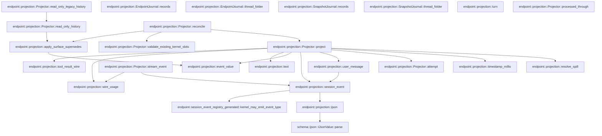
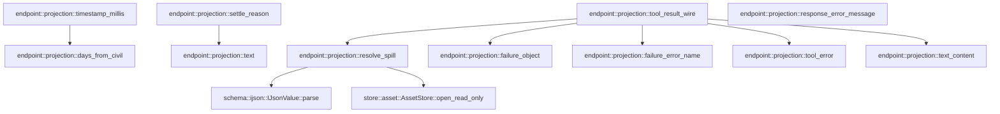

# endpoint::projection

[Package atlas](index.md) · [Source](../../src/projection.rs)

## Declarations

Visibility is the declaration spelling; trait members and reexports require their enclosing interface. `cfg` is not evaluated.

| Symbol | Kind | Visibility | Test / cfg |
|---|---|---|---|
| [endpoint::projection::ProjectionRead](../../src/projection.rs#L13) | trait_item | `private` |  |
| [endpoint::projection::ProjectionRead::records](../../src/projection.rs#L14) | function_signature_item | `private` |  |
| [endpoint::projection::ProjectionRead::thread_folder](../../src/projection.rs#L15) | function_signature_item | `private` |  |
| [endpoint::projection::EndpointJournal::records](../../src/projection.rs#L18) | function_item | `private` |  |
| [endpoint::projection::EndpointJournal::thread_folder](../../src/projection.rs#L21) | function_item | `private` |  |
| [endpoint::projection::SnapshotJournal](../../src/projection.rs#L25) | struct_item | `private` |  |
| [endpoint::projection::SnapshotJournal::records](../../src/projection.rs#L30) | function_item | `private` |  |
| [endpoint::projection::SnapshotJournal::thread_folder](../../src/projection.rs#L33) | function_item | `private` |  |
| [endpoint::projection::AttemptInfo](../../src/projection.rs#L39) | struct_item | `private` |  |
| [endpoint::projection::EpochInfo](../../src/projection.rs#L47) | struct_item | `private` |  |
| [endpoint::projection::Projector](../../src/projection.rs#L53) | struct_item | `pub` |  |
| [endpoint::projection::AcceptedStreamFrame](../../src/projection.rs#L76) | struct_item | `pub` |  |
| [endpoint::projection::Projector::processed_through](../../src/projection.rs#L93) | function_item | `pub` |  |
| [endpoint::projection::Projector::reconcile](../../src/projection.rs#L97) | function_item | `pub` |  |
| [endpoint::projection::Projector::read_only_history](../../src/projection.rs#L135) | function_item | `pub` |  |
| [endpoint::projection::Projector::read_only_legacy_history](../../src/projection.rs#L185) | function_item | `pub` |  |
| [endpoint::projection::Projector::stream_event](../../src/projection.rs#L195) | function_item | `pub` |  |
| [endpoint::projection::Projector::project](../../src/projection.rs#L256) | function_item | `private` |  |
| [endpoint::projection::Projector::attempt](../../src/projection.rs#L657) | function_item | `private` |  |
| [endpoint::projection::Projector::validate_existing_kernel_slots](../../src/projection.rs#L663) | function_item | `private` |  |
| [endpoint::projection::Projected](../../src/projection.rs#L685) | type_item | `private` |  |
| [endpoint::projection::user_message](../../src/projection.rs#L687) | function_item | `private` |  |
| [endpoint::projection::apply_surface_supersedes](../../src/projection.rs#L711) | function_item | `private` |  |
| [endpoint::projection::session_event](../../src/projection.rs#L763) | function_item | `private` |  |
| [endpoint::projection::event_value](../../src/projection.rs#L785) | function_item | `private` |  |
| [endpoint::projection::ijson](../../src/projection.rs#L789) | function_item | `private` |  |
| [endpoint::projection::text](../../src/projection.rs#L794) | function_item | `private` |  |
| [endpoint::projection::turn](../../src/projection.rs#L801) | function_item | `private` |  |
| [endpoint::projection::wire_usage](../../src/projection.rs#L805) | function_item | `private` |  |
| [endpoint::projection::reasoning_usage_projection_tests::reasoning_usage_preserves_zero_missing_and_wire_integer_boundary](../../src/projection.rs#L832) | function_item | `private` | test; #[cfg(test)] |
| [endpoint::projection::tool_result_wire](../../src/projection.rs#L846) | function_item | `private` |  |
| [endpoint::projection::failure_object](../../src/projection.rs#L941) | function_item | `private` |  |
| [endpoint::projection::failure_error_name](../../src/projection.rs#L972) | function_item | `private` |  |
| [endpoint::projection::tool_error](../../src/projection.rs#L985) | function_item | `private` |  |
| [endpoint::projection::text_content](../../src/projection.rs#L989) | function_item | `private` |  |
| [endpoint::projection::response_error_message](../../src/projection.rs#L993) | function_item | `private` |  |
| [endpoint::projection::resolve_spill](../../src/projection.rs#L1008) | function_item | `private` |  |
| [endpoint::projection::settle_reason](../../src/projection.rs#L1033) | function_item | `private` |  |
| [endpoint::projection::timestamp_millis](../../src/projection.rs#L1047) | function_item | `pub(crate)` |  |
| [endpoint::projection::days_from_civil](../../src/projection.rs#L1083) | function_item | `private` |  |
| [endpoint::projection::ProjectionError](../../src/projection.rs#L1094) | enum_item | `pub` |  |
| [endpoint::projection::tests::stream_usage_keeps_partial_reports_in_the_transient_lane](../../src/projection.rs#L1148) | function_item | `private` | test; #[cfg(test)] |
| [endpoint::projection::tests::ordinary_extension_cannot_smuggle_a_legacy_usage_record_into_projection](../../src/projection.rs#L1180) | function_item | `private` | test; #[cfg(test)] |
| [endpoint::projection::tests::legacy_history_projection_attaches_separate_usage_to_the_assistant_message](../../src/projection.rs#L1214) | function_item | `private` | test; #[cfg(test)] |
| [endpoint::projection::tests::user_message_projects_file_blocks_and_keeps_images_verbatim](../../src/projection.rs#L1269) | function_item | `private` | test; #[cfg(test)] |
| [endpoint::projection::tests::durable_reasoning_folds_into_its_attempts_assistant_message](../../src/projection.rs#L1292) | function_item | `private` | test; #[cfg(test)] |
| [endpoint::projection::tests::worker_final_and_validation_feedback_do_not_end_the_client_turn](../../src/projection.rs#L1351) | function_item | `private` | test; #[cfg(test)] |
| [endpoint::projection::tests::direct_final_settlement_promotes_the_exact_output_without_a_review_outcome](../../src/projection.rs#L1388) | function_item | `private` | test; #[cfg(test)] |
| [endpoint::projection::tests::session_notice_meta_projects_as_a_turn_independent_surface_event](../../src/projection.rs#L1431) | function_item | `private` | test; #[cfg(test)] |
| [endpoint::projection::tests::trim_of_closed_prior_turn_tool_result_keeps_original_surface_step](../../src/projection.rs#L1470) | function_item | `private` | test; #[cfg(test)] |
| [endpoint::projection::tests::kernel_producer_rejects_dsh_private_state_events](../../src/projection.rs#L1505) | function_item | `private` | test; #[cfg(test)] |
| [endpoint::projection::tests::provider_error_projects_as_turn_scoped_transcript_surface](../../src/projection.rs#L1520) | function_item | `private` | test; #[cfg(test)] |
| [endpoint::projection::tests::a_failed_effect_reports_its_message_and_its_own_code](../../src/projection.rs#L1550) | function_item | `private` | test; #[cfg(test)] |
| [endpoint::projection::tests::non_success_tool_results_have_closed_wire_shapes_and_spills_resolve](../../src/projection.rs#L1605) | function_item | `private` | test; #[cfg(test)] |

## Imports / reexports

| Local name | Source path | Visibility |
|---|---|---|
| `BTreeMap` | `std::collections::BTreeMap` | `private` |
| `BTreeSet` | `std::collections::BTreeSet` | `private` |
| `HashMap` | `std::collections::HashMap` | `private` |
| `HashSet` | `std::collections::HashSet` | `private` |
| `Event` | `schema::Event` | `private` |
| `EventKind` | `schema::EventKind` | `private` |
| `IJsonValue` | `schema::IJsonValue` | `private` |
| `Map` | `serde_json::Map` | `private` |
| `Value` | `serde_json::Value` | `private` |
| `json` | `serde_json::json` | `private` |
| `Error` | `thiserror::Error` | `private` |
| `kernel_may_emit_event_type` | `crate::session_event_registry_generated::kernel_may_emit_event_type` | `private` |
| `EndpointJournal` | `crate::EndpointJournal` | `private` |
| `JournalError` | `crate::JournalError` | `private` |
| `SessionEvent` | `crate::SessionEvent` | `private` |
| `SurfaceOperation` | `crate::SurfaceOperation` | `private` |
| `AssetStore` | `store::AssetStore` | `private` |
| `*` | `super::*` | `private` |
| `AssetStore` | `store::AssetStore` | `private` |
| `*` | `super::*` | `private` |

## Module declarations

| Module | Visibility | Attributes |
|---|---|---|
| `endpoint::projection::reasoning_usage_projection_tests` | `private` | #[cfg(test)] |
| `endpoint::projection::tests` | `private` | #[cfg(test)] |

## Function call graphs

Edges below are syntactically resolved calls only, including private functions. Graphs partition callers into groups of 20; they are not execution order. All unresolved sites are listed below and in the JSON inventory.

Functions 1–20: 21 direct edges

Functions 21–30: 9 direct edges

## Call sites

Includes test functions (marked in declarations). Receiver-type-required sites need type analysis/manual tracing. Calls in closures are attributed to their enclosing function; their occurrence here does not mean the closure executes immediately.

| Caller | Callee expression | Source lines | Target / classification |
|---|---|---|---|
| `records` | `self.records` | [19](../../src/projection.rs#L19) | receiver-type-required |
| `thread_folder` | `self.thread_folder` | [22](../../src/projection.rs#L22) | receiver-type-required |
| `records` | `Ok` | [31](../../src/projection.rs#L31) | external-constructor-callback-or-unresolved |
| `records` | `self.rows.clone` | [31](../../src/projection.rs#L31) | receiver-type-required |
| `reconcile` | `events.iter().find` | [102](../../src/projection.rs#L102) | receiver-type-required |
| `reconcile` | `events.iter` | [102](../../src/projection.rs#L102) | receiver-type-required |
| `reconcile` | `event.is_historical_only` | [102](../../src/projection.rs#L102) | receiver-type-required |
| `reconcile` | `Err` | [103](../../src/projection.rs#L103) | external-constructor-callback-or-unresolved |
| `reconcile` | `ProjectionError::HistoricalOnlyEvent` | [103](../../src/projection.rs#L103) | external-constructor-callback-or-unresolved |
| `reconcile` | `event.seq` | [103](../../src/projection.rs#L103), [126](../../src/projection.rs#L126) | receiver-type-required |
| `reconcile` | `Vec::new` | [105](../../src/projection.rs#L105) | external-constructor-callback-or-unresolved |
| `reconcile` | `self.project` | [107](../../src/projection.rs#L107) | [endpoint::projection::Projector::project](../../src/projection.rs#L256) |
| `reconcile` | `apply_surface_supersedes` | [109](../../src/projection.rs#L109) | [endpoint::projection::apply_surface_supersedes](../../src/projection.rs#L711) |
| `reconcile` | `kernel_seqs                     .last()                     .ok_or` | [110](../../src/projection.rs#L110) | receiver-type-required |
| `reconcile` | `kernel_seqs                     .last` | [110](../../src/projection.rs#L110) | receiver-type-required |
| `reconcile` | `ProjectionError::InvalidField` | [112](../../src/projection.rs#L112) | external-constructor-callback-or-unresolved |
| `reconcile` | `self.expected_kernel_slots.insert` | [113](../../src/projection.rs#L113) | receiver-type-required |
| `reconcile` | `slot.clone` | [113](../../src/projection.rs#L113) | receiver-type-required |
| `reconcile` | `appended.extend` | [115](../../src/projection.rs#L115) | receiver-type-required |
| `reconcile` | `journal.append_kernel_batch` | [115](../../src/projection.rs#L115) | receiver-type-required |
| `reconcile` | `event.has_field` | [117](../../src/projection.rs#L117) | receiver-type-required |
| `reconcile` | `event                     .string_field("attempt")                     .ok_or` | [119](../../src/projection.rs#L119) | receiver-type-required |
| `reconcile` | `event                     .string_field` | [119](../../src/projection.rs#L119) | receiver-type-required |
| `reconcile` | `ProjectionError::MissingField` | [121](../../src/projection.rs#L121) | external-constructor-callback-or-unresolved |
| `reconcile` | `self.terminal_attempts.insert` | [122](../../src/projection.rs#L122) | receiver-type-required |
| `reconcile` | `attempt.to_owned` | [122](../../src/projection.rs#L122) | receiver-type-required |
| `reconcile` | `Some` | [124](../../src/projection.rs#L124) | external-constructor-callback-or-unresolved |
| `reconcile` | `self.processed_through                     .map_or` | [125](../../src/projection.rs#L125) | receiver-type-required |
| `reconcile` | `seq.max` | [126](../../src/projection.rs#L126) | receiver-type-required |
| `reconcile` | `self.validate_existing_kernel_slots` | [129](../../src/projection.rs#L129) | [endpoint::projection::Projector::validate_existing_kernel_slots](../../src/projection.rs#L663) |
| `reconcile` | `Ok` | [130](../../src/projection.rs#L130) | external-constructor-callback-or-unresolved |
| `read_only_history` | `Self::default` | [139](../../src/projection.rs#L139) | external-constructor-callback-or-unresolved |
| `read_only_history` | `folder.to_path_buf` | [141](../../src/projection.rs#L141) | receiver-type-required |
| `read_only_history` | `projector.project` | [145](../../src/projection.rs#L145) | receiver-type-required |
| `read_only_history` | `Vec::new` | [146](../../src/projection.rs#L146) | external-constructor-callback-or-unresolved |
| `read_only_history` | `apply_surface_supersedes` | [148](../../src/projection.rs#L148) | [endpoint::projection::apply_surface_supersedes](../../src/projection.rs#L711) |
| `read_only_history` | `kernel_seqs                     .last()                     .ok_or` | [149](../../src/projection.rs#L149) | receiver-type-required |
| `read_only_history` | `kernel_seqs                     .last` | [149](../../src/projection.rs#L149) | receiver-type-required |
| `read_only_history` | `ProjectionError::InvalidField` | [151](../../src/projection.rs#L151) | external-constructor-callback-or-unresolved |
| `read_only_history` | `projector                     .expected_kernel_slots                     .insert` | [152](../../src/projection.rs#L152) | receiver-type-required |
| `read_only_history` | `slot.clone` | [154](../../src/projection.rs#L154) | receiver-type-required |
| `read_only_history` | `journal.rows.len` | [155](../../src/projection.rs#L155) | receiver-type-required |
| `read_only_history` | `rows.len` | [155](../../src/projection.rs#L155) | receiver-type-required |
| `read_only_history` | `row.validate` | [162](../../src/projection.rs#L162) | receiver-type-required |
| `read_only_history` | `rows.push` | [163](../../src/projection.rs#L163) | receiver-type-required |
| `read_only_history` | `journal.rows.extend` | [165](../../src/projection.rs#L165) | receiver-type-required |
| `read_only_history` | `event.has_field` | [167](../../src/projection.rs#L167) | receiver-type-required |
| `read_only_history` | `projector.terminal_attempts.insert` | [169](../../src/projection.rs#L169) | receiver-type-required |
| `read_only_history` | `event                         .string_field("attempt")                         .ok_or(ProjectionError::MissingField("attempt"))?                         .to_owned` | [170](../../src/projection.rs#L170) | receiver-type-required |
| `read_only_history` | `event                         .string_field("attempt")                         .ok_or` | [170](../../src/projection.rs#L170) | receiver-type-required |
| `read_only_history` | `event                         .string_field` | [170](../../src/projection.rs#L170) | receiver-type-required |
| `read_only_history` | `ProjectionError::MissingField` | [172](../../src/projection.rs#L172) | external-constructor-callback-or-unresolved |
| `read_only_history` | `Some` | [176](../../src/projection.rs#L176) | external-constructor-callback-or-unresolved |
| `read_only_history` | `event.seq` | [176](../../src/projection.rs#L176) | receiver-type-required |
| `read_only_history` | `projector.validate_existing_kernel_slots` | [178](../../src/projection.rs#L178) | receiver-type-required |
| `read_only_history` | `Ok` | [179](../../src/projection.rs#L179) | external-constructor-callback-or-unresolved |
| `read_only_legacy_history` | `Self::read_only_history` | [189](../../src/projection.rs#L189) | [endpoint::projection::Projector::read_only_history](../../src/projection.rs#L135) |
| `read_only_legacy_history` | `ledger.events` | [189](../../src/projection.rs#L189) | receiver-type-required |
| `stream_event` | `self.terminal_attempts.contains` | [199](../../src/projection.rs#L199) | receiver-type-required |
| `stream_event` | `Err` | [200](../../src/projection.rs#L200), [211](../../src/projection.rs#L211), [216](../../src/projection.rs#L216), [243](../../src/projection.rs#L243) | external-constructor-callback-or-unresolved |
| `stream_event` | `ProjectionError::TerminalAttempt` | [200](../../src/projection.rs#L200) | external-constructor-callback-or-unresolved |
| `stream_event` | `frame.attempt.clone` | [200](../../src/projection.rs#L200), [205](../../src/projection.rs#L205) | receiver-type-required |
| `stream_event` | `self             .attempts             .get(&frame.attempt)             .ok_or_else` | [202](../../src/projection.rs#L202) | receiver-type-required |
| `stream_event` | `self             .attempts             .get` | [202](../../src/projection.rs#L202) | receiver-type-required |
| `stream_event` | `ProjectionError::UnknownAttempt` | [205](../../src/projection.rs#L205) | external-constructor-callback-or-unresolved |
| `stream_event` | `frame.channel.as_str` | [206](../../src/projection.rs#L206) | receiver-type-required |
| `stream_event` | `ProjectionError::StreamChannel` | [211](../../src/projection.rs#L211) | external-constructor-callback-or-unresolved |
| `stream_event` | `other.to_owned` | [211](../../src/projection.rs#L211) | receiver-type-required |
| `stream_event` | `frame.call_id.is_some` | [214](../../src/projection.rs#L214), [241](../../src/projection.rs#L241) | receiver-type-required |
| `stream_event` | `frame.name.is_some` | [214](../../src/projection.rs#L214), [241](../../src/projection.rs#L241) | receiver-type-required |
| `stream_event` | `frame.arguments_complete.is_some` | [214](../../src/projection.rs#L214), [241](../../src/projection.rs#L241) | receiver-type-required |
| `stream_event` | `ProjectionError::InvalidField` | [216](../../src/projection.rs#L216), [219](../../src/projection.rs#L219), [243](../../src/projection.rs#L243) | external-constructor-callback-or-unresolved |
| `stream_event` | `serde_json::from_str(&frame.delta)                 .map_err` | [218](../../src/projection.rs#L218) | receiver-type-required |
| `stream_event` | `serde_json::from_str` | [218](../../src/projection.rs#L218) | external-constructor-callback-or-unresolved |
| `stream_event` | `wire_usage` | [220](../../src/projection.rs#L220) | [endpoint::projection::wire_usage](../../src/projection.rs#L805) |
| `stream_event` | `frame                 .call_id                 .as_deref()                 .ok_or` | [223](../../src/projection.rs#L223) | receiver-type-required |
| `stream_event` | `frame                 .call_id                 .as_deref` | [223](../../src/projection.rs#L223) | receiver-type-required |
| `stream_event` | `ProjectionError::MissingField` | [226](../../src/projection.rs#L226) | external-constructor-callback-or-unresolved |
| `stream_event` | `Map::new` | [227](../../src/projection.rs#L227) | external-constructor-callback-or-unresolved |
| `stream_event` | `chunk.insert` | [228](../../src/projection.rs#L228), [229](../../src/projection.rs#L229), [230](../../src/projection.rs#L230), [231](../../src/projection.rs#L231), [232](../../src/projection.rs#L232), [234](../../src/projection.rs#L234), [237](../../src/projection.rs#L237) | receiver-type-required |
| `stream_event` | `"type".to_owned` | [228](../../src/projection.rs#L228) | receiver-type-required |
| `stream_event` | `"index".to_owned` | [229](../../src/projection.rs#L229) | receiver-type-required |
| `stream_event` | `"id".to_owned` | [230](../../src/projection.rs#L230) | receiver-type-required |
| `stream_event` | `"argumentsDelta".to_owned` | [231](../../src/projection.rs#L231) | receiver-type-required |
| `stream_event` | `"assistantFrameId".to_owned` | [232](../../src/projection.rs#L232) | receiver-type-required |
| `stream_event` | `"argumentsComplete".to_owned` | [234](../../src/projection.rs#L234) | receiver-type-required |
| `stream_event` | `"name".to_owned` | [237](../../src/projection.rs#L237) | receiver-type-required |
| `stream_event` | `session_event` | [251](../../src/projection.rs#L251) | [endpoint::projection::session_event](../../src/projection.rs#L763) |
| `stream_event` | `Ok` | [253](../../src/projection.rs#L253) | external-constructor-callback-or-unresolved |
| `project` | `event_value` | [261](../../src/projection.rs#L261) | [endpoint::projection::event_value](../../src/projection.rs#L785) |
| `project` | `timestamp_millis` | [262](../../src/projection.rs#L262) | [endpoint::projection::timestamp_millis](../../src/projection.rs#L1047) |
| `project` | `value                 .get("ts")                 .and_then(Value::as_str)                 .ok_or` | [263](../../src/projection.rs#L263) | receiver-type-required |
| `project` | `value                 .get("ts")                 .and_then` | [263](../../src/projection.rs#L263) | receiver-type-required |
| `project` | `value                 .get` | [263](../../src/projection.rs#L263) | receiver-type-required |
| `project` | `ProjectionError::MissingField` | [266](../../src/projection.rs#L266), [393](../../src/projection.rs#L393), [465](../../src/projection.rs#L465), [618](../../src/projection.rs#L618) | external-constructor-callback-or-unresolved |
| `project` | `Vec::new` | [268](../../src/projection.rs#L268) | external-constructor-callback-or-unresolved |
| `project` | `event.kind` | [269](../../src/projection.rs#L269) | receiver-type-required |
| `project` | `event.is_historical_only` | [271](../../src/projection.rs#L271) | receiver-type-required |
| `project` | `Err` | [272](../../src/projection.rs#L272), [578](../../src/projection.rs#L578), [590](../../src/projection.rs#L590), [622](../../src/projection.rs#L622) | external-constructor-callback-or-unresolved |
| `project` | `ProjectionError::StandaloneUsageEvent` | [272](../../src/projection.rs#L272) | external-constructor-callback-or-unresolved |
| `project` | `event.seq` | [272](../../src/projection.rs#L272), [278](../../src/projection.rs#L278), [343](../../src/projection.rs#L343), [418](../../src/projection.rs#L418), [507](../../src/projection.rs#L507) | receiver-type-required |
| `project` | `self.historical_usage                     .insert` | [274](../../src/projection.rs#L274) | receiver-type-required |
| `project` | `text(&value, "attempt")?.to_owned` | [275](../../src/projection.rs#L275), [321](../../src/projection.rs#L321) | receiver-type-required |
| `project` | `text` | [275](../../src/projection.rs#L275), [281](../../src/projection.rs#L281), [285](../../src/projection.rs#L285), [286](../../src/projection.rs#L286), [321](../../src/projection.rs#L321), [342](../../src/projection.rs#L342), [389](../../src/projection.rs#L389), [404](../../src/projection.rs#L404), [460](../../src/projection.rs#L460), [486](../../src/projection.rs#L486), [534](../../src/projection.rs#L534) | [endpoint::projection::text](../../src/projection.rs#L794) |
| `project` | `self.inputs.insert` | [278](../../src/projection.rs#L278) | receiver-type-required |
| `project` | `text(&value, "id")?.to_owned` | [281](../../src/projection.rs#L281) | receiver-type-required |
| `project` | `self.epochs.insert` | [282](../../src/projection.rs#L282) | receiver-type-required |
| `project` | `text(&value, "adapter")?.to_owned` | [285](../../src/projection.rs#L285) | receiver-type-required |
| `project` | `text(&value, "model")?.to_owned` | [286](../../src/projection.rs#L286) | receiver-type-required |
| `project` | `turn` | [291](../../src/projection.rs#L291), [320](../../src/projection.rs#L320), [487](../../src/projection.rs#L487), [533](../../src/projection.rs#L533), [554](../../src/projection.rs#L554) | external-constructor-callback-or-unresolved |
| `project` | `output.push` | [292](../../src/projection.rs#L292), [312](../../src/projection.rs#L312), [323](../../src/projection.rs#L323), [347](../../src/projection.rs#L347), [379](../../src/projection.rs#L379), [453](../../src/projection.rs#L453), [468](../../src/projection.rs#L468), [526](../../src/projection.rs#L526), [536](../../src/projection.rs#L536), [556](../../src/projection.rs#L556), [603](../../src/projection.rs#L603), [624](../../src/projection.rs#L624), [641](../../src/projection.rs#L641) | receiver-type-required |
| `project` | `"turn-start".to_owned` | [294](../../src/projection.rs#L294) | receiver-type-required |
| `project` | `session_event` | [295](../../src/projection.rs#L295), [326](../../src/projection.rs#L326), [350](../../src/projection.rs#L350), [456](../../src/projection.rs#L456), [471](../../src/projection.rs#L471), [529](../../src/projection.rs#L529), [539](../../src/projection.rs#L539), [559](../../src/projection.rs#L559), [606](../../src/projection.rs#L606), [627](../../src/projection.rs#L627), [644](../../src/projection.rs#L644) | [endpoint::projection::session_event](../../src/projection.rs#L763) |
| `project` | `value                     .get("trigger")                     .and_then(Value::as_object)                     .and_then(&#124;trigger&#124; trigger.get("inputs"))                     .and_then(Value::as_array)                     .cloned()                     .unwrap_or_default` | [297](../../src/projection.rs#L297) | receiver-type-required |
| `project` | `value                     .get("trigger")                     .and_then(Value::as_object)                     .and_then(&#124;trigger&#124; trigger.get("inputs"))                     .and_then(Value::as_array)                     .cloned` | [297](../../src/projection.rs#L297) | receiver-type-required |
| `project` | `value                     .get("trigger")                     .and_then(Value::as_object)                     .and_then(&#124;trigger&#124; trigger.get("inputs"))                     .and_then` | [297](../../src/projection.rs#L297) | receiver-type-required |
| `project` | `value                     .get("trigger")                     .and_then(Value::as_object)                     .and_then` | [297](../../src/projection.rs#L297) | receiver-type-required |
| `project` | `value                     .get("trigger")                     .and_then` | [297](../../src/projection.rs#L297) | receiver-type-required |
| `project` | `value                     .get` | [297](../../src/projection.rs#L297), [358](../../src/projection.rs#L358), [446](../../src/projection.rs#L446), [610](../../src/projection.rs#L610) | receiver-type-required |
| `project` | `trigger.get` | [300](../../src/projection.rs#L300) | receiver-type-required |
| `project` | `input_seqs.into_iter().enumerate` | [304](../../src/projection.rs#L304) | receiver-type-required |
| `project` | `input_seqs.into_iter` | [304](../../src/projection.rs#L304) | receiver-type-required |
| `project` | `input_seq                         .as_u64()                         .ok_or` | [305](../../src/projection.rs#L305) | receiver-type-required |
| `project` | `input_seq                         .as_u64` | [305](../../src/projection.rs#L305) | receiver-type-required |
| `project` | `ProjectionError::InvalidField` | [307](../../src/projection.rs#L307), [367](../../src/projection.rs#L367), [371](../../src/projection.rs#L371), [572](../../src/projection.rs#L572), [576](../../src/projection.rs#L576), [578](../../src/projection.rs#L578), [588](../../src/projection.rs#L588), [590](../../src/projection.rs#L590), [599](../../src/projection.rs#L599), [613](../../src/projection.rs#L613), [622](../../src/projection.rs#L622) | external-constructor-callback-or-unresolved |
| `project` | `self                         .inputs                         .get(&input_seq)                         .ok_or` | [308](../../src/projection.rs#L308) | receiver-type-required |
| `project` | `self                         .inputs                         .get` | [308](../../src/projection.rs#L308) | receiver-type-required |
| `project` | `ProjectionError::UnknownInput` | [311](../../src/projection.rs#L311) | external-constructor-callback-or-unresolved |
| `project` | `user_message` | [315](../../src/projection.rs#L315), [382](../../src/projection.rs#L382) | [endpoint::projection::user_message](../../src/projection.rs#L687) |
| `project` | `self.open_steps.remove` | [322](../../src/projection.rs#L322), [555](../../src/projection.rs#L555) | receiver-type-required |
| `project` | `self                     .attempts                     .values()                     .filter(&#124;info&#124; info.turn == turn)                     .count` | [334](../../src/projection.rs#L334) | receiver-type-required |
| `project` | `self                     .attempts                     .values()                     .filter` | [334](../../src/projection.rs#L334) | receiver-type-required |
| `project` | `self                     .attempts                     .values` | [334](../../src/projection.rs#L334) | receiver-type-required |
| `project` | `text(&value, "epoch")?.to_owned` | [342](../../src/projection.rs#L342) | receiver-type-required |
| `project` | `self.attempts.insert` | [345](../../src/projection.rs#L345) | receiver-type-required |
| `project` | `attempt.clone` | [345](../../src/projection.rs#L345) | receiver-type-required |
| `project` | `info.clone` | [345](../../src/projection.rs#L345) | receiver-type-required |
| `project` | `self.open_steps.insert` | [346](../../src/projection.rs#L346) | receiver-type-required |
| `project` | `"step-start".to_owned` | [349](../../src/projection.rs#L349) | receiver-type-required |
| `project` | `value                     .get("admits")                     .and_then(Value::as_array)                     .into_iter()                     .flatten` | [358](../../src/projection.rs#L358) | receiver-type-required |
| `project` | `value                     .get("admits")                     .and_then(Value::as_array)                     .into_iter` | [358](../../src/projection.rs#L358) | receiver-type-required |
| `project` | `value                     .get("admits")                     .and_then` | [358](../../src/projection.rs#L358) | receiver-type-required |
| `project` | `range                         .get("from")                         .and_then(Value::as_u64)                         .ok_or` | [364](../../src/projection.rs#L364) | receiver-type-required |
| `project` | `range                         .get("from")                         .and_then` | [364](../../src/projection.rs#L364) | receiver-type-required |
| `project` | `range                         .get` | [364](../../src/projection.rs#L364), [368](../../src/projection.rs#L368) | receiver-type-required |
| `project` | `range                         .get("to")                         .and_then(Value::as_u64)                         .ok_or` | [368](../../src/projection.rs#L368) | receiver-type-required |
| `project` | `range                         .get("to")                         .and_then` | [368](../../src/projection.rs#L368) | receiver-type-required |
| `project` | `self.inputs.get` | [373](../../src/projection.rs#L373) | receiver-type-required |
| `project` | `input.get("steer").and_then` | [376](../../src/projection.rs#L376) | receiver-type-required |
| `project` | `input.get` | [376](../../src/projection.rs#L376) | receiver-type-required |
| `project` | `Some` | [376](../../src/projection.rs#L376), [416](../../src/projection.rs#L416), [594](../../src/projection.rs#L594) | external-constructor-callback-or-unresolved |
| `project` | `self.seen_steers.insert` | [377](../../src/projection.rs#L377) | receiver-type-required |
| `project` | `resolve_spill` | [390](../../src/projection.rs#L390), [462](../../src/projection.rs#L462) | [endpoint::projection::resolve_spill](../../src/projection.rs#L1008) |
| `project` | `value                         .get("content")                         .ok_or` | [391](../../src/projection.rs#L391) | receiver-type-required |
| `project` | `value                         .get` | [391](../../src/projection.rs#L391), [463](../../src/projection.rs#L463), [489](../../src/projection.rs#L489) | receiver-type-required |
| `project` | `content.as_str().filter` | [396](../../src/projection.rs#L396) | receiver-type-required |
| `project` | `content.as_str` | [396](../../src/projection.rs#L396) | receiver-type-required |
| `project` | `text.is_empty` | [396](../../src/projection.rs#L396) | receiver-type-required |
| `project` | `self.reasoning                         .entry(attempt.to_owned())                         .or_default()                         .push` | [397](../../src/projection.rs#L397) | receiver-type-required |
| `project` | `self.reasoning                         .entry(attempt.to_owned())                         .or_default` | [397](../../src/projection.rs#L397) | receiver-type-required |
| `project` | `self.reasoning                         .entry` | [397](../../src/projection.rs#L397) | receiver-type-required |
| `project` | `attempt.to_owned` | [398](../../src/projection.rs#L398) | receiver-type-required |
| `project` | `text.to_owned` | [400](../../src/projection.rs#L400) | receiver-type-required |
| `project` | `self.attempt(attempt)?.clone` | [405](../../src/projection.rs#L405) | receiver-type-required |
| `project` | `self.attempt` | [405](../../src/projection.rs#L405), [461](../../src/projection.rs#L461) | [endpoint::projection::Projector::attempt](../../src/projection.rs#L657) |
| `project` | `self                     .epochs                     .get(&info.epoch)                     .ok_or_else` | [406](../../src/projection.rs#L406) | receiver-type-required |
| `project` | `self                     .epochs                     .get` | [406](../../src/projection.rs#L406) | receiver-type-required |
| `project` | `ProjectionError::UnknownEpoch` | [409](../../src/projection.rs#L409) | external-constructor-callback-or-unresolved |
| `project` | `info.epoch.clone` | [409](../../src/projection.rs#L409) | receiver-type-required |
| `project` | `Map::new` | [410](../../src/projection.rs#L410), [420](../../src/projection.rs#L420) | external-constructor-callback-or-unresolved |
| `project` | `data.insert` | [411](../../src/projection.rs#L411), [412](../../src/projection.rs#L412), [414](../../src/projection.rs#L414), [437](../../src/projection.rs#L437), [451](../../src/projection.rs#L451) | receiver-type-required |
| `project` | `"turn".to_owned` | [411](../../src/projection.rs#L411) | receiver-type-required |
| `project` | `"step".to_owned` | [412](../../src/projection.rs#L412) | receiver-type-required |
| `project` | `value.get` | [413](../../src/projection.rs#L413), [416](../../src/projection.rs#L416), [424](../../src/projection.rs#L424), [434](../../src/projection.rs#L434), [535](../../src/projection.rs#L535), [568](../../src/projection.rs#L568), [583](../../src/projection.rs#L583), [594](../../src/projection.rs#L594), [609](../../src/projection.rs#L609), [640](../../src/projection.rs#L640) | receiver-type-required |
| `project` | `"sessionFinal".to_owned` | [414](../../src/projection.rs#L414) | receiver-type-required |
| `project` | `final_answer.clone` | [414](../../src/projection.rs#L414) | receiver-type-required |
| `project` | `value.get("final_answer").and_then` | [416](../../src/projection.rs#L416) | receiver-type-required |
| `project` | `self.outputs                         .insert` | [417](../../src/projection.rs#L417) | receiver-type-required |
| `project` | `source.insert` | [421](../../src/projection.rs#L421), [422](../../src/projection.rs#L422), [423](../../src/projection.rs#L423), [425](../../src/projection.rs#L425) | receiver-type-required |
| `project` | `"kind".to_owned` | [421](../../src/projection.rs#L421) | receiver-type-required |
| `project` | `"provider".to_owned` | [422](../../src/projection.rs#L422) | receiver-type-required |
| `project` | `"model".to_owned` | [423](../../src/projection.rs#L423) | receiver-type-required |
| `project` | `"replayState".to_owned` | [425](../../src/projection.rs#L425) | receiver-type-required |
| `project` | `continuation.clone` | [425](../../src/projection.rs#L425) | receiver-type-required |
| `project` | `self                     .reasoning                     .remove(attempt)                     .unwrap_or_default()                     .into_iter()                     .map(&#124;text&#124; json!({"type": "reasoning", "text": text}))                     .collect::<Vec<_>>` | [427](../../src/projection.rs#L427) | receiver-type-required |
| `project` | `self                     .reasoning                     .remove(attempt)                     .unwrap_or_default()                     .into_iter()                     .map` | [427](../../src/projection.rs#L427) | receiver-type-required |
| `project` | `self                     .reasoning                     .remove(attempt)                     .unwrap_or_default()                     .into_iter` | [427](../../src/projection.rs#L427) | receiver-type-required |
| `project` | `self                     .reasoning                     .remove(attempt)                     .unwrap_or_default` | [427](../../src/projection.rs#L427) | receiver-type-required |
| `project` | `self                     .reasoning                     .remove` | [427](../../src/projection.rs#L427) | receiver-type-required |
| `project` | `value.get("content").and_then` | [434](../../src/projection.rs#L434) | receiver-type-required |
| `project` | `content.extend` | [435](../../src/projection.rs#L435) | receiver-type-required |
| `project` | `blocks.iter().cloned` | [435](../../src/projection.rs#L435) | receiver-type-required |
| `project` | `blocks.iter` | [435](../../src/projection.rs#L435) | receiver-type-required |
| `project` | `"message".to_owned` | [438](../../src/projection.rs#L438) | receiver-type-required |
| `project` | `value                     .get("usage")                     .cloned()                     .or_else` | [446](../../src/projection.rs#L446) | receiver-type-required |
| `project` | `value                     .get("usage")                     .cloned` | [446](../../src/projection.rs#L446) | receiver-type-required |
| `project` | `self.historical_usage.remove` | [449](../../src/projection.rs#L449) | receiver-type-required |
| `project` | `usage.as_ref` | [450](../../src/projection.rs#L450) | receiver-type-required |
| `project` | `"usage".to_owned` | [451](../../src/projection.rs#L451) | receiver-type-required |
| `project` | `wire_usage` | [451](../../src/projection.rs#L451) | [endpoint::projection::wire_usage](../../src/projection.rs#L805) |
| `project` | `"assistant-message".to_owned` | [455](../../src/projection.rs#L455) | receiver-type-required |
| `project` | `Value::Object` | [456](../../src/projection.rs#L456) | external-constructor-callback-or-unresolved |
| `project` | `value                         .get("args")                         .ok_or` | [463](../../src/projection.rs#L463) | receiver-type-required |
| `project` | `"tool-call".to_owned` | [470](../../src/projection.rs#L470) | receiver-type-required |
| `project` | `value                         .get("supersedes")                         .and_then(Value::as_array)                         .and_then` | [489](../../src/projection.rs#L489) | receiver-type-required |
| `project` | `value                         .get("supersedes")                         .and_then` | [489](../../src/projection.rs#L489) | receiver-type-required |
| `project` | `ranges.iter().find_map` | [493](../../src/projection.rs#L493) | receiver-type-required |
| `project` | `ranges.iter` | [493](../../src/projection.rs#L493) | receiver-type-required |
| `project` | `range.get("from")?.as_u64` | [494](../../src/projection.rs#L494) | receiver-type-required |
| `project` | `range.get` | [494](../../src/projection.rs#L494), [495](../../src/projection.rs#L495) | receiver-type-required |
| `project` | `range.get("to")?.as_u64` | [495](../../src/projection.rs#L495) | receiver-type-required |
| `project` | `self.tool_result_steps                                     .range(from..=to)                                     .next()                                     .map` | [496](../../src/projection.rs#L496) | receiver-type-required |
| `project` | `self.tool_result_steps                                     .range(from..=to)                                     .next` | [496](../../src/projection.rs#L496) | receiver-type-required |
| `project` | `self.tool_result_steps                                     .range` | [496](../../src/projection.rs#L496) | receiver-type-required |
| `project` | `replaced_step                     .or_else(&#124;&#124; self.open_steps.get(&turn).map(&#124;info&#124; (turn, info.step)))                     .ok_or` | [502](../../src/projection.rs#L502) | receiver-type-required |
| `project` | `replaced_step                     .or_else` | [502](../../src/projection.rs#L502) | receiver-type-required |
| `project` | `self.open_steps.get(&turn).map` | [503](../../src/projection.rs#L503) | receiver-type-required |
| `project` | `self.open_steps.get` | [503](../../src/projection.rs#L503) | receiver-type-required |
| `project` | `ProjectionError::NoOpenStep` | [504](../../src/projection.rs#L504) | external-constructor-callback-or-unresolved |
| `project` | `tool_result_wire` | [505](../../src/projection.rs#L505) | [endpoint::projection::tool_result_wire](../../src/projection.rs#L846) |
| `project` | `self.tool_result_steps                     .insert` | [506](../../src/projection.rs#L506) | receiver-type-required |
| `project` | `"tool-result".to_owned` | [528](../../src/projection.rs#L528) | receiver-type-required |
| `project` | `value.get("detail").and_then` | [535](../../src/projection.rs#L535) | receiver-type-required |
| `project` | `"response-error".to_owned` | [538](../../src/projection.rs#L538) | receiver-type-required |
| `project` | `"step-end-at-settle".to_owned` | [558](../../src/projection.rs#L558) | receiver-type-required |
| `project` | `validation                         .get("promoted_output_seq")                         .and_then(Value::as_u64)                         .ok_or` | [569](../../src/projection.rs#L569) | receiver-type-required |
| `project` | `validation                         .get("promoted_output_seq")                         .and_then` | [569](../../src/projection.rs#L569) | receiver-type-required |
| `project` | `validation                         .get` | [569](../../src/projection.rs#L569) | receiver-type-required |
| `project` | `self                         .outputs                         .get(&output_seq)                         .ok_or` | [573](../../src/projection.rs#L573), [585](../../src/projection.rs#L585) | receiver-type-required |
| `project` | `self                         .outputs                         .get` | [573](../../src/projection.rs#L573), [585](../../src/projection.rs#L585) | receiver-type-required |
| `project` | `validation["outcome"].clone` | [581](../../src/projection.rs#L581) | receiver-type-required |
| `project` | `value.get("promoted_output_seq").and_then` | [583](../../src/projection.rs#L583) | receiver-type-required |
| `project` | `value.get("outcome").and_then` | [594](../../src/projection.rs#L594) | receiver-type-required |
| `project` | `Value::String` | [595](../../src/projection.rs#L595) | external-constructor-callback-or-unresolved |
| `project` | `value                             .get("classification")                             .and_then(Value::as_str)                             .ok_or(ProjectionError::InvalidField("classification"))?                             .to_owned` | [596](../../src/projection.rs#L596) | receiver-type-required |
| `project` | `value                             .get("classification")                             .and_then(Value::as_str)                             .ok_or` | [596](../../src/projection.rs#L596) | receiver-type-required |
| `project` | `value                             .get("classification")                             .and_then` | [596](../../src/projection.rs#L596) | receiver-type-required |
| `project` | `value                             .get` | [596](../../src/projection.rs#L596) | receiver-type-required |
| `project` | `"turn-end".to_owned` | [605](../../src/projection.rs#L605) | receiver-type-required |
| `project` | `value.get("notice").is_some` | [609](../../src/projection.rs#L609) | receiver-type-required |
| `project` | `value                     .get("notice")                     .and_then(Value::as_object)                     .ok_or` | [610](../../src/projection.rs#L610) | receiver-type-required |
| `project` | `value                     .get("notice")                     .and_then` | [610](../../src/projection.rs#L610) | receiver-type-required |
| `project` | `notice                         .get(name)                         .and_then(Value::as_str)                         .ok_or` | [615](../../src/projection.rs#L615) | receiver-type-required |
| `project` | `notice                         .get(name)                         .and_then` | [615](../../src/projection.rs#L615) | receiver-type-required |
| `project` | `notice                         .get` | [615](../../src/projection.rs#L615) | receiver-type-required |
| `project` | `field` | [620](../../src/projection.rs#L620) | external-constructor-callback-or-unresolved |
| `project` | `"session-notice".to_owned` | [626](../../src/projection.rs#L626) | receiver-type-required |
| `project` | `value.get("title").is_some` | [640](../../src/projection.rs#L640) | receiver-type-required |
| `project` | `"session-title".to_owned` | [643](../../src/projection.rs#L643) | receiver-type-required |
| `project` | `Ok` | [654](../../src/projection.rs#L654) | external-constructor-callback-or-unresolved |
| `attempt` | `self.attempts             .get(attempt)             .ok_or_else` | [658](../../src/projection.rs#L658) | receiver-type-required |
| `attempt` | `self.attempts             .get` | [658](../../src/projection.rs#L658) | receiver-type-required |
| `attempt` | `ProjectionError::UnknownAttempt` | [660](../../src/projection.rs#L660) | external-constructor-callback-or-unresolved |
| `attempt` | `attempt.to_owned` | [660](../../src/projection.rs#L660) | receiver-type-required |
| `validate_existing_kernel_slots` | `Ok` | [668](../../src/projection.rs#L668), [681](../../src/projection.rs#L681) | external-constructor-callback-or-unresolved |
| `validate_existing_kernel_slots` | `journal.records` | [670](../../src/projection.rs#L670) | receiver-type-required |
| `validate_existing_kernel_slots` | `record.kernel_seqs.last().copied` | [672](../../src/projection.rs#L672) | receiver-type-required |
| `validate_existing_kernel_slots` | `record.kernel_seqs.last` | [672](../../src/projection.rs#L672) | receiver-type-required |
| `validate_existing_kernel_slots` | `self.expected_kernel_slots.contains` | [676](../../src/projection.rs#L676) | receiver-type-required |
| `validate_existing_kernel_slots` | `slot.clone` | [676](../../src/projection.rs#L676) | receiver-type-required |
| `validate_existing_kernel_slots` | `Err` | [678](../../src/projection.rs#L678) | external-constructor-callback-or-unresolved |
| `user_message` | `input         .get("origin_key")         .and_then(Value::as_str)         .unwrap_or` | [693](../../src/projection.rs#L693) | receiver-type-required |
| `user_message` | `input         .get("origin_key")         .and_then` | [693](../../src/projection.rs#L693) | receiver-type-required |
| `user_message` | `input         .get` | [693](../../src/projection.rs#L693) | receiver-type-required |
| `user_message` | `input.get` | [705](../../src/projection.rs#L705) | receiver-type-required |
| `user_message` | `submission.clone` | [706](../../src/projection.rs#L706) | receiver-type-required |
| `user_message` | `session_event` | [708](../../src/projection.rs#L708) | [endpoint::projection::session_event](../../src/projection.rs#L763) |
| `apply_surface_supersedes` | `wire.surface_op.is_none` | [716](../../src/projection.rs#L716) | receiver-type-required |
| `apply_surface_supersedes` | `Ok` | [717](../../src/projection.rs#L717), [721](../../src/projection.rs#L721), [760](../../src/projection.rs#L760) | external-constructor-callback-or-unresolved |
| `apply_surface_supersedes` | `event_value` | [719](../../src/projection.rs#L719) | [endpoint::projection::event_value](../../src/projection.rs#L785) |
| `apply_surface_supersedes` | `value.get("supersedes").and_then` | [720](../../src/projection.rs#L720) | receiver-type-required |
| `apply_surface_supersedes` | `value.get` | [720](../../src/projection.rs#L720) | receiver-type-required |
| `apply_surface_supersedes` | `wire         .source_event_seqs         .take()         .unwrap_or_default()         .into_iter()         .collect::<BTreeSet<_>>` | [723](../../src/projection.rs#L723) | receiver-type-required |
| `apply_surface_supersedes` | `wire         .source_event_seqs         .take()         .unwrap_or_default()         .into_iter` | [723](../../src/projection.rs#L723) | receiver-type-required |
| `apply_surface_supersedes` | `wire         .source_event_seqs         .take()         .unwrap_or_default` | [723](../../src/projection.rs#L723) | receiver-type-required |
| `apply_surface_supersedes` | `wire         .source_event_seqs         .take` | [723](../../src/projection.rs#L723) | receiver-type-required |
| `apply_surface_supersedes` | `journal.records` | [729](../../src/projection.rs#L729) | receiver-type-required |
| `apply_surface_supersedes` | `Vec::new` | [730](../../src/projection.rs#L730) | external-constructor-callback-or-unresolved |
| `apply_surface_supersedes` | `record.kernel_seqs.iter().any` | [737](../../src/projection.rs#L737) | receiver-type-required |
| `apply_surface_supersedes` | `record.kernel_seqs.iter` | [737](../../src/projection.rs#L737) | receiver-type-required |
| `apply_surface_supersedes` | `ranges.iter().any` | [738](../../src/projection.rs#L738) | receiver-type-required |
| `apply_surface_supersedes` | `ranges.iter` | [738](../../src/projection.rs#L738) | receiver-type-required |
| `apply_surface_supersedes` | `range.get("from").and_then` | [739](../../src/projection.rs#L739) | receiver-type-required |
| `apply_surface_supersedes` | `range.get` | [739](../../src/projection.rs#L739), [740](../../src/projection.rs#L740) | receiver-type-required |
| `apply_surface_supersedes` | `range.get("to").and_then` | [740](../../src/projection.rs#L740) | receiver-type-required |
| `apply_surface_supersedes` | `from.zip(to)                         .is_some_and` | [741](../../src/projection.rs#L741) | receiver-type-required |
| `apply_surface_supersedes` | `from.zip` | [741](../../src/projection.rs#L741) | receiver-type-required |
| `apply_surface_supersedes` | `replaced.push` | [746](../../src/projection.rs#L746) | receiver-type-required |
| `apply_surface_supersedes` | `replaced.first().copied` | [749](../../src/projection.rs#L749) | receiver-type-required |
| `apply_surface_supersedes` | `replaced.first` | [749](../../src/projection.rs#L749) | receiver-type-required |
| `apply_surface_supersedes` | `replaced.last().copied` | [749](../../src/projection.rs#L749) | receiver-type-required |
| `apply_surface_supersedes` | `replaced.last` | [749](../../src/projection.rs#L749) | receiver-type-required |
| `apply_surface_supersedes` | `endpoint_sources.extend` | [750](../../src/projection.rs#L750) | receiver-type-required |
| `apply_surface_supersedes` | `Some` | [751](../../src/projection.rs#L751), [752](../../src/projection.rs#L752), [758](../../src/projection.rs#L758) | external-constructor-callback-or-unresolved |
| `apply_surface_supersedes` | `endpoint_sources.into_iter().collect` | [751](../../src/projection.rs#L751), [758](../../src/projection.rs#L758) | receiver-type-required |
| `apply_surface_supersedes` | `endpoint_sources.into_iter` | [751](../../src/projection.rs#L751), [758](../../src/projection.rs#L758) | receiver-type-required |
| `apply_surface_supersedes` | `"replace".to_owned` | [753](../../src/projection.rs#L753) | receiver-type-required |
| `apply_surface_supersedes` | `endpoint_sources.is_empty` | [757](../../src/projection.rs#L757) | receiver-type-required |
| `session_event` | `kernel_may_emit_event_type` | [769](../../src/projection.rs#L769) | [endpoint::session_event_registry_generated::kernel_may_emit_event_type](../../src/session_event_registry_generated.rs#L435) |
| `session_event` | `Err` | [770](../../src/projection.rs#L770) | external-constructor-callback-or-unresolved |
| `session_event` | `ProjectionError::UnregisteredKernelEvent` | [770](../../src/projection.rs#L770) | external-constructor-callback-or-unresolved |
| `session_event` | `event_type.to_owned` | [771](../../src/projection.rs#L771), [775](../../src/projection.rs#L775) | receiver-type-required |
| `session_event` | `Ok` | [774](../../src/projection.rs#L774) | external-constructor-callback-or-unresolved |
| `session_event` | `ijson` | [778](../../src/projection.rs#L778) | [endpoint::projection::ijson](../../src/projection.rs#L789) |
| `session_event` | `surface.then` | [781](../../src/projection.rs#L781) | receiver-type-required |
| `session_event` | `SurfaceOperation::Append` | [781](../../src/projection.rs#L781) | external-constructor-callback-or-unresolved |
| `session_event` | `"append".to_owned` | [781](../../src/projection.rs#L781) | receiver-type-required |
| `event_value` | `serde_json::to_value(event.raw()).map_err` | [786](../../src/projection.rs#L786) | receiver-type-required |
| `event_value` | `serde_json::to_value` | [786](../../src/projection.rs#L786) | external-constructor-callback-or-unresolved |
| `event_value` | `event.raw` | [786](../../src/projection.rs#L786) | receiver-type-required |
| `ijson` | `serde_json::to_vec(&value).map_err` | [790](../../src/projection.rs#L790) | receiver-type-required |
| `ijson` | `serde_json::to_vec` | [790](../../src/projection.rs#L790) | external-constructor-callback-or-unresolved |
| `ijson` | `IJsonValue::parse(&bytes).map_err` | [791](../../src/projection.rs#L791) | receiver-type-required |
| `ijson` | `IJsonValue::parse` | [791](../../src/projection.rs#L791) | [schema::ijson::IJsonValue::parse](../../../schema/src/ijson.rs#L16) |
| `text` | `value         .get(field)         .and_then(Value::as_str)         .ok_or` | [795](../../src/projection.rs#L795) | receiver-type-required |
| `text` | `value         .get(field)         .and_then` | [795](../../src/projection.rs#L795) | receiver-type-required |
| `text` | `value         .get` | [795](../../src/projection.rs#L795) | receiver-type-required |
| `text` | `ProjectionError::MissingField` | [798](../../src/projection.rs#L798) | external-constructor-callback-or-unresolved |
| `turn` | `event.turn().ok_or` | [802](../../src/projection.rs#L802) | receiver-type-required |
| `turn` | `event.turn` | [802](../../src/projection.rs#L802) | receiver-type-required |
| `turn` | `ProjectionError::MissingField` | [802](../../src/projection.rs#L802) | external-constructor-callback-or-unresolved |
| `wire_usage` | `Map::new` | [806](../../src/projection.rs#L806) | external-constructor-callback-or-unresolved |
| `wire_usage` | `value.get(source).and_then` | [814](../../src/projection.rs#L814) | receiver-type-required |
| `wire_usage` | `value.get` | [814](../../src/projection.rs#L814) | receiver-type-required |
| `wire_usage` | `raw                 .parse::<u64>()                 .map_err` | [815](../../src/projection.rs#L815) | receiver-type-required |
| `wire_usage` | `raw                 .parse::<u64>` | [815](../../src/projection.rs#L815) | receiver-type-required |
| `wire_usage` | `ProjectionError::Usage` | [817](../../src/projection.rs#L817), [819](../../src/projection.rs#L819) | external-constructor-callback-or-unresolved |
| `wire_usage` | `raw.to_owned` | [817](../../src/projection.rs#L817), [819](../../src/projection.rs#L819) | receiver-type-required |
| `wire_usage` | `Err` | [819](../../src/projection.rs#L819) | external-constructor-callback-or-unresolved |
| `wire_usage` | `usage.insert` | [821](../../src/projection.rs#L821) | receiver-type-required |
| `wire_usage` | `destination.to_owned` | [821](../../src/projection.rs#L821) | receiver-type-required |
| `wire_usage` | `Ok` | [824](../../src/projection.rs#L824) | external-constructor-callback-or-unresolved |
| `wire_usage` | `Value::Object` | [824](../../src/projection.rs#L824) | external-constructor-callback-or-unresolved |
| `tool_result_wire` | `value         .get("outcome")         .ok_or` | [850](../../src/projection.rs#L850) | receiver-type-required |
| `tool_result_wire` | `value         .get` | [850](../../src/projection.rs#L850) | receiver-type-required |
| `tool_result_wire` | `ProjectionError::MissingField` | [852](../../src/projection.rs#L852) | external-constructor-callback-or-unresolved |
| `tool_result_wire` | `value.get` | [853](../../src/projection.rs#L853), [857](../../src/projection.rs#L857) | receiver-type-required |
| `tool_result_wire` | `resolve_spill` | [854](../../src/projection.rs#L854) | [endpoint::projection::resolve_spill](../../src/projection.rs#L1008) |
| `tool_result_wire` | `value.get("meta").cloned` | [857](../../src/projection.rs#L857) | receiver-type-required |
| `tool_result_wire` | `failure_object` | [867](../../src/projection.rs#L867) | [endpoint::projection::failure_object](../../src/projection.rs#L941) |
| `tool_result_wire` | `text_content` | [869](../../src/projection.rs#L869), [884](../../src/projection.rs#L884), [894](../../src/projection.rs#L894), [906](../../src/projection.rs#L906), [918](../../src/projection.rs#L918) | [endpoint::projection::text_content](../../src/projection.rs#L989) |
| `tool_result_wire` | `Some` | [870](../../src/projection.rs#L870), [876](../../src/projection.rs#L876), [882](../../src/projection.rs#L882), [885](../../src/projection.rs#L885), [887](../../src/projection.rs#L887), [891](../../src/projection.rs#L891), [895](../../src/projection.rs#L895), [897](../../src/projection.rs#L897), [907](../../src/projection.rs#L907), [909](../../src/projection.rs#L909), [919](../../src/projection.rs#L919), [921](../../src/projection.rs#L921) | external-constructor-callback-or-unresolved |
| `tool_result_wire` | `tool_error` | [870](../../src/projection.rs#L870), [876](../../src/projection.rs#L876), [885](../../src/projection.rs#L885), [895](../../src/projection.rs#L895), [907](../../src/projection.rs#L907), [919](../../src/projection.rs#L919) | [endpoint::projection::tool_error](../../src/projection.rs#L985) |
| `tool_result_wire` | `failure_error_name` | [870](../../src/projection.rs#L870) | [endpoint::projection::failure_error_name](../../src/projection.rs#L972) |
| `tool_result_wire` | `object.get("aborted").and_then` | [882](../../src/projection.rs#L882), [891](../../src/projection.rs#L891) | receiver-type-required |
| `tool_result_wire` | `object.get` | [882](../../src/projection.rs#L882), [891](../../src/projection.rs#L891), [900](../../src/projection.rs#L900), [912](../../src/projection.rs#L912) | receiver-type-required |
| `tool_result_wire` | `object.get("denied").and_then(Value::as_str).is_some` | [900](../../src/projection.rs#L900) | receiver-type-required |
| `tool_result_wire` | `object.get("denied").and_then` | [900](../../src/projection.rs#L900) | receiver-type-required |
| `tool_result_wire` | `object                 .get("denied")                 .and_then(Value::as_str)                 .expect` | [901](../../src/projection.rs#L901) | receiver-type-required |
| `tool_result_wire` | `object                 .get("denied")                 .and_then` | [901](../../src/projection.rs#L901) | receiver-type-required |
| `tool_result_wire` | `object                 .get` | [901](../../src/projection.rs#L901), [913](../../src/projection.rs#L913) | receiver-type-required |
| `tool_result_wire` | `object.get("withheld").and_then(Value::as_str).is_some` | [912](../../src/projection.rs#L912) | receiver-type-required |
| `tool_result_wire` | `object.get("withheld").and_then` | [912](../../src/projection.rs#L912) | receiver-type-required |
| `tool_result_wire` | `object                 .get("withheld")                 .and_then(Value::as_str)                 .expect` | [913](../../src/projection.rs#L913) | receiver-type-required |
| `tool_result_wire` | `object                 .get("withheld")                 .and_then` | [913](../../src/projection.rs#L913) | receiver-type-required |
| `tool_result_wire` | `Err` | [924](../../src/projection.rs#L924) | external-constructor-callback-or-unresolved |
| `tool_result_wire` | `ProjectionError::InvalidField` | [924](../../src/projection.rs#L924) | external-constructor-callback-or-unresolved |
| `tool_result_wire` | `Map::new` | [926](../../src/projection.rs#L926) | external-constructor-callback-or-unresolved |
| `tool_result_wire` | `meta.insert` | [927](../../src/projection.rs#L927), [929](../../src/projection.rs#L929), [932](../../src/projection.rs#L932) | receiver-type-required |
| `tool_result_wire` | `"kernel_outcome".to_owned` | [927](../../src/projection.rs#L927) | receiver-type-required |
| `tool_result_wire` | `"reason".to_owned` | [929](../../src/projection.rs#L929) | receiver-type-required |
| `tool_result_wire` | `"source".to_owned` | [932](../../src/projection.rs#L932) | receiver-type-required |
| `tool_result_wire` | `Ok` | [934](../../src/projection.rs#L934) | external-constructor-callback-or-unresolved |
| `tool_result_wire` | `Value::Object` | [934](../../src/projection.rs#L934) | external-constructor-callback-or-unresolved |
| `failure_object` | `content.clone` | [943](../../src/projection.rs#L943) | receiver-type-required |
| `failure_object` | `blocks.as_slice` | [945](../../src/projection.rs#L945) | receiver-type-required |
| `failure_object` | `block.get("type").and_then` | [948](../../src/projection.rs#L948) | receiver-type-required |
| `failure_object` | `block.get` | [948](../../src/projection.rs#L948), [951](../../src/projection.rs#L951) | receiver-type-required |
| `failure_object` | `Some` | [948](../../src/projection.rs#L948), [966](../../src/projection.rs#L966) | external-constructor-callback-or-unresolved |
| `failure_object` | `serde_json::from_str::<Value>(block.get("text")?.as_str()?).ok` | [951](../../src/projection.rs#L951) | receiver-type-required |
| `failure_object` | `serde_json::from_str::<Value>` | [951](../../src/projection.rs#L951) | external-constructor-callback-or-unresolved |
| `failure_object` | `block.get("text")?.as_str` | [951](../../src/projection.rs#L951) | receiver-type-required |
| `failure_object` | `object.as_object` | [955](../../src/projection.rs#L955) | receiver-type-required |
| `failure_object` | `object.contains_key` | [958](../../src/projection.rs#L958) | receiver-type-required |
| `failure_object` | `object.get("code")?.as_str` | [961](../../src/projection.rs#L961) | receiver-type-required |
| `failure_object` | `object.get` | [961](../../src/projection.rs#L961), [962](../../src/projection.rs#L962) | receiver-type-required |
| `failure_object` | `object.get("message")?.as_str` | [962](../../src/projection.rs#L962) | receiver-type-required |
| `failure_object` | `code.is_empty` | [963](../../src/projection.rs#L963) | receiver-type-required |
| `failure_object` | `message.is_empty` | [963](../../src/projection.rs#L963) | receiver-type-required |
| `failure_object` | `code.to_owned` | [966](../../src/projection.rs#L966) | receiver-type-required |
| `failure_object` | `message.to_owned` | [966](../../src/projection.rs#L966) | receiver-type-required |
| `failure_error_name` | `code.split(['_', '-', '.'])         .filter(&#124;segment&#124; !segment.is_empty())         .map(&#124;segment&#124; {             let mut characters = segment.chars();             match characters.next() {                 None => String::new(),                 Some(first) => first.to_uppercase().chain(characters).collect(),             }         })         .collect` | [973](../../src/projection.rs#L973) | receiver-type-required |
| `failure_error_name` | `code.split(['_', '-', '.'])         .filter(&#124;segment&#124; !segment.is_empty())         .map` | [973](../../src/projection.rs#L973) | receiver-type-required |
| `failure_error_name` | `code.split(['_', '-', '.'])         .filter` | [973](../../src/projection.rs#L973) | receiver-type-required |
| `failure_error_name` | `code.split` | [973](../../src/projection.rs#L973) | receiver-type-required |
| `failure_error_name` | `segment.is_empty` | [974](../../src/projection.rs#L974) | receiver-type-required |
| `failure_error_name` | `segment.chars` | [976](../../src/projection.rs#L976) | receiver-type-required |
| `failure_error_name` | `characters.next` | [977](../../src/projection.rs#L977) | receiver-type-required |
| `failure_error_name` | `String::new` | [978](../../src/projection.rs#L978) | external-constructor-callback-or-unresolved |
| `failure_error_name` | `first.to_uppercase().chain(characters).collect` | [979](../../src/projection.rs#L979) | receiver-type-required |
| `failure_error_name` | `first.to_uppercase().chain` | [979](../../src/projection.rs#L979) | receiver-type-required |
| `failure_error_name` | `first.to_uppercase` | [979](../../src/projection.rs#L979) | receiver-type-required |
| `resolve_spill` | `value.get("$spill").and_then` | [1009](../../src/projection.rs#L1009) | receiver-type-required |
| `resolve_spill` | `value.get` | [1009](../../src/projection.rs#L1009) | receiver-type-required |
| `resolve_spill` | `Ok` | [1010](../../src/projection.rs#L1010) | external-constructor-callback-or-unresolved |
| `resolve_spill` | `value.clone` | [1010](../../src/projection.rs#L1010) | receiver-type-required |
| `resolve_spill` | `spill         .get("asset")         .and_then(Value::as_str)         .ok_or` | [1012](../../src/projection.rs#L1012) | receiver-type-required |
| `resolve_spill` | `spill         .get("asset")         .and_then` | [1012](../../src/projection.rs#L1012) | receiver-type-required |
| `resolve_spill` | `spill         .get` | [1012](../../src/projection.rs#L1012), [1016](../../src/projection.rs#L1016) | receiver-type-required |
| `resolve_spill` | `ProjectionError::InvalidField` | [1015](../../src/projection.rs#L1015), [1019](../../src/projection.rs#L1019) | external-constructor-callback-or-unresolved |
| `resolve_spill` | `spill         .get("bytes")         .and_then(Value::as_u64)         .ok_or` | [1016](../../src/projection.rs#L1016) | receiver-type-required |
| `resolve_spill` | `spill         .get("bytes")         .and_then` | [1016](../../src/projection.rs#L1016) | receiver-type-required |
| `resolve_spill` | `AssetStore::open_read_only` | [1020](../../src/projection.rs#L1020) | [store::asset::AssetStore::open_read_only](../../../store/src/asset.rs#L35) |
| `resolve_spill` | `journal.thread_folder().join` | [1020](../../src/projection.rs#L1020) | receiver-type-required |
| `resolve_spill` | `journal.thread_folder` | [1020](../../src/projection.rs#L1020) | receiver-type-required |
| `resolve_spill` | `assets.read_verified` | [1021](../../src/projection.rs#L1021) | receiver-type-required |
| `resolve_spill` | `bytes.len` | [1022](../../src/projection.rs#L1022), [1026](../../src/projection.rs#L1026) | receiver-type-required |
| `resolve_spill` | `Err` | [1023](../../src/projection.rs#L1023) | external-constructor-callback-or-unresolved |
| `resolve_spill` | `asset.to_owned` | [1024](../../src/projection.rs#L1024) | receiver-type-required |
| `resolve_spill` | `IJsonValue::parse` | [1029](../../src/projection.rs#L1029) | [schema::ijson::IJsonValue::parse](../../../schema/src/ijson.rs#L16) |
| `resolve_spill` | `serde_json::to_value(parsed).map_err` | [1030](../../src/projection.rs#L1030) | receiver-type-required |
| `resolve_spill` | `serde_json::to_value` | [1030](../../src/projection.rs#L1030) | external-constructor-callback-or-unresolved |
| `settle_reason` | `text` | [1034](../../src/projection.rs#L1034) | [endpoint::projection::text](../../src/projection.rs#L794) |
| `settle_reason` | `Ok` | [1035](../../src/projection.rs#L1035), [1036](../../src/projection.rs#L1036), [1038](../../src/projection.rs#L1038), [1039](../../src/projection.rs#L1039), [1040](../../src/projection.rs#L1040), [1041](../../src/projection.rs#L1041) | external-constructor-callback-or-unresolved |
| `settle_reason` | `value.get("reason").and_then` | [1037](../../src/projection.rs#L1037) | receiver-type-required |
| `settle_reason` | `value.get` | [1037](../../src/projection.rs#L1037) | receiver-type-required |
| `settle_reason` | `Err` | [1043](../../src/projection.rs#L1043) | external-constructor-callback-or-unresolved |
| `settle_reason` | `ProjectionError::SettleOutcome` | [1043](../../src/projection.rs#L1043) | external-constructor-callback-or-unresolved |
| `settle_reason` | `other.to_owned` | [1043](../../src/projection.rs#L1043) | receiver-type-required |
| `timestamp_millis` | `value.len` | [1048](../../src/projection.rs#L1048) | receiver-type-required |
| `timestamp_millis` | `Err` | [1057](../../src/projection.rs#L1057), [1077](../../src/projection.rs#L1077) | external-constructor-callback-or-unresolved |
| `timestamp_millis` | `ProjectionError::Timestamp` | [1057](../../src/projection.rs#L1057), [1062](../../src/projection.rs#L1062), [1077](../../src/projection.rs#L1077) | external-constructor-callback-or-unresolved |
| `timestamp_millis` | `value.to_owned` | [1057](../../src/projection.rs#L1057), [1062](../../src/projection.rs#L1062), [1077](../../src/projection.rs#L1077) | receiver-type-required |
| `timestamp_millis` | `value[range]             .parse::<i64>()             .map_err` | [1060](../../src/projection.rs#L1060) | receiver-type-required |
| `timestamp_millis` | `value[range]             .parse::<i64>` | [1060](../../src/projection.rs#L1060) | receiver-type-required |
| `timestamp_millis` | `parse` | [1064](../../src/projection.rs#L1064), [1065](../../src/projection.rs#L1065), [1066](../../src/projection.rs#L1066), [1067](../../src/projection.rs#L1067), [1068](../../src/projection.rs#L1068), [1069](../../src/projection.rs#L1069), [1070](../../src/projection.rs#L1070) | external-constructor-callback-or-unresolved |
| `timestamp_millis` | `(1..=12).contains` | [1071](../../src/projection.rs#L1071) | receiver-type-required |
| `timestamp_millis` | `(1..=31).contains` | [1072](../../src/projection.rs#L1072) | receiver-type-required |
| `timestamp_millis` | `(0..=23).contains` | [1073](../../src/projection.rs#L1073) | receiver-type-required |
| `timestamp_millis` | `(0..=59).contains` | [1074](../../src/projection.rs#L1074), [1075](../../src/projection.rs#L1075) | receiver-type-required |
| `timestamp_millis` | `days_from_civil` | [1079](../../src/projection.rs#L1079) | [endpoint::projection::days_from_civil](../../src/projection.rs#L1083) |
| `timestamp_millis` | `Ok` | [1080](../../src/projection.rs#L1080) | external-constructor-callback-or-unresolved |
| `days_from_civil` | `i64::from` | [1084](../../src/projection.rs#L1084) | external-constructor-callback-or-unresolved |
| `stream_usage_keeps_partial_reports_in_the_transient_lane` | `Projector::default` | [1149](../../src/projection.rs#L1149) | external-constructor-callback-or-unresolved |
| `stream_usage_keeps_partial_reports_in_the_transient_lane` | `projector.attempts.insert` | [1150](../../src/projection.rs#L1150) | receiver-type-required |
| `stream_usage_keeps_partial_reports_in_the_transient_lane` | `"a".to_owned` | [1151](../../src/projection.rs#L1151), [1161](../../src/projection.rs#L1161), [1175](../../src/projection.rs#L1175) | receiver-type-required |
| `stream_usage_keeps_partial_reports_in_the_transient_lane` | `"e".to_owned` | [1155](../../src/projection.rs#L1155) | receiver-type-required |
| `stream_usage_keeps_partial_reports_in_the_transient_lane` | `"usage".to_owned` | [1163](../../src/projection.rs#L1163) | receiver-type-required |
| `stream_usage_keeps_partial_reports_in_the_transient_lane` | `r#"{"availability":"reported","output_tokens":"12"}"#.to_owned` | [1165](../../src/projection.rs#L1165) | receiver-type-required |
| `stream_usage_keeps_partial_reports_in_the_transient_lane` | `projector.stream_event(&frame).unwrap` | [1170](../../src/projection.rs#L1170) | receiver-type-required |
| `stream_usage_keeps_partial_reports_in_the_transient_lane` | `projector.stream_event` | [1170](../../src/projection.rs#L1170) | receiver-type-required |
| `stream_usage_keeps_partial_reports_in_the_transient_lane` | `serde_json::to_value(event.data).unwrap` | [1171](../../src/projection.rs#L1171) | receiver-type-required |
| `stream_usage_keeps_partial_reports_in_the_transient_lane` | `serde_json::to_value` | [1171](../../src/projection.rs#L1171) | external-constructor-callback-or-unresolved |
| `stream_usage_keeps_partial_reports_in_the_transient_lane` | `projector.terminal_attempts.insert` | [1175](../../src/projection.rs#L1175) | receiver-type-required |
| `ordinary_extension_cannot_smuggle_a_legacy_usage_record_into_projection` | `tempfile::tempdir().unwrap` | [1181](../../src/projection.rs#L1181) | receiver-type-required |
| `ordinary_extension_cannot_smuggle_a_legacy_usage_record_into_projection` | `tempfile::tempdir` | [1181](../../src/projection.rs#L1181) | external-constructor-callback-or-unresolved |
| `ordinary_extension_cannot_smuggle_a_legacy_usage_record_into_projection` | `Projector::default` | [1182](../../src/projection.rs#L1182) | external-constructor-callback-or-unresolved |
| `ordinary_extension_cannot_smuggle_a_legacy_usage_record_into_projection` | `projector.attempts.insert` | [1183](../../src/projection.rs#L1183) | receiver-type-required |
| `ordinary_extension_cannot_smuggle_a_legacy_usage_record_into_projection` | `"attempt-1".to_owned` | [1184](../../src/projection.rs#L1184) | receiver-type-required |
| `ordinary_extension_cannot_smuggle_a_legacy_usage_record_into_projection` | `"epoch-1".to_owned` | [1188](../../src/projection.rs#L1188) | receiver-type-required |
| `ordinary_extension_cannot_smuggle_a_legacy_usage_record_into_projection` | `Event::decode(&serde_json::to_vec(&raw).unwrap()).unwrap` | [1202](../../src/projection.rs#L1202) | receiver-type-required |
| `ordinary_extension_cannot_smuggle_a_legacy_usage_record_into_projection` | `Event::decode` | [1202](../../src/projection.rs#L1202) | external-constructor-callback-or-unresolved |
| `ordinary_extension_cannot_smuggle_a_legacy_usage_record_into_projection` | `serde_json::to_vec(&raw).unwrap` | [1202](../../src/projection.rs#L1202) | receiver-type-required |
| `ordinary_extension_cannot_smuggle_a_legacy_usage_record_into_projection` | `serde_json::to_vec` | [1202](../../src/projection.rs#L1202) | external-constructor-callback-or-unresolved |
| `ordinary_extension_cannot_smuggle_a_legacy_usage_record_into_projection` | `folder.path().to_path_buf` | [1204](../../src/projection.rs#L1204) | receiver-type-required |
| `ordinary_extension_cannot_smuggle_a_legacy_usage_record_into_projection` | `folder.path` | [1204](../../src/projection.rs#L1204) | receiver-type-required |
| `ordinary_extension_cannot_smuggle_a_legacy_usage_record_into_projection` | `Vec::new` | [1205](../../src/projection.rs#L1205) | external-constructor-callback-or-unresolved |
| `legacy_history_projection_attaches_separate_usage_to_the_assistant_message` | `Vec::new` | [1215](../../src/projection.rs#L1215) | external-constructor-callback-or-unresolved |
| `legacy_history_projection_attaches_separate_usage_to_the_assistant_message` | `source.lines` | [1217](../../src/projection.rs#L1217) | receiver-type-required |
| `legacy_history_projection_attaches_separate_usage_to_the_assistant_message` | `serde_json::from_str(line).unwrap` | [1218](../../src/projection.rs#L1218) | receiver-type-required |
| `legacy_history_projection_attaches_separate_usage_to_the_assistant_message` | `serde_json::from_str` | [1218](../../src/projection.rs#L1218) | external-constructor-callback-or-unresolved |
| `legacy_history_projection_attaches_separate_usage_to_the_assistant_message` | `value["kind"].as_str().unwrap` | [1219](../../src/projection.rs#L1219) | receiver-type-required |
| `legacy_history_projection_attaches_separate_usage_to_the_assistant_message` | `value["kind"].as_str` | [1219](../../src/projection.rs#L1219) | receiver-type-required |
| `legacy_history_projection_attaches_separate_usage_to_the_assistant_message` | `value.as_object_mut().unwrap().remove` | [1224](../../src/projection.rs#L1224), [1228](../../src/projection.rs#L1228) | receiver-type-required |
| `legacy_history_projection_attaches_separate_usage_to_the_assistant_message` | `value.as_object_mut().unwrap` | [1224](../../src/projection.rs#L1224), [1228](../../src/projection.rs#L1228) | receiver-type-required |
| `legacy_history_projection_attaches_separate_usage_to_the_assistant_message` | `value.as_object_mut` | [1224](../../src/projection.rs#L1224), [1228](../../src/projection.rs#L1228) | receiver-type-required |
| `legacy_history_projection_attaches_separate_usage_to_the_assistant_message` | `bytes.extend` | [1234](../../src/projection.rs#L1234), [1241](../../src/projection.rs#L1241) | receiver-type-required |
| `legacy_history_projection_attaches_separate_usage_to_the_assistant_message` | `serde_json_canonicalizer::to_vec(&value).unwrap` | [1234](../../src/projection.rs#L1234) | receiver-type-required |
| `legacy_history_projection_attaches_separate_usage_to_the_assistant_message` | `serde_json_canonicalizer::to_vec` | [1234](../../src/projection.rs#L1234), [1241](../../src/projection.rs#L1241) | external-constructor-callback-or-unresolved |
| `legacy_history_projection_attaches_separate_usage_to_the_assistant_message` | `bytes.push` | [1235](../../src/projection.rs#L1235), [1242](../../src/projection.rs#L1242) | receiver-type-required |
| `legacy_history_projection_attaches_separate_usage_to_the_assistant_message` | `serde_json_canonicalizer::to_vec(&event).unwrap` | [1241](../../src/projection.rs#L1241) | receiver-type-required |
| `legacy_history_projection_attaches_separate_usage_to_the_assistant_message` | `schema::validate_historical_ledger(&bytes, schema::READER_VERSION)             .expect` | [1247](../../src/projection.rs#L1247) | receiver-type-required |
| `legacy_history_projection_attaches_separate_usage_to_the_assistant_message` | `schema::validate_historical_ledger` | [1247](../../src/projection.rs#L1247) | [schema::fold::validate_historical_ledger](../../../schema/src/fold.rs#L1199) |
| `legacy_history_projection_attaches_separate_usage_to_the_assistant_message` | `tempfile::tempdir().unwrap` | [1249](../../src/projection.rs#L1249) | receiver-type-required |
| `legacy_history_projection_attaches_separate_usage_to_the_assistant_message` | `tempfile::tempdir` | [1249](../../src/projection.rs#L1249) | external-constructor-callback-or-unresolved |
| `legacy_history_projection_attaches_separate_usage_to_the_assistant_message` | `Projector::read_only_legacy_history(&ledger, folder.path()).unwrap` | [1250](../../src/projection.rs#L1250) | receiver-type-required |
| `legacy_history_projection_attaches_separate_usage_to_the_assistant_message` | `Projector::read_only_legacy_history` | [1250](../../src/projection.rs#L1250) | external-constructor-callback-or-unresolved |
| `legacy_history_projection_attaches_separate_usage_to_the_assistant_message` | `folder.path` | [1250](../../src/projection.rs#L1250) | receiver-type-required |
| `legacy_history_projection_attaches_separate_usage_to_the_assistant_message` | `records             .iter()             .find(&#124;record&#124; record.event.event_type == "assistant/message")             .expect` | [1251](../../src/projection.rs#L1251) | receiver-type-required |
| `legacy_history_projection_attaches_separate_usage_to_the_assistant_message` | `records             .iter()             .find` | [1251](../../src/projection.rs#L1251) | receiver-type-required |
| `legacy_history_projection_attaches_separate_usage_to_the_assistant_message` | `records             .iter` | [1251](../../src/projection.rs#L1251) | receiver-type-required |
| `legacy_history_projection_attaches_separate_usage_to_the_assistant_message` | `serde_json::to_value(&assistant.event.data).unwrap` | [1255](../../src/projection.rs#L1255) | receiver-type-required |
| `legacy_history_projection_attaches_separate_usage_to_the_assistant_message` | `serde_json::to_value` | [1255](../../src/projection.rs#L1255) | external-constructor-callback-or-unresolved |
| `user_message_projects_file_blocks_and_keeps_images_verbatim` | `"b".repeat` | [1270](../../src/projection.rs#L1270) | receiver-type-required |
| `user_message_projects_file_blocks_and_keeps_images_verbatim` | `user_message(&input, 2, 1, 1.0).expect` | [1278](../../src/projection.rs#L1278) | receiver-type-required |
| `user_message_projects_file_blocks_and_keeps_images_verbatim` | `user_message` | [1278](../../src/projection.rs#L1278) | external-constructor-callback-or-unresolved |
| `user_message_projects_file_blocks_and_keeps_images_verbatim` | `serde_json::from_slice(&serde_json::to_vec(&event.data).unwrap()).unwrap` | [1280](../../src/projection.rs#L1280) | receiver-type-required |
| `user_message_projects_file_blocks_and_keeps_images_verbatim` | `serde_json::from_slice` | [1280](../../src/projection.rs#L1280) | external-constructor-callback-or-unresolved |
| `user_message_projects_file_blocks_and_keeps_images_verbatim` | `serde_json::to_vec(&event.data).unwrap` | [1280](../../src/projection.rs#L1280) | receiver-type-required |
| `user_message_projects_file_blocks_and_keeps_images_verbatim` | `serde_json::to_vec` | [1280](../../src/projection.rs#L1280) | external-constructor-callback-or-unresolved |
| `durable_reasoning_folds_into_its_attempts_assistant_message` | `tempfile::tempdir().unwrap` | [1293](../../src/projection.rs#L1293) | receiver-type-required |
| `durable_reasoning_folds_into_its_attempts_assistant_message` | `tempfile::tempdir` | [1293](../../src/projection.rs#L1293) | external-constructor-callback-or-unresolved |
| `durable_reasoning_folds_into_its_attempts_assistant_message` | `EndpointJournal::open(folder.path()).unwrap` | [1294](../../src/projection.rs#L1294) | receiver-type-required |
| `durable_reasoning_folds_into_its_attempts_assistant_message` | `EndpointJournal::open` | [1294](../../src/projection.rs#L1294) | external-constructor-callback-or-unresolved |
| `durable_reasoning_folds_into_its_attempts_assistant_message` | `folder.path` | [1294](../../src/projection.rs#L1294) | receiver-type-required |
| `durable_reasoning_folds_into_its_attempts_assistant_message` | `Projector::default` | [1295](../../src/projection.rs#L1295) | external-constructor-callback-or-unresolved |
| `durable_reasoning_folds_into_its_attempts_assistant_message` | `projector.epochs.insert` | [1296](../../src/projection.rs#L1296) | receiver-type-required |
| `durable_reasoning_folds_into_its_attempts_assistant_message` | `"epoch".into` | [1297](../../src/projection.rs#L1297), [1309](../../src/projection.rs#L1309) | receiver-type-required |
| `durable_reasoning_folds_into_its_attempts_assistant_message` | `"deepseek_responses_v1".into` | [1299](../../src/projection.rs#L1299) | receiver-type-required |
| `durable_reasoning_folds_into_its_attempts_assistant_message` | `"deepseek-flash".into` | [1300](../../src/projection.rs#L1300) | receiver-type-required |
| `durable_reasoning_folds_into_its_attempts_assistant_message` | `projector.attempts.insert` | [1304](../../src/projection.rs#L1304) | receiver-type-required |
| `durable_reasoning_folds_into_its_attempts_assistant_message` | `attempt.into` | [1305](../../src/projection.rs#L1305) | receiver-type-required |
| `durable_reasoning_folds_into_its_attempts_assistant_message` | `Vec::new` | [1314](../../src/projection.rs#L1314) | external-constructor-callback-or-unresolved |
| `durable_reasoning_folds_into_its_attempts_assistant_message` | `[             json!({"kind":"reasoning","turn":1,"attempt":"a1","content":"think first"}),             json!({"kind":"reasoning","turn":1,"attempt":"a1","content":"then decide"}),             json!({"kind":"output","turn":1,"attempt":"a1","final_answer":true,"usage":{"availability":"unavailable"},"content":[{"type":"text","text":"answer"}],"sealed":{"version":1,"adapter":"deepseek_responses_v1","fragments":"[]"}}),             json!({"kind":"output","turn":1,"attempt":"a2","final_answer":true,"usage":{"availability":"unavailable"},"content":[{"type":"text","text":"plain"}],"sealed":{"version":1,"adapter":"deepseek_responses_v1","fragments":"[]"}}),         ].into_iter().enumerate` | [1315](../../src/projection.rs#L1315) | receiver-type-required |
| `durable_reasoning_folds_into_its_attempts_assistant_message` | `[             json!({"kind":"reasoning","turn":1,"attempt":"a1","content":"think first"}),             json!({"kind":"reasoning","turn":1,"attempt":"a1","content":"then decide"}),             json!({"kind":"output","turn":1,"attempt":"a1","final_answer":true,"usage":{"availability":"unavailable"},"content":[{"type":"text","text":"answer"}],"sealed":{"version":1,"adapter":"deepseek_responses_v1","fragments":"[]"}}),             json!({"kind":"output","turn":1,"attempt":"a2","final_answer":true,"usage":{"availability":"unavailable"},"content":[{"type":"text","text":"plain"}],"sealed":{"version":1,"adapter":"deepseek_responses_v1","fragments":"[]"}}),         ].into_iter` | [1315](../../src/projection.rs#L1315) | receiver-type-required |
| `durable_reasoning_folds_into_its_attempts_assistant_message` | `Event::decode(&serde_json::to_vec(&raw).unwrap()).unwrap` | [1323](../../src/projection.rs#L1323) | receiver-type-required |
| `durable_reasoning_folds_into_its_attempts_assistant_message` | `Event::decode` | [1323](../../src/projection.rs#L1323) | external-constructor-callback-or-unresolved |
| `durable_reasoning_folds_into_its_attempts_assistant_message` | `serde_json::to_vec(&raw).unwrap` | [1323](../../src/projection.rs#L1323) | receiver-type-required |
| `durable_reasoning_folds_into_its_attempts_assistant_message` | `serde_json::to_vec` | [1323](../../src/projection.rs#L1323), [1329](../../src/projection.rs#L1329), [1339](../../src/projection.rs#L1339) | external-constructor-callback-or-unresolved |
| `durable_reasoning_folds_into_its_attempts_assistant_message` | `projector.project(&event, &journal).unwrap` | [1324](../../src/projection.rs#L1324) | receiver-type-required |
| `durable_reasoning_folds_into_its_attempts_assistant_message` | `projector.project` | [1324](../../src/projection.rs#L1324) | receiver-type-required |
| `durable_reasoning_folds_into_its_attempts_assistant_message` | `messages.extend` | [1325](../../src/projection.rs#L1325) | receiver-type-required |
| `durable_reasoning_folds_into_its_attempts_assistant_message` | `wire.into_iter().filter(&#124;(_, _, e)&#124; e.event_type == "assistant/message").map` | [1325](../../src/projection.rs#L1325) | receiver-type-required |
| `durable_reasoning_folds_into_its_attempts_assistant_message` | `wire.into_iter().filter` | [1325](../../src/projection.rs#L1325) | receiver-type-required |
| `durable_reasoning_folds_into_its_attempts_assistant_message` | `wire.into_iter` | [1325](../../src/projection.rs#L1325) | receiver-type-required |
| `durable_reasoning_folds_into_its_attempts_assistant_message` | `serde_json::from_slice(&serde_json::to_vec(&messages[0].data).unwrap()).unwrap` | [1329](../../src/projection.rs#L1329) | receiver-type-required |
| `durable_reasoning_folds_into_its_attempts_assistant_message` | `serde_json::from_slice` | [1329](../../src/projection.rs#L1329), [1339](../../src/projection.rs#L1339) | external-constructor-callback-or-unresolved |
| `durable_reasoning_folds_into_its_attempts_assistant_message` | `serde_json::to_vec(&messages[0].data).unwrap` | [1329](../../src/projection.rs#L1329) | receiver-type-required |
| `durable_reasoning_folds_into_its_attempts_assistant_message` | `serde_json::from_slice(&serde_json::to_vec(&messages[1].data).unwrap()).unwrap` | [1339](../../src/projection.rs#L1339) | receiver-type-required |
| `durable_reasoning_folds_into_its_attempts_assistant_message` | `serde_json::to_vec(&messages[1].data).unwrap` | [1339](../../src/projection.rs#L1339) | receiver-type-required |
| `worker_final_and_validation_feedback_do_not_end_the_client_turn` | `tempfile::tempdir().unwrap` | [1352](../../src/projection.rs#L1352) | receiver-type-required |
| `worker_final_and_validation_feedback_do_not_end_the_client_turn` | `tempfile::tempdir` | [1352](../../src/projection.rs#L1352) | external-constructor-callback-or-unresolved |
| `worker_final_and_validation_feedback_do_not_end_the_client_turn` | `EndpointJournal::open(folder.path()).unwrap` | [1353](../../src/projection.rs#L1353) | receiver-type-required |
| `worker_final_and_validation_feedback_do_not_end_the_client_turn` | `EndpointJournal::open` | [1353](../../src/projection.rs#L1353) | external-constructor-callback-or-unresolved |
| `worker_final_and_validation_feedback_do_not_end_the_client_turn` | `folder.path` | [1353](../../src/projection.rs#L1353) | receiver-type-required |
| `worker_final_and_validation_feedback_do_not_end_the_client_turn` | `Projector::default` | [1354](../../src/projection.rs#L1354) | external-constructor-callback-or-unresolved |
| `worker_final_and_validation_feedback_do_not_end_the_client_turn` | `projector.epochs.insert` | [1355](../../src/projection.rs#L1355) | receiver-type-required |
| `worker_final_and_validation_feedback_do_not_end_the_client_turn` | `"epoch".into` | [1356](../../src/projection.rs#L1356), [1372](../../src/projection.rs#L1372) | receiver-type-required |
| `worker_final_and_validation_feedback_do_not_end_the_client_turn` | `"responses".into` | [1358](../../src/projection.rs#L1358) | receiver-type-required |
| `worker_final_and_validation_feedback_do_not_end_the_client_turn` | `"test".into` | [1359](../../src/projection.rs#L1359) | receiver-type-required |
| `worker_final_and_validation_feedback_do_not_end_the_client_turn` | `Vec::new` | [1362](../../src/projection.rs#L1362) | external-constructor-callback-or-unresolved |
| `worker_final_and_validation_feedback_do_not_end_the_client_turn` | `[             json!({"kind":"output","turn":1,"attempt":"first","final_answer":true,"usage":{"availability":"unavailable"},"content":[{"type":"text","text":"draft"}],"sealed":{"version":1,"adapter":"responses","fragments":"[]"}}),             json!({"kind":"state","turn":1,"subkind":"validation.feedback","visibility":"model","payload":{"instruction":"repair"}}),             json!({"kind":"output","turn":1,"attempt":"repair","final_answer":true,"usage":{"availability":"unavailable"},"content":[{"type":"text","text":"repaired answer"}],"sealed":{"version":1,"adapter":"responses","fragments":"[]"}}),             json!({"kind":"settle","turn":1,"outcome":"completed","validation":{"outcome":"pass","candidate_seq":10,"decision_seq":11,"promoted_output_seq":5}}),         ].into_iter().enumerate` | [1363](../../src/projection.rs#L1363) | receiver-type-required |
| `worker_final_and_validation_feedback_do_not_end_the_client_turn` | `[             json!({"kind":"output","turn":1,"attempt":"first","final_answer":true,"usage":{"availability":"unavailable"},"content":[{"type":"text","text":"draft"}],"sealed":{"version":1,"adapter":"responses","fragments":"[]"}}),             json!({"kind":"state","turn":1,"subkind":"validation.feedback","visibility":"model","payload":{"instruction":"repair"}}),             json!({"kind":"output","turn":1,"attempt":"repair","final_answer":true,"usage":{"availability":"unavailable"},"content":[{"type":"text","text":"repaired answer"}],"sealed":{"version":1,"adapter":"responses","fragments":"[]"}}),             json!({"kind":"settle","turn":1,"outcome":"completed","validation":{"outcome":"pass","candidate_seq":10,"decision_seq":11,"promoted_output_seq":5}}),         ].into_iter` | [1363](../../src/projection.rs#L1363) | receiver-type-required |
| `worker_final_and_validation_feedback_do_not_end_the_client_turn` | `raw["attempt"].as_str` | [1371](../../src/projection.rs#L1371) | receiver-type-required |
| `worker_final_and_validation_feedback_do_not_end_the_client_turn` | `projector.attempts.insert` | [1372](../../src/projection.rs#L1372) | receiver-type-required |
| `worker_final_and_validation_feedback_do_not_end_the_client_turn` | `attempt.into` | [1372](../../src/projection.rs#L1372) | receiver-type-required |
| `worker_final_and_validation_feedback_do_not_end_the_client_turn` | `Event::decode(&serde_json::to_vec(&raw).unwrap()).unwrap` | [1374](../../src/projection.rs#L1374) | receiver-type-required |
| `worker_final_and_validation_feedback_do_not_end_the_client_turn` | `Event::decode` | [1374](../../src/projection.rs#L1374) | external-constructor-callback-or-unresolved |
| `worker_final_and_validation_feedback_do_not_end_the_client_turn` | `serde_json::to_vec(&raw).unwrap` | [1374](../../src/projection.rs#L1374) | receiver-type-required |
| `worker_final_and_validation_feedback_do_not_end_the_client_turn` | `serde_json::to_vec` | [1374](../../src/projection.rs#L1374) | external-constructor-callback-or-unresolved |
| `worker_final_and_validation_feedback_do_not_end_the_client_turn` | `projector.project(&event, &journal).unwrap` | [1375](../../src/projection.rs#L1375) | receiver-type-required |
| `worker_final_and_validation_feedback_do_not_end_the_client_turn` | `projector.project` | [1375](../../src/projection.rs#L1375) | receiver-type-required |
| `worker_final_and_validation_feedback_do_not_end_the_client_turn` | `wire.iter().filter(&#124;(_, _, e)&#124; e.event_type == "turn/end").count` | [1376](../../src/projection.rs#L1376) | receiver-type-required |
| `worker_final_and_validation_feedback_do_not_end_the_client_turn` | `wire.iter().filter` | [1376](../../src/projection.rs#L1376) | receiver-type-required |
| `worker_final_and_validation_feedback_do_not_end_the_client_turn` | `wire.iter` | [1376](../../src/projection.rs#L1376) | receiver-type-required |
| `worker_final_and_validation_feedback_do_not_end_the_client_turn` | `ends.extend` | [1378](../../src/projection.rs#L1378) | receiver-type-required |
| `worker_final_and_validation_feedback_do_not_end_the_client_turn` | `wire.into_iter().filter` | [1378](../../src/projection.rs#L1378) | receiver-type-required |
| `worker_final_and_validation_feedback_do_not_end_the_client_turn` | `wire.into_iter` | [1378](../../src/projection.rs#L1378) | receiver-type-required |
| `worker_final_and_validation_feedback_do_not_end_the_client_turn` | `serde_json::to_value(&ends[0].2.data).unwrap` | [1382](../../src/projection.rs#L1382) | receiver-type-required |
| `worker_final_and_validation_feedback_do_not_end_the_client_turn` | `serde_json::to_value` | [1382](../../src/projection.rs#L1382) | external-constructor-callback-or-unresolved |
| `direct_final_settlement_promotes_the_exact_output_without_a_review_outcome` | `tempfile::tempdir().unwrap` | [1389](../../src/projection.rs#L1389) | receiver-type-required |
| `direct_final_settlement_promotes_the_exact_output_without_a_review_outcome` | `tempfile::tempdir` | [1389](../../src/projection.rs#L1389) | external-constructor-callback-or-unresolved |
| `direct_final_settlement_promotes_the_exact_output_without_a_review_outcome` | `EndpointJournal::open(folder.path()).unwrap` | [1390](../../src/projection.rs#L1390) | receiver-type-required |
| `direct_final_settlement_promotes_the_exact_output_without_a_review_outcome` | `EndpointJournal::open` | [1390](../../src/projection.rs#L1390) | external-constructor-callback-or-unresolved |
| `direct_final_settlement_promotes_the_exact_output_without_a_review_outcome` | `folder.path` | [1390](../../src/projection.rs#L1390) | receiver-type-required |
| `direct_final_settlement_promotes_the_exact_output_without_a_review_outcome` | `Projector::default` | [1391](../../src/projection.rs#L1391) | external-constructor-callback-or-unresolved |
| `direct_final_settlement_promotes_the_exact_output_without_a_review_outcome` | `projector.epochs.insert` | [1392](../../src/projection.rs#L1392) | receiver-type-required |
| `direct_final_settlement_promotes_the_exact_output_without_a_review_outcome` | `"epoch".into` | [1393](../../src/projection.rs#L1393), [1404](../../src/projection.rs#L1404) | receiver-type-required |
| `direct_final_settlement_promotes_the_exact_output_without_a_review_outcome` | `"responses".into` | [1395](../../src/projection.rs#L1395) | receiver-type-required |
| `direct_final_settlement_promotes_the_exact_output_without_a_review_outcome` | `"test".into` | [1396](../../src/projection.rs#L1396) | receiver-type-required |
| `direct_final_settlement_promotes_the_exact_output_without_a_review_outcome` | `projector.attempts.insert` | [1399](../../src/projection.rs#L1399) | receiver-type-required |
| `direct_final_settlement_promotes_the_exact_output_without_a_review_outcome` | `"answer".into` | [1400](../../src/projection.rs#L1400) | receiver-type-required |
| `direct_final_settlement_promotes_the_exact_output_without_a_review_outcome` | `Vec::new` | [1408](../../src/projection.rs#L1408) | external-constructor-callback-or-unresolved |
| `direct_final_settlement_promotes_the_exact_output_without_a_review_outcome` | `Event::decode(&serde_json::to_vec(&raw).unwrap()).unwrap` | [1418](../../src/projection.rs#L1418) | receiver-type-required |
| `direct_final_settlement_promotes_the_exact_output_without_a_review_outcome` | `Event::decode` | [1418](../../src/projection.rs#L1418) | external-constructor-callback-or-unresolved |
| `direct_final_settlement_promotes_the_exact_output_without_a_review_outcome` | `serde_json::to_vec(&raw).unwrap` | [1418](../../src/projection.rs#L1418) | receiver-type-required |
| `direct_final_settlement_promotes_the_exact_output_without_a_review_outcome` | `serde_json::to_vec` | [1418](../../src/projection.rs#L1418) | external-constructor-callback-or-unresolved |
| `direct_final_settlement_promotes_the_exact_output_without_a_review_outcome` | `events.extend` | [1419](../../src/projection.rs#L1419) | receiver-type-required |
| `direct_final_settlement_promotes_the_exact_output_without_a_review_outcome` | `projector.project(&event, &journal).unwrap` | [1419](../../src/projection.rs#L1419) | receiver-type-required |
| `direct_final_settlement_promotes_the_exact_output_without_a_review_outcome` | `projector.project` | [1419](../../src/projection.rs#L1419) | receiver-type-required |
| `direct_final_settlement_promotes_the_exact_output_without_a_review_outcome` | `events             .iter()             .find(&#124;(_, _, event)&#124; event.event_type == "turn/end")             .unwrap` | [1421](../../src/projection.rs#L1421) | receiver-type-required |
| `direct_final_settlement_promotes_the_exact_output_without_a_review_outcome` | `events             .iter()             .find` | [1421](../../src/projection.rs#L1421) | receiver-type-required |
| `direct_final_settlement_promotes_the_exact_output_without_a_review_outcome` | `events             .iter` | [1421](../../src/projection.rs#L1421) | receiver-type-required |
| `direct_final_settlement_promotes_the_exact_output_without_a_review_outcome` | `serde_json::to_value(&end.2.data).unwrap` | [1425](../../src/projection.rs#L1425) | receiver-type-required |
| `direct_final_settlement_promotes_the_exact_output_without_a_review_outcome` | `serde_json::to_value` | [1425](../../src/projection.rs#L1425) | external-constructor-callback-or-unresolved |
| `session_notice_meta_projects_as_a_turn_independent_surface_event` | `tempfile::tempdir().unwrap` | [1432](../../src/projection.rs#L1432) | receiver-type-required |
| `session_notice_meta_projects_as_a_turn_independent_surface_event` | `tempfile::tempdir` | [1432](../../src/projection.rs#L1432) | external-constructor-callback-or-unresolved |
| `session_notice_meta_projects_as_a_turn_independent_surface_event` | `EndpointJournal::open(folder.path()).unwrap` | [1433](../../src/projection.rs#L1433) | receiver-type-required |
| `session_notice_meta_projects_as_a_turn_independent_surface_event` | `EndpointJournal::open` | [1433](../../src/projection.rs#L1433) | external-constructor-callback-or-unresolved |
| `session_notice_meta_projects_as_a_turn_independent_surface_event` | `folder.path` | [1433](../../src/projection.rs#L1433) | receiver-type-required |
| `session_notice_meta_projects_as_a_turn_independent_surface_event` | `Projector::default` | [1434](../../src/projection.rs#L1434) | external-constructor-callback-or-unresolved |
| `session_notice_meta_projects_as_a_turn_independent_surface_event` | `Event::decode(&serde_json::to_vec(&raw).unwrap()).unwrap` | [1443](../../src/projection.rs#L1443) | receiver-type-required |
| `session_notice_meta_projects_as_a_turn_independent_surface_event` | `Event::decode` | [1443](../../src/projection.rs#L1443) | external-constructor-callback-or-unresolved |
| `session_notice_meta_projects_as_a_turn_independent_surface_event` | `serde_json::to_vec(&raw).unwrap` | [1443](../../src/projection.rs#L1443) | receiver-type-required |
| `session_notice_meta_projects_as_a_turn_independent_surface_event` | `serde_json::to_vec` | [1443](../../src/projection.rs#L1443) | external-constructor-callback-or-unresolved |
| `session_notice_meta_projects_as_a_turn_independent_surface_event` | `projector.project(&event, &journal).unwrap` | [1444](../../src/projection.rs#L1444) | receiver-type-required |
| `session_notice_meta_projects_as_a_turn_independent_surface_event` | `projector.project` | [1444](../../src/projection.rs#L1444) | receiver-type-required |
| `session_notice_meta_projects_as_a_turn_independent_surface_event` | `serde_json::to_value(&projected.data).unwrap` | [1454](../../src/projection.rs#L1454) | receiver-type-required |
| `session_notice_meta_projects_as_a_turn_independent_surface_event` | `serde_json::to_value` | [1454](../../src/projection.rs#L1454) | external-constructor-callback-or-unresolved |
| `session_notice_meta_projects_as_a_turn_independent_surface_event` | `raw.clone` | [1464](../../src/projection.rs#L1464) | receiver-type-required |
| `trim_of_closed_prior_turn_tool_result_keeps_original_surface_step` | `tempfile::tempdir().unwrap` | [1471](../../src/projection.rs#L1471) | receiver-type-required |
| `trim_of_closed_prior_turn_tool_result_keeps_original_surface_step` | `tempfile::tempdir` | [1471](../../src/projection.rs#L1471) | external-constructor-callback-or-unresolved |
| `trim_of_closed_prior_turn_tool_result_keeps_original_surface_step` | `EndpointJournal::open(folder.path()).unwrap` | [1472](../../src/projection.rs#L1472) | receiver-type-required |
| `trim_of_closed_prior_turn_tool_result_keeps_original_surface_step` | `EndpointJournal::open` | [1472](../../src/projection.rs#L1472) | external-constructor-callback-or-unresolved |
| `trim_of_closed_prior_turn_tool_result_keeps_original_surface_step` | `folder.path` | [1472](../../src/projection.rs#L1472) | receiver-type-required |
| `trim_of_closed_prior_turn_tool_result_keeps_original_surface_step` | `Projector::default` | [1473](../../src/projection.rs#L1473) | external-constructor-callback-or-unresolved |
| `trim_of_closed_prior_turn_tool_result_keeps_original_surface_step` | `projector.open_steps.insert` | [1474](../../src/projection.rs#L1474) | receiver-type-required |
| `trim_of_closed_prior_turn_tool_result_keeps_original_surface_step` | `"epoch".into` | [1479](../../src/projection.rs#L1479) | receiver-type-required |
| `trim_of_closed_prior_turn_tool_result_keeps_original_surface_step` | `Event::decode(&serde_json::to_vec(&raw).unwrap()).unwrap` | [1483](../../src/projection.rs#L1483) | receiver-type-required |
| `trim_of_closed_prior_turn_tool_result_keeps_original_surface_step` | `Event::decode` | [1483](../../src/projection.rs#L1483) | external-constructor-callback-or-unresolved |
| `trim_of_closed_prior_turn_tool_result_keeps_original_surface_step` | `serde_json::to_vec(&raw).unwrap` | [1483](../../src/projection.rs#L1483) | receiver-type-required |
| `trim_of_closed_prior_turn_tool_result_keeps_original_surface_step` | `serde_json::to_vec` | [1483](../../src/projection.rs#L1483) | external-constructor-callback-or-unresolved |
| `trim_of_closed_prior_turn_tool_result_keeps_original_surface_step` | `event` | [1484](../../src/projection.rs#L1484), [1491](../../src/projection.rs#L1491) | external-constructor-callback-or-unresolved |
| `trim_of_closed_prior_turn_tool_result_keeps_original_surface_step` | `projector.project(&original, &journal).unwrap` | [1489](../../src/projection.rs#L1489) | receiver-type-required |
| `trim_of_closed_prior_turn_tool_result_keeps_original_surface_step` | `projector.project` | [1489](../../src/projection.rs#L1489), [1497](../../src/projection.rs#L1497) | receiver-type-required |
| `trim_of_closed_prior_turn_tool_result_keeps_original_surface_step` | `projector.open_steps.remove` | [1490](../../src/projection.rs#L1490) | receiver-type-required |
| `trim_of_closed_prior_turn_tool_result_keeps_original_surface_step` | `projector.project(&trimmed, &journal).unwrap` | [1497](../../src/projection.rs#L1497) | receiver-type-required |
| `trim_of_closed_prior_turn_tool_result_keeps_original_surface_step` | `serde_json::to_value(&wire[0].2.data).unwrap` | [1498](../../src/projection.rs#L1498) | receiver-type-required |
| `trim_of_closed_prior_turn_tool_result_keeps_original_surface_step` | `serde_json::to_value` | [1498](../../src/projection.rs#L1498) | external-constructor-callback-or-unresolved |
| `kernel_producer_rejects_dsh_private_state_events` | `session_event("turn/start", 1.0, json!({"turn": 0}), false).expect` | [1516](../../src/projection.rs#L1516) | receiver-type-required |
| `kernel_producer_rejects_dsh_private_state_events` | `session_event` | [1516](../../src/projection.rs#L1516) | external-constructor-callback-or-unresolved |
| `provider_error_projects_as_turn_scoped_transcript_surface` | `tempfile::tempdir().expect` | [1521](../../src/projection.rs#L1521) | receiver-type-required |
| `provider_error_projects_as_turn_scoped_transcript_surface` | `tempfile::tempdir` | [1521](../../src/projection.rs#L1521) | external-constructor-callback-or-unresolved |
| `provider_error_projects_as_turn_scoped_transcript_surface` | `EndpointJournal::open(folder.path()).expect` | [1522](../../src/projection.rs#L1522) | receiver-type-required |
| `provider_error_projects_as_turn_scoped_transcript_surface` | `EndpointJournal::open` | [1522](../../src/projection.rs#L1522) | external-constructor-callback-or-unresolved |
| `provider_error_projects_as_turn_scoped_transcript_surface` | `folder.path` | [1522](../../src/projection.rs#L1522) | receiver-type-required |
| `provider_error_projects_as_turn_scoped_transcript_surface` | `Event::decode(             br#"{"classification":"provider_terminal","detail":"network_disabled","kind":"error","recoverable":false,"seq":5,"ts":"2026-09-02T14:12:34.029Z","turn":1,"v":1}"#,         )         .expect` | [1523](../../src/projection.rs#L1523) | receiver-type-required |
| `provider_error_projects_as_turn_scoped_transcript_surface` | `Event::decode` | [1523](../../src/projection.rs#L1523) | external-constructor-callback-or-unresolved |
| `provider_error_projects_as_turn_scoped_transcript_surface` | `Projector::default()             .project(&event, &journal)             .expect` | [1528](../../src/projection.rs#L1528) | receiver-type-required |
| `provider_error_projects_as_turn_scoped_transcript_surface` | `Projector::default()             .project` | [1528](../../src/projection.rs#L1528) | receiver-type-required |
| `provider_error_projects_as_turn_scoped_transcript_surface` | `Projector::default` | [1528](../../src/projection.rs#L1528) | external-constructor-callback-or-unresolved |
| `provider_error_projects_as_turn_scoped_transcript_surface` | `projected.first().expect` | [1531](../../src/projection.rs#L1531) | receiver-type-required |
| `provider_error_projects_as_turn_scoped_transcript_surface` | `projected.first` | [1531](../../src/projection.rs#L1531) | receiver-type-required |
| `provider_error_projects_as_turn_scoped_transcript_surface` | `serde_json::to_value(&wire.data).expect` | [1532](../../src/projection.rs#L1532) | receiver-type-required |
| `provider_error_projects_as_turn_scoped_transcript_surface` | `serde_json::to_value` | [1532](../../src/projection.rs#L1532) | external-constructor-callback-or-unresolved |
| `a_failed_effect_reports_its_message_and_its_own_code` | `tempfile::tempdir().expect` | [1551](../../src/projection.rs#L1551) | receiver-type-required |
| `a_failed_effect_reports_its_message_and_its_own_code` | `tempfile::tempdir` | [1551](../../src/projection.rs#L1551) | external-constructor-callback-or-unresolved |
| `a_failed_effect_reports_its_message_and_its_own_code` | `EndpointJournal::open(folder.path()).expect` | [1552](../../src/projection.rs#L1552) | receiver-type-required |
| `a_failed_effect_reports_its_message_and_its_own_code` | `EndpointJournal::open` | [1552](../../src/projection.rs#L1552) | external-constructor-callback-or-unresolved |
| `a_failed_effect_reports_its_message_and_its_own_code` | `folder.path` | [1552](../../src/projection.rs#L1552) | receiver-type-required |
| `a_failed_effect_reports_its_message_and_its_own_code` | `tool_result_wire(&value, &journal).expect` | [1563](../../src/projection.rs#L1563), [1580](../../src/projection.rs#L1580), [1598](../../src/projection.rs#L1598) | receiver-type-required |
| `a_failed_effect_reports_its_message_and_its_own_code` | `tool_result_wire` | [1563](../../src/projection.rs#L1563), [1580](../../src/projection.rs#L1580), [1598](../../src/projection.rs#L1598) | external-constructor-callback-or-unresolved |
| `a_failed_effect_reports_its_message_and_its_own_code` | `error.expect` | [1564](../../src/projection.rs#L1564) | receiver-type-required |
| `non_success_tool_results_have_closed_wire_shapes_and_spills_resolve` | `tempfile::tempdir().expect` | [1606](../../src/projection.rs#L1606) | receiver-type-required |
| `non_success_tool_results_have_closed_wire_shapes_and_spills_resolve` | `tempfile::tempdir` | [1606](../../src/projection.rs#L1606) | external-constructor-callback-or-unresolved |
| `non_success_tool_results_have_closed_wire_shapes_and_spills_resolve` | `EndpointJournal::open(folder.path()).expect` | [1607](../../src/projection.rs#L1607) | receiver-type-required |
| `non_success_tool_results_have_closed_wire_shapes_and_spills_resolve` | `EndpointJournal::open` | [1607](../../src/projection.rs#L1607) | external-constructor-callback-or-unresolved |
| `non_success_tool_results_have_closed_wire_shapes_and_spills_resolve` | `folder.path` | [1607](../../src/projection.rs#L1607), [1645](../../src/projection.rs#L1645) | receiver-type-required |
| `non_success_tool_results_have_closed_wire_shapes_and_spills_resolve` | `tool_result_wire(&value, &journal).expect` | [1635](../../src/projection.rs#L1635), [1653](../../src/projection.rs#L1653) | receiver-type-required |
| `non_success_tool_results_have_closed_wire_shapes_and_spills_resolve` | `tool_result_wire` | [1635](../../src/projection.rs#L1635), [1653](../../src/projection.rs#L1653) | external-constructor-callback-or-unresolved |
| `non_success_tool_results_have_closed_wire_shapes_and_spills_resolve` | `error.expect` | [1636](../../src/projection.rs#L1636) | receiver-type-required |
| `non_success_tool_results_have_closed_wire_shapes_and_spills_resolve` | `AssetStore::new(folder.path().join("assets"))             .expect("assets")             .publish(bytes)             .expect` | [1645](../../src/projection.rs#L1645) | receiver-type-required |
| `non_success_tool_results_have_closed_wire_shapes_and_spills_resolve` | `AssetStore::new(folder.path().join("assets"))             .expect("assets")             .publish` | [1645](../../src/projection.rs#L1645) | receiver-type-required |
| `non_success_tool_results_have_closed_wire_shapes_and_spills_resolve` | `AssetStore::new(folder.path().join("assets"))             .expect` | [1645](../../src/projection.rs#L1645) | receiver-type-required |
| `non_success_tool_results_have_closed_wire_shapes_and_spills_resolve` | `AssetStore::new` | [1645](../../src/projection.rs#L1645) | [store::asset::AssetStore::new](../../../store/src/asset.rs#L27) |
| `non_success_tool_results_have_closed_wire_shapes_and_spills_resolve` | `folder.path().join` | [1645](../../src/projection.rs#L1645) | receiver-type-required |
