# endpoint::projection

[Package atlas](index.md) · [Source](../../src/projection.rs)

## Declarations

Visibility is the declaration spelling; trait members and reexports require their enclosing interface. `cfg` is not evaluated.

| Symbol | Kind | Visibility | Test / cfg |
|---|---|---|---|
| [endpoint::projection::ProjectionRead](../../src/projection.rs#L14) | trait_item | `private` |  |
| [endpoint::projection::ProjectionRead::records](../../src/projection.rs#L15) | function_signature_item | `private` |  |
| [endpoint::projection::ProjectionRead::thread_folder](../../src/projection.rs#L16) | function_signature_item | `private` |  |
| [endpoint::projection::EndpointJournal::records](../../src/projection.rs#L19) | function_item | `private` |  |
| [endpoint::projection::EndpointJournal::thread_folder](../../src/projection.rs#L22) | function_item | `private` |  |
| [endpoint::projection::SnapshotJournal](../../src/projection.rs#L26) | struct_item | `private` |  |
| [endpoint::projection::SnapshotJournal::records](../../src/projection.rs#L31) | function_item | `private` |  |
| [endpoint::projection::SnapshotJournal::thread_folder](../../src/projection.rs#L34) | function_item | `private` |  |
| [endpoint::projection::AttemptInfo](../../src/projection.rs#L40) | struct_item | `private` |  |
| [endpoint::projection::EpochInfo](../../src/projection.rs#L48) | struct_item | `private` |  |
| [endpoint::projection::Projector](../../src/projection.rs#L54) | struct_item | `pub` |  |
| [endpoint::projection::AcceptedStreamFrame](../../src/projection.rs#L80) | struct_item | `pub` |  |
| [endpoint::projection::Projector::processed_through](../../src/projection.rs#L97) | function_item | `pub` |  |
| [endpoint::projection::Projector::telemetry_counts](../../src/projection.rs#L103) | function_item | `pub` |  |
| [endpoint::projection::Projector::reconcile](../../src/projection.rs#L107) | function_item | `pub` |  |
| [endpoint::projection::Projector::reconcile_incremental](../../src/projection.rs#L119) | function_item | `pub` |  |
| [endpoint::projection::Projector::reconcile_range](../../src/projection.rs#L131) | function_item | `private` |  |
| [endpoint::projection::Projector::read_only_history](../../src/projection.rs#L168) | function_item | `pub` |  |
| [endpoint::projection::Projector::project_verified_records](../../src/projection.rs#L178) | function_item | `pub` |  |
| [endpoint::projection::Projector::project_records_inner](../../src/projection.rs#L189) | function_item | `private` |  |
| [endpoint::projection::Projector::read_only_legacy_history](../../src/projection.rs#L237) | function_item | `pub` |  |
| [endpoint::projection::Projector::stream_event](../../src/projection.rs#L247) | function_item | `pub` |  |
| [endpoint::projection::Projector::project](../../src/projection.rs#L308) | function_item | `private` |  |
| [endpoint::projection::Projector::attempt](../../src/projection.rs#L709) | function_item | `private` |  |
| [endpoint::projection::Projector::validate_existing_kernel_slots](../../src/projection.rs#L715) | function_item | `private` |  |
| [endpoint::projection::Projected](../../src/projection.rs#L740) | type_item | `private` |  |
| [endpoint::projection::user_message](../../src/projection.rs#L742) | function_item | `private` |  |
| [endpoint::projection::apply_surface_supersedes](../../src/projection.rs#L766) | function_item | `private` |  |
| [endpoint::projection::session_event](../../src/projection.rs#L818) | function_item | `private` |  |
| [endpoint::projection::event_value](../../src/projection.rs#L840) | function_item | `private` |  |
| [endpoint::projection::ijson](../../src/projection.rs#L844) | function_item | `private` |  |
| [endpoint::projection::text](../../src/projection.rs#L849) | function_item | `private` |  |
| [endpoint::projection::turn](../../src/projection.rs#L856) | function_item | `private` |  |
| [endpoint::projection::wire_usage](../../src/projection.rs#L860) | function_item | `private` |  |
| [endpoint::projection::reasoning_usage_projection_tests::reasoning_usage_preserves_zero_missing_and_wire_integer_boundary](../../src/projection.rs#L887) | function_item | `private` | test; #[cfg(test)] |
| [endpoint::projection::tool_result_wire](../../src/projection.rs#L901) | function_item | `private` |  |
| [endpoint::projection::failure_object](../../src/projection.rs#L996) | function_item | `private` |  |
| [endpoint::projection::failure_error_name](../../src/projection.rs#L1027) | function_item | `private` |  |
| [endpoint::projection::tool_error](../../src/projection.rs#L1040) | function_item | `private` |  |
| [endpoint::projection::text_content](../../src/projection.rs#L1044) | function_item | `private` |  |
| [endpoint::projection::response_error_message](../../src/projection.rs#L1048) | function_item | `private` |  |
| [endpoint::projection::resolve_spill](../../src/projection.rs#L1067) | function_item | `private` |  |
| [endpoint::projection::settle_reason](../../src/projection.rs#L1092) | function_item | `private` |  |
| [endpoint::projection::timestamp_millis](../../src/projection.rs#L1106) | function_item | `pub(crate)` |  |
| [endpoint::projection::days_from_civil](../../src/projection.rs#L1142) | function_item | `private` |  |
| [endpoint::projection::ProjectionError](../../src/projection.rs#L1153) | enum_item | `pub` |  |
| [endpoint::projection::tests::stream_usage_keeps_partial_reports_in_the_transient_lane](../../src/projection.rs#L1207) | function_item | `private` | test; #[cfg(test)] |
| [endpoint::projection::tests::ordinary_extension_cannot_smuggle_a_legacy_usage_record_into_projection](../../src/projection.rs#L1239) | function_item | `private` | test; #[cfg(test)] |
| [endpoint::projection::tests::legacy_history_projection_attaches_separate_usage_to_the_assistant_message](../../src/projection.rs#L1273) | function_item | `private` | test; #[cfg(test)] |
| [endpoint::projection::tests::user_message_projects_file_blocks_and_keeps_images_verbatim](../../src/projection.rs#L1328) | function_item | `private` | test; #[cfg(test)] |
| [endpoint::projection::tests::durable_reasoning_folds_into_its_attempts_assistant_message](../../src/projection.rs#L1351) | function_item | `private` | test; #[cfg(test)] |
| [endpoint::projection::tests::worker_final_and_validation_feedback_do_not_end_the_client_turn](../../src/projection.rs#L1410) | function_item | `private` | test; #[cfg(test)] |
| [endpoint::projection::tests::direct_final_settlement_promotes_the_exact_output_without_a_review_outcome](../../src/projection.rs#L1447) | function_item | `private` | test; #[cfg(test)] |
| [endpoint::projection::tests::session_notice_meta_projects_as_a_turn_independent_surface_event](../../src/projection.rs#L1490) | function_item | `private` | test; #[cfg(test)] |
| [endpoint::projection::tests::trim_of_closed_prior_turn_tool_result_keeps_original_surface_step](../../src/projection.rs#L1529) | function_item | `private` | test; #[cfg(test)] |
| [endpoint::projection::tests::kernel_producer_rejects_dsh_private_state_events](../../src/projection.rs#L1564) | function_item | `private` | test; #[cfg(test)] |
| [endpoint::projection::tests::user_stop_replays_a_prior_v5_projection_cache_after_upgrade](../../src/projection.rs#L1579) | function_item | `private` | test; #[cfg(test)] |
| [endpoint::projection::tests::known_user_stop_projects_cancellation_without_leaking_transport_details](../../src/projection.rs#L1634) | function_item | `private` | test; #[cfg(test)] |
| [endpoint::projection::tests::provider_error_projects_as_turn_scoped_transcript_surface](../../src/projection.rs#L1699) | function_item | `private` | test; #[cfg(test)] |
| [endpoint::projection::tests::a_failed_effect_reports_its_message_and_its_own_code](../../src/projection.rs#L1729) | function_item | `private` | test; #[cfg(test)] |
| [endpoint::projection::tests::non_success_tool_results_have_closed_wire_shapes_and_spills_resolve](../../src/projection.rs#L1784) | function_item | `private` | test; #[cfg(test)] |
| [endpoint::projection::tests::supervisor_lost_projects_distinct_local_loss_message](../../src/projection.rs#L1838) | function_item | `private` | test; #[cfg(test)] |
| [endpoint::projection::tests::supervisor_lost_retires_prior_v6_projection_cache_after_upgrade](../../src/projection.rs#L1870) | function_item | `private` | test; #[cfg(test)] |
| [endpoint::projection::tests::incremental_reconcile_matches_full_reconcile_and_uses_constant_attempt_step_checks](../../src/projection.rs#L1920) | function_item | `private` | test; #[cfg(test)] |

## Imports / reexports

| Local name | Source path | Visibility |
|---|---|---|
| `Cow` | `std::borrow::Cow` | `private` |
| `BTreeMap` | `std::collections::BTreeMap` | `private` |
| `BTreeSet` | `std::collections::BTreeSet` | `private` |
| `HashMap` | `std::collections::HashMap` | `private` |
| `HashSet` | `std::collections::HashSet` | `private` |
| `Event` | `schema::Event` | `private` |
| `EventKind` | `schema::EventKind` | `private` |
| `IJsonValue` | `schema::IJsonValue` | `private` |
| `Map` | `serde_json::Map` | `private` |
| `Value` | `serde_json::Value` | `private` |
| `json` | `serde_json::json` | `private` |
| `Error` | `thiserror::Error` | `private` |
| `kernel_may_emit_event_type` | `crate::session_event_registry_generated::kernel_may_emit_event_type` | `private` |
| `EndpointJournal` | `crate::EndpointJournal` | `private` |
| `JournalError` | `crate::JournalError` | `private` |
| `SessionEvent` | `crate::SessionEvent` | `private` |
| `SurfaceOperation` | `crate::SurfaceOperation` | `private` |
| `AssetStore` | `store::AssetStore` | `private` |
| `*` | `super::*` | `private` |
| `AssetStore` | `store::AssetStore` | `private` |
| `*` | `super::*` | `private` |

## Module declarations

| Module | Visibility | Attributes |
|---|---|---|
| `endpoint::projection::reasoning_usage_projection_tests` | `private` | #[cfg(test)] |
| `endpoint::projection::tests` | `private` | #[cfg(test)] |

## Function call graphs

Edges below are syntactically resolved calls only, including private functions. Graphs partition callers into groups of 20; they are not execution order. All unresolved sites are listed below and in the JSON inventory.

```mermaid
flowchart TD
  n0["endpoint::projection::Projector::telemetry_counts"]
  n1["endpoint::projection::resolve_spill"]
  n2["endpoint::projection::Projector::reconcile"]
  n3["endpoint::projection::timestamp_millis"]
  n4["endpoint::projection::Projector::reconcile_incremental"]
  n5["endpoint::projection::Projector::reconcile_range"]
  n6["endpoint::projection::Projector::read_only_history"]
  n7["endpoint::projection::Projector::project_verified_records"]
  n8["endpoint::projection::Projector::project_records_inner"]
  n9["endpoint::projection::EndpointJournal::records"]
  n10["endpoint::projection::EndpointJournal::thread_folder"]
  n11["endpoint::projection::Projector::read_only_legacy_history"]
  n12["endpoint::projection::Projector::stream_event"]
  n13["endpoint::projection::Projector::project"]
  n14["endpoint::projection::SnapshotJournal::records"]
  n15["endpoint::projection::SnapshotJournal::thread_folder"]
  n16["endpoint::projection::Projector::attempt"]
  n17["endpoint::projection::Projector::validate_existing_kernel_slots"]
  n18["endpoint::projection::user_message"]
  n19["endpoint::projection::apply_surface_supersedes"]
  n20["endpoint::projection::session_event"]
  n21["endpoint::projection::event_value"]
  n22["endpoint::projection::ijson"]
  n23["endpoint::projection::text"]
  n24["endpoint::projection::wire_usage"]
  n25["endpoint::projection::tool_result_wire"]
  n26["endpoint::projection::Projector::processed_through"]
  n27["endpoint::session_event_registry_generated::kernel_may_emit_event_type"]
  n2 --> n5
  n2 --> n17
  n4 --> n5
  n5 --> n13
  n5 --> n19
  n7 --> n8
  n8 --> n13
  n8 --> n17
  n8 --> n19
  n11 --> n6
  n12 --> n20
  n12 --> n24
  n13 --> n1
  n13 --> n3
  n13 --> n16
  n13 --> n18
  n13 --> n20
  n13 --> n21
  n13 --> n23
  n13 --> n24
  n13 --> n25
  n18 --> n20
  n19 --> n21
  n20 --> n22
  n20 --> n27
```

Functions 1–20: 25 direct edges

Functions 21–35: 10 direct edges

```mermaid
flowchart TD
  n0["endpoint::projection::failure_error_name"]
  n1["endpoint::projection::tool_error"]
  n2["endpoint::projection::text_content"]
  n3["endpoint::projection::response_error_message"]
  n4["endpoint::projection::resolve_spill"]
  n5["endpoint::projection::settle_reason"]
  n6["endpoint::projection::timestamp_millis"]
  n7["endpoint::projection::days_from_civil"]
  n8["endpoint::projection::event_value"]
  n9["endpoint::projection::ijson"]
  n10["endpoint::projection::text"]
  n11["endpoint::projection::turn"]
  n12["endpoint::projection::wire_usage"]
  n13["endpoint::projection::tool_result_wire"]
  n14["endpoint::projection::failure_object"]
  n15["schema::ijson::IJsonValue::parse"]
  n16["store::asset::AssetStore::open_read_only"]
  n4 --> n15
  n4 --> n16
  n5 --> n10
  n6 --> n7
  n9 --> n15
  n13 --> n0
  n13 --> n1
  n13 --> n2
  n13 --> n4
  n13 --> n14
```

## Call sites

Includes test functions (marked in declarations). Receiver-type-required sites need type analysis/manual tracing. Calls in closures are attributed to their enclosing function; their occurrence here does not mean the closure executes immediately.

| Caller | Callee expression | Source lines | Target / classification |
|---|---|---|---|
| `records` | `self.records().map` | [20](../../src/projection.rs#L20) | receiver-type-required |
| `records` | `self.records` | [20](../../src/projection.rs#L20) | receiver-type-required |
| `thread_folder` | `self.thread_folder` | [23](../../src/projection.rs#L23) | receiver-type-required |
| `records` | `Ok` | [32](../../src/projection.rs#L32) | external-constructor-callback-or-unresolved |
| `records` | `Cow::Borrowed` | [32](../../src/projection.rs#L32) | external-constructor-callback-or-unresolved |
| `reconcile` | `self.reconcile_range` | [112](../../src/projection.rs#L112) | [endpoint::projection::Projector::reconcile_range](../../src/projection.rs#L131) |
| `reconcile` | `self.validate_existing_kernel_slots` | [113](../../src/projection.rs#L113) | [endpoint::projection::Projector::validate_existing_kernel_slots](../../src/projection.rs#L715) |
| `reconcile` | `Ok` | [114](../../src/projection.rs#L114) | external-constructor-callback-or-unresolved |
| `reconcile_incremental` | `events.get` | [125](../../src/projection.rs#L125) | receiver-type-required |
| `reconcile_incremental` | `Err` | [126](../../src/projection.rs#L126) | external-constructor-callback-or-unresolved |
| `reconcile_incremental` | `ProjectionError::InvalidField` | [126](../../src/projection.rs#L126) | external-constructor-callback-or-unresolved |
| `reconcile_incremental` | `self.reconcile_range` | [128](../../src/projection.rs#L128) | [endpoint::projection::Projector::reconcile_range](../../src/projection.rs#L131) |
| `reconcile_range` | `events.iter().find` | [136](../../src/projection.rs#L136) | receiver-type-required |
| `reconcile_range` | `events.iter` | [136](../../src/projection.rs#L136) | receiver-type-required |
| `reconcile_range` | `event.is_historical_only` | [136](../../src/projection.rs#L136) | receiver-type-required |
| `reconcile_range` | `Err` | [137](../../src/projection.rs#L137) | external-constructor-callback-or-unresolved |
| `reconcile_range` | `ProjectionError::HistoricalOnlyEvent` | [137](../../src/projection.rs#L137) | external-constructor-callback-or-unresolved |
| `reconcile_range` | `event.seq` | [137](../../src/projection.rs#L137), [160](../../src/projection.rs#L160) | receiver-type-required |
| `reconcile_range` | `Vec::new` | [139](../../src/projection.rs#L139) | external-constructor-callback-or-unresolved |
| `reconcile_range` | `self.project` | [141](../../src/projection.rs#L141) | [endpoint::projection::Projector::project](../../src/projection.rs#L308) |
| `reconcile_range` | `apply_surface_supersedes` | [143](../../src/projection.rs#L143) | [endpoint::projection::apply_surface_supersedes](../../src/projection.rs#L766) |
| `reconcile_range` | `kernel_seqs                     .last()                     .ok_or` | [144](../../src/projection.rs#L144) | receiver-type-required |
| `reconcile_range` | `kernel_seqs                     .last` | [144](../../src/projection.rs#L144) | receiver-type-required |
| `reconcile_range` | `ProjectionError::InvalidField` | [146](../../src/projection.rs#L146) | external-constructor-callback-or-unresolved |
| `reconcile_range` | `self.expected_kernel_slots.insert` | [147](../../src/projection.rs#L147) | receiver-type-required |
| `reconcile_range` | `slot.clone` | [147](../../src/projection.rs#L147) | receiver-type-required |
| `reconcile_range` | `appended.extend` | [149](../../src/projection.rs#L149) | receiver-type-required |
| `reconcile_range` | `journal.append_kernel_batch` | [149](../../src/projection.rs#L149) | receiver-type-required |
| `reconcile_range` | `event.has_field` | [151](../../src/projection.rs#L151) | receiver-type-required |
| `reconcile_range` | `event                     .string_field("attempt")                     .ok_or` | [153](../../src/projection.rs#L153) | receiver-type-required |
| `reconcile_range` | `event                     .string_field` | [153](../../src/projection.rs#L153) | receiver-type-required |
| `reconcile_range` | `ProjectionError::MissingField` | [155](../../src/projection.rs#L155) | external-constructor-callback-or-unresolved |
| `reconcile_range` | `self.terminal_attempts.insert` | [156](../../src/projection.rs#L156) | receiver-type-required |
| `reconcile_range` | `attempt.to_owned` | [156](../../src/projection.rs#L156) | receiver-type-required |
| `reconcile_range` | `Some` | [158](../../src/projection.rs#L158) | external-constructor-callback-or-unresolved |
| `reconcile_range` | `self.processed_through                     .map_or` | [159](../../src/projection.rs#L159) | receiver-type-required |
| `reconcile_range` | `seq.max` | [160](../../src/projection.rs#L160) | receiver-type-required |
| `reconcile_range` | `Ok` | [163](../../src/projection.rs#L163) | external-constructor-callback-or-unresolved |
| `read_only_history` | `Self::default` | [172](../../src/projection.rs#L172) | external-constructor-callback-or-unresolved |
| `read_only_history` | `projector.project_records_inner` | [173](../../src/projection.rs#L173) | receiver-type-required |
| `project_verified_records` | `events.iter().find` | [183](../../src/projection.rs#L183) | receiver-type-required |
| `project_verified_records` | `events.iter` | [183](../../src/projection.rs#L183) | receiver-type-required |
| `project_verified_records` | `event.is_historical_only` | [183](../../src/projection.rs#L183) | receiver-type-required |
| `project_verified_records` | `Err` | [184](../../src/projection.rs#L184) | external-constructor-callback-or-unresolved |
| `project_verified_records` | `ProjectionError::HistoricalOnlyEvent` | [184](../../src/projection.rs#L184) | external-constructor-callback-or-unresolved |
| `project_verified_records` | `event.seq` | [184](../../src/projection.rs#L184) | receiver-type-required |
| `project_verified_records` | `self.project_records_inner` | [186](../../src/projection.rs#L186) | [endpoint::projection::Projector::project_records_inner](../../src/projection.rs#L189) |
| `project_records_inner` | `folder.to_path_buf` | [195](../../src/projection.rs#L195) | receiver-type-required |
| `project_records_inner` | `self.project` | [199](../../src/projection.rs#L199) | [endpoint::projection::Projector::project](../../src/projection.rs#L308) |
| `project_records_inner` | `Vec::new` | [200](../../src/projection.rs#L200) | external-constructor-callback-or-unresolved |
| `project_records_inner` | `apply_surface_supersedes` | [202](../../src/projection.rs#L202) | [endpoint::projection::apply_surface_supersedes](../../src/projection.rs#L766) |
| `project_records_inner` | `kernel_seqs                     .last()                     .ok_or` | [203](../../src/projection.rs#L203) | receiver-type-required |
| `project_records_inner` | `kernel_seqs                     .last` | [203](../../src/projection.rs#L203) | receiver-type-required |
| `project_records_inner` | `ProjectionError::InvalidField` | [205](../../src/projection.rs#L205) | external-constructor-callback-or-unresolved |
| `project_records_inner` | `self.expected_kernel_slots.insert` | [206](../../src/projection.rs#L206) | receiver-type-required |
| `project_records_inner` | `slot.clone` | [206](../../src/projection.rs#L206) | receiver-type-required |
| `project_records_inner` | `journal.rows.len` | [207](../../src/projection.rs#L207) | receiver-type-required |
| `project_records_inner` | `rows.len` | [207](../../src/projection.rs#L207) | receiver-type-required |
| `project_records_inner` | `row.validate` | [214](../../src/projection.rs#L214) | receiver-type-required |
| `project_records_inner` | `rows.push` | [215](../../src/projection.rs#L215) | receiver-type-required |
| `project_records_inner` | `journal.rows.extend` | [217](../../src/projection.rs#L217) | receiver-type-required |
| `project_records_inner` | `event.has_field` | [219](../../src/projection.rs#L219) | receiver-type-required |
| `project_records_inner` | `self.terminal_attempts.insert` | [221](../../src/projection.rs#L221) | receiver-type-required |
| `project_records_inner` | `event                         .string_field("attempt")                         .ok_or(ProjectionError::MissingField("attempt"))?                         .to_owned` | [222](../../src/projection.rs#L222) | receiver-type-required |
| `project_records_inner` | `event                         .string_field("attempt")                         .ok_or` | [222](../../src/projection.rs#L222) | receiver-type-required |
| `project_records_inner` | `event                         .string_field` | [222](../../src/projection.rs#L222) | receiver-type-required |
| `project_records_inner` | `ProjectionError::MissingField` | [224](../../src/projection.rs#L224) | external-constructor-callback-or-unresolved |
| `project_records_inner` | `Some` | [228](../../src/projection.rs#L228) | external-constructor-callback-or-unresolved |
| `project_records_inner` | `event.seq` | [228](../../src/projection.rs#L228) | receiver-type-required |
| `project_records_inner` | `self.validate_existing_kernel_slots` | [230](../../src/projection.rs#L230) | [endpoint::projection::Projector::validate_existing_kernel_slots](../../src/projection.rs#L715) |
| `project_records_inner` | `Ok` | [231](../../src/projection.rs#L231) | external-constructor-callback-or-unresolved |
| `read_only_legacy_history` | `Self::read_only_history` | [241](../../src/projection.rs#L241) | [endpoint::projection::Projector::read_only_history](../../src/projection.rs#L168) |
| `read_only_legacy_history` | `ledger.events` | [241](../../src/projection.rs#L241) | receiver-type-required |
| `stream_event` | `self.terminal_attempts.contains` | [251](../../src/projection.rs#L251) | receiver-type-required |
| `stream_event` | `Err` | [252](../../src/projection.rs#L252), [263](../../src/projection.rs#L263), [268](../../src/projection.rs#L268), [295](../../src/projection.rs#L295) | external-constructor-callback-or-unresolved |
| `stream_event` | `ProjectionError::TerminalAttempt` | [252](../../src/projection.rs#L252) | external-constructor-callback-or-unresolved |
| `stream_event` | `frame.attempt.clone` | [252](../../src/projection.rs#L252), [257](../../src/projection.rs#L257) | receiver-type-required |
| `stream_event` | `self             .attempts             .get(&frame.attempt)             .ok_or_else` | [254](../../src/projection.rs#L254) | receiver-type-required |
| `stream_event` | `self             .attempts             .get` | [254](../../src/projection.rs#L254) | receiver-type-required |
| `stream_event` | `ProjectionError::UnknownAttempt` | [257](../../src/projection.rs#L257) | external-constructor-callback-or-unresolved |
| `stream_event` | `frame.channel.as_str` | [258](../../src/projection.rs#L258) | receiver-type-required |
| `stream_event` | `ProjectionError::StreamChannel` | [263](../../src/projection.rs#L263) | external-constructor-callback-or-unresolved |
| `stream_event` | `other.to_owned` | [263](../../src/projection.rs#L263) | receiver-type-required |
| `stream_event` | `frame.call_id.is_some` | [266](../../src/projection.rs#L266), [293](../../src/projection.rs#L293) | receiver-type-required |
| `stream_event` | `frame.name.is_some` | [266](../../src/projection.rs#L266), [293](../../src/projection.rs#L293) | receiver-type-required |
| `stream_event` | `frame.arguments_complete.is_some` | [266](../../src/projection.rs#L266), [293](../../src/projection.rs#L293) | receiver-type-required |
| `stream_event` | `ProjectionError::InvalidField` | [268](../../src/projection.rs#L268), [271](../../src/projection.rs#L271), [295](../../src/projection.rs#L295) | external-constructor-callback-or-unresolved |
| `stream_event` | `serde_json::from_str(&frame.delta)                 .map_err` | [270](../../src/projection.rs#L270) | receiver-type-required |
| `stream_event` | `serde_json::from_str` | [270](../../src/projection.rs#L270) | external-constructor-callback-or-unresolved |
| `stream_event` | `wire_usage` | [272](../../src/projection.rs#L272) | [endpoint::projection::wire_usage](../../src/projection.rs#L860) |
| `stream_event` | `frame                 .call_id                 .as_deref()                 .ok_or` | [275](../../src/projection.rs#L275) | receiver-type-required |
| `stream_event` | `frame                 .call_id                 .as_deref` | [275](../../src/projection.rs#L275) | receiver-type-required |
| `stream_event` | `ProjectionError::MissingField` | [278](../../src/projection.rs#L278) | external-constructor-callback-or-unresolved |
| `stream_event` | `Map::new` | [279](../../src/projection.rs#L279) | external-constructor-callback-or-unresolved |
| `stream_event` | `chunk.insert` | [280](../../src/projection.rs#L280), [281](../../src/projection.rs#L281), [282](../../src/projection.rs#L282), [283](../../src/projection.rs#L283), [284](../../src/projection.rs#L284), [286](../../src/projection.rs#L286), [289](../../src/projection.rs#L289) | receiver-type-required |
| `stream_event` | `"type".to_owned` | [280](../../src/projection.rs#L280) | receiver-type-required |
| `stream_event` | `"index".to_owned` | [281](../../src/projection.rs#L281) | receiver-type-required |
| `stream_event` | `"id".to_owned` | [282](../../src/projection.rs#L282) | receiver-type-required |
| `stream_event` | `"argumentsDelta".to_owned` | [283](../../src/projection.rs#L283) | receiver-type-required |
| `stream_event` | `"assistantFrameId".to_owned` | [284](../../src/projection.rs#L284) | receiver-type-required |
| `stream_event` | `"argumentsComplete".to_owned` | [286](../../src/projection.rs#L286) | receiver-type-required |
| `stream_event` | `"name".to_owned` | [289](../../src/projection.rs#L289) | receiver-type-required |
| `stream_event` | `session_event` | [303](../../src/projection.rs#L303) | [endpoint::projection::session_event](../../src/projection.rs#L818) |
| `stream_event` | `Ok` | [305](../../src/projection.rs#L305) | external-constructor-callback-or-unresolved |
| `project` | `event_value` | [314](../../src/projection.rs#L314) | [endpoint::projection::event_value](../../src/projection.rs#L840) |
| `project` | `timestamp_millis` | [315](../../src/projection.rs#L315) | [endpoint::projection::timestamp_millis](../../src/projection.rs#L1106) |
| `project` | `value                 .get("ts")                 .and_then(Value::as_str)                 .ok_or` | [316](../../src/projection.rs#L316) | receiver-type-required |
| `project` | `value                 .get("ts")                 .and_then` | [316](../../src/projection.rs#L316) | receiver-type-required |
| `project` | `value                 .get` | [316](../../src/projection.rs#L316) | receiver-type-required |
| `project` | `ProjectionError::MissingField` | [319](../../src/projection.rs#L319), [445](../../src/projection.rs#L445), [517](../../src/projection.rs#L517), [670](../../src/projection.rs#L670) | external-constructor-callback-or-unresolved |
| `project` | `Vec::new` | [321](../../src/projection.rs#L321) | external-constructor-callback-or-unresolved |
| `project` | `event.kind` | [322](../../src/projection.rs#L322) | receiver-type-required |
| `project` | `event.is_historical_only` | [324](../../src/projection.rs#L324) | receiver-type-required |
| `project` | `Err` | [325](../../src/projection.rs#L325), [630](../../src/projection.rs#L630), [642](../../src/projection.rs#L642), [674](../../src/projection.rs#L674) | external-constructor-callback-or-unresolved |
| `project` | `ProjectionError::StandaloneUsageEvent` | [325](../../src/projection.rs#L325) | external-constructor-callback-or-unresolved |
| `project` | `event.seq` | [325](../../src/projection.rs#L325), [331](../../src/projection.rs#L331), [395](../../src/projection.rs#L395), [470](../../src/projection.rs#L470), [559](../../src/projection.rs#L559) | receiver-type-required |
| `project` | `self.historical_usage                     .insert` | [327](../../src/projection.rs#L327) | receiver-type-required |
| `project` | `text(&value, "attempt")?.to_owned` | [328](../../src/projection.rs#L328), [374](../../src/projection.rs#L374) | receiver-type-required |
| `project` | `text` | [328](../../src/projection.rs#L328), [334](../../src/projection.rs#L334), [338](../../src/projection.rs#L338), [339](../../src/projection.rs#L339), [374](../../src/projection.rs#L374), [394](../../src/projection.rs#L394), [441](../../src/projection.rs#L441), [456](../../src/projection.rs#L456), [512](../../src/projection.rs#L512), [538](../../src/projection.rs#L538), [586](../../src/projection.rs#L586) | [endpoint::projection::text](../../src/projection.rs#L849) |
| `project` | `self.inputs.insert` | [331](../../src/projection.rs#L331) | receiver-type-required |
| `project` | `text(&value, "id")?.to_owned` | [334](../../src/projection.rs#L334) | receiver-type-required |
| `project` | `self.epochs.insert` | [335](../../src/projection.rs#L335) | receiver-type-required |
| `project` | `text(&value, "adapter")?.to_owned` | [338](../../src/projection.rs#L338) | receiver-type-required |
| `project` | `text(&value, "model")?.to_owned` | [339](../../src/projection.rs#L339) | receiver-type-required |
| `project` | `turn` | [344](../../src/projection.rs#L344), [373](../../src/projection.rs#L373), [539](../../src/projection.rs#L539), [585](../../src/projection.rs#L585), [606](../../src/projection.rs#L606) | external-constructor-callback-or-unresolved |
| `project` | `output.push` | [345](../../src/projection.rs#L345), [365](../../src/projection.rs#L365), [376](../../src/projection.rs#L376), [399](../../src/projection.rs#L399), [431](../../src/projection.rs#L431), [505](../../src/projection.rs#L505), [520](../../src/projection.rs#L520), [578](../../src/projection.rs#L578), [588](../../src/projection.rs#L588), [608](../../src/projection.rs#L608), [655](../../src/projection.rs#L655), [676](../../src/projection.rs#L676), [693](../../src/projection.rs#L693) | receiver-type-required |
| `project` | `"turn-start".to_owned` | [347](../../src/projection.rs#L347) | receiver-type-required |
| `project` | `session_event` | [348](../../src/projection.rs#L348), [379](../../src/projection.rs#L379), [402](../../src/projection.rs#L402), [508](../../src/projection.rs#L508), [523](../../src/projection.rs#L523), [581](../../src/projection.rs#L581), [591](../../src/projection.rs#L591), [611](../../src/projection.rs#L611), [658](../../src/projection.rs#L658), [679](../../src/projection.rs#L679), [696](../../src/projection.rs#L696) | [endpoint::projection::session_event](../../src/projection.rs#L818) |
| `project` | `value                     .get("trigger")                     .and_then(Value::as_object)                     .and_then(&#124;trigger&#124; trigger.get("inputs"))                     .and_then(Value::as_array)                     .cloned()                     .unwrap_or_default` | [350](../../src/projection.rs#L350) | receiver-type-required |
| `project` | `value                     .get("trigger")                     .and_then(Value::as_object)                     .and_then(&#124;trigger&#124; trigger.get("inputs"))                     .and_then(Value::as_array)                     .cloned` | [350](../../src/projection.rs#L350) | receiver-type-required |
| `project` | `value                     .get("trigger")                     .and_then(Value::as_object)                     .and_then(&#124;trigger&#124; trigger.get("inputs"))                     .and_then` | [350](../../src/projection.rs#L350) | receiver-type-required |
| `project` | `value                     .get("trigger")                     .and_then(Value::as_object)                     .and_then` | [350](../../src/projection.rs#L350) | receiver-type-required |
| `project` | `value                     .get("trigger")                     .and_then` | [350](../../src/projection.rs#L350) | receiver-type-required |
| `project` | `value                     .get` | [350](../../src/projection.rs#L350), [410](../../src/projection.rs#L410), [498](../../src/projection.rs#L498), [662](../../src/projection.rs#L662) | receiver-type-required |
| `project` | `trigger.get` | [353](../../src/projection.rs#L353) | receiver-type-required |
| `project` | `input_seqs.into_iter().enumerate` | [357](../../src/projection.rs#L357) | receiver-type-required |
| `project` | `input_seqs.into_iter` | [357](../../src/projection.rs#L357) | receiver-type-required |
| `project` | `input_seq                         .as_u64()                         .ok_or` | [358](../../src/projection.rs#L358) | receiver-type-required |
| `project` | `input_seq                         .as_u64` | [358](../../src/projection.rs#L358) | receiver-type-required |
| `project` | `ProjectionError::InvalidField` | [360](../../src/projection.rs#L360), [419](../../src/projection.rs#L419), [423](../../src/projection.rs#L423), [624](../../src/projection.rs#L624), [628](../../src/projection.rs#L628), [630](../../src/projection.rs#L630), [640](../../src/projection.rs#L640), [642](../../src/projection.rs#L642), [651](../../src/projection.rs#L651), [665](../../src/projection.rs#L665), [674](../../src/projection.rs#L674) | external-constructor-callback-or-unresolved |
| `project` | `self                         .inputs                         .get(&input_seq)                         .ok_or` | [361](../../src/projection.rs#L361) | receiver-type-required |
| `project` | `self                         .inputs                         .get` | [361](../../src/projection.rs#L361) | receiver-type-required |
| `project` | `ProjectionError::UnknownInput` | [364](../../src/projection.rs#L364) | external-constructor-callback-or-unresolved |
| `project` | `user_message` | [368](../../src/projection.rs#L368), [434](../../src/projection.rs#L434) | [endpoint::projection::user_message](../../src/projection.rs#L742) |
| `project` | `self.open_steps.remove` | [375](../../src/projection.rs#L375), [607](../../src/projection.rs#L607) | receiver-type-required |
| `project` | `self.turn_attempt_counts.entry(turn).or_insert` | [388](../../src/projection.rs#L388) | receiver-type-required |
| `project` | `self.turn_attempt_counts.entry` | [388](../../src/projection.rs#L388) | receiver-type-required |
| `project` | `text(&value, "epoch")?.to_owned` | [394](../../src/projection.rs#L394) | receiver-type-required |
| `project` | `self.attempts.insert` | [397](../../src/projection.rs#L397) | receiver-type-required |
| `project` | `attempt.clone` | [397](../../src/projection.rs#L397) | receiver-type-required |
| `project` | `info.clone` | [397](../../src/projection.rs#L397) | receiver-type-required |
| `project` | `self.open_steps.insert` | [398](../../src/projection.rs#L398) | receiver-type-required |
| `project` | `"step-start".to_owned` | [401](../../src/projection.rs#L401) | receiver-type-required |
| `project` | `value                     .get("admits")                     .and_then(Value::as_array)                     .into_iter()                     .flatten` | [410](../../src/projection.rs#L410) | receiver-type-required |
| `project` | `value                     .get("admits")                     .and_then(Value::as_array)                     .into_iter` | [410](../../src/projection.rs#L410) | receiver-type-required |
| `project` | `value                     .get("admits")                     .and_then` | [410](../../src/projection.rs#L410) | receiver-type-required |
| `project` | `range                         .get("from")                         .and_then(Value::as_u64)                         .ok_or` | [416](../../src/projection.rs#L416) | receiver-type-required |
| `project` | `range                         .get("from")                         .and_then` | [416](../../src/projection.rs#L416) | receiver-type-required |
| `project` | `range                         .get` | [416](../../src/projection.rs#L416), [420](../../src/projection.rs#L420) | receiver-type-required |
| `project` | `range                         .get("to")                         .and_then(Value::as_u64)                         .ok_or` | [420](../../src/projection.rs#L420) | receiver-type-required |
| `project` | `range                         .get("to")                         .and_then` | [420](../../src/projection.rs#L420) | receiver-type-required |
| `project` | `self.inputs.get` | [425](../../src/projection.rs#L425) | receiver-type-required |
| `project` | `input.get("steer").and_then` | [428](../../src/projection.rs#L428) | receiver-type-required |
| `project` | `input.get` | [428](../../src/projection.rs#L428) | receiver-type-required |
| `project` | `Some` | [428](../../src/projection.rs#L428), [468](../../src/projection.rs#L468), [646](../../src/projection.rs#L646) | external-constructor-callback-or-unresolved |
| `project` | `self.seen_steers.insert` | [429](../../src/projection.rs#L429) | receiver-type-required |
| `project` | `resolve_spill` | [442](../../src/projection.rs#L442), [514](../../src/projection.rs#L514) | [endpoint::projection::resolve_spill](../../src/projection.rs#L1067) |
| `project` | `value                         .get("content")                         .ok_or` | [443](../../src/projection.rs#L443) | receiver-type-required |
| `project` | `value                         .get` | [443](../../src/projection.rs#L443), [515](../../src/projection.rs#L515), [541](../../src/projection.rs#L541) | receiver-type-required |
| `project` | `content.as_str().filter` | [448](../../src/projection.rs#L448) | receiver-type-required |
| `project` | `content.as_str` | [448](../../src/projection.rs#L448) | receiver-type-required |
| `project` | `text.is_empty` | [448](../../src/projection.rs#L448) | receiver-type-required |
| `project` | `self.reasoning                         .entry(attempt.to_owned())                         .or_default()                         .push` | [449](../../src/projection.rs#L449) | receiver-type-required |
| `project` | `self.reasoning                         .entry(attempt.to_owned())                         .or_default` | [449](../../src/projection.rs#L449) | receiver-type-required |
| `project` | `self.reasoning                         .entry` | [449](../../src/projection.rs#L449) | receiver-type-required |
| `project` | `attempt.to_owned` | [450](../../src/projection.rs#L450) | receiver-type-required |
| `project` | `text.to_owned` | [452](../../src/projection.rs#L452) | receiver-type-required |
| `project` | `self.attempt(attempt)?.clone` | [457](../../src/projection.rs#L457) | receiver-type-required |
| `project` | `self.attempt` | [457](../../src/projection.rs#L457), [513](../../src/projection.rs#L513) | [endpoint::projection::Projector::attempt](../../src/projection.rs#L709) |
| `project` | `self                     .epochs                     .get(&info.epoch)                     .ok_or_else` | [458](../../src/projection.rs#L458) | receiver-type-required |
| `project` | `self                     .epochs                     .get` | [458](../../src/projection.rs#L458) | receiver-type-required |
| `project` | `ProjectionError::UnknownEpoch` | [461](../../src/projection.rs#L461) | external-constructor-callback-or-unresolved |
| `project` | `info.epoch.clone` | [461](../../src/projection.rs#L461) | receiver-type-required |
| `project` | `Map::new` | [462](../../src/projection.rs#L462), [472](../../src/projection.rs#L472) | external-constructor-callback-or-unresolved |
| `project` | `data.insert` | [463](../../src/projection.rs#L463), [464](../../src/projection.rs#L464), [466](../../src/projection.rs#L466), [489](../../src/projection.rs#L489), [503](../../src/projection.rs#L503) | receiver-type-required |
| `project` | `"turn".to_owned` | [463](../../src/projection.rs#L463) | receiver-type-required |
| `project` | `"step".to_owned` | [464](../../src/projection.rs#L464) | receiver-type-required |
| `project` | `value.get` | [465](../../src/projection.rs#L465), [468](../../src/projection.rs#L468), [476](../../src/projection.rs#L476), [486](../../src/projection.rs#L486), [587](../../src/projection.rs#L587), [620](../../src/projection.rs#L620), [635](../../src/projection.rs#L635), [646](../../src/projection.rs#L646), [661](../../src/projection.rs#L661), [692](../../src/projection.rs#L692) | receiver-type-required |
| `project` | `"sessionFinal".to_owned` | [466](../../src/projection.rs#L466) | receiver-type-required |
| `project` | `final_answer.clone` | [466](../../src/projection.rs#L466) | receiver-type-required |
| `project` | `value.get("final_answer").and_then` | [468](../../src/projection.rs#L468) | receiver-type-required |
| `project` | `self.outputs                         .insert` | [469](../../src/projection.rs#L469) | receiver-type-required |
| `project` | `source.insert` | [473](../../src/projection.rs#L473), [474](../../src/projection.rs#L474), [475](../../src/projection.rs#L475), [477](../../src/projection.rs#L477) | receiver-type-required |
| `project` | `"kind".to_owned` | [473](../../src/projection.rs#L473) | receiver-type-required |
| `project` | `"provider".to_owned` | [474](../../src/projection.rs#L474) | receiver-type-required |
| `project` | `"model".to_owned` | [475](../../src/projection.rs#L475) | receiver-type-required |
| `project` | `"replayState".to_owned` | [477](../../src/projection.rs#L477) | receiver-type-required |
| `project` | `continuation.clone` | [477](../../src/projection.rs#L477) | receiver-type-required |
| `project` | `self                     .reasoning                     .remove(attempt)                     .unwrap_or_default()                     .into_iter()                     .map(&#124;text&#124; json!({"type": "reasoning", "text": text}))                     .collect::<Vec<_>>` | [479](../../src/projection.rs#L479) | receiver-type-required |
| `project` | `self                     .reasoning                     .remove(attempt)                     .unwrap_or_default()                     .into_iter()                     .map` | [479](../../src/projection.rs#L479) | receiver-type-required |
| `project` | `self                     .reasoning                     .remove(attempt)                     .unwrap_or_default()                     .into_iter` | [479](../../src/projection.rs#L479) | receiver-type-required |
| `project` | `self                     .reasoning                     .remove(attempt)                     .unwrap_or_default` | [479](../../src/projection.rs#L479) | receiver-type-required |
| `project` | `self                     .reasoning                     .remove` | [479](../../src/projection.rs#L479) | receiver-type-required |
| `project` | `value.get("content").and_then` | [486](../../src/projection.rs#L486) | receiver-type-required |
| `project` | `content.extend` | [487](../../src/projection.rs#L487) | receiver-type-required |
| `project` | `blocks.iter().cloned` | [487](../../src/projection.rs#L487) | receiver-type-required |
| `project` | `blocks.iter` | [487](../../src/projection.rs#L487) | receiver-type-required |
| `project` | `"message".to_owned` | [490](../../src/projection.rs#L490) | receiver-type-required |
| `project` | `value                     .get("usage")                     .cloned()                     .or_else` | [498](../../src/projection.rs#L498) | receiver-type-required |
| `project` | `value                     .get("usage")                     .cloned` | [498](../../src/projection.rs#L498) | receiver-type-required |
| `project` | `self.historical_usage.remove` | [501](../../src/projection.rs#L501) | receiver-type-required |
| `project` | `usage.as_ref` | [502](../../src/projection.rs#L502) | receiver-type-required |
| `project` | `"usage".to_owned` | [503](../../src/projection.rs#L503) | receiver-type-required |
| `project` | `wire_usage` | [503](../../src/projection.rs#L503) | [endpoint::projection::wire_usage](../../src/projection.rs#L860) |
| `project` | `"assistant-message".to_owned` | [507](../../src/projection.rs#L507) | receiver-type-required |
| `project` | `Value::Object` | [508](../../src/projection.rs#L508) | external-constructor-callback-or-unresolved |
| `project` | `value                         .get("args")                         .ok_or` | [515](../../src/projection.rs#L515) | receiver-type-required |
| `project` | `"tool-call".to_owned` | [522](../../src/projection.rs#L522) | receiver-type-required |
| `project` | `value                         .get("supersedes")                         .and_then(Value::as_array)                         .and_then` | [541](../../src/projection.rs#L541) | receiver-type-required |
| `project` | `value                         .get("supersedes")                         .and_then` | [541](../../src/projection.rs#L541) | receiver-type-required |
| `project` | `ranges.iter().find_map` | [545](../../src/projection.rs#L545) | receiver-type-required |
| `project` | `ranges.iter` | [545](../../src/projection.rs#L545) | receiver-type-required |
| `project` | `range.get("from")?.as_u64` | [546](../../src/projection.rs#L546) | receiver-type-required |
| `project` | `range.get` | [546](../../src/projection.rs#L546), [547](../../src/projection.rs#L547) | receiver-type-required |
| `project` | `range.get("to")?.as_u64` | [547](../../src/projection.rs#L547) | receiver-type-required |
| `project` | `self.tool_result_steps                                     .range(from..=to)                                     .next()                                     .map` | [548](../../src/projection.rs#L548) | receiver-type-required |
| `project` | `self.tool_result_steps                                     .range(from..=to)                                     .next` | [548](../../src/projection.rs#L548) | receiver-type-required |
| `project` | `self.tool_result_steps                                     .range` | [548](../../src/projection.rs#L548) | receiver-type-required |
| `project` | `replaced_step                     .or_else(&#124;&#124; self.open_steps.get(&turn).map(&#124;info&#124; (turn, info.step)))                     .ok_or` | [554](../../src/projection.rs#L554) | receiver-type-required |
| `project` | `replaced_step                     .or_else` | [554](../../src/projection.rs#L554) | receiver-type-required |
| `project` | `self.open_steps.get(&turn).map` | [555](../../src/projection.rs#L555) | receiver-type-required |
| `project` | `self.open_steps.get` | [555](../../src/projection.rs#L555) | receiver-type-required |
| `project` | `ProjectionError::NoOpenStep` | [556](../../src/projection.rs#L556) | external-constructor-callback-or-unresolved |
| `project` | `tool_result_wire` | [557](../../src/projection.rs#L557) | [endpoint::projection::tool_result_wire](../../src/projection.rs#L901) |
| `project` | `self.tool_result_steps                     .insert` | [558](../../src/projection.rs#L558) | receiver-type-required |
| `project` | `"tool-result".to_owned` | [580](../../src/projection.rs#L580) | receiver-type-required |
| `project` | `value.get("detail").and_then` | [587](../../src/projection.rs#L587) | receiver-type-required |
| `project` | `"response-error".to_owned` | [590](../../src/projection.rs#L590) | receiver-type-required |
| `project` | `"step-end-at-settle".to_owned` | [610](../../src/projection.rs#L610) | receiver-type-required |
| `project` | `validation                         .get("promoted_output_seq")                         .and_then(Value::as_u64)                         .ok_or` | [621](../../src/projection.rs#L621) | receiver-type-required |
| `project` | `validation                         .get("promoted_output_seq")                         .and_then` | [621](../../src/projection.rs#L621) | receiver-type-required |
| `project` | `validation                         .get` | [621](../../src/projection.rs#L621) | receiver-type-required |
| `project` | `self                         .outputs                         .get(&output_seq)                         .ok_or` | [625](../../src/projection.rs#L625), [637](../../src/projection.rs#L637) | receiver-type-required |
| `project` | `self                         .outputs                         .get` | [625](../../src/projection.rs#L625), [637](../../src/projection.rs#L637) | receiver-type-required |
| `project` | `validation["outcome"].clone` | [633](../../src/projection.rs#L633) | receiver-type-required |
| `project` | `value.get("promoted_output_seq").and_then` | [635](../../src/projection.rs#L635) | receiver-type-required |
| `project` | `value.get("outcome").and_then` | [646](../../src/projection.rs#L646) | receiver-type-required |
| `project` | `Value::String` | [647](../../src/projection.rs#L647) | external-constructor-callback-or-unresolved |
| `project` | `value                             .get("classification")                             .and_then(Value::as_str)                             .ok_or(ProjectionError::InvalidField("classification"))?                             .to_owned` | [648](../../src/projection.rs#L648) | receiver-type-required |
| `project` | `value                             .get("classification")                             .and_then(Value::as_str)                             .ok_or` | [648](../../src/projection.rs#L648) | receiver-type-required |
| `project` | `value                             .get("classification")                             .and_then` | [648](../../src/projection.rs#L648) | receiver-type-required |
| `project` | `value                             .get` | [648](../../src/projection.rs#L648) | receiver-type-required |
| `project` | `"turn-end".to_owned` | [657](../../src/projection.rs#L657) | receiver-type-required |
| `project` | `value.get("notice").is_some` | [661](../../src/projection.rs#L661) | receiver-type-required |
| `project` | `value                     .get("notice")                     .and_then(Value::as_object)                     .ok_or` | [662](../../src/projection.rs#L662) | receiver-type-required |
| `project` | `value                     .get("notice")                     .and_then` | [662](../../src/projection.rs#L662) | receiver-type-required |
| `project` | `notice                         .get(name)                         .and_then(Value::as_str)                         .ok_or` | [667](../../src/projection.rs#L667) | receiver-type-required |
| `project` | `notice                         .get(name)                         .and_then` | [667](../../src/projection.rs#L667) | receiver-type-required |
| `project` | `notice                         .get` | [667](../../src/projection.rs#L667) | receiver-type-required |
| `project` | `field` | [672](../../src/projection.rs#L672) | external-constructor-callback-or-unresolved |
| `project` | `"session-notice".to_owned` | [678](../../src/projection.rs#L678) | receiver-type-required |
| `project` | `value.get("title").is_some` | [692](../../src/projection.rs#L692) | receiver-type-required |
| `project` | `"session-title".to_owned` | [695](../../src/projection.rs#L695) | receiver-type-required |
| `project` | `Ok` | [706](../../src/projection.rs#L706) | external-constructor-callback-or-unresolved |
| `attempt` | `self.attempts             .get(attempt)             .ok_or_else` | [710](../../src/projection.rs#L710) | receiver-type-required |
| `attempt` | `self.attempts             .get` | [710](../../src/projection.rs#L710) | receiver-type-required |
| `attempt` | `ProjectionError::UnknownAttempt` | [712](../../src/projection.rs#L712) | external-constructor-callback-or-unresolved |
| `attempt` | `attempt.to_owned` | [712](../../src/projection.rs#L712) | receiver-type-required |
| `validate_existing_kernel_slots` | `Ok` | [720](../../src/projection.rs#L720), [736](../../src/projection.rs#L736) | external-constructor-callback-or-unresolved |
| `validate_existing_kernel_slots` | `journal.records()?.iter` | [722](../../src/projection.rs#L722) | receiver-type-required |
| `validate_existing_kernel_slots` | `journal.records` | [722](../../src/projection.rs#L722) | receiver-type-required |
| `validate_existing_kernel_slots` | `record.kernel_seqs.last().copied` | [724](../../src/projection.rs#L724) | receiver-type-required |
| `validate_existing_kernel_slots` | `record.kernel_seqs.last` | [724](../../src/projection.rs#L724) | receiver-type-required |
| `validate_existing_kernel_slots` | `self.expected_kernel_slots.contains` | [728](../../src/projection.rs#L728) | receiver-type-required |
| `validate_existing_kernel_slots` | `slot.clone` | [728](../../src/projection.rs#L728), [732](../../src/projection.rs#L732) | receiver-type-required |
| `validate_existing_kernel_slots` | `Err` | [730](../../src/projection.rs#L730) | external-constructor-callback-or-unresolved |
| `user_message` | `input         .get("origin_key")         .and_then(Value::as_str)         .unwrap_or` | [748](../../src/projection.rs#L748) | receiver-type-required |
| `user_message` | `input         .get("origin_key")         .and_then` | [748](../../src/projection.rs#L748) | receiver-type-required |
| `user_message` | `input         .get` | [748](../../src/projection.rs#L748) | receiver-type-required |
| `user_message` | `input.get` | [760](../../src/projection.rs#L760) | receiver-type-required |
| `user_message` | `submission.clone` | [761](../../src/projection.rs#L761) | receiver-type-required |
| `user_message` | `session_event` | [763](../../src/projection.rs#L763) | [endpoint::projection::session_event](../../src/projection.rs#L818) |
| `apply_surface_supersedes` | `wire.surface_op.is_none` | [771](../../src/projection.rs#L771) | receiver-type-required |
| `apply_surface_supersedes` | `Ok` | [772](../../src/projection.rs#L772), [776](../../src/projection.rs#L776), [815](../../src/projection.rs#L815) | external-constructor-callback-or-unresolved |
| `apply_surface_supersedes` | `event_value` | [774](../../src/projection.rs#L774) | [endpoint::projection::event_value](../../src/projection.rs#L840) |
| `apply_surface_supersedes` | `value.get("supersedes").and_then` | [775](../../src/projection.rs#L775) | receiver-type-required |
| `apply_surface_supersedes` | `value.get` | [775](../../src/projection.rs#L775) | receiver-type-required |
| `apply_surface_supersedes` | `wire         .source_event_seqs         .take()         .unwrap_or_default()         .into_iter()         .collect::<BTreeSet<_>>` | [778](../../src/projection.rs#L778) | receiver-type-required |
| `apply_surface_supersedes` | `wire         .source_event_seqs         .take()         .unwrap_or_default()         .into_iter` | [778](../../src/projection.rs#L778) | receiver-type-required |
| `apply_surface_supersedes` | `wire         .source_event_seqs         .take()         .unwrap_or_default` | [778](../../src/projection.rs#L778) | receiver-type-required |
| `apply_surface_supersedes` | `wire         .source_event_seqs         .take` | [778](../../src/projection.rs#L778) | receiver-type-required |
| `apply_surface_supersedes` | `journal.records` | [784](../../src/projection.rs#L784) | receiver-type-required |
| `apply_surface_supersedes` | `Vec::new` | [785](../../src/projection.rs#L785) | external-constructor-callback-or-unresolved |
| `apply_surface_supersedes` | `records.iter` | [786](../../src/projection.rs#L786) | receiver-type-required |
| `apply_surface_supersedes` | `record.kernel_seqs.iter().any` | [792](../../src/projection.rs#L792) | receiver-type-required |
| `apply_surface_supersedes` | `record.kernel_seqs.iter` | [792](../../src/projection.rs#L792) | receiver-type-required |
| `apply_surface_supersedes` | `ranges.iter().any` | [793](../../src/projection.rs#L793) | receiver-type-required |
| `apply_surface_supersedes` | `ranges.iter` | [793](../../src/projection.rs#L793) | receiver-type-required |
| `apply_surface_supersedes` | `range.get("from").and_then` | [794](../../src/projection.rs#L794) | receiver-type-required |
| `apply_surface_supersedes` | `range.get` | [794](../../src/projection.rs#L794), [795](../../src/projection.rs#L795) | receiver-type-required |
| `apply_surface_supersedes` | `range.get("to").and_then` | [795](../../src/projection.rs#L795) | receiver-type-required |
| `apply_surface_supersedes` | `from.zip(to)                         .is_some_and` | [796](../../src/projection.rs#L796) | receiver-type-required |
| `apply_surface_supersedes` | `from.zip` | [796](../../src/projection.rs#L796) | receiver-type-required |
| `apply_surface_supersedes` | `replaced.push` | [801](../../src/projection.rs#L801) | receiver-type-required |
| `apply_surface_supersedes` | `replaced.first().copied` | [804](../../src/projection.rs#L804) | receiver-type-required |
| `apply_surface_supersedes` | `replaced.first` | [804](../../src/projection.rs#L804) | receiver-type-required |
| `apply_surface_supersedes` | `replaced.last().copied` | [804](../../src/projection.rs#L804) | receiver-type-required |
| `apply_surface_supersedes` | `replaced.last` | [804](../../src/projection.rs#L804) | receiver-type-required |
| `apply_surface_supersedes` | `endpoint_sources.extend` | [805](../../src/projection.rs#L805) | receiver-type-required |
| `apply_surface_supersedes` | `Some` | [806](../../src/projection.rs#L806), [807](../../src/projection.rs#L807), [813](../../src/projection.rs#L813) | external-constructor-callback-or-unresolved |
| `apply_surface_supersedes` | `endpoint_sources.into_iter().collect` | [806](../../src/projection.rs#L806), [813](../../src/projection.rs#L813) | receiver-type-required |
| `apply_surface_supersedes` | `endpoint_sources.into_iter` | [806](../../src/projection.rs#L806), [813](../../src/projection.rs#L813) | receiver-type-required |
| `apply_surface_supersedes` | `"replace".to_owned` | [808](../../src/projection.rs#L808) | receiver-type-required |
| `apply_surface_supersedes` | `endpoint_sources.is_empty` | [812](../../src/projection.rs#L812) | receiver-type-required |
| `session_event` | `kernel_may_emit_event_type` | [824](../../src/projection.rs#L824) | [endpoint::session_event_registry_generated::kernel_may_emit_event_type](../../src/session_event_registry_generated.rs#L435) |
| `session_event` | `Err` | [825](../../src/projection.rs#L825) | external-constructor-callback-or-unresolved |
| `session_event` | `ProjectionError::UnregisteredKernelEvent` | [825](../../src/projection.rs#L825) | external-constructor-callback-or-unresolved |
| `session_event` | `event_type.to_owned` | [826](../../src/projection.rs#L826), [830](../../src/projection.rs#L830) | receiver-type-required |
| `session_event` | `Ok` | [829](../../src/projection.rs#L829) | external-constructor-callback-or-unresolved |
| `session_event` | `ijson` | [833](../../src/projection.rs#L833) | [endpoint::projection::ijson](../../src/projection.rs#L844) |
| `session_event` | `surface.then` | [836](../../src/projection.rs#L836) | receiver-type-required |
| `session_event` | `SurfaceOperation::Append` | [836](../../src/projection.rs#L836) | external-constructor-callback-or-unresolved |
| `session_event` | `"append".to_owned` | [836](../../src/projection.rs#L836) | receiver-type-required |
| `event_value` | `serde_json::to_value(event.raw()).map_err` | [841](../../src/projection.rs#L841) | receiver-type-required |
| `event_value` | `serde_json::to_value` | [841](../../src/projection.rs#L841) | external-constructor-callback-or-unresolved |
| `event_value` | `event.raw` | [841](../../src/projection.rs#L841) | receiver-type-required |
| `ijson` | `serde_json::to_vec(&value).map_err` | [845](../../src/projection.rs#L845) | receiver-type-required |
| `ijson` | `serde_json::to_vec` | [845](../../src/projection.rs#L845) | external-constructor-callback-or-unresolved |
| `ijson` | `IJsonValue::parse(&bytes).map_err` | [846](../../src/projection.rs#L846) | receiver-type-required |
| `ijson` | `IJsonValue::parse` | [846](../../src/projection.rs#L846) | [schema::ijson::IJsonValue::parse](../../../schema/src/ijson.rs#L16) |
| `text` | `value         .get(field)         .and_then(Value::as_str)         .ok_or` | [850](../../src/projection.rs#L850) | receiver-type-required |
| `text` | `value         .get(field)         .and_then` | [850](../../src/projection.rs#L850) | receiver-type-required |
| `text` | `value         .get` | [850](../../src/projection.rs#L850) | receiver-type-required |
| `text` | `ProjectionError::MissingField` | [853](../../src/projection.rs#L853) | external-constructor-callback-or-unresolved |
| `turn` | `event.turn().ok_or` | [857](../../src/projection.rs#L857) | receiver-type-required |
| `turn` | `event.turn` | [857](../../src/projection.rs#L857) | receiver-type-required |
| `turn` | `ProjectionError::MissingField` | [857](../../src/projection.rs#L857) | external-constructor-callback-or-unresolved |
| `wire_usage` | `Map::new` | [861](../../src/projection.rs#L861) | external-constructor-callback-or-unresolved |
| `wire_usage` | `value.get(source).and_then` | [869](../../src/projection.rs#L869) | receiver-type-required |
| `wire_usage` | `value.get` | [869](../../src/projection.rs#L869) | receiver-type-required |
| `wire_usage` | `raw                 .parse::<u64>()                 .map_err` | [870](../../src/projection.rs#L870) | receiver-type-required |
| `wire_usage` | `raw                 .parse::<u64>` | [870](../../src/projection.rs#L870) | receiver-type-required |
| `wire_usage` | `ProjectionError::Usage` | [872](../../src/projection.rs#L872), [874](../../src/projection.rs#L874) | external-constructor-callback-or-unresolved |
| `wire_usage` | `raw.to_owned` | [872](../../src/projection.rs#L872), [874](../../src/projection.rs#L874) | receiver-type-required |
| `wire_usage` | `Err` | [874](../../src/projection.rs#L874) | external-constructor-callback-or-unresolved |
| `wire_usage` | `usage.insert` | [876](../../src/projection.rs#L876) | receiver-type-required |
| `wire_usage` | `destination.to_owned` | [876](../../src/projection.rs#L876) | receiver-type-required |
| `wire_usage` | `Ok` | [879](../../src/projection.rs#L879) | external-constructor-callback-or-unresolved |
| `wire_usage` | `Value::Object` | [879](../../src/projection.rs#L879) | external-constructor-callback-or-unresolved |
| `tool_result_wire` | `value         .get("outcome")         .ok_or` | [905](../../src/projection.rs#L905) | receiver-type-required |
| `tool_result_wire` | `value         .get` | [905](../../src/projection.rs#L905) | receiver-type-required |
| `tool_result_wire` | `ProjectionError::MissingField` | [907](../../src/projection.rs#L907) | external-constructor-callback-or-unresolved |
| `tool_result_wire` | `value.get` | [908](../../src/projection.rs#L908), [912](../../src/projection.rs#L912) | receiver-type-required |
| `tool_result_wire` | `resolve_spill` | [909](../../src/projection.rs#L909) | [endpoint::projection::resolve_spill](../../src/projection.rs#L1067) |
| `tool_result_wire` | `value.get("meta").cloned` | [912](../../src/projection.rs#L912) | receiver-type-required |
| `tool_result_wire` | `failure_object` | [922](../../src/projection.rs#L922) | [endpoint::projection::failure_object](../../src/projection.rs#L996) |
| `tool_result_wire` | `text_content` | [924](../../src/projection.rs#L924), [939](../../src/projection.rs#L939), [949](../../src/projection.rs#L949), [961](../../src/projection.rs#L961), [973](../../src/projection.rs#L973) | [endpoint::projection::text_content](../../src/projection.rs#L1044) |
| `tool_result_wire` | `Some` | [925](../../src/projection.rs#L925), [931](../../src/projection.rs#L931), [937](../../src/projection.rs#L937), [940](../../src/projection.rs#L940), [942](../../src/projection.rs#L942), [946](../../src/projection.rs#L946), [950](../../src/projection.rs#L950), [952](../../src/projection.rs#L952), [962](../../src/projection.rs#L962), [964](../../src/projection.rs#L964), [974](../../src/projection.rs#L974), [976](../../src/projection.rs#L976) | external-constructor-callback-or-unresolved |
| `tool_result_wire` | `tool_error` | [925](../../src/projection.rs#L925), [931](../../src/projection.rs#L931), [940](../../src/projection.rs#L940), [950](../../src/projection.rs#L950), [962](../../src/projection.rs#L962), [974](../../src/projection.rs#L974) | [endpoint::projection::tool_error](../../src/projection.rs#L1040) |
| `tool_result_wire` | `failure_error_name` | [925](../../src/projection.rs#L925) | [endpoint::projection::failure_error_name](../../src/projection.rs#L1027) |
| `tool_result_wire` | `object.get("aborted").and_then` | [937](../../src/projection.rs#L937), [946](../../src/projection.rs#L946) | receiver-type-required |
| `tool_result_wire` | `object.get` | [937](../../src/projection.rs#L937), [946](../../src/projection.rs#L946), [955](../../src/projection.rs#L955), [967](../../src/projection.rs#L967) | receiver-type-required |
| `tool_result_wire` | `object.get("denied").and_then(Value::as_str).is_some` | [955](../../src/projection.rs#L955) | receiver-type-required |
| `tool_result_wire` | `object.get("denied").and_then` | [955](../../src/projection.rs#L955) | receiver-type-required |
| `tool_result_wire` | `object                 .get("denied")                 .and_then(Value::as_str)                 .expect` | [956](../../src/projection.rs#L956) | receiver-type-required |
| `tool_result_wire` | `object                 .get("denied")                 .and_then` | [956](../../src/projection.rs#L956) | receiver-type-required |
| `tool_result_wire` | `object                 .get` | [956](../../src/projection.rs#L956), [968](../../src/projection.rs#L968) | receiver-type-required |
| `tool_result_wire` | `object.get("withheld").and_then(Value::as_str).is_some` | [967](../../src/projection.rs#L967) | receiver-type-required |
| `tool_result_wire` | `object.get("withheld").and_then` | [967](../../src/projection.rs#L967) | receiver-type-required |
| `tool_result_wire` | `object                 .get("withheld")                 .and_then(Value::as_str)                 .expect` | [968](../../src/projection.rs#L968) | receiver-type-required |
| `tool_result_wire` | `object                 .get("withheld")                 .and_then` | [968](../../src/projection.rs#L968) | receiver-type-required |
| `tool_result_wire` | `Err` | [979](../../src/projection.rs#L979) | external-constructor-callback-or-unresolved |
| `tool_result_wire` | `ProjectionError::InvalidField` | [979](../../src/projection.rs#L979) | external-constructor-callback-or-unresolved |
| `tool_result_wire` | `Map::new` | [981](../../src/projection.rs#L981) | external-constructor-callback-or-unresolved |
| `tool_result_wire` | `meta.insert` | [982](../../src/projection.rs#L982), [984](../../src/projection.rs#L984), [987](../../src/projection.rs#L987) | receiver-type-required |
| `tool_result_wire` | `"kernel_outcome".to_owned` | [982](../../src/projection.rs#L982) | receiver-type-required |
| `tool_result_wire` | `"reason".to_owned` | [984](../../src/projection.rs#L984) | receiver-type-required |
| `tool_result_wire` | `"source".to_owned` | [987](../../src/projection.rs#L987) | receiver-type-required |
| `tool_result_wire` | `Ok` | [989](../../src/projection.rs#L989) | external-constructor-callback-or-unresolved |
| `tool_result_wire` | `Value::Object` | [989](../../src/projection.rs#L989) | external-constructor-callback-or-unresolved |
| `failure_object` | `content.clone` | [998](../../src/projection.rs#L998) | receiver-type-required |
| `failure_object` | `blocks.as_slice` | [1000](../../src/projection.rs#L1000) | receiver-type-required |
| `failure_object` | `block.get("type").and_then` | [1003](../../src/projection.rs#L1003) | receiver-type-required |
| `failure_object` | `block.get` | [1003](../../src/projection.rs#L1003), [1006](../../src/projection.rs#L1006) | receiver-type-required |
| `failure_object` | `Some` | [1003](../../src/projection.rs#L1003), [1021](../../src/projection.rs#L1021) | external-constructor-callback-or-unresolved |
| `failure_object` | `serde_json::from_str::<Value>(block.get("text")?.as_str()?).ok` | [1006](../../src/projection.rs#L1006) | receiver-type-required |
| `failure_object` | `serde_json::from_str::<Value>` | [1006](../../src/projection.rs#L1006) | external-constructor-callback-or-unresolved |
| `failure_object` | `block.get("text")?.as_str` | [1006](../../src/projection.rs#L1006) | receiver-type-required |
| `failure_object` | `object.as_object` | [1010](../../src/projection.rs#L1010) | receiver-type-required |
| `failure_object` | `object.contains_key` | [1013](../../src/projection.rs#L1013) | receiver-type-required |
| `failure_object` | `object.get("code")?.as_str` | [1016](../../src/projection.rs#L1016) | receiver-type-required |
| `failure_object` | `object.get` | [1016](../../src/projection.rs#L1016), [1017](../../src/projection.rs#L1017) | receiver-type-required |
| `failure_object` | `object.get("message")?.as_str` | [1017](../../src/projection.rs#L1017) | receiver-type-required |
| `failure_object` | `code.is_empty` | [1018](../../src/projection.rs#L1018) | receiver-type-required |
| `failure_object` | `message.is_empty` | [1018](../../src/projection.rs#L1018) | receiver-type-required |
| `failure_object` | `code.to_owned` | [1021](../../src/projection.rs#L1021) | receiver-type-required |
| `failure_object` | `message.to_owned` | [1021](../../src/projection.rs#L1021) | receiver-type-required |
| `failure_error_name` | `code.split(['_', '-', '.'])         .filter(&#124;segment&#124; !segment.is_empty())         .map(&#124;segment&#124; {             let mut characters = segment.chars();             match characters.next() {                 None => String::new(),                 Some(first) => first.to_uppercase().chain(characters).collect(),             }         })         .collect` | [1028](../../src/projection.rs#L1028) | receiver-type-required |
| `failure_error_name` | `code.split(['_', '-', '.'])         .filter(&#124;segment&#124; !segment.is_empty())         .map` | [1028](../../src/projection.rs#L1028) | receiver-type-required |
| `failure_error_name` | `code.split(['_', '-', '.'])         .filter` | [1028](../../src/projection.rs#L1028) | receiver-type-required |
| `failure_error_name` | `code.split` | [1028](../../src/projection.rs#L1028) | receiver-type-required |
| `failure_error_name` | `segment.is_empty` | [1029](../../src/projection.rs#L1029) | receiver-type-required |
| `failure_error_name` | `segment.chars` | [1031](../../src/projection.rs#L1031) | receiver-type-required |
| `failure_error_name` | `characters.next` | [1032](../../src/projection.rs#L1032) | receiver-type-required |
| `failure_error_name` | `String::new` | [1033](../../src/projection.rs#L1033) | external-constructor-callback-or-unresolved |
| `failure_error_name` | `first.to_uppercase().chain(characters).collect` | [1034](../../src/projection.rs#L1034) | receiver-type-required |
| `failure_error_name` | `first.to_uppercase().chain` | [1034](../../src/projection.rs#L1034) | receiver-type-required |
| `failure_error_name` | `first.to_uppercase` | [1034](../../src/projection.rs#L1034) | receiver-type-required |
| `resolve_spill` | `value.get("$spill").and_then` | [1068](../../src/projection.rs#L1068) | receiver-type-required |
| `resolve_spill` | `value.get` | [1068](../../src/projection.rs#L1068) | receiver-type-required |
| `resolve_spill` | `Ok` | [1069](../../src/projection.rs#L1069) | external-constructor-callback-or-unresolved |
| `resolve_spill` | `value.clone` | [1069](../../src/projection.rs#L1069) | receiver-type-required |
| `resolve_spill` | `spill         .get("asset")         .and_then(Value::as_str)         .ok_or` | [1071](../../src/projection.rs#L1071) | receiver-type-required |
| `resolve_spill` | `spill         .get("asset")         .and_then` | [1071](../../src/projection.rs#L1071) | receiver-type-required |
| `resolve_spill` | `spill         .get` | [1071](../../src/projection.rs#L1071), [1075](../../src/projection.rs#L1075) | receiver-type-required |
| `resolve_spill` | `ProjectionError::InvalidField` | [1074](../../src/projection.rs#L1074), [1078](../../src/projection.rs#L1078) | external-constructor-callback-or-unresolved |
| `resolve_spill` | `spill         .get("bytes")         .and_then(Value::as_u64)         .ok_or` | [1075](../../src/projection.rs#L1075) | receiver-type-required |
| `resolve_spill` | `spill         .get("bytes")         .and_then` | [1075](../../src/projection.rs#L1075) | receiver-type-required |
| `resolve_spill` | `AssetStore::open_read_only` | [1079](../../src/projection.rs#L1079) | [store::asset::AssetStore::open_read_only](../../../store/src/asset.rs#L35) |
| `resolve_spill` | `journal.thread_folder().join` | [1079](../../src/projection.rs#L1079) | receiver-type-required |
| `resolve_spill` | `journal.thread_folder` | [1079](../../src/projection.rs#L1079) | receiver-type-required |
| `resolve_spill` | `assets.read_verified` | [1080](../../src/projection.rs#L1080) | receiver-type-required |
| `resolve_spill` | `bytes.len` | [1081](../../src/projection.rs#L1081), [1085](../../src/projection.rs#L1085) | receiver-type-required |
| `resolve_spill` | `Err` | [1082](../../src/projection.rs#L1082) | external-constructor-callback-or-unresolved |
| `resolve_spill` | `asset.to_owned` | [1083](../../src/projection.rs#L1083) | receiver-type-required |
| `resolve_spill` | `IJsonValue::parse` | [1088](../../src/projection.rs#L1088) | [schema::ijson::IJsonValue::parse](../../../schema/src/ijson.rs#L16) |
| `resolve_spill` | `serde_json::to_value(parsed).map_err` | [1089](../../src/projection.rs#L1089) | receiver-type-required |
| `resolve_spill` | `serde_json::to_value` | [1089](../../src/projection.rs#L1089) | external-constructor-callback-or-unresolved |
| `settle_reason` | `text` | [1093](../../src/projection.rs#L1093) | [endpoint::projection::text](../../src/projection.rs#L849) |
| `settle_reason` | `Ok` | [1094](../../src/projection.rs#L1094), [1095](../../src/projection.rs#L1095), [1097](../../src/projection.rs#L1097), [1098](../../src/projection.rs#L1098), [1099](../../src/projection.rs#L1099), [1100](../../src/projection.rs#L1100) | external-constructor-callback-or-unresolved |
| `settle_reason` | `value.get("reason").and_then` | [1096](../../src/projection.rs#L1096) | receiver-type-required |
| `settle_reason` | `value.get` | [1096](../../src/projection.rs#L1096) | receiver-type-required |
| `settle_reason` | `Err` | [1102](../../src/projection.rs#L1102) | external-constructor-callback-or-unresolved |
| `settle_reason` | `ProjectionError::SettleOutcome` | [1102](../../src/projection.rs#L1102) | external-constructor-callback-or-unresolved |
| `settle_reason` | `other.to_owned` | [1102](../../src/projection.rs#L1102) | receiver-type-required |
| `timestamp_millis` | `value.len` | [1107](../../src/projection.rs#L1107) | receiver-type-required |
| `timestamp_millis` | `Err` | [1116](../../src/projection.rs#L1116), [1136](../../src/projection.rs#L1136) | external-constructor-callback-or-unresolved |
| `timestamp_millis` | `ProjectionError::Timestamp` | [1116](../../src/projection.rs#L1116), [1121](../../src/projection.rs#L1121), [1136](../../src/projection.rs#L1136) | external-constructor-callback-or-unresolved |
| `timestamp_millis` | `value.to_owned` | [1116](../../src/projection.rs#L1116), [1121](../../src/projection.rs#L1121), [1136](../../src/projection.rs#L1136) | receiver-type-required |
| `timestamp_millis` | `value[range]             .parse::<i64>()             .map_err` | [1119](../../src/projection.rs#L1119) | receiver-type-required |
| `timestamp_millis` | `value[range]             .parse::<i64>` | [1119](../../src/projection.rs#L1119) | receiver-type-required |
| `timestamp_millis` | `parse` | [1123](../../src/projection.rs#L1123), [1124](../../src/projection.rs#L1124), [1125](../../src/projection.rs#L1125), [1126](../../src/projection.rs#L1126), [1127](../../src/projection.rs#L1127), [1128](../../src/projection.rs#L1128), [1129](../../src/projection.rs#L1129) | external-constructor-callback-or-unresolved |
| `timestamp_millis` | `(1..=12).contains` | [1130](../../src/projection.rs#L1130) | receiver-type-required |
| `timestamp_millis` | `(1..=31).contains` | [1131](../../src/projection.rs#L1131) | receiver-type-required |
| `timestamp_millis` | `(0..=23).contains` | [1132](../../src/projection.rs#L1132) | receiver-type-required |
| `timestamp_millis` | `(0..=59).contains` | [1133](../../src/projection.rs#L1133), [1134](../../src/projection.rs#L1134) | receiver-type-required |
| `timestamp_millis` | `days_from_civil` | [1138](../../src/projection.rs#L1138) | [endpoint::projection::days_from_civil](../../src/projection.rs#L1142) |
| `timestamp_millis` | `Ok` | [1139](../../src/projection.rs#L1139) | external-constructor-callback-or-unresolved |
| `days_from_civil` | `i64::from` | [1143](../../src/projection.rs#L1143) | external-constructor-callback-or-unresolved |
| `stream_usage_keeps_partial_reports_in_the_transient_lane` | `Projector::default` | [1208](../../src/projection.rs#L1208) | external-constructor-callback-or-unresolved |
| `stream_usage_keeps_partial_reports_in_the_transient_lane` | `projector.attempts.insert` | [1209](../../src/projection.rs#L1209) | receiver-type-required |
| `stream_usage_keeps_partial_reports_in_the_transient_lane` | `"a".to_owned` | [1210](../../src/projection.rs#L1210), [1220](../../src/projection.rs#L1220), [1234](../../src/projection.rs#L1234) | receiver-type-required |
| `stream_usage_keeps_partial_reports_in_the_transient_lane` | `"e".to_owned` | [1214](../../src/projection.rs#L1214) | receiver-type-required |
| `stream_usage_keeps_partial_reports_in_the_transient_lane` | `"usage".to_owned` | [1222](../../src/projection.rs#L1222) | receiver-type-required |
| `stream_usage_keeps_partial_reports_in_the_transient_lane` | `r#"{"availability":"reported","output_tokens":"12"}"#.to_owned` | [1224](../../src/projection.rs#L1224) | receiver-type-required |
| `stream_usage_keeps_partial_reports_in_the_transient_lane` | `projector.stream_event(&frame).unwrap` | [1229](../../src/projection.rs#L1229) | receiver-type-required |
| `stream_usage_keeps_partial_reports_in_the_transient_lane` | `projector.stream_event` | [1229](../../src/projection.rs#L1229) | receiver-type-required |
| `stream_usage_keeps_partial_reports_in_the_transient_lane` | `serde_json::to_value(event.data).unwrap` | [1230](../../src/projection.rs#L1230) | receiver-type-required |
| `stream_usage_keeps_partial_reports_in_the_transient_lane` | `serde_json::to_value` | [1230](../../src/projection.rs#L1230) | external-constructor-callback-or-unresolved |
| `stream_usage_keeps_partial_reports_in_the_transient_lane` | `projector.terminal_attempts.insert` | [1234](../../src/projection.rs#L1234) | receiver-type-required |
| `ordinary_extension_cannot_smuggle_a_legacy_usage_record_into_projection` | `tempfile::tempdir().unwrap` | [1240](../../src/projection.rs#L1240) | receiver-type-required |
| `ordinary_extension_cannot_smuggle_a_legacy_usage_record_into_projection` | `tempfile::tempdir` | [1240](../../src/projection.rs#L1240) | external-constructor-callback-or-unresolved |
| `ordinary_extension_cannot_smuggle_a_legacy_usage_record_into_projection` | `Projector::default` | [1241](../../src/projection.rs#L1241) | external-constructor-callback-or-unresolved |
| `ordinary_extension_cannot_smuggle_a_legacy_usage_record_into_projection` | `projector.attempts.insert` | [1242](../../src/projection.rs#L1242) | receiver-type-required |
| `ordinary_extension_cannot_smuggle_a_legacy_usage_record_into_projection` | `"attempt-1".to_owned` | [1243](../../src/projection.rs#L1243) | receiver-type-required |
| `ordinary_extension_cannot_smuggle_a_legacy_usage_record_into_projection` | `"epoch-1".to_owned` | [1247](../../src/projection.rs#L1247) | receiver-type-required |
| `ordinary_extension_cannot_smuggle_a_legacy_usage_record_into_projection` | `Event::decode(&serde_json::to_vec(&raw).unwrap()).unwrap` | [1261](../../src/projection.rs#L1261) | receiver-type-required |
| `ordinary_extension_cannot_smuggle_a_legacy_usage_record_into_projection` | `Event::decode` | [1261](../../src/projection.rs#L1261) | external-constructor-callback-or-unresolved |
| `ordinary_extension_cannot_smuggle_a_legacy_usage_record_into_projection` | `serde_json::to_vec(&raw).unwrap` | [1261](../../src/projection.rs#L1261) | receiver-type-required |
| `ordinary_extension_cannot_smuggle_a_legacy_usage_record_into_projection` | `serde_json::to_vec` | [1261](../../src/projection.rs#L1261) | external-constructor-callback-or-unresolved |
| `ordinary_extension_cannot_smuggle_a_legacy_usage_record_into_projection` | `folder.path().to_path_buf` | [1263](../../src/projection.rs#L1263) | receiver-type-required |
| `ordinary_extension_cannot_smuggle_a_legacy_usage_record_into_projection` | `folder.path` | [1263](../../src/projection.rs#L1263) | receiver-type-required |
| `ordinary_extension_cannot_smuggle_a_legacy_usage_record_into_projection` | `Vec::new` | [1264](../../src/projection.rs#L1264) | external-constructor-callback-or-unresolved |
| `legacy_history_projection_attaches_separate_usage_to_the_assistant_message` | `Vec::new` | [1274](../../src/projection.rs#L1274) | external-constructor-callback-or-unresolved |
| `legacy_history_projection_attaches_separate_usage_to_the_assistant_message` | `source.lines` | [1276](../../src/projection.rs#L1276) | receiver-type-required |
| `legacy_history_projection_attaches_separate_usage_to_the_assistant_message` | `serde_json::from_str(line).unwrap` | [1277](../../src/projection.rs#L1277) | receiver-type-required |
| `legacy_history_projection_attaches_separate_usage_to_the_assistant_message` | `serde_json::from_str` | [1277](../../src/projection.rs#L1277) | external-constructor-callback-or-unresolved |
| `legacy_history_projection_attaches_separate_usage_to_the_assistant_message` | `value["kind"].as_str().unwrap` | [1278](../../src/projection.rs#L1278) | receiver-type-required |
| `legacy_history_projection_attaches_separate_usage_to_the_assistant_message` | `value["kind"].as_str` | [1278](../../src/projection.rs#L1278) | receiver-type-required |
| `legacy_history_projection_attaches_separate_usage_to_the_assistant_message` | `value.as_object_mut().unwrap().remove` | [1283](../../src/projection.rs#L1283), [1287](../../src/projection.rs#L1287) | receiver-type-required |
| `legacy_history_projection_attaches_separate_usage_to_the_assistant_message` | `value.as_object_mut().unwrap` | [1283](../../src/projection.rs#L1283), [1287](../../src/projection.rs#L1287) | receiver-type-required |
| `legacy_history_projection_attaches_separate_usage_to_the_assistant_message` | `value.as_object_mut` | [1283](../../src/projection.rs#L1283), [1287](../../src/projection.rs#L1287) | receiver-type-required |
| `legacy_history_projection_attaches_separate_usage_to_the_assistant_message` | `bytes.extend` | [1293](../../src/projection.rs#L1293), [1300](../../src/projection.rs#L1300) | receiver-type-required |
| `legacy_history_projection_attaches_separate_usage_to_the_assistant_message` | `serde_json_canonicalizer::to_vec(&value).unwrap` | [1293](../../src/projection.rs#L1293) | receiver-type-required |
| `legacy_history_projection_attaches_separate_usage_to_the_assistant_message` | `serde_json_canonicalizer::to_vec` | [1293](../../src/projection.rs#L1293), [1300](../../src/projection.rs#L1300) | external-constructor-callback-or-unresolved |
| `legacy_history_projection_attaches_separate_usage_to_the_assistant_message` | `bytes.push` | [1294](../../src/projection.rs#L1294), [1301](../../src/projection.rs#L1301) | receiver-type-required |
| `legacy_history_projection_attaches_separate_usage_to_the_assistant_message` | `serde_json_canonicalizer::to_vec(&event).unwrap` | [1300](../../src/projection.rs#L1300) | receiver-type-required |
| `legacy_history_projection_attaches_separate_usage_to_the_assistant_message` | `schema::validate_historical_ledger(&bytes, schema::READER_VERSION)             .expect` | [1306](../../src/projection.rs#L1306) | receiver-type-required |
| `legacy_history_projection_attaches_separate_usage_to_the_assistant_message` | `schema::validate_historical_ledger` | [1306](../../src/projection.rs#L1306) | [schema::fold::validate_historical_ledger](../../../schema/src/fold.rs#L1208) |
| `legacy_history_projection_attaches_separate_usage_to_the_assistant_message` | `tempfile::tempdir().unwrap` | [1308](../../src/projection.rs#L1308) | receiver-type-required |
| `legacy_history_projection_attaches_separate_usage_to_the_assistant_message` | `tempfile::tempdir` | [1308](../../src/projection.rs#L1308) | external-constructor-callback-or-unresolved |
| `legacy_history_projection_attaches_separate_usage_to_the_assistant_message` | `Projector::read_only_legacy_history(&ledger, folder.path()).unwrap` | [1309](../../src/projection.rs#L1309) | receiver-type-required |
| `legacy_history_projection_attaches_separate_usage_to_the_assistant_message` | `Projector::read_only_legacy_history` | [1309](../../src/projection.rs#L1309) | external-constructor-callback-or-unresolved |
| `legacy_history_projection_attaches_separate_usage_to_the_assistant_message` | `folder.path` | [1309](../../src/projection.rs#L1309) | receiver-type-required |
| `legacy_history_projection_attaches_separate_usage_to_the_assistant_message` | `records             .iter()             .find(&#124;record&#124; record.event.event_type == "assistant/message")             .expect` | [1310](../../src/projection.rs#L1310) | receiver-type-required |
| `legacy_history_projection_attaches_separate_usage_to_the_assistant_message` | `records             .iter()             .find` | [1310](../../src/projection.rs#L1310) | receiver-type-required |
| `legacy_history_projection_attaches_separate_usage_to_the_assistant_message` | `records             .iter` | [1310](../../src/projection.rs#L1310) | receiver-type-required |
| `legacy_history_projection_attaches_separate_usage_to_the_assistant_message` | `serde_json::to_value(&assistant.event.data).unwrap` | [1314](../../src/projection.rs#L1314) | receiver-type-required |
| `legacy_history_projection_attaches_separate_usage_to_the_assistant_message` | `serde_json::to_value` | [1314](../../src/projection.rs#L1314) | external-constructor-callback-or-unresolved |
| `user_message_projects_file_blocks_and_keeps_images_verbatim` | `"b".repeat` | [1329](../../src/projection.rs#L1329) | receiver-type-required |
| `user_message_projects_file_blocks_and_keeps_images_verbatim` | `user_message(&input, 2, 1, 1.0).expect` | [1337](../../src/projection.rs#L1337) | receiver-type-required |
| `user_message_projects_file_blocks_and_keeps_images_verbatim` | `user_message` | [1337](../../src/projection.rs#L1337) | external-constructor-callback-or-unresolved |
| `user_message_projects_file_blocks_and_keeps_images_verbatim` | `serde_json::from_slice(&serde_json::to_vec(&event.data).unwrap()).unwrap` | [1339](../../src/projection.rs#L1339) | receiver-type-required |
| `user_message_projects_file_blocks_and_keeps_images_verbatim` | `serde_json::from_slice` | [1339](../../src/projection.rs#L1339) | external-constructor-callback-or-unresolved |
| `user_message_projects_file_blocks_and_keeps_images_verbatim` | `serde_json::to_vec(&event.data).unwrap` | [1339](../../src/projection.rs#L1339) | receiver-type-required |
| `user_message_projects_file_blocks_and_keeps_images_verbatim` | `serde_json::to_vec` | [1339](../../src/projection.rs#L1339) | external-constructor-callback-or-unresolved |
| `durable_reasoning_folds_into_its_attempts_assistant_message` | `tempfile::tempdir().unwrap` | [1352](../../src/projection.rs#L1352) | receiver-type-required |
| `durable_reasoning_folds_into_its_attempts_assistant_message` | `tempfile::tempdir` | [1352](../../src/projection.rs#L1352) | external-constructor-callback-or-unresolved |
| `durable_reasoning_folds_into_its_attempts_assistant_message` | `EndpointJournal::open(folder.path()).unwrap` | [1353](../../src/projection.rs#L1353) | receiver-type-required |
| `durable_reasoning_folds_into_its_attempts_assistant_message` | `EndpointJournal::open` | [1353](../../src/projection.rs#L1353) | external-constructor-callback-or-unresolved |
| `durable_reasoning_folds_into_its_attempts_assistant_message` | `folder.path` | [1353](../../src/projection.rs#L1353) | receiver-type-required |
| `durable_reasoning_folds_into_its_attempts_assistant_message` | `Projector::default` | [1354](../../src/projection.rs#L1354) | external-constructor-callback-or-unresolved |
| `durable_reasoning_folds_into_its_attempts_assistant_message` | `projector.epochs.insert` | [1355](../../src/projection.rs#L1355) | receiver-type-required |
| `durable_reasoning_folds_into_its_attempts_assistant_message` | `"epoch".into` | [1356](../../src/projection.rs#L1356), [1368](../../src/projection.rs#L1368) | receiver-type-required |
| `durable_reasoning_folds_into_its_attempts_assistant_message` | `"deepseek_responses_v1".into` | [1358](../../src/projection.rs#L1358) | receiver-type-required |
| `durable_reasoning_folds_into_its_attempts_assistant_message` | `"deepseek-flash".into` | [1359](../../src/projection.rs#L1359) | receiver-type-required |
| `durable_reasoning_folds_into_its_attempts_assistant_message` | `projector.attempts.insert` | [1363](../../src/projection.rs#L1363) | receiver-type-required |
| `durable_reasoning_folds_into_its_attempts_assistant_message` | `attempt.into` | [1364](../../src/projection.rs#L1364) | receiver-type-required |
| `durable_reasoning_folds_into_its_attempts_assistant_message` | `Vec::new` | [1373](../../src/projection.rs#L1373) | external-constructor-callback-or-unresolved |
| `durable_reasoning_folds_into_its_attempts_assistant_message` | `[             json!({"kind":"reasoning","turn":1,"attempt":"a1","content":"think first"}),             json!({"kind":"reasoning","turn":1,"attempt":"a1","content":"then decide"}),             json!({"kind":"output","turn":1,"attempt":"a1","final_answer":true,"usage":{"availability":"unavailable"},"content":[{"type":"text","text":"answer"}],"sealed":{"version":1,"adapter":"deepseek_responses_v1","fragments":"[]"}}),             json!({"kind":"output","turn":1,"attempt":"a2","final_answer":true,"usage":{"availability":"unavailable"},"content":[{"type":"text","text":"plain"}],"sealed":{"version":1,"adapter":"deepseek_responses_v1","fragments":"[]"}}),         ].into_iter().enumerate` | [1374](../../src/projection.rs#L1374) | receiver-type-required |
| `durable_reasoning_folds_into_its_attempts_assistant_message` | `[             json!({"kind":"reasoning","turn":1,"attempt":"a1","content":"think first"}),             json!({"kind":"reasoning","turn":1,"attempt":"a1","content":"then decide"}),             json!({"kind":"output","turn":1,"attempt":"a1","final_answer":true,"usage":{"availability":"unavailable"},"content":[{"type":"text","text":"answer"}],"sealed":{"version":1,"adapter":"deepseek_responses_v1","fragments":"[]"}}),             json!({"kind":"output","turn":1,"attempt":"a2","final_answer":true,"usage":{"availability":"unavailable"},"content":[{"type":"text","text":"plain"}],"sealed":{"version":1,"adapter":"deepseek_responses_v1","fragments":"[]"}}),         ].into_iter` | [1374](../../src/projection.rs#L1374) | receiver-type-required |
| `durable_reasoning_folds_into_its_attempts_assistant_message` | `Event::decode(&serde_json::to_vec(&raw).unwrap()).unwrap` | [1382](../../src/projection.rs#L1382) | receiver-type-required |
| `durable_reasoning_folds_into_its_attempts_assistant_message` | `Event::decode` | [1382](../../src/projection.rs#L1382) | external-constructor-callback-or-unresolved |
| `durable_reasoning_folds_into_its_attempts_assistant_message` | `serde_json::to_vec(&raw).unwrap` | [1382](../../src/projection.rs#L1382) | receiver-type-required |
| `durable_reasoning_folds_into_its_attempts_assistant_message` | `serde_json::to_vec` | [1382](../../src/projection.rs#L1382), [1388](../../src/projection.rs#L1388), [1398](../../src/projection.rs#L1398) | external-constructor-callback-or-unresolved |
| `durable_reasoning_folds_into_its_attempts_assistant_message` | `projector.project(&event, &journal).unwrap` | [1383](../../src/projection.rs#L1383) | receiver-type-required |
| `durable_reasoning_folds_into_its_attempts_assistant_message` | `projector.project` | [1383](../../src/projection.rs#L1383) | receiver-type-required |
| `durable_reasoning_folds_into_its_attempts_assistant_message` | `messages.extend` | [1384](../../src/projection.rs#L1384) | receiver-type-required |
| `durable_reasoning_folds_into_its_attempts_assistant_message` | `wire.into_iter().filter(&#124;(_, _, e)&#124; e.event_type == "assistant/message").map` | [1384](../../src/projection.rs#L1384) | receiver-type-required |
| `durable_reasoning_folds_into_its_attempts_assistant_message` | `wire.into_iter().filter` | [1384](../../src/projection.rs#L1384) | receiver-type-required |
| `durable_reasoning_folds_into_its_attempts_assistant_message` | `wire.into_iter` | [1384](../../src/projection.rs#L1384) | receiver-type-required |
| `durable_reasoning_folds_into_its_attempts_assistant_message` | `serde_json::from_slice(&serde_json::to_vec(&messages[0].data).unwrap()).unwrap` | [1388](../../src/projection.rs#L1388) | receiver-type-required |
| `durable_reasoning_folds_into_its_attempts_assistant_message` | `serde_json::from_slice` | [1388](../../src/projection.rs#L1388), [1398](../../src/projection.rs#L1398) | external-constructor-callback-or-unresolved |
| `durable_reasoning_folds_into_its_attempts_assistant_message` | `serde_json::to_vec(&messages[0].data).unwrap` | [1388](../../src/projection.rs#L1388) | receiver-type-required |
| `durable_reasoning_folds_into_its_attempts_assistant_message` | `serde_json::from_slice(&serde_json::to_vec(&messages[1].data).unwrap()).unwrap` | [1398](../../src/projection.rs#L1398) | receiver-type-required |
| `durable_reasoning_folds_into_its_attempts_assistant_message` | `serde_json::to_vec(&messages[1].data).unwrap` | [1398](../../src/projection.rs#L1398) | receiver-type-required |
| `worker_final_and_validation_feedback_do_not_end_the_client_turn` | `tempfile::tempdir().unwrap` | [1411](../../src/projection.rs#L1411) | receiver-type-required |
| `worker_final_and_validation_feedback_do_not_end_the_client_turn` | `tempfile::tempdir` | [1411](../../src/projection.rs#L1411) | external-constructor-callback-or-unresolved |
| `worker_final_and_validation_feedback_do_not_end_the_client_turn` | `EndpointJournal::open(folder.path()).unwrap` | [1412](../../src/projection.rs#L1412) | receiver-type-required |
| `worker_final_and_validation_feedback_do_not_end_the_client_turn` | `EndpointJournal::open` | [1412](../../src/projection.rs#L1412) | external-constructor-callback-or-unresolved |
| `worker_final_and_validation_feedback_do_not_end_the_client_turn` | `folder.path` | [1412](../../src/projection.rs#L1412) | receiver-type-required |
| `worker_final_and_validation_feedback_do_not_end_the_client_turn` | `Projector::default` | [1413](../../src/projection.rs#L1413) | external-constructor-callback-or-unresolved |
| `worker_final_and_validation_feedback_do_not_end_the_client_turn` | `projector.epochs.insert` | [1414](../../src/projection.rs#L1414) | receiver-type-required |
| `worker_final_and_validation_feedback_do_not_end_the_client_turn` | `"epoch".into` | [1415](../../src/projection.rs#L1415), [1431](../../src/projection.rs#L1431) | receiver-type-required |
| `worker_final_and_validation_feedback_do_not_end_the_client_turn` | `"responses".into` | [1417](../../src/projection.rs#L1417) | receiver-type-required |
| `worker_final_and_validation_feedback_do_not_end_the_client_turn` | `"test".into` | [1418](../../src/projection.rs#L1418) | receiver-type-required |
| `worker_final_and_validation_feedback_do_not_end_the_client_turn` | `Vec::new` | [1421](../../src/projection.rs#L1421) | external-constructor-callback-or-unresolved |
| `worker_final_and_validation_feedback_do_not_end_the_client_turn` | `[             json!({"kind":"output","turn":1,"attempt":"first","final_answer":true,"usage":{"availability":"unavailable"},"content":[{"type":"text","text":"draft"}],"sealed":{"version":1,"adapter":"responses","fragments":"[]"}}),             json!({"kind":"state","turn":1,"subkind":"validation.feedback","visibility":"model","payload":{"instruction":"repair"}}),             json!({"kind":"output","turn":1,"attempt":"repair","final_answer":true,"usage":{"availability":"unavailable"},"content":[{"type":"text","text":"repaired answer"}],"sealed":{"version":1,"adapter":"responses","fragments":"[]"}}),             json!({"kind":"settle","turn":1,"outcome":"completed","validation":{"outcome":"pass","candidate_seq":10,"decision_seq":11,"promoted_output_seq":5}}),         ].into_iter().enumerate` | [1422](../../src/projection.rs#L1422) | receiver-type-required |
| `worker_final_and_validation_feedback_do_not_end_the_client_turn` | `[             json!({"kind":"output","turn":1,"attempt":"first","final_answer":true,"usage":{"availability":"unavailable"},"content":[{"type":"text","text":"draft"}],"sealed":{"version":1,"adapter":"responses","fragments":"[]"}}),             json!({"kind":"state","turn":1,"subkind":"validation.feedback","visibility":"model","payload":{"instruction":"repair"}}),             json!({"kind":"output","turn":1,"attempt":"repair","final_answer":true,"usage":{"availability":"unavailable"},"content":[{"type":"text","text":"repaired answer"}],"sealed":{"version":1,"adapter":"responses","fragments":"[]"}}),             json!({"kind":"settle","turn":1,"outcome":"completed","validation":{"outcome":"pass","candidate_seq":10,"decision_seq":11,"promoted_output_seq":5}}),         ].into_iter` | [1422](../../src/projection.rs#L1422) | receiver-type-required |
| `worker_final_and_validation_feedback_do_not_end_the_client_turn` | `raw["attempt"].as_str` | [1430](../../src/projection.rs#L1430) | receiver-type-required |
| `worker_final_and_validation_feedback_do_not_end_the_client_turn` | `projector.attempts.insert` | [1431](../../src/projection.rs#L1431) | receiver-type-required |
| `worker_final_and_validation_feedback_do_not_end_the_client_turn` | `attempt.into` | [1431](../../src/projection.rs#L1431) | receiver-type-required |
| `worker_final_and_validation_feedback_do_not_end_the_client_turn` | `Event::decode(&serde_json::to_vec(&raw).unwrap()).unwrap` | [1433](../../src/projection.rs#L1433) | receiver-type-required |
| `worker_final_and_validation_feedback_do_not_end_the_client_turn` | `Event::decode` | [1433](../../src/projection.rs#L1433) | external-constructor-callback-or-unresolved |
| `worker_final_and_validation_feedback_do_not_end_the_client_turn` | `serde_json::to_vec(&raw).unwrap` | [1433](../../src/projection.rs#L1433) | receiver-type-required |
| `worker_final_and_validation_feedback_do_not_end_the_client_turn` | `serde_json::to_vec` | [1433](../../src/projection.rs#L1433) | external-constructor-callback-or-unresolved |
| `worker_final_and_validation_feedback_do_not_end_the_client_turn` | `projector.project(&event, &journal).unwrap` | [1434](../../src/projection.rs#L1434) | receiver-type-required |
| `worker_final_and_validation_feedback_do_not_end_the_client_turn` | `projector.project` | [1434](../../src/projection.rs#L1434) | receiver-type-required |
| `worker_final_and_validation_feedback_do_not_end_the_client_turn` | `wire.iter().filter(&#124;(_, _, e)&#124; e.event_type == "turn/end").count` | [1435](../../src/projection.rs#L1435) | receiver-type-required |
| `worker_final_and_validation_feedback_do_not_end_the_client_turn` | `wire.iter().filter` | [1435](../../src/projection.rs#L1435) | receiver-type-required |
| `worker_final_and_validation_feedback_do_not_end_the_client_turn` | `wire.iter` | [1435](../../src/projection.rs#L1435) | receiver-type-required |
| `worker_final_and_validation_feedback_do_not_end_the_client_turn` | `ends.extend` | [1437](../../src/projection.rs#L1437) | receiver-type-required |
| `worker_final_and_validation_feedback_do_not_end_the_client_turn` | `wire.into_iter().filter` | [1437](../../src/projection.rs#L1437) | receiver-type-required |
| `worker_final_and_validation_feedback_do_not_end_the_client_turn` | `wire.into_iter` | [1437](../../src/projection.rs#L1437) | receiver-type-required |
| `worker_final_and_validation_feedback_do_not_end_the_client_turn` | `serde_json::to_value(&ends[0].2.data).unwrap` | [1441](../../src/projection.rs#L1441) | receiver-type-required |
| `worker_final_and_validation_feedback_do_not_end_the_client_turn` | `serde_json::to_value` | [1441](../../src/projection.rs#L1441) | external-constructor-callback-or-unresolved |
| `direct_final_settlement_promotes_the_exact_output_without_a_review_outcome` | `tempfile::tempdir().unwrap` | [1448](../../src/projection.rs#L1448) | receiver-type-required |
| `direct_final_settlement_promotes_the_exact_output_without_a_review_outcome` | `tempfile::tempdir` | [1448](../../src/projection.rs#L1448) | external-constructor-callback-or-unresolved |
| `direct_final_settlement_promotes_the_exact_output_without_a_review_outcome` | `EndpointJournal::open(folder.path()).unwrap` | [1449](../../src/projection.rs#L1449) | receiver-type-required |
| `direct_final_settlement_promotes_the_exact_output_without_a_review_outcome` | `EndpointJournal::open` | [1449](../../src/projection.rs#L1449) | external-constructor-callback-or-unresolved |
| `direct_final_settlement_promotes_the_exact_output_without_a_review_outcome` | `folder.path` | [1449](../../src/projection.rs#L1449) | receiver-type-required |
| `direct_final_settlement_promotes_the_exact_output_without_a_review_outcome` | `Projector::default` | [1450](../../src/projection.rs#L1450) | external-constructor-callback-or-unresolved |
| `direct_final_settlement_promotes_the_exact_output_without_a_review_outcome` | `projector.epochs.insert` | [1451](../../src/projection.rs#L1451) | receiver-type-required |
| `direct_final_settlement_promotes_the_exact_output_without_a_review_outcome` | `"epoch".into` | [1452](../../src/projection.rs#L1452), [1463](../../src/projection.rs#L1463) | receiver-type-required |
| `direct_final_settlement_promotes_the_exact_output_without_a_review_outcome` | `"responses".into` | [1454](../../src/projection.rs#L1454) | receiver-type-required |
| `direct_final_settlement_promotes_the_exact_output_without_a_review_outcome` | `"test".into` | [1455](../../src/projection.rs#L1455) | receiver-type-required |
| `direct_final_settlement_promotes_the_exact_output_without_a_review_outcome` | `projector.attempts.insert` | [1458](../../src/projection.rs#L1458) | receiver-type-required |
| `direct_final_settlement_promotes_the_exact_output_without_a_review_outcome` | `"answer".into` | [1459](../../src/projection.rs#L1459) | receiver-type-required |
| `direct_final_settlement_promotes_the_exact_output_without_a_review_outcome` | `Vec::new` | [1467](../../src/projection.rs#L1467) | external-constructor-callback-or-unresolved |
| `direct_final_settlement_promotes_the_exact_output_without_a_review_outcome` | `Event::decode(&serde_json::to_vec(&raw).unwrap()).unwrap` | [1477](../../src/projection.rs#L1477) | receiver-type-required |
| `direct_final_settlement_promotes_the_exact_output_without_a_review_outcome` | `Event::decode` | [1477](../../src/projection.rs#L1477) | external-constructor-callback-or-unresolved |
| `direct_final_settlement_promotes_the_exact_output_without_a_review_outcome` | `serde_json::to_vec(&raw).unwrap` | [1477](../../src/projection.rs#L1477) | receiver-type-required |
| `direct_final_settlement_promotes_the_exact_output_without_a_review_outcome` | `serde_json::to_vec` | [1477](../../src/projection.rs#L1477) | external-constructor-callback-or-unresolved |
| `direct_final_settlement_promotes_the_exact_output_without_a_review_outcome` | `events.extend` | [1478](../../src/projection.rs#L1478) | receiver-type-required |
| `direct_final_settlement_promotes_the_exact_output_without_a_review_outcome` | `projector.project(&event, &journal).unwrap` | [1478](../../src/projection.rs#L1478) | receiver-type-required |
| `direct_final_settlement_promotes_the_exact_output_without_a_review_outcome` | `projector.project` | [1478](../../src/projection.rs#L1478) | receiver-type-required |
| `direct_final_settlement_promotes_the_exact_output_without_a_review_outcome` | `events             .iter()             .find(&#124;(_, _, event)&#124; event.event_type == "turn/end")             .unwrap` | [1480](../../src/projection.rs#L1480) | receiver-type-required |
| `direct_final_settlement_promotes_the_exact_output_without_a_review_outcome` | `events             .iter()             .find` | [1480](../../src/projection.rs#L1480) | receiver-type-required |
| `direct_final_settlement_promotes_the_exact_output_without_a_review_outcome` | `events             .iter` | [1480](../../src/projection.rs#L1480) | receiver-type-required |
| `direct_final_settlement_promotes_the_exact_output_without_a_review_outcome` | `serde_json::to_value(&end.2.data).unwrap` | [1484](../../src/projection.rs#L1484) | receiver-type-required |
| `direct_final_settlement_promotes_the_exact_output_without_a_review_outcome` | `serde_json::to_value` | [1484](../../src/projection.rs#L1484) | external-constructor-callback-or-unresolved |
| `session_notice_meta_projects_as_a_turn_independent_surface_event` | `tempfile::tempdir().unwrap` | [1491](../../src/projection.rs#L1491) | receiver-type-required |
| `session_notice_meta_projects_as_a_turn_independent_surface_event` | `tempfile::tempdir` | [1491](../../src/projection.rs#L1491) | external-constructor-callback-or-unresolved |
| `session_notice_meta_projects_as_a_turn_independent_surface_event` | `EndpointJournal::open(folder.path()).unwrap` | [1492](../../src/projection.rs#L1492) | receiver-type-required |
| `session_notice_meta_projects_as_a_turn_independent_surface_event` | `EndpointJournal::open` | [1492](../../src/projection.rs#L1492) | external-constructor-callback-or-unresolved |
| `session_notice_meta_projects_as_a_turn_independent_surface_event` | `folder.path` | [1492](../../src/projection.rs#L1492) | receiver-type-required |
| `session_notice_meta_projects_as_a_turn_independent_surface_event` | `Projector::default` | [1493](../../src/projection.rs#L1493) | external-constructor-callback-or-unresolved |
| `session_notice_meta_projects_as_a_turn_independent_surface_event` | `Event::decode(&serde_json::to_vec(&raw).unwrap()).unwrap` | [1502](../../src/projection.rs#L1502) | receiver-type-required |
| `session_notice_meta_projects_as_a_turn_independent_surface_event` | `Event::decode` | [1502](../../src/projection.rs#L1502) | external-constructor-callback-or-unresolved |
| `session_notice_meta_projects_as_a_turn_independent_surface_event` | `serde_json::to_vec(&raw).unwrap` | [1502](../../src/projection.rs#L1502) | receiver-type-required |
| `session_notice_meta_projects_as_a_turn_independent_surface_event` | `serde_json::to_vec` | [1502](../../src/projection.rs#L1502) | external-constructor-callback-or-unresolved |
| `session_notice_meta_projects_as_a_turn_independent_surface_event` | `projector.project(&event, &journal).unwrap` | [1503](../../src/projection.rs#L1503) | receiver-type-required |
| `session_notice_meta_projects_as_a_turn_independent_surface_event` | `projector.project` | [1503](../../src/projection.rs#L1503) | receiver-type-required |
| `session_notice_meta_projects_as_a_turn_independent_surface_event` | `serde_json::to_value(&projected.data).unwrap` | [1513](../../src/projection.rs#L1513) | receiver-type-required |
| `session_notice_meta_projects_as_a_turn_independent_surface_event` | `serde_json::to_value` | [1513](../../src/projection.rs#L1513) | external-constructor-callback-or-unresolved |
| `session_notice_meta_projects_as_a_turn_independent_surface_event` | `raw.clone` | [1523](../../src/projection.rs#L1523) | receiver-type-required |
| `trim_of_closed_prior_turn_tool_result_keeps_original_surface_step` | `tempfile::tempdir().unwrap` | [1530](../../src/projection.rs#L1530) | receiver-type-required |
| `trim_of_closed_prior_turn_tool_result_keeps_original_surface_step` | `tempfile::tempdir` | [1530](../../src/projection.rs#L1530) | external-constructor-callback-or-unresolved |
| `trim_of_closed_prior_turn_tool_result_keeps_original_surface_step` | `EndpointJournal::open(folder.path()).unwrap` | [1531](../../src/projection.rs#L1531) | receiver-type-required |
| `trim_of_closed_prior_turn_tool_result_keeps_original_surface_step` | `EndpointJournal::open` | [1531](../../src/projection.rs#L1531) | external-constructor-callback-or-unresolved |
| `trim_of_closed_prior_turn_tool_result_keeps_original_surface_step` | `folder.path` | [1531](../../src/projection.rs#L1531) | receiver-type-required |
| `trim_of_closed_prior_turn_tool_result_keeps_original_surface_step` | `Projector::default` | [1532](../../src/projection.rs#L1532) | external-constructor-callback-or-unresolved |
| `trim_of_closed_prior_turn_tool_result_keeps_original_surface_step` | `projector.open_steps.insert` | [1533](../../src/projection.rs#L1533) | receiver-type-required |
| `trim_of_closed_prior_turn_tool_result_keeps_original_surface_step` | `"epoch".into` | [1538](../../src/projection.rs#L1538) | receiver-type-required |
| `trim_of_closed_prior_turn_tool_result_keeps_original_surface_step` | `Event::decode(&serde_json::to_vec(&raw).unwrap()).unwrap` | [1542](../../src/projection.rs#L1542) | receiver-type-required |
| `trim_of_closed_prior_turn_tool_result_keeps_original_surface_step` | `Event::decode` | [1542](../../src/projection.rs#L1542) | external-constructor-callback-or-unresolved |
| `trim_of_closed_prior_turn_tool_result_keeps_original_surface_step` | `serde_json::to_vec(&raw).unwrap` | [1542](../../src/projection.rs#L1542) | receiver-type-required |
| `trim_of_closed_prior_turn_tool_result_keeps_original_surface_step` | `serde_json::to_vec` | [1542](../../src/projection.rs#L1542) | external-constructor-callback-or-unresolved |
| `trim_of_closed_prior_turn_tool_result_keeps_original_surface_step` | `event` | [1543](../../src/projection.rs#L1543), [1550](../../src/projection.rs#L1550) | external-constructor-callback-or-unresolved |
| `trim_of_closed_prior_turn_tool_result_keeps_original_surface_step` | `projector.project(&original, &journal).unwrap` | [1548](../../src/projection.rs#L1548) | receiver-type-required |
| `trim_of_closed_prior_turn_tool_result_keeps_original_surface_step` | `projector.project` | [1548](../../src/projection.rs#L1548), [1556](../../src/projection.rs#L1556) | receiver-type-required |
| `trim_of_closed_prior_turn_tool_result_keeps_original_surface_step` | `projector.open_steps.remove` | [1549](../../src/projection.rs#L1549) | receiver-type-required |
| `trim_of_closed_prior_turn_tool_result_keeps_original_surface_step` | `projector.project(&trimmed, &journal).unwrap` | [1556](../../src/projection.rs#L1556) | receiver-type-required |
| `trim_of_closed_prior_turn_tool_result_keeps_original_surface_step` | `serde_json::to_value(&wire[0].2.data).unwrap` | [1557](../../src/projection.rs#L1557) | receiver-type-required |
| `trim_of_closed_prior_turn_tool_result_keeps_original_surface_step` | `serde_json::to_value` | [1557](../../src/projection.rs#L1557) | external-constructor-callback-or-unresolved |
| `kernel_producer_rejects_dsh_private_state_events` | `session_event("turn/start", 1.0, json!({"turn": 0}), false).expect` | [1575](../../src/projection.rs#L1575) | receiver-type-required |
| `kernel_producer_rejects_dsh_private_state_events` | `session_event` | [1575](../../src/projection.rs#L1575) | external-constructor-callback-or-unresolved |
| `user_stop_replays_a_prior_v5_projection_cache_after_upgrade` | `tempfile::tempdir().expect` | [1580](../../src/projection.rs#L1580) | receiver-type-required |
| `user_stop_replays_a_prior_v5_projection_cache_after_upgrade` | `tempfile::tempdir` | [1580](../../src/projection.rs#L1580) | external-constructor-callback-or-unresolved |
| `user_stop_replays_a_prior_v5_projection_cache_after_upgrade` | `EndpointJournal::open(folder.path()).expect` | [1581](../../src/projection.rs#L1581), [1611](../../src/projection.rs#L1611) | receiver-type-required |
| `user_stop_replays_a_prior_v5_projection_cache_after_upgrade` | `EndpointJournal::open` | [1581](../../src/projection.rs#L1581), [1611](../../src/projection.rs#L1611) | external-constructor-callback-or-unresolved |
| `user_stop_replays_a_prior_v5_projection_cache_after_upgrade` | `folder.path` | [1581](../../src/projection.rs#L1581), [1607](../../src/projection.rs#L1607), [1609](../../src/projection.rs#L1609), [1611](../../src/projection.rs#L1611) | receiver-type-required |
| `user_stop_replays_a_prior_v5_projection_cache_after_upgrade` | `Event::decode(             br#"{"classification":"transport","detail":"user_stop","kind":"error","recoverable":false,"seq":5,"ts":"2026-10-28T00:00:00.000Z","turn":1,"v":1}"#,         ).expect` | [1582](../../src/projection.rs#L1582) | receiver-type-required |
| `user_stop_replays_a_prior_v5_projection_cache_after_upgrade` | `Event::decode` | [1582](../../src/projection.rs#L1582) | external-constructor-callback-or-unresolved |
| `user_stop_replays_a_prior_v5_projection_cache_after_upgrade` | `Projector::default()             .project(&event, &journal)             .expect` | [1585](../../src/projection.rs#L1585) | receiver-type-required |
| `user_stop_replays_a_prior_v5_projection_cache_after_upgrade` | `Projector::default()             .project` | [1585](../../src/projection.rs#L1585) | receiver-type-required |
| `user_stop_replays_a_prior_v5_projection_cache_after_upgrade` | `Projector::default` | [1585](../../src/projection.rs#L1585), [1612](../../src/projection.rs#L1612) | external-constructor-callback-or-unresolved |
| `user_stop_replays_a_prior_v5_projection_cache_after_upgrade` | `projected[0].2.clone` | [1588](../../src/projection.rs#L1588) | receiver-type-required |
| `user_stop_replays_a_prior_v5_projection_cache_after_upgrade` | `schema::IJsonValue::parse(             &serde_json::to_vec(&json!({                 "turn":1,"classification":"transport","recoverable":false,                 "message":"The provider request failed."             }))             .unwrap(),         )         .unwrap` | [1590](../../src/projection.rs#L1590) | receiver-type-required |
| `user_stop_replays_a_prior_v5_projection_cache_after_upgrade` | `schema::IJsonValue::parse` | [1590](../../src/projection.rs#L1590) | [schema::ijson::IJsonValue::parse](../../../schema/src/ijson.rs#L16) |
| `user_stop_replays_a_prior_v5_projection_cache_after_upgrade` | `serde_json::to_vec(&json!({                 "turn":1,"classification":"transport","recoverable":false,                 "message":"The provider request failed."             }))             .unwrap` | [1591](../../src/projection.rs#L1591) | receiver-type-required |
| `user_stop_replays_a_prior_v5_projection_cache_after_upgrade` | `serde_json::to_vec` | [1591](../../src/projection.rs#L1591) | external-constructor-callback-or-unresolved |
| `user_stop_replays_a_prior_v5_projection_cache_after_upgrade` | `"response-error".to_owned` | [1602](../../src/projection.rs#L1602) | receiver-type-required |
| `user_stop_replays_a_prior_v5_projection_cache_after_upgrade` | `old_record.canonical_bytes().expect` | [1604](../../src/projection.rs#L1604) | receiver-type-required |
| `user_stop_replays_a_prior_v5_projection_cache_after_upgrade` | `old_record.canonical_bytes` | [1604](../../src/projection.rs#L1604) | receiver-type-required |
| `user_stop_replays_a_prior_v5_projection_cache_after_upgrade` | `old_bytes.push` | [1605](../../src/projection.rs#L1605) | receiver-type-required |
| `user_stop_replays_a_prior_v5_projection_cache_after_upgrade` | `drop` | [1606](../../src/projection.rs#L1606) | external-constructor-callback-or-unresolved |
| `user_stop_replays_a_prior_v5_projection_cache_after_upgrade` | `std::fs::write(folder.path().join(crate::journal::JOURNAL_FILE), &old_bytes).unwrap` | [1607](../../src/projection.rs#L1607) | receiver-type-required |
| `user_stop_replays_a_prior_v5_projection_cache_after_upgrade` | `std::fs::write` | [1607](../../src/projection.rs#L1607), [1609](../../src/projection.rs#L1609) | external-constructor-callback-or-unresolved |
| `user_stop_replays_a_prior_v5_projection_cache_after_upgrade` | `folder.path().join` | [1607](../../src/projection.rs#L1607), [1609](../../src/projection.rs#L1609) | receiver-type-required |
| `user_stop_replays_a_prior_v5_projection_cache_after_upgrade` | `event.raw().canonical_bytes().unwrap` | [1608](../../src/projection.rs#L1608) | receiver-type-required |
| `user_stop_replays_a_prior_v5_projection_cache_after_upgrade` | `event.raw().canonical_bytes` | [1608](../../src/projection.rs#L1608) | receiver-type-required |
| `user_stop_replays_a_prior_v5_projection_cache_after_upgrade` | `event.raw` | [1608](../../src/projection.rs#L1608) | receiver-type-required |
| `user_stop_replays_a_prior_v5_projection_cache_after_upgrade` | `std::fs::write(folder.path().join("main.jsonl"), &original_semantic).unwrap` | [1609](../../src/projection.rs#L1609) | receiver-type-required |
| `user_stop_replays_a_prior_v5_projection_cache_after_upgrade` | `Projector::default()             .reconcile(&[event], &reopened)             .expect` | [1612](../../src/projection.rs#L1612) | receiver-type-required |
| `user_stop_replays_a_prior_v5_projection_cache_after_upgrade` | `Projector::default()             .reconcile` | [1612](../../src/projection.rs#L1612) | receiver-type-required |
| `user_stop_replays_a_prior_v5_projection_cache_after_upgrade` | `reopened.records().unwrap` | [1620](../../src/projection.rs#L1620) | receiver-type-required |
| `user_stop_replays_a_prior_v5_projection_cache_after_upgrade` | `reopened.records` | [1620](../../src/projection.rs#L1620) | receiver-type-required |
| `known_user_stop_projects_cancellation_without_leaking_transport_details` | `tempfile::tempdir().expect` | [1635](../../src/projection.rs#L1635) | receiver-type-required |
| `known_user_stop_projects_cancellation_without_leaking_transport_details` | `tempfile::tempdir` | [1635](../../src/projection.rs#L1635) | external-constructor-callback-or-unresolved |
| `known_user_stop_projects_cancellation_without_leaking_transport_details` | `EndpointJournal::open(folder.path()).expect` | [1636](../../src/projection.rs#L1636) | receiver-type-required |
| `known_user_stop_projects_cancellation_without_leaking_transport_details` | `EndpointJournal::open` | [1636](../../src/projection.rs#L1636) | external-constructor-callback-or-unresolved |
| `known_user_stop_projects_cancellation_without_leaking_transport_details` | `folder.path` | [1636](../../src/projection.rs#L1636) | receiver-type-required |
| `known_user_stop_projects_cancellation_without_leaking_transport_details` | `Some` | [1640](../../src/projection.rs#L1640), [1646](../../src/projection.rs#L1646), [1651](../../src/projection.rs#L1651), [1656](../../src/projection.rs#L1656), [1661](../../src/projection.rs#L1661), [1666](../../src/projection.rs#L1666) | external-constructor-callback-or-unresolved |
| `known_user_stop_projects_cancellation_without_leaking_transport_details` | `Event::decode(&serde_json::to_vec(&raw).expect("raw")).expect` | [1677](../../src/projection.rs#L1677) | receiver-type-required |
| `known_user_stop_projects_cancellation_without_leaking_transport_details` | `Event::decode` | [1677](../../src/projection.rs#L1677) | external-constructor-callback-or-unresolved |
| `known_user_stop_projects_cancellation_without_leaking_transport_details` | `serde_json::to_vec(&raw).expect` | [1677](../../src/projection.rs#L1677) | receiver-type-required |
| `known_user_stop_projects_cancellation_without_leaking_transport_details` | `serde_json::to_vec` | [1677](../../src/projection.rs#L1677) | external-constructor-callback-or-unresolved |
| `known_user_stop_projects_cancellation_without_leaking_transport_details` | `Projector::default()                 .project(&event, &journal)                 .expect` | [1678](../../src/projection.rs#L1678) | receiver-type-required |
| `known_user_stop_projects_cancellation_without_leaking_transport_details` | `Projector::default()                 .project` | [1678](../../src/projection.rs#L1678) | receiver-type-required |
| `known_user_stop_projects_cancellation_without_leaking_transport_details` | `Projector::default` | [1678](../../src/projection.rs#L1678) | external-constructor-callback-or-unresolved |
| `known_user_stop_projects_cancellation_without_leaking_transport_details` | `serde_json::to_value(&wire.data).expect` | [1684](../../src/projection.rs#L1684) | receiver-type-required |
| `known_user_stop_projects_cancellation_without_leaking_transport_details` | `serde_json::to_value` | [1684](../../src/projection.rs#L1684) | external-constructor-callback-or-unresolved |
| `provider_error_projects_as_turn_scoped_transcript_surface` | `tempfile::tempdir().expect` | [1700](../../src/projection.rs#L1700) | receiver-type-required |
| `provider_error_projects_as_turn_scoped_transcript_surface` | `tempfile::tempdir` | [1700](../../src/projection.rs#L1700) | external-constructor-callback-or-unresolved |
| `provider_error_projects_as_turn_scoped_transcript_surface` | `EndpointJournal::open(folder.path()).expect` | [1701](../../src/projection.rs#L1701) | receiver-type-required |
| `provider_error_projects_as_turn_scoped_transcript_surface` | `EndpointJournal::open` | [1701](../../src/projection.rs#L1701) | external-constructor-callback-or-unresolved |
| `provider_error_projects_as_turn_scoped_transcript_surface` | `folder.path` | [1701](../../src/projection.rs#L1701) | receiver-type-required |
| `provider_error_projects_as_turn_scoped_transcript_surface` | `Event::decode(             br#"{"classification":"provider_terminal","detail":"network_disabled","kind":"error","recoverable":false,"seq":5,"ts":"2026-09-02T14:12:34.029Z","turn":1,"v":1}"#,         )         .expect` | [1702](../../src/projection.rs#L1702) | receiver-type-required |
| `provider_error_projects_as_turn_scoped_transcript_surface` | `Event::decode` | [1702](../../src/projection.rs#L1702) | external-constructor-callback-or-unresolved |
| `provider_error_projects_as_turn_scoped_transcript_surface` | `Projector::default()             .project(&event, &journal)             .expect` | [1707](../../src/projection.rs#L1707) | receiver-type-required |
| `provider_error_projects_as_turn_scoped_transcript_surface` | `Projector::default()             .project` | [1707](../../src/projection.rs#L1707) | receiver-type-required |
| `provider_error_projects_as_turn_scoped_transcript_surface` | `Projector::default` | [1707](../../src/projection.rs#L1707) | external-constructor-callback-or-unresolved |
| `provider_error_projects_as_turn_scoped_transcript_surface` | `projected.first().expect` | [1710](../../src/projection.rs#L1710) | receiver-type-required |
| `provider_error_projects_as_turn_scoped_transcript_surface` | `projected.first` | [1710](../../src/projection.rs#L1710) | receiver-type-required |
| `provider_error_projects_as_turn_scoped_transcript_surface` | `serde_json::to_value(&wire.data).expect` | [1711](../../src/projection.rs#L1711) | receiver-type-required |
| `provider_error_projects_as_turn_scoped_transcript_surface` | `serde_json::to_value` | [1711](../../src/projection.rs#L1711) | external-constructor-callback-or-unresolved |
| `a_failed_effect_reports_its_message_and_its_own_code` | `tempfile::tempdir().expect` | [1730](../../src/projection.rs#L1730) | receiver-type-required |
| `a_failed_effect_reports_its_message_and_its_own_code` | `tempfile::tempdir` | [1730](../../src/projection.rs#L1730) | external-constructor-callback-or-unresolved |
| `a_failed_effect_reports_its_message_and_its_own_code` | `EndpointJournal::open(folder.path()).expect` | [1731](../../src/projection.rs#L1731) | receiver-type-required |
| `a_failed_effect_reports_its_message_and_its_own_code` | `EndpointJournal::open` | [1731](../../src/projection.rs#L1731) | external-constructor-callback-or-unresolved |
| `a_failed_effect_reports_its_message_and_its_own_code` | `folder.path` | [1731](../../src/projection.rs#L1731) | receiver-type-required |
| `a_failed_effect_reports_its_message_and_its_own_code` | `tool_result_wire(&value, &journal).expect` | [1742](../../src/projection.rs#L1742), [1759](../../src/projection.rs#L1759), [1777](../../src/projection.rs#L1777) | receiver-type-required |
| `a_failed_effect_reports_its_message_and_its_own_code` | `tool_result_wire` | [1742](../../src/projection.rs#L1742), [1759](../../src/projection.rs#L1759), [1777](../../src/projection.rs#L1777) | external-constructor-callback-or-unresolved |
| `a_failed_effect_reports_its_message_and_its_own_code` | `error.expect` | [1743](../../src/projection.rs#L1743) | receiver-type-required |
| `non_success_tool_results_have_closed_wire_shapes_and_spills_resolve` | `tempfile::tempdir().expect` | [1785](../../src/projection.rs#L1785) | receiver-type-required |
| `non_success_tool_results_have_closed_wire_shapes_and_spills_resolve` | `tempfile::tempdir` | [1785](../../src/projection.rs#L1785) | external-constructor-callback-or-unresolved |
| `non_success_tool_results_have_closed_wire_shapes_and_spills_resolve` | `EndpointJournal::open(folder.path()).expect` | [1786](../../src/projection.rs#L1786) | receiver-type-required |
| `non_success_tool_results_have_closed_wire_shapes_and_spills_resolve` | `EndpointJournal::open` | [1786](../../src/projection.rs#L1786) | external-constructor-callback-or-unresolved |
| `non_success_tool_results_have_closed_wire_shapes_and_spills_resolve` | `folder.path` | [1786](../../src/projection.rs#L1786), [1824](../../src/projection.rs#L1824) | receiver-type-required |
| `non_success_tool_results_have_closed_wire_shapes_and_spills_resolve` | `tool_result_wire(&value, &journal).expect` | [1814](../../src/projection.rs#L1814), [1832](../../src/projection.rs#L1832) | receiver-type-required |
| `non_success_tool_results_have_closed_wire_shapes_and_spills_resolve` | `tool_result_wire` | [1814](../../src/projection.rs#L1814), [1832](../../src/projection.rs#L1832) | external-constructor-callback-or-unresolved |
| `non_success_tool_results_have_closed_wire_shapes_and_spills_resolve` | `error.expect` | [1815](../../src/projection.rs#L1815) | receiver-type-required |
| `non_success_tool_results_have_closed_wire_shapes_and_spills_resolve` | `AssetStore::new(folder.path().join("assets"))             .expect("assets")             .publish(bytes)             .expect` | [1824](../../src/projection.rs#L1824) | receiver-type-required |
| `non_success_tool_results_have_closed_wire_shapes_and_spills_resolve` | `AssetStore::new(folder.path().join("assets"))             .expect("assets")             .publish` | [1824](../../src/projection.rs#L1824) | receiver-type-required |
| `non_success_tool_results_have_closed_wire_shapes_and_spills_resolve` | `AssetStore::new(folder.path().join("assets"))             .expect` | [1824](../../src/projection.rs#L1824) | receiver-type-required |
| `non_success_tool_results_have_closed_wire_shapes_and_spills_resolve` | `AssetStore::new` | [1824](../../src/projection.rs#L1824) | [store::asset::AssetStore::new](../../../store/src/asset.rs#L27) |
| `non_success_tool_results_have_closed_wire_shapes_and_spills_resolve` | `folder.path().join` | [1824](../../src/projection.rs#L1824) | receiver-type-required |
| `supervisor_lost_projects_distinct_local_loss_message` | `tempfile::tempdir().expect` | [1839](../../src/projection.rs#L1839) | receiver-type-required |
| `supervisor_lost_projects_distinct_local_loss_message` | `tempfile::tempdir` | [1839](../../src/projection.rs#L1839) | external-constructor-callback-or-unresolved |
| `supervisor_lost_projects_distinct_local_loss_message` | `EndpointJournal::open(folder.path()).expect` | [1840](../../src/projection.rs#L1840) | receiver-type-required |
| `supervisor_lost_projects_distinct_local_loss_message` | `EndpointJournal::open` | [1840](../../src/projection.rs#L1840) | external-constructor-callback-or-unresolved |
| `supervisor_lost_projects_distinct_local_loss_message` | `folder.path` | [1840](../../src/projection.rs#L1840) | receiver-type-required |
| `supervisor_lost_projects_distinct_local_loss_message` | `Projector::default` | [1841](../../src/projection.rs#L1841) | external-constructor-callback-or-unresolved |
| `supervisor_lost_projects_distinct_local_loss_message` | `Event::decode(             br#"{"classification":"transport","detail":"supervisor_lost","kind":"error","recoverable":false,"seq":1,"ts":"2026-10-28T00:00:00.000Z","turn":1,"v":1}"#,         )         .expect` | [1842](../../src/projection.rs#L1842) | receiver-type-required |
| `supervisor_lost_projects_distinct_local_loss_message` | `Event::decode` | [1842](../../src/projection.rs#L1842) | external-constructor-callback-or-unresolved |
| `supervisor_lost_projects_distinct_local_loss_message` | `projector.project(&error, &journal).expect` | [1846](../../src/projection.rs#L1846) | receiver-type-required |
| `supervisor_lost_projects_distinct_local_loss_message` | `projector.project` | [1846](../../src/projection.rs#L1846) | receiver-type-required |
| `supervisor_lost_projects_distinct_local_loss_message` | `serde_json::to_value(&wire[0].2.data).expect` | [1847](../../src/projection.rs#L1847) | receiver-type-required |
| `supervisor_lost_projects_distinct_local_loss_message` | `serde_json::to_value` | [1847](../../src/projection.rs#L1847) | external-constructor-callback-or-unresolved |
| `supervisor_lost_retires_prior_v6_projection_cache_after_upgrade` | `tempfile::tempdir().expect` | [1873](../../src/projection.rs#L1873) | receiver-type-required |
| `supervisor_lost_retires_prior_v6_projection_cache_after_upgrade` | `tempfile::tempdir` | [1873](../../src/projection.rs#L1873) | external-constructor-callback-or-unresolved |
| `supervisor_lost_retires_prior_v6_projection_cache_after_upgrade` | `EndpointJournal::open(folder.path()).expect` | [1874](../../src/projection.rs#L1874), [1904](../../src/projection.rs#L1904) | receiver-type-required |
| `supervisor_lost_retires_prior_v6_projection_cache_after_upgrade` | `EndpointJournal::open` | [1874](../../src/projection.rs#L1874), [1904](../../src/projection.rs#L1904) | external-constructor-callback-or-unresolved |
| `supervisor_lost_retires_prior_v6_projection_cache_after_upgrade` | `folder.path` | [1874](../../src/projection.rs#L1874), [1902](../../src/projection.rs#L1902), [1904](../../src/projection.rs#L1904) | receiver-type-required |
| `supervisor_lost_retires_prior_v6_projection_cache_after_upgrade` | `Event::decode(             br#"{"classification":"transport","detail":"supervisor_lost","kind":"error","recoverable":false,"seq":5,"ts":"2026-10-28T00:00:00.000Z","turn":1,"v":1}"#,         )         .expect` | [1875](../../src/projection.rs#L1875) | receiver-type-required |
| `supervisor_lost_retires_prior_v6_projection_cache_after_upgrade` | `Event::decode` | [1875](../../src/projection.rs#L1875) | external-constructor-callback-or-unresolved |
| `supervisor_lost_retires_prior_v6_projection_cache_after_upgrade` | `Projector::default` | [1879](../../src/projection.rs#L1879), [1905](../../src/projection.rs#L1905) | external-constructor-callback-or-unresolved |
| `supervisor_lost_retires_prior_v6_projection_cache_after_upgrade` | `projector.project(&event, &journal).expect` | [1880](../../src/projection.rs#L1880) | receiver-type-required |
| `supervisor_lost_retires_prior_v6_projection_cache_after_upgrade` | `projector.project` | [1880](../../src/projection.rs#L1880) | receiver-type-required |
| `supervisor_lost_retires_prior_v6_projection_cache_after_upgrade` | `projected[0].2.clone` | [1881](../../src/projection.rs#L1881) | receiver-type-required |
| `supervisor_lost_retires_prior_v6_projection_cache_after_upgrade` | `schema::IJsonValue::parse(             &serde_json::to_vec(&json!({                 "turn": 1,                 "classification": "transport",                 "recoverable": false,                 "message": "The provider request failed."             }))             .expect("stale data JSON"),         )         .expect` | [1882](../../src/projection.rs#L1882) | receiver-type-required |
| `supervisor_lost_retires_prior_v6_projection_cache_after_upgrade` | `schema::IJsonValue::parse` | [1882](../../src/projection.rs#L1882) | [schema::ijson::IJsonValue::parse](../../../schema/src/ijson.rs#L16) |
| `supervisor_lost_retires_prior_v6_projection_cache_after_upgrade` | `serde_json::to_vec(&json!({                 "turn": 1,                 "classification": "transport",                 "recoverable": false,                 "message": "The provider request failed."             }))             .expect` | [1883](../../src/projection.rs#L1883) | receiver-type-required |
| `supervisor_lost_retires_prior_v6_projection_cache_after_upgrade` | `serde_json::to_vec` | [1883](../../src/projection.rs#L1883) | external-constructor-callback-or-unresolved |
| `supervisor_lost_retires_prior_v6_projection_cache_after_upgrade` | `"response-error".to_owned` | [1896](../../src/projection.rs#L1896) | receiver-type-required |
| `supervisor_lost_retires_prior_v6_projection_cache_after_upgrade` | `drop` | [1898](../../src/projection.rs#L1898) | external-constructor-callback-or-unresolved |
| `supervisor_lost_retires_prior_v6_projection_cache_after_upgrade` | `serde_json_canonicalizer::to_vec(&stale_record).expect` | [1900](../../src/projection.rs#L1900) | receiver-type-required |
| `supervisor_lost_retires_prior_v6_projection_cache_after_upgrade` | `serde_json_canonicalizer::to_vec` | [1900](../../src/projection.rs#L1900) | external-constructor-callback-or-unresolved |
| `supervisor_lost_retires_prior_v6_projection_cache_after_upgrade` | `line.push` | [1901](../../src/projection.rs#L1901) | receiver-type-required |
| `supervisor_lost_retires_prior_v6_projection_cache_after_upgrade` | `fs::write(folder.path().join("endpoint.jsonl"), line).expect` | [1902](../../src/projection.rs#L1902) | receiver-type-required |
| `supervisor_lost_retires_prior_v6_projection_cache_after_upgrade` | `fs::write` | [1902](../../src/projection.rs#L1902) | external-constructor-callback-or-unresolved |
| `supervisor_lost_retires_prior_v6_projection_cache_after_upgrade` | `folder.path().join` | [1902](../../src/projection.rs#L1902) | receiver-type-required |
| `supervisor_lost_retires_prior_v6_projection_cache_after_upgrade` | `upgraded_projector             .reconcile(&[event], &upgraded)             .expect` | [1906](../../src/projection.rs#L1906) | receiver-type-required |
| `supervisor_lost_retires_prior_v6_projection_cache_after_upgrade` | `upgraded_projector             .reconcile` | [1906](../../src/projection.rs#L1906) | receiver-type-required |
| `supervisor_lost_retires_prior_v6_projection_cache_after_upgrade` | `upgraded.records().expect` | [1909](../../src/projection.rs#L1909) | receiver-type-required |
| `supervisor_lost_retires_prior_v6_projection_cache_after_upgrade` | `upgraded.records` | [1909](../../src/projection.rs#L1909) | receiver-type-required |
| `supervisor_lost_retires_prior_v6_projection_cache_after_upgrade` | `serde_json::to_value(&records[0].event.data).expect` | [1912](../../src/projection.rs#L1912) | receiver-type-required |
| `supervisor_lost_retires_prior_v6_projection_cache_after_upgrade` | `serde_json::to_value` | [1912](../../src/projection.rs#L1912) | external-constructor-callback-or-unresolved |
| `incremental_reconcile_matches_full_reconcile_and_uses_constant_attempt_step_checks` | `Event::decode(&serde_json::to_vec(&value).expect("json")).expect` | [1924](../../src/projection.rs#L1924) | receiver-type-required |
| `incremental_reconcile_matches_full_reconcile_and_uses_constant_attempt_step_checks` | `Event::decode` | [1924](../../src/projection.rs#L1924) | external-constructor-callback-or-unresolved |
| `incremental_reconcile_matches_full_reconcile_and_uses_constant_attempt_step_checks` | `serde_json::to_vec(&value).expect` | [1924](../../src/projection.rs#L1924) | receiver-type-required |
| `incremental_reconcile_matches_full_reconcile_and_uses_constant_attempt_step_checks` | `serde_json::to_vec` | [1924](../../src/projection.rs#L1924) | external-constructor-callback-or-unresolved |
| `incremental_reconcile_matches_full_reconcile_and_uses_constant_attempt_step_checks` | `tempfile::tempdir().expect` | [1989](../../src/projection.rs#L1989), [1995](../../src/projection.rs#L1995) | receiver-type-required |
| `incremental_reconcile_matches_full_reconcile_and_uses_constant_attempt_step_checks` | `tempfile::tempdir` | [1989](../../src/projection.rs#L1989), [1995](../../src/projection.rs#L1995) | external-constructor-callback-or-unresolved |
| `incremental_reconcile_matches_full_reconcile_and_uses_constant_attempt_step_checks` | `EndpointJournal::open(full_dir.path()).expect` | [1990](../../src/projection.rs#L1990) | receiver-type-required |
| `incremental_reconcile_matches_full_reconcile_and_uses_constant_attempt_step_checks` | `EndpointJournal::open` | [1990](../../src/projection.rs#L1990), [1996](../../src/projection.rs#L1996) | external-constructor-callback-or-unresolved |
| `incremental_reconcile_matches_full_reconcile_and_uses_constant_attempt_step_checks` | `full_dir.path` | [1990](../../src/projection.rs#L1990) | receiver-type-required |
| `incremental_reconcile_matches_full_reconcile_and_uses_constant_attempt_step_checks` | `Projector::default` | [1991](../../src/projection.rs#L1991), [1997](../../src/projection.rs#L1997) | external-constructor-callback-or-unresolved |
| `incremental_reconcile_matches_full_reconcile_and_uses_constant_attempt_step_checks` | `full.reconcile(&events, &full_journal)             .expect` | [1992](../../src/projection.rs#L1992) | receiver-type-required |
| `incremental_reconcile_matches_full_reconcile_and_uses_constant_attempt_step_checks` | `full.reconcile` | [1992](../../src/projection.rs#L1992) | receiver-type-required |
| `incremental_reconcile_matches_full_reconcile_and_uses_constant_attempt_step_checks` | `EndpointJournal::open(inc_dir.path()).expect` | [1996](../../src/projection.rs#L1996) | receiver-type-required |
| `incremental_reconcile_matches_full_reconcile_and_uses_constant_attempt_step_checks` | `inc_dir.path` | [1996](../../src/projection.rs#L1996) | receiver-type-required |
| `incremental_reconcile_matches_full_reconcile_and_uses_constant_attempt_step_checks` | `inc.reconcile_incremental(&events[..split], count, &inc_journal)                 .expect` | [2000](../../src/projection.rs#L2000) | receiver-type-required |
| `incremental_reconcile_matches_full_reconcile_and_uses_constant_attempt_step_checks` | `inc.reconcile_incremental` | [2000](../../src/projection.rs#L2000) | receiver-type-required |
| `incremental_reconcile_matches_full_reconcile_and_uses_constant_attempt_step_checks` | `inc.validate_existing_kernel_slots(&inc_journal)             .expect` | [2004](../../src/projection.rs#L2004) | receiver-type-required |
| `incremental_reconcile_matches_full_reconcile_and_uses_constant_attempt_step_checks` | `inc.validate_existing_kernel_slots` | [2004](../../src/projection.rs#L2004) | receiver-type-required |
