# endpoint::projection

[Package atlas](index.md) · [Source](../../src/projection.rs)

## Declarations

Visibility is the declaration spelling; trait members and reexports require their enclosing interface. `cfg` is not evaluated.

| Symbol | Kind | Visibility | Test / cfg |
|---|---|---|---|
| [endpoint::projection::ProjectionRead](../../src/projection.rs#L13) | trait_item | `private` |  |
| [endpoint::projection::ProjectionRead::records](../../src/projection.rs#L14) | function_signature_item | `private` |  |
| [endpoint::projection::ProjectionRead::thread_folder](../../src/projection.rs#L15) | function_signature_item | `private` |  |
| [endpoint::projection::EndpointJournal::records](../../src/projection.rs#L18) | function_item | `private` |  |
| [endpoint::projection::EndpointJournal::thread_folder](../../src/projection.rs#L21) | function_item | `private` |  |
| [endpoint::projection::SnapshotJournal](../../src/projection.rs#L25) | struct_item | `private` |  |
| [endpoint::projection::SnapshotJournal::records](../../src/projection.rs#L30) | function_item | `private` |  |
| [endpoint::projection::SnapshotJournal::thread_folder](../../src/projection.rs#L33) | function_item | `private` |  |
| [endpoint::projection::AttemptInfo](../../src/projection.rs#L39) | struct_item | `private` |  |
| [endpoint::projection::EpochInfo](../../src/projection.rs#L47) | struct_item | `private` |  |
| [endpoint::projection::Projector](../../src/projection.rs#L53) | struct_item | `pub` |  |
| [endpoint::projection::AcceptedStreamFrame](../../src/projection.rs#L73) | struct_item | `pub` |  |
| [endpoint::projection::Projector::processed_through](../../src/projection.rs#L90) | function_item | `pub` |  |
| [endpoint::projection::Projector::reconcile](../../src/projection.rs#L94) | function_item | `pub` |  |
| [endpoint::projection::Projector::read_only_history](../../src/projection.rs#L129) | function_item | `pub` |  |
| [endpoint::projection::Projector::stream_event](../../src/projection.rs#L179) | function_item | `pub` |  |
| [endpoint::projection::Projector::project](../../src/projection.rs#L240) | function_item | `private` |  |
| [endpoint::projection::Projector::attempt](../../src/projection.rs#L630) | function_item | `private` |  |
| [endpoint::projection::Projector::validate_existing_kernel_slots](../../src/projection.rs#L636) | function_item | `private` |  |
| [endpoint::projection::Projected](../../src/projection.rs#L658) | type_item | `private` |  |
| [endpoint::projection::user_message](../../src/projection.rs#L660) | function_item | `private` |  |
| [endpoint::projection::apply_surface_supersedes](../../src/projection.rs#L684) | function_item | `private` |  |
| [endpoint::projection::session_event](../../src/projection.rs#L736) | function_item | `private` |  |
| [endpoint::projection::event_value](../../src/projection.rs#L758) | function_item | `private` |  |
| [endpoint::projection::ijson](../../src/projection.rs#L762) | function_item | `private` |  |
| [endpoint::projection::text](../../src/projection.rs#L767) | function_item | `private` |  |
| [endpoint::projection::turn](../../src/projection.rs#L774) | function_item | `private` |  |
| [endpoint::projection::wire_usage](../../src/projection.rs#L778) | function_item | `private` |  |
| [endpoint::projection::reasoning_usage_projection_tests::reasoning_usage_preserves_zero_missing_and_wire_integer_boundary](../../src/projection.rs#L805) | function_item | `private` | test; #[cfg(test)] |
| [endpoint::projection::tool_result_wire](../../src/projection.rs#L819) | function_item | `private` |  |
| [endpoint::projection::failure_object](../../src/projection.rs#L914) | function_item | `private` |  |
| [endpoint::projection::failure_error_name](../../src/projection.rs#L945) | function_item | `private` |  |
| [endpoint::projection::tool_error](../../src/projection.rs#L958) | function_item | `private` |  |
| [endpoint::projection::text_content](../../src/projection.rs#L962) | function_item | `private` |  |
| [endpoint::projection::response_error_message](../../src/projection.rs#L966) | function_item | `private` |  |
| [endpoint::projection::resolve_spill](../../src/projection.rs#L981) | function_item | `private` |  |
| [endpoint::projection::settle_reason](../../src/projection.rs#L1006) | function_item | `private` |  |
| [endpoint::projection::timestamp_millis](../../src/projection.rs#L1020) | function_item | `pub(crate)` |  |
| [endpoint::projection::days_from_civil](../../src/projection.rs#L1056) | function_item | `private` |  |
| [endpoint::projection::ProjectionError](../../src/projection.rs#L1067) | enum_item | `pub` |  |
| [endpoint::projection::tests::stream_usage_keeps_partial_reports_in_the_transient_lane](../../src/projection.rs#L1117) | function_item | `private` | test; #[cfg(test)] |
| [endpoint::projection::tests::user_message_projects_file_blocks_and_keeps_images_verbatim](../../src/projection.rs#L1149) | function_item | `private` | test; #[cfg(test)] |
| [endpoint::projection::tests::durable_reasoning_folds_into_its_attempts_assistant_message](../../src/projection.rs#L1172) | function_item | `private` | test; #[cfg(test)] |
| [endpoint::projection::tests::worker_final_and_validation_feedback_do_not_end_the_client_turn](../../src/projection.rs#L1231) | function_item | `private` | test; #[cfg(test)] |
| [endpoint::projection::tests::direct_final_settlement_promotes_the_exact_output_without_a_review_outcome](../../src/projection.rs#L1268) | function_item | `private` | test; #[cfg(test)] |
| [endpoint::projection::tests::session_notice_meta_projects_as_a_turn_independent_surface_event](../../src/projection.rs#L1311) | function_item | `private` | test; #[cfg(test)] |
| [endpoint::projection::tests::trim_of_closed_prior_turn_tool_result_keeps_original_surface_step](../../src/projection.rs#L1350) | function_item | `private` | test; #[cfg(test)] |
| [endpoint::projection::tests::kernel_producer_rejects_dsh_private_state_events](../../src/projection.rs#L1385) | function_item | `private` | test; #[cfg(test)] |
| [endpoint::projection::tests::provider_error_projects_as_turn_scoped_transcript_surface](../../src/projection.rs#L1400) | function_item | `private` | test; #[cfg(test)] |
| [endpoint::projection::tests::a_failed_effect_reports_its_message_and_its_own_code](../../src/projection.rs#L1430) | function_item | `private` | test; #[cfg(test)] |
| [endpoint::projection::tests::non_success_tool_results_have_closed_wire_shapes_and_spills_resolve](../../src/projection.rs#L1485) | function_item | `private` | test; #[cfg(test)] |

## Imports / reexports

| Local name | Source path | Visibility |
|---|---|---|
| `BTreeMap` | `std::collections::BTreeMap` | `private` |
| `BTreeSet` | `std::collections::BTreeSet` | `private` |
| `HashMap` | `std::collections::HashMap` | `private` |
| `HashSet` | `std::collections::HashSet` | `private` |
| `Event` | `schema::Event` | `private` |
| `EventKind` | `schema::EventKind` | `private` |
| `IJsonValue` | `schema::IJsonValue` | `private` |
| `Map` | `serde_json::Map` | `private` |
| `Value` | `serde_json::Value` | `private` |
| `json` | `serde_json::json` | `private` |
| `Error` | `thiserror::Error` | `private` |
| `kernel_may_emit_event_type` | `crate::session_event_registry_generated::kernel_may_emit_event_type` | `private` |
| `EndpointJournal` | `crate::EndpointJournal` | `private` |
| `JournalError` | `crate::JournalError` | `private` |
| `SessionEvent` | `crate::SessionEvent` | `private` |
| `SurfaceOperation` | `crate::SurfaceOperation` | `private` |
| `AssetStore` | `store::AssetStore` | `private` |
| `*` | `super::*` | `private` |
| `AssetStore` | `store::AssetStore` | `private` |
| `*` | `super::*` | `private` |

## Module declarations

| Module | Visibility | Attributes |
|---|---|---|
| `endpoint::projection::reasoning_usage_projection_tests` | `private` | #[cfg(test)] |
| `endpoint::projection::tests` | `private` | #[cfg(test)] |

## Function call graphs

Edges below are syntactically resolved calls only, including private functions. Graphs partition callers into groups of 20; they are not execution order. All unresolved sites are listed below and in the JSON inventory.

```mermaid
flowchart TD
  n0["endpoint::projection::timestamp_millis"]
  n1["endpoint::projection::Projector::read_only_history"]
  n2["endpoint::projection::Projector::stream_event"]
  n3["endpoint::projection::EndpointJournal::records"]
  n4["endpoint::projection::EndpointJournal::thread_folder"]
  n5["endpoint::projection::Projector::project"]
  n6["endpoint::projection::SnapshotJournal::records"]
  n7["endpoint::projection::SnapshotJournal::thread_folder"]
  n8["endpoint::projection::Projector::attempt"]
  n9["endpoint::projection::Projector::validate_existing_kernel_slots"]
  n10["endpoint::projection::user_message"]
  n11["endpoint::projection::apply_surface_supersedes"]
  n12["endpoint::projection::session_event"]
  n13["endpoint::projection::event_value"]
  n14["endpoint::projection::ijson"]
  n15["endpoint::projection::text"]
  n16["endpoint::projection::turn"]
  n17["endpoint::projection::wire_usage"]
  n18["endpoint::projection::tool_result_wire"]
  n19["endpoint::projection::Projector::processed_through"]
  n20["endpoint::projection::failure_object"]
  n21["endpoint::projection::failure_error_name"]
  n22["endpoint::projection::Projector::reconcile"]
  n23["endpoint::projection::tool_error"]
  n24["endpoint::projection::text_content"]
  n25["endpoint::projection::resolve_spill"]
  n26["endpoint::session_event_registry_generated::kernel_may_emit_event_type"]
  n27["schema::ijson::IJsonValue::parse"]
  n1 --> n11
  n2 --> n12
  n2 --> n17
  n5 --> n0
  n5 --> n8
  n5 --> n10
  n5 --> n12
  n5 --> n13
  n5 --> n15
  n5 --> n17
  n5 --> n18
  n5 --> n25
  n10 --> n12
  n11 --> n13
  n12 --> n14
  n12 --> n26
  n14 --> n27
  n18 --> n20
  n18 --> n21
  n18 --> n23
  n18 --> n24
  n18 --> n25
  n22 --> n5
  n22 --> n9
  n22 --> n11
```

Functions 1–20: 25 direct edges

Functions 21–29: 4 direct edges

```mermaid
flowchart TD
  n0["endpoint::projection::settle_reason"]
  n1["endpoint::projection::timestamp_millis"]
  n2["endpoint::projection::days_from_civil"]
  n3["endpoint::projection::text"]
  n4["endpoint::projection::failure_object"]
  n5["endpoint::projection::failure_error_name"]
  n6["endpoint::projection::tool_error"]
  n7["endpoint::projection::text_content"]
  n8["endpoint::projection::response_error_message"]
  n9["endpoint::projection::resolve_spill"]
  n10["schema::ijson::IJsonValue::parse"]
  n11["store::asset::AssetStore::open_read_only"]
  n0 --> n3
  n1 --> n2
  n9 --> n10
  n9 --> n11
```

## Call sites

Includes test functions (marked in declarations). Receiver-type-required sites need type analysis/manual tracing. Calls in closures are attributed to their enclosing function; their occurrence here does not mean the closure executes immediately.

| Caller | Callee expression | Source lines | Target / classification |
|---|---|---|---|
| `records` | `self.records` | [19](../../src/projection.rs#L19) | receiver-type-required |
| `thread_folder` | `self.thread_folder` | [22](../../src/projection.rs#L22) | receiver-type-required |
| `records` | `Ok` | [31](../../src/projection.rs#L31) | external-constructor-callback-or-unresolved |
| `records` | `self.rows.clone` | [31](../../src/projection.rs#L31) | receiver-type-required |
| `reconcile` | `Vec::new` | [99](../../src/projection.rs#L99) | external-constructor-callback-or-unresolved |
| `reconcile` | `self.project` | [101](../../src/projection.rs#L101) | [endpoint::projection::Projector::project](../../src/projection.rs#L240) |
| `reconcile` | `apply_surface_supersedes` | [103](../../src/projection.rs#L103) | [endpoint::projection::apply_surface_supersedes](../../src/projection.rs#L684) |
| `reconcile` | `kernel_seqs                     .last()                     .ok_or` | [104](../../src/projection.rs#L104) | receiver-type-required |
| `reconcile` | `kernel_seqs                     .last` | [104](../../src/projection.rs#L104) | receiver-type-required |
| `reconcile` | `ProjectionError::InvalidField` | [106](../../src/projection.rs#L106) | external-constructor-callback-or-unresolved |
| `reconcile` | `self.expected_kernel_slots.insert` | [107](../../src/projection.rs#L107) | receiver-type-required |
| `reconcile` | `slot.clone` | [107](../../src/projection.rs#L107) | receiver-type-required |
| `reconcile` | `appended.extend` | [109](../../src/projection.rs#L109) | receiver-type-required |
| `reconcile` | `journal.append_kernel_batch` | [109](../../src/projection.rs#L109) | receiver-type-required |
| `reconcile` | `event.has_field` | [111](../../src/projection.rs#L111) | receiver-type-required |
| `reconcile` | `event                     .string_field("attempt")                     .ok_or` | [113](../../src/projection.rs#L113) | receiver-type-required |
| `reconcile` | `event                     .string_field` | [113](../../src/projection.rs#L113) | receiver-type-required |
| `reconcile` | `ProjectionError::MissingField` | [115](../../src/projection.rs#L115) | external-constructor-callback-or-unresolved |
| `reconcile` | `self.terminal_attempts.insert` | [116](../../src/projection.rs#L116) | receiver-type-required |
| `reconcile` | `attempt.to_owned` | [116](../../src/projection.rs#L116) | receiver-type-required |
| `reconcile` | `Some` | [118](../../src/projection.rs#L118) | external-constructor-callback-or-unresolved |
| `reconcile` | `self.processed_through                     .map_or` | [119](../../src/projection.rs#L119) | receiver-type-required |
| `reconcile` | `event.seq` | [120](../../src/projection.rs#L120) | receiver-type-required |
| `reconcile` | `seq.max` | [120](../../src/projection.rs#L120) | receiver-type-required |
| `reconcile` | `self.validate_existing_kernel_slots` | [123](../../src/projection.rs#L123) | [endpoint::projection::Projector::validate_existing_kernel_slots](../../src/projection.rs#L636) |
| `reconcile` | `Ok` | [124](../../src/projection.rs#L124) | external-constructor-callback-or-unresolved |
| `read_only_history` | `Self::default` | [133](../../src/projection.rs#L133) | external-constructor-callback-or-unresolved |
| `read_only_history` | `folder.to_path_buf` | [135](../../src/projection.rs#L135) | receiver-type-required |
| `read_only_history` | `projector.project` | [139](../../src/projection.rs#L139) | receiver-type-required |
| `read_only_history` | `Vec::new` | [140](../../src/projection.rs#L140) | external-constructor-callback-or-unresolved |
| `read_only_history` | `apply_surface_supersedes` | [142](../../src/projection.rs#L142) | [endpoint::projection::apply_surface_supersedes](../../src/projection.rs#L684) |
| `read_only_history` | `kernel_seqs                     .last()                     .ok_or` | [143](../../src/projection.rs#L143) | receiver-type-required |
| `read_only_history` | `kernel_seqs                     .last` | [143](../../src/projection.rs#L143) | receiver-type-required |
| `read_only_history` | `ProjectionError::InvalidField` | [145](../../src/projection.rs#L145) | external-constructor-callback-or-unresolved |
| `read_only_history` | `projector                     .expected_kernel_slots                     .insert` | [146](../../src/projection.rs#L146) | receiver-type-required |
| `read_only_history` | `slot.clone` | [148](../../src/projection.rs#L148) | receiver-type-required |
| `read_only_history` | `journal.rows.len` | [149](../../src/projection.rs#L149) | receiver-type-required |
| `read_only_history` | `rows.len` | [149](../../src/projection.rs#L149) | receiver-type-required |
| `read_only_history` | `row.validate` | [156](../../src/projection.rs#L156) | receiver-type-required |
| `read_only_history` | `rows.push` | [157](../../src/projection.rs#L157) | receiver-type-required |
| `read_only_history` | `journal.rows.extend` | [159](../../src/projection.rs#L159) | receiver-type-required |
| `read_only_history` | `event.has_field` | [161](../../src/projection.rs#L161) | receiver-type-required |
| `read_only_history` | `projector.terminal_attempts.insert` | [163](../../src/projection.rs#L163) | receiver-type-required |
| `read_only_history` | `event                         .string_field("attempt")                         .ok_or(ProjectionError::MissingField("attempt"))?                         .to_owned` | [164](../../src/projection.rs#L164) | receiver-type-required |
| `read_only_history` | `event                         .string_field("attempt")                         .ok_or` | [164](../../src/projection.rs#L164) | receiver-type-required |
| `read_only_history` | `event                         .string_field` | [164](../../src/projection.rs#L164) | receiver-type-required |
| `read_only_history` | `ProjectionError::MissingField` | [166](../../src/projection.rs#L166) | external-constructor-callback-or-unresolved |
| `read_only_history` | `Some` | [170](../../src/projection.rs#L170) | external-constructor-callback-or-unresolved |
| `read_only_history` | `event.seq` | [170](../../src/projection.rs#L170) | receiver-type-required |
| `read_only_history` | `projector.validate_existing_kernel_slots` | [172](../../src/projection.rs#L172) | receiver-type-required |
| `read_only_history` | `Ok` | [173](../../src/projection.rs#L173) | external-constructor-callback-or-unresolved |
| `stream_event` | `self.terminal_attempts.contains` | [183](../../src/projection.rs#L183) | receiver-type-required |
| `stream_event` | `Err` | [184](../../src/projection.rs#L184), [195](../../src/projection.rs#L195), [200](../../src/projection.rs#L200), [227](../../src/projection.rs#L227) | external-constructor-callback-or-unresolved |
| `stream_event` | `ProjectionError::TerminalAttempt` | [184](../../src/projection.rs#L184) | external-constructor-callback-or-unresolved |
| `stream_event` | `frame.attempt.clone` | [184](../../src/projection.rs#L184), [189](../../src/projection.rs#L189) | receiver-type-required |
| `stream_event` | `self             .attempts             .get(&frame.attempt)             .ok_or_else` | [186](../../src/projection.rs#L186) | receiver-type-required |
| `stream_event` | `self             .attempts             .get` | [186](../../src/projection.rs#L186) | receiver-type-required |
| `stream_event` | `ProjectionError::UnknownAttempt` | [189](../../src/projection.rs#L189) | external-constructor-callback-or-unresolved |
| `stream_event` | `frame.channel.as_str` | [190](../../src/projection.rs#L190) | receiver-type-required |
| `stream_event` | `ProjectionError::StreamChannel` | [195](../../src/projection.rs#L195) | external-constructor-callback-or-unresolved |
| `stream_event` | `other.to_owned` | [195](../../src/projection.rs#L195) | receiver-type-required |
| `stream_event` | `frame.call_id.is_some` | [198](../../src/projection.rs#L198), [225](../../src/projection.rs#L225) | receiver-type-required |
| `stream_event` | `frame.name.is_some` | [198](../../src/projection.rs#L198), [225](../../src/projection.rs#L225) | receiver-type-required |
| `stream_event` | `frame.arguments_complete.is_some` | [198](../../src/projection.rs#L198), [225](../../src/projection.rs#L225) | receiver-type-required |
| `stream_event` | `ProjectionError::InvalidField` | [200](../../src/projection.rs#L200), [203](../../src/projection.rs#L203), [227](../../src/projection.rs#L227) | external-constructor-callback-or-unresolved |
| `stream_event` | `serde_json::from_str(&frame.delta)                 .map_err` | [202](../../src/projection.rs#L202) | receiver-type-required |
| `stream_event` | `serde_json::from_str` | [202](../../src/projection.rs#L202) | external-constructor-callback-or-unresolved |
| `stream_event` | `wire_usage` | [204](../../src/projection.rs#L204) | [endpoint::projection::wire_usage](../../src/projection.rs#L778) |
| `stream_event` | `frame                 .call_id                 .as_deref()                 .ok_or` | [207](../../src/projection.rs#L207) | receiver-type-required |
| `stream_event` | `frame                 .call_id                 .as_deref` | [207](../../src/projection.rs#L207) | receiver-type-required |
| `stream_event` | `ProjectionError::MissingField` | [210](../../src/projection.rs#L210) | external-constructor-callback-or-unresolved |
| `stream_event` | `Map::new` | [211](../../src/projection.rs#L211) | external-constructor-callback-or-unresolved |
| `stream_event` | `chunk.insert` | [212](../../src/projection.rs#L212), [213](../../src/projection.rs#L213), [214](../../src/projection.rs#L214), [215](../../src/projection.rs#L215), [216](../../src/projection.rs#L216), [218](../../src/projection.rs#L218), [221](../../src/projection.rs#L221) | receiver-type-required |
| `stream_event` | `"type".to_owned` | [212](../../src/projection.rs#L212) | receiver-type-required |
| `stream_event` | `"index".to_owned` | [213](../../src/projection.rs#L213) | receiver-type-required |
| `stream_event` | `"id".to_owned` | [214](../../src/projection.rs#L214) | receiver-type-required |
| `stream_event` | `"argumentsDelta".to_owned` | [215](../../src/projection.rs#L215) | receiver-type-required |
| `stream_event` | `"assistantFrameId".to_owned` | [216](../../src/projection.rs#L216) | receiver-type-required |
| `stream_event` | `"argumentsComplete".to_owned` | [218](../../src/projection.rs#L218) | receiver-type-required |
| `stream_event` | `"name".to_owned` | [221](../../src/projection.rs#L221) | receiver-type-required |
| `stream_event` | `session_event` | [235](../../src/projection.rs#L235) | [endpoint::projection::session_event](../../src/projection.rs#L736) |
| `stream_event` | `Ok` | [237](../../src/projection.rs#L237) | external-constructor-callback-or-unresolved |
| `project` | `event_value` | [245](../../src/projection.rs#L245) | [endpoint::projection::event_value](../../src/projection.rs#L758) |
| `project` | `timestamp_millis` | [246](../../src/projection.rs#L246) | [endpoint::projection::timestamp_millis](../../src/projection.rs#L1020) |
| `project` | `value                 .get("ts")                 .and_then(Value::as_str)                 .ok_or` | [247](../../src/projection.rs#L247) | receiver-type-required |
| `project` | `value                 .get("ts")                 .and_then` | [247](../../src/projection.rs#L247) | receiver-type-required |
| `project` | `value                 .get` | [247](../../src/projection.rs#L247) | receiver-type-required |
| `project` | `ProjectionError::MissingField` | [250](../../src/projection.rs#L250), [370](../../src/projection.rs#L370), [438](../../src/projection.rs#L438), [591](../../src/projection.rs#L591) | external-constructor-callback-or-unresolved |
| `project` | `Vec::new` | [252](../../src/projection.rs#L252) | external-constructor-callback-or-unresolved |
| `project` | `event.kind` | [253](../../src/projection.rs#L253) | receiver-type-required |
| `project` | `self.inputs.insert` | [255](../../src/projection.rs#L255) | receiver-type-required |
| `project` | `event.seq` | [255](../../src/projection.rs#L255), [320](../../src/projection.rs#L320), [395](../../src/projection.rs#L395), [480](../../src/projection.rs#L480) | receiver-type-required |
| `project` | `text(&value, "id")?.to_owned` | [258](../../src/projection.rs#L258) | receiver-type-required |
| `project` | `text` | [258](../../src/projection.rs#L258), [262](../../src/projection.rs#L262), [263](../../src/projection.rs#L263), [298](../../src/projection.rs#L298), [319](../../src/projection.rs#L319), [366](../../src/projection.rs#L366), [381](../../src/projection.rs#L381), [433](../../src/projection.rs#L433), [459](../../src/projection.rs#L459), [507](../../src/projection.rs#L507) | [endpoint::projection::text](../../src/projection.rs#L767) |
| `project` | `self.epochs.insert` | [259](../../src/projection.rs#L259) | receiver-type-required |
| `project` | `text(&value, "adapter")?.to_owned` | [262](../../src/projection.rs#L262) | receiver-type-required |
| `project` | `text(&value, "model")?.to_owned` | [263](../../src/projection.rs#L263) | receiver-type-required |
| `project` | `turn` | [268](../../src/projection.rs#L268), [297](../../src/projection.rs#L297), [460](../../src/projection.rs#L460), [506](../../src/projection.rs#L506), [527](../../src/projection.rs#L527) | external-constructor-callback-or-unresolved |
| `project` | `output.push` | [269](../../src/projection.rs#L269), [289](../../src/projection.rs#L289), [300](../../src/projection.rs#L300), [324](../../src/projection.rs#L324), [356](../../src/projection.rs#L356), [426](../../src/projection.rs#L426), [441](../../src/projection.rs#L441), [499](../../src/projection.rs#L499), [509](../../src/projection.rs#L509), [529](../../src/projection.rs#L529), [576](../../src/projection.rs#L576), [597](../../src/projection.rs#L597), [614](../../src/projection.rs#L614) | receiver-type-required |
| `project` | `"turn-start".to_owned` | [271](../../src/projection.rs#L271) | receiver-type-required |
| `project` | `session_event` | [272](../../src/projection.rs#L272), [303](../../src/projection.rs#L303), [327](../../src/projection.rs#L327), [429](../../src/projection.rs#L429), [444](../../src/projection.rs#L444), [502](../../src/projection.rs#L502), [512](../../src/projection.rs#L512), [532](../../src/projection.rs#L532), [579](../../src/projection.rs#L579), [600](../../src/projection.rs#L600), [617](../../src/projection.rs#L617) | [endpoint::projection::session_event](../../src/projection.rs#L736) |
| `project` | `value                     .get("trigger")                     .and_then(Value::as_object)                     .and_then(&#124;trigger&#124; trigger.get("inputs"))                     .and_then(Value::as_array)                     .cloned()                     .unwrap_or_default` | [274](../../src/projection.rs#L274) | receiver-type-required |
| `project` | `value                     .get("trigger")                     .and_then(Value::as_object)                     .and_then(&#124;trigger&#124; trigger.get("inputs"))                     .and_then(Value::as_array)                     .cloned` | [274](../../src/projection.rs#L274) | receiver-type-required |
| `project` | `value                     .get("trigger")                     .and_then(Value::as_object)                     .and_then(&#124;trigger&#124; trigger.get("inputs"))                     .and_then` | [274](../../src/projection.rs#L274) | receiver-type-required |
| `project` | `value                     .get("trigger")                     .and_then(Value::as_object)                     .and_then` | [274](../../src/projection.rs#L274) | receiver-type-required |
| `project` | `value                     .get("trigger")                     .and_then` | [274](../../src/projection.rs#L274) | receiver-type-required |
| `project` | `value                     .get` | [274](../../src/projection.rs#L274), [335](../../src/projection.rs#L335), [583](../../src/projection.rs#L583) | receiver-type-required |
| `project` | `trigger.get` | [277](../../src/projection.rs#L277) | receiver-type-required |
| `project` | `input_seqs.into_iter().enumerate` | [281](../../src/projection.rs#L281) | receiver-type-required |
| `project` | `input_seqs.into_iter` | [281](../../src/projection.rs#L281) | receiver-type-required |
| `project` | `input_seq                         .as_u64()                         .ok_or` | [282](../../src/projection.rs#L282) | receiver-type-required |
| `project` | `input_seq                         .as_u64` | [282](../../src/projection.rs#L282) | receiver-type-required |
| `project` | `ProjectionError::InvalidField` | [284](../../src/projection.rs#L284), [344](../../src/projection.rs#L344), [348](../../src/projection.rs#L348), [545](../../src/projection.rs#L545), [549](../../src/projection.rs#L549), [551](../../src/projection.rs#L551), [561](../../src/projection.rs#L561), [563](../../src/projection.rs#L563), [572](../../src/projection.rs#L572), [586](../../src/projection.rs#L586), [595](../../src/projection.rs#L595) | external-constructor-callback-or-unresolved |
| `project` | `self                         .inputs                         .get(&input_seq)                         .ok_or` | [285](../../src/projection.rs#L285) | receiver-type-required |
| `project` | `self                         .inputs                         .get` | [285](../../src/projection.rs#L285) | receiver-type-required |
| `project` | `ProjectionError::UnknownInput` | [288](../../src/projection.rs#L288) | external-constructor-callback-or-unresolved |
| `project` | `user_message` | [292](../../src/projection.rs#L292), [359](../../src/projection.rs#L359) | [endpoint::projection::user_message](../../src/projection.rs#L660) |
| `project` | `text(&value, "attempt")?.to_owned` | [298](../../src/projection.rs#L298) | receiver-type-required |
| `project` | `self.open_steps.remove` | [299](../../src/projection.rs#L299), [528](../../src/projection.rs#L528) | receiver-type-required |
| `project` | `self                     .attempts                     .values()                     .filter(&#124;info&#124; info.turn == turn)                     .count` | [311](../../src/projection.rs#L311) | receiver-type-required |
| `project` | `self                     .attempts                     .values()                     .filter` | [311](../../src/projection.rs#L311) | receiver-type-required |
| `project` | `self                     .attempts                     .values` | [311](../../src/projection.rs#L311) | receiver-type-required |
| `project` | `text(&value, "epoch")?.to_owned` | [319](../../src/projection.rs#L319) | receiver-type-required |
| `project` | `self.attempts.insert` | [322](../../src/projection.rs#L322) | receiver-type-required |
| `project` | `attempt.clone` | [322](../../src/projection.rs#L322) | receiver-type-required |
| `project` | `info.clone` | [322](../../src/projection.rs#L322) | receiver-type-required |
| `project` | `self.open_steps.insert` | [323](../../src/projection.rs#L323) | receiver-type-required |
| `project` | `"step-start".to_owned` | [326](../../src/projection.rs#L326) | receiver-type-required |
| `project` | `value                     .get("admits")                     .and_then(Value::as_array)                     .into_iter()                     .flatten` | [335](../../src/projection.rs#L335) | receiver-type-required |
| `project` | `value                     .get("admits")                     .and_then(Value::as_array)                     .into_iter` | [335](../../src/projection.rs#L335) | receiver-type-required |
| `project` | `value                     .get("admits")                     .and_then` | [335](../../src/projection.rs#L335) | receiver-type-required |
| `project` | `range                         .get("from")                         .and_then(Value::as_u64)                         .ok_or` | [341](../../src/projection.rs#L341) | receiver-type-required |
| `project` | `range                         .get("from")                         .and_then` | [341](../../src/projection.rs#L341) | receiver-type-required |
| `project` | `range                         .get` | [341](../../src/projection.rs#L341), [345](../../src/projection.rs#L345) | receiver-type-required |
| `project` | `range                         .get("to")                         .and_then(Value::as_u64)                         .ok_or` | [345](../../src/projection.rs#L345) | receiver-type-required |
| `project` | `range                         .get("to")                         .and_then` | [345](../../src/projection.rs#L345) | receiver-type-required |
| `project` | `self.inputs.get` | [350](../../src/projection.rs#L350) | receiver-type-required |
| `project` | `input.get("steer").and_then` | [353](../../src/projection.rs#L353) | receiver-type-required |
| `project` | `input.get` | [353](../../src/projection.rs#L353) | receiver-type-required |
| `project` | `Some` | [353](../../src/projection.rs#L353), [393](../../src/projection.rs#L393), [567](../../src/projection.rs#L567) | external-constructor-callback-or-unresolved |
| `project` | `self.seen_steers.insert` | [354](../../src/projection.rs#L354) | receiver-type-required |
| `project` | `resolve_spill` | [367](../../src/projection.rs#L367), [435](../../src/projection.rs#L435) | [endpoint::projection::resolve_spill](../../src/projection.rs#L981) |
| `project` | `value                         .get("content")                         .ok_or` | [368](../../src/projection.rs#L368) | receiver-type-required |
| `project` | `value                         .get` | [368](../../src/projection.rs#L368), [436](../../src/projection.rs#L436), [462](../../src/projection.rs#L462) | receiver-type-required |
| `project` | `content.as_str().filter` | [373](../../src/projection.rs#L373) | receiver-type-required |
| `project` | `content.as_str` | [373](../../src/projection.rs#L373) | receiver-type-required |
| `project` | `text.is_empty` | [373](../../src/projection.rs#L373) | receiver-type-required |
| `project` | `self.reasoning                         .entry(attempt.to_owned())                         .or_default()                         .push` | [374](../../src/projection.rs#L374) | receiver-type-required |
| `project` | `self.reasoning                         .entry(attempt.to_owned())                         .or_default` | [374](../../src/projection.rs#L374) | receiver-type-required |
| `project` | `self.reasoning                         .entry` | [374](../../src/projection.rs#L374) | receiver-type-required |
| `project` | `attempt.to_owned` | [375](../../src/projection.rs#L375) | receiver-type-required |
| `project` | `text.to_owned` | [377](../../src/projection.rs#L377) | receiver-type-required |
| `project` | `self.attempt(attempt)?.clone` | [382](../../src/projection.rs#L382) | receiver-type-required |
| `project` | `self.attempt` | [382](../../src/projection.rs#L382), [434](../../src/projection.rs#L434) | [endpoint::projection::Projector::attempt](../../src/projection.rs#L630) |
| `project` | `self                     .epochs                     .get(&info.epoch)                     .ok_or_else` | [383](../../src/projection.rs#L383) | receiver-type-required |
| `project` | `self                     .epochs                     .get` | [383](../../src/projection.rs#L383) | receiver-type-required |
| `project` | `ProjectionError::UnknownEpoch` | [386](../../src/projection.rs#L386) | external-constructor-callback-or-unresolved |
| `project` | `info.epoch.clone` | [386](../../src/projection.rs#L386) | receiver-type-required |
| `project` | `Map::new` | [387](../../src/projection.rs#L387), [397](../../src/projection.rs#L397) | external-constructor-callback-or-unresolved |
| `project` | `data.insert` | [388](../../src/projection.rs#L388), [389](../../src/projection.rs#L389), [391](../../src/projection.rs#L391), [414](../../src/projection.rs#L414), [424](../../src/projection.rs#L424) | receiver-type-required |
| `project` | `"turn".to_owned` | [388](../../src/projection.rs#L388) | receiver-type-required |
| `project` | `"step".to_owned` | [389](../../src/projection.rs#L389) | receiver-type-required |
| `project` | `value.get` | [390](../../src/projection.rs#L390), [393](../../src/projection.rs#L393), [401](../../src/projection.rs#L401), [411](../../src/projection.rs#L411), [423](../../src/projection.rs#L423), [508](../../src/projection.rs#L508), [541](../../src/projection.rs#L541), [556](../../src/projection.rs#L556), [567](../../src/projection.rs#L567), [582](../../src/projection.rs#L582), [613](../../src/projection.rs#L613) | receiver-type-required |
| `project` | `"sessionFinal".to_owned` | [391](../../src/projection.rs#L391) | receiver-type-required |
| `project` | `final_answer.clone` | [391](../../src/projection.rs#L391) | receiver-type-required |
| `project` | `value.get("final_answer").and_then` | [393](../../src/projection.rs#L393) | receiver-type-required |
| `project` | `self.outputs                         .insert` | [394](../../src/projection.rs#L394) | receiver-type-required |
| `project` | `source.insert` | [398](../../src/projection.rs#L398), [399](../../src/projection.rs#L399), [400](../../src/projection.rs#L400), [402](../../src/projection.rs#L402) | receiver-type-required |
| `project` | `"kind".to_owned` | [398](../../src/projection.rs#L398) | receiver-type-required |
| `project` | `"provider".to_owned` | [399](../../src/projection.rs#L399) | receiver-type-required |
| `project` | `"model".to_owned` | [400](../../src/projection.rs#L400) | receiver-type-required |
| `project` | `"replayState".to_owned` | [402](../../src/projection.rs#L402) | receiver-type-required |
| `project` | `continuation.clone` | [402](../../src/projection.rs#L402) | receiver-type-required |
| `project` | `self                     .reasoning                     .remove(attempt)                     .unwrap_or_default()                     .into_iter()                     .map(&#124;text&#124; json!({"type": "reasoning", "text": text}))                     .collect::<Vec<_>>` | [404](../../src/projection.rs#L404) | receiver-type-required |
| `project` | `self                     .reasoning                     .remove(attempt)                     .unwrap_or_default()                     .into_iter()                     .map` | [404](../../src/projection.rs#L404) | receiver-type-required |
| `project` | `self                     .reasoning                     .remove(attempt)                     .unwrap_or_default()                     .into_iter` | [404](../../src/projection.rs#L404) | receiver-type-required |
| `project` | `self                     .reasoning                     .remove(attempt)                     .unwrap_or_default` | [404](../../src/projection.rs#L404) | receiver-type-required |
| `project` | `self                     .reasoning                     .remove` | [404](../../src/projection.rs#L404) | receiver-type-required |
| `project` | `value.get("content").and_then` | [411](../../src/projection.rs#L411) | receiver-type-required |
| `project` | `content.extend` | [412](../../src/projection.rs#L412) | receiver-type-required |
| `project` | `blocks.iter().cloned` | [412](../../src/projection.rs#L412) | receiver-type-required |
| `project` | `blocks.iter` | [412](../../src/projection.rs#L412) | receiver-type-required |
| `project` | `"message".to_owned` | [415](../../src/projection.rs#L415) | receiver-type-required |
| `project` | `"usage".to_owned` | [424](../../src/projection.rs#L424) | receiver-type-required |
| `project` | `wire_usage` | [424](../../src/projection.rs#L424) | [endpoint::projection::wire_usage](../../src/projection.rs#L778) |
| `project` | `"assistant-message".to_owned` | [428](../../src/projection.rs#L428) | receiver-type-required |
| `project` | `Value::Object` | [429](../../src/projection.rs#L429) | external-constructor-callback-or-unresolved |
| `project` | `value                         .get("args")                         .ok_or` | [436](../../src/projection.rs#L436) | receiver-type-required |
| `project` | `"tool-call".to_owned` | [443](../../src/projection.rs#L443) | receiver-type-required |
| `project` | `value                         .get("supersedes")                         .and_then(Value::as_array)                         .and_then` | [462](../../src/projection.rs#L462) | receiver-type-required |
| `project` | `value                         .get("supersedes")                         .and_then` | [462](../../src/projection.rs#L462) | receiver-type-required |
| `project` | `ranges.iter().find_map` | [466](../../src/projection.rs#L466) | receiver-type-required |
| `project` | `ranges.iter` | [466](../../src/projection.rs#L466) | receiver-type-required |
| `project` | `range.get("from")?.as_u64` | [467](../../src/projection.rs#L467) | receiver-type-required |
| `project` | `range.get` | [467](../../src/projection.rs#L467), [468](../../src/projection.rs#L468) | receiver-type-required |
| `project` | `range.get("to")?.as_u64` | [468](../../src/projection.rs#L468) | receiver-type-required |
| `project` | `self.tool_result_steps                                     .range(from..=to)                                     .next()                                     .map` | [469](../../src/projection.rs#L469) | receiver-type-required |
| `project` | `self.tool_result_steps                                     .range(from..=to)                                     .next` | [469](../../src/projection.rs#L469) | receiver-type-required |
| `project` | `self.tool_result_steps                                     .range` | [469](../../src/projection.rs#L469) | receiver-type-required |
| `project` | `replaced_step                     .or_else(&#124;&#124; self.open_steps.get(&turn).map(&#124;info&#124; (turn, info.step)))                     .ok_or` | [475](../../src/projection.rs#L475) | receiver-type-required |
| `project` | `replaced_step                     .or_else` | [475](../../src/projection.rs#L475) | receiver-type-required |
| `project` | `self.open_steps.get(&turn).map` | [476](../../src/projection.rs#L476) | receiver-type-required |
| `project` | `self.open_steps.get` | [476](../../src/projection.rs#L476) | receiver-type-required |
| `project` | `ProjectionError::NoOpenStep` | [477](../../src/projection.rs#L477) | external-constructor-callback-or-unresolved |
| `project` | `tool_result_wire` | [478](../../src/projection.rs#L478) | [endpoint::projection::tool_result_wire](../../src/projection.rs#L819) |
| `project` | `self.tool_result_steps                     .insert` | [479](../../src/projection.rs#L479) | receiver-type-required |
| `project` | `"tool-result".to_owned` | [501](../../src/projection.rs#L501) | receiver-type-required |
| `project` | `value.get("detail").and_then` | [508](../../src/projection.rs#L508) | receiver-type-required |
| `project` | `"response-error".to_owned` | [511](../../src/projection.rs#L511) | receiver-type-required |
| `project` | `"step-end-at-settle".to_owned` | [531](../../src/projection.rs#L531) | receiver-type-required |
| `project` | `validation                         .get("promoted_output_seq")                         .and_then(Value::as_u64)                         .ok_or` | [542](../../src/projection.rs#L542) | receiver-type-required |
| `project` | `validation                         .get("promoted_output_seq")                         .and_then` | [542](../../src/projection.rs#L542) | receiver-type-required |
| `project` | `validation                         .get` | [542](../../src/projection.rs#L542) | receiver-type-required |
| `project` | `self                         .outputs                         .get(&output_seq)                         .ok_or` | [546](../../src/projection.rs#L546), [558](../../src/projection.rs#L558) | receiver-type-required |
| `project` | `self                         .outputs                         .get` | [546](../../src/projection.rs#L546), [558](../../src/projection.rs#L558) | receiver-type-required |
| `project` | `Err` | [551](../../src/projection.rs#L551), [563](../../src/projection.rs#L563), [595](../../src/projection.rs#L595) | external-constructor-callback-or-unresolved |
| `project` | `validation["outcome"].clone` | [554](../../src/projection.rs#L554) | receiver-type-required |
| `project` | `value.get("promoted_output_seq").and_then` | [556](../../src/projection.rs#L556) | receiver-type-required |
| `project` | `value.get("outcome").and_then` | [567](../../src/projection.rs#L567) | receiver-type-required |
| `project` | `Value::String` | [568](../../src/projection.rs#L568) | external-constructor-callback-or-unresolved |
| `project` | `value                             .get("classification")                             .and_then(Value::as_str)                             .ok_or(ProjectionError::InvalidField("classification"))?                             .to_owned` | [569](../../src/projection.rs#L569) | receiver-type-required |
| `project` | `value                             .get("classification")                             .and_then(Value::as_str)                             .ok_or` | [569](../../src/projection.rs#L569) | receiver-type-required |
| `project` | `value                             .get("classification")                             .and_then` | [569](../../src/projection.rs#L569) | receiver-type-required |
| `project` | `value                             .get` | [569](../../src/projection.rs#L569) | receiver-type-required |
| `project` | `"turn-end".to_owned` | [578](../../src/projection.rs#L578) | receiver-type-required |
| `project` | `value.get("notice").is_some` | [582](../../src/projection.rs#L582) | receiver-type-required |
| `project` | `value                     .get("notice")                     .and_then(Value::as_object)                     .ok_or` | [583](../../src/projection.rs#L583) | receiver-type-required |
| `project` | `value                     .get("notice")                     .and_then` | [583](../../src/projection.rs#L583) | receiver-type-required |
| `project` | `notice                         .get(name)                         .and_then(Value::as_str)                         .ok_or` | [588](../../src/projection.rs#L588) | receiver-type-required |
| `project` | `notice                         .get(name)                         .and_then` | [588](../../src/projection.rs#L588) | receiver-type-required |
| `project` | `notice                         .get` | [588](../../src/projection.rs#L588) | receiver-type-required |
| `project` | `field` | [593](../../src/projection.rs#L593) | external-constructor-callback-or-unresolved |
| `project` | `"session-notice".to_owned` | [599](../../src/projection.rs#L599) | receiver-type-required |
| `project` | `value.get("title").is_some` | [613](../../src/projection.rs#L613) | receiver-type-required |
| `project` | `"session-title".to_owned` | [616](../../src/projection.rs#L616) | receiver-type-required |
| `project` | `Ok` | [627](../../src/projection.rs#L627) | external-constructor-callback-or-unresolved |
| `attempt` | `self.attempts             .get(attempt)             .ok_or_else` | [631](../../src/projection.rs#L631) | receiver-type-required |
| `attempt` | `self.attempts             .get` | [631](../../src/projection.rs#L631) | receiver-type-required |
| `attempt` | `ProjectionError::UnknownAttempt` | [633](../../src/projection.rs#L633) | external-constructor-callback-or-unresolved |
| `attempt` | `attempt.to_owned` | [633](../../src/projection.rs#L633) | receiver-type-required |
| `validate_existing_kernel_slots` | `Ok` | [641](../../src/projection.rs#L641), [654](../../src/projection.rs#L654) | external-constructor-callback-or-unresolved |
| `validate_existing_kernel_slots` | `journal.records` | [643](../../src/projection.rs#L643) | receiver-type-required |
| `validate_existing_kernel_slots` | `record.kernel_seqs.last().copied` | [645](../../src/projection.rs#L645) | receiver-type-required |
| `validate_existing_kernel_slots` | `record.kernel_seqs.last` | [645](../../src/projection.rs#L645) | receiver-type-required |
| `validate_existing_kernel_slots` | `self.expected_kernel_slots.contains` | [649](../../src/projection.rs#L649) | receiver-type-required |
| `validate_existing_kernel_slots` | `slot.clone` | [649](../../src/projection.rs#L649) | receiver-type-required |
| `validate_existing_kernel_slots` | `Err` | [651](../../src/projection.rs#L651) | external-constructor-callback-or-unresolved |
| `user_message` | `input         .get("origin_key")         .and_then(Value::as_str)         .unwrap_or` | [666](../../src/projection.rs#L666) | receiver-type-required |
| `user_message` | `input         .get("origin_key")         .and_then` | [666](../../src/projection.rs#L666) | receiver-type-required |
| `user_message` | `input         .get` | [666](../../src/projection.rs#L666) | receiver-type-required |
| `user_message` | `input.get` | [678](../../src/projection.rs#L678) | receiver-type-required |
| `user_message` | `submission.clone` | [679](../../src/projection.rs#L679) | receiver-type-required |
| `user_message` | `session_event` | [681](../../src/projection.rs#L681) | [endpoint::projection::session_event](../../src/projection.rs#L736) |
| `apply_surface_supersedes` | `wire.surface_op.is_none` | [689](../../src/projection.rs#L689) | receiver-type-required |
| `apply_surface_supersedes` | `Ok` | [690](../../src/projection.rs#L690), [694](../../src/projection.rs#L694), [733](../../src/projection.rs#L733) | external-constructor-callback-or-unresolved |
| `apply_surface_supersedes` | `event_value` | [692](../../src/projection.rs#L692) | [endpoint::projection::event_value](../../src/projection.rs#L758) |
| `apply_surface_supersedes` | `value.get("supersedes").and_then` | [693](../../src/projection.rs#L693) | receiver-type-required |
| `apply_surface_supersedes` | `value.get` | [693](../../src/projection.rs#L693) | receiver-type-required |
| `apply_surface_supersedes` | `wire         .source_event_seqs         .take()         .unwrap_or_default()         .into_iter()         .collect::<BTreeSet<_>>` | [696](../../src/projection.rs#L696) | receiver-type-required |
| `apply_surface_supersedes` | `wire         .source_event_seqs         .take()         .unwrap_or_default()         .into_iter` | [696](../../src/projection.rs#L696) | receiver-type-required |
| `apply_surface_supersedes` | `wire         .source_event_seqs         .take()         .unwrap_or_default` | [696](../../src/projection.rs#L696) | receiver-type-required |
| `apply_surface_supersedes` | `wire         .source_event_seqs         .take` | [696](../../src/projection.rs#L696) | receiver-type-required |
| `apply_surface_supersedes` | `journal.records` | [702](../../src/projection.rs#L702) | receiver-type-required |
| `apply_surface_supersedes` | `Vec::new` | [703](../../src/projection.rs#L703) | external-constructor-callback-or-unresolved |
| `apply_surface_supersedes` | `record.kernel_seqs.iter().any` | [710](../../src/projection.rs#L710) | receiver-type-required |
| `apply_surface_supersedes` | `record.kernel_seqs.iter` | [710](../../src/projection.rs#L710) | receiver-type-required |
| `apply_surface_supersedes` | `ranges.iter().any` | [711](../../src/projection.rs#L711) | receiver-type-required |
| `apply_surface_supersedes` | `ranges.iter` | [711](../../src/projection.rs#L711) | receiver-type-required |
| `apply_surface_supersedes` | `range.get("from").and_then` | [712](../../src/projection.rs#L712) | receiver-type-required |
| `apply_surface_supersedes` | `range.get` | [712](../../src/projection.rs#L712), [713](../../src/projection.rs#L713) | receiver-type-required |
| `apply_surface_supersedes` | `range.get("to").and_then` | [713](../../src/projection.rs#L713) | receiver-type-required |
| `apply_surface_supersedes` | `from.zip(to)                         .is_some_and` | [714](../../src/projection.rs#L714) | receiver-type-required |
| `apply_surface_supersedes` | `from.zip` | [714](../../src/projection.rs#L714) | receiver-type-required |
| `apply_surface_supersedes` | `replaced.push` | [719](../../src/projection.rs#L719) | receiver-type-required |
| `apply_surface_supersedes` | `replaced.first().copied` | [722](../../src/projection.rs#L722) | receiver-type-required |
| `apply_surface_supersedes` | `replaced.first` | [722](../../src/projection.rs#L722) | receiver-type-required |
| `apply_surface_supersedes` | `replaced.last().copied` | [722](../../src/projection.rs#L722) | receiver-type-required |
| `apply_surface_supersedes` | `replaced.last` | [722](../../src/projection.rs#L722) | receiver-type-required |
| `apply_surface_supersedes` | `endpoint_sources.extend` | [723](../../src/projection.rs#L723) | receiver-type-required |
| `apply_surface_supersedes` | `Some` | [724](../../src/projection.rs#L724), [725](../../src/projection.rs#L725), [731](../../src/projection.rs#L731) | external-constructor-callback-or-unresolved |
| `apply_surface_supersedes` | `endpoint_sources.into_iter().collect` | [724](../../src/projection.rs#L724), [731](../../src/projection.rs#L731) | receiver-type-required |
| `apply_surface_supersedes` | `endpoint_sources.into_iter` | [724](../../src/projection.rs#L724), [731](../../src/projection.rs#L731) | receiver-type-required |
| `apply_surface_supersedes` | `"replace".to_owned` | [726](../../src/projection.rs#L726) | receiver-type-required |
| `apply_surface_supersedes` | `endpoint_sources.is_empty` | [730](../../src/projection.rs#L730) | receiver-type-required |
| `session_event` | `kernel_may_emit_event_type` | [742](../../src/projection.rs#L742) | [endpoint::session_event_registry_generated::kernel_may_emit_event_type](../../src/session_event_registry_generated.rs#L435) |
| `session_event` | `Err` | [743](../../src/projection.rs#L743) | external-constructor-callback-or-unresolved |
| `session_event` | `ProjectionError::UnregisteredKernelEvent` | [743](../../src/projection.rs#L743) | external-constructor-callback-or-unresolved |
| `session_event` | `event_type.to_owned` | [744](../../src/projection.rs#L744), [748](../../src/projection.rs#L748) | receiver-type-required |
| `session_event` | `Ok` | [747](../../src/projection.rs#L747) | external-constructor-callback-or-unresolved |
| `session_event` | `ijson` | [751](../../src/projection.rs#L751) | [endpoint::projection::ijson](../../src/projection.rs#L762) |
| `session_event` | `surface.then` | [754](../../src/projection.rs#L754) | receiver-type-required |
| `session_event` | `SurfaceOperation::Append` | [754](../../src/projection.rs#L754) | external-constructor-callback-or-unresolved |
| `session_event` | `"append".to_owned` | [754](../../src/projection.rs#L754) | receiver-type-required |
| `event_value` | `serde_json::to_value(event.raw()).map_err` | [759](../../src/projection.rs#L759) | receiver-type-required |
| `event_value` | `serde_json::to_value` | [759](../../src/projection.rs#L759) | external-constructor-callback-or-unresolved |
| `event_value` | `event.raw` | [759](../../src/projection.rs#L759) | receiver-type-required |
| `ijson` | `serde_json::to_vec(&value).map_err` | [763](../../src/projection.rs#L763) | receiver-type-required |
| `ijson` | `serde_json::to_vec` | [763](../../src/projection.rs#L763) | external-constructor-callback-or-unresolved |
| `ijson` | `IJsonValue::parse(&bytes).map_err` | [764](../../src/projection.rs#L764) | receiver-type-required |
| `ijson` | `IJsonValue::parse` | [764](../../src/projection.rs#L764) | [schema::ijson::IJsonValue::parse](../../../schema/src/ijson.rs#L16) |
| `text` | `value         .get(field)         .and_then(Value::as_str)         .ok_or` | [768](../../src/projection.rs#L768) | receiver-type-required |
| `text` | `value         .get(field)         .and_then` | [768](../../src/projection.rs#L768) | receiver-type-required |
| `text` | `value         .get` | [768](../../src/projection.rs#L768) | receiver-type-required |
| `text` | `ProjectionError::MissingField` | [771](../../src/projection.rs#L771) | external-constructor-callback-or-unresolved |
| `turn` | `event.turn().ok_or` | [775](../../src/projection.rs#L775) | receiver-type-required |
| `turn` | `event.turn` | [775](../../src/projection.rs#L775) | receiver-type-required |
| `turn` | `ProjectionError::MissingField` | [775](../../src/projection.rs#L775) | external-constructor-callback-or-unresolved |
| `wire_usage` | `Map::new` | [779](../../src/projection.rs#L779) | external-constructor-callback-or-unresolved |
| `wire_usage` | `value.get(source).and_then` | [787](../../src/projection.rs#L787) | receiver-type-required |
| `wire_usage` | `value.get` | [787](../../src/projection.rs#L787) | receiver-type-required |
| `wire_usage` | `raw                 .parse::<u64>()                 .map_err` | [788](../../src/projection.rs#L788) | receiver-type-required |
| `wire_usage` | `raw                 .parse::<u64>` | [788](../../src/projection.rs#L788) | receiver-type-required |
| `wire_usage` | `ProjectionError::Usage` | [790](../../src/projection.rs#L790), [792](../../src/projection.rs#L792) | external-constructor-callback-or-unresolved |
| `wire_usage` | `raw.to_owned` | [790](../../src/projection.rs#L790), [792](../../src/projection.rs#L792) | receiver-type-required |
| `wire_usage` | `Err` | [792](../../src/projection.rs#L792) | external-constructor-callback-or-unresolved |
| `wire_usage` | `usage.insert` | [794](../../src/projection.rs#L794) | receiver-type-required |
| `wire_usage` | `destination.to_owned` | [794](../../src/projection.rs#L794) | receiver-type-required |
| `wire_usage` | `Ok` | [797](../../src/projection.rs#L797) | external-constructor-callback-or-unresolved |
| `wire_usage` | `Value::Object` | [797](../../src/projection.rs#L797) | external-constructor-callback-or-unresolved |
| `tool_result_wire` | `value         .get("outcome")         .ok_or` | [823](../../src/projection.rs#L823) | receiver-type-required |
| `tool_result_wire` | `value         .get` | [823](../../src/projection.rs#L823) | receiver-type-required |
| `tool_result_wire` | `ProjectionError::MissingField` | [825](../../src/projection.rs#L825) | external-constructor-callback-or-unresolved |
| `tool_result_wire` | `value.get` | [826](../../src/projection.rs#L826), [830](../../src/projection.rs#L830) | receiver-type-required |
| `tool_result_wire` | `resolve_spill` | [827](../../src/projection.rs#L827) | [endpoint::projection::resolve_spill](../../src/projection.rs#L981) |
| `tool_result_wire` | `value.get("meta").cloned` | [830](../../src/projection.rs#L830) | receiver-type-required |
| `tool_result_wire` | `failure_object` | [840](../../src/projection.rs#L840) | [endpoint::projection::failure_object](../../src/projection.rs#L914) |
| `tool_result_wire` | `text_content` | [842](../../src/projection.rs#L842), [857](../../src/projection.rs#L857), [867](../../src/projection.rs#L867), [879](../../src/projection.rs#L879), [891](../../src/projection.rs#L891) | [endpoint::projection::text_content](../../src/projection.rs#L962) |
| `tool_result_wire` | `Some` | [843](../../src/projection.rs#L843), [849](../../src/projection.rs#L849), [855](../../src/projection.rs#L855), [858](../../src/projection.rs#L858), [860](../../src/projection.rs#L860), [864](../../src/projection.rs#L864), [868](../../src/projection.rs#L868), [870](../../src/projection.rs#L870), [880](../../src/projection.rs#L880), [882](../../src/projection.rs#L882), [892](../../src/projection.rs#L892), [894](../../src/projection.rs#L894) | external-constructor-callback-or-unresolved |
| `tool_result_wire` | `tool_error` | [843](../../src/projection.rs#L843), [849](../../src/projection.rs#L849), [858](../../src/projection.rs#L858), [868](../../src/projection.rs#L868), [880](../../src/projection.rs#L880), [892](../../src/projection.rs#L892) | [endpoint::projection::tool_error](../../src/projection.rs#L958) |
| `tool_result_wire` | `failure_error_name` | [843](../../src/projection.rs#L843) | [endpoint::projection::failure_error_name](../../src/projection.rs#L945) |
| `tool_result_wire` | `object.get("aborted").and_then` | [855](../../src/projection.rs#L855), [864](../../src/projection.rs#L864) | receiver-type-required |
| `tool_result_wire` | `object.get` | [855](../../src/projection.rs#L855), [864](../../src/projection.rs#L864), [873](../../src/projection.rs#L873), [885](../../src/projection.rs#L885) | receiver-type-required |
| `tool_result_wire` | `object.get("denied").and_then(Value::as_str).is_some` | [873](../../src/projection.rs#L873) | receiver-type-required |
| `tool_result_wire` | `object.get("denied").and_then` | [873](../../src/projection.rs#L873) | receiver-type-required |
| `tool_result_wire` | `object                 .get("denied")                 .and_then(Value::as_str)                 .expect` | [874](../../src/projection.rs#L874) | receiver-type-required |
| `tool_result_wire` | `object                 .get("denied")                 .and_then` | [874](../../src/projection.rs#L874) | receiver-type-required |
| `tool_result_wire` | `object                 .get` | [874](../../src/projection.rs#L874), [886](../../src/projection.rs#L886) | receiver-type-required |
| `tool_result_wire` | `object.get("withheld").and_then(Value::as_str).is_some` | [885](../../src/projection.rs#L885) | receiver-type-required |
| `tool_result_wire` | `object.get("withheld").and_then` | [885](../../src/projection.rs#L885) | receiver-type-required |
| `tool_result_wire` | `object                 .get("withheld")                 .and_then(Value::as_str)                 .expect` | [886](../../src/projection.rs#L886) | receiver-type-required |
| `tool_result_wire` | `object                 .get("withheld")                 .and_then` | [886](../../src/projection.rs#L886) | receiver-type-required |
| `tool_result_wire` | `Err` | [897](../../src/projection.rs#L897) | external-constructor-callback-or-unresolved |
| `tool_result_wire` | `ProjectionError::InvalidField` | [897](../../src/projection.rs#L897) | external-constructor-callback-or-unresolved |
| `tool_result_wire` | `Map::new` | [899](../../src/projection.rs#L899) | external-constructor-callback-or-unresolved |
| `tool_result_wire` | `meta.insert` | [900](../../src/projection.rs#L900), [902](../../src/projection.rs#L902), [905](../../src/projection.rs#L905) | receiver-type-required |
| `tool_result_wire` | `"kernel_outcome".to_owned` | [900](../../src/projection.rs#L900) | receiver-type-required |
| `tool_result_wire` | `"reason".to_owned` | [902](../../src/projection.rs#L902) | receiver-type-required |
| `tool_result_wire` | `"source".to_owned` | [905](../../src/projection.rs#L905) | receiver-type-required |
| `tool_result_wire` | `Ok` | [907](../../src/projection.rs#L907) | external-constructor-callback-or-unresolved |
| `tool_result_wire` | `Value::Object` | [907](../../src/projection.rs#L907) | external-constructor-callback-or-unresolved |
| `failure_object` | `content.clone` | [916](../../src/projection.rs#L916) | receiver-type-required |
| `failure_object` | `blocks.as_slice` | [918](../../src/projection.rs#L918) | receiver-type-required |
| `failure_object` | `block.get("type").and_then` | [921](../../src/projection.rs#L921) | receiver-type-required |
| `failure_object` | `block.get` | [921](../../src/projection.rs#L921), [924](../../src/projection.rs#L924) | receiver-type-required |
| `failure_object` | `Some` | [921](../../src/projection.rs#L921), [939](../../src/projection.rs#L939) | external-constructor-callback-or-unresolved |
| `failure_object` | `serde_json::from_str::<Value>(block.get("text")?.as_str()?).ok` | [924](../../src/projection.rs#L924) | receiver-type-required |
| `failure_object` | `serde_json::from_str::<Value>` | [924](../../src/projection.rs#L924) | external-constructor-callback-or-unresolved |
| `failure_object` | `block.get("text")?.as_str` | [924](../../src/projection.rs#L924) | receiver-type-required |
| `failure_object` | `object.as_object` | [928](../../src/projection.rs#L928) | receiver-type-required |
| `failure_object` | `object.contains_key` | [931](../../src/projection.rs#L931) | receiver-type-required |
| `failure_object` | `object.get("code")?.as_str` | [934](../../src/projection.rs#L934) | receiver-type-required |
| `failure_object` | `object.get` | [934](../../src/projection.rs#L934), [935](../../src/projection.rs#L935) | receiver-type-required |
| `failure_object` | `object.get("message")?.as_str` | [935](../../src/projection.rs#L935) | receiver-type-required |
| `failure_object` | `code.is_empty` | [936](../../src/projection.rs#L936) | receiver-type-required |
| `failure_object` | `message.is_empty` | [936](../../src/projection.rs#L936) | receiver-type-required |
| `failure_object` | `code.to_owned` | [939](../../src/projection.rs#L939) | receiver-type-required |
| `failure_object` | `message.to_owned` | [939](../../src/projection.rs#L939) | receiver-type-required |
| `failure_error_name` | `code.split(['_', '-', '.'])         .filter(&#124;segment&#124; !segment.is_empty())         .map(&#124;segment&#124; {             let mut characters = segment.chars();             match characters.next() {                 None => String::new(),                 Some(first) => first.to_uppercase().chain(characters).collect(),             }         })         .collect` | [946](../../src/projection.rs#L946) | receiver-type-required |
| `failure_error_name` | `code.split(['_', '-', '.'])         .filter(&#124;segment&#124; !segment.is_empty())         .map` | [946](../../src/projection.rs#L946) | receiver-type-required |
| `failure_error_name` | `code.split(['_', '-', '.'])         .filter` | [946](../../src/projection.rs#L946) | receiver-type-required |
| `failure_error_name` | `code.split` | [946](../../src/projection.rs#L946) | receiver-type-required |
| `failure_error_name` | `segment.is_empty` | [947](../../src/projection.rs#L947) | receiver-type-required |
| `failure_error_name` | `segment.chars` | [949](../../src/projection.rs#L949) | receiver-type-required |
| `failure_error_name` | `characters.next` | [950](../../src/projection.rs#L950) | receiver-type-required |
| `failure_error_name` | `String::new` | [951](../../src/projection.rs#L951) | external-constructor-callback-or-unresolved |
| `failure_error_name` | `first.to_uppercase().chain(characters).collect` | [952](../../src/projection.rs#L952) | receiver-type-required |
| `failure_error_name` | `first.to_uppercase().chain` | [952](../../src/projection.rs#L952) | receiver-type-required |
| `failure_error_name` | `first.to_uppercase` | [952](../../src/projection.rs#L952) | receiver-type-required |
| `resolve_spill` | `value.get("$spill").and_then` | [982](../../src/projection.rs#L982) | receiver-type-required |
| `resolve_spill` | `value.get` | [982](../../src/projection.rs#L982) | receiver-type-required |
| `resolve_spill` | `Ok` | [983](../../src/projection.rs#L983) | external-constructor-callback-or-unresolved |
| `resolve_spill` | `value.clone` | [983](../../src/projection.rs#L983) | receiver-type-required |
| `resolve_spill` | `spill         .get("asset")         .and_then(Value::as_str)         .ok_or` | [985](../../src/projection.rs#L985) | receiver-type-required |
| `resolve_spill` | `spill         .get("asset")         .and_then` | [985](../../src/projection.rs#L985) | receiver-type-required |
| `resolve_spill` | `spill         .get` | [985](../../src/projection.rs#L985), [989](../../src/projection.rs#L989) | receiver-type-required |
| `resolve_spill` | `ProjectionError::InvalidField` | [988](../../src/projection.rs#L988), [992](../../src/projection.rs#L992) | external-constructor-callback-or-unresolved |
| `resolve_spill` | `spill         .get("bytes")         .and_then(Value::as_u64)         .ok_or` | [989](../../src/projection.rs#L989) | receiver-type-required |
| `resolve_spill` | `spill         .get("bytes")         .and_then` | [989](../../src/projection.rs#L989) | receiver-type-required |
| `resolve_spill` | `AssetStore::open_read_only` | [993](../../src/projection.rs#L993) | [store::asset::AssetStore::open_read_only](../../../store/src/asset.rs#L35) |
| `resolve_spill` | `journal.thread_folder().join` | [993](../../src/projection.rs#L993) | receiver-type-required |
| `resolve_spill` | `journal.thread_folder` | [993](../../src/projection.rs#L993) | receiver-type-required |
| `resolve_spill` | `assets.read_verified` | [994](../../src/projection.rs#L994) | receiver-type-required |
| `resolve_spill` | `bytes.len` | [995](../../src/projection.rs#L995), [999](../../src/projection.rs#L999) | receiver-type-required |
| `resolve_spill` | `Err` | [996](../../src/projection.rs#L996) | external-constructor-callback-or-unresolved |
| `resolve_spill` | `asset.to_owned` | [997](../../src/projection.rs#L997) | receiver-type-required |
| `resolve_spill` | `IJsonValue::parse` | [1002](../../src/projection.rs#L1002) | [schema::ijson::IJsonValue::parse](../../../schema/src/ijson.rs#L16) |
| `resolve_spill` | `serde_json::to_value(parsed).map_err` | [1003](../../src/projection.rs#L1003) | receiver-type-required |
| `resolve_spill` | `serde_json::to_value` | [1003](../../src/projection.rs#L1003) | external-constructor-callback-or-unresolved |
| `settle_reason` | `text` | [1007](../../src/projection.rs#L1007) | [endpoint::projection::text](../../src/projection.rs#L767) |
| `settle_reason` | `Ok` | [1008](../../src/projection.rs#L1008), [1009](../../src/projection.rs#L1009), [1011](../../src/projection.rs#L1011), [1012](../../src/projection.rs#L1012), [1013](../../src/projection.rs#L1013), [1014](../../src/projection.rs#L1014) | external-constructor-callback-or-unresolved |
| `settle_reason` | `value.get("reason").and_then` | [1010](../../src/projection.rs#L1010) | receiver-type-required |
| `settle_reason` | `value.get` | [1010](../../src/projection.rs#L1010) | receiver-type-required |
| `settle_reason` | `Err` | [1016](../../src/projection.rs#L1016) | external-constructor-callback-or-unresolved |
| `settle_reason` | `ProjectionError::SettleOutcome` | [1016](../../src/projection.rs#L1016) | external-constructor-callback-or-unresolved |
| `settle_reason` | `other.to_owned` | [1016](../../src/projection.rs#L1016) | receiver-type-required |
| `timestamp_millis` | `value.len` | [1021](../../src/projection.rs#L1021) | receiver-type-required |
| `timestamp_millis` | `Err` | [1030](../../src/projection.rs#L1030), [1050](../../src/projection.rs#L1050) | external-constructor-callback-or-unresolved |
| `timestamp_millis` | `ProjectionError::Timestamp` | [1030](../../src/projection.rs#L1030), [1035](../../src/projection.rs#L1035), [1050](../../src/projection.rs#L1050) | external-constructor-callback-or-unresolved |
| `timestamp_millis` | `value.to_owned` | [1030](../../src/projection.rs#L1030), [1035](../../src/projection.rs#L1035), [1050](../../src/projection.rs#L1050) | receiver-type-required |
| `timestamp_millis` | `value[range]             .parse::<i64>()             .map_err` | [1033](../../src/projection.rs#L1033) | receiver-type-required |
| `timestamp_millis` | `value[range]             .parse::<i64>` | [1033](../../src/projection.rs#L1033) | receiver-type-required |
| `timestamp_millis` | `parse` | [1037](../../src/projection.rs#L1037), [1038](../../src/projection.rs#L1038), [1039](../../src/projection.rs#L1039), [1040](../../src/projection.rs#L1040), [1041](../../src/projection.rs#L1041), [1042](../../src/projection.rs#L1042), [1043](../../src/projection.rs#L1043) | external-constructor-callback-or-unresolved |
| `timestamp_millis` | `(1..=12).contains` | [1044](../../src/projection.rs#L1044) | receiver-type-required |
| `timestamp_millis` | `(1..=31).contains` | [1045](../../src/projection.rs#L1045) | receiver-type-required |
| `timestamp_millis` | `(0..=23).contains` | [1046](../../src/projection.rs#L1046) | receiver-type-required |
| `timestamp_millis` | `(0..=59).contains` | [1047](../../src/projection.rs#L1047), [1048](../../src/projection.rs#L1048) | receiver-type-required |
| `timestamp_millis` | `days_from_civil` | [1052](../../src/projection.rs#L1052) | [endpoint::projection::days_from_civil](../../src/projection.rs#L1056) |
| `timestamp_millis` | `Ok` | [1053](../../src/projection.rs#L1053) | external-constructor-callback-or-unresolved |
| `days_from_civil` | `i64::from` | [1057](../../src/projection.rs#L1057) | external-constructor-callback-or-unresolved |
| `stream_usage_keeps_partial_reports_in_the_transient_lane` | `Projector::default` | [1118](../../src/projection.rs#L1118) | external-constructor-callback-or-unresolved |
| `stream_usage_keeps_partial_reports_in_the_transient_lane` | `projector.attempts.insert` | [1119](../../src/projection.rs#L1119) | receiver-type-required |
| `stream_usage_keeps_partial_reports_in_the_transient_lane` | `"a".to_owned` | [1120](../../src/projection.rs#L1120), [1130](../../src/projection.rs#L1130), [1144](../../src/projection.rs#L1144) | receiver-type-required |
| `stream_usage_keeps_partial_reports_in_the_transient_lane` | `"e".to_owned` | [1124](../../src/projection.rs#L1124) | receiver-type-required |
| `stream_usage_keeps_partial_reports_in_the_transient_lane` | `"usage".to_owned` | [1132](../../src/projection.rs#L1132) | receiver-type-required |
| `stream_usage_keeps_partial_reports_in_the_transient_lane` | `r#"{"availability":"reported","output_tokens":"12"}"#.to_owned` | [1134](../../src/projection.rs#L1134) | receiver-type-required |
| `stream_usage_keeps_partial_reports_in_the_transient_lane` | `projector.stream_event(&frame).unwrap` | [1139](../../src/projection.rs#L1139) | receiver-type-required |
| `stream_usage_keeps_partial_reports_in_the_transient_lane` | `projector.stream_event` | [1139](../../src/projection.rs#L1139) | receiver-type-required |
| `stream_usage_keeps_partial_reports_in_the_transient_lane` | `serde_json::to_value(event.data).unwrap` | [1140](../../src/projection.rs#L1140) | receiver-type-required |
| `stream_usage_keeps_partial_reports_in_the_transient_lane` | `serde_json::to_value` | [1140](../../src/projection.rs#L1140) | external-constructor-callback-or-unresolved |
| `stream_usage_keeps_partial_reports_in_the_transient_lane` | `projector.terminal_attempts.insert` | [1144](../../src/projection.rs#L1144) | receiver-type-required |
| `user_message_projects_file_blocks_and_keeps_images_verbatim` | `"b".repeat` | [1150](../../src/projection.rs#L1150) | receiver-type-required |
| `user_message_projects_file_blocks_and_keeps_images_verbatim` | `user_message(&input, 2, 1, 1.0).expect` | [1158](../../src/projection.rs#L1158) | receiver-type-required |
| `user_message_projects_file_blocks_and_keeps_images_verbatim` | `user_message` | [1158](../../src/projection.rs#L1158) | external-constructor-callback-or-unresolved |
| `user_message_projects_file_blocks_and_keeps_images_verbatim` | `serde_json::from_slice(&serde_json::to_vec(&event.data).unwrap()).unwrap` | [1160](../../src/projection.rs#L1160) | receiver-type-required |
| `user_message_projects_file_blocks_and_keeps_images_verbatim` | `serde_json::from_slice` | [1160](../../src/projection.rs#L1160) | external-constructor-callback-or-unresolved |
| `user_message_projects_file_blocks_and_keeps_images_verbatim` | `serde_json::to_vec(&event.data).unwrap` | [1160](../../src/projection.rs#L1160) | receiver-type-required |
| `user_message_projects_file_blocks_and_keeps_images_verbatim` | `serde_json::to_vec` | [1160](../../src/projection.rs#L1160) | external-constructor-callback-or-unresolved |
| `durable_reasoning_folds_into_its_attempts_assistant_message` | `tempfile::tempdir().unwrap` | [1173](../../src/projection.rs#L1173) | receiver-type-required |
| `durable_reasoning_folds_into_its_attempts_assistant_message` | `tempfile::tempdir` | [1173](../../src/projection.rs#L1173) | external-constructor-callback-or-unresolved |
| `durable_reasoning_folds_into_its_attempts_assistant_message` | `EndpointJournal::open(folder.path()).unwrap` | [1174](../../src/projection.rs#L1174) | receiver-type-required |
| `durable_reasoning_folds_into_its_attempts_assistant_message` | `EndpointJournal::open` | [1174](../../src/projection.rs#L1174) | external-constructor-callback-or-unresolved |
| `durable_reasoning_folds_into_its_attempts_assistant_message` | `folder.path` | [1174](../../src/projection.rs#L1174) | receiver-type-required |
| `durable_reasoning_folds_into_its_attempts_assistant_message` | `Projector::default` | [1175](../../src/projection.rs#L1175) | external-constructor-callback-or-unresolved |
| `durable_reasoning_folds_into_its_attempts_assistant_message` | `projector.epochs.insert` | [1176](../../src/projection.rs#L1176) | receiver-type-required |
| `durable_reasoning_folds_into_its_attempts_assistant_message` | `"epoch".into` | [1177](../../src/projection.rs#L1177), [1189](../../src/projection.rs#L1189) | receiver-type-required |
| `durable_reasoning_folds_into_its_attempts_assistant_message` | `"deepseek_responses_v1".into` | [1179](../../src/projection.rs#L1179) | receiver-type-required |
| `durable_reasoning_folds_into_its_attempts_assistant_message` | `"deepseek-flash".into` | [1180](../../src/projection.rs#L1180) | receiver-type-required |
| `durable_reasoning_folds_into_its_attempts_assistant_message` | `projector.attempts.insert` | [1184](../../src/projection.rs#L1184) | receiver-type-required |
| `durable_reasoning_folds_into_its_attempts_assistant_message` | `attempt.into` | [1185](../../src/projection.rs#L1185) | receiver-type-required |
| `durable_reasoning_folds_into_its_attempts_assistant_message` | `Vec::new` | [1194](../../src/projection.rs#L1194) | external-constructor-callback-or-unresolved |
| `durable_reasoning_folds_into_its_attempts_assistant_message` | `[             json!({"kind":"reasoning","turn":1,"attempt":"a1","content":"think first"}),             json!({"kind":"reasoning","turn":1,"attempt":"a1","content":"then decide"}),             json!({"kind":"output","turn":1,"attempt":"a1","final_answer":true,"usage":{"availability":"unavailable"},"content":[{"type":"text","text":"answer"}],"sealed":{"version":1,"adapter":"deepseek_responses_v1","fragments":"[]"}}),             json!({"kind":"output","turn":1,"attempt":"a2","final_answer":true,"usage":{"availability":"unavailable"},"content":[{"type":"text","text":"plain"}],"sealed":{"version":1,"adapter":"deepseek_responses_v1","fragments":"[]"}}),         ].into_iter().enumerate` | [1195](../../src/projection.rs#L1195) | receiver-type-required |
| `durable_reasoning_folds_into_its_attempts_assistant_message` | `[             json!({"kind":"reasoning","turn":1,"attempt":"a1","content":"think first"}),             json!({"kind":"reasoning","turn":1,"attempt":"a1","content":"then decide"}),             json!({"kind":"output","turn":1,"attempt":"a1","final_answer":true,"usage":{"availability":"unavailable"},"content":[{"type":"text","text":"answer"}],"sealed":{"version":1,"adapter":"deepseek_responses_v1","fragments":"[]"}}),             json!({"kind":"output","turn":1,"attempt":"a2","final_answer":true,"usage":{"availability":"unavailable"},"content":[{"type":"text","text":"plain"}],"sealed":{"version":1,"adapter":"deepseek_responses_v1","fragments":"[]"}}),         ].into_iter` | [1195](../../src/projection.rs#L1195) | receiver-type-required |
| `durable_reasoning_folds_into_its_attempts_assistant_message` | `Event::decode(&serde_json::to_vec(&raw).unwrap()).unwrap` | [1203](../../src/projection.rs#L1203) | receiver-type-required |
| `durable_reasoning_folds_into_its_attempts_assistant_message` | `Event::decode` | [1203](../../src/projection.rs#L1203) | external-constructor-callback-or-unresolved |
| `durable_reasoning_folds_into_its_attempts_assistant_message` | `serde_json::to_vec(&raw).unwrap` | [1203](../../src/projection.rs#L1203) | receiver-type-required |
| `durable_reasoning_folds_into_its_attempts_assistant_message` | `serde_json::to_vec` | [1203](../../src/projection.rs#L1203), [1209](../../src/projection.rs#L1209), [1219](../../src/projection.rs#L1219) | external-constructor-callback-or-unresolved |
| `durable_reasoning_folds_into_its_attempts_assistant_message` | `projector.project(&event, &journal).unwrap` | [1204](../../src/projection.rs#L1204) | receiver-type-required |
| `durable_reasoning_folds_into_its_attempts_assistant_message` | `projector.project` | [1204](../../src/projection.rs#L1204) | receiver-type-required |
| `durable_reasoning_folds_into_its_attempts_assistant_message` | `messages.extend` | [1205](../../src/projection.rs#L1205) | receiver-type-required |
| `durable_reasoning_folds_into_its_attempts_assistant_message` | `wire.into_iter().filter(&#124;(_, _, e)&#124; e.event_type == "assistant/message").map` | [1205](../../src/projection.rs#L1205) | receiver-type-required |
| `durable_reasoning_folds_into_its_attempts_assistant_message` | `wire.into_iter().filter` | [1205](../../src/projection.rs#L1205) | receiver-type-required |
| `durable_reasoning_folds_into_its_attempts_assistant_message` | `wire.into_iter` | [1205](../../src/projection.rs#L1205) | receiver-type-required |
| `durable_reasoning_folds_into_its_attempts_assistant_message` | `serde_json::from_slice(&serde_json::to_vec(&messages[0].data).unwrap()).unwrap` | [1209](../../src/projection.rs#L1209) | receiver-type-required |
| `durable_reasoning_folds_into_its_attempts_assistant_message` | `serde_json::from_slice` | [1209](../../src/projection.rs#L1209), [1219](../../src/projection.rs#L1219) | external-constructor-callback-or-unresolved |
| `durable_reasoning_folds_into_its_attempts_assistant_message` | `serde_json::to_vec(&messages[0].data).unwrap` | [1209](../../src/projection.rs#L1209) | receiver-type-required |
| `durable_reasoning_folds_into_its_attempts_assistant_message` | `serde_json::from_slice(&serde_json::to_vec(&messages[1].data).unwrap()).unwrap` | [1219](../../src/projection.rs#L1219) | receiver-type-required |
| `durable_reasoning_folds_into_its_attempts_assistant_message` | `serde_json::to_vec(&messages[1].data).unwrap` | [1219](../../src/projection.rs#L1219) | receiver-type-required |
| `worker_final_and_validation_feedback_do_not_end_the_client_turn` | `tempfile::tempdir().unwrap` | [1232](../../src/projection.rs#L1232) | receiver-type-required |
| `worker_final_and_validation_feedback_do_not_end_the_client_turn` | `tempfile::tempdir` | [1232](../../src/projection.rs#L1232) | external-constructor-callback-or-unresolved |
| `worker_final_and_validation_feedback_do_not_end_the_client_turn` | `EndpointJournal::open(folder.path()).unwrap` | [1233](../../src/projection.rs#L1233) | receiver-type-required |
| `worker_final_and_validation_feedback_do_not_end_the_client_turn` | `EndpointJournal::open` | [1233](../../src/projection.rs#L1233) | external-constructor-callback-or-unresolved |
| `worker_final_and_validation_feedback_do_not_end_the_client_turn` | `folder.path` | [1233](../../src/projection.rs#L1233) | receiver-type-required |
| `worker_final_and_validation_feedback_do_not_end_the_client_turn` | `Projector::default` | [1234](../../src/projection.rs#L1234) | external-constructor-callback-or-unresolved |
| `worker_final_and_validation_feedback_do_not_end_the_client_turn` | `projector.epochs.insert` | [1235](../../src/projection.rs#L1235) | receiver-type-required |
| `worker_final_and_validation_feedback_do_not_end_the_client_turn` | `"epoch".into` | [1236](../../src/projection.rs#L1236), [1252](../../src/projection.rs#L1252) | receiver-type-required |
| `worker_final_and_validation_feedback_do_not_end_the_client_turn` | `"responses".into` | [1238](../../src/projection.rs#L1238) | receiver-type-required |
| `worker_final_and_validation_feedback_do_not_end_the_client_turn` | `"test".into` | [1239](../../src/projection.rs#L1239) | receiver-type-required |
| `worker_final_and_validation_feedback_do_not_end_the_client_turn` | `Vec::new` | [1242](../../src/projection.rs#L1242) | external-constructor-callback-or-unresolved |
| `worker_final_and_validation_feedback_do_not_end_the_client_turn` | `[             json!({"kind":"output","turn":1,"attempt":"first","final_answer":true,"usage":{"availability":"unavailable"},"content":[{"type":"text","text":"draft"}],"sealed":{"version":1,"adapter":"responses","fragments":"[]"}}),             json!({"kind":"state","turn":1,"subkind":"validation.feedback","visibility":"model","payload":{"instruction":"repair"}}),             json!({"kind":"output","turn":1,"attempt":"repair","final_answer":true,"usage":{"availability":"unavailable"},"content":[{"type":"text","text":"repaired answer"}],"sealed":{"version":1,"adapter":"responses","fragments":"[]"}}),             json!({"kind":"settle","turn":1,"outcome":"completed","validation":{"outcome":"pass","candidate_seq":10,"decision_seq":11,"promoted_output_seq":5}}),         ].into_iter().enumerate` | [1243](../../src/projection.rs#L1243) | receiver-type-required |
| `worker_final_and_validation_feedback_do_not_end_the_client_turn` | `[             json!({"kind":"output","turn":1,"attempt":"first","final_answer":true,"usage":{"availability":"unavailable"},"content":[{"type":"text","text":"draft"}],"sealed":{"version":1,"adapter":"responses","fragments":"[]"}}),             json!({"kind":"state","turn":1,"subkind":"validation.feedback","visibility":"model","payload":{"instruction":"repair"}}),             json!({"kind":"output","turn":1,"attempt":"repair","final_answer":true,"usage":{"availability":"unavailable"},"content":[{"type":"text","text":"repaired answer"}],"sealed":{"version":1,"adapter":"responses","fragments":"[]"}}),             json!({"kind":"settle","turn":1,"outcome":"completed","validation":{"outcome":"pass","candidate_seq":10,"decision_seq":11,"promoted_output_seq":5}}),         ].into_iter` | [1243](../../src/projection.rs#L1243) | receiver-type-required |
| `worker_final_and_validation_feedback_do_not_end_the_client_turn` | `raw["attempt"].as_str` | [1251](../../src/projection.rs#L1251) | receiver-type-required |
| `worker_final_and_validation_feedback_do_not_end_the_client_turn` | `projector.attempts.insert` | [1252](../../src/projection.rs#L1252) | receiver-type-required |
| `worker_final_and_validation_feedback_do_not_end_the_client_turn` | `attempt.into` | [1252](../../src/projection.rs#L1252) | receiver-type-required |
| `worker_final_and_validation_feedback_do_not_end_the_client_turn` | `Event::decode(&serde_json::to_vec(&raw).unwrap()).unwrap` | [1254](../../src/projection.rs#L1254) | receiver-type-required |
| `worker_final_and_validation_feedback_do_not_end_the_client_turn` | `Event::decode` | [1254](../../src/projection.rs#L1254) | external-constructor-callback-or-unresolved |
| `worker_final_and_validation_feedback_do_not_end_the_client_turn` | `serde_json::to_vec(&raw).unwrap` | [1254](../../src/projection.rs#L1254) | receiver-type-required |
| `worker_final_and_validation_feedback_do_not_end_the_client_turn` | `serde_json::to_vec` | [1254](../../src/projection.rs#L1254) | external-constructor-callback-or-unresolved |
| `worker_final_and_validation_feedback_do_not_end_the_client_turn` | `projector.project(&event, &journal).unwrap` | [1255](../../src/projection.rs#L1255) | receiver-type-required |
| `worker_final_and_validation_feedback_do_not_end_the_client_turn` | `projector.project` | [1255](../../src/projection.rs#L1255) | receiver-type-required |
| `worker_final_and_validation_feedback_do_not_end_the_client_turn` | `wire.iter().filter(&#124;(_, _, e)&#124; e.event_type == "turn/end").count` | [1256](../../src/projection.rs#L1256) | receiver-type-required |
| `worker_final_and_validation_feedback_do_not_end_the_client_turn` | `wire.iter().filter` | [1256](../../src/projection.rs#L1256) | receiver-type-required |
| `worker_final_and_validation_feedback_do_not_end_the_client_turn` | `wire.iter` | [1256](../../src/projection.rs#L1256) | receiver-type-required |
| `worker_final_and_validation_feedback_do_not_end_the_client_turn` | `ends.extend` | [1258](../../src/projection.rs#L1258) | receiver-type-required |
| `worker_final_and_validation_feedback_do_not_end_the_client_turn` | `wire.into_iter().filter` | [1258](../../src/projection.rs#L1258) | receiver-type-required |
| `worker_final_and_validation_feedback_do_not_end_the_client_turn` | `wire.into_iter` | [1258](../../src/projection.rs#L1258) | receiver-type-required |
| `worker_final_and_validation_feedback_do_not_end_the_client_turn` | `serde_json::to_value(&ends[0].2.data).unwrap` | [1262](../../src/projection.rs#L1262) | receiver-type-required |
| `worker_final_and_validation_feedback_do_not_end_the_client_turn` | `serde_json::to_value` | [1262](../../src/projection.rs#L1262) | external-constructor-callback-or-unresolved |
| `direct_final_settlement_promotes_the_exact_output_without_a_review_outcome` | `tempfile::tempdir().unwrap` | [1269](../../src/projection.rs#L1269) | receiver-type-required |
| `direct_final_settlement_promotes_the_exact_output_without_a_review_outcome` | `tempfile::tempdir` | [1269](../../src/projection.rs#L1269) | external-constructor-callback-or-unresolved |
| `direct_final_settlement_promotes_the_exact_output_without_a_review_outcome` | `EndpointJournal::open(folder.path()).unwrap` | [1270](../../src/projection.rs#L1270) | receiver-type-required |
| `direct_final_settlement_promotes_the_exact_output_without_a_review_outcome` | `EndpointJournal::open` | [1270](../../src/projection.rs#L1270) | external-constructor-callback-or-unresolved |
| `direct_final_settlement_promotes_the_exact_output_without_a_review_outcome` | `folder.path` | [1270](../../src/projection.rs#L1270) | receiver-type-required |
| `direct_final_settlement_promotes_the_exact_output_without_a_review_outcome` | `Projector::default` | [1271](../../src/projection.rs#L1271) | external-constructor-callback-or-unresolved |
| `direct_final_settlement_promotes_the_exact_output_without_a_review_outcome` | `projector.epochs.insert` | [1272](../../src/projection.rs#L1272) | receiver-type-required |
| `direct_final_settlement_promotes_the_exact_output_without_a_review_outcome` | `"epoch".into` | [1273](../../src/projection.rs#L1273), [1284](../../src/projection.rs#L1284) | receiver-type-required |
| `direct_final_settlement_promotes_the_exact_output_without_a_review_outcome` | `"responses".into` | [1275](../../src/projection.rs#L1275) | receiver-type-required |
| `direct_final_settlement_promotes_the_exact_output_without_a_review_outcome` | `"test".into` | [1276](../../src/projection.rs#L1276) | receiver-type-required |
| `direct_final_settlement_promotes_the_exact_output_without_a_review_outcome` | `projector.attempts.insert` | [1279](../../src/projection.rs#L1279) | receiver-type-required |
| `direct_final_settlement_promotes_the_exact_output_without_a_review_outcome` | `"answer".into` | [1280](../../src/projection.rs#L1280) | receiver-type-required |
| `direct_final_settlement_promotes_the_exact_output_without_a_review_outcome` | `Vec::new` | [1288](../../src/projection.rs#L1288) | external-constructor-callback-or-unresolved |
| `direct_final_settlement_promotes_the_exact_output_without_a_review_outcome` | `Event::decode(&serde_json::to_vec(&raw).unwrap()).unwrap` | [1298](../../src/projection.rs#L1298) | receiver-type-required |
| `direct_final_settlement_promotes_the_exact_output_without_a_review_outcome` | `Event::decode` | [1298](../../src/projection.rs#L1298) | external-constructor-callback-or-unresolved |
| `direct_final_settlement_promotes_the_exact_output_without_a_review_outcome` | `serde_json::to_vec(&raw).unwrap` | [1298](../../src/projection.rs#L1298) | receiver-type-required |
| `direct_final_settlement_promotes_the_exact_output_without_a_review_outcome` | `serde_json::to_vec` | [1298](../../src/projection.rs#L1298) | external-constructor-callback-or-unresolved |
| `direct_final_settlement_promotes_the_exact_output_without_a_review_outcome` | `events.extend` | [1299](../../src/projection.rs#L1299) | receiver-type-required |
| `direct_final_settlement_promotes_the_exact_output_without_a_review_outcome` | `projector.project(&event, &journal).unwrap` | [1299](../../src/projection.rs#L1299) | receiver-type-required |
| `direct_final_settlement_promotes_the_exact_output_without_a_review_outcome` | `projector.project` | [1299](../../src/projection.rs#L1299) | receiver-type-required |
| `direct_final_settlement_promotes_the_exact_output_without_a_review_outcome` | `events             .iter()             .find(&#124;(_, _, event)&#124; event.event_type == "turn/end")             .unwrap` | [1301](../../src/projection.rs#L1301) | receiver-type-required |
| `direct_final_settlement_promotes_the_exact_output_without_a_review_outcome` | `events             .iter()             .find` | [1301](../../src/projection.rs#L1301) | receiver-type-required |
| `direct_final_settlement_promotes_the_exact_output_without_a_review_outcome` | `events             .iter` | [1301](../../src/projection.rs#L1301) | receiver-type-required |
| `direct_final_settlement_promotes_the_exact_output_without_a_review_outcome` | `serde_json::to_value(&end.2.data).unwrap` | [1305](../../src/projection.rs#L1305) | receiver-type-required |
| `direct_final_settlement_promotes_the_exact_output_without_a_review_outcome` | `serde_json::to_value` | [1305](../../src/projection.rs#L1305) | external-constructor-callback-or-unresolved |
| `session_notice_meta_projects_as_a_turn_independent_surface_event` | `tempfile::tempdir().unwrap` | [1312](../../src/projection.rs#L1312) | receiver-type-required |
| `session_notice_meta_projects_as_a_turn_independent_surface_event` | `tempfile::tempdir` | [1312](../../src/projection.rs#L1312) | external-constructor-callback-or-unresolved |
| `session_notice_meta_projects_as_a_turn_independent_surface_event` | `EndpointJournal::open(folder.path()).unwrap` | [1313](../../src/projection.rs#L1313) | receiver-type-required |
| `session_notice_meta_projects_as_a_turn_independent_surface_event` | `EndpointJournal::open` | [1313](../../src/projection.rs#L1313) | external-constructor-callback-or-unresolved |
| `session_notice_meta_projects_as_a_turn_independent_surface_event` | `folder.path` | [1313](../../src/projection.rs#L1313) | receiver-type-required |
| `session_notice_meta_projects_as_a_turn_independent_surface_event` | `Projector::default` | [1314](../../src/projection.rs#L1314) | external-constructor-callback-or-unresolved |
| `session_notice_meta_projects_as_a_turn_independent_surface_event` | `Event::decode(&serde_json::to_vec(&raw).unwrap()).unwrap` | [1323](../../src/projection.rs#L1323) | receiver-type-required |
| `session_notice_meta_projects_as_a_turn_independent_surface_event` | `Event::decode` | [1323](../../src/projection.rs#L1323) | external-constructor-callback-or-unresolved |
| `session_notice_meta_projects_as_a_turn_independent_surface_event` | `serde_json::to_vec(&raw).unwrap` | [1323](../../src/projection.rs#L1323) | receiver-type-required |
| `session_notice_meta_projects_as_a_turn_independent_surface_event` | `serde_json::to_vec` | [1323](../../src/projection.rs#L1323) | external-constructor-callback-or-unresolved |
| `session_notice_meta_projects_as_a_turn_independent_surface_event` | `projector.project(&event, &journal).unwrap` | [1324](../../src/projection.rs#L1324) | receiver-type-required |
| `session_notice_meta_projects_as_a_turn_independent_surface_event` | `projector.project` | [1324](../../src/projection.rs#L1324) | receiver-type-required |
| `session_notice_meta_projects_as_a_turn_independent_surface_event` | `serde_json::to_value(&projected.data).unwrap` | [1334](../../src/projection.rs#L1334) | receiver-type-required |
| `session_notice_meta_projects_as_a_turn_independent_surface_event` | `serde_json::to_value` | [1334](../../src/projection.rs#L1334) | external-constructor-callback-or-unresolved |
| `session_notice_meta_projects_as_a_turn_independent_surface_event` | `raw.clone` | [1344](../../src/projection.rs#L1344) | receiver-type-required |
| `trim_of_closed_prior_turn_tool_result_keeps_original_surface_step` | `tempfile::tempdir().unwrap` | [1351](../../src/projection.rs#L1351) | receiver-type-required |
| `trim_of_closed_prior_turn_tool_result_keeps_original_surface_step` | `tempfile::tempdir` | [1351](../../src/projection.rs#L1351) | external-constructor-callback-or-unresolved |
| `trim_of_closed_prior_turn_tool_result_keeps_original_surface_step` | `EndpointJournal::open(folder.path()).unwrap` | [1352](../../src/projection.rs#L1352) | receiver-type-required |
| `trim_of_closed_prior_turn_tool_result_keeps_original_surface_step` | `EndpointJournal::open` | [1352](../../src/projection.rs#L1352) | external-constructor-callback-or-unresolved |
| `trim_of_closed_prior_turn_tool_result_keeps_original_surface_step` | `folder.path` | [1352](../../src/projection.rs#L1352) | receiver-type-required |
| `trim_of_closed_prior_turn_tool_result_keeps_original_surface_step` | `Projector::default` | [1353](../../src/projection.rs#L1353) | external-constructor-callback-or-unresolved |
| `trim_of_closed_prior_turn_tool_result_keeps_original_surface_step` | `projector.open_steps.insert` | [1354](../../src/projection.rs#L1354) | receiver-type-required |
| `trim_of_closed_prior_turn_tool_result_keeps_original_surface_step` | `"epoch".into` | [1359](../../src/projection.rs#L1359) | receiver-type-required |
| `trim_of_closed_prior_turn_tool_result_keeps_original_surface_step` | `Event::decode(&serde_json::to_vec(&raw).unwrap()).unwrap` | [1363](../../src/projection.rs#L1363) | receiver-type-required |
| `trim_of_closed_prior_turn_tool_result_keeps_original_surface_step` | `Event::decode` | [1363](../../src/projection.rs#L1363) | external-constructor-callback-or-unresolved |
| `trim_of_closed_prior_turn_tool_result_keeps_original_surface_step` | `serde_json::to_vec(&raw).unwrap` | [1363](../../src/projection.rs#L1363) | receiver-type-required |
| `trim_of_closed_prior_turn_tool_result_keeps_original_surface_step` | `serde_json::to_vec` | [1363](../../src/projection.rs#L1363) | external-constructor-callback-or-unresolved |
| `trim_of_closed_prior_turn_tool_result_keeps_original_surface_step` | `event` | [1364](../../src/projection.rs#L1364), [1371](../../src/projection.rs#L1371) | external-constructor-callback-or-unresolved |
| `trim_of_closed_prior_turn_tool_result_keeps_original_surface_step` | `projector.project(&original, &journal).unwrap` | [1369](../../src/projection.rs#L1369) | receiver-type-required |
| `trim_of_closed_prior_turn_tool_result_keeps_original_surface_step` | `projector.project` | [1369](../../src/projection.rs#L1369), [1377](../../src/projection.rs#L1377) | receiver-type-required |
| `trim_of_closed_prior_turn_tool_result_keeps_original_surface_step` | `projector.open_steps.remove` | [1370](../../src/projection.rs#L1370) | receiver-type-required |
| `trim_of_closed_prior_turn_tool_result_keeps_original_surface_step` | `projector.project(&trimmed, &journal).unwrap` | [1377](../../src/projection.rs#L1377) | receiver-type-required |
| `trim_of_closed_prior_turn_tool_result_keeps_original_surface_step` | `serde_json::to_value(&wire[0].2.data).unwrap` | [1378](../../src/projection.rs#L1378) | receiver-type-required |
| `trim_of_closed_prior_turn_tool_result_keeps_original_surface_step` | `serde_json::to_value` | [1378](../../src/projection.rs#L1378) | external-constructor-callback-or-unresolved |
| `kernel_producer_rejects_dsh_private_state_events` | `session_event("turn/start", 1.0, json!({"turn": 0}), false).expect` | [1396](../../src/projection.rs#L1396) | receiver-type-required |
| `kernel_producer_rejects_dsh_private_state_events` | `session_event` | [1396](../../src/projection.rs#L1396) | external-constructor-callback-or-unresolved |
| `provider_error_projects_as_turn_scoped_transcript_surface` | `tempfile::tempdir().expect` | [1401](../../src/projection.rs#L1401) | receiver-type-required |
| `provider_error_projects_as_turn_scoped_transcript_surface` | `tempfile::tempdir` | [1401](../../src/projection.rs#L1401) | external-constructor-callback-or-unresolved |
| `provider_error_projects_as_turn_scoped_transcript_surface` | `EndpointJournal::open(folder.path()).expect` | [1402](../../src/projection.rs#L1402) | receiver-type-required |
| `provider_error_projects_as_turn_scoped_transcript_surface` | `EndpointJournal::open` | [1402](../../src/projection.rs#L1402) | external-constructor-callback-or-unresolved |
| `provider_error_projects_as_turn_scoped_transcript_surface` | `folder.path` | [1402](../../src/projection.rs#L1402) | receiver-type-required |
| `provider_error_projects_as_turn_scoped_transcript_surface` | `Event::decode(             br#"{"classification":"provider_terminal","detail":"network_disabled","kind":"error","recoverable":false,"seq":5,"ts":"2026-09-02T14:12:34.029Z","turn":1,"v":1}"#,         )         .expect` | [1403](../../src/projection.rs#L1403) | receiver-type-required |
| `provider_error_projects_as_turn_scoped_transcript_surface` | `Event::decode` | [1403](../../src/projection.rs#L1403) | external-constructor-callback-or-unresolved |
| `provider_error_projects_as_turn_scoped_transcript_surface` | `Projector::default()             .project(&event, &journal)             .expect` | [1408](../../src/projection.rs#L1408) | receiver-type-required |
| `provider_error_projects_as_turn_scoped_transcript_surface` | `Projector::default()             .project` | [1408](../../src/projection.rs#L1408) | receiver-type-required |
| `provider_error_projects_as_turn_scoped_transcript_surface` | `Projector::default` | [1408](../../src/projection.rs#L1408) | external-constructor-callback-or-unresolved |
| `provider_error_projects_as_turn_scoped_transcript_surface` | `projected.first().expect` | [1411](../../src/projection.rs#L1411) | receiver-type-required |
| `provider_error_projects_as_turn_scoped_transcript_surface` | `projected.first` | [1411](../../src/projection.rs#L1411) | receiver-type-required |
| `provider_error_projects_as_turn_scoped_transcript_surface` | `serde_json::to_value(&wire.data).expect` | [1412](../../src/projection.rs#L1412) | receiver-type-required |
| `provider_error_projects_as_turn_scoped_transcript_surface` | `serde_json::to_value` | [1412](../../src/projection.rs#L1412) | external-constructor-callback-or-unresolved |
| `a_failed_effect_reports_its_message_and_its_own_code` | `tempfile::tempdir().expect` | [1431](../../src/projection.rs#L1431) | receiver-type-required |
| `a_failed_effect_reports_its_message_and_its_own_code` | `tempfile::tempdir` | [1431](../../src/projection.rs#L1431) | external-constructor-callback-or-unresolved |
| `a_failed_effect_reports_its_message_and_its_own_code` | `EndpointJournal::open(folder.path()).expect` | [1432](../../src/projection.rs#L1432) | receiver-type-required |
| `a_failed_effect_reports_its_message_and_its_own_code` | `EndpointJournal::open` | [1432](../../src/projection.rs#L1432) | external-constructor-callback-or-unresolved |
| `a_failed_effect_reports_its_message_and_its_own_code` | `folder.path` | [1432](../../src/projection.rs#L1432) | receiver-type-required |
| `a_failed_effect_reports_its_message_and_its_own_code` | `tool_result_wire(&value, &journal).expect` | [1443](../../src/projection.rs#L1443), [1460](../../src/projection.rs#L1460), [1478](../../src/projection.rs#L1478) | receiver-type-required |
| `a_failed_effect_reports_its_message_and_its_own_code` | `tool_result_wire` | [1443](../../src/projection.rs#L1443), [1460](../../src/projection.rs#L1460), [1478](../../src/projection.rs#L1478) | external-constructor-callback-or-unresolved |
| `a_failed_effect_reports_its_message_and_its_own_code` | `error.expect` | [1444](../../src/projection.rs#L1444) | receiver-type-required |
| `non_success_tool_results_have_closed_wire_shapes_and_spills_resolve` | `tempfile::tempdir().expect` | [1486](../../src/projection.rs#L1486) | receiver-type-required |
| `non_success_tool_results_have_closed_wire_shapes_and_spills_resolve` | `tempfile::tempdir` | [1486](../../src/projection.rs#L1486) | external-constructor-callback-or-unresolved |
| `non_success_tool_results_have_closed_wire_shapes_and_spills_resolve` | `EndpointJournal::open(folder.path()).expect` | [1487](../../src/projection.rs#L1487) | receiver-type-required |
| `non_success_tool_results_have_closed_wire_shapes_and_spills_resolve` | `EndpointJournal::open` | [1487](../../src/projection.rs#L1487) | external-constructor-callback-or-unresolved |
| `non_success_tool_results_have_closed_wire_shapes_and_spills_resolve` | `folder.path` | [1487](../../src/projection.rs#L1487), [1525](../../src/projection.rs#L1525) | receiver-type-required |
| `non_success_tool_results_have_closed_wire_shapes_and_spills_resolve` | `tool_result_wire(&value, &journal).expect` | [1515](../../src/projection.rs#L1515), [1533](../../src/projection.rs#L1533) | receiver-type-required |
| `non_success_tool_results_have_closed_wire_shapes_and_spills_resolve` | `tool_result_wire` | [1515](../../src/projection.rs#L1515), [1533](../../src/projection.rs#L1533) | external-constructor-callback-or-unresolved |
| `non_success_tool_results_have_closed_wire_shapes_and_spills_resolve` | `error.expect` | [1516](../../src/projection.rs#L1516) | receiver-type-required |
| `non_success_tool_results_have_closed_wire_shapes_and_spills_resolve` | `AssetStore::new(folder.path().join("assets"))             .expect("assets")             .publish(bytes)             .expect` | [1525](../../src/projection.rs#L1525) | receiver-type-required |
| `non_success_tool_results_have_closed_wire_shapes_and_spills_resolve` | `AssetStore::new(folder.path().join("assets"))             .expect("assets")             .publish` | [1525](../../src/projection.rs#L1525) | receiver-type-required |
| `non_success_tool_results_have_closed_wire_shapes_and_spills_resolve` | `AssetStore::new(folder.path().join("assets"))             .expect` | [1525](../../src/projection.rs#L1525) | receiver-type-required |
| `non_success_tool_results_have_closed_wire_shapes_and_spills_resolve` | `AssetStore::new` | [1525](../../src/projection.rs#L1525) | [store::asset::AssetStore::new](../../../store/src/asset.rs#L27) |
| `non_success_tool_results_have_closed_wire_shapes_and_spills_resolve` | `folder.path().join` | [1525](../../src/projection.rs#L1525) | receiver-type-required |
