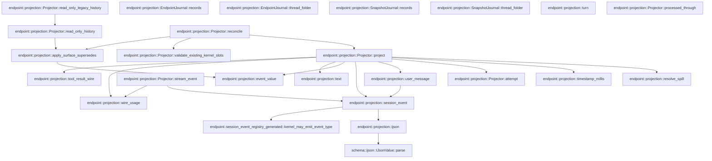
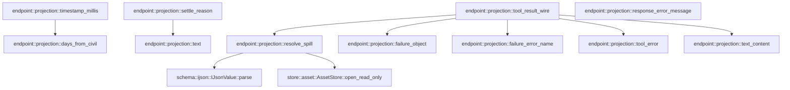

# endpoint::projection

[Package atlas](index.md) · [Source](../../src/projection.rs)

## Declarations

Visibility is the declaration spelling; trait members and reexports require their enclosing interface. `cfg` is not evaluated.

| Symbol | Kind | Visibility | Test / cfg |
|---|---|---|---|
| [endpoint::projection::ProjectionRead](../../src/projection.rs#L14) | trait_item | `private` |  |
| [endpoint::projection::ProjectionRead::records](../../src/projection.rs#L15) | function_signature_item | `private` |  |
| [endpoint::projection::ProjectionRead::thread_folder](../../src/projection.rs#L16) | function_signature_item | `private` |  |
| [endpoint::projection::EndpointJournal::records](../../src/projection.rs#L19) | function_item | `private` |  |
| [endpoint::projection::EndpointJournal::thread_folder](../../src/projection.rs#L22) | function_item | `private` |  |
| [endpoint::projection::SnapshotJournal](../../src/projection.rs#L26) | struct_item | `private` |  |
| [endpoint::projection::SnapshotJournal::records](../../src/projection.rs#L31) | function_item | `private` |  |
| [endpoint::projection::SnapshotJournal::thread_folder](../../src/projection.rs#L34) | function_item | `private` |  |
| [endpoint::projection::AttemptInfo](../../src/projection.rs#L40) | struct_item | `private` |  |
| [endpoint::projection::EpochInfo](../../src/projection.rs#L48) | struct_item | `private` |  |
| [endpoint::projection::Projector](../../src/projection.rs#L54) | struct_item | `pub` |  |
| [endpoint::projection::AcceptedStreamFrame](../../src/projection.rs#L77) | struct_item | `pub` |  |
| [endpoint::projection::Projector::processed_through](../../src/projection.rs#L94) | function_item | `pub` |  |
| [endpoint::projection::Projector::reconcile](../../src/projection.rs#L98) | function_item | `pub` |  |
| [endpoint::projection::Projector::read_only_history](../../src/projection.rs#L136) | function_item | `pub` |  |
| [endpoint::projection::Projector::read_only_legacy_history](../../src/projection.rs#L186) | function_item | `pub` |  |
| [endpoint::projection::Projector::stream_event](../../src/projection.rs#L196) | function_item | `pub` |  |
| [endpoint::projection::Projector::project](../../src/projection.rs#L257) | function_item | `private` |  |
| [endpoint::projection::Projector::attempt](../../src/projection.rs#L658) | function_item | `private` |  |
| [endpoint::projection::Projector::validate_existing_kernel_slots](../../src/projection.rs#L664) | function_item | `private` |  |
| [endpoint::projection::Projected](../../src/projection.rs#L689) | type_item | `private` |  |
| [endpoint::projection::user_message](../../src/projection.rs#L691) | function_item | `private` |  |
| [endpoint::projection::apply_surface_supersedes](../../src/projection.rs#L715) | function_item | `private` |  |
| [endpoint::projection::session_event](../../src/projection.rs#L767) | function_item | `private` |  |
| [endpoint::projection::event_value](../../src/projection.rs#L789) | function_item | `private` |  |
| [endpoint::projection::ijson](../../src/projection.rs#L793) | function_item | `private` |  |
| [endpoint::projection::text](../../src/projection.rs#L798) | function_item | `private` |  |
| [endpoint::projection::turn](../../src/projection.rs#L805) | function_item | `private` |  |
| [endpoint::projection::wire_usage](../../src/projection.rs#L809) | function_item | `private` |  |
| [endpoint::projection::reasoning_usage_projection_tests::reasoning_usage_preserves_zero_missing_and_wire_integer_boundary](../../src/projection.rs#L836) | function_item | `private` | test; #[cfg(test)] |
| [endpoint::projection::tool_result_wire](../../src/projection.rs#L850) | function_item | `private` |  |
| [endpoint::projection::failure_object](../../src/projection.rs#L945) | function_item | `private` |  |
| [endpoint::projection::failure_error_name](../../src/projection.rs#L976) | function_item | `private` |  |
| [endpoint::projection::tool_error](../../src/projection.rs#L989) | function_item | `private` |  |
| [endpoint::projection::text_content](../../src/projection.rs#L993) | function_item | `private` |  |
| [endpoint::projection::response_error_message](../../src/projection.rs#L997) | function_item | `private` |  |
| [endpoint::projection::resolve_spill](../../src/projection.rs#L1013) | function_item | `private` |  |
| [endpoint::projection::settle_reason](../../src/projection.rs#L1038) | function_item | `private` |  |
| [endpoint::projection::timestamp_millis](../../src/projection.rs#L1052) | function_item | `pub(crate)` |  |
| [endpoint::projection::days_from_civil](../../src/projection.rs#L1088) | function_item | `private` |  |
| [endpoint::projection::ProjectionError](../../src/projection.rs#L1099) | enum_item | `pub` |  |
| [endpoint::projection::tests::stream_usage_keeps_partial_reports_in_the_transient_lane](../../src/projection.rs#L1153) | function_item | `private` | test; #[cfg(test)] |
| [endpoint::projection::tests::ordinary_extension_cannot_smuggle_a_legacy_usage_record_into_projection](../../src/projection.rs#L1185) | function_item | `private` | test; #[cfg(test)] |
| [endpoint::projection::tests::legacy_history_projection_attaches_separate_usage_to_the_assistant_message](../../src/projection.rs#L1219) | function_item | `private` | test; #[cfg(test)] |
| [endpoint::projection::tests::user_message_projects_file_blocks_and_keeps_images_verbatim](../../src/projection.rs#L1274) | function_item | `private` | test; #[cfg(test)] |
| [endpoint::projection::tests::durable_reasoning_folds_into_its_attempts_assistant_message](../../src/projection.rs#L1297) | function_item | `private` | test; #[cfg(test)] |
| [endpoint::projection::tests::worker_final_and_validation_feedback_do_not_end_the_client_turn](../../src/projection.rs#L1356) | function_item | `private` | test; #[cfg(test)] |
| [endpoint::projection::tests::direct_final_settlement_promotes_the_exact_output_without_a_review_outcome](../../src/projection.rs#L1393) | function_item | `private` | test; #[cfg(test)] |
| [endpoint::projection::tests::session_notice_meta_projects_as_a_turn_independent_surface_event](../../src/projection.rs#L1436) | function_item | `private` | test; #[cfg(test)] |
| [endpoint::projection::tests::trim_of_closed_prior_turn_tool_result_keeps_original_surface_step](../../src/projection.rs#L1475) | function_item | `private` | test; #[cfg(test)] |
| [endpoint::projection::tests::kernel_producer_rejects_dsh_private_state_events](../../src/projection.rs#L1510) | function_item | `private` | test; #[cfg(test)] |
| [endpoint::projection::tests::user_stop_replays_a_prior_v5_projection_cache_after_upgrade](../../src/projection.rs#L1525) | function_item | `private` | test; #[cfg(test)] |
| [endpoint::projection::tests::known_user_stop_projects_cancellation_without_leaking_transport_details](../../src/projection.rs#L1580) | function_item | `private` | test; #[cfg(test)] |
| [endpoint::projection::tests::provider_error_projects_as_turn_scoped_transcript_surface](../../src/projection.rs#L1645) | function_item | `private` | test; #[cfg(test)] |
| [endpoint::projection::tests::a_failed_effect_reports_its_message_and_its_own_code](../../src/projection.rs#L1675) | function_item | `private` | test; #[cfg(test)] |
| [endpoint::projection::tests::non_success_tool_results_have_closed_wire_shapes_and_spills_resolve](../../src/projection.rs#L1730) | function_item | `private` | test; #[cfg(test)] |

## Imports / reexports

| Local name | Source path | Visibility |
|---|---|---|
| `Cow` | `std::borrow::Cow` | `private` |
| `BTreeMap` | `std::collections::BTreeMap` | `private` |
| `BTreeSet` | `std::collections::BTreeSet` | `private` |
| `HashMap` | `std::collections::HashMap` | `private` |
| `HashSet` | `std::collections::HashSet` | `private` |
| `Event` | `schema::Event` | `private` |
| `EventKind` | `schema::EventKind` | `private` |
| `IJsonValue` | `schema::IJsonValue` | `private` |
| `Map` | `serde_json::Map` | `private` |
| `Value` | `serde_json::Value` | `private` |
| `json` | `serde_json::json` | `private` |
| `Error` | `thiserror::Error` | `private` |
| `kernel_may_emit_event_type` | `crate::session_event_registry_generated::kernel_may_emit_event_type` | `private` |
| `EndpointJournal` | `crate::EndpointJournal` | `private` |
| `JournalError` | `crate::JournalError` | `private` |
| `SessionEvent` | `crate::SessionEvent` | `private` |
| `SurfaceOperation` | `crate::SurfaceOperation` | `private` |
| `AssetStore` | `store::AssetStore` | `private` |
| `*` | `super::*` | `private` |
| `AssetStore` | `store::AssetStore` | `private` |
| `*` | `super::*` | `private` |

## Module declarations

| Module | Visibility | Attributes |
|---|---|---|
| `endpoint::projection::reasoning_usage_projection_tests` | `private` | #[cfg(test)] |
| `endpoint::projection::tests` | `private` | #[cfg(test)] |

## Function call graphs

Edges below are syntactically resolved calls only, including private functions. Graphs partition callers into groups of 20; they are not execution order. All unresolved sites are listed below and in the JSON inventory.

Functions 1–20: 21 direct edges

Functions 21–30: 9 direct edges

## Call sites

Includes test functions (marked in declarations). Receiver-type-required sites need type analysis/manual tracing. Calls in closures are attributed to their enclosing function; their occurrence here does not mean the closure executes immediately.

| Caller | Callee expression | Source lines | Target / classification |
|---|---|---|---|
| `records` | `self.records().map` | [20](../../src/projection.rs#L20) | receiver-type-required |
| `records` | `self.records` | [20](../../src/projection.rs#L20) | receiver-type-required |
| `thread_folder` | `self.thread_folder` | [23](../../src/projection.rs#L23) | receiver-type-required |
| `records` | `Ok` | [32](../../src/projection.rs#L32) | external-constructor-callback-or-unresolved |
| `records` | `Cow::Borrowed` | [32](../../src/projection.rs#L32) | external-constructor-callback-or-unresolved |
| `reconcile` | `events.iter().find` | [103](../../src/projection.rs#L103) | receiver-type-required |
| `reconcile` | `events.iter` | [103](../../src/projection.rs#L103) | receiver-type-required |
| `reconcile` | `event.is_historical_only` | [103](../../src/projection.rs#L103) | receiver-type-required |
| `reconcile` | `Err` | [104](../../src/projection.rs#L104) | external-constructor-callback-or-unresolved |
| `reconcile` | `ProjectionError::HistoricalOnlyEvent` | [104](../../src/projection.rs#L104) | external-constructor-callback-or-unresolved |
| `reconcile` | `event.seq` | [104](../../src/projection.rs#L104), [127](../../src/projection.rs#L127) | receiver-type-required |
| `reconcile` | `Vec::new` | [106](../../src/projection.rs#L106) | external-constructor-callback-or-unresolved |
| `reconcile` | `self.project` | [108](../../src/projection.rs#L108) | [endpoint::projection::Projector::project](../../src/projection.rs#L257) |
| `reconcile` | `apply_surface_supersedes` | [110](../../src/projection.rs#L110) | [endpoint::projection::apply_surface_supersedes](../../src/projection.rs#L715) |
| `reconcile` | `kernel_seqs                     .last()                     .ok_or` | [111](../../src/projection.rs#L111) | receiver-type-required |
| `reconcile` | `kernel_seqs                     .last` | [111](../../src/projection.rs#L111) | receiver-type-required |
| `reconcile` | `ProjectionError::InvalidField` | [113](../../src/projection.rs#L113) | external-constructor-callback-or-unresolved |
| `reconcile` | `self.expected_kernel_slots.insert` | [114](../../src/projection.rs#L114) | receiver-type-required |
| `reconcile` | `slot.clone` | [114](../../src/projection.rs#L114) | receiver-type-required |
| `reconcile` | `appended.extend` | [116](../../src/projection.rs#L116) | receiver-type-required |
| `reconcile` | `journal.append_kernel_batch` | [116](../../src/projection.rs#L116) | receiver-type-required |
| `reconcile` | `event.has_field` | [118](../../src/projection.rs#L118) | receiver-type-required |
| `reconcile` | `event                     .string_field("attempt")                     .ok_or` | [120](../../src/projection.rs#L120) | receiver-type-required |
| `reconcile` | `event                     .string_field` | [120](../../src/projection.rs#L120) | receiver-type-required |
| `reconcile` | `ProjectionError::MissingField` | [122](../../src/projection.rs#L122) | external-constructor-callback-or-unresolved |
| `reconcile` | `self.terminal_attempts.insert` | [123](../../src/projection.rs#L123) | receiver-type-required |
| `reconcile` | `attempt.to_owned` | [123](../../src/projection.rs#L123) | receiver-type-required |
| `reconcile` | `Some` | [125](../../src/projection.rs#L125) | external-constructor-callback-or-unresolved |
| `reconcile` | `self.processed_through                     .map_or` | [126](../../src/projection.rs#L126) | receiver-type-required |
| `reconcile` | `seq.max` | [127](../../src/projection.rs#L127) | receiver-type-required |
| `reconcile` | `self.validate_existing_kernel_slots` | [130](../../src/projection.rs#L130) | [endpoint::projection::Projector::validate_existing_kernel_slots](../../src/projection.rs#L664) |
| `reconcile` | `Ok` | [131](../../src/projection.rs#L131) | external-constructor-callback-or-unresolved |
| `read_only_history` | `Self::default` | [140](../../src/projection.rs#L140) | external-constructor-callback-or-unresolved |
| `read_only_history` | `folder.to_path_buf` | [142](../../src/projection.rs#L142) | receiver-type-required |
| `read_only_history` | `projector.project` | [146](../../src/projection.rs#L146) | receiver-type-required |
| `read_only_history` | `Vec::new` | [147](../../src/projection.rs#L147) | external-constructor-callback-or-unresolved |
| `read_only_history` | `apply_surface_supersedes` | [149](../../src/projection.rs#L149) | [endpoint::projection::apply_surface_supersedes](../../src/projection.rs#L715) |
| `read_only_history` | `kernel_seqs                     .last()                     .ok_or` | [150](../../src/projection.rs#L150) | receiver-type-required |
| `read_only_history` | `kernel_seqs                     .last` | [150](../../src/projection.rs#L150) | receiver-type-required |
| `read_only_history` | `ProjectionError::InvalidField` | [152](../../src/projection.rs#L152) | external-constructor-callback-or-unresolved |
| `read_only_history` | `projector                     .expected_kernel_slots                     .insert` | [153](../../src/projection.rs#L153) | receiver-type-required |
| `read_only_history` | `slot.clone` | [155](../../src/projection.rs#L155) | receiver-type-required |
| `read_only_history` | `journal.rows.len` | [156](../../src/projection.rs#L156) | receiver-type-required |
| `read_only_history` | `rows.len` | [156](../../src/projection.rs#L156) | receiver-type-required |
| `read_only_history` | `row.validate` | [163](../../src/projection.rs#L163) | receiver-type-required |
| `read_only_history` | `rows.push` | [164](../../src/projection.rs#L164) | receiver-type-required |
| `read_only_history` | `journal.rows.extend` | [166](../../src/projection.rs#L166) | receiver-type-required |
| `read_only_history` | `event.has_field` | [168](../../src/projection.rs#L168) | receiver-type-required |
| `read_only_history` | `projector.terminal_attempts.insert` | [170](../../src/projection.rs#L170) | receiver-type-required |
| `read_only_history` | `event                         .string_field("attempt")                         .ok_or(ProjectionError::MissingField("attempt"))?                         .to_owned` | [171](../../src/projection.rs#L171) | receiver-type-required |
| `read_only_history` | `event                         .string_field("attempt")                         .ok_or` | [171](../../src/projection.rs#L171) | receiver-type-required |
| `read_only_history` | `event                         .string_field` | [171](../../src/projection.rs#L171) | receiver-type-required |
| `read_only_history` | `ProjectionError::MissingField` | [173](../../src/projection.rs#L173) | external-constructor-callback-or-unresolved |
| `read_only_history` | `Some` | [177](../../src/projection.rs#L177) | external-constructor-callback-or-unresolved |
| `read_only_history` | `event.seq` | [177](../../src/projection.rs#L177) | receiver-type-required |
| `read_only_history` | `projector.validate_existing_kernel_slots` | [179](../../src/projection.rs#L179) | receiver-type-required |
| `read_only_history` | `Ok` | [180](../../src/projection.rs#L180) | external-constructor-callback-or-unresolved |
| `read_only_legacy_history` | `Self::read_only_history` | [190](../../src/projection.rs#L190) | [endpoint::projection::Projector::read_only_history](../../src/projection.rs#L136) |
| `read_only_legacy_history` | `ledger.events` | [190](../../src/projection.rs#L190) | receiver-type-required |
| `stream_event` | `self.terminal_attempts.contains` | [200](../../src/projection.rs#L200) | receiver-type-required |
| `stream_event` | `Err` | [201](../../src/projection.rs#L201), [212](../../src/projection.rs#L212), [217](../../src/projection.rs#L217), [244](../../src/projection.rs#L244) | external-constructor-callback-or-unresolved |
| `stream_event` | `ProjectionError::TerminalAttempt` | [201](../../src/projection.rs#L201) | external-constructor-callback-or-unresolved |
| `stream_event` | `frame.attempt.clone` | [201](../../src/projection.rs#L201), [206](../../src/projection.rs#L206) | receiver-type-required |
| `stream_event` | `self             .attempts             .get(&frame.attempt)             .ok_or_else` | [203](../../src/projection.rs#L203) | receiver-type-required |
| `stream_event` | `self             .attempts             .get` | [203](../../src/projection.rs#L203) | receiver-type-required |
| `stream_event` | `ProjectionError::UnknownAttempt` | [206](../../src/projection.rs#L206) | external-constructor-callback-or-unresolved |
| `stream_event` | `frame.channel.as_str` | [207](../../src/projection.rs#L207) | receiver-type-required |
| `stream_event` | `ProjectionError::StreamChannel` | [212](../../src/projection.rs#L212) | external-constructor-callback-or-unresolved |
| `stream_event` | `other.to_owned` | [212](../../src/projection.rs#L212) | receiver-type-required |
| `stream_event` | `frame.call_id.is_some` | [215](../../src/projection.rs#L215), [242](../../src/projection.rs#L242) | receiver-type-required |
| `stream_event` | `frame.name.is_some` | [215](../../src/projection.rs#L215), [242](../../src/projection.rs#L242) | receiver-type-required |
| `stream_event` | `frame.arguments_complete.is_some` | [215](../../src/projection.rs#L215), [242](../../src/projection.rs#L242) | receiver-type-required |
| `stream_event` | `ProjectionError::InvalidField` | [217](../../src/projection.rs#L217), [220](../../src/projection.rs#L220), [244](../../src/projection.rs#L244) | external-constructor-callback-or-unresolved |
| `stream_event` | `serde_json::from_str(&frame.delta)                 .map_err` | [219](../../src/projection.rs#L219) | receiver-type-required |
| `stream_event` | `serde_json::from_str` | [219](../../src/projection.rs#L219) | external-constructor-callback-or-unresolved |
| `stream_event` | `wire_usage` | [221](../../src/projection.rs#L221) | [endpoint::projection::wire_usage](../../src/projection.rs#L809) |
| `stream_event` | `frame                 .call_id                 .as_deref()                 .ok_or` | [224](../../src/projection.rs#L224) | receiver-type-required |
| `stream_event` | `frame                 .call_id                 .as_deref` | [224](../../src/projection.rs#L224) | receiver-type-required |
| `stream_event` | `ProjectionError::MissingField` | [227](../../src/projection.rs#L227) | external-constructor-callback-or-unresolved |
| `stream_event` | `Map::new` | [228](../../src/projection.rs#L228) | external-constructor-callback-or-unresolved |
| `stream_event` | `chunk.insert` | [229](../../src/projection.rs#L229), [230](../../src/projection.rs#L230), [231](../../src/projection.rs#L231), [232](../../src/projection.rs#L232), [233](../../src/projection.rs#L233), [235](../../src/projection.rs#L235), [238](../../src/projection.rs#L238) | receiver-type-required |
| `stream_event` | `"type".to_owned` | [229](../../src/projection.rs#L229) | receiver-type-required |
| `stream_event` | `"index".to_owned` | [230](../../src/projection.rs#L230) | receiver-type-required |
| `stream_event` | `"id".to_owned` | [231](../../src/projection.rs#L231) | receiver-type-required |
| `stream_event` | `"argumentsDelta".to_owned` | [232](../../src/projection.rs#L232) | receiver-type-required |
| `stream_event` | `"assistantFrameId".to_owned` | [233](../../src/projection.rs#L233) | receiver-type-required |
| `stream_event` | `"argumentsComplete".to_owned` | [235](../../src/projection.rs#L235) | receiver-type-required |
| `stream_event` | `"name".to_owned` | [238](../../src/projection.rs#L238) | receiver-type-required |
| `stream_event` | `session_event` | [252](../../src/projection.rs#L252) | [endpoint::projection::session_event](../../src/projection.rs#L767) |
| `stream_event` | `Ok` | [254](../../src/projection.rs#L254) | external-constructor-callback-or-unresolved |
| `project` | `event_value` | [262](../../src/projection.rs#L262) | [endpoint::projection::event_value](../../src/projection.rs#L789) |
| `project` | `timestamp_millis` | [263](../../src/projection.rs#L263) | [endpoint::projection::timestamp_millis](../../src/projection.rs#L1052) |
| `project` | `value                 .get("ts")                 .and_then(Value::as_str)                 .ok_or` | [264](../../src/projection.rs#L264) | receiver-type-required |
| `project` | `value                 .get("ts")                 .and_then` | [264](../../src/projection.rs#L264) | receiver-type-required |
| `project` | `value                 .get` | [264](../../src/projection.rs#L264) | receiver-type-required |
| `project` | `ProjectionError::MissingField` | [267](../../src/projection.rs#L267), [394](../../src/projection.rs#L394), [466](../../src/projection.rs#L466), [619](../../src/projection.rs#L619) | external-constructor-callback-or-unresolved |
| `project` | `Vec::new` | [269](../../src/projection.rs#L269) | external-constructor-callback-or-unresolved |
| `project` | `event.kind` | [270](../../src/projection.rs#L270) | receiver-type-required |
| `project` | `event.is_historical_only` | [272](../../src/projection.rs#L272) | receiver-type-required |
| `project` | `Err` | [273](../../src/projection.rs#L273), [579](../../src/projection.rs#L579), [591](../../src/projection.rs#L591), [623](../../src/projection.rs#L623) | external-constructor-callback-or-unresolved |
| `project` | `ProjectionError::StandaloneUsageEvent` | [273](../../src/projection.rs#L273) | external-constructor-callback-or-unresolved |
| `project` | `event.seq` | [273](../../src/projection.rs#L273), [279](../../src/projection.rs#L279), [344](../../src/projection.rs#L344), [419](../../src/projection.rs#L419), [508](../../src/projection.rs#L508) | receiver-type-required |
| `project` | `self.historical_usage                     .insert` | [275](../../src/projection.rs#L275) | receiver-type-required |
| `project` | `text(&value, "attempt")?.to_owned` | [276](../../src/projection.rs#L276), [322](../../src/projection.rs#L322) | receiver-type-required |
| `project` | `text` | [276](../../src/projection.rs#L276), [282](../../src/projection.rs#L282), [286](../../src/projection.rs#L286), [287](../../src/projection.rs#L287), [322](../../src/projection.rs#L322), [343](../../src/projection.rs#L343), [390](../../src/projection.rs#L390), [405](../../src/projection.rs#L405), [461](../../src/projection.rs#L461), [487](../../src/projection.rs#L487), [535](../../src/projection.rs#L535) | [endpoint::projection::text](../../src/projection.rs#L798) |
| `project` | `self.inputs.insert` | [279](../../src/projection.rs#L279) | receiver-type-required |
| `project` | `text(&value, "id")?.to_owned` | [282](../../src/projection.rs#L282) | receiver-type-required |
| `project` | `self.epochs.insert` | [283](../../src/projection.rs#L283) | receiver-type-required |
| `project` | `text(&value, "adapter")?.to_owned` | [286](../../src/projection.rs#L286) | receiver-type-required |
| `project` | `text(&value, "model")?.to_owned` | [287](../../src/projection.rs#L287) | receiver-type-required |
| `project` | `turn` | [292](../../src/projection.rs#L292), [321](../../src/projection.rs#L321), [488](../../src/projection.rs#L488), [534](../../src/projection.rs#L534), [555](../../src/projection.rs#L555) | external-constructor-callback-or-unresolved |
| `project` | `output.push` | [293](../../src/projection.rs#L293), [313](../../src/projection.rs#L313), [324](../../src/projection.rs#L324), [348](../../src/projection.rs#L348), [380](../../src/projection.rs#L380), [454](../../src/projection.rs#L454), [469](../../src/projection.rs#L469), [527](../../src/projection.rs#L527), [537](../../src/projection.rs#L537), [557](../../src/projection.rs#L557), [604](../../src/projection.rs#L604), [625](../../src/projection.rs#L625), [642](../../src/projection.rs#L642) | receiver-type-required |
| `project` | `"turn-start".to_owned` | [295](../../src/projection.rs#L295) | receiver-type-required |
| `project` | `session_event` | [296](../../src/projection.rs#L296), [327](../../src/projection.rs#L327), [351](../../src/projection.rs#L351), [457](../../src/projection.rs#L457), [472](../../src/projection.rs#L472), [530](../../src/projection.rs#L530), [540](../../src/projection.rs#L540), [560](../../src/projection.rs#L560), [607](../../src/projection.rs#L607), [628](../../src/projection.rs#L628), [645](../../src/projection.rs#L645) | [endpoint::projection::session_event](../../src/projection.rs#L767) |
| `project` | `value                     .get("trigger")                     .and_then(Value::as_object)                     .and_then(&#124;trigger&#124; trigger.get("inputs"))                     .and_then(Value::as_array)                     .cloned()                     .unwrap_or_default` | [298](../../src/projection.rs#L298) | receiver-type-required |
| `project` | `value                     .get("trigger")                     .and_then(Value::as_object)                     .and_then(&#124;trigger&#124; trigger.get("inputs"))                     .and_then(Value::as_array)                     .cloned` | [298](../../src/projection.rs#L298) | receiver-type-required |
| `project` | `value                     .get("trigger")                     .and_then(Value::as_object)                     .and_then(&#124;trigger&#124; trigger.get("inputs"))                     .and_then` | [298](../../src/projection.rs#L298) | receiver-type-required |
| `project` | `value                     .get("trigger")                     .and_then(Value::as_object)                     .and_then` | [298](../../src/projection.rs#L298) | receiver-type-required |
| `project` | `value                     .get("trigger")                     .and_then` | [298](../../src/projection.rs#L298) | receiver-type-required |
| `project` | `value                     .get` | [298](../../src/projection.rs#L298), [359](../../src/projection.rs#L359), [447](../../src/projection.rs#L447), [611](../../src/projection.rs#L611) | receiver-type-required |
| `project` | `trigger.get` | [301](../../src/projection.rs#L301) | receiver-type-required |
| `project` | `input_seqs.into_iter().enumerate` | [305](../../src/projection.rs#L305) | receiver-type-required |
| `project` | `input_seqs.into_iter` | [305](../../src/projection.rs#L305) | receiver-type-required |
| `project` | `input_seq                         .as_u64()                         .ok_or` | [306](../../src/projection.rs#L306) | receiver-type-required |
| `project` | `input_seq                         .as_u64` | [306](../../src/projection.rs#L306) | receiver-type-required |
| `project` | `ProjectionError::InvalidField` | [308](../../src/projection.rs#L308), [368](../../src/projection.rs#L368), [372](../../src/projection.rs#L372), [573](../../src/projection.rs#L573), [577](../../src/projection.rs#L577), [579](../../src/projection.rs#L579), [589](../../src/projection.rs#L589), [591](../../src/projection.rs#L591), [600](../../src/projection.rs#L600), [614](../../src/projection.rs#L614), [623](../../src/projection.rs#L623) | external-constructor-callback-or-unresolved |
| `project` | `self                         .inputs                         .get(&input_seq)                         .ok_or` | [309](../../src/projection.rs#L309) | receiver-type-required |
| `project` | `self                         .inputs                         .get` | [309](../../src/projection.rs#L309) | receiver-type-required |
| `project` | `ProjectionError::UnknownInput` | [312](../../src/projection.rs#L312) | external-constructor-callback-or-unresolved |
| `project` | `user_message` | [316](../../src/projection.rs#L316), [383](../../src/projection.rs#L383) | [endpoint::projection::user_message](../../src/projection.rs#L691) |
| `project` | `self.open_steps.remove` | [323](../../src/projection.rs#L323), [556](../../src/projection.rs#L556) | receiver-type-required |
| `project` | `self                     .attempts                     .values()                     .filter(&#124;info&#124; info.turn == turn)                     .count` | [335](../../src/projection.rs#L335) | receiver-type-required |
| `project` | `self                     .attempts                     .values()                     .filter` | [335](../../src/projection.rs#L335) | receiver-type-required |
| `project` | `self                     .attempts                     .values` | [335](../../src/projection.rs#L335) | receiver-type-required |
| `project` | `text(&value, "epoch")?.to_owned` | [343](../../src/projection.rs#L343) | receiver-type-required |
| `project` | `self.attempts.insert` | [346](../../src/projection.rs#L346) | receiver-type-required |
| `project` | `attempt.clone` | [346](../../src/projection.rs#L346) | receiver-type-required |
| `project` | `info.clone` | [346](../../src/projection.rs#L346) | receiver-type-required |
| `project` | `self.open_steps.insert` | [347](../../src/projection.rs#L347) | receiver-type-required |
| `project` | `"step-start".to_owned` | [350](../../src/projection.rs#L350) | receiver-type-required |
| `project` | `value                     .get("admits")                     .and_then(Value::as_array)                     .into_iter()                     .flatten` | [359](../../src/projection.rs#L359) | receiver-type-required |
| `project` | `value                     .get("admits")                     .and_then(Value::as_array)                     .into_iter` | [359](../../src/projection.rs#L359) | receiver-type-required |
| `project` | `value                     .get("admits")                     .and_then` | [359](../../src/projection.rs#L359) | receiver-type-required |
| `project` | `range                         .get("from")                         .and_then(Value::as_u64)                         .ok_or` | [365](../../src/projection.rs#L365) | receiver-type-required |
| `project` | `range                         .get("from")                         .and_then` | [365](../../src/projection.rs#L365) | receiver-type-required |
| `project` | `range                         .get` | [365](../../src/projection.rs#L365), [369](../../src/projection.rs#L369) | receiver-type-required |
| `project` | `range                         .get("to")                         .and_then(Value::as_u64)                         .ok_or` | [369](../../src/projection.rs#L369) | receiver-type-required |
| `project` | `range                         .get("to")                         .and_then` | [369](../../src/projection.rs#L369) | receiver-type-required |
| `project` | `self.inputs.get` | [374](../../src/projection.rs#L374) | receiver-type-required |
| `project` | `input.get("steer").and_then` | [377](../../src/projection.rs#L377) | receiver-type-required |
| `project` | `input.get` | [377](../../src/projection.rs#L377) | receiver-type-required |
| `project` | `Some` | [377](../../src/projection.rs#L377), [417](../../src/projection.rs#L417), [595](../../src/projection.rs#L595) | external-constructor-callback-or-unresolved |
| `project` | `self.seen_steers.insert` | [378](../../src/projection.rs#L378) | receiver-type-required |
| `project` | `resolve_spill` | [391](../../src/projection.rs#L391), [463](../../src/projection.rs#L463) | [endpoint::projection::resolve_spill](../../src/projection.rs#L1013) |
| `project` | `value                         .get("content")                         .ok_or` | [392](../../src/projection.rs#L392) | receiver-type-required |
| `project` | `value                         .get` | [392](../../src/projection.rs#L392), [464](../../src/projection.rs#L464), [490](../../src/projection.rs#L490) | receiver-type-required |
| `project` | `content.as_str().filter` | [397](../../src/projection.rs#L397) | receiver-type-required |
| `project` | `content.as_str` | [397](../../src/projection.rs#L397) | receiver-type-required |
| `project` | `text.is_empty` | [397](../../src/projection.rs#L397) | receiver-type-required |
| `project` | `self.reasoning                         .entry(attempt.to_owned())                         .or_default()                         .push` | [398](../../src/projection.rs#L398) | receiver-type-required |
| `project` | `self.reasoning                         .entry(attempt.to_owned())                         .or_default` | [398](../../src/projection.rs#L398) | receiver-type-required |
| `project` | `self.reasoning                         .entry` | [398](../../src/projection.rs#L398) | receiver-type-required |
| `project` | `attempt.to_owned` | [399](../../src/projection.rs#L399) | receiver-type-required |
| `project` | `text.to_owned` | [401](../../src/projection.rs#L401) | receiver-type-required |
| `project` | `self.attempt(attempt)?.clone` | [406](../../src/projection.rs#L406) | receiver-type-required |
| `project` | `self.attempt` | [406](../../src/projection.rs#L406), [462](../../src/projection.rs#L462) | [endpoint::projection::Projector::attempt](../../src/projection.rs#L658) |
| `project` | `self                     .epochs                     .get(&info.epoch)                     .ok_or_else` | [407](../../src/projection.rs#L407) | receiver-type-required |
| `project` | `self                     .epochs                     .get` | [407](../../src/projection.rs#L407) | receiver-type-required |
| `project` | `ProjectionError::UnknownEpoch` | [410](../../src/projection.rs#L410) | external-constructor-callback-or-unresolved |
| `project` | `info.epoch.clone` | [410](../../src/projection.rs#L410) | receiver-type-required |
| `project` | `Map::new` | [411](../../src/projection.rs#L411), [421](../../src/projection.rs#L421) | external-constructor-callback-or-unresolved |
| `project` | `data.insert` | [412](../../src/projection.rs#L412), [413](../../src/projection.rs#L413), [415](../../src/projection.rs#L415), [438](../../src/projection.rs#L438), [452](../../src/projection.rs#L452) | receiver-type-required |
| `project` | `"turn".to_owned` | [412](../../src/projection.rs#L412) | receiver-type-required |
| `project` | `"step".to_owned` | [413](../../src/projection.rs#L413) | receiver-type-required |
| `project` | `value.get` | [414](../../src/projection.rs#L414), [417](../../src/projection.rs#L417), [425](../../src/projection.rs#L425), [435](../../src/projection.rs#L435), [536](../../src/projection.rs#L536), [569](../../src/projection.rs#L569), [584](../../src/projection.rs#L584), [595](../../src/projection.rs#L595), [610](../../src/projection.rs#L610), [641](../../src/projection.rs#L641) | receiver-type-required |
| `project` | `"sessionFinal".to_owned` | [415](../../src/projection.rs#L415) | receiver-type-required |
| `project` | `final_answer.clone` | [415](../../src/projection.rs#L415) | receiver-type-required |
| `project` | `value.get("final_answer").and_then` | [417](../../src/projection.rs#L417) | receiver-type-required |
| `project` | `self.outputs                         .insert` | [418](../../src/projection.rs#L418) | receiver-type-required |
| `project` | `source.insert` | [422](../../src/projection.rs#L422), [423](../../src/projection.rs#L423), [424](../../src/projection.rs#L424), [426](../../src/projection.rs#L426) | receiver-type-required |
| `project` | `"kind".to_owned` | [422](../../src/projection.rs#L422) | receiver-type-required |
| `project` | `"provider".to_owned` | [423](../../src/projection.rs#L423) | receiver-type-required |
| `project` | `"model".to_owned` | [424](../../src/projection.rs#L424) | receiver-type-required |
| `project` | `"replayState".to_owned` | [426](../../src/projection.rs#L426) | receiver-type-required |
| `project` | `continuation.clone` | [426](../../src/projection.rs#L426) | receiver-type-required |
| `project` | `self                     .reasoning                     .remove(attempt)                     .unwrap_or_default()                     .into_iter()                     .map(&#124;text&#124; json!({"type": "reasoning", "text": text}))                     .collect::<Vec<_>>` | [428](../../src/projection.rs#L428) | receiver-type-required |
| `project` | `self                     .reasoning                     .remove(attempt)                     .unwrap_or_default()                     .into_iter()                     .map` | [428](../../src/projection.rs#L428) | receiver-type-required |
| `project` | `self                     .reasoning                     .remove(attempt)                     .unwrap_or_default()                     .into_iter` | [428](../../src/projection.rs#L428) | receiver-type-required |
| `project` | `self                     .reasoning                     .remove(attempt)                     .unwrap_or_default` | [428](../../src/projection.rs#L428) | receiver-type-required |
| `project` | `self                     .reasoning                     .remove` | [428](../../src/projection.rs#L428) | receiver-type-required |
| `project` | `value.get("content").and_then` | [435](../../src/projection.rs#L435) | receiver-type-required |
| `project` | `content.extend` | [436](../../src/projection.rs#L436) | receiver-type-required |
| `project` | `blocks.iter().cloned` | [436](../../src/projection.rs#L436) | receiver-type-required |
| `project` | `blocks.iter` | [436](../../src/projection.rs#L436) | receiver-type-required |
| `project` | `"message".to_owned` | [439](../../src/projection.rs#L439) | receiver-type-required |
| `project` | `value                     .get("usage")                     .cloned()                     .or_else` | [447](../../src/projection.rs#L447) | receiver-type-required |
| `project` | `value                     .get("usage")                     .cloned` | [447](../../src/projection.rs#L447) | receiver-type-required |
| `project` | `self.historical_usage.remove` | [450](../../src/projection.rs#L450) | receiver-type-required |
| `project` | `usage.as_ref` | [451](../../src/projection.rs#L451) | receiver-type-required |
| `project` | `"usage".to_owned` | [452](../../src/projection.rs#L452) | receiver-type-required |
| `project` | `wire_usage` | [452](../../src/projection.rs#L452) | [endpoint::projection::wire_usage](../../src/projection.rs#L809) |
| `project` | `"assistant-message".to_owned` | [456](../../src/projection.rs#L456) | receiver-type-required |
| `project` | `Value::Object` | [457](../../src/projection.rs#L457) | external-constructor-callback-or-unresolved |
| `project` | `value                         .get("args")                         .ok_or` | [464](../../src/projection.rs#L464) | receiver-type-required |
| `project` | `"tool-call".to_owned` | [471](../../src/projection.rs#L471) | receiver-type-required |
| `project` | `value                         .get("supersedes")                         .and_then(Value::as_array)                         .and_then` | [490](../../src/projection.rs#L490) | receiver-type-required |
| `project` | `value                         .get("supersedes")                         .and_then` | [490](../../src/projection.rs#L490) | receiver-type-required |
| `project` | `ranges.iter().find_map` | [494](../../src/projection.rs#L494) | receiver-type-required |
| `project` | `ranges.iter` | [494](../../src/projection.rs#L494) | receiver-type-required |
| `project` | `range.get("from")?.as_u64` | [495](../../src/projection.rs#L495) | receiver-type-required |
| `project` | `range.get` | [495](../../src/projection.rs#L495), [496](../../src/projection.rs#L496) | receiver-type-required |
| `project` | `range.get("to")?.as_u64` | [496](../../src/projection.rs#L496) | receiver-type-required |
| `project` | `self.tool_result_steps                                     .range(from..=to)                                     .next()                                     .map` | [497](../../src/projection.rs#L497) | receiver-type-required |
| `project` | `self.tool_result_steps                                     .range(from..=to)                                     .next` | [497](../../src/projection.rs#L497) | receiver-type-required |
| `project` | `self.tool_result_steps                                     .range` | [497](../../src/projection.rs#L497) | receiver-type-required |
| `project` | `replaced_step                     .or_else(&#124;&#124; self.open_steps.get(&turn).map(&#124;info&#124; (turn, info.step)))                     .ok_or` | [503](../../src/projection.rs#L503) | receiver-type-required |
| `project` | `replaced_step                     .or_else` | [503](../../src/projection.rs#L503) | receiver-type-required |
| `project` | `self.open_steps.get(&turn).map` | [504](../../src/projection.rs#L504) | receiver-type-required |
| `project` | `self.open_steps.get` | [504](../../src/projection.rs#L504) | receiver-type-required |
| `project` | `ProjectionError::NoOpenStep` | [505](../../src/projection.rs#L505) | external-constructor-callback-or-unresolved |
| `project` | `tool_result_wire` | [506](../../src/projection.rs#L506) | [endpoint::projection::tool_result_wire](../../src/projection.rs#L850) |
| `project` | `self.tool_result_steps                     .insert` | [507](../../src/projection.rs#L507) | receiver-type-required |
| `project` | `"tool-result".to_owned` | [529](../../src/projection.rs#L529) | receiver-type-required |
| `project` | `value.get("detail").and_then` | [536](../../src/projection.rs#L536) | receiver-type-required |
| `project` | `"response-error".to_owned` | [539](../../src/projection.rs#L539) | receiver-type-required |
| `project` | `"step-end-at-settle".to_owned` | [559](../../src/projection.rs#L559) | receiver-type-required |
| `project` | `validation                         .get("promoted_output_seq")                         .and_then(Value::as_u64)                         .ok_or` | [570](../../src/projection.rs#L570) | receiver-type-required |
| `project` | `validation                         .get("promoted_output_seq")                         .and_then` | [570](../../src/projection.rs#L570) | receiver-type-required |
| `project` | `validation                         .get` | [570](../../src/projection.rs#L570) | receiver-type-required |
| `project` | `self                         .outputs                         .get(&output_seq)                         .ok_or` | [574](../../src/projection.rs#L574), [586](../../src/projection.rs#L586) | receiver-type-required |
| `project` | `self                         .outputs                         .get` | [574](../../src/projection.rs#L574), [586](../../src/projection.rs#L586) | receiver-type-required |
| `project` | `validation["outcome"].clone` | [582](../../src/projection.rs#L582) | receiver-type-required |
| `project` | `value.get("promoted_output_seq").and_then` | [584](../../src/projection.rs#L584) | receiver-type-required |
| `project` | `value.get("outcome").and_then` | [595](../../src/projection.rs#L595) | receiver-type-required |
| `project` | `Value::String` | [596](../../src/projection.rs#L596) | external-constructor-callback-or-unresolved |
| `project` | `value                             .get("classification")                             .and_then(Value::as_str)                             .ok_or(ProjectionError::InvalidField("classification"))?                             .to_owned` | [597](../../src/projection.rs#L597) | receiver-type-required |
| `project` | `value                             .get("classification")                             .and_then(Value::as_str)                             .ok_or` | [597](../../src/projection.rs#L597) | receiver-type-required |
| `project` | `value                             .get("classification")                             .and_then` | [597](../../src/projection.rs#L597) | receiver-type-required |
| `project` | `value                             .get` | [597](../../src/projection.rs#L597) | receiver-type-required |
| `project` | `"turn-end".to_owned` | [606](../../src/projection.rs#L606) | receiver-type-required |
| `project` | `value.get("notice").is_some` | [610](../../src/projection.rs#L610) | receiver-type-required |
| `project` | `value                     .get("notice")                     .and_then(Value::as_object)                     .ok_or` | [611](../../src/projection.rs#L611) | receiver-type-required |
| `project` | `value                     .get("notice")                     .and_then` | [611](../../src/projection.rs#L611) | receiver-type-required |
| `project` | `notice                         .get(name)                         .and_then(Value::as_str)                         .ok_or` | [616](../../src/projection.rs#L616) | receiver-type-required |
| `project` | `notice                         .get(name)                         .and_then` | [616](../../src/projection.rs#L616) | receiver-type-required |
| `project` | `notice                         .get` | [616](../../src/projection.rs#L616) | receiver-type-required |
| `project` | `field` | [621](../../src/projection.rs#L621) | external-constructor-callback-or-unresolved |
| `project` | `"session-notice".to_owned` | [627](../../src/projection.rs#L627) | receiver-type-required |
| `project` | `value.get("title").is_some` | [641](../../src/projection.rs#L641) | receiver-type-required |
| `project` | `"session-title".to_owned` | [644](../../src/projection.rs#L644) | receiver-type-required |
| `project` | `Ok` | [655](../../src/projection.rs#L655) | external-constructor-callback-or-unresolved |
| `attempt` | `self.attempts             .get(attempt)             .ok_or_else` | [659](../../src/projection.rs#L659) | receiver-type-required |
| `attempt` | `self.attempts             .get` | [659](../../src/projection.rs#L659) | receiver-type-required |
| `attempt` | `ProjectionError::UnknownAttempt` | [661](../../src/projection.rs#L661) | external-constructor-callback-or-unresolved |
| `attempt` | `attempt.to_owned` | [661](../../src/projection.rs#L661) | receiver-type-required |
| `validate_existing_kernel_slots` | `Ok` | [669](../../src/projection.rs#L669), [685](../../src/projection.rs#L685) | external-constructor-callback-or-unresolved |
| `validate_existing_kernel_slots` | `journal.records()?.iter` | [671](../../src/projection.rs#L671) | receiver-type-required |
| `validate_existing_kernel_slots` | `journal.records` | [671](../../src/projection.rs#L671) | receiver-type-required |
| `validate_existing_kernel_slots` | `record.kernel_seqs.last().copied` | [673](../../src/projection.rs#L673) | receiver-type-required |
| `validate_existing_kernel_slots` | `record.kernel_seqs.last` | [673](../../src/projection.rs#L673) | receiver-type-required |
| `validate_existing_kernel_slots` | `self.expected_kernel_slots.contains` | [677](../../src/projection.rs#L677) | receiver-type-required |
| `validate_existing_kernel_slots` | `slot.clone` | [677](../../src/projection.rs#L677), [681](../../src/projection.rs#L681) | receiver-type-required |
| `validate_existing_kernel_slots` | `Err` | [679](../../src/projection.rs#L679) | external-constructor-callback-or-unresolved |
| `user_message` | `input         .get("origin_key")         .and_then(Value::as_str)         .unwrap_or` | [697](../../src/projection.rs#L697) | receiver-type-required |
| `user_message` | `input         .get("origin_key")         .and_then` | [697](../../src/projection.rs#L697) | receiver-type-required |
| `user_message` | `input         .get` | [697](../../src/projection.rs#L697) | receiver-type-required |
| `user_message` | `input.get` | [709](../../src/projection.rs#L709) | receiver-type-required |
| `user_message` | `submission.clone` | [710](../../src/projection.rs#L710) | receiver-type-required |
| `user_message` | `session_event` | [712](../../src/projection.rs#L712) | [endpoint::projection::session_event](../../src/projection.rs#L767) |
| `apply_surface_supersedes` | `wire.surface_op.is_none` | [720](../../src/projection.rs#L720) | receiver-type-required |
| `apply_surface_supersedes` | `Ok` | [721](../../src/projection.rs#L721), [725](../../src/projection.rs#L725), [764](../../src/projection.rs#L764) | external-constructor-callback-or-unresolved |
| `apply_surface_supersedes` | `event_value` | [723](../../src/projection.rs#L723) | [endpoint::projection::event_value](../../src/projection.rs#L789) |
| `apply_surface_supersedes` | `value.get("supersedes").and_then` | [724](../../src/projection.rs#L724) | receiver-type-required |
| `apply_surface_supersedes` | `value.get` | [724](../../src/projection.rs#L724) | receiver-type-required |
| `apply_surface_supersedes` | `wire         .source_event_seqs         .take()         .unwrap_or_default()         .into_iter()         .collect::<BTreeSet<_>>` | [727](../../src/projection.rs#L727) | receiver-type-required |
| `apply_surface_supersedes` | `wire         .source_event_seqs         .take()         .unwrap_or_default()         .into_iter` | [727](../../src/projection.rs#L727) | receiver-type-required |
| `apply_surface_supersedes` | `wire         .source_event_seqs         .take()         .unwrap_or_default` | [727](../../src/projection.rs#L727) | receiver-type-required |
| `apply_surface_supersedes` | `wire         .source_event_seqs         .take` | [727](../../src/projection.rs#L727) | receiver-type-required |
| `apply_surface_supersedes` | `journal.records` | [733](../../src/projection.rs#L733) | receiver-type-required |
| `apply_surface_supersedes` | `Vec::new` | [734](../../src/projection.rs#L734) | external-constructor-callback-or-unresolved |
| `apply_surface_supersedes` | `records.iter` | [735](../../src/projection.rs#L735) | receiver-type-required |
| `apply_surface_supersedes` | `record.kernel_seqs.iter().any` | [741](../../src/projection.rs#L741) | receiver-type-required |
| `apply_surface_supersedes` | `record.kernel_seqs.iter` | [741](../../src/projection.rs#L741) | receiver-type-required |
| `apply_surface_supersedes` | `ranges.iter().any` | [742](../../src/projection.rs#L742) | receiver-type-required |
| `apply_surface_supersedes` | `ranges.iter` | [742](../../src/projection.rs#L742) | receiver-type-required |
| `apply_surface_supersedes` | `range.get("from").and_then` | [743](../../src/projection.rs#L743) | receiver-type-required |
| `apply_surface_supersedes` | `range.get` | [743](../../src/projection.rs#L743), [744](../../src/projection.rs#L744) | receiver-type-required |
| `apply_surface_supersedes` | `range.get("to").and_then` | [744](../../src/projection.rs#L744) | receiver-type-required |
| `apply_surface_supersedes` | `from.zip(to)                         .is_some_and` | [745](../../src/projection.rs#L745) | receiver-type-required |
| `apply_surface_supersedes` | `from.zip` | [745](../../src/projection.rs#L745) | receiver-type-required |
| `apply_surface_supersedes` | `replaced.push` | [750](../../src/projection.rs#L750) | receiver-type-required |
| `apply_surface_supersedes` | `replaced.first().copied` | [753](../../src/projection.rs#L753) | receiver-type-required |
| `apply_surface_supersedes` | `replaced.first` | [753](../../src/projection.rs#L753) | receiver-type-required |
| `apply_surface_supersedes` | `replaced.last().copied` | [753](../../src/projection.rs#L753) | receiver-type-required |
| `apply_surface_supersedes` | `replaced.last` | [753](../../src/projection.rs#L753) | receiver-type-required |
| `apply_surface_supersedes` | `endpoint_sources.extend` | [754](../../src/projection.rs#L754) | receiver-type-required |
| `apply_surface_supersedes` | `Some` | [755](../../src/projection.rs#L755), [756](../../src/projection.rs#L756), [762](../../src/projection.rs#L762) | external-constructor-callback-or-unresolved |
| `apply_surface_supersedes` | `endpoint_sources.into_iter().collect` | [755](../../src/projection.rs#L755), [762](../../src/projection.rs#L762) | receiver-type-required |
| `apply_surface_supersedes` | `endpoint_sources.into_iter` | [755](../../src/projection.rs#L755), [762](../../src/projection.rs#L762) | receiver-type-required |
| `apply_surface_supersedes` | `"replace".to_owned` | [757](../../src/projection.rs#L757) | receiver-type-required |
| `apply_surface_supersedes` | `endpoint_sources.is_empty` | [761](../../src/projection.rs#L761) | receiver-type-required |
| `session_event` | `kernel_may_emit_event_type` | [773](../../src/projection.rs#L773) | [endpoint::session_event_registry_generated::kernel_may_emit_event_type](../../src/session_event_registry_generated.rs#L435) |
| `session_event` | `Err` | [774](../../src/projection.rs#L774) | external-constructor-callback-or-unresolved |
| `session_event` | `ProjectionError::UnregisteredKernelEvent` | [774](../../src/projection.rs#L774) | external-constructor-callback-or-unresolved |
| `session_event` | `event_type.to_owned` | [775](../../src/projection.rs#L775), [779](../../src/projection.rs#L779) | receiver-type-required |
| `session_event` | `Ok` | [778](../../src/projection.rs#L778) | external-constructor-callback-or-unresolved |
| `session_event` | `ijson` | [782](../../src/projection.rs#L782) | [endpoint::projection::ijson](../../src/projection.rs#L793) |
| `session_event` | `surface.then` | [785](../../src/projection.rs#L785) | receiver-type-required |
| `session_event` | `SurfaceOperation::Append` | [785](../../src/projection.rs#L785) | external-constructor-callback-or-unresolved |
| `session_event` | `"append".to_owned` | [785](../../src/projection.rs#L785) | receiver-type-required |
| `event_value` | `serde_json::to_value(event.raw()).map_err` | [790](../../src/projection.rs#L790) | receiver-type-required |
| `event_value` | `serde_json::to_value` | [790](../../src/projection.rs#L790) | external-constructor-callback-or-unresolved |
| `event_value` | `event.raw` | [790](../../src/projection.rs#L790) | receiver-type-required |
| `ijson` | `serde_json::to_vec(&value).map_err` | [794](../../src/projection.rs#L794) | receiver-type-required |
| `ijson` | `serde_json::to_vec` | [794](../../src/projection.rs#L794) | external-constructor-callback-or-unresolved |
| `ijson` | `IJsonValue::parse(&bytes).map_err` | [795](../../src/projection.rs#L795) | receiver-type-required |
| `ijson` | `IJsonValue::parse` | [795](../../src/projection.rs#L795) | [schema::ijson::IJsonValue::parse](../../../schema/src/ijson.rs#L16) |
| `text` | `value         .get(field)         .and_then(Value::as_str)         .ok_or` | [799](../../src/projection.rs#L799) | receiver-type-required |
| `text` | `value         .get(field)         .and_then` | [799](../../src/projection.rs#L799) | receiver-type-required |
| `text` | `value         .get` | [799](../../src/projection.rs#L799) | receiver-type-required |
| `text` | `ProjectionError::MissingField` | [802](../../src/projection.rs#L802) | external-constructor-callback-or-unresolved |
| `turn` | `event.turn().ok_or` | [806](../../src/projection.rs#L806) | receiver-type-required |
| `turn` | `event.turn` | [806](../../src/projection.rs#L806) | receiver-type-required |
| `turn` | `ProjectionError::MissingField` | [806](../../src/projection.rs#L806) | external-constructor-callback-or-unresolved |
| `wire_usage` | `Map::new` | [810](../../src/projection.rs#L810) | external-constructor-callback-or-unresolved |
| `wire_usage` | `value.get(source).and_then` | [818](../../src/projection.rs#L818) | receiver-type-required |
| `wire_usage` | `value.get` | [818](../../src/projection.rs#L818) | receiver-type-required |
| `wire_usage` | `raw                 .parse::<u64>()                 .map_err` | [819](../../src/projection.rs#L819) | receiver-type-required |
| `wire_usage` | `raw                 .parse::<u64>` | [819](../../src/projection.rs#L819) | receiver-type-required |
| `wire_usage` | `ProjectionError::Usage` | [821](../../src/projection.rs#L821), [823](../../src/projection.rs#L823) | external-constructor-callback-or-unresolved |
| `wire_usage` | `raw.to_owned` | [821](../../src/projection.rs#L821), [823](../../src/projection.rs#L823) | receiver-type-required |
| `wire_usage` | `Err` | [823](../../src/projection.rs#L823) | external-constructor-callback-or-unresolved |
| `wire_usage` | `usage.insert` | [825](../../src/projection.rs#L825) | receiver-type-required |
| `wire_usage` | `destination.to_owned` | [825](../../src/projection.rs#L825) | receiver-type-required |
| `wire_usage` | `Ok` | [828](../../src/projection.rs#L828) | external-constructor-callback-or-unresolved |
| `wire_usage` | `Value::Object` | [828](../../src/projection.rs#L828) | external-constructor-callback-or-unresolved |
| `tool_result_wire` | `value         .get("outcome")         .ok_or` | [854](../../src/projection.rs#L854) | receiver-type-required |
| `tool_result_wire` | `value         .get` | [854](../../src/projection.rs#L854) | receiver-type-required |
| `tool_result_wire` | `ProjectionError::MissingField` | [856](../../src/projection.rs#L856) | external-constructor-callback-or-unresolved |
| `tool_result_wire` | `value.get` | [857](../../src/projection.rs#L857), [861](../../src/projection.rs#L861) | receiver-type-required |
| `tool_result_wire` | `resolve_spill` | [858](../../src/projection.rs#L858) | [endpoint::projection::resolve_spill](../../src/projection.rs#L1013) |
| `tool_result_wire` | `value.get("meta").cloned` | [861](../../src/projection.rs#L861) | receiver-type-required |
| `tool_result_wire` | `failure_object` | [871](../../src/projection.rs#L871) | [endpoint::projection::failure_object](../../src/projection.rs#L945) |
| `tool_result_wire` | `text_content` | [873](../../src/projection.rs#L873), [888](../../src/projection.rs#L888), [898](../../src/projection.rs#L898), [910](../../src/projection.rs#L910), [922](../../src/projection.rs#L922) | [endpoint::projection::text_content](../../src/projection.rs#L993) |
| `tool_result_wire` | `Some` | [874](../../src/projection.rs#L874), [880](../../src/projection.rs#L880), [886](../../src/projection.rs#L886), [889](../../src/projection.rs#L889), [891](../../src/projection.rs#L891), [895](../../src/projection.rs#L895), [899](../../src/projection.rs#L899), [901](../../src/projection.rs#L901), [911](../../src/projection.rs#L911), [913](../../src/projection.rs#L913), [923](../../src/projection.rs#L923), [925](../../src/projection.rs#L925) | external-constructor-callback-or-unresolved |
| `tool_result_wire` | `tool_error` | [874](../../src/projection.rs#L874), [880](../../src/projection.rs#L880), [889](../../src/projection.rs#L889), [899](../../src/projection.rs#L899), [911](../../src/projection.rs#L911), [923](../../src/projection.rs#L923) | [endpoint::projection::tool_error](../../src/projection.rs#L989) |
| `tool_result_wire` | `failure_error_name` | [874](../../src/projection.rs#L874) | [endpoint::projection::failure_error_name](../../src/projection.rs#L976) |
| `tool_result_wire` | `object.get("aborted").and_then` | [886](../../src/projection.rs#L886), [895](../../src/projection.rs#L895) | receiver-type-required |
| `tool_result_wire` | `object.get` | [886](../../src/projection.rs#L886), [895](../../src/projection.rs#L895), [904](../../src/projection.rs#L904), [916](../../src/projection.rs#L916) | receiver-type-required |
| `tool_result_wire` | `object.get("denied").and_then(Value::as_str).is_some` | [904](../../src/projection.rs#L904) | receiver-type-required |
| `tool_result_wire` | `object.get("denied").and_then` | [904](../../src/projection.rs#L904) | receiver-type-required |
| `tool_result_wire` | `object                 .get("denied")                 .and_then(Value::as_str)                 .expect` | [905](../../src/projection.rs#L905) | receiver-type-required |
| `tool_result_wire` | `object                 .get("denied")                 .and_then` | [905](../../src/projection.rs#L905) | receiver-type-required |
| `tool_result_wire` | `object                 .get` | [905](../../src/projection.rs#L905), [917](../../src/projection.rs#L917) | receiver-type-required |
| `tool_result_wire` | `object.get("withheld").and_then(Value::as_str).is_some` | [916](../../src/projection.rs#L916) | receiver-type-required |
| `tool_result_wire` | `object.get("withheld").and_then` | [916](../../src/projection.rs#L916) | receiver-type-required |
| `tool_result_wire` | `object                 .get("withheld")                 .and_then(Value::as_str)                 .expect` | [917](../../src/projection.rs#L917) | receiver-type-required |
| `tool_result_wire` | `object                 .get("withheld")                 .and_then` | [917](../../src/projection.rs#L917) | receiver-type-required |
| `tool_result_wire` | `Err` | [928](../../src/projection.rs#L928) | external-constructor-callback-or-unresolved |
| `tool_result_wire` | `ProjectionError::InvalidField` | [928](../../src/projection.rs#L928) | external-constructor-callback-or-unresolved |
| `tool_result_wire` | `Map::new` | [930](../../src/projection.rs#L930) | external-constructor-callback-or-unresolved |
| `tool_result_wire` | `meta.insert` | [931](../../src/projection.rs#L931), [933](../../src/projection.rs#L933), [936](../../src/projection.rs#L936) | receiver-type-required |
| `tool_result_wire` | `"kernel_outcome".to_owned` | [931](../../src/projection.rs#L931) | receiver-type-required |
| `tool_result_wire` | `"reason".to_owned` | [933](../../src/projection.rs#L933) | receiver-type-required |
| `tool_result_wire` | `"source".to_owned` | [936](../../src/projection.rs#L936) | receiver-type-required |
| `tool_result_wire` | `Ok` | [938](../../src/projection.rs#L938) | external-constructor-callback-or-unresolved |
| `tool_result_wire` | `Value::Object` | [938](../../src/projection.rs#L938) | external-constructor-callback-or-unresolved |
| `failure_object` | `content.clone` | [947](../../src/projection.rs#L947) | receiver-type-required |
| `failure_object` | `blocks.as_slice` | [949](../../src/projection.rs#L949) | receiver-type-required |
| `failure_object` | `block.get("type").and_then` | [952](../../src/projection.rs#L952) | receiver-type-required |
| `failure_object` | `block.get` | [952](../../src/projection.rs#L952), [955](../../src/projection.rs#L955) | receiver-type-required |
| `failure_object` | `Some` | [952](../../src/projection.rs#L952), [970](../../src/projection.rs#L970) | external-constructor-callback-or-unresolved |
| `failure_object` | `serde_json::from_str::<Value>(block.get("text")?.as_str()?).ok` | [955](../../src/projection.rs#L955) | receiver-type-required |
| `failure_object` | `serde_json::from_str::<Value>` | [955](../../src/projection.rs#L955) | external-constructor-callback-or-unresolved |
| `failure_object` | `block.get("text")?.as_str` | [955](../../src/projection.rs#L955) | receiver-type-required |
| `failure_object` | `object.as_object` | [959](../../src/projection.rs#L959) | receiver-type-required |
| `failure_object` | `object.contains_key` | [962](../../src/projection.rs#L962) | receiver-type-required |
| `failure_object` | `object.get("code")?.as_str` | [965](../../src/projection.rs#L965) | receiver-type-required |
| `failure_object` | `object.get` | [965](../../src/projection.rs#L965), [966](../../src/projection.rs#L966) | receiver-type-required |
| `failure_object` | `object.get("message")?.as_str` | [966](../../src/projection.rs#L966) | receiver-type-required |
| `failure_object` | `code.is_empty` | [967](../../src/projection.rs#L967) | receiver-type-required |
| `failure_object` | `message.is_empty` | [967](../../src/projection.rs#L967) | receiver-type-required |
| `failure_object` | `code.to_owned` | [970](../../src/projection.rs#L970) | receiver-type-required |
| `failure_object` | `message.to_owned` | [970](../../src/projection.rs#L970) | receiver-type-required |
| `failure_error_name` | `code.split(['_', '-', '.'])         .filter(&#124;segment&#124; !segment.is_empty())         .map(&#124;segment&#124; {             let mut characters = segment.chars();             match characters.next() {                 None => String::new(),                 Some(first) => first.to_uppercase().chain(characters).collect(),             }         })         .collect` | [977](../../src/projection.rs#L977) | receiver-type-required |
| `failure_error_name` | `code.split(['_', '-', '.'])         .filter(&#124;segment&#124; !segment.is_empty())         .map` | [977](../../src/projection.rs#L977) | receiver-type-required |
| `failure_error_name` | `code.split(['_', '-', '.'])         .filter` | [977](../../src/projection.rs#L977) | receiver-type-required |
| `failure_error_name` | `code.split` | [977](../../src/projection.rs#L977) | receiver-type-required |
| `failure_error_name` | `segment.is_empty` | [978](../../src/projection.rs#L978) | receiver-type-required |
| `failure_error_name` | `segment.chars` | [980](../../src/projection.rs#L980) | receiver-type-required |
| `failure_error_name` | `characters.next` | [981](../../src/projection.rs#L981) | receiver-type-required |
| `failure_error_name` | `String::new` | [982](../../src/projection.rs#L982) | external-constructor-callback-or-unresolved |
| `failure_error_name` | `first.to_uppercase().chain(characters).collect` | [983](../../src/projection.rs#L983) | receiver-type-required |
| `failure_error_name` | `first.to_uppercase().chain` | [983](../../src/projection.rs#L983) | receiver-type-required |
| `failure_error_name` | `first.to_uppercase` | [983](../../src/projection.rs#L983) | receiver-type-required |
| `resolve_spill` | `value.get("$spill").and_then` | [1014](../../src/projection.rs#L1014) | receiver-type-required |
| `resolve_spill` | `value.get` | [1014](../../src/projection.rs#L1014) | receiver-type-required |
| `resolve_spill` | `Ok` | [1015](../../src/projection.rs#L1015) | external-constructor-callback-or-unresolved |
| `resolve_spill` | `value.clone` | [1015](../../src/projection.rs#L1015) | receiver-type-required |
| `resolve_spill` | `spill         .get("asset")         .and_then(Value::as_str)         .ok_or` | [1017](../../src/projection.rs#L1017) | receiver-type-required |
| `resolve_spill` | `spill         .get("asset")         .and_then` | [1017](../../src/projection.rs#L1017) | receiver-type-required |
| `resolve_spill` | `spill         .get` | [1017](../../src/projection.rs#L1017), [1021](../../src/projection.rs#L1021) | receiver-type-required |
| `resolve_spill` | `ProjectionError::InvalidField` | [1020](../../src/projection.rs#L1020), [1024](../../src/projection.rs#L1024) | external-constructor-callback-or-unresolved |
| `resolve_spill` | `spill         .get("bytes")         .and_then(Value::as_u64)         .ok_or` | [1021](../../src/projection.rs#L1021) | receiver-type-required |
| `resolve_spill` | `spill         .get("bytes")         .and_then` | [1021](../../src/projection.rs#L1021) | receiver-type-required |
| `resolve_spill` | `AssetStore::open_read_only` | [1025](../../src/projection.rs#L1025) | [store::asset::AssetStore::open_read_only](../../../store/src/asset.rs#L35) |
| `resolve_spill` | `journal.thread_folder().join` | [1025](../../src/projection.rs#L1025) | receiver-type-required |
| `resolve_spill` | `journal.thread_folder` | [1025](../../src/projection.rs#L1025) | receiver-type-required |
| `resolve_spill` | `assets.read_verified` | [1026](../../src/projection.rs#L1026) | receiver-type-required |
| `resolve_spill` | `bytes.len` | [1027](../../src/projection.rs#L1027), [1031](../../src/projection.rs#L1031) | receiver-type-required |
| `resolve_spill` | `Err` | [1028](../../src/projection.rs#L1028) | external-constructor-callback-or-unresolved |
| `resolve_spill` | `asset.to_owned` | [1029](../../src/projection.rs#L1029) | receiver-type-required |
| `resolve_spill` | `IJsonValue::parse` | [1034](../../src/projection.rs#L1034) | [schema::ijson::IJsonValue::parse](../../../schema/src/ijson.rs#L16) |
| `resolve_spill` | `serde_json::to_value(parsed).map_err` | [1035](../../src/projection.rs#L1035) | receiver-type-required |
| `resolve_spill` | `serde_json::to_value` | [1035](../../src/projection.rs#L1035) | external-constructor-callback-or-unresolved |
| `settle_reason` | `text` | [1039](../../src/projection.rs#L1039) | [endpoint::projection::text](../../src/projection.rs#L798) |
| `settle_reason` | `Ok` | [1040](../../src/projection.rs#L1040), [1041](../../src/projection.rs#L1041), [1043](../../src/projection.rs#L1043), [1044](../../src/projection.rs#L1044), [1045](../../src/projection.rs#L1045), [1046](../../src/projection.rs#L1046) | external-constructor-callback-or-unresolved |
| `settle_reason` | `value.get("reason").and_then` | [1042](../../src/projection.rs#L1042) | receiver-type-required |
| `settle_reason` | `value.get` | [1042](../../src/projection.rs#L1042) | receiver-type-required |
| `settle_reason` | `Err` | [1048](../../src/projection.rs#L1048) | external-constructor-callback-or-unresolved |
| `settle_reason` | `ProjectionError::SettleOutcome` | [1048](../../src/projection.rs#L1048) | external-constructor-callback-or-unresolved |
| `settle_reason` | `other.to_owned` | [1048](../../src/projection.rs#L1048) | receiver-type-required |
| `timestamp_millis` | `value.len` | [1053](../../src/projection.rs#L1053) | receiver-type-required |
| `timestamp_millis` | `Err` | [1062](../../src/projection.rs#L1062), [1082](../../src/projection.rs#L1082) | external-constructor-callback-or-unresolved |
| `timestamp_millis` | `ProjectionError::Timestamp` | [1062](../../src/projection.rs#L1062), [1067](../../src/projection.rs#L1067), [1082](../../src/projection.rs#L1082) | external-constructor-callback-or-unresolved |
| `timestamp_millis` | `value.to_owned` | [1062](../../src/projection.rs#L1062), [1067](../../src/projection.rs#L1067), [1082](../../src/projection.rs#L1082) | receiver-type-required |
| `timestamp_millis` | `value[range]             .parse::<i64>()             .map_err` | [1065](../../src/projection.rs#L1065) | receiver-type-required |
| `timestamp_millis` | `value[range]             .parse::<i64>` | [1065](../../src/projection.rs#L1065) | receiver-type-required |
| `timestamp_millis` | `parse` | [1069](../../src/projection.rs#L1069), [1070](../../src/projection.rs#L1070), [1071](../../src/projection.rs#L1071), [1072](../../src/projection.rs#L1072), [1073](../../src/projection.rs#L1073), [1074](../../src/projection.rs#L1074), [1075](../../src/projection.rs#L1075) | external-constructor-callback-or-unresolved |
| `timestamp_millis` | `(1..=12).contains` | [1076](../../src/projection.rs#L1076) | receiver-type-required |
| `timestamp_millis` | `(1..=31).contains` | [1077](../../src/projection.rs#L1077) | receiver-type-required |
| `timestamp_millis` | `(0..=23).contains` | [1078](../../src/projection.rs#L1078) | receiver-type-required |
| `timestamp_millis` | `(0..=59).contains` | [1079](../../src/projection.rs#L1079), [1080](../../src/projection.rs#L1080) | receiver-type-required |
| `timestamp_millis` | `days_from_civil` | [1084](../../src/projection.rs#L1084) | [endpoint::projection::days_from_civil](../../src/projection.rs#L1088) |
| `timestamp_millis` | `Ok` | [1085](../../src/projection.rs#L1085) | external-constructor-callback-or-unresolved |
| `days_from_civil` | `i64::from` | [1089](../../src/projection.rs#L1089) | external-constructor-callback-or-unresolved |
| `stream_usage_keeps_partial_reports_in_the_transient_lane` | `Projector::default` | [1154](../../src/projection.rs#L1154) | external-constructor-callback-or-unresolved |
| `stream_usage_keeps_partial_reports_in_the_transient_lane` | `projector.attempts.insert` | [1155](../../src/projection.rs#L1155) | receiver-type-required |
| `stream_usage_keeps_partial_reports_in_the_transient_lane` | `"a".to_owned` | [1156](../../src/projection.rs#L1156), [1166](../../src/projection.rs#L1166), [1180](../../src/projection.rs#L1180) | receiver-type-required |
| `stream_usage_keeps_partial_reports_in_the_transient_lane` | `"e".to_owned` | [1160](../../src/projection.rs#L1160) | receiver-type-required |
| `stream_usage_keeps_partial_reports_in_the_transient_lane` | `"usage".to_owned` | [1168](../../src/projection.rs#L1168) | receiver-type-required |
| `stream_usage_keeps_partial_reports_in_the_transient_lane` | `r#"{"availability":"reported","output_tokens":"12"}"#.to_owned` | [1170](../../src/projection.rs#L1170) | receiver-type-required |
| `stream_usage_keeps_partial_reports_in_the_transient_lane` | `projector.stream_event(&frame).unwrap` | [1175](../../src/projection.rs#L1175) | receiver-type-required |
| `stream_usage_keeps_partial_reports_in_the_transient_lane` | `projector.stream_event` | [1175](../../src/projection.rs#L1175) | receiver-type-required |
| `stream_usage_keeps_partial_reports_in_the_transient_lane` | `serde_json::to_value(event.data).unwrap` | [1176](../../src/projection.rs#L1176) | receiver-type-required |
| `stream_usage_keeps_partial_reports_in_the_transient_lane` | `serde_json::to_value` | [1176](../../src/projection.rs#L1176) | external-constructor-callback-or-unresolved |
| `stream_usage_keeps_partial_reports_in_the_transient_lane` | `projector.terminal_attempts.insert` | [1180](../../src/projection.rs#L1180) | receiver-type-required |
| `ordinary_extension_cannot_smuggle_a_legacy_usage_record_into_projection` | `tempfile::tempdir().unwrap` | [1186](../../src/projection.rs#L1186) | receiver-type-required |
| `ordinary_extension_cannot_smuggle_a_legacy_usage_record_into_projection` | `tempfile::tempdir` | [1186](../../src/projection.rs#L1186) | external-constructor-callback-or-unresolved |
| `ordinary_extension_cannot_smuggle_a_legacy_usage_record_into_projection` | `Projector::default` | [1187](../../src/projection.rs#L1187) | external-constructor-callback-or-unresolved |
| `ordinary_extension_cannot_smuggle_a_legacy_usage_record_into_projection` | `projector.attempts.insert` | [1188](../../src/projection.rs#L1188) | receiver-type-required |
| `ordinary_extension_cannot_smuggle_a_legacy_usage_record_into_projection` | `"attempt-1".to_owned` | [1189](../../src/projection.rs#L1189) | receiver-type-required |
| `ordinary_extension_cannot_smuggle_a_legacy_usage_record_into_projection` | `"epoch-1".to_owned` | [1193](../../src/projection.rs#L1193) | receiver-type-required |
| `ordinary_extension_cannot_smuggle_a_legacy_usage_record_into_projection` | `Event::decode(&serde_json::to_vec(&raw).unwrap()).unwrap` | [1207](../../src/projection.rs#L1207) | receiver-type-required |
| `ordinary_extension_cannot_smuggle_a_legacy_usage_record_into_projection` | `Event::decode` | [1207](../../src/projection.rs#L1207) | external-constructor-callback-or-unresolved |
| `ordinary_extension_cannot_smuggle_a_legacy_usage_record_into_projection` | `serde_json::to_vec(&raw).unwrap` | [1207](../../src/projection.rs#L1207) | receiver-type-required |
| `ordinary_extension_cannot_smuggle_a_legacy_usage_record_into_projection` | `serde_json::to_vec` | [1207](../../src/projection.rs#L1207) | external-constructor-callback-or-unresolved |
| `ordinary_extension_cannot_smuggle_a_legacy_usage_record_into_projection` | `folder.path().to_path_buf` | [1209](../../src/projection.rs#L1209) | receiver-type-required |
| `ordinary_extension_cannot_smuggle_a_legacy_usage_record_into_projection` | `folder.path` | [1209](../../src/projection.rs#L1209) | receiver-type-required |
| `ordinary_extension_cannot_smuggle_a_legacy_usage_record_into_projection` | `Vec::new` | [1210](../../src/projection.rs#L1210) | external-constructor-callback-or-unresolved |
| `legacy_history_projection_attaches_separate_usage_to_the_assistant_message` | `Vec::new` | [1220](../../src/projection.rs#L1220) | external-constructor-callback-or-unresolved |
| `legacy_history_projection_attaches_separate_usage_to_the_assistant_message` | `source.lines` | [1222](../../src/projection.rs#L1222) | receiver-type-required |
| `legacy_history_projection_attaches_separate_usage_to_the_assistant_message` | `serde_json::from_str(line).unwrap` | [1223](../../src/projection.rs#L1223) | receiver-type-required |
| `legacy_history_projection_attaches_separate_usage_to_the_assistant_message` | `serde_json::from_str` | [1223](../../src/projection.rs#L1223) | external-constructor-callback-or-unresolved |
| `legacy_history_projection_attaches_separate_usage_to_the_assistant_message` | `value["kind"].as_str().unwrap` | [1224](../../src/projection.rs#L1224) | receiver-type-required |
| `legacy_history_projection_attaches_separate_usage_to_the_assistant_message` | `value["kind"].as_str` | [1224](../../src/projection.rs#L1224) | receiver-type-required |
| `legacy_history_projection_attaches_separate_usage_to_the_assistant_message` | `value.as_object_mut().unwrap().remove` | [1229](../../src/projection.rs#L1229), [1233](../../src/projection.rs#L1233) | receiver-type-required |
| `legacy_history_projection_attaches_separate_usage_to_the_assistant_message` | `value.as_object_mut().unwrap` | [1229](../../src/projection.rs#L1229), [1233](../../src/projection.rs#L1233) | receiver-type-required |
| `legacy_history_projection_attaches_separate_usage_to_the_assistant_message` | `value.as_object_mut` | [1229](../../src/projection.rs#L1229), [1233](../../src/projection.rs#L1233) | receiver-type-required |
| `legacy_history_projection_attaches_separate_usage_to_the_assistant_message` | `bytes.extend` | [1239](../../src/projection.rs#L1239), [1246](../../src/projection.rs#L1246) | receiver-type-required |
| `legacy_history_projection_attaches_separate_usage_to_the_assistant_message` | `serde_json_canonicalizer::to_vec(&value).unwrap` | [1239](../../src/projection.rs#L1239) | receiver-type-required |
| `legacy_history_projection_attaches_separate_usage_to_the_assistant_message` | `serde_json_canonicalizer::to_vec` | [1239](../../src/projection.rs#L1239), [1246](../../src/projection.rs#L1246) | external-constructor-callback-or-unresolved |
| `legacy_history_projection_attaches_separate_usage_to_the_assistant_message` | `bytes.push` | [1240](../../src/projection.rs#L1240), [1247](../../src/projection.rs#L1247) | receiver-type-required |
| `legacy_history_projection_attaches_separate_usage_to_the_assistant_message` | `serde_json_canonicalizer::to_vec(&event).unwrap` | [1246](../../src/projection.rs#L1246) | receiver-type-required |
| `legacy_history_projection_attaches_separate_usage_to_the_assistant_message` | `schema::validate_historical_ledger(&bytes, schema::READER_VERSION)             .expect` | [1252](../../src/projection.rs#L1252) | receiver-type-required |
| `legacy_history_projection_attaches_separate_usage_to_the_assistant_message` | `schema::validate_historical_ledger` | [1252](../../src/projection.rs#L1252) | [schema::fold::validate_historical_ledger](../../../schema/src/fold.rs#L1199) |
| `legacy_history_projection_attaches_separate_usage_to_the_assistant_message` | `tempfile::tempdir().unwrap` | [1254](../../src/projection.rs#L1254) | receiver-type-required |
| `legacy_history_projection_attaches_separate_usage_to_the_assistant_message` | `tempfile::tempdir` | [1254](../../src/projection.rs#L1254) | external-constructor-callback-or-unresolved |
| `legacy_history_projection_attaches_separate_usage_to_the_assistant_message` | `Projector::read_only_legacy_history(&ledger, folder.path()).unwrap` | [1255](../../src/projection.rs#L1255) | receiver-type-required |
| `legacy_history_projection_attaches_separate_usage_to_the_assistant_message` | `Projector::read_only_legacy_history` | [1255](../../src/projection.rs#L1255) | external-constructor-callback-or-unresolved |
| `legacy_history_projection_attaches_separate_usage_to_the_assistant_message` | `folder.path` | [1255](../../src/projection.rs#L1255) | receiver-type-required |
| `legacy_history_projection_attaches_separate_usage_to_the_assistant_message` | `records             .iter()             .find(&#124;record&#124; record.event.event_type == "assistant/message")             .expect` | [1256](../../src/projection.rs#L1256) | receiver-type-required |
| `legacy_history_projection_attaches_separate_usage_to_the_assistant_message` | `records             .iter()             .find` | [1256](../../src/projection.rs#L1256) | receiver-type-required |
| `legacy_history_projection_attaches_separate_usage_to_the_assistant_message` | `records             .iter` | [1256](../../src/projection.rs#L1256) | receiver-type-required |
| `legacy_history_projection_attaches_separate_usage_to_the_assistant_message` | `serde_json::to_value(&assistant.event.data).unwrap` | [1260](../../src/projection.rs#L1260) | receiver-type-required |
| `legacy_history_projection_attaches_separate_usage_to_the_assistant_message` | `serde_json::to_value` | [1260](../../src/projection.rs#L1260) | external-constructor-callback-or-unresolved |
| `user_message_projects_file_blocks_and_keeps_images_verbatim` | `"b".repeat` | [1275](../../src/projection.rs#L1275) | receiver-type-required |
| `user_message_projects_file_blocks_and_keeps_images_verbatim` | `user_message(&input, 2, 1, 1.0).expect` | [1283](../../src/projection.rs#L1283) | receiver-type-required |
| `user_message_projects_file_blocks_and_keeps_images_verbatim` | `user_message` | [1283](../../src/projection.rs#L1283) | external-constructor-callback-or-unresolved |
| `user_message_projects_file_blocks_and_keeps_images_verbatim` | `serde_json::from_slice(&serde_json::to_vec(&event.data).unwrap()).unwrap` | [1285](../../src/projection.rs#L1285) | receiver-type-required |
| `user_message_projects_file_blocks_and_keeps_images_verbatim` | `serde_json::from_slice` | [1285](../../src/projection.rs#L1285) | external-constructor-callback-or-unresolved |
| `user_message_projects_file_blocks_and_keeps_images_verbatim` | `serde_json::to_vec(&event.data).unwrap` | [1285](../../src/projection.rs#L1285) | receiver-type-required |
| `user_message_projects_file_blocks_and_keeps_images_verbatim` | `serde_json::to_vec` | [1285](../../src/projection.rs#L1285) | external-constructor-callback-or-unresolved |
| `durable_reasoning_folds_into_its_attempts_assistant_message` | `tempfile::tempdir().unwrap` | [1298](../../src/projection.rs#L1298) | receiver-type-required |
| `durable_reasoning_folds_into_its_attempts_assistant_message` | `tempfile::tempdir` | [1298](../../src/projection.rs#L1298) | external-constructor-callback-or-unresolved |
| `durable_reasoning_folds_into_its_attempts_assistant_message` | `EndpointJournal::open(folder.path()).unwrap` | [1299](../../src/projection.rs#L1299) | receiver-type-required |
| `durable_reasoning_folds_into_its_attempts_assistant_message` | `EndpointJournal::open` | [1299](../../src/projection.rs#L1299) | external-constructor-callback-or-unresolved |
| `durable_reasoning_folds_into_its_attempts_assistant_message` | `folder.path` | [1299](../../src/projection.rs#L1299) | receiver-type-required |
| `durable_reasoning_folds_into_its_attempts_assistant_message` | `Projector::default` | [1300](../../src/projection.rs#L1300) | external-constructor-callback-or-unresolved |
| `durable_reasoning_folds_into_its_attempts_assistant_message` | `projector.epochs.insert` | [1301](../../src/projection.rs#L1301) | receiver-type-required |
| `durable_reasoning_folds_into_its_attempts_assistant_message` | `"epoch".into` | [1302](../../src/projection.rs#L1302), [1314](../../src/projection.rs#L1314) | receiver-type-required |
| `durable_reasoning_folds_into_its_attempts_assistant_message` | `"deepseek_responses_v1".into` | [1304](../../src/projection.rs#L1304) | receiver-type-required |
| `durable_reasoning_folds_into_its_attempts_assistant_message` | `"deepseek-flash".into` | [1305](../../src/projection.rs#L1305) | receiver-type-required |
| `durable_reasoning_folds_into_its_attempts_assistant_message` | `projector.attempts.insert` | [1309](../../src/projection.rs#L1309) | receiver-type-required |
| `durable_reasoning_folds_into_its_attempts_assistant_message` | `attempt.into` | [1310](../../src/projection.rs#L1310) | receiver-type-required |
| `durable_reasoning_folds_into_its_attempts_assistant_message` | `Vec::new` | [1319](../../src/projection.rs#L1319) | external-constructor-callback-or-unresolved |
| `durable_reasoning_folds_into_its_attempts_assistant_message` | `[             json!({"kind":"reasoning","turn":1,"attempt":"a1","content":"think first"}),             json!({"kind":"reasoning","turn":1,"attempt":"a1","content":"then decide"}),             json!({"kind":"output","turn":1,"attempt":"a1","final_answer":true,"usage":{"availability":"unavailable"},"content":[{"type":"text","text":"answer"}],"sealed":{"version":1,"adapter":"deepseek_responses_v1","fragments":"[]"}}),             json!({"kind":"output","turn":1,"attempt":"a2","final_answer":true,"usage":{"availability":"unavailable"},"content":[{"type":"text","text":"plain"}],"sealed":{"version":1,"adapter":"deepseek_responses_v1","fragments":"[]"}}),         ].into_iter().enumerate` | [1320](../../src/projection.rs#L1320) | receiver-type-required |
| `durable_reasoning_folds_into_its_attempts_assistant_message` | `[             json!({"kind":"reasoning","turn":1,"attempt":"a1","content":"think first"}),             json!({"kind":"reasoning","turn":1,"attempt":"a1","content":"then decide"}),             json!({"kind":"output","turn":1,"attempt":"a1","final_answer":true,"usage":{"availability":"unavailable"},"content":[{"type":"text","text":"answer"}],"sealed":{"version":1,"adapter":"deepseek_responses_v1","fragments":"[]"}}),             json!({"kind":"output","turn":1,"attempt":"a2","final_answer":true,"usage":{"availability":"unavailable"},"content":[{"type":"text","text":"plain"}],"sealed":{"version":1,"adapter":"deepseek_responses_v1","fragments":"[]"}}),         ].into_iter` | [1320](../../src/projection.rs#L1320) | receiver-type-required |
| `durable_reasoning_folds_into_its_attempts_assistant_message` | `Event::decode(&serde_json::to_vec(&raw).unwrap()).unwrap` | [1328](../../src/projection.rs#L1328) | receiver-type-required |
| `durable_reasoning_folds_into_its_attempts_assistant_message` | `Event::decode` | [1328](../../src/projection.rs#L1328) | external-constructor-callback-or-unresolved |
| `durable_reasoning_folds_into_its_attempts_assistant_message` | `serde_json::to_vec(&raw).unwrap` | [1328](../../src/projection.rs#L1328) | receiver-type-required |
| `durable_reasoning_folds_into_its_attempts_assistant_message` | `serde_json::to_vec` | [1328](../../src/projection.rs#L1328), [1334](../../src/projection.rs#L1334), [1344](../../src/projection.rs#L1344) | external-constructor-callback-or-unresolved |
| `durable_reasoning_folds_into_its_attempts_assistant_message` | `projector.project(&event, &journal).unwrap` | [1329](../../src/projection.rs#L1329) | receiver-type-required |
| `durable_reasoning_folds_into_its_attempts_assistant_message` | `projector.project` | [1329](../../src/projection.rs#L1329) | receiver-type-required |
| `durable_reasoning_folds_into_its_attempts_assistant_message` | `messages.extend` | [1330](../../src/projection.rs#L1330) | receiver-type-required |
| `durable_reasoning_folds_into_its_attempts_assistant_message` | `wire.into_iter().filter(&#124;(_, _, e)&#124; e.event_type == "assistant/message").map` | [1330](../../src/projection.rs#L1330) | receiver-type-required |
| `durable_reasoning_folds_into_its_attempts_assistant_message` | `wire.into_iter().filter` | [1330](../../src/projection.rs#L1330) | receiver-type-required |
| `durable_reasoning_folds_into_its_attempts_assistant_message` | `wire.into_iter` | [1330](../../src/projection.rs#L1330) | receiver-type-required |
| `durable_reasoning_folds_into_its_attempts_assistant_message` | `serde_json::from_slice(&serde_json::to_vec(&messages[0].data).unwrap()).unwrap` | [1334](../../src/projection.rs#L1334) | receiver-type-required |
| `durable_reasoning_folds_into_its_attempts_assistant_message` | `serde_json::from_slice` | [1334](../../src/projection.rs#L1334), [1344](../../src/projection.rs#L1344) | external-constructor-callback-or-unresolved |
| `durable_reasoning_folds_into_its_attempts_assistant_message` | `serde_json::to_vec(&messages[0].data).unwrap` | [1334](../../src/projection.rs#L1334) | receiver-type-required |
| `durable_reasoning_folds_into_its_attempts_assistant_message` | `serde_json::from_slice(&serde_json::to_vec(&messages[1].data).unwrap()).unwrap` | [1344](../../src/projection.rs#L1344) | receiver-type-required |
| `durable_reasoning_folds_into_its_attempts_assistant_message` | `serde_json::to_vec(&messages[1].data).unwrap` | [1344](../../src/projection.rs#L1344) | receiver-type-required |
| `worker_final_and_validation_feedback_do_not_end_the_client_turn` | `tempfile::tempdir().unwrap` | [1357](../../src/projection.rs#L1357) | receiver-type-required |
| `worker_final_and_validation_feedback_do_not_end_the_client_turn` | `tempfile::tempdir` | [1357](../../src/projection.rs#L1357) | external-constructor-callback-or-unresolved |
| `worker_final_and_validation_feedback_do_not_end_the_client_turn` | `EndpointJournal::open(folder.path()).unwrap` | [1358](../../src/projection.rs#L1358) | receiver-type-required |
| `worker_final_and_validation_feedback_do_not_end_the_client_turn` | `EndpointJournal::open` | [1358](../../src/projection.rs#L1358) | external-constructor-callback-or-unresolved |
| `worker_final_and_validation_feedback_do_not_end_the_client_turn` | `folder.path` | [1358](../../src/projection.rs#L1358) | receiver-type-required |
| `worker_final_and_validation_feedback_do_not_end_the_client_turn` | `Projector::default` | [1359](../../src/projection.rs#L1359) | external-constructor-callback-or-unresolved |
| `worker_final_and_validation_feedback_do_not_end_the_client_turn` | `projector.epochs.insert` | [1360](../../src/projection.rs#L1360) | receiver-type-required |
| `worker_final_and_validation_feedback_do_not_end_the_client_turn` | `"epoch".into` | [1361](../../src/projection.rs#L1361), [1377](../../src/projection.rs#L1377) | receiver-type-required |
| `worker_final_and_validation_feedback_do_not_end_the_client_turn` | `"responses".into` | [1363](../../src/projection.rs#L1363) | receiver-type-required |
| `worker_final_and_validation_feedback_do_not_end_the_client_turn` | `"test".into` | [1364](../../src/projection.rs#L1364) | receiver-type-required |
| `worker_final_and_validation_feedback_do_not_end_the_client_turn` | `Vec::new` | [1367](../../src/projection.rs#L1367) | external-constructor-callback-or-unresolved |
| `worker_final_and_validation_feedback_do_not_end_the_client_turn` | `[             json!({"kind":"output","turn":1,"attempt":"first","final_answer":true,"usage":{"availability":"unavailable"},"content":[{"type":"text","text":"draft"}],"sealed":{"version":1,"adapter":"responses","fragments":"[]"}}),             json!({"kind":"state","turn":1,"subkind":"validation.feedback","visibility":"model","payload":{"instruction":"repair"}}),             json!({"kind":"output","turn":1,"attempt":"repair","final_answer":true,"usage":{"availability":"unavailable"},"content":[{"type":"text","text":"repaired answer"}],"sealed":{"version":1,"adapter":"responses","fragments":"[]"}}),             json!({"kind":"settle","turn":1,"outcome":"completed","validation":{"outcome":"pass","candidate_seq":10,"decision_seq":11,"promoted_output_seq":5}}),         ].into_iter().enumerate` | [1368](../../src/projection.rs#L1368) | receiver-type-required |
| `worker_final_and_validation_feedback_do_not_end_the_client_turn` | `[             json!({"kind":"output","turn":1,"attempt":"first","final_answer":true,"usage":{"availability":"unavailable"},"content":[{"type":"text","text":"draft"}],"sealed":{"version":1,"adapter":"responses","fragments":"[]"}}),             json!({"kind":"state","turn":1,"subkind":"validation.feedback","visibility":"model","payload":{"instruction":"repair"}}),             json!({"kind":"output","turn":1,"attempt":"repair","final_answer":true,"usage":{"availability":"unavailable"},"content":[{"type":"text","text":"repaired answer"}],"sealed":{"version":1,"adapter":"responses","fragments":"[]"}}),             json!({"kind":"settle","turn":1,"outcome":"completed","validation":{"outcome":"pass","candidate_seq":10,"decision_seq":11,"promoted_output_seq":5}}),         ].into_iter` | [1368](../../src/projection.rs#L1368) | receiver-type-required |
| `worker_final_and_validation_feedback_do_not_end_the_client_turn` | `raw["attempt"].as_str` | [1376](../../src/projection.rs#L1376) | receiver-type-required |
| `worker_final_and_validation_feedback_do_not_end_the_client_turn` | `projector.attempts.insert` | [1377](../../src/projection.rs#L1377) | receiver-type-required |
| `worker_final_and_validation_feedback_do_not_end_the_client_turn` | `attempt.into` | [1377](../../src/projection.rs#L1377) | receiver-type-required |
| `worker_final_and_validation_feedback_do_not_end_the_client_turn` | `Event::decode(&serde_json::to_vec(&raw).unwrap()).unwrap` | [1379](../../src/projection.rs#L1379) | receiver-type-required |
| `worker_final_and_validation_feedback_do_not_end_the_client_turn` | `Event::decode` | [1379](../../src/projection.rs#L1379) | external-constructor-callback-or-unresolved |
| `worker_final_and_validation_feedback_do_not_end_the_client_turn` | `serde_json::to_vec(&raw).unwrap` | [1379](../../src/projection.rs#L1379) | receiver-type-required |
| `worker_final_and_validation_feedback_do_not_end_the_client_turn` | `serde_json::to_vec` | [1379](../../src/projection.rs#L1379) | external-constructor-callback-or-unresolved |
| `worker_final_and_validation_feedback_do_not_end_the_client_turn` | `projector.project(&event, &journal).unwrap` | [1380](../../src/projection.rs#L1380) | receiver-type-required |
| `worker_final_and_validation_feedback_do_not_end_the_client_turn` | `projector.project` | [1380](../../src/projection.rs#L1380) | receiver-type-required |
| `worker_final_and_validation_feedback_do_not_end_the_client_turn` | `wire.iter().filter(&#124;(_, _, e)&#124; e.event_type == "turn/end").count` | [1381](../../src/projection.rs#L1381) | receiver-type-required |
| `worker_final_and_validation_feedback_do_not_end_the_client_turn` | `wire.iter().filter` | [1381](../../src/projection.rs#L1381) | receiver-type-required |
| `worker_final_and_validation_feedback_do_not_end_the_client_turn` | `wire.iter` | [1381](../../src/projection.rs#L1381) | receiver-type-required |
| `worker_final_and_validation_feedback_do_not_end_the_client_turn` | `ends.extend` | [1383](../../src/projection.rs#L1383) | receiver-type-required |
| `worker_final_and_validation_feedback_do_not_end_the_client_turn` | `wire.into_iter().filter` | [1383](../../src/projection.rs#L1383) | receiver-type-required |
| `worker_final_and_validation_feedback_do_not_end_the_client_turn` | `wire.into_iter` | [1383](../../src/projection.rs#L1383) | receiver-type-required |
| `worker_final_and_validation_feedback_do_not_end_the_client_turn` | `serde_json::to_value(&ends[0].2.data).unwrap` | [1387](../../src/projection.rs#L1387) | receiver-type-required |
| `worker_final_and_validation_feedback_do_not_end_the_client_turn` | `serde_json::to_value` | [1387](../../src/projection.rs#L1387) | external-constructor-callback-or-unresolved |
| `direct_final_settlement_promotes_the_exact_output_without_a_review_outcome` | `tempfile::tempdir().unwrap` | [1394](../../src/projection.rs#L1394) | receiver-type-required |
| `direct_final_settlement_promotes_the_exact_output_without_a_review_outcome` | `tempfile::tempdir` | [1394](../../src/projection.rs#L1394) | external-constructor-callback-or-unresolved |
| `direct_final_settlement_promotes_the_exact_output_without_a_review_outcome` | `EndpointJournal::open(folder.path()).unwrap` | [1395](../../src/projection.rs#L1395) | receiver-type-required |
| `direct_final_settlement_promotes_the_exact_output_without_a_review_outcome` | `EndpointJournal::open` | [1395](../../src/projection.rs#L1395) | external-constructor-callback-or-unresolved |
| `direct_final_settlement_promotes_the_exact_output_without_a_review_outcome` | `folder.path` | [1395](../../src/projection.rs#L1395) | receiver-type-required |
| `direct_final_settlement_promotes_the_exact_output_without_a_review_outcome` | `Projector::default` | [1396](../../src/projection.rs#L1396) | external-constructor-callback-or-unresolved |
| `direct_final_settlement_promotes_the_exact_output_without_a_review_outcome` | `projector.epochs.insert` | [1397](../../src/projection.rs#L1397) | receiver-type-required |
| `direct_final_settlement_promotes_the_exact_output_without_a_review_outcome` | `"epoch".into` | [1398](../../src/projection.rs#L1398), [1409](../../src/projection.rs#L1409) | receiver-type-required |
| `direct_final_settlement_promotes_the_exact_output_without_a_review_outcome` | `"responses".into` | [1400](../../src/projection.rs#L1400) | receiver-type-required |
| `direct_final_settlement_promotes_the_exact_output_without_a_review_outcome` | `"test".into` | [1401](../../src/projection.rs#L1401) | receiver-type-required |
| `direct_final_settlement_promotes_the_exact_output_without_a_review_outcome` | `projector.attempts.insert` | [1404](../../src/projection.rs#L1404) | receiver-type-required |
| `direct_final_settlement_promotes_the_exact_output_without_a_review_outcome` | `"answer".into` | [1405](../../src/projection.rs#L1405) | receiver-type-required |
| `direct_final_settlement_promotes_the_exact_output_without_a_review_outcome` | `Vec::new` | [1413](../../src/projection.rs#L1413) | external-constructor-callback-or-unresolved |
| `direct_final_settlement_promotes_the_exact_output_without_a_review_outcome` | `Event::decode(&serde_json::to_vec(&raw).unwrap()).unwrap` | [1423](../../src/projection.rs#L1423) | receiver-type-required |
| `direct_final_settlement_promotes_the_exact_output_without_a_review_outcome` | `Event::decode` | [1423](../../src/projection.rs#L1423) | external-constructor-callback-or-unresolved |
| `direct_final_settlement_promotes_the_exact_output_without_a_review_outcome` | `serde_json::to_vec(&raw).unwrap` | [1423](../../src/projection.rs#L1423) | receiver-type-required |
| `direct_final_settlement_promotes_the_exact_output_without_a_review_outcome` | `serde_json::to_vec` | [1423](../../src/projection.rs#L1423) | external-constructor-callback-or-unresolved |
| `direct_final_settlement_promotes_the_exact_output_without_a_review_outcome` | `events.extend` | [1424](../../src/projection.rs#L1424) | receiver-type-required |
| `direct_final_settlement_promotes_the_exact_output_without_a_review_outcome` | `projector.project(&event, &journal).unwrap` | [1424](../../src/projection.rs#L1424) | receiver-type-required |
| `direct_final_settlement_promotes_the_exact_output_without_a_review_outcome` | `projector.project` | [1424](../../src/projection.rs#L1424) | receiver-type-required |
| `direct_final_settlement_promotes_the_exact_output_without_a_review_outcome` | `events             .iter()             .find(&#124;(_, _, event)&#124; event.event_type == "turn/end")             .unwrap` | [1426](../../src/projection.rs#L1426) | receiver-type-required |
| `direct_final_settlement_promotes_the_exact_output_without_a_review_outcome` | `events             .iter()             .find` | [1426](../../src/projection.rs#L1426) | receiver-type-required |
| `direct_final_settlement_promotes_the_exact_output_without_a_review_outcome` | `events             .iter` | [1426](../../src/projection.rs#L1426) | receiver-type-required |
| `direct_final_settlement_promotes_the_exact_output_without_a_review_outcome` | `serde_json::to_value(&end.2.data).unwrap` | [1430](../../src/projection.rs#L1430) | receiver-type-required |
| `direct_final_settlement_promotes_the_exact_output_without_a_review_outcome` | `serde_json::to_value` | [1430](../../src/projection.rs#L1430) | external-constructor-callback-or-unresolved |
| `session_notice_meta_projects_as_a_turn_independent_surface_event` | `tempfile::tempdir().unwrap` | [1437](../../src/projection.rs#L1437) | receiver-type-required |
| `session_notice_meta_projects_as_a_turn_independent_surface_event` | `tempfile::tempdir` | [1437](../../src/projection.rs#L1437) | external-constructor-callback-or-unresolved |
| `session_notice_meta_projects_as_a_turn_independent_surface_event` | `EndpointJournal::open(folder.path()).unwrap` | [1438](../../src/projection.rs#L1438) | receiver-type-required |
| `session_notice_meta_projects_as_a_turn_independent_surface_event` | `EndpointJournal::open` | [1438](../../src/projection.rs#L1438) | external-constructor-callback-or-unresolved |
| `session_notice_meta_projects_as_a_turn_independent_surface_event` | `folder.path` | [1438](../../src/projection.rs#L1438) | receiver-type-required |
| `session_notice_meta_projects_as_a_turn_independent_surface_event` | `Projector::default` | [1439](../../src/projection.rs#L1439) | external-constructor-callback-or-unresolved |
| `session_notice_meta_projects_as_a_turn_independent_surface_event` | `Event::decode(&serde_json::to_vec(&raw).unwrap()).unwrap` | [1448](../../src/projection.rs#L1448) | receiver-type-required |
| `session_notice_meta_projects_as_a_turn_independent_surface_event` | `Event::decode` | [1448](../../src/projection.rs#L1448) | external-constructor-callback-or-unresolved |
| `session_notice_meta_projects_as_a_turn_independent_surface_event` | `serde_json::to_vec(&raw).unwrap` | [1448](../../src/projection.rs#L1448) | receiver-type-required |
| `session_notice_meta_projects_as_a_turn_independent_surface_event` | `serde_json::to_vec` | [1448](../../src/projection.rs#L1448) | external-constructor-callback-or-unresolved |
| `session_notice_meta_projects_as_a_turn_independent_surface_event` | `projector.project(&event, &journal).unwrap` | [1449](../../src/projection.rs#L1449) | receiver-type-required |
| `session_notice_meta_projects_as_a_turn_independent_surface_event` | `projector.project` | [1449](../../src/projection.rs#L1449) | receiver-type-required |
| `session_notice_meta_projects_as_a_turn_independent_surface_event` | `serde_json::to_value(&projected.data).unwrap` | [1459](../../src/projection.rs#L1459) | receiver-type-required |
| `session_notice_meta_projects_as_a_turn_independent_surface_event` | `serde_json::to_value` | [1459](../../src/projection.rs#L1459) | external-constructor-callback-or-unresolved |
| `session_notice_meta_projects_as_a_turn_independent_surface_event` | `raw.clone` | [1469](../../src/projection.rs#L1469) | receiver-type-required |
| `trim_of_closed_prior_turn_tool_result_keeps_original_surface_step` | `tempfile::tempdir().unwrap` | [1476](../../src/projection.rs#L1476) | receiver-type-required |
| `trim_of_closed_prior_turn_tool_result_keeps_original_surface_step` | `tempfile::tempdir` | [1476](../../src/projection.rs#L1476) | external-constructor-callback-or-unresolved |
| `trim_of_closed_prior_turn_tool_result_keeps_original_surface_step` | `EndpointJournal::open(folder.path()).unwrap` | [1477](../../src/projection.rs#L1477) | receiver-type-required |
| `trim_of_closed_prior_turn_tool_result_keeps_original_surface_step` | `EndpointJournal::open` | [1477](../../src/projection.rs#L1477) | external-constructor-callback-or-unresolved |
| `trim_of_closed_prior_turn_tool_result_keeps_original_surface_step` | `folder.path` | [1477](../../src/projection.rs#L1477) | receiver-type-required |
| `trim_of_closed_prior_turn_tool_result_keeps_original_surface_step` | `Projector::default` | [1478](../../src/projection.rs#L1478) | external-constructor-callback-or-unresolved |
| `trim_of_closed_prior_turn_tool_result_keeps_original_surface_step` | `projector.open_steps.insert` | [1479](../../src/projection.rs#L1479) | receiver-type-required |
| `trim_of_closed_prior_turn_tool_result_keeps_original_surface_step` | `"epoch".into` | [1484](../../src/projection.rs#L1484) | receiver-type-required |
| `trim_of_closed_prior_turn_tool_result_keeps_original_surface_step` | `Event::decode(&serde_json::to_vec(&raw).unwrap()).unwrap` | [1488](../../src/projection.rs#L1488) | receiver-type-required |
| `trim_of_closed_prior_turn_tool_result_keeps_original_surface_step` | `Event::decode` | [1488](../../src/projection.rs#L1488) | external-constructor-callback-or-unresolved |
| `trim_of_closed_prior_turn_tool_result_keeps_original_surface_step` | `serde_json::to_vec(&raw).unwrap` | [1488](../../src/projection.rs#L1488) | receiver-type-required |
| `trim_of_closed_prior_turn_tool_result_keeps_original_surface_step` | `serde_json::to_vec` | [1488](../../src/projection.rs#L1488) | external-constructor-callback-or-unresolved |
| `trim_of_closed_prior_turn_tool_result_keeps_original_surface_step` | `event` | [1489](../../src/projection.rs#L1489), [1496](../../src/projection.rs#L1496) | external-constructor-callback-or-unresolved |
| `trim_of_closed_prior_turn_tool_result_keeps_original_surface_step` | `projector.project(&original, &journal).unwrap` | [1494](../../src/projection.rs#L1494) | receiver-type-required |
| `trim_of_closed_prior_turn_tool_result_keeps_original_surface_step` | `projector.project` | [1494](../../src/projection.rs#L1494), [1502](../../src/projection.rs#L1502) | receiver-type-required |
| `trim_of_closed_prior_turn_tool_result_keeps_original_surface_step` | `projector.open_steps.remove` | [1495](../../src/projection.rs#L1495) | receiver-type-required |
| `trim_of_closed_prior_turn_tool_result_keeps_original_surface_step` | `projector.project(&trimmed, &journal).unwrap` | [1502](../../src/projection.rs#L1502) | receiver-type-required |
| `trim_of_closed_prior_turn_tool_result_keeps_original_surface_step` | `serde_json::to_value(&wire[0].2.data).unwrap` | [1503](../../src/projection.rs#L1503) | receiver-type-required |
| `trim_of_closed_prior_turn_tool_result_keeps_original_surface_step` | `serde_json::to_value` | [1503](../../src/projection.rs#L1503) | external-constructor-callback-or-unresolved |
| `kernel_producer_rejects_dsh_private_state_events` | `session_event("turn/start", 1.0, json!({"turn": 0}), false).expect` | [1521](../../src/projection.rs#L1521) | receiver-type-required |
| `kernel_producer_rejects_dsh_private_state_events` | `session_event` | [1521](../../src/projection.rs#L1521) | external-constructor-callback-or-unresolved |
| `user_stop_replays_a_prior_v5_projection_cache_after_upgrade` | `tempfile::tempdir().expect` | [1526](../../src/projection.rs#L1526) | receiver-type-required |
| `user_stop_replays_a_prior_v5_projection_cache_after_upgrade` | `tempfile::tempdir` | [1526](../../src/projection.rs#L1526) | external-constructor-callback-or-unresolved |
| `user_stop_replays_a_prior_v5_projection_cache_after_upgrade` | `EndpointJournal::open(folder.path()).expect` | [1527](../../src/projection.rs#L1527), [1557](../../src/projection.rs#L1557) | receiver-type-required |
| `user_stop_replays_a_prior_v5_projection_cache_after_upgrade` | `EndpointJournal::open` | [1527](../../src/projection.rs#L1527), [1557](../../src/projection.rs#L1557) | external-constructor-callback-or-unresolved |
| `user_stop_replays_a_prior_v5_projection_cache_after_upgrade` | `folder.path` | [1527](../../src/projection.rs#L1527), [1553](../../src/projection.rs#L1553), [1555](../../src/projection.rs#L1555), [1557](../../src/projection.rs#L1557) | receiver-type-required |
| `user_stop_replays_a_prior_v5_projection_cache_after_upgrade` | `Event::decode(             br#"{"classification":"transport","detail":"user_stop","kind":"error","recoverable":false,"seq":5,"ts":"2026-10-28T00:00:00.000Z","turn":1,"v":1}"#,         ).expect` | [1528](../../src/projection.rs#L1528) | receiver-type-required |
| `user_stop_replays_a_prior_v5_projection_cache_after_upgrade` | `Event::decode` | [1528](../../src/projection.rs#L1528) | external-constructor-callback-or-unresolved |
| `user_stop_replays_a_prior_v5_projection_cache_after_upgrade` | `Projector::default()             .project(&event, &journal)             .expect` | [1531](../../src/projection.rs#L1531) | receiver-type-required |
| `user_stop_replays_a_prior_v5_projection_cache_after_upgrade` | `Projector::default()             .project` | [1531](../../src/projection.rs#L1531) | receiver-type-required |
| `user_stop_replays_a_prior_v5_projection_cache_after_upgrade` | `Projector::default` | [1531](../../src/projection.rs#L1531), [1558](../../src/projection.rs#L1558) | external-constructor-callback-or-unresolved |
| `user_stop_replays_a_prior_v5_projection_cache_after_upgrade` | `projected[0].2.clone` | [1534](../../src/projection.rs#L1534) | receiver-type-required |
| `user_stop_replays_a_prior_v5_projection_cache_after_upgrade` | `schema::IJsonValue::parse(             &serde_json::to_vec(&json!({                 "turn":1,"classification":"transport","recoverable":false,                 "message":"The provider request failed."             }))             .unwrap(),         )         .unwrap` | [1536](../../src/projection.rs#L1536) | receiver-type-required |
| `user_stop_replays_a_prior_v5_projection_cache_after_upgrade` | `schema::IJsonValue::parse` | [1536](../../src/projection.rs#L1536) | [schema::ijson::IJsonValue::parse](../../../schema/src/ijson.rs#L16) |
| `user_stop_replays_a_prior_v5_projection_cache_after_upgrade` | `serde_json::to_vec(&json!({                 "turn":1,"classification":"transport","recoverable":false,                 "message":"The provider request failed."             }))             .unwrap` | [1537](../../src/projection.rs#L1537) | receiver-type-required |
| `user_stop_replays_a_prior_v5_projection_cache_after_upgrade` | `serde_json::to_vec` | [1537](../../src/projection.rs#L1537) | external-constructor-callback-or-unresolved |
| `user_stop_replays_a_prior_v5_projection_cache_after_upgrade` | `"response-error".to_owned` | [1548](../../src/projection.rs#L1548) | receiver-type-required |
| `user_stop_replays_a_prior_v5_projection_cache_after_upgrade` | `old_record.canonical_bytes().expect` | [1550](../../src/projection.rs#L1550) | receiver-type-required |
| `user_stop_replays_a_prior_v5_projection_cache_after_upgrade` | `old_record.canonical_bytes` | [1550](../../src/projection.rs#L1550) | receiver-type-required |
| `user_stop_replays_a_prior_v5_projection_cache_after_upgrade` | `old_bytes.push` | [1551](../../src/projection.rs#L1551) | receiver-type-required |
| `user_stop_replays_a_prior_v5_projection_cache_after_upgrade` | `drop` | [1552](../../src/projection.rs#L1552) | external-constructor-callback-or-unresolved |
| `user_stop_replays_a_prior_v5_projection_cache_after_upgrade` | `std::fs::write(folder.path().join(crate::journal::JOURNAL_FILE), &old_bytes).unwrap` | [1553](../../src/projection.rs#L1553) | receiver-type-required |
| `user_stop_replays_a_prior_v5_projection_cache_after_upgrade` | `std::fs::write` | [1553](../../src/projection.rs#L1553), [1555](../../src/projection.rs#L1555) | external-constructor-callback-or-unresolved |
| `user_stop_replays_a_prior_v5_projection_cache_after_upgrade` | `folder.path().join` | [1553](../../src/projection.rs#L1553), [1555](../../src/projection.rs#L1555) | receiver-type-required |
| `user_stop_replays_a_prior_v5_projection_cache_after_upgrade` | `event.raw().canonical_bytes().unwrap` | [1554](../../src/projection.rs#L1554) | receiver-type-required |
| `user_stop_replays_a_prior_v5_projection_cache_after_upgrade` | `event.raw().canonical_bytes` | [1554](../../src/projection.rs#L1554) | receiver-type-required |
| `user_stop_replays_a_prior_v5_projection_cache_after_upgrade` | `event.raw` | [1554](../../src/projection.rs#L1554) | receiver-type-required |
| `user_stop_replays_a_prior_v5_projection_cache_after_upgrade` | `std::fs::write(folder.path().join("main.jsonl"), &original_semantic).unwrap` | [1555](../../src/projection.rs#L1555) | receiver-type-required |
| `user_stop_replays_a_prior_v5_projection_cache_after_upgrade` | `Projector::default()             .reconcile(&[event], &reopened)             .expect` | [1558](../../src/projection.rs#L1558) | receiver-type-required |
| `user_stop_replays_a_prior_v5_projection_cache_after_upgrade` | `Projector::default()             .reconcile` | [1558](../../src/projection.rs#L1558) | receiver-type-required |
| `user_stop_replays_a_prior_v5_projection_cache_after_upgrade` | `reopened.records().unwrap` | [1566](../../src/projection.rs#L1566) | receiver-type-required |
| `user_stop_replays_a_prior_v5_projection_cache_after_upgrade` | `reopened.records` | [1566](../../src/projection.rs#L1566) | receiver-type-required |
| `known_user_stop_projects_cancellation_without_leaking_transport_details` | `tempfile::tempdir().expect` | [1581](../../src/projection.rs#L1581) | receiver-type-required |
| `known_user_stop_projects_cancellation_without_leaking_transport_details` | `tempfile::tempdir` | [1581](../../src/projection.rs#L1581) | external-constructor-callback-or-unresolved |
| `known_user_stop_projects_cancellation_without_leaking_transport_details` | `EndpointJournal::open(folder.path()).expect` | [1582](../../src/projection.rs#L1582) | receiver-type-required |
| `known_user_stop_projects_cancellation_without_leaking_transport_details` | `EndpointJournal::open` | [1582](../../src/projection.rs#L1582) | external-constructor-callback-or-unresolved |
| `known_user_stop_projects_cancellation_without_leaking_transport_details` | `folder.path` | [1582](../../src/projection.rs#L1582) | receiver-type-required |
| `known_user_stop_projects_cancellation_without_leaking_transport_details` | `Some` | [1586](../../src/projection.rs#L1586), [1592](../../src/projection.rs#L1592), [1597](../../src/projection.rs#L1597), [1602](../../src/projection.rs#L1602), [1607](../../src/projection.rs#L1607), [1612](../../src/projection.rs#L1612) | external-constructor-callback-or-unresolved |
| `known_user_stop_projects_cancellation_without_leaking_transport_details` | `Event::decode(&serde_json::to_vec(&raw).expect("raw")).expect` | [1623](../../src/projection.rs#L1623) | receiver-type-required |
| `known_user_stop_projects_cancellation_without_leaking_transport_details` | `Event::decode` | [1623](../../src/projection.rs#L1623) | external-constructor-callback-or-unresolved |
| `known_user_stop_projects_cancellation_without_leaking_transport_details` | `serde_json::to_vec(&raw).expect` | [1623](../../src/projection.rs#L1623) | receiver-type-required |
| `known_user_stop_projects_cancellation_without_leaking_transport_details` | `serde_json::to_vec` | [1623](../../src/projection.rs#L1623) | external-constructor-callback-or-unresolved |
| `known_user_stop_projects_cancellation_without_leaking_transport_details` | `Projector::default()                 .project(&event, &journal)                 .expect` | [1624](../../src/projection.rs#L1624) | receiver-type-required |
| `known_user_stop_projects_cancellation_without_leaking_transport_details` | `Projector::default()                 .project` | [1624](../../src/projection.rs#L1624) | receiver-type-required |
| `known_user_stop_projects_cancellation_without_leaking_transport_details` | `Projector::default` | [1624](../../src/projection.rs#L1624) | external-constructor-callback-or-unresolved |
| `known_user_stop_projects_cancellation_without_leaking_transport_details` | `serde_json::to_value(&wire.data).expect` | [1630](../../src/projection.rs#L1630) | receiver-type-required |
| `known_user_stop_projects_cancellation_without_leaking_transport_details` | `serde_json::to_value` | [1630](../../src/projection.rs#L1630) | external-constructor-callback-or-unresolved |
| `provider_error_projects_as_turn_scoped_transcript_surface` | `tempfile::tempdir().expect` | [1646](../../src/projection.rs#L1646) | receiver-type-required |
| `provider_error_projects_as_turn_scoped_transcript_surface` | `tempfile::tempdir` | [1646](../../src/projection.rs#L1646) | external-constructor-callback-or-unresolved |
| `provider_error_projects_as_turn_scoped_transcript_surface` | `EndpointJournal::open(folder.path()).expect` | [1647](../../src/projection.rs#L1647) | receiver-type-required |
| `provider_error_projects_as_turn_scoped_transcript_surface` | `EndpointJournal::open` | [1647](../../src/projection.rs#L1647) | external-constructor-callback-or-unresolved |
| `provider_error_projects_as_turn_scoped_transcript_surface` | `folder.path` | [1647](../../src/projection.rs#L1647) | receiver-type-required |
| `provider_error_projects_as_turn_scoped_transcript_surface` | `Event::decode(             br#"{"classification":"provider_terminal","detail":"network_disabled","kind":"error","recoverable":false,"seq":5,"ts":"2026-09-02T14:12:34.029Z","turn":1,"v":1}"#,         )         .expect` | [1648](../../src/projection.rs#L1648) | receiver-type-required |
| `provider_error_projects_as_turn_scoped_transcript_surface` | `Event::decode` | [1648](../../src/projection.rs#L1648) | external-constructor-callback-or-unresolved |
| `provider_error_projects_as_turn_scoped_transcript_surface` | `Projector::default()             .project(&event, &journal)             .expect` | [1653](../../src/projection.rs#L1653) | receiver-type-required |
| `provider_error_projects_as_turn_scoped_transcript_surface` | `Projector::default()             .project` | [1653](../../src/projection.rs#L1653) | receiver-type-required |
| `provider_error_projects_as_turn_scoped_transcript_surface` | `Projector::default` | [1653](../../src/projection.rs#L1653) | external-constructor-callback-or-unresolved |
| `provider_error_projects_as_turn_scoped_transcript_surface` | `projected.first().expect` | [1656](../../src/projection.rs#L1656) | receiver-type-required |
| `provider_error_projects_as_turn_scoped_transcript_surface` | `projected.first` | [1656](../../src/projection.rs#L1656) | receiver-type-required |
| `provider_error_projects_as_turn_scoped_transcript_surface` | `serde_json::to_value(&wire.data).expect` | [1657](../../src/projection.rs#L1657) | receiver-type-required |
| `provider_error_projects_as_turn_scoped_transcript_surface` | `serde_json::to_value` | [1657](../../src/projection.rs#L1657) | external-constructor-callback-or-unresolved |
| `a_failed_effect_reports_its_message_and_its_own_code` | `tempfile::tempdir().expect` | [1676](../../src/projection.rs#L1676) | receiver-type-required |
| `a_failed_effect_reports_its_message_and_its_own_code` | `tempfile::tempdir` | [1676](../../src/projection.rs#L1676) | external-constructor-callback-or-unresolved |
| `a_failed_effect_reports_its_message_and_its_own_code` | `EndpointJournal::open(folder.path()).expect` | [1677](../../src/projection.rs#L1677) | receiver-type-required |
| `a_failed_effect_reports_its_message_and_its_own_code` | `EndpointJournal::open` | [1677](../../src/projection.rs#L1677) | external-constructor-callback-or-unresolved |
| `a_failed_effect_reports_its_message_and_its_own_code` | `folder.path` | [1677](../../src/projection.rs#L1677) | receiver-type-required |
| `a_failed_effect_reports_its_message_and_its_own_code` | `tool_result_wire(&value, &journal).expect` | [1688](../../src/projection.rs#L1688), [1705](../../src/projection.rs#L1705), [1723](../../src/projection.rs#L1723) | receiver-type-required |
| `a_failed_effect_reports_its_message_and_its_own_code` | `tool_result_wire` | [1688](../../src/projection.rs#L1688), [1705](../../src/projection.rs#L1705), [1723](../../src/projection.rs#L1723) | external-constructor-callback-or-unresolved |
| `a_failed_effect_reports_its_message_and_its_own_code` | `error.expect` | [1689](../../src/projection.rs#L1689) | receiver-type-required |
| `non_success_tool_results_have_closed_wire_shapes_and_spills_resolve` | `tempfile::tempdir().expect` | [1731](../../src/projection.rs#L1731) | receiver-type-required |
| `non_success_tool_results_have_closed_wire_shapes_and_spills_resolve` | `tempfile::tempdir` | [1731](../../src/projection.rs#L1731) | external-constructor-callback-or-unresolved |
| `non_success_tool_results_have_closed_wire_shapes_and_spills_resolve` | `EndpointJournal::open(folder.path()).expect` | [1732](../../src/projection.rs#L1732) | receiver-type-required |
| `non_success_tool_results_have_closed_wire_shapes_and_spills_resolve` | `EndpointJournal::open` | [1732](../../src/projection.rs#L1732) | external-constructor-callback-or-unresolved |
| `non_success_tool_results_have_closed_wire_shapes_and_spills_resolve` | `folder.path` | [1732](../../src/projection.rs#L1732), [1770](../../src/projection.rs#L1770) | receiver-type-required |
| `non_success_tool_results_have_closed_wire_shapes_and_spills_resolve` | `tool_result_wire(&value, &journal).expect` | [1760](../../src/projection.rs#L1760), [1778](../../src/projection.rs#L1778) | receiver-type-required |
| `non_success_tool_results_have_closed_wire_shapes_and_spills_resolve` | `tool_result_wire` | [1760](../../src/projection.rs#L1760), [1778](../../src/projection.rs#L1778) | external-constructor-callback-or-unresolved |
| `non_success_tool_results_have_closed_wire_shapes_and_spills_resolve` | `error.expect` | [1761](../../src/projection.rs#L1761) | receiver-type-required |
| `non_success_tool_results_have_closed_wire_shapes_and_spills_resolve` | `AssetStore::new(folder.path().join("assets"))             .expect("assets")             .publish(bytes)             .expect` | [1770](../../src/projection.rs#L1770) | receiver-type-required |
| `non_success_tool_results_have_closed_wire_shapes_and_spills_resolve` | `AssetStore::new(folder.path().join("assets"))             .expect("assets")             .publish` | [1770](../../src/projection.rs#L1770) | receiver-type-required |
| `non_success_tool_results_have_closed_wire_shapes_and_spills_resolve` | `AssetStore::new(folder.path().join("assets"))             .expect` | [1770](../../src/projection.rs#L1770) | receiver-type-required |
| `non_success_tool_results_have_closed_wire_shapes_and_spills_resolve` | `AssetStore::new` | [1770](../../src/projection.rs#L1770) | [store::asset::AssetStore::new](../../../store/src/asset.rs#L27) |
| `non_success_tool_results_have_closed_wire_shapes_and_spills_resolve` | `folder.path().join` | [1770](../../src/projection.rs#L1770) | receiver-type-required |
