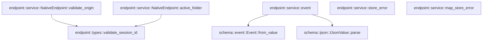

```mermaid
flowchart TD
  n0["endpoint::history::history_page"]
  n1["endpoint::journal::EndpointJournal::open"]
  n2["endpoint::service::NativeEndpoint::keyed"]
  n3["endpoint::service::NativeEndpoint::validate_origin"]
  n4["endpoint::service::NativeEndpoint::active_folder"]
  n5["endpoint::service::event"]
  n6["endpoint::service::NativeEndpoint::submission_snapshot"]
  n7["endpoint::service::NativeEndpoint::prompt_for_endpoint"]
  n8["endpoint::service::NativeEndpoint::prompt_with_operation"]
  n9["endpoint::service::NativeEndpoint::update_queue"]
  n10["endpoint::service::NativeEndpoint::rename_session"]
  n11["endpoint::service::NativeEndpoint::rename_session_for_endpoint"]
  n12["endpoint::service::NativeEndpoint::rename_session_with_operation"]
  n13["endpoint::service::NativeEndpoint::seed_automatic_title_if_missing"]
  n14["endpoint::service::NativeEndpoint::record_session_notice"]
  n15["endpoint::service::NativeEndpoint::refine_automatic_title"]
  n16["endpoint::service::NativeEndpoint::author_keyed_with_ledger"]
  n17["endpoint::service::NativeEndpoint::cancel"]
  n18["endpoint::service::NativeEndpoint::cancel_for_endpoint"]
  n19["endpoint::service::NativeEndpoint::cancel_with_operation"]
  n20["endpoint::service::NativeEndpoint::fork_session"]
  n21["endpoint::service::NativeEndpoint::archive_session"]
  n22["endpoint::service::NativeEndpoint::unarchive_session"]
  n23["endpoint::service::NativeEndpoint::reconcile_projection"]
  n24["endpoint::service::NativeEndpoint::reconciled_journal"]
  n25["endpoint::service::NativeEndpoint::history"]
  n26["endpoint::types::validate_session_id"]
  n27["store::tail::scan_valid_prefix"]
  n2 --> n3
  n7 --> n8
  n8 --> n2
  n8 --> n5
  n8 --> n6
  n9 --> n2
  n9 --> n5
  n10 --> n12
  n11 --> n12
  n12 --> n2
  n12 --> n5
  n13 --> n3
  n13 --> n5
  n14 --> n3
  n14 --> n5
  n15 --> n3
  n15 --> n5
  n16 --> n26
  n17 --> n19
  n18 --> n19
  n19 --> n3
  n19 --> n5
  n19 --> n26
  n20 --> n26
  n21 --> n26
  n22 --> n26
  n23 --> n24
  n24 --> n1
  n24 --> n4
  n24 --> n27
  n25 --> n0
  n25 --> n24
```

# endpoint::service

[Package atlas](index.md) · [Source](../../src/service.rs)

## Declarations

Visibility is the declaration spelling; trait members and reexports require their enclosing interface. `cfg` is not evaluated.

| Symbol | Kind | Visibility | Test / cfg |
|---|---|---|---|
| [endpoint::service::AUTOMATIC_TITLE_SEED_OPERATION](../../src/service.rs#L13) | const_item | `pub` |  |
| [endpoint::service::AUTOMATIC_TITLE_REFINE_OPERATION](../../src/service.rs#L14) | const_item | `pub` |  |
| [endpoint::service::SESSION_NOTICE_OPERATION](../../src/service.rs#L15) | const_item | `pub` |  |
| [endpoint::service::SessionNotice](../../src/service.rs#L22) | struct_item | `pub` |  |
| [endpoint::service::SessionNoticeSeverity](../../src/service.rs#L30) | enum_item | `pub` |  |
| [endpoint::service::SessionNoticeSeverity::as_str](../../src/service.rs#L37) | function_item | `pub` |  |
| [endpoint::service::MutationReceipt](../../src/service.rs#L46) | struct_item | `pub` |  |
| [endpoint::service::MutationReceipt::from](../../src/service.rs#L52) | function_item | `private` |  |
| [endpoint::service::ArchiveResult](../../src/service.rs#L61) | struct_item | `pub` |  |
| [endpoint::service::UnarchiveResult](../../src/service.rs#L66) | struct_item | `pub` |  |
| [endpoint::service::SessionInventoryItem](../../src/service.rs#L71) | struct_item | `pub` |  |
| [endpoint::service::PERMISSION_MODE_FILE](../../src/service.rs#L94) | const_item | `private` |  |
| [endpoint::service::DEFAULT_PERMISSION_MODE](../../src/service.rs#L95) | const_item | `private` |  |
| [endpoint::service::permission_mode_of](../../src/service.rs#L99) | function_item | `pub` |  |
| [endpoint::service::card_item](../../src/service.rs#L116) | function_item | `private` |  |
| [endpoint::service::card_updated_ms](../../src/service.rs#L148) | function_item | `pub` |  |
| [endpoint::service::card_summary](../../src/service.rs#L160) | function_item | `pub` |  |
| [endpoint::service::NativeEndpoint](../../src/service.rs#L207) | struct_item | `pub` |  |
| [endpoint::service::CreateSessionWrite](../../src/service.rs#L211) | struct_item | `private` |  |
| [endpoint::service::NativeEndpoint::open](../../src/service.rs#L222) | function_item | `pub` |  |
| [endpoint::service::NativeEndpoint::capabilities](../../src/service.rs#L229) | function_item | `pub` |  |
| [endpoint::service::NativeEndpoint::list_sessions](../../src/service.rs#L248) | function_item | `pub` |  |
| [endpoint::service::NativeEndpoint::list_sessions_cached](../../src/service.rs#L258) | function_item | `pub` |  |
| [endpoint::service::NativeEndpoint::list_sessions_with](../../src/service.rs#L265) | function_item | `private` |  |
| [endpoint::service::NativeEndpoint::models](../../src/service.rs#L324) | function_item | `pub` |  |
| [endpoint::service::NativeEndpoint::session_config_snapshot](../../src/service.rs#L390) | function_item | `pub` |  |
| [endpoint::service::NativeEndpoint::submission_snapshot](../../src/service.rs#L415) | function_item | `pub` |  |
| [endpoint::service::NativeEndpoint::submission_metadata](../../src/service.rs#L422) | function_item | `pub` |  |
| [endpoint::service::NativeEndpoint::hydrate_historical_submissions](../../src/service.rs#L447) | function_item | `pub` |  |
| [endpoint::service::NativeEndpoint::create_session](../../src/service.rs#L555) | function_item | `pub` |  |
| [endpoint::service::NativeEndpoint::create_session_for_endpoint](../../src/service.rs#L578) | function_item | `pub` |  |
| [endpoint::service::NativeEndpoint::create_session_with_operation](../../src/service.rs#L598) | function_item | `private` |  |
| [endpoint::service::NativeEndpoint::prompt](../../src/service.rs#L628) | function_item | `pub` |  |
| [endpoint::service::NativeEndpoint::prompt_for_endpoint](../../src/service.rs#L639) | function_item | `pub` |  |
| [endpoint::service::NativeEndpoint::prompt_with_operation](../../src/service.rs#L657) | function_item | `private` |  |
| [endpoint::service::NativeEndpoint::update_queue](../../src/service.rs#L680) | function_item | `pub` |  |
| [endpoint::service::NativeEndpoint::rename_session](../../src/service.rs#L695) | function_item | `pub` |  |
| [endpoint::service::NativeEndpoint::rename_session_for_endpoint](../../src/service.rs#L705) | function_item | `pub` |  |
| [endpoint::service::NativeEndpoint::rename_session_with_operation](../../src/service.rs#L715) | function_item | `private` |  |
| [endpoint::service::NativeEndpoint::seed_automatic_title_if_missing](../../src/service.rs#L734) | function_item | `pub` |  |
| [endpoint::service::NativeEndpoint::record_session_notice](../../src/service.rs#L767) | function_item | `pub` |  |
| [endpoint::service::NativeEndpoint::refine_automatic_title](../../src/service.rs#L821) | function_item | `pub` |  |
| [endpoint::service::NativeEndpoint::author_keyed_with_ledger](../../src/service.rs#L862) | function_item | `pub` |  |
| [endpoint::service::NativeEndpoint::cancel](../../src/service.rs#L885) | function_item | `pub` |  |
| [endpoint::service::NativeEndpoint::cancel_for_endpoint](../../src/service.rs#L894) | function_item | `pub` |  |
| [endpoint::service::NativeEndpoint::cancel_with_operation](../../src/service.rs#L903) | function_item | `private` |  |
| [endpoint::service::NativeEndpoint::fork_session](../../src/service.rs#L933) | function_item | `pub` |  |
| [endpoint::service::NativeEndpoint::archive_session](../../src/service.rs#L949) | function_item | `pub` |  |
| [endpoint::service::NativeEndpoint::unarchive_session](../../src/service.rs#L957) | function_item | `pub` |  |
| [endpoint::service::NativeEndpoint::reconcile_projection](../../src/service.rs#L968) | function_item | `pub` |  |
| [endpoint::service::NativeEndpoint::reconciled_journal](../../src/service.rs#L976) | function_item | `private` |  |
| [endpoint::service::NativeEndpoint::history](../../src/service.rs#L990) | function_item | `pub` |  |
| [endpoint::service::NativeEndpoint::keyed](../../src/service.rs#L1000) | function_item | `private` |  |
| [endpoint::service::NativeEndpoint::validate_origin](../../src/service.rs#L1018) | function_item | `private` |  |
| [endpoint::service::NativeEndpoint::active_folder](../../src/service.rs#L1031) | function_item | `private` |  |
| [endpoint::service::event](../../src/service.rs#L1044) | function_item | `private` |  |
| [endpoint::service::store_error](../../src/service.rs#L1049) | function_item | `private` |  |
| [endpoint::service::map_store_error](../../src/service.rs#L1053) | function_item | `private` |  |
| [endpoint::service::NativeEndpointError](../../src/service.rs#L1062) | enum_item | `pub` |  |

## Imports / reexports

| Local name | Source path | Visibility |
|---|---|---|
| `BTreeSet` | `std::collections::BTreeSet` | `private` |
| `HashSet` | `std::collections::HashSet` | `private` |
| `fs` | `std::fs` | `private` |
| `Path` | `std::path::Path` | `private` |
| `Event` | `schema::Event` | `private` |
| `EventKind` | `schema::EventKind` | `private` |
| `IJsonValue` | `schema::IJsonValue` | `private` |
| `OriginTuple` | `schema::OriginTuple` | `private` |
| `ResumePolicy` | `schema::ResumePolicy` | `private` |
| `SeqRange` | `schema::SeqRange` | `private` |
| `Value` | `serde_json::Value` | `private` |
| `json` | `serde_json::json` | `private` |
| `AppendOutcome` | `store::AppendOutcome` | `private` |
| `ConditionalAppendOutcome` | `store::ConditionalAppendOutcome` | `private` |
| `ThreadStore` | `store::ThreadStore` | `private` |
| `scan_valid_prefix` | `store::scan_valid_prefix` | `private` |
| `Error` | `thiserror::Error` | `private` |
| `timestamp_millis` | `crate::projection::timestamp_millis` | `private` |
| `EndpointJournal` | `crate::EndpointJournal` | `private` |
| `HistoryPage` | `crate::HistoryPage` | `private` |
| `Projector` | `crate::Projector` | `private` |
| `history_page` | `crate::history_page` | `private` |
| `validate_session_id` | `crate::validate_session_id` | `private` |

## Module declarations

| Module | Visibility | Attributes |
|---|---|---|

## Function call graphs

Edges below are syntactically resolved calls only, including private functions. Graphs partition callers into groups of 20; they are not execution order. All unresolved sites are listed below and in the JSON inventory.

```mermaid
flowchart TD
  n0["endpoint::projection::timestamp_millis"]
  n1["endpoint::service::NativeEndpoint::active_folder"]
  n2["endpoint::service::card_item"]
  n3["endpoint::service::card_updated_ms"]
  n4["endpoint::service::card_summary"]
  n5["endpoint::service::NativeEndpoint::open"]
  n6["endpoint::service::NativeEndpoint::capabilities"]
  n7["endpoint::service::NativeEndpoint::list_sessions"]
  n8["endpoint::service::NativeEndpoint::list_sessions_cached"]
  n9["endpoint::service::NativeEndpoint::list_sessions_with"]
  n10["endpoint::service::NativeEndpoint::models"]
  n11["endpoint::service::SessionNoticeSeverity::as_str"]
  n12["endpoint::service::NativeEndpoint::session_config_snapshot"]
  n13["endpoint::service::NativeEndpoint::submission_snapshot"]
  n14["endpoint::service::NativeEndpoint::submission_metadata"]
  n15["endpoint::service::NativeEndpoint::hydrate_historical_submissions"]
  n16["endpoint::service::MutationReceipt::from"]
  n17["endpoint::service::NativeEndpoint::create_session"]
  n18["endpoint::service::NativeEndpoint::create_session_for_endpoint"]
  n19["endpoint::service::NativeEndpoint::create_session_with_operation"]
  n20["endpoint::service::NativeEndpoint::prompt"]
  n21["endpoint::service::NativeEndpoint::prompt_with_operation"]
  n22["endpoint::service::permission_mode_of"]
  n23["endpoint::types::validate_session_id"]
  n24["profile::config::ConfigSnapshot::decode"]
  n25["profile::config::ConfigRepository::open"]
  n26["schema::ijson::IJsonValue::parse"]
  n27["store::asset::AssetStore::new"]
  n28["store::card::read_card"]
  n29["store::card::classify"]
  n30["store::folder::ThreadStore::open"]
  n31["store::tail::scan_valid_prefix"]
  n32["store::tail::read_genesis"]
  n2 --> n22
  n2 --> n28
  n2 --> n29
  n3 --> n0
  n4 --> n3
  n5 --> n30
  n7 --> n9
  n8 --> n9
  n9 --> n2
  n9 --> n4
  n9 --> n22
  n9 --> n23
  n9 --> n31
  n10 --> n26
  n12 --> n1
  n12 --> n23
  n12 --> n25
  n12 --> n32
  n13 --> n1
  n13 --> n12
  n13 --> n14
  n13 --> n27
  n14 --> n26
  n15 --> n1
  n15 --> n14
  n15 --> n24
  n15 --> n26
  n15 --> n27
  n15 --> n31
  n17 --> n19
  n18 --> n19
  n19 --> n23
  n20 --> n21
```

Functions 1–20: 33 direct edges

Functions 21–40: 32 direct edges

Functions 41–45: 4 direct edges

## Call sites

Includes test functions (marked in declarations). Receiver-type-required sites need type analysis/manual tracing. Calls in closures are attributed to their enclosing function; their occurrence here does not mean the closure executes immediately.

| Caller | Callee expression | Source lines | Target / classification |
|---|---|---|---|
| `permission_mode_of` | `fs::read` | [100](../../src/service.rs#L100) | external-constructor-callback-or-unresolved |
| `permission_mode_of` | `folder.join` | [100](../../src/service.rs#L100) | receiver-type-required |
| `permission_mode_of` | `DEFAULT_PERMISSION_MODE.to_owned` | [101](../../src/service.rs#L101), [112](../../src/service.rs#L112) | receiver-type-required |
| `permission_mode_of` | `serde_json::from_slice::<serde_json::Value>(&bytes)         .ok()         .and_then(&#124;value&#124; value.get("mode")?.as_str().map(str::to_owned))         .filter(&#124;mode&#124; {             matches!(                 mode.as_str(),                 "read-only" &#124; "workspace-write" &#124; "danger-full-access"             )         })         .unwrap_or_else` | [103](../../src/service.rs#L103) | receiver-type-required |
| `permission_mode_of` | `serde_json::from_slice::<serde_json::Value>(&bytes)         .ok()         .and_then(&#124;value&#124; value.get("mode")?.as_str().map(str::to_owned))         .filter` | [103](../../src/service.rs#L103) | receiver-type-required |
| `permission_mode_of` | `serde_json::from_slice::<serde_json::Value>(&bytes)         .ok()         .and_then` | [103](../../src/service.rs#L103) | receiver-type-required |
| `permission_mode_of` | `serde_json::from_slice::<serde_json::Value>(&bytes)         .ok` | [103](../../src/service.rs#L103) | receiver-type-required |
| `permission_mode_of` | `serde_json::from_slice::<serde_json::Value>` | [103](../../src/service.rs#L103) | external-constructor-callback-or-unresolved |
| `permission_mode_of` | `value.get("mode")?.as_str().map` | [105](../../src/service.rs#L105) | receiver-type-required |
| `permission_mode_of` | `value.get("mode")?.as_str` | [105](../../src/service.rs#L105) | receiver-type-required |
| `permission_mode_of` | `value.get` | [105](../../src/service.rs#L105) | receiver-type-required |
| `card_item` | `store::card::read_card` | [122](../../src/service.rs#L122) | [store::card::read_card](../../../store/src/card.rs#L172) |
| `card_item` | `store::card::classify(folder, &card).ok` | [123](../../src/service.rs#L123) | receiver-type-required |
| `card_item` | `store::card::classify` | [123](../../src/service.rs#L123) | [store::card::classify](../../../store/src/card.rs#L387) |
| `card_item` | `classified.freshness` | [124](../../src/service.rs#L124) | receiver-type-required |
| `card_item` | `card.lines.first` | [127](../../src/service.rs#L127) | receiver-type-required |
| `card_item` | `Some` | [131](../../src/service.rs#L131) | external-constructor-callback-or-unresolved |
| `card_item` | `session_id.to_owned` | [132](../../src/service.rs#L132) | receiver-type-required |
| `card_item` | `card.summary.workspace.clone` | [133](../../src/service.rs#L133) | receiver-type-required |
| `card_item` | `card.summary.title.clone` | [134](../../src/service.rs#L134) | receiver-type-required |
| `card_item` | `main.facts.clone` | [140](../../src/service.rs#L140) | receiver-type-required |
| `card_item` | `permission_mode_of` | [141](../../src/service.rs#L141) | [endpoint::service::permission_mode_of](../../src/service.rs#L99) |
| `card_item` | `card.summary.identity_profile.clone` | [142](../../src/service.rs#L142) | receiver-type-required |
| `card_updated_ms` | `Ok` | [149](../../src/service.rs#L149) | external-constructor-callback-or-unresolved |
| `card_updated_ms` | `projection         .events         .last()         .and_then(&#124;event&#124; event.string_field("ts"))         .ok_or(NativeEndpointError::InventoryTimestamp)         .and_then` | [149](../../src/service.rs#L149) | receiver-type-required |
| `card_updated_ms` | `projection         .events         .last()         .and_then(&#124;event&#124; event.string_field("ts"))         .ok_or` | [149](../../src/service.rs#L149) | receiver-type-required |
| `card_updated_ms` | `projection         .events         .last()         .and_then` | [149](../../src/service.rs#L149) | receiver-type-required |
| `card_updated_ms` | `projection         .events         .last` | [149](../../src/service.rs#L149) | receiver-type-required |
| `card_updated_ms` | `event.string_field` | [152](../../src/service.rs#L152) | receiver-type-required |
| `card_updated_ms` | `timestamp_millis(value).map_err` | [154](../../src/service.rs#L154) | receiver-type-required |
| `card_updated_ms` | `timestamp_millis` | [154](../../src/service.rs#L154) | [endpoint::projection::timestamp_millis](../../src/projection.rs#L944) |
| `card_summary` | `projection.events.first().ok_or_else` | [163](../../src/service.rs#L163) | receiver-type-required |
| `card_summary` | `projection.events.first` | [163](../../src/service.rs#L163) | receiver-type-required |
| `card_summary` | `NativeEndpointError::Store` | [164](../../src/service.rs#L164) | external-constructor-callback-or-unresolved |
| `card_summary` | `store::StoreError::Corruption` | [164](../../src/service.rs#L164) | external-constructor-callback-or-unresolved |
| `card_summary` | `"ledger has no genesis".to_owned` | [165](../../src/service.rs#L165) | receiver-type-required |
| `card_summary` | `projection         .events         .iter()         .rev()         .find_map(&#124;event&#124; event.string_field("title"))         .map` | [168](../../src/service.rs#L168) | receiver-type-required |
| `card_summary` | `projection         .events         .iter()         .rev()         .find_map` | [168](../../src/service.rs#L168) | receiver-type-required |
| `card_summary` | `projection         .events         .iter()         .rev` | [168](../../src/service.rs#L168) | receiver-type-required |
| `card_summary` | `projection         .events         .iter` | [168](../../src/service.rs#L168) | receiver-type-required |
| `card_summary` | `event.string_field` | [172](../../src/service.rs#L172), [180](../../src/service.rs#L180) | receiver-type-required |
| `card_summary` | `card_updated_ms` | [174](../../src/service.rs#L174) | [endpoint::service::card_updated_ms](../../src/service.rs#L148) |
| `card_summary` | `genesis.string_field` | [175](../../src/service.rs#L175), [177](../../src/service.rs#L177), [197](../../src/service.rs#L197), [198](../../src/service.rs#L198) | receiver-type-required |
| `card_summary` | `Some` | [176](../../src/service.rs#L176), [180](../../src/service.rs#L180) | external-constructor-callback-or-unresolved |
| `card_summary` | `"coding".to_owned` | [176](../../src/service.rs#L176) | receiver-type-required |
| `card_summary` | `genesis.string_field("identity_profile").map` | [177](../../src/service.rs#L177) | receiver-type-required |
| `card_summary` | `projection.events.iter().find_map` | [178](../../src/service.rs#L178) | receiver-type-required |
| `card_summary` | `projection.events.iter` | [178](../../src/service.rs#L178) | receiver-type-required |
| `card_summary` | `event.kind` | [179](../../src/service.rs#L179) | receiver-type-required |
| `card_summary` | `serde_json::to_value(event.raw())                 .ok()?                 .get("payload")?                 .get("profile")?                 .as_str()                 .map` | [184](../../src/service.rs#L184) | receiver-type-required |
| `card_summary` | `serde_json::to_value(event.raw())                 .ok()?                 .get("payload")?                 .get("profile")?                 .as_str` | [184](../../src/service.rs#L184) | receiver-type-required |
| `card_summary` | `serde_json::to_value(event.raw())                 .ok()?                 .get("payload")?                 .get` | [184](../../src/service.rs#L184) | receiver-type-required |
| `card_summary` | `serde_json::to_value(event.raw())                 .ok()?                 .get` | [184](../../src/service.rs#L184) | receiver-type-required |
| `card_summary` | `serde_json::to_value(event.raw())                 .ok` | [184](../../src/service.rs#L184) | receiver-type-required |
| `card_summary` | `serde_json::to_value` | [184](../../src/service.rs#L184) | external-constructor-callback-or-unresolved |
| `card_summary` | `event.raw` | [184](../../src/service.rs#L184) | receiver-type-required |
| `card_summary` | `Ok` | [192](../../src/service.rs#L192) | external-constructor-callback-or-unresolved |
| `card_summary` | `genesis             .string_field("workspace")             .ok_or(NativeEndpointError::InventoryWorkspace)?             .to_owned` | [193](../../src/service.rs#L193) | receiver-type-required |
| `card_summary` | `genesis             .string_field("workspace")             .ok_or` | [193](../../src/service.rs#L193) | receiver-type-required |
| `card_summary` | `genesis             .string_field` | [193](../../src/service.rs#L193) | receiver-type-required |
| `card_summary` | `genesis.string_field("folder_binding").map` | [197](../../src/service.rs#L197) | receiver-type-required |
| `card_summary` | `genesis.string_field("ts").unwrap_or_default().to_owned` | [198](../../src/service.rs#L198) | receiver-type-required |
| `card_summary` | `genesis.string_field("ts").unwrap_or_default` | [198](../../src/service.rs#L198) | receiver-type-required |
| `card_summary` | `genesis.is_ephemeral_genesis` | [202](../../src/service.rs#L202) | receiver-type-required |
| `card_summary` | `projection.lifecycle.latest_turn.is_none` | [203](../../src/service.rs#L203) | receiver-type-required |
| `open` | `Ok` | [223](../../src/service.rs#L223) | external-constructor-callback-or-unresolved |
| `open` | `ThreadStore::open` | [224](../../src/service.rs#L224) | [store::folder::ThreadStore::open](../../../store/src/folder.rs#L36) |
| `capabilities` | `[             "session.models",             "session.create",             "session.prompt",             "session.updateQueue",             "session.cancel",             "session.rename",             "session.fork",             "session.discard",             "workspace.archiveSession",             "workspace.unarchiveSession",         ]         .into_iter()         .collect` | [230](../../src/service.rs#L230) | receiver-type-required |
| `capabilities` | `[             "session.models",             "session.create",             "session.prompt",             "session.updateQueue",             "session.cancel",             "session.rename",             "session.fork",             "session.discard",             "workspace.archiveSession",             "workspace.unarchiveSession",         ]         .into_iter` | [230](../../src/service.rs#L230) | receiver-type-required |
| `list_sessions` | `self.list_sessions_with` | [252](../../src/service.rs#L252) | [endpoint::service::NativeEndpoint::list_sessions_with](../../src/service.rs#L265) |
| `list_sessions_cached` | `self.list_sessions_with` | [262](../../src/service.rs#L262) | [endpoint::service::NativeEndpoint::list_sessions_with](../../src/service.rs#L265) |
| `list_sessions_with` | `Vec::new` | [270](../../src/service.rs#L270) | external-constructor-callback-or-unresolved |
| `list_sessions_with` | `fs::read_dir` | [272](../../src/service.rs#L272) | external-constructor-callback-or-unresolved |
| `list_sessions_with` | `self.store.root().join` | [272](../../src/service.rs#L272) | receiver-type-required |
| `list_sessions_with` | `self.store.root` | [272](../../src/service.rs#L272) | receiver-type-required |
| `list_sessions_with` | `entry.file_type()?.is_dir` | [274](../../src/service.rs#L274) | receiver-type-required |
| `list_sessions_with` | `entry.file_type` | [274](../../src/service.rs#L274) | receiver-type-required |
| `list_sessions_with` | `entry.file_name().to_string_lossy().into_owned` | [277](../../src/service.rs#L277) | receiver-type-required |
| `list_sessions_with` | `entry.file_name().to_string_lossy` | [277](../../src/service.rs#L277) | receiver-type-required |
| `list_sessions_with` | `entry.file_name` | [277](../../src/service.rs#L277) | receiver-type-required |
| `list_sessions_with` | `validate_session_id` | [278](../../src/service.rs#L278) | [endpoint::types::validate_session_id](../../src/types.rs#L130) |
| `list_sessions_with` | `running.contains` | [280](../../src/service.rs#L280) | receiver-type-required |
| `list_sessions_with` | `self.store.session_has_live_line_holder` | [281](../../src/service.rs#L281) | receiver-type-required |
| `list_sessions_with` | `card_item` | [283](../../src/service.rs#L283) | [endpoint::service::card_item](../../src/service.rs#L116) |
| `list_sessions_with` | `entry.path` | [283](../../src/service.rs#L283), [289](../../src/service.rs#L289), [305](../../src/service.rs#L305) | receiver-type-required |
| `list_sessions_with` | `items.push` | [285](../../src/service.rs#L285), [304](../../src/service.rs#L304) | receiver-type-required |
| `list_sessions_with` | `fs::read` | [289](../../src/service.rs#L289) | external-constructor-callback-or-unresolved |
| `list_sessions_with` | `entry.path().join` | [289](../../src/service.rs#L289) | receiver-type-required |
| `list_sessions_with` | `scan_valid_prefix` | [290](../../src/service.rs#L290) | [store::tail::scan_valid_prefix](../../../store/src/tail.rs#L37) |
| `list_sessions_with` | `scan.projection.ok_or_else` | [291](../../src/service.rs#L291) | receiver-type-required |
| `list_sessions_with` | `NativeEndpointError::Store` | [292](../../src/service.rs#L292), [298](../../src/service.rs#L298) | external-constructor-callback-or-unresolved |
| `list_sessions_with` | `store::StoreError::Corruption` | [292](../../src/service.rs#L292), [298](../../src/service.rs#L298) | external-constructor-callback-or-unresolved |
| `list_sessions_with` | `card_summary(&projection).map_err` | [296](../../src/service.rs#L296) | receiver-type-required |
| `list_sessions_with` | `card_summary` | [296](../../src/service.rs#L296) | [endpoint::service::card_summary](../../src/service.rs#L160) |
| `list_sessions_with` | `permission_mode_of` | [305](../../src/service.rs#L305) | [endpoint::service::permission_mode_of](../../src/service.rs#L99) |
| `list_sessions_with` | `items.sort_by` | [320](../../src/service.rs#L320) | receiver-type-required |
| `list_sessions_with` | `left.session_id.as_bytes().cmp` | [320](../../src/service.rs#L320) | receiver-type-required |
| `list_sessions_with` | `left.session_id.as_bytes` | [320](../../src/service.rs#L320) | receiver-type-required |
| `list_sessions_with` | `right.session_id.as_bytes` | [320](../../src/service.rs#L320) | receiver-type-required |
| `list_sessions_with` | `Ok` | [321](../../src/service.rs#L321) | external-constructor-callback-or-unresolved |
| `models` | `snapshot             .session_settings             .as_ref()             .map(&#124;settings&#124; &settings.provider)             .or(snapshot.workspace.policy.provider.as_ref())             .or` | [328](../../src/service.rs#L328) | receiver-type-required |
| `models` | `snapshot             .session_settings             .as_ref()             .map(&#124;settings&#124; &settings.provider)             .or` | [328](../../src/service.rs#L328) | receiver-type-required |
| `models` | `snapshot             .session_settings             .as_ref()             .map` | [328](../../src/service.rs#L328), [334](../../src/service.rs#L334) | receiver-type-required |
| `models` | `snapshot             .session_settings             .as_ref` | [328](../../src/service.rs#L328), [334](../../src/service.rs#L334), [370](../../src/service.rs#L370) | receiver-type-required |
| `models` | `snapshot.workspace.policy.provider.as_ref` | [332](../../src/service.rs#L332) | receiver-type-required |
| `models` | `snapshot.settings.default_provider.as_ref` | [333](../../src/service.rs#L333) | receiver-type-required |
| `models` | `snapshot             .session_settings             .as_ref()             .map(&#124;settings&#124; &settings.model)             .or(snapshot.workspace.policy.model.as_ref())             .or` | [334](../../src/service.rs#L334) | receiver-type-required |
| `models` | `snapshot             .session_settings             .as_ref()             .map(&#124;settings&#124; &settings.model)             .or` | [334](../../src/service.rs#L334) | receiver-type-required |
| `models` | `snapshot.workspace.policy.model.as_ref` | [338](../../src/service.rs#L338) | receiver-type-required |
| `models` | `snapshot.settings.default_model.as_ref` | [339](../../src/service.rs#L339) | receiver-type-required |
| `models` | `snapshot             .providers             .providers             .iter()             .map(&#124;provider&#124; {                 json!({                     "id": provider.id,                     "name": provider.id,                     "models": provider.models.iter().filter(&#124;model&#124; model.enabled).map(&#124;model&#124; {                         json!({"id": model.id, "name": model.id,                             "contextWindow": model.context_window_tokens})                     }).collect::<Vec<_>>()                 })             })             .collect::<Vec<_>>` | [340](../../src/service.rs#L340) | receiver-type-required |
| `models` | `snapshot             .providers             .providers             .iter()             .map` | [340](../../src/service.rs#L340) | receiver-type-required |
| `models` | `snapshot             .providers             .providers             .iter` | [340](../../src/service.rs#L340) | receiver-type-required |
| `models` | `selected_provider             .zip(selected_model)             .is_some_and` | [355](../../src/service.rs#L355) | receiver-type-required |
| `models` | `selected_provider             .zip` | [355](../../src/service.rs#L355) | receiver-type-required |
| `models` | `snapshot.providers.providers.iter().any` | [358](../../src/service.rs#L358) | receiver-type-required |
| `models` | `snapshot.providers.providers.iter` | [358](../../src/service.rs#L358) | receiver-type-required |
| `models` | `candidate                             .models                             .iter()                             .any` | [360](../../src/service.rs#L360) | receiver-type-required |
| `models` | `candidate                             .models                             .iter` | [360](../../src/service.rs#L360) | receiver-type-required |
| `models` | `snapshot             .session_settings             .as_ref()             .and_then` | [370](../../src/service.rs#L370) | receiver-type-required |
| `models` | `settings.reasoning_effort.as_ref` | [373](../../src/service.rs#L373) | receiver-type-required |
| `models` | `Value::String` | [375](../../src/service.rs#L375) | external-constructor-callback-or-unresolved |
| `models` | `effort.clone` | [375](../../src/service.rs#L375) | receiver-type-required |
| `models` | `Ok` | [383](../../src/service.rs#L383) | external-constructor-callback-or-unresolved |
| `models` | `IJsonValue::parse` | [383](../../src/service.rs#L383) | [schema::ijson::IJsonValue::parse](../../../schema/src/ijson.rs#L16) |
| `models` | `serde_json::to_vec` | [383](../../src/service.rs#L383) | external-constructor-callback-or-unresolved |
| `session_config_snapshot` | `validate_session_id` | [394](../../src/service.rs#L394) | [endpoint::types::validate_session_id](../../src/types.rs#L130) |
| `session_config_snapshot` | `self.active_folder` | [395](../../src/service.rs#L395) | [endpoint::service::NativeEndpoint::active_folder](../../src/service.rs#L1031) |
| `session_config_snapshot` | `store::read_genesis(folder.join("main.jsonl"))?.ok_or_else` | [397](../../src/service.rs#L397) | receiver-type-required |
| `session_config_snapshot` | `store::read_genesis` | [397](../../src/service.rs#L397) | [store::tail::read_genesis](../../../store/src/tail.rs#L86) |
| `session_config_snapshot` | `folder.join` | [397](../../src/service.rs#L397) | receiver-type-required |
| `session_config_snapshot` | `NativeEndpointError::Store` | [398](../../src/service.rs#L398) | external-constructor-callback-or-unresolved |
| `session_config_snapshot` | `store::StoreError::Corruption` | [398](../../src/service.rs#L398) | external-constructor-callback-or-unresolved |
| `session_config_snapshot` | `"session ledger has no valid genesis prefix".to_owned` | [399](../../src/service.rs#L399) | receiver-type-required |
| `session_config_snapshot` | `genesis             .string_field("workspace")             .ok_or` | [403](../../src/service.rs#L403) | receiver-type-required |
| `session_config_snapshot` | `genesis             .string_field` | [403](../../src/service.rs#L403) | receiver-type-required |
| `session_config_snapshot` | `profile::ConfigRepository::open` | [406](../../src/service.rs#L406) | [profile::config::ConfigRepository::open](../../../profile/src/config.rs#L684) |
| `session_config_snapshot` | `self.store.root` | [406](../../src/service.rs#L406) | receiver-type-required |
| `session_config_snapshot` | `Ok` | [407](../../src/service.rs#L407) | external-constructor-callback-or-unresolved |
| `session_config_snapshot` | `genesis.string_field` | [407](../../src/service.rs#L407) | receiver-type-required |
| `session_config_snapshot` | `repository.resolve_for_session_binding` | [408](../../src/service.rs#L408) | receiver-type-required |
| `session_config_snapshot` | `repository.resolve_for_session` | [409](../../src/service.rs#L409) | receiver-type-required |
| `submission_snapshot` | `self.session_config_snapshot` | [416](../../src/service.rs#L416) | [endpoint::service::NativeEndpoint::session_config_snapshot](../../src/service.rs#L390) |
| `submission_snapshot` | `store::AssetStore::new` | [417](../../src/service.rs#L417) | [store::asset::AssetStore::new](../../../store/src/asset.rs#L27) |
| `submission_snapshot` | `self.active_folder(session_id)?.join` | [417](../../src/service.rs#L417) | receiver-type-required |
| `submission_snapshot` | `self.active_folder` | [417](../../src/service.rs#L417) | [endpoint::service::NativeEndpoint::active_folder](../../src/service.rs#L1031) |
| `submission_snapshot` | `config.publish` | [418](../../src/service.rs#L418) | receiver-type-required |
| `submission_snapshot` | `Self::submission_metadata` | [419](../../src/service.rs#L419) | [endpoint::service::NativeEndpoint::submission_metadata](../../src/service.rs#L422) |
| `submission_metadata` | `config             .session_settings             .as_ref()             .map(&#124;s&#124; s.provider.as_str())             .or(config.workspace.policy.provider.as_deref())             .or` | [426](../../src/service.rs#L426) | receiver-type-required |
| `submission_metadata` | `config             .session_settings             .as_ref()             .map(&#124;s&#124; s.provider.as_str())             .or` | [426](../../src/service.rs#L426) | receiver-type-required |
| `submission_metadata` | `config             .session_settings             .as_ref()             .map` | [426](../../src/service.rs#L426), [432](../../src/service.rs#L432) | receiver-type-required |
| `submission_metadata` | `config             .session_settings             .as_ref` | [426](../../src/service.rs#L426), [432](../../src/service.rs#L432) | receiver-type-required |
| `submission_metadata` | `s.provider.as_str` | [429](../../src/service.rs#L429) | receiver-type-required |
| `submission_metadata` | `config.workspace.policy.provider.as_deref` | [430](../../src/service.rs#L430) | receiver-type-required |
| `submission_metadata` | `config.settings.default_provider.as_deref` | [431](../../src/service.rs#L431) | receiver-type-required |
| `submission_metadata` | `config             .session_settings             .as_ref()             .map(&#124;s&#124; s.model.as_str())             .or(config.workspace.policy.model.as_deref())             .or` | [432](../../src/service.rs#L432) | receiver-type-required |
| `submission_metadata` | `config             .session_settings             .as_ref()             .map(&#124;s&#124; s.model.as_str())             .or` | [432](../../src/service.rs#L432) | receiver-type-required |
| `submission_metadata` | `s.model.as_str` | [435](../../src/service.rs#L435) | receiver-type-required |
| `submission_metadata` | `config.workspace.policy.model.as_deref` | [436](../../src/service.rs#L436) | receiver-type-required |
| `submission_metadata` | `config.settings.default_model.as_deref` | [437](../../src/service.rs#L437) | receiver-type-required |
| `submission_metadata` | `Ok` | [438](../../src/service.rs#L438) | external-constructor-callback-or-unresolved |
| `submission_metadata` | `IJsonValue::parse` | [438](../../src/service.rs#L438) | [schema::ijson::IJsonValue::parse](../../../schema/src/ijson.rs#L16) |
| `submission_metadata` | `serde_json::to_vec` | [438](../../src/service.rs#L438) | external-constructor-callback-or-unresolved |
| `hydrate_historical_submissions` | `entries.iter().any` | [455](../../src/service.rs#L455) | receiver-type-required |
| `hydrate_historical_submissions` | `entries.iter` | [455](../../src/service.rs#L455) | receiver-type-required |
| `hydrate_historical_submissions` | `serde_json::to_value(&entry.event.data)                     .is_ok_and` | [457](../../src/service.rs#L457) | receiver-type-required |
| `hydrate_historical_submissions` | `serde_json::to_value` | [457](../../src/service.rs#L457), [479](../../src/service.rs#L479), [530](../../src/service.rs#L530), [543](../../src/service.rs#L543) | external-constructor-callback-or-unresolved |
| `hydrate_historical_submissions` | `data.get("submission").is_none` | [458](../../src/service.rs#L458) | receiver-type-required |
| `hydrate_historical_submissions` | `data.get` | [458](../../src/service.rs#L458), [533](../../src/service.rs#L533) | receiver-type-required |
| `hydrate_historical_submissions` | `self.active_folder` | [463](../../src/service.rs#L463) | [endpoint::service::NativeEndpoint::active_folder](../../src/service.rs#L1031) |
| `hydrate_historical_submissions` | `fs::read` | [466](../../src/service.rs#L466) | external-constructor-callback-or-unresolved |
| `hydrate_historical_submissions` | `folder.join` | [466](../../src/service.rs#L466), [472](../../src/service.rs#L472) | receiver-type-required |
| `hydrate_historical_submissions` | `scan_valid_prefix` | [469](../../src/service.rs#L469) | [store::tail::scan_valid_prefix](../../../store/src/tail.rs#L37) |
| `hydrate_historical_submissions` | `store::AssetStore::new` | [472](../../src/service.rs#L472) | [store::asset::AssetStore::new](../../../store/src/asset.rs#L27) |
| `hydrate_historical_submissions` | `std::collections::BTreeMap::new` | [476](../../src/service.rs#L476), [477](../../src/service.rs#L477) | external-constructor-callback-or-unresolved |
| `hydrate_historical_submissions` | `event.raw` | [479](../../src/service.rs#L479) | receiver-type-required |
| `hydrate_historical_submissions` | `event.kind` | [482](../../src/service.rs#L482) | receiver-type-required |
| `hydrate_historical_submissions` | `value                         .get("config")                         .and_then(&#124;c&#124; c.get("digest"))                         .and_then(Value::as_str)                         .map` | [484](../../src/service.rs#L484) | receiver-type-required |
| `hydrate_historical_submissions` | `value                         .get("config")                         .and_then(&#124;c&#124; c.get("digest"))                         .and_then` | [484](../../src/service.rs#L484) | receiver-type-required |
| `hydrate_historical_submissions` | `value                         .get("config")                         .and_then` | [484](../../src/service.rs#L484) | receiver-type-required |
| `hydrate_historical_submissions` | `value                         .get` | [484](../../src/service.rs#L484), [491](../../src/service.rs#L491), [500](../../src/service.rs#L500) | receiver-type-required |
| `hydrate_historical_submissions` | `c.get` | [486](../../src/service.rs#L486) | receiver-type-required |
| `hydrate_historical_submissions` | `value                         .get("config_digest")                         .and_then(Value::as_str)                         .map` | [491](../../src/service.rs#L491) | receiver-type-required |
| `hydrate_historical_submissions` | `value                         .get("config_digest")                         .and_then` | [491](../../src/service.rs#L491) | receiver-type-required |
| `hydrate_historical_submissions` | `inputs.insert` | [497](../../src/service.rs#L497) | receiver-type-required |
| `hydrate_historical_submissions` | `event.seq` | [497](../../src/service.rs#L497) | receiver-type-required |
| `hydrate_historical_submissions` | `value                         .get("trigger")                         .and_then(&#124;t&#124; t.get("inputs"))                         .and_then` | [500](../../src/service.rs#L500) | receiver-type-required |
| `hydrate_historical_submissions` | `value                         .get("trigger")                         .and_then` | [500](../../src/service.rs#L500) | receiver-type-required |
| `hydrate_historical_submissions` | `t.get` | [502](../../src/service.rs#L502) | receiver-type-required |
| `hydrate_historical_submissions` | `digest.as_deref().and_then` | [507](../../src/service.rs#L507) | receiver-type-required |
| `hydrate_historical_submissions` | `digest.as_deref` | [507](../../src/service.rs#L507) | receiver-type-required |
| `hydrate_historical_submissions` | `assets.read_verified(&format!("sha256-{digest}")).ok` | [508](../../src/service.rs#L508) | receiver-type-required |
| `hydrate_historical_submissions` | `assets.read_verified` | [508](../../src/service.rs#L508) | receiver-type-required |
| `hydrate_historical_submissions` | `profile::ConfigSnapshot::decode(&bytes).ok` | [509](../../src/service.rs#L509) | receiver-type-required |
| `hydrate_historical_submissions` | `profile::ConfigSnapshot::decode` | [509](../../src/service.rs#L509) | [profile::config::ConfigSnapshot::decode](../../../profile/src/config.rs#L289) |
| `hydrate_historical_submissions` | `Self::submission_metadata(&config, digest).ok` | [510](../../src/service.rs#L510) | receiver-type-required |
| `hydrate_historical_submissions` | `Self::submission_metadata` | [510](../../src/service.rs#L510) | [endpoint::service::NativeEndpoint::submission_metadata](../../src/service.rs#L422) |
| `hydrate_historical_submissions` | `seqs.iter().filter_map` | [512](../../src/service.rs#L512) | receiver-type-required |
| `hydrate_historical_submissions` | `seqs.iter` | [512](../../src/service.rs#L512) | receiver-type-required |
| `hydrate_historical_submissions` | `inputs                             .get(&seq)                             .and_then(&#124;input&#124; input.get("submission"))                             .and_then(&#124;s&#124; IJsonValue::parse(&serde_json::to_vec(s).ok()?).ok())                             .or_else` | [513](../../src/service.rs#L513) | receiver-type-required |
| `hydrate_historical_submissions` | `inputs                             .get(&seq)                             .and_then(&#124;input&#124; input.get("submission"))                             .and_then` | [513](../../src/service.rs#L513) | receiver-type-required |
| `hydrate_historical_submissions` | `inputs                             .get(&seq)                             .and_then` | [513](../../src/service.rs#L513) | receiver-type-required |
| `hydrate_historical_submissions` | `inputs                             .get` | [513](../../src/service.rs#L513) | receiver-type-required |
| `hydrate_historical_submissions` | `input.get` | [515](../../src/service.rs#L515) | receiver-type-required |
| `hydrate_historical_submissions` | `IJsonValue::parse(&serde_json::to_vec(s).ok()?).ok` | [516](../../src/service.rs#L516) | receiver-type-required |
| `hydrate_historical_submissions` | `IJsonValue::parse` | [516](../../src/service.rs#L516), [548](../../src/service.rs#L548) | [schema::ijson::IJsonValue::parse](../../../schema/src/ijson.rs#L16) |
| `hydrate_historical_submissions` | `serde_json::to_vec(s).ok` | [516](../../src/service.rs#L516) | receiver-type-required |
| `hydrate_historical_submissions` | `serde_json::to_vec` | [516](../../src/service.rs#L516), [547](../../src/service.rs#L547) | external-constructor-callback-or-unresolved |
| `hydrate_historical_submissions` | `historical.clone` | [517](../../src/service.rs#L517) | receiver-type-required |
| `hydrate_historical_submissions` | `submissions.insert` | [519](../../src/service.rs#L519) | receiver-type-required |
| `hydrate_historical_submissions` | `data.get("submission").is_some` | [533](../../src/service.rs#L533) | receiver-type-required |
| `hydrate_historical_submissions` | `data                 .get("id")                 .and_then(Value::as_str)                 .and_then` | [536](../../src/service.rs#L536) | receiver-type-required |
| `hydrate_historical_submissions` | `data                 .get("id")                 .and_then` | [536](../../src/service.rs#L536) | receiver-type-required |
| `hydrate_historical_submissions` | `data                 .get` | [536](../../src/service.rs#L536) | receiver-type-required |
| `hydrate_historical_submissions` | `submissions.get` | [539](../../src/service.rs#L539) | receiver-type-required |
| `create_session` | `self.create_session_with_operation` | [564](../../src/service.rs#L564) | [endpoint::service::NativeEndpoint::create_session_with_operation](../../src/service.rs#L598) |
| `create_session_for_endpoint` | `self.create_session_with_operation` | [587](../../src/service.rs#L587) | [endpoint::service::NativeEndpoint::create_session_with_operation](../../src/service.rs#L598) |
| `create_session_with_operation` | `validate_session_id` | [602](../../src/service.rs#L602) | [endpoint::types::validate_session_id](../../src/types.rs#L130) |
| `create_session_with_operation` | `Err` | [604](../../src/service.rs#L604) | external-constructor-callback-or-unresolved |
| `create_session_with_operation` | `event` | [606](../../src/service.rs#L606) | external-constructor-callback-or-unresolved |
| `create_session_with_operation` | `Ok` | [621](../../src/service.rs#L621) | external-constructor-callback-or-unresolved |
| `create_session_with_operation` | `self             .store             .create_thread(write.session_id, event)             .map_err` | [621](../../src/service.rs#L621) | receiver-type-required |
| `create_session_with_operation` | `self             .store             .create_thread` | [621](../../src/service.rs#L621) | receiver-type-required |
| `prompt` | `self.prompt_with_operation` | [636](../../src/service.rs#L636) | [endpoint::service::NativeEndpoint::prompt_with_operation](../../src/service.rs#L657) |
| `prompt_for_endpoint` | `self.prompt_with_operation` | [647](../../src/service.rs#L647) | [endpoint::service::NativeEndpoint::prompt_with_operation](../../src/service.rs#L657) |
| `prompt_with_operation` | `self.keyed` | [666](../../src/service.rs#L666) | [endpoint::service::NativeEndpoint::keyed](../../src/service.rs#L1000) |
| `prompt_with_operation` | `self.submission_snapshot` | [667](../../src/service.rs#L667) | [endpoint::service::NativeEndpoint::submission_snapshot](../../src/service.rs#L415) |
| `prompt_with_operation` | `Value::Bool` | [674](../../src/service.rs#L674) | external-constructor-callback-or-unresolved |
| `prompt_with_operation` | `event` | [676](../../src/service.rs#L676) | [endpoint::service::event](../../src/service.rs#L1044) |
| `update_queue` | `self.keyed` | [687](../../src/service.rs#L687) | [endpoint::service::NativeEndpoint::keyed](../../src/service.rs#L1000) |
| `update_queue` | `event` | [688](../../src/service.rs#L688) | [endpoint::service::event](../../src/service.rs#L1044) |
| `rename_session` | `self.rename_session_with_operation` | [702](../../src/service.rs#L702) | [endpoint::service::NativeEndpoint::rename_session_with_operation](../../src/service.rs#L715) |
| `rename_session_for_endpoint` | `self.rename_session_with_operation` | [712](../../src/service.rs#L712) | [endpoint::service::NativeEndpoint::rename_session_with_operation](../../src/service.rs#L715) |
| `rename_session_with_operation` | `self.keyed` | [723](../../src/service.rs#L723) | [endpoint::service::NativeEndpoint::keyed](../../src/service.rs#L1000) |
| `rename_session_with_operation` | `event` | [724](../../src/service.rs#L724) | [endpoint::service::event](../../src/service.rs#L1044) |
| `seed_automatic_title_if_missing` | `self.validate_origin` | [741](../../src/service.rs#L741) | [endpoint::service::NativeEndpoint::validate_origin](../../src/service.rs#L1018) |
| `seed_automatic_title_if_missing` | `self             .store             .append_keyed_with_projection_if(session_id, origin, &#124;seq, projection&#124; {                 if projection.events.iter().any(&#124;item&#124; {                     *item.kind() == EventKind::Meta && item.string_field("title").is_some()                 }) {                     return Ok(None);                 }                 event(json!({                     "v": 1, "seq": seq, "ts": timestamp, "kind": "meta", "title": title,                     "origin_key": origin.key, "origin_tuple": origin,                 }))                 .map(Some)                 .map_err(store_error)             })             .map_err` | [742](../../src/service.rs#L742) | receiver-type-required |
| `seed_automatic_title_if_missing` | `self             .store             .append_keyed_with_projection_if` | [742](../../src/service.rs#L742) | receiver-type-required |
| `seed_automatic_title_if_missing` | `projection.events.iter().any` | [745](../../src/service.rs#L745) | receiver-type-required |
| `seed_automatic_title_if_missing` | `projection.events.iter` | [745](../../src/service.rs#L745) | receiver-type-required |
| `seed_automatic_title_if_missing` | `item.kind` | [746](../../src/service.rs#L746) | receiver-type-required |
| `seed_automatic_title_if_missing` | `item.string_field("title").is_some` | [746](../../src/service.rs#L746) | receiver-type-required |
| `seed_automatic_title_if_missing` | `item.string_field` | [746](../../src/service.rs#L746) | receiver-type-required |
| `seed_automatic_title_if_missing` | `Ok` | [748](../../src/service.rs#L748), [758](../../src/service.rs#L758) | external-constructor-callback-or-unresolved |
| `seed_automatic_title_if_missing` | `event(json!({                     "v": 1, "seq": seq, "ts": timestamp, "kind": "meta", "title": title,                     "origin_key": origin.key, "origin_tuple": origin,                 }))                 .map(Some)                 .map_err` | [750](../../src/service.rs#L750) | receiver-type-required |
| `seed_automatic_title_if_missing` | `event(json!({                     "v": 1, "seq": seq, "ts": timestamp, "kind": "meta", "title": title,                     "origin_key": origin.key, "origin_tuple": origin,                 }))                 .map` | [750](../../src/service.rs#L750) | receiver-type-required |
| `seed_automatic_title_if_missing` | `event` | [750](../../src/service.rs#L750) | [endpoint::service::event](../../src/service.rs#L1044) |
| `seed_automatic_title_if_missing` | `Some` | [759](../../src/service.rs#L759) | external-constructor-callback-or-unresolved |
| `seed_automatic_title_if_missing` | `outcome.into` | [759](../../src/service.rs#L759) | receiver-type-required |
| `record_session_notice` | `self.validate_origin` | [774](../../src/service.rs#L774) | [endpoint::service::NativeEndpoint::validate_origin](../../src/service.rs#L1018) |
| `record_session_notice` | `self.store                 .append_keyed_with_projection_if(session_id, origin, &#124;seq, projection&#124; {                     // A notice that repeats the newest one, with no input in between,                     // says nothing new (the same degraded launch on every worker                     // restart); fold it. An input after it is a fresh attempt the                     // user made, and its outcome must be shown again.                     let latest_notice = projection.events.iter().rposition(&#124;item&#124; {                         *item.kind() == EventKind::Meta && item.has_field("notice")                     });                     if let Some(index) = latest_notice {                         let repeats = serde_json::to_value(projection.events[index].raw())                             .ok()                             .and_then(&#124;value&#124; value.get("notice").cloned())                             .is_some_and(&#124;previous&#124; previous == payload);                         let input_since = projection.events[index + 1..]                             .iter()                             .any(&#124;item&#124; *item.kind() == EventKind::Input);                         if repeats && !input_since {                             return Ok(None);                         }                     }                     event(json!({                         "v": 1, "seq": seq, "ts": timestamp, "kind": "meta",                         "notice": payload,                         "origin_key": origin.key, "origin_tuple": origin,                     }))                     .map(Some)                     .map_err(store_error)                 })                 .map_err` | [782](../../src/service.rs#L782) | receiver-type-required |
| `record_session_notice` | `self.store                 .append_keyed_with_projection_if` | [782](../../src/service.rs#L782) | receiver-type-required |
| `record_session_notice` | `projection.events.iter().rposition` | [788](../../src/service.rs#L788) | receiver-type-required |
| `record_session_notice` | `projection.events.iter` | [788](../../src/service.rs#L788) | receiver-type-required |
| `record_session_notice` | `item.kind` | [789](../../src/service.rs#L789), [798](../../src/service.rs#L798) | receiver-type-required |
| `record_session_notice` | `item.has_field` | [789](../../src/service.rs#L789) | receiver-type-required |
| `record_session_notice` | `serde_json::to_value(projection.events[index].raw())                             .ok()                             .and_then(&#124;value&#124; value.get("notice").cloned())                             .is_some_and` | [792](../../src/service.rs#L792) | receiver-type-required |
| `record_session_notice` | `serde_json::to_value(projection.events[index].raw())                             .ok()                             .and_then` | [792](../../src/service.rs#L792) | receiver-type-required |
| `record_session_notice` | `serde_json::to_value(projection.events[index].raw())                             .ok` | [792](../../src/service.rs#L792) | receiver-type-required |
| `record_session_notice` | `serde_json::to_value` | [792](../../src/service.rs#L792) | external-constructor-callback-or-unresolved |
| `record_session_notice` | `projection.events[index].raw` | [792](../../src/service.rs#L792) | receiver-type-required |
| `record_session_notice` | `value.get("notice").cloned` | [794](../../src/service.rs#L794) | receiver-type-required |
| `record_session_notice` | `value.get` | [794](../../src/service.rs#L794) | receiver-type-required |
| `record_session_notice` | `projection.events[index + 1..]                             .iter()                             .any` | [796](../../src/service.rs#L796) | receiver-type-required |
| `record_session_notice` | `projection.events[index + 1..]                             .iter` | [796](../../src/service.rs#L796) | receiver-type-required |
| `record_session_notice` | `Ok` | [800](../../src/service.rs#L800), [812](../../src/service.rs#L812) | external-constructor-callback-or-unresolved |
| `record_session_notice` | `event(json!({                         "v": 1, "seq": seq, "ts": timestamp, "kind": "meta",                         "notice": payload,                         "origin_key": origin.key, "origin_tuple": origin,                     }))                     .map(Some)                     .map_err` | [803](../../src/service.rs#L803) | receiver-type-required |
| `record_session_notice` | `event(json!({                         "v": 1, "seq": seq, "ts": timestamp, "kind": "meta",                         "notice": payload,                         "origin_key": origin.key, "origin_tuple": origin,                     }))                     .map` | [803](../../src/service.rs#L803) | receiver-type-required |
| `record_session_notice` | `event` | [803](../../src/service.rs#L803) | [endpoint::service::event](../../src/service.rs#L1044) |
| `record_session_notice` | `Some` | [813](../../src/service.rs#L813) | external-constructor-callback-or-unresolved |
| `record_session_notice` | `outcome.into` | [813](../../src/service.rs#L813) | receiver-type-required |
| `refine_automatic_title` | `self.validate_origin` | [828](../../src/service.rs#L828) | [endpoint::service::NativeEndpoint::validate_origin](../../src/service.rs#L1018) |
| `refine_automatic_title` | `self             .store             .append_keyed_with_projection_if(session_id, origin, &#124;seq, projection&#124; {                 let latest_title = projection.events.iter().rev().find(&#124;item&#124; {                     *item.kind() == EventKind::Meta && item.string_field("title").is_some()                 });                 let remains_automatic_seed = latest_title                     .map(Event::origin_tuple)                     .transpose()                     .map_err(store::StoreError::from)?                     .flatten()                     .is_some_and(&#124;tuple&#124; tuple.op == AUTOMATIC_TITLE_SEED_OPERATION);                 if !remains_automatic_seed {                     return Ok(None);                 }                 event(json!({                     "v": 1, "seq": seq, "ts": timestamp, "kind": "meta", "title": title,                     "origin_key": origin.key, "origin_tuple": origin,                 }))                 .map(Some)                 .map_err(store_error)             })             .map_err` | [829](../../src/service.rs#L829) | receiver-type-required |
| `refine_automatic_title` | `self             .store             .append_keyed_with_projection_if` | [829](../../src/service.rs#L829) | receiver-type-required |
| `refine_automatic_title` | `projection.events.iter().rev().find` | [832](../../src/service.rs#L832) | receiver-type-required |
| `refine_automatic_title` | `projection.events.iter().rev` | [832](../../src/service.rs#L832) | receiver-type-required |
| `refine_automatic_title` | `projection.events.iter` | [832](../../src/service.rs#L832) | receiver-type-required |
| `refine_automatic_title` | `item.kind` | [833](../../src/service.rs#L833) | receiver-type-required |
| `refine_automatic_title` | `item.string_field("title").is_some` | [833](../../src/service.rs#L833) | receiver-type-required |
| `refine_automatic_title` | `item.string_field` | [833](../../src/service.rs#L833) | receiver-type-required |
| `refine_automatic_title` | `latest_title                     .map(Event::origin_tuple)                     .transpose()                     .map_err(store::StoreError::from)?                     .flatten()                     .is_some_and` | [835](../../src/service.rs#L835) | receiver-type-required |
| `refine_automatic_title` | `latest_title                     .map(Event::origin_tuple)                     .transpose()                     .map_err(store::StoreError::from)?                     .flatten` | [835](../../src/service.rs#L835) | receiver-type-required |
| `refine_automatic_title` | `latest_title                     .map(Event::origin_tuple)                     .transpose()                     .map_err` | [835](../../src/service.rs#L835) | receiver-type-required |
| `refine_automatic_title` | `latest_title                     .map(Event::origin_tuple)                     .transpose` | [835](../../src/service.rs#L835) | receiver-type-required |
| `refine_automatic_title` | `latest_title                     .map` | [835](../../src/service.rs#L835) | receiver-type-required |
| `refine_automatic_title` | `Ok` | [842](../../src/service.rs#L842), [852](../../src/service.rs#L852) | external-constructor-callback-or-unresolved |
| `refine_automatic_title` | `event(json!({                     "v": 1, "seq": seq, "ts": timestamp, "kind": "meta", "title": title,                     "origin_key": origin.key, "origin_tuple": origin,                 }))                 .map(Some)                 .map_err` | [844](../../src/service.rs#L844) | receiver-type-required |
| `refine_automatic_title` | `event(json!({                     "v": 1, "seq": seq, "ts": timestamp, "kind": "meta", "title": title,                     "origin_key": origin.key, "origin_tuple": origin,                 }))                 .map` | [844](../../src/service.rs#L844) | receiver-type-required |
| `refine_automatic_title` | `event` | [844](../../src/service.rs#L844) | [endpoint::service::event](../../src/service.rs#L1044) |
| `refine_automatic_title` | `Some` | [853](../../src/service.rs#L853) | external-constructor-callback-or-unresolved |
| `refine_automatic_title` | `outcome.into` | [853](../../src/service.rs#L853) | receiver-type-required |
| `author_keyed_with_ledger` | `validate_session_id` | [871](../../src/service.rs#L871) | [endpoint::types::validate_session_id](../../src/types.rs#L130) |
| `author_keyed_with_ledger` | `Err` | [873](../../src/service.rs#L873) | external-constructor-callback-or-unresolved |
| `author_keyed_with_ledger` | `self             .store             .append_keyed_with_ledger_if(session_id, origin, build)             .map_err` | [875](../../src/service.rs#L875) | receiver-type-required |
| `author_keyed_with_ledger` | `self             .store             .append_keyed_with_ledger_if` | [875](../../src/service.rs#L875) | receiver-type-required |
| `author_keyed_with_ledger` | `Ok` | [879](../../src/service.rs#L879) | external-constructor-callback-or-unresolved |
| `author_keyed_with_ledger` | `Some` | [880](../../src/service.rs#L880) | external-constructor-callback-or-unresolved |
| `author_keyed_with_ledger` | `outcome.into` | [880](../../src/service.rs#L880) | receiver-type-required |
| `cancel` | `self.cancel_with_operation` | [891](../../src/service.rs#L891) | [endpoint::service::NativeEndpoint::cancel_with_operation](../../src/service.rs#L903) |
| `cancel_for_endpoint` | `self.cancel_with_operation` | [900](../../src/service.rs#L900) | [endpoint::service::NativeEndpoint::cancel_with_operation](../../src/service.rs#L903) |
| `cancel_with_operation` | `validate_session_id` | [910](../../src/service.rs#L910) | [endpoint::types::validate_session_id](../../src/types.rs#L130) |
| `cancel_with_operation` | `self.validate_origin` | [911](../../src/service.rs#L911) | [endpoint::service::NativeEndpoint::validate_origin](../../src/service.rs#L1018) |
| `cancel_with_operation` | `self             .store             .append_keyed_with_projection(session_id, origin, &#124;seq, projection&#124; {                 let generation = projection                     .events                     .iter()                     .filter(&#124;item&#124; matches!(item.kind(), schema::EventKind::StopRequested))                     .filter_map(&#124;item&#124; item.integer_field("generation"))                     .max()                     .unwrap_or(0)                     + 1;                 event(json!({                 "v": 1, "seq": seq, "ts": timestamp, "kind": "stop_requested",                 "generation": generation, "origin_key": origin.key, "origin_tuple": origin,                 }))                 .map_err(store_error)             })             .map_err` | [912](../../src/service.rs#L912) | receiver-type-required |
| `cancel_with_operation` | `self             .store             .append_keyed_with_projection` | [912](../../src/service.rs#L912) | receiver-type-required |
| `cancel_with_operation` | `projection                     .events                     .iter()                     .filter(&#124;item&#124; matches!(item.kind(), schema::EventKind::StopRequested))                     .filter_map(&#124;item&#124; item.integer_field("generation"))                     .max()                     .unwrap_or` | [915](../../src/service.rs#L915) | receiver-type-required |
| `cancel_with_operation` | `projection                     .events                     .iter()                     .filter(&#124;item&#124; matches!(item.kind(), schema::EventKind::StopRequested))                     .filter_map(&#124;item&#124; item.integer_field("generation"))                     .max` | [915](../../src/service.rs#L915) | receiver-type-required |
| `cancel_with_operation` | `projection                     .events                     .iter()                     .filter(&#124;item&#124; matches!(item.kind(), schema::EventKind::StopRequested))                     .filter_map` | [915](../../src/service.rs#L915) | receiver-type-required |
| `cancel_with_operation` | `projection                     .events                     .iter()                     .filter` | [915](../../src/service.rs#L915) | receiver-type-required |
| `cancel_with_operation` | `projection                     .events                     .iter` | [915](../../src/service.rs#L915) | receiver-type-required |
| `cancel_with_operation` | `item.integer_field` | [919](../../src/service.rs#L919) | receiver-type-required |
| `cancel_with_operation` | `event(json!({                 "v": 1, "seq": seq, "ts": timestamp, "kind": "stop_requested",                 "generation": generation, "origin_key": origin.key, "origin_tuple": origin,                 }))                 .map_err` | [923](../../src/service.rs#L923) | receiver-type-required |
| `cancel_with_operation` | `event` | [923](../../src/service.rs#L923) | [endpoint::service::event](../../src/service.rs#L1044) |
| `cancel_with_operation` | `Ok` | [930](../../src/service.rs#L930) | external-constructor-callback-or-unresolved |
| `cancel_with_operation` | `outcome.into` | [930](../../src/service.rs#L930) | receiver-type-required |
| `fork_session` | `validate_session_id` | [940](../../src/service.rs#L940), [941](../../src/service.rs#L941) | [endpoint::types::validate_session_id](../../src/types.rs#L130) |
| `fork_session` | `self.store             .begin_fork(operation_id, source, destination, timestamp)             .map_err` | [942](../../src/service.rs#L942) | receiver-type-required |
| `fork_session` | `self.store             .begin_fork` | [942](../../src/service.rs#L942) | receiver-type-required |
| `fork_session` | `self.store.recover_rewrites().map_err` | [945](../../src/service.rs#L945) | receiver-type-required |
| `fork_session` | `self.store.recover_rewrites` | [945](../../src/service.rs#L945) | receiver-type-required |
| `fork_session` | `Ok` | [946](../../src/service.rs#L946) | external-constructor-callback-or-unresolved |
| `fork_session` | `destination.to_owned` | [946](../../src/service.rs#L946) | receiver-type-required |
| `archive_session` | `validate_session_id` | [950](../../src/service.rs#L950) | [endpoint::types::validate_session_id](../../src/types.rs#L130) |
| `archive_session` | `self.store.archive(session_id).map_err` | [951](../../src/service.rs#L951) | receiver-type-required |
| `archive_session` | `self.store.archive` | [951](../../src/service.rs#L951) | receiver-type-required |
| `archive_session` | `Ok` | [952](../../src/service.rs#L952) | external-constructor-callback-or-unresolved |
| `unarchive_session` | `validate_session_id` | [961](../../src/service.rs#L961) | [endpoint::types::validate_session_id](../../src/types.rs#L130) |
| `unarchive_session` | `self.store.unarchive(session_id).map_err` | [962](../../src/service.rs#L962) | receiver-type-required |
| `unarchive_session` | `self.store.unarchive` | [962](../../src/service.rs#L962) | receiver-type-required |
| `unarchive_session` | `Ok` | [963](../../src/service.rs#L963) | external-constructor-callback-or-unresolved |
| `unarchive_session` | `session_id.to_owned` | [964](../../src/service.rs#L964) | receiver-type-required |
| `reconcile_projection` | `self.reconciled_journal` | [969](../../src/service.rs#L969) | [endpoint::service::NativeEndpoint::reconciled_journal](../../src/service.rs#L976) |
| `reconcile_projection` | `journal.last_seq` | [970](../../src/service.rs#L970) | receiver-type-required |
| `reconcile_projection` | `i64::try_from(seq).map_err` | [971](../../src/service.rs#L971) | receiver-type-required |
| `reconcile_projection` | `i64::try_from` | [971](../../src/service.rs#L971) | external-constructor-callback-or-unresolved |
| `reconcile_projection` | `NativeEndpointError::SequenceOverflow` | [971](../../src/service.rs#L971) | external-constructor-callback-or-unresolved |
| `reconcile_projection` | `Ok` | [972](../../src/service.rs#L972) | external-constructor-callback-or-unresolved |
| `reconciled_journal` | `self.active_folder` | [977](../../src/service.rs#L977) | [endpoint::service::NativeEndpoint::active_folder](../../src/service.rs#L1031) |
| `reconciled_journal` | `fs::read` | [978](../../src/service.rs#L978) | external-constructor-callback-or-unresolved |
| `reconciled_journal` | `folder.join` | [978](../../src/service.rs#L978) | receiver-type-required |
| `reconciled_journal` | `scan_valid_prefix` | [979](../../src/service.rs#L979) | [store::tail::scan_valid_prefix](../../../store/src/tail.rs#L37) |
| `reconciled_journal` | `scan.projection.ok_or_else` | [980](../../src/service.rs#L980) | receiver-type-required |
| `reconciled_journal` | `NativeEndpointError::Store` | [981](../../src/service.rs#L981) | external-constructor-callback-or-unresolved |
| `reconciled_journal` | `store::StoreError::Corruption` | [981](../../src/service.rs#L981) | external-constructor-callback-or-unresolved |
| `reconciled_journal` | `"thread ledger has no valid genesis prefix".to_owned` | [982](../../src/service.rs#L982) | receiver-type-required |
| `reconciled_journal` | `EndpointJournal::open` | [985](../../src/service.rs#L985) | [endpoint::journal::EndpointJournal::open](../../src/journal.rs#L165) |
| `reconciled_journal` | `Projector::default().reconcile` | [986](../../src/service.rs#L986) | receiver-type-required |
| `reconciled_journal` | `Projector::default` | [986](../../src/service.rs#L986) | external-constructor-callback-or-unresolved |
| `reconciled_journal` | `Ok` | [987](../../src/service.rs#L987) | external-constructor-callback-or-unresolved |
| `history` | `self.reconciled_journal` | [996](../../src/service.rs#L996) | [endpoint::service::NativeEndpoint::reconciled_journal](../../src/service.rs#L976) |
| `history` | `Ok` | [997](../../src/service.rs#L997) | external-constructor-callback-or-unresolved |
| `history` | `history_page` | [997](../../src/service.rs#L997) | [endpoint::history::history_page](../../src/history.rs#L13) |
| `history` | `journal.records` | [997](../../src/service.rs#L997) | receiver-type-required |
| `keyed` | `self.validate_origin` | [1010](../../src/service.rs#L1010) | [endpoint::service::NativeEndpoint::validate_origin](../../src/service.rs#L1018) |
| `keyed` | `self             .store             .append_keyed(session_id, origin, &#124;seq&#124; build(seq).map_err(store_error))             .map_err` | [1011](../../src/service.rs#L1011) | receiver-type-required |
| `keyed` | `self             .store             .append_keyed` | [1011](../../src/service.rs#L1011) | receiver-type-required |
| `keyed` | `build(seq).map_err` | [1013](../../src/service.rs#L1013) | receiver-type-required |
| `keyed` | `build` | [1013](../../src/service.rs#L1013) | external-constructor-callback-or-unresolved |
| `keyed` | `Ok` | [1015](../../src/service.rs#L1015) | external-constructor-callback-or-unresolved |
| `keyed` | `outcome.into` | [1015](../../src/service.rs#L1015) | receiver-type-required |
| `validate_origin` | `validate_session_id` | [1024](../../src/service.rs#L1024) | [endpoint::types::validate_session_id](../../src/types.rs#L130) |
| `validate_origin` | `Err` | [1026](../../src/service.rs#L1026) | external-constructor-callback-or-unresolved |
| `validate_origin` | `Ok` | [1028](../../src/service.rs#L1028) | external-constructor-callback-or-unresolved |
| `active_folder` | `validate_session_id` | [1032](../../src/service.rs#L1032) | [endpoint::types::validate_session_id](../../src/types.rs#L130) |
| `active_folder` | `self.store.root().join("archive").join(session_id).is_dir` | [1033](../../src/service.rs#L1033) | receiver-type-required |
| `active_folder` | `self.store.root().join("archive").join` | [1033](../../src/service.rs#L1033) | receiver-type-required |
| `active_folder` | `self.store.root().join` | [1033](../../src/service.rs#L1033), [1036](../../src/service.rs#L1036) | receiver-type-required |
| `active_folder` | `self.store.root` | [1033](../../src/service.rs#L1033), [1036](../../src/service.rs#L1036) | receiver-type-required |
| `active_folder` | `Err` | [1034](../../src/service.rs#L1034), [1038](../../src/service.rs#L1038) | external-constructor-callback-or-unresolved |
| `active_folder` | `self.store.root().join("threads").join` | [1036](../../src/service.rs#L1036) | receiver-type-required |
| `active_folder` | `folder.is_dir` | [1037](../../src/service.rs#L1037) | receiver-type-required |
| `active_folder` | `Ok` | [1040](../../src/service.rs#L1040) | external-constructor-callback-or-unresolved |
| `event` | `serde_json::to_vec` | [1045](../../src/service.rs#L1045) | external-constructor-callback-or-unresolved |
| `event` | `Ok` | [1046](../../src/service.rs#L1046) | external-constructor-callback-or-unresolved |
| `event` | `Event::from_value` | [1046](../../src/service.rs#L1046) | [schema::event::Event::from_value](../../../schema/src/event.rs#L179) |
| `event` | `IJsonValue::parse` | [1046](../../src/service.rs#L1046) | [schema::ijson::IJsonValue::parse](../../../schema/src/ijson.rs#L16) |
| `store_error` | `store::StoreError::Corruption` | [1050](../../src/service.rs#L1050) | external-constructor-callback-or-unresolved |
| `store_error` | `error.to_string` | [1050](../../src/service.rs#L1050) | receiver-type-required |
| `map_store_error` | `NativeEndpointError::Store` | [1057](../../src/service.rs#L1057) | external-constructor-callback-or-unresolved |
