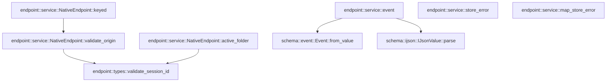

```mermaid
flowchart TD
  n0["endpoint::history::history_page"]
  n1["endpoint::journal::EndpointJournal::open"]
  n2["endpoint::service::NativeEndpoint::reconciled_journal"]
  n3["endpoint::service::NativeEndpoint::history"]
  n4["endpoint::service::NativeEndpoint::keyed"]
  n5["endpoint::service::NativeEndpoint::validate_origin"]
  n6["endpoint::service::NativeEndpoint::active_folder"]
  n7["endpoint::service::event"]
  n8["endpoint::service::NativeEndpoint::submission_snapshot"]
  n9["endpoint::service::NativeEndpoint::prompt"]
  n10["endpoint::service::NativeEndpoint::prompt_for_endpoint"]
  n11["endpoint::service::NativeEndpoint::prompt_with_operation"]
  n12["endpoint::service::NativeEndpoint::update_queue"]
  n13["endpoint::service::NativeEndpoint::rename_session"]
  n14["endpoint::service::NativeEndpoint::rename_session_for_endpoint"]
  n15["endpoint::service::NativeEndpoint::rename_session_with_operation"]
  n16["endpoint::service::NativeEndpoint::seed_automatic_title_if_missing"]
  n17["endpoint::service::NativeEndpoint::record_session_notice"]
  n18["endpoint::service::NativeEndpoint::refine_automatic_title"]
  n19["endpoint::service::NativeEndpoint::author_keyed_with_ledger"]
  n20["endpoint::service::NativeEndpoint::cancel"]
  n21["endpoint::service::NativeEndpoint::cancel_for_endpoint"]
  n22["endpoint::service::NativeEndpoint::cancel_with_operation"]
  n23["endpoint::service::NativeEndpoint::fork_session"]
  n24["endpoint::service::NativeEndpoint::archive_session"]
  n25["endpoint::service::NativeEndpoint::unarchive_session"]
  n26["endpoint::service::NativeEndpoint::reconcile_projection"]
  n27["endpoint::types::validate_session_id"]
  n28["store::tail::scan_valid_prefix"]
  n2 --> n1
  n2 --> n6
  n2 --> n28
  n3 --> n0
  n3 --> n2
  n9 --> n11
  n10 --> n11
  n11 --> n4
  n11 --> n7
  n11 --> n8
  n12 --> n4
  n12 --> n7
  n13 --> n15
  n14 --> n15
  n15 --> n4
  n15 --> n7
  n16 --> n5
  n16 --> n7
  n17 --> n5
  n17 --> n7
  n18 --> n5
  n18 --> n7
  n19 --> n27
  n20 --> n22
  n21 --> n22
  n22 --> n5
  n22 --> n7
  n22 --> n27
  n23 --> n27
  n24 --> n27
  n25 --> n27
  n26 --> n2
```

# endpoint::service

[Package atlas](index.md) · [Source](../../src/service.rs)

## Declarations

Visibility is the declaration spelling; trait members and reexports require their enclosing interface. `cfg` is not evaluated.

| Symbol | Kind | Visibility | Test / cfg |
|---|---|---|---|
| [endpoint::service::AUTOMATIC_TITLE_SEED_OPERATION](../../src/service.rs#L13) | const_item | `pub` |  |
| [endpoint::service::AUTOMATIC_TITLE_REFINE_OPERATION](../../src/service.rs#L14) | const_item | `pub` |  |
| [endpoint::service::SESSION_NOTICE_OPERATION](../../src/service.rs#L15) | const_item | `pub` |  |
| [endpoint::service::SessionNotice](../../src/service.rs#L22) | struct_item | `pub` |  |
| [endpoint::service::SessionNoticeSeverity](../../src/service.rs#L30) | enum_item | `pub` |  |
| [endpoint::service::SessionNoticeSeverity::as_str](../../src/service.rs#L37) | function_item | `pub` |  |
| [endpoint::service::MutationReceipt](../../src/service.rs#L46) | struct_item | `pub` |  |
| [endpoint::service::MutationReceipt::from](../../src/service.rs#L52) | function_item | `private` |  |
| [endpoint::service::ArchiveResult](../../src/service.rs#L61) | struct_item | `pub` |  |
| [endpoint::service::UnarchiveResult](../../src/service.rs#L66) | struct_item | `pub` |  |
| [endpoint::service::SessionInventoryItem](../../src/service.rs#L71) | struct_item | `pub` |  |
| [endpoint::service::PERMISSION_MODE_FILE](../../src/service.rs#L94) | const_item | `private` |  |
| [endpoint::service::DEFAULT_PERMISSION_MODE](../../src/service.rs#L95) | const_item | `private` |  |
| [endpoint::service::permission_mode_of](../../src/service.rs#L99) | function_item | `pub` |  |
| [endpoint::service::card_item](../../src/service.rs#L116) | function_item | `private` |  |
| [endpoint::service::card_updated_ms](../../src/service.rs#L148) | function_item | `pub` |  |
| [endpoint::service::last_record_updated_ms](../../src/service.rs#L163) | function_item | `pub` |  |
| [endpoint::service::last_record_updated_ms::WINDOW](../../src/service.rs#L165) | const_item | `private` |  |
| [endpoint::service::card_summary](../../src/service.rs#L186) | function_item | `pub` |  |
| [endpoint::service::NativeEndpoint](../../src/service.rs#L233) | struct_item | `pub` |  |
| [endpoint::service::CreateSessionWrite](../../src/service.rs#L237) | struct_item | `private` |  |
| [endpoint::service::NativeEndpoint::open](../../src/service.rs#L248) | function_item | `pub` |  |
| [endpoint::service::NativeEndpoint::capabilities](../../src/service.rs#L255) | function_item | `pub` |  |
| [endpoint::service::NativeEndpoint::list_sessions](../../src/service.rs#L274) | function_item | `pub` |  |
| [endpoint::service::NativeEndpoint::list_sessions_cached](../../src/service.rs#L284) | function_item | `pub` |  |
| [endpoint::service::NativeEndpoint::list_sessions_with](../../src/service.rs#L291) | function_item | `private` |  |
| [endpoint::service::NativeEndpoint::models](../../src/service.rs#L350) | function_item | `pub` |  |
| [endpoint::service::NativeEndpoint::session_config_snapshot](../../src/service.rs#L416) | function_item | `pub` |  |
| [endpoint::service::NativeEndpoint::submission_snapshot](../../src/service.rs#L441) | function_item | `pub` |  |
| [endpoint::service::NativeEndpoint::submission_metadata](../../src/service.rs#L448) | function_item | `pub` |  |
| [endpoint::service::NativeEndpoint::hydrate_historical_submissions](../../src/service.rs#L473) | function_item | `pub` |  |
| [endpoint::service::NativeEndpoint::create_session](../../src/service.rs#L581) | function_item | `pub` |  |
| [endpoint::service::NativeEndpoint::create_session_for_endpoint](../../src/service.rs#L604) | function_item | `pub` |  |
| [endpoint::service::NativeEndpoint::create_session_with_operation](../../src/service.rs#L624) | function_item | `private` |  |
| [endpoint::service::NativeEndpoint::prompt](../../src/service.rs#L654) | function_item | `pub` |  |
| [endpoint::service::NativeEndpoint::prompt_for_endpoint](../../src/service.rs#L665) | function_item | `pub` |  |
| [endpoint::service::NativeEndpoint::prompt_with_operation](../../src/service.rs#L683) | function_item | `private` |  |
| [endpoint::service::NativeEndpoint::update_queue](../../src/service.rs#L706) | function_item | `pub` |  |
| [endpoint::service::NativeEndpoint::rename_session](../../src/service.rs#L721) | function_item | `pub` |  |
| [endpoint::service::NativeEndpoint::rename_session_for_endpoint](../../src/service.rs#L731) | function_item | `pub` |  |
| [endpoint::service::NativeEndpoint::rename_session_with_operation](../../src/service.rs#L741) | function_item | `private` |  |
| [endpoint::service::NativeEndpoint::seed_automatic_title_if_missing](../../src/service.rs#L760) | function_item | `pub` |  |
| [endpoint::service::NativeEndpoint::record_session_notice](../../src/service.rs#L793) | function_item | `pub` |  |
| [endpoint::service::NativeEndpoint::refine_automatic_title](../../src/service.rs#L847) | function_item | `pub` |  |
| [endpoint::service::NativeEndpoint::author_keyed_with_ledger](../../src/service.rs#L888) | function_item | `pub` |  |
| [endpoint::service::NativeEndpoint::cancel](../../src/service.rs#L911) | function_item | `pub` |  |
| [endpoint::service::NativeEndpoint::cancel_for_endpoint](../../src/service.rs#L920) | function_item | `pub` |  |
| [endpoint::service::NativeEndpoint::cancel_with_operation](../../src/service.rs#L929) | function_item | `private` |  |
| [endpoint::service::NativeEndpoint::fork_session](../../src/service.rs#L959) | function_item | `pub` |  |
| [endpoint::service::NativeEndpoint::archive_session](../../src/service.rs#L975) | function_item | `pub` |  |
| [endpoint::service::NativeEndpoint::unarchive_session](../../src/service.rs#L983) | function_item | `pub` |  |
| [endpoint::service::NativeEndpoint::reconcile_projection](../../src/service.rs#L994) | function_item | `pub` |  |
| [endpoint::service::NativeEndpoint::reconciled_journal](../../src/service.rs#L1002) | function_item | `private` |  |
| [endpoint::service::NativeEndpoint::history](../../src/service.rs#L1016) | function_item | `pub` |  |
| [endpoint::service::NativeEndpoint::keyed](../../src/service.rs#L1026) | function_item | `private` |  |
| [endpoint::service::NativeEndpoint::validate_origin](../../src/service.rs#L1044) | function_item | `private` |  |
| [endpoint::service::NativeEndpoint::active_folder](../../src/service.rs#L1057) | function_item | `private` |  |
| [endpoint::service::event](../../src/service.rs#L1070) | function_item | `private` |  |
| [endpoint::service::store_error](../../src/service.rs#L1075) | function_item | `private` |  |
| [endpoint::service::map_store_error](../../src/service.rs#L1079) | function_item | `private` |  |
| [endpoint::service::NativeEndpointError](../../src/service.rs#L1088) | enum_item | `pub` |  |

## Imports / reexports

| Local name | Source path | Visibility |
|---|---|---|
| `BTreeSet` | `std::collections::BTreeSet` | `private` |
| `HashSet` | `std::collections::HashSet` | `private` |
| `fs` | `std::fs` | `private` |
| `Path` | `std::path::Path` | `private` |
| `Event` | `schema::Event` | `private` |
| `EventKind` | `schema::EventKind` | `private` |
| `IJsonValue` | `schema::IJsonValue` | `private` |
| `OriginTuple` | `schema::OriginTuple` | `private` |
| `ResumePolicy` | `schema::ResumePolicy` | `private` |
| `SeqRange` | `schema::SeqRange` | `private` |
| `Value` | `serde_json::Value` | `private` |
| `json` | `serde_json::json` | `private` |
| `AppendOutcome` | `store::AppendOutcome` | `private` |
| `ConditionalAppendOutcome` | `store::ConditionalAppendOutcome` | `private` |
| `ThreadStore` | `store::ThreadStore` | `private` |
| `scan_valid_prefix` | `store::scan_valid_prefix` | `private` |
| `Error` | `thiserror::Error` | `private` |
| `timestamp_millis` | `crate::projection::timestamp_millis` | `private` |
| `EndpointJournal` | `crate::EndpointJournal` | `private` |
| `HistoryPage` | `crate::HistoryPage` | `private` |
| `Projector` | `crate::Projector` | `private` |
| `history_page` | `crate::history_page` | `private` |
| `validate_session_id` | `crate::validate_session_id` | `private` |

## Module declarations

| Module | Visibility | Attributes |
|---|---|---|

## Function call graphs

Edges below are syntactically resolved calls only, including private functions. Graphs partition callers into groups of 20; they are not execution order. All unresolved sites are listed below and in the JSON inventory.

```mermaid
flowchart TD
  n0["endpoint::projection::timestamp_millis"]
  n1["endpoint::service::NativeEndpoint::active_folder"]
  n2["endpoint::service::card_item"]
  n3["endpoint::service::card_updated_ms"]
  n4["endpoint::service::last_record_updated_ms"]
  n5["endpoint::service::card_summary"]
  n6["endpoint::service::NativeEndpoint::open"]
  n7["endpoint::service::NativeEndpoint::capabilities"]
  n8["endpoint::service::NativeEndpoint::list_sessions"]
  n9["endpoint::service::NativeEndpoint::list_sessions_cached"]
  n10["endpoint::service::NativeEndpoint::list_sessions_with"]
  n11["endpoint::service::NativeEndpoint::models"]
  n12["endpoint::service::SessionNoticeSeverity::as_str"]
  n13["endpoint::service::NativeEndpoint::session_config_snapshot"]
  n14["endpoint::service::NativeEndpoint::submission_snapshot"]
  n15["endpoint::service::NativeEndpoint::submission_metadata"]
  n16["endpoint::service::NativeEndpoint::hydrate_historical_submissions"]
  n17["endpoint::service::MutationReceipt::from"]
  n18["endpoint::service::NativeEndpoint::create_session"]
  n19["endpoint::service::NativeEndpoint::create_session_for_endpoint"]
  n20["endpoint::service::NativeEndpoint::create_session_with_operation"]
  n21["endpoint::service::permission_mode_of"]
  n22["endpoint::types::validate_session_id"]
  n23["profile::config::ConfigSnapshot::decode"]
  n24["profile::config::ConfigRepository::open"]
  n25["schema::ijson::IJsonValue::parse"]
  n26["store::asset::AssetStore::new"]
  n27["store::card::read_card"]
  n28["store::card::classify"]
  n29["store::folder::ThreadStore::open"]
  n30["store::tail::scan_valid_prefix"]
  n31["store::tail::read_genesis"]
  n2 --> n21
  n2 --> n27
  n2 --> n28
  n3 --> n0
  n4 --> n0
  n5 --> n3
  n6 --> n29
  n8 --> n10
  n9 --> n10
  n10 --> n2
  n10 --> n5
  n10 --> n21
  n10 --> n22
  n10 --> n30
  n11 --> n25
  n13 --> n1
  n13 --> n22
  n13 --> n24
  n13 --> n31
  n14 --> n1
  n14 --> n13
  n14 --> n15
  n14 --> n26
  n15 --> n25
  n16 --> n1
  n16 --> n15
  n16 --> n23
  n16 --> n25
  n16 --> n26
  n16 --> n30
  n18 --> n20
  n19 --> n20
  n20 --> n22
```

Functions 1–20: 33 direct edges

Functions 21–40: 32 direct edges

Functions 41–46: 5 direct edges

## Call sites

Includes test functions (marked in declarations). Receiver-type-required sites need type analysis/manual tracing. Calls in closures are attributed to their enclosing function; their occurrence here does not mean the closure executes immediately.

| Caller | Callee expression | Source lines | Target / classification |
|---|---|---|---|
| `permission_mode_of` | `fs::read` | [100](../../src/service.rs#L100) | external-constructor-callback-or-unresolved |
| `permission_mode_of` | `folder.join` | [100](../../src/service.rs#L100) | receiver-type-required |
| `permission_mode_of` | `DEFAULT_PERMISSION_MODE.to_owned` | [101](../../src/service.rs#L101), [112](../../src/service.rs#L112) | receiver-type-required |
| `permission_mode_of` | `serde_json::from_slice::<serde_json::Value>(&bytes)         .ok()         .and_then(&#124;value&#124; value.get("mode")?.as_str().map(str::to_owned))         .filter(&#124;mode&#124; {             matches!(                 mode.as_str(),                 "read-only" &#124; "workspace-write" &#124; "danger-full-access"             )         })         .unwrap_or_else` | [103](../../src/service.rs#L103) | receiver-type-required |
| `permission_mode_of` | `serde_json::from_slice::<serde_json::Value>(&bytes)         .ok()         .and_then(&#124;value&#124; value.get("mode")?.as_str().map(str::to_owned))         .filter` | [103](../../src/service.rs#L103) | receiver-type-required |
| `permission_mode_of` | `serde_json::from_slice::<serde_json::Value>(&bytes)         .ok()         .and_then` | [103](../../src/service.rs#L103) | receiver-type-required |
| `permission_mode_of` | `serde_json::from_slice::<serde_json::Value>(&bytes)         .ok` | [103](../../src/service.rs#L103) | receiver-type-required |
| `permission_mode_of` | `serde_json::from_slice::<serde_json::Value>` | [103](../../src/service.rs#L103) | external-constructor-callback-or-unresolved |
| `permission_mode_of` | `value.get("mode")?.as_str().map` | [105](../../src/service.rs#L105) | receiver-type-required |
| `permission_mode_of` | `value.get("mode")?.as_str` | [105](../../src/service.rs#L105) | receiver-type-required |
| `permission_mode_of` | `value.get` | [105](../../src/service.rs#L105) | receiver-type-required |
| `card_item` | `store::card::read_card` | [122](../../src/service.rs#L122) | [store::card::read_card](../../../store/src/card.rs#L172) |
| `card_item` | `store::card::classify(folder, &card).ok` | [123](../../src/service.rs#L123) | receiver-type-required |
| `card_item` | `store::card::classify` | [123](../../src/service.rs#L123) | [store::card::classify](../../../store/src/card.rs#L387) |
| `card_item` | `classified.freshness` | [124](../../src/service.rs#L124) | receiver-type-required |
| `card_item` | `card.lines.first` | [127](../../src/service.rs#L127) | receiver-type-required |
| `card_item` | `Some` | [131](../../src/service.rs#L131) | external-constructor-callback-or-unresolved |
| `card_item` | `session_id.to_owned` | [132](../../src/service.rs#L132) | receiver-type-required |
| `card_item` | `card.summary.workspace.clone` | [133](../../src/service.rs#L133) | receiver-type-required |
| `card_item` | `card.summary.title.clone` | [134](../../src/service.rs#L134) | receiver-type-required |
| `card_item` | `main.facts.clone` | [140](../../src/service.rs#L140) | receiver-type-required |
| `card_item` | `permission_mode_of` | [141](../../src/service.rs#L141) | [endpoint::service::permission_mode_of](../../src/service.rs#L99) |
| `card_item` | `card.summary.identity_profile.clone` | [142](../../src/service.rs#L142) | receiver-type-required |
| `card_updated_ms` | `Ok` | [149](../../src/service.rs#L149) | external-constructor-callback-or-unresolved |
| `card_updated_ms` | `projection         .events         .last()         .and_then(&#124;event&#124; event.string_field("ts"))         .ok_or(NativeEndpointError::InventoryTimestamp)         .and_then` | [149](../../src/service.rs#L149) | receiver-type-required |
| `card_updated_ms` | `projection         .events         .last()         .and_then(&#124;event&#124; event.string_field("ts"))         .ok_or` | [149](../../src/service.rs#L149) | receiver-type-required |
| `card_updated_ms` | `projection         .events         .last()         .and_then` | [149](../../src/service.rs#L149) | receiver-type-required |
| `card_updated_ms` | `projection         .events         .last` | [149](../../src/service.rs#L149) | receiver-type-required |
| `card_updated_ms` | `event.string_field` | [152](../../src/service.rs#L152) | receiver-type-required |
| `card_updated_ms` | `timestamp_millis(value).map_err` | [154](../../src/service.rs#L154) | receiver-type-required |
| `card_updated_ms` | `timestamp_millis` | [154](../../src/service.rs#L154) | [endpoint::projection::timestamp_millis](../../src/projection.rs#L944) |
| `last_record_updated_ms` | `fs::File::open(path).ok` | [166](../../src/service.rs#L166) | receiver-type-required |
| `last_record_updated_ms` | `fs::File::open` | [166](../../src/service.rs#L166) | external-constructor-callback-or-unresolved |
| `last_record_updated_ms` | `file.metadata().ok()?.len` | [167](../../src/service.rs#L167) | receiver-type-required |
| `last_record_updated_ms` | `file.metadata().ok` | [167](../../src/service.rs#L167) | receiver-type-required |
| `last_record_updated_ms` | `file.metadata` | [167](../../src/service.rs#L167) | receiver-type-required |
| `last_record_updated_ms` | `length.saturating_sub` | [168](../../src/service.rs#L168) | receiver-type-required |
| `last_record_updated_ms` | `file.seek(SeekFrom::Start(start)).ok` | [169](../../src/service.rs#L169) | receiver-type-required |
| `last_record_updated_ms` | `file.seek` | [169](../../src/service.rs#L169) | receiver-type-required |
| `last_record_updated_ms` | `SeekFrom::Start` | [169](../../src/service.rs#L169) | external-constructor-callback-or-unresolved |
| `last_record_updated_ms` | `Vec::new` | [170](../../src/service.rs#L170) | external-constructor-callback-or-unresolved |
| `last_record_updated_ms` | `file.take(WINDOW).read_to_end(&mut bytes).ok` | [171](../../src/service.rs#L171) | receiver-type-required |
| `last_record_updated_ms` | `file.take(WINDOW).read_to_end` | [171](../../src/service.rs#L171) | receiver-type-required |
| `last_record_updated_ms` | `file.take` | [171](../../src/service.rs#L171) | receiver-type-required |
| `last_record_updated_ms` | `bytes.iter().rposition` | [173](../../src/service.rs#L173) | receiver-type-required |
| `last_record_updated_ms` | `bytes.iter` | [173](../../src/service.rs#L173) | receiver-type-required |
| `last_record_updated_ms` | `bytes[..end]         .iter()         .rposition(&#124;byte&#124; *byte == b'\n')         .map(&#124;index&#124; index + 1)         .or` | [174](../../src/service.rs#L174) | receiver-type-required |
| `last_record_updated_ms` | `bytes[..end]         .iter()         .rposition(&#124;byte&#124; *byte == b'\n')         .map` | [174](../../src/service.rs#L174) | receiver-type-required |
| `last_record_updated_ms` | `bytes[..end]         .iter()         .rposition` | [174](../../src/service.rs#L174) | receiver-type-required |
| `last_record_updated_ms` | `bytes[..end]         .iter` | [174](../../src/service.rs#L174) | receiver-type-required |
| `last_record_updated_ms` | `(start == 0).then_some` | [178](../../src/service.rs#L178) | receiver-type-required |
| `last_record_updated_ms` | `serde_json::from_slice(&bytes[line_start..end]).ok` | [179](../../src/service.rs#L179) | receiver-type-required |
| `last_record_updated_ms` | `serde_json::from_slice` | [179](../../src/service.rs#L179) | external-constructor-callback-or-unresolved |
| `last_record_updated_ms` | `timestamp_millis(record.get("ts")?.as_str()?).ok` | [180](../../src/service.rs#L180) | receiver-type-required |
| `last_record_updated_ms` | `timestamp_millis` | [180](../../src/service.rs#L180) | [endpoint::projection::timestamp_millis](../../src/projection.rs#L944) |
| `last_record_updated_ms` | `record.get("ts")?.as_str` | [180](../../src/service.rs#L180) | receiver-type-required |
| `last_record_updated_ms` | `record.get` | [180](../../src/service.rs#L180) | receiver-type-required |
| `last_record_updated_ms` | `Some` | [181](../../src/service.rs#L181) | external-constructor-callback-or-unresolved |
| `card_summary` | `projection.events.first().ok_or_else` | [189](../../src/service.rs#L189) | receiver-type-required |
| `card_summary` | `projection.events.first` | [189](../../src/service.rs#L189) | receiver-type-required |
| `card_summary` | `NativeEndpointError::Store` | [190](../../src/service.rs#L190) | external-constructor-callback-or-unresolved |
| `card_summary` | `store::StoreError::Corruption` | [190](../../src/service.rs#L190) | external-constructor-callback-or-unresolved |
| `card_summary` | `"ledger has no genesis".to_owned` | [191](../../src/service.rs#L191) | receiver-type-required |
| `card_summary` | `projection         .events         .iter()         .rev()         .find_map(&#124;event&#124; event.string_field("title"))         .map` | [194](../../src/service.rs#L194) | receiver-type-required |
| `card_summary` | `projection         .events         .iter()         .rev()         .find_map` | [194](../../src/service.rs#L194) | receiver-type-required |
| `card_summary` | `projection         .events         .iter()         .rev` | [194](../../src/service.rs#L194) | receiver-type-required |
| `card_summary` | `projection         .events         .iter` | [194](../../src/service.rs#L194) | receiver-type-required |
| `card_summary` | `event.string_field` | [198](../../src/service.rs#L198), [206](../../src/service.rs#L206) | receiver-type-required |
| `card_summary` | `card_updated_ms` | [200](../../src/service.rs#L200) | [endpoint::service::card_updated_ms](../../src/service.rs#L148) |
| `card_summary` | `genesis.string_field` | [201](../../src/service.rs#L201), [203](../../src/service.rs#L203), [223](../../src/service.rs#L223), [224](../../src/service.rs#L224) | receiver-type-required |
| `card_summary` | `Some` | [202](../../src/service.rs#L202), [206](../../src/service.rs#L206) | external-constructor-callback-or-unresolved |
| `card_summary` | `"coding".to_owned` | [202](../../src/service.rs#L202) | receiver-type-required |
| `card_summary` | `genesis.string_field("identity_profile").map` | [203](../../src/service.rs#L203) | receiver-type-required |
| `card_summary` | `projection.events.iter().find_map` | [204](../../src/service.rs#L204) | receiver-type-required |
| `card_summary` | `projection.events.iter` | [204](../../src/service.rs#L204) | receiver-type-required |
| `card_summary` | `event.kind` | [205](../../src/service.rs#L205) | receiver-type-required |
| `card_summary` | `serde_json::to_value(event.raw())                 .ok()?                 .get("payload")?                 .get("profile")?                 .as_str()                 .map` | [210](../../src/service.rs#L210) | receiver-type-required |
| `card_summary` | `serde_json::to_value(event.raw())                 .ok()?                 .get("payload")?                 .get("profile")?                 .as_str` | [210](../../src/service.rs#L210) | receiver-type-required |
| `card_summary` | `serde_json::to_value(event.raw())                 .ok()?                 .get("payload")?                 .get` | [210](../../src/service.rs#L210) | receiver-type-required |
| `card_summary` | `serde_json::to_value(event.raw())                 .ok()?                 .get` | [210](../../src/service.rs#L210) | receiver-type-required |
| `card_summary` | `serde_json::to_value(event.raw())                 .ok` | [210](../../src/service.rs#L210) | receiver-type-required |
| `card_summary` | `serde_json::to_value` | [210](../../src/service.rs#L210) | external-constructor-callback-or-unresolved |
| `card_summary` | `event.raw` | [210](../../src/service.rs#L210) | receiver-type-required |
| `card_summary` | `Ok` | [218](../../src/service.rs#L218) | external-constructor-callback-or-unresolved |
| `card_summary` | `genesis             .string_field("workspace")             .ok_or(NativeEndpointError::InventoryWorkspace)?             .to_owned` | [219](../../src/service.rs#L219) | receiver-type-required |
| `card_summary` | `genesis             .string_field("workspace")             .ok_or` | [219](../../src/service.rs#L219) | receiver-type-required |
| `card_summary` | `genesis             .string_field` | [219](../../src/service.rs#L219) | receiver-type-required |
| `card_summary` | `genesis.string_field("folder_binding").map` | [223](../../src/service.rs#L223) | receiver-type-required |
| `card_summary` | `genesis.string_field("ts").unwrap_or_default().to_owned` | [224](../../src/service.rs#L224) | receiver-type-required |
| `card_summary` | `genesis.string_field("ts").unwrap_or_default` | [224](../../src/service.rs#L224) | receiver-type-required |
| `card_summary` | `genesis.is_ephemeral_genesis` | [228](../../src/service.rs#L228) | receiver-type-required |
| `card_summary` | `projection.lifecycle.latest_turn.is_none` | [229](../../src/service.rs#L229) | receiver-type-required |
| `open` | `Ok` | [249](../../src/service.rs#L249) | external-constructor-callback-or-unresolved |
| `open` | `ThreadStore::open` | [250](../../src/service.rs#L250) | [store::folder::ThreadStore::open](../../../store/src/folder.rs#L36) |
| `capabilities` | `[             "session.models",             "session.create",             "session.prompt",             "session.updateQueue",             "session.cancel",             "session.rename",             "session.fork",             "session.discard",             "workspace.archiveSession",             "workspace.unarchiveSession",         ]         .into_iter()         .collect` | [256](../../src/service.rs#L256) | receiver-type-required |
| `capabilities` | `[             "session.models",             "session.create",             "session.prompt",             "session.updateQueue",             "session.cancel",             "session.rename",             "session.fork",             "session.discard",             "workspace.archiveSession",             "workspace.unarchiveSession",         ]         .into_iter` | [256](../../src/service.rs#L256) | receiver-type-required |
| `list_sessions` | `self.list_sessions_with` | [278](../../src/service.rs#L278) | [endpoint::service::NativeEndpoint::list_sessions_with](../../src/service.rs#L291) |
| `list_sessions_cached` | `self.list_sessions_with` | [288](../../src/service.rs#L288) | [endpoint::service::NativeEndpoint::list_sessions_with](../../src/service.rs#L291) |
| `list_sessions_with` | `Vec::new` | [296](../../src/service.rs#L296) | external-constructor-callback-or-unresolved |
| `list_sessions_with` | `fs::read_dir` | [298](../../src/service.rs#L298) | external-constructor-callback-or-unresolved |
| `list_sessions_with` | `self.store.root().join` | [298](../../src/service.rs#L298) | receiver-type-required |
| `list_sessions_with` | `self.store.root` | [298](../../src/service.rs#L298) | receiver-type-required |
| `list_sessions_with` | `entry.file_type()?.is_dir` | [300](../../src/service.rs#L300) | receiver-type-required |
| `list_sessions_with` | `entry.file_type` | [300](../../src/service.rs#L300) | receiver-type-required |
| `list_sessions_with` | `entry.file_name().to_string_lossy().into_owned` | [303](../../src/service.rs#L303) | receiver-type-required |
| `list_sessions_with` | `entry.file_name().to_string_lossy` | [303](../../src/service.rs#L303) | receiver-type-required |
| `list_sessions_with` | `entry.file_name` | [303](../../src/service.rs#L303) | receiver-type-required |
| `list_sessions_with` | `validate_session_id` | [304](../../src/service.rs#L304) | [endpoint::types::validate_session_id](../../src/types.rs#L130) |
| `list_sessions_with` | `running.contains` | [306](../../src/service.rs#L306) | receiver-type-required |
| `list_sessions_with` | `self.store.session_has_live_line_holder` | [307](../../src/service.rs#L307) | receiver-type-required |
| `list_sessions_with` | `card_item` | [309](../../src/service.rs#L309) | [endpoint::service::card_item](../../src/service.rs#L116) |
| `list_sessions_with` | `entry.path` | [309](../../src/service.rs#L309), [315](../../src/service.rs#L315), [331](../../src/service.rs#L331) | receiver-type-required |
| `list_sessions_with` | `items.push` | [311](../../src/service.rs#L311), [330](../../src/service.rs#L330) | receiver-type-required |
| `list_sessions_with` | `fs::read` | [315](../../src/service.rs#L315) | external-constructor-callback-or-unresolved |
| `list_sessions_with` | `entry.path().join` | [315](../../src/service.rs#L315) | receiver-type-required |
| `list_sessions_with` | `scan_valid_prefix` | [316](../../src/service.rs#L316) | [store::tail::scan_valid_prefix](../../../store/src/tail.rs#L37) |
| `list_sessions_with` | `scan.projection.ok_or_else` | [317](../../src/service.rs#L317) | receiver-type-required |
| `list_sessions_with` | `NativeEndpointError::Store` | [318](../../src/service.rs#L318), [324](../../src/service.rs#L324) | external-constructor-callback-or-unresolved |
| `list_sessions_with` | `store::StoreError::Corruption` | [318](../../src/service.rs#L318), [324](../../src/service.rs#L324) | external-constructor-callback-or-unresolved |
| `list_sessions_with` | `card_summary(&projection).map_err` | [322](../../src/service.rs#L322) | receiver-type-required |
| `list_sessions_with` | `card_summary` | [322](../../src/service.rs#L322) | [endpoint::service::card_summary](../../src/service.rs#L186) |
| `list_sessions_with` | `permission_mode_of` | [331](../../src/service.rs#L331) | [endpoint::service::permission_mode_of](../../src/service.rs#L99) |
| `list_sessions_with` | `items.sort_by` | [346](../../src/service.rs#L346) | receiver-type-required |
| `list_sessions_with` | `left.session_id.as_bytes().cmp` | [346](../../src/service.rs#L346) | receiver-type-required |
| `list_sessions_with` | `left.session_id.as_bytes` | [346](../../src/service.rs#L346) | receiver-type-required |
| `list_sessions_with` | `right.session_id.as_bytes` | [346](../../src/service.rs#L346) | receiver-type-required |
| `list_sessions_with` | `Ok` | [347](../../src/service.rs#L347) | external-constructor-callback-or-unresolved |
| `models` | `snapshot             .session_settings             .as_ref()             .map(&#124;settings&#124; &settings.provider)             .or(snapshot.workspace.policy.provider.as_ref())             .or` | [354](../../src/service.rs#L354) | receiver-type-required |
| `models` | `snapshot             .session_settings             .as_ref()             .map(&#124;settings&#124; &settings.provider)             .or` | [354](../../src/service.rs#L354) | receiver-type-required |
| `models` | `snapshot             .session_settings             .as_ref()             .map` | [354](../../src/service.rs#L354), [360](../../src/service.rs#L360) | receiver-type-required |
| `models` | `snapshot             .session_settings             .as_ref` | [354](../../src/service.rs#L354), [360](../../src/service.rs#L360), [396](../../src/service.rs#L396) | receiver-type-required |
| `models` | `snapshot.workspace.policy.provider.as_ref` | [358](../../src/service.rs#L358) | receiver-type-required |
| `models` | `snapshot.settings.default_provider.as_ref` | [359](../../src/service.rs#L359) | receiver-type-required |
| `models` | `snapshot             .session_settings             .as_ref()             .map(&#124;settings&#124; &settings.model)             .or(snapshot.workspace.policy.model.as_ref())             .or` | [360](../../src/service.rs#L360) | receiver-type-required |
| `models` | `snapshot             .session_settings             .as_ref()             .map(&#124;settings&#124; &settings.model)             .or` | [360](../../src/service.rs#L360) | receiver-type-required |
| `models` | `snapshot.workspace.policy.model.as_ref` | [364](../../src/service.rs#L364) | receiver-type-required |
| `models` | `snapshot.settings.default_model.as_ref` | [365](../../src/service.rs#L365) | receiver-type-required |
| `models` | `snapshot             .providers             .providers             .iter()             .map(&#124;provider&#124; {                 json!({                     "id": provider.id,                     "name": provider.id,                     "models": provider.models.iter().filter(&#124;model&#124; model.enabled).map(&#124;model&#124; {                         json!({"id": model.id, "name": model.id,                             "contextWindow": model.context_window_tokens})                     }).collect::<Vec<_>>()                 })             })             .collect::<Vec<_>>` | [366](../../src/service.rs#L366) | receiver-type-required |
| `models` | `snapshot             .providers             .providers             .iter()             .map` | [366](../../src/service.rs#L366) | receiver-type-required |
| `models` | `snapshot             .providers             .providers             .iter` | [366](../../src/service.rs#L366) | receiver-type-required |
| `models` | `selected_provider             .zip(selected_model)             .is_some_and` | [381](../../src/service.rs#L381) | receiver-type-required |
| `models` | `selected_provider             .zip` | [381](../../src/service.rs#L381) | receiver-type-required |
| `models` | `snapshot.providers.providers.iter().any` | [384](../../src/service.rs#L384) | receiver-type-required |
| `models` | `snapshot.providers.providers.iter` | [384](../../src/service.rs#L384) | receiver-type-required |
| `models` | `candidate                             .models                             .iter()                             .any` | [386](../../src/service.rs#L386) | receiver-type-required |
| `models` | `candidate                             .models                             .iter` | [386](../../src/service.rs#L386) | receiver-type-required |
| `models` | `snapshot             .session_settings             .as_ref()             .and_then` | [396](../../src/service.rs#L396) | receiver-type-required |
| `models` | `settings.reasoning_effort.as_ref` | [399](../../src/service.rs#L399) | receiver-type-required |
| `models` | `Value::String` | [401](../../src/service.rs#L401) | external-constructor-callback-or-unresolved |
| `models` | `effort.clone` | [401](../../src/service.rs#L401) | receiver-type-required |
| `models` | `Ok` | [409](../../src/service.rs#L409) | external-constructor-callback-or-unresolved |
| `models` | `IJsonValue::parse` | [409](../../src/service.rs#L409) | [schema::ijson::IJsonValue::parse](../../../schema/src/ijson.rs#L16) |
| `models` | `serde_json::to_vec` | [409](../../src/service.rs#L409) | external-constructor-callback-or-unresolved |
| `session_config_snapshot` | `validate_session_id` | [420](../../src/service.rs#L420) | [endpoint::types::validate_session_id](../../src/types.rs#L130) |
| `session_config_snapshot` | `self.active_folder` | [421](../../src/service.rs#L421) | [endpoint::service::NativeEndpoint::active_folder](../../src/service.rs#L1057) |
| `session_config_snapshot` | `store::read_genesis(folder.join("main.jsonl"))?.ok_or_else` | [423](../../src/service.rs#L423) | receiver-type-required |
| `session_config_snapshot` | `store::read_genesis` | [423](../../src/service.rs#L423) | [store::tail::read_genesis](../../../store/src/tail.rs#L86) |
| `session_config_snapshot` | `folder.join` | [423](../../src/service.rs#L423) | receiver-type-required |
| `session_config_snapshot` | `NativeEndpointError::Store` | [424](../../src/service.rs#L424) | external-constructor-callback-or-unresolved |
| `session_config_snapshot` | `store::StoreError::Corruption` | [424](../../src/service.rs#L424) | external-constructor-callback-or-unresolved |
| `session_config_snapshot` | `"session ledger has no valid genesis prefix".to_owned` | [425](../../src/service.rs#L425) | receiver-type-required |
| `session_config_snapshot` | `genesis             .string_field("workspace")             .ok_or` | [429](../../src/service.rs#L429) | receiver-type-required |
| `session_config_snapshot` | `genesis             .string_field` | [429](../../src/service.rs#L429) | receiver-type-required |
| `session_config_snapshot` | `profile::ConfigRepository::open` | [432](../../src/service.rs#L432) | [profile::config::ConfigRepository::open](../../../profile/src/config.rs#L684) |
| `session_config_snapshot` | `self.store.root` | [432](../../src/service.rs#L432) | receiver-type-required |
| `session_config_snapshot` | `Ok` | [433](../../src/service.rs#L433) | external-constructor-callback-or-unresolved |
| `session_config_snapshot` | `genesis.string_field` | [433](../../src/service.rs#L433) | receiver-type-required |
| `session_config_snapshot` | `repository.resolve_for_session_binding` | [434](../../src/service.rs#L434) | receiver-type-required |
| `session_config_snapshot` | `repository.resolve_for_session` | [435](../../src/service.rs#L435) | receiver-type-required |
| `submission_snapshot` | `self.session_config_snapshot` | [442](../../src/service.rs#L442) | [endpoint::service::NativeEndpoint::session_config_snapshot](../../src/service.rs#L416) |
| `submission_snapshot` | `store::AssetStore::new` | [443](../../src/service.rs#L443) | [store::asset::AssetStore::new](../../../store/src/asset.rs#L27) |
| `submission_snapshot` | `self.active_folder(session_id)?.join` | [443](../../src/service.rs#L443) | receiver-type-required |
| `submission_snapshot` | `self.active_folder` | [443](../../src/service.rs#L443) | [endpoint::service::NativeEndpoint::active_folder](../../src/service.rs#L1057) |
| `submission_snapshot` | `config.publish` | [444](../../src/service.rs#L444) | receiver-type-required |
| `submission_snapshot` | `Self::submission_metadata` | [445](../../src/service.rs#L445) | [endpoint::service::NativeEndpoint::submission_metadata](../../src/service.rs#L448) |
| `submission_metadata` | `config             .session_settings             .as_ref()             .map(&#124;s&#124; s.provider.as_str())             .or(config.workspace.policy.provider.as_deref())             .or` | [452](../../src/service.rs#L452) | receiver-type-required |
| `submission_metadata` | `config             .session_settings             .as_ref()             .map(&#124;s&#124; s.provider.as_str())             .or` | [452](../../src/service.rs#L452) | receiver-type-required |
| `submission_metadata` | `config             .session_settings             .as_ref()             .map` | [452](../../src/service.rs#L452), [458](../../src/service.rs#L458) | receiver-type-required |
| `submission_metadata` | `config             .session_settings             .as_ref` | [452](../../src/service.rs#L452), [458](../../src/service.rs#L458) | receiver-type-required |
| `submission_metadata` | `s.provider.as_str` | [455](../../src/service.rs#L455) | receiver-type-required |
| `submission_metadata` | `config.workspace.policy.provider.as_deref` | [456](../../src/service.rs#L456) | receiver-type-required |
| `submission_metadata` | `config.settings.default_provider.as_deref` | [457](../../src/service.rs#L457) | receiver-type-required |
| `submission_metadata` | `config             .session_settings             .as_ref()             .map(&#124;s&#124; s.model.as_str())             .or(config.workspace.policy.model.as_deref())             .or` | [458](../../src/service.rs#L458) | receiver-type-required |
| `submission_metadata` | `config             .session_settings             .as_ref()             .map(&#124;s&#124; s.model.as_str())             .or` | [458](../../src/service.rs#L458) | receiver-type-required |
| `submission_metadata` | `s.model.as_str` | [461](../../src/service.rs#L461) | receiver-type-required |
| `submission_metadata` | `config.workspace.policy.model.as_deref` | [462](../../src/service.rs#L462) | receiver-type-required |
| `submission_metadata` | `config.settings.default_model.as_deref` | [463](../../src/service.rs#L463) | receiver-type-required |
| `submission_metadata` | `Ok` | [464](../../src/service.rs#L464) | external-constructor-callback-or-unresolved |
| `submission_metadata` | `IJsonValue::parse` | [464](../../src/service.rs#L464) | [schema::ijson::IJsonValue::parse](../../../schema/src/ijson.rs#L16) |
| `submission_metadata` | `serde_json::to_vec` | [464](../../src/service.rs#L464) | external-constructor-callback-or-unresolved |
| `hydrate_historical_submissions` | `entries.iter().any` | [481](../../src/service.rs#L481) | receiver-type-required |
| `hydrate_historical_submissions` | `entries.iter` | [481](../../src/service.rs#L481) | receiver-type-required |
| `hydrate_historical_submissions` | `serde_json::to_value(&entry.event.data)                     .is_ok_and` | [483](../../src/service.rs#L483) | receiver-type-required |
| `hydrate_historical_submissions` | `serde_json::to_value` | [483](../../src/service.rs#L483), [505](../../src/service.rs#L505), [556](../../src/service.rs#L556), [569](../../src/service.rs#L569) | external-constructor-callback-or-unresolved |
| `hydrate_historical_submissions` | `data.get("submission").is_none` | [484](../../src/service.rs#L484) | receiver-type-required |
| `hydrate_historical_submissions` | `data.get` | [484](../../src/service.rs#L484), [559](../../src/service.rs#L559) | receiver-type-required |
| `hydrate_historical_submissions` | `self.active_folder` | [489](../../src/service.rs#L489) | [endpoint::service::NativeEndpoint::active_folder](../../src/service.rs#L1057) |
| `hydrate_historical_submissions` | `fs::read` | [492](../../src/service.rs#L492) | external-constructor-callback-or-unresolved |
| `hydrate_historical_submissions` | `folder.join` | [492](../../src/service.rs#L492), [498](../../src/service.rs#L498) | receiver-type-required |
| `hydrate_historical_submissions` | `scan_valid_prefix` | [495](../../src/service.rs#L495) | [store::tail::scan_valid_prefix](../../../store/src/tail.rs#L37) |
| `hydrate_historical_submissions` | `store::AssetStore::new` | [498](../../src/service.rs#L498) | [store::asset::AssetStore::new](../../../store/src/asset.rs#L27) |
| `hydrate_historical_submissions` | `std::collections::BTreeMap::new` | [502](../../src/service.rs#L502), [503](../../src/service.rs#L503) | external-constructor-callback-or-unresolved |
| `hydrate_historical_submissions` | `event.raw` | [505](../../src/service.rs#L505) | receiver-type-required |
| `hydrate_historical_submissions` | `event.kind` | [508](../../src/service.rs#L508) | receiver-type-required |
| `hydrate_historical_submissions` | `value                         .get("config")                         .and_then(&#124;c&#124; c.get("digest"))                         .and_then(Value::as_str)                         .map` | [510](../../src/service.rs#L510) | receiver-type-required |
| `hydrate_historical_submissions` | `value                         .get("config")                         .and_then(&#124;c&#124; c.get("digest"))                         .and_then` | [510](../../src/service.rs#L510) | receiver-type-required |
| `hydrate_historical_submissions` | `value                         .get("config")                         .and_then` | [510](../../src/service.rs#L510) | receiver-type-required |
| `hydrate_historical_submissions` | `value                         .get` | [510](../../src/service.rs#L510), [517](../../src/service.rs#L517), [526](../../src/service.rs#L526) | receiver-type-required |
| `hydrate_historical_submissions` | `c.get` | [512](../../src/service.rs#L512) | receiver-type-required |
| `hydrate_historical_submissions` | `value                         .get("config_digest")                         .and_then(Value::as_str)                         .map` | [517](../../src/service.rs#L517) | receiver-type-required |
| `hydrate_historical_submissions` | `value                         .get("config_digest")                         .and_then` | [517](../../src/service.rs#L517) | receiver-type-required |
| `hydrate_historical_submissions` | `inputs.insert` | [523](../../src/service.rs#L523) | receiver-type-required |
| `hydrate_historical_submissions` | `event.seq` | [523](../../src/service.rs#L523) | receiver-type-required |
| `hydrate_historical_submissions` | `value                         .get("trigger")                         .and_then(&#124;t&#124; t.get("inputs"))                         .and_then` | [526](../../src/service.rs#L526) | receiver-type-required |
| `hydrate_historical_submissions` | `value                         .get("trigger")                         .and_then` | [526](../../src/service.rs#L526) | receiver-type-required |
| `hydrate_historical_submissions` | `t.get` | [528](../../src/service.rs#L528) | receiver-type-required |
| `hydrate_historical_submissions` | `digest.as_deref().and_then` | [533](../../src/service.rs#L533) | receiver-type-required |
| `hydrate_historical_submissions` | `digest.as_deref` | [533](../../src/service.rs#L533) | receiver-type-required |
| `hydrate_historical_submissions` | `assets.read_verified(&format!("sha256-{digest}")).ok` | [534](../../src/service.rs#L534) | receiver-type-required |
| `hydrate_historical_submissions` | `assets.read_verified` | [534](../../src/service.rs#L534) | receiver-type-required |
| `hydrate_historical_submissions` | `profile::ConfigSnapshot::decode(&bytes).ok` | [535](../../src/service.rs#L535) | receiver-type-required |
| `hydrate_historical_submissions` | `profile::ConfigSnapshot::decode` | [535](../../src/service.rs#L535) | [profile::config::ConfigSnapshot::decode](../../../profile/src/config.rs#L289) |
| `hydrate_historical_submissions` | `Self::submission_metadata(&config, digest).ok` | [536](../../src/service.rs#L536) | receiver-type-required |
| `hydrate_historical_submissions` | `Self::submission_metadata` | [536](../../src/service.rs#L536) | [endpoint::service::NativeEndpoint::submission_metadata](../../src/service.rs#L448) |
| `hydrate_historical_submissions` | `seqs.iter().filter_map` | [538](../../src/service.rs#L538) | receiver-type-required |
| `hydrate_historical_submissions` | `seqs.iter` | [538](../../src/service.rs#L538) | receiver-type-required |
| `hydrate_historical_submissions` | `inputs                             .get(&seq)                             .and_then(&#124;input&#124; input.get("submission"))                             .and_then(&#124;s&#124; IJsonValue::parse(&serde_json::to_vec(s).ok()?).ok())                             .or_else` | [539](../../src/service.rs#L539) | receiver-type-required |
| `hydrate_historical_submissions` | `inputs                             .get(&seq)                             .and_then(&#124;input&#124; input.get("submission"))                             .and_then` | [539](../../src/service.rs#L539) | receiver-type-required |
| `hydrate_historical_submissions` | `inputs                             .get(&seq)                             .and_then` | [539](../../src/service.rs#L539) | receiver-type-required |
| `hydrate_historical_submissions` | `inputs                             .get` | [539](../../src/service.rs#L539) | receiver-type-required |
| `hydrate_historical_submissions` | `input.get` | [541](../../src/service.rs#L541) | receiver-type-required |
| `hydrate_historical_submissions` | `IJsonValue::parse(&serde_json::to_vec(s).ok()?).ok` | [542](../../src/service.rs#L542) | receiver-type-required |
| `hydrate_historical_submissions` | `IJsonValue::parse` | [542](../../src/service.rs#L542), [574](../../src/service.rs#L574) | [schema::ijson::IJsonValue::parse](../../../schema/src/ijson.rs#L16) |
| `hydrate_historical_submissions` | `serde_json::to_vec(s).ok` | [542](../../src/service.rs#L542) | receiver-type-required |
| `hydrate_historical_submissions` | `serde_json::to_vec` | [542](../../src/service.rs#L542), [573](../../src/service.rs#L573) | external-constructor-callback-or-unresolved |
| `hydrate_historical_submissions` | `historical.clone` | [543](../../src/service.rs#L543) | receiver-type-required |
| `hydrate_historical_submissions` | `submissions.insert` | [545](../../src/service.rs#L545) | receiver-type-required |
| `hydrate_historical_submissions` | `data.get("submission").is_some` | [559](../../src/service.rs#L559) | receiver-type-required |
| `hydrate_historical_submissions` | `data                 .get("id")                 .and_then(Value::as_str)                 .and_then` | [562](../../src/service.rs#L562) | receiver-type-required |
| `hydrate_historical_submissions` | `data                 .get("id")                 .and_then` | [562](../../src/service.rs#L562) | receiver-type-required |
| `hydrate_historical_submissions` | `data                 .get` | [562](../../src/service.rs#L562) | receiver-type-required |
| `hydrate_historical_submissions` | `submissions.get` | [565](../../src/service.rs#L565) | receiver-type-required |
| `create_session` | `self.create_session_with_operation` | [590](../../src/service.rs#L590) | [endpoint::service::NativeEndpoint::create_session_with_operation](../../src/service.rs#L624) |
| `create_session_for_endpoint` | `self.create_session_with_operation` | [613](../../src/service.rs#L613) | [endpoint::service::NativeEndpoint::create_session_with_operation](../../src/service.rs#L624) |
| `create_session_with_operation` | `validate_session_id` | [628](../../src/service.rs#L628) | [endpoint::types::validate_session_id](../../src/types.rs#L130) |
| `create_session_with_operation` | `Err` | [630](../../src/service.rs#L630) | external-constructor-callback-or-unresolved |
| `create_session_with_operation` | `event` | [632](../../src/service.rs#L632) | external-constructor-callback-or-unresolved |
| `create_session_with_operation` | `Ok` | [647](../../src/service.rs#L647) | external-constructor-callback-or-unresolved |
| `create_session_with_operation` | `self             .store             .create_thread(write.session_id, event)             .map_err` | [647](../../src/service.rs#L647) | receiver-type-required |
| `create_session_with_operation` | `self             .store             .create_thread` | [647](../../src/service.rs#L647) | receiver-type-required |
| `prompt` | `self.prompt_with_operation` | [662](../../src/service.rs#L662) | [endpoint::service::NativeEndpoint::prompt_with_operation](../../src/service.rs#L683) |
| `prompt_for_endpoint` | `self.prompt_with_operation` | [673](../../src/service.rs#L673) | [endpoint::service::NativeEndpoint::prompt_with_operation](../../src/service.rs#L683) |
| `prompt_with_operation` | `self.keyed` | [692](../../src/service.rs#L692) | [endpoint::service::NativeEndpoint::keyed](../../src/service.rs#L1026) |
| `prompt_with_operation` | `self.submission_snapshot` | [693](../../src/service.rs#L693) | [endpoint::service::NativeEndpoint::submission_snapshot](../../src/service.rs#L441) |
| `prompt_with_operation` | `Value::Bool` | [700](../../src/service.rs#L700) | external-constructor-callback-or-unresolved |
| `prompt_with_operation` | `event` | [702](../../src/service.rs#L702) | [endpoint::service::event](../../src/service.rs#L1070) |
| `update_queue` | `self.keyed` | [713](../../src/service.rs#L713) | [endpoint::service::NativeEndpoint::keyed](../../src/service.rs#L1026) |
| `update_queue` | `event` | [714](../../src/service.rs#L714) | [endpoint::service::event](../../src/service.rs#L1070) |
| `rename_session` | `self.rename_session_with_operation` | [728](../../src/service.rs#L728) | [endpoint::service::NativeEndpoint::rename_session_with_operation](../../src/service.rs#L741) |
| `rename_session_for_endpoint` | `self.rename_session_with_operation` | [738](../../src/service.rs#L738) | [endpoint::service::NativeEndpoint::rename_session_with_operation](../../src/service.rs#L741) |
| `rename_session_with_operation` | `self.keyed` | [749](../../src/service.rs#L749) | [endpoint::service::NativeEndpoint::keyed](../../src/service.rs#L1026) |
| `rename_session_with_operation` | `event` | [750](../../src/service.rs#L750) | [endpoint::service::event](../../src/service.rs#L1070) |
| `seed_automatic_title_if_missing` | `self.validate_origin` | [767](../../src/service.rs#L767) | [endpoint::service::NativeEndpoint::validate_origin](../../src/service.rs#L1044) |
| `seed_automatic_title_if_missing` | `self             .store             .append_keyed_with_projection_if(session_id, origin, &#124;seq, projection&#124; {                 if projection.events.iter().any(&#124;item&#124; {                     *item.kind() == EventKind::Meta && item.string_field("title").is_some()                 }) {                     return Ok(None);                 }                 event(json!({                     "v": 1, "seq": seq, "ts": timestamp, "kind": "meta", "title": title,                     "origin_key": origin.key, "origin_tuple": origin,                 }))                 .map(Some)                 .map_err(store_error)             })             .map_err` | [768](../../src/service.rs#L768) | receiver-type-required |
| `seed_automatic_title_if_missing` | `self             .store             .append_keyed_with_projection_if` | [768](../../src/service.rs#L768) | receiver-type-required |
| `seed_automatic_title_if_missing` | `projection.events.iter().any` | [771](../../src/service.rs#L771) | receiver-type-required |
| `seed_automatic_title_if_missing` | `projection.events.iter` | [771](../../src/service.rs#L771) | receiver-type-required |
| `seed_automatic_title_if_missing` | `item.kind` | [772](../../src/service.rs#L772) | receiver-type-required |
| `seed_automatic_title_if_missing` | `item.string_field("title").is_some` | [772](../../src/service.rs#L772) | receiver-type-required |
| `seed_automatic_title_if_missing` | `item.string_field` | [772](../../src/service.rs#L772) | receiver-type-required |
| `seed_automatic_title_if_missing` | `Ok` | [774](../../src/service.rs#L774), [784](../../src/service.rs#L784) | external-constructor-callback-or-unresolved |
| `seed_automatic_title_if_missing` | `event(json!({                     "v": 1, "seq": seq, "ts": timestamp, "kind": "meta", "title": title,                     "origin_key": origin.key, "origin_tuple": origin,                 }))                 .map(Some)                 .map_err` | [776](../../src/service.rs#L776) | receiver-type-required |
| `seed_automatic_title_if_missing` | `event(json!({                     "v": 1, "seq": seq, "ts": timestamp, "kind": "meta", "title": title,                     "origin_key": origin.key, "origin_tuple": origin,                 }))                 .map` | [776](../../src/service.rs#L776) | receiver-type-required |
| `seed_automatic_title_if_missing` | `event` | [776](../../src/service.rs#L776) | [endpoint::service::event](../../src/service.rs#L1070) |
| `seed_automatic_title_if_missing` | `Some` | [785](../../src/service.rs#L785) | external-constructor-callback-or-unresolved |
| `seed_automatic_title_if_missing` | `outcome.into` | [785](../../src/service.rs#L785) | receiver-type-required |
| `record_session_notice` | `self.validate_origin` | [800](../../src/service.rs#L800) | [endpoint::service::NativeEndpoint::validate_origin](../../src/service.rs#L1044) |
| `record_session_notice` | `self.store                 .append_keyed_with_projection_if(session_id, origin, &#124;seq, projection&#124; {                     // A notice that repeats the newest one, with no input in between,                     // says nothing new (the same degraded launch on every worker                     // restart); fold it. An input after it is a fresh attempt the                     // user made, and its outcome must be shown again.                     let latest_notice = projection.events.iter().rposition(&#124;item&#124; {                         *item.kind() == EventKind::Meta && item.has_field("notice")                     });                     if let Some(index) = latest_notice {                         let repeats = serde_json::to_value(projection.events[index].raw())                             .ok()                             .and_then(&#124;value&#124; value.get("notice").cloned())                             .is_some_and(&#124;previous&#124; previous == payload);                         let input_since = projection.events[index + 1..]                             .iter()                             .any(&#124;item&#124; *item.kind() == EventKind::Input);                         if repeats && !input_since {                             return Ok(None);                         }                     }                     event(json!({                         "v": 1, "seq": seq, "ts": timestamp, "kind": "meta",                         "notice": payload,                         "origin_key": origin.key, "origin_tuple": origin,                     }))                     .map(Some)                     .map_err(store_error)                 })                 .map_err` | [808](../../src/service.rs#L808) | receiver-type-required |
| `record_session_notice` | `self.store                 .append_keyed_with_projection_if` | [808](../../src/service.rs#L808) | receiver-type-required |
| `record_session_notice` | `projection.events.iter().rposition` | [814](../../src/service.rs#L814) | receiver-type-required |
| `record_session_notice` | `projection.events.iter` | [814](../../src/service.rs#L814) | receiver-type-required |
| `record_session_notice` | `item.kind` | [815](../../src/service.rs#L815), [824](../../src/service.rs#L824) | receiver-type-required |
| `record_session_notice` | `item.has_field` | [815](../../src/service.rs#L815) | receiver-type-required |
| `record_session_notice` | `serde_json::to_value(projection.events[index].raw())                             .ok()                             .and_then(&#124;value&#124; value.get("notice").cloned())                             .is_some_and` | [818](../../src/service.rs#L818) | receiver-type-required |
| `record_session_notice` | `serde_json::to_value(projection.events[index].raw())                             .ok()                             .and_then` | [818](../../src/service.rs#L818) | receiver-type-required |
| `record_session_notice` | `serde_json::to_value(projection.events[index].raw())                             .ok` | [818](../../src/service.rs#L818) | receiver-type-required |
| `record_session_notice` | `serde_json::to_value` | [818](../../src/service.rs#L818) | external-constructor-callback-or-unresolved |
| `record_session_notice` | `projection.events[index].raw` | [818](../../src/service.rs#L818) | receiver-type-required |
| `record_session_notice` | `value.get("notice").cloned` | [820](../../src/service.rs#L820) | receiver-type-required |
| `record_session_notice` | `value.get` | [820](../../src/service.rs#L820) | receiver-type-required |
| `record_session_notice` | `projection.events[index + 1..]                             .iter()                             .any` | [822](../../src/service.rs#L822) | receiver-type-required |
| `record_session_notice` | `projection.events[index + 1..]                             .iter` | [822](../../src/service.rs#L822) | receiver-type-required |
| `record_session_notice` | `Ok` | [826](../../src/service.rs#L826), [838](../../src/service.rs#L838) | external-constructor-callback-or-unresolved |
| `record_session_notice` | `event(json!({                         "v": 1, "seq": seq, "ts": timestamp, "kind": "meta",                         "notice": payload,                         "origin_key": origin.key, "origin_tuple": origin,                     }))                     .map(Some)                     .map_err` | [829](../../src/service.rs#L829) | receiver-type-required |
| `record_session_notice` | `event(json!({                         "v": 1, "seq": seq, "ts": timestamp, "kind": "meta",                         "notice": payload,                         "origin_key": origin.key, "origin_tuple": origin,                     }))                     .map` | [829](../../src/service.rs#L829) | receiver-type-required |
| `record_session_notice` | `event` | [829](../../src/service.rs#L829) | [endpoint::service::event](../../src/service.rs#L1070) |
| `record_session_notice` | `Some` | [839](../../src/service.rs#L839) | external-constructor-callback-or-unresolved |
| `record_session_notice` | `outcome.into` | [839](../../src/service.rs#L839) | receiver-type-required |
| `refine_automatic_title` | `self.validate_origin` | [854](../../src/service.rs#L854) | [endpoint::service::NativeEndpoint::validate_origin](../../src/service.rs#L1044) |
| `refine_automatic_title` | `self             .store             .append_keyed_with_projection_if(session_id, origin, &#124;seq, projection&#124; {                 let latest_title = projection.events.iter().rev().find(&#124;item&#124; {                     *item.kind() == EventKind::Meta && item.string_field("title").is_some()                 });                 let remains_automatic_seed = latest_title                     .map(Event::origin_tuple)                     .transpose()                     .map_err(store::StoreError::from)?                     .flatten()                     .is_some_and(&#124;tuple&#124; tuple.op == AUTOMATIC_TITLE_SEED_OPERATION);                 if !remains_automatic_seed {                     return Ok(None);                 }                 event(json!({                     "v": 1, "seq": seq, "ts": timestamp, "kind": "meta", "title": title,                     "origin_key": origin.key, "origin_tuple": origin,                 }))                 .map(Some)                 .map_err(store_error)             })             .map_err` | [855](../../src/service.rs#L855) | receiver-type-required |
| `refine_automatic_title` | `self             .store             .append_keyed_with_projection_if` | [855](../../src/service.rs#L855) | receiver-type-required |
| `refine_automatic_title` | `projection.events.iter().rev().find` | [858](../../src/service.rs#L858) | receiver-type-required |
| `refine_automatic_title` | `projection.events.iter().rev` | [858](../../src/service.rs#L858) | receiver-type-required |
| `refine_automatic_title` | `projection.events.iter` | [858](../../src/service.rs#L858) | receiver-type-required |
| `refine_automatic_title` | `item.kind` | [859](../../src/service.rs#L859) | receiver-type-required |
| `refine_automatic_title` | `item.string_field("title").is_some` | [859](../../src/service.rs#L859) | receiver-type-required |
| `refine_automatic_title` | `item.string_field` | [859](../../src/service.rs#L859) | receiver-type-required |
| `refine_automatic_title` | `latest_title                     .map(Event::origin_tuple)                     .transpose()                     .map_err(store::StoreError::from)?                     .flatten()                     .is_some_and` | [861](../../src/service.rs#L861) | receiver-type-required |
| `refine_automatic_title` | `latest_title                     .map(Event::origin_tuple)                     .transpose()                     .map_err(store::StoreError::from)?                     .flatten` | [861](../../src/service.rs#L861) | receiver-type-required |
| `refine_automatic_title` | `latest_title                     .map(Event::origin_tuple)                     .transpose()                     .map_err` | [861](../../src/service.rs#L861) | receiver-type-required |
| `refine_automatic_title` | `latest_title                     .map(Event::origin_tuple)                     .transpose` | [861](../../src/service.rs#L861) | receiver-type-required |
| `refine_automatic_title` | `latest_title                     .map` | [861](../../src/service.rs#L861) | receiver-type-required |
| `refine_automatic_title` | `Ok` | [868](../../src/service.rs#L868), [878](../../src/service.rs#L878) | external-constructor-callback-or-unresolved |
| `refine_automatic_title` | `event(json!({                     "v": 1, "seq": seq, "ts": timestamp, "kind": "meta", "title": title,                     "origin_key": origin.key, "origin_tuple": origin,                 }))                 .map(Some)                 .map_err` | [870](../../src/service.rs#L870) | receiver-type-required |
| `refine_automatic_title` | `event(json!({                     "v": 1, "seq": seq, "ts": timestamp, "kind": "meta", "title": title,                     "origin_key": origin.key, "origin_tuple": origin,                 }))                 .map` | [870](../../src/service.rs#L870) | receiver-type-required |
| `refine_automatic_title` | `event` | [870](../../src/service.rs#L870) | [endpoint::service::event](../../src/service.rs#L1070) |
| `refine_automatic_title` | `Some` | [879](../../src/service.rs#L879) | external-constructor-callback-or-unresolved |
| `refine_automatic_title` | `outcome.into` | [879](../../src/service.rs#L879) | receiver-type-required |
| `author_keyed_with_ledger` | `validate_session_id` | [897](../../src/service.rs#L897) | [endpoint::types::validate_session_id](../../src/types.rs#L130) |
| `author_keyed_with_ledger` | `Err` | [899](../../src/service.rs#L899) | external-constructor-callback-or-unresolved |
| `author_keyed_with_ledger` | `self             .store             .append_keyed_with_ledger_if(session_id, origin, build)             .map_err` | [901](../../src/service.rs#L901) | receiver-type-required |
| `author_keyed_with_ledger` | `self             .store             .append_keyed_with_ledger_if` | [901](../../src/service.rs#L901) | receiver-type-required |
| `author_keyed_with_ledger` | `Ok` | [905](../../src/service.rs#L905) | external-constructor-callback-or-unresolved |
| `author_keyed_with_ledger` | `Some` | [906](../../src/service.rs#L906) | external-constructor-callback-or-unresolved |
| `author_keyed_with_ledger` | `outcome.into` | [906](../../src/service.rs#L906) | receiver-type-required |
| `cancel` | `self.cancel_with_operation` | [917](../../src/service.rs#L917) | [endpoint::service::NativeEndpoint::cancel_with_operation](../../src/service.rs#L929) |
| `cancel_for_endpoint` | `self.cancel_with_operation` | [926](../../src/service.rs#L926) | [endpoint::service::NativeEndpoint::cancel_with_operation](../../src/service.rs#L929) |
| `cancel_with_operation` | `validate_session_id` | [936](../../src/service.rs#L936) | [endpoint::types::validate_session_id](../../src/types.rs#L130) |
| `cancel_with_operation` | `self.validate_origin` | [937](../../src/service.rs#L937) | [endpoint::service::NativeEndpoint::validate_origin](../../src/service.rs#L1044) |
| `cancel_with_operation` | `self             .store             .append_keyed_with_projection(session_id, origin, &#124;seq, projection&#124; {                 let generation = projection                     .events                     .iter()                     .filter(&#124;item&#124; matches!(item.kind(), schema::EventKind::StopRequested))                     .filter_map(&#124;item&#124; item.integer_field("generation"))                     .max()                     .unwrap_or(0)                     + 1;                 event(json!({                 "v": 1, "seq": seq, "ts": timestamp, "kind": "stop_requested",                 "generation": generation, "origin_key": origin.key, "origin_tuple": origin,                 }))                 .map_err(store_error)             })             .map_err` | [938](../../src/service.rs#L938) | receiver-type-required |
| `cancel_with_operation` | `self             .store             .append_keyed_with_projection` | [938](../../src/service.rs#L938) | receiver-type-required |
| `cancel_with_operation` | `projection                     .events                     .iter()                     .filter(&#124;item&#124; matches!(item.kind(), schema::EventKind::StopRequested))                     .filter_map(&#124;item&#124; item.integer_field("generation"))                     .max()                     .unwrap_or` | [941](../../src/service.rs#L941) | receiver-type-required |
| `cancel_with_operation` | `projection                     .events                     .iter()                     .filter(&#124;item&#124; matches!(item.kind(), schema::EventKind::StopRequested))                     .filter_map(&#124;item&#124; item.integer_field("generation"))                     .max` | [941](../../src/service.rs#L941) | receiver-type-required |
| `cancel_with_operation` | `projection                     .events                     .iter()                     .filter(&#124;item&#124; matches!(item.kind(), schema::EventKind::StopRequested))                     .filter_map` | [941](../../src/service.rs#L941) | receiver-type-required |
| `cancel_with_operation` | `projection                     .events                     .iter()                     .filter` | [941](../../src/service.rs#L941) | receiver-type-required |
| `cancel_with_operation` | `projection                     .events                     .iter` | [941](../../src/service.rs#L941) | receiver-type-required |
| `cancel_with_operation` | `item.integer_field` | [945](../../src/service.rs#L945) | receiver-type-required |
| `cancel_with_operation` | `event(json!({                 "v": 1, "seq": seq, "ts": timestamp, "kind": "stop_requested",                 "generation": generation, "origin_key": origin.key, "origin_tuple": origin,                 }))                 .map_err` | [949](../../src/service.rs#L949) | receiver-type-required |
| `cancel_with_operation` | `event` | [949](../../src/service.rs#L949) | [endpoint::service::event](../../src/service.rs#L1070) |
| `cancel_with_operation` | `Ok` | [956](../../src/service.rs#L956) | external-constructor-callback-or-unresolved |
| `cancel_with_operation` | `outcome.into` | [956](../../src/service.rs#L956) | receiver-type-required |
| `fork_session` | `validate_session_id` | [966](../../src/service.rs#L966), [967](../../src/service.rs#L967) | [endpoint::types::validate_session_id](../../src/types.rs#L130) |
| `fork_session` | `self.store             .begin_fork(operation_id, source, destination, timestamp)             .map_err` | [968](../../src/service.rs#L968) | receiver-type-required |
| `fork_session` | `self.store             .begin_fork` | [968](../../src/service.rs#L968) | receiver-type-required |
| `fork_session` | `self.store.recover_rewrites().map_err` | [971](../../src/service.rs#L971) | receiver-type-required |
| `fork_session` | `self.store.recover_rewrites` | [971](../../src/service.rs#L971) | receiver-type-required |
| `fork_session` | `Ok` | [972](../../src/service.rs#L972) | external-constructor-callback-or-unresolved |
| `fork_session` | `destination.to_owned` | [972](../../src/service.rs#L972) | receiver-type-required |
| `archive_session` | `validate_session_id` | [976](../../src/service.rs#L976) | [endpoint::types::validate_session_id](../../src/types.rs#L130) |
| `archive_session` | `self.store.archive(session_id).map_err` | [977](../../src/service.rs#L977) | receiver-type-required |
| `archive_session` | `self.store.archive` | [977](../../src/service.rs#L977) | receiver-type-required |
| `archive_session` | `Ok` | [978](../../src/service.rs#L978) | external-constructor-callback-or-unresolved |
| `unarchive_session` | `validate_session_id` | [987](../../src/service.rs#L987) | [endpoint::types::validate_session_id](../../src/types.rs#L130) |
| `unarchive_session` | `self.store.unarchive(session_id).map_err` | [988](../../src/service.rs#L988) | receiver-type-required |
| `unarchive_session` | `self.store.unarchive` | [988](../../src/service.rs#L988) | receiver-type-required |
| `unarchive_session` | `Ok` | [989](../../src/service.rs#L989) | external-constructor-callback-or-unresolved |
| `unarchive_session` | `session_id.to_owned` | [990](../../src/service.rs#L990) | receiver-type-required |
| `reconcile_projection` | `self.reconciled_journal` | [995](../../src/service.rs#L995) | [endpoint::service::NativeEndpoint::reconciled_journal](../../src/service.rs#L1002) |
| `reconcile_projection` | `journal.last_seq` | [996](../../src/service.rs#L996) | receiver-type-required |
| `reconcile_projection` | `i64::try_from(seq).map_err` | [997](../../src/service.rs#L997) | receiver-type-required |
| `reconcile_projection` | `i64::try_from` | [997](../../src/service.rs#L997) | external-constructor-callback-or-unresolved |
| `reconcile_projection` | `NativeEndpointError::SequenceOverflow` | [997](../../src/service.rs#L997) | external-constructor-callback-or-unresolved |
| `reconcile_projection` | `Ok` | [998](../../src/service.rs#L998) | external-constructor-callback-or-unresolved |
| `reconciled_journal` | `self.active_folder` | [1003](../../src/service.rs#L1003) | [endpoint::service::NativeEndpoint::active_folder](../../src/service.rs#L1057) |
| `reconciled_journal` | `fs::read` | [1004](../../src/service.rs#L1004) | external-constructor-callback-or-unresolved |
| `reconciled_journal` | `folder.join` | [1004](../../src/service.rs#L1004) | receiver-type-required |
| `reconciled_journal` | `scan_valid_prefix` | [1005](../../src/service.rs#L1005) | [store::tail::scan_valid_prefix](../../../store/src/tail.rs#L37) |
| `reconciled_journal` | `scan.projection.ok_or_else` | [1006](../../src/service.rs#L1006) | receiver-type-required |
| `reconciled_journal` | `NativeEndpointError::Store` | [1007](../../src/service.rs#L1007) | external-constructor-callback-or-unresolved |
| `reconciled_journal` | `store::StoreError::Corruption` | [1007](../../src/service.rs#L1007) | external-constructor-callback-or-unresolved |
| `reconciled_journal` | `"thread ledger has no valid genesis prefix".to_owned` | [1008](../../src/service.rs#L1008) | receiver-type-required |
| `reconciled_journal` | `EndpointJournal::open` | [1011](../../src/service.rs#L1011) | [endpoint::journal::EndpointJournal::open](../../src/journal.rs#L165) |
| `reconciled_journal` | `Projector::default().reconcile` | [1012](../../src/service.rs#L1012) | receiver-type-required |
| `reconciled_journal` | `Projector::default` | [1012](../../src/service.rs#L1012) | external-constructor-callback-or-unresolved |
| `reconciled_journal` | `Ok` | [1013](../../src/service.rs#L1013) | external-constructor-callback-or-unresolved |
| `history` | `self.reconciled_journal` | [1022](../../src/service.rs#L1022) | [endpoint::service::NativeEndpoint::reconciled_journal](../../src/service.rs#L1002) |
| `history` | `Ok` | [1023](../../src/service.rs#L1023) | external-constructor-callback-or-unresolved |
| `history` | `history_page` | [1023](../../src/service.rs#L1023) | [endpoint::history::history_page](../../src/history.rs#L13) |
| `history` | `journal.records` | [1023](../../src/service.rs#L1023) | receiver-type-required |
| `keyed` | `self.validate_origin` | [1036](../../src/service.rs#L1036) | [endpoint::service::NativeEndpoint::validate_origin](../../src/service.rs#L1044) |
| `keyed` | `self             .store             .append_keyed(session_id, origin, &#124;seq&#124; build(seq).map_err(store_error))             .map_err` | [1037](../../src/service.rs#L1037) | receiver-type-required |
| `keyed` | `self             .store             .append_keyed` | [1037](../../src/service.rs#L1037) | receiver-type-required |
| `keyed` | `build(seq).map_err` | [1039](../../src/service.rs#L1039) | receiver-type-required |
| `keyed` | `build` | [1039](../../src/service.rs#L1039) | external-constructor-callback-or-unresolved |
| `keyed` | `Ok` | [1041](../../src/service.rs#L1041) | external-constructor-callback-or-unresolved |
| `keyed` | `outcome.into` | [1041](../../src/service.rs#L1041) | receiver-type-required |
| `validate_origin` | `validate_session_id` | [1050](../../src/service.rs#L1050) | [endpoint::types::validate_session_id](../../src/types.rs#L130) |
| `validate_origin` | `Err` | [1052](../../src/service.rs#L1052) | external-constructor-callback-or-unresolved |
| `validate_origin` | `Ok` | [1054](../../src/service.rs#L1054) | external-constructor-callback-or-unresolved |
| `active_folder` | `validate_session_id` | [1058](../../src/service.rs#L1058) | [endpoint::types::validate_session_id](../../src/types.rs#L130) |
| `active_folder` | `self.store.root().join("archive").join(session_id).is_dir` | [1059](../../src/service.rs#L1059) | receiver-type-required |
| `active_folder` | `self.store.root().join("archive").join` | [1059](../../src/service.rs#L1059) | receiver-type-required |
| `active_folder` | `self.store.root().join` | [1059](../../src/service.rs#L1059), [1062](../../src/service.rs#L1062) | receiver-type-required |
| `active_folder` | `self.store.root` | [1059](../../src/service.rs#L1059), [1062](../../src/service.rs#L1062) | receiver-type-required |
| `active_folder` | `Err` | [1060](../../src/service.rs#L1060), [1064](../../src/service.rs#L1064) | external-constructor-callback-or-unresolved |
| `active_folder` | `self.store.root().join("threads").join` | [1062](../../src/service.rs#L1062) | receiver-type-required |
| `active_folder` | `folder.is_dir` | [1063](../../src/service.rs#L1063) | receiver-type-required |
| `active_folder` | `Ok` | [1066](../../src/service.rs#L1066) | external-constructor-callback-or-unresolved |
| `event` | `serde_json::to_vec` | [1071](../../src/service.rs#L1071) | external-constructor-callback-or-unresolved |
| `event` | `Ok` | [1072](../../src/service.rs#L1072) | external-constructor-callback-or-unresolved |
| `event` | `Event::from_value` | [1072](../../src/service.rs#L1072) | [schema::event::Event::from_value](../../../schema/src/event.rs#L179) |
| `event` | `IJsonValue::parse` | [1072](../../src/service.rs#L1072) | [schema::ijson::IJsonValue::parse](../../../schema/src/ijson.rs#L16) |
| `store_error` | `store::StoreError::Corruption` | [1076](../../src/service.rs#L1076) | external-constructor-callback-or-unresolved |
| `store_error` | `error.to_string` | [1076](../../src/service.rs#L1076) | receiver-type-required |
| `map_store_error` | `NativeEndpointError::Store` | [1083](../../src/service.rs#L1083) | external-constructor-callback-or-unresolved |
