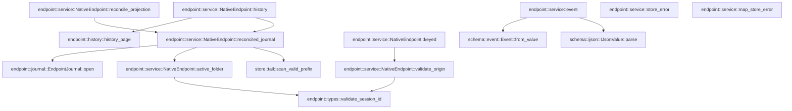

# endpoint::service

[Package atlas](index.md) · [Source](../../src/service.rs)

## Declarations

Visibility is the declaration spelling; trait members and reexports require their enclosing interface. `cfg` is not evaluated.

| Symbol | Kind | Visibility | Test / cfg |
|---|---|---|---|
| [endpoint::service::AUTOMATIC_TITLE_SEED_OPERATION](../../src/service.rs#L13) | const_item | `pub` |  |
| [endpoint::service::AUTOMATIC_TITLE_REFINE_OPERATION](../../src/service.rs#L14) | const_item | `pub` |  |
| [endpoint::service::SESSION_NOTICE_OPERATION](../../src/service.rs#L15) | const_item | `pub` |  |
| [endpoint::service::SessionNotice](../../src/service.rs#L22) | struct_item | `pub` |  |
| [endpoint::service::SessionNoticeSeverity](../../src/service.rs#L30) | enum_item | `pub` |  |
| [endpoint::service::SessionNoticeSeverity::as_str](../../src/service.rs#L37) | function_item | `pub` |  |
| [endpoint::service::MutationReceipt](../../src/service.rs#L46) | struct_item | `pub` |  |
| [endpoint::service::MutationReceipt::from](../../src/service.rs#L52) | function_item | `private` |  |
| [endpoint::service::ArchiveResult](../../src/service.rs#L61) | struct_item | `pub` |  |
| [endpoint::service::UnarchiveResult](../../src/service.rs#L66) | struct_item | `pub` |  |
| [endpoint::service::SessionInventoryItem](../../src/service.rs#L71) | struct_item | `pub` |  |
| [endpoint::service::SessionInventoryItem::resolved_cwd](../../src/service.rs#L101) | function_item | `pub` |  |
| [endpoint::service::PERMISSION_MODE_FILE](../../src/service.rs#L115) | const_item | `private` |  |
| [endpoint::service::DEFAULT_PERMISSION_MODE](../../src/service.rs#L116) | const_item | `private` |  |
| [endpoint::service::genesis_cwd](../../src/service.rs#L122) | function_item | `pub` |  |
| [endpoint::service::genesis_preset_summary](../../src/service.rs#L152) | function_item | `pub` |  |
| [endpoint::service::permission_mode_of](../../src/service.rs#L158) | function_item | `pub` |  |
| [endpoint::service::card_item](../../src/service.rs#L175) | function_item | `private` |  |
| [endpoint::service::card_updated_ms](../../src/service.rs#L216) | function_item | `pub` |  |
| [endpoint::service::last_record_updated_ms](../../src/service.rs#L231) | function_item | `pub` |  |
| [endpoint::service::last_record_updated_ms::WINDOW](../../src/service.rs#L233) | const_item | `private` |  |
| [endpoint::service::card_summary](../../src/service.rs#L254) | function_item | `pub` |  |
| [endpoint::service::NativeEndpoint](../../src/service.rs#L305) | struct_item | `pub` |  |
| [endpoint::service::CreateSessionWrite](../../src/service.rs#L309) | struct_item | `private` |  |
| [endpoint::service::NativeEndpoint::open](../../src/service.rs#L320) | function_item | `pub` |  |
| [endpoint::service::NativeEndpoint::capabilities](../../src/service.rs#L327) | function_item | `pub` |  |
| [endpoint::service::NativeEndpoint::list_sessions](../../src/service.rs#L346) | function_item | `pub` |  |
| [endpoint::service::NativeEndpoint::list_sessions_cached](../../src/service.rs#L356) | function_item | `pub` |  |
| [endpoint::service::NativeEndpoint::list_sessions_with](../../src/service.rs#L363) | function_item | `private` |  |
| [endpoint::service::NativeEndpoint::models](../../src/service.rs#L429) | function_item | `pub` |  |
| [endpoint::service::NativeEndpoint::session_config_snapshot](../../src/service.rs#L495) | function_item | `pub` |  |
| [endpoint::service::NativeEndpoint::submission_snapshot](../../src/service.rs#L507) | function_item | `pub` |  |
| [endpoint::service::NativeEndpoint::submission_metadata](../../src/service.rs#L514) | function_item | `pub` |  |
| [endpoint::service::NativeEndpoint::hydrate_historical_submissions](../../src/service.rs#L539) | function_item | `pub` |  |
| [endpoint::service::NativeEndpoint::create_session](../../src/service.rs#L647) | function_item | `pub` |  |
| [endpoint::service::NativeEndpoint::create_session_for_endpoint](../../src/service.rs#L670) | function_item | `pub` |  |
| [endpoint::service::NativeEndpoint::create_session_with_operation](../../src/service.rs#L690) | function_item | `private` |  |
| [endpoint::service::NativeEndpoint::prompt](../../src/service.rs#L720) | function_item | `pub` |  |
| [endpoint::service::NativeEndpoint::prompt_for_endpoint](../../src/service.rs#L731) | function_item | `pub` |  |
| [endpoint::service::NativeEndpoint::prompt_with_operation](../../src/service.rs#L749) | function_item | `private` |  |
| [endpoint::service::NativeEndpoint::update_queue](../../src/service.rs#L772) | function_item | `pub` |  |
| [endpoint::service::NativeEndpoint::rename_session](../../src/service.rs#L787) | function_item | `pub` |  |
| [endpoint::service::NativeEndpoint::rename_session_for_endpoint](../../src/service.rs#L797) | function_item | `pub` |  |
| [endpoint::service::NativeEndpoint::rename_session_with_operation](../../src/service.rs#L807) | function_item | `private` |  |
| [endpoint::service::NativeEndpoint::seed_automatic_title_if_missing](../../src/service.rs#L826) | function_item | `pub` |  |
| [endpoint::service::NativeEndpoint::record_session_notice](../../src/service.rs#L859) | function_item | `pub` |  |
| [endpoint::service::NativeEndpoint::refine_automatic_title](../../src/service.rs#L913) | function_item | `pub` |  |
| [endpoint::service::NativeEndpoint::author_keyed_with_ledger](../../src/service.rs#L954) | function_item | `pub` |  |
| [endpoint::service::NativeEndpoint::cancel](../../src/service.rs#L977) | function_item | `pub` |  |
| [endpoint::service::NativeEndpoint::cancel_for_endpoint](../../src/service.rs#L986) | function_item | `pub` |  |
| [endpoint::service::NativeEndpoint::cancel_with_operation](../../src/service.rs#L995) | function_item | `private` |  |
| [endpoint::service::NativeEndpoint::fork_session](../../src/service.rs#L1025) | function_item | `pub` |  |
| [endpoint::service::NativeEndpoint::archive_session](../../src/service.rs#L1041) | function_item | `pub` |  |
| [endpoint::service::NativeEndpoint::unarchive_session](../../src/service.rs#L1049) | function_item | `pub` |  |
| [endpoint::service::NativeEndpoint::reconcile_projection](../../src/service.rs#L1060) | function_item | `pub` |  |
| [endpoint::service::NativeEndpoint::reconciled_journal](../../src/service.rs#L1068) | function_item | `private` |  |
| [endpoint::service::NativeEndpoint::history](../../src/service.rs#L1082) | function_item | `pub` |  |
| [endpoint::service::NativeEndpoint::keyed](../../src/service.rs#L1092) | function_item | `private` |  |
| [endpoint::service::NativeEndpoint::validate_origin](../../src/service.rs#L1110) | function_item | `private` |  |
| [endpoint::service::NativeEndpoint::active_folder](../../src/service.rs#L1123) | function_item | `private` |  |
| [endpoint::service::event](../../src/service.rs#L1136) | function_item | `private` |  |
| [endpoint::service::store_error](../../src/service.rs#L1141) | function_item | `private` |  |
| [endpoint::service::map_store_error](../../src/service.rs#L1145) | function_item | `private` |  |
| [endpoint::service::NativeEndpointError](../../src/service.rs#L1154) | enum_item | `pub` |  |

## Imports / reexports

| Local name | Source path | Visibility |
|---|---|---|
| `BTreeSet` | `std::collections::BTreeSet` | `private` |
| `HashSet` | `std::collections::HashSet` | `private` |
| `fs` | `std::fs` | `private` |
| `Path` | `std::path::Path` | `private` |
| `Event` | `schema::Event` | `private` |
| `EventKind` | `schema::EventKind` | `private` |
| `IJsonValue` | `schema::IJsonValue` | `private` |
| `OriginTuple` | `schema::OriginTuple` | `private` |
| `ResumePolicy` | `schema::ResumePolicy` | `private` |
| `SeqRange` | `schema::SeqRange` | `private` |
| `Value` | `serde_json::Value` | `private` |
| `json` | `serde_json::json` | `private` |
| `AppendOutcome` | `store::AppendOutcome` | `private` |
| `ConditionalAppendOutcome` | `store::ConditionalAppendOutcome` | `private` |
| `ThreadStore` | `store::ThreadStore` | `private` |
| `scan_valid_prefix` | `store::scan_valid_prefix` | `private` |
| `Error` | `thiserror::Error` | `private` |
| `timestamp_millis` | `crate::projection::timestamp_millis` | `private` |
| `EndpointJournal` | `crate::EndpointJournal` | `private` |
| `HistoryPage` | `crate::HistoryPage` | `private` |
| `Projector` | `crate::Projector` | `private` |
| `history_page` | `crate::history_page` | `private` |
| `validate_session_id` | `crate::validate_session_id` | `private` |

## Module declarations

| Module | Visibility | Attributes |
|---|---|---|

## Function call graphs

Edges below are syntactically resolved calls only, including private functions. Graphs partition callers into groups of 20; they are not execution order. All unresolved sites are listed below and in the JSON inventory.

```mermaid
flowchart TD
  n0["endpoint::projection::timestamp_millis"]
  n1["endpoint::service::SessionInventoryItem::resolved_cwd"]
  n2["endpoint::service::NativeEndpoint::active_folder"]
  n3["endpoint::service::genesis_cwd"]
  n4["endpoint::service::genesis_preset_summary"]
  n5["endpoint::service::permission_mode_of"]
  n6["endpoint::service::card_item"]
  n7["endpoint::service::card_updated_ms"]
  n8["endpoint::service::last_record_updated_ms"]
  n9["endpoint::service::card_summary"]
  n10["endpoint::service::NativeEndpoint::open"]
  n11["endpoint::service::NativeEndpoint::capabilities"]
  n12["endpoint::service::NativeEndpoint::list_sessions"]
  n13["endpoint::service::NativeEndpoint::list_sessions_cached"]
  n14["endpoint::service::NativeEndpoint::list_sessions_with"]
  n15["endpoint::service::SessionNoticeSeverity::as_str"]
  n16["endpoint::service::NativeEndpoint::models"]
  n17["endpoint::service::NativeEndpoint::session_config_snapshot"]
  n18["endpoint::service::NativeEndpoint::submission_snapshot"]
  n19["endpoint::service::NativeEndpoint::submission_metadata"]
  n20["endpoint::service::MutationReceipt::from"]
  n21["endpoint::service::NativeEndpoint::hydrate_historical_submissions"]
  n22["endpoint::types::validate_session_id"]
  n23["profile::config::ConfigSnapshot::decode"]
  n24["profile::config::ConfigRepository::open"]
  n25["profile::scope::SessionScope::for_session_folder"]
  n26["schema::ijson::IJsonValue::parse"]
  n27["store::asset::AssetStore::new"]
  n28["store::card::read_card"]
  n29["store::card::classify"]
  n30["store::folder::ThreadStore::open"]
  n31["store::tail::scan_valid_prefix"]
  n32["store::tail::read_genesis"]
  n33["tools::preset::ResolvedPreset::from_genesis"]
  n3 --> n23
  n4 --> n33
  n6 --> n3
  n6 --> n5
  n6 --> n28
  n6 --> n29
  n6 --> n32
  n7 --> n0
  n8 --> n0
  n9 --> n4
  n9 --> n7
  n10 --> n30
  n12 --> n14
  n13 --> n14
  n14 --> n3
  n14 --> n5
  n14 --> n6
  n14 --> n9
  n14 --> n22
  n14 --> n31
  n16 --> n26
  n17 --> n2
  n17 --> n22
  n17 --> n24
  n17 --> n25
  n18 --> n2
  n18 --> n17
  n18 --> n19
  n18 --> n27
  n19 --> n26
  n21 --> n2
  n21 --> n19
  n21 --> n23
  n21 --> n26
  n21 --> n27
  n21 --> n31
```

Functions 1–20: 36 direct edges

Functions 21–40: 29 direct edges

Functions 41–49: 11 direct edges

## Call sites

Includes test functions (marked in declarations). Receiver-type-required sites need type analysis/manual tracing. Calls in closures are attributed to their enclosing function; their occurrence here does not mean the closure executes immediately.

| Caller | Callee expression | Source lines | Target / classification |
|---|---|---|---|
| `resolved_cwd` | `self.folder_binding             .as_ref()             .and_then(&#124;binding&#124; paths.get(&(self.workspace_id.clone(), binding.clone())))             .cloned()             .unwrap_or_else` | [105](../../src/service.rs#L105) | receiver-type-required |
| `resolved_cwd` | `self.folder_binding             .as_ref()             .and_then(&#124;binding&#124; paths.get(&(self.workspace_id.clone(), binding.clone())))             .cloned` | [105](../../src/service.rs#L105) | receiver-type-required |
| `resolved_cwd` | `self.folder_binding             .as_ref()             .and_then` | [105](../../src/service.rs#L105) | receiver-type-required |
| `resolved_cwd` | `self.folder_binding             .as_ref` | [105](../../src/service.rs#L105) | receiver-type-required |
| `resolved_cwd` | `paths.get` | [107](../../src/service.rs#L107) | receiver-type-required |
| `resolved_cwd` | `self.workspace_id.clone` | [107](../../src/service.rs#L107) | receiver-type-required |
| `resolved_cwd` | `binding.clone` | [107](../../src/service.rs#L107) | receiver-type-required |
| `resolved_cwd` | `self.cwd.clone` | [109](../../src/service.rs#L109) | receiver-type-required |
| `genesis_cwd` | `genesis.string_field` | [124](../../src/service.rs#L124) | receiver-type-required |
| `genesis_cwd` | `cwd.to_owned` | [125](../../src/service.rs#L125) | receiver-type-required |
| `genesis_cwd` | `serde_json::to_value(genesis.raw()).ok` | [128](../../src/service.rs#L128) | receiver-type-required |
| `genesis_cwd` | `serde_json::to_value` | [128](../../src/service.rs#L128) | external-constructor-callback-or-unresolved |
| `genesis_cwd` | `genesis.raw` | [128](../../src/service.rs#L128) | receiver-type-required |
| `genesis_cwd` | `raw.get("config")?.get("digest")?.as_str` | [129](../../src/service.rs#L129) | receiver-type-required |
| `genesis_cwd` | `raw.get("config")?.get` | [129](../../src/service.rs#L129) | receiver-type-required |
| `genesis_cwd` | `raw.get` | [129](../../src/service.rs#L129) | receiver-type-required |
| `genesis_cwd` | `digest.len` | [130](../../src/service.rs#L130) | receiver-type-required |
| `genesis_cwd` | `digest                 .bytes()                 .all` | [131](../../src/service.rs#L131) | receiver-type-required |
| `genesis_cwd` | `digest                 .bytes` | [131](../../src/service.rs#L131) | receiver-type-required |
| `genesis_cwd` | `b.is_ascii_hexdigit` | [133](../../src/service.rs#L133) | receiver-type-required |
| `genesis_cwd` | `b.is_ascii_uppercase` | [133](../../src/service.rs#L133) | receiver-type-required |
| `genesis_cwd` | `fs::read(folder.join("assets").join(format!("sha256-{digest}"))).ok` | [137](../../src/service.rs#L137) | receiver-type-required |
| `genesis_cwd` | `fs::read` | [137](../../src/service.rs#L137) | external-constructor-callback-or-unresolved |
| `genesis_cwd` | `folder.join("assets").join` | [137](../../src/service.rs#L137) | receiver-type-required |
| `genesis_cwd` | `folder.join` | [137](../../src/service.rs#L137) | receiver-type-required |
| `genesis_cwd` | `profile::ConfigSnapshot::decode(&bytes).ok` | [141](../../src/service.rs#L141) | receiver-type-required |
| `genesis_cwd` | `profile::ConfigSnapshot::decode` | [141](../../src/service.rs#L141) | [profile::config::ConfigSnapshot::decode](../../../profile/src/config.rs#L419) |
| `genesis_cwd` | `Some` | [142](../../src/service.rs#L142) | external-constructor-callback-or-unresolved |
| `genesis_cwd` | `config.execution_cwd()?.to_owned` | [142](../../src/service.rs#L142) | receiver-type-required |
| `genesis_cwd` | `config.execution_cwd` | [142](../../src/service.rs#L142) | receiver-type-required |
| `genesis_cwd` | `snapshot_cwd().unwrap_or_default` | [144](../../src/service.rs#L144) | receiver-type-required |
| `genesis_cwd` | `snapshot_cwd` | [144](../../src/service.rs#L144) | external-constructor-callback-or-unresolved |
| `genesis_preset_summary` | `serde_json::to_value(genesis.raw()).ok` | [153](../../src/service.rs#L153) | receiver-type-required |
| `genesis_preset_summary` | `serde_json::to_value` | [153](../../src/service.rs#L153) | external-constructor-callback-or-unresolved |
| `genesis_preset_summary` | `genesis.raw` | [153](../../src/service.rs#L153) | receiver-type-required |
| `genesis_preset_summary` | `tools::ResolvedPreset::from_genesis(raw.get("preset")?).ok` | [154](../../src/service.rs#L154) | receiver-type-required |
| `genesis_preset_summary` | `tools::ResolvedPreset::from_genesis` | [154](../../src/service.rs#L154) | [tools::preset::ResolvedPreset::from_genesis](../../../tools/src/preset.rs#L855) |
| `genesis_preset_summary` | `raw.get` | [154](../../src/service.rs#L154) | receiver-type-required |
| `genesis_preset_summary` | `Some` | [155](../../src/service.rs#L155) | external-constructor-callback-or-unresolved |
| `genesis_preset_summary` | `preset.summary` | [155](../../src/service.rs#L155) | receiver-type-required |
| `permission_mode_of` | `fs::read` | [159](../../src/service.rs#L159) | external-constructor-callback-or-unresolved |
| `permission_mode_of` | `folder.join` | [159](../../src/service.rs#L159) | receiver-type-required |
| `permission_mode_of` | `DEFAULT_PERMISSION_MODE.to_owned` | [160](../../src/service.rs#L160), [171](../../src/service.rs#L171) | receiver-type-required |
| `permission_mode_of` | `serde_json::from_slice::<serde_json::Value>(&bytes)         .ok()         .and_then(&#124;value&#124; value.get("mode")?.as_str().map(str::to_owned))         .filter(&#124;mode&#124; {             matches!(                 mode.as_str(),                 "read-only" &#124; "workspace-write" &#124; "danger-full-access"             )         })         .unwrap_or_else` | [162](../../src/service.rs#L162) | receiver-type-required |
| `permission_mode_of` | `serde_json::from_slice::<serde_json::Value>(&bytes)         .ok()         .and_then(&#124;value&#124; value.get("mode")?.as_str().map(str::to_owned))         .filter` | [162](../../src/service.rs#L162) | receiver-type-required |
| `permission_mode_of` | `serde_json::from_slice::<serde_json::Value>(&bytes)         .ok()         .and_then` | [162](../../src/service.rs#L162) | receiver-type-required |
| `permission_mode_of` | `serde_json::from_slice::<serde_json::Value>(&bytes)         .ok` | [162](../../src/service.rs#L162) | receiver-type-required |
| `permission_mode_of` | `serde_json::from_slice::<serde_json::Value>` | [162](../../src/service.rs#L162) | external-constructor-callback-or-unresolved |
| `permission_mode_of` | `value.get("mode")?.as_str().map` | [164](../../src/service.rs#L164) | receiver-type-required |
| `permission_mode_of` | `value.get("mode")?.as_str` | [164](../../src/service.rs#L164) | receiver-type-required |
| `permission_mode_of` | `value.get` | [164](../../src/service.rs#L164) | receiver-type-required |
| `card_item` | `store::card::read_card` | [181](../../src/service.rs#L181) | [store::card::read_card](../../../store/src/card.rs#L179) |
| `card_item` | `store::card::classify(folder, &card).ok` | [182](../../src/service.rs#L182) | receiver-type-required |
| `card_item` | `store::card::classify` | [182](../../src/service.rs#L182) | [store::card::classify](../../../store/src/card.rs#L394) |
| `card_item` | `classified.freshness` | [183](../../src/service.rs#L183) | receiver-type-required |
| `card_item` | `card.lines.first` | [186](../../src/service.rs#L186) | receiver-type-required |
| `card_item` | `Some` | [190](../../src/service.rs#L190) | external-constructor-callback-or-unresolved |
| `card_item` | `session_id.to_owned` | [191](../../src/service.rs#L191) | receiver-type-required |
| `card_item` | `card.summary.workspace.clone` | [192](../../src/service.rs#L192) | receiver-type-required |
| `card_item` | `card.summary.cwd.clone().unwrap_or_else` | [193](../../src/service.rs#L193) | receiver-type-required |
| `card_item` | `card.summary.cwd.clone` | [193](../../src/service.rs#L193) | receiver-type-required |
| `card_item` | `store::read_genesis(folder.join("main.jsonl"))                 .ok()                 .flatten()                 .map(&#124;g&#124; genesis_cwd(folder, &g))                 .unwrap_or_default` | [194](../../src/service.rs#L194) | receiver-type-required |
| `card_item` | `store::read_genesis(folder.join("main.jsonl"))                 .ok()                 .flatten()                 .map` | [194](../../src/service.rs#L194) | receiver-type-required |
| `card_item` | `store::read_genesis(folder.join("main.jsonl"))                 .ok()                 .flatten` | [194](../../src/service.rs#L194) | receiver-type-required |
| `card_item` | `store::read_genesis(folder.join("main.jsonl"))                 .ok` | [194](../../src/service.rs#L194) | receiver-type-required |
| `card_item` | `store::read_genesis` | [194](../../src/service.rs#L194) | [store::tail::read_genesis](../../../store/src/tail.rs#L86) |
| `card_item` | `folder.join` | [194](../../src/service.rs#L194) | receiver-type-required |
| `card_item` | `genesis_cwd` | [197](../../src/service.rs#L197) | [endpoint::service::genesis_cwd](../../src/service.rs#L122) |
| `card_item` | `card.summary.folder_binding.clone` | [200](../../src/service.rs#L200) | receiver-type-required |
| `card_item` | `card.summary.title.clone` | [201](../../src/service.rs#L201) | receiver-type-required |
| `card_item` | `main.facts.clone` | [207](../../src/service.rs#L207) | receiver-type-required |
| `card_item` | `permission_mode_of` | [208](../../src/service.rs#L208) | [endpoint::service::permission_mode_of](../../src/service.rs#L158) |
| `card_item` | `card.summary.identity_profile.clone` | [209](../../src/service.rs#L209) | receiver-type-required |
| `card_item` | `card.summary.preset.clone` | [210](../../src/service.rs#L210) | receiver-type-required |
| `card_updated_ms` | `Ok` | [217](../../src/service.rs#L217) | external-constructor-callback-or-unresolved |
| `card_updated_ms` | `projection         .events         .last()         .and_then(&#124;event&#124; event.string_field("ts"))         .ok_or(NativeEndpointError::InventoryTimestamp)         .and_then` | [217](../../src/service.rs#L217) | receiver-type-required |
| `card_updated_ms` | `projection         .events         .last()         .and_then(&#124;event&#124; event.string_field("ts"))         .ok_or` | [217](../../src/service.rs#L217) | receiver-type-required |
| `card_updated_ms` | `projection         .events         .last()         .and_then` | [217](../../src/service.rs#L217) | receiver-type-required |
| `card_updated_ms` | `projection         .events         .last` | [217](../../src/service.rs#L217) | receiver-type-required |
| `card_updated_ms` | `event.string_field` | [220](../../src/service.rs#L220) | receiver-type-required |
| `card_updated_ms` | `timestamp_millis(value).map_err` | [222](../../src/service.rs#L222) | receiver-type-required |
| `card_updated_ms` | `timestamp_millis` | [222](../../src/service.rs#L222) | [endpoint::projection::timestamp_millis](../../src/projection.rs#L944) |
| `last_record_updated_ms` | `fs::File::open(path).ok` | [234](../../src/service.rs#L234) | receiver-type-required |
| `last_record_updated_ms` | `fs::File::open` | [234](../../src/service.rs#L234) | external-constructor-callback-or-unresolved |
| `last_record_updated_ms` | `file.metadata().ok()?.len` | [235](../../src/service.rs#L235) | receiver-type-required |
| `last_record_updated_ms` | `file.metadata().ok` | [235](../../src/service.rs#L235) | receiver-type-required |
| `last_record_updated_ms` | `file.metadata` | [235](../../src/service.rs#L235) | receiver-type-required |
| `last_record_updated_ms` | `length.saturating_sub` | [236](../../src/service.rs#L236) | receiver-type-required |
| `last_record_updated_ms` | `file.seek(SeekFrom::Start(start)).ok` | [237](../../src/service.rs#L237) | receiver-type-required |
| `last_record_updated_ms` | `file.seek` | [237](../../src/service.rs#L237) | receiver-type-required |
| `last_record_updated_ms` | `SeekFrom::Start` | [237](../../src/service.rs#L237) | external-constructor-callback-or-unresolved |
| `last_record_updated_ms` | `Vec::new` | [238](../../src/service.rs#L238) | external-constructor-callback-or-unresolved |
| `last_record_updated_ms` | `file.take(WINDOW).read_to_end(&mut bytes).ok` | [239](../../src/service.rs#L239) | receiver-type-required |
| `last_record_updated_ms` | `file.take(WINDOW).read_to_end` | [239](../../src/service.rs#L239) | receiver-type-required |
| `last_record_updated_ms` | `file.take` | [239](../../src/service.rs#L239) | receiver-type-required |
| `last_record_updated_ms` | `bytes.iter().rposition` | [241](../../src/service.rs#L241) | receiver-type-required |
| `last_record_updated_ms` | `bytes.iter` | [241](../../src/service.rs#L241) | receiver-type-required |
| `last_record_updated_ms` | `bytes[..end]         .iter()         .rposition(&#124;byte&#124; *byte == b'\n')         .map(&#124;index&#124; index + 1)         .or` | [242](../../src/service.rs#L242) | receiver-type-required |
| `last_record_updated_ms` | `bytes[..end]         .iter()         .rposition(&#124;byte&#124; *byte == b'\n')         .map` | [242](../../src/service.rs#L242) | receiver-type-required |
| `last_record_updated_ms` | `bytes[..end]         .iter()         .rposition` | [242](../../src/service.rs#L242) | receiver-type-required |
| `last_record_updated_ms` | `bytes[..end]         .iter` | [242](../../src/service.rs#L242) | receiver-type-required |
| `last_record_updated_ms` | `(start == 0).then_some` | [246](../../src/service.rs#L246) | receiver-type-required |
| `last_record_updated_ms` | `serde_json::from_slice(&bytes[line_start..end]).ok` | [247](../../src/service.rs#L247) | receiver-type-required |
| `last_record_updated_ms` | `serde_json::from_slice` | [247](../../src/service.rs#L247) | external-constructor-callback-or-unresolved |
| `last_record_updated_ms` | `timestamp_millis(record.get("ts")?.as_str()?).ok` | [248](../../src/service.rs#L248) | receiver-type-required |
| `last_record_updated_ms` | `timestamp_millis` | [248](../../src/service.rs#L248) | [endpoint::projection::timestamp_millis](../../src/projection.rs#L944) |
| `last_record_updated_ms` | `record.get("ts")?.as_str` | [248](../../src/service.rs#L248) | receiver-type-required |
| `last_record_updated_ms` | `record.get` | [248](../../src/service.rs#L248) | receiver-type-required |
| `last_record_updated_ms` | `Some` | [249](../../src/service.rs#L249) | external-constructor-callback-or-unresolved |
| `card_summary` | `projection.events.first().ok_or_else` | [257](../../src/service.rs#L257) | receiver-type-required |
| `card_summary` | `projection.events.first` | [257](../../src/service.rs#L257) | receiver-type-required |
| `card_summary` | `NativeEndpointError::Store` | [258](../../src/service.rs#L258) | external-constructor-callback-or-unresolved |
| `card_summary` | `store::StoreError::Corruption` | [258](../../src/service.rs#L258) | external-constructor-callback-or-unresolved |
| `card_summary` | `"ledger has no genesis".to_owned` | [259](../../src/service.rs#L259) | receiver-type-required |
| `card_summary` | `projection         .events         .iter()         .rev()         .find_map(&#124;event&#124; event.string_field("title"))         .map` | [262](../../src/service.rs#L262) | receiver-type-required |
| `card_summary` | `projection         .events         .iter()         .rev()         .find_map` | [262](../../src/service.rs#L262) | receiver-type-required |
| `card_summary` | `projection         .events         .iter()         .rev` | [262](../../src/service.rs#L262) | receiver-type-required |
| `card_summary` | `projection         .events         .iter` | [262](../../src/service.rs#L262) | receiver-type-required |
| `card_summary` | `event.string_field` | [266](../../src/service.rs#L266), [276](../../src/service.rs#L276) | receiver-type-required |
| `card_summary` | `card_updated_ms` | [268](../../src/service.rs#L268) | [endpoint::service::card_updated_ms](../../src/service.rs#L216) |
| `card_summary` | `genesis_preset_summary` | [269](../../src/service.rs#L269) | [endpoint::service::genesis_preset_summary](../../src/service.rs#L152) |
| `card_summary` | `genesis.string_field` | [270](../../src/service.rs#L270), [273](../../src/service.rs#L273), [293](../../src/service.rs#L293), [294](../../src/service.rs#L294), [295](../../src/service.rs#L295) | receiver-type-required |
| `card_summary` | `preset.is_some` | [271](../../src/service.rs#L271) | receiver-type-required |
| `card_summary` | `Some` | [272](../../src/service.rs#L272), [276](../../src/service.rs#L276) | external-constructor-callback-or-unresolved |
| `card_summary` | `"coding".to_owned` | [272](../../src/service.rs#L272) | receiver-type-required |
| `card_summary` | `genesis.string_field("identity_profile").map` | [273](../../src/service.rs#L273) | receiver-type-required |
| `card_summary` | `projection.events.iter().find_map` | [274](../../src/service.rs#L274) | receiver-type-required |
| `card_summary` | `projection.events.iter` | [274](../../src/service.rs#L274) | receiver-type-required |
| `card_summary` | `event.kind` | [275](../../src/service.rs#L275) | receiver-type-required |
| `card_summary` | `serde_json::to_value(event.raw())                 .ok()?                 .get("payload")?                 .get("profile")?                 .as_str()                 .map` | [280](../../src/service.rs#L280) | receiver-type-required |
| `card_summary` | `serde_json::to_value(event.raw())                 .ok()?                 .get("payload")?                 .get("profile")?                 .as_str` | [280](../../src/service.rs#L280) | receiver-type-required |
| `card_summary` | `serde_json::to_value(event.raw())                 .ok()?                 .get("payload")?                 .get` | [280](../../src/service.rs#L280) | receiver-type-required |
| `card_summary` | `serde_json::to_value(event.raw())                 .ok()?                 .get` | [280](../../src/service.rs#L280) | receiver-type-required |
| `card_summary` | `serde_json::to_value(event.raw())                 .ok` | [280](../../src/service.rs#L280) | receiver-type-required |
| `card_summary` | `serde_json::to_value` | [280](../../src/service.rs#L280) | external-constructor-callback-or-unresolved |
| `card_summary` | `event.raw` | [280](../../src/service.rs#L280) | receiver-type-required |
| `card_summary` | `Ok` | [288](../../src/service.rs#L288) | external-constructor-callback-or-unresolved |
| `card_summary` | `genesis             .string_field("workspace")             .ok_or(NativeEndpointError::InventoryWorkspace)?             .to_owned` | [289](../../src/service.rs#L289) | receiver-type-required |
| `card_summary` | `genesis             .string_field("workspace")             .ok_or` | [289](../../src/service.rs#L289) | receiver-type-required |
| `card_summary` | `genesis             .string_field` | [289](../../src/service.rs#L289) | receiver-type-required |
| `card_summary` | `genesis.string_field("folder_binding").map` | [293](../../src/service.rs#L293) | receiver-type-required |
| `card_summary` | `genesis.string_field("cwd").map` | [294](../../src/service.rs#L294) | receiver-type-required |
| `card_summary` | `genesis.string_field("ts").unwrap_or_default().to_owned` | [295](../../src/service.rs#L295) | receiver-type-required |
| `card_summary` | `genesis.string_field("ts").unwrap_or_default` | [295](../../src/service.rs#L295) | receiver-type-required |
| `card_summary` | `genesis.is_ephemeral_genesis` | [300](../../src/service.rs#L300) | receiver-type-required |
| `card_summary` | `projection.lifecycle.latest_turn.is_none` | [301](../../src/service.rs#L301) | receiver-type-required |
| `open` | `Ok` | [321](../../src/service.rs#L321) | external-constructor-callback-or-unresolved |
| `open` | `ThreadStore::open` | [322](../../src/service.rs#L322) | [store::folder::ThreadStore::open](../../../store/src/folder.rs#L36) |
| `capabilities` | `[             "session.models",             "session.create",             "session.prompt",             "session.updateQueue",             "session.cancel",             "session.rename",             "session.fork",             "session.discard",             "workspace.archiveSession",             "workspace.unarchiveSession",         ]         .into_iter()         .collect` | [328](../../src/service.rs#L328) | receiver-type-required |
| `capabilities` | `[             "session.models",             "session.create",             "session.prompt",             "session.updateQueue",             "session.cancel",             "session.rename",             "session.fork",             "session.discard",             "workspace.archiveSession",             "workspace.unarchiveSession",         ]         .into_iter` | [328](../../src/service.rs#L328) | receiver-type-required |
| `list_sessions` | `self.list_sessions_with` | [350](../../src/service.rs#L350) | [endpoint::service::NativeEndpoint::list_sessions_with](../../src/service.rs#L363) |
| `list_sessions_cached` | `self.list_sessions_with` | [360](../../src/service.rs#L360) | [endpoint::service::NativeEndpoint::list_sessions_with](../../src/service.rs#L363) |
| `list_sessions_with` | `Vec::new` | [368](../../src/service.rs#L368) | external-constructor-callback-or-unresolved |
| `list_sessions_with` | `fs::read_dir` | [370](../../src/service.rs#L370) | external-constructor-callback-or-unresolved |
| `list_sessions_with` | `self.store.root().join` | [370](../../src/service.rs#L370) | receiver-type-required |
| `list_sessions_with` | `self.store.root` | [370](../../src/service.rs#L370) | receiver-type-required |
| `list_sessions_with` | `entry.file_type()?.is_dir` | [372](../../src/service.rs#L372) | receiver-type-required |
| `list_sessions_with` | `entry.file_type` | [372](../../src/service.rs#L372) | receiver-type-required |
| `list_sessions_with` | `entry.file_name().to_string_lossy().into_owned` | [375](../../src/service.rs#L375) | receiver-type-required |
| `list_sessions_with` | `entry.file_name().to_string_lossy` | [375](../../src/service.rs#L375) | receiver-type-required |
| `list_sessions_with` | `entry.file_name` | [375](../../src/service.rs#L375) | receiver-type-required |
| `list_sessions_with` | `validate_session_id` | [376](../../src/service.rs#L376) | [endpoint::types::validate_session_id](../../src/types.rs#L130) |
| `list_sessions_with` | `running.contains` | [378](../../src/service.rs#L378) | receiver-type-required |
| `list_sessions_with` | `self.store.session_has_live_line_holder` | [379](../../src/service.rs#L379) | receiver-type-required |
| `list_sessions_with` | `card_item` | [381](../../src/service.rs#L381) | [endpoint::service::card_item](../../src/service.rs#L175) |
| `list_sessions_with` | `entry.path` | [381](../../src/service.rs#L381), [386](../../src/service.rs#L386), [402](../../src/service.rs#L402), [409](../../src/service.rs#L409) | receiver-type-required |
| `list_sessions_with` | `items.push` | [383](../../src/service.rs#L383), [401](../../src/service.rs#L401) | receiver-type-required |
| `list_sessions_with` | `fs::read` | [386](../../src/service.rs#L386) | external-constructor-callback-or-unresolved |
| `list_sessions_with` | `entry.path().join` | [386](../../src/service.rs#L386) | receiver-type-required |
| `list_sessions_with` | `scan_valid_prefix` | [387](../../src/service.rs#L387) | [store::tail::scan_valid_prefix](../../../store/src/tail.rs#L37) |
| `list_sessions_with` | `scan.projection.ok_or_else` | [388](../../src/service.rs#L388) | receiver-type-required |
| `list_sessions_with` | `NativeEndpointError::Store` | [389](../../src/service.rs#L389), [395](../../src/service.rs#L395) | external-constructor-callback-or-unresolved |
| `list_sessions_with` | `store::StoreError::Corruption` | [389](../../src/service.rs#L389), [395](../../src/service.rs#L395) | external-constructor-callback-or-unresolved |
| `list_sessions_with` | `card_summary(&projection).map_err` | [393](../../src/service.rs#L393) | receiver-type-required |
| `list_sessions_with` | `card_summary` | [393](../../src/service.rs#L393) | [endpoint::service::card_summary](../../src/service.rs#L254) |
| `list_sessions_with` | `permission_mode_of` | [402](../../src/service.rs#L402) | [endpoint::service::permission_mode_of](../../src/service.rs#L158) |
| `list_sessions_with` | `summary.cwd.unwrap_or_else` | [407](../../src/service.rs#L407) | receiver-type-required |
| `list_sessions_with` | `genesis_cwd` | [408](../../src/service.rs#L408) | [endpoint::service::genesis_cwd](../../src/service.rs#L122) |
| `list_sessions_with` | `projection.events.first().expect` | [410](../../src/service.rs#L410) | receiver-type-required |
| `list_sessions_with` | `projection.events.first` | [410](../../src/service.rs#L410) | receiver-type-required |
| `list_sessions_with` | `items.sort_by` | [425](../../src/service.rs#L425) | receiver-type-required |
| `list_sessions_with` | `left.session_id.as_bytes().cmp` | [425](../../src/service.rs#L425) | receiver-type-required |
| `list_sessions_with` | `left.session_id.as_bytes` | [425](../../src/service.rs#L425) | receiver-type-required |
| `list_sessions_with` | `right.session_id.as_bytes` | [425](../../src/service.rs#L425) | receiver-type-required |
| `list_sessions_with` | `Ok` | [426](../../src/service.rs#L426) | external-constructor-callback-or-unresolved |
| `models` | `snapshot             .session_settings             .as_ref()             .map(&#124;settings&#124; &settings.provider)             .or(snapshot.workspace.policy.provider.as_ref())             .or` | [433](../../src/service.rs#L433) | receiver-type-required |
| `models` | `snapshot             .session_settings             .as_ref()             .map(&#124;settings&#124; &settings.provider)             .or` | [433](../../src/service.rs#L433) | receiver-type-required |
| `models` | `snapshot             .session_settings             .as_ref()             .map` | [433](../../src/service.rs#L433), [439](../../src/service.rs#L439) | receiver-type-required |
| `models` | `snapshot             .session_settings             .as_ref` | [433](../../src/service.rs#L433), [439](../../src/service.rs#L439), [475](../../src/service.rs#L475) | receiver-type-required |
| `models` | `snapshot.workspace.policy.provider.as_ref` | [437](../../src/service.rs#L437) | receiver-type-required |
| `models` | `snapshot.settings.default_provider.as_ref` | [438](../../src/service.rs#L438) | receiver-type-required |
| `models` | `snapshot             .session_settings             .as_ref()             .map(&#124;settings&#124; &settings.model)             .or(snapshot.workspace.policy.model.as_ref())             .or` | [439](../../src/service.rs#L439) | receiver-type-required |
| `models` | `snapshot             .session_settings             .as_ref()             .map(&#124;settings&#124; &settings.model)             .or` | [439](../../src/service.rs#L439) | receiver-type-required |
| `models` | `snapshot.workspace.policy.model.as_ref` | [443](../../src/service.rs#L443) | receiver-type-required |
| `models` | `snapshot.settings.default_model.as_ref` | [444](../../src/service.rs#L444) | receiver-type-required |
| `models` | `snapshot             .providers             .providers             .iter()             .map(&#124;provider&#124; {                 json!({                     "id": provider.id,                     "name": provider.id,                     "models": provider.models.iter().filter(&#124;model&#124; model.enabled).map(&#124;model&#124; {                         json!({"id": model.id, "name": model.id,                             "contextWindow": model.context_window_tokens})                     }).collect::<Vec<_>>()                 })             })             .collect::<Vec<_>>` | [445](../../src/service.rs#L445) | receiver-type-required |
| `models` | `snapshot             .providers             .providers             .iter()             .map` | [445](../../src/service.rs#L445) | receiver-type-required |
| `models` | `snapshot             .providers             .providers             .iter` | [445](../../src/service.rs#L445) | receiver-type-required |
| `models` | `selected_provider             .zip(selected_model)             .is_some_and` | [460](../../src/service.rs#L460) | receiver-type-required |
| `models` | `selected_provider             .zip` | [460](../../src/service.rs#L460) | receiver-type-required |
| `models` | `snapshot.providers.providers.iter().any` | [463](../../src/service.rs#L463) | receiver-type-required |
| `models` | `snapshot.providers.providers.iter` | [463](../../src/service.rs#L463) | receiver-type-required |
| `models` | `candidate                             .models                             .iter()                             .any` | [465](../../src/service.rs#L465) | receiver-type-required |
| `models` | `candidate                             .models                             .iter` | [465](../../src/service.rs#L465) | receiver-type-required |
| `models` | `snapshot             .session_settings             .as_ref()             .and_then` | [475](../../src/service.rs#L475) | receiver-type-required |
| `models` | `settings.reasoning_effort.as_ref` | [478](../../src/service.rs#L478) | receiver-type-required |
| `models` | `Value::String` | [480](../../src/service.rs#L480) | external-constructor-callback-or-unresolved |
| `models` | `effort.clone` | [480](../../src/service.rs#L480) | receiver-type-required |
| `models` | `Ok` | [488](../../src/service.rs#L488) | external-constructor-callback-or-unresolved |
| `models` | `IJsonValue::parse` | [488](../../src/service.rs#L488) | [schema::ijson::IJsonValue::parse](../../../schema/src/ijson.rs#L16) |
| `models` | `serde_json::to_vec` | [488](../../src/service.rs#L488) | external-constructor-callback-or-unresolved |
| `session_config_snapshot` | `validate_session_id` | [499](../../src/service.rs#L499) | [endpoint::types::validate_session_id](../../src/types.rs#L130) |
| `session_config_snapshot` | `profile::SessionScope::for_session_folder` | [500](../../src/service.rs#L500) | [profile::scope::SessionScope::for_session_folder](../../../profile/src/scope.rs#L46) |
| `session_config_snapshot` | `self.active_folder` | [500](../../src/service.rs#L500) | [endpoint::service::NativeEndpoint::active_folder](../../src/service.rs#L1123) |
| `session_config_snapshot` | `profile::ConfigRepository::open` | [501](../../src/service.rs#L501) | [profile::config::ConfigRepository::open](../../../profile/src/config.rs#L814) |
| `session_config_snapshot` | `self.store.root` | [501](../../src/service.rs#L501) | receiver-type-required |
| `session_config_snapshot` | `Ok` | [502](../../src/service.rs#L502) | external-constructor-callback-or-unresolved |
| `session_config_snapshot` | `scope.config` | [502](../../src/service.rs#L502) | receiver-type-required |
| `submission_snapshot` | `self.session_config_snapshot` | [508](../../src/service.rs#L508) | [endpoint::service::NativeEndpoint::session_config_snapshot](../../src/service.rs#L495) |
| `submission_snapshot` | `store::AssetStore::new` | [509](../../src/service.rs#L509) | [store::asset::AssetStore::new](../../../store/src/asset.rs#L27) |
| `submission_snapshot` | `self.active_folder(session_id)?.join` | [509](../../src/service.rs#L509) | receiver-type-required |
| `submission_snapshot` | `self.active_folder` | [509](../../src/service.rs#L509) | [endpoint::service::NativeEndpoint::active_folder](../../src/service.rs#L1123) |
| `submission_snapshot` | `config.publish` | [510](../../src/service.rs#L510) | receiver-type-required |
| `submission_snapshot` | `Self::submission_metadata` | [511](../../src/service.rs#L511) | [endpoint::service::NativeEndpoint::submission_metadata](../../src/service.rs#L514) |
| `submission_metadata` | `config             .session_settings             .as_ref()             .map(&#124;s&#124; s.provider.as_str())             .or(config.workspace.policy.provider.as_deref())             .or` | [518](../../src/service.rs#L518) | receiver-type-required |
| `submission_metadata` | `config             .session_settings             .as_ref()             .map(&#124;s&#124; s.provider.as_str())             .or` | [518](../../src/service.rs#L518) | receiver-type-required |
| `submission_metadata` | `config             .session_settings             .as_ref()             .map` | [518](../../src/service.rs#L518), [524](../../src/service.rs#L524) | receiver-type-required |
| `submission_metadata` | `config             .session_settings             .as_ref` | [518](../../src/service.rs#L518), [524](../../src/service.rs#L524) | receiver-type-required |
| `submission_metadata` | `s.provider.as_str` | [521](../../src/service.rs#L521) | receiver-type-required |
| `submission_metadata` | `config.workspace.policy.provider.as_deref` | [522](../../src/service.rs#L522) | receiver-type-required |
| `submission_metadata` | `config.settings.default_provider.as_deref` | [523](../../src/service.rs#L523) | receiver-type-required |
| `submission_metadata` | `config             .session_settings             .as_ref()             .map(&#124;s&#124; s.model.as_str())             .or(config.workspace.policy.model.as_deref())             .or` | [524](../../src/service.rs#L524) | receiver-type-required |
| `submission_metadata` | `config             .session_settings             .as_ref()             .map(&#124;s&#124; s.model.as_str())             .or` | [524](../../src/service.rs#L524) | receiver-type-required |
| `submission_metadata` | `s.model.as_str` | [527](../../src/service.rs#L527) | receiver-type-required |
| `submission_metadata` | `config.workspace.policy.model.as_deref` | [528](../../src/service.rs#L528) | receiver-type-required |
| `submission_metadata` | `config.settings.default_model.as_deref` | [529](../../src/service.rs#L529) | receiver-type-required |
| `submission_metadata` | `Ok` | [530](../../src/service.rs#L530) | external-constructor-callback-or-unresolved |
| `submission_metadata` | `IJsonValue::parse` | [530](../../src/service.rs#L530) | [schema::ijson::IJsonValue::parse](../../../schema/src/ijson.rs#L16) |
| `submission_metadata` | `serde_json::to_vec` | [530](../../src/service.rs#L530) | external-constructor-callback-or-unresolved |
| `hydrate_historical_submissions` | `entries.iter().any` | [547](../../src/service.rs#L547) | receiver-type-required |
| `hydrate_historical_submissions` | `entries.iter` | [547](../../src/service.rs#L547) | receiver-type-required |
| `hydrate_historical_submissions` | `serde_json::to_value(&entry.event.data)                     .is_ok_and` | [549](../../src/service.rs#L549) | receiver-type-required |
| `hydrate_historical_submissions` | `serde_json::to_value` | [549](../../src/service.rs#L549), [571](../../src/service.rs#L571), [622](../../src/service.rs#L622), [635](../../src/service.rs#L635) | external-constructor-callback-or-unresolved |
| `hydrate_historical_submissions` | `data.get("submission").is_none` | [550](../../src/service.rs#L550) | receiver-type-required |
| `hydrate_historical_submissions` | `data.get` | [550](../../src/service.rs#L550), [625](../../src/service.rs#L625) | receiver-type-required |
| `hydrate_historical_submissions` | `self.active_folder` | [555](../../src/service.rs#L555) | [endpoint::service::NativeEndpoint::active_folder](../../src/service.rs#L1123) |
| `hydrate_historical_submissions` | `fs::read` | [558](../../src/service.rs#L558) | external-constructor-callback-or-unresolved |
| `hydrate_historical_submissions` | `folder.join` | [558](../../src/service.rs#L558), [564](../../src/service.rs#L564) | receiver-type-required |
| `hydrate_historical_submissions` | `scan_valid_prefix` | [561](../../src/service.rs#L561) | [store::tail::scan_valid_prefix](../../../store/src/tail.rs#L37) |
| `hydrate_historical_submissions` | `store::AssetStore::new` | [564](../../src/service.rs#L564) | [store::asset::AssetStore::new](../../../store/src/asset.rs#L27) |
| `hydrate_historical_submissions` | `std::collections::BTreeMap::new` | [568](../../src/service.rs#L568), [569](../../src/service.rs#L569) | external-constructor-callback-or-unresolved |
| `hydrate_historical_submissions` | `event.raw` | [571](../../src/service.rs#L571) | receiver-type-required |
| `hydrate_historical_submissions` | `event.kind` | [574](../../src/service.rs#L574) | receiver-type-required |
| `hydrate_historical_submissions` | `value                         .get("config")                         .and_then(&#124;c&#124; c.get("digest"))                         .and_then(Value::as_str)                         .map` | [576](../../src/service.rs#L576) | receiver-type-required |
| `hydrate_historical_submissions` | `value                         .get("config")                         .and_then(&#124;c&#124; c.get("digest"))                         .and_then` | [576](../../src/service.rs#L576) | receiver-type-required |
| `hydrate_historical_submissions` | `value                         .get("config")                         .and_then` | [576](../../src/service.rs#L576) | receiver-type-required |
| `hydrate_historical_submissions` | `value                         .get` | [576](../../src/service.rs#L576), [583](../../src/service.rs#L583), [592](../../src/service.rs#L592) | receiver-type-required |
| `hydrate_historical_submissions` | `c.get` | [578](../../src/service.rs#L578) | receiver-type-required |
| `hydrate_historical_submissions` | `value                         .get("config_digest")                         .and_then(Value::as_str)                         .map` | [583](../../src/service.rs#L583) | receiver-type-required |
| `hydrate_historical_submissions` | `value                         .get("config_digest")                         .and_then` | [583](../../src/service.rs#L583) | receiver-type-required |
| `hydrate_historical_submissions` | `inputs.insert` | [589](../../src/service.rs#L589) | receiver-type-required |
| `hydrate_historical_submissions` | `event.seq` | [589](../../src/service.rs#L589) | receiver-type-required |
| `hydrate_historical_submissions` | `value                         .get("trigger")                         .and_then(&#124;t&#124; t.get("inputs"))                         .and_then` | [592](../../src/service.rs#L592) | receiver-type-required |
| `hydrate_historical_submissions` | `value                         .get("trigger")                         .and_then` | [592](../../src/service.rs#L592) | receiver-type-required |
| `hydrate_historical_submissions` | `t.get` | [594](../../src/service.rs#L594) | receiver-type-required |
| `hydrate_historical_submissions` | `digest.as_deref().and_then` | [599](../../src/service.rs#L599) | receiver-type-required |
| `hydrate_historical_submissions` | `digest.as_deref` | [599](../../src/service.rs#L599) | receiver-type-required |
| `hydrate_historical_submissions` | `assets.read_verified(&format!("sha256-{digest}")).ok` | [600](../../src/service.rs#L600) | receiver-type-required |
| `hydrate_historical_submissions` | `assets.read_verified` | [600](../../src/service.rs#L600) | receiver-type-required |
| `hydrate_historical_submissions` | `profile::ConfigSnapshot::decode(&bytes).ok` | [601](../../src/service.rs#L601) | receiver-type-required |
| `hydrate_historical_submissions` | `profile::ConfigSnapshot::decode` | [601](../../src/service.rs#L601) | [profile::config::ConfigSnapshot::decode](../../../profile/src/config.rs#L419) |
| `hydrate_historical_submissions` | `Self::submission_metadata(&config, digest).ok` | [602](../../src/service.rs#L602) | receiver-type-required |
| `hydrate_historical_submissions` | `Self::submission_metadata` | [602](../../src/service.rs#L602) | [endpoint::service::NativeEndpoint::submission_metadata](../../src/service.rs#L514) |
| `hydrate_historical_submissions` | `seqs.iter().filter_map` | [604](../../src/service.rs#L604) | receiver-type-required |
| `hydrate_historical_submissions` | `seqs.iter` | [604](../../src/service.rs#L604) | receiver-type-required |
| `hydrate_historical_submissions` | `inputs                             .get(&seq)                             .and_then(&#124;input&#124; input.get("submission"))                             .and_then(&#124;s&#124; IJsonValue::parse(&serde_json::to_vec(s).ok()?).ok())                             .or_else` | [605](../../src/service.rs#L605) | receiver-type-required |
| `hydrate_historical_submissions` | `inputs                             .get(&seq)                             .and_then(&#124;input&#124; input.get("submission"))                             .and_then` | [605](../../src/service.rs#L605) | receiver-type-required |
| `hydrate_historical_submissions` | `inputs                             .get(&seq)                             .and_then` | [605](../../src/service.rs#L605) | receiver-type-required |
| `hydrate_historical_submissions` | `inputs                             .get` | [605](../../src/service.rs#L605) | receiver-type-required |
| `hydrate_historical_submissions` | `input.get` | [607](../../src/service.rs#L607) | receiver-type-required |
| `hydrate_historical_submissions` | `IJsonValue::parse(&serde_json::to_vec(s).ok()?).ok` | [608](../../src/service.rs#L608) | receiver-type-required |
| `hydrate_historical_submissions` | `IJsonValue::parse` | [608](../../src/service.rs#L608), [640](../../src/service.rs#L640) | [schema::ijson::IJsonValue::parse](../../../schema/src/ijson.rs#L16) |
| `hydrate_historical_submissions` | `serde_json::to_vec(s).ok` | [608](../../src/service.rs#L608) | receiver-type-required |
| `hydrate_historical_submissions` | `serde_json::to_vec` | [608](../../src/service.rs#L608), [639](../../src/service.rs#L639) | external-constructor-callback-or-unresolved |
| `hydrate_historical_submissions` | `historical.clone` | [609](../../src/service.rs#L609) | receiver-type-required |
| `hydrate_historical_submissions` | `submissions.insert` | [611](../../src/service.rs#L611) | receiver-type-required |
| `hydrate_historical_submissions` | `data.get("submission").is_some` | [625](../../src/service.rs#L625) | receiver-type-required |
| `hydrate_historical_submissions` | `data                 .get("id")                 .and_then(Value::as_str)                 .and_then` | [628](../../src/service.rs#L628) | receiver-type-required |
| `hydrate_historical_submissions` | `data                 .get("id")                 .and_then` | [628](../../src/service.rs#L628) | receiver-type-required |
| `hydrate_historical_submissions` | `data                 .get` | [628](../../src/service.rs#L628) | receiver-type-required |
| `hydrate_historical_submissions` | `submissions.get` | [631](../../src/service.rs#L631) | receiver-type-required |
| `create_session` | `self.create_session_with_operation` | [656](../../src/service.rs#L656) | [endpoint::service::NativeEndpoint::create_session_with_operation](../../src/service.rs#L690) |
| `create_session_for_endpoint` | `self.create_session_with_operation` | [679](../../src/service.rs#L679) | [endpoint::service::NativeEndpoint::create_session_with_operation](../../src/service.rs#L690) |
| `create_session_with_operation` | `validate_session_id` | [694](../../src/service.rs#L694) | [endpoint::types::validate_session_id](../../src/types.rs#L130) |
| `create_session_with_operation` | `Err` | [696](../../src/service.rs#L696) | external-constructor-callback-or-unresolved |
| `create_session_with_operation` | `event` | [698](../../src/service.rs#L698) | external-constructor-callback-or-unresolved |
| `create_session_with_operation` | `Ok` | [713](../../src/service.rs#L713) | external-constructor-callback-or-unresolved |
| `create_session_with_operation` | `self             .store             .create_thread(write.session_id, event)             .map_err` | [713](../../src/service.rs#L713) | receiver-type-required |
| `create_session_with_operation` | `self             .store             .create_thread` | [713](../../src/service.rs#L713) | receiver-type-required |
| `prompt` | `self.prompt_with_operation` | [728](../../src/service.rs#L728) | [endpoint::service::NativeEndpoint::prompt_with_operation](../../src/service.rs#L749) |
| `prompt_for_endpoint` | `self.prompt_with_operation` | [739](../../src/service.rs#L739) | [endpoint::service::NativeEndpoint::prompt_with_operation](../../src/service.rs#L749) |
| `prompt_with_operation` | `self.keyed` | [758](../../src/service.rs#L758) | [endpoint::service::NativeEndpoint::keyed](../../src/service.rs#L1092) |
| `prompt_with_operation` | `self.submission_snapshot` | [759](../../src/service.rs#L759) | [endpoint::service::NativeEndpoint::submission_snapshot](../../src/service.rs#L507) |
| `prompt_with_operation` | `Value::Bool` | [766](../../src/service.rs#L766) | external-constructor-callback-or-unresolved |
| `prompt_with_operation` | `event` | [768](../../src/service.rs#L768) | [endpoint::service::event](../../src/service.rs#L1136) |
| `update_queue` | `self.keyed` | [779](../../src/service.rs#L779) | [endpoint::service::NativeEndpoint::keyed](../../src/service.rs#L1092) |
| `update_queue` | `event` | [780](../../src/service.rs#L780) | [endpoint::service::event](../../src/service.rs#L1136) |
| `rename_session` | `self.rename_session_with_operation` | [794](../../src/service.rs#L794) | [endpoint::service::NativeEndpoint::rename_session_with_operation](../../src/service.rs#L807) |
| `rename_session_for_endpoint` | `self.rename_session_with_operation` | [804](../../src/service.rs#L804) | [endpoint::service::NativeEndpoint::rename_session_with_operation](../../src/service.rs#L807) |
| `rename_session_with_operation` | `self.keyed` | [815](../../src/service.rs#L815) | [endpoint::service::NativeEndpoint::keyed](../../src/service.rs#L1092) |
| `rename_session_with_operation` | `event` | [816](../../src/service.rs#L816) | [endpoint::service::event](../../src/service.rs#L1136) |
| `seed_automatic_title_if_missing` | `self.validate_origin` | [833](../../src/service.rs#L833) | [endpoint::service::NativeEndpoint::validate_origin](../../src/service.rs#L1110) |
| `seed_automatic_title_if_missing` | `self             .store             .append_keyed_with_projection_if(session_id, origin, &#124;seq, projection&#124; {                 if projection.events.iter().any(&#124;item&#124; {                     *item.kind() == EventKind::Meta && item.string_field("title").is_some()                 }) {                     return Ok(None);                 }                 event(json!({                     "v": 1, "seq": seq, "ts": timestamp, "kind": "meta", "title": title,                     "origin_key": origin.key, "origin_tuple": origin,                 }))                 .map(Some)                 .map_err(store_error)             })             .map_err` | [834](../../src/service.rs#L834) | receiver-type-required |
| `seed_automatic_title_if_missing` | `self             .store             .append_keyed_with_projection_if` | [834](../../src/service.rs#L834) | receiver-type-required |
| `seed_automatic_title_if_missing` | `projection.events.iter().any` | [837](../../src/service.rs#L837) | receiver-type-required |
| `seed_automatic_title_if_missing` | `projection.events.iter` | [837](../../src/service.rs#L837) | receiver-type-required |
| `seed_automatic_title_if_missing` | `item.kind` | [838](../../src/service.rs#L838) | receiver-type-required |
| `seed_automatic_title_if_missing` | `item.string_field("title").is_some` | [838](../../src/service.rs#L838) | receiver-type-required |
| `seed_automatic_title_if_missing` | `item.string_field` | [838](../../src/service.rs#L838) | receiver-type-required |
| `seed_automatic_title_if_missing` | `Ok` | [840](../../src/service.rs#L840), [850](../../src/service.rs#L850) | external-constructor-callback-or-unresolved |
| `seed_automatic_title_if_missing` | `event(json!({                     "v": 1, "seq": seq, "ts": timestamp, "kind": "meta", "title": title,                     "origin_key": origin.key, "origin_tuple": origin,                 }))                 .map(Some)                 .map_err` | [842](../../src/service.rs#L842) | receiver-type-required |
| `seed_automatic_title_if_missing` | `event(json!({                     "v": 1, "seq": seq, "ts": timestamp, "kind": "meta", "title": title,                     "origin_key": origin.key, "origin_tuple": origin,                 }))                 .map` | [842](../../src/service.rs#L842) | receiver-type-required |
| `seed_automatic_title_if_missing` | `event` | [842](../../src/service.rs#L842) | [endpoint::service::event](../../src/service.rs#L1136) |
| `seed_automatic_title_if_missing` | `Some` | [851](../../src/service.rs#L851) | external-constructor-callback-or-unresolved |
| `seed_automatic_title_if_missing` | `outcome.into` | [851](../../src/service.rs#L851) | receiver-type-required |
| `record_session_notice` | `self.validate_origin` | [866](../../src/service.rs#L866) | [endpoint::service::NativeEndpoint::validate_origin](../../src/service.rs#L1110) |
| `record_session_notice` | `self.store                 .append_keyed_with_projection_if(session_id, origin, &#124;seq, projection&#124; {                     // A notice that repeats the newest one, with no input in between,                     // says nothing new (the same degraded launch on every worker                     // restart); fold it. An input after it is a fresh attempt the                     // user made, and its outcome must be shown again.                     let latest_notice = projection.events.iter().rposition(&#124;item&#124; {                         *item.kind() == EventKind::Meta && item.has_field("notice")                     });                     if let Some(index) = latest_notice {                         let repeats = serde_json::to_value(projection.events[index].raw())                             .ok()                             .and_then(&#124;value&#124; value.get("notice").cloned())                             .is_some_and(&#124;previous&#124; previous == payload);                         let input_since = projection.events[index + 1..]                             .iter()                             .any(&#124;item&#124; *item.kind() == EventKind::Input);                         if repeats && !input_since {                             return Ok(None);                         }                     }                     event(json!({                         "v": 1, "seq": seq, "ts": timestamp, "kind": "meta",                         "notice": payload,                         "origin_key": origin.key, "origin_tuple": origin,                     }))                     .map(Some)                     .map_err(store_error)                 })                 .map_err` | [874](../../src/service.rs#L874) | receiver-type-required |
| `record_session_notice` | `self.store                 .append_keyed_with_projection_if` | [874](../../src/service.rs#L874) | receiver-type-required |
| `record_session_notice` | `projection.events.iter().rposition` | [880](../../src/service.rs#L880) | receiver-type-required |
| `record_session_notice` | `projection.events.iter` | [880](../../src/service.rs#L880) | receiver-type-required |
| `record_session_notice` | `item.kind` | [881](../../src/service.rs#L881), [890](../../src/service.rs#L890) | receiver-type-required |
| `record_session_notice` | `item.has_field` | [881](../../src/service.rs#L881) | receiver-type-required |
| `record_session_notice` | `serde_json::to_value(projection.events[index].raw())                             .ok()                             .and_then(&#124;value&#124; value.get("notice").cloned())                             .is_some_and` | [884](../../src/service.rs#L884) | receiver-type-required |
| `record_session_notice` | `serde_json::to_value(projection.events[index].raw())                             .ok()                             .and_then` | [884](../../src/service.rs#L884) | receiver-type-required |
| `record_session_notice` | `serde_json::to_value(projection.events[index].raw())                             .ok` | [884](../../src/service.rs#L884) | receiver-type-required |
| `record_session_notice` | `serde_json::to_value` | [884](../../src/service.rs#L884) | external-constructor-callback-or-unresolved |
| `record_session_notice` | `projection.events[index].raw` | [884](../../src/service.rs#L884) | receiver-type-required |
| `record_session_notice` | `value.get("notice").cloned` | [886](../../src/service.rs#L886) | receiver-type-required |
| `record_session_notice` | `value.get` | [886](../../src/service.rs#L886) | receiver-type-required |
| `record_session_notice` | `projection.events[index + 1..]                             .iter()                             .any` | [888](../../src/service.rs#L888) | receiver-type-required |
| `record_session_notice` | `projection.events[index + 1..]                             .iter` | [888](../../src/service.rs#L888) | receiver-type-required |
| `record_session_notice` | `Ok` | [892](../../src/service.rs#L892), [904](../../src/service.rs#L904) | external-constructor-callback-or-unresolved |
| `record_session_notice` | `event(json!({                         "v": 1, "seq": seq, "ts": timestamp, "kind": "meta",                         "notice": payload,                         "origin_key": origin.key, "origin_tuple": origin,                     }))                     .map(Some)                     .map_err` | [895](../../src/service.rs#L895) | receiver-type-required |
| `record_session_notice` | `event(json!({                         "v": 1, "seq": seq, "ts": timestamp, "kind": "meta",                         "notice": payload,                         "origin_key": origin.key, "origin_tuple": origin,                     }))                     .map` | [895](../../src/service.rs#L895) | receiver-type-required |
| `record_session_notice` | `event` | [895](../../src/service.rs#L895) | [endpoint::service::event](../../src/service.rs#L1136) |
| `record_session_notice` | `Some` | [905](../../src/service.rs#L905) | external-constructor-callback-or-unresolved |
| `record_session_notice` | `outcome.into` | [905](../../src/service.rs#L905) | receiver-type-required |
| `refine_automatic_title` | `self.validate_origin` | [920](../../src/service.rs#L920) | [endpoint::service::NativeEndpoint::validate_origin](../../src/service.rs#L1110) |
| `refine_automatic_title` | `self             .store             .append_keyed_with_projection_if(session_id, origin, &#124;seq, projection&#124; {                 let latest_title = projection.events.iter().rev().find(&#124;item&#124; {                     *item.kind() == EventKind::Meta && item.string_field("title").is_some()                 });                 let remains_automatic_seed = latest_title                     .map(Event::origin_tuple)                     .transpose()                     .map_err(store::StoreError::from)?                     .flatten()                     .is_some_and(&#124;tuple&#124; tuple.op == AUTOMATIC_TITLE_SEED_OPERATION);                 if !remains_automatic_seed {                     return Ok(None);                 }                 event(json!({                     "v": 1, "seq": seq, "ts": timestamp, "kind": "meta", "title": title,                     "origin_key": origin.key, "origin_tuple": origin,                 }))                 .map(Some)                 .map_err(store_error)             })             .map_err` | [921](../../src/service.rs#L921) | receiver-type-required |
| `refine_automatic_title` | `self             .store             .append_keyed_with_projection_if` | [921](../../src/service.rs#L921) | receiver-type-required |
| `refine_automatic_title` | `projection.events.iter().rev().find` | [924](../../src/service.rs#L924) | receiver-type-required |
| `refine_automatic_title` | `projection.events.iter().rev` | [924](../../src/service.rs#L924) | receiver-type-required |
| `refine_automatic_title` | `projection.events.iter` | [924](../../src/service.rs#L924) | receiver-type-required |
| `refine_automatic_title` | `item.kind` | [925](../../src/service.rs#L925) | receiver-type-required |
| `refine_automatic_title` | `item.string_field("title").is_some` | [925](../../src/service.rs#L925) | receiver-type-required |
| `refine_automatic_title` | `item.string_field` | [925](../../src/service.rs#L925) | receiver-type-required |
| `refine_automatic_title` | `latest_title                     .map(Event::origin_tuple)                     .transpose()                     .map_err(store::StoreError::from)?                     .flatten()                     .is_some_and` | [927](../../src/service.rs#L927) | receiver-type-required |
| `refine_automatic_title` | `latest_title                     .map(Event::origin_tuple)                     .transpose()                     .map_err(store::StoreError::from)?                     .flatten` | [927](../../src/service.rs#L927) | receiver-type-required |
| `refine_automatic_title` | `latest_title                     .map(Event::origin_tuple)                     .transpose()                     .map_err` | [927](../../src/service.rs#L927) | receiver-type-required |
| `refine_automatic_title` | `latest_title                     .map(Event::origin_tuple)                     .transpose` | [927](../../src/service.rs#L927) | receiver-type-required |
| `refine_automatic_title` | `latest_title                     .map` | [927](../../src/service.rs#L927) | receiver-type-required |
| `refine_automatic_title` | `Ok` | [934](../../src/service.rs#L934), [944](../../src/service.rs#L944) | external-constructor-callback-or-unresolved |
| `refine_automatic_title` | `event(json!({                     "v": 1, "seq": seq, "ts": timestamp, "kind": "meta", "title": title,                     "origin_key": origin.key, "origin_tuple": origin,                 }))                 .map(Some)                 .map_err` | [936](../../src/service.rs#L936) | receiver-type-required |
| `refine_automatic_title` | `event(json!({                     "v": 1, "seq": seq, "ts": timestamp, "kind": "meta", "title": title,                     "origin_key": origin.key, "origin_tuple": origin,                 }))                 .map` | [936](../../src/service.rs#L936) | receiver-type-required |
| `refine_automatic_title` | `event` | [936](../../src/service.rs#L936) | [endpoint::service::event](../../src/service.rs#L1136) |
| `refine_automatic_title` | `Some` | [945](../../src/service.rs#L945) | external-constructor-callback-or-unresolved |
| `refine_automatic_title` | `outcome.into` | [945](../../src/service.rs#L945) | receiver-type-required |
| `author_keyed_with_ledger` | `validate_session_id` | [963](../../src/service.rs#L963) | [endpoint::types::validate_session_id](../../src/types.rs#L130) |
| `author_keyed_with_ledger` | `Err` | [965](../../src/service.rs#L965) | external-constructor-callback-or-unresolved |
| `author_keyed_with_ledger` | `self             .store             .append_keyed_with_ledger_if(session_id, origin, build)             .map_err` | [967](../../src/service.rs#L967) | receiver-type-required |
| `author_keyed_with_ledger` | `self             .store             .append_keyed_with_ledger_if` | [967](../../src/service.rs#L967) | receiver-type-required |
| `author_keyed_with_ledger` | `Ok` | [971](../../src/service.rs#L971) | external-constructor-callback-or-unresolved |
| `author_keyed_with_ledger` | `Some` | [972](../../src/service.rs#L972) | external-constructor-callback-or-unresolved |
| `author_keyed_with_ledger` | `outcome.into` | [972](../../src/service.rs#L972) | receiver-type-required |
| `cancel` | `self.cancel_with_operation` | [983](../../src/service.rs#L983) | [endpoint::service::NativeEndpoint::cancel_with_operation](../../src/service.rs#L995) |
| `cancel_for_endpoint` | `self.cancel_with_operation` | [992](../../src/service.rs#L992) | [endpoint::service::NativeEndpoint::cancel_with_operation](../../src/service.rs#L995) |
| `cancel_with_operation` | `validate_session_id` | [1002](../../src/service.rs#L1002) | [endpoint::types::validate_session_id](../../src/types.rs#L130) |
| `cancel_with_operation` | `self.validate_origin` | [1003](../../src/service.rs#L1003) | [endpoint::service::NativeEndpoint::validate_origin](../../src/service.rs#L1110) |
| `cancel_with_operation` | `self             .store             .append_keyed_with_projection(session_id, origin, &#124;seq, projection&#124; {                 let generation = projection                     .events                     .iter()                     .filter(&#124;item&#124; matches!(item.kind(), schema::EventKind::StopRequested))                     .filter_map(&#124;item&#124; item.integer_field("generation"))                     .max()                     .unwrap_or(0)                     + 1;                 event(json!({                 "v": 1, "seq": seq, "ts": timestamp, "kind": "stop_requested",                 "generation": generation, "origin_key": origin.key, "origin_tuple": origin,                 }))                 .map_err(store_error)             })             .map_err` | [1004](../../src/service.rs#L1004) | receiver-type-required |
| `cancel_with_operation` | `self             .store             .append_keyed_with_projection` | [1004](../../src/service.rs#L1004) | receiver-type-required |
| `cancel_with_operation` | `projection                     .events                     .iter()                     .filter(&#124;item&#124; matches!(item.kind(), schema::EventKind::StopRequested))                     .filter_map(&#124;item&#124; item.integer_field("generation"))                     .max()                     .unwrap_or` | [1007](../../src/service.rs#L1007) | receiver-type-required |
| `cancel_with_operation` | `projection                     .events                     .iter()                     .filter(&#124;item&#124; matches!(item.kind(), schema::EventKind::StopRequested))                     .filter_map(&#124;item&#124; item.integer_field("generation"))                     .max` | [1007](../../src/service.rs#L1007) | receiver-type-required |
| `cancel_with_operation` | `projection                     .events                     .iter()                     .filter(&#124;item&#124; matches!(item.kind(), schema::EventKind::StopRequested))                     .filter_map` | [1007](../../src/service.rs#L1007) | receiver-type-required |
| `cancel_with_operation` | `projection                     .events                     .iter()                     .filter` | [1007](../../src/service.rs#L1007) | receiver-type-required |
| `cancel_with_operation` | `projection                     .events                     .iter` | [1007](../../src/service.rs#L1007) | receiver-type-required |
| `cancel_with_operation` | `item.integer_field` | [1011](../../src/service.rs#L1011) | receiver-type-required |
| `cancel_with_operation` | `event(json!({                 "v": 1, "seq": seq, "ts": timestamp, "kind": "stop_requested",                 "generation": generation, "origin_key": origin.key, "origin_tuple": origin,                 }))                 .map_err` | [1015](../../src/service.rs#L1015) | receiver-type-required |
| `cancel_with_operation` | `event` | [1015](../../src/service.rs#L1015) | [endpoint::service::event](../../src/service.rs#L1136) |
| `cancel_with_operation` | `Ok` | [1022](../../src/service.rs#L1022) | external-constructor-callback-or-unresolved |
| `cancel_with_operation` | `outcome.into` | [1022](../../src/service.rs#L1022) | receiver-type-required |
| `fork_session` | `validate_session_id` | [1032](../../src/service.rs#L1032), [1033](../../src/service.rs#L1033) | [endpoint::types::validate_session_id](../../src/types.rs#L130) |
| `fork_session` | `self.store             .begin_fork(operation_id, source, destination, timestamp)             .map_err` | [1034](../../src/service.rs#L1034) | receiver-type-required |
| `fork_session` | `self.store             .begin_fork` | [1034](../../src/service.rs#L1034) | receiver-type-required |
| `fork_session` | `self.store.recover_rewrites().map_err` | [1037](../../src/service.rs#L1037) | receiver-type-required |
| `fork_session` | `self.store.recover_rewrites` | [1037](../../src/service.rs#L1037) | receiver-type-required |
| `fork_session` | `Ok` | [1038](../../src/service.rs#L1038) | external-constructor-callback-or-unresolved |
| `fork_session` | `destination.to_owned` | [1038](../../src/service.rs#L1038) | receiver-type-required |
| `archive_session` | `validate_session_id` | [1042](../../src/service.rs#L1042) | [endpoint::types::validate_session_id](../../src/types.rs#L130) |
| `archive_session` | `self.store.archive(session_id).map_err` | [1043](../../src/service.rs#L1043) | receiver-type-required |
| `archive_session` | `self.store.archive` | [1043](../../src/service.rs#L1043) | receiver-type-required |
| `archive_session` | `Ok` | [1044](../../src/service.rs#L1044) | external-constructor-callback-or-unresolved |
| `unarchive_session` | `validate_session_id` | [1053](../../src/service.rs#L1053) | [endpoint::types::validate_session_id](../../src/types.rs#L130) |
| `unarchive_session` | `self.store.unarchive(session_id).map_err` | [1054](../../src/service.rs#L1054) | receiver-type-required |
| `unarchive_session` | `self.store.unarchive` | [1054](../../src/service.rs#L1054) | receiver-type-required |
| `unarchive_session` | `Ok` | [1055](../../src/service.rs#L1055) | external-constructor-callback-or-unresolved |
| `unarchive_session` | `session_id.to_owned` | [1056](../../src/service.rs#L1056) | receiver-type-required |
| `reconcile_projection` | `self.reconciled_journal` | [1061](../../src/service.rs#L1061) | [endpoint::service::NativeEndpoint::reconciled_journal](../../src/service.rs#L1068) |
| `reconcile_projection` | `journal.last_seq` | [1062](../../src/service.rs#L1062) | receiver-type-required |
| `reconcile_projection` | `i64::try_from(seq).map_err` | [1063](../../src/service.rs#L1063) | receiver-type-required |
| `reconcile_projection` | `i64::try_from` | [1063](../../src/service.rs#L1063) | external-constructor-callback-or-unresolved |
| `reconcile_projection` | `NativeEndpointError::SequenceOverflow` | [1063](../../src/service.rs#L1063) | external-constructor-callback-or-unresolved |
| `reconcile_projection` | `Ok` | [1064](../../src/service.rs#L1064) | external-constructor-callback-or-unresolved |
| `reconciled_journal` | `self.active_folder` | [1069](../../src/service.rs#L1069) | [endpoint::service::NativeEndpoint::active_folder](../../src/service.rs#L1123) |
| `reconciled_journal` | `fs::read` | [1070](../../src/service.rs#L1070) | external-constructor-callback-or-unresolved |
| `reconciled_journal` | `folder.join` | [1070](../../src/service.rs#L1070) | receiver-type-required |
| `reconciled_journal` | `scan_valid_prefix` | [1071](../../src/service.rs#L1071) | [store::tail::scan_valid_prefix](../../../store/src/tail.rs#L37) |
| `reconciled_journal` | `scan.projection.ok_or_else` | [1072](../../src/service.rs#L1072) | receiver-type-required |
| `reconciled_journal` | `NativeEndpointError::Store` | [1073](../../src/service.rs#L1073) | external-constructor-callback-or-unresolved |
| `reconciled_journal` | `store::StoreError::Corruption` | [1073](../../src/service.rs#L1073) | external-constructor-callback-or-unresolved |
| `reconciled_journal` | `"thread ledger has no valid genesis prefix".to_owned` | [1074](../../src/service.rs#L1074) | receiver-type-required |
| `reconciled_journal` | `EndpointJournal::open` | [1077](../../src/service.rs#L1077) | [endpoint::journal::EndpointJournal::open](../../src/journal.rs#L165) |
| `reconciled_journal` | `Projector::default().reconcile` | [1078](../../src/service.rs#L1078) | receiver-type-required |
| `reconciled_journal` | `Projector::default` | [1078](../../src/service.rs#L1078) | external-constructor-callback-or-unresolved |
| `reconciled_journal` | `Ok` | [1079](../../src/service.rs#L1079) | external-constructor-callback-or-unresolved |
| `history` | `self.reconciled_journal` | [1088](../../src/service.rs#L1088) | [endpoint::service::NativeEndpoint::reconciled_journal](../../src/service.rs#L1068) |
| `history` | `Ok` | [1089](../../src/service.rs#L1089) | external-constructor-callback-or-unresolved |
| `history` | `history_page` | [1089](../../src/service.rs#L1089) | [endpoint::history::history_page](../../src/history.rs#L13) |
| `history` | `journal.records` | [1089](../../src/service.rs#L1089) | receiver-type-required |
| `keyed` | `self.validate_origin` | [1102](../../src/service.rs#L1102) | [endpoint::service::NativeEndpoint::validate_origin](../../src/service.rs#L1110) |
| `keyed` | `self             .store             .append_keyed(session_id, origin, &#124;seq&#124; build(seq).map_err(store_error))             .map_err` | [1103](../../src/service.rs#L1103) | receiver-type-required |
| `keyed` | `self             .store             .append_keyed` | [1103](../../src/service.rs#L1103) | receiver-type-required |
| `keyed` | `build(seq).map_err` | [1105](../../src/service.rs#L1105) | receiver-type-required |
| `keyed` | `build` | [1105](../../src/service.rs#L1105) | external-constructor-callback-or-unresolved |
| `keyed` | `Ok` | [1107](../../src/service.rs#L1107) | external-constructor-callback-or-unresolved |
| `keyed` | `outcome.into` | [1107](../../src/service.rs#L1107) | receiver-type-required |
| `validate_origin` | `validate_session_id` | [1116](../../src/service.rs#L1116) | [endpoint::types::validate_session_id](../../src/types.rs#L130) |
| `validate_origin` | `Err` | [1118](../../src/service.rs#L1118) | external-constructor-callback-or-unresolved |
| `validate_origin` | `Ok` | [1120](../../src/service.rs#L1120) | external-constructor-callback-or-unresolved |
| `active_folder` | `validate_session_id` | [1124](../../src/service.rs#L1124) | [endpoint::types::validate_session_id](../../src/types.rs#L130) |
| `active_folder` | `self.store.root().join("archive").join(session_id).is_dir` | [1125](../../src/service.rs#L1125) | receiver-type-required |
| `active_folder` | `self.store.root().join("archive").join` | [1125](../../src/service.rs#L1125) | receiver-type-required |
| `active_folder` | `self.store.root().join` | [1125](../../src/service.rs#L1125), [1128](../../src/service.rs#L1128) | receiver-type-required |
| `active_folder` | `self.store.root` | [1125](../../src/service.rs#L1125), [1128](../../src/service.rs#L1128) | receiver-type-required |
| `active_folder` | `Err` | [1126](../../src/service.rs#L1126), [1130](../../src/service.rs#L1130) | external-constructor-callback-or-unresolved |
| `active_folder` | `self.store.root().join("threads").join` | [1128](../../src/service.rs#L1128) | receiver-type-required |
| `active_folder` | `folder.is_dir` | [1129](../../src/service.rs#L1129) | receiver-type-required |
| `active_folder` | `Ok` | [1132](../../src/service.rs#L1132) | external-constructor-callback-or-unresolved |
| `event` | `serde_json::to_vec` | [1137](../../src/service.rs#L1137) | external-constructor-callback-or-unresolved |
| `event` | `Ok` | [1138](../../src/service.rs#L1138) | external-constructor-callback-or-unresolved |
| `event` | `Event::from_value` | [1138](../../src/service.rs#L1138) | [schema::event::Event::from_value](../../../schema/src/event.rs#L179) |
| `event` | `IJsonValue::parse` | [1138](../../src/service.rs#L1138) | [schema::ijson::IJsonValue::parse](../../../schema/src/ijson.rs#L16) |
| `store_error` | `store::StoreError::Corruption` | [1142](../../src/service.rs#L1142) | external-constructor-callback-or-unresolved |
| `store_error` | `error.to_string` | [1142](../../src/service.rs#L1142) | receiver-type-required |
| `map_store_error` | `NativeEndpointError::Store` | [1149](../../src/service.rs#L1149) | external-constructor-callback-or-unresolved |
