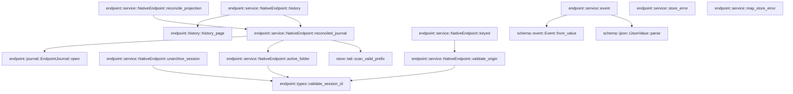

# endpoint::service

[Package atlas](index.md) · [Source](../../src/service.rs)

## Declarations

Visibility is the declaration spelling; trait members and reexports require their enclosing interface. `cfg` is not evaluated.

| Symbol | Kind | Visibility | Test / cfg |
|---|---|---|---|
| [endpoint::service::AUTOMATIC_TITLE_SEED_OPERATION](../../src/service.rs#L13) | const_item | `pub` |  |
| [endpoint::service::AUTOMATIC_TITLE_REFINE_OPERATION](../../src/service.rs#L14) | const_item | `pub` |  |
| [endpoint::service::SESSION_NOTICE_OPERATION](../../src/service.rs#L15) | const_item | `pub` |  |
| [endpoint::service::SessionNotice](../../src/service.rs#L22) | struct_item | `pub` |  |
| [endpoint::service::SessionNoticeSeverity](../../src/service.rs#L30) | enum_item | `pub` |  |
| [endpoint::service::SessionNoticeSeverity::as_str](../../src/service.rs#L37) | function_item | `pub` |  |
| [endpoint::service::MutationReceipt](../../src/service.rs#L46) | struct_item | `pub` |  |
| [endpoint::service::MutationReceipt::from](../../src/service.rs#L52) | function_item | `private` |  |
| [endpoint::service::ArchiveResult](../../src/service.rs#L61) | struct_item | `pub` |  |
| [endpoint::service::UnarchiveResult](../../src/service.rs#L66) | struct_item | `pub` |  |
| [endpoint::service::SessionInventoryItem](../../src/service.rs#L71) | struct_item | `pub` |  |
| [endpoint::service::SessionInventoryItem::resolved_cwd](../../src/service.rs#L101) | function_item | `pub` |  |
| [endpoint::service::inventory_folder_binding](../../src/service.rs#L120) | function_item | `pub` |  |
| [endpoint::service::PERMISSION_MODE_FILE](../../src/service.rs#L135) | const_item | `private` |  |
| [endpoint::service::DEFAULT_PERMISSION_MODE](../../src/service.rs#L136) | const_item | `private` |  |
| [endpoint::service::genesis_cwd](../../src/service.rs#L142) | function_item | `pub` |  |
| [endpoint::service::genesis_preset_summary](../../src/service.rs#L172) | function_item | `pub` |  |
| [endpoint::service::permission_mode_of](../../src/service.rs#L178) | function_item | `pub` |  |
| [endpoint::service::card_item](../../src/service.rs#L195) | function_item | `private` |  |
| [endpoint::service::card_updated_ms](../../src/service.rs#L236) | function_item | `pub` |  |
| [endpoint::service::last_record_updated_ms](../../src/service.rs#L251) | function_item | `pub` |  |
| [endpoint::service::last_record_updated_ms::WINDOW](../../src/service.rs#L253) | const_item | `private` |  |
| [endpoint::service::card_summary](../../src/service.rs#L274) | function_item | `pub` |  |
| [endpoint::service::NativeEndpoint](../../src/service.rs#L327) | struct_item | `pub` |  |
| [endpoint::service::CreateSessionWrite](../../src/service.rs#L331) | struct_item | `private` |  |
| [endpoint::service::NativeEndpoint::open](../../src/service.rs#L342) | function_item | `pub` |  |
| [endpoint::service::NativeEndpoint::capabilities](../../src/service.rs#L349) | function_item | `pub` |  |
| [endpoint::service::NativeEndpoint::list_sessions](../../src/service.rs#L368) | function_item | `pub` |  |
| [endpoint::service::NativeEndpoint::list_sessions_cached](../../src/service.rs#L378) | function_item | `pub` |  |
| [endpoint::service::NativeEndpoint::list_sessions_with](../../src/service.rs#L385) | function_item | `private` |  |
| [endpoint::service::NativeEndpoint::models](../../src/service.rs#L451) | function_item | `pub` |  |
| [endpoint::service::NativeEndpoint::session_config_snapshot](../../src/service.rs#L517) | function_item | `pub` |  |
| [endpoint::service::NativeEndpoint::submission_snapshot](../../src/service.rs#L529) | function_item | `pub` |  |
| [endpoint::service::NativeEndpoint::submission_metadata](../../src/service.rs#L536) | function_item | `pub` |  |
| [endpoint::service::NativeEndpoint::hydrate_historical_submissions](../../src/service.rs#L561) | function_item | `pub` |  |
| [endpoint::service::NativeEndpoint::create_session](../../src/service.rs#L669) | function_item | `pub` |  |
| [endpoint::service::NativeEndpoint::create_session_for_endpoint](../../src/service.rs#L692) | function_item | `pub` |  |
| [endpoint::service::NativeEndpoint::create_session_with_operation](../../src/service.rs#L712) | function_item | `private` |  |
| [endpoint::service::NativeEndpoint::prompt](../../src/service.rs#L742) | function_item | `pub` |  |
| [endpoint::service::NativeEndpoint::prompt_for_endpoint](../../src/service.rs#L753) | function_item | `pub` |  |
| [endpoint::service::NativeEndpoint::prompt_with_operation](../../src/service.rs#L771) | function_item | `private` |  |
| [endpoint::service::NativeEndpoint::update_queue](../../src/service.rs#L794) | function_item | `pub` |  |
| [endpoint::service::NativeEndpoint::rename_session](../../src/service.rs#L809) | function_item | `pub` |  |
| [endpoint::service::NativeEndpoint::rename_session_for_endpoint](../../src/service.rs#L819) | function_item | `pub` |  |
| [endpoint::service::NativeEndpoint::rename_session_with_operation](../../src/service.rs#L829) | function_item | `private` |  |
| [endpoint::service::NativeEndpoint::seed_automatic_title_if_missing](../../src/service.rs#L848) | function_item | `pub` |  |
| [endpoint::service::NativeEndpoint::record_session_notice](../../src/service.rs#L881) | function_item | `pub` |  |
| [endpoint::service::NativeEndpoint::refine_automatic_title](../../src/service.rs#L935) | function_item | `pub` |  |
| [endpoint::service::NativeEndpoint::author_keyed_with_ledger](../../src/service.rs#L976) | function_item | `pub` |  |
| [endpoint::service::NativeEndpoint::cancel](../../src/service.rs#L999) | function_item | `pub` |  |
| [endpoint::service::NativeEndpoint::cancel_for_endpoint](../../src/service.rs#L1008) | function_item | `pub` |  |
| [endpoint::service::NativeEndpoint::cancel_with_operation](../../src/service.rs#L1017) | function_item | `private` |  |
| [endpoint::service::NativeEndpoint::fork_session](../../src/service.rs#L1047) | function_item | `pub` |  |
| [endpoint::service::NativeEndpoint::archive_session](../../src/service.rs#L1063) | function_item | `pub` |  |
| [endpoint::service::NativeEndpoint::unarchive_session](../../src/service.rs#L1071) | function_item | `pub` |  |
| [endpoint::service::NativeEndpoint::reconcile_projection](../../src/service.rs#L1082) | function_item | `pub` |  |
| [endpoint::service::NativeEndpoint::reconciled_journal](../../src/service.rs#L1090) | function_item | `private` |  |
| [endpoint::service::NativeEndpoint::history](../../src/service.rs#L1104) | function_item | `pub` |  |
| [endpoint::service::NativeEndpoint::keyed](../../src/service.rs#L1114) | function_item | `private` |  |
| [endpoint::service::NativeEndpoint::validate_origin](../../src/service.rs#L1132) | function_item | `private` |  |
| [endpoint::service::NativeEndpoint::active_folder](../../src/service.rs#L1145) | function_item | `private` |  |
| [endpoint::service::event](../../src/service.rs#L1158) | function_item | `private` |  |
| [endpoint::service::store_error](../../src/service.rs#L1163) | function_item | `private` |  |
| [endpoint::service::map_store_error](../../src/service.rs#L1167) | function_item | `private` |  |
| [endpoint::service::NativeEndpointError](../../src/service.rs#L1176) | enum_item | `pub` |  |

## Imports / reexports

| Local name | Source path | Visibility |
|---|---|---|
| `BTreeSet` | `std::collections::BTreeSet` | `private` |
| `HashSet` | `std::collections::HashSet` | `private` |
| `fs` | `std::fs` | `private` |
| `Path` | `std::path::Path` | `private` |
| `Event` | `schema::Event` | `private` |
| `EventKind` | `schema::EventKind` | `private` |
| `IJsonValue` | `schema::IJsonValue` | `private` |
| `OriginTuple` | `schema::OriginTuple` | `private` |
| `ResumePolicy` | `schema::ResumePolicy` | `private` |
| `SeqRange` | `schema::SeqRange` | `private` |
| `Value` | `serde_json::Value` | `private` |
| `json` | `serde_json::json` | `private` |
| `AppendOutcome` | `store::AppendOutcome` | `private` |
| `ConditionalAppendOutcome` | `store::ConditionalAppendOutcome` | `private` |
| `ThreadStore` | `store::ThreadStore` | `private` |
| `scan_valid_prefix` | `store::scan_valid_prefix` | `private` |
| `Error` | `thiserror::Error` | `private` |
| `timestamp_millis` | `crate::projection::timestamp_millis` | `private` |
| `EndpointJournal` | `crate::EndpointJournal` | `private` |
| `HistoryPage` | `crate::HistoryPage` | `private` |
| `Projector` | `crate::Projector` | `private` |
| `history_page` | `crate::history_page` | `private` |
| `validate_session_id` | `crate::validate_session_id` | `private` |

## Module declarations

| Module | Visibility | Attributes |
|---|---|---|

## Function call graphs

Edges below are syntactically resolved calls only, including private functions. Graphs partition callers into groups of 20; they are not execution order. All unresolved sites are listed below and in the JSON inventory.

Functions 1–20: 32 direct edges

Functions 21–40: 34 direct edges

Functions 41–50: 12 direct edges

## Call sites

Includes test functions (marked in declarations). Receiver-type-required sites need type analysis/manual tracing. Calls in closures are attributed to their enclosing function; their occurrence here does not mean the closure executes immediately.

| Caller | Callee expression | Source lines | Target / classification |
|---|---|---|---|
| `resolved_cwd` | `self.folder_binding             .as_ref()             .and_then(&#124;binding&#124; {                 paths                     .get(&(String::new(), binding.clone()))                     .or_else(&#124;&#124; paths.get(&(self.workspace_id.clone(), binding.clone())))             })             .cloned()             .unwrap_or_else` | [105](../../src/service.rs#L105) | receiver-type-required |
| `resolved_cwd` | `self.folder_binding             .as_ref()             .and_then(&#124;binding&#124; {                 paths                     .get(&(String::new(), binding.clone()))                     .or_else(&#124;&#124; paths.get(&(self.workspace_id.clone(), binding.clone())))             })             .cloned` | [105](../../src/service.rs#L105) | receiver-type-required |
| `resolved_cwd` | `self.folder_binding             .as_ref()             .and_then` | [105](../../src/service.rs#L105) | receiver-type-required |
| `resolved_cwd` | `self.folder_binding             .as_ref` | [105](../../src/service.rs#L105) | receiver-type-required |
| `resolved_cwd` | `paths                     .get(&(String::new(), binding.clone()))                     .or_else` | [108](../../src/service.rs#L108) | receiver-type-required |
| `resolved_cwd` | `paths                     .get` | [108](../../src/service.rs#L108) | receiver-type-required |
| `resolved_cwd` | `String::new` | [109](../../src/service.rs#L109) | external-constructor-callback-or-unresolved |
| `resolved_cwd` | `binding.clone` | [109](../../src/service.rs#L109), [110](../../src/service.rs#L110) | receiver-type-required |
| `resolved_cwd` | `paths.get` | [110](../../src/service.rs#L110) | receiver-type-required |
| `resolved_cwd` | `self.workspace_id.clone` | [110](../../src/service.rs#L110) | receiver-type-required |
| `resolved_cwd` | `self.cwd.clone` | [113](../../src/service.rs#L113) | receiver-type-required |
| `inventory_folder_binding` | `scope.get("folder_binding")?.as_str` | [121](../../src/service.rs#L121) | receiver-type-required |
| `inventory_folder_binding` | `scope.get` | [121](../../src/service.rs#L121), [125](../../src/service.rs#L125) | receiver-type-required |
| `inventory_folder_binding` | `Some` | [122](../../src/service.rs#L122) | external-constructor-callback-or-unresolved |
| `inventory_folder_binding` | `scope             .get("session_scope")             .and_then(&#124;scope&#124; scope.get("folder_refs"))             .and_then(&#124;refs&#124; refs.get(binding))             .and_then(Value::as_str)             .unwrap_or(binding)             .to_owned` | [123](../../src/service.rs#L123) | receiver-type-required |
| `inventory_folder_binding` | `scope             .get("session_scope")             .and_then(&#124;scope&#124; scope.get("folder_refs"))             .and_then(&#124;refs&#124; refs.get(binding))             .and_then(Value::as_str)             .unwrap_or` | [123](../../src/service.rs#L123) | receiver-type-required |
| `inventory_folder_binding` | `scope             .get("session_scope")             .and_then(&#124;scope&#124; scope.get("folder_refs"))             .and_then(&#124;refs&#124; refs.get(binding))             .and_then` | [123](../../src/service.rs#L123) | receiver-type-required |
| `inventory_folder_binding` | `scope             .get("session_scope")             .and_then(&#124;scope&#124; scope.get("folder_refs"))             .and_then` | [123](../../src/service.rs#L123) | receiver-type-required |
| `inventory_folder_binding` | `scope             .get("session_scope")             .and_then` | [123](../../src/service.rs#L123) | receiver-type-required |
| `inventory_folder_binding` | `scope             .get` | [123](../../src/service.rs#L123) | receiver-type-required |
| `inventory_folder_binding` | `refs.get` | [126](../../src/service.rs#L126) | receiver-type-required |
| `genesis_cwd` | `genesis.string_field` | [144](../../src/service.rs#L144) | receiver-type-required |
| `genesis_cwd` | `cwd.to_owned` | [145](../../src/service.rs#L145) | receiver-type-required |
| `genesis_cwd` | `serde_json::to_value(genesis.raw()).ok` | [148](../../src/service.rs#L148) | receiver-type-required |
| `genesis_cwd` | `serde_json::to_value` | [148](../../src/service.rs#L148) | external-constructor-callback-or-unresolved |
| `genesis_cwd` | `genesis.raw` | [148](../../src/service.rs#L148) | receiver-type-required |
| `genesis_cwd` | `raw.get("config")?.get("digest")?.as_str` | [149](../../src/service.rs#L149) | receiver-type-required |
| `genesis_cwd` | `raw.get("config")?.get` | [149](../../src/service.rs#L149) | receiver-type-required |
| `genesis_cwd` | `raw.get` | [149](../../src/service.rs#L149) | receiver-type-required |
| `genesis_cwd` | `digest.len` | [150](../../src/service.rs#L150) | receiver-type-required |
| `genesis_cwd` | `digest                 .bytes()                 .all` | [151](../../src/service.rs#L151) | receiver-type-required |
| `genesis_cwd` | `digest                 .bytes` | [151](../../src/service.rs#L151) | receiver-type-required |
| `genesis_cwd` | `b.is_ascii_hexdigit` | [153](../../src/service.rs#L153) | receiver-type-required |
| `genesis_cwd` | `b.is_ascii_uppercase` | [153](../../src/service.rs#L153) | receiver-type-required |
| `genesis_cwd` | `fs::read(folder.join("assets").join(format!("sha256-{digest}"))).ok` | [157](../../src/service.rs#L157) | receiver-type-required |
| `genesis_cwd` | `fs::read` | [157](../../src/service.rs#L157) | external-constructor-callback-or-unresolved |
| `genesis_cwd` | `folder.join("assets").join` | [157](../../src/service.rs#L157) | receiver-type-required |
| `genesis_cwd` | `folder.join` | [157](../../src/service.rs#L157) | receiver-type-required |
| `genesis_cwd` | `profile::ConfigSnapshot::decode(&bytes).ok` | [161](../../src/service.rs#L161) | receiver-type-required |
| `genesis_cwd` | `profile::ConfigSnapshot::decode` | [161](../../src/service.rs#L161) | [profile::config::ConfigSnapshot::decode](../../../profile/src/config.rs#L419) |
| `genesis_cwd` | `Some` | [162](../../src/service.rs#L162) | external-constructor-callback-or-unresolved |
| `genesis_cwd` | `config.execution_cwd()?.to_owned` | [162](../../src/service.rs#L162) | receiver-type-required |
| `genesis_cwd` | `config.execution_cwd` | [162](../../src/service.rs#L162) | receiver-type-required |
| `genesis_cwd` | `snapshot_cwd().unwrap_or_default` | [164](../../src/service.rs#L164) | receiver-type-required |
| `genesis_cwd` | `snapshot_cwd` | [164](../../src/service.rs#L164) | external-constructor-callback-or-unresolved |
| `genesis_preset_summary` | `serde_json::to_value(genesis.raw()).ok` | [173](../../src/service.rs#L173) | receiver-type-required |
| `genesis_preset_summary` | `serde_json::to_value` | [173](../../src/service.rs#L173) | external-constructor-callback-or-unresolved |
| `genesis_preset_summary` | `genesis.raw` | [173](../../src/service.rs#L173) | receiver-type-required |
| `genesis_preset_summary` | `tools::ResolvedPreset::from_genesis(raw.get("preset")?).ok` | [174](../../src/service.rs#L174) | receiver-type-required |
| `genesis_preset_summary` | `tools::ResolvedPreset::from_genesis` | [174](../../src/service.rs#L174) | [tools::preset::ResolvedPreset::from_genesis](../../../tools/src/preset.rs#L855) |
| `genesis_preset_summary` | `raw.get` | [174](../../src/service.rs#L174) | receiver-type-required |
| `genesis_preset_summary` | `Some` | [175](../../src/service.rs#L175) | external-constructor-callback-or-unresolved |
| `genesis_preset_summary` | `preset.summary` | [175](../../src/service.rs#L175) | receiver-type-required |
| `permission_mode_of` | `fs::read` | [179](../../src/service.rs#L179) | external-constructor-callback-or-unresolved |
| `permission_mode_of` | `folder.join` | [179](../../src/service.rs#L179) | receiver-type-required |
| `permission_mode_of` | `DEFAULT_PERMISSION_MODE.to_owned` | [180](../../src/service.rs#L180), [191](../../src/service.rs#L191) | receiver-type-required |
| `permission_mode_of` | `serde_json::from_slice::<serde_json::Value>(&bytes)         .ok()         .and_then(&#124;value&#124; value.get("mode")?.as_str().map(str::to_owned))         .filter(&#124;mode&#124; {             matches!(                 mode.as_str(),                 "read-only" &#124; "workspace-write" &#124; "danger-full-access"             )         })         .unwrap_or_else` | [182](../../src/service.rs#L182) | receiver-type-required |
| `permission_mode_of` | `serde_json::from_slice::<serde_json::Value>(&bytes)         .ok()         .and_then(&#124;value&#124; value.get("mode")?.as_str().map(str::to_owned))         .filter` | [182](../../src/service.rs#L182) | receiver-type-required |
| `permission_mode_of` | `serde_json::from_slice::<serde_json::Value>(&bytes)         .ok()         .and_then` | [182](../../src/service.rs#L182) | receiver-type-required |
| `permission_mode_of` | `serde_json::from_slice::<serde_json::Value>(&bytes)         .ok` | [182](../../src/service.rs#L182) | receiver-type-required |
| `permission_mode_of` | `serde_json::from_slice::<serde_json::Value>` | [182](../../src/service.rs#L182) | external-constructor-callback-or-unresolved |
| `permission_mode_of` | `value.get("mode")?.as_str().map` | [184](../../src/service.rs#L184) | receiver-type-required |
| `permission_mode_of` | `value.get("mode")?.as_str` | [184](../../src/service.rs#L184) | receiver-type-required |
| `permission_mode_of` | `value.get` | [184](../../src/service.rs#L184) | receiver-type-required |
| `card_item` | `store::card::read_card` | [201](../../src/service.rs#L201) | [store::card::read_card](../../../store/src/card.rs#L179) |
| `card_item` | `store::card::classify(folder, &card).ok` | [202](../../src/service.rs#L202) | receiver-type-required |
| `card_item` | `store::card::classify` | [202](../../src/service.rs#L202) | [store::card::classify](../../../store/src/card.rs#L394) |
| `card_item` | `classified.freshness` | [203](../../src/service.rs#L203) | receiver-type-required |
| `card_item` | `card.lines.first` | [206](../../src/service.rs#L206) | receiver-type-required |
| `card_item` | `Some` | [210](../../src/service.rs#L210) | external-constructor-callback-or-unresolved |
| `card_item` | `session_id.to_owned` | [211](../../src/service.rs#L211) | receiver-type-required |
| `card_item` | `card.summary.workspace.clone` | [212](../../src/service.rs#L212) | receiver-type-required |
| `card_item` | `card.summary.cwd.clone().unwrap_or_else` | [213](../../src/service.rs#L213) | receiver-type-required |
| `card_item` | `card.summary.cwd.clone` | [213](../../src/service.rs#L213) | receiver-type-required |
| `card_item` | `store::read_genesis(folder.join("main.jsonl"))                 .ok()                 .flatten()                 .map(&#124;g&#124; genesis_cwd(folder, &g))                 .unwrap_or_default` | [214](../../src/service.rs#L214) | receiver-type-required |
| `card_item` | `store::read_genesis(folder.join("main.jsonl"))                 .ok()                 .flatten()                 .map` | [214](../../src/service.rs#L214) | receiver-type-required |
| `card_item` | `store::read_genesis(folder.join("main.jsonl"))                 .ok()                 .flatten` | [214](../../src/service.rs#L214) | receiver-type-required |
| `card_item` | `store::read_genesis(folder.join("main.jsonl"))                 .ok` | [214](../../src/service.rs#L214) | receiver-type-required |
| `card_item` | `store::read_genesis` | [214](../../src/service.rs#L214) | [store::tail::read_genesis](../../../store/src/tail.rs#L86) |
| `card_item` | `folder.join` | [214](../../src/service.rs#L214) | receiver-type-required |
| `card_item` | `genesis_cwd` | [217](../../src/service.rs#L217) | [endpoint::service::genesis_cwd](../../src/service.rs#L142) |
| `card_item` | `card.summary.folder_binding.clone` | [220](../../src/service.rs#L220) | receiver-type-required |
| `card_item` | `card.summary.title.clone` | [221](../../src/service.rs#L221) | receiver-type-required |
| `card_item` | `main.facts.clone` | [227](../../src/service.rs#L227) | receiver-type-required |
| `card_item` | `permission_mode_of` | [228](../../src/service.rs#L228) | [endpoint::service::permission_mode_of](../../src/service.rs#L178) |
| `card_item` | `card.summary.identity_profile.clone` | [229](../../src/service.rs#L229) | receiver-type-required |
| `card_item` | `card.summary.preset.clone` | [230](../../src/service.rs#L230) | receiver-type-required |
| `card_updated_ms` | `Ok` | [237](../../src/service.rs#L237) | external-constructor-callback-or-unresolved |
| `card_updated_ms` | `projection         .events         .last()         .and_then(&#124;event&#124; event.string_field("ts"))         .ok_or(NativeEndpointError::InventoryTimestamp)         .and_then` | [237](../../src/service.rs#L237) | receiver-type-required |
| `card_updated_ms` | `projection         .events         .last()         .and_then(&#124;event&#124; event.string_field("ts"))         .ok_or` | [237](../../src/service.rs#L237) | receiver-type-required |
| `card_updated_ms` | `projection         .events         .last()         .and_then` | [237](../../src/service.rs#L237) | receiver-type-required |
| `card_updated_ms` | `projection         .events         .last` | [237](../../src/service.rs#L237) | receiver-type-required |
| `card_updated_ms` | `event.string_field` | [240](../../src/service.rs#L240) | receiver-type-required |
| `card_updated_ms` | `timestamp_millis(value).map_err` | [242](../../src/service.rs#L242) | receiver-type-required |
| `card_updated_ms` | `timestamp_millis` | [242](../../src/service.rs#L242) | [endpoint::projection::timestamp_millis](../../src/projection.rs#L944) |
| `last_record_updated_ms` | `fs::File::open(path).ok` | [254](../../src/service.rs#L254) | receiver-type-required |
| `last_record_updated_ms` | `fs::File::open` | [254](../../src/service.rs#L254) | external-constructor-callback-or-unresolved |
| `last_record_updated_ms` | `file.metadata().ok()?.len` | [255](../../src/service.rs#L255) | receiver-type-required |
| `last_record_updated_ms` | `file.metadata().ok` | [255](../../src/service.rs#L255) | receiver-type-required |
| `last_record_updated_ms` | `file.metadata` | [255](../../src/service.rs#L255) | receiver-type-required |
| `last_record_updated_ms` | `length.saturating_sub` | [256](../../src/service.rs#L256) | receiver-type-required |
| `last_record_updated_ms` | `file.seek(SeekFrom::Start(start)).ok` | [257](../../src/service.rs#L257) | receiver-type-required |
| `last_record_updated_ms` | `file.seek` | [257](../../src/service.rs#L257) | receiver-type-required |
| `last_record_updated_ms` | `SeekFrom::Start` | [257](../../src/service.rs#L257) | external-constructor-callback-or-unresolved |
| `last_record_updated_ms` | `Vec::new` | [258](../../src/service.rs#L258) | external-constructor-callback-or-unresolved |
| `last_record_updated_ms` | `file.take(WINDOW).read_to_end(&mut bytes).ok` | [259](../../src/service.rs#L259) | receiver-type-required |
| `last_record_updated_ms` | `file.take(WINDOW).read_to_end` | [259](../../src/service.rs#L259) | receiver-type-required |
| `last_record_updated_ms` | `file.take` | [259](../../src/service.rs#L259) | receiver-type-required |
| `last_record_updated_ms` | `bytes.iter().rposition` | [261](../../src/service.rs#L261) | receiver-type-required |
| `last_record_updated_ms` | `bytes.iter` | [261](../../src/service.rs#L261) | receiver-type-required |
| `last_record_updated_ms` | `bytes[..end]         .iter()         .rposition(&#124;byte&#124; *byte == b'\n')         .map(&#124;index&#124; index + 1)         .or` | [262](../../src/service.rs#L262) | receiver-type-required |
| `last_record_updated_ms` | `bytes[..end]         .iter()         .rposition(&#124;byte&#124; *byte == b'\n')         .map` | [262](../../src/service.rs#L262) | receiver-type-required |
| `last_record_updated_ms` | `bytes[..end]         .iter()         .rposition` | [262](../../src/service.rs#L262) | receiver-type-required |
| `last_record_updated_ms` | `bytes[..end]         .iter` | [262](../../src/service.rs#L262) | receiver-type-required |
| `last_record_updated_ms` | `(start == 0).then_some` | [266](../../src/service.rs#L266) | receiver-type-required |
| `last_record_updated_ms` | `serde_json::from_slice(&bytes[line_start..end]).ok` | [267](../../src/service.rs#L267) | receiver-type-required |
| `last_record_updated_ms` | `serde_json::from_slice` | [267](../../src/service.rs#L267) | external-constructor-callback-or-unresolved |
| `last_record_updated_ms` | `timestamp_millis(record.get("ts")?.as_str()?).ok` | [268](../../src/service.rs#L268) | receiver-type-required |
| `last_record_updated_ms` | `timestamp_millis` | [268](../../src/service.rs#L268) | [endpoint::projection::timestamp_millis](../../src/projection.rs#L944) |
| `last_record_updated_ms` | `record.get("ts")?.as_str` | [268](../../src/service.rs#L268) | receiver-type-required |
| `last_record_updated_ms` | `record.get` | [268](../../src/service.rs#L268) | receiver-type-required |
| `last_record_updated_ms` | `Some` | [269](../../src/service.rs#L269) | external-constructor-callback-or-unresolved |
| `card_summary` | `projection.events.first().ok_or_else` | [277](../../src/service.rs#L277) | receiver-type-required |
| `card_summary` | `projection.events.first` | [277](../../src/service.rs#L277) | receiver-type-required |
| `card_summary` | `NativeEndpointError::Store` | [278](../../src/service.rs#L278) | external-constructor-callback-or-unresolved |
| `card_summary` | `store::StoreError::Corruption` | [278](../../src/service.rs#L278) | external-constructor-callback-or-unresolved |
| `card_summary` | `"ledger has no genesis".to_owned` | [279](../../src/service.rs#L279) | receiver-type-required |
| `card_summary` | `projection         .events         .iter()         .rev()         .find_map(&#124;event&#124; event.string_field("title"))         .map` | [282](../../src/service.rs#L282) | receiver-type-required |
| `card_summary` | `projection         .events         .iter()         .rev()         .find_map` | [282](../../src/service.rs#L282) | receiver-type-required |
| `card_summary` | `projection         .events         .iter()         .rev` | [282](../../src/service.rs#L282) | receiver-type-required |
| `card_summary` | `projection         .events         .iter` | [282](../../src/service.rs#L282) | receiver-type-required |
| `card_summary` | `event.string_field` | [286](../../src/service.rs#L286), [296](../../src/service.rs#L296) | receiver-type-required |
| `card_summary` | `card_updated_ms` | [288](../../src/service.rs#L288) | [endpoint::service::card_updated_ms](../../src/service.rs#L236) |
| `card_summary` | `genesis_preset_summary` | [289](../../src/service.rs#L289) | [endpoint::service::genesis_preset_summary](../../src/service.rs#L172) |
| `card_summary` | `genesis.string_field` | [290](../../src/service.rs#L290), [293](../../src/service.rs#L293), [317](../../src/service.rs#L317) | receiver-type-required |
| `card_summary` | `preset.is_some` | [291](../../src/service.rs#L291) | receiver-type-required |
| `card_summary` | `Some` | [292](../../src/service.rs#L292), [296](../../src/service.rs#L296) | external-constructor-callback-or-unresolved |
| `card_summary` | `"coding".to_owned` | [292](../../src/service.rs#L292) | receiver-type-required |
| `card_summary` | `genesis.string_field("identity_profile").map` | [293](../../src/service.rs#L293) | receiver-type-required |
| `card_summary` | `projection.events.iter().find_map` | [294](../../src/service.rs#L294) | receiver-type-required |
| `card_summary` | `projection.events.iter` | [294](../../src/service.rs#L294) | receiver-type-required |
| `card_summary` | `event.kind` | [295](../../src/service.rs#L295) | receiver-type-required |
| `card_summary` | `serde_json::to_value(event.raw())                 .ok()?                 .get("payload")?                 .get("profile")?                 .as_str()                 .map` | [300](../../src/service.rs#L300) | receiver-type-required |
| `card_summary` | `serde_json::to_value(event.raw())                 .ok()?                 .get("payload")?                 .get("profile")?                 .as_str` | [300](../../src/service.rs#L300) | receiver-type-required |
| `card_summary` | `serde_json::to_value(event.raw())                 .ok()?                 .get("payload")?                 .get` | [300](../../src/service.rs#L300) | receiver-type-required |
| `card_summary` | `serde_json::to_value(event.raw())                 .ok()?                 .get` | [300](../../src/service.rs#L300) | receiver-type-required |
| `card_summary` | `serde_json::to_value(event.raw())                 .ok` | [300](../../src/service.rs#L300) | receiver-type-required |
| `card_summary` | `serde_json::to_value` | [300](../../src/service.rs#L300) | external-constructor-callback-or-unresolved |
| `card_summary` | `event.raw` | [300](../../src/service.rs#L300) | receiver-type-required |
| `card_summary` | `schema::effective_session_genesis(&projection.events)?.expect` | [309](../../src/service.rs#L309) | receiver-type-required |
| `card_summary` | `schema::effective_session_genesis` | [309](../../src/service.rs#L309) | [schema::effective_session_genesis](../../../schema/src/lib.rs#L48) |
| `card_summary` | `Ok` | [310](../../src/service.rs#L310) | external-constructor-callback-or-unresolved |
| `card_summary` | `genesis             .string_field("workspace")             .ok_or(NativeEndpointError::InventoryWorkspace)?             .to_owned` | [311](../../src/service.rs#L311) | receiver-type-required |
| `card_summary` | `genesis             .string_field("workspace")             .ok_or` | [311](../../src/service.rs#L311) | receiver-type-required |
| `card_summary` | `genesis             .string_field` | [311](../../src/service.rs#L311) | receiver-type-required |
| `card_summary` | `inventory_folder_binding` | [315](../../src/service.rs#L315) | [endpoint::service::inventory_folder_binding](../../src/service.rs#L120) |
| `card_summary` | `scope.get("cwd").and_then(Value::as_str).map` | [316](../../src/service.rs#L316) | receiver-type-required |
| `card_summary` | `scope.get("cwd").and_then` | [316](../../src/service.rs#L316) | receiver-type-required |
| `card_summary` | `scope.get` | [316](../../src/service.rs#L316) | receiver-type-required |
| `card_summary` | `genesis.string_field("ts").unwrap_or_default().to_owned` | [317](../../src/service.rs#L317) | receiver-type-required |
| `card_summary` | `genesis.string_field("ts").unwrap_or_default` | [317](../../src/service.rs#L317) | receiver-type-required |
| `card_summary` | `genesis.is_ephemeral_genesis` | [322](../../src/service.rs#L322) | receiver-type-required |
| `card_summary` | `projection.lifecycle.latest_turn.is_none` | [323](../../src/service.rs#L323) | receiver-type-required |
| `open` | `Ok` | [343](../../src/service.rs#L343) | external-constructor-callback-or-unresolved |
| `open` | `ThreadStore::open` | [344](../../src/service.rs#L344) | [store::folder::ThreadStore::open](../../../store/src/folder.rs#L36) |
| `capabilities` | `[             "session.models",             "session.create",             "session.prompt",             "session.updateQueue",             "session.cancel",             "session.rename",             "session.fork",             "session.discard",             "workspace.archiveSession",             "workspace.unarchiveSession",         ]         .into_iter()         .collect` | [350](../../src/service.rs#L350) | receiver-type-required |
| `capabilities` | `[             "session.models",             "session.create",             "session.prompt",             "session.updateQueue",             "session.cancel",             "session.rename",             "session.fork",             "session.discard",             "workspace.archiveSession",             "workspace.unarchiveSession",         ]         .into_iter` | [350](../../src/service.rs#L350) | receiver-type-required |
| `list_sessions` | `self.list_sessions_with` | [372](../../src/service.rs#L372) | [endpoint::service::NativeEndpoint::list_sessions_with](../../src/service.rs#L385) |
| `list_sessions_cached` | `self.list_sessions_with` | [382](../../src/service.rs#L382) | [endpoint::service::NativeEndpoint::list_sessions_with](../../src/service.rs#L385) |
| `list_sessions_with` | `Vec::new` | [390](../../src/service.rs#L390) | external-constructor-callback-or-unresolved |
| `list_sessions_with` | `fs::read_dir` | [392](../../src/service.rs#L392) | external-constructor-callback-or-unresolved |
| `list_sessions_with` | `self.store.root().join` | [392](../../src/service.rs#L392) | receiver-type-required |
| `list_sessions_with` | `self.store.root` | [392](../../src/service.rs#L392) | receiver-type-required |
| `list_sessions_with` | `entry.file_type()?.is_dir` | [394](../../src/service.rs#L394) | receiver-type-required |
| `list_sessions_with` | `entry.file_type` | [394](../../src/service.rs#L394) | receiver-type-required |
| `list_sessions_with` | `entry.file_name().to_string_lossy().into_owned` | [397](../../src/service.rs#L397) | receiver-type-required |
| `list_sessions_with` | `entry.file_name().to_string_lossy` | [397](../../src/service.rs#L397) | receiver-type-required |
| `list_sessions_with` | `entry.file_name` | [397](../../src/service.rs#L397) | receiver-type-required |
| `list_sessions_with` | `validate_session_id` | [398](../../src/service.rs#L398) | [endpoint::types::validate_session_id](../../src/types.rs#L130) |
| `list_sessions_with` | `running.contains` | [400](../../src/service.rs#L400) | receiver-type-required |
| `list_sessions_with` | `self.store.session_has_live_line_holder` | [401](../../src/service.rs#L401) | receiver-type-required |
| `list_sessions_with` | `card_item` | [403](../../src/service.rs#L403) | [endpoint::service::card_item](../../src/service.rs#L195) |
| `list_sessions_with` | `entry.path` | [403](../../src/service.rs#L403), [408](../../src/service.rs#L408), [424](../../src/service.rs#L424), [431](../../src/service.rs#L431) | receiver-type-required |
| `list_sessions_with` | `items.push` | [405](../../src/service.rs#L405), [423](../../src/service.rs#L423) | receiver-type-required |
| `list_sessions_with` | `fs::read` | [408](../../src/service.rs#L408) | external-constructor-callback-or-unresolved |
| `list_sessions_with` | `entry.path().join` | [408](../../src/service.rs#L408) | receiver-type-required |
| `list_sessions_with` | `scan_valid_prefix` | [409](../../src/service.rs#L409) | [store::tail::scan_valid_prefix](../../../store/src/tail.rs#L37) |
| `list_sessions_with` | `scan.projection.ok_or_else` | [410](../../src/service.rs#L410) | receiver-type-required |
| `list_sessions_with` | `NativeEndpointError::Store` | [411](../../src/service.rs#L411), [417](../../src/service.rs#L417) | external-constructor-callback-or-unresolved |
| `list_sessions_with` | `store::StoreError::Corruption` | [411](../../src/service.rs#L411), [417](../../src/service.rs#L417) | external-constructor-callback-or-unresolved |
| `list_sessions_with` | `card_summary(&projection).map_err` | [415](../../src/service.rs#L415) | receiver-type-required |
| `list_sessions_with` | `card_summary` | [415](../../src/service.rs#L415) | [endpoint::service::card_summary](../../src/service.rs#L274) |
| `list_sessions_with` | `permission_mode_of` | [424](../../src/service.rs#L424) | [endpoint::service::permission_mode_of](../../src/service.rs#L178) |
| `list_sessions_with` | `summary.cwd.unwrap_or_else` | [429](../../src/service.rs#L429) | receiver-type-required |
| `list_sessions_with` | `genesis_cwd` | [430](../../src/service.rs#L430) | [endpoint::service::genesis_cwd](../../src/service.rs#L142) |
| `list_sessions_with` | `projection.events.first().expect` | [432](../../src/service.rs#L432) | receiver-type-required |
| `list_sessions_with` | `projection.events.first` | [432](../../src/service.rs#L432) | receiver-type-required |
| `list_sessions_with` | `items.sort_by` | [447](../../src/service.rs#L447) | receiver-type-required |
| `list_sessions_with` | `left.session_id.as_bytes().cmp` | [447](../../src/service.rs#L447) | receiver-type-required |
| `list_sessions_with` | `left.session_id.as_bytes` | [447](../../src/service.rs#L447) | receiver-type-required |
| `list_sessions_with` | `right.session_id.as_bytes` | [447](../../src/service.rs#L447) | receiver-type-required |
| `list_sessions_with` | `Ok` | [448](../../src/service.rs#L448) | external-constructor-callback-or-unresolved |
| `models` | `snapshot             .session_settings             .as_ref()             .map(&#124;settings&#124; &settings.provider)             .or(snapshot.workspace.policy.provider.as_ref())             .or` | [455](../../src/service.rs#L455) | receiver-type-required |
| `models` | `snapshot             .session_settings             .as_ref()             .map(&#124;settings&#124; &settings.provider)             .or` | [455](../../src/service.rs#L455) | receiver-type-required |
| `models` | `snapshot             .session_settings             .as_ref()             .map` | [455](../../src/service.rs#L455), [461](../../src/service.rs#L461) | receiver-type-required |
| `models` | `snapshot             .session_settings             .as_ref` | [455](../../src/service.rs#L455), [461](../../src/service.rs#L461), [497](../../src/service.rs#L497) | receiver-type-required |
| `models` | `snapshot.workspace.policy.provider.as_ref` | [459](../../src/service.rs#L459) | receiver-type-required |
| `models` | `snapshot.settings.default_provider.as_ref` | [460](../../src/service.rs#L460) | receiver-type-required |
| `models` | `snapshot             .session_settings             .as_ref()             .map(&#124;settings&#124; &settings.model)             .or(snapshot.workspace.policy.model.as_ref())             .or` | [461](../../src/service.rs#L461) | receiver-type-required |
| `models` | `snapshot             .session_settings             .as_ref()             .map(&#124;settings&#124; &settings.model)             .or` | [461](../../src/service.rs#L461) | receiver-type-required |
| `models` | `snapshot.workspace.policy.model.as_ref` | [465](../../src/service.rs#L465) | receiver-type-required |
| `models` | `snapshot.settings.default_model.as_ref` | [466](../../src/service.rs#L466) | receiver-type-required |
| `models` | `snapshot             .providers             .providers             .iter()             .map(&#124;provider&#124; {                 json!({                     "id": provider.id,                     "name": provider.id,                     "models": provider.models.iter().filter(&#124;model&#124; model.enabled).map(&#124;model&#124; {                         json!({"id": model.id, "name": model.id,                             "contextWindow": model.context_window_tokens})                     }).collect::<Vec<_>>()                 })             })             .collect::<Vec<_>>` | [467](../../src/service.rs#L467) | receiver-type-required |
| `models` | `snapshot             .providers             .providers             .iter()             .map` | [467](../../src/service.rs#L467) | receiver-type-required |
| `models` | `snapshot             .providers             .providers             .iter` | [467](../../src/service.rs#L467) | receiver-type-required |
| `models` | `selected_provider             .zip(selected_model)             .is_some_and` | [482](../../src/service.rs#L482) | receiver-type-required |
| `models` | `selected_provider             .zip` | [482](../../src/service.rs#L482) | receiver-type-required |
| `models` | `snapshot.providers.providers.iter().any` | [485](../../src/service.rs#L485) | receiver-type-required |
| `models` | `snapshot.providers.providers.iter` | [485](../../src/service.rs#L485) | receiver-type-required |
| `models` | `candidate                             .models                             .iter()                             .any` | [487](../../src/service.rs#L487) | receiver-type-required |
| `models` | `candidate                             .models                             .iter` | [487](../../src/service.rs#L487) | receiver-type-required |
| `models` | `snapshot             .session_settings             .as_ref()             .and_then` | [497](../../src/service.rs#L497) | receiver-type-required |
| `models` | `settings.reasoning_effort.as_ref` | [500](../../src/service.rs#L500) | receiver-type-required |
| `models` | `Value::String` | [502](../../src/service.rs#L502) | external-constructor-callback-or-unresolved |
| `models` | `effort.clone` | [502](../../src/service.rs#L502) | receiver-type-required |
| `models` | `Ok` | [510](../../src/service.rs#L510) | external-constructor-callback-or-unresolved |
| `models` | `IJsonValue::parse` | [510](../../src/service.rs#L510) | [schema::ijson::IJsonValue::parse](../../../schema/src/ijson.rs#L16) |
| `models` | `serde_json::to_vec` | [510](../../src/service.rs#L510) | external-constructor-callback-or-unresolved |
| `session_config_snapshot` | `validate_session_id` | [521](../../src/service.rs#L521) | [endpoint::types::validate_session_id](../../src/types.rs#L130) |
| `session_config_snapshot` | `profile::SessionScope::for_session_folder` | [522](../../src/service.rs#L522) | [profile::scope::SessionScope::for_session_folder](../../../profile/src/scope.rs#L48) |
| `session_config_snapshot` | `self.active_folder` | [522](../../src/service.rs#L522) | [endpoint::service::NativeEndpoint::active_folder](../../src/service.rs#L1145) |
| `session_config_snapshot` | `profile::ConfigRepository::open` | [523](../../src/service.rs#L523) | [profile::config::ConfigRepository::open](../../../profile/src/config.rs#L814) |
| `session_config_snapshot` | `self.store.root` | [523](../../src/service.rs#L523) | receiver-type-required |
| `session_config_snapshot` | `Ok` | [524](../../src/service.rs#L524) | external-constructor-callback-or-unresolved |
| `session_config_snapshot` | `scope.config` | [524](../../src/service.rs#L524) | receiver-type-required |
| `submission_snapshot` | `self.session_config_snapshot` | [530](../../src/service.rs#L530) | [endpoint::service::NativeEndpoint::session_config_snapshot](../../src/service.rs#L517) |
| `submission_snapshot` | `store::AssetStore::new` | [531](../../src/service.rs#L531) | [store::asset::AssetStore::new](../../../store/src/asset.rs#L27) |
| `submission_snapshot` | `self.active_folder(session_id)?.join` | [531](../../src/service.rs#L531) | receiver-type-required |
| `submission_snapshot` | `self.active_folder` | [531](../../src/service.rs#L531) | [endpoint::service::NativeEndpoint::active_folder](../../src/service.rs#L1145) |
| `submission_snapshot` | `config.publish` | [532](../../src/service.rs#L532) | receiver-type-required |
| `submission_snapshot` | `Self::submission_metadata` | [533](../../src/service.rs#L533) | [endpoint::service::NativeEndpoint::submission_metadata](../../src/service.rs#L536) |
| `submission_metadata` | `config             .session_settings             .as_ref()             .map(&#124;s&#124; s.provider.as_str())             .or(config.workspace.policy.provider.as_deref())             .or` | [540](../../src/service.rs#L540) | receiver-type-required |
| `submission_metadata` | `config             .session_settings             .as_ref()             .map(&#124;s&#124; s.provider.as_str())             .or` | [540](../../src/service.rs#L540) | receiver-type-required |
| `submission_metadata` | `config             .session_settings             .as_ref()             .map` | [540](../../src/service.rs#L540), [546](../../src/service.rs#L546) | receiver-type-required |
| `submission_metadata` | `config             .session_settings             .as_ref` | [540](../../src/service.rs#L540), [546](../../src/service.rs#L546) | receiver-type-required |
| `submission_metadata` | `s.provider.as_str` | [543](../../src/service.rs#L543) | receiver-type-required |
| `submission_metadata` | `config.workspace.policy.provider.as_deref` | [544](../../src/service.rs#L544) | receiver-type-required |
| `submission_metadata` | `config.settings.default_provider.as_deref` | [545](../../src/service.rs#L545) | receiver-type-required |
| `submission_metadata` | `config             .session_settings             .as_ref()             .map(&#124;s&#124; s.model.as_str())             .or(config.workspace.policy.model.as_deref())             .or` | [546](../../src/service.rs#L546) | receiver-type-required |
| `submission_metadata` | `config             .session_settings             .as_ref()             .map(&#124;s&#124; s.model.as_str())             .or` | [546](../../src/service.rs#L546) | receiver-type-required |
| `submission_metadata` | `s.model.as_str` | [549](../../src/service.rs#L549) | receiver-type-required |
| `submission_metadata` | `config.workspace.policy.model.as_deref` | [550](../../src/service.rs#L550) | receiver-type-required |
| `submission_metadata` | `config.settings.default_model.as_deref` | [551](../../src/service.rs#L551) | receiver-type-required |
| `submission_metadata` | `Ok` | [552](../../src/service.rs#L552) | external-constructor-callback-or-unresolved |
| `submission_metadata` | `IJsonValue::parse` | [552](../../src/service.rs#L552) | [schema::ijson::IJsonValue::parse](../../../schema/src/ijson.rs#L16) |
| `submission_metadata` | `serde_json::to_vec` | [552](../../src/service.rs#L552) | external-constructor-callback-or-unresolved |
| `hydrate_historical_submissions` | `entries.iter().any` | [569](../../src/service.rs#L569) | receiver-type-required |
| `hydrate_historical_submissions` | `entries.iter` | [569](../../src/service.rs#L569) | receiver-type-required |
| `hydrate_historical_submissions` | `serde_json::to_value(&entry.event.data)                     .is_ok_and` | [571](../../src/service.rs#L571) | receiver-type-required |
| `hydrate_historical_submissions` | `serde_json::to_value` | [571](../../src/service.rs#L571), [593](../../src/service.rs#L593), [644](../../src/service.rs#L644), [657](../../src/service.rs#L657) | external-constructor-callback-or-unresolved |
| `hydrate_historical_submissions` | `data.get("submission").is_none` | [572](../../src/service.rs#L572) | receiver-type-required |
| `hydrate_historical_submissions` | `data.get` | [572](../../src/service.rs#L572), [647](../../src/service.rs#L647) | receiver-type-required |
| `hydrate_historical_submissions` | `self.active_folder` | [577](../../src/service.rs#L577) | [endpoint::service::NativeEndpoint::active_folder](../../src/service.rs#L1145) |
| `hydrate_historical_submissions` | `fs::read` | [580](../../src/service.rs#L580) | external-constructor-callback-or-unresolved |
| `hydrate_historical_submissions` | `folder.join` | [580](../../src/service.rs#L580), [586](../../src/service.rs#L586) | receiver-type-required |
| `hydrate_historical_submissions` | `scan_valid_prefix` | [583](../../src/service.rs#L583) | [store::tail::scan_valid_prefix](../../../store/src/tail.rs#L37) |
| `hydrate_historical_submissions` | `store::AssetStore::new` | [586](../../src/service.rs#L586) | [store::asset::AssetStore::new](../../../store/src/asset.rs#L27) |
| `hydrate_historical_submissions` | `std::collections::BTreeMap::new` | [590](../../src/service.rs#L590), [591](../../src/service.rs#L591) | external-constructor-callback-or-unresolved |
| `hydrate_historical_submissions` | `event.raw` | [593](../../src/service.rs#L593) | receiver-type-required |
| `hydrate_historical_submissions` | `event.kind` | [596](../../src/service.rs#L596) | receiver-type-required |
| `hydrate_historical_submissions` | `value                         .get("config")                         .and_then(&#124;c&#124; c.get("digest"))                         .and_then(Value::as_str)                         .map` | [598](../../src/service.rs#L598) | receiver-type-required |
| `hydrate_historical_submissions` | `value                         .get("config")                         .and_then(&#124;c&#124; c.get("digest"))                         .and_then` | [598](../../src/service.rs#L598) | receiver-type-required |
| `hydrate_historical_submissions` | `value                         .get("config")                         .and_then` | [598](../../src/service.rs#L598) | receiver-type-required |
| `hydrate_historical_submissions` | `value                         .get` | [598](../../src/service.rs#L598), [605](../../src/service.rs#L605), [614](../../src/service.rs#L614) | receiver-type-required |
| `hydrate_historical_submissions` | `c.get` | [600](../../src/service.rs#L600) | receiver-type-required |
| `hydrate_historical_submissions` | `value                         .get("config_digest")                         .and_then(Value::as_str)                         .map` | [605](../../src/service.rs#L605) | receiver-type-required |
| `hydrate_historical_submissions` | `value                         .get("config_digest")                         .and_then` | [605](../../src/service.rs#L605) | receiver-type-required |
| `hydrate_historical_submissions` | `inputs.insert` | [611](../../src/service.rs#L611) | receiver-type-required |
| `hydrate_historical_submissions` | `event.seq` | [611](../../src/service.rs#L611) | receiver-type-required |
| `hydrate_historical_submissions` | `value                         .get("trigger")                         .and_then(&#124;t&#124; t.get("inputs"))                         .and_then` | [614](../../src/service.rs#L614) | receiver-type-required |
| `hydrate_historical_submissions` | `value                         .get("trigger")                         .and_then` | [614](../../src/service.rs#L614) | receiver-type-required |
| `hydrate_historical_submissions` | `t.get` | [616](../../src/service.rs#L616) | receiver-type-required |
| `hydrate_historical_submissions` | `digest.as_deref().and_then` | [621](../../src/service.rs#L621) | receiver-type-required |
| `hydrate_historical_submissions` | `digest.as_deref` | [621](../../src/service.rs#L621) | receiver-type-required |
| `hydrate_historical_submissions` | `assets.read_verified(&format!("sha256-{digest}")).ok` | [622](../../src/service.rs#L622) | receiver-type-required |
| `hydrate_historical_submissions` | `assets.read_verified` | [622](../../src/service.rs#L622) | receiver-type-required |
| `hydrate_historical_submissions` | `profile::ConfigSnapshot::decode(&bytes).ok` | [623](../../src/service.rs#L623) | receiver-type-required |
| `hydrate_historical_submissions` | `profile::ConfigSnapshot::decode` | [623](../../src/service.rs#L623) | [profile::config::ConfigSnapshot::decode](../../../profile/src/config.rs#L419) |
| `hydrate_historical_submissions` | `Self::submission_metadata(&config, digest).ok` | [624](../../src/service.rs#L624) | receiver-type-required |
| `hydrate_historical_submissions` | `Self::submission_metadata` | [624](../../src/service.rs#L624) | [endpoint::service::NativeEndpoint::submission_metadata](../../src/service.rs#L536) |
| `hydrate_historical_submissions` | `seqs.iter().filter_map` | [626](../../src/service.rs#L626) | receiver-type-required |
| `hydrate_historical_submissions` | `seqs.iter` | [626](../../src/service.rs#L626) | receiver-type-required |
| `hydrate_historical_submissions` | `inputs                             .get(&seq)                             .and_then(&#124;input&#124; input.get("submission"))                             .and_then(&#124;s&#124; IJsonValue::parse(&serde_json::to_vec(s).ok()?).ok())                             .or_else` | [627](../../src/service.rs#L627) | receiver-type-required |
| `hydrate_historical_submissions` | `inputs                             .get(&seq)                             .and_then(&#124;input&#124; input.get("submission"))                             .and_then` | [627](../../src/service.rs#L627) | receiver-type-required |
| `hydrate_historical_submissions` | `inputs                             .get(&seq)                             .and_then` | [627](../../src/service.rs#L627) | receiver-type-required |
| `hydrate_historical_submissions` | `inputs                             .get` | [627](../../src/service.rs#L627) | receiver-type-required |
| `hydrate_historical_submissions` | `input.get` | [629](../../src/service.rs#L629) | receiver-type-required |
| `hydrate_historical_submissions` | `IJsonValue::parse(&serde_json::to_vec(s).ok()?).ok` | [630](../../src/service.rs#L630) | receiver-type-required |
| `hydrate_historical_submissions` | `IJsonValue::parse` | [630](../../src/service.rs#L630), [662](../../src/service.rs#L662) | [schema::ijson::IJsonValue::parse](../../../schema/src/ijson.rs#L16) |
| `hydrate_historical_submissions` | `serde_json::to_vec(s).ok` | [630](../../src/service.rs#L630) | receiver-type-required |
| `hydrate_historical_submissions` | `serde_json::to_vec` | [630](../../src/service.rs#L630), [661](../../src/service.rs#L661) | external-constructor-callback-or-unresolved |
| `hydrate_historical_submissions` | `historical.clone` | [631](../../src/service.rs#L631) | receiver-type-required |
| `hydrate_historical_submissions` | `submissions.insert` | [633](../../src/service.rs#L633) | receiver-type-required |
| `hydrate_historical_submissions` | `data.get("submission").is_some` | [647](../../src/service.rs#L647) | receiver-type-required |
| `hydrate_historical_submissions` | `data                 .get("id")                 .and_then(Value::as_str)                 .and_then` | [650](../../src/service.rs#L650) | receiver-type-required |
| `hydrate_historical_submissions` | `data                 .get("id")                 .and_then` | [650](../../src/service.rs#L650) | receiver-type-required |
| `hydrate_historical_submissions` | `data                 .get` | [650](../../src/service.rs#L650) | receiver-type-required |
| `hydrate_historical_submissions` | `submissions.get` | [653](../../src/service.rs#L653) | receiver-type-required |
| `create_session` | `self.create_session_with_operation` | [678](../../src/service.rs#L678) | [endpoint::service::NativeEndpoint::create_session_with_operation](../../src/service.rs#L712) |
| `create_session_for_endpoint` | `self.create_session_with_operation` | [701](../../src/service.rs#L701) | [endpoint::service::NativeEndpoint::create_session_with_operation](../../src/service.rs#L712) |
| `create_session_with_operation` | `validate_session_id` | [716](../../src/service.rs#L716) | [endpoint::types::validate_session_id](../../src/types.rs#L130) |
| `create_session_with_operation` | `Err` | [718](../../src/service.rs#L718) | external-constructor-callback-or-unresolved |
| `create_session_with_operation` | `event` | [720](../../src/service.rs#L720) | external-constructor-callback-or-unresolved |
| `create_session_with_operation` | `Ok` | [735](../../src/service.rs#L735) | external-constructor-callback-or-unresolved |
| `create_session_with_operation` | `self             .store             .create_thread(write.session_id, event)             .map_err` | [735](../../src/service.rs#L735) | receiver-type-required |
| `create_session_with_operation` | `self             .store             .create_thread` | [735](../../src/service.rs#L735) | receiver-type-required |
| `prompt` | `self.prompt_with_operation` | [750](../../src/service.rs#L750) | [endpoint::service::NativeEndpoint::prompt_with_operation](../../src/service.rs#L771) |
| `prompt_for_endpoint` | `self.prompt_with_operation` | [761](../../src/service.rs#L761) | [endpoint::service::NativeEndpoint::prompt_with_operation](../../src/service.rs#L771) |
| `prompt_with_operation` | `self.keyed` | [780](../../src/service.rs#L780) | [endpoint::service::NativeEndpoint::keyed](../../src/service.rs#L1114) |
| `prompt_with_operation` | `self.submission_snapshot` | [781](../../src/service.rs#L781) | [endpoint::service::NativeEndpoint::submission_snapshot](../../src/service.rs#L529) |
| `prompt_with_operation` | `Value::Bool` | [788](../../src/service.rs#L788) | external-constructor-callback-or-unresolved |
| `prompt_with_operation` | `event` | [790](../../src/service.rs#L790) | [endpoint::service::event](../../src/service.rs#L1158) |
| `update_queue` | `self.keyed` | [801](../../src/service.rs#L801) | [endpoint::service::NativeEndpoint::keyed](../../src/service.rs#L1114) |
| `update_queue` | `event` | [802](../../src/service.rs#L802) | [endpoint::service::event](../../src/service.rs#L1158) |
| `rename_session` | `self.rename_session_with_operation` | [816](../../src/service.rs#L816) | [endpoint::service::NativeEndpoint::rename_session_with_operation](../../src/service.rs#L829) |
| `rename_session_for_endpoint` | `self.rename_session_with_operation` | [826](../../src/service.rs#L826) | [endpoint::service::NativeEndpoint::rename_session_with_operation](../../src/service.rs#L829) |
| `rename_session_with_operation` | `self.keyed` | [837](../../src/service.rs#L837) | [endpoint::service::NativeEndpoint::keyed](../../src/service.rs#L1114) |
| `rename_session_with_operation` | `event` | [838](../../src/service.rs#L838) | [endpoint::service::event](../../src/service.rs#L1158) |
| `seed_automatic_title_if_missing` | `self.validate_origin` | [855](../../src/service.rs#L855) | [endpoint::service::NativeEndpoint::validate_origin](../../src/service.rs#L1132) |
| `seed_automatic_title_if_missing` | `self             .store             .append_keyed_with_projection_if(session_id, origin, &#124;seq, projection&#124; {                 if projection.events.iter().any(&#124;item&#124; {                     *item.kind() == EventKind::Meta && item.string_field("title").is_some()                 }) {                     return Ok(None);                 }                 event(json!({                     "v": 1, "seq": seq, "ts": timestamp, "kind": "meta", "title": title,                     "origin_key": origin.key, "origin_tuple": origin,                 }))                 .map(Some)                 .map_err(store_error)             })             .map_err` | [856](../../src/service.rs#L856) | receiver-type-required |
| `seed_automatic_title_if_missing` | `self             .store             .append_keyed_with_projection_if` | [856](../../src/service.rs#L856) | receiver-type-required |
| `seed_automatic_title_if_missing` | `projection.events.iter().any` | [859](../../src/service.rs#L859) | receiver-type-required |
| `seed_automatic_title_if_missing` | `projection.events.iter` | [859](../../src/service.rs#L859) | receiver-type-required |
| `seed_automatic_title_if_missing` | `item.kind` | [860](../../src/service.rs#L860) | receiver-type-required |
| `seed_automatic_title_if_missing` | `item.string_field("title").is_some` | [860](../../src/service.rs#L860) | receiver-type-required |
| `seed_automatic_title_if_missing` | `item.string_field` | [860](../../src/service.rs#L860) | receiver-type-required |
| `seed_automatic_title_if_missing` | `Ok` | [862](../../src/service.rs#L862), [872](../../src/service.rs#L872) | external-constructor-callback-or-unresolved |
| `seed_automatic_title_if_missing` | `event(json!({                     "v": 1, "seq": seq, "ts": timestamp, "kind": "meta", "title": title,                     "origin_key": origin.key, "origin_tuple": origin,                 }))                 .map(Some)                 .map_err` | [864](../../src/service.rs#L864) | receiver-type-required |
| `seed_automatic_title_if_missing` | `event(json!({                     "v": 1, "seq": seq, "ts": timestamp, "kind": "meta", "title": title,                     "origin_key": origin.key, "origin_tuple": origin,                 }))                 .map` | [864](../../src/service.rs#L864) | receiver-type-required |
| `seed_automatic_title_if_missing` | `event` | [864](../../src/service.rs#L864) | [endpoint::service::event](../../src/service.rs#L1158) |
| `seed_automatic_title_if_missing` | `Some` | [873](../../src/service.rs#L873) | external-constructor-callback-or-unresolved |
| `seed_automatic_title_if_missing` | `outcome.into` | [873](../../src/service.rs#L873) | receiver-type-required |
| `record_session_notice` | `self.validate_origin` | [888](../../src/service.rs#L888) | [endpoint::service::NativeEndpoint::validate_origin](../../src/service.rs#L1132) |
| `record_session_notice` | `self.store                 .append_keyed_with_projection_if(session_id, origin, &#124;seq, projection&#124; {                     // A notice that repeats the newest one, with no input in between,                     // says nothing new (the same degraded launch on every worker                     // restart); fold it. An input after it is a fresh attempt the                     // user made, and its outcome must be shown again.                     let latest_notice = projection.events.iter().rposition(&#124;item&#124; {                         *item.kind() == EventKind::Meta && item.has_field("notice")                     });                     if let Some(index) = latest_notice {                         let repeats = serde_json::to_value(projection.events[index].raw())                             .ok()                             .and_then(&#124;value&#124; value.get("notice").cloned())                             .is_some_and(&#124;previous&#124; previous == payload);                         let input_since = projection.events[index + 1..]                             .iter()                             .any(&#124;item&#124; *item.kind() == EventKind::Input);                         if repeats && !input_since {                             return Ok(None);                         }                     }                     event(json!({                         "v": 1, "seq": seq, "ts": timestamp, "kind": "meta",                         "notice": payload,                         "origin_key": origin.key, "origin_tuple": origin,                     }))                     .map(Some)                     .map_err(store_error)                 })                 .map_err` | [896](../../src/service.rs#L896) | receiver-type-required |
| `record_session_notice` | `self.store                 .append_keyed_with_projection_if` | [896](../../src/service.rs#L896) | receiver-type-required |
| `record_session_notice` | `projection.events.iter().rposition` | [902](../../src/service.rs#L902) | receiver-type-required |
| `record_session_notice` | `projection.events.iter` | [902](../../src/service.rs#L902) | receiver-type-required |
| `record_session_notice` | `item.kind` | [903](../../src/service.rs#L903), [912](../../src/service.rs#L912) | receiver-type-required |
| `record_session_notice` | `item.has_field` | [903](../../src/service.rs#L903) | receiver-type-required |
| `record_session_notice` | `serde_json::to_value(projection.events[index].raw())                             .ok()                             .and_then(&#124;value&#124; value.get("notice").cloned())                             .is_some_and` | [906](../../src/service.rs#L906) | receiver-type-required |
| `record_session_notice` | `serde_json::to_value(projection.events[index].raw())                             .ok()                             .and_then` | [906](../../src/service.rs#L906) | receiver-type-required |
| `record_session_notice` | `serde_json::to_value(projection.events[index].raw())                             .ok` | [906](../../src/service.rs#L906) | receiver-type-required |
| `record_session_notice` | `serde_json::to_value` | [906](../../src/service.rs#L906) | external-constructor-callback-or-unresolved |
| `record_session_notice` | `projection.events[index].raw` | [906](../../src/service.rs#L906) | receiver-type-required |
| `record_session_notice` | `value.get("notice").cloned` | [908](../../src/service.rs#L908) | receiver-type-required |
| `record_session_notice` | `value.get` | [908](../../src/service.rs#L908) | receiver-type-required |
| `record_session_notice` | `projection.events[index + 1..]                             .iter()                             .any` | [910](../../src/service.rs#L910) | receiver-type-required |
| `record_session_notice` | `projection.events[index + 1..]                             .iter` | [910](../../src/service.rs#L910) | receiver-type-required |
| `record_session_notice` | `Ok` | [914](../../src/service.rs#L914), [926](../../src/service.rs#L926) | external-constructor-callback-or-unresolved |
| `record_session_notice` | `event(json!({                         "v": 1, "seq": seq, "ts": timestamp, "kind": "meta",                         "notice": payload,                         "origin_key": origin.key, "origin_tuple": origin,                     }))                     .map(Some)                     .map_err` | [917](../../src/service.rs#L917) | receiver-type-required |
| `record_session_notice` | `event(json!({                         "v": 1, "seq": seq, "ts": timestamp, "kind": "meta",                         "notice": payload,                         "origin_key": origin.key, "origin_tuple": origin,                     }))                     .map` | [917](../../src/service.rs#L917) | receiver-type-required |
| `record_session_notice` | `event` | [917](../../src/service.rs#L917) | [endpoint::service::event](../../src/service.rs#L1158) |
| `record_session_notice` | `Some` | [927](../../src/service.rs#L927) | external-constructor-callback-or-unresolved |
| `record_session_notice` | `outcome.into` | [927](../../src/service.rs#L927) | receiver-type-required |
| `refine_automatic_title` | `self.validate_origin` | [942](../../src/service.rs#L942) | [endpoint::service::NativeEndpoint::validate_origin](../../src/service.rs#L1132) |
| `refine_automatic_title` | `self             .store             .append_keyed_with_projection_if(session_id, origin, &#124;seq, projection&#124; {                 let latest_title = projection.events.iter().rev().find(&#124;item&#124; {                     *item.kind() == EventKind::Meta && item.string_field("title").is_some()                 });                 let remains_automatic_seed = latest_title                     .map(Event::origin_tuple)                     .transpose()                     .map_err(store::StoreError::from)?                     .flatten()                     .is_some_and(&#124;tuple&#124; tuple.op == AUTOMATIC_TITLE_SEED_OPERATION);                 if !remains_automatic_seed {                     return Ok(None);                 }                 event(json!({                     "v": 1, "seq": seq, "ts": timestamp, "kind": "meta", "title": title,                     "origin_key": origin.key, "origin_tuple": origin,                 }))                 .map(Some)                 .map_err(store_error)             })             .map_err` | [943](../../src/service.rs#L943) | receiver-type-required |
| `refine_automatic_title` | `self             .store             .append_keyed_with_projection_if` | [943](../../src/service.rs#L943) | receiver-type-required |
| `refine_automatic_title` | `projection.events.iter().rev().find` | [946](../../src/service.rs#L946) | receiver-type-required |
| `refine_automatic_title` | `projection.events.iter().rev` | [946](../../src/service.rs#L946) | receiver-type-required |
| `refine_automatic_title` | `projection.events.iter` | [946](../../src/service.rs#L946) | receiver-type-required |
| `refine_automatic_title` | `item.kind` | [947](../../src/service.rs#L947) | receiver-type-required |
| `refine_automatic_title` | `item.string_field("title").is_some` | [947](../../src/service.rs#L947) | receiver-type-required |
| `refine_automatic_title` | `item.string_field` | [947](../../src/service.rs#L947) | receiver-type-required |
| `refine_automatic_title` | `latest_title                     .map(Event::origin_tuple)                     .transpose()                     .map_err(store::StoreError::from)?                     .flatten()                     .is_some_and` | [949](../../src/service.rs#L949) | receiver-type-required |
| `refine_automatic_title` | `latest_title                     .map(Event::origin_tuple)                     .transpose()                     .map_err(store::StoreError::from)?                     .flatten` | [949](../../src/service.rs#L949) | receiver-type-required |
| `refine_automatic_title` | `latest_title                     .map(Event::origin_tuple)                     .transpose()                     .map_err` | [949](../../src/service.rs#L949) | receiver-type-required |
| `refine_automatic_title` | `latest_title                     .map(Event::origin_tuple)                     .transpose` | [949](../../src/service.rs#L949) | receiver-type-required |
| `refine_automatic_title` | `latest_title                     .map` | [949](../../src/service.rs#L949) | receiver-type-required |
| `refine_automatic_title` | `Ok` | [956](../../src/service.rs#L956), [966](../../src/service.rs#L966) | external-constructor-callback-or-unresolved |
| `refine_automatic_title` | `event(json!({                     "v": 1, "seq": seq, "ts": timestamp, "kind": "meta", "title": title,                     "origin_key": origin.key, "origin_tuple": origin,                 }))                 .map(Some)                 .map_err` | [958](../../src/service.rs#L958) | receiver-type-required |
| `refine_automatic_title` | `event(json!({                     "v": 1, "seq": seq, "ts": timestamp, "kind": "meta", "title": title,                     "origin_key": origin.key, "origin_tuple": origin,                 }))                 .map` | [958](../../src/service.rs#L958) | receiver-type-required |
| `refine_automatic_title` | `event` | [958](../../src/service.rs#L958) | [endpoint::service::event](../../src/service.rs#L1158) |
| `refine_automatic_title` | `Some` | [967](../../src/service.rs#L967) | external-constructor-callback-or-unresolved |
| `refine_automatic_title` | `outcome.into` | [967](../../src/service.rs#L967) | receiver-type-required |
| `author_keyed_with_ledger` | `validate_session_id` | [985](../../src/service.rs#L985) | [endpoint::types::validate_session_id](../../src/types.rs#L130) |
| `author_keyed_with_ledger` | `Err` | [987](../../src/service.rs#L987) | external-constructor-callback-or-unresolved |
| `author_keyed_with_ledger` | `self             .store             .append_keyed_with_ledger_if(session_id, origin, build)             .map_err` | [989](../../src/service.rs#L989) | receiver-type-required |
| `author_keyed_with_ledger` | `self             .store             .append_keyed_with_ledger_if` | [989](../../src/service.rs#L989) | receiver-type-required |
| `author_keyed_with_ledger` | `Ok` | [993](../../src/service.rs#L993) | external-constructor-callback-or-unresolved |
| `author_keyed_with_ledger` | `Some` | [994](../../src/service.rs#L994) | external-constructor-callback-or-unresolved |
| `author_keyed_with_ledger` | `outcome.into` | [994](../../src/service.rs#L994) | receiver-type-required |
| `cancel` | `self.cancel_with_operation` | [1005](../../src/service.rs#L1005) | [endpoint::service::NativeEndpoint::cancel_with_operation](../../src/service.rs#L1017) |
| `cancel_for_endpoint` | `self.cancel_with_operation` | [1014](../../src/service.rs#L1014) | [endpoint::service::NativeEndpoint::cancel_with_operation](../../src/service.rs#L1017) |
| `cancel_with_operation` | `validate_session_id` | [1024](../../src/service.rs#L1024) | [endpoint::types::validate_session_id](../../src/types.rs#L130) |
| `cancel_with_operation` | `self.validate_origin` | [1025](../../src/service.rs#L1025) | [endpoint::service::NativeEndpoint::validate_origin](../../src/service.rs#L1132) |
| `cancel_with_operation` | `self             .store             .append_keyed_with_projection(session_id, origin, &#124;seq, projection&#124; {                 let generation = projection                     .events                     .iter()                     .filter(&#124;item&#124; matches!(item.kind(), schema::EventKind::StopRequested))                     .filter_map(&#124;item&#124; item.integer_field("generation"))                     .max()                     .unwrap_or(0)                     + 1;                 event(json!({                 "v": 1, "seq": seq, "ts": timestamp, "kind": "stop_requested",                 "generation": generation, "origin_key": origin.key, "origin_tuple": origin,                 }))                 .map_err(store_error)             })             .map_err` | [1026](../../src/service.rs#L1026) | receiver-type-required |
| `cancel_with_operation` | `self             .store             .append_keyed_with_projection` | [1026](../../src/service.rs#L1026) | receiver-type-required |
| `cancel_with_operation` | `projection                     .events                     .iter()                     .filter(&#124;item&#124; matches!(item.kind(), schema::EventKind::StopRequested))                     .filter_map(&#124;item&#124; item.integer_field("generation"))                     .max()                     .unwrap_or` | [1029](../../src/service.rs#L1029) | receiver-type-required |
| `cancel_with_operation` | `projection                     .events                     .iter()                     .filter(&#124;item&#124; matches!(item.kind(), schema::EventKind::StopRequested))                     .filter_map(&#124;item&#124; item.integer_field("generation"))                     .max` | [1029](../../src/service.rs#L1029) | receiver-type-required |
| `cancel_with_operation` | `projection                     .events                     .iter()                     .filter(&#124;item&#124; matches!(item.kind(), schema::EventKind::StopRequested))                     .filter_map` | [1029](../../src/service.rs#L1029) | receiver-type-required |
| `cancel_with_operation` | `projection                     .events                     .iter()                     .filter` | [1029](../../src/service.rs#L1029) | receiver-type-required |
| `cancel_with_operation` | `projection                     .events                     .iter` | [1029](../../src/service.rs#L1029) | receiver-type-required |
| `cancel_with_operation` | `item.integer_field` | [1033](../../src/service.rs#L1033) | receiver-type-required |
| `cancel_with_operation` | `event(json!({                 "v": 1, "seq": seq, "ts": timestamp, "kind": "stop_requested",                 "generation": generation, "origin_key": origin.key, "origin_tuple": origin,                 }))                 .map_err` | [1037](../../src/service.rs#L1037) | receiver-type-required |
| `cancel_with_operation` | `event` | [1037](../../src/service.rs#L1037) | [endpoint::service::event](../../src/service.rs#L1158) |
| `cancel_with_operation` | `Ok` | [1044](../../src/service.rs#L1044) | external-constructor-callback-or-unresolved |
| `cancel_with_operation` | `outcome.into` | [1044](../../src/service.rs#L1044) | receiver-type-required |
| `fork_session` | `validate_session_id` | [1054](../../src/service.rs#L1054), [1055](../../src/service.rs#L1055) | [endpoint::types::validate_session_id](../../src/types.rs#L130) |
| `fork_session` | `self.store             .begin_fork(operation_id, source, destination, timestamp)             .map_err` | [1056](../../src/service.rs#L1056) | receiver-type-required |
| `fork_session` | `self.store             .begin_fork` | [1056](../../src/service.rs#L1056) | receiver-type-required |
| `fork_session` | `self.store.recover_rewrites().map_err` | [1059](../../src/service.rs#L1059) | receiver-type-required |
| `fork_session` | `self.store.recover_rewrites` | [1059](../../src/service.rs#L1059) | receiver-type-required |
| `fork_session` | `Ok` | [1060](../../src/service.rs#L1060) | external-constructor-callback-or-unresolved |
| `fork_session` | `destination.to_owned` | [1060](../../src/service.rs#L1060) | receiver-type-required |
| `archive_session` | `validate_session_id` | [1064](../../src/service.rs#L1064) | [endpoint::types::validate_session_id](../../src/types.rs#L130) |
| `archive_session` | `self.store.archive(session_id).map_err` | [1065](../../src/service.rs#L1065) | receiver-type-required |
| `archive_session` | `self.store.archive` | [1065](../../src/service.rs#L1065) | receiver-type-required |
| `archive_session` | `Ok` | [1066](../../src/service.rs#L1066) | external-constructor-callback-or-unresolved |
| `unarchive_session` | `validate_session_id` | [1075](../../src/service.rs#L1075) | [endpoint::types::validate_session_id](../../src/types.rs#L130) |
| `unarchive_session` | `self.store.unarchive(session_id).map_err` | [1076](../../src/service.rs#L1076) | receiver-type-required |
| `unarchive_session` | `self.store.unarchive` | [1076](../../src/service.rs#L1076) | receiver-type-required |
| `unarchive_session` | `Ok` | [1077](../../src/service.rs#L1077) | external-constructor-callback-or-unresolved |
| `unarchive_session` | `session_id.to_owned` | [1078](../../src/service.rs#L1078) | receiver-type-required |
| `reconcile_projection` | `self.reconciled_journal` | [1083](../../src/service.rs#L1083) | [endpoint::service::NativeEndpoint::reconciled_journal](../../src/service.rs#L1090) |
| `reconcile_projection` | `journal.last_seq` | [1084](../../src/service.rs#L1084) | receiver-type-required |
| `reconcile_projection` | `i64::try_from(seq).map_err` | [1085](../../src/service.rs#L1085) | receiver-type-required |
| `reconcile_projection` | `i64::try_from` | [1085](../../src/service.rs#L1085) | external-constructor-callback-or-unresolved |
| `reconcile_projection` | `NativeEndpointError::SequenceOverflow` | [1085](../../src/service.rs#L1085) | external-constructor-callback-or-unresolved |
| `reconcile_projection` | `Ok` | [1086](../../src/service.rs#L1086) | external-constructor-callback-or-unresolved |
| `reconciled_journal` | `self.active_folder` | [1091](../../src/service.rs#L1091) | [endpoint::service::NativeEndpoint::active_folder](../../src/service.rs#L1145) |
| `reconciled_journal` | `fs::read` | [1092](../../src/service.rs#L1092) | external-constructor-callback-or-unresolved |
| `reconciled_journal` | `folder.join` | [1092](../../src/service.rs#L1092) | receiver-type-required |
| `reconciled_journal` | `scan_valid_prefix` | [1093](../../src/service.rs#L1093) | [store::tail::scan_valid_prefix](../../../store/src/tail.rs#L37) |
| `reconciled_journal` | `scan.projection.ok_or_else` | [1094](../../src/service.rs#L1094) | receiver-type-required |
| `reconciled_journal` | `NativeEndpointError::Store` | [1095](../../src/service.rs#L1095) | external-constructor-callback-or-unresolved |
| `reconciled_journal` | `store::StoreError::Corruption` | [1095](../../src/service.rs#L1095) | external-constructor-callback-or-unresolved |
| `reconciled_journal` | `"thread ledger has no valid genesis prefix".to_owned` | [1096](../../src/service.rs#L1096) | receiver-type-required |
| `reconciled_journal` | `EndpointJournal::open` | [1099](../../src/service.rs#L1099) | [endpoint::journal::EndpointJournal::open](../../src/journal.rs#L165) |
| `reconciled_journal` | `Projector::default().reconcile` | [1100](../../src/service.rs#L1100) | receiver-type-required |
| `reconciled_journal` | `Projector::default` | [1100](../../src/service.rs#L1100) | external-constructor-callback-or-unresolved |
| `reconciled_journal` | `Ok` | [1101](../../src/service.rs#L1101) | external-constructor-callback-or-unresolved |
| `history` | `self.reconciled_journal` | [1110](../../src/service.rs#L1110) | [endpoint::service::NativeEndpoint::reconciled_journal](../../src/service.rs#L1090) |
| `history` | `Ok` | [1111](../../src/service.rs#L1111) | external-constructor-callback-or-unresolved |
| `history` | `history_page` | [1111](../../src/service.rs#L1111) | [endpoint::history::history_page](../../src/history.rs#L13) |
| `history` | `journal.records` | [1111](../../src/service.rs#L1111) | receiver-type-required |
| `keyed` | `self.validate_origin` | [1124](../../src/service.rs#L1124) | [endpoint::service::NativeEndpoint::validate_origin](../../src/service.rs#L1132) |
| `keyed` | `self             .store             .append_keyed(session_id, origin, &#124;seq&#124; build(seq).map_err(store_error))             .map_err` | [1125](../../src/service.rs#L1125) | receiver-type-required |
| `keyed` | `self             .store             .append_keyed` | [1125](../../src/service.rs#L1125) | receiver-type-required |
| `keyed` | `build(seq).map_err` | [1127](../../src/service.rs#L1127) | receiver-type-required |
| `keyed` | `build` | [1127](../../src/service.rs#L1127) | external-constructor-callback-or-unresolved |
| `keyed` | `Ok` | [1129](../../src/service.rs#L1129) | external-constructor-callback-or-unresolved |
| `keyed` | `outcome.into` | [1129](../../src/service.rs#L1129) | receiver-type-required |
| `validate_origin` | `validate_session_id` | [1138](../../src/service.rs#L1138) | [endpoint::types::validate_session_id](../../src/types.rs#L130) |
| `validate_origin` | `Err` | [1140](../../src/service.rs#L1140) | external-constructor-callback-or-unresolved |
| `validate_origin` | `Ok` | [1142](../../src/service.rs#L1142) | external-constructor-callback-or-unresolved |
| `active_folder` | `validate_session_id` | [1146](../../src/service.rs#L1146) | [endpoint::types::validate_session_id](../../src/types.rs#L130) |
| `active_folder` | `self.store.root().join("archive").join(session_id).is_dir` | [1147](../../src/service.rs#L1147) | receiver-type-required |
| `active_folder` | `self.store.root().join("archive").join` | [1147](../../src/service.rs#L1147) | receiver-type-required |
| `active_folder` | `self.store.root().join` | [1147](../../src/service.rs#L1147), [1150](../../src/service.rs#L1150) | receiver-type-required |
| `active_folder` | `self.store.root` | [1147](../../src/service.rs#L1147), [1150](../../src/service.rs#L1150) | receiver-type-required |
| `active_folder` | `Err` | [1148](../../src/service.rs#L1148), [1152](../../src/service.rs#L1152) | external-constructor-callback-or-unresolved |
| `active_folder` | `self.store.root().join("threads").join` | [1150](../../src/service.rs#L1150) | receiver-type-required |
| `active_folder` | `folder.is_dir` | [1151](../../src/service.rs#L1151) | receiver-type-required |
| `active_folder` | `Ok` | [1154](../../src/service.rs#L1154) | external-constructor-callback-or-unresolved |
| `event` | `serde_json::to_vec` | [1159](../../src/service.rs#L1159) | external-constructor-callback-or-unresolved |
| `event` | `Ok` | [1160](../../src/service.rs#L1160) | external-constructor-callback-or-unresolved |
| `event` | `Event::from_value` | [1160](../../src/service.rs#L1160) | [schema::event::Event::from_value](../../../schema/src/event.rs#L179) |
| `event` | `IJsonValue::parse` | [1160](../../src/service.rs#L1160) | [schema::ijson::IJsonValue::parse](../../../schema/src/ijson.rs#L16) |
| `store_error` | `store::StoreError::Corruption` | [1164](../../src/service.rs#L1164) | external-constructor-callback-or-unresolved |
| `store_error` | `error.to_string` | [1164](../../src/service.rs#L1164) | receiver-type-required |
| `map_store_error` | `NativeEndpointError::Store` | [1171](../../src/service.rs#L1171) | external-constructor-callback-or-unresolved |
