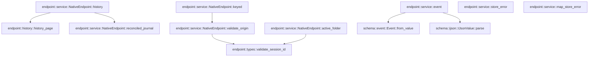

```mermaid
flowchart TD
  n0["endpoint::journal::EndpointJournal::open"]
  n1["endpoint::service::NativeEndpoint::reconcile_projection"]
  n2["endpoint::service::NativeEndpoint::reconciled_journal"]
  n3["endpoint::service::NativeEndpoint::keyed"]
  n4["endpoint::service::NativeEndpoint::validate_origin"]
  n5["endpoint::service::NativeEndpoint::active_folder"]
  n6["endpoint::service::event"]
  n7["endpoint::service::NativeEndpoint::submission_snapshot"]
  n8["endpoint::service::NativeEndpoint::create_session_with_operation"]
  n9["endpoint::service::NativeEndpoint::prompt"]
  n10["endpoint::service::NativeEndpoint::prompt_for_endpoint"]
  n11["endpoint::service::NativeEndpoint::prompt_with_operation"]
  n12["endpoint::service::NativeEndpoint::update_queue"]
  n13["endpoint::service::NativeEndpoint::rename_session"]
  n14["endpoint::service::NativeEndpoint::rename_session_for_endpoint"]
  n15["endpoint::service::NativeEndpoint::rename_session_with_operation"]
  n16["endpoint::service::NativeEndpoint::seed_automatic_title_if_missing"]
  n17["endpoint::service::NativeEndpoint::record_session_notice"]
  n18["endpoint::service::NativeEndpoint::refine_automatic_title"]
  n19["endpoint::service::NativeEndpoint::author_keyed_with_ledger"]
  n20["endpoint::service::NativeEndpoint::cancel"]
  n21["endpoint::service::NativeEndpoint::cancel_for_endpoint"]
  n22["endpoint::service::NativeEndpoint::cancel_with_operation"]
  n23["endpoint::service::NativeEndpoint::fork_session"]
  n24["endpoint::service::NativeEndpoint::archive_session"]
  n25["endpoint::service::NativeEndpoint::unarchive_session"]
  n26["endpoint::types::validate_session_id"]
  n27["store::tail::scan_valid_prefix"]
  n1 --> n2
  n2 --> n0
  n2 --> n5
  n2 --> n27
  n8 --> n26
  n9 --> n11
  n10 --> n11
  n11 --> n3
  n11 --> n6
  n11 --> n7
  n12 --> n3
  n12 --> n6
  n13 --> n15
  n14 --> n15
  n15 --> n3
  n15 --> n6
  n16 --> n4
  n16 --> n6
  n17 --> n4
  n17 --> n6
  n18 --> n4
  n18 --> n6
  n19 --> n26
  n20 --> n22
  n21 --> n22
  n22 --> n4
  n22 --> n6
  n22 --> n26
  n23 --> n26
  n24 --> n26
  n25 --> n26
```

# endpoint::service

[Package atlas](index.md) · [Source](../../src/service.rs)

## Declarations

Visibility is the declaration spelling; trait members and reexports require their enclosing interface. `cfg` is not evaluated.

| Symbol | Kind | Visibility | Test / cfg |
|---|---|---|---|
| [endpoint::service::AUTOMATIC_TITLE_SEED_OPERATION](../../src/service.rs#L13) | const_item | `pub` |  |
| [endpoint::service::AUTOMATIC_TITLE_REFINE_OPERATION](../../src/service.rs#L14) | const_item | `pub` |  |
| [endpoint::service::SESSION_NOTICE_OPERATION](../../src/service.rs#L15) | const_item | `pub` |  |
| [endpoint::service::SessionNotice](../../src/service.rs#L22) | struct_item | `pub` |  |
| [endpoint::service::SessionNoticeSeverity](../../src/service.rs#L30) | enum_item | `pub` |  |
| [endpoint::service::SessionNoticeSeverity::as_str](../../src/service.rs#L37) | function_item | `pub` |  |
| [endpoint::service::MutationReceipt](../../src/service.rs#L46) | struct_item | `pub` |  |
| [endpoint::service::MutationReceipt::from](../../src/service.rs#L52) | function_item | `private` |  |
| [endpoint::service::ArchiveResult](../../src/service.rs#L61) | struct_item | `pub` |  |
| [endpoint::service::UnarchiveResult](../../src/service.rs#L66) | struct_item | `pub` |  |
| [endpoint::service::SessionInventoryItem](../../src/service.rs#L71) | struct_item | `pub` |  |
| [endpoint::service::PERMISSION_MODE_FILE](../../src/service.rs#L96) | const_item | `private` |  |
| [endpoint::service::DEFAULT_PERMISSION_MODE](../../src/service.rs#L97) | const_item | `private` |  |
| [endpoint::service::genesis_preset_summary](../../src/service.rs#L104) | function_item | `pub` |  |
| [endpoint::service::permission_mode_of](../../src/service.rs#L110) | function_item | `pub` |  |
| [endpoint::service::card_item](../../src/service.rs#L127) | function_item | `private` |  |
| [endpoint::service::card_updated_ms](../../src/service.rs#L160) | function_item | `pub` |  |
| [endpoint::service::last_record_updated_ms](../../src/service.rs#L175) | function_item | `pub` |  |
| [endpoint::service::last_record_updated_ms::WINDOW](../../src/service.rs#L177) | const_item | `private` |  |
| [endpoint::service::card_summary](../../src/service.rs#L198) | function_item | `pub` |  |
| [endpoint::service::NativeEndpoint](../../src/service.rs#L248) | struct_item | `pub` |  |
| [endpoint::service::CreateSessionWrite](../../src/service.rs#L252) | struct_item | `private` |  |
| [endpoint::service::NativeEndpoint::open](../../src/service.rs#L263) | function_item | `pub` |  |
| [endpoint::service::NativeEndpoint::capabilities](../../src/service.rs#L270) | function_item | `pub` |  |
| [endpoint::service::NativeEndpoint::list_sessions](../../src/service.rs#L289) | function_item | `pub` |  |
| [endpoint::service::NativeEndpoint::list_sessions_cached](../../src/service.rs#L299) | function_item | `pub` |  |
| [endpoint::service::NativeEndpoint::list_sessions_with](../../src/service.rs#L306) | function_item | `private` |  |
| [endpoint::service::NativeEndpoint::models](../../src/service.rs#L365) | function_item | `pub` |  |
| [endpoint::service::NativeEndpoint::session_config_snapshot](../../src/service.rs#L431) | function_item | `pub` |  |
| [endpoint::service::NativeEndpoint::submission_snapshot](../../src/service.rs#L456) | function_item | `pub` |  |
| [endpoint::service::NativeEndpoint::submission_metadata](../../src/service.rs#L463) | function_item | `pub` |  |
| [endpoint::service::NativeEndpoint::hydrate_historical_submissions](../../src/service.rs#L488) | function_item | `pub` |  |
| [endpoint::service::NativeEndpoint::create_session](../../src/service.rs#L596) | function_item | `pub` |  |
| [endpoint::service::NativeEndpoint::create_session_for_endpoint](../../src/service.rs#L619) | function_item | `pub` |  |
| [endpoint::service::NativeEndpoint::create_session_with_operation](../../src/service.rs#L639) | function_item | `private` |  |
| [endpoint::service::NativeEndpoint::prompt](../../src/service.rs#L669) | function_item | `pub` |  |
| [endpoint::service::NativeEndpoint::prompt_for_endpoint](../../src/service.rs#L680) | function_item | `pub` |  |
| [endpoint::service::NativeEndpoint::prompt_with_operation](../../src/service.rs#L698) | function_item | `private` |  |
| [endpoint::service::NativeEndpoint::update_queue](../../src/service.rs#L721) | function_item | `pub` |  |
| [endpoint::service::NativeEndpoint::rename_session](../../src/service.rs#L736) | function_item | `pub` |  |
| [endpoint::service::NativeEndpoint::rename_session_for_endpoint](../../src/service.rs#L746) | function_item | `pub` |  |
| [endpoint::service::NativeEndpoint::rename_session_with_operation](../../src/service.rs#L756) | function_item | `private` |  |
| [endpoint::service::NativeEndpoint::seed_automatic_title_if_missing](../../src/service.rs#L775) | function_item | `pub` |  |
| [endpoint::service::NativeEndpoint::record_session_notice](../../src/service.rs#L808) | function_item | `pub` |  |
| [endpoint::service::NativeEndpoint::refine_automatic_title](../../src/service.rs#L862) | function_item | `pub` |  |
| [endpoint::service::NativeEndpoint::author_keyed_with_ledger](../../src/service.rs#L903) | function_item | `pub` |  |
| [endpoint::service::NativeEndpoint::cancel](../../src/service.rs#L926) | function_item | `pub` |  |
| [endpoint::service::NativeEndpoint::cancel_for_endpoint](../../src/service.rs#L935) | function_item | `pub` |  |
| [endpoint::service::NativeEndpoint::cancel_with_operation](../../src/service.rs#L944) | function_item | `private` |  |
| [endpoint::service::NativeEndpoint::fork_session](../../src/service.rs#L974) | function_item | `pub` |  |
| [endpoint::service::NativeEndpoint::archive_session](../../src/service.rs#L990) | function_item | `pub` |  |
| [endpoint::service::NativeEndpoint::unarchive_session](../../src/service.rs#L998) | function_item | `pub` |  |
| [endpoint::service::NativeEndpoint::reconcile_projection](../../src/service.rs#L1009) | function_item | `pub` |  |
| [endpoint::service::NativeEndpoint::reconciled_journal](../../src/service.rs#L1017) | function_item | `private` |  |
| [endpoint::service::NativeEndpoint::history](../../src/service.rs#L1031) | function_item | `pub` |  |
| [endpoint::service::NativeEndpoint::keyed](../../src/service.rs#L1041) | function_item | `private` |  |
| [endpoint::service::NativeEndpoint::validate_origin](../../src/service.rs#L1059) | function_item | `private` |  |
| [endpoint::service::NativeEndpoint::active_folder](../../src/service.rs#L1072) | function_item | `private` |  |
| [endpoint::service::event](../../src/service.rs#L1085) | function_item | `private` |  |
| [endpoint::service::store_error](../../src/service.rs#L1090) | function_item | `private` |  |
| [endpoint::service::map_store_error](../../src/service.rs#L1094) | function_item | `private` |  |
| [endpoint::service::NativeEndpointError](../../src/service.rs#L1103) | enum_item | `pub` |  |

## Imports / reexports

| Local name | Source path | Visibility |
|---|---|---|
| `BTreeSet` | `std::collections::BTreeSet` | `private` |
| `HashSet` | `std::collections::HashSet` | `private` |
| `fs` | `std::fs` | `private` |
| `Path` | `std::path::Path` | `private` |
| `Event` | `schema::Event` | `private` |
| `EventKind` | `schema::EventKind` | `private` |
| `IJsonValue` | `schema::IJsonValue` | `private` |
| `OriginTuple` | `schema::OriginTuple` | `private` |
| `ResumePolicy` | `schema::ResumePolicy` | `private` |
| `SeqRange` | `schema::SeqRange` | `private` |
| `Value` | `serde_json::Value` | `private` |
| `json` | `serde_json::json` | `private` |
| `AppendOutcome` | `store::AppendOutcome` | `private` |
| `ConditionalAppendOutcome` | `store::ConditionalAppendOutcome` | `private` |
| `ThreadStore` | `store::ThreadStore` | `private` |
| `scan_valid_prefix` | `store::scan_valid_prefix` | `private` |
| `Error` | `thiserror::Error` | `private` |
| `timestamp_millis` | `crate::projection::timestamp_millis` | `private` |
| `EndpointJournal` | `crate::EndpointJournal` | `private` |
| `HistoryPage` | `crate::HistoryPage` | `private` |
| `Projector` | `crate::Projector` | `private` |
| `history_page` | `crate::history_page` | `private` |
| `validate_session_id` | `crate::validate_session_id` | `private` |

## Module declarations

| Module | Visibility | Attributes |
|---|---|---|

## Function call graphs

Edges below are syntactically resolved calls only, including private functions. Graphs partition callers into groups of 20; they are not execution order. All unresolved sites are listed below and in the JSON inventory.

```mermaid
flowchart TD
  n0["endpoint::projection::timestamp_millis"]
  n1["endpoint::service::genesis_preset_summary"]
  n2["endpoint::service::NativeEndpoint::active_folder"]
  n3["endpoint::service::permission_mode_of"]
  n4["endpoint::service::card_item"]
  n5["endpoint::service::card_updated_ms"]
  n6["endpoint::service::last_record_updated_ms"]
  n7["endpoint::service::card_summary"]
  n8["endpoint::service::NativeEndpoint::open"]
  n9["endpoint::service::NativeEndpoint::capabilities"]
  n10["endpoint::service::NativeEndpoint::list_sessions"]
  n11["endpoint::service::NativeEndpoint::list_sessions_cached"]
  n12["endpoint::service::NativeEndpoint::list_sessions_with"]
  n13["endpoint::service::NativeEndpoint::models"]
  n14["endpoint::service::SessionNoticeSeverity::as_str"]
  n15["endpoint::service::NativeEndpoint::session_config_snapshot"]
  n16["endpoint::service::NativeEndpoint::submission_snapshot"]
  n17["endpoint::service::NativeEndpoint::submission_metadata"]
  n18["endpoint::service::NativeEndpoint::hydrate_historical_submissions"]
  n19["endpoint::service::MutationReceipt::from"]
  n20["endpoint::service::NativeEndpoint::create_session"]
  n21["endpoint::service::NativeEndpoint::create_session_for_endpoint"]
  n22["endpoint::service::NativeEndpoint::create_session_with_operation"]
  n23["endpoint::types::validate_session_id"]
  n24["profile::config::ConfigSnapshot::decode"]
  n25["profile::config::ConfigRepository::open"]
  n26["schema::ijson::IJsonValue::parse"]
  n27["store::asset::AssetStore::new"]
  n28["store::card::read_card"]
  n29["store::card::classify"]
  n30["store::folder::ThreadStore::open"]
  n31["store::tail::scan_valid_prefix"]
  n32["store::tail::read_genesis"]
  n33["tools::preset::ResolvedPreset::from_genesis"]
  n1 --> n33
  n4 --> n3
  n4 --> n28
  n4 --> n29
  n5 --> n0
  n6 --> n0
  n7 --> n1
  n7 --> n5
  n8 --> n30
  n10 --> n12
  n11 --> n12
  n12 --> n3
  n12 --> n4
  n12 --> n7
  n12 --> n23
  n12 --> n31
  n13 --> n26
  n15 --> n2
  n15 --> n23
  n15 --> n25
  n15 --> n32
  n16 --> n2
  n16 --> n15
  n16 --> n17
  n16 --> n27
  n17 --> n26
  n18 --> n2
  n18 --> n17
  n18 --> n24
  n18 --> n26
  n18 --> n27
  n18 --> n31
  n20 --> n22
  n21 --> n22
```

Functions 1–20: 34 direct edges

Functions 21–40: 31 direct edges

Functions 41–47: 7 direct edges

## Call sites

Includes test functions (marked in declarations). Receiver-type-required sites need type analysis/manual tracing. Calls in closures are attributed to their enclosing function; their occurrence here does not mean the closure executes immediately.

| Caller | Callee expression | Source lines | Target / classification |
|---|---|---|---|
| `genesis_preset_summary` | `serde_json::to_value(genesis.raw()).ok` | [105](../../src/service.rs#L105) | receiver-type-required |
| `genesis_preset_summary` | `serde_json::to_value` | [105](../../src/service.rs#L105) | external-constructor-callback-or-unresolved |
| `genesis_preset_summary` | `genesis.raw` | [105](../../src/service.rs#L105) | receiver-type-required |
| `genesis_preset_summary` | `tools::ResolvedPreset::from_genesis(raw.get("preset")?).ok` | [106](../../src/service.rs#L106) | receiver-type-required |
| `genesis_preset_summary` | `tools::ResolvedPreset::from_genesis` | [106](../../src/service.rs#L106) | [tools::preset::ResolvedPreset::from_genesis](../../../tools/src/preset.rs#L855) |
| `genesis_preset_summary` | `raw.get` | [106](../../src/service.rs#L106) | receiver-type-required |
| `genesis_preset_summary` | `Some` | [107](../../src/service.rs#L107) | external-constructor-callback-or-unresolved |
| `genesis_preset_summary` | `preset.summary` | [107](../../src/service.rs#L107) | receiver-type-required |
| `permission_mode_of` | `fs::read` | [111](../../src/service.rs#L111) | external-constructor-callback-or-unresolved |
| `permission_mode_of` | `folder.join` | [111](../../src/service.rs#L111) | receiver-type-required |
| `permission_mode_of` | `DEFAULT_PERMISSION_MODE.to_owned` | [112](../../src/service.rs#L112), [123](../../src/service.rs#L123) | receiver-type-required |
| `permission_mode_of` | `serde_json::from_slice::<serde_json::Value>(&bytes)         .ok()         .and_then(&#124;value&#124; value.get("mode")?.as_str().map(str::to_owned))         .filter(&#124;mode&#124; {             matches!(                 mode.as_str(),                 "read-only" &#124; "workspace-write" &#124; "danger-full-access"             )         })         .unwrap_or_else` | [114](../../src/service.rs#L114) | receiver-type-required |
| `permission_mode_of` | `serde_json::from_slice::<serde_json::Value>(&bytes)         .ok()         .and_then(&#124;value&#124; value.get("mode")?.as_str().map(str::to_owned))         .filter` | [114](../../src/service.rs#L114) | receiver-type-required |
| `permission_mode_of` | `serde_json::from_slice::<serde_json::Value>(&bytes)         .ok()         .and_then` | [114](../../src/service.rs#L114) | receiver-type-required |
| `permission_mode_of` | `serde_json::from_slice::<serde_json::Value>(&bytes)         .ok` | [114](../../src/service.rs#L114) | receiver-type-required |
| `permission_mode_of` | `serde_json::from_slice::<serde_json::Value>` | [114](../../src/service.rs#L114) | external-constructor-callback-or-unresolved |
| `permission_mode_of` | `value.get("mode")?.as_str().map` | [116](../../src/service.rs#L116) | receiver-type-required |
| `permission_mode_of` | `value.get("mode")?.as_str` | [116](../../src/service.rs#L116) | receiver-type-required |
| `permission_mode_of` | `value.get` | [116](../../src/service.rs#L116) | receiver-type-required |
| `card_item` | `store::card::read_card` | [133](../../src/service.rs#L133) | [store::card::read_card](../../../store/src/card.rs#L175) |
| `card_item` | `store::card::classify(folder, &card).ok` | [134](../../src/service.rs#L134) | receiver-type-required |
| `card_item` | `store::card::classify` | [134](../../src/service.rs#L134) | [store::card::classify](../../../store/src/card.rs#L390) |
| `card_item` | `classified.freshness` | [135](../../src/service.rs#L135) | receiver-type-required |
| `card_item` | `card.lines.first` | [138](../../src/service.rs#L138) | receiver-type-required |
| `card_item` | `Some` | [142](../../src/service.rs#L142) | external-constructor-callback-or-unresolved |
| `card_item` | `session_id.to_owned` | [143](../../src/service.rs#L143) | receiver-type-required |
| `card_item` | `card.summary.workspace.clone` | [144](../../src/service.rs#L144) | receiver-type-required |
| `card_item` | `card.summary.title.clone` | [145](../../src/service.rs#L145) | receiver-type-required |
| `card_item` | `main.facts.clone` | [151](../../src/service.rs#L151) | receiver-type-required |
| `card_item` | `permission_mode_of` | [152](../../src/service.rs#L152) | [endpoint::service::permission_mode_of](../../src/service.rs#L110) |
| `card_item` | `card.summary.identity_profile.clone` | [153](../../src/service.rs#L153) | receiver-type-required |
| `card_item` | `card.summary.preset.clone` | [154](../../src/service.rs#L154) | receiver-type-required |
| `card_updated_ms` | `Ok` | [161](../../src/service.rs#L161) | external-constructor-callback-or-unresolved |
| `card_updated_ms` | `projection         .events         .last()         .and_then(&#124;event&#124; event.string_field("ts"))         .ok_or(NativeEndpointError::InventoryTimestamp)         .and_then` | [161](../../src/service.rs#L161) | receiver-type-required |
| `card_updated_ms` | `projection         .events         .last()         .and_then(&#124;event&#124; event.string_field("ts"))         .ok_or` | [161](../../src/service.rs#L161) | receiver-type-required |
| `card_updated_ms` | `projection         .events         .last()         .and_then` | [161](../../src/service.rs#L161) | receiver-type-required |
| `card_updated_ms` | `projection         .events         .last` | [161](../../src/service.rs#L161) | receiver-type-required |
| `card_updated_ms` | `event.string_field` | [164](../../src/service.rs#L164) | receiver-type-required |
| `card_updated_ms` | `timestamp_millis(value).map_err` | [166](../../src/service.rs#L166) | receiver-type-required |
| `card_updated_ms` | `timestamp_millis` | [166](../../src/service.rs#L166) | [endpoint::projection::timestamp_millis](../../src/projection.rs#L944) |
| `last_record_updated_ms` | `fs::File::open(path).ok` | [178](../../src/service.rs#L178) | receiver-type-required |
| `last_record_updated_ms` | `fs::File::open` | [178](../../src/service.rs#L178) | external-constructor-callback-or-unresolved |
| `last_record_updated_ms` | `file.metadata().ok()?.len` | [179](../../src/service.rs#L179) | receiver-type-required |
| `last_record_updated_ms` | `file.metadata().ok` | [179](../../src/service.rs#L179) | receiver-type-required |
| `last_record_updated_ms` | `file.metadata` | [179](../../src/service.rs#L179) | receiver-type-required |
| `last_record_updated_ms` | `length.saturating_sub` | [180](../../src/service.rs#L180) | receiver-type-required |
| `last_record_updated_ms` | `file.seek(SeekFrom::Start(start)).ok` | [181](../../src/service.rs#L181) | receiver-type-required |
| `last_record_updated_ms` | `file.seek` | [181](../../src/service.rs#L181) | receiver-type-required |
| `last_record_updated_ms` | `SeekFrom::Start` | [181](../../src/service.rs#L181) | external-constructor-callback-or-unresolved |
| `last_record_updated_ms` | `Vec::new` | [182](../../src/service.rs#L182) | external-constructor-callback-or-unresolved |
| `last_record_updated_ms` | `file.take(WINDOW).read_to_end(&mut bytes).ok` | [183](../../src/service.rs#L183) | receiver-type-required |
| `last_record_updated_ms` | `file.take(WINDOW).read_to_end` | [183](../../src/service.rs#L183) | receiver-type-required |
| `last_record_updated_ms` | `file.take` | [183](../../src/service.rs#L183) | receiver-type-required |
| `last_record_updated_ms` | `bytes.iter().rposition` | [185](../../src/service.rs#L185) | receiver-type-required |
| `last_record_updated_ms` | `bytes.iter` | [185](../../src/service.rs#L185) | receiver-type-required |
| `last_record_updated_ms` | `bytes[..end]         .iter()         .rposition(&#124;byte&#124; *byte == b'\n')         .map(&#124;index&#124; index + 1)         .or` | [186](../../src/service.rs#L186) | receiver-type-required |
| `last_record_updated_ms` | `bytes[..end]         .iter()         .rposition(&#124;byte&#124; *byte == b'\n')         .map` | [186](../../src/service.rs#L186) | receiver-type-required |
| `last_record_updated_ms` | `bytes[..end]         .iter()         .rposition` | [186](../../src/service.rs#L186) | receiver-type-required |
| `last_record_updated_ms` | `bytes[..end]         .iter` | [186](../../src/service.rs#L186) | receiver-type-required |
| `last_record_updated_ms` | `(start == 0).then_some` | [190](../../src/service.rs#L190) | receiver-type-required |
| `last_record_updated_ms` | `serde_json::from_slice(&bytes[line_start..end]).ok` | [191](../../src/service.rs#L191) | receiver-type-required |
| `last_record_updated_ms` | `serde_json::from_slice` | [191](../../src/service.rs#L191) | external-constructor-callback-or-unresolved |
| `last_record_updated_ms` | `timestamp_millis(record.get("ts")?.as_str()?).ok` | [192](../../src/service.rs#L192) | receiver-type-required |
| `last_record_updated_ms` | `timestamp_millis` | [192](../../src/service.rs#L192) | [endpoint::projection::timestamp_millis](../../src/projection.rs#L944) |
| `last_record_updated_ms` | `record.get("ts")?.as_str` | [192](../../src/service.rs#L192) | receiver-type-required |
| `last_record_updated_ms` | `record.get` | [192](../../src/service.rs#L192) | receiver-type-required |
| `last_record_updated_ms` | `Some` | [193](../../src/service.rs#L193) | external-constructor-callback-or-unresolved |
| `card_summary` | `projection.events.first().ok_or_else` | [201](../../src/service.rs#L201) | receiver-type-required |
| `card_summary` | `projection.events.first` | [201](../../src/service.rs#L201) | receiver-type-required |
| `card_summary` | `NativeEndpointError::Store` | [202](../../src/service.rs#L202) | external-constructor-callback-or-unresolved |
| `card_summary` | `store::StoreError::Corruption` | [202](../../src/service.rs#L202) | external-constructor-callback-or-unresolved |
| `card_summary` | `"ledger has no genesis".to_owned` | [203](../../src/service.rs#L203) | receiver-type-required |
| `card_summary` | `projection         .events         .iter()         .rev()         .find_map(&#124;event&#124; event.string_field("title"))         .map` | [206](../../src/service.rs#L206) | receiver-type-required |
| `card_summary` | `projection         .events         .iter()         .rev()         .find_map` | [206](../../src/service.rs#L206) | receiver-type-required |
| `card_summary` | `projection         .events         .iter()         .rev` | [206](../../src/service.rs#L206) | receiver-type-required |
| `card_summary` | `projection         .events         .iter` | [206](../../src/service.rs#L206) | receiver-type-required |
| `card_summary` | `event.string_field` | [210](../../src/service.rs#L210), [220](../../src/service.rs#L220) | receiver-type-required |
| `card_summary` | `card_updated_ms` | [212](../../src/service.rs#L212) | [endpoint::service::card_updated_ms](../../src/service.rs#L160) |
| `card_summary` | `genesis_preset_summary` | [213](../../src/service.rs#L213) | [endpoint::service::genesis_preset_summary](../../src/service.rs#L104) |
| `card_summary` | `genesis.string_field` | [214](../../src/service.rs#L214), [217](../../src/service.rs#L217), [237](../../src/service.rs#L237), [238](../../src/service.rs#L238) | receiver-type-required |
| `card_summary` | `preset.is_some` | [215](../../src/service.rs#L215) | receiver-type-required |
| `card_summary` | `Some` | [216](../../src/service.rs#L216), [220](../../src/service.rs#L220) | external-constructor-callback-or-unresolved |
| `card_summary` | `"coding".to_owned` | [216](../../src/service.rs#L216) | receiver-type-required |
| `card_summary` | `genesis.string_field("identity_profile").map` | [217](../../src/service.rs#L217) | receiver-type-required |
| `card_summary` | `projection.events.iter().find_map` | [218](../../src/service.rs#L218) | receiver-type-required |
| `card_summary` | `projection.events.iter` | [218](../../src/service.rs#L218) | receiver-type-required |
| `card_summary` | `event.kind` | [219](../../src/service.rs#L219) | receiver-type-required |
| `card_summary` | `serde_json::to_value(event.raw())                 .ok()?                 .get("payload")?                 .get("profile")?                 .as_str()                 .map` | [224](../../src/service.rs#L224) | receiver-type-required |
| `card_summary` | `serde_json::to_value(event.raw())                 .ok()?                 .get("payload")?                 .get("profile")?                 .as_str` | [224](../../src/service.rs#L224) | receiver-type-required |
| `card_summary` | `serde_json::to_value(event.raw())                 .ok()?                 .get("payload")?                 .get` | [224](../../src/service.rs#L224) | receiver-type-required |
| `card_summary` | `serde_json::to_value(event.raw())                 .ok()?                 .get` | [224](../../src/service.rs#L224) | receiver-type-required |
| `card_summary` | `serde_json::to_value(event.raw())                 .ok` | [224](../../src/service.rs#L224) | receiver-type-required |
| `card_summary` | `serde_json::to_value` | [224](../../src/service.rs#L224) | external-constructor-callback-or-unresolved |
| `card_summary` | `event.raw` | [224](../../src/service.rs#L224) | receiver-type-required |
| `card_summary` | `Ok` | [232](../../src/service.rs#L232) | external-constructor-callback-or-unresolved |
| `card_summary` | `genesis             .string_field("workspace")             .ok_or(NativeEndpointError::InventoryWorkspace)?             .to_owned` | [233](../../src/service.rs#L233) | receiver-type-required |
| `card_summary` | `genesis             .string_field("workspace")             .ok_or` | [233](../../src/service.rs#L233) | receiver-type-required |
| `card_summary` | `genesis             .string_field` | [233](../../src/service.rs#L233) | receiver-type-required |
| `card_summary` | `genesis.string_field("folder_binding").map` | [237](../../src/service.rs#L237) | receiver-type-required |
| `card_summary` | `genesis.string_field("ts").unwrap_or_default().to_owned` | [238](../../src/service.rs#L238) | receiver-type-required |
| `card_summary` | `genesis.string_field("ts").unwrap_or_default` | [238](../../src/service.rs#L238) | receiver-type-required |
| `card_summary` | `genesis.is_ephemeral_genesis` | [243](../../src/service.rs#L243) | receiver-type-required |
| `card_summary` | `projection.lifecycle.latest_turn.is_none` | [244](../../src/service.rs#L244) | receiver-type-required |
| `open` | `Ok` | [264](../../src/service.rs#L264) | external-constructor-callback-or-unresolved |
| `open` | `ThreadStore::open` | [265](../../src/service.rs#L265) | [store::folder::ThreadStore::open](../../../store/src/folder.rs#L36) |
| `capabilities` | `[             "session.models",             "session.create",             "session.prompt",             "session.updateQueue",             "session.cancel",             "session.rename",             "session.fork",             "session.discard",             "workspace.archiveSession",             "workspace.unarchiveSession",         ]         .into_iter()         .collect` | [271](../../src/service.rs#L271) | receiver-type-required |
| `capabilities` | `[             "session.models",             "session.create",             "session.prompt",             "session.updateQueue",             "session.cancel",             "session.rename",             "session.fork",             "session.discard",             "workspace.archiveSession",             "workspace.unarchiveSession",         ]         .into_iter` | [271](../../src/service.rs#L271) | receiver-type-required |
| `list_sessions` | `self.list_sessions_with` | [293](../../src/service.rs#L293) | [endpoint::service::NativeEndpoint::list_sessions_with](../../src/service.rs#L306) |
| `list_sessions_cached` | `self.list_sessions_with` | [303](../../src/service.rs#L303) | [endpoint::service::NativeEndpoint::list_sessions_with](../../src/service.rs#L306) |
| `list_sessions_with` | `Vec::new` | [311](../../src/service.rs#L311) | external-constructor-callback-or-unresolved |
| `list_sessions_with` | `fs::read_dir` | [313](../../src/service.rs#L313) | external-constructor-callback-or-unresolved |
| `list_sessions_with` | `self.store.root().join` | [313](../../src/service.rs#L313) | receiver-type-required |
| `list_sessions_with` | `self.store.root` | [313](../../src/service.rs#L313) | receiver-type-required |
| `list_sessions_with` | `entry.file_type()?.is_dir` | [315](../../src/service.rs#L315) | receiver-type-required |
| `list_sessions_with` | `entry.file_type` | [315](../../src/service.rs#L315) | receiver-type-required |
| `list_sessions_with` | `entry.file_name().to_string_lossy().into_owned` | [318](../../src/service.rs#L318) | receiver-type-required |
| `list_sessions_with` | `entry.file_name().to_string_lossy` | [318](../../src/service.rs#L318) | receiver-type-required |
| `list_sessions_with` | `entry.file_name` | [318](../../src/service.rs#L318) | receiver-type-required |
| `list_sessions_with` | `validate_session_id` | [319](../../src/service.rs#L319) | [endpoint::types::validate_session_id](../../src/types.rs#L130) |
| `list_sessions_with` | `running.contains` | [321](../../src/service.rs#L321) | receiver-type-required |
| `list_sessions_with` | `self.store.session_has_live_line_holder` | [322](../../src/service.rs#L322) | receiver-type-required |
| `list_sessions_with` | `card_item` | [324](../../src/service.rs#L324) | [endpoint::service::card_item](../../src/service.rs#L127) |
| `list_sessions_with` | `entry.path` | [324](../../src/service.rs#L324), [329](../../src/service.rs#L329), [345](../../src/service.rs#L345) | receiver-type-required |
| `list_sessions_with` | `items.push` | [326](../../src/service.rs#L326), [344](../../src/service.rs#L344) | receiver-type-required |
| `list_sessions_with` | `fs::read` | [329](../../src/service.rs#L329) | external-constructor-callback-or-unresolved |
| `list_sessions_with` | `entry.path().join` | [329](../../src/service.rs#L329) | receiver-type-required |
| `list_sessions_with` | `scan_valid_prefix` | [330](../../src/service.rs#L330) | [store::tail::scan_valid_prefix](../../../store/src/tail.rs#L37) |
| `list_sessions_with` | `scan.projection.ok_or_else` | [331](../../src/service.rs#L331) | receiver-type-required |
| `list_sessions_with` | `NativeEndpointError::Store` | [332](../../src/service.rs#L332), [338](../../src/service.rs#L338) | external-constructor-callback-or-unresolved |
| `list_sessions_with` | `store::StoreError::Corruption` | [332](../../src/service.rs#L332), [338](../../src/service.rs#L338) | external-constructor-callback-or-unresolved |
| `list_sessions_with` | `card_summary(&projection).map_err` | [336](../../src/service.rs#L336) | receiver-type-required |
| `list_sessions_with` | `card_summary` | [336](../../src/service.rs#L336) | [endpoint::service::card_summary](../../src/service.rs#L198) |
| `list_sessions_with` | `permission_mode_of` | [345](../../src/service.rs#L345) | [endpoint::service::permission_mode_of](../../src/service.rs#L110) |
| `list_sessions_with` | `items.sort_by` | [361](../../src/service.rs#L361) | receiver-type-required |
| `list_sessions_with` | `left.session_id.as_bytes().cmp` | [361](../../src/service.rs#L361) | receiver-type-required |
| `list_sessions_with` | `left.session_id.as_bytes` | [361](../../src/service.rs#L361) | receiver-type-required |
| `list_sessions_with` | `right.session_id.as_bytes` | [361](../../src/service.rs#L361) | receiver-type-required |
| `list_sessions_with` | `Ok` | [362](../../src/service.rs#L362) | external-constructor-callback-or-unresolved |
| `models` | `snapshot             .session_settings             .as_ref()             .map(&#124;settings&#124; &settings.provider)             .or(snapshot.workspace.policy.provider.as_ref())             .or` | [369](../../src/service.rs#L369) | receiver-type-required |
| `models` | `snapshot             .session_settings             .as_ref()             .map(&#124;settings&#124; &settings.provider)             .or` | [369](../../src/service.rs#L369) | receiver-type-required |
| `models` | `snapshot             .session_settings             .as_ref()             .map` | [369](../../src/service.rs#L369), [375](../../src/service.rs#L375) | receiver-type-required |
| `models` | `snapshot             .session_settings             .as_ref` | [369](../../src/service.rs#L369), [375](../../src/service.rs#L375), [411](../../src/service.rs#L411) | receiver-type-required |
| `models` | `snapshot.workspace.policy.provider.as_ref` | [373](../../src/service.rs#L373) | receiver-type-required |
| `models` | `snapshot.settings.default_provider.as_ref` | [374](../../src/service.rs#L374) | receiver-type-required |
| `models` | `snapshot             .session_settings             .as_ref()             .map(&#124;settings&#124; &settings.model)             .or(snapshot.workspace.policy.model.as_ref())             .or` | [375](../../src/service.rs#L375) | receiver-type-required |
| `models` | `snapshot             .session_settings             .as_ref()             .map(&#124;settings&#124; &settings.model)             .or` | [375](../../src/service.rs#L375) | receiver-type-required |
| `models` | `snapshot.workspace.policy.model.as_ref` | [379](../../src/service.rs#L379) | receiver-type-required |
| `models` | `snapshot.settings.default_model.as_ref` | [380](../../src/service.rs#L380) | receiver-type-required |
| `models` | `snapshot             .providers             .providers             .iter()             .map(&#124;provider&#124; {                 json!({                     "id": provider.id,                     "name": provider.id,                     "models": provider.models.iter().filter(&#124;model&#124; model.enabled).map(&#124;model&#124; {                         json!({"id": model.id, "name": model.id,                             "contextWindow": model.context_window_tokens})                     }).collect::<Vec<_>>()                 })             })             .collect::<Vec<_>>` | [381](../../src/service.rs#L381) | receiver-type-required |
| `models` | `snapshot             .providers             .providers             .iter()             .map` | [381](../../src/service.rs#L381) | receiver-type-required |
| `models` | `snapshot             .providers             .providers             .iter` | [381](../../src/service.rs#L381) | receiver-type-required |
| `models` | `selected_provider             .zip(selected_model)             .is_some_and` | [396](../../src/service.rs#L396) | receiver-type-required |
| `models` | `selected_provider             .zip` | [396](../../src/service.rs#L396) | receiver-type-required |
| `models` | `snapshot.providers.providers.iter().any` | [399](../../src/service.rs#L399) | receiver-type-required |
| `models` | `snapshot.providers.providers.iter` | [399](../../src/service.rs#L399) | receiver-type-required |
| `models` | `candidate                             .models                             .iter()                             .any` | [401](../../src/service.rs#L401) | receiver-type-required |
| `models` | `candidate                             .models                             .iter` | [401](../../src/service.rs#L401) | receiver-type-required |
| `models` | `snapshot             .session_settings             .as_ref()             .and_then` | [411](../../src/service.rs#L411) | receiver-type-required |
| `models` | `settings.reasoning_effort.as_ref` | [414](../../src/service.rs#L414) | receiver-type-required |
| `models` | `Value::String` | [416](../../src/service.rs#L416) | external-constructor-callback-or-unresolved |
| `models` | `effort.clone` | [416](../../src/service.rs#L416) | receiver-type-required |
| `models` | `Ok` | [424](../../src/service.rs#L424) | external-constructor-callback-or-unresolved |
| `models` | `IJsonValue::parse` | [424](../../src/service.rs#L424) | [schema::ijson::IJsonValue::parse](../../../schema/src/ijson.rs#L16) |
| `models` | `serde_json::to_vec` | [424](../../src/service.rs#L424) | external-constructor-callback-or-unresolved |
| `session_config_snapshot` | `validate_session_id` | [435](../../src/service.rs#L435) | [endpoint::types::validate_session_id](../../src/types.rs#L130) |
| `session_config_snapshot` | `self.active_folder` | [436](../../src/service.rs#L436) | [endpoint::service::NativeEndpoint::active_folder](../../src/service.rs#L1072) |
| `session_config_snapshot` | `store::read_genesis(folder.join("main.jsonl"))?.ok_or_else` | [438](../../src/service.rs#L438) | receiver-type-required |
| `session_config_snapshot` | `store::read_genesis` | [438](../../src/service.rs#L438) | [store::tail::read_genesis](../../../store/src/tail.rs#L86) |
| `session_config_snapshot` | `folder.join` | [438](../../src/service.rs#L438) | receiver-type-required |
| `session_config_snapshot` | `NativeEndpointError::Store` | [439](../../src/service.rs#L439) | external-constructor-callback-or-unresolved |
| `session_config_snapshot` | `store::StoreError::Corruption` | [439](../../src/service.rs#L439) | external-constructor-callback-or-unresolved |
| `session_config_snapshot` | `"session ledger has no valid genesis prefix".to_owned` | [440](../../src/service.rs#L440) | receiver-type-required |
| `session_config_snapshot` | `genesis             .string_field("workspace")             .ok_or` | [444](../../src/service.rs#L444) | receiver-type-required |
| `session_config_snapshot` | `genesis             .string_field` | [444](../../src/service.rs#L444) | receiver-type-required |
| `session_config_snapshot` | `profile::ConfigRepository::open` | [447](../../src/service.rs#L447) | [profile::config::ConfigRepository::open](../../../profile/src/config.rs#L688) |
| `session_config_snapshot` | `self.store.root` | [447](../../src/service.rs#L447) | receiver-type-required |
| `session_config_snapshot` | `Ok` | [448](../../src/service.rs#L448) | external-constructor-callback-or-unresolved |
| `session_config_snapshot` | `genesis.string_field` | [448](../../src/service.rs#L448) | receiver-type-required |
| `session_config_snapshot` | `repository.resolve_for_session_binding` | [449](../../src/service.rs#L449) | receiver-type-required |
| `session_config_snapshot` | `repository.resolve_for_session` | [450](../../src/service.rs#L450) | receiver-type-required |
| `submission_snapshot` | `self.session_config_snapshot` | [457](../../src/service.rs#L457) | [endpoint::service::NativeEndpoint::session_config_snapshot](../../src/service.rs#L431) |
| `submission_snapshot` | `store::AssetStore::new` | [458](../../src/service.rs#L458) | [store::asset::AssetStore::new](../../../store/src/asset.rs#L27) |
| `submission_snapshot` | `self.active_folder(session_id)?.join` | [458](../../src/service.rs#L458) | receiver-type-required |
| `submission_snapshot` | `self.active_folder` | [458](../../src/service.rs#L458) | [endpoint::service::NativeEndpoint::active_folder](../../src/service.rs#L1072) |
| `submission_snapshot` | `config.publish` | [459](../../src/service.rs#L459) | receiver-type-required |
| `submission_snapshot` | `Self::submission_metadata` | [460](../../src/service.rs#L460) | [endpoint::service::NativeEndpoint::submission_metadata](../../src/service.rs#L463) |
| `submission_metadata` | `config             .session_settings             .as_ref()             .map(&#124;s&#124; s.provider.as_str())             .or(config.workspace.policy.provider.as_deref())             .or` | [467](../../src/service.rs#L467) | receiver-type-required |
| `submission_metadata` | `config             .session_settings             .as_ref()             .map(&#124;s&#124; s.provider.as_str())             .or` | [467](../../src/service.rs#L467) | receiver-type-required |
| `submission_metadata` | `config             .session_settings             .as_ref()             .map` | [467](../../src/service.rs#L467), [473](../../src/service.rs#L473) | receiver-type-required |
| `submission_metadata` | `config             .session_settings             .as_ref` | [467](../../src/service.rs#L467), [473](../../src/service.rs#L473) | receiver-type-required |
| `submission_metadata` | `s.provider.as_str` | [470](../../src/service.rs#L470) | receiver-type-required |
| `submission_metadata` | `config.workspace.policy.provider.as_deref` | [471](../../src/service.rs#L471) | receiver-type-required |
| `submission_metadata` | `config.settings.default_provider.as_deref` | [472](../../src/service.rs#L472) | receiver-type-required |
| `submission_metadata` | `config             .session_settings             .as_ref()             .map(&#124;s&#124; s.model.as_str())             .or(config.workspace.policy.model.as_deref())             .or` | [473](../../src/service.rs#L473) | receiver-type-required |
| `submission_metadata` | `config             .session_settings             .as_ref()             .map(&#124;s&#124; s.model.as_str())             .or` | [473](../../src/service.rs#L473) | receiver-type-required |
| `submission_metadata` | `s.model.as_str` | [476](../../src/service.rs#L476) | receiver-type-required |
| `submission_metadata` | `config.workspace.policy.model.as_deref` | [477](../../src/service.rs#L477) | receiver-type-required |
| `submission_metadata` | `config.settings.default_model.as_deref` | [478](../../src/service.rs#L478) | receiver-type-required |
| `submission_metadata` | `Ok` | [479](../../src/service.rs#L479) | external-constructor-callback-or-unresolved |
| `submission_metadata` | `IJsonValue::parse` | [479](../../src/service.rs#L479) | [schema::ijson::IJsonValue::parse](../../../schema/src/ijson.rs#L16) |
| `submission_metadata` | `serde_json::to_vec` | [479](../../src/service.rs#L479) | external-constructor-callback-or-unresolved |
| `hydrate_historical_submissions` | `entries.iter().any` | [496](../../src/service.rs#L496) | receiver-type-required |
| `hydrate_historical_submissions` | `entries.iter` | [496](../../src/service.rs#L496) | receiver-type-required |
| `hydrate_historical_submissions` | `serde_json::to_value(&entry.event.data)                     .is_ok_and` | [498](../../src/service.rs#L498) | receiver-type-required |
| `hydrate_historical_submissions` | `serde_json::to_value` | [498](../../src/service.rs#L498), [520](../../src/service.rs#L520), [571](../../src/service.rs#L571), [584](../../src/service.rs#L584) | external-constructor-callback-or-unresolved |
| `hydrate_historical_submissions` | `data.get("submission").is_none` | [499](../../src/service.rs#L499) | receiver-type-required |
| `hydrate_historical_submissions` | `data.get` | [499](../../src/service.rs#L499), [574](../../src/service.rs#L574) | receiver-type-required |
| `hydrate_historical_submissions` | `self.active_folder` | [504](../../src/service.rs#L504) | [endpoint::service::NativeEndpoint::active_folder](../../src/service.rs#L1072) |
| `hydrate_historical_submissions` | `fs::read` | [507](../../src/service.rs#L507) | external-constructor-callback-or-unresolved |
| `hydrate_historical_submissions` | `folder.join` | [507](../../src/service.rs#L507), [513](../../src/service.rs#L513) | receiver-type-required |
| `hydrate_historical_submissions` | `scan_valid_prefix` | [510](../../src/service.rs#L510) | [store::tail::scan_valid_prefix](../../../store/src/tail.rs#L37) |
| `hydrate_historical_submissions` | `store::AssetStore::new` | [513](../../src/service.rs#L513) | [store::asset::AssetStore::new](../../../store/src/asset.rs#L27) |
| `hydrate_historical_submissions` | `std::collections::BTreeMap::new` | [517](../../src/service.rs#L517), [518](../../src/service.rs#L518) | external-constructor-callback-or-unresolved |
| `hydrate_historical_submissions` | `event.raw` | [520](../../src/service.rs#L520) | receiver-type-required |
| `hydrate_historical_submissions` | `event.kind` | [523](../../src/service.rs#L523) | receiver-type-required |
| `hydrate_historical_submissions` | `value                         .get("config")                         .and_then(&#124;c&#124; c.get("digest"))                         .and_then(Value::as_str)                         .map` | [525](../../src/service.rs#L525) | receiver-type-required |
| `hydrate_historical_submissions` | `value                         .get("config")                         .and_then(&#124;c&#124; c.get("digest"))                         .and_then` | [525](../../src/service.rs#L525) | receiver-type-required |
| `hydrate_historical_submissions` | `value                         .get("config")                         .and_then` | [525](../../src/service.rs#L525) | receiver-type-required |
| `hydrate_historical_submissions` | `value                         .get` | [525](../../src/service.rs#L525), [532](../../src/service.rs#L532), [541](../../src/service.rs#L541) | receiver-type-required |
| `hydrate_historical_submissions` | `c.get` | [527](../../src/service.rs#L527) | receiver-type-required |
| `hydrate_historical_submissions` | `value                         .get("config_digest")                         .and_then(Value::as_str)                         .map` | [532](../../src/service.rs#L532) | receiver-type-required |
| `hydrate_historical_submissions` | `value                         .get("config_digest")                         .and_then` | [532](../../src/service.rs#L532) | receiver-type-required |
| `hydrate_historical_submissions` | `inputs.insert` | [538](../../src/service.rs#L538) | receiver-type-required |
| `hydrate_historical_submissions` | `event.seq` | [538](../../src/service.rs#L538) | receiver-type-required |
| `hydrate_historical_submissions` | `value                         .get("trigger")                         .and_then(&#124;t&#124; t.get("inputs"))                         .and_then` | [541](../../src/service.rs#L541) | receiver-type-required |
| `hydrate_historical_submissions` | `value                         .get("trigger")                         .and_then` | [541](../../src/service.rs#L541) | receiver-type-required |
| `hydrate_historical_submissions` | `t.get` | [543](../../src/service.rs#L543) | receiver-type-required |
| `hydrate_historical_submissions` | `digest.as_deref().and_then` | [548](../../src/service.rs#L548) | receiver-type-required |
| `hydrate_historical_submissions` | `digest.as_deref` | [548](../../src/service.rs#L548) | receiver-type-required |
| `hydrate_historical_submissions` | `assets.read_verified(&format!("sha256-{digest}")).ok` | [549](../../src/service.rs#L549) | receiver-type-required |
| `hydrate_historical_submissions` | `assets.read_verified` | [549](../../src/service.rs#L549) | receiver-type-required |
| `hydrate_historical_submissions` | `profile::ConfigSnapshot::decode(&bytes).ok` | [550](../../src/service.rs#L550) | receiver-type-required |
| `hydrate_historical_submissions` | `profile::ConfigSnapshot::decode` | [550](../../src/service.rs#L550) | [profile::config::ConfigSnapshot::decode](../../../profile/src/config.rs#L293) |
| `hydrate_historical_submissions` | `Self::submission_metadata(&config, digest).ok` | [551](../../src/service.rs#L551) | receiver-type-required |
| `hydrate_historical_submissions` | `Self::submission_metadata` | [551](../../src/service.rs#L551) | [endpoint::service::NativeEndpoint::submission_metadata](../../src/service.rs#L463) |
| `hydrate_historical_submissions` | `seqs.iter().filter_map` | [553](../../src/service.rs#L553) | receiver-type-required |
| `hydrate_historical_submissions` | `seqs.iter` | [553](../../src/service.rs#L553) | receiver-type-required |
| `hydrate_historical_submissions` | `inputs                             .get(&seq)                             .and_then(&#124;input&#124; input.get("submission"))                             .and_then(&#124;s&#124; IJsonValue::parse(&serde_json::to_vec(s).ok()?).ok())                             .or_else` | [554](../../src/service.rs#L554) | receiver-type-required |
| `hydrate_historical_submissions` | `inputs                             .get(&seq)                             .and_then(&#124;input&#124; input.get("submission"))                             .and_then` | [554](../../src/service.rs#L554) | receiver-type-required |
| `hydrate_historical_submissions` | `inputs                             .get(&seq)                             .and_then` | [554](../../src/service.rs#L554) | receiver-type-required |
| `hydrate_historical_submissions` | `inputs                             .get` | [554](../../src/service.rs#L554) | receiver-type-required |
| `hydrate_historical_submissions` | `input.get` | [556](../../src/service.rs#L556) | receiver-type-required |
| `hydrate_historical_submissions` | `IJsonValue::parse(&serde_json::to_vec(s).ok()?).ok` | [557](../../src/service.rs#L557) | receiver-type-required |
| `hydrate_historical_submissions` | `IJsonValue::parse` | [557](../../src/service.rs#L557), [589](../../src/service.rs#L589) | [schema::ijson::IJsonValue::parse](../../../schema/src/ijson.rs#L16) |
| `hydrate_historical_submissions` | `serde_json::to_vec(s).ok` | [557](../../src/service.rs#L557) | receiver-type-required |
| `hydrate_historical_submissions` | `serde_json::to_vec` | [557](../../src/service.rs#L557), [588](../../src/service.rs#L588) | external-constructor-callback-or-unresolved |
| `hydrate_historical_submissions` | `historical.clone` | [558](../../src/service.rs#L558) | receiver-type-required |
| `hydrate_historical_submissions` | `submissions.insert` | [560](../../src/service.rs#L560) | receiver-type-required |
| `hydrate_historical_submissions` | `data.get("submission").is_some` | [574](../../src/service.rs#L574) | receiver-type-required |
| `hydrate_historical_submissions` | `data                 .get("id")                 .and_then(Value::as_str)                 .and_then` | [577](../../src/service.rs#L577) | receiver-type-required |
| `hydrate_historical_submissions` | `data                 .get("id")                 .and_then` | [577](../../src/service.rs#L577) | receiver-type-required |
| `hydrate_historical_submissions` | `data                 .get` | [577](../../src/service.rs#L577) | receiver-type-required |
| `hydrate_historical_submissions` | `submissions.get` | [580](../../src/service.rs#L580) | receiver-type-required |
| `create_session` | `self.create_session_with_operation` | [605](../../src/service.rs#L605) | [endpoint::service::NativeEndpoint::create_session_with_operation](../../src/service.rs#L639) |
| `create_session_for_endpoint` | `self.create_session_with_operation` | [628](../../src/service.rs#L628) | [endpoint::service::NativeEndpoint::create_session_with_operation](../../src/service.rs#L639) |
| `create_session_with_operation` | `validate_session_id` | [643](../../src/service.rs#L643) | [endpoint::types::validate_session_id](../../src/types.rs#L130) |
| `create_session_with_operation` | `Err` | [645](../../src/service.rs#L645) | external-constructor-callback-or-unresolved |
| `create_session_with_operation` | `event` | [647](../../src/service.rs#L647) | external-constructor-callback-or-unresolved |
| `create_session_with_operation` | `Ok` | [662](../../src/service.rs#L662) | external-constructor-callback-or-unresolved |
| `create_session_with_operation` | `self             .store             .create_thread(write.session_id, event)             .map_err` | [662](../../src/service.rs#L662) | receiver-type-required |
| `create_session_with_operation` | `self             .store             .create_thread` | [662](../../src/service.rs#L662) | receiver-type-required |
| `prompt` | `self.prompt_with_operation` | [677](../../src/service.rs#L677) | [endpoint::service::NativeEndpoint::prompt_with_operation](../../src/service.rs#L698) |
| `prompt_for_endpoint` | `self.prompt_with_operation` | [688](../../src/service.rs#L688) | [endpoint::service::NativeEndpoint::prompt_with_operation](../../src/service.rs#L698) |
| `prompt_with_operation` | `self.keyed` | [707](../../src/service.rs#L707) | [endpoint::service::NativeEndpoint::keyed](../../src/service.rs#L1041) |
| `prompt_with_operation` | `self.submission_snapshot` | [708](../../src/service.rs#L708) | [endpoint::service::NativeEndpoint::submission_snapshot](../../src/service.rs#L456) |
| `prompt_with_operation` | `Value::Bool` | [715](../../src/service.rs#L715) | external-constructor-callback-or-unresolved |
| `prompt_with_operation` | `event` | [717](../../src/service.rs#L717) | [endpoint::service::event](../../src/service.rs#L1085) |
| `update_queue` | `self.keyed` | [728](../../src/service.rs#L728) | [endpoint::service::NativeEndpoint::keyed](../../src/service.rs#L1041) |
| `update_queue` | `event` | [729](../../src/service.rs#L729) | [endpoint::service::event](../../src/service.rs#L1085) |
| `rename_session` | `self.rename_session_with_operation` | [743](../../src/service.rs#L743) | [endpoint::service::NativeEndpoint::rename_session_with_operation](../../src/service.rs#L756) |
| `rename_session_for_endpoint` | `self.rename_session_with_operation` | [753](../../src/service.rs#L753) | [endpoint::service::NativeEndpoint::rename_session_with_operation](../../src/service.rs#L756) |
| `rename_session_with_operation` | `self.keyed` | [764](../../src/service.rs#L764) | [endpoint::service::NativeEndpoint::keyed](../../src/service.rs#L1041) |
| `rename_session_with_operation` | `event` | [765](../../src/service.rs#L765) | [endpoint::service::event](../../src/service.rs#L1085) |
| `seed_automatic_title_if_missing` | `self.validate_origin` | [782](../../src/service.rs#L782) | [endpoint::service::NativeEndpoint::validate_origin](../../src/service.rs#L1059) |
| `seed_automatic_title_if_missing` | `self             .store             .append_keyed_with_projection_if(session_id, origin, &#124;seq, projection&#124; {                 if projection.events.iter().any(&#124;item&#124; {                     *item.kind() == EventKind::Meta && item.string_field("title").is_some()                 }) {                     return Ok(None);                 }                 event(json!({                     "v": 1, "seq": seq, "ts": timestamp, "kind": "meta", "title": title,                     "origin_key": origin.key, "origin_tuple": origin,                 }))                 .map(Some)                 .map_err(store_error)             })             .map_err` | [783](../../src/service.rs#L783) | receiver-type-required |
| `seed_automatic_title_if_missing` | `self             .store             .append_keyed_with_projection_if` | [783](../../src/service.rs#L783) | receiver-type-required |
| `seed_automatic_title_if_missing` | `projection.events.iter().any` | [786](../../src/service.rs#L786) | receiver-type-required |
| `seed_automatic_title_if_missing` | `projection.events.iter` | [786](../../src/service.rs#L786) | receiver-type-required |
| `seed_automatic_title_if_missing` | `item.kind` | [787](../../src/service.rs#L787) | receiver-type-required |
| `seed_automatic_title_if_missing` | `item.string_field("title").is_some` | [787](../../src/service.rs#L787) | receiver-type-required |
| `seed_automatic_title_if_missing` | `item.string_field` | [787](../../src/service.rs#L787) | receiver-type-required |
| `seed_automatic_title_if_missing` | `Ok` | [789](../../src/service.rs#L789), [799](../../src/service.rs#L799) | external-constructor-callback-or-unresolved |
| `seed_automatic_title_if_missing` | `event(json!({                     "v": 1, "seq": seq, "ts": timestamp, "kind": "meta", "title": title,                     "origin_key": origin.key, "origin_tuple": origin,                 }))                 .map(Some)                 .map_err` | [791](../../src/service.rs#L791) | receiver-type-required |
| `seed_automatic_title_if_missing` | `event(json!({                     "v": 1, "seq": seq, "ts": timestamp, "kind": "meta", "title": title,                     "origin_key": origin.key, "origin_tuple": origin,                 }))                 .map` | [791](../../src/service.rs#L791) | receiver-type-required |
| `seed_automatic_title_if_missing` | `event` | [791](../../src/service.rs#L791) | [endpoint::service::event](../../src/service.rs#L1085) |
| `seed_automatic_title_if_missing` | `Some` | [800](../../src/service.rs#L800) | external-constructor-callback-or-unresolved |
| `seed_automatic_title_if_missing` | `outcome.into` | [800](../../src/service.rs#L800) | receiver-type-required |
| `record_session_notice` | `self.validate_origin` | [815](../../src/service.rs#L815) | [endpoint::service::NativeEndpoint::validate_origin](../../src/service.rs#L1059) |
| `record_session_notice` | `self.store                 .append_keyed_with_projection_if(session_id, origin, &#124;seq, projection&#124; {                     // A notice that repeats the newest one, with no input in between,                     // says nothing new (the same degraded launch on every worker                     // restart); fold it. An input after it is a fresh attempt the                     // user made, and its outcome must be shown again.                     let latest_notice = projection.events.iter().rposition(&#124;item&#124; {                         *item.kind() == EventKind::Meta && item.has_field("notice")                     });                     if let Some(index) = latest_notice {                         let repeats = serde_json::to_value(projection.events[index].raw())                             .ok()                             .and_then(&#124;value&#124; value.get("notice").cloned())                             .is_some_and(&#124;previous&#124; previous == payload);                         let input_since = projection.events[index + 1..]                             .iter()                             .any(&#124;item&#124; *item.kind() == EventKind::Input);                         if repeats && !input_since {                             return Ok(None);                         }                     }                     event(json!({                         "v": 1, "seq": seq, "ts": timestamp, "kind": "meta",                         "notice": payload,                         "origin_key": origin.key, "origin_tuple": origin,                     }))                     .map(Some)                     .map_err(store_error)                 })                 .map_err` | [823](../../src/service.rs#L823) | receiver-type-required |
| `record_session_notice` | `self.store                 .append_keyed_with_projection_if` | [823](../../src/service.rs#L823) | receiver-type-required |
| `record_session_notice` | `projection.events.iter().rposition` | [829](../../src/service.rs#L829) | receiver-type-required |
| `record_session_notice` | `projection.events.iter` | [829](../../src/service.rs#L829) | receiver-type-required |
| `record_session_notice` | `item.kind` | [830](../../src/service.rs#L830), [839](../../src/service.rs#L839) | receiver-type-required |
| `record_session_notice` | `item.has_field` | [830](../../src/service.rs#L830) | receiver-type-required |
| `record_session_notice` | `serde_json::to_value(projection.events[index].raw())                             .ok()                             .and_then(&#124;value&#124; value.get("notice").cloned())                             .is_some_and` | [833](../../src/service.rs#L833) | receiver-type-required |
| `record_session_notice` | `serde_json::to_value(projection.events[index].raw())                             .ok()                             .and_then` | [833](../../src/service.rs#L833) | receiver-type-required |
| `record_session_notice` | `serde_json::to_value(projection.events[index].raw())                             .ok` | [833](../../src/service.rs#L833) | receiver-type-required |
| `record_session_notice` | `serde_json::to_value` | [833](../../src/service.rs#L833) | external-constructor-callback-or-unresolved |
| `record_session_notice` | `projection.events[index].raw` | [833](../../src/service.rs#L833) | receiver-type-required |
| `record_session_notice` | `value.get("notice").cloned` | [835](../../src/service.rs#L835) | receiver-type-required |
| `record_session_notice` | `value.get` | [835](../../src/service.rs#L835) | receiver-type-required |
| `record_session_notice` | `projection.events[index + 1..]                             .iter()                             .any` | [837](../../src/service.rs#L837) | receiver-type-required |
| `record_session_notice` | `projection.events[index + 1..]                             .iter` | [837](../../src/service.rs#L837) | receiver-type-required |
| `record_session_notice` | `Ok` | [841](../../src/service.rs#L841), [853](../../src/service.rs#L853) | external-constructor-callback-or-unresolved |
| `record_session_notice` | `event(json!({                         "v": 1, "seq": seq, "ts": timestamp, "kind": "meta",                         "notice": payload,                         "origin_key": origin.key, "origin_tuple": origin,                     }))                     .map(Some)                     .map_err` | [844](../../src/service.rs#L844) | receiver-type-required |
| `record_session_notice` | `event(json!({                         "v": 1, "seq": seq, "ts": timestamp, "kind": "meta",                         "notice": payload,                         "origin_key": origin.key, "origin_tuple": origin,                     }))                     .map` | [844](../../src/service.rs#L844) | receiver-type-required |
| `record_session_notice` | `event` | [844](../../src/service.rs#L844) | [endpoint::service::event](../../src/service.rs#L1085) |
| `record_session_notice` | `Some` | [854](../../src/service.rs#L854) | external-constructor-callback-or-unresolved |
| `record_session_notice` | `outcome.into` | [854](../../src/service.rs#L854) | receiver-type-required |
| `refine_automatic_title` | `self.validate_origin` | [869](../../src/service.rs#L869) | [endpoint::service::NativeEndpoint::validate_origin](../../src/service.rs#L1059) |
| `refine_automatic_title` | `self             .store             .append_keyed_with_projection_if(session_id, origin, &#124;seq, projection&#124; {                 let latest_title = projection.events.iter().rev().find(&#124;item&#124; {                     *item.kind() == EventKind::Meta && item.string_field("title").is_some()                 });                 let remains_automatic_seed = latest_title                     .map(Event::origin_tuple)                     .transpose()                     .map_err(store::StoreError::from)?                     .flatten()                     .is_some_and(&#124;tuple&#124; tuple.op == AUTOMATIC_TITLE_SEED_OPERATION);                 if !remains_automatic_seed {                     return Ok(None);                 }                 event(json!({                     "v": 1, "seq": seq, "ts": timestamp, "kind": "meta", "title": title,                     "origin_key": origin.key, "origin_tuple": origin,                 }))                 .map(Some)                 .map_err(store_error)             })             .map_err` | [870](../../src/service.rs#L870) | receiver-type-required |
| `refine_automatic_title` | `self             .store             .append_keyed_with_projection_if` | [870](../../src/service.rs#L870) | receiver-type-required |
| `refine_automatic_title` | `projection.events.iter().rev().find` | [873](../../src/service.rs#L873) | receiver-type-required |
| `refine_automatic_title` | `projection.events.iter().rev` | [873](../../src/service.rs#L873) | receiver-type-required |
| `refine_automatic_title` | `projection.events.iter` | [873](../../src/service.rs#L873) | receiver-type-required |
| `refine_automatic_title` | `item.kind` | [874](../../src/service.rs#L874) | receiver-type-required |
| `refine_automatic_title` | `item.string_field("title").is_some` | [874](../../src/service.rs#L874) | receiver-type-required |
| `refine_automatic_title` | `item.string_field` | [874](../../src/service.rs#L874) | receiver-type-required |
| `refine_automatic_title` | `latest_title                     .map(Event::origin_tuple)                     .transpose()                     .map_err(store::StoreError::from)?                     .flatten()                     .is_some_and` | [876](../../src/service.rs#L876) | receiver-type-required |
| `refine_automatic_title` | `latest_title                     .map(Event::origin_tuple)                     .transpose()                     .map_err(store::StoreError::from)?                     .flatten` | [876](../../src/service.rs#L876) | receiver-type-required |
| `refine_automatic_title` | `latest_title                     .map(Event::origin_tuple)                     .transpose()                     .map_err` | [876](../../src/service.rs#L876) | receiver-type-required |
| `refine_automatic_title` | `latest_title                     .map(Event::origin_tuple)                     .transpose` | [876](../../src/service.rs#L876) | receiver-type-required |
| `refine_automatic_title` | `latest_title                     .map` | [876](../../src/service.rs#L876) | receiver-type-required |
| `refine_automatic_title` | `Ok` | [883](../../src/service.rs#L883), [893](../../src/service.rs#L893) | external-constructor-callback-or-unresolved |
| `refine_automatic_title` | `event(json!({                     "v": 1, "seq": seq, "ts": timestamp, "kind": "meta", "title": title,                     "origin_key": origin.key, "origin_tuple": origin,                 }))                 .map(Some)                 .map_err` | [885](../../src/service.rs#L885) | receiver-type-required |
| `refine_automatic_title` | `event(json!({                     "v": 1, "seq": seq, "ts": timestamp, "kind": "meta", "title": title,                     "origin_key": origin.key, "origin_tuple": origin,                 }))                 .map` | [885](../../src/service.rs#L885) | receiver-type-required |
| `refine_automatic_title` | `event` | [885](../../src/service.rs#L885) | [endpoint::service::event](../../src/service.rs#L1085) |
| `refine_automatic_title` | `Some` | [894](../../src/service.rs#L894) | external-constructor-callback-or-unresolved |
| `refine_automatic_title` | `outcome.into` | [894](../../src/service.rs#L894) | receiver-type-required |
| `author_keyed_with_ledger` | `validate_session_id` | [912](../../src/service.rs#L912) | [endpoint::types::validate_session_id](../../src/types.rs#L130) |
| `author_keyed_with_ledger` | `Err` | [914](../../src/service.rs#L914) | external-constructor-callback-or-unresolved |
| `author_keyed_with_ledger` | `self             .store             .append_keyed_with_ledger_if(session_id, origin, build)             .map_err` | [916](../../src/service.rs#L916) | receiver-type-required |
| `author_keyed_with_ledger` | `self             .store             .append_keyed_with_ledger_if` | [916](../../src/service.rs#L916) | receiver-type-required |
| `author_keyed_with_ledger` | `Ok` | [920](../../src/service.rs#L920) | external-constructor-callback-or-unresolved |
| `author_keyed_with_ledger` | `Some` | [921](../../src/service.rs#L921) | external-constructor-callback-or-unresolved |
| `author_keyed_with_ledger` | `outcome.into` | [921](../../src/service.rs#L921) | receiver-type-required |
| `cancel` | `self.cancel_with_operation` | [932](../../src/service.rs#L932) | [endpoint::service::NativeEndpoint::cancel_with_operation](../../src/service.rs#L944) |
| `cancel_for_endpoint` | `self.cancel_with_operation` | [941](../../src/service.rs#L941) | [endpoint::service::NativeEndpoint::cancel_with_operation](../../src/service.rs#L944) |
| `cancel_with_operation` | `validate_session_id` | [951](../../src/service.rs#L951) | [endpoint::types::validate_session_id](../../src/types.rs#L130) |
| `cancel_with_operation` | `self.validate_origin` | [952](../../src/service.rs#L952) | [endpoint::service::NativeEndpoint::validate_origin](../../src/service.rs#L1059) |
| `cancel_with_operation` | `self             .store             .append_keyed_with_projection(session_id, origin, &#124;seq, projection&#124; {                 let generation = projection                     .events                     .iter()                     .filter(&#124;item&#124; matches!(item.kind(), schema::EventKind::StopRequested))                     .filter_map(&#124;item&#124; item.integer_field("generation"))                     .max()                     .unwrap_or(0)                     + 1;                 event(json!({                 "v": 1, "seq": seq, "ts": timestamp, "kind": "stop_requested",                 "generation": generation, "origin_key": origin.key, "origin_tuple": origin,                 }))                 .map_err(store_error)             })             .map_err` | [953](../../src/service.rs#L953) | receiver-type-required |
| `cancel_with_operation` | `self             .store             .append_keyed_with_projection` | [953](../../src/service.rs#L953) | receiver-type-required |
| `cancel_with_operation` | `projection                     .events                     .iter()                     .filter(&#124;item&#124; matches!(item.kind(), schema::EventKind::StopRequested))                     .filter_map(&#124;item&#124; item.integer_field("generation"))                     .max()                     .unwrap_or` | [956](../../src/service.rs#L956) | receiver-type-required |
| `cancel_with_operation` | `projection                     .events                     .iter()                     .filter(&#124;item&#124; matches!(item.kind(), schema::EventKind::StopRequested))                     .filter_map(&#124;item&#124; item.integer_field("generation"))                     .max` | [956](../../src/service.rs#L956) | receiver-type-required |
| `cancel_with_operation` | `projection                     .events                     .iter()                     .filter(&#124;item&#124; matches!(item.kind(), schema::EventKind::StopRequested))                     .filter_map` | [956](../../src/service.rs#L956) | receiver-type-required |
| `cancel_with_operation` | `projection                     .events                     .iter()                     .filter` | [956](../../src/service.rs#L956) | receiver-type-required |
| `cancel_with_operation` | `projection                     .events                     .iter` | [956](../../src/service.rs#L956) | receiver-type-required |
| `cancel_with_operation` | `item.integer_field` | [960](../../src/service.rs#L960) | receiver-type-required |
| `cancel_with_operation` | `event(json!({                 "v": 1, "seq": seq, "ts": timestamp, "kind": "stop_requested",                 "generation": generation, "origin_key": origin.key, "origin_tuple": origin,                 }))                 .map_err` | [964](../../src/service.rs#L964) | receiver-type-required |
| `cancel_with_operation` | `event` | [964](../../src/service.rs#L964) | [endpoint::service::event](../../src/service.rs#L1085) |
| `cancel_with_operation` | `Ok` | [971](../../src/service.rs#L971) | external-constructor-callback-or-unresolved |
| `cancel_with_operation` | `outcome.into` | [971](../../src/service.rs#L971) | receiver-type-required |
| `fork_session` | `validate_session_id` | [981](../../src/service.rs#L981), [982](../../src/service.rs#L982) | [endpoint::types::validate_session_id](../../src/types.rs#L130) |
| `fork_session` | `self.store             .begin_fork(operation_id, source, destination, timestamp)             .map_err` | [983](../../src/service.rs#L983) | receiver-type-required |
| `fork_session` | `self.store             .begin_fork` | [983](../../src/service.rs#L983) | receiver-type-required |
| `fork_session` | `self.store.recover_rewrites().map_err` | [986](../../src/service.rs#L986) | receiver-type-required |
| `fork_session` | `self.store.recover_rewrites` | [986](../../src/service.rs#L986) | receiver-type-required |
| `fork_session` | `Ok` | [987](../../src/service.rs#L987) | external-constructor-callback-or-unresolved |
| `fork_session` | `destination.to_owned` | [987](../../src/service.rs#L987) | receiver-type-required |
| `archive_session` | `validate_session_id` | [991](../../src/service.rs#L991) | [endpoint::types::validate_session_id](../../src/types.rs#L130) |
| `archive_session` | `self.store.archive(session_id).map_err` | [992](../../src/service.rs#L992) | receiver-type-required |
| `archive_session` | `self.store.archive` | [992](../../src/service.rs#L992) | receiver-type-required |
| `archive_session` | `Ok` | [993](../../src/service.rs#L993) | external-constructor-callback-or-unresolved |
| `unarchive_session` | `validate_session_id` | [1002](../../src/service.rs#L1002) | [endpoint::types::validate_session_id](../../src/types.rs#L130) |
| `unarchive_session` | `self.store.unarchive(session_id).map_err` | [1003](../../src/service.rs#L1003) | receiver-type-required |
| `unarchive_session` | `self.store.unarchive` | [1003](../../src/service.rs#L1003) | receiver-type-required |
| `unarchive_session` | `Ok` | [1004](../../src/service.rs#L1004) | external-constructor-callback-or-unresolved |
| `unarchive_session` | `session_id.to_owned` | [1005](../../src/service.rs#L1005) | receiver-type-required |
| `reconcile_projection` | `self.reconciled_journal` | [1010](../../src/service.rs#L1010) | [endpoint::service::NativeEndpoint::reconciled_journal](../../src/service.rs#L1017) |
| `reconcile_projection` | `journal.last_seq` | [1011](../../src/service.rs#L1011) | receiver-type-required |
| `reconcile_projection` | `i64::try_from(seq).map_err` | [1012](../../src/service.rs#L1012) | receiver-type-required |
| `reconcile_projection` | `i64::try_from` | [1012](../../src/service.rs#L1012) | external-constructor-callback-or-unresolved |
| `reconcile_projection` | `NativeEndpointError::SequenceOverflow` | [1012](../../src/service.rs#L1012) | external-constructor-callback-or-unresolved |
| `reconcile_projection` | `Ok` | [1013](../../src/service.rs#L1013) | external-constructor-callback-or-unresolved |
| `reconciled_journal` | `self.active_folder` | [1018](../../src/service.rs#L1018) | [endpoint::service::NativeEndpoint::active_folder](../../src/service.rs#L1072) |
| `reconciled_journal` | `fs::read` | [1019](../../src/service.rs#L1019) | external-constructor-callback-or-unresolved |
| `reconciled_journal` | `folder.join` | [1019](../../src/service.rs#L1019) | receiver-type-required |
| `reconciled_journal` | `scan_valid_prefix` | [1020](../../src/service.rs#L1020) | [store::tail::scan_valid_prefix](../../../store/src/tail.rs#L37) |
| `reconciled_journal` | `scan.projection.ok_or_else` | [1021](../../src/service.rs#L1021) | receiver-type-required |
| `reconciled_journal` | `NativeEndpointError::Store` | [1022](../../src/service.rs#L1022) | external-constructor-callback-or-unresolved |
| `reconciled_journal` | `store::StoreError::Corruption` | [1022](../../src/service.rs#L1022) | external-constructor-callback-or-unresolved |
| `reconciled_journal` | `"thread ledger has no valid genesis prefix".to_owned` | [1023](../../src/service.rs#L1023) | receiver-type-required |
| `reconciled_journal` | `EndpointJournal::open` | [1026](../../src/service.rs#L1026) | [endpoint::journal::EndpointJournal::open](../../src/journal.rs#L165) |
| `reconciled_journal` | `Projector::default().reconcile` | [1027](../../src/service.rs#L1027) | receiver-type-required |
| `reconciled_journal` | `Projector::default` | [1027](../../src/service.rs#L1027) | external-constructor-callback-or-unresolved |
| `reconciled_journal` | `Ok` | [1028](../../src/service.rs#L1028) | external-constructor-callback-or-unresolved |
| `history` | `self.reconciled_journal` | [1037](../../src/service.rs#L1037) | [endpoint::service::NativeEndpoint::reconciled_journal](../../src/service.rs#L1017) |
| `history` | `Ok` | [1038](../../src/service.rs#L1038) | external-constructor-callback-or-unresolved |
| `history` | `history_page` | [1038](../../src/service.rs#L1038) | [endpoint::history::history_page](../../src/history.rs#L13) |
| `history` | `journal.records` | [1038](../../src/service.rs#L1038) | receiver-type-required |
| `keyed` | `self.validate_origin` | [1051](../../src/service.rs#L1051) | [endpoint::service::NativeEndpoint::validate_origin](../../src/service.rs#L1059) |
| `keyed` | `self             .store             .append_keyed(session_id, origin, &#124;seq&#124; build(seq).map_err(store_error))             .map_err` | [1052](../../src/service.rs#L1052) | receiver-type-required |
| `keyed` | `self             .store             .append_keyed` | [1052](../../src/service.rs#L1052) | receiver-type-required |
| `keyed` | `build(seq).map_err` | [1054](../../src/service.rs#L1054) | receiver-type-required |
| `keyed` | `build` | [1054](../../src/service.rs#L1054) | external-constructor-callback-or-unresolved |
| `keyed` | `Ok` | [1056](../../src/service.rs#L1056) | external-constructor-callback-or-unresolved |
| `keyed` | `outcome.into` | [1056](../../src/service.rs#L1056) | receiver-type-required |
| `validate_origin` | `validate_session_id` | [1065](../../src/service.rs#L1065) | [endpoint::types::validate_session_id](../../src/types.rs#L130) |
| `validate_origin` | `Err` | [1067](../../src/service.rs#L1067) | external-constructor-callback-or-unresolved |
| `validate_origin` | `Ok` | [1069](../../src/service.rs#L1069) | external-constructor-callback-or-unresolved |
| `active_folder` | `validate_session_id` | [1073](../../src/service.rs#L1073) | [endpoint::types::validate_session_id](../../src/types.rs#L130) |
| `active_folder` | `self.store.root().join("archive").join(session_id).is_dir` | [1074](../../src/service.rs#L1074) | receiver-type-required |
| `active_folder` | `self.store.root().join("archive").join` | [1074](../../src/service.rs#L1074) | receiver-type-required |
| `active_folder` | `self.store.root().join` | [1074](../../src/service.rs#L1074), [1077](../../src/service.rs#L1077) | receiver-type-required |
| `active_folder` | `self.store.root` | [1074](../../src/service.rs#L1074), [1077](../../src/service.rs#L1077) | receiver-type-required |
| `active_folder` | `Err` | [1075](../../src/service.rs#L1075), [1079](../../src/service.rs#L1079) | external-constructor-callback-or-unresolved |
| `active_folder` | `self.store.root().join("threads").join` | [1077](../../src/service.rs#L1077) | receiver-type-required |
| `active_folder` | `folder.is_dir` | [1078](../../src/service.rs#L1078) | receiver-type-required |
| `active_folder` | `Ok` | [1081](../../src/service.rs#L1081) | external-constructor-callback-or-unresolved |
| `event` | `serde_json::to_vec` | [1086](../../src/service.rs#L1086) | external-constructor-callback-or-unresolved |
| `event` | `Ok` | [1087](../../src/service.rs#L1087) | external-constructor-callback-or-unresolved |
| `event` | `Event::from_value` | [1087](../../src/service.rs#L1087) | [schema::event::Event::from_value](../../../schema/src/event.rs#L179) |
| `event` | `IJsonValue::parse` | [1087](../../src/service.rs#L1087) | [schema::ijson::IJsonValue::parse](../../../schema/src/ijson.rs#L16) |
| `store_error` | `store::StoreError::Corruption` | [1091](../../src/service.rs#L1091) | external-constructor-callback-or-unresolved |
| `store_error` | `error.to_string` | [1091](../../src/service.rs#L1091) | receiver-type-required |
| `map_store_error` | `NativeEndpointError::Store` | [1098](../../src/service.rs#L1098) | external-constructor-callback-or-unresolved |
