```mermaid
flowchart TD
  n0["endpoint::session_operations::is_endpoint_origin_client"]
  n1["endpoint::session_operations::SessionOperations::operation_path"]
  n2["endpoint::session_operations::SessionOperations::operation_payload_path"]
  n3["endpoint::session_operations::execution_path_from_snapshot"]
  n4["endpoint::session_operations::session_preset"]
  n5["endpoint::session_operations::genesis_preset_defaults"]
  n6["endpoint::session_operations::canonical_event_line"]
  n7["endpoint::session_operations::read_canonical_event"]
  n8["endpoint::session_operations::verify_session_create_genesis"]
  n9["endpoint::session_operations::sync_operation_payload"]
  n10["endpoint::session_operations::is_hex_digest"]
  n11["endpoint::session_operations::allocate_uuid_v7"]
  n12["endpoint::session_operations::publish_canonical"]
  n13["endpoint::session_operations::read_canonical"]
  n14["endpoint::session_operations::decode_canonical"]
  n15["endpoint::session_operations::canonical_line"]
  n16["endpoint::session_operations::to_ijson"]
  n17["endpoint::session_operations::intent_kind"]
  n18["endpoint::session_operations::discard_intent"]
  n19["endpoint::session_operations::folder_is_ephemeral"]
  n20["endpoint::session_operations::folder_move_intent"]
  n21["endpoint::session_operations::hex_digest"]
  n22["endpoint::types::validate_session_id"]
  n23["schema::event::Event::decode_canonical"]
  n24["schema::ijson::IJsonValue::parse"]
  n25["store::atomic::AtomicPublisher::replace"]
  n26["store::tail::read_genesis"]
  n27["tools::preset::ResolvedPreset::resolve_request"]
  n28["tools::preset::ResolvedPreset::from_identity"]
  n29["tools::preset::ResolvedPreset::from_genesis"]
  n1 --> n21
  n2 --> n21
  n4 --> n27
  n4 --> n28
  n5 --> n29
  n7 --> n23
  n8 --> n0
  n8 --> n21
  n12 --> n15
  n12 --> n25
  n13 --> n14
  n14 --> n24
  n16 --> n24
  n18 --> n22
  n19 --> n26
```

# endpoint::session_operations

[Package atlas](index.md) · [Source](../../src/session_operations.rs)

## Declarations

Visibility is the declaration spelling; trait members and reexports require their enclosing interface. `cfg` is not evaluated.

| Symbol | Kind | Visibility | Test / cfg |
|---|---|---|---|
| [endpoint::session_operations::VERSION](../../src/session_operations.rs#L22) | const_item | `private` |  |
| [endpoint::session_operations::OperationPhase](../../src/session_operations.rs#L26) | enum_item | `private` |  |
| [endpoint::session_operations::FolderMoveIntent](../../src/session_operations.rs#L36) | struct_item | `private` |  |
| [endpoint::session_operations::DiscardIntent](../../src/session_operations.rs#L48) | struct_item | `private` |  |
| [endpoint::session_operations::SessionCreateIntent](../../src/session_operations.rs#L57) | struct_item | `private` |  |
| [endpoint::session_operations::SelectModelIntent](../../src/session_operations.rs#L72) | struct_item | `private` |  |
| [endpoint::session_operations::ForkIntent](../../src/session_operations.rs#L85) | struct_item | `private` |  |
| [endpoint::session_operations::QueueTransactionIntent](../../src/session_operations.rs#L104) | struct_item | `private` |  |
| [endpoint::session_operations::QueueTailSnapshot](../../src/session_operations.rs#L117) | struct_item | `private` |  |
| [endpoint::session_operations::ORIGIN_CLIENT](../../src/session_operations.rs#L125) | const_item | `pub` |  |
| [endpoint::session_operations::is_endpoint_origin_client](../../src/session_operations.rs#L128) | function_item | `pub` |  |
| [endpoint::session_operations::OperationRecord](../../src/session_operations.rs#L134) | struct_item | `private` |  |
| [endpoint::session_operations::PresetModelSource](../../src/session_operations.rs#L148) | trait_item | `pub` |  |
| [endpoint::session_operations::PresetModelSource::model_available](../../src/session_operations.rs#L151) | function_signature_item | `private` |  |
| [endpoint::session_operations::SessionPresetEnvironment](../../src/session_operations.rs#L163) | struct_item | `pub` |  |
| [endpoint::session_operations::SessionPresetEnvironment::new](../../src/session_operations.rs#L174) | function_item | `pub` |  |
| [endpoint::session_operations::SessionPresetEnvironment::with_models](../../src/session_operations.rs#L193) | function_item | `pub` |  |
| [endpoint::session_operations::SessionPresetEnvironment::permitted_tools](../../src/session_operations.rs#L204) | function_item | `private` |  |
| [endpoint::session_operations::SessionPresetEnvironment::mcp_server_digest](../../src/session_operations.rs#L208) | function_item | `private` |  |
| [endpoint::session_operations::SessionPresetEnvironment::mcp_tool_name](../../src/session_operations.rs#L216) | function_item | `private` |  |
| [endpoint::session_operations::SessionPresetEnvironment::skill_known](../../src/session_operations.rs#L223) | function_item | `private` |  |
| [endpoint::session_operations::SessionPresetEnvironment::model_available](../../src/session_operations.rs#L227) | function_item | `private` |  |
| [endpoint::session_operations::ExecutionCreateOperation](../../src/session_operations.rs#L234) | struct_item | `pub` |  |
| [endpoint::session_operations::SelectModelOperation](../../src/session_operations.rs#L246) | struct_item | `pub` |  |
| [endpoint::session_operations::ForkSessionOperation](../../src/session_operations.rs#L256) | struct_item | `pub` |  |
| [endpoint::session_operations::ForkLineage](../../src/session_operations.rs#L274) | struct_item | `pub` |  |
| [endpoint::session_operations::QueueTransactionOperation](../../src/session_operations.rs#L279) | struct_item | `pub` |  |
| [endpoint::session_operations::PendingQueueTransaction](../../src/session_operations.rs#L292) | struct_item | `pub` |  |
| [endpoint::session_operations::QueueTransactionDecision](../../src/session_operations.rs#L303) | enum_item | `pub` |  |
| [endpoint::session_operations::QueueTransactionCompletion](../../src/session_operations.rs#L312) | enum_item | `pub` |  |
| [endpoint::session_operations::QueueTransactionState](../../src/session_operations.rs#L323) | enum_item | `pub` |  |
| [endpoint::session_operations::QueueRecoveryDriver](../../src/session_operations.rs#L328) | trait_item | `pub` |  |
| [endpoint::session_operations::QueueRecoveryDriver::execute](../../src/session_operations.rs#L329) | function_signature_item | `private` |  |
| [endpoint::session_operations::SelectedModel](../../src/session_operations.rs#L336) | struct_item | `pub` |  |
| [endpoint::session_operations::CompleteOperations](../../src/session_operations.rs#L345) | struct_item | `pub` |  |
| [endpoint::session_operations::file_identity](../../src/session_operations.rs#L349) | function_item | `private` |  |
| [endpoint::session_operations::SessionOperations](../../src/session_operations.rs#L355) | struct_item | `pub` |  |
| [endpoint::session_operations::SessionOperations::open_sessions](../../src/session_operations.rs#L364) | function_item | `pub` |  |
| [endpoint::session_operations::SessionOperations::recover_sessions](../../src/session_operations.rs#L380) | function_item | `pub` |  |
| [endpoint::session_operations::SessionOperations::root](../../src/session_operations.rs#L389) | function_item | `pub` |  |
| [endpoint::session_operations::SessionOperations::recover](../../src/session_operations.rs#L394) | function_item | `pub` |  |
| [endpoint::session_operations::SessionOperations::recover_with_queue_driver](../../src/session_operations.rs#L398) | function_item | `pub` |  |
| [endpoint::session_operations::SessionOperations::recover_skipping](../../src/session_operations.rs#L405) | function_item | `private` |  |
| [endpoint::session_operations::SessionOperations::recover_record](../../src/session_operations.rs#L430) | function_item | `private` |  |
| [endpoint::session_operations::SessionOperations::create_execution_session](../../src/session_operations.rs#L546) | function_item | `pub` |  |
| [endpoint::session_operations::SessionOperations::select_model](../../src/session_operations.rs#L678) | function_item | `pub` |  |
| [endpoint::session_operations::SessionOperations::fork_session](../../src/session_operations.rs#L760) | function_item | `pub` |  |
| [endpoint::session_operations::SessionOperations::apply_preset_defaults](../../src/session_operations.rs#L855) | function_item | `private` |  |
| [endpoint::session_operations::SessionOperations::resolve_fork_preset](../../src/session_operations.rs#L885) | function_item | `private` |  |
| [endpoint::session_operations::SessionOperations::prepare_queue_transaction](../../src/session_operations.rs#L907) | function_item | `pub` |  |
| [endpoint::session_operations::SessionOperations::complete_queue_transaction](../../src/session_operations.rs#L1010) | function_item | `pub` |  |
| [endpoint::session_operations::SessionOperations::has_incomplete_session_operation](../../src/session_operations.rs#L1026) | function_item | `pub` |  |
| [endpoint::session_operations::SessionOperations::completed_fork_lineage](../../src/session_operations.rs#L1043) | function_item | `pub` |  |
| [endpoint::session_operations::SessionOperations::archive_session](../../src/session_operations.rs#L1066) | function_item | `pub` |  |
| [endpoint::session_operations::SessionOperations::unarchive_session](../../src/session_operations.rs#L1096) | function_item | `pub` |  |
| [endpoint::session_operations::SessionOperations::discard_session](../../src/session_operations.rs#L1119) | function_item | `pub` |  |
| [endpoint::session_operations::SessionOperations::drive_discard](../../src/session_operations.rs#L1186) | function_item | `private` |  |
| [endpoint::session_operations::SessionOperations::folder_move](../../src/session_operations.rs#L1241) | function_item | `private` |  |
| [endpoint::session_operations::SessionOperations::drive_session_create](../../src/session_operations.rs#L1321) | function_item | `private` |  |
| [endpoint::session_operations::SessionOperations::session_id_from_response](../../src/session_operations.rs#L1407) | function_item | `private` |  |
| [endpoint::session_operations::SessionOperations::drive_select_model](../../src/session_operations.rs#L1421) | function_item | `private` |  |
| [endpoint::session_operations::SessionOperations::fork_was_quarantined](../../src/session_operations.rs#L1482) | function_item | `private` |  |
| [endpoint::session_operations::SessionOperations::drive_fork](../../src/session_operations.rs#L1514) | function_item | `private` |  |
| [endpoint::session_operations::SessionOperations::drive_queue_completion](../../src/session_operations.rs#L1599) | function_item | `private` |  |
| [endpoint::session_operations::SessionOperations::remove_recordless_payloads](../../src/session_operations.rs#L1658) | function_item | `private` |  |
| [endpoint::session_operations::SessionOperations::remove_recordless_payload](../../src/session_operations.rs#L1685) | function_item | `private` |  |
| [endpoint::session_operations::SessionOperations::drive_folder_move](../../src/session_operations.rs#L1706) | function_item | `private` |  |
| [endpoint::session_operations::SessionOperations::operation_paths](../../src/session_operations.rs#L1772) | function_item | `private` |  |
| [endpoint::session_operations::SessionOperations::operation_path](../../src/session_operations.rs#L1792) | function_item | `private` |  |
| [endpoint::session_operations::SessionOperations::operation_payload_path](../../src/session_operations.rs#L1800) | function_item | `private` |  |
| [endpoint::session_operations::execution_path_from_snapshot](../../src/session_operations.rs#L1810) | function_item | `private` |  |
| [endpoint::session_operations::session_preset](../../src/session_operations.rs#L1821) | function_item | `private` |  |
| [endpoint::session_operations::genesis_preset_defaults](../../src/session_operations.rs#L1847) | function_item | `private` |  |
| [endpoint::session_operations::canonical_event_line](../../src/session_operations.rs#L1859) | function_item | `private` |  |
| [endpoint::session_operations::read_canonical_event](../../src/session_operations.rs#L1865) | function_item | `private` |  |
| [endpoint::session_operations::verify_session_create_genesis](../../src/session_operations.rs#L1876) | function_item | `private` |  |
| [endpoint::session_operations::sync_operation_payload](../../src/session_operations.rs#L1942) | function_item | `private` |  |
| [endpoint::session_operations::is_hex_digest](../../src/session_operations.rs#L1955) | function_item | `private` |  |
| [endpoint::session_operations::allocate_uuid_v7](../../src/session_operations.rs#L1962) | function_item | `private` |  |
| [endpoint::session_operations::publish_canonical](../../src/session_operations.rs#L1981) | function_item | `private` |  |
| [endpoint::session_operations::read_canonical](../../src/session_operations.rs#L1986) | function_item | `private` |  |
| [endpoint::session_operations::decode_canonical](../../src/session_operations.rs#L1990) | function_item | `private` |  |
| [endpoint::session_operations::canonical_line](../../src/session_operations.rs#L2011) | function_item | `private` |  |
| [endpoint::session_operations::to_ijson](../../src/session_operations.rs#L2018) | function_item | `private` |  |
| [endpoint::session_operations::intent_kind](../../src/session_operations.rs#L2026) | function_item | `private` |  |
| [endpoint::session_operations::discard_intent](../../src/session_operations.rs#L2039) | function_item | `private` |  |
| [endpoint::session_operations::folder_is_ephemeral](../../src/session_operations.rs#L2051) | function_item | `private` |  |
| [endpoint::session_operations::folder_move_intent](../../src/session_operations.rs#L2057) | function_item | `private` |  |
| [endpoint::session_operations::session_create_intent](../../src/session_operations.rs#L2068) | function_item | `private` |  |
| [endpoint::session_operations::select_model_intent](../../src/session_operations.rs#L2095) | function_item | `private` |  |
| [endpoint::session_operations::fork_intent](../../src/session_operations.rs#L2117) | function_item | `private` |  |
| [endpoint::session_operations::queue_transaction_intent](../../src/session_operations.rs#L2134) | function_item | `private` |  |
| [endpoint::session_operations::pending_queue_transaction](../../src/session_operations.rs#L2162) | function_item | `private` |  |
| [endpoint::session_operations::verify_queue_payload](../../src/session_operations.rs#L2177) | function_item | `private` |  |
| [endpoint::session_operations::completion_for_decision](../../src/session_operations.rs#L2212) | function_item | `private` |  |
| [endpoint::session_operations::queue_completion_value](../../src/session_operations.rs#L2224) | function_item | `private` |  |
| [endpoint::session_operations::queue_completion_from_record](../../src/session_operations.rs#L2262) | function_item | `private` |  |
| [endpoint::session_operations::operation_target_session](../../src/session_operations.rs#L2311) | function_item | `private` |  |
| [endpoint::session_operations::is_uid_principal](../../src/session_operations.rs#L2329) | function_item | `private` |  |
| [endpoint::session_operations::fork_id_from_response](../../src/session_operations.rs#L2335) | function_item | `private` |  |
| [endpoint::session_operations::selected_model_from_response](../../src/session_operations.rs#L2349) | function_item | `private` |  |
| [endpoint::session_operations::active_session_folder](../../src/session_operations.rs#L2389) | function_item | `private` |  |
| [endpoint::session_operations::valid_folder_projection](../../src/session_operations.rs#L2404) | function_item | `private` |  |
| [endpoint::session_operations::folder_reservation](../../src/session_operations.rs#L2419) | function_item | `private` |  |
| [endpoint::session_operations::verify_folder_reservation](../../src/session_operations.rs#L2436) | function_item | `private` |  |
| [endpoint::session_operations::active_session_count](../../src/session_operations.rs#L2449) | function_item | `private` |  |
| [endpoint::session_operations::hex_digest](../../src/session_operations.rs#L2459) | function_item | `private` |  |
| [endpoint::session_operations::SessionOperationError](../../src/session_operations.rs#L2464) | enum_item | `pub` |  |

## Imports / reexports

| Local name | Source path | Visibility |
|---|---|---|
| `BTreeMap` | `std::collections::BTreeMap` | `private` |
| `fs` | `std::fs` | `private` |
| `File` | `std::fs::File` | `private` |
| `Read` | `std::io::Read` | `private` |
| `MetadataExt` | `std::os::unix::fs::MetadataExt` | `private` |
| `Path` | `std::path::Path` | `private` |
| `PathBuf` | `std::path::PathBuf` | `private` |
| `SystemTime` | `std::time::SystemTime` | `private` |
| `UNIX_EPOCH` | `std::time::UNIX_EPOCH` | `private` |
| `ConfigRepository` | `profile::ConfigRepository` | `private` |
| `Event` | `schema::Event` | `private` |
| `IJsonValue` | `schema::IJsonValue` | `private` |
| `OriginTuple` | `schema::OriginTuple` | `private` |
| `ResumePolicy` | `schema::ResumePolicy` | `private` |
| `Deserialize` | `serde::Deserialize` | `private` |
| `Serialize` | `serde::Serialize` | `private` |
| `Value` | `serde_json::Value` | `private` |
| `json` | `serde_json::json` | `private` |
| `Digest` | `sha2::Digest` | `private` |
| `Sha256` | `sha2::Sha256` | `private` |
| `AssetStore` | `store::AssetStore` | `private` |
| `AtomicPublisher` | `store::AtomicPublisher` | `private` |
| `DirectoryLock` | `store::DirectoryLock` | `private` |
| `NamedLock` | `store::NamedLock` | `private` |
| `ThreadStore` | `store::ThreadStore` | `private` |
| `scan_valid_prefix` | `store::scan_valid_prefix` | `private` |
| `Error` | `thiserror::Error` | `private` |
| `Uuid` | `uuid::Uuid` | `private` |

## Module declarations

| Module | Visibility | Attributes |
|---|---|---|

## Function call graphs

Edges below are syntactically resolved calls only, including private functions. Graphs partition callers into groups of 20; they are not execution order. All unresolved sites are listed below and in the JSON inventory.

Functions 1–20: 82 direct edges

Functions 21–40: 107 direct edges

Functions 41–60: 15 direct edges

Functions 61–79: 21 direct edges

```mermaid
flowchart TD
  n0["endpoint::session_operations::is_hex_digest"]
  n1["endpoint::session_operations::read_canonical"]
  n2["endpoint::session_operations::to_ijson"]
  n3["endpoint::session_operations::intent_kind"]
  n4["endpoint::session_operations::discard_intent"]
  n5["endpoint::session_operations::folder_move_intent"]
  n6["endpoint::session_operations::session_create_intent"]
  n7["endpoint::session_operations::select_model_intent"]
  n8["endpoint::session_operations::fork_intent"]
  n9["endpoint::session_operations::queue_transaction_intent"]
  n10["endpoint::session_operations::pending_queue_transaction"]
  n11["endpoint::session_operations::verify_queue_payload"]
  n12["endpoint::session_operations::completion_for_decision"]
  n13["endpoint::session_operations::queue_completion_value"]
  n14["endpoint::session_operations::queue_completion_from_record"]
  n15["endpoint::session_operations::operation_target_session"]
  n16["endpoint::session_operations::is_uid_principal"]
  n17["endpoint::session_operations::fork_id_from_response"]
  n18["endpoint::session_operations::selected_model_from_response"]
  n19["endpoint::session_operations::active_session_folder"]
  n20["endpoint::session_operations::valid_folder_projection"]
  n21["endpoint::session_operations::folder_reservation"]
  n22["endpoint::session_operations::verify_folder_reservation"]
  n23["endpoint::session_operations::active_session_count"]
  n24["endpoint::session_operations::hex_digest"]
  n25["endpoint::types::validate_session_id"]
  n26["store::tail::read_ledger_repaired"]
  n6 --> n0
  n6 --> n25
  n7 --> n25
  n8 --> n16
  n8 --> n25
  n9 --> n25
  n10 --> n9
  n11 --> n1
  n13 --> n2
  n14 --> n9
  n14 --> n13
  n15 --> n3
  n15 --> n4
  n15 --> n5
  n15 --> n6
  n15 --> n7
  n15 --> n8
  n15 --> n9
  n20 --> n26
  n21 --> n26
  n22 --> n21
```

## Call sites

Includes test functions (marked in declarations). Receiver-type-required sites need type analysis/manual tracing. Calls in closures are attributed to their enclosing function; their occurrence here does not mean the closure executes immediately.

| Caller | Callee expression | Source lines | Target / classification |
|---|---|---|---|
| `new` | `instruction                 .effective                 .policy                 .allowed_tools                 .as_ref()                 .map` | [179](../../src/session_operations.rs#L179) | receiver-type-required |
| `new` | `instruction                 .effective                 .policy                 .allowed_tools                 .as_ref` | [179](../../src/session_operations.rs#L179) | receiver-type-required |
| `new` | `tools.iter().cloned().collect` | [184](../../src/session_operations.rs#L184) | receiver-type-required |
| `new` | `tools.iter().cloned` | [184](../../src/session_operations.rs#L184) | receiver-type-required |
| `new` | `tools.iter` | [184](../../src/session_operations.rs#L184) | receiver-type-required |
| `new` | `profile::ResourceCatalog::skill_package_names` | [185](../../src/session_operations.rs#L185) | [profile::resources::ResourceCatalog::skill_package_names](../../../profile/src/resources.rs#L114) |
| `with_models` | `models.map` | [198](../../src/session_operations.rs#L198) | receiver-type-required |
| `permitted_tools` | `self.permitted.as_ref` | [205](../../src/session_operations.rs#L205) | receiver-type-required |
| `mcp_server_digest` | `self.connections             .iter()             .find(&#124;connection&#124; connection.name == server)             .and_then(&#124;connection&#124; serde_json_canonicalizer::to_vec(connection).ok())             .map` | [209](../../src/session_operations.rs#L209) | receiver-type-required |
| `mcp_server_digest` | `self.connections             .iter()             .find(&#124;connection&#124; connection.name == server)             .and_then` | [209](../../src/session_operations.rs#L209) | receiver-type-required |
| `mcp_server_digest` | `self.connections             .iter()             .find` | [209](../../src/session_operations.rs#L209) | receiver-type-required |
| `mcp_server_digest` | `self.connections             .iter` | [209](../../src/session_operations.rs#L209) | receiver-type-required |
| `mcp_server_digest` | `serde_json_canonicalizer::to_vec(connection).ok` | [212](../../src/session_operations.rs#L212) | receiver-type-required |
| `mcp_server_digest` | `serde_json_canonicalizer::to_vec` | [212](../../src/session_operations.rs#L212) | external-constructor-callback-or-unresolved |
| `mcp_tool_name` | `self.connections             .iter()             .find(&#124;connection&#124; connection.name == server)             .and_then` | [217](../../src/session_operations.rs#L217) | receiver-type-required |
| `mcp_tool_name` | `self.connections             .iter()             .find` | [217](../../src/session_operations.rs#L217) | receiver-type-required |
| `mcp_tool_name` | `self.connections             .iter` | [217](../../src/session_operations.rs#L217) | receiver-type-required |
| `mcp_tool_name` | `mcp::project_name(server, tool).ok` | [220](../../src/session_operations.rs#L220) | receiver-type-required |
| `mcp_tool_name` | `mcp::project_name` | [220](../../src/session_operations.rs#L220) | [mcp::projection::project_name](../../../mcp/src/projection.rs#L14) |
| `skill_known` | `self.skills.contains` | [224](../../src/session_operations.rs#L224) | receiver-type-required |
| `model_available` | `self.models             .is_some_and` | [228](../../src/session_operations.rs#L228) | receiver-type-required |
| `model_available` | `models.model_available` | [229](../../src/session_operations.rs#L229) | receiver-type-required |
| `file_identity` | `fs::metadata(path).ok` | [350](../../src/session_operations.rs#L350) | receiver-type-required |
| `file_identity` | `fs::metadata` | [350](../../src/session_operations.rs#L350) | external-constructor-callback-or-unresolved |
| `file_identity` | `Some` | [351](../../src/session_operations.rs#L351) | external-constructor-callback-or-unresolved |
| `file_identity` | `metadata.len` | [351](../../src/session_operations.rs#L351) | receiver-type-required |
| `file_identity` | `metadata.modified().ok` | [351](../../src/session_operations.rs#L351) | receiver-type-required |
| `file_identity` | `metadata.modified` | [351](../../src/session_operations.rs#L351) | receiver-type-required |
| `open_sessions` | `storage_root.as_ref().to_path_buf` | [365](../../src/session_operations.rs#L365) | receiver-type-required |
| `open_sessions` | `storage_root.as_ref` | [365](../../src/session_operations.rs#L365) | receiver-type-required |
| `open_sessions` | `ThreadStore::open` | [366](../../src/session_operations.rs#L366) | [store::folder::ThreadStore::open](../../../store/src/folder.rs#L36) |
| `open_sessions` | `storage_root.join` | [367](../../src/session_operations.rs#L367) | receiver-type-required |
| `open_sessions` | `fs::create_dir_all` | [368](../../src/session_operations.rs#L368) | external-constructor-callback-or-unresolved |
| `open_sessions` | `root.join` | [368](../../src/session_operations.rs#L368), [372](../../src/session_operations.rs#L372) | receiver-type-required |
| `open_sessions` | `fs::OpenOptions::new()             .create(true)             .append(true)             .open` | [369](../../src/session_operations.rs#L369) | receiver-type-required |
| `open_sessions` | `fs::OpenOptions::new()             .create(true)             .append` | [369](../../src/session_operations.rs#L369) | receiver-type-required |
| `open_sessions` | `fs::OpenOptions::new()             .create` | [369](../../src/session_operations.rs#L369) | receiver-type-required |
| `open_sessions` | `fs::OpenOptions::new` | [369](../../src/session_operations.rs#L369) | external-constructor-callback-or-unresolved |
| `open_sessions` | `Ok` | [373](../../src/session_operations.rs#L373) | external-constructor-callback-or-unresolved |
| `open_sessions` | `ConfigRepository::open` | [374](../../src/session_operations.rs#L374) | [profile::config::ConfigRepository::open](../../../profile/src/config.rs#L543) |
| `recover_sessions` | `self.recover_skipping` | [385](../../src/session_operations.rs#L385) | [endpoint::session_operations::SessionOperations::recover_skipping](../../src/session_operations.rs#L405) |
| `recover` | `self.recover_with_queue_driver` | [395](../../src/session_operations.rs#L395) | [endpoint::session_operations::SessionOperations::recover_with_queue_driver](../../src/session_operations.rs#L398) |
| `recover_with_queue_driver` | `self.recover_skipping` | [402](../../src/session_operations.rs#L402) | [endpoint::session_operations::SessionOperations::recover_skipping](../../src/session_operations.rs#L405) |
| `recover_skipping` | `NamedLock::exclusive` | [414](../../src/session_operations.rs#L414) | [store::platform::NamedLock::exclusive](../../../store/src/platform.rs#L103) |
| `recover_skipping` | `self.root.join` | [414](../../src/session_operations.rs#L414) | receiver-type-required |
| `recover_skipping` | `self.remove_recordless_payloads` | [415](../../src/session_operations.rs#L415) | [endpoint::session_operations::SessionOperations::remove_recordless_payloads](../../src/session_operations.rs#L1658) |
| `recover_skipping` | `self.operation_paths` | [416](../../src/session_operations.rs#L416) | [endpoint::session_operations::SessionOperations::operation_paths](../../src/session_operations.rs#L1772) |
| `recover_skipping` | `self.recover_record` | [422](../../src/session_operations.rs#L422) | [endpoint::session_operations::SessionOperations::recover_record](../../src/session_operations.rs#L430) |
| `recover_skipping` | `validated.as_deref_mut` | [422](../../src/session_operations.rs#L422) | receiver-type-required |
| `recover_skipping` | `first_error.get_or_insert` | [423](../../src/session_operations.rs#L423) | receiver-type-required |
| `recover_skipping` | `first_error.map_or` | [426](../../src/session_operations.rs#L426) | receiver-type-required |
| `recover_skipping` | `Ok` | [426](../../src/session_operations.rs#L426) | external-constructor-callback-or-unresolved |
| `recover_record` | `Some` | [436](../../src/session_operations.rs#L436), [526](../../src/session_operations.rs#L526) | external-constructor-callback-or-unresolved |
| `recover_record` | `NamedLock::exclusive` | [436](../../src/session_operations.rs#L436), [526](../../src/session_operations.rs#L526) | [store::platform::NamedLock::exclusive](../../../store/src/platform.rs#L103) |
| `recover_record` | `self.root.join` | [436](../../src/session_operations.rs#L436), [526](../../src/session_operations.rs#L526) | receiver-type-required |
| `recover_record` | `path.exists` | [437](../../src/session_operations.rs#L437) | receiver-type-required |
| `recover_record` | `Ok` | [438](../../src/session_operations.rs#L438), [444](../../src/session_operations.rs#L444), [477](../../src/session_operations.rs#L477), [491](../../src/session_operations.rs#L491), [511](../../src/session_operations.rs#L511), [529](../../src/session_operations.rs#L529), [541](../../src/session_operations.rs#L541) | external-constructor-callback-or-unresolved |
| `recover_record` | `file_identity` | [440](../../src/session_operations.rs#L440) | [endpoint::session_operations::file_identity](../../src/session_operations.rs#L349) |
| `recover_record` | `validated.as_deref` | [441](../../src/session_operations.rs#L441) | receiver-type-required |
| `recover_record` | `identity.as_ref` | [441](../../src/session_operations.rs#L441) | receiver-type-required |
| `recover_record` | `known.0.contains` | [442](../../src/session_operations.rs#L442) | receiver-type-required |
| `recover_record` | `path.clone` | [442](../../src/session_operations.rs#L442), [455](../../src/session_operations.rs#L455) | receiver-type-required |
| `recover_record` | `read_canonical::<OperationRecord>` | [446](../../src/session_operations.rs#L446), [527](../../src/session_operations.rs#L527) | [endpoint::session_operations::read_canonical](../../src/session_operations.rs#L1986) |
| `recover_record` | `Err` | [448](../../src/session_operations.rs#L448), [480](../../src/session_operations.rs#L480), [489](../../src/session_operations.rs#L489), [535](../../src/session_operations.rs#L535) | external-constructor-callback-or-unresolved |
| `recover_record` | `SessionOperationError::CorruptOperation` | [448](../../src/session_operations.rs#L448), [480](../../src/session_operations.rs#L480), [486](../../src/session_operations.rs#L486), [535](../../src/session_operations.rs#L535) | external-constructor-callback-or-unresolved |
| `recover_record` | `"unsupported Session journal version".into` | [449](../../src/session_operations.rs#L449) | receiver-type-required |
| `recover_record` | `intent_kind` | [452](../../src/session_operations.rs#L452) | [endpoint::session_operations::intent_kind](../../src/session_operations.rs#L2026) |
| `recover_record` | `known.0.insert` | [455](../../src/session_operations.rs#L455) | receiver-type-required |
| `recover_record` | `kind.as_str` | [457](../../src/session_operations.rs#L457), [493](../../src/session_operations.rs#L493) | receiver-type-required |
| `recover_record` | `discard_intent` | [459](../../src/session_operations.rs#L459) | [endpoint::session_operations::discard_intent](../../src/session_operations.rs#L2039) |
| `recover_record` | `folder_move_intent` | [462](../../src/session_operations.rs#L462), [496](../../src/session_operations.rs#L496) | [endpoint::session_operations::folder_move_intent](../../src/session_operations.rs#L2057) |
| `recover_record` | `session_create_intent` | [465](../../src/session_operations.rs#L465), [500](../../src/session_operations.rs#L500) | [endpoint::session_operations::session_create_intent](../../src/session_operations.rs#L2068) |
| `recover_record` | `select_model_intent` | [468](../../src/session_operations.rs#L468), [504](../../src/session_operations.rs#L504) | [endpoint::session_operations::select_model_intent](../../src/session_operations.rs#L2095) |
| `recover_record` | `fork_intent` | [471](../../src/session_operations.rs#L471) | [endpoint::session_operations::fork_intent](../../src/session_operations.rs#L2117) |
| `recover_record` | `queue_transaction_intent` | [474](../../src/session_operations.rs#L474), [516](../../src/session_operations.rs#L516) | [endpoint::session_operations::queue_transaction_intent](../../src/session_operations.rs#L2134) |
| `recover_record` | `verify_queue_payload` | [475](../../src/session_operations.rs#L475), [517](../../src/session_operations.rs#L517) | [endpoint::session_operations::verify_queue_payload](../../src/session_operations.rs#L2177) |
| `recover_record` | `self.operation_payload_path` | [475](../../src/session_operations.rs#L475), [517](../../src/session_operations.rs#L517) | [endpoint::session_operations::SessionOperations::operation_payload_path](../../src/session_operations.rs#L1800) |
| `recover_record` | `queue_completion_from_record` | [476](../../src/session_operations.rs#L476) | [endpoint::session_operations::queue_completion_from_record](../../src/session_operations.rs#L2262) |
| `recover_record` | `record.response.is_none` | [485](../../src/session_operations.rs#L485) | receiver-type-required |
| `recover_record` | `"complete operation lacks response".to_owned` | [487](../../src/session_operations.rs#L487) | receiver-type-required |
| `recover_record` | `self.drive_discard(&path, record).map` | [494](../../src/session_operations.rs#L494) | receiver-type-required |
| `recover_record` | `self.drive_discard` | [494](../../src/session_operations.rs#L494) | [endpoint::session_operations::SessionOperations::drive_discard](../../src/session_operations.rs#L1186) |
| `recover_record` | `self.drive_folder_move(&path, record, None).map` | [497](../../src/session_operations.rs#L497) | receiver-type-required |
| `recover_record` | `self.drive_folder_move` | [497](../../src/session_operations.rs#L497) | [endpoint::session_operations::SessionOperations::drive_folder_move](../../src/session_operations.rs#L1706) |
| `recover_record` | `self.drive_session_create(&path, record).map` | [501](../../src/session_operations.rs#L501) | receiver-type-required |
| `recover_record` | `self.drive_session_create` | [501](../../src/session_operations.rs#L501) | [endpoint::session_operations::SessionOperations::drive_session_create](../../src/session_operations.rs#L1321) |
| `recover_record` | `self.drive_select_model(&path, record).map` | [505](../../src/session_operations.rs#L505) | receiver-type-required |
| `recover_record` | `self.drive_select_model` | [505](../../src/session_operations.rs#L505) | [endpoint::session_operations::SessionOperations::drive_select_model](../../src/session_operations.rs#L1421) |
| `recover_record` | `self.fork_was_quarantined` | [508](../../src/session_operations.rs#L508) | [endpoint::session_operations::SessionOperations::fork_was_quarantined](../../src/session_operations.rs#L1482) |
| `recover_record` | `self.drive_fork(&path, record).map` | [513](../../src/session_operations.rs#L513) | receiver-type-required |
| `recover_record` | `self.drive_fork` | [513](../../src/session_operations.rs#L513) | [endpoint::session_operations::SessionOperations::drive_fork](../../src/session_operations.rs#L1514) |
| `recover_record` | `pending_queue_transaction` | [518](../../src/session_operations.rs#L518) | [endpoint::session_operations::pending_queue_transaction](../../src/session_operations.rs#L2162) |
| `recover_record` | `queue_driver.ok_or_else` | [519](../../src/session_operations.rs#L519) | receiver-type-required |
| `recover_record` | `SessionOperationError::QueueRecoveryRequired` | [520](../../src/session_operations.rs#L520) | external-constructor-callback-or-unresolved |
| `recover_record` | `pending.session_id.clone` | [520](../../src/session_operations.rs#L520) | receiver-type-required |
| `recover_record` | `drop` | [524](../../src/session_operations.rs#L524) | external-constructor-callback-or-unresolved |
| `recover_record` | `lock.take` | [524](../../src/session_operations.rs#L524) | receiver-type-required |
| `recover_record` | `driver.execute` | [525](../../src/session_operations.rs#L525) | receiver-type-required |
| `recover_record` | `self.drive_queue_completion(&path, record, decision)                     .map` | [531](../../src/session_operations.rs#L531) | receiver-type-required |
| `recover_record` | `self.drive_queue_completion` | [531](../../src/session_operations.rs#L531) | [endpoint::session_operations::SessionOperations::drive_queue_completion](../../src/session_operations.rs#L1599) |
| `create_execution_session` | `NamedLock::exclusive` | [551](../../src/session_operations.rs#L551) | [store::platform::NamedLock::exclusive](../../../store/src/platform.rs#L103) |
| `create_execution_session` | `self.root.join` | [551](../../src/session_operations.rs#L551) | receiver-type-required |
| `create_execution_session` | `self.operation_path` | [552](../../src/session_operations.rs#L552) | [endpoint::session_operations::SessionOperations::operation_path](../../src/session_operations.rs#L1792) |
| `create_execution_session` | `operation_path.exists` | [553](../../src/session_operations.rs#L553) | receiver-type-required |
| `create_execution_session` | `read_canonical::<OperationRecord>` | [554](../../src/session_operations.rs#L554) | [endpoint::session_operations::read_canonical](../../src/session_operations.rs#L1986) |
| `create_execution_session` | `Err` | [559](../../src/session_operations.rs#L559), [568](../../src/session_operations.rs#L568), [580](../../src/session_operations.rs#L580) | external-constructor-callback-or-unresolved |
| `create_execution_session` | `request.rpc_id.to_owned` | [560](../../src/session_operations.rs#L560), [625](../../src/session_operations.rs#L625), [652](../../src/session_operations.rs#L652) | receiver-type-required |
| `create_execution_session` | `"session.create".to_owned` | [561](../../src/session_operations.rs#L561), [624](../../src/session_operations.rs#L624), [653](../../src/session_operations.rs#L653) | receiver-type-required |
| `create_execution_session` | `self                 .session_id_from_response` | [564](../../src/session_operations.rs#L564) | [endpoint::session_operations::SessionOperations::session_id_from_response](../../src/session_operations.rs#L1407) |
| `create_execution_session` | `self.drive_session_create` | [565](../../src/session_operations.rs#L565), [675](../../src/session_operations.rs#L675) | [endpoint::session_operations::SessionOperations::drive_session_create](../../src/session_operations.rs#L1321) |
| `create_execution_session` | `active_session_count` | [567](../../src/session_operations.rs#L567) | [endpoint::session_operations::active_session_count](../../src/session_operations.rs#L2449) |
| `create_execution_session` | `crate::validate_session_id` | [572](../../src/session_operations.rs#L572) | [endpoint::types::validate_session_id](../../src/types.rs#L130) |
| `create_execution_session` | `value.to_owned` | [573](../../src/session_operations.rs#L573) | receiver-type-required |
| `create_execution_session` | `allocate_uuid_v7` | [575](../../src/session_operations.rs#L575) | [endpoint::session_operations::allocate_uuid_v7](../../src/session_operations.rs#L1962) |
| `create_execution_session` | `self.storage_root.join("threads").join` | [577](../../src/session_operations.rs#L577) | receiver-type-required |
| `create_execution_session` | `self.storage_root.join` | [577](../../src/session_operations.rs#L577), [578](../../src/session_operations.rs#L578) | receiver-type-required |
| `create_execution_session` | `self.storage_root.join("archive").join` | [578](../../src/session_operations.rs#L578) | receiver-type-required |
| `create_execution_session` | `active.exists` | [579](../../src/session_operations.rs#L579) | receiver-type-required |
| `create_execution_session` | `archived.exists` | [579](../../src/session_operations.rs#L579) | receiver-type-required |
| `create_execution_session` | `execution.cwd.clone` | [582](../../src/session_operations.rs#L582) | receiver-type-required |
| `create_execution_session` | `self             .config             .normalize_execution(execution)             .map_err` | [586](../../src/session_operations.rs#L586) | receiver-type-required |
| `create_execution_session` | `self             .config             .normalize_execution` | [586](../../src/session_operations.rs#L586) | receiver-type-required |
| `create_execution_session` | `SessionOperationError::InvalidExecution` | [589](../../src/session_operations.rs#L589) | external-constructor-callback-or-unresolved |
| `create_execution_session` | `error.to_string` | [589](../../src/session_operations.rs#L589) | receiver-type-required |
| `create_execution_session` | `session_id.clone` | [591](../../src/session_operations.rs#L591), [623](../../src/session_operations.rs#L623), [659](../../src/session_operations.rs#L659) | receiver-type-required |
| `create_execution_session` | `hex_digest` | [592](../../src/session_operations.rs#L592), [616](../../src/session_operations.rs#L616), [617](../../src/session_operations.rs#L617) | [endpoint::session_operations::hex_digest](../../src/session_operations.rs#L2459) |
| `create_execution_session` | `serde_json_canonicalizer::to_vec(&execution)                 .map_err` | [593](../../src/session_operations.rs#L593) | receiver-type-required |
| `create_execution_session` | `serde_json_canonicalizer::to_vec` | [593](../../src/session_operations.rs#L593) | external-constructor-callback-or-unresolved |
| `create_execution_session` | `SessionOperationError::Canonical` | [594](../../src/session_operations.rs#L594) | external-constructor-callback-or-unresolved |
| `create_execution_session` | `e.to_string` | [594](../../src/session_operations.rs#L594) | receiver-type-required |
| `create_execution_session` | `self.config.resolve_execution` | [596](../../src/session_operations.rs#L596) | receiver-type-required |
| `create_execution_session` | `profile::InstructionResolver::new_scoped(             request.user_agent_dir,             self.storage_root                 .join("session-instructions")                 .join(&session_id),             config.execution.cwd.iter().map(Path::new),         )         .capture` | [597](../../src/session_operations.rs#L597) | receiver-type-required |
| `create_execution_session` | `profile::InstructionResolver::new_scoped` | [597](../../src/session_operations.rs#L597) | [profile::instruction::InstructionResolver::new_scoped](../../../profile/src/instruction.rs#L303) |
| `create_execution_session` | `self.storage_root                 .join("session-instructions")                 .join` | [599](../../src/session_operations.rs#L599) | receiver-type-required |
| `create_execution_session` | `self.storage_root                 .join` | [599](../../src/session_operations.rs#L599) | receiver-type-required |
| `create_execution_session` | `config.execution.cwd.iter().map` | [602](../../src/session_operations.rs#L602) | receiver-type-required |
| `create_execution_session` | `config.execution.cwd.iter` | [602](../../src/session_operations.rs#L602) | receiver-type-required |
| `create_execution_session` | `instruction.validate_against_config` | [605](../../src/session_operations.rs#L605) | receiver-type-required |
| `create_execution_session` | `SessionPresetEnvironment::new(&instruction, &execution.mcp)             .with_models` | [606](../../src/session_operations.rs#L606) | receiver-type-required |
| `create_execution_session` | `SessionPresetEnvironment::new` | [606](../../src/session_operations.rs#L606) | [endpoint::session_operations::SessionPresetEnvironment::new](../../src/session_operations.rs#L174) |
| `create_execution_session` | `session_preset` | [608](../../src/session_operations.rs#L608) | [endpoint::session_operations::session_preset](../../src/session_operations.rs#L1821) |
| `create_execution_session` | `tools::PresetBase::default` | [611](../../src/session_operations.rs#L611) | external-constructor-callback-or-unresolved |
| `create_execution_session` | `config.canonical_bytes` | [614](../../src/session_operations.rs#L614) | receiver-type-required |
| `create_execution_session` | `instruction.canonical_bytes` | [615](../../src/session_operations.rs#L615) | receiver-type-required |
| `create_execution_session` | `request.principal.to_owned` | [621](../../src/session_operations.rs#L621) | receiver-type-required |
| `create_execution_session` | `ORIGIN_CLIENT.to_owned` | [622](../../src/session_operations.rs#L622) | receiver-type-required |
| `create_execution_session` | `serde_json::to_value` | [633](../../src/session_operations.rs#L633) | external-constructor-callback-or-unresolved |
| `create_execution_session` | `Event::from_value` | [641](../../src/session_operations.rs#L641) | [schema::event::Event::from_value](../../../schema/src/event.rs#L179) |
| `create_execution_session` | `to_ijson` | [641](../../src/session_operations.rs#L641), [657](../../src/session_operations.rs#L657) | [endpoint::session_operations::to_ijson](../../src/session_operations.rs#L2018) |
| `create_execution_session` | `canonical_event_line` | [642](../../src/session_operations.rs#L642) | [endpoint::session_operations::canonical_event_line](../../src/session_operations.rs#L1859) |
| `create_execution_session` | `self.operation_payload_path` | [643](../../src/session_operations.rs#L643) | [endpoint::session_operations::SessionOperations::operation_payload_path](../../src/session_operations.rs#L1800) |
| `create_execution_session` | `self.remove_recordless_payload` | [644](../../src/session_operations.rs#L644) | [endpoint::session_operations::SessionOperations::remove_recordless_payload](../../src/session_operations.rs#L1685) |
| `create_execution_session` | `AssetStore::new` | [645](../../src/session_operations.rs#L645) | [store::asset::AssetStore::new](../../../store/src/asset.rs#L27) |
| `create_execution_session` | `payload.join` | [645](../../src/session_operations.rs#L645), [648](../../src/session_operations.rs#L648) | receiver-type-required |
| `create_execution_session` | `assets.publish` | [646](../../src/session_operations.rs#L646), [647](../../src/session_operations.rs#L647) | receiver-type-required |
| `create_execution_session` | `AtomicPublisher::replace` | [648](../../src/session_operations.rs#L648) | [store::atomic::AtomicPublisher::replace](../../../store/src/atomic.rs#L16) |
| `create_execution_session` | `sync_operation_payload` | [649](../../src/session_operations.rs#L649) | [endpoint::session_operations::sync_operation_payload](../../src/session_operations.rs#L1942) |
| `create_execution_session` | `request.request_sha256.to_owned` | [654](../../src/session_operations.rs#L654) | receiver-type-required |
| `create_execution_session` | `request.started_at.to_owned` | [656](../../src/session_operations.rs#L656) | receiver-type-required |
| `create_execution_session` | `"session-create".to_owned` | [658](../../src/session_operations.rs#L658) | receiver-type-required |
| `create_execution_session` | `preset.is_none().then` | [664](../../src/session_operations.rs#L664) | receiver-type-required |
| `create_execution_session` | `preset.is_none` | [664](../../src/session_operations.rs#L664) | receiver-type-required |
| `create_execution_session` | `request                         .identity_profile                         .map_or("auto", tools::IdentityProfile::as_str)                         .to_owned` | [665](../../src/session_operations.rs#L665) | receiver-type-required |
| `create_execution_session` | `request                         .identity_profile                         .map_or` | [665](../../src/session_operations.rs#L665) | receiver-type-required |
| `create_execution_session` | `preset.as_ref().map` | [670](../../src/session_operations.rs#L670) | receiver-type-required |
| `create_execution_session` | `preset.as_ref` | [670](../../src/session_operations.rs#L670) | receiver-type-required |
| `create_execution_session` | `preset.digest.clone` | [670](../../src/session_operations.rs#L670) | receiver-type-required |
| `create_execution_session` | `publish_canonical` | [674](../../src/session_operations.rs#L674) | [endpoint::session_operations::publish_canonical](../../src/session_operations.rs#L1981) |
| `create_execution_session` | `self.session_id_from_response` | [675](../../src/session_operations.rs#L675) | [endpoint::session_operations::SessionOperations::session_id_from_response](../../src/session_operations.rs#L1407) |
| `select_model` | `crate::validate_session_id` | [682](../../src/session_operations.rs#L682) | [endpoint::types::validate_session_id](../../src/types.rs#L130) |
| `select_model` | `NamedLock::exclusive` | [683](../../src/session_operations.rs#L683) | [store::platform::NamedLock::exclusive](../../../store/src/platform.rs#L103) |
| `select_model` | `self.root.join` | [683](../../src/session_operations.rs#L683) | receiver-type-required |
| `select_model` | `self.operation_path` | [684](../../src/session_operations.rs#L684) | [endpoint::session_operations::SessionOperations::operation_path](../../src/session_operations.rs#L1792) |
| `select_model` | `operation_path.exists` | [685](../../src/session_operations.rs#L685) | receiver-type-required |
| `select_model` | `read_canonical::<OperationRecord>` | [686](../../src/session_operations.rs#L686) | [endpoint::session_operations::read_canonical](../../src/session_operations.rs#L1986) |
| `select_model` | `Err` | [691](../../src/session_operations.rs#L691), [702](../../src/session_operations.rs#L702), [720](../../src/session_operations.rs#L720) | external-constructor-callback-or-unresolved |
| `select_model` | `request.rpc_id.to_owned` | [692](../../src/session_operations.rs#L692), [740](../../src/session_operations.rs#L740) | receiver-type-required |
| `select_model` | `"session.selectModel".to_owned` | [693](../../src/session_operations.rs#L693), [741](../../src/session_operations.rs#L741) | receiver-type-required |
| `select_model` | `selected_model_from_response` | [696](../../src/session_operations.rs#L696), [757](../../src/session_operations.rs#L757) | [endpoint::session_operations::selected_model_from_response](../../src/session_operations.rs#L2349) |
| `select_model` | `self.drive_select_model` | [696](../../src/session_operations.rs#L696), [757](../../src/session_operations.rs#L757) | [endpoint::session_operations::SessionOperations::drive_select_model](../../src/session_operations.rs#L1421) |
| `select_model` | `active_session_folder` | [698](../../src/session_operations.rs#L698) | [endpoint::session_operations::active_session_folder](../../src/session_operations.rs#L2389) |
| `select_model` | `ThreadStore::open(&self.storage_root)?             .session_has_live_line_holder` | [699](../../src/session_operations.rs#L699) | receiver-type-required |
| `select_model` | `ThreadStore::open` | [699](../../src/session_operations.rs#L699) | [store::folder::ThreadStore::open](../../../store/src/folder.rs#L36) |
| `select_model` | `SessionOperationError::SessionRunning` | [702](../../src/session_operations.rs#L702), [720](../../src/session_operations.rs#L720) | external-constructor-callback-or-unresolved |
| `select_model` | `request.session_id.to_owned` | [703](../../src/session_operations.rs#L703), [721](../../src/session_operations.rs#L721), [747](../../src/session_operations.rs#L747) | receiver-type-required |
| `select_model` | `valid_folder_projection` | [706](../../src/session_operations.rs#L706) | [endpoint::session_operations::valid_folder_projection](../../src/session_operations.rs#L2404) |
| `select_model` | `projection.lifecycle.latest_turn.is_some` | [712](../../src/session_operations.rs#L712) | receiver-type-required |
| `select_model` | `projection.lifecycle.live_inputs.is_empty` | [717](../../src/session_operations.rs#L717) | receiver-type-required |
| `select_model` | `self.config.session_settings` | [724](../../src/session_operations.rs#L724) | receiver-type-required |
| `select_model` | `current.as_ref().map_or` | [725](../../src/session_operations.rs#L725) | receiver-type-required |
| `select_model` | `current.as_ref` | [725](../../src/session_operations.rs#L725) | receiver-type-required |
| `select_model` | `request.provider.to_owned` | [729](../../src/session_operations.rs#L729) | receiver-type-required |
| `select_model` | `request.model.to_owned` | [730](../../src/session_operations.rs#L730) | receiver-type-required |
| `select_model` | `request.reasoning_effort.map` | [731](../../src/session_operations.rs#L731) | receiver-type-required |
| `select_model` | `candidate.canonical_bytes` | [733](../../src/session_operations.rs#L733) | receiver-type-required |
| `select_model` | `self.remove_recordless_payload` | [734](../../src/session_operations.rs#L734) | [endpoint::session_operations::SessionOperations::remove_recordless_payload](../../src/session_operations.rs#L1685) |
| `select_model` | `self.operation_payload_path` | [735](../../src/session_operations.rs#L735) | [endpoint::session_operations::SessionOperations::operation_payload_path](../../src/session_operations.rs#L1800) |
| `select_model` | `AtomicPublisher::replace` | [736](../../src/session_operations.rs#L736) | [store::atomic::AtomicPublisher::replace](../../../store/src/atomic.rs#L16) |
| `select_model` | `payload.join` | [736](../../src/session_operations.rs#L736) | receiver-type-required |
| `select_model` | `sync_operation_payload` | [737](../../src/session_operations.rs#L737) | [endpoint::session_operations::sync_operation_payload](../../src/session_operations.rs#L1942) |
| `select_model` | `request.request_sha256.to_owned` | [742](../../src/session_operations.rs#L742) | receiver-type-required |
| `select_model` | `request.started_at.to_owned` | [744](../../src/session_operations.rs#L744) | receiver-type-required |
| `select_model` | `to_ijson` | [745](../../src/session_operations.rs#L745) | [endpoint::session_operations::to_ijson](../../src/session_operations.rs#L2018) |
| `select_model` | `"select-model".to_owned` | [746](../../src/session_operations.rs#L746) | receiver-type-required |
| `select_model` | `candidate.provider.clone` | [750](../../src/session_operations.rs#L750) | receiver-type-required |
| `select_model` | `candidate.model.clone` | [751](../../src/session_operations.rs#L751) | receiver-type-required |
| `select_model` | `candidate.reasoning_effort.clone` | [752](../../src/session_operations.rs#L752) | receiver-type-required |
| `select_model` | `publish_canonical` | [756](../../src/session_operations.rs#L756) | [endpoint::session_operations::publish_canonical](../../src/session_operations.rs#L1981) |
| `fork_session` | `crate::validate_session_id` | [764](../../src/session_operations.rs#L764) | [endpoint::types::validate_session_id](../../src/types.rs#L130) |
| `fork_session` | `NamedLock::exclusive` | [765](../../src/session_operations.rs#L765) | [store::platform::NamedLock::exclusive](../../../store/src/platform.rs#L103) |
| `fork_session` | `self.root.join` | [765](../../src/session_operations.rs#L765) | receiver-type-required |
| `fork_session` | `self.operation_path` | [766](../../src/session_operations.rs#L766) | [endpoint::session_operations::SessionOperations::operation_path](../../src/session_operations.rs#L1792) |
| `fork_session` | `operation_path.exists` | [767](../../src/session_operations.rs#L767) | receiver-type-required |
| `fork_session` | `read_canonical::<OperationRecord>` | [768](../../src/session_operations.rs#L768) | [endpoint::session_operations::read_canonical](../../src/session_operations.rs#L1986) |
| `fork_session` | `Err` | [773](../../src/session_operations.rs#L773), [781](../../src/session_operations.rs#L781) | external-constructor-callback-or-unresolved |
| `fork_session` | `request.rpc_id.to_owned` | [774](../../src/session_operations.rs#L774), [840](../../src/session_operations.rs#L840) | receiver-type-required |
| `fork_session` | `"session.fork".to_owned` | [775](../../src/session_operations.rs#L775), [841](../../src/session_operations.rs#L841) | receiver-type-required |
| `fork_session` | `fork_id_from_response` | [778](../../src/session_operations.rs#L778), [850](../../src/session_operations.rs#L850) | [endpoint::session_operations::fork_id_from_response](../../src/session_operations.rs#L2335) |
| `fork_session` | `self.drive_fork` | [778](../../src/session_operations.rs#L778), [849](../../src/session_operations.rs#L849) | [endpoint::session_operations::SessionOperations::drive_fork](../../src/session_operations.rs#L1514) |
| `fork_session` | `active_session_count` | [780](../../src/session_operations.rs#L780) | [endpoint::session_operations::active_session_count](../../src/session_operations.rs#L2449) |
| `fork_session` | `active_session_folder` | [783](../../src/session_operations.rs#L783) | [endpoint::session_operations::active_session_folder](../../src/session_operations.rs#L2389) |
| `fork_session` | `crate::NativeEndpoint::open(&self.storage_root)?             .reconcile_projection` | [784](../../src/session_operations.rs#L784) | receiver-type-required |
| `fork_session` | `crate::NativeEndpoint::open` | [784](../../src/session_operations.rs#L784) | [endpoint::service::NativeEndpoint::open](../../src/service.rs#L263) |
| `fork_session` | `crate::EndpointJournal::open` | [786](../../src/session_operations.rs#L786) | [endpoint::journal::EndpointJournal::open](../../src/journal.rs#L165) |
| `fork_session` | `journal.last_settled_endpoint_seq()?.ok_or_else` | [792](../../src/session_operations.rs#L792) | receiver-type-required |
| `fork_session` | `journal.last_settled_endpoint_seq` | [792](../../src/session_operations.rs#L792) | receiver-type-required |
| `fork_session` | `request.source_session_id.to_owned` | [794](../../src/session_operations.rs#L794), [805](../../src/session_operations.rs#L805), [829](../../src/session_operations.rs#L829) | receiver-type-required |
| `fork_session` | `journal             .kernel_anchor_for_endpoint_seq(selected_endpoint_seq)             .map_err` | [799](../../src/session_operations.rs#L799) | receiver-type-required |
| `fork_session` | `journal             .kernel_anchor_for_endpoint_seq` | [799](../../src/session_operations.rs#L799) | receiver-type-required |
| `fork_session` | `SessionOperationError::Journal` | [809](../../src/session_operations.rs#L809) | external-constructor-callback-or-unresolved |
| `fork_session` | `drop` | [813](../../src/session_operations.rs#L813) | external-constructor-callback-or-unresolved |
| `fork_session` | `request             .preset             .map(&#124;raw&#124; {                 self.resolve_fork_preset(                     &source_folder,                     raw,                     request.user_agent_dir,                     request.preset_models,                 )             })             .transpose` | [814](../../src/session_operations.rs#L814) | receiver-type-required |
| `fork_session` | `request             .preset             .map` | [814](../../src/session_operations.rs#L814) | receiver-type-required |
| `fork_session` | `self.resolve_fork_preset` | [817](../../src/session_operations.rs#L817) | [endpoint::session_operations::SessionOperations::resolve_fork_preset](../../src/session_operations.rs#L885) |
| `fork_session` | `allocate_uuid_v7` | [825](../../src/session_operations.rs#L825) | [endpoint::session_operations::allocate_uuid_v7](../../src/session_operations.rs#L1962) |
| `fork_session` | `"fork".to_owned` | [828](../../src/session_operations.rs#L828) | receiver-type-required |
| `fork_session` | `destination.clone` | [830](../../src/session_operations.rs#L830) | receiver-type-required |
| `fork_session` | `request.principal.to_owned` | [834](../../src/session_operations.rs#L834) | receiver-type-required |
| `fork_session` | `request.request_sha256.to_owned` | [842](../../src/session_operations.rs#L842) | receiver-type-required |
| `fork_session` | `request.started_at.to_owned` | [844](../../src/session_operations.rs#L844) | receiver-type-required |
| `fork_session` | `to_ijson` | [845](../../src/session_operations.rs#L845) | [endpoint::session_operations::to_ijson](../../src/session_operations.rs#L2018) |
| `fork_session` | `publish_canonical` | [848](../../src/session_operations.rs#L848) | [endpoint::session_operations::publish_canonical](../../src/session_operations.rs#L1981) |
| `apply_preset_defaults` | `self.config.session_settings` | [860](../../src/session_operations.rs#L860) | receiver-type-required |
| `apply_preset_defaults` | `current.as_ref().is_some_and` | [861](../../src/session_operations.rs#L861) | receiver-type-required |
| `apply_preset_defaults` | `current.as_ref` | [861](../../src/session_operations.rs#L861), [868](../../src/session_operations.rs#L868) | receiver-type-required |
| `apply_preset_defaults` | `Ok` | [866](../../src/session_operations.rs#L866), [880](../../src/session_operations.rs#L880) | external-constructor-callback-or-unresolved |
| `apply_preset_defaults` | `current.as_ref().map_or` | [868](../../src/session_operations.rs#L868) | receiver-type-required |
| `apply_preset_defaults` | `self.config.publish_session_settings` | [869](../../src/session_operations.rs#L869) | receiver-type-required |
| `apply_preset_defaults` | `defaults.provider.clone` | [875](../../src/session_operations.rs#L875) | receiver-type-required |
| `apply_preset_defaults` | `defaults.model.clone` | [876](../../src/session_operations.rs#L876) | receiver-type-required |
| `apply_preset_defaults` | `defaults.reasoning_effort.clone` | [877](../../src/session_operations.rs#L877) | receiver-type-required |
| `resolve_fork_preset` | `profile::SessionScope::for_session_folder` | [892](../../src/session_operations.rs#L892) | [profile::scope::SessionScope::for_session_folder](../../../profile/src/scope.rs#L22) |
| `resolve_fork_preset` | `scope.base_config` | [893](../../src/session_operations.rs#L893) | receiver-type-required |
| `resolve_fork_preset` | `scope             .instructions(&self.config, user_agent_dir, &config)?             .capture` | [894](../../src/session_operations.rs#L894) | receiver-type-required |
| `resolve_fork_preset` | `scope             .instructions` | [894](../../src/session_operations.rs#L894) | receiver-type-required |
| `resolve_fork_preset` | `SessionPresetEnvironment::new(&instruction, &scope.execution().mcp)             .with_models` | [897](../../src/session_operations.rs#L897) | receiver-type-required |
| `resolve_fork_preset` | `SessionPresetEnvironment::new` | [897](../../src/session_operations.rs#L897) | [endpoint::session_operations::SessionPresetEnvironment::new](../../src/session_operations.rs#L174) |
| `resolve_fork_preset` | `scope.execution` | [897](../../src/session_operations.rs#L897) | receiver-type-required |
| `resolve_fork_preset` | `session_preset(Some(raw), None, tools::PresetBase::default(), &environment)?.ok_or_else` | [899](../../src/session_operations.rs#L899) | receiver-type-required |
| `resolve_fork_preset` | `session_preset` | [899](../../src/session_operations.rs#L899) | [endpoint::session_operations::session_preset](../../src/session_operations.rs#L1821) |
| `resolve_fork_preset` | `Some` | [899](../../src/session_operations.rs#L899) | external-constructor-callback-or-unresolved |
| `resolve_fork_preset` | `tools::PresetBase::default` | [899](../../src/session_operations.rs#L899) | external-constructor-callback-or-unresolved |
| `resolve_fork_preset` | `SessionOperationError::CorruptOperation` | [900](../../src/session_operations.rs#L900) | external-constructor-callback-or-unresolved |
| `resolve_fork_preset` | `"fork preset did not resolve".to_owned` | [900](../../src/session_operations.rs#L900) | receiver-type-required |
| `prepare_queue_transaction` | `crate::validate_session_id` | [911](../../src/session_operations.rs#L911) | [endpoint::types::validate_session_id](../../src/types.rs#L130) |
| `prepare_queue_transaction` | `request.replacement_origin.is_some_and` | [916](../../src/session_operations.rs#L916) | receiver-type-required |
| `prepare_queue_transaction` | `Err` | [922](../../src/session_operations.rs#L922), [934](../../src/session_operations.rs#L934) | external-constructor-callback-or-unresolved |
| `prepare_queue_transaction` | `SessionOperationError::CorruptOperation` | [922](../../src/session_operations.rs#L922), [958](../../src/session_operations.rs#L958), [963](../../src/session_operations.rs#L963) | external-constructor-callback-or-unresolved |
| `prepare_queue_transaction` | `"queue transaction binding is invalid".to_owned` | [923](../../src/session_operations.rs#L923) | receiver-type-required |
| `prepare_queue_transaction` | `NamedLock::exclusive` | [926](../../src/session_operations.rs#L926) | [store::platform::NamedLock::exclusive](../../../store/src/platform.rs#L103) |
| `prepare_queue_transaction` | `self.root.join` | [926](../../src/session_operations.rs#L926) | receiver-type-required |
| `prepare_queue_transaction` | `self.operation_path` | [927](../../src/session_operations.rs#L927) | [endpoint::session_operations::SessionOperations::operation_path](../../src/session_operations.rs#L1792) |
| `prepare_queue_transaction` | `operation_path.exists` | [928](../../src/session_operations.rs#L928) | receiver-type-required |
| `prepare_queue_transaction` | `read_canonical::<OperationRecord>` | [929](../../src/session_operations.rs#L929) | [endpoint::session_operations::read_canonical](../../src/session_operations.rs#L1986) |
| `prepare_queue_transaction` | `request.rpc_id.to_owned` | [935](../../src/session_operations.rs#L935), [995](../../src/session_operations.rs#L995) | receiver-type-required |
| `prepare_queue_transaction` | `"session.updateQueue".to_owned` | [936](../../src/session_operations.rs#L936), [996](../../src/session_operations.rs#L996) | receiver-type-required |
| `prepare_queue_transaction` | `verify_queue_payload` | [940](../../src/session_operations.rs#L940), [1004](../../src/session_operations.rs#L1004) | [endpoint::session_operations::verify_queue_payload](../../src/session_operations.rs#L2177) |
| `prepare_queue_transaction` | `self.operation_payload_path` | [941](../../src/session_operations.rs#L941), [967](../../src/session_operations.rs#L967) | [endpoint::session_operations::SessionOperations::operation_payload_path](../../src/session_operations.rs#L1800) |
| `prepare_queue_transaction` | `queue_transaction_intent` | [942](../../src/session_operations.rs#L942) | [endpoint::session_operations::queue_transaction_intent](../../src/session_operations.rs#L2134) |
| `prepare_queue_transaction` | `Ok` | [944](../../src/session_operations.rs#L944), [948](../../src/session_operations.rs#L948), [1005](../../src/session_operations.rs#L1005) | external-constructor-callback-or-unresolved |
| `prepare_queue_transaction` | `QueueTransactionState::Complete` | [944](../../src/session_operations.rs#L944) | external-constructor-callback-or-unresolved |
| `prepare_queue_transaction` | `queue_completion_from_record` | [945](../../src/session_operations.rs#L945) | [endpoint::session_operations::queue_completion_from_record](../../src/session_operations.rs#L2262) |
| `prepare_queue_transaction` | `QueueTransactionState::Pending` | [948](../../src/session_operations.rs#L948), [1005](../../src/session_operations.rs#L1005) | external-constructor-callback-or-unresolved |
| `prepare_queue_transaction` | `pending_queue_transaction` | [948](../../src/session_operations.rs#L948), [1005](../../src/session_operations.rs#L1005) | [endpoint::session_operations::pending_queue_transaction](../../src/session_operations.rs#L2162) |
| `prepare_queue_transaction` | `active_session_folder` | [954](../../src/session_operations.rs#L954) | [endpoint::session_operations::active_session_folder](../../src/session_operations.rs#L2389) |
| `prepare_queue_transaction` | `fs::read` | [955](../../src/session_operations.rs#L955) | external-constructor-callback-or-unresolved |
| `prepare_queue_transaction` | `folder.join` | [955](../../src/session_operations.rs#L955) | receiver-type-required |
| `prepare_queue_transaction` | `scan_valid_prefix` | [956](../../src/session_operations.rs#L956) | [store::tail::scan_valid_prefix](../../../store/src/tail.rs#L37) |
| `prepare_queue_transaction` | `scan.projection.ok_or_else` | [957](../../src/session_operations.rs#L957) | receiver-type-required |
| `prepare_queue_transaction` | `"queue target has no valid semantic ledger prefix".to_owned` | [959](../../src/session_operations.rs#L959) | receiver-type-required |
| `prepare_queue_transaction` | `usize::try_from(scan.valid_bytes).map_err` | [962](../../src/session_operations.rs#L962) | receiver-type-required |
| `prepare_queue_transaction` | `usize::try_from` | [962](../../src/session_operations.rs#L962) | external-constructor-callback-or-unresolved |
| `prepare_queue_transaction` | `"queue tail length exceeds this host".to_owned` | [964](../../src/session_operations.rs#L964) | receiver-type-required |
| `prepare_queue_transaction` | `self.remove_recordless_payload` | [968](../../src/session_operations.rs#L968) | [endpoint::session_operations::SessionOperations::remove_recordless_payload](../../src/session_operations.rs#L1685) |
| `prepare_queue_transaction` | `AtomicPublisher::replace` | [969](../../src/session_operations.rs#L969), [973](../../src/session_operations.rs#L973) | [store::atomic::AtomicPublisher::replace](../../../store/src/atomic.rs#L16) |
| `prepare_queue_transaction` | `payload.join` | [970](../../src/session_operations.rs#L970), [974](../../src/session_operations.rs#L974) | receiver-type-required |
| `prepare_queue_transaction` | `request.action.canonical_bytes` | [971](../../src/session_operations.rs#L971) | receiver-type-required |
| `prepare_queue_transaction` | `canonical_line` | [975](../../src/session_operations.rs#L975) | [endpoint::session_operations::canonical_line](../../src/session_operations.rs#L2011) |
| `prepare_queue_transaction` | `request.session_id.to_owned` | [977](../../src/session_operations.rs#L977), [986](../../src/session_operations.rs#L986) | receiver-type-required |
| `prepare_queue_transaction` | `sync_operation_payload` | [983](../../src/session_operations.rs#L983) | [endpoint::session_operations::sync_operation_payload](../../src/session_operations.rs#L1942) |
| `prepare_queue_transaction` | `"queue-transaction".to_owned` | [985](../../src/session_operations.rs#L985) | receiver-type-required |
| `prepare_queue_transaction` | `request.action.clone` | [988](../../src/session_operations.rs#L988) | receiver-type-required |
| `prepare_queue_transaction` | `request.retract_origin.clone` | [989](../../src/session_operations.rs#L989) | receiver-type-required |
| `prepare_queue_transaction` | `request.replacement_origin.cloned` | [990](../../src/session_operations.rs#L990) | receiver-type-required |
| `prepare_queue_transaction` | `request.asset_digests.to_vec` | [991](../../src/session_operations.rs#L991) | receiver-type-required |
| `prepare_queue_transaction` | `request.request_sha256.to_owned` | [997](../../src/session_operations.rs#L997) | receiver-type-required |
| `prepare_queue_transaction` | `request.started_at.to_owned` | [999](../../src/session_operations.rs#L999) | receiver-type-required |
| `prepare_queue_transaction` | `to_ijson` | [1000](../../src/session_operations.rs#L1000) | [endpoint::session_operations::to_ijson](../../src/session_operations.rs#L2018) |
| `prepare_queue_transaction` | `publish_canonical` | [1003](../../src/session_operations.rs#L1003) | [endpoint::session_operations::publish_canonical](../../src/session_operations.rs#L1981) |
| `complete_queue_transaction` | `NamedLock::exclusive` | [1015](../../src/session_operations.rs#L1015) | [store::platform::NamedLock::exclusive](../../../store/src/platform.rs#L103) |
| `complete_queue_transaction` | `self.root.join` | [1015](../../src/session_operations.rs#L1015) | receiver-type-required |
| `complete_queue_transaction` | `self.operation_path` | [1016](../../src/session_operations.rs#L1016) | [endpoint::session_operations::SessionOperations::operation_path](../../src/session_operations.rs#L1792) |
| `complete_queue_transaction` | `read_canonical::<OperationRecord>` | [1017](../../src/session_operations.rs#L1017) | [endpoint::session_operations::read_canonical](../../src/session_operations.rs#L1986) |
| `complete_queue_transaction` | `Err` | [1019](../../src/session_operations.rs#L1019) | external-constructor-callback-or-unresolved |
| `complete_queue_transaction` | `SessionOperationError::CorruptOperation` | [1019](../../src/session_operations.rs#L1019) | external-constructor-callback-or-unresolved |
| `complete_queue_transaction` | `"queue completion does not match its operation".to_owned` | [1020](../../src/session_operations.rs#L1020) | receiver-type-required |
| `complete_queue_transaction` | `self.drive_queue_completion` | [1023](../../src/session_operations.rs#L1023) | [endpoint::session_operations::SessionOperations::drive_queue_completion](../../src/session_operations.rs#L1599) |
| `has_incomplete_session_operation` | `crate::validate_session_id` | [1030](../../src/session_operations.rs#L1030) | [endpoint::types::validate_session_id](../../src/types.rs#L130) |
| `has_incomplete_session_operation` | `NamedLock::shared` | [1031](../../src/session_operations.rs#L1031) | [store::platform::NamedLock::shared](../../../store/src/platform.rs#L99) |
| `has_incomplete_session_operation` | `self.root.join` | [1031](../../src/session_operations.rs#L1031) | receiver-type-required |
| `has_incomplete_session_operation` | `self.operation_paths` | [1032](../../src/session_operations.rs#L1032) | [endpoint::session_operations::SessionOperations::operation_paths](../../src/session_operations.rs#L1772) |
| `has_incomplete_session_operation` | `read_canonical::<OperationRecord>` | [1033](../../src/session_operations.rs#L1033) | [endpoint::session_operations::read_canonical](../../src/session_operations.rs#L1986) |
| `has_incomplete_session_operation` | `operation_target_session(&record)?.as_deref` | [1035](../../src/session_operations.rs#L1035) | receiver-type-required |
| `has_incomplete_session_operation` | `operation_target_session` | [1035](../../src/session_operations.rs#L1035) | [endpoint::session_operations::operation_target_session](../../src/session_operations.rs#L2311) |
| `has_incomplete_session_operation` | `Some` | [1035](../../src/session_operations.rs#L1035) | external-constructor-callback-or-unresolved |
| `has_incomplete_session_operation` | `Ok` | [1037](../../src/session_operations.rs#L1037), [1040](../../src/session_operations.rs#L1040) | external-constructor-callback-or-unresolved |
| `completed_fork_lineage` | `NamedLock::shared` | [1046](../../src/session_operations.rs#L1046) | [store::platform::NamedLock::shared](../../../store/src/platform.rs#L99) |
| `completed_fork_lineage` | `self.root.join` | [1046](../../src/session_operations.rs#L1046) | receiver-type-required |
| `completed_fork_lineage` | `BTreeMap::new` | [1047](../../src/session_operations.rs#L1047) | external-constructor-callback-or-unresolved |
| `completed_fork_lineage` | `self.operation_paths` | [1048](../../src/session_operations.rs#L1048) | [endpoint::session_operations::SessionOperations::operation_paths](../../src/session_operations.rs#L1772) |
| `completed_fork_lineage` | `read_canonical::<OperationRecord>` | [1049](../../src/session_operations.rs#L1049) | [endpoint::session_operations::read_canonical](../../src/session_operations.rs#L1986) |
| `completed_fork_lineage` | `intent_kind` | [1050](../../src/session_operations.rs#L1050) | [endpoint::session_operations::intent_kind](../../src/session_operations.rs#L2026) |
| `completed_fork_lineage` | `fork_intent` | [1051](../../src/session_operations.rs#L1051) | [endpoint::session_operations::fork_intent](../../src/session_operations.rs#L2117) |
| `completed_fork_lineage` | `lineage.insert(intent.dest, entry).is_some` | [1056](../../src/session_operations.rs#L1056) | receiver-type-required |
| `completed_fork_lineage` | `lineage.insert` | [1056](../../src/session_operations.rs#L1056) | receiver-type-required |
| `completed_fork_lineage` | `Err` | [1057](../../src/session_operations.rs#L1057) | external-constructor-callback-or-unresolved |
| `completed_fork_lineage` | `SessionOperationError::CorruptOperation` | [1057](../../src/session_operations.rs#L1057) | external-constructor-callback-or-unresolved |
| `completed_fork_lineage` | `"fork destination has more than one completed lineage".to_owned` | [1058](../../src/session_operations.rs#L1058) | receiver-type-required |
| `completed_fork_lineage` | `Ok` | [1063](../../src/session_operations.rs#L1063) | external-constructor-callback-or-unresolved |
| `archive_session` | `self.folder_move` | [1073](../../src/session_operations.rs#L1073) | [endpoint::session_operations::SessionOperations::folder_move](../../src/session_operations.rs#L1241) |
| `archive_session` | `value             .get("archivedSessionIds")             .and_then(Value::as_array)             .map(&#124;values&#124; {                 values                     .iter()                     .map(&#124;value&#124; {                         value.as_str().map(str::to_owned).ok_or_else(&#124;&#124; {                             SessionOperationError::CorruptOperation(                                 "archive response contains a non-string id".to_owned(),                             )                         })                     })                     .collect()             })             .ok_or_else` | [1074](../../src/session_operations.rs#L1074) | receiver-type-required |
| `archive_session` | `value             .get("archivedSessionIds")             .and_then(Value::as_array)             .map` | [1074](../../src/session_operations.rs#L1074) | receiver-type-required |
| `archive_session` | `value             .get("archivedSessionIds")             .and_then` | [1074](../../src/session_operations.rs#L1074) | receiver-type-required |
| `archive_session` | `value             .get` | [1074](../../src/session_operations.rs#L1074) | receiver-type-required |
| `archive_session` | `values                     .iter()                     .map(&#124;value&#124; {                         value.as_str().map(str::to_owned).ok_or_else(&#124;&#124; {                             SessionOperationError::CorruptOperation(                                 "archive response contains a non-string id".to_owned(),                             )                         })                     })                     .collect` | [1078](../../src/session_operations.rs#L1078) | receiver-type-required |
| `archive_session` | `values                     .iter()                     .map` | [1078](../../src/session_operations.rs#L1078) | receiver-type-required |
| `archive_session` | `values                     .iter` | [1078](../../src/session_operations.rs#L1078) | receiver-type-required |
| `archive_session` | `value.as_str().map(str::to_owned).ok_or_else` | [1081](../../src/session_operations.rs#L1081) | receiver-type-required |
| `archive_session` | `value.as_str().map` | [1081](../../src/session_operations.rs#L1081) | receiver-type-required |
| `archive_session` | `value.as_str` | [1081](../../src/session_operations.rs#L1081) | receiver-type-required |
| `archive_session` | `SessionOperationError::CorruptOperation` | [1082](../../src/session_operations.rs#L1082), [1090](../../src/session_operations.rs#L1090) | external-constructor-callback-or-unresolved |
| `archive_session` | `"archive response contains a non-string id".to_owned` | [1083](../../src/session_operations.rs#L1083) | receiver-type-required |
| `archive_session` | `"archive response lacks archivedSessionIds".to_owned` | [1091](../../src/session_operations.rs#L1091) | receiver-type-required |
| `unarchive_session` | `self.folder_move` | [1104](../../src/session_operations.rs#L1104) | [endpoint::session_operations::SessionOperations::folder_move](../../src/session_operations.rs#L1241) |
| `unarchive_session` | `value             .get("sessionId")             .and_then(Value::as_str)             .map(str::to_owned)             .ok_or_else` | [1105](../../src/session_operations.rs#L1105) | receiver-type-required |
| `unarchive_session` | `value             .get("sessionId")             .and_then(Value::as_str)             .map` | [1105](../../src/session_operations.rs#L1105) | receiver-type-required |
| `unarchive_session` | `value             .get("sessionId")             .and_then` | [1105](../../src/session_operations.rs#L1105) | receiver-type-required |
| `unarchive_session` | `value             .get` | [1105](../../src/session_operations.rs#L1105) | receiver-type-required |
| `unarchive_session` | `SessionOperationError::CorruptOperation` | [1110](../../src/session_operations.rs#L1110) | external-constructor-callback-or-unresolved |
| `unarchive_session` | `"unarchive response lacks sessionId".to_owned` | [1111](../../src/session_operations.rs#L1111) | receiver-type-required |
| `discard_session` | `crate::validate_session_id` | [1126](../../src/session_operations.rs#L1126) | [endpoint::types::validate_session_id](../../src/types.rs#L130) |
| `discard_session` | `NamedLock::exclusive` | [1127](../../src/session_operations.rs#L1127) | [store::platform::NamedLock::exclusive](../../../store/src/platform.rs#L103) |
| `discard_session` | `self.root.join` | [1127](../../src/session_operations.rs#L1127) | receiver-type-required |
| `discard_session` | `self.operation_path` | [1128](../../src/session_operations.rs#L1128) | [endpoint::session_operations::SessionOperations::operation_path](../../src/session_operations.rs#L1792) |
| `discard_session` | `operation_path.exists` | [1129](../../src/session_operations.rs#L1129) | receiver-type-required |
| `discard_session` | `read_canonical::<OperationRecord>` | [1130](../../src/session_operations.rs#L1130) | [endpoint::session_operations::read_canonical](../../src/session_operations.rs#L1986) |
| `discard_session` | `Err` | [1135](../../src/session_operations.rs#L1135), [1143](../../src/session_operations.rs#L1143), [1149](../../src/session_operations.rs#L1149), [1154](../../src/session_operations.rs#L1154), [1163](../../src/session_operations.rs#L1163) | external-constructor-callback-or-unresolved |
| `discard_session` | `rpc_id.to_owned` | [1136](../../src/session_operations.rs#L1136), [1169](../../src/session_operations.rs#L1169) | receiver-type-required |
| `discard_session` | `"session.discard".to_owned` | [1137](../../src/session_operations.rs#L1137), [1170](../../src/session_operations.rs#L1170) | receiver-type-required |
| `discard_session` | `self.drive_discard` | [1140](../../src/session_operations.rs#L1140), [1183](../../src/session_operations.rs#L1183) | [endpoint::session_operations::SessionOperations::drive_discard](../../src/session_operations.rs#L1186) |
| `discard_session` | `self.storage_root.join("archive").join(session_id).is_dir` | [1142](../../src/session_operations.rs#L1142) | receiver-type-required |
| `discard_session` | `self.storage_root.join("archive").join` | [1142](../../src/session_operations.rs#L1142) | receiver-type-required |
| `discard_session` | `self.storage_root.join` | [1142](../../src/session_operations.rs#L1142), [1147](../../src/session_operations.rs#L1147) | receiver-type-required |
| `discard_session` | `SessionOperationError::SessionArchived` | [1143](../../src/session_operations.rs#L1143) | external-constructor-callback-or-unresolved |
| `discard_session` | `session_id.to_owned` | [1144](../../src/session_operations.rs#L1144), [1150](../../src/session_operations.rs#L1150), [1155](../../src/session_operations.rs#L1155), [1159](../../src/session_operations.rs#L1159), [1163](../../src/session_operations.rs#L1163), [1176](../../src/session_operations.rs#L1176) | receiver-type-required |
| `discard_session` | `self.storage_root.join("threads").join` | [1147](../../src/session_operations.rs#L1147) | receiver-type-required |
| `discard_session` | `source.is_dir` | [1148](../../src/session_operations.rs#L1148) | receiver-type-required |
| `discard_session` | `SessionOperationError::SessionNotFound` | [1149](../../src/session_operations.rs#L1149) | external-constructor-callback-or-unresolved |
| `discard_session` | `folder_is_ephemeral` | [1153](../../src/session_operations.rs#L1153) | [endpoint::session_operations::folder_is_ephemeral](../../src/session_operations.rs#L2051) |
| `discard_session` | `SessionOperationError::SessionNotEphemeral` | [1154](../../src/session_operations.rs#L1154) | external-constructor-callback-or-unresolved |
| `discard_session` | `DirectoryLock::try_exclusive(&source).map_err` | [1158](../../src/session_operations.rs#L1158) | receiver-type-required |
| `discard_session` | `DirectoryLock::try_exclusive` | [1158](../../src/session_operations.rs#L1158) | [store::platform::DirectoryLock::try_exclusive](../../../store/src/platform.rs#L66) |
| `discard_session` | `SessionOperationError::SessionRunning` | [1159](../../src/session_operations.rs#L1159), [1163](../../src/session_operations.rs#L1163) | external-constructor-callback-or-unresolved |
| `discard_session` | `SessionOperationError::Store` | [1160](../../src/session_operations.rs#L1160) | external-constructor-callback-or-unresolved |
| `discard_session` | `ThreadStore::open(&self.storage_root)?.session_has_live_line_holder` | [1162](../../src/session_operations.rs#L1162) | receiver-type-required |
| `discard_session` | `ThreadStore::open` | [1162](../../src/session_operations.rs#L1162) | [store::folder::ThreadStore::open](../../../store/src/folder.rs#L36) |
| `discard_session` | `folder_reservation` | [1165](../../src/session_operations.rs#L1165) | [endpoint::session_operations::folder_reservation](../../src/session_operations.rs#L2419) |
| `discard_session` | `drop` | [1166](../../src/session_operations.rs#L1166) | external-constructor-callback-or-unresolved |
| `discard_session` | `request_sha256.to_owned` | [1171](../../src/session_operations.rs#L1171) | receiver-type-required |
| `discard_session` | `started_at.to_owned` | [1173](../../src/session_operations.rs#L1173) | receiver-type-required |
| `discard_session` | `to_ijson` | [1174](../../src/session_operations.rs#L1174) | [endpoint::session_operations::to_ijson](../../src/session_operations.rs#L2018) |
| `discard_session` | `"discard".to_owned` | [1175](../../src/session_operations.rs#L1175) | receiver-type-required |
| `discard_session` | `publish_canonical` | [1182](../../src/session_operations.rs#L1182) | [endpoint::session_operations::publish_canonical](../../src/session_operations.rs#L1981) |
| `drive_discard` | `discard_intent` | [1191](../../src/session_operations.rs#L1191) | [endpoint::session_operations::discard_intent](../../src/session_operations.rs#L2039) |
| `drive_discard` | `Err` | [1193](../../src/session_operations.rs#L1193), [1206](../../src/session_operations.rs#L1206) | external-constructor-callback-or-unresolved |
| `drive_discard` | `SessionOperationError::CorruptOperation` | [1193](../../src/session_operations.rs#L1193), [1206](../../src/session_operations.rs#L1206), [1236](../../src/session_operations.rs#L1236) | external-constructor-callback-or-unresolved |
| `drive_discard` | `"unsupported discard operation".to_owned` | [1194](../../src/session_operations.rs#L1194) | receiver-type-required |
| `drive_discard` | `publish_canonical` | [1199](../../src/session_operations.rs#L1199), [1223](../../src/session_operations.rs#L1223), [1228](../../src/session_operations.rs#L1228), [1233](../../src/session_operations.rs#L1233) | [endpoint::session_operations::publish_canonical](../../src/session_operations.rs#L1981) |
| `drive_discard` | `self.storage_root.join("threads").join` | [1202](../../src/session_operations.rs#L1202) | receiver-type-required |
| `drive_discard` | `self.storage_root.join` | [1202](../../src/session_operations.rs#L1202) | receiver-type-required |
| `drive_discard` | `source.is_dir` | [1203](../../src/session_operations.rs#L1203) | receiver-type-required |
| `drive_discard` | `folder_reservation` | [1204](../../src/session_operations.rs#L1204) | [endpoint::session_operations::folder_reservation](../../src/session_operations.rs#L2419) |
| `drive_discard` | `"discard reservation no longer matches target".to_owned` | [1207](../../src/session_operations.rs#L1207) | receiver-type-required |
| `drive_discard` | `ThreadStore::open(&self.storage_root)?                     .discard_ephemeral(&intent.session_id)                     .map_err` | [1210](../../src/session_operations.rs#L1210) | receiver-type-required |
| `drive_discard` | `ThreadStore::open(&self.storage_root)?                     .discard_ephemeral` | [1210](../../src/session_operations.rs#L1210) | receiver-type-required |
| `drive_discard` | `ThreadStore::open` | [1210](../../src/session_operations.rs#L1210) | [store::folder::ThreadStore::open](../../../store/src/folder.rs#L36) |
| `drive_discard` | `SessionOperationError::SessionRunning` | [1214](../../src/session_operations.rs#L1214) | external-constructor-callback-or-unresolved |
| `drive_discard` | `intent.session_id.clone` | [1214](../../src/session_operations.rs#L1214), [1217](../../src/session_operations.rs#L1217) | receiver-type-required |
| `drive_discard` | `SessionOperationError::SessionNotEphemeral` | [1217](../../src/session_operations.rs#L1217) | external-constructor-callback-or-unresolved |
| `drive_discard` | `SessionOperationError::Store` | [1219](../../src/session_operations.rs#L1219) | external-constructor-callback-or-unresolved |
| `drive_discard` | `Some` | [1232](../../src/session_operations.rs#L1232) | external-constructor-callback-or-unresolved |
| `drive_discard` | `to_ijson` | [1232](../../src/session_operations.rs#L1232) | [endpoint::session_operations::to_ijson](../../src/session_operations.rs#L2018) |
| `drive_discard` | `record.response.ok_or_else` | [1235](../../src/session_operations.rs#L1235) | receiver-type-required |
| `drive_discard` | `"complete discard lacks response".to_owned` | [1236](../../src/session_operations.rs#L1236) | receiver-type-required |
| `drive_discard` | `fork_id_from_response` | [1238](../../src/session_operations.rs#L1238) | [endpoint::session_operations::fork_id_from_response](../../src/session_operations.rs#L2335) |
| `drive_discard` | `serde_json::from_slice` | [1238](../../src/session_operations.rs#L1238) | external-constructor-callback-or-unresolved |
| `drive_discard` | `response.canonical_bytes` | [1238](../../src/session_operations.rs#L1238) | receiver-type-required |
| `folder_move` | `crate::validate_session_id` | [1249](../../src/session_operations.rs#L1249) | [endpoint::types::validate_session_id](../../src/types.rs#L130) |
| `folder_move` | `NamedLock::exclusive` | [1250](../../src/session_operations.rs#L1250) | [store::platform::NamedLock::exclusive](../../../store/src/platform.rs#L103) |
| `folder_move` | `self.root.join` | [1250](../../src/session_operations.rs#L1250) | receiver-type-required |
| `folder_move` | `self.operation_path` | [1251](../../src/session_operations.rs#L1251) | [endpoint::session_operations::SessionOperations::operation_path](../../src/session_operations.rs#L1792) |
| `folder_move` | `operation_path.exists` | [1257](../../src/session_operations.rs#L1257) | receiver-type-required |
| `folder_move` | `read_canonical::<OperationRecord>` | [1258](../../src/session_operations.rs#L1258) | [endpoint::session_operations::read_canonical](../../src/session_operations.rs#L1986) |
| `folder_move` | `Err` | [1263](../../src/session_operations.rs#L1263), [1271](../../src/session_operations.rs#L1271), [1280](../../src/session_operations.rs#L1280), [1285](../../src/session_operations.rs#L1285) | external-constructor-callback-or-unresolved |
| `folder_move` | `rpc_id.to_owned` | [1264](../../src/session_operations.rs#L1264), [1296](../../src/session_operations.rs#L1296) | receiver-type-required |
| `folder_move` | `requested_operation.to_owned` | [1265](../../src/session_operations.rs#L1265) | receiver-type-required |
| `folder_move` | `self.drive_folder_move` | [1268](../../src/session_operations.rs#L1268), [1318](../../src/session_operations.rs#L1318) | [endpoint::session_operations::SessionOperations::drive_folder_move](../../src/session_operations.rs#L1706) |
| `folder_move` | `active_session_count` | [1270](../../src/session_operations.rs#L1270) | [endpoint::session_operations::active_session_count](../../src/session_operations.rs#L2449) |
| `folder_move` | `self.storage_root.join(source_area).join` | [1278](../../src/session_operations.rs#L1278) | receiver-type-required |
| `folder_move` | `self.storage_root.join` | [1278](../../src/session_operations.rs#L1278) | receiver-type-required |
| `folder_move` | `source.is_dir` | [1279](../../src/session_operations.rs#L1279) | receiver-type-required |
| `folder_move` | `SessionOperationError::SessionNotFound` | [1280](../../src/session_operations.rs#L1280) | external-constructor-callback-or-unresolved |
| `folder_move` | `session_id.to_owned` | [1281](../../src/session_operations.rs#L1281), [1286](../../src/session_operations.rs#L1286), [1290](../../src/session_operations.rs#L1290), [1304](../../src/session_operations.rs#L1304) | receiver-type-required |
| `folder_move` | `folder_is_ephemeral` | [1284](../../src/session_operations.rs#L1284) | [endpoint::session_operations::folder_is_ephemeral](../../src/session_operations.rs#L2051) |
| `folder_move` | `SessionOperationError::SessionEphemeral` | [1285](../../src/session_operations.rs#L1285) | external-constructor-callback-or-unresolved |
| `folder_move` | `DirectoryLock::try_exclusive(&source).map_err` | [1289](../../src/session_operations.rs#L1289) | receiver-type-required |
| `folder_move` | `DirectoryLock::try_exclusive` | [1289](../../src/session_operations.rs#L1289) | [store::platform::DirectoryLock::try_exclusive](../../../store/src/platform.rs#L66) |
| `folder_move` | `SessionOperationError::SessionRunning` | [1290](../../src/session_operations.rs#L1290) | external-constructor-callback-or-unresolved |
| `folder_move` | `SessionOperationError::Store` | [1291](../../src/session_operations.rs#L1291) | external-constructor-callback-or-unresolved |
| `folder_move` | `folder_reservation` | [1293](../../src/session_operations.rs#L1293) | [endpoint::session_operations::folder_reservation](../../src/session_operations.rs#L2419) |
| `folder_move` | `operation.to_owned` | [1297](../../src/session_operations.rs#L1297) | receiver-type-required |
| `folder_move` | `request_sha256.to_owned` | [1298](../../src/session_operations.rs#L1298) | receiver-type-required |
| `folder_move` | `started_at.to_owned` | [1300](../../src/session_operations.rs#L1300) | receiver-type-required |
| `folder_move` | `to_ijson` | [1301](../../src/session_operations.rs#L1301) | [endpoint::session_operations::to_ijson](../../src/session_operations.rs#L2018) |
| `folder_move` | `"folder-move".to_owned` | [1302](../../src/session_operations.rs#L1302) | receiver-type-required |
| `folder_move` | `action.to_owned` | [1303](../../src/session_operations.rs#L1303) | receiver-type-required |
| `folder_move` | `source.to_string_lossy().into_owned` | [1305](../../src/session_operations.rs#L1305) | receiver-type-required |
| `folder_move` | `source.to_string_lossy` | [1305](../../src/session_operations.rs#L1305) | receiver-type-required |
| `folder_move` | `self                     .storage_root                     .join(destination_area)                     .join(session_id)                     .to_string_lossy()                     .into_owned` | [1306](../../src/session_operations.rs#L1306) | receiver-type-required |
| `folder_move` | `self                     .storage_root                     .join(destination_area)                     .join(session_id)                     .to_string_lossy` | [1306](../../src/session_operations.rs#L1306) | receiver-type-required |
| `folder_move` | `self                     .storage_root                     .join(destination_area)                     .join` | [1306](../../src/session_operations.rs#L1306) | receiver-type-required |
| `folder_move` | `self                     .storage_root                     .join` | [1306](../../src/session_operations.rs#L1306) | receiver-type-required |
| `folder_move` | `publish_canonical` | [1317](../../src/session_operations.rs#L1317) | [endpoint::session_operations::publish_canonical](../../src/session_operations.rs#L1981) |
| `folder_move` | `Some` | [1318](../../src/session_operations.rs#L1318) | external-constructor-callback-or-unresolved |
| `drive_session_create` | `session_create_intent` | [1326](../../src/session_operations.rs#L1326) | [endpoint::session_operations::session_create_intent](../../src/session_operations.rs#L2068) |
| `drive_session_create` | `Err` | [1328](../../src/session_operations.rs#L1328), [1344](../../src/session_operations.rs#L1344), [1362](../../src/session_operations.rs#L1362) | external-constructor-callback-or-unresolved |
| `drive_session_create` | `SessionOperationError::CorruptOperation` | [1328](../../src/session_operations.rs#L1328), [1344](../../src/session_operations.rs#L1344), [1362](../../src/session_operations.rs#L1362), [1400](../../src/session_operations.rs#L1400) | external-constructor-callback-or-unresolved |
| `drive_session_create` | `"unsupported session-create operation".to_owned` | [1329](../../src/session_operations.rs#L1329) | receiver-type-required |
| `drive_session_create` | `self.operation_payload_path` | [1332](../../src/session_operations.rs#L1332) | [endpoint::session_operations::SessionOperations::operation_payload_path](../../src/session_operations.rs#L1800) |
| `drive_session_create` | `AssetStore::new` | [1333](../../src/session_operations.rs#L1333) | [store::asset::AssetStore::new](../../../store/src/asset.rs#L27) |
| `drive_session_create` | `payload.join` | [1333](../../src/session_operations.rs#L1333), [1348](../../src/session_operations.rs#L1348) | receiver-type-required |
| `drive_session_create` | `asset_store.read_verified` | [1334](../../src/session_operations.rs#L1334), [1335](../../src/session_operations.rs#L1335) | receiver-type-required |
| `drive_session_create` | `profile::ConfigSnapshot::decode` | [1336](../../src/session_operations.rs#L1336) | [profile::config::ConfigSnapshot::decode](../../../profile/src/config.rs#L194) |
| `drive_session_create` | `profile::InstructionSnapshot::decode` | [1337](../../src/session_operations.rs#L1337) | [profile::instruction::InstructionSnapshot::decode](../../../profile/src/instruction.rs#L186) |
| `drive_session_create` | `instruction.validate_against_config` | [1338](../../src/session_operations.rs#L1338) | receiver-type-required |
| `drive_session_create` | `execution_path_from_snapshot` | [1340](../../src/session_operations.rs#L1340) | [endpoint::session_operations::execution_path_from_snapshot](../../src/session_operations.rs#L1810) |
| `drive_session_create` | `"session-create snapshots disagree with immutable intent".to_owned` | [1345](../../src/session_operations.rs#L1345) | receiver-type-required |
| `drive_session_create` | `read_canonical_event` | [1348](../../src/session_operations.rs#L1348) | [endpoint::session_operations::read_canonical_event](../../src/session_operations.rs#L1865) |
| `drive_session_create` | `serde_json::to_value(genesis.raw())?.get` | [1349](../../src/session_operations.rs#L1349) | receiver-type-required |
| `drive_session_create` | `serde_json::to_value` | [1349](../../src/session_operations.rs#L1349) | external-constructor-callback-or-unresolved |
| `drive_session_create` | `genesis.raw` | [1349](../../src/session_operations.rs#L1349) | receiver-type-required |
| `drive_session_create` | `serde_json::from_value` | [1350](../../src/session_operations.rs#L1350) | external-constructor-callback-or-unresolved |
| `drive_session_create` | `execution.clone` | [1350](../../src/session_operations.rs#L1350) | receiver-type-required |
| `drive_session_create` | `std::iter::once(&execution.cwd)                 .chain(&execution.read_roots)                 .cloned()                 .collect::<Vec<_>>` | [1351](../../src/session_operations.rs#L1351) | receiver-type-required |
| `drive_session_create` | `std::iter::once(&execution.cwd)                 .chain(&execution.read_roots)                 .cloned` | [1351](../../src/session_operations.rs#L1351) | receiver-type-required |
| `drive_session_create` | `std::iter::once(&execution.cwd)                 .chain` | [1351](../../src/session_operations.rs#L1351) | receiver-type-required |
| `drive_session_create` | `std::iter::once` | [1351](../../src/session_operations.rs#L1351) | external-constructor-callback-or-unresolved |
| `drive_session_create` | `"execution differs from staged config asset".to_owned` | [1363](../../src/session_operations.rs#L1363) | receiver-type-required |
| `drive_session_create` | `verify_session_create_genesis` | [1367](../../src/session_operations.rs#L1367) | [endpoint::session_operations::verify_session_create_genesis](../../src/session_operations.rs#L1876) |
| `drive_session_create` | `genesis_preset_defaults` | [1368](../../src/session_operations.rs#L1368) | [endpoint::session_operations::genesis_preset_defaults](../../src/session_operations.rs#L1847) |
| `drive_session_create` | `publish_canonical` | [1372](../../src/session_operations.rs#L1372), [1381](../../src/session_operations.rs#L1381), [1391](../../src/session_operations.rs#L1391), [1397](../../src/session_operations.rs#L1397) | [endpoint::session_operations::publish_canonical](../../src/session_operations.rs#L1981) |
| `drive_session_create` | `ThreadStore::open(&self.storage_root)?.create_thread_with_assets` | [1375](../../src/session_operations.rs#L1375) | receiver-type-required |
| `drive_session_create` | `ThreadStore::open` | [1375](../../src/session_operations.rs#L1375) | [store::folder::ThreadStore::open](../../../store/src/folder.rs#L36) |
| `drive_session_create` | `self.apply_preset_defaults` | [1385](../../src/session_operations.rs#L1385) | [endpoint::session_operations::SessionOperations::apply_preset_defaults](../../src/session_operations.rs#L855) |
| `drive_session_create` | `self.storage_root.join("threads").join` | [1386](../../src/session_operations.rs#L1386) | receiver-type-required |
| `drive_session_create` | `self.storage_root.join` | [1386](../../src/session_operations.rs#L1386) | receiver-type-required |
| `drive_session_create` | `Some` | [1396](../../src/session_operations.rs#L1396) | external-constructor-callback-or-unresolved |
| `drive_session_create` | `to_ijson` | [1396](../../src/session_operations.rs#L1396) | [endpoint::session_operations::to_ijson](../../src/session_operations.rs#L2018) |
| `drive_session_create` | `record.response.ok_or_else` | [1399](../../src/session_operations.rs#L1399) | receiver-type-required |
| `drive_session_create` | `"complete session-create operation lacks response".to_owned` | [1401](../../src/session_operations.rs#L1401) | receiver-type-required |
| `drive_session_create` | `serde_json::from_slice(&response.canonical_bytes()?).map_err` | [1404](../../src/session_operations.rs#L1404) | receiver-type-required |
| `drive_session_create` | `serde_json::from_slice` | [1404](../../src/session_operations.rs#L1404) | external-constructor-callback-or-unresolved |
| `drive_session_create` | `response.canonical_bytes` | [1404](../../src/session_operations.rs#L1404) | receiver-type-required |
| `session_id_from_response` | `response             .as_object()             .filter(&#124;object&#124; object.len() == 1)             .and_then(&#124;object&#124; object.get("sessionId"))             .and_then(Value::as_str)             .map(str::to_owned)             .ok_or_else` | [1408](../../src/session_operations.rs#L1408) | receiver-type-required |
| `session_id_from_response` | `response             .as_object()             .filter(&#124;object&#124; object.len() == 1)             .and_then(&#124;object&#124; object.get("sessionId"))             .and_then(Value::as_str)             .map` | [1408](../../src/session_operations.rs#L1408) | receiver-type-required |
| `session_id_from_response` | `response             .as_object()             .filter(&#124;object&#124; object.len() == 1)             .and_then(&#124;object&#124; object.get("sessionId"))             .and_then` | [1408](../../src/session_operations.rs#L1408) | receiver-type-required |
| `session_id_from_response` | `response             .as_object()             .filter(&#124;object&#124; object.len() == 1)             .and_then` | [1408](../../src/session_operations.rs#L1408) | receiver-type-required |
| `session_id_from_response` | `response             .as_object()             .filter` | [1408](../../src/session_operations.rs#L1408) | receiver-type-required |
| `session_id_from_response` | `response             .as_object` | [1408](../../src/session_operations.rs#L1408) | receiver-type-required |
| `session_id_from_response` | `object.len` | [1410](../../src/session_operations.rs#L1410) | receiver-type-required |
| `session_id_from_response` | `object.get` | [1411](../../src/session_operations.rs#L1411) | receiver-type-required |
| `session_id_from_response` | `SessionOperationError::CorruptOperation` | [1415](../../src/session_operations.rs#L1415) | external-constructor-callback-or-unresolved |
| `session_id_from_response` | `"session-create response lacks exact sessionId".to_owned` | [1416](../../src/session_operations.rs#L1416) | receiver-type-required |
| `drive_select_model` | `select_model_intent` | [1426](../../src/session_operations.rs#L1426) | [endpoint::session_operations::select_model_intent](../../src/session_operations.rs#L2095) |
| `drive_select_model` | `Err` | [1428](../../src/session_operations.rs#L1428), [1442](../../src/session_operations.rs#L1442) | external-constructor-callback-or-unresolved |
| `drive_select_model` | `SessionOperationError::CorruptOperation` | [1428](../../src/session_operations.rs#L1428), [1442](../../src/session_operations.rs#L1442), [1475](../../src/session_operations.rs#L1475) | external-constructor-callback-or-unresolved |
| `drive_select_model` | `"unsupported select-model operation".to_owned` | [1429](../../src/session_operations.rs#L1429) | receiver-type-required |
| `drive_select_model` | `self.operation_payload_path` | [1432](../../src/session_operations.rs#L1432) | [endpoint::session_operations::SessionOperations::operation_payload_path](../../src/session_operations.rs#L1800) |
| `drive_select_model` | `store::session_settings_path` | [1435](../../src/session_operations.rs#L1435) | [store::management_root::session_settings_path](../../../store/src/management_root.rs#L44) |
| `drive_select_model` | `profile::SessionSettings::decode` | [1436](../../src/session_operations.rs#L1436) | external-constructor-callback-or-unresolved |
| `drive_select_model` | `fs::read` | [1436](../../src/session_operations.rs#L1436) | external-constructor-callback-or-unresolved |
| `drive_select_model` | `"select-model candidate disagrees with immutable intent".to_owned` | [1443](../../src/session_operations.rs#L1443) | receiver-type-required |
| `drive_select_model` | `publish_canonical` | [1448](../../src/session_operations.rs#L1448), [1455](../../src/session_operations.rs#L1455), [1459](../../src/session_operations.rs#L1459), [1472](../../src/session_operations.rs#L1472) | [endpoint::session_operations::publish_canonical](../../src/session_operations.rs#L1981) |
| `drive_select_model` | `active_session_folder` | [1451](../../src/session_operations.rs#L1451) | [endpoint::session_operations::active_session_folder](../../src/session_operations.rs#L2389) |
| `drive_select_model` | `self.config                 .publish_session_settings` | [1452](../../src/session_operations.rs#L1452) | receiver-type-required |
| `drive_select_model` | `Value::String` | [1467](../../src/session_operations.rs#L1467) | external-constructor-callback-or-unresolved |
| `drive_select_model` | `Some` | [1471](../../src/session_operations.rs#L1471) | external-constructor-callback-or-unresolved |
| `drive_select_model` | `to_ijson` | [1471](../../src/session_operations.rs#L1471) | [endpoint::session_operations::to_ijson](../../src/session_operations.rs#L2018) |
| `drive_select_model` | `record.response.ok_or_else` | [1474](../../src/session_operations.rs#L1474) | receiver-type-required |
| `drive_select_model` | `"complete select-model operation lacks response".to_owned` | [1476](../../src/session_operations.rs#L1476) | receiver-type-required |
| `drive_select_model` | `serde_json::from_slice(&response.canonical_bytes()?).map_err` | [1479](../../src/session_operations.rs#L1479) | receiver-type-required |
| `drive_select_model` | `serde_json::from_slice` | [1479](../../src/session_operations.rs#L1479) | external-constructor-callback-or-unresolved |
| `drive_select_model` | `response.canonical_bytes` | [1479](../../src/session_operations.rs#L1479) | receiver-type-required |
| `fork_was_quarantined` | `fork_intent` | [1486](../../src/session_operations.rs#L1486) | [endpoint::session_operations::fork_intent](../../src/session_operations.rs#L2117) |
| `fork_was_quarantined` | `Ok` | [1491](../../src/session_operations.rs#L1491), [1499](../../src/session_operations.rs#L1499), [1502](../../src/session_operations.rs#L1502) | external-constructor-callback-or-unresolved |
| `fork_was_quarantined` | `self             .storage_root             .join(".rewrite-quarantine")             .join(&intent.rewrite_op_id)             .join` | [1493](../../src/session_operations.rs#L1493) | receiver-type-required |
| `fork_was_quarantined` | `self             .storage_root             .join(".rewrite-quarantine")             .join` | [1493](../../src/session_operations.rs#L1493) | receiver-type-required |
| `fork_was_quarantined` | `self             .storage_root             .join` | [1493](../../src/session_operations.rs#L1493) | receiver-type-required |
| `fork_was_quarantined` | `path.is_file` | [1498](../../src/session_operations.rs#L1498) | receiver-type-required |
| `fork_was_quarantined` | `store::RewriteOperation::decode_canonical` | [1501](../../src/session_operations.rs#L1501) | [store::rewrite::RewriteOperation::decode_canonical](../../../store/src/rewrite.rs#L107) |
| `fork_was_quarantined` | `fs::read` | [1501](../../src/session_operations.rs#L1501) | external-constructor-callback-or-unresolved |
| `fork_was_quarantined` | `self                 .storage_root                 .join("threads")                 .join(&intent.dest)                 .exists` | [1507](../../src/session_operations.rs#L1507) | receiver-type-required |
| `fork_was_quarantined` | `self                 .storage_root                 .join("threads")                 .join` | [1507](../../src/session_operations.rs#L1507) | receiver-type-required |
| `fork_was_quarantined` | `self                 .storage_root                 .join` | [1507](../../src/session_operations.rs#L1507) | receiver-type-required |
| `drive_fork` | `fork_intent` | [1519](../../src/session_operations.rs#L1519) | [endpoint::session_operations::fork_intent](../../src/session_operations.rs#L2117) |
| `drive_fork` | `Err` | [1521](../../src/session_operations.rs#L1521), [1526](../../src/session_operations.rs#L1526), [1568](../../src/session_operations.rs#L1568) | external-constructor-callback-or-unresolved |
| `drive_fork` | `SessionOperationError::CorruptOperation` | [1521](../../src/session_operations.rs#L1521), [1526](../../src/session_operations.rs#L1526), [1568](../../src/session_operations.rs#L1568), [1592](../../src/session_operations.rs#L1592) | external-constructor-callback-or-unresolved |
| `drive_fork` | `"unsupported fork operation".to_owned` | [1522](../../src/session_operations.rs#L1522) | receiver-type-required |
| `drive_fork` | `self.fork_was_quarantined` | [1525](../../src/session_operations.rs#L1525) | [endpoint::session_operations::SessionOperations::fork_was_quarantined](../../src/session_operations.rs#L1482) |
| `drive_fork` | `"fork could not recover its assets; operation preserved in .rewrite-quarantine"                     .to_owned` | [1527](../../src/session_operations.rs#L1527) | receiver-type-required |
| `drive_fork` | `self             .storage_root             .join("staging")             .join` | [1531](../../src/session_operations.rs#L1531) | receiver-type-required |
| `drive_fork` | `self             .storage_root             .join` | [1531](../../src/session_operations.rs#L1531) | receiver-type-required |
| `drive_fork` | `self.storage_root.join("threads").join` | [1535](../../src/session_operations.rs#L1535) | receiver-type-required |
| `drive_fork` | `self.storage_root.join` | [1535](../../src/session_operations.rs#L1535) | receiver-type-required |
| `drive_fork` | `rewrite_stage.is_dir` | [1537](../../src/session_operations.rs#L1537) | receiver-type-required |
| `drive_fork` | `destination.is_dir` | [1537](../../src/session_operations.rs#L1537), [1567](../../src/session_operations.rs#L1567) | receiver-type-required |
| `drive_fork` | `intent.principal.clone` | [1539](../../src/session_operations.rs#L1539) | receiver-type-required |
| `drive_fork` | `ORIGIN_CLIENT.to_owned` | [1540](../../src/session_operations.rs#L1540) | receiver-type-required |
| `drive_fork` | `intent.dest.clone` | [1541](../../src/session_operations.rs#L1541), [1550](../../src/session_operations.rs#L1550) | receiver-type-required |
| `drive_fork` | `"session.fork".to_owned` | [1542](../../src/session_operations.rs#L1542) | receiver-type-required |
| `drive_fork` | `record.rpc_id.clone` | [1543](../../src/session_operations.rs#L1543) | receiver-type-required |
| `drive_fork` | `ThreadStore::open(&self.storage_root)?.begin_fork_at_kernel_anchor` | [1545](../../src/session_operations.rs#L1545) | receiver-type-required |
| `drive_fork` | `ThreadStore::open` | [1545](../../src/session_operations.rs#L1545), [1566](../../src/session_operations.rs#L1566) | [store::folder::ThreadStore::open](../../../store/src/folder.rs#L36) |
| `drive_fork` | `intent                             .preset                             .as_ref()                             .map(serde_json::to_value)                             .transpose` | [1553](../../src/session_operations.rs#L1553) | receiver-type-required |
| `drive_fork` | `intent                             .preset                             .as_ref()                             .map` | [1553](../../src/session_operations.rs#L1553) | receiver-type-required |
| `drive_fork` | `intent                             .preset                             .as_ref` | [1553](../../src/session_operations.rs#L1553) | receiver-type-required |
| `drive_fork` | `publish_canonical` | [1563](../../src/session_operations.rs#L1563), [1573](../../src/session_operations.rs#L1573), [1584](../../src/session_operations.rs#L1584), [1589](../../src/session_operations.rs#L1589) | [endpoint::session_operations::publish_canonical](../../src/session_operations.rs#L1981) |
| `drive_fork` | `ThreadStore::open(&self.storage_root)?.recover_rewrites` | [1566](../../src/session_operations.rs#L1566) | receiver-type-required |
| `drive_fork` | `"fork rewrite did not publish its destination".to_owned` | [1569](../../src/session_operations.rs#L1569) | receiver-type-required |
| `drive_fork` | `intent                 .preset                 .as_ref()                 .and_then` | [1576](../../src/session_operations.rs#L1576) | receiver-type-required |
| `drive_fork` | `intent                 .preset                 .as_ref` | [1576](../../src/session_operations.rs#L1576) | receiver-type-required |
| `drive_fork` | `preset.defaults.as_ref` | [1579](../../src/session_operations.rs#L1579) | receiver-type-required |
| `drive_fork` | `self.apply_preset_defaults` | [1581](../../src/session_operations.rs#L1581) | [endpoint::session_operations::SessionOperations::apply_preset_defaults](../../src/session_operations.rs#L855) |
| `drive_fork` | `Some` | [1588](../../src/session_operations.rs#L1588) | external-constructor-callback-or-unresolved |
| `drive_fork` | `to_ijson` | [1588](../../src/session_operations.rs#L1588) | [endpoint::session_operations::to_ijson](../../src/session_operations.rs#L2018) |
| `drive_fork` | `record.response.ok_or_else` | [1591](../../src/session_operations.rs#L1591) | receiver-type-required |
| `drive_fork` | `"complete fork operation lacks response".to_owned` | [1593](../../src/session_operations.rs#L1593) | receiver-type-required |
| `drive_fork` | `serde_json::from_slice(&response.canonical_bytes()?).map_err` | [1596](../../src/session_operations.rs#L1596) | receiver-type-required |
| `drive_fork` | `serde_json::from_slice` | [1596](../../src/session_operations.rs#L1596) | external-constructor-callback-or-unresolved |
| `drive_fork` | `response.canonical_bytes` | [1596](../../src/session_operations.rs#L1596) | receiver-type-required |
| `drive_queue_completion` | `queue_transaction_intent` | [1605](../../src/session_operations.rs#L1605) | [endpoint::session_operations::queue_transaction_intent](../../src/session_operations.rs#L2134) |
| `drive_queue_completion` | `Err` | [1607](../../src/session_operations.rs#L1607), [1614](../../src/session_operations.rs#L1614), [1624](../../src/session_operations.rs#L1624) | external-constructor-callback-or-unresolved |
| `drive_queue_completion` | `SessionOperationError::CorruptOperation` | [1607](../../src/session_operations.rs#L1607), [1614](../../src/session_operations.rs#L1614), [1624](../../src/session_operations.rs#L1624) | external-constructor-callback-or-unresolved |
| `drive_queue_completion` | `"unsupported queue transaction operation".to_owned` | [1608](../../src/session_operations.rs#L1608) | receiver-type-required |
| `drive_queue_completion` | `queue_completion_from_record` | [1612](../../src/session_operations.rs#L1612), [1653](../../src/session_operations.rs#L1653) | [endpoint::session_operations::queue_completion_from_record](../../src/session_operations.rs#L2262) |
| `drive_queue_completion` | `completion_for_decision` | [1613](../../src/session_operations.rs#L1613) | [endpoint::session_operations::completion_for_decision](../../src/session_operations.rs#L2212) |
| `drive_queue_completion` | `"queue completion decision changed after durability".to_owned` | [1615](../../src/session_operations.rs#L1615) | receiver-type-required |
| `drive_queue_completion` | `Ok` | [1618](../../src/session_operations.rs#L1618), [1632](../../src/session_operations.rs#L1632) | external-constructor-callback-or-unresolved |
| `drive_queue_completion` | `verify_queue_payload` | [1620](../../src/session_operations.rs#L1620) | [endpoint::session_operations::verify_queue_payload](../../src/session_operations.rs#L2177) |
| `drive_queue_completion` | `self.operation_payload_path` | [1620](../../src/session_operations.rs#L1620) | [endpoint::session_operations::SessionOperations::operation_payload_path](../../src/session_operations.rs#L1800) |
| `drive_queue_completion` | `"rejected queue transaction advanced before its decision".to_owned` | [1625](../../src/session_operations.rs#L1625) | receiver-type-required |
| `drive_queue_completion` | `Some` | [1630](../../src/session_operations.rs#L1630), [1650](../../src/session_operations.rs#L1650) | external-constructor-callback-or-unresolved |
| `drive_queue_completion` | `queue_completion_value` | [1630](../../src/session_operations.rs#L1630), [1650](../../src/session_operations.rs#L1650) | [endpoint::session_operations::queue_completion_value](../../src/session_operations.rs#L2224) |
| `drive_queue_completion` | `publish_canonical` | [1631](../../src/session_operations.rs#L1631), [1637](../../src/session_operations.rs#L1637), [1641](../../src/session_operations.rs#L1641), [1645](../../src/session_operations.rs#L1645), [1651](../../src/session_operations.rs#L1651) | [endpoint::session_operations::publish_canonical](../../src/session_operations.rs#L1981) |
| `remove_recordless_payloads` | `self.root.join` | [1659](../../src/session_operations.rs#L1659) | receiver-type-required |
| `remove_recordless_payloads` | `fs::read_dir` | [1660](../../src/session_operations.rs#L1660), [1665](../../src/session_operations.rs#L1665) | external-constructor-callback-or-unresolved |
| `remove_recordless_payloads` | `prefix.file_type()?.is_dir` | [1662](../../src/session_operations.rs#L1662) | receiver-type-required |
| `remove_recordless_payloads` | `prefix.file_type` | [1662](../../src/session_operations.rs#L1662) | receiver-type-required |
| `remove_recordless_payloads` | `prefix.path` | [1665](../../src/session_operations.rs#L1665), [1676](../../src/session_operations.rs#L1676), [1678](../../src/session_operations.rs#L1678) | receiver-type-required |
| `remove_recordless_payloads` | `entry.file_type()?.is_dir` | [1667](../../src/session_operations.rs#L1667) | receiver-type-required |
| `remove_recordless_payloads` | `entry.file_type` | [1667](../../src/session_operations.rs#L1667) | receiver-type-required |
| `remove_recordless_payloads` | `entry.file_name().to_string_lossy().into_owned` | [1670](../../src/session_operations.rs#L1670) | receiver-type-required |
| `remove_recordless_payloads` | `entry.file_name().to_string_lossy` | [1670](../../src/session_operations.rs#L1670) | receiver-type-required |
| `remove_recordless_payloads` | `entry.file_name` | [1670](../../src/session_operations.rs#L1670) | receiver-type-required |
| `remove_recordless_payloads` | `is_hex_digest` | [1671](../../src/session_operations.rs#L1671) | [endpoint::session_operations::is_hex_digest](../../src/session_operations.rs#L1955) |
| `remove_recordless_payloads` | `Err` | [1672](../../src/session_operations.rs#L1672) | external-constructor-callback-or-unresolved |
| `remove_recordless_payloads` | `SessionOperationError::CorruptOperation` | [1672](../../src/session_operations.rs#L1672) | external-constructor-callback-or-unresolved |
| `remove_recordless_payloads` | `"operation payload directory has invalid digest name".to_owned` | [1673](../../src/session_operations.rs#L1673) | receiver-type-required |
| `remove_recordless_payloads` | `prefix.path().join(format!("{digest}.json")).is_file` | [1676](../../src/session_operations.rs#L1676) | receiver-type-required |
| `remove_recordless_payloads` | `prefix.path().join` | [1676](../../src/session_operations.rs#L1676) | receiver-type-required |
| `remove_recordless_payloads` | `fs::remove_dir_all` | [1677](../../src/session_operations.rs#L1677) | external-constructor-callback-or-unresolved |
| `remove_recordless_payloads` | `entry.path` | [1677](../../src/session_operations.rs#L1677) | receiver-type-required |
| `remove_recordless_payloads` | `File::open(prefix.path())?.sync_all` | [1678](../../src/session_operations.rs#L1678) | receiver-type-required |
| `remove_recordless_payloads` | `File::open` | [1678](../../src/session_operations.rs#L1678) | external-constructor-callback-or-unresolved |
| `remove_recordless_payloads` | `Ok` | [1682](../../src/session_operations.rs#L1682) | external-constructor-callback-or-unresolved |
| `remove_recordless_payload` | `self.operation_path` | [1686](../../src/session_operations.rs#L1686) | [endpoint::session_operations::SessionOperations::operation_path](../../src/session_operations.rs#L1792) |
| `remove_recordless_payload` | `self             .operation_payload_path(rpc_id)             .parent()             .ok_or_else(&#124;&#124; {                 SessionOperationError::CorruptOperation("operation payload has no root".to_owned())             })?             .to_path_buf` | [1687](../../src/session_operations.rs#L1687) | receiver-type-required |
| `remove_recordless_payload` | `self             .operation_payload_path(rpc_id)             .parent()             .ok_or_else` | [1687](../../src/session_operations.rs#L1687) | receiver-type-required |
| `remove_recordless_payload` | `self             .operation_payload_path(rpc_id)             .parent` | [1687](../../src/session_operations.rs#L1687) | receiver-type-required |
| `remove_recordless_payload` | `self             .operation_payload_path` | [1687](../../src/session_operations.rs#L1687) | [endpoint::session_operations::SessionOperations::operation_payload_path](../../src/session_operations.rs#L1800) |
| `remove_recordless_payload` | `SessionOperationError::CorruptOperation` | [1691](../../src/session_operations.rs#L1691), [1697](../../src/session_operations.rs#L1697) | external-constructor-callback-or-unresolved |
| `remove_recordless_payload` | `"operation payload has no root".to_owned` | [1691](../../src/session_operations.rs#L1691) | receiver-type-required |
| `remove_recordless_payload` | `operation_path.exists` | [1694](../../src/session_operations.rs#L1694) | receiver-type-required |
| `remove_recordless_payload` | `payload_root.exists` | [1694](../../src/session_operations.rs#L1694) | receiver-type-required |
| `remove_recordless_payload` | `fs::remove_dir_all` | [1695](../../src/session_operations.rs#L1695) | external-constructor-callback-or-unresolved |
| `remove_recordless_payload` | `File::open(payload_root.parent().ok_or_else(&#124;&#124; {                 SessionOperationError::CorruptOperation(                     "operation payload has no prefix".to_owned(),                 )             })?)?             .sync_all` | [1696](../../src/session_operations.rs#L1696) | receiver-type-required |
| `remove_recordless_payload` | `File::open` | [1696](../../src/session_operations.rs#L1696) | external-constructor-callback-or-unresolved |
| `remove_recordless_payload` | `payload_root.parent().ok_or_else` | [1696](../../src/session_operations.rs#L1696) | receiver-type-required |
| `remove_recordless_payload` | `payload_root.parent` | [1696](../../src/session_operations.rs#L1696) | receiver-type-required |
| `remove_recordless_payload` | `"operation payload has no prefix".to_owned` | [1698](../../src/session_operations.rs#L1698) | receiver-type-required |
| `remove_recordless_payload` | `Ok` | [1703](../../src/session_operations.rs#L1703) | external-constructor-callback-or-unresolved |
| `drive_folder_move` | `folder_move_intent` | [1712](../../src/session_operations.rs#L1712) | [endpoint::session_operations::folder_move_intent](../../src/session_operations.rs#L2057) |
| `drive_folder_move` | `Err` | [1714](../../src/session_operations.rs#L1714), [1732](../../src/session_operations.rs#L1732), [1743](../../src/session_operations.rs#L1743) | external-constructor-callback-or-unresolved |
| `drive_folder_move` | `SessionOperationError::CorruptOperation` | [1714](../../src/session_operations.rs#L1714), [1732](../../src/session_operations.rs#L1732), [1743](../../src/session_operations.rs#L1743), [1765](../../src/session_operations.rs#L1765) | external-constructor-callback-or-unresolved |
| `drive_folder_move` | `"unsupported folder move operation".to_owned` | [1715](../../src/session_operations.rs#L1715) | receiver-type-required |
| `drive_folder_move` | `publish_canonical` | [1720](../../src/session_operations.rs#L1720), [1748](../../src/session_operations.rs#L1748), [1752](../../src/session_operations.rs#L1752), [1762](../../src/session_operations.rs#L1762) | [endpoint::session_operations::publish_canonical](../../src/session_operations.rs#L1981) |
| `drive_folder_move` | `Path::new` | [1723](../../src/session_operations.rs#L1723), [1724](../../src/session_operations.rs#L1724) | external-constructor-callback-or-unresolved |
| `drive_folder_move` | `source.is_dir` | [1725](../../src/session_operations.rs#L1725) | receiver-type-required |
| `drive_folder_move` | `DirectoryLock::try_exclusive` | [1728](../../src/session_operations.rs#L1728) | [store::platform::DirectoryLock::try_exclusive](../../../store/src/platform.rs#L66) |
| `drive_folder_move` | `verify_folder_reservation` | [1730](../../src/session_operations.rs#L1730), [1741](../../src/session_operations.rs#L1741) | [endpoint::session_operations::verify_folder_reservation](../../src/session_operations.rs#L2436) |
| `drive_folder_move` | `destination.exists` | [1731](../../src/session_operations.rs#L1731) | receiver-type-required |
| `drive_folder_move` | `"folder move destination already exists".to_owned` | [1733](../../src/session_operations.rs#L1733) | receiver-type-required |
| `drive_folder_move` | `store::move_thread_folder` | [1738](../../src/session_operations.rs#L1738) | [store::folder::move_thread_folder](../../../store/src/folder.rs#L986) |
| `drive_folder_move` | `drop` | [1739](../../src/session_operations.rs#L1739) | external-constructor-callback-or-unresolved |
| `drive_folder_move` | `destination.is_dir` | [1740](../../src/session_operations.rs#L1740) | receiver-type-required |
| `drive_folder_move` | `"folder move lost both source and destination".to_owned` | [1744](../../src/session_operations.rs#L1744) | receiver-type-required |
| `drive_folder_move` | `Some` | [1761](../../src/session_operations.rs#L1761) | external-constructor-callback-or-unresolved |
| `drive_folder_move` | `IJsonValue::parse` | [1761](../../src/session_operations.rs#L1761) | [schema::ijson::IJsonValue::parse](../../../schema/src/ijson.rs#L16) |
| `drive_folder_move` | `serde_json::to_vec` | [1761](../../src/session_operations.rs#L1761) | external-constructor-callback-or-unresolved |
| `drive_folder_move` | `record.response.ok_or_else` | [1764](../../src/session_operations.rs#L1764) | receiver-type-required |
| `drive_folder_move` | `"complete folder move lacks response".to_owned` | [1766](../../src/session_operations.rs#L1766) | receiver-type-required |
| `drive_folder_move` | `serde_json::from_slice(&response.canonical_bytes()?).map_err` | [1769](../../src/session_operations.rs#L1769) | receiver-type-required |
| `drive_folder_move` | `serde_json::from_slice` | [1769](../../src/session_operations.rs#L1769) | external-constructor-callback-or-unresolved |
| `drive_folder_move` | `response.canonical_bytes` | [1769](../../src/session_operations.rs#L1769) | receiver-type-required |
| `operation_paths` | `Vec::new` | [1773](../../src/session_operations.rs#L1773) | external-constructor-callback-or-unresolved |
| `operation_paths` | `fs::read_dir` | [1774](../../src/session_operations.rs#L1774), [1779](../../src/session_operations.rs#L1779) | external-constructor-callback-or-unresolved |
| `operation_paths` | `self.root.join` | [1774](../../src/session_operations.rs#L1774) | receiver-type-required |
| `operation_paths` | `prefix.file_type()?.is_dir` | [1776](../../src/session_operations.rs#L1776) | receiver-type-required |
| `operation_paths` | `prefix.file_type` | [1776](../../src/session_operations.rs#L1776) | receiver-type-required |
| `operation_paths` | `prefix.path` | [1779](../../src/session_operations.rs#L1779) | receiver-type-required |
| `operation_paths` | `entry.file_type()?.is_file` | [1781](../../src/session_operations.rs#L1781) | receiver-type-required |
| `operation_paths` | `entry.file_type` | [1781](../../src/session_operations.rs#L1781) | receiver-type-required |
| `operation_paths` | `entry.path().extension().and_then` | [1782](../../src/session_operations.rs#L1782) | receiver-type-required |
| `operation_paths` | `entry.path().extension` | [1782](../../src/session_operations.rs#L1782) | receiver-type-required |
| `operation_paths` | `entry.path` | [1782](../../src/session_operations.rs#L1782), [1784](../../src/session_operations.rs#L1784) | receiver-type-required |
| `operation_paths` | `value.to_str` | [1782](../../src/session_operations.rs#L1782) | receiver-type-required |
| `operation_paths` | `Some` | [1782](../../src/session_operations.rs#L1782) | external-constructor-callback-or-unresolved |
| `operation_paths` | `paths.push` | [1784](../../src/session_operations.rs#L1784) | receiver-type-required |
| `operation_paths` | `paths.sort` | [1788](../../src/session_operations.rs#L1788) | receiver-type-required |
| `operation_paths` | `Ok` | [1789](../../src/session_operations.rs#L1789) | external-constructor-callback-or-unresolved |
| `operation_path` | `hex_digest` | [1793](../../src/session_operations.rs#L1793) | [endpoint::session_operations::hex_digest](../../src/session_operations.rs#L2459) |
| `operation_path` | `rpc_id.as_bytes` | [1793](../../src/session_operations.rs#L1793) | receiver-type-required |
| `operation_path` | `self.root             .join("operations")             .join(&digest[..2])             .join` | [1794](../../src/session_operations.rs#L1794) | receiver-type-required |
| `operation_path` | `self.root             .join("operations")             .join` | [1794](../../src/session_operations.rs#L1794) | receiver-type-required |
| `operation_path` | `self.root             .join` | [1794](../../src/session_operations.rs#L1794) | receiver-type-required |
| `operation_payload_path` | `hex_digest` | [1801](../../src/session_operations.rs#L1801) | [endpoint::session_operations::hex_digest](../../src/session_operations.rs#L2459) |
| `operation_payload_path` | `rpc_id.as_bytes` | [1801](../../src/session_operations.rs#L1801) | receiver-type-required |
| `operation_payload_path` | `self.root             .join("operations")             .join(&digest[..2])             .join(digest)             .join` | [1802](../../src/session_operations.rs#L1802) | receiver-type-required |
| `operation_payload_path` | `self.root             .join("operations")             .join(&digest[..2])             .join` | [1802](../../src/session_operations.rs#L1802) | receiver-type-required |
| `operation_payload_path` | `self.root             .join("operations")             .join` | [1802](../../src/session_operations.rs#L1802) | receiver-type-required |
| `operation_payload_path` | `self.root             .join` | [1802](../../src/session_operations.rs#L1802) | receiver-type-required |
| `execution_path_from_snapshot` | `config.execution_cwd().ok_or_else` | [1813](../../src/session_operations.rs#L1813) | receiver-type-required |
| `execution_path_from_snapshot` | `config.execution_cwd` | [1813](../../src/session_operations.rs#L1813) | receiver-type-required |
| `execution_path_from_snapshot` | `SessionOperationError::CorruptOperation` | [1814](../../src/session_operations.rs#L1814) | external-constructor-callback-or-unresolved |
| `execution_path_from_snapshot` | `"snapshot workspace cwd is empty".to_owned` | [1814](../../src/session_operations.rs#L1814) | receiver-type-required |
| `session_preset` | `tools::ResolvedPreset::resolve_request(request, base, environment)             .map(Some)             .map_err` | [1828](../../src/session_operations.rs#L1828) | receiver-type-required |
| `session_preset` | `tools::ResolvedPreset::resolve_request(request, base, environment)             .map` | [1828](../../src/session_operations.rs#L1828) | receiver-type-required |
| `session_preset` | `tools::ResolvedPreset::resolve_request` | [1828](../../src/session_operations.rs#L1828) | [tools::preset::ResolvedPreset::resolve_request](../../../tools/src/preset.rs#L721) |
| `session_preset` | `SessionOperationError::PresetBadRequest` | [1832](../../src/session_operations.rs#L1832) | external-constructor-callback-or-unresolved |
| `session_preset` | `SessionOperationError::PresetInvalid` | [1835](../../src/session_operations.rs#L1835) | external-constructor-callback-or-unresolved |
| `session_preset` | `Ok` | [1838](../../src/session_operations.rs#L1838), [1842](../../src/session_operations.rs#L1842) | external-constructor-callback-or-unresolved |
| `session_preset` | `Some` | [1838](../../src/session_operations.rs#L1838) | external-constructor-callback-or-unresolved |
| `session_preset` | `tools::ResolvedPreset::from_identity` | [1838](../../src/session_operations.rs#L1838) | [tools::preset::ResolvedPreset::from_identity](../../../tools/src/preset.rs#L770) |
| `genesis_preset_defaults` | `serde_json::from_slice` | [1850](../../src/session_operations.rs#L1850) | external-constructor-callback-or-unresolved |
| `genesis_preset_defaults` | `genesis.canonical_bytes` | [1850](../../src/session_operations.rs#L1850) | receiver-type-required |
| `genesis_preset_defaults` | `value.get` | [1851](../../src/session_operations.rs#L1851) | receiver-type-required |
| `genesis_preset_defaults` | `Ok` | [1852](../../src/session_operations.rs#L1852) | external-constructor-callback-or-unresolved |
| `genesis_preset_defaults` | `tools::ResolvedPreset::from_genesis(preset)         .map(&#124;preset&#124; preset.defaults)         .map_err` | [1854](../../src/session_operations.rs#L1854) | receiver-type-required |
| `genesis_preset_defaults` | `tools::ResolvedPreset::from_genesis(preset)         .map` | [1854](../../src/session_operations.rs#L1854) | receiver-type-required |
| `genesis_preset_defaults` | `tools::ResolvedPreset::from_genesis` | [1854](../../src/session_operations.rs#L1854) | [tools::preset::ResolvedPreset::from_genesis](../../../tools/src/preset.rs#L855) |
| `canonical_event_line` | `event.canonical_bytes` | [1860](../../src/session_operations.rs#L1860) | receiver-type-required |
| `canonical_event_line` | `bytes.push` | [1861](../../src/session_operations.rs#L1861) | receiver-type-required |
| `canonical_event_line` | `Ok` | [1862](../../src/session_operations.rs#L1862) | external-constructor-callback-or-unresolved |
| `read_canonical_event` | `fs::read` | [1866](../../src/session_operations.rs#L1866) | external-constructor-callback-or-unresolved |
| `read_canonical_event` | `bytes.ends_with` | [1867](../../src/session_operations.rs#L1867) | receiver-type-required |
| `read_canonical_event` | `bytes.len` | [1867](../../src/session_operations.rs#L1867), [1873](../../src/session_operations.rs#L1873) | receiver-type-required |
| `read_canonical_event` | `Err` | [1868](../../src/session_operations.rs#L1868) | external-constructor-callback-or-unresolved |
| `read_canonical_event` | `SessionOperationError::CorruptOperation` | [1868](../../src/session_operations.rs#L1868) | external-constructor-callback-or-unresolved |
| `read_canonical_event` | `Event::decode_canonical(&bytes[..bytes.len() - 1]).map_err` | [1873](../../src/session_operations.rs#L1873) | receiver-type-required |
| `read_canonical_event` | `Event::decode_canonical` | [1873](../../src/session_operations.rs#L1873) | [schema::event::Event::decode_canonical](../../../schema/src/event.rs#L168) |
| `verify_session_create_genesis` | `genesis.origin_tuple()?.ok_or_else` | [1881](../../src/session_operations.rs#L1881) | receiver-type-required |
| `verify_session_create_genesis` | `genesis.origin_tuple` | [1881](../../src/session_operations.rs#L1881) | receiver-type-required |
| `verify_session_create_genesis` | `SessionOperationError::CorruptOperation` | [1882](../../src/session_operations.rs#L1882), [1886](../../src/session_operations.rs#L1886), [1935](../../src/session_operations.rs#L1935) | external-constructor-callback-or-unresolved |
| `verify_session_create_genesis` | `"session-create genesis lacks origin".to_owned` | [1882](../../src/session_operations.rs#L1882) | receiver-type-required |
| `verify_session_create_genesis` | `serde_json::from_slice` | [1884](../../src/session_operations.rs#L1884) | external-constructor-callback-or-unresolved |
| `verify_session_create_genesis` | `genesis.canonical_bytes` | [1884](../../src/session_operations.rs#L1884) | receiver-type-required |
| `verify_session_create_genesis` | `genesis_value.as_object().ok_or_else` | [1885](../../src/session_operations.rs#L1885) | receiver-type-required |
| `verify_session_create_genesis` | `genesis_value.as_object` | [1885](../../src/session_operations.rs#L1885) | receiver-type-required |
| `verify_session_create_genesis` | `"session-create genesis is not an object".to_owned` | [1887](../../src/session_operations.rs#L1887) | receiver-type-required |
| `verify_session_create_genesis` | `object         .get("config")         .and_then(Value::as_object)         .and_then(&#124;value&#124; value.get("digest"))         .and_then` | [1890](../../src/session_operations.rs#L1890) | receiver-type-required |
| `verify_session_create_genesis` | `object         .get("config")         .and_then(Value::as_object)         .and_then` | [1890](../../src/session_operations.rs#L1890) | receiver-type-required |
| `verify_session_create_genesis` | `object         .get("config")         .and_then` | [1890](../../src/session_operations.rs#L1890) | receiver-type-required |
| `verify_session_create_genesis` | `object         .get` | [1890](../../src/session_operations.rs#L1890), [1895](../../src/session_operations.rs#L1895) | receiver-type-required |
| `verify_session_create_genesis` | `value.get` | [1893](../../src/session_operations.rs#L1893), [1898](../../src/session_operations.rs#L1898) | receiver-type-required |
| `verify_session_create_genesis` | `object         .get("instruction")         .and_then(Value::as_object)         .and_then(&#124;value&#124; value.get("digest"))         .and_then` | [1895](../../src/session_operations.rs#L1895) | receiver-type-required |
| `verify_session_create_genesis` | `object         .get("instruction")         .and_then(Value::as_object)         .and_then` | [1895](../../src/session_operations.rs#L1895) | receiver-type-required |
| `verify_session_create_genesis` | `object         .get("instruction")         .and_then` | [1895](../../src/session_operations.rs#L1895) | receiver-type-required |
| `verify_session_create_genesis` | `genesis.seq` | [1900](../../src/session_operations.rs#L1900) | receiver-type-required |
| `verify_session_create_genesis` | `genesis.string_field` | [1901](../../src/session_operations.rs#L1901), [1902](../../src/session_operations.rs#L1902), [1919](../../src/session_operations.rs#L1919), [1923](../../src/session_operations.rs#L1923) | receiver-type-required |
| `verify_session_create_genesis` | `Some` | [1901](../../src/session_operations.rs#L1901), [1902](../../src/session_operations.rs#L1902), [1909](../../src/session_operations.rs#L1909), [1919](../../src/session_operations.rs#L1919), [1923](../../src/session_operations.rs#L1923) | external-constructor-callback-or-unresolved |
| `verify_session_create_genesis` | `intent.session_id.as_str` | [1901](../../src/session_operations.rs#L1901) | receiver-type-required |
| `verify_session_create_genesis` | `intent.cwd.as_str` | [1902](../../src/session_operations.rs#L1902) | receiver-type-required |
| `verify_session_create_genesis` | `object             .get("execution")             .map(&#124;value&#124; serde_json_canonicalizer::to_vec(value).map(&#124;bytes&#124; hex_digest(&bytes)))             .transpose()             .map_err(&#124;e&#124; SessionOperationError::Canonical(e.to_string()))?             .as_deref` | [1903](../../src/session_operations.rs#L1903) | receiver-type-required |
| `verify_session_create_genesis` | `object             .get("execution")             .map(&#124;value&#124; serde_json_canonicalizer::to_vec(value).map(&#124;bytes&#124; hex_digest(&bytes)))             .transpose()             .map_err` | [1903](../../src/session_operations.rs#L1903) | receiver-type-required |
| `verify_session_create_genesis` | `object             .get("execution")             .map(&#124;value&#124; serde_json_canonicalizer::to_vec(value).map(&#124;bytes&#124; hex_digest(&bytes)))             .transpose` | [1903](../../src/session_operations.rs#L1903) | receiver-type-required |
| `verify_session_create_genesis` | `object             .get("execution")             .map` | [1903](../../src/session_operations.rs#L1903) | receiver-type-required |
| `verify_session_create_genesis` | `object             .get` | [1903](../../src/session_operations.rs#L1903) | receiver-type-required |
| `verify_session_create_genesis` | `serde_json_canonicalizer::to_vec(value).map` | [1905](../../src/session_operations.rs#L1905) | receiver-type-required |
| `verify_session_create_genesis` | `serde_json_canonicalizer::to_vec` | [1905](../../src/session_operations.rs#L1905) | external-constructor-callback-or-unresolved |
| `verify_session_create_genesis` | `hex_digest` | [1905](../../src/session_operations.rs#L1905) | [endpoint::session_operations::hex_digest](../../src/session_operations.rs#L2459) |
| `verify_session_create_genesis` | `SessionOperationError::Canonical` | [1907](../../src/session_operations.rs#L1907) | external-constructor-callback-or-unresolved |
| `verify_session_create_genesis` | `e.to_string` | [1907](../../src/session_operations.rs#L1907) | receiver-type-required |
| `verify_session_create_genesis` | `intent.execution_digest.as_str` | [1909](../../src/session_operations.rs#L1909) | receiver-type-required |
| `verify_session_create_genesis` | `[             "workspace",             "environment",             "folders",             "folder_binding",             "session_scope",         ]         .iter()         .any` | [1910](../../src/session_operations.rs#L1910) | receiver-type-required |
| `verify_session_create_genesis` | `[             "workspace",             "environment",             "folders",             "folder_binding",             "session_scope",         ]         .iter` | [1910](../../src/session_operations.rs#L1910) | receiver-type-required |
| `verify_session_create_genesis` | `object.contains_key` | [1918](../../src/session_operations.rs#L1918) | receiver-type-required |
| `verify_session_create_genesis` | `record.started_at.as_str` | [1919](../../src/session_operations.rs#L1919) | receiver-type-required |
| `verify_session_create_genesis` | `intent.config_asset.strip_prefix` | [1920](../../src/session_operations.rs#L1920) | receiver-type-required |
| `verify_session_create_genesis` | `intent.instruction_asset.strip_prefix` | [1921](../../src/session_operations.rs#L1921) | receiver-type-required |
| `verify_session_create_genesis` | `intent.identity_profile.as_ref().is_some_and` | [1922](../../src/session_operations.rs#L1922) | receiver-type-required |
| `verify_session_create_genesis` | `intent.identity_profile.as_ref` | [1922](../../src/session_operations.rs#L1922) | receiver-type-required |
| `verify_session_create_genesis` | `profile.as_str` | [1923](../../src/session_operations.rs#L1923) | receiver-type-required |
| `verify_session_create_genesis` | `intent.preset_digest.as_deref` | [1925](../../src/session_operations.rs#L1925) | receiver-type-required |
| `verify_session_create_genesis` | `object                 .get("preset")                 .and_then(&#124;preset&#124; preset.get("digest"))                 .and_then` | [1926](../../src/session_operations.rs#L1926) | receiver-type-required |
| `verify_session_create_genesis` | `object                 .get("preset")                 .and_then` | [1926](../../src/session_operations.rs#L1926) | receiver-type-required |
| `verify_session_create_genesis` | `object                 .get` | [1926](../../src/session_operations.rs#L1926) | receiver-type-required |
| `verify_session_create_genesis` | `preset.get` | [1928](../../src/session_operations.rs#L1928) | receiver-type-required |
| `verify_session_create_genesis` | `is_endpoint_origin_client` | [1930](../../src/session_operations.rs#L1930) | [endpoint::session_operations::is_endpoint_origin_client](../../src/session_operations.rs#L128) |
| `verify_session_create_genesis` | `Err` | [1935](../../src/session_operations.rs#L1935) | external-constructor-callback-or-unresolved |
| `verify_session_create_genesis` | `"session-create genesis disagrees with immutable intent".to_owned` | [1936](../../src/session_operations.rs#L1936) | receiver-type-required |
| `verify_session_create_genesis` | `Ok` | [1939](../../src/session_operations.rs#L1939) | external-constructor-callback-or-unresolved |
| `sync_operation_payload` | `File::open(payload)?.sync_all` | [1943](../../src/session_operations.rs#L1943) | receiver-type-required |
| `sync_operation_payload` | `File::open` | [1943](../../src/session_operations.rs#L1943), [1947](../../src/session_operations.rs#L1947), [1951](../../src/session_operations.rs#L1951) | external-constructor-callback-or-unresolved |
| `sync_operation_payload` | `payload.parent().ok_or_else` | [1944](../../src/session_operations.rs#L1944) | receiver-type-required |
| `sync_operation_payload` | `payload.parent` | [1944](../../src/session_operations.rs#L1944) | receiver-type-required |
| `sync_operation_payload` | `SessionOperationError::CorruptOperation` | [1945](../../src/session_operations.rs#L1945), [1949](../../src/session_operations.rs#L1949) | external-constructor-callback-or-unresolved |
| `sync_operation_payload` | `"operation payload has no rpc root".to_owned` | [1945](../../src/session_operations.rs#L1945) | receiver-type-required |
| `sync_operation_payload` | `File::open(rpc_root)?.sync_all` | [1947](../../src/session_operations.rs#L1947) | receiver-type-required |
| `sync_operation_payload` | `rpc_root.parent().ok_or_else` | [1948](../../src/session_operations.rs#L1948) | receiver-type-required |
| `sync_operation_payload` | `rpc_root.parent` | [1948](../../src/session_operations.rs#L1948) | receiver-type-required |
| `sync_operation_payload` | `"operation payload has no prefix".to_owned` | [1949](../../src/session_operations.rs#L1949) | receiver-type-required |
| `sync_operation_payload` | `File::open(prefix)?.sync_all` | [1951](../../src/session_operations.rs#L1951) | receiver-type-required |
| `sync_operation_payload` | `Ok` | [1952](../../src/session_operations.rs#L1952) | external-constructor-callback-or-unresolved |
| `is_hex_digest` | `value.len` | [1956](../../src/session_operations.rs#L1956) | receiver-type-required |
| `is_hex_digest` | `value             .bytes()             .all` | [1957](../../src/session_operations.rs#L1957) | receiver-type-required |
| `is_hex_digest` | `value             .bytes` | [1957](../../src/session_operations.rs#L1957) | receiver-type-required |
| `is_hex_digest` | `byte.is_ascii_hexdigit` | [1959](../../src/session_operations.rs#L1959) | receiver-type-required |
| `is_hex_digest` | `byte.is_ascii_uppercase` | [1959](../../src/session_operations.rs#L1959) | receiver-type-required |
| `allocate_uuid_v7` | `SystemTime::now()         .duration_since(UNIX_EPOCH)         .map_err(&#124;error&#124; SessionOperationError::Clock(error.to_string()))?         .as_millis` | [1963](../../src/session_operations.rs#L1963) | receiver-type-required |
| `allocate_uuid_v7` | `SystemTime::now()         .duration_since(UNIX_EPOCH)         .map_err` | [1963](../../src/session_operations.rs#L1963) | receiver-type-required |
| `allocate_uuid_v7` | `SystemTime::now()         .duration_since` | [1963](../../src/session_operations.rs#L1963) | receiver-type-required |
| `allocate_uuid_v7` | `SystemTime::now` | [1963](../../src/session_operations.rs#L1963) | external-constructor-callback-or-unresolved |
| `allocate_uuid_v7` | `SessionOperationError::Clock` | [1965](../../src/session_operations.rs#L1965), [1968](../../src/session_operations.rs#L1968) | external-constructor-callback-or-unresolved |
| `allocate_uuid_v7` | `error.to_string` | [1965](../../src/session_operations.rs#L1965) | receiver-type-required |
| `allocate_uuid_v7` | `u128::from` | [1967](../../src/session_operations.rs#L1967) | external-constructor-callback-or-unresolved |
| `allocate_uuid_v7` | `Err` | [1968](../../src/session_operations.rs#L1968) | external-constructor-callback-or-unresolved |
| `allocate_uuid_v7` | `"system clock exceeds UUIDv7 timestamp width".to_owned` | [1969](../../src/session_operations.rs#L1969) | receiver-type-required |
| `allocate_uuid_v7` | `fs::File::open("/dev/urandom")?.read_exact` | [1973](../../src/session_operations.rs#L1973) | receiver-type-required |
| `allocate_uuid_v7` | `fs::File::open` | [1973](../../src/session_operations.rs#L1973) | external-constructor-callback-or-unresolved |
| `allocate_uuid_v7` | `(millis as u64).to_be_bytes` | [1974](../../src/session_operations.rs#L1974) | receiver-type-required |
| `allocate_uuid_v7` | `bytes[..6].copy_from_slice` | [1975](../../src/session_operations.rs#L1975) | receiver-type-required |
| `allocate_uuid_v7` | `Ok` | [1978](../../src/session_operations.rs#L1978) | external-constructor-callback-or-unresolved |
| `allocate_uuid_v7` | `Uuid::from_bytes(bytes).hyphenated().to_string` | [1978](../../src/session_operations.rs#L1978) | receiver-type-required |
| `allocate_uuid_v7` | `Uuid::from_bytes(bytes).hyphenated` | [1978](../../src/session_operations.rs#L1978) | receiver-type-required |
| `allocate_uuid_v7` | `Uuid::from_bytes` | [1978](../../src/session_operations.rs#L1978) | external-constructor-callback-or-unresolved |
| `publish_canonical` | `AtomicPublisher::replace` | [1982](../../src/session_operations.rs#L1982) | [store::atomic::AtomicPublisher::replace](../../../store/src/atomic.rs#L16) |
| `publish_canonical` | `canonical_line` | [1982](../../src/session_operations.rs#L1982) | [endpoint::session_operations::canonical_line](../../src/session_operations.rs#L2011) |
| `publish_canonical` | `Ok` | [1983](../../src/session_operations.rs#L1983) | external-constructor-callback-or-unresolved |
| `read_canonical` | `decode_canonical` | [1987](../../src/session_operations.rs#L1987) | [endpoint::session_operations::decode_canonical](../../src/session_operations.rs#L1990) |
| `read_canonical` | `fs::read` | [1987](../../src/session_operations.rs#L1987) | external-constructor-callback-or-unresolved |
| `decode_canonical` | `bytes.ends_with` | [1994](../../src/session_operations.rs#L1994) | receiver-type-required |
| `decode_canonical` | `bytes[..bytes.len().saturating_sub(1)].ends_with` | [1994](../../src/session_operations.rs#L1994) | receiver-type-required |
| `decode_canonical` | `bytes.len().saturating_sub` | [1994](../../src/session_operations.rs#L1994) | receiver-type-required |
| `decode_canonical` | `bytes.len` | [1994](../../src/session_operations.rs#L1994), [2000](../../src/session_operations.rs#L2000) | receiver-type-required |
| `decode_canonical` | `Err` | [1995](../../src/session_operations.rs#L1995), [2003](../../src/session_operations.rs#L2003) | external-constructor-callback-or-unresolved |
| `decode_canonical` | `SessionOperationError::CorruptOperation` | [1995](../../src/session_operations.rs#L1995), [2003](../../src/session_operations.rs#L2003) | external-constructor-callback-or-unresolved |
| `decode_canonical` | `IJsonValue::parse` | [2001](../../src/session_operations.rs#L2001) | [schema::ijson::IJsonValue::parse](../../../schema/src/ijson.rs#L16) |
| `decode_canonical` | `value.canonical_bytes` | [2002](../../src/session_operations.rs#L2002) | receiver-type-required |
| `decode_canonical` | `serde_json::from_slice(body).map_err` | [2008](../../src/session_operations.rs#L2008) | receiver-type-required |
| `decode_canonical` | `serde_json::from_slice` | [2008](../../src/session_operations.rs#L2008) | external-constructor-callback-or-unresolved |
| `canonical_line` | `serde_json_canonicalizer::to_vec(value)         .map_err` | [2012](../../src/session_operations.rs#L2012) | receiver-type-required |
| `canonical_line` | `serde_json_canonicalizer::to_vec` | [2012](../../src/session_operations.rs#L2012) | external-constructor-callback-or-unresolved |
| `canonical_line` | `SessionOperationError::Canonical` | [2013](../../src/session_operations.rs#L2013) | external-constructor-callback-or-unresolved |
| `canonical_line` | `error.to_string` | [2013](../../src/session_operations.rs#L2013) | receiver-type-required |
| `canonical_line` | `bytes.push` | [2014](../../src/session_operations.rs#L2014) | receiver-type-required |
| `canonical_line` | `Ok` | [2015](../../src/session_operations.rs#L2015) | external-constructor-callback-or-unresolved |
| `to_ijson` | `IJsonValue::parse(         &serde_json_canonicalizer::to_vec(value)             .map_err(&#124;error&#124; SessionOperationError::Canonical(error.to_string()))?,     )     .map_err` | [2019](../../src/session_operations.rs#L2019) | receiver-type-required |
| `to_ijson` | `IJsonValue::parse` | [2019](../../src/session_operations.rs#L2019) | [schema::ijson::IJsonValue::parse](../../../schema/src/ijson.rs#L16) |
| `to_ijson` | `serde_json_canonicalizer::to_vec(value)             .map_err` | [2020](../../src/session_operations.rs#L2020) | receiver-type-required |
| `to_ijson` | `serde_json_canonicalizer::to_vec` | [2020](../../src/session_operations.rs#L2020) | external-constructor-callback-or-unresolved |
| `to_ijson` | `SessionOperationError::Canonical` | [2021](../../src/session_operations.rs#L2021) | external-constructor-callback-or-unresolved |
| `to_ijson` | `error.to_string` | [2021](../../src/session_operations.rs#L2021) | receiver-type-required |
| `intent_kind` | `record.intent.canonical_bytes` | [2027](../../src/session_operations.rs#L2027) | receiver-type-required |
| `intent_kind` | `serde_json::from_slice` | [2028](../../src/session_operations.rs#L2028) | external-constructor-callback-or-unresolved |
| `intent_kind` | `value         .as_object()         .and_then(&#124;object&#124; object.get("kind"))         .and_then(Value::as_str)         .map(str::to_owned)         .ok_or_else` | [2029](../../src/session_operations.rs#L2029) | receiver-type-required |
| `intent_kind` | `value         .as_object()         .and_then(&#124;object&#124; object.get("kind"))         .and_then(Value::as_str)         .map` | [2029](../../src/session_operations.rs#L2029) | receiver-type-required |
| `intent_kind` | `value         .as_object()         .and_then(&#124;object&#124; object.get("kind"))         .and_then` | [2029](../../src/session_operations.rs#L2029) | receiver-type-required |
| `intent_kind` | `value         .as_object()         .and_then` | [2029](../../src/session_operations.rs#L2029) | receiver-type-required |
| `intent_kind` | `value         .as_object` | [2029](../../src/session_operations.rs#L2029) | receiver-type-required |
| `intent_kind` | `object.get` | [2031](../../src/session_operations.rs#L2031) | receiver-type-required |
| `intent_kind` | `SessionOperationError::CorruptOperation` | [2035](../../src/session_operations.rs#L2035) | external-constructor-callback-or-unresolved |
| `intent_kind` | `"operation intent has no kind".to_owned` | [2035](../../src/session_operations.rs#L2035) | receiver-type-required |
| `discard_intent` | `record.intent.canonical_bytes` | [2040](../../src/session_operations.rs#L2040) | receiver-type-required |
| `discard_intent` | `serde_json::from_slice` | [2041](../../src/session_operations.rs#L2041) | external-constructor-callback-or-unresolved |
| `discard_intent` | `Err` | [2043](../../src/session_operations.rs#L2043) | external-constructor-callback-or-unresolved |
| `discard_intent` | `SessionOperationError::CorruptOperation` | [2043](../../src/session_operations.rs#L2043) | external-constructor-callback-or-unresolved |
| `discard_intent` | `"operation is not a discard intent".to_owned` | [2044](../../src/session_operations.rs#L2044) | receiver-type-required |
| `discard_intent` | `crate::validate_session_id` | [2047](../../src/session_operations.rs#L2047) | [endpoint::types::validate_session_id](../../src/types.rs#L130) |
| `discard_intent` | `Ok` | [2048](../../src/session_operations.rs#L2048) | external-constructor-callback-or-unresolved |
| `folder_is_ephemeral` | `Ok` | [2052](../../src/session_operations.rs#L2052) | external-constructor-callback-or-unresolved |
| `folder_is_ephemeral` | `store::read_genesis(folder.join("main.jsonl"))?         .as_ref()         .is_some_and` | [2052](../../src/session_operations.rs#L2052) | receiver-type-required |
| `folder_is_ephemeral` | `store::read_genesis(folder.join("main.jsonl"))?         .as_ref` | [2052](../../src/session_operations.rs#L2052) | receiver-type-required |
| `folder_is_ephemeral` | `store::read_genesis` | [2052](../../src/session_operations.rs#L2052) | [store::tail::read_genesis](../../../store/src/tail.rs#L86) |
| `folder_is_ephemeral` | `folder.join` | [2052](../../src/session_operations.rs#L2052) | receiver-type-required |
| `folder_move_intent` | `record.intent.canonical_bytes` | [2058](../../src/session_operations.rs#L2058) | receiver-type-required |
| `folder_move_intent` | `serde_json::from_slice` | [2059](../../src/session_operations.rs#L2059) | external-constructor-callback-or-unresolved |
| `folder_move_intent` | `Err` | [2061](../../src/session_operations.rs#L2061) | external-constructor-callback-or-unresolved |
| `folder_move_intent` | `SessionOperationError::CorruptOperation` | [2061](../../src/session_operations.rs#L2061) | external-constructor-callback-or-unresolved |
| `folder_move_intent` | `"operation is not a folder-move intent".to_owned` | [2062](../../src/session_operations.rs#L2062) | receiver-type-required |
| `folder_move_intent` | `Ok` | [2065](../../src/session_operations.rs#L2065) | external-constructor-callback-or-unresolved |
| `session_create_intent` | `record.intent.canonical_bytes` | [2071](../../src/session_operations.rs#L2071) | receiver-type-required |
| `session_create_intent` | `serde_json::from_slice` | [2072](../../src/session_operations.rs#L2072) | external-constructor-callback-or-unresolved |
| `session_create_intent` | `is_hex_digest` | [2074](../../src/session_operations.rs#L2074), [2080](../../src/session_operations.rs#L2080) | [endpoint::session_operations::is_hex_digest](../../src/session_operations.rs#L1955) |
| `session_create_intent` | `intent                 .config_asset                 .strip_prefix("sha256-")                 .unwrap_or_default` | [2075](../../src/session_operations.rs#L2075) | receiver-type-required |
| `session_create_intent` | `intent                 .config_asset                 .strip_prefix` | [2075](../../src/session_operations.rs#L2075) | receiver-type-required |
| `session_create_intent` | `intent                 .instruction_asset                 .strip_prefix("sha256-")                 .unwrap_or_default` | [2081](../../src/session_operations.rs#L2081) | receiver-type-required |
| `session_create_intent` | `intent                 .instruction_asset                 .strip_prefix` | [2081](../../src/session_operations.rs#L2081) | receiver-type-required |
| `session_create_intent` | `Err` | [2087](../../src/session_operations.rs#L2087) | external-constructor-callback-or-unresolved |
| `session_create_intent` | `SessionOperationError::CorruptOperation` | [2087](../../src/session_operations.rs#L2087) | external-constructor-callback-or-unresolved |
| `session_create_intent` | `"operation is not a valid session-create intent".to_owned` | [2088](../../src/session_operations.rs#L2088) | receiver-type-required |
| `session_create_intent` | `crate::validate_session_id` | [2091](../../src/session_operations.rs#L2091) | [endpoint::types::validate_session_id](../../src/types.rs#L130) |
| `session_create_intent` | `Ok` | [2092](../../src/session_operations.rs#L2092) | external-constructor-callback-or-unresolved |
| `select_model_intent` | `record.intent.canonical_bytes` | [2098](../../src/session_operations.rs#L2098) | receiver-type-required |
| `select_model_intent` | `serde_json::from_slice` | [2099](../../src/session_operations.rs#L2099) | external-constructor-callback-or-unresolved |
| `select_model_intent` | `intent.provider.is_empty` | [2102](../../src/session_operations.rs#L2102) | receiver-type-required |
| `select_model_intent` | `intent.model.is_empty` | [2103](../../src/session_operations.rs#L2103) | receiver-type-required |
| `select_model_intent` | `intent             .reasoning_effort             .as_deref()             .is_some_and` | [2104](../../src/session_operations.rs#L2104) | receiver-type-required |
| `select_model_intent` | `intent             .reasoning_effort             .as_deref` | [2104](../../src/session_operations.rs#L2104) | receiver-type-required |
| `select_model_intent` | `Err` | [2109](../../src/session_operations.rs#L2109) | external-constructor-callback-or-unresolved |
| `select_model_intent` | `SessionOperationError::CorruptOperation` | [2109](../../src/session_operations.rs#L2109) | external-constructor-callback-or-unresolved |
| `select_model_intent` | `"operation is not a valid select-model intent".to_owned` | [2110](../../src/session_operations.rs#L2110) | receiver-type-required |
| `select_model_intent` | `crate::validate_session_id` | [2113](../../src/session_operations.rs#L2113) | [endpoint::types::validate_session_id](../../src/types.rs#L130) |
| `select_model_intent` | `Ok` | [2114](../../src/session_operations.rs#L2114) | external-constructor-callback-or-unresolved |
| `fork_intent` | `record.intent.canonical_bytes` | [2118](../../src/session_operations.rs#L2118) | receiver-type-required |
| `fork_intent` | `serde_json::from_slice` | [2119](../../src/session_operations.rs#L2119) | external-constructor-callback-or-unresolved |
| `fork_intent` | `intent.rewrite_op_id.is_empty` | [2122](../../src/session_operations.rs#L2122) | receiver-type-required |
| `fork_intent` | `is_uid_principal` | [2123](../../src/session_operations.rs#L2123) | [endpoint::session_operations::is_uid_principal](../../src/session_operations.rs#L2329) |
| `fork_intent` | `Err` | [2125](../../src/session_operations.rs#L2125) | external-constructor-callback-or-unresolved |
| `fork_intent` | `SessionOperationError::CorruptOperation` | [2125](../../src/session_operations.rs#L2125) | external-constructor-callback-or-unresolved |
| `fork_intent` | `"operation is not a valid fork intent".to_owned` | [2126](../../src/session_operations.rs#L2126) | receiver-type-required |
| `fork_intent` | `crate::validate_session_id` | [2129](../../src/session_operations.rs#L2129), [2130](../../src/session_operations.rs#L2130) | [endpoint::types::validate_session_id](../../src/types.rs#L130) |
| `fork_intent` | `Ok` | [2131](../../src/session_operations.rs#L2131) | external-constructor-callback-or-unresolved |
| `queue_transaction_intent` | `record.intent.canonical_bytes` | [2137](../../src/session_operations.rs#L2137) | receiver-type-required |
| `queue_transaction_intent` | `serde_json::from_slice` | [2138](../../src/session_operations.rs#L2138) | external-constructor-callback-or-unresolved |
| `queue_transaction_intent` | `intent.replacement_origin.as_ref().is_some_and` | [2144](../../src/session_operations.rs#L2144) | receiver-type-required |
| `queue_transaction_intent` | `intent.replacement_origin.as_ref` | [2144](../../src/session_operations.rs#L2144) | receiver-type-required |
| `queue_transaction_intent` | `intent             .asset_digests             .iter()             .any` | [2149](../../src/session_operations.rs#L2149) | receiver-type-required |
| `queue_transaction_intent` | `intent             .asset_digests             .iter` | [2149](../../src/session_operations.rs#L2149) | receiver-type-required |
| `queue_transaction_intent` | `asset.strip_prefix("sha256-").is_some_and` | [2152](../../src/session_operations.rs#L2152) | receiver-type-required |
| `queue_transaction_intent` | `asset.strip_prefix` | [2152](../../src/session_operations.rs#L2152) | receiver-type-required |
| `queue_transaction_intent` | `Err` | [2154](../../src/session_operations.rs#L2154) | external-constructor-callback-or-unresolved |
| `queue_transaction_intent` | `SessionOperationError::CorruptOperation` | [2154](../../src/session_operations.rs#L2154) | external-constructor-callback-or-unresolved |
| `queue_transaction_intent` | `"operation is not a valid queue-transaction intent".to_owned` | [2155](../../src/session_operations.rs#L2155) | receiver-type-required |
| `queue_transaction_intent` | `crate::validate_session_id` | [2158](../../src/session_operations.rs#L2158) | [endpoint::types::validate_session_id](../../src/types.rs#L130) |
| `queue_transaction_intent` | `Ok` | [2159](../../src/session_operations.rs#L2159) | external-constructor-callback-or-unresolved |
| `pending_queue_transaction` | `queue_transaction_intent` | [2165](../../src/session_operations.rs#L2165) | [endpoint::session_operations::queue_transaction_intent](../../src/session_operations.rs#L2134) |
| `pending_queue_transaction` | `Ok` | [2166](../../src/session_operations.rs#L2166) | external-constructor-callback-or-unresolved |
| `pending_queue_transaction` | `record.rpc_id.clone` | [2167](../../src/session_operations.rs#L2167) | receiver-type-required |
| `verify_queue_payload` | `payload.join` | [2181](../../src/session_operations.rs#L2181), [2188](../../src/session_operations.rs#L2188), [2203](../../src/session_operations.rs#L2203) | receiver-type-required |
| `verify_queue_payload` | `fs::read` | [2182](../../src/session_operations.rs#L2182) | external-constructor-callback-or-unresolved |
| `verify_queue_payload` | `intent.action.canonical_bytes` | [2183](../../src/session_operations.rs#L2183) | receiver-type-required |
| `verify_queue_payload` | `Err` | [2184](../../src/session_operations.rs#L2184), [2198](../../src/session_operations.rs#L2198), [2204](../../src/session_operations.rs#L2204) | external-constructor-callback-or-unresolved |
| `verify_queue_payload` | `SessionOperationError::CorruptOperation` | [2184](../../src/session_operations.rs#L2184), [2198](../../src/session_operations.rs#L2198), [2204](../../src/session_operations.rs#L2204) | external-constructor-callback-or-unresolved |
| `verify_queue_payload` | `"queue action staging bytes disagree with prepared intent".to_owned` | [2185](../../src/session_operations.rs#L2185) | receiver-type-required |
| `verify_queue_payload` | `read_canonical` | [2188](../../src/session_operations.rs#L2188) | [endpoint::session_operations::read_canonical](../../src/session_operations.rs#L1986) |
| `verify_queue_payload` | `snapshot             .valid_prefix_digest             .strip_prefix("sha256-")             .is_some_and` | [2193](../../src/session_operations.rs#L2193) | receiver-type-required |
| `verify_queue_payload` | `snapshot             .valid_prefix_digest             .strip_prefix` | [2193](../../src/session_operations.rs#L2193) | receiver-type-required |
| `verify_queue_payload` | `"queue tail snapshot disagrees with prepared intent".to_owned` | [2199](../../src/session_operations.rs#L2199) | receiver-type-required |
| `verify_queue_payload` | `payload.join("assets").join(asset).is_file` | [2203](../../src/session_operations.rs#L2203) | receiver-type-required |
| `verify_queue_payload` | `payload.join("assets").join` | [2203](../../src/session_operations.rs#L2203) | receiver-type-required |
| `verify_queue_payload` | `Ok` | [2209](../../src/session_operations.rs#L2209) | external-constructor-callback-or-unresolved |
| `completion_for_decision` | `code.clone` | [2217](../../src/session_operations.rs#L2217) | receiver-type-required |
| `completion_for_decision` | `reason.clone` | [2218](../../src/session_operations.rs#L2218) | receiver-type-required |
| `queue_completion_value` | `code.as_str` | [2235](../../src/session_operations.rs#L2235) | receiver-type-required |
| `queue_completion_value` | `reason.as_deref` | [2235](../../src/session_operations.rs#L2235) | receiver-type-required |
| `queue_completion_value` | `reason.is_empty` | [2244](../../src/session_operations.rs#L2244) | receiver-type-required |
| `queue_completion_value` | `Err` | [2248](../../src/session_operations.rs#L2248) | external-constructor-callback-or-unresolved |
| `queue_completion_value` | `SessionOperationError::CorruptOperation` | [2248](../../src/session_operations.rs#L2248) | external-constructor-callback-or-unresolved |
| `queue_completion_value` | `"queue rejection is outside the closed union".to_owned` | [2249](../../src/session_operations.rs#L2249) | receiver-type-required |
| `queue_completion_value` | `to_ijson` | [2259](../../src/session_operations.rs#L2259) | [endpoint::session_operations::to_ijson](../../src/session_operations.rs#L2018) |
| `queue_completion_from_record` | `Err` | [2266](../../src/session_operations.rs#L2266), [2304](../../src/session_operations.rs#L2304) | external-constructor-callback-or-unresolved |
| `queue_completion_from_record` | `SessionOperationError::CorruptOperation` | [2266](../../src/session_operations.rs#L2266), [2272](../../src/session_operations.rs#L2272), [2285](../../src/session_operations.rs#L2285), [2290](../../src/session_operations.rs#L2290), [2304](../../src/session_operations.rs#L2304) | external-constructor-callback-or-unresolved |
| `queue_completion_from_record` | `"queue operation is not complete".to_owned` | [2267](../../src/session_operations.rs#L2267) | receiver-type-required |
| `queue_completion_from_record` | `queue_transaction_intent` | [2270](../../src/session_operations.rs#L2270) | [endpoint::session_operations::queue_transaction_intent](../../src/session_operations.rs#L2134) |
| `queue_completion_from_record` | `record.response.as_ref().ok_or_else` | [2271](../../src/session_operations.rs#L2271) | receiver-type-required |
| `queue_completion_from_record` | `record.response.as_ref` | [2271](../../src/session_operations.rs#L2271) | receiver-type-required |
| `queue_completion_from_record` | `"complete queue operation lacks response".to_owned` | [2273](../../src/session_operations.rs#L2273) | receiver-type-required |
| `queue_completion_from_record` | `response.canonical_bytes` | [2276](../../src/session_operations.rs#L2276) | receiver-type-required |
| `queue_completion_from_record` | `serde_json::from_slice` | [2277](../../src/session_operations.rs#L2277) | external-constructor-callback-or-unresolved |
| `queue_completion_from_record` | `value.get` | [2278](../../src/session_operations.rs#L2278) | receiver-type-required |
| `queue_completion_from_record` | `Some` | [2278](../../src/session_operations.rs#L2278) | external-constructor-callback-or-unresolved |
| `queue_completion_from_record` | `Value::Bool` | [2278](../../src/session_operations.rs#L2278) | external-constructor-callback-or-unresolved |
| `queue_completion_from_record` | `value             .get("error")             .and_then(Value::as_object)             .ok_or_else` | [2281](../../src/session_operations.rs#L2281) | receiver-type-required |
| `queue_completion_from_record` | `value             .get("error")             .and_then` | [2281](../../src/session_operations.rs#L2281) | receiver-type-required |
| `queue_completion_from_record` | `value             .get` | [2281](../../src/session_operations.rs#L2281) | receiver-type-required |
| `queue_completion_from_record` | `"queue completion lacks its exact error".to_owned` | [2286](../../src/session_operations.rs#L2286) | receiver-type-required |
| `queue_completion_from_record` | `error.get("code").and_then(Value::as_str).ok_or_else` | [2289](../../src/session_operations.rs#L2289) | receiver-type-required |
| `queue_completion_from_record` | `error.get("code").and_then` | [2289](../../src/session_operations.rs#L2289) | receiver-type-required |
| `queue_completion_from_record` | `error.get` | [2289](../../src/session_operations.rs#L2289) | receiver-type-required |
| `queue_completion_from_record` | `"queue completion lacks error code".to_owned` | [2290](../../src/session_operations.rs#L2290) | receiver-type-required |
| `queue_completion_from_record` | `error             .get("details")             .and_then(Value::as_object)             .and_then(&#124;details&#124; details.get("reason"))             .and_then(Value::as_str)             .map` | [2292](../../src/session_operations.rs#L2292) | receiver-type-required |
| `queue_completion_from_record` | `error             .get("details")             .and_then(Value::as_object)             .and_then(&#124;details&#124; details.get("reason"))             .and_then` | [2292](../../src/session_operations.rs#L2292) | receiver-type-required |
| `queue_completion_from_record` | `error             .get("details")             .and_then(Value::as_object)             .and_then` | [2292](../../src/session_operations.rs#L2292) | receiver-type-required |
| `queue_completion_from_record` | `error             .get("details")             .and_then` | [2292](../../src/session_operations.rs#L2292) | receiver-type-required |
| `queue_completion_from_record` | `error             .get` | [2292](../../src/session_operations.rs#L2292) | receiver-type-required |
| `queue_completion_from_record` | `details.get` | [2295](../../src/session_operations.rs#L2295) | receiver-type-required |
| `queue_completion_from_record` | `code.to_owned` | [2299](../../src/session_operations.rs#L2299) | receiver-type-required |
| `queue_completion_from_record` | `queue_completion_value` | [2303](../../src/session_operations.rs#L2303) | [endpoint::session_operations::queue_completion_value](../../src/session_operations.rs#L2224) |
| `queue_completion_from_record` | `"queue completion response is not exact".to_owned` | [2305](../../src/session_operations.rs#L2305) | receiver-type-required |
| `queue_completion_from_record` | `Ok` | [2308](../../src/session_operations.rs#L2308) | external-constructor-callback-or-unresolved |
| `operation_target_session` | `Ok` | [2314](../../src/session_operations.rs#L2314) | external-constructor-callback-or-unresolved |
| `operation_target_session` | `intent_kind(record)?.as_str` | [2314](../../src/session_operations.rs#L2314) | receiver-type-required |
| `operation_target_session` | `intent_kind` | [2314](../../src/session_operations.rs#L2314) | [endpoint::session_operations::intent_kind](../../src/session_operations.rs#L2026) |
| `operation_target_session` | `Some` | [2315](../../src/session_operations.rs#L2315), [2316](../../src/session_operations.rs#L2316), [2317](../../src/session_operations.rs#L2317), [2318](../../src/session_operations.rs#L2318), [2319](../../src/session_operations.rs#L2319), [2320](../../src/session_operations.rs#L2320) | external-constructor-callback-or-unresolved |
| `operation_target_session` | `session_create_intent` | [2315](../../src/session_operations.rs#L2315) | [endpoint::session_operations::session_create_intent](../../src/session_operations.rs#L2068) |
| `operation_target_session` | `select_model_intent` | [2316](../../src/session_operations.rs#L2316) | [endpoint::session_operations::select_model_intent](../../src/session_operations.rs#L2095) |
| `operation_target_session` | `folder_move_intent` | [2317](../../src/session_operations.rs#L2317) | [endpoint::session_operations::folder_move_intent](../../src/session_operations.rs#L2057) |
| `operation_target_session` | `discard_intent` | [2318](../../src/session_operations.rs#L2318) | [endpoint::session_operations::discard_intent](../../src/session_operations.rs#L2039) |
| `operation_target_session` | `fork_intent` | [2319](../../src/session_operations.rs#L2319) | [endpoint::session_operations::fork_intent](../../src/session_operations.rs#L2117) |
| `operation_target_session` | `queue_transaction_intent` | [2320](../../src/session_operations.rs#L2320) | [endpoint::session_operations::queue_transaction_intent](../../src/session_operations.rs#L2134) |
| `operation_target_session` | `Err` | [2322](../../src/session_operations.rs#L2322) | external-constructor-callback-or-unresolved |
| `operation_target_session` | `SessionOperationError::CorruptOperation` | [2322](../../src/session_operations.rs#L2322) | external-constructor-callback-or-unresolved |
| `is_uid_principal` | `value.strip_prefix("uid:").is_some_and` | [2330](../../src/session_operations.rs#L2330) | receiver-type-required |
| `is_uid_principal` | `value.strip_prefix` | [2330](../../src/session_operations.rs#L2330) | receiver-type-required |
| `is_uid_principal` | `digits.is_empty` | [2331](../../src/session_operations.rs#L2331) | receiver-type-required |
| `is_uid_principal` | `digits.bytes().all` | [2331](../../src/session_operations.rs#L2331) | receiver-type-required |
| `is_uid_principal` | `digits.bytes` | [2331](../../src/session_operations.rs#L2331) | receiver-type-required |
| `is_uid_principal` | `byte.is_ascii_digit` | [2331](../../src/session_operations.rs#L2331) | receiver-type-required |
| `fork_id_from_response` | `response         .as_object()         .filter(&#124;object&#124; object.len() == 1)         .and_then(&#124;object&#124; object.get("sessionId"))         .and_then(Value::as_str)         .map(str::to_owned)         .ok_or_else` | [2336](../../src/session_operations.rs#L2336) | receiver-type-required |
| `fork_id_from_response` | `response         .as_object()         .filter(&#124;object&#124; object.len() == 1)         .and_then(&#124;object&#124; object.get("sessionId"))         .and_then(Value::as_str)         .map` | [2336](../../src/session_operations.rs#L2336) | receiver-type-required |
| `fork_id_from_response` | `response         .as_object()         .filter(&#124;object&#124; object.len() == 1)         .and_then(&#124;object&#124; object.get("sessionId"))         .and_then` | [2336](../../src/session_operations.rs#L2336) | receiver-type-required |
| `fork_id_from_response` | `response         .as_object()         .filter(&#124;object&#124; object.len() == 1)         .and_then` | [2336](../../src/session_operations.rs#L2336) | receiver-type-required |
| `fork_id_from_response` | `response         .as_object()         .filter` | [2336](../../src/session_operations.rs#L2336) | receiver-type-required |
| `fork_id_from_response` | `response         .as_object` | [2336](../../src/session_operations.rs#L2336) | receiver-type-required |
| `fork_id_from_response` | `object.len` | [2338](../../src/session_operations.rs#L2338) | receiver-type-required |
| `fork_id_from_response` | `object.get` | [2339](../../src/session_operations.rs#L2339) | receiver-type-required |
| `fork_id_from_response` | `SessionOperationError::CorruptOperation` | [2343](../../src/session_operations.rs#L2343) | external-constructor-callback-or-unresolved |
| `fork_id_from_response` | `"fork response lacks exact sessionId".to_owned` | [2344](../../src/session_operations.rs#L2344) | receiver-type-required |
| `selected_model_from_response` | `response         .as_object()         .filter(&#124;object&#124; object.len() == 1)         .and_then(&#124;object&#124; object.get("selected"))         .and_then(Value::as_object)         .ok_or_else` | [2350](../../src/session_operations.rs#L2350) | receiver-type-required |
| `selected_model_from_response` | `response         .as_object()         .filter(&#124;object&#124; object.len() == 1)         .and_then(&#124;object&#124; object.get("selected"))         .and_then` | [2350](../../src/session_operations.rs#L2350) | receiver-type-required |
| `selected_model_from_response` | `response         .as_object()         .filter(&#124;object&#124; object.len() == 1)         .and_then` | [2350](../../src/session_operations.rs#L2350) | receiver-type-required |
| `selected_model_from_response` | `response         .as_object()         .filter` | [2350](../../src/session_operations.rs#L2350) | receiver-type-required |
| `selected_model_from_response` | `response         .as_object` | [2350](../../src/session_operations.rs#L2350) | receiver-type-required |
| `selected_model_from_response` | `object.len` | [2352](../../src/session_operations.rs#L2352) | receiver-type-required |
| `selected_model_from_response` | `object.get` | [2353](../../src/session_operations.rs#L2353) | receiver-type-required |
| `selected_model_from_response` | `SessionOperationError::CorruptOperation` | [2356](../../src/session_operations.rs#L2356), [2364](../../src/session_operations.rs#L2364), [2370](../../src/session_operations.rs#L2370), [2376](../../src/session_operations.rs#L2376) | external-constructor-callback-or-unresolved |
| `selected_model_from_response` | `"select-model response lacks exact selected value".to_owned` | [2357](../../src/session_operations.rs#L2357) | receiver-type-required |
| `selected_model_from_response` | `selected         .get("provider")         .and_then(Value::as_str)         .ok_or_else` | [2360](../../src/session_operations.rs#L2360) | receiver-type-required |
| `selected_model_from_response` | `selected         .get("provider")         .and_then` | [2360](../../src/session_operations.rs#L2360) | receiver-type-required |
| `selected_model_from_response` | `selected         .get` | [2360](../../src/session_operations.rs#L2360), [2366](../../src/session_operations.rs#L2366), [2372](../../src/session_operations.rs#L2372) | receiver-type-required |
| `selected_model_from_response` | `"selected provider is missing".to_owned` | [2364](../../src/session_operations.rs#L2364) | receiver-type-required |
| `selected_model_from_response` | `selected         .get("model")         .and_then(Value::as_str)         .ok_or_else` | [2366](../../src/session_operations.rs#L2366) | receiver-type-required |
| `selected_model_from_response` | `selected         .get("model")         .and_then` | [2366](../../src/session_operations.rs#L2366) | receiver-type-required |
| `selected_model_from_response` | `"selected model is missing".to_owned` | [2370](../../src/session_operations.rs#L2370) | receiver-type-required |
| `selected_model_from_response` | `selected         .get("reasoningEffort")         .map(&#124;value&#124; {             value.as_str().map(str::to_owned).ok_or_else(&#124;&#124; {                 SessionOperationError::CorruptOperation(                     "selected reasoning effort is not a string".to_owned(),                 )             })         })         .transpose` | [2372](../../src/session_operations.rs#L2372) | receiver-type-required |
| `selected_model_from_response` | `selected         .get("reasoningEffort")         .map` | [2372](../../src/session_operations.rs#L2372) | receiver-type-required |
| `selected_model_from_response` | `value.as_str().map(str::to_owned).ok_or_else` | [2375](../../src/session_operations.rs#L2375) | receiver-type-required |
| `selected_model_from_response` | `value.as_str().map` | [2375](../../src/session_operations.rs#L2375) | receiver-type-required |
| `selected_model_from_response` | `value.as_str` | [2375](../../src/session_operations.rs#L2375) | receiver-type-required |
| `selected_model_from_response` | `"selected reasoning effort is not a string".to_owned` | [2377](../../src/session_operations.rs#L2377) | receiver-type-required |
| `selected_model_from_response` | `Ok` | [2382](../../src/session_operations.rs#L2382) | external-constructor-callback-or-unresolved |
| `selected_model_from_response` | `provider.to_owned` | [2383](../../src/session_operations.rs#L2383) | receiver-type-required |
| `selected_model_from_response` | `model.to_owned` | [2384](../../src/session_operations.rs#L2384) | receiver-type-required |
| `active_session_folder` | `root.join("archive").join(session_id).is_dir` | [2390](../../src/session_operations.rs#L2390) | receiver-type-required |
| `active_session_folder` | `root.join("archive").join` | [2390](../../src/session_operations.rs#L2390) | receiver-type-required |
| `active_session_folder` | `root.join` | [2390](../../src/session_operations.rs#L2390), [2395](../../src/session_operations.rs#L2395) | receiver-type-required |
| `active_session_folder` | `Err` | [2391](../../src/session_operations.rs#L2391), [2397](../../src/session_operations.rs#L2397) | external-constructor-callback-or-unresolved |
| `active_session_folder` | `SessionOperationError::SessionArchived` | [2391](../../src/session_operations.rs#L2391) | external-constructor-callback-or-unresolved |
| `active_session_folder` | `session_id.to_owned` | [2392](../../src/session_operations.rs#L2392), [2398](../../src/session_operations.rs#L2398) | receiver-type-required |
| `active_session_folder` | `root.join("threads").join` | [2395](../../src/session_operations.rs#L2395) | receiver-type-required |
| `active_session_folder` | `folder.is_dir` | [2396](../../src/session_operations.rs#L2396) | receiver-type-required |
| `active_session_folder` | `SessionOperationError::SessionNotFound` | [2397](../../src/session_operations.rs#L2397) | external-constructor-callback-or-unresolved |
| `active_session_folder` | `Ok` | [2401](../../src/session_operations.rs#L2401) | external-constructor-callback-or-unresolved |
| `valid_folder_projection` | `store::read_ledger_repaired` | [2408](../../src/session_operations.rs#L2408) | [store::tail::read_ledger_repaired](../../../store/src/tail.rs#L651) |
| `valid_folder_projection` | `folder.join` | [2408](../../src/session_operations.rs#L2408) | receiver-type-required |
| `valid_folder_projection` | `Err` | [2410](../../src/session_operations.rs#L2410) | external-constructor-callback-or-unresolved |
| `valid_folder_projection` | `SessionOperationError::CorruptOperation` | [2410](../../src/session_operations.rs#L2410), [2415](../../src/session_operations.rs#L2415) | external-constructor-callback-or-unresolved |
| `valid_folder_projection` | `"session ledger has a torn or invalid tail".to_owned` | [2411](../../src/session_operations.rs#L2411) | receiver-type-required |
| `valid_folder_projection` | `scan.projection.ok_or_else` | [2414](../../src/session_operations.rs#L2414) | receiver-type-required |
| `valid_folder_projection` | `"session ledger has no valid genesis".to_owned` | [2415](../../src/session_operations.rs#L2415) | receiver-type-required |
| `folder_reservation` | `fs::metadata` | [2420](../../src/session_operations.rs#L2420) | external-constructor-callback-or-unresolved |
| `folder_reservation` | `store::read_ledger_repaired` | [2421](../../src/session_operations.rs#L2421) | [store::tail::read_ledger_repaired](../../../store/src/tail.rs#L651) |
| `folder_reservation` | `folder.join` | [2421](../../src/session_operations.rs#L2421) | receiver-type-required |
| `folder_reservation` | `scan.projection.is_none` | [2422](../../src/session_operations.rs#L2422) | receiver-type-required |
| `folder_reservation` | `Err` | [2423](../../src/session_operations.rs#L2423) | external-constructor-callback-or-unresolved |
| `folder_reservation` | `SessionOperationError::CorruptOperation` | [2423](../../src/session_operations.rs#L2423), [2428](../../src/session_operations.rs#L2428) | external-constructor-callback-or-unresolved |
| `folder_reservation` | `"folder move source has no complete valid ledger prefix".to_owned` | [2424](../../src/session_operations.rs#L2424) | receiver-type-required |
| `folder_reservation` | `usize::try_from(scan.valid_bytes).map_err` | [2427](../../src/session_operations.rs#L2427) | receiver-type-required |
| `folder_reservation` | `usize::try_from` | [2427](../../src/session_operations.rs#L2427) | external-constructor-callback-or-unresolved |
| `folder_reservation` | `"valid prefix length exceeds usize".to_owned` | [2428](../../src/session_operations.rs#L2428) | receiver-type-required |
| `folder_reservation` | `Ok` | [2430](../../src/session_operations.rs#L2430) | external-constructor-callback-or-unresolved |
| `verify_folder_reservation` | `folder_reservation` | [2440](../../src/session_operations.rs#L2440) | [endpoint::session_operations::folder_reservation](../../src/session_operations.rs#L2419) |
| `verify_folder_reservation` | `Err` | [2442](../../src/session_operations.rs#L2442) | external-constructor-callback-or-unresolved |
| `verify_folder_reservation` | `SessionOperationError::CorruptOperation` | [2442](../../src/session_operations.rs#L2442) | external-constructor-callback-or-unresolved |
| `verify_folder_reservation` | `"folder move reservation no longer matches target".to_owned` | [2443](../../src/session_operations.rs#L2443) | receiver-type-required |
| `verify_folder_reservation` | `Ok` | [2446](../../src/session_operations.rs#L2446) | external-constructor-callback-or-unresolved |
| `active_session_count` | `fs::read_dir` | [2451](../../src/session_operations.rs#L2451) | external-constructor-callback-or-unresolved |
| `active_session_count` | `root.join` | [2451](../../src/session_operations.rs#L2451) | receiver-type-required |
| `active_session_count` | `entry?.file_type()?.is_dir` | [2452](../../src/session_operations.rs#L2452) | receiver-type-required |
| `active_session_count` | `entry?.file_type` | [2452](../../src/session_operations.rs#L2452) | receiver-type-required |
| `active_session_count` | `Ok` | [2456](../../src/session_operations.rs#L2456) | external-constructor-callback-or-unresolved |
