```mermaid
flowchart TD
  n0["endpoint::session_operations::is_endpoint_origin_client"]
  n1["endpoint::session_operations::SessionOperations::operation_path"]
  n2["endpoint::session_operations::SessionOperations::operation_payload_path"]
  n3["endpoint::session_operations::execution_path_from_snapshot"]
  n4["endpoint::session_operations::session_preset"]
  n5["endpoint::session_operations::genesis_preset_defaults"]
  n6["endpoint::session_operations::canonical_event_line"]
  n7["endpoint::session_operations::read_canonical_event"]
  n8["endpoint::session_operations::verify_session_create_genesis"]
  n9["endpoint::session_operations::sync_operation_payload"]
  n10["endpoint::session_operations::is_hex_digest"]
  n11["endpoint::session_operations::allocate_uuid_v7"]
  n12["endpoint::session_operations::publish_canonical"]
  n13["endpoint::session_operations::read_canonical"]
  n14["endpoint::session_operations::decode_canonical"]
  n15["endpoint::session_operations::canonical_line"]
  n16["endpoint::session_operations::to_ijson"]
  n17["endpoint::session_operations::intent_kind"]
  n18["endpoint::session_operations::discard_intent"]
  n19["endpoint::session_operations::folder_is_ephemeral"]
  n20["endpoint::session_operations::folder_move_intent"]
  n21["endpoint::session_operations::hex_digest"]
  n22["endpoint::types::validate_session_id"]
  n23["schema::event::Event::decode_canonical"]
  n24["schema::ijson::IJsonValue::parse"]
  n25["store::atomic::AtomicPublisher::replace"]
  n26["store::tail::read_genesis"]
  n27["tools::preset::ResolvedPreset::resolve_request"]
  n28["tools::preset::ResolvedPreset::from_identity"]
  n29["tools::preset::ResolvedPreset::from_genesis"]
  n1 --> n21
  n2 --> n21
  n4 --> n27
  n4 --> n28
  n5 --> n29
  n7 --> n23
  n8 --> n0
  n8 --> n21
  n12 --> n15
  n12 --> n25
  n13 --> n14
  n14 --> n24
  n16 --> n24
  n18 --> n22
  n19 --> n26
```

# endpoint::session_operations

[Package atlas](index.md) · [Source](../../src/session_operations.rs)

## Declarations

Visibility is the declaration spelling; trait members and reexports require their enclosing interface. `cfg` is not evaluated.

| Symbol | Kind | Visibility | Test / cfg |
|---|---|---|---|
| [endpoint::session_operations::VERSION](../../src/session_operations.rs#L22) | const_item | `private` |  |
| [endpoint::session_operations::OperationPhase](../../src/session_operations.rs#L26) | enum_item | `private` |  |
| [endpoint::session_operations::FolderMoveIntent](../../src/session_operations.rs#L36) | struct_item | `private` |  |
| [endpoint::session_operations::DiscardIntent](../../src/session_operations.rs#L48) | struct_item | `private` |  |
| [endpoint::session_operations::SessionCreateIntent](../../src/session_operations.rs#L57) | struct_item | `private` |  |
| [endpoint::session_operations::SelectModelIntent](../../src/session_operations.rs#L72) | struct_item | `private` |  |
| [endpoint::session_operations::ForkIntent](../../src/session_operations.rs#L85) | struct_item | `private` |  |
| [endpoint::session_operations::QueueTransactionIntent](../../src/session_operations.rs#L104) | struct_item | `private` |  |
| [endpoint::session_operations::QueueTailSnapshot](../../src/session_operations.rs#L117) | struct_item | `private` |  |
| [endpoint::session_operations::ORIGIN_CLIENT](../../src/session_operations.rs#L125) | const_item | `pub` |  |
| [endpoint::session_operations::is_endpoint_origin_client](../../src/session_operations.rs#L128) | function_item | `pub` |  |
| [endpoint::session_operations::OperationRecord](../../src/session_operations.rs#L134) | struct_item | `private` |  |
| [endpoint::session_operations::PresetModelSource](../../src/session_operations.rs#L148) | trait_item | `pub` |  |
| [endpoint::session_operations::PresetModelSource::model_available](../../src/session_operations.rs#L151) | function_signature_item | `private` |  |
| [endpoint::session_operations::SessionPresetEnvironment](../../src/session_operations.rs#L163) | struct_item | `pub` |  |
| [endpoint::session_operations::SessionPresetEnvironment::new](../../src/session_operations.rs#L174) | function_item | `pub` |  |
| [endpoint::session_operations::SessionPresetEnvironment::with_models](../../src/session_operations.rs#L193) | function_item | `pub` |  |
| [endpoint::session_operations::SessionPresetEnvironment::permitted_tools](../../src/session_operations.rs#L204) | function_item | `private` |  |
| [endpoint::session_operations::SessionPresetEnvironment::mcp_server_digest](../../src/session_operations.rs#L208) | function_item | `private` |  |
| [endpoint::session_operations::SessionPresetEnvironment::mcp_tool_name](../../src/session_operations.rs#L216) | function_item | `private` |  |
| [endpoint::session_operations::SessionPresetEnvironment::skill_known](../../src/session_operations.rs#L223) | function_item | `private` |  |
| [endpoint::session_operations::SessionPresetEnvironment::model_available](../../src/session_operations.rs#L227) | function_item | `private` |  |
| [endpoint::session_operations::ExecutionCreateOperation](../../src/session_operations.rs#L234) | struct_item | `pub` |  |
| [endpoint::session_operations::SelectModelOperation](../../src/session_operations.rs#L246) | struct_item | `pub` |  |
| [endpoint::session_operations::ForkSessionOperation](../../src/session_operations.rs#L256) | struct_item | `pub` |  |
| [endpoint::session_operations::ForkLineage](../../src/session_operations.rs#L274) | struct_item | `pub` |  |
| [endpoint::session_operations::QueueTransactionOperation](../../src/session_operations.rs#L279) | struct_item | `pub` |  |
| [endpoint::session_operations::PendingQueueTransaction](../../src/session_operations.rs#L292) | struct_item | `pub` |  |
| [endpoint::session_operations::QueueTransactionDecision](../../src/session_operations.rs#L303) | enum_item | `pub` |  |
| [endpoint::session_operations::QueueTransactionCompletion](../../src/session_operations.rs#L312) | enum_item | `pub` |  |
| [endpoint::session_operations::QueueTransactionState](../../src/session_operations.rs#L323) | enum_item | `pub` |  |
| [endpoint::session_operations::QueueRecoveryDriver](../../src/session_operations.rs#L328) | trait_item | `pub` |  |
| [endpoint::session_operations::QueueRecoveryDriver::execute](../../src/session_operations.rs#L329) | function_signature_item | `private` |  |
| [endpoint::session_operations::SelectedModel](../../src/session_operations.rs#L336) | struct_item | `pub` |  |
| [endpoint::session_operations::CompleteOperations](../../src/session_operations.rs#L345) | struct_item | `pub` |  |
| [endpoint::session_operations::file_identity](../../src/session_operations.rs#L349) | function_item | `private` |  |
| [endpoint::session_operations::SessionOperations](../../src/session_operations.rs#L355) | struct_item | `pub` |  |
| [endpoint::session_operations::SessionOperations::open_sessions](../../src/session_operations.rs#L364) | function_item | `pub` |  |
| [endpoint::session_operations::SessionOperations::recover_sessions](../../src/session_operations.rs#L380) | function_item | `pub` |  |
| [endpoint::session_operations::SessionOperations::root](../../src/session_operations.rs#L389) | function_item | `pub` |  |
| [endpoint::session_operations::SessionOperations::recover](../../src/session_operations.rs#L394) | function_item | `pub` |  |
| [endpoint::session_operations::SessionOperations::recover_with_queue_driver](../../src/session_operations.rs#L398) | function_item | `pub` |  |
| [endpoint::session_operations::SessionOperations::recover_skipping](../../src/session_operations.rs#L405) | function_item | `private` |  |
| [endpoint::session_operations::SessionOperations::recover_record](../../src/session_operations.rs#L430) | function_item | `private` |  |
| [endpoint::session_operations::SessionOperations::create_execution_session](../../src/session_operations.rs#L546) | function_item | `pub` |  |
| [endpoint::session_operations::SessionOperations::select_model](../../src/session_operations.rs#L681) | function_item | `pub` |  |
| [endpoint::session_operations::SessionOperations::fork_session](../../src/session_operations.rs#L763) | function_item | `pub` |  |
| [endpoint::session_operations::SessionOperations::apply_preset_defaults](../../src/session_operations.rs#L858) | function_item | `private` |  |
| [endpoint::session_operations::SessionOperations::resolve_fork_preset](../../src/session_operations.rs#L888) | function_item | `private` |  |
| [endpoint::session_operations::SessionOperations::prepare_queue_transaction](../../src/session_operations.rs#L910) | function_item | `pub` |  |
| [endpoint::session_operations::SessionOperations::complete_queue_transaction](../../src/session_operations.rs#L1013) | function_item | `pub` |  |
| [endpoint::session_operations::SessionOperations::has_incomplete_session_operation](../../src/session_operations.rs#L1029) | function_item | `pub` |  |
| [endpoint::session_operations::SessionOperations::completed_fork_lineage](../../src/session_operations.rs#L1046) | function_item | `pub` |  |
| [endpoint::session_operations::SessionOperations::archive_session](../../src/session_operations.rs#L1069) | function_item | `pub` |  |
| [endpoint::session_operations::SessionOperations::unarchive_session](../../src/session_operations.rs#L1099) | function_item | `pub` |  |
| [endpoint::session_operations::SessionOperations::discard_session](../../src/session_operations.rs#L1122) | function_item | `pub` |  |
| [endpoint::session_operations::SessionOperations::drive_discard](../../src/session_operations.rs#L1189) | function_item | `private` |  |
| [endpoint::session_operations::SessionOperations::folder_move](../../src/session_operations.rs#L1244) | function_item | `private` |  |
| [endpoint::session_operations::SessionOperations::drive_session_create](../../src/session_operations.rs#L1324) | function_item | `private` |  |
| [endpoint::session_operations::SessionOperations::session_id_from_response](../../src/session_operations.rs#L1410) | function_item | `private` |  |
| [endpoint::session_operations::SessionOperations::drive_select_model](../../src/session_operations.rs#L1424) | function_item | `private` |  |
| [endpoint::session_operations::SessionOperations::fork_was_quarantined](../../src/session_operations.rs#L1485) | function_item | `private` |  |
| [endpoint::session_operations::SessionOperations::drive_fork](../../src/session_operations.rs#L1517) | function_item | `private` |  |
| [endpoint::session_operations::SessionOperations::drive_queue_completion](../../src/session_operations.rs#L1602) | function_item | `private` |  |
| [endpoint::session_operations::SessionOperations::remove_recordless_payloads](../../src/session_operations.rs#L1661) | function_item | `private` |  |
| [endpoint::session_operations::SessionOperations::remove_recordless_payload](../../src/session_operations.rs#L1688) | function_item | `private` |  |
| [endpoint::session_operations::SessionOperations::drive_folder_move](../../src/session_operations.rs#L1709) | function_item | `private` |  |
| [endpoint::session_operations::SessionOperations::operation_paths](../../src/session_operations.rs#L1775) | function_item | `private` |  |
| [endpoint::session_operations::SessionOperations::operation_path](../../src/session_operations.rs#L1795) | function_item | `private` |  |
| [endpoint::session_operations::SessionOperations::operation_payload_path](../../src/session_operations.rs#L1803) | function_item | `private` |  |
| [endpoint::session_operations::execution_path_from_snapshot](../../src/session_operations.rs#L1813) | function_item | `private` |  |
| [endpoint::session_operations::session_preset](../../src/session_operations.rs#L1824) | function_item | `private` |  |
| [endpoint::session_operations::genesis_preset_defaults](../../src/session_operations.rs#L1850) | function_item | `private` |  |
| [endpoint::session_operations::canonical_event_line](../../src/session_operations.rs#L1862) | function_item | `private` |  |
| [endpoint::session_operations::read_canonical_event](../../src/session_operations.rs#L1868) | function_item | `private` |  |
| [endpoint::session_operations::verify_session_create_genesis](../../src/session_operations.rs#L1879) | function_item | `private` |  |
| [endpoint::session_operations::sync_operation_payload](../../src/session_operations.rs#L1945) | function_item | `private` |  |
| [endpoint::session_operations::is_hex_digest](../../src/session_operations.rs#L1958) | function_item | `private` |  |
| [endpoint::session_operations::allocate_uuid_v7](../../src/session_operations.rs#L1965) | function_item | `private` |  |
| [endpoint::session_operations::publish_canonical](../../src/session_operations.rs#L1984) | function_item | `private` |  |
| [endpoint::session_operations::read_canonical](../../src/session_operations.rs#L1989) | function_item | `private` |  |
| [endpoint::session_operations::decode_canonical](../../src/session_operations.rs#L1993) | function_item | `private` |  |
| [endpoint::session_operations::canonical_line](../../src/session_operations.rs#L2014) | function_item | `private` |  |
| [endpoint::session_operations::to_ijson](../../src/session_operations.rs#L2021) | function_item | `private` |  |
| [endpoint::session_operations::intent_kind](../../src/session_operations.rs#L2029) | function_item | `private` |  |
| [endpoint::session_operations::discard_intent](../../src/session_operations.rs#L2042) | function_item | `private` |  |
| [endpoint::session_operations::folder_is_ephemeral](../../src/session_operations.rs#L2054) | function_item | `private` |  |
| [endpoint::session_operations::folder_move_intent](../../src/session_operations.rs#L2060) | function_item | `private` |  |
| [endpoint::session_operations::session_create_intent](../../src/session_operations.rs#L2071) | function_item | `private` |  |
| [endpoint::session_operations::select_model_intent](../../src/session_operations.rs#L2098) | function_item | `private` |  |
| [endpoint::session_operations::fork_intent](../../src/session_operations.rs#L2120) | function_item | `private` |  |
| [endpoint::session_operations::queue_transaction_intent](../../src/session_operations.rs#L2137) | function_item | `private` |  |
| [endpoint::session_operations::pending_queue_transaction](../../src/session_operations.rs#L2165) | function_item | `private` |  |
| [endpoint::session_operations::verify_queue_payload](../../src/session_operations.rs#L2180) | function_item | `private` |  |
| [endpoint::session_operations::completion_for_decision](../../src/session_operations.rs#L2215) | function_item | `private` |  |
| [endpoint::session_operations::queue_completion_value](../../src/session_operations.rs#L2227) | function_item | `private` |  |
| [endpoint::session_operations::queue_completion_from_record](../../src/session_operations.rs#L2265) | function_item | `private` |  |
| [endpoint::session_operations::operation_target_session](../../src/session_operations.rs#L2314) | function_item | `private` |  |
| [endpoint::session_operations::is_uid_principal](../../src/session_operations.rs#L2332) | function_item | `private` |  |
| [endpoint::session_operations::fork_id_from_response](../../src/session_operations.rs#L2338) | function_item | `private` |  |
| [endpoint::session_operations::selected_model_from_response](../../src/session_operations.rs#L2352) | function_item | `private` |  |
| [endpoint::session_operations::active_session_folder](../../src/session_operations.rs#L2392) | function_item | `private` |  |
| [endpoint::session_operations::valid_folder_projection](../../src/session_operations.rs#L2407) | function_item | `private` |  |
| [endpoint::session_operations::folder_reservation](../../src/session_operations.rs#L2422) | function_item | `private` |  |
| [endpoint::session_operations::verify_folder_reservation](../../src/session_operations.rs#L2439) | function_item | `private` |  |
| [endpoint::session_operations::active_session_count](../../src/session_operations.rs#L2452) | function_item | `private` |  |
| [endpoint::session_operations::hex_digest](../../src/session_operations.rs#L2462) | function_item | `private` |  |
| [endpoint::session_operations::SessionOperationError](../../src/session_operations.rs#L2467) | enum_item | `pub` |  |

## Imports / reexports

| Local name | Source path | Visibility |
|---|---|---|
| `BTreeMap` | `std::collections::BTreeMap` | `private` |
| `fs` | `std::fs` | `private` |
| `File` | `std::fs::File` | `private` |
| `Read` | `std::io::Read` | `private` |
| `MetadataExt` | `std::os::unix::fs::MetadataExt` | `private` |
| `Path` | `std::path::Path` | `private` |
| `PathBuf` | `std::path::PathBuf` | `private` |
| `SystemTime` | `std::time::SystemTime` | `private` |
| `UNIX_EPOCH` | `std::time::UNIX_EPOCH` | `private` |
| `ConfigRepository` | `profile::ConfigRepository` | `private` |
| `Event` | `schema::Event` | `private` |
| `IJsonValue` | `schema::IJsonValue` | `private` |
| `OriginTuple` | `schema::OriginTuple` | `private` |
| `ResumePolicy` | `schema::ResumePolicy` | `private` |
| `Deserialize` | `serde::Deserialize` | `private` |
| `Serialize` | `serde::Serialize` | `private` |
| `Value` | `serde_json::Value` | `private` |
| `json` | `serde_json::json` | `private` |
| `Digest` | `sha2::Digest` | `private` |
| `Sha256` | `sha2::Sha256` | `private` |
| `AssetStore` | `store::AssetStore` | `private` |
| `AtomicPublisher` | `store::AtomicPublisher` | `private` |
| `DirectoryLock` | `store::DirectoryLock` | `private` |
| `NamedLock` | `store::NamedLock` | `private` |
| `ThreadStore` | `store::ThreadStore` | `private` |
| `scan_valid_prefix` | `store::scan_valid_prefix` | `private` |
| `Error` | `thiserror::Error` | `private` |
| `Uuid` | `uuid::Uuid` | `private` |

## Module declarations

| Module | Visibility | Attributes |
|---|---|---|

## Function call graphs

Edges below are syntactically resolved calls only, including private functions. Graphs partition callers into groups of 20; they are not execution order. All unresolved sites are listed below and in the JSON inventory.

Functions 1–20: 82 direct edges

Functions 21–40: 107 direct edges

Functions 41–60: 15 direct edges

Functions 61–79: 21 direct edges

```mermaid
flowchart TD
  n0["endpoint::session_operations::is_hex_digest"]
  n1["endpoint::session_operations::read_canonical"]
  n2["endpoint::session_operations::to_ijson"]
  n3["endpoint::session_operations::intent_kind"]
  n4["endpoint::session_operations::discard_intent"]
  n5["endpoint::session_operations::folder_move_intent"]
  n6["endpoint::session_operations::session_create_intent"]
  n7["endpoint::session_operations::select_model_intent"]
  n8["endpoint::session_operations::fork_intent"]
  n9["endpoint::session_operations::queue_transaction_intent"]
  n10["endpoint::session_operations::pending_queue_transaction"]
  n11["endpoint::session_operations::verify_queue_payload"]
  n12["endpoint::session_operations::completion_for_decision"]
  n13["endpoint::session_operations::queue_completion_value"]
  n14["endpoint::session_operations::queue_completion_from_record"]
  n15["endpoint::session_operations::operation_target_session"]
  n16["endpoint::session_operations::is_uid_principal"]
  n17["endpoint::session_operations::fork_id_from_response"]
  n18["endpoint::session_operations::selected_model_from_response"]
  n19["endpoint::session_operations::active_session_folder"]
  n20["endpoint::session_operations::valid_folder_projection"]
  n21["endpoint::session_operations::folder_reservation"]
  n22["endpoint::session_operations::verify_folder_reservation"]
  n23["endpoint::session_operations::active_session_count"]
  n24["endpoint::session_operations::hex_digest"]
  n25["endpoint::types::validate_session_id"]
  n26["store::tail::read_ledger_repaired"]
  n6 --> n0
  n6 --> n25
  n7 --> n25
  n8 --> n16
  n8 --> n25
  n9 --> n25
  n10 --> n9
  n11 --> n1
  n13 --> n2
  n14 --> n9
  n14 --> n13
  n15 --> n3
  n15 --> n4
  n15 --> n5
  n15 --> n6
  n15 --> n7
  n15 --> n8
  n15 --> n9
  n20 --> n26
  n21 --> n26
  n22 --> n21
```

## Call sites

Includes test functions (marked in declarations). Receiver-type-required sites need type analysis/manual tracing. Calls in closures are attributed to their enclosing function; their occurrence here does not mean the closure executes immediately.

| Caller | Callee expression | Source lines | Target / classification |
|---|---|---|---|
| `new` | `instruction                 .effective                 .policy                 .allowed_tools                 .as_ref()                 .map` | [179](../../src/session_operations.rs#L179) | receiver-type-required |
| `new` | `instruction                 .effective                 .policy                 .allowed_tools                 .as_ref` | [179](../../src/session_operations.rs#L179) | receiver-type-required |
| `new` | `tools.iter().cloned().collect` | [184](../../src/session_operations.rs#L184) | receiver-type-required |
| `new` | `tools.iter().cloned` | [184](../../src/session_operations.rs#L184) | receiver-type-required |
| `new` | `tools.iter` | [184](../../src/session_operations.rs#L184) | receiver-type-required |
| `new` | `profile::ResourceCatalog::skill_package_names` | [185](../../src/session_operations.rs#L185) | [profile::resources::ResourceCatalog::skill_package_names](../../../profile/src/resources.rs#L114) |
| `with_models` | `models.map` | [198](../../src/session_operations.rs#L198) | receiver-type-required |
| `permitted_tools` | `self.permitted.as_ref` | [205](../../src/session_operations.rs#L205) | receiver-type-required |
| `mcp_server_digest` | `self.connections             .iter()             .find(&#124;connection&#124; connection.name == server)             .and_then(&#124;connection&#124; serde_json_canonicalizer::to_vec(connection).ok())             .map` | [209](../../src/session_operations.rs#L209) | receiver-type-required |
| `mcp_server_digest` | `self.connections             .iter()             .find(&#124;connection&#124; connection.name == server)             .and_then` | [209](../../src/session_operations.rs#L209) | receiver-type-required |
| `mcp_server_digest` | `self.connections             .iter()             .find` | [209](../../src/session_operations.rs#L209) | receiver-type-required |
| `mcp_server_digest` | `self.connections             .iter` | [209](../../src/session_operations.rs#L209) | receiver-type-required |
| `mcp_server_digest` | `serde_json_canonicalizer::to_vec(connection).ok` | [212](../../src/session_operations.rs#L212) | receiver-type-required |
| `mcp_server_digest` | `serde_json_canonicalizer::to_vec` | [212](../../src/session_operations.rs#L212) | external-constructor-callback-or-unresolved |
| `mcp_tool_name` | `self.connections             .iter()             .find(&#124;connection&#124; connection.name == server)             .and_then` | [217](../../src/session_operations.rs#L217) | receiver-type-required |
| `mcp_tool_name` | `self.connections             .iter()             .find` | [217](../../src/session_operations.rs#L217) | receiver-type-required |
| `mcp_tool_name` | `self.connections             .iter` | [217](../../src/session_operations.rs#L217) | receiver-type-required |
| `mcp_tool_name` | `mcp::project_name(server, tool).ok` | [220](../../src/session_operations.rs#L220) | receiver-type-required |
| `mcp_tool_name` | `mcp::project_name` | [220](../../src/session_operations.rs#L220) | [mcp::projection::project_name](../../../mcp/src/projection.rs#L14) |
| `skill_known` | `self.skills.contains` | [224](../../src/session_operations.rs#L224) | receiver-type-required |
| `model_available` | `self.models             .is_some_and` | [228](../../src/session_operations.rs#L228) | receiver-type-required |
| `model_available` | `models.model_available` | [229](../../src/session_operations.rs#L229) | receiver-type-required |
| `file_identity` | `fs::metadata(path).ok` | [350](../../src/session_operations.rs#L350) | receiver-type-required |
| `file_identity` | `fs::metadata` | [350](../../src/session_operations.rs#L350) | external-constructor-callback-or-unresolved |
| `file_identity` | `Some` | [351](../../src/session_operations.rs#L351) | external-constructor-callback-or-unresolved |
| `file_identity` | `metadata.len` | [351](../../src/session_operations.rs#L351) | receiver-type-required |
| `file_identity` | `metadata.modified().ok` | [351](../../src/session_operations.rs#L351) | receiver-type-required |
| `file_identity` | `metadata.modified` | [351](../../src/session_operations.rs#L351) | receiver-type-required |
| `open_sessions` | `storage_root.as_ref().to_path_buf` | [365](../../src/session_operations.rs#L365) | receiver-type-required |
| `open_sessions` | `storage_root.as_ref` | [365](../../src/session_operations.rs#L365) | receiver-type-required |
| `open_sessions` | `ThreadStore::open` | [366](../../src/session_operations.rs#L366) | [store::folder::ThreadStore::open](../../../store/src/folder.rs#L48) |
| `open_sessions` | `storage_root.join` | [367](../../src/session_operations.rs#L367) | receiver-type-required |
| `open_sessions` | `fs::create_dir_all` | [368](../../src/session_operations.rs#L368) | external-constructor-callback-or-unresolved |
| `open_sessions` | `root.join` | [368](../../src/session_operations.rs#L368), [372](../../src/session_operations.rs#L372) | receiver-type-required |
| `open_sessions` | `fs::OpenOptions::new()             .create(true)             .append(true)             .open` | [369](../../src/session_operations.rs#L369) | receiver-type-required |
| `open_sessions` | `fs::OpenOptions::new()             .create(true)             .append` | [369](../../src/session_operations.rs#L369) | receiver-type-required |
| `open_sessions` | `fs::OpenOptions::new()             .create` | [369](../../src/session_operations.rs#L369) | receiver-type-required |
| `open_sessions` | `fs::OpenOptions::new` | [369](../../src/session_operations.rs#L369) | external-constructor-callback-or-unresolved |
| `open_sessions` | `Ok` | [373](../../src/session_operations.rs#L373) | external-constructor-callback-or-unresolved |
| `open_sessions` | `ConfigRepository::open` | [374](../../src/session_operations.rs#L374) | [profile::config::ConfigRepository::open](../../../profile/src/config.rs#L568) |
| `recover_sessions` | `self.recover_skipping` | [385](../../src/session_operations.rs#L385) | [endpoint::session_operations::SessionOperations::recover_skipping](../../src/session_operations.rs#L405) |
| `recover` | `self.recover_with_queue_driver` | [395](../../src/session_operations.rs#L395) | [endpoint::session_operations::SessionOperations::recover_with_queue_driver](../../src/session_operations.rs#L398) |
| `recover_with_queue_driver` | `self.recover_skipping` | [402](../../src/session_operations.rs#L402) | [endpoint::session_operations::SessionOperations::recover_skipping](../../src/session_operations.rs#L405) |
| `recover_skipping` | `NamedLock::exclusive` | [414](../../src/session_operations.rs#L414) | [store::platform::NamedLock::exclusive](../../../store/src/platform.rs#L103) |
| `recover_skipping` | `self.root.join` | [414](../../src/session_operations.rs#L414) | receiver-type-required |
| `recover_skipping` | `self.remove_recordless_payloads` | [415](../../src/session_operations.rs#L415) | [endpoint::session_operations::SessionOperations::remove_recordless_payloads](../../src/session_operations.rs#L1661) |
| `recover_skipping` | `self.operation_paths` | [416](../../src/session_operations.rs#L416) | [endpoint::session_operations::SessionOperations::operation_paths](../../src/session_operations.rs#L1775) |
| `recover_skipping` | `self.recover_record` | [422](../../src/session_operations.rs#L422) | [endpoint::session_operations::SessionOperations::recover_record](../../src/session_operations.rs#L430) |
| `recover_skipping` | `validated.as_deref_mut` | [422](../../src/session_operations.rs#L422) | receiver-type-required |
| `recover_skipping` | `first_error.get_or_insert` | [423](../../src/session_operations.rs#L423) | receiver-type-required |
| `recover_skipping` | `first_error.map_or` | [426](../../src/session_operations.rs#L426) | receiver-type-required |
| `recover_skipping` | `Ok` | [426](../../src/session_operations.rs#L426) | external-constructor-callback-or-unresolved |
| `recover_record` | `Some` | [436](../../src/session_operations.rs#L436), [526](../../src/session_operations.rs#L526) | external-constructor-callback-or-unresolved |
| `recover_record` | `NamedLock::exclusive` | [436](../../src/session_operations.rs#L436), [526](../../src/session_operations.rs#L526) | [store::platform::NamedLock::exclusive](../../../store/src/platform.rs#L103) |
| `recover_record` | `self.root.join` | [436](../../src/session_operations.rs#L436), [526](../../src/session_operations.rs#L526) | receiver-type-required |
| `recover_record` | `path.exists` | [437](../../src/session_operations.rs#L437) | receiver-type-required |
| `recover_record` | `Ok` | [438](../../src/session_operations.rs#L438), [444](../../src/session_operations.rs#L444), [477](../../src/session_operations.rs#L477), [491](../../src/session_operations.rs#L491), [511](../../src/session_operations.rs#L511), [529](../../src/session_operations.rs#L529), [541](../../src/session_operations.rs#L541) | external-constructor-callback-or-unresolved |
| `recover_record` | `file_identity` | [440](../../src/session_operations.rs#L440) | [endpoint::session_operations::file_identity](../../src/session_operations.rs#L349) |
| `recover_record` | `validated.as_deref` | [441](../../src/session_operations.rs#L441) | receiver-type-required |
| `recover_record` | `identity.as_ref` | [441](../../src/session_operations.rs#L441) | receiver-type-required |
| `recover_record` | `known.0.contains` | [442](../../src/session_operations.rs#L442) | receiver-type-required |
| `recover_record` | `path.clone` | [442](../../src/session_operations.rs#L442), [455](../../src/session_operations.rs#L455) | receiver-type-required |
| `recover_record` | `read_canonical::<OperationRecord>` | [446](../../src/session_operations.rs#L446), [527](../../src/session_operations.rs#L527) | [endpoint::session_operations::read_canonical](../../src/session_operations.rs#L1989) |
| `recover_record` | `Err` | [448](../../src/session_operations.rs#L448), [480](../../src/session_operations.rs#L480), [489](../../src/session_operations.rs#L489), [535](../../src/session_operations.rs#L535) | external-constructor-callback-or-unresolved |
| `recover_record` | `SessionOperationError::CorruptOperation` | [448](../../src/session_operations.rs#L448), [480](../../src/session_operations.rs#L480), [486](../../src/session_operations.rs#L486), [535](../../src/session_operations.rs#L535) | external-constructor-callback-or-unresolved |
| `recover_record` | `"unsupported Session journal version".into` | [449](../../src/session_operations.rs#L449) | receiver-type-required |
| `recover_record` | `intent_kind` | [452](../../src/session_operations.rs#L452) | [endpoint::session_operations::intent_kind](../../src/session_operations.rs#L2029) |
| `recover_record` | `known.0.insert` | [455](../../src/session_operations.rs#L455) | receiver-type-required |
| `recover_record` | `kind.as_str` | [457](../../src/session_operations.rs#L457), [493](../../src/session_operations.rs#L493) | receiver-type-required |
| `recover_record` | `discard_intent` | [459](../../src/session_operations.rs#L459) | [endpoint::session_operations::discard_intent](../../src/session_operations.rs#L2042) |
| `recover_record` | `folder_move_intent` | [462](../../src/session_operations.rs#L462), [496](../../src/session_operations.rs#L496) | [endpoint::session_operations::folder_move_intent](../../src/session_operations.rs#L2060) |
| `recover_record` | `session_create_intent` | [465](../../src/session_operations.rs#L465), [500](../../src/session_operations.rs#L500) | [endpoint::session_operations::session_create_intent](../../src/session_operations.rs#L2071) |
| `recover_record` | `select_model_intent` | [468](../../src/session_operations.rs#L468), [504](../../src/session_operations.rs#L504) | [endpoint::session_operations::select_model_intent](../../src/session_operations.rs#L2098) |
| `recover_record` | `fork_intent` | [471](../../src/session_operations.rs#L471) | [endpoint::session_operations::fork_intent](../../src/session_operations.rs#L2120) |
| `recover_record` | `queue_transaction_intent` | [474](../../src/session_operations.rs#L474), [516](../../src/session_operations.rs#L516) | [endpoint::session_operations::queue_transaction_intent](../../src/session_operations.rs#L2137) |
| `recover_record` | `verify_queue_payload` | [475](../../src/session_operations.rs#L475), [517](../../src/session_operations.rs#L517) | [endpoint::session_operations::verify_queue_payload](../../src/session_operations.rs#L2180) |
| `recover_record` | `self.operation_payload_path` | [475](../../src/session_operations.rs#L475), [517](../../src/session_operations.rs#L517) | [endpoint::session_operations::SessionOperations::operation_payload_path](../../src/session_operations.rs#L1803) |
| `recover_record` | `queue_completion_from_record` | [476](../../src/session_operations.rs#L476) | [endpoint::session_operations::queue_completion_from_record](../../src/session_operations.rs#L2265) |
| `recover_record` | `record.response.is_none` | [485](../../src/session_operations.rs#L485) | receiver-type-required |
| `recover_record` | `"complete operation lacks response".to_owned` | [487](../../src/session_operations.rs#L487) | receiver-type-required |
| `recover_record` | `self.drive_discard(&path, record).map` | [494](../../src/session_operations.rs#L494) | receiver-type-required |
| `recover_record` | `self.drive_discard` | [494](../../src/session_operations.rs#L494) | [endpoint::session_operations::SessionOperations::drive_discard](../../src/session_operations.rs#L1189) |
| `recover_record` | `self.drive_folder_move(&path, record, None).map` | [497](../../src/session_operations.rs#L497) | receiver-type-required |
| `recover_record` | `self.drive_folder_move` | [497](../../src/session_operations.rs#L497) | [endpoint::session_operations::SessionOperations::drive_folder_move](../../src/session_operations.rs#L1709) |
| `recover_record` | `self.drive_session_create(&path, record).map` | [501](../../src/session_operations.rs#L501) | receiver-type-required |
| `recover_record` | `self.drive_session_create` | [501](../../src/session_operations.rs#L501) | [endpoint::session_operations::SessionOperations::drive_session_create](../../src/session_operations.rs#L1324) |
| `recover_record` | `self.drive_select_model(&path, record).map` | [505](../../src/session_operations.rs#L505) | receiver-type-required |
| `recover_record` | `self.drive_select_model` | [505](../../src/session_operations.rs#L505) | [endpoint::session_operations::SessionOperations::drive_select_model](../../src/session_operations.rs#L1424) |
| `recover_record` | `self.fork_was_quarantined` | [508](../../src/session_operations.rs#L508) | [endpoint::session_operations::SessionOperations::fork_was_quarantined](../../src/session_operations.rs#L1485) |
| `recover_record` | `self.drive_fork(&path, record).map` | [513](../../src/session_operations.rs#L513) | receiver-type-required |
| `recover_record` | `self.drive_fork` | [513](../../src/session_operations.rs#L513) | [endpoint::session_operations::SessionOperations::drive_fork](../../src/session_operations.rs#L1517) |
| `recover_record` | `pending_queue_transaction` | [518](../../src/session_operations.rs#L518) | [endpoint::session_operations::pending_queue_transaction](../../src/session_operations.rs#L2165) |
| `recover_record` | `queue_driver.ok_or_else` | [519](../../src/session_operations.rs#L519) | receiver-type-required |
| `recover_record` | `SessionOperationError::QueueRecoveryRequired` | [520](../../src/session_operations.rs#L520) | external-constructor-callback-or-unresolved |
| `recover_record` | `pending.session_id.clone` | [520](../../src/session_operations.rs#L520) | receiver-type-required |
| `recover_record` | `drop` | [524](../../src/session_operations.rs#L524) | external-constructor-callback-or-unresolved |
| `recover_record` | `lock.take` | [524](../../src/session_operations.rs#L524) | receiver-type-required |
| `recover_record` | `driver.execute` | [525](../../src/session_operations.rs#L525) | receiver-type-required |
| `recover_record` | `self.drive_queue_completion(&path, record, decision)                     .map` | [531](../../src/session_operations.rs#L531) | receiver-type-required |
| `recover_record` | `self.drive_queue_completion` | [531](../../src/session_operations.rs#L531) | [endpoint::session_operations::SessionOperations::drive_queue_completion](../../src/session_operations.rs#L1602) |
| `create_execution_session` | `NamedLock::exclusive` | [551](../../src/session_operations.rs#L551) | [store::platform::NamedLock::exclusive](../../../store/src/platform.rs#L103) |
| `create_execution_session` | `self.root.join` | [551](../../src/session_operations.rs#L551) | receiver-type-required |
| `create_execution_session` | `self.operation_path` | [552](../../src/session_operations.rs#L552) | [endpoint::session_operations::SessionOperations::operation_path](../../src/session_operations.rs#L1795) |
| `create_execution_session` | `operation_path.exists` | [553](../../src/session_operations.rs#L553) | receiver-type-required |
| `create_execution_session` | `read_canonical::<OperationRecord>` | [554](../../src/session_operations.rs#L554) | [endpoint::session_operations::read_canonical](../../src/session_operations.rs#L1989) |
| `create_execution_session` | `Err` | [559](../../src/session_operations.rs#L559), [568](../../src/session_operations.rs#L568), [580](../../src/session_operations.rs#L580) | external-constructor-callback-or-unresolved |
| `create_execution_session` | `request.rpc_id.to_owned` | [560](../../src/session_operations.rs#L560), [628](../../src/session_operations.rs#L628), [655](../../src/session_operations.rs#L655) | receiver-type-required |
| `create_execution_session` | `"session.create".to_owned` | [561](../../src/session_operations.rs#L561), [627](../../src/session_operations.rs#L627), [656](../../src/session_operations.rs#L656) | receiver-type-required |
| `create_execution_session` | `self                 .session_id_from_response` | [564](../../src/session_operations.rs#L564) | [endpoint::session_operations::SessionOperations::session_id_from_response](../../src/session_operations.rs#L1410) |
| `create_execution_session` | `self.drive_session_create` | [565](../../src/session_operations.rs#L565), [678](../../src/session_operations.rs#L678) | [endpoint::session_operations::SessionOperations::drive_session_create](../../src/session_operations.rs#L1324) |
| `create_execution_session` | `active_session_count` | [567](../../src/session_operations.rs#L567) | [endpoint::session_operations::active_session_count](../../src/session_operations.rs#L2452) |
| `create_execution_session` | `crate::validate_session_id` | [572](../../src/session_operations.rs#L572) | [endpoint::types::validate_session_id](../../src/types.rs#L130) |
| `create_execution_session` | `value.to_owned` | [573](../../src/session_operations.rs#L573) | receiver-type-required |
| `create_execution_session` | `allocate_uuid_v7` | [575](../../src/session_operations.rs#L575) | [endpoint::session_operations::allocate_uuid_v7](../../src/session_operations.rs#L1965) |
| `create_execution_session` | `self.storage_root.join("threads").join` | [577](../../src/session_operations.rs#L577) | receiver-type-required |
| `create_execution_session` | `self.storage_root.join` | [577](../../src/session_operations.rs#L577), [578](../../src/session_operations.rs#L578) | receiver-type-required |
| `create_execution_session` | `self.storage_root.join("archive").join` | [578](../../src/session_operations.rs#L578) | receiver-type-required |
| `create_execution_session` | `active.exists` | [579](../../src/session_operations.rs#L579) | receiver-type-required |
| `create_execution_session` | `archived.exists` | [579](../../src/session_operations.rs#L579) | receiver-type-required |
| `create_execution_session` | `execution.cwd.clone` | [582](../../src/session_operations.rs#L582), [664](../../src/session_operations.rs#L664) | receiver-type-required |
| `create_execution_session` | `self             .config             .normalize_execution_checked(execution)             .map_err` | [586](../../src/session_operations.rs#L586) | receiver-type-required |
| `create_execution_session` | `self             .config             .normalize_execution_checked` | [586](../../src/session_operations.rs#L586) | receiver-type-required |
| `create_execution_session` | `SessionOperationError::InvalidExecution` | [589](../../src/session_operations.rs#L589) | external-constructor-callback-or-unresolved |
| `create_execution_session` | `error.to_string` | [589](../../src/session_operations.rs#L589) | receiver-type-required |
| `create_execution_session` | `normalized.as_execution` | [590](../../src/session_operations.rs#L590) | receiver-type-required |
| `create_execution_session` | `session_id.clone` | [592](../../src/session_operations.rs#L592), [626](../../src/session_operations.rs#L626), [662](../../src/session_operations.rs#L662) | receiver-type-required |
| `create_execution_session` | `hex_digest` | [593](../../src/session_operations.rs#L593), [619](../../src/session_operations.rs#L619), [620](../../src/session_operations.rs#L620) | [endpoint::session_operations::hex_digest](../../src/session_operations.rs#L2462) |
| `create_execution_session` | `serde_json_canonicalizer::to_vec(execution)                 .map_err` | [594](../../src/session_operations.rs#L594) | receiver-type-required |
| `create_execution_session` | `serde_json_canonicalizer::to_vec` | [594](../../src/session_operations.rs#L594) | external-constructor-callback-or-unresolved |
| `create_execution_session` | `SessionOperationError::Canonical` | [595](../../src/session_operations.rs#L595) | external-constructor-callback-or-unresolved |
| `create_execution_session` | `e.to_string` | [595](../../src/session_operations.rs#L595) | receiver-type-required |
| `create_execution_session` | `self             .config             .resolve_normalized_execution` | [597](../../src/session_operations.rs#L597) | receiver-type-required |
| `create_execution_session` | `profile::InstructionResolver::new_scoped(             request.user_agent_dir,             self.storage_root                 .join("session-instructions")                 .join(&session_id),             config.execution.cwd.iter().map(Path::new),         )         .capture` | [600](../../src/session_operations.rs#L600) | receiver-type-required |
| `create_execution_session` | `profile::InstructionResolver::new_scoped` | [600](../../src/session_operations.rs#L600) | [profile::instruction::InstructionResolver::new_scoped](../../../profile/src/instruction.rs#L303) |
| `create_execution_session` | `self.storage_root                 .join("session-instructions")                 .join` | [602](../../src/session_operations.rs#L602) | receiver-type-required |
| `create_execution_session` | `self.storage_root                 .join` | [602](../../src/session_operations.rs#L602) | receiver-type-required |
| `create_execution_session` | `config.execution.cwd.iter().map` | [605](../../src/session_operations.rs#L605) | receiver-type-required |
| `create_execution_session` | `config.execution.cwd.iter` | [605](../../src/session_operations.rs#L605) | receiver-type-required |
| `create_execution_session` | `instruction.validate_against_config` | [608](../../src/session_operations.rs#L608) | receiver-type-required |
| `create_execution_session` | `SessionPresetEnvironment::new(&instruction, &execution.mcp)             .with_models` | [609](../../src/session_operations.rs#L609) | receiver-type-required |
| `create_execution_session` | `SessionPresetEnvironment::new` | [609](../../src/session_operations.rs#L609) | [endpoint::session_operations::SessionPresetEnvironment::new](../../src/session_operations.rs#L174) |
| `create_execution_session` | `session_preset` | [611](../../src/session_operations.rs#L611) | [endpoint::session_operations::session_preset](../../src/session_operations.rs#L1824) |
| `create_execution_session` | `tools::PresetBase::default` | [614](../../src/session_operations.rs#L614) | external-constructor-callback-or-unresolved |
| `create_execution_session` | `config.canonical_bytes` | [617](../../src/session_operations.rs#L617) | receiver-type-required |
| `create_execution_session` | `instruction.canonical_bytes` | [618](../../src/session_operations.rs#L618) | receiver-type-required |
| `create_execution_session` | `request.principal.to_owned` | [624](../../src/session_operations.rs#L624) | receiver-type-required |
| `create_execution_session` | `ORIGIN_CLIENT.to_owned` | [625](../../src/session_operations.rs#L625) | receiver-type-required |
| `create_execution_session` | `serde_json::to_value` | [636](../../src/session_operations.rs#L636) | external-constructor-callback-or-unresolved |
| `create_execution_session` | `Event::from_value` | [644](../../src/session_operations.rs#L644) | [schema::event::Event::from_value](../../../schema/src/event.rs#L182) |
| `create_execution_session` | `to_ijson` | [644](../../src/session_operations.rs#L644), [660](../../src/session_operations.rs#L660) | [endpoint::session_operations::to_ijson](../../src/session_operations.rs#L2021) |
| `create_execution_session` | `canonical_event_line` | [645](../../src/session_operations.rs#L645) | [endpoint::session_operations::canonical_event_line](../../src/session_operations.rs#L1862) |
| `create_execution_session` | `self.operation_payload_path` | [646](../../src/session_operations.rs#L646) | [endpoint::session_operations::SessionOperations::operation_payload_path](../../src/session_operations.rs#L1803) |
| `create_execution_session` | `self.remove_recordless_payload` | [647](../../src/session_operations.rs#L647) | [endpoint::session_operations::SessionOperations::remove_recordless_payload](../../src/session_operations.rs#L1688) |
| `create_execution_session` | `AssetStore::new` | [648](../../src/session_operations.rs#L648) | [store::asset::AssetStore::new](../../../store/src/asset.rs#L27) |
| `create_execution_session` | `payload.join` | [648](../../src/session_operations.rs#L648), [651](../../src/session_operations.rs#L651) | receiver-type-required |
| `create_execution_session` | `assets.publish` | [649](../../src/session_operations.rs#L649), [650](../../src/session_operations.rs#L650) | receiver-type-required |
| `create_execution_session` | `AtomicPublisher::replace` | [651](../../src/session_operations.rs#L651) | [store::atomic::AtomicPublisher::replace](../../../store/src/atomic.rs#L16) |
| `create_execution_session` | `sync_operation_payload` | [652](../../src/session_operations.rs#L652) | [endpoint::session_operations::sync_operation_payload](../../src/session_operations.rs#L1945) |
| `create_execution_session` | `request.request_sha256.to_owned` | [657](../../src/session_operations.rs#L657) | receiver-type-required |
| `create_execution_session` | `request.started_at.to_owned` | [659](../../src/session_operations.rs#L659) | receiver-type-required |
| `create_execution_session` | `"session-create".to_owned` | [661](../../src/session_operations.rs#L661) | receiver-type-required |
| `create_execution_session` | `preset.is_none().then` | [667](../../src/session_operations.rs#L667) | receiver-type-required |
| `create_execution_session` | `preset.is_none` | [667](../../src/session_operations.rs#L667) | receiver-type-required |
| `create_execution_session` | `request                         .identity_profile                         .map_or("auto", tools::IdentityProfile::as_str)                         .to_owned` | [668](../../src/session_operations.rs#L668) | receiver-type-required |
| `create_execution_session` | `request                         .identity_profile                         .map_or` | [668](../../src/session_operations.rs#L668) | receiver-type-required |
| `create_execution_session` | `preset.as_ref().map` | [673](../../src/session_operations.rs#L673) | receiver-type-required |
| `create_execution_session` | `preset.as_ref` | [673](../../src/session_operations.rs#L673) | receiver-type-required |
| `create_execution_session` | `preset.digest.clone` | [673](../../src/session_operations.rs#L673) | receiver-type-required |
| `create_execution_session` | `publish_canonical` | [677](../../src/session_operations.rs#L677) | [endpoint::session_operations::publish_canonical](../../src/session_operations.rs#L1984) |
| `create_execution_session` | `self.session_id_from_response` | [678](../../src/session_operations.rs#L678) | [endpoint::session_operations::SessionOperations::session_id_from_response](../../src/session_operations.rs#L1410) |
| `select_model` | `crate::validate_session_id` | [685](../../src/session_operations.rs#L685) | [endpoint::types::validate_session_id](../../src/types.rs#L130) |
| `select_model` | `NamedLock::exclusive` | [686](../../src/session_operations.rs#L686) | [store::platform::NamedLock::exclusive](../../../store/src/platform.rs#L103) |
| `select_model` | `self.root.join` | [686](../../src/session_operations.rs#L686) | receiver-type-required |
| `select_model` | `self.operation_path` | [687](../../src/session_operations.rs#L687) | [endpoint::session_operations::SessionOperations::operation_path](../../src/session_operations.rs#L1795) |
| `select_model` | `operation_path.exists` | [688](../../src/session_operations.rs#L688) | receiver-type-required |
| `select_model` | `read_canonical::<OperationRecord>` | [689](../../src/session_operations.rs#L689) | [endpoint::session_operations::read_canonical](../../src/session_operations.rs#L1989) |
| `select_model` | `Err` | [694](../../src/session_operations.rs#L694), [705](../../src/session_operations.rs#L705), [723](../../src/session_operations.rs#L723) | external-constructor-callback-or-unresolved |
| `select_model` | `request.rpc_id.to_owned` | [695](../../src/session_operations.rs#L695), [743](../../src/session_operations.rs#L743) | receiver-type-required |
| `select_model` | `"session.selectModel".to_owned` | [696](../../src/session_operations.rs#L696), [744](../../src/session_operations.rs#L744) | receiver-type-required |
| `select_model` | `selected_model_from_response` | [699](../../src/session_operations.rs#L699), [760](../../src/session_operations.rs#L760) | [endpoint::session_operations::selected_model_from_response](../../src/session_operations.rs#L2352) |
| `select_model` | `self.drive_select_model` | [699](../../src/session_operations.rs#L699), [760](../../src/session_operations.rs#L760) | [endpoint::session_operations::SessionOperations::drive_select_model](../../src/session_operations.rs#L1424) |
| `select_model` | `active_session_folder` | [701](../../src/session_operations.rs#L701) | [endpoint::session_operations::active_session_folder](../../src/session_operations.rs#L2392) |
| `select_model` | `ThreadStore::open(&self.storage_root)?             .session_has_live_line_holder` | [702](../../src/session_operations.rs#L702) | receiver-type-required |
| `select_model` | `ThreadStore::open` | [702](../../src/session_operations.rs#L702) | [store::folder::ThreadStore::open](../../../store/src/folder.rs#L48) |
| `select_model` | `SessionOperationError::SessionRunning` | [705](../../src/session_operations.rs#L705), [723](../../src/session_operations.rs#L723) | external-constructor-callback-or-unresolved |
| `select_model` | `request.session_id.to_owned` | [706](../../src/session_operations.rs#L706), [724](../../src/session_operations.rs#L724), [750](../../src/session_operations.rs#L750) | receiver-type-required |
| `select_model` | `valid_folder_projection` | [709](../../src/session_operations.rs#L709) | [endpoint::session_operations::valid_folder_projection](../../src/session_operations.rs#L2407) |
| `select_model` | `projection.lifecycle.latest_turn.is_some` | [715](../../src/session_operations.rs#L715) | receiver-type-required |
| `select_model` | `projection.lifecycle.live_inputs.is_empty` | [720](../../src/session_operations.rs#L720) | receiver-type-required |
| `select_model` | `self.config.session_settings` | [727](../../src/session_operations.rs#L727) | receiver-type-required |
| `select_model` | `current.as_ref().map_or` | [728](../../src/session_operations.rs#L728) | receiver-type-required |
| `select_model` | `current.as_ref` | [728](../../src/session_operations.rs#L728) | receiver-type-required |
| `select_model` | `request.provider.to_owned` | [732](../../src/session_operations.rs#L732) | receiver-type-required |
| `select_model` | `request.model.to_owned` | [733](../../src/session_operations.rs#L733) | receiver-type-required |
| `select_model` | `request.reasoning_effort.map` | [734](../../src/session_operations.rs#L734) | receiver-type-required |
| `select_model` | `candidate.canonical_bytes` | [736](../../src/session_operations.rs#L736) | receiver-type-required |
| `select_model` | `self.remove_recordless_payload` | [737](../../src/session_operations.rs#L737) | [endpoint::session_operations::SessionOperations::remove_recordless_payload](../../src/session_operations.rs#L1688) |
| `select_model` | `self.operation_payload_path` | [738](../../src/session_operations.rs#L738) | [endpoint::session_operations::SessionOperations::operation_payload_path](../../src/session_operations.rs#L1803) |
| `select_model` | `AtomicPublisher::replace` | [739](../../src/session_operations.rs#L739) | [store::atomic::AtomicPublisher::replace](../../../store/src/atomic.rs#L16) |
| `select_model` | `payload.join` | [739](../../src/session_operations.rs#L739) | receiver-type-required |
| `select_model` | `sync_operation_payload` | [740](../../src/session_operations.rs#L740) | [endpoint::session_operations::sync_operation_payload](../../src/session_operations.rs#L1945) |
| `select_model` | `request.request_sha256.to_owned` | [745](../../src/session_operations.rs#L745) | receiver-type-required |
| `select_model` | `request.started_at.to_owned` | [747](../../src/session_operations.rs#L747) | receiver-type-required |
| `select_model` | `to_ijson` | [748](../../src/session_operations.rs#L748) | [endpoint::session_operations::to_ijson](../../src/session_operations.rs#L2021) |
| `select_model` | `"select-model".to_owned` | [749](../../src/session_operations.rs#L749) | receiver-type-required |
| `select_model` | `candidate.provider.clone` | [753](../../src/session_operations.rs#L753) | receiver-type-required |
| `select_model` | `candidate.model.clone` | [754](../../src/session_operations.rs#L754) | receiver-type-required |
| `select_model` | `candidate.reasoning_effort.clone` | [755](../../src/session_operations.rs#L755) | receiver-type-required |
| `select_model` | `publish_canonical` | [759](../../src/session_operations.rs#L759) | [endpoint::session_operations::publish_canonical](../../src/session_operations.rs#L1984) |
| `fork_session` | `crate::validate_session_id` | [767](../../src/session_operations.rs#L767) | [endpoint::types::validate_session_id](../../src/types.rs#L130) |
| `fork_session` | `NamedLock::exclusive` | [768](../../src/session_operations.rs#L768) | [store::platform::NamedLock::exclusive](../../../store/src/platform.rs#L103) |
| `fork_session` | `self.root.join` | [768](../../src/session_operations.rs#L768) | receiver-type-required |
| `fork_session` | `self.operation_path` | [769](../../src/session_operations.rs#L769) | [endpoint::session_operations::SessionOperations::operation_path](../../src/session_operations.rs#L1795) |
| `fork_session` | `operation_path.exists` | [770](../../src/session_operations.rs#L770) | receiver-type-required |
| `fork_session` | `read_canonical::<OperationRecord>` | [771](../../src/session_operations.rs#L771) | [endpoint::session_operations::read_canonical](../../src/session_operations.rs#L1989) |
| `fork_session` | `Err` | [776](../../src/session_operations.rs#L776), [784](../../src/session_operations.rs#L784) | external-constructor-callback-or-unresolved |
| `fork_session` | `request.rpc_id.to_owned` | [777](../../src/session_operations.rs#L777), [843](../../src/session_operations.rs#L843) | receiver-type-required |
| `fork_session` | `"session.fork".to_owned` | [778](../../src/session_operations.rs#L778), [844](../../src/session_operations.rs#L844) | receiver-type-required |
| `fork_session` | `fork_id_from_response` | [781](../../src/session_operations.rs#L781), [853](../../src/session_operations.rs#L853) | [endpoint::session_operations::fork_id_from_response](../../src/session_operations.rs#L2338) |
| `fork_session` | `self.drive_fork` | [781](../../src/session_operations.rs#L781), [852](../../src/session_operations.rs#L852) | [endpoint::session_operations::SessionOperations::drive_fork](../../src/session_operations.rs#L1517) |
| `fork_session` | `active_session_count` | [783](../../src/session_operations.rs#L783) | [endpoint::session_operations::active_session_count](../../src/session_operations.rs#L2452) |
| `fork_session` | `active_session_folder` | [786](../../src/session_operations.rs#L786) | [endpoint::session_operations::active_session_folder](../../src/session_operations.rs#L2392) |
| `fork_session` | `crate::NativeEndpoint::open(&self.storage_root)?             .reconcile_projection` | [787](../../src/session_operations.rs#L787) | receiver-type-required |
| `fork_session` | `crate::NativeEndpoint::open` | [787](../../src/session_operations.rs#L787) | [endpoint::service::NativeEndpoint::open](../../src/service.rs#L264) |
| `fork_session` | `crate::EndpointJournal::open` | [789](../../src/session_operations.rs#L789) | [endpoint::journal::EndpointJournal::open](../../src/journal.rs#L225) |
| `fork_session` | `journal.last_settled_endpoint_seq()?.ok_or_else` | [795](../../src/session_operations.rs#L795) | receiver-type-required |
| `fork_session` | `journal.last_settled_endpoint_seq` | [795](../../src/session_operations.rs#L795) | receiver-type-required |
| `fork_session` | `request.source_session_id.to_owned` | [797](../../src/session_operations.rs#L797), [808](../../src/session_operations.rs#L808), [832](../../src/session_operations.rs#L832) | receiver-type-required |
| `fork_session` | `journal             .kernel_anchor_for_endpoint_seq(selected_endpoint_seq)             .map_err` | [802](../../src/session_operations.rs#L802) | receiver-type-required |
| `fork_session` | `journal             .kernel_anchor_for_endpoint_seq` | [802](../../src/session_operations.rs#L802) | receiver-type-required |
| `fork_session` | `SessionOperationError::Journal` | [812](../../src/session_operations.rs#L812) | external-constructor-callback-or-unresolved |
| `fork_session` | `drop` | [816](../../src/session_operations.rs#L816) | external-constructor-callback-or-unresolved |
| `fork_session` | `request             .preset             .map(&#124;raw&#124; {                 self.resolve_fork_preset(                     &source_folder,                     raw,                     request.user_agent_dir,                     request.preset_models,                 )             })             .transpose` | [817](../../src/session_operations.rs#L817) | receiver-type-required |
| `fork_session` | `request             .preset             .map` | [817](../../src/session_operations.rs#L817) | receiver-type-required |
| `fork_session` | `self.resolve_fork_preset` | [820](../../src/session_operations.rs#L820) | [endpoint::session_operations::SessionOperations::resolve_fork_preset](../../src/session_operations.rs#L888) |
| `fork_session` | `allocate_uuid_v7` | [828](../../src/session_operations.rs#L828) | [endpoint::session_operations::allocate_uuid_v7](../../src/session_operations.rs#L1965) |
| `fork_session` | `"fork".to_owned` | [831](../../src/session_operations.rs#L831) | receiver-type-required |
| `fork_session` | `destination.clone` | [833](../../src/session_operations.rs#L833) | receiver-type-required |
| `fork_session` | `request.principal.to_owned` | [837](../../src/session_operations.rs#L837) | receiver-type-required |
| `fork_session` | `request.request_sha256.to_owned` | [845](../../src/session_operations.rs#L845) | receiver-type-required |
| `fork_session` | `request.started_at.to_owned` | [847](../../src/session_operations.rs#L847) | receiver-type-required |
| `fork_session` | `to_ijson` | [848](../../src/session_operations.rs#L848) | [endpoint::session_operations::to_ijson](../../src/session_operations.rs#L2021) |
| `fork_session` | `publish_canonical` | [851](../../src/session_operations.rs#L851) | [endpoint::session_operations::publish_canonical](../../src/session_operations.rs#L1984) |
| `apply_preset_defaults` | `self.config.session_settings` | [863](../../src/session_operations.rs#L863) | receiver-type-required |
| `apply_preset_defaults` | `current.as_ref().is_some_and` | [864](../../src/session_operations.rs#L864) | receiver-type-required |
| `apply_preset_defaults` | `current.as_ref` | [864](../../src/session_operations.rs#L864), [871](../../src/session_operations.rs#L871) | receiver-type-required |
| `apply_preset_defaults` | `Ok` | [869](../../src/session_operations.rs#L869), [883](../../src/session_operations.rs#L883) | external-constructor-callback-or-unresolved |
| `apply_preset_defaults` | `current.as_ref().map_or` | [871](../../src/session_operations.rs#L871) | receiver-type-required |
| `apply_preset_defaults` | `self.config.publish_session_settings` | [872](../../src/session_operations.rs#L872) | receiver-type-required |
| `apply_preset_defaults` | `defaults.provider.clone` | [878](../../src/session_operations.rs#L878) | receiver-type-required |
| `apply_preset_defaults` | `defaults.model.clone` | [879](../../src/session_operations.rs#L879) | receiver-type-required |
| `apply_preset_defaults` | `defaults.reasoning_effort.clone` | [880](../../src/session_operations.rs#L880) | receiver-type-required |
| `resolve_fork_preset` | `profile::SessionScope::for_session_folder` | [895](../../src/session_operations.rs#L895) | [profile::scope::SessionScope::for_session_folder](../../../profile/src/scope.rs#L22) |
| `resolve_fork_preset` | `scope.base_config` | [896](../../src/session_operations.rs#L896) | receiver-type-required |
| `resolve_fork_preset` | `scope             .instructions(&self.config, user_agent_dir, &config)?             .capture` | [897](../../src/session_operations.rs#L897) | receiver-type-required |
| `resolve_fork_preset` | `scope             .instructions` | [897](../../src/session_operations.rs#L897) | receiver-type-required |
| `resolve_fork_preset` | `SessionPresetEnvironment::new(&instruction, &scope.execution().mcp)             .with_models` | [900](../../src/session_operations.rs#L900) | receiver-type-required |
| `resolve_fork_preset` | `SessionPresetEnvironment::new` | [900](../../src/session_operations.rs#L900) | [endpoint::session_operations::SessionPresetEnvironment::new](../../src/session_operations.rs#L174) |
| `resolve_fork_preset` | `scope.execution` | [900](../../src/session_operations.rs#L900) | receiver-type-required |
| `resolve_fork_preset` | `session_preset(Some(raw), None, tools::PresetBase::default(), &environment)?.ok_or_else` | [902](../../src/session_operations.rs#L902) | receiver-type-required |
| `resolve_fork_preset` | `session_preset` | [902](../../src/session_operations.rs#L902) | [endpoint::session_operations::session_preset](../../src/session_operations.rs#L1824) |
| `resolve_fork_preset` | `Some` | [902](../../src/session_operations.rs#L902) | external-constructor-callback-or-unresolved |
| `resolve_fork_preset` | `tools::PresetBase::default` | [902](../../src/session_operations.rs#L902) | external-constructor-callback-or-unresolved |
| `resolve_fork_preset` | `SessionOperationError::CorruptOperation` | [903](../../src/session_operations.rs#L903) | external-constructor-callback-or-unresolved |
| `resolve_fork_preset` | `"fork preset did not resolve".to_owned` | [903](../../src/session_operations.rs#L903) | receiver-type-required |
| `prepare_queue_transaction` | `crate::validate_session_id` | [914](../../src/session_operations.rs#L914) | [endpoint::types::validate_session_id](../../src/types.rs#L130) |
| `prepare_queue_transaction` | `request.replacement_origin.is_some_and` | [919](../../src/session_operations.rs#L919) | receiver-type-required |
| `prepare_queue_transaction` | `Err` | [925](../../src/session_operations.rs#L925), [937](../../src/session_operations.rs#L937) | external-constructor-callback-or-unresolved |
| `prepare_queue_transaction` | `SessionOperationError::CorruptOperation` | [925](../../src/session_operations.rs#L925), [961](../../src/session_operations.rs#L961), [966](../../src/session_operations.rs#L966) | external-constructor-callback-or-unresolved |
| `prepare_queue_transaction` | `"queue transaction binding is invalid".to_owned` | [926](../../src/session_operations.rs#L926) | receiver-type-required |
| `prepare_queue_transaction` | `NamedLock::exclusive` | [929](../../src/session_operations.rs#L929) | [store::platform::NamedLock::exclusive](../../../store/src/platform.rs#L103) |
| `prepare_queue_transaction` | `self.root.join` | [929](../../src/session_operations.rs#L929) | receiver-type-required |
| `prepare_queue_transaction` | `self.operation_path` | [930](../../src/session_operations.rs#L930) | [endpoint::session_operations::SessionOperations::operation_path](../../src/session_operations.rs#L1795) |
| `prepare_queue_transaction` | `operation_path.exists` | [931](../../src/session_operations.rs#L931) | receiver-type-required |
| `prepare_queue_transaction` | `read_canonical::<OperationRecord>` | [932](../../src/session_operations.rs#L932) | [endpoint::session_operations::read_canonical](../../src/session_operations.rs#L1989) |
| `prepare_queue_transaction` | `request.rpc_id.to_owned` | [938](../../src/session_operations.rs#L938), [998](../../src/session_operations.rs#L998) | receiver-type-required |
| `prepare_queue_transaction` | `"session.updateQueue".to_owned` | [939](../../src/session_operations.rs#L939), [999](../../src/session_operations.rs#L999) | receiver-type-required |
| `prepare_queue_transaction` | `verify_queue_payload` | [943](../../src/session_operations.rs#L943), [1007](../../src/session_operations.rs#L1007) | [endpoint::session_operations::verify_queue_payload](../../src/session_operations.rs#L2180) |
| `prepare_queue_transaction` | `self.operation_payload_path` | [944](../../src/session_operations.rs#L944), [970](../../src/session_operations.rs#L970) | [endpoint::session_operations::SessionOperations::operation_payload_path](../../src/session_operations.rs#L1803) |
| `prepare_queue_transaction` | `queue_transaction_intent` | [945](../../src/session_operations.rs#L945) | [endpoint::session_operations::queue_transaction_intent](../../src/session_operations.rs#L2137) |
| `prepare_queue_transaction` | `Ok` | [947](../../src/session_operations.rs#L947), [951](../../src/session_operations.rs#L951), [1008](../../src/session_operations.rs#L1008) | external-constructor-callback-or-unresolved |
| `prepare_queue_transaction` | `QueueTransactionState::Complete` | [947](../../src/session_operations.rs#L947) | external-constructor-callback-or-unresolved |
| `prepare_queue_transaction` | `queue_completion_from_record` | [948](../../src/session_operations.rs#L948) | [endpoint::session_operations::queue_completion_from_record](../../src/session_operations.rs#L2265) |
| `prepare_queue_transaction` | `QueueTransactionState::Pending` | [951](../../src/session_operations.rs#L951), [1008](../../src/session_operations.rs#L1008) | external-constructor-callback-or-unresolved |
| `prepare_queue_transaction` | `pending_queue_transaction` | [951](../../src/session_operations.rs#L951), [1008](../../src/session_operations.rs#L1008) | [endpoint::session_operations::pending_queue_transaction](../../src/session_operations.rs#L2165) |
| `prepare_queue_transaction` | `active_session_folder` | [957](../../src/session_operations.rs#L957) | [endpoint::session_operations::active_session_folder](../../src/session_operations.rs#L2392) |
| `prepare_queue_transaction` | `fs::read` | [958](../../src/session_operations.rs#L958) | external-constructor-callback-or-unresolved |
| `prepare_queue_transaction` | `folder.join` | [958](../../src/session_operations.rs#L958) | receiver-type-required |
| `prepare_queue_transaction` | `scan_valid_prefix` | [959](../../src/session_operations.rs#L959) | [store::tail::scan_valid_prefix](../../../store/src/tail.rs#L37) |
| `prepare_queue_transaction` | `scan.projection.ok_or_else` | [960](../../src/session_operations.rs#L960) | receiver-type-required |
| `prepare_queue_transaction` | `"queue target has no valid semantic ledger prefix".to_owned` | [962](../../src/session_operations.rs#L962) | receiver-type-required |
| `prepare_queue_transaction` | `usize::try_from(scan.valid_bytes).map_err` | [965](../../src/session_operations.rs#L965) | receiver-type-required |
| `prepare_queue_transaction` | `usize::try_from` | [965](../../src/session_operations.rs#L965) | external-constructor-callback-or-unresolved |
| `prepare_queue_transaction` | `"queue tail length exceeds this host".to_owned` | [967](../../src/session_operations.rs#L967) | receiver-type-required |
| `prepare_queue_transaction` | `self.remove_recordless_payload` | [971](../../src/session_operations.rs#L971) | [endpoint::session_operations::SessionOperations::remove_recordless_payload](../../src/session_operations.rs#L1688) |
| `prepare_queue_transaction` | `AtomicPublisher::replace` | [972](../../src/session_operations.rs#L972), [976](../../src/session_operations.rs#L976) | [store::atomic::AtomicPublisher::replace](../../../store/src/atomic.rs#L16) |
| `prepare_queue_transaction` | `payload.join` | [973](../../src/session_operations.rs#L973), [977](../../src/session_operations.rs#L977) | receiver-type-required |
| `prepare_queue_transaction` | `request.action.canonical_bytes` | [974](../../src/session_operations.rs#L974) | receiver-type-required |
| `prepare_queue_transaction` | `canonical_line` | [978](../../src/session_operations.rs#L978) | [endpoint::session_operations::canonical_line](../../src/session_operations.rs#L2014) |
| `prepare_queue_transaction` | `request.session_id.to_owned` | [980](../../src/session_operations.rs#L980), [989](../../src/session_operations.rs#L989) | receiver-type-required |
| `prepare_queue_transaction` | `sync_operation_payload` | [986](../../src/session_operations.rs#L986) | [endpoint::session_operations::sync_operation_payload](../../src/session_operations.rs#L1945) |
| `prepare_queue_transaction` | `"queue-transaction".to_owned` | [988](../../src/session_operations.rs#L988) | receiver-type-required |
| `prepare_queue_transaction` | `request.action.clone` | [991](../../src/session_operations.rs#L991) | receiver-type-required |
| `prepare_queue_transaction` | `request.retract_origin.clone` | [992](../../src/session_operations.rs#L992) | receiver-type-required |
| `prepare_queue_transaction` | `request.replacement_origin.cloned` | [993](../../src/session_operations.rs#L993) | receiver-type-required |
| `prepare_queue_transaction` | `request.asset_digests.to_vec` | [994](../../src/session_operations.rs#L994) | receiver-type-required |
| `prepare_queue_transaction` | `request.request_sha256.to_owned` | [1000](../../src/session_operations.rs#L1000) | receiver-type-required |
| `prepare_queue_transaction` | `request.started_at.to_owned` | [1002](../../src/session_operations.rs#L1002) | receiver-type-required |
| `prepare_queue_transaction` | `to_ijson` | [1003](../../src/session_operations.rs#L1003) | [endpoint::session_operations::to_ijson](../../src/session_operations.rs#L2021) |
| `prepare_queue_transaction` | `publish_canonical` | [1006](../../src/session_operations.rs#L1006) | [endpoint::session_operations::publish_canonical](../../src/session_operations.rs#L1984) |
| `complete_queue_transaction` | `NamedLock::exclusive` | [1018](../../src/session_operations.rs#L1018) | [store::platform::NamedLock::exclusive](../../../store/src/platform.rs#L103) |
| `complete_queue_transaction` | `self.root.join` | [1018](../../src/session_operations.rs#L1018) | receiver-type-required |
| `complete_queue_transaction` | `self.operation_path` | [1019](../../src/session_operations.rs#L1019) | [endpoint::session_operations::SessionOperations::operation_path](../../src/session_operations.rs#L1795) |
| `complete_queue_transaction` | `read_canonical::<OperationRecord>` | [1020](../../src/session_operations.rs#L1020) | [endpoint::session_operations::read_canonical](../../src/session_operations.rs#L1989) |
| `complete_queue_transaction` | `Err` | [1022](../../src/session_operations.rs#L1022) | external-constructor-callback-or-unresolved |
| `complete_queue_transaction` | `SessionOperationError::CorruptOperation` | [1022](../../src/session_operations.rs#L1022) | external-constructor-callback-or-unresolved |
| `complete_queue_transaction` | `"queue completion does not match its operation".to_owned` | [1023](../../src/session_operations.rs#L1023) | receiver-type-required |
| `complete_queue_transaction` | `self.drive_queue_completion` | [1026](../../src/session_operations.rs#L1026) | [endpoint::session_operations::SessionOperations::drive_queue_completion](../../src/session_operations.rs#L1602) |
| `has_incomplete_session_operation` | `crate::validate_session_id` | [1033](../../src/session_operations.rs#L1033) | [endpoint::types::validate_session_id](../../src/types.rs#L130) |
| `has_incomplete_session_operation` | `NamedLock::shared` | [1034](../../src/session_operations.rs#L1034) | [store::platform::NamedLock::shared](../../../store/src/platform.rs#L99) |
| `has_incomplete_session_operation` | `self.root.join` | [1034](../../src/session_operations.rs#L1034) | receiver-type-required |
| `has_incomplete_session_operation` | `self.operation_paths` | [1035](../../src/session_operations.rs#L1035) | [endpoint::session_operations::SessionOperations::operation_paths](../../src/session_operations.rs#L1775) |
| `has_incomplete_session_operation` | `read_canonical::<OperationRecord>` | [1036](../../src/session_operations.rs#L1036) | [endpoint::session_operations::read_canonical](../../src/session_operations.rs#L1989) |
| `has_incomplete_session_operation` | `operation_target_session(&record)?.as_deref` | [1038](../../src/session_operations.rs#L1038) | receiver-type-required |
| `has_incomplete_session_operation` | `operation_target_session` | [1038](../../src/session_operations.rs#L1038) | [endpoint::session_operations::operation_target_session](../../src/session_operations.rs#L2314) |
| `has_incomplete_session_operation` | `Some` | [1038](../../src/session_operations.rs#L1038) | external-constructor-callback-or-unresolved |
| `has_incomplete_session_operation` | `Ok` | [1040](../../src/session_operations.rs#L1040), [1043](../../src/session_operations.rs#L1043) | external-constructor-callback-or-unresolved |
| `completed_fork_lineage` | `NamedLock::shared` | [1049](../../src/session_operations.rs#L1049) | [store::platform::NamedLock::shared](../../../store/src/platform.rs#L99) |
| `completed_fork_lineage` | `self.root.join` | [1049](../../src/session_operations.rs#L1049) | receiver-type-required |
| `completed_fork_lineage` | `BTreeMap::new` | [1050](../../src/session_operations.rs#L1050) | external-constructor-callback-or-unresolved |
| `completed_fork_lineage` | `self.operation_paths` | [1051](../../src/session_operations.rs#L1051) | [endpoint::session_operations::SessionOperations::operation_paths](../../src/session_operations.rs#L1775) |
| `completed_fork_lineage` | `read_canonical::<OperationRecord>` | [1052](../../src/session_operations.rs#L1052) | [endpoint::session_operations::read_canonical](../../src/session_operations.rs#L1989) |
| `completed_fork_lineage` | `intent_kind` | [1053](../../src/session_operations.rs#L1053) | [endpoint::session_operations::intent_kind](../../src/session_operations.rs#L2029) |
| `completed_fork_lineage` | `fork_intent` | [1054](../../src/session_operations.rs#L1054) | [endpoint::session_operations::fork_intent](../../src/session_operations.rs#L2120) |
| `completed_fork_lineage` | `lineage.insert(intent.dest, entry).is_some` | [1059](../../src/session_operations.rs#L1059) | receiver-type-required |
| `completed_fork_lineage` | `lineage.insert` | [1059](../../src/session_operations.rs#L1059) | receiver-type-required |
| `completed_fork_lineage` | `Err` | [1060](../../src/session_operations.rs#L1060) | external-constructor-callback-or-unresolved |
| `completed_fork_lineage` | `SessionOperationError::CorruptOperation` | [1060](../../src/session_operations.rs#L1060) | external-constructor-callback-or-unresolved |
| `completed_fork_lineage` | `"fork destination has more than one completed lineage".to_owned` | [1061](../../src/session_operations.rs#L1061) | receiver-type-required |
| `completed_fork_lineage` | `Ok` | [1066](../../src/session_operations.rs#L1066) | external-constructor-callback-or-unresolved |
| `archive_session` | `self.folder_move` | [1076](../../src/session_operations.rs#L1076) | [endpoint::session_operations::SessionOperations::folder_move](../../src/session_operations.rs#L1244) |
| `archive_session` | `value             .get("archivedSessionIds")             .and_then(Value::as_array)             .map(&#124;values&#124; {                 values                     .iter()                     .map(&#124;value&#124; {                         value.as_str().map(str::to_owned).ok_or_else(&#124;&#124; {                             SessionOperationError::CorruptOperation(                                 "archive response contains a non-string id".to_owned(),                             )                         })                     })                     .collect()             })             .ok_or_else` | [1077](../../src/session_operations.rs#L1077) | receiver-type-required |
| `archive_session` | `value             .get("archivedSessionIds")             .and_then(Value::as_array)             .map` | [1077](../../src/session_operations.rs#L1077) | receiver-type-required |
| `archive_session` | `value             .get("archivedSessionIds")             .and_then` | [1077](../../src/session_operations.rs#L1077) | receiver-type-required |
| `archive_session` | `value             .get` | [1077](../../src/session_operations.rs#L1077) | receiver-type-required |
| `archive_session` | `values                     .iter()                     .map(&#124;value&#124; {                         value.as_str().map(str::to_owned).ok_or_else(&#124;&#124; {                             SessionOperationError::CorruptOperation(                                 "archive response contains a non-string id".to_owned(),                             )                         })                     })                     .collect` | [1081](../../src/session_operations.rs#L1081) | receiver-type-required |
| `archive_session` | `values                     .iter()                     .map` | [1081](../../src/session_operations.rs#L1081) | receiver-type-required |
| `archive_session` | `values                     .iter` | [1081](../../src/session_operations.rs#L1081) | receiver-type-required |
| `archive_session` | `value.as_str().map(str::to_owned).ok_or_else` | [1084](../../src/session_operations.rs#L1084) | receiver-type-required |
| `archive_session` | `value.as_str().map` | [1084](../../src/session_operations.rs#L1084) | receiver-type-required |
| `archive_session` | `value.as_str` | [1084](../../src/session_operations.rs#L1084) | receiver-type-required |
| `archive_session` | `SessionOperationError::CorruptOperation` | [1085](../../src/session_operations.rs#L1085), [1093](../../src/session_operations.rs#L1093) | external-constructor-callback-or-unresolved |
| `archive_session` | `"archive response contains a non-string id".to_owned` | [1086](../../src/session_operations.rs#L1086) | receiver-type-required |
| `archive_session` | `"archive response lacks archivedSessionIds".to_owned` | [1094](../../src/session_operations.rs#L1094) | receiver-type-required |
| `unarchive_session` | `self.folder_move` | [1107](../../src/session_operations.rs#L1107) | [endpoint::session_operations::SessionOperations::folder_move](../../src/session_operations.rs#L1244) |
| `unarchive_session` | `value             .get("sessionId")             .and_then(Value::as_str)             .map(str::to_owned)             .ok_or_else` | [1108](../../src/session_operations.rs#L1108) | receiver-type-required |
| `unarchive_session` | `value             .get("sessionId")             .and_then(Value::as_str)             .map` | [1108](../../src/session_operations.rs#L1108) | receiver-type-required |
| `unarchive_session` | `value             .get("sessionId")             .and_then` | [1108](../../src/session_operations.rs#L1108) | receiver-type-required |
| `unarchive_session` | `value             .get` | [1108](../../src/session_operations.rs#L1108) | receiver-type-required |
| `unarchive_session` | `SessionOperationError::CorruptOperation` | [1113](../../src/session_operations.rs#L1113) | external-constructor-callback-or-unresolved |
| `unarchive_session` | `"unarchive response lacks sessionId".to_owned` | [1114](../../src/session_operations.rs#L1114) | receiver-type-required |
| `discard_session` | `crate::validate_session_id` | [1129](../../src/session_operations.rs#L1129) | [endpoint::types::validate_session_id](../../src/types.rs#L130) |
| `discard_session` | `NamedLock::exclusive` | [1130](../../src/session_operations.rs#L1130) | [store::platform::NamedLock::exclusive](../../../store/src/platform.rs#L103) |
| `discard_session` | `self.root.join` | [1130](../../src/session_operations.rs#L1130) | receiver-type-required |
| `discard_session` | `self.operation_path` | [1131](../../src/session_operations.rs#L1131) | [endpoint::session_operations::SessionOperations::operation_path](../../src/session_operations.rs#L1795) |
| `discard_session` | `operation_path.exists` | [1132](../../src/session_operations.rs#L1132) | receiver-type-required |
| `discard_session` | `read_canonical::<OperationRecord>` | [1133](../../src/session_operations.rs#L1133) | [endpoint::session_operations::read_canonical](../../src/session_operations.rs#L1989) |
| `discard_session` | `Err` | [1138](../../src/session_operations.rs#L1138), [1146](../../src/session_operations.rs#L1146), [1152](../../src/session_operations.rs#L1152), [1157](../../src/session_operations.rs#L1157), [1166](../../src/session_operations.rs#L1166) | external-constructor-callback-or-unresolved |
| `discard_session` | `rpc_id.to_owned` | [1139](../../src/session_operations.rs#L1139), [1172](../../src/session_operations.rs#L1172) | receiver-type-required |
| `discard_session` | `"session.discard".to_owned` | [1140](../../src/session_operations.rs#L1140), [1173](../../src/session_operations.rs#L1173) | receiver-type-required |
| `discard_session` | `self.drive_discard` | [1143](../../src/session_operations.rs#L1143), [1186](../../src/session_operations.rs#L1186) | [endpoint::session_operations::SessionOperations::drive_discard](../../src/session_operations.rs#L1189) |
| `discard_session` | `self.storage_root.join("archive").join(session_id).is_dir` | [1145](../../src/session_operations.rs#L1145) | receiver-type-required |
| `discard_session` | `self.storage_root.join("archive").join` | [1145](../../src/session_operations.rs#L1145) | receiver-type-required |
| `discard_session` | `self.storage_root.join` | [1145](../../src/session_operations.rs#L1145), [1150](../../src/session_operations.rs#L1150) | receiver-type-required |
| `discard_session` | `SessionOperationError::SessionArchived` | [1146](../../src/session_operations.rs#L1146) | external-constructor-callback-or-unresolved |
| `discard_session` | `session_id.to_owned` | [1147](../../src/session_operations.rs#L1147), [1153](../../src/session_operations.rs#L1153), [1158](../../src/session_operations.rs#L1158), [1162](../../src/session_operations.rs#L1162), [1166](../../src/session_operations.rs#L1166), [1179](../../src/session_operations.rs#L1179) | receiver-type-required |
| `discard_session` | `self.storage_root.join("threads").join` | [1150](../../src/session_operations.rs#L1150) | receiver-type-required |
| `discard_session` | `source.is_dir` | [1151](../../src/session_operations.rs#L1151) | receiver-type-required |
| `discard_session` | `SessionOperationError::SessionNotFound` | [1152](../../src/session_operations.rs#L1152) | external-constructor-callback-or-unresolved |
| `discard_session` | `folder_is_ephemeral` | [1156](../../src/session_operations.rs#L1156) | [endpoint::session_operations::folder_is_ephemeral](../../src/session_operations.rs#L2054) |
| `discard_session` | `SessionOperationError::SessionNotEphemeral` | [1157](../../src/session_operations.rs#L1157) | external-constructor-callback-or-unresolved |
| `discard_session` | `DirectoryLock::try_exclusive(&source).map_err` | [1161](../../src/session_operations.rs#L1161) | receiver-type-required |
| `discard_session` | `DirectoryLock::try_exclusive` | [1161](../../src/session_operations.rs#L1161) | [store::platform::DirectoryLock::try_exclusive](../../../store/src/platform.rs#L66) |
| `discard_session` | `SessionOperationError::SessionRunning` | [1162](../../src/session_operations.rs#L1162), [1166](../../src/session_operations.rs#L1166) | external-constructor-callback-or-unresolved |
| `discard_session` | `SessionOperationError::Store` | [1163](../../src/session_operations.rs#L1163) | external-constructor-callback-or-unresolved |
| `discard_session` | `ThreadStore::open(&self.storage_root)?.session_has_live_line_holder` | [1165](../../src/session_operations.rs#L1165) | receiver-type-required |
| `discard_session` | `ThreadStore::open` | [1165](../../src/session_operations.rs#L1165) | [store::folder::ThreadStore::open](../../../store/src/folder.rs#L48) |
| `discard_session` | `folder_reservation` | [1168](../../src/session_operations.rs#L1168) | [endpoint::session_operations::folder_reservation](../../src/session_operations.rs#L2422) |
| `discard_session` | `drop` | [1169](../../src/session_operations.rs#L1169) | external-constructor-callback-or-unresolved |
| `discard_session` | `request_sha256.to_owned` | [1174](../../src/session_operations.rs#L1174) | receiver-type-required |
| `discard_session` | `started_at.to_owned` | [1176](../../src/session_operations.rs#L1176) | receiver-type-required |
| `discard_session` | `to_ijson` | [1177](../../src/session_operations.rs#L1177) | [endpoint::session_operations::to_ijson](../../src/session_operations.rs#L2021) |
| `discard_session` | `"discard".to_owned` | [1178](../../src/session_operations.rs#L1178) | receiver-type-required |
| `discard_session` | `publish_canonical` | [1185](../../src/session_operations.rs#L1185) | [endpoint::session_operations::publish_canonical](../../src/session_operations.rs#L1984) |
| `drive_discard` | `discard_intent` | [1194](../../src/session_operations.rs#L1194) | [endpoint::session_operations::discard_intent](../../src/session_operations.rs#L2042) |
| `drive_discard` | `Err` | [1196](../../src/session_operations.rs#L1196), [1209](../../src/session_operations.rs#L1209) | external-constructor-callback-or-unresolved |
| `drive_discard` | `SessionOperationError::CorruptOperation` | [1196](../../src/session_operations.rs#L1196), [1209](../../src/session_operations.rs#L1209), [1239](../../src/session_operations.rs#L1239) | external-constructor-callback-or-unresolved |
| `drive_discard` | `"unsupported discard operation".to_owned` | [1197](../../src/session_operations.rs#L1197) | receiver-type-required |
| `drive_discard` | `publish_canonical` | [1202](../../src/session_operations.rs#L1202), [1226](../../src/session_operations.rs#L1226), [1231](../../src/session_operations.rs#L1231), [1236](../../src/session_operations.rs#L1236) | [endpoint::session_operations::publish_canonical](../../src/session_operations.rs#L1984) |
| `drive_discard` | `self.storage_root.join("threads").join` | [1205](../../src/session_operations.rs#L1205) | receiver-type-required |
| `drive_discard` | `self.storage_root.join` | [1205](../../src/session_operations.rs#L1205) | receiver-type-required |
| `drive_discard` | `source.is_dir` | [1206](../../src/session_operations.rs#L1206) | receiver-type-required |
| `drive_discard` | `folder_reservation` | [1207](../../src/session_operations.rs#L1207) | [endpoint::session_operations::folder_reservation](../../src/session_operations.rs#L2422) |
| `drive_discard` | `"discard reservation no longer matches target".to_owned` | [1210](../../src/session_operations.rs#L1210) | receiver-type-required |
| `drive_discard` | `ThreadStore::open(&self.storage_root)?                     .discard_ephemeral(&intent.session_id)                     .map_err` | [1213](../../src/session_operations.rs#L1213) | receiver-type-required |
| `drive_discard` | `ThreadStore::open(&self.storage_root)?                     .discard_ephemeral` | [1213](../../src/session_operations.rs#L1213) | receiver-type-required |
| `drive_discard` | `ThreadStore::open` | [1213](../../src/session_operations.rs#L1213) | [store::folder::ThreadStore::open](../../../store/src/folder.rs#L48) |
| `drive_discard` | `SessionOperationError::SessionRunning` | [1217](../../src/session_operations.rs#L1217) | external-constructor-callback-or-unresolved |
| `drive_discard` | `intent.session_id.clone` | [1217](../../src/session_operations.rs#L1217), [1220](../../src/session_operations.rs#L1220) | receiver-type-required |
| `drive_discard` | `SessionOperationError::SessionNotEphemeral` | [1220](../../src/session_operations.rs#L1220) | external-constructor-callback-or-unresolved |
| `drive_discard` | `SessionOperationError::Store` | [1222](../../src/session_operations.rs#L1222) | external-constructor-callback-or-unresolved |
| `drive_discard` | `Some` | [1235](../../src/session_operations.rs#L1235) | external-constructor-callback-or-unresolved |
| `drive_discard` | `to_ijson` | [1235](../../src/session_operations.rs#L1235) | [endpoint::session_operations::to_ijson](../../src/session_operations.rs#L2021) |
| `drive_discard` | `record.response.ok_or_else` | [1238](../../src/session_operations.rs#L1238) | receiver-type-required |
| `drive_discard` | `"complete discard lacks response".to_owned` | [1239](../../src/session_operations.rs#L1239) | receiver-type-required |
| `drive_discard` | `fork_id_from_response` | [1241](../../src/session_operations.rs#L1241) | [endpoint::session_operations::fork_id_from_response](../../src/session_operations.rs#L2338) |
| `drive_discard` | `serde_json::from_slice` | [1241](../../src/session_operations.rs#L1241) | external-constructor-callback-or-unresolved |
| `drive_discard` | `response.canonical_bytes` | [1241](../../src/session_operations.rs#L1241) | receiver-type-required |
| `folder_move` | `crate::validate_session_id` | [1252](../../src/session_operations.rs#L1252) | [endpoint::types::validate_session_id](../../src/types.rs#L130) |
| `folder_move` | `NamedLock::exclusive` | [1253](../../src/session_operations.rs#L1253) | [store::platform::NamedLock::exclusive](../../../store/src/platform.rs#L103) |
| `folder_move` | `self.root.join` | [1253](../../src/session_operations.rs#L1253) | receiver-type-required |
| `folder_move` | `self.operation_path` | [1254](../../src/session_operations.rs#L1254) | [endpoint::session_operations::SessionOperations::operation_path](../../src/session_operations.rs#L1795) |
| `folder_move` | `operation_path.exists` | [1260](../../src/session_operations.rs#L1260) | receiver-type-required |
| `folder_move` | `read_canonical::<OperationRecord>` | [1261](../../src/session_operations.rs#L1261) | [endpoint::session_operations::read_canonical](../../src/session_operations.rs#L1989) |
| `folder_move` | `Err` | [1266](../../src/session_operations.rs#L1266), [1274](../../src/session_operations.rs#L1274), [1283](../../src/session_operations.rs#L1283), [1288](../../src/session_operations.rs#L1288) | external-constructor-callback-or-unresolved |
| `folder_move` | `rpc_id.to_owned` | [1267](../../src/session_operations.rs#L1267), [1299](../../src/session_operations.rs#L1299) | receiver-type-required |
| `folder_move` | `requested_operation.to_owned` | [1268](../../src/session_operations.rs#L1268) | receiver-type-required |
| `folder_move` | `self.drive_folder_move` | [1271](../../src/session_operations.rs#L1271), [1321](../../src/session_operations.rs#L1321) | [endpoint::session_operations::SessionOperations::drive_folder_move](../../src/session_operations.rs#L1709) |
| `folder_move` | `active_session_count` | [1273](../../src/session_operations.rs#L1273) | [endpoint::session_operations::active_session_count](../../src/session_operations.rs#L2452) |
| `folder_move` | `self.storage_root.join(source_area).join` | [1281](../../src/session_operations.rs#L1281) | receiver-type-required |
| `folder_move` | `self.storage_root.join` | [1281](../../src/session_operations.rs#L1281) | receiver-type-required |
| `folder_move` | `source.is_dir` | [1282](../../src/session_operations.rs#L1282) | receiver-type-required |
| `folder_move` | `SessionOperationError::SessionNotFound` | [1283](../../src/session_operations.rs#L1283) | external-constructor-callback-or-unresolved |
| `folder_move` | `session_id.to_owned` | [1284](../../src/session_operations.rs#L1284), [1289](../../src/session_operations.rs#L1289), [1293](../../src/session_operations.rs#L1293), [1307](../../src/session_operations.rs#L1307) | receiver-type-required |
| `folder_move` | `folder_is_ephemeral` | [1287](../../src/session_operations.rs#L1287) | [endpoint::session_operations::folder_is_ephemeral](../../src/session_operations.rs#L2054) |
| `folder_move` | `SessionOperationError::SessionEphemeral` | [1288](../../src/session_operations.rs#L1288) | external-constructor-callback-or-unresolved |
| `folder_move` | `DirectoryLock::try_exclusive(&source).map_err` | [1292](../../src/session_operations.rs#L1292) | receiver-type-required |
| `folder_move` | `DirectoryLock::try_exclusive` | [1292](../../src/session_operations.rs#L1292) | [store::platform::DirectoryLock::try_exclusive](../../../store/src/platform.rs#L66) |
| `folder_move` | `SessionOperationError::SessionRunning` | [1293](../../src/session_operations.rs#L1293) | external-constructor-callback-or-unresolved |
| `folder_move` | `SessionOperationError::Store` | [1294](../../src/session_operations.rs#L1294) | external-constructor-callback-or-unresolved |
| `folder_move` | `folder_reservation` | [1296](../../src/session_operations.rs#L1296) | [endpoint::session_operations::folder_reservation](../../src/session_operations.rs#L2422) |
| `folder_move` | `operation.to_owned` | [1300](../../src/session_operations.rs#L1300) | receiver-type-required |
| `folder_move` | `request_sha256.to_owned` | [1301](../../src/session_operations.rs#L1301) | receiver-type-required |
| `folder_move` | `started_at.to_owned` | [1303](../../src/session_operations.rs#L1303) | receiver-type-required |
| `folder_move` | `to_ijson` | [1304](../../src/session_operations.rs#L1304) | [endpoint::session_operations::to_ijson](../../src/session_operations.rs#L2021) |
| `folder_move` | `"folder-move".to_owned` | [1305](../../src/session_operations.rs#L1305) | receiver-type-required |
| `folder_move` | `action.to_owned` | [1306](../../src/session_operations.rs#L1306) | receiver-type-required |
| `folder_move` | `source.to_string_lossy().into_owned` | [1308](../../src/session_operations.rs#L1308) | receiver-type-required |
| `folder_move` | `source.to_string_lossy` | [1308](../../src/session_operations.rs#L1308) | receiver-type-required |
| `folder_move` | `self                     .storage_root                     .join(destination_area)                     .join(session_id)                     .to_string_lossy()                     .into_owned` | [1309](../../src/session_operations.rs#L1309) | receiver-type-required |
| `folder_move` | `self                     .storage_root                     .join(destination_area)                     .join(session_id)                     .to_string_lossy` | [1309](../../src/session_operations.rs#L1309) | receiver-type-required |
| `folder_move` | `self                     .storage_root                     .join(destination_area)                     .join` | [1309](../../src/session_operations.rs#L1309) | receiver-type-required |
| `folder_move` | `self                     .storage_root                     .join` | [1309](../../src/session_operations.rs#L1309) | receiver-type-required |
| `folder_move` | `publish_canonical` | [1320](../../src/session_operations.rs#L1320) | [endpoint::session_operations::publish_canonical](../../src/session_operations.rs#L1984) |
| `folder_move` | `Some` | [1321](../../src/session_operations.rs#L1321) | external-constructor-callback-or-unresolved |
| `drive_session_create` | `session_create_intent` | [1329](../../src/session_operations.rs#L1329) | [endpoint::session_operations::session_create_intent](../../src/session_operations.rs#L2071) |
| `drive_session_create` | `Err` | [1331](../../src/session_operations.rs#L1331), [1347](../../src/session_operations.rs#L1347), [1365](../../src/session_operations.rs#L1365) | external-constructor-callback-or-unresolved |
| `drive_session_create` | `SessionOperationError::CorruptOperation` | [1331](../../src/session_operations.rs#L1331), [1347](../../src/session_operations.rs#L1347), [1365](../../src/session_operations.rs#L1365), [1403](../../src/session_operations.rs#L1403) | external-constructor-callback-or-unresolved |
| `drive_session_create` | `"unsupported session-create operation".to_owned` | [1332](../../src/session_operations.rs#L1332) | receiver-type-required |
| `drive_session_create` | `self.operation_payload_path` | [1335](../../src/session_operations.rs#L1335) | [endpoint::session_operations::SessionOperations::operation_payload_path](../../src/session_operations.rs#L1803) |
| `drive_session_create` | `AssetStore::new` | [1336](../../src/session_operations.rs#L1336) | [store::asset::AssetStore::new](../../../store/src/asset.rs#L27) |
| `drive_session_create` | `payload.join` | [1336](../../src/session_operations.rs#L1336), [1351](../../src/session_operations.rs#L1351) | receiver-type-required |
| `drive_session_create` | `asset_store.read_verified` | [1337](../../src/session_operations.rs#L1337), [1338](../../src/session_operations.rs#L1338) | receiver-type-required |
| `drive_session_create` | `profile::ConfigSnapshot::decode` | [1339](../../src/session_operations.rs#L1339) | [profile::config::ConfigSnapshot::decode](../../../profile/src/config.rs#L219) |
| `drive_session_create` | `profile::InstructionSnapshot::decode` | [1340](../../src/session_operations.rs#L1340) | [profile::instruction::InstructionSnapshot::decode](../../../profile/src/instruction.rs#L186) |
| `drive_session_create` | `instruction.validate_against_config` | [1341](../../src/session_operations.rs#L1341) | receiver-type-required |
| `drive_session_create` | `execution_path_from_snapshot` | [1343](../../src/session_operations.rs#L1343) | [endpoint::session_operations::execution_path_from_snapshot](../../src/session_operations.rs#L1813) |
| `drive_session_create` | `"session-create snapshots disagree with immutable intent".to_owned` | [1348](../../src/session_operations.rs#L1348) | receiver-type-required |
| `drive_session_create` | `read_canonical_event` | [1351](../../src/session_operations.rs#L1351) | [endpoint::session_operations::read_canonical_event](../../src/session_operations.rs#L1868) |
| `drive_session_create` | `serde_json::to_value(genesis.raw())?.get` | [1352](../../src/session_operations.rs#L1352) | receiver-type-required |
| `drive_session_create` | `serde_json::to_value` | [1352](../../src/session_operations.rs#L1352) | external-constructor-callback-or-unresolved |
| `drive_session_create` | `genesis.raw` | [1352](../../src/session_operations.rs#L1352) | receiver-type-required |
| `drive_session_create` | `serde_json::from_value` | [1353](../../src/session_operations.rs#L1353) | external-constructor-callback-or-unresolved |
| `drive_session_create` | `execution.clone` | [1353](../../src/session_operations.rs#L1353) | receiver-type-required |
| `drive_session_create` | `std::iter::once(&execution.cwd)                 .chain(&execution.read_roots)                 .cloned()                 .collect::<Vec<_>>` | [1354](../../src/session_operations.rs#L1354) | receiver-type-required |
| `drive_session_create` | `std::iter::once(&execution.cwd)                 .chain(&execution.read_roots)                 .cloned` | [1354](../../src/session_operations.rs#L1354) | receiver-type-required |
| `drive_session_create` | `std::iter::once(&execution.cwd)                 .chain` | [1354](../../src/session_operations.rs#L1354) | receiver-type-required |
| `drive_session_create` | `std::iter::once` | [1354](../../src/session_operations.rs#L1354) | external-constructor-callback-or-unresolved |
| `drive_session_create` | `"execution differs from staged config asset".to_owned` | [1366](../../src/session_operations.rs#L1366) | receiver-type-required |
| `drive_session_create` | `verify_session_create_genesis` | [1370](../../src/session_operations.rs#L1370) | [endpoint::session_operations::verify_session_create_genesis](../../src/session_operations.rs#L1879) |
| `drive_session_create` | `genesis_preset_defaults` | [1371](../../src/session_operations.rs#L1371) | [endpoint::session_operations::genesis_preset_defaults](../../src/session_operations.rs#L1850) |
| `drive_session_create` | `publish_canonical` | [1375](../../src/session_operations.rs#L1375), [1384](../../src/session_operations.rs#L1384), [1394](../../src/session_operations.rs#L1394), [1400](../../src/session_operations.rs#L1400) | [endpoint::session_operations::publish_canonical](../../src/session_operations.rs#L1984) |
| `drive_session_create` | `ThreadStore::open(&self.storage_root)?.create_thread_with_assets` | [1378](../../src/session_operations.rs#L1378) | receiver-type-required |
| `drive_session_create` | `ThreadStore::open` | [1378](../../src/session_operations.rs#L1378) | [store::folder::ThreadStore::open](../../../store/src/folder.rs#L48) |
| `drive_session_create` | `self.apply_preset_defaults` | [1388](../../src/session_operations.rs#L1388) | [endpoint::session_operations::SessionOperations::apply_preset_defaults](../../src/session_operations.rs#L858) |
| `drive_session_create` | `self.storage_root.join("threads").join` | [1389](../../src/session_operations.rs#L1389) | receiver-type-required |
| `drive_session_create` | `self.storage_root.join` | [1389](../../src/session_operations.rs#L1389) | receiver-type-required |
| `drive_session_create` | `Some` | [1399](../../src/session_operations.rs#L1399) | external-constructor-callback-or-unresolved |
| `drive_session_create` | `to_ijson` | [1399](../../src/session_operations.rs#L1399) | [endpoint::session_operations::to_ijson](../../src/session_operations.rs#L2021) |
| `drive_session_create` | `record.response.ok_or_else` | [1402](../../src/session_operations.rs#L1402) | receiver-type-required |
| `drive_session_create` | `"complete session-create operation lacks response".to_owned` | [1404](../../src/session_operations.rs#L1404) | receiver-type-required |
| `drive_session_create` | `serde_json::from_slice(&response.canonical_bytes()?).map_err` | [1407](../../src/session_operations.rs#L1407) | receiver-type-required |
| `drive_session_create` | `serde_json::from_slice` | [1407](../../src/session_operations.rs#L1407) | external-constructor-callback-or-unresolved |
| `drive_session_create` | `response.canonical_bytes` | [1407](../../src/session_operations.rs#L1407) | receiver-type-required |
| `session_id_from_response` | `response             .as_object()             .filter(&#124;object&#124; object.len() == 1)             .and_then(&#124;object&#124; object.get("sessionId"))             .and_then(Value::as_str)             .map(str::to_owned)             .ok_or_else` | [1411](../../src/session_operations.rs#L1411) | receiver-type-required |
| `session_id_from_response` | `response             .as_object()             .filter(&#124;object&#124; object.len() == 1)             .and_then(&#124;object&#124; object.get("sessionId"))             .and_then(Value::as_str)             .map` | [1411](../../src/session_operations.rs#L1411) | receiver-type-required |
| `session_id_from_response` | `response             .as_object()             .filter(&#124;object&#124; object.len() == 1)             .and_then(&#124;object&#124; object.get("sessionId"))             .and_then` | [1411](../../src/session_operations.rs#L1411) | receiver-type-required |
| `session_id_from_response` | `response             .as_object()             .filter(&#124;object&#124; object.len() == 1)             .and_then` | [1411](../../src/session_operations.rs#L1411) | receiver-type-required |
| `session_id_from_response` | `response             .as_object()             .filter` | [1411](../../src/session_operations.rs#L1411) | receiver-type-required |
| `session_id_from_response` | `response             .as_object` | [1411](../../src/session_operations.rs#L1411) | receiver-type-required |
| `session_id_from_response` | `object.len` | [1413](../../src/session_operations.rs#L1413) | receiver-type-required |
| `session_id_from_response` | `object.get` | [1414](../../src/session_operations.rs#L1414) | receiver-type-required |
| `session_id_from_response` | `SessionOperationError::CorruptOperation` | [1418](../../src/session_operations.rs#L1418) | external-constructor-callback-or-unresolved |
| `session_id_from_response` | `"session-create response lacks exact sessionId".to_owned` | [1419](../../src/session_operations.rs#L1419) | receiver-type-required |
| `drive_select_model` | `select_model_intent` | [1429](../../src/session_operations.rs#L1429) | [endpoint::session_operations::select_model_intent](../../src/session_operations.rs#L2098) |
| `drive_select_model` | `Err` | [1431](../../src/session_operations.rs#L1431), [1445](../../src/session_operations.rs#L1445) | external-constructor-callback-or-unresolved |
| `drive_select_model` | `SessionOperationError::CorruptOperation` | [1431](../../src/session_operations.rs#L1431), [1445](../../src/session_operations.rs#L1445), [1478](../../src/session_operations.rs#L1478) | external-constructor-callback-or-unresolved |
| `drive_select_model` | `"unsupported select-model operation".to_owned` | [1432](../../src/session_operations.rs#L1432) | receiver-type-required |
| `drive_select_model` | `self.operation_payload_path` | [1435](../../src/session_operations.rs#L1435) | [endpoint::session_operations::SessionOperations::operation_payload_path](../../src/session_operations.rs#L1803) |
| `drive_select_model` | `store::session_settings_path` | [1438](../../src/session_operations.rs#L1438) | [store::management_root::session_settings_path](../../../store/src/management_root.rs#L44) |
| `drive_select_model` | `profile::SessionSettings::decode` | [1439](../../src/session_operations.rs#L1439) | external-constructor-callback-or-unresolved |
| `drive_select_model` | `fs::read` | [1439](../../src/session_operations.rs#L1439) | external-constructor-callback-or-unresolved |
| `drive_select_model` | `"select-model candidate disagrees with immutable intent".to_owned` | [1446](../../src/session_operations.rs#L1446) | receiver-type-required |
| `drive_select_model` | `publish_canonical` | [1451](../../src/session_operations.rs#L1451), [1458](../../src/session_operations.rs#L1458), [1462](../../src/session_operations.rs#L1462), [1475](../../src/session_operations.rs#L1475) | [endpoint::session_operations::publish_canonical](../../src/session_operations.rs#L1984) |
| `drive_select_model` | `active_session_folder` | [1454](../../src/session_operations.rs#L1454) | [endpoint::session_operations::active_session_folder](../../src/session_operations.rs#L2392) |
| `drive_select_model` | `self.config                 .publish_session_settings` | [1455](../../src/session_operations.rs#L1455) | receiver-type-required |
| `drive_select_model` | `Value::String` | [1470](../../src/session_operations.rs#L1470) | external-constructor-callback-or-unresolved |
| `drive_select_model` | `Some` | [1474](../../src/session_operations.rs#L1474) | external-constructor-callback-or-unresolved |
| `drive_select_model` | `to_ijson` | [1474](../../src/session_operations.rs#L1474) | [endpoint::session_operations::to_ijson](../../src/session_operations.rs#L2021) |
| `drive_select_model` | `record.response.ok_or_else` | [1477](../../src/session_operations.rs#L1477) | receiver-type-required |
| `drive_select_model` | `"complete select-model operation lacks response".to_owned` | [1479](../../src/session_operations.rs#L1479) | receiver-type-required |
| `drive_select_model` | `serde_json::from_slice(&response.canonical_bytes()?).map_err` | [1482](../../src/session_operations.rs#L1482) | receiver-type-required |
| `drive_select_model` | `serde_json::from_slice` | [1482](../../src/session_operations.rs#L1482) | external-constructor-callback-or-unresolved |
| `drive_select_model` | `response.canonical_bytes` | [1482](../../src/session_operations.rs#L1482) | receiver-type-required |
| `fork_was_quarantined` | `fork_intent` | [1489](../../src/session_operations.rs#L1489) | [endpoint::session_operations::fork_intent](../../src/session_operations.rs#L2120) |
| `fork_was_quarantined` | `Ok` | [1494](../../src/session_operations.rs#L1494), [1502](../../src/session_operations.rs#L1502), [1505](../../src/session_operations.rs#L1505) | external-constructor-callback-or-unresolved |
| `fork_was_quarantined` | `self             .storage_root             .join(".rewrite-quarantine")             .join(&intent.rewrite_op_id)             .join` | [1496](../../src/session_operations.rs#L1496) | receiver-type-required |
| `fork_was_quarantined` | `self             .storage_root             .join(".rewrite-quarantine")             .join` | [1496](../../src/session_operations.rs#L1496) | receiver-type-required |
| `fork_was_quarantined` | `self             .storage_root             .join` | [1496](../../src/session_operations.rs#L1496) | receiver-type-required |
| `fork_was_quarantined` | `path.is_file` | [1501](../../src/session_operations.rs#L1501) | receiver-type-required |
| `fork_was_quarantined` | `store::RewriteOperation::decode_canonical` | [1504](../../src/session_operations.rs#L1504) | [store::rewrite::RewriteOperation::decode_canonical](../../../store/src/rewrite.rs#L107) |
| `fork_was_quarantined` | `fs::read` | [1504](../../src/session_operations.rs#L1504) | external-constructor-callback-or-unresolved |
| `fork_was_quarantined` | `self                 .storage_root                 .join("threads")                 .join(&intent.dest)                 .exists` | [1510](../../src/session_operations.rs#L1510) | receiver-type-required |
| `fork_was_quarantined` | `self                 .storage_root                 .join("threads")                 .join` | [1510](../../src/session_operations.rs#L1510) | receiver-type-required |
| `fork_was_quarantined` | `self                 .storage_root                 .join` | [1510](../../src/session_operations.rs#L1510) | receiver-type-required |
| `drive_fork` | `fork_intent` | [1522](../../src/session_operations.rs#L1522) | [endpoint::session_operations::fork_intent](../../src/session_operations.rs#L2120) |
| `drive_fork` | `Err` | [1524](../../src/session_operations.rs#L1524), [1529](../../src/session_operations.rs#L1529), [1571](../../src/session_operations.rs#L1571) | external-constructor-callback-or-unresolved |
| `drive_fork` | `SessionOperationError::CorruptOperation` | [1524](../../src/session_operations.rs#L1524), [1529](../../src/session_operations.rs#L1529), [1571](../../src/session_operations.rs#L1571), [1595](../../src/session_operations.rs#L1595) | external-constructor-callback-or-unresolved |
| `drive_fork` | `"unsupported fork operation".to_owned` | [1525](../../src/session_operations.rs#L1525) | receiver-type-required |
| `drive_fork` | `self.fork_was_quarantined` | [1528](../../src/session_operations.rs#L1528) | [endpoint::session_operations::SessionOperations::fork_was_quarantined](../../src/session_operations.rs#L1485) |
| `drive_fork` | `"fork could not recover its assets; operation preserved in .rewrite-quarantine"                     .to_owned` | [1530](../../src/session_operations.rs#L1530) | receiver-type-required |
| `drive_fork` | `self             .storage_root             .join("staging")             .join` | [1534](../../src/session_operations.rs#L1534) | receiver-type-required |
| `drive_fork` | `self             .storage_root             .join` | [1534](../../src/session_operations.rs#L1534) | receiver-type-required |
| `drive_fork` | `self.storage_root.join("threads").join` | [1538](../../src/session_operations.rs#L1538) | receiver-type-required |
| `drive_fork` | `self.storage_root.join` | [1538](../../src/session_operations.rs#L1538) | receiver-type-required |
| `drive_fork` | `rewrite_stage.is_dir` | [1540](../../src/session_operations.rs#L1540) | receiver-type-required |
| `drive_fork` | `destination.is_dir` | [1540](../../src/session_operations.rs#L1540), [1570](../../src/session_operations.rs#L1570) | receiver-type-required |
| `drive_fork` | `intent.principal.clone` | [1542](../../src/session_operations.rs#L1542) | receiver-type-required |
| `drive_fork` | `ORIGIN_CLIENT.to_owned` | [1543](../../src/session_operations.rs#L1543) | receiver-type-required |
| `drive_fork` | `intent.dest.clone` | [1544](../../src/session_operations.rs#L1544), [1553](../../src/session_operations.rs#L1553) | receiver-type-required |
| `drive_fork` | `"session.fork".to_owned` | [1545](../../src/session_operations.rs#L1545) | receiver-type-required |
| `drive_fork` | `record.rpc_id.clone` | [1546](../../src/session_operations.rs#L1546) | receiver-type-required |
| `drive_fork` | `ThreadStore::open(&self.storage_root)?.begin_fork_at_kernel_anchor` | [1548](../../src/session_operations.rs#L1548) | receiver-type-required |
| `drive_fork` | `ThreadStore::open` | [1548](../../src/session_operations.rs#L1548), [1569](../../src/session_operations.rs#L1569) | [store::folder::ThreadStore::open](../../../store/src/folder.rs#L48) |
| `drive_fork` | `intent                             .preset                             .as_ref()                             .map(serde_json::to_value)                             .transpose` | [1556](../../src/session_operations.rs#L1556) | receiver-type-required |
| `drive_fork` | `intent                             .preset                             .as_ref()                             .map` | [1556](../../src/session_operations.rs#L1556) | receiver-type-required |
| `drive_fork` | `intent                             .preset                             .as_ref` | [1556](../../src/session_operations.rs#L1556) | receiver-type-required |
| `drive_fork` | `publish_canonical` | [1566](../../src/session_operations.rs#L1566), [1576](../../src/session_operations.rs#L1576), [1587](../../src/session_operations.rs#L1587), [1592](../../src/session_operations.rs#L1592) | [endpoint::session_operations::publish_canonical](../../src/session_operations.rs#L1984) |
| `drive_fork` | `ThreadStore::open(&self.storage_root)?.recover_rewrites` | [1569](../../src/session_operations.rs#L1569) | receiver-type-required |
| `drive_fork` | `"fork rewrite did not publish its destination".to_owned` | [1572](../../src/session_operations.rs#L1572) | receiver-type-required |
| `drive_fork` | `intent                 .preset                 .as_ref()                 .and_then` | [1579](../../src/session_operations.rs#L1579) | receiver-type-required |
| `drive_fork` | `intent                 .preset                 .as_ref` | [1579](../../src/session_operations.rs#L1579) | receiver-type-required |
| `drive_fork` | `preset.defaults.as_ref` | [1582](../../src/session_operations.rs#L1582) | receiver-type-required |
| `drive_fork` | `self.apply_preset_defaults` | [1584](../../src/session_operations.rs#L1584) | [endpoint::session_operations::SessionOperations::apply_preset_defaults](../../src/session_operations.rs#L858) |
| `drive_fork` | `Some` | [1591](../../src/session_operations.rs#L1591) | external-constructor-callback-or-unresolved |
| `drive_fork` | `to_ijson` | [1591](../../src/session_operations.rs#L1591) | [endpoint::session_operations::to_ijson](../../src/session_operations.rs#L2021) |
| `drive_fork` | `record.response.ok_or_else` | [1594](../../src/session_operations.rs#L1594) | receiver-type-required |
| `drive_fork` | `"complete fork operation lacks response".to_owned` | [1596](../../src/session_operations.rs#L1596) | receiver-type-required |
| `drive_fork` | `serde_json::from_slice(&response.canonical_bytes()?).map_err` | [1599](../../src/session_operations.rs#L1599) | receiver-type-required |
| `drive_fork` | `serde_json::from_slice` | [1599](../../src/session_operations.rs#L1599) | external-constructor-callback-or-unresolved |
| `drive_fork` | `response.canonical_bytes` | [1599](../../src/session_operations.rs#L1599) | receiver-type-required |
| `drive_queue_completion` | `queue_transaction_intent` | [1608](../../src/session_operations.rs#L1608) | [endpoint::session_operations::queue_transaction_intent](../../src/session_operations.rs#L2137) |
| `drive_queue_completion` | `Err` | [1610](../../src/session_operations.rs#L1610), [1617](../../src/session_operations.rs#L1617), [1627](../../src/session_operations.rs#L1627) | external-constructor-callback-or-unresolved |
| `drive_queue_completion` | `SessionOperationError::CorruptOperation` | [1610](../../src/session_operations.rs#L1610), [1617](../../src/session_operations.rs#L1617), [1627](../../src/session_operations.rs#L1627) | external-constructor-callback-or-unresolved |
| `drive_queue_completion` | `"unsupported queue transaction operation".to_owned` | [1611](../../src/session_operations.rs#L1611) | receiver-type-required |
| `drive_queue_completion` | `queue_completion_from_record` | [1615](../../src/session_operations.rs#L1615), [1656](../../src/session_operations.rs#L1656) | [endpoint::session_operations::queue_completion_from_record](../../src/session_operations.rs#L2265) |
| `drive_queue_completion` | `completion_for_decision` | [1616](../../src/session_operations.rs#L1616) | [endpoint::session_operations::completion_for_decision](../../src/session_operations.rs#L2215) |
| `drive_queue_completion` | `"queue completion decision changed after durability".to_owned` | [1618](../../src/session_operations.rs#L1618) | receiver-type-required |
| `drive_queue_completion` | `Ok` | [1621](../../src/session_operations.rs#L1621), [1635](../../src/session_operations.rs#L1635) | external-constructor-callback-or-unresolved |
| `drive_queue_completion` | `verify_queue_payload` | [1623](../../src/session_operations.rs#L1623) | [endpoint::session_operations::verify_queue_payload](../../src/session_operations.rs#L2180) |
| `drive_queue_completion` | `self.operation_payload_path` | [1623](../../src/session_operations.rs#L1623) | [endpoint::session_operations::SessionOperations::operation_payload_path](../../src/session_operations.rs#L1803) |
| `drive_queue_completion` | `"rejected queue transaction advanced before its decision".to_owned` | [1628](../../src/session_operations.rs#L1628) | receiver-type-required |
| `drive_queue_completion` | `Some` | [1633](../../src/session_operations.rs#L1633), [1653](../../src/session_operations.rs#L1653) | external-constructor-callback-or-unresolved |
| `drive_queue_completion` | `queue_completion_value` | [1633](../../src/session_operations.rs#L1633), [1653](../../src/session_operations.rs#L1653) | [endpoint::session_operations::queue_completion_value](../../src/session_operations.rs#L2227) |
| `drive_queue_completion` | `publish_canonical` | [1634](../../src/session_operations.rs#L1634), [1640](../../src/session_operations.rs#L1640), [1644](../../src/session_operations.rs#L1644), [1648](../../src/session_operations.rs#L1648), [1654](../../src/session_operations.rs#L1654) | [endpoint::session_operations::publish_canonical](../../src/session_operations.rs#L1984) |
| `remove_recordless_payloads` | `self.root.join` | [1662](../../src/session_operations.rs#L1662) | receiver-type-required |
| `remove_recordless_payloads` | `fs::read_dir` | [1663](../../src/session_operations.rs#L1663), [1668](../../src/session_operations.rs#L1668) | external-constructor-callback-or-unresolved |
| `remove_recordless_payloads` | `prefix.file_type()?.is_dir` | [1665](../../src/session_operations.rs#L1665) | receiver-type-required |
| `remove_recordless_payloads` | `prefix.file_type` | [1665](../../src/session_operations.rs#L1665) | receiver-type-required |
| `remove_recordless_payloads` | `prefix.path` | [1668](../../src/session_operations.rs#L1668), [1679](../../src/session_operations.rs#L1679), [1681](../../src/session_operations.rs#L1681) | receiver-type-required |
| `remove_recordless_payloads` | `entry.file_type()?.is_dir` | [1670](../../src/session_operations.rs#L1670) | receiver-type-required |
| `remove_recordless_payloads` | `entry.file_type` | [1670](../../src/session_operations.rs#L1670) | receiver-type-required |
| `remove_recordless_payloads` | `entry.file_name().to_string_lossy().into_owned` | [1673](../../src/session_operations.rs#L1673) | receiver-type-required |
| `remove_recordless_payloads` | `entry.file_name().to_string_lossy` | [1673](../../src/session_operations.rs#L1673) | receiver-type-required |
| `remove_recordless_payloads` | `entry.file_name` | [1673](../../src/session_operations.rs#L1673) | receiver-type-required |
| `remove_recordless_payloads` | `is_hex_digest` | [1674](../../src/session_operations.rs#L1674) | [endpoint::session_operations::is_hex_digest](../../src/session_operations.rs#L1958) |
| `remove_recordless_payloads` | `Err` | [1675](../../src/session_operations.rs#L1675) | external-constructor-callback-or-unresolved |
| `remove_recordless_payloads` | `SessionOperationError::CorruptOperation` | [1675](../../src/session_operations.rs#L1675) | external-constructor-callback-or-unresolved |
| `remove_recordless_payloads` | `"operation payload directory has invalid digest name".to_owned` | [1676](../../src/session_operations.rs#L1676) | receiver-type-required |
| `remove_recordless_payloads` | `prefix.path().join(format!("{digest}.json")).is_file` | [1679](../../src/session_operations.rs#L1679) | receiver-type-required |
| `remove_recordless_payloads` | `prefix.path().join` | [1679](../../src/session_operations.rs#L1679) | receiver-type-required |
| `remove_recordless_payloads` | `fs::remove_dir_all` | [1680](../../src/session_operations.rs#L1680) | external-constructor-callback-or-unresolved |
| `remove_recordless_payloads` | `entry.path` | [1680](../../src/session_operations.rs#L1680) | receiver-type-required |
| `remove_recordless_payloads` | `File::open(prefix.path())?.sync_all` | [1681](../../src/session_operations.rs#L1681) | receiver-type-required |
| `remove_recordless_payloads` | `File::open` | [1681](../../src/session_operations.rs#L1681) | external-constructor-callback-or-unresolved |
| `remove_recordless_payloads` | `Ok` | [1685](../../src/session_operations.rs#L1685) | external-constructor-callback-or-unresolved |
| `remove_recordless_payload` | `self.operation_path` | [1689](../../src/session_operations.rs#L1689) | [endpoint::session_operations::SessionOperations::operation_path](../../src/session_operations.rs#L1795) |
| `remove_recordless_payload` | `self             .operation_payload_path(rpc_id)             .parent()             .ok_or_else(&#124;&#124; {                 SessionOperationError::CorruptOperation("operation payload has no root".to_owned())             })?             .to_path_buf` | [1690](../../src/session_operations.rs#L1690) | receiver-type-required |
| `remove_recordless_payload` | `self             .operation_payload_path(rpc_id)             .parent()             .ok_or_else` | [1690](../../src/session_operations.rs#L1690) | receiver-type-required |
| `remove_recordless_payload` | `self             .operation_payload_path(rpc_id)             .parent` | [1690](../../src/session_operations.rs#L1690) | receiver-type-required |
| `remove_recordless_payload` | `self             .operation_payload_path` | [1690](../../src/session_operations.rs#L1690) | [endpoint::session_operations::SessionOperations::operation_payload_path](../../src/session_operations.rs#L1803) |
| `remove_recordless_payload` | `SessionOperationError::CorruptOperation` | [1694](../../src/session_operations.rs#L1694), [1700](../../src/session_operations.rs#L1700) | external-constructor-callback-or-unresolved |
| `remove_recordless_payload` | `"operation payload has no root".to_owned` | [1694](../../src/session_operations.rs#L1694) | receiver-type-required |
| `remove_recordless_payload` | `operation_path.exists` | [1697](../../src/session_operations.rs#L1697) | receiver-type-required |
| `remove_recordless_payload` | `payload_root.exists` | [1697](../../src/session_operations.rs#L1697) | receiver-type-required |
| `remove_recordless_payload` | `fs::remove_dir_all` | [1698](../../src/session_operations.rs#L1698) | external-constructor-callback-or-unresolved |
| `remove_recordless_payload` | `File::open(payload_root.parent().ok_or_else(&#124;&#124; {                 SessionOperationError::CorruptOperation(                     "operation payload has no prefix".to_owned(),                 )             })?)?             .sync_all` | [1699](../../src/session_operations.rs#L1699) | receiver-type-required |
| `remove_recordless_payload` | `File::open` | [1699](../../src/session_operations.rs#L1699) | external-constructor-callback-or-unresolved |
| `remove_recordless_payload` | `payload_root.parent().ok_or_else` | [1699](../../src/session_operations.rs#L1699) | receiver-type-required |
| `remove_recordless_payload` | `payload_root.parent` | [1699](../../src/session_operations.rs#L1699) | receiver-type-required |
| `remove_recordless_payload` | `"operation payload has no prefix".to_owned` | [1701](../../src/session_operations.rs#L1701) | receiver-type-required |
| `remove_recordless_payload` | `Ok` | [1706](../../src/session_operations.rs#L1706) | external-constructor-callback-or-unresolved |
| `drive_folder_move` | `folder_move_intent` | [1715](../../src/session_operations.rs#L1715) | [endpoint::session_operations::folder_move_intent](../../src/session_operations.rs#L2060) |
| `drive_folder_move` | `Err` | [1717](../../src/session_operations.rs#L1717), [1735](../../src/session_operations.rs#L1735), [1746](../../src/session_operations.rs#L1746) | external-constructor-callback-or-unresolved |
| `drive_folder_move` | `SessionOperationError::CorruptOperation` | [1717](../../src/session_operations.rs#L1717), [1735](../../src/session_operations.rs#L1735), [1746](../../src/session_operations.rs#L1746), [1768](../../src/session_operations.rs#L1768) | external-constructor-callback-or-unresolved |
| `drive_folder_move` | `"unsupported folder move operation".to_owned` | [1718](../../src/session_operations.rs#L1718) | receiver-type-required |
| `drive_folder_move` | `publish_canonical` | [1723](../../src/session_operations.rs#L1723), [1751](../../src/session_operations.rs#L1751), [1755](../../src/session_operations.rs#L1755), [1765](../../src/session_operations.rs#L1765) | [endpoint::session_operations::publish_canonical](../../src/session_operations.rs#L1984) |
| `drive_folder_move` | `Path::new` | [1726](../../src/session_operations.rs#L1726), [1727](../../src/session_operations.rs#L1727) | external-constructor-callback-or-unresolved |
| `drive_folder_move` | `source.is_dir` | [1728](../../src/session_operations.rs#L1728) | receiver-type-required |
| `drive_folder_move` | `DirectoryLock::try_exclusive` | [1731](../../src/session_operations.rs#L1731) | [store::platform::DirectoryLock::try_exclusive](../../../store/src/platform.rs#L66) |
| `drive_folder_move` | `verify_folder_reservation` | [1733](../../src/session_operations.rs#L1733), [1744](../../src/session_operations.rs#L1744) | [endpoint::session_operations::verify_folder_reservation](../../src/session_operations.rs#L2439) |
| `drive_folder_move` | `destination.exists` | [1734](../../src/session_operations.rs#L1734) | receiver-type-required |
| `drive_folder_move` | `"folder move destination already exists".to_owned` | [1736](../../src/session_operations.rs#L1736) | receiver-type-required |
| `drive_folder_move` | `store::move_thread_folder` | [1741](../../src/session_operations.rs#L1741) | [store::folder::move_thread_folder](../../../store/src/folder.rs#L1029) |
| `drive_folder_move` | `drop` | [1742](../../src/session_operations.rs#L1742) | external-constructor-callback-or-unresolved |
| `drive_folder_move` | `destination.is_dir` | [1743](../../src/session_operations.rs#L1743) | receiver-type-required |
| `drive_folder_move` | `"folder move lost both source and destination".to_owned` | [1747](../../src/session_operations.rs#L1747) | receiver-type-required |
| `drive_folder_move` | `Some` | [1764](../../src/session_operations.rs#L1764) | external-constructor-callback-or-unresolved |
| `drive_folder_move` | `IJsonValue::parse` | [1764](../../src/session_operations.rs#L1764) | [schema::ijson::IJsonValue::parse](../../../schema/src/ijson.rs#L16) |
| `drive_folder_move` | `serde_json::to_vec` | [1764](../../src/session_operations.rs#L1764) | external-constructor-callback-or-unresolved |
| `drive_folder_move` | `record.response.ok_or_else` | [1767](../../src/session_operations.rs#L1767) | receiver-type-required |
| `drive_folder_move` | `"complete folder move lacks response".to_owned` | [1769](../../src/session_operations.rs#L1769) | receiver-type-required |
| `drive_folder_move` | `serde_json::from_slice(&response.canonical_bytes()?).map_err` | [1772](../../src/session_operations.rs#L1772) | receiver-type-required |
| `drive_folder_move` | `serde_json::from_slice` | [1772](../../src/session_operations.rs#L1772) | external-constructor-callback-or-unresolved |
| `drive_folder_move` | `response.canonical_bytes` | [1772](../../src/session_operations.rs#L1772) | receiver-type-required |
| `operation_paths` | `Vec::new` | [1776](../../src/session_operations.rs#L1776) | external-constructor-callback-or-unresolved |
| `operation_paths` | `fs::read_dir` | [1777](../../src/session_operations.rs#L1777), [1782](../../src/session_operations.rs#L1782) | external-constructor-callback-or-unresolved |
| `operation_paths` | `self.root.join` | [1777](../../src/session_operations.rs#L1777) | receiver-type-required |
| `operation_paths` | `prefix.file_type()?.is_dir` | [1779](../../src/session_operations.rs#L1779) | receiver-type-required |
| `operation_paths` | `prefix.file_type` | [1779](../../src/session_operations.rs#L1779) | receiver-type-required |
| `operation_paths` | `prefix.path` | [1782](../../src/session_operations.rs#L1782) | receiver-type-required |
| `operation_paths` | `entry.file_type()?.is_file` | [1784](../../src/session_operations.rs#L1784) | receiver-type-required |
| `operation_paths` | `entry.file_type` | [1784](../../src/session_operations.rs#L1784) | receiver-type-required |
| `operation_paths` | `entry.path().extension().and_then` | [1785](../../src/session_operations.rs#L1785) | receiver-type-required |
| `operation_paths` | `entry.path().extension` | [1785](../../src/session_operations.rs#L1785) | receiver-type-required |
| `operation_paths` | `entry.path` | [1785](../../src/session_operations.rs#L1785), [1787](../../src/session_operations.rs#L1787) | receiver-type-required |
| `operation_paths` | `value.to_str` | [1785](../../src/session_operations.rs#L1785) | receiver-type-required |
| `operation_paths` | `Some` | [1785](../../src/session_operations.rs#L1785) | external-constructor-callback-or-unresolved |
| `operation_paths` | `paths.push` | [1787](../../src/session_operations.rs#L1787) | receiver-type-required |
| `operation_paths` | `paths.sort` | [1791](../../src/session_operations.rs#L1791) | receiver-type-required |
| `operation_paths` | `Ok` | [1792](../../src/session_operations.rs#L1792) | external-constructor-callback-or-unresolved |
| `operation_path` | `hex_digest` | [1796](../../src/session_operations.rs#L1796) | [endpoint::session_operations::hex_digest](../../src/session_operations.rs#L2462) |
| `operation_path` | `rpc_id.as_bytes` | [1796](../../src/session_operations.rs#L1796) | receiver-type-required |
| `operation_path` | `self.root             .join("operations")             .join(&digest[..2])             .join` | [1797](../../src/session_operations.rs#L1797) | receiver-type-required |
| `operation_path` | `self.root             .join("operations")             .join` | [1797](../../src/session_operations.rs#L1797) | receiver-type-required |
| `operation_path` | `self.root             .join` | [1797](../../src/session_operations.rs#L1797) | receiver-type-required |
| `operation_payload_path` | `hex_digest` | [1804](../../src/session_operations.rs#L1804) | [endpoint::session_operations::hex_digest](../../src/session_operations.rs#L2462) |
| `operation_payload_path` | `rpc_id.as_bytes` | [1804](../../src/session_operations.rs#L1804) | receiver-type-required |
| `operation_payload_path` | `self.root             .join("operations")             .join(&digest[..2])             .join(digest)             .join` | [1805](../../src/session_operations.rs#L1805) | receiver-type-required |
| `operation_payload_path` | `self.root             .join("operations")             .join(&digest[..2])             .join` | [1805](../../src/session_operations.rs#L1805) | receiver-type-required |
| `operation_payload_path` | `self.root             .join("operations")             .join` | [1805](../../src/session_operations.rs#L1805) | receiver-type-required |
| `operation_payload_path` | `self.root             .join` | [1805](../../src/session_operations.rs#L1805) | receiver-type-required |
| `execution_path_from_snapshot` | `config.execution_cwd().ok_or_else` | [1816](../../src/session_operations.rs#L1816) | receiver-type-required |
| `execution_path_from_snapshot` | `config.execution_cwd` | [1816](../../src/session_operations.rs#L1816) | receiver-type-required |
| `execution_path_from_snapshot` | `SessionOperationError::CorruptOperation` | [1817](../../src/session_operations.rs#L1817) | external-constructor-callback-or-unresolved |
| `execution_path_from_snapshot` | `"snapshot workspace cwd is empty".to_owned` | [1817](../../src/session_operations.rs#L1817) | receiver-type-required |
| `session_preset` | `tools::ResolvedPreset::resolve_request(request, base, environment)             .map(Some)             .map_err` | [1831](../../src/session_operations.rs#L1831) | receiver-type-required |
| `session_preset` | `tools::ResolvedPreset::resolve_request(request, base, environment)             .map` | [1831](../../src/session_operations.rs#L1831) | receiver-type-required |
| `session_preset` | `tools::ResolvedPreset::resolve_request` | [1831](../../src/session_operations.rs#L1831) | [tools::preset::ResolvedPreset::resolve_request](../../../tools/src/preset.rs#L721) |
| `session_preset` | `SessionOperationError::PresetBadRequest` | [1835](../../src/session_operations.rs#L1835) | external-constructor-callback-or-unresolved |
| `session_preset` | `SessionOperationError::PresetInvalid` | [1838](../../src/session_operations.rs#L1838) | external-constructor-callback-or-unresolved |
| `session_preset` | `Ok` | [1841](../../src/session_operations.rs#L1841), [1845](../../src/session_operations.rs#L1845) | external-constructor-callback-or-unresolved |
| `session_preset` | `Some` | [1841](../../src/session_operations.rs#L1841) | external-constructor-callback-or-unresolved |
| `session_preset` | `tools::ResolvedPreset::from_identity` | [1841](../../src/session_operations.rs#L1841) | [tools::preset::ResolvedPreset::from_identity](../../../tools/src/preset.rs#L770) |
| `genesis_preset_defaults` | `serde_json::from_slice` | [1853](../../src/session_operations.rs#L1853) | external-constructor-callback-or-unresolved |
| `genesis_preset_defaults` | `genesis.canonical_bytes` | [1853](../../src/session_operations.rs#L1853) | receiver-type-required |
| `genesis_preset_defaults` | `value.get` | [1854](../../src/session_operations.rs#L1854) | receiver-type-required |
| `genesis_preset_defaults` | `Ok` | [1855](../../src/session_operations.rs#L1855) | external-constructor-callback-or-unresolved |
| `genesis_preset_defaults` | `tools::ResolvedPreset::from_genesis(preset)         .map(&#124;preset&#124; preset.defaults)         .map_err` | [1857](../../src/session_operations.rs#L1857) | receiver-type-required |
| `genesis_preset_defaults` | `tools::ResolvedPreset::from_genesis(preset)         .map` | [1857](../../src/session_operations.rs#L1857) | receiver-type-required |
| `genesis_preset_defaults` | `tools::ResolvedPreset::from_genesis` | [1857](../../src/session_operations.rs#L1857) | [tools::preset::ResolvedPreset::from_genesis](../../../tools/src/preset.rs#L855) |
| `canonical_event_line` | `event.canonical_bytes` | [1863](../../src/session_operations.rs#L1863) | receiver-type-required |
| `canonical_event_line` | `bytes.push` | [1864](../../src/session_operations.rs#L1864) | receiver-type-required |
| `canonical_event_line` | `Ok` | [1865](../../src/session_operations.rs#L1865) | external-constructor-callback-or-unresolved |
| `read_canonical_event` | `fs::read` | [1869](../../src/session_operations.rs#L1869) | external-constructor-callback-or-unresolved |
| `read_canonical_event` | `bytes.ends_with` | [1870](../../src/session_operations.rs#L1870) | receiver-type-required |
| `read_canonical_event` | `bytes.len` | [1870](../../src/session_operations.rs#L1870), [1876](../../src/session_operations.rs#L1876) | receiver-type-required |
| `read_canonical_event` | `Err` | [1871](../../src/session_operations.rs#L1871) | external-constructor-callback-or-unresolved |
| `read_canonical_event` | `SessionOperationError::CorruptOperation` | [1871](../../src/session_operations.rs#L1871) | external-constructor-callback-or-unresolved |
| `read_canonical_event` | `Event::decode_canonical(&bytes[..bytes.len() - 1]).map_err` | [1876](../../src/session_operations.rs#L1876) | receiver-type-required |
| `read_canonical_event` | `Event::decode_canonical` | [1876](../../src/session_operations.rs#L1876) | [schema::event::Event::decode_canonical](../../../schema/src/event.rs#L171) |
| `verify_session_create_genesis` | `genesis.origin_tuple()?.ok_or_else` | [1884](../../src/session_operations.rs#L1884) | receiver-type-required |
| `verify_session_create_genesis` | `genesis.origin_tuple` | [1884](../../src/session_operations.rs#L1884) | receiver-type-required |
| `verify_session_create_genesis` | `SessionOperationError::CorruptOperation` | [1885](../../src/session_operations.rs#L1885), [1889](../../src/session_operations.rs#L1889), [1938](../../src/session_operations.rs#L1938) | external-constructor-callback-or-unresolved |
| `verify_session_create_genesis` | `"session-create genesis lacks origin".to_owned` | [1885](../../src/session_operations.rs#L1885) | receiver-type-required |
| `verify_session_create_genesis` | `serde_json::from_slice` | [1887](../../src/session_operations.rs#L1887) | external-constructor-callback-or-unresolved |
| `verify_session_create_genesis` | `genesis.canonical_bytes` | [1887](../../src/session_operations.rs#L1887) | receiver-type-required |
| `verify_session_create_genesis` | `genesis_value.as_object().ok_or_else` | [1888](../../src/session_operations.rs#L1888) | receiver-type-required |
| `verify_session_create_genesis` | `genesis_value.as_object` | [1888](../../src/session_operations.rs#L1888) | receiver-type-required |
| `verify_session_create_genesis` | `"session-create genesis is not an object".to_owned` | [1890](../../src/session_operations.rs#L1890) | receiver-type-required |
| `verify_session_create_genesis` | `object         .get("config")         .and_then(Value::as_object)         .and_then(&#124;value&#124; value.get("digest"))         .and_then` | [1893](../../src/session_operations.rs#L1893) | receiver-type-required |
| `verify_session_create_genesis` | `object         .get("config")         .and_then(Value::as_object)         .and_then` | [1893](../../src/session_operations.rs#L1893) | receiver-type-required |
| `verify_session_create_genesis` | `object         .get("config")         .and_then` | [1893](../../src/session_operations.rs#L1893) | receiver-type-required |
| `verify_session_create_genesis` | `object         .get` | [1893](../../src/session_operations.rs#L1893), [1898](../../src/session_operations.rs#L1898) | receiver-type-required |
| `verify_session_create_genesis` | `value.get` | [1896](../../src/session_operations.rs#L1896), [1901](../../src/session_operations.rs#L1901) | receiver-type-required |
| `verify_session_create_genesis` | `object         .get("instruction")         .and_then(Value::as_object)         .and_then(&#124;value&#124; value.get("digest"))         .and_then` | [1898](../../src/session_operations.rs#L1898) | receiver-type-required |
| `verify_session_create_genesis` | `object         .get("instruction")         .and_then(Value::as_object)         .and_then` | [1898](../../src/session_operations.rs#L1898) | receiver-type-required |
| `verify_session_create_genesis` | `object         .get("instruction")         .and_then` | [1898](../../src/session_operations.rs#L1898) | receiver-type-required |
| `verify_session_create_genesis` | `genesis.seq` | [1903](../../src/session_operations.rs#L1903) | receiver-type-required |
| `verify_session_create_genesis` | `genesis.string_field` | [1904](../../src/session_operations.rs#L1904), [1905](../../src/session_operations.rs#L1905), [1922](../../src/session_operations.rs#L1922), [1926](../../src/session_operations.rs#L1926) | receiver-type-required |
| `verify_session_create_genesis` | `Some` | [1904](../../src/session_operations.rs#L1904), [1905](../../src/session_operations.rs#L1905), [1912](../../src/session_operations.rs#L1912), [1922](../../src/session_operations.rs#L1922), [1926](../../src/session_operations.rs#L1926) | external-constructor-callback-or-unresolved |
| `verify_session_create_genesis` | `intent.session_id.as_str` | [1904](../../src/session_operations.rs#L1904) | receiver-type-required |
| `verify_session_create_genesis` | `intent.cwd.as_str` | [1905](../../src/session_operations.rs#L1905) | receiver-type-required |
| `verify_session_create_genesis` | `object             .get("execution")             .map(&#124;value&#124; serde_json_canonicalizer::to_vec(value).map(&#124;bytes&#124; hex_digest(&bytes)))             .transpose()             .map_err(&#124;e&#124; SessionOperationError::Canonical(e.to_string()))?             .as_deref` | [1906](../../src/session_operations.rs#L1906) | receiver-type-required |
| `verify_session_create_genesis` | `object             .get("execution")             .map(&#124;value&#124; serde_json_canonicalizer::to_vec(value).map(&#124;bytes&#124; hex_digest(&bytes)))             .transpose()             .map_err` | [1906](../../src/session_operations.rs#L1906) | receiver-type-required |
| `verify_session_create_genesis` | `object             .get("execution")             .map(&#124;value&#124; serde_json_canonicalizer::to_vec(value).map(&#124;bytes&#124; hex_digest(&bytes)))             .transpose` | [1906](../../src/session_operations.rs#L1906) | receiver-type-required |
| `verify_session_create_genesis` | `object             .get("execution")             .map` | [1906](../../src/session_operations.rs#L1906) | receiver-type-required |
| `verify_session_create_genesis` | `object             .get` | [1906](../../src/session_operations.rs#L1906) | receiver-type-required |
| `verify_session_create_genesis` | `serde_json_canonicalizer::to_vec(value).map` | [1908](../../src/session_operations.rs#L1908) | receiver-type-required |
| `verify_session_create_genesis` | `serde_json_canonicalizer::to_vec` | [1908](../../src/session_operations.rs#L1908) | external-constructor-callback-or-unresolved |
| `verify_session_create_genesis` | `hex_digest` | [1908](../../src/session_operations.rs#L1908) | [endpoint::session_operations::hex_digest](../../src/session_operations.rs#L2462) |
| `verify_session_create_genesis` | `SessionOperationError::Canonical` | [1910](../../src/session_operations.rs#L1910) | external-constructor-callback-or-unresolved |
| `verify_session_create_genesis` | `e.to_string` | [1910](../../src/session_operations.rs#L1910) | receiver-type-required |
| `verify_session_create_genesis` | `intent.execution_digest.as_str` | [1912](../../src/session_operations.rs#L1912) | receiver-type-required |
| `verify_session_create_genesis` | `[             "workspace",             "environment",             "folders",             "folder_binding",             "session_scope",         ]         .iter()         .any` | [1913](../../src/session_operations.rs#L1913) | receiver-type-required |
| `verify_session_create_genesis` | `[             "workspace",             "environment",             "folders",             "folder_binding",             "session_scope",         ]         .iter` | [1913](../../src/session_operations.rs#L1913) | receiver-type-required |
| `verify_session_create_genesis` | `object.contains_key` | [1921](../../src/session_operations.rs#L1921) | receiver-type-required |
| `verify_session_create_genesis` | `record.started_at.as_str` | [1922](../../src/session_operations.rs#L1922) | receiver-type-required |
| `verify_session_create_genesis` | `intent.config_asset.strip_prefix` | [1923](../../src/session_operations.rs#L1923) | receiver-type-required |
| `verify_session_create_genesis` | `intent.instruction_asset.strip_prefix` | [1924](../../src/session_operations.rs#L1924) | receiver-type-required |
| `verify_session_create_genesis` | `intent.identity_profile.as_ref().is_some_and` | [1925](../../src/session_operations.rs#L1925) | receiver-type-required |
| `verify_session_create_genesis` | `intent.identity_profile.as_ref` | [1925](../../src/session_operations.rs#L1925) | receiver-type-required |
| `verify_session_create_genesis` | `profile.as_str` | [1926](../../src/session_operations.rs#L1926) | receiver-type-required |
| `verify_session_create_genesis` | `intent.preset_digest.as_deref` | [1928](../../src/session_operations.rs#L1928) | receiver-type-required |
| `verify_session_create_genesis` | `object                 .get("preset")                 .and_then(&#124;preset&#124; preset.get("digest"))                 .and_then` | [1929](../../src/session_operations.rs#L1929) | receiver-type-required |
| `verify_session_create_genesis` | `object                 .get("preset")                 .and_then` | [1929](../../src/session_operations.rs#L1929) | receiver-type-required |
| `verify_session_create_genesis` | `object                 .get` | [1929](../../src/session_operations.rs#L1929) | receiver-type-required |
| `verify_session_create_genesis` | `preset.get` | [1931](../../src/session_operations.rs#L1931) | receiver-type-required |
| `verify_session_create_genesis` | `is_endpoint_origin_client` | [1933](../../src/session_operations.rs#L1933) | [endpoint::session_operations::is_endpoint_origin_client](../../src/session_operations.rs#L128) |
| `verify_session_create_genesis` | `Err` | [1938](../../src/session_operations.rs#L1938) | external-constructor-callback-or-unresolved |
| `verify_session_create_genesis` | `"session-create genesis disagrees with immutable intent".to_owned` | [1939](../../src/session_operations.rs#L1939) | receiver-type-required |
| `verify_session_create_genesis` | `Ok` | [1942](../../src/session_operations.rs#L1942) | external-constructor-callback-or-unresolved |
| `sync_operation_payload` | `File::open(payload)?.sync_all` | [1946](../../src/session_operations.rs#L1946) | receiver-type-required |
| `sync_operation_payload` | `File::open` | [1946](../../src/session_operations.rs#L1946), [1950](../../src/session_operations.rs#L1950), [1954](../../src/session_operations.rs#L1954) | external-constructor-callback-or-unresolved |
| `sync_operation_payload` | `payload.parent().ok_or_else` | [1947](../../src/session_operations.rs#L1947) | receiver-type-required |
| `sync_operation_payload` | `payload.parent` | [1947](../../src/session_operations.rs#L1947) | receiver-type-required |
| `sync_operation_payload` | `SessionOperationError::CorruptOperation` | [1948](../../src/session_operations.rs#L1948), [1952](../../src/session_operations.rs#L1952) | external-constructor-callback-or-unresolved |
| `sync_operation_payload` | `"operation payload has no rpc root".to_owned` | [1948](../../src/session_operations.rs#L1948) | receiver-type-required |
| `sync_operation_payload` | `File::open(rpc_root)?.sync_all` | [1950](../../src/session_operations.rs#L1950) | receiver-type-required |
| `sync_operation_payload` | `rpc_root.parent().ok_or_else` | [1951](../../src/session_operations.rs#L1951) | receiver-type-required |
| `sync_operation_payload` | `rpc_root.parent` | [1951](../../src/session_operations.rs#L1951) | receiver-type-required |
| `sync_operation_payload` | `"operation payload has no prefix".to_owned` | [1952](../../src/session_operations.rs#L1952) | receiver-type-required |
| `sync_operation_payload` | `File::open(prefix)?.sync_all` | [1954](../../src/session_operations.rs#L1954) | receiver-type-required |
| `sync_operation_payload` | `Ok` | [1955](../../src/session_operations.rs#L1955) | external-constructor-callback-or-unresolved |
| `is_hex_digest` | `value.len` | [1959](../../src/session_operations.rs#L1959) | receiver-type-required |
| `is_hex_digest` | `value             .bytes()             .all` | [1960](../../src/session_operations.rs#L1960) | receiver-type-required |
| `is_hex_digest` | `value             .bytes` | [1960](../../src/session_operations.rs#L1960) | receiver-type-required |
| `is_hex_digest` | `byte.is_ascii_hexdigit` | [1962](../../src/session_operations.rs#L1962) | receiver-type-required |
| `is_hex_digest` | `byte.is_ascii_uppercase` | [1962](../../src/session_operations.rs#L1962) | receiver-type-required |
| `allocate_uuid_v7` | `SystemTime::now()         .duration_since(UNIX_EPOCH)         .map_err(&#124;error&#124; SessionOperationError::Clock(error.to_string()))?         .as_millis` | [1966](../../src/session_operations.rs#L1966) | receiver-type-required |
| `allocate_uuid_v7` | `SystemTime::now()         .duration_since(UNIX_EPOCH)         .map_err` | [1966](../../src/session_operations.rs#L1966) | receiver-type-required |
| `allocate_uuid_v7` | `SystemTime::now()         .duration_since` | [1966](../../src/session_operations.rs#L1966) | receiver-type-required |
| `allocate_uuid_v7` | `SystemTime::now` | [1966](../../src/session_operations.rs#L1966) | external-constructor-callback-or-unresolved |
| `allocate_uuid_v7` | `SessionOperationError::Clock` | [1968](../../src/session_operations.rs#L1968), [1971](../../src/session_operations.rs#L1971) | external-constructor-callback-or-unresolved |
| `allocate_uuid_v7` | `error.to_string` | [1968](../../src/session_operations.rs#L1968) | receiver-type-required |
| `allocate_uuid_v7` | `u128::from` | [1970](../../src/session_operations.rs#L1970) | external-constructor-callback-or-unresolved |
| `allocate_uuid_v7` | `Err` | [1971](../../src/session_operations.rs#L1971) | external-constructor-callback-or-unresolved |
| `allocate_uuid_v7` | `"system clock exceeds UUIDv7 timestamp width".to_owned` | [1972](../../src/session_operations.rs#L1972) | receiver-type-required |
| `allocate_uuid_v7` | `fs::File::open("/dev/urandom")?.read_exact` | [1976](../../src/session_operations.rs#L1976) | receiver-type-required |
| `allocate_uuid_v7` | `fs::File::open` | [1976](../../src/session_operations.rs#L1976) | external-constructor-callback-or-unresolved |
| `allocate_uuid_v7` | `(millis as u64).to_be_bytes` | [1977](../../src/session_operations.rs#L1977) | receiver-type-required |
| `allocate_uuid_v7` | `bytes[..6].copy_from_slice` | [1978](../../src/session_operations.rs#L1978) | receiver-type-required |
| `allocate_uuid_v7` | `Ok` | [1981](../../src/session_operations.rs#L1981) | external-constructor-callback-or-unresolved |
| `allocate_uuid_v7` | `Uuid::from_bytes(bytes).hyphenated().to_string` | [1981](../../src/session_operations.rs#L1981) | receiver-type-required |
| `allocate_uuid_v7` | `Uuid::from_bytes(bytes).hyphenated` | [1981](../../src/session_operations.rs#L1981) | receiver-type-required |
| `allocate_uuid_v7` | `Uuid::from_bytes` | [1981](../../src/session_operations.rs#L1981) | external-constructor-callback-or-unresolved |
| `publish_canonical` | `AtomicPublisher::replace` | [1985](../../src/session_operations.rs#L1985) | [store::atomic::AtomicPublisher::replace](../../../store/src/atomic.rs#L16) |
| `publish_canonical` | `canonical_line` | [1985](../../src/session_operations.rs#L1985) | [endpoint::session_operations::canonical_line](../../src/session_operations.rs#L2014) |
| `publish_canonical` | `Ok` | [1986](../../src/session_operations.rs#L1986) | external-constructor-callback-or-unresolved |
| `read_canonical` | `decode_canonical` | [1990](../../src/session_operations.rs#L1990) | [endpoint::session_operations::decode_canonical](../../src/session_operations.rs#L1993) |
| `read_canonical` | `fs::read` | [1990](../../src/session_operations.rs#L1990) | external-constructor-callback-or-unresolved |
| `decode_canonical` | `bytes.ends_with` | [1997](../../src/session_operations.rs#L1997) | receiver-type-required |
| `decode_canonical` | `bytes[..bytes.len().saturating_sub(1)].ends_with` | [1997](../../src/session_operations.rs#L1997) | receiver-type-required |
| `decode_canonical` | `bytes.len().saturating_sub` | [1997](../../src/session_operations.rs#L1997) | receiver-type-required |
| `decode_canonical` | `bytes.len` | [1997](../../src/session_operations.rs#L1997), [2003](../../src/session_operations.rs#L2003) | receiver-type-required |
| `decode_canonical` | `Err` | [1998](../../src/session_operations.rs#L1998), [2006](../../src/session_operations.rs#L2006) | external-constructor-callback-or-unresolved |
| `decode_canonical` | `SessionOperationError::CorruptOperation` | [1998](../../src/session_operations.rs#L1998), [2006](../../src/session_operations.rs#L2006) | external-constructor-callback-or-unresolved |
| `decode_canonical` | `IJsonValue::parse` | [2004](../../src/session_operations.rs#L2004) | [schema::ijson::IJsonValue::parse](../../../schema/src/ijson.rs#L16) |
| `decode_canonical` | `value.canonical_bytes` | [2005](../../src/session_operations.rs#L2005) | receiver-type-required |
| `decode_canonical` | `serde_json::from_slice(body).map_err` | [2011](../../src/session_operations.rs#L2011) | receiver-type-required |
| `decode_canonical` | `serde_json::from_slice` | [2011](../../src/session_operations.rs#L2011) | external-constructor-callback-or-unresolved |
| `canonical_line` | `serde_json_canonicalizer::to_vec(value)         .map_err` | [2015](../../src/session_operations.rs#L2015) | receiver-type-required |
| `canonical_line` | `serde_json_canonicalizer::to_vec` | [2015](../../src/session_operations.rs#L2015) | external-constructor-callback-or-unresolved |
| `canonical_line` | `SessionOperationError::Canonical` | [2016](../../src/session_operations.rs#L2016) | external-constructor-callback-or-unresolved |
| `canonical_line` | `error.to_string` | [2016](../../src/session_operations.rs#L2016) | receiver-type-required |
| `canonical_line` | `bytes.push` | [2017](../../src/session_operations.rs#L2017) | receiver-type-required |
| `canonical_line` | `Ok` | [2018](../../src/session_operations.rs#L2018) | external-constructor-callback-or-unresolved |
| `to_ijson` | `IJsonValue::parse(         &serde_json_canonicalizer::to_vec(value)             .map_err(&#124;error&#124; SessionOperationError::Canonical(error.to_string()))?,     )     .map_err` | [2022](../../src/session_operations.rs#L2022) | receiver-type-required |
| `to_ijson` | `IJsonValue::parse` | [2022](../../src/session_operations.rs#L2022) | [schema::ijson::IJsonValue::parse](../../../schema/src/ijson.rs#L16) |
| `to_ijson` | `serde_json_canonicalizer::to_vec(value)             .map_err` | [2023](../../src/session_operations.rs#L2023) | receiver-type-required |
| `to_ijson` | `serde_json_canonicalizer::to_vec` | [2023](../../src/session_operations.rs#L2023) | external-constructor-callback-or-unresolved |
| `to_ijson` | `SessionOperationError::Canonical` | [2024](../../src/session_operations.rs#L2024) | external-constructor-callback-or-unresolved |
| `to_ijson` | `error.to_string` | [2024](../../src/session_operations.rs#L2024) | receiver-type-required |
| `intent_kind` | `record.intent.canonical_bytes` | [2030](../../src/session_operations.rs#L2030) | receiver-type-required |
| `intent_kind` | `serde_json::from_slice` | [2031](../../src/session_operations.rs#L2031) | external-constructor-callback-or-unresolved |
| `intent_kind` | `value         .as_object()         .and_then(&#124;object&#124; object.get("kind"))         .and_then(Value::as_str)         .map(str::to_owned)         .ok_or_else` | [2032](../../src/session_operations.rs#L2032) | receiver-type-required |
| `intent_kind` | `value         .as_object()         .and_then(&#124;object&#124; object.get("kind"))         .and_then(Value::as_str)         .map` | [2032](../../src/session_operations.rs#L2032) | receiver-type-required |
| `intent_kind` | `value         .as_object()         .and_then(&#124;object&#124; object.get("kind"))         .and_then` | [2032](../../src/session_operations.rs#L2032) | receiver-type-required |
| `intent_kind` | `value         .as_object()         .and_then` | [2032](../../src/session_operations.rs#L2032) | receiver-type-required |
| `intent_kind` | `value         .as_object` | [2032](../../src/session_operations.rs#L2032) | receiver-type-required |
| `intent_kind` | `object.get` | [2034](../../src/session_operations.rs#L2034) | receiver-type-required |
| `intent_kind` | `SessionOperationError::CorruptOperation` | [2038](../../src/session_operations.rs#L2038) | external-constructor-callback-or-unresolved |
| `intent_kind` | `"operation intent has no kind".to_owned` | [2038](../../src/session_operations.rs#L2038) | receiver-type-required |
| `discard_intent` | `record.intent.canonical_bytes` | [2043](../../src/session_operations.rs#L2043) | receiver-type-required |
| `discard_intent` | `serde_json::from_slice` | [2044](../../src/session_operations.rs#L2044) | external-constructor-callback-or-unresolved |
| `discard_intent` | `Err` | [2046](../../src/session_operations.rs#L2046) | external-constructor-callback-or-unresolved |
| `discard_intent` | `SessionOperationError::CorruptOperation` | [2046](../../src/session_operations.rs#L2046) | external-constructor-callback-or-unresolved |
| `discard_intent` | `"operation is not a discard intent".to_owned` | [2047](../../src/session_operations.rs#L2047) | receiver-type-required |
| `discard_intent` | `crate::validate_session_id` | [2050](../../src/session_operations.rs#L2050) | [endpoint::types::validate_session_id](../../src/types.rs#L130) |
| `discard_intent` | `Ok` | [2051](../../src/session_operations.rs#L2051) | external-constructor-callback-or-unresolved |
| `folder_is_ephemeral` | `Ok` | [2055](../../src/session_operations.rs#L2055) | external-constructor-callback-or-unresolved |
| `folder_is_ephemeral` | `store::read_genesis(folder.join("main.jsonl"))?         .as_ref()         .is_some_and` | [2055](../../src/session_operations.rs#L2055) | receiver-type-required |
| `folder_is_ephemeral` | `store::read_genesis(folder.join("main.jsonl"))?         .as_ref` | [2055](../../src/session_operations.rs#L2055) | receiver-type-required |
| `folder_is_ephemeral` | `store::read_genesis` | [2055](../../src/session_operations.rs#L2055) | [store::tail::read_genesis](../../../store/src/tail.rs#L86) |
| `folder_is_ephemeral` | `folder.join` | [2055](../../src/session_operations.rs#L2055) | receiver-type-required |
| `folder_move_intent` | `record.intent.canonical_bytes` | [2061](../../src/session_operations.rs#L2061) | receiver-type-required |
| `folder_move_intent` | `serde_json::from_slice` | [2062](../../src/session_operations.rs#L2062) | external-constructor-callback-or-unresolved |
| `folder_move_intent` | `Err` | [2064](../../src/session_operations.rs#L2064) | external-constructor-callback-or-unresolved |
| `folder_move_intent` | `SessionOperationError::CorruptOperation` | [2064](../../src/session_operations.rs#L2064) | external-constructor-callback-or-unresolved |
| `folder_move_intent` | `"operation is not a folder-move intent".to_owned` | [2065](../../src/session_operations.rs#L2065) | receiver-type-required |
| `folder_move_intent` | `Ok` | [2068](../../src/session_operations.rs#L2068) | external-constructor-callback-or-unresolved |
| `session_create_intent` | `record.intent.canonical_bytes` | [2074](../../src/session_operations.rs#L2074) | receiver-type-required |
| `session_create_intent` | `serde_json::from_slice` | [2075](../../src/session_operations.rs#L2075) | external-constructor-callback-or-unresolved |
| `session_create_intent` | `is_hex_digest` | [2077](../../src/session_operations.rs#L2077), [2083](../../src/session_operations.rs#L2083) | [endpoint::session_operations::is_hex_digest](../../src/session_operations.rs#L1958) |
| `session_create_intent` | `intent                 .config_asset                 .strip_prefix("sha256-")                 .unwrap_or_default` | [2078](../../src/session_operations.rs#L2078) | receiver-type-required |
| `session_create_intent` | `intent                 .config_asset                 .strip_prefix` | [2078](../../src/session_operations.rs#L2078) | receiver-type-required |
| `session_create_intent` | `intent                 .instruction_asset                 .strip_prefix("sha256-")                 .unwrap_or_default` | [2084](../../src/session_operations.rs#L2084) | receiver-type-required |
| `session_create_intent` | `intent                 .instruction_asset                 .strip_prefix` | [2084](../../src/session_operations.rs#L2084) | receiver-type-required |
| `session_create_intent` | `Err` | [2090](../../src/session_operations.rs#L2090) | external-constructor-callback-or-unresolved |
| `session_create_intent` | `SessionOperationError::CorruptOperation` | [2090](../../src/session_operations.rs#L2090) | external-constructor-callback-or-unresolved |
| `session_create_intent` | `"operation is not a valid session-create intent".to_owned` | [2091](../../src/session_operations.rs#L2091) | receiver-type-required |
| `session_create_intent` | `crate::validate_session_id` | [2094](../../src/session_operations.rs#L2094) | [endpoint::types::validate_session_id](../../src/types.rs#L130) |
| `session_create_intent` | `Ok` | [2095](../../src/session_operations.rs#L2095) | external-constructor-callback-or-unresolved |
| `select_model_intent` | `record.intent.canonical_bytes` | [2101](../../src/session_operations.rs#L2101) | receiver-type-required |
| `select_model_intent` | `serde_json::from_slice` | [2102](../../src/session_operations.rs#L2102) | external-constructor-callback-or-unresolved |
| `select_model_intent` | `intent.provider.is_empty` | [2105](../../src/session_operations.rs#L2105) | receiver-type-required |
| `select_model_intent` | `intent.model.is_empty` | [2106](../../src/session_operations.rs#L2106) | receiver-type-required |
| `select_model_intent` | `intent             .reasoning_effort             .as_deref()             .is_some_and` | [2107](../../src/session_operations.rs#L2107) | receiver-type-required |
| `select_model_intent` | `intent             .reasoning_effort             .as_deref` | [2107](../../src/session_operations.rs#L2107) | receiver-type-required |
| `select_model_intent` | `Err` | [2112](../../src/session_operations.rs#L2112) | external-constructor-callback-or-unresolved |
| `select_model_intent` | `SessionOperationError::CorruptOperation` | [2112](../../src/session_operations.rs#L2112) | external-constructor-callback-or-unresolved |
| `select_model_intent` | `"operation is not a valid select-model intent".to_owned` | [2113](../../src/session_operations.rs#L2113) | receiver-type-required |
| `select_model_intent` | `crate::validate_session_id` | [2116](../../src/session_operations.rs#L2116) | [endpoint::types::validate_session_id](../../src/types.rs#L130) |
| `select_model_intent` | `Ok` | [2117](../../src/session_operations.rs#L2117) | external-constructor-callback-or-unresolved |
| `fork_intent` | `record.intent.canonical_bytes` | [2121](../../src/session_operations.rs#L2121) | receiver-type-required |
| `fork_intent` | `serde_json::from_slice` | [2122](../../src/session_operations.rs#L2122) | external-constructor-callback-or-unresolved |
| `fork_intent` | `intent.rewrite_op_id.is_empty` | [2125](../../src/session_operations.rs#L2125) | receiver-type-required |
| `fork_intent` | `is_uid_principal` | [2126](../../src/session_operations.rs#L2126) | [endpoint::session_operations::is_uid_principal](../../src/session_operations.rs#L2332) |
| `fork_intent` | `Err` | [2128](../../src/session_operations.rs#L2128) | external-constructor-callback-or-unresolved |
| `fork_intent` | `SessionOperationError::CorruptOperation` | [2128](../../src/session_operations.rs#L2128) | external-constructor-callback-or-unresolved |
| `fork_intent` | `"operation is not a valid fork intent".to_owned` | [2129](../../src/session_operations.rs#L2129) | receiver-type-required |
| `fork_intent` | `crate::validate_session_id` | [2132](../../src/session_operations.rs#L2132), [2133](../../src/session_operations.rs#L2133) | [endpoint::types::validate_session_id](../../src/types.rs#L130) |
| `fork_intent` | `Ok` | [2134](../../src/session_operations.rs#L2134) | external-constructor-callback-or-unresolved |
| `queue_transaction_intent` | `record.intent.canonical_bytes` | [2140](../../src/session_operations.rs#L2140) | receiver-type-required |
| `queue_transaction_intent` | `serde_json::from_slice` | [2141](../../src/session_operations.rs#L2141) | external-constructor-callback-or-unresolved |
| `queue_transaction_intent` | `intent.replacement_origin.as_ref().is_some_and` | [2147](../../src/session_operations.rs#L2147) | receiver-type-required |
| `queue_transaction_intent` | `intent.replacement_origin.as_ref` | [2147](../../src/session_operations.rs#L2147) | receiver-type-required |
| `queue_transaction_intent` | `intent             .asset_digests             .iter()             .any` | [2152](../../src/session_operations.rs#L2152) | receiver-type-required |
| `queue_transaction_intent` | `intent             .asset_digests             .iter` | [2152](../../src/session_operations.rs#L2152) | receiver-type-required |
| `queue_transaction_intent` | `asset.strip_prefix("sha256-").is_some_and` | [2155](../../src/session_operations.rs#L2155) | receiver-type-required |
| `queue_transaction_intent` | `asset.strip_prefix` | [2155](../../src/session_operations.rs#L2155) | receiver-type-required |
| `queue_transaction_intent` | `Err` | [2157](../../src/session_operations.rs#L2157) | external-constructor-callback-or-unresolved |
| `queue_transaction_intent` | `SessionOperationError::CorruptOperation` | [2157](../../src/session_operations.rs#L2157) | external-constructor-callback-or-unresolved |
| `queue_transaction_intent` | `"operation is not a valid queue-transaction intent".to_owned` | [2158](../../src/session_operations.rs#L2158) | receiver-type-required |
| `queue_transaction_intent` | `crate::validate_session_id` | [2161](../../src/session_operations.rs#L2161) | [endpoint::types::validate_session_id](../../src/types.rs#L130) |
| `queue_transaction_intent` | `Ok` | [2162](../../src/session_operations.rs#L2162) | external-constructor-callback-or-unresolved |
| `pending_queue_transaction` | `queue_transaction_intent` | [2168](../../src/session_operations.rs#L2168) | [endpoint::session_operations::queue_transaction_intent](../../src/session_operations.rs#L2137) |
| `pending_queue_transaction` | `Ok` | [2169](../../src/session_operations.rs#L2169) | external-constructor-callback-or-unresolved |
| `pending_queue_transaction` | `record.rpc_id.clone` | [2170](../../src/session_operations.rs#L2170) | receiver-type-required |
| `verify_queue_payload` | `payload.join` | [2184](../../src/session_operations.rs#L2184), [2191](../../src/session_operations.rs#L2191), [2206](../../src/session_operations.rs#L2206) | receiver-type-required |
| `verify_queue_payload` | `fs::read` | [2185](../../src/session_operations.rs#L2185) | external-constructor-callback-or-unresolved |
| `verify_queue_payload` | `intent.action.canonical_bytes` | [2186](../../src/session_operations.rs#L2186) | receiver-type-required |
| `verify_queue_payload` | `Err` | [2187](../../src/session_operations.rs#L2187), [2201](../../src/session_operations.rs#L2201), [2207](../../src/session_operations.rs#L2207) | external-constructor-callback-or-unresolved |
| `verify_queue_payload` | `SessionOperationError::CorruptOperation` | [2187](../../src/session_operations.rs#L2187), [2201](../../src/session_operations.rs#L2201), [2207](../../src/session_operations.rs#L2207) | external-constructor-callback-or-unresolved |
| `verify_queue_payload` | `"queue action staging bytes disagree with prepared intent".to_owned` | [2188](../../src/session_operations.rs#L2188) | receiver-type-required |
| `verify_queue_payload` | `read_canonical` | [2191](../../src/session_operations.rs#L2191) | [endpoint::session_operations::read_canonical](../../src/session_operations.rs#L1989) |
| `verify_queue_payload` | `snapshot             .valid_prefix_digest             .strip_prefix("sha256-")             .is_some_and` | [2196](../../src/session_operations.rs#L2196) | receiver-type-required |
| `verify_queue_payload` | `snapshot             .valid_prefix_digest             .strip_prefix` | [2196](../../src/session_operations.rs#L2196) | receiver-type-required |
| `verify_queue_payload` | `"queue tail snapshot disagrees with prepared intent".to_owned` | [2202](../../src/session_operations.rs#L2202) | receiver-type-required |
| `verify_queue_payload` | `payload.join("assets").join(asset).is_file` | [2206](../../src/session_operations.rs#L2206) | receiver-type-required |
| `verify_queue_payload` | `payload.join("assets").join` | [2206](../../src/session_operations.rs#L2206) | receiver-type-required |
| `verify_queue_payload` | `Ok` | [2212](../../src/session_operations.rs#L2212) | external-constructor-callback-or-unresolved |
| `completion_for_decision` | `code.clone` | [2220](../../src/session_operations.rs#L2220) | receiver-type-required |
| `completion_for_decision` | `reason.clone` | [2221](../../src/session_operations.rs#L2221) | receiver-type-required |
| `queue_completion_value` | `code.as_str` | [2238](../../src/session_operations.rs#L2238) | receiver-type-required |
| `queue_completion_value` | `reason.as_deref` | [2238](../../src/session_operations.rs#L2238) | receiver-type-required |
| `queue_completion_value` | `reason.is_empty` | [2247](../../src/session_operations.rs#L2247) | receiver-type-required |
| `queue_completion_value` | `Err` | [2251](../../src/session_operations.rs#L2251) | external-constructor-callback-or-unresolved |
| `queue_completion_value` | `SessionOperationError::CorruptOperation` | [2251](../../src/session_operations.rs#L2251) | external-constructor-callback-or-unresolved |
| `queue_completion_value` | `"queue rejection is outside the closed union".to_owned` | [2252](../../src/session_operations.rs#L2252) | receiver-type-required |
| `queue_completion_value` | `to_ijson` | [2262](../../src/session_operations.rs#L2262) | [endpoint::session_operations::to_ijson](../../src/session_operations.rs#L2021) |
| `queue_completion_from_record` | `Err` | [2269](../../src/session_operations.rs#L2269), [2307](../../src/session_operations.rs#L2307) | external-constructor-callback-or-unresolved |
| `queue_completion_from_record` | `SessionOperationError::CorruptOperation` | [2269](../../src/session_operations.rs#L2269), [2275](../../src/session_operations.rs#L2275), [2288](../../src/session_operations.rs#L2288), [2293](../../src/session_operations.rs#L2293), [2307](../../src/session_operations.rs#L2307) | external-constructor-callback-or-unresolved |
| `queue_completion_from_record` | `"queue operation is not complete".to_owned` | [2270](../../src/session_operations.rs#L2270) | receiver-type-required |
| `queue_completion_from_record` | `queue_transaction_intent` | [2273](../../src/session_operations.rs#L2273) | [endpoint::session_operations::queue_transaction_intent](../../src/session_operations.rs#L2137) |
| `queue_completion_from_record` | `record.response.as_ref().ok_or_else` | [2274](../../src/session_operations.rs#L2274) | receiver-type-required |
| `queue_completion_from_record` | `record.response.as_ref` | [2274](../../src/session_operations.rs#L2274) | receiver-type-required |
| `queue_completion_from_record` | `"complete queue operation lacks response".to_owned` | [2276](../../src/session_operations.rs#L2276) | receiver-type-required |
| `queue_completion_from_record` | `response.canonical_bytes` | [2279](../../src/session_operations.rs#L2279) | receiver-type-required |
| `queue_completion_from_record` | `serde_json::from_slice` | [2280](../../src/session_operations.rs#L2280) | external-constructor-callback-or-unresolved |
| `queue_completion_from_record` | `value.get` | [2281](../../src/session_operations.rs#L2281) | receiver-type-required |
| `queue_completion_from_record` | `Some` | [2281](../../src/session_operations.rs#L2281) | external-constructor-callback-or-unresolved |
| `queue_completion_from_record` | `Value::Bool` | [2281](../../src/session_operations.rs#L2281) | external-constructor-callback-or-unresolved |
| `queue_completion_from_record` | `value             .get("error")             .and_then(Value::as_object)             .ok_or_else` | [2284](../../src/session_operations.rs#L2284) | receiver-type-required |
| `queue_completion_from_record` | `value             .get("error")             .and_then` | [2284](../../src/session_operations.rs#L2284) | receiver-type-required |
| `queue_completion_from_record` | `value             .get` | [2284](../../src/session_operations.rs#L2284) | receiver-type-required |
| `queue_completion_from_record` | `"queue completion lacks its exact error".to_owned` | [2289](../../src/session_operations.rs#L2289) | receiver-type-required |
| `queue_completion_from_record` | `error.get("code").and_then(Value::as_str).ok_or_else` | [2292](../../src/session_operations.rs#L2292) | receiver-type-required |
| `queue_completion_from_record` | `error.get("code").and_then` | [2292](../../src/session_operations.rs#L2292) | receiver-type-required |
| `queue_completion_from_record` | `error.get` | [2292](../../src/session_operations.rs#L2292) | receiver-type-required |
| `queue_completion_from_record` | `"queue completion lacks error code".to_owned` | [2293](../../src/session_operations.rs#L2293) | receiver-type-required |
| `queue_completion_from_record` | `error             .get("details")             .and_then(Value::as_object)             .and_then(&#124;details&#124; details.get("reason"))             .and_then(Value::as_str)             .map` | [2295](../../src/session_operations.rs#L2295) | receiver-type-required |
| `queue_completion_from_record` | `error             .get("details")             .and_then(Value::as_object)             .and_then(&#124;details&#124; details.get("reason"))             .and_then` | [2295](../../src/session_operations.rs#L2295) | receiver-type-required |
| `queue_completion_from_record` | `error             .get("details")             .and_then(Value::as_object)             .and_then` | [2295](../../src/session_operations.rs#L2295) | receiver-type-required |
| `queue_completion_from_record` | `error             .get("details")             .and_then` | [2295](../../src/session_operations.rs#L2295) | receiver-type-required |
| `queue_completion_from_record` | `error             .get` | [2295](../../src/session_operations.rs#L2295) | receiver-type-required |
| `queue_completion_from_record` | `details.get` | [2298](../../src/session_operations.rs#L2298) | receiver-type-required |
| `queue_completion_from_record` | `code.to_owned` | [2302](../../src/session_operations.rs#L2302) | receiver-type-required |
| `queue_completion_from_record` | `queue_completion_value` | [2306](../../src/session_operations.rs#L2306) | [endpoint::session_operations::queue_completion_value](../../src/session_operations.rs#L2227) |
| `queue_completion_from_record` | `"queue completion response is not exact".to_owned` | [2308](../../src/session_operations.rs#L2308) | receiver-type-required |
| `queue_completion_from_record` | `Ok` | [2311](../../src/session_operations.rs#L2311) | external-constructor-callback-or-unresolved |
| `operation_target_session` | `Ok` | [2317](../../src/session_operations.rs#L2317) | external-constructor-callback-or-unresolved |
| `operation_target_session` | `intent_kind(record)?.as_str` | [2317](../../src/session_operations.rs#L2317) | receiver-type-required |
| `operation_target_session` | `intent_kind` | [2317](../../src/session_operations.rs#L2317) | [endpoint::session_operations::intent_kind](../../src/session_operations.rs#L2029) |
| `operation_target_session` | `Some` | [2318](../../src/session_operations.rs#L2318), [2319](../../src/session_operations.rs#L2319), [2320](../../src/session_operations.rs#L2320), [2321](../../src/session_operations.rs#L2321), [2322](../../src/session_operations.rs#L2322), [2323](../../src/session_operations.rs#L2323) | external-constructor-callback-or-unresolved |
| `operation_target_session` | `session_create_intent` | [2318](../../src/session_operations.rs#L2318) | [endpoint::session_operations::session_create_intent](../../src/session_operations.rs#L2071) |
| `operation_target_session` | `select_model_intent` | [2319](../../src/session_operations.rs#L2319) | [endpoint::session_operations::select_model_intent](../../src/session_operations.rs#L2098) |
| `operation_target_session` | `folder_move_intent` | [2320](../../src/session_operations.rs#L2320) | [endpoint::session_operations::folder_move_intent](../../src/session_operations.rs#L2060) |
| `operation_target_session` | `discard_intent` | [2321](../../src/session_operations.rs#L2321) | [endpoint::session_operations::discard_intent](../../src/session_operations.rs#L2042) |
| `operation_target_session` | `fork_intent` | [2322](../../src/session_operations.rs#L2322) | [endpoint::session_operations::fork_intent](../../src/session_operations.rs#L2120) |
| `operation_target_session` | `queue_transaction_intent` | [2323](../../src/session_operations.rs#L2323) | [endpoint::session_operations::queue_transaction_intent](../../src/session_operations.rs#L2137) |
| `operation_target_session` | `Err` | [2325](../../src/session_operations.rs#L2325) | external-constructor-callback-or-unresolved |
| `operation_target_session` | `SessionOperationError::CorruptOperation` | [2325](../../src/session_operations.rs#L2325) | external-constructor-callback-or-unresolved |
| `is_uid_principal` | `value.strip_prefix("uid:").is_some_and` | [2333](../../src/session_operations.rs#L2333) | receiver-type-required |
| `is_uid_principal` | `value.strip_prefix` | [2333](../../src/session_operations.rs#L2333) | receiver-type-required |
| `is_uid_principal` | `digits.is_empty` | [2334](../../src/session_operations.rs#L2334) | receiver-type-required |
| `is_uid_principal` | `digits.bytes().all` | [2334](../../src/session_operations.rs#L2334) | receiver-type-required |
| `is_uid_principal` | `digits.bytes` | [2334](../../src/session_operations.rs#L2334) | receiver-type-required |
| `is_uid_principal` | `byte.is_ascii_digit` | [2334](../../src/session_operations.rs#L2334) | receiver-type-required |
| `fork_id_from_response` | `response         .as_object()         .filter(&#124;object&#124; object.len() == 1)         .and_then(&#124;object&#124; object.get("sessionId"))         .and_then(Value::as_str)         .map(str::to_owned)         .ok_or_else` | [2339](../../src/session_operations.rs#L2339) | receiver-type-required |
| `fork_id_from_response` | `response         .as_object()         .filter(&#124;object&#124; object.len() == 1)         .and_then(&#124;object&#124; object.get("sessionId"))         .and_then(Value::as_str)         .map` | [2339](../../src/session_operations.rs#L2339) | receiver-type-required |
| `fork_id_from_response` | `response         .as_object()         .filter(&#124;object&#124; object.len() == 1)         .and_then(&#124;object&#124; object.get("sessionId"))         .and_then` | [2339](../../src/session_operations.rs#L2339) | receiver-type-required |
| `fork_id_from_response` | `response         .as_object()         .filter(&#124;object&#124; object.len() == 1)         .and_then` | [2339](../../src/session_operations.rs#L2339) | receiver-type-required |
| `fork_id_from_response` | `response         .as_object()         .filter` | [2339](../../src/session_operations.rs#L2339) | receiver-type-required |
| `fork_id_from_response` | `response         .as_object` | [2339](../../src/session_operations.rs#L2339) | receiver-type-required |
| `fork_id_from_response` | `object.len` | [2341](../../src/session_operations.rs#L2341) | receiver-type-required |
| `fork_id_from_response` | `object.get` | [2342](../../src/session_operations.rs#L2342) | receiver-type-required |
| `fork_id_from_response` | `SessionOperationError::CorruptOperation` | [2346](../../src/session_operations.rs#L2346) | external-constructor-callback-or-unresolved |
| `fork_id_from_response` | `"fork response lacks exact sessionId".to_owned` | [2347](../../src/session_operations.rs#L2347) | receiver-type-required |
| `selected_model_from_response` | `response         .as_object()         .filter(&#124;object&#124; object.len() == 1)         .and_then(&#124;object&#124; object.get("selected"))         .and_then(Value::as_object)         .ok_or_else` | [2353](../../src/session_operations.rs#L2353) | receiver-type-required |
| `selected_model_from_response` | `response         .as_object()         .filter(&#124;object&#124; object.len() == 1)         .and_then(&#124;object&#124; object.get("selected"))         .and_then` | [2353](../../src/session_operations.rs#L2353) | receiver-type-required |
| `selected_model_from_response` | `response         .as_object()         .filter(&#124;object&#124; object.len() == 1)         .and_then` | [2353](../../src/session_operations.rs#L2353) | receiver-type-required |
| `selected_model_from_response` | `response         .as_object()         .filter` | [2353](../../src/session_operations.rs#L2353) | receiver-type-required |
| `selected_model_from_response` | `response         .as_object` | [2353](../../src/session_operations.rs#L2353) | receiver-type-required |
| `selected_model_from_response` | `object.len` | [2355](../../src/session_operations.rs#L2355) | receiver-type-required |
| `selected_model_from_response` | `object.get` | [2356](../../src/session_operations.rs#L2356) | receiver-type-required |
| `selected_model_from_response` | `SessionOperationError::CorruptOperation` | [2359](../../src/session_operations.rs#L2359), [2367](../../src/session_operations.rs#L2367), [2373](../../src/session_operations.rs#L2373), [2379](../../src/session_operations.rs#L2379) | external-constructor-callback-or-unresolved |
| `selected_model_from_response` | `"select-model response lacks exact selected value".to_owned` | [2360](../../src/session_operations.rs#L2360) | receiver-type-required |
| `selected_model_from_response` | `selected         .get("provider")         .and_then(Value::as_str)         .ok_or_else` | [2363](../../src/session_operations.rs#L2363) | receiver-type-required |
| `selected_model_from_response` | `selected         .get("provider")         .and_then` | [2363](../../src/session_operations.rs#L2363) | receiver-type-required |
| `selected_model_from_response` | `selected         .get` | [2363](../../src/session_operations.rs#L2363), [2369](../../src/session_operations.rs#L2369), [2375](../../src/session_operations.rs#L2375) | receiver-type-required |
| `selected_model_from_response` | `"selected provider is missing".to_owned` | [2367](../../src/session_operations.rs#L2367) | receiver-type-required |
| `selected_model_from_response` | `selected         .get("model")         .and_then(Value::as_str)         .ok_or_else` | [2369](../../src/session_operations.rs#L2369) | receiver-type-required |
| `selected_model_from_response` | `selected         .get("model")         .and_then` | [2369](../../src/session_operations.rs#L2369) | receiver-type-required |
| `selected_model_from_response` | `"selected model is missing".to_owned` | [2373](../../src/session_operations.rs#L2373) | receiver-type-required |
| `selected_model_from_response` | `selected         .get("reasoningEffort")         .map(&#124;value&#124; {             value.as_str().map(str::to_owned).ok_or_else(&#124;&#124; {                 SessionOperationError::CorruptOperation(                     "selected reasoning effort is not a string".to_owned(),                 )             })         })         .transpose` | [2375](../../src/session_operations.rs#L2375) | receiver-type-required |
| `selected_model_from_response` | `selected         .get("reasoningEffort")         .map` | [2375](../../src/session_operations.rs#L2375) | receiver-type-required |
| `selected_model_from_response` | `value.as_str().map(str::to_owned).ok_or_else` | [2378](../../src/session_operations.rs#L2378) | receiver-type-required |
| `selected_model_from_response` | `value.as_str().map` | [2378](../../src/session_operations.rs#L2378) | receiver-type-required |
| `selected_model_from_response` | `value.as_str` | [2378](../../src/session_operations.rs#L2378) | receiver-type-required |
| `selected_model_from_response` | `"selected reasoning effort is not a string".to_owned` | [2380](../../src/session_operations.rs#L2380) | receiver-type-required |
| `selected_model_from_response` | `Ok` | [2385](../../src/session_operations.rs#L2385) | external-constructor-callback-or-unresolved |
| `selected_model_from_response` | `provider.to_owned` | [2386](../../src/session_operations.rs#L2386) | receiver-type-required |
| `selected_model_from_response` | `model.to_owned` | [2387](../../src/session_operations.rs#L2387) | receiver-type-required |
| `active_session_folder` | `root.join("archive").join(session_id).is_dir` | [2393](../../src/session_operations.rs#L2393) | receiver-type-required |
| `active_session_folder` | `root.join("archive").join` | [2393](../../src/session_operations.rs#L2393) | receiver-type-required |
| `active_session_folder` | `root.join` | [2393](../../src/session_operations.rs#L2393), [2398](../../src/session_operations.rs#L2398) | receiver-type-required |
| `active_session_folder` | `Err` | [2394](../../src/session_operations.rs#L2394), [2400](../../src/session_operations.rs#L2400) | external-constructor-callback-or-unresolved |
| `active_session_folder` | `SessionOperationError::SessionArchived` | [2394](../../src/session_operations.rs#L2394) | external-constructor-callback-or-unresolved |
| `active_session_folder` | `session_id.to_owned` | [2395](../../src/session_operations.rs#L2395), [2401](../../src/session_operations.rs#L2401) | receiver-type-required |
| `active_session_folder` | `root.join("threads").join` | [2398](../../src/session_operations.rs#L2398) | receiver-type-required |
| `active_session_folder` | `folder.is_dir` | [2399](../../src/session_operations.rs#L2399) | receiver-type-required |
| `active_session_folder` | `SessionOperationError::SessionNotFound` | [2400](../../src/session_operations.rs#L2400) | external-constructor-callback-or-unresolved |
| `active_session_folder` | `Ok` | [2404](../../src/session_operations.rs#L2404) | external-constructor-callback-or-unresolved |
| `valid_folder_projection` | `store::read_ledger_repaired` | [2411](../../src/session_operations.rs#L2411) | [store::tail::read_ledger_repaired](../../../store/src/tail.rs#L676) |
| `valid_folder_projection` | `folder.join` | [2411](../../src/session_operations.rs#L2411) | receiver-type-required |
| `valid_folder_projection` | `Err` | [2413](../../src/session_operations.rs#L2413) | external-constructor-callback-or-unresolved |
| `valid_folder_projection` | `SessionOperationError::CorruptOperation` | [2413](../../src/session_operations.rs#L2413), [2418](../../src/session_operations.rs#L2418) | external-constructor-callback-or-unresolved |
| `valid_folder_projection` | `"session ledger has a torn or invalid tail".to_owned` | [2414](../../src/session_operations.rs#L2414) | receiver-type-required |
| `valid_folder_projection` | `scan.projection.ok_or_else` | [2417](../../src/session_operations.rs#L2417) | receiver-type-required |
| `valid_folder_projection` | `"session ledger has no valid genesis".to_owned` | [2418](../../src/session_operations.rs#L2418) | receiver-type-required |
| `folder_reservation` | `fs::metadata` | [2423](../../src/session_operations.rs#L2423) | external-constructor-callback-or-unresolved |
| `folder_reservation` | `store::read_ledger_repaired` | [2424](../../src/session_operations.rs#L2424) | [store::tail::read_ledger_repaired](../../../store/src/tail.rs#L676) |
| `folder_reservation` | `folder.join` | [2424](../../src/session_operations.rs#L2424) | receiver-type-required |
| `folder_reservation` | `scan.projection.is_none` | [2425](../../src/session_operations.rs#L2425) | receiver-type-required |
| `folder_reservation` | `Err` | [2426](../../src/session_operations.rs#L2426) | external-constructor-callback-or-unresolved |
| `folder_reservation` | `SessionOperationError::CorruptOperation` | [2426](../../src/session_operations.rs#L2426), [2431](../../src/session_operations.rs#L2431) | external-constructor-callback-or-unresolved |
| `folder_reservation` | `"folder move source has no complete valid ledger prefix".to_owned` | [2427](../../src/session_operations.rs#L2427) | receiver-type-required |
| `folder_reservation` | `usize::try_from(scan.valid_bytes).map_err` | [2430](../../src/session_operations.rs#L2430) | receiver-type-required |
| `folder_reservation` | `usize::try_from` | [2430](../../src/session_operations.rs#L2430) | external-constructor-callback-or-unresolved |
| `folder_reservation` | `"valid prefix length exceeds usize".to_owned` | [2431](../../src/session_operations.rs#L2431) | receiver-type-required |
| `folder_reservation` | `Ok` | [2433](../../src/session_operations.rs#L2433) | external-constructor-callback-or-unresolved |
| `verify_folder_reservation` | `folder_reservation` | [2443](../../src/session_operations.rs#L2443) | [endpoint::session_operations::folder_reservation](../../src/session_operations.rs#L2422) |
| `verify_folder_reservation` | `Err` | [2445](../../src/session_operations.rs#L2445) | external-constructor-callback-or-unresolved |
| `verify_folder_reservation` | `SessionOperationError::CorruptOperation` | [2445](../../src/session_operations.rs#L2445) | external-constructor-callback-or-unresolved |
| `verify_folder_reservation` | `"folder move reservation no longer matches target".to_owned` | [2446](../../src/session_operations.rs#L2446) | receiver-type-required |
| `verify_folder_reservation` | `Ok` | [2449](../../src/session_operations.rs#L2449) | external-constructor-callback-or-unresolved |
| `active_session_count` | `fs::read_dir` | [2454](../../src/session_operations.rs#L2454) | external-constructor-callback-or-unresolved |
| `active_session_count` | `root.join` | [2454](../../src/session_operations.rs#L2454) | receiver-type-required |
| `active_session_count` | `entry?.file_type()?.is_dir` | [2455](../../src/session_operations.rs#L2455) | receiver-type-required |
| `active_session_count` | `entry?.file_type` | [2455](../../src/session_operations.rs#L2455) | receiver-type-required |
| `active_session_count` | `Ok` | [2459](../../src/session_operations.rs#L2459) | external-constructor-callback-or-unresolved |
