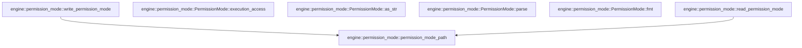

# engine::permission_mode

[Package atlas](index.md) · [Source](../../src/permission_mode.rs)

## Declarations

Visibility is the declaration spelling; trait members and reexports require their enclosing interface. `cfg` is not evaluated.

| Symbol | Kind | Visibility | Test / cfg |
|---|---|---|---|
| [engine::permission_mode::PERMISSION_MODE_FILE](../../src/permission_mode.rs#L19) | const_item | `pub` |  |
| [engine::permission_mode::PermissionMode](../../src/permission_mode.rs#L22) | enum_item | `pub` |  |
| [engine::permission_mode::PermissionMode::execution_access](../../src/permission_mode.rs#L35) | function_item | `pub` |  |
| [engine::permission_mode::ALL](../../src/permission_mode.rs#L43) | const_item | `pub` |  |
| [engine::permission_mode::PermissionMode::as_str](../../src/permission_mode.rs#L50) | function_item | `pub` |  |
| [engine::permission_mode::PermissionMode::parse](../../src/permission_mode.rs#L60) | function_item | `pub` |  |
| [engine::permission_mode::PermissionMode::fmt](../../src/permission_mode.rs#L66) | function_item | `private` |  |
| [engine::permission_mode::PermissionModeRecord](../../src/permission_mode.rs#L73) | struct_item | `private` |  |
| [engine::permission_mode::PermissionModeRead](../../src/permission_mode.rs#L82) | struct_item | `pub` |  |
| [engine::permission_mode::permission_mode_path](../../src/permission_mode.rs#L88) | function_item | `pub` |  |
| [engine::permission_mode::read_permission_mode](../../src/permission_mode.rs#L94) | function_item | `pub` |  |
| [engine::permission_mode::write_permission_mode](../../src/permission_mode.rs#L126) | function_item | `pub` |  |
| [engine::permission_mode::tests::absent_file_is_workspace_write_without_diagnostic](../../src/permission_mode.rs#L161) | function_item | `private` | test; #[cfg(test)] |
| [engine::permission_mode::tests::write_then_read_round_trips_every_mode_with_canonical_bytes](../../src/permission_mode.rs#L173) | function_item | `private` | test; #[cfg(test)] |
| [engine::permission_mode::tests::corrupt_file_falls_back_with_a_diagnostic](../../src/permission_mode.rs#L200) | function_item | `private` | test; #[cfg(test)] |
| [engine::permission_mode::tests::parse_is_exact](../../src/permission_mode.rs#L219) | function_item | `private` | test; #[cfg(test)] |

## Imports / reexports

| Local name | Source path | Visibility |
|---|---|---|
| `fmt` | `std::fmt` | `private` |
| `fs` | `std::fs` | `private` |
| `io` | `std::io` | `private` |
| `Path` | `std::path::Path` | `private` |
| `PathBuf` | `std::path::PathBuf` | `private` |
| `Deserialize` | `serde::Deserialize` | `private` |
| `Serialize` | `serde::Serialize` | `private` |
| `*` | `super::*` | `private` |

## Module declarations

| Module | Visibility | Attributes |
|---|---|---|
| `engine::permission_mode::tests` | `private` | #[cfg(test)] |

## Function call graphs

Edges below are syntactically resolved calls only, including private functions. Graphs partition callers into groups of 20; they are not execution order. All unresolved sites are listed below and in the JSON inventory.

Functions 1–7: 2 direct edges

## Call sites

Includes test functions (marked in declarations). Receiver-type-required sites need type analysis/manual tracing. Calls in closures are attributed to their enclosing function; their occurrence here does not mean the closure executes immediately.

| Caller | Callee expression | Source lines | Target / classification |
|---|---|---|---|
| `parse` | `Self::ALL.into_iter().find` | [61](../../src/permission_mode.rs#L61) | receiver-type-required |
| `parse` | `Self::ALL.into_iter` | [61](../../src/permission_mode.rs#L61) | receiver-type-required |
| `parse` | `mode.as_str` | [61](../../src/permission_mode.rs#L61) | receiver-type-required |
| `fmt` | `formatter.write_str` | [67](../../src/permission_mode.rs#L67) | receiver-type-required |
| `fmt` | `self.as_str` | [67](../../src/permission_mode.rs#L67) | receiver-type-required |
| `permission_mode_path` | `session_folder.join` | [89](../../src/permission_mode.rs#L89) | receiver-type-required |
| `read_permission_mode` | `permission_mode_path` | [95](../../src/permission_mode.rs#L95) | [engine::permission_mode::permission_mode_path](../../src/permission_mode.rs#L88) |
| `read_permission_mode` | `PermissionMode::default` | [97](../../src/permission_mode.rs#L97), [108](../../src/permission_mode.rs#L108) | external-constructor-callback-or-unresolved |
| `read_permission_mode` | `Some` | [98](../../src/permission_mode.rs#L98) | external-constructor-callback-or-unresolved |
| `read_permission_mode` | `fs::read` | [104](../../src/permission_mode.rs#L104) | external-constructor-callback-or-unresolved |
| `read_permission_mode` | `error.kind` | [106](../../src/permission_mode.rs#L106) | receiver-type-required |
| `read_permission_mode` | `fallback` | [112](../../src/permission_mode.rs#L112), [119](../../src/permission_mode.rs#L119), [120](../../src/permission_mode.rs#L120) | external-constructor-callback-or-unresolved |
| `read_permission_mode` | `error.to_string` | [112](../../src/permission_mode.rs#L112), [120](../../src/permission_mode.rs#L120) | receiver-type-required |
| `read_permission_mode` | `serde_json::from_slice::<PermissionModeRecord>` | [114](../../src/permission_mode.rs#L114) | external-constructor-callback-or-unresolved |
| `write_permission_mode` | `permission_mode_path` | [127](../../src/permission_mode.rs#L127) | [engine::permission_mode::permission_mode_path](../../src/permission_mode.rs#L88) |
| `write_permission_mode` | `serde_json_canonicalizer::to_vec(&record)         .map_err` | [129](../../src/permission_mode.rs#L129) | receiver-type-required |
| `write_permission_mode` | `serde_json_canonicalizer::to_vec` | [129](../../src/permission_mode.rs#L129) | external-constructor-callback-or-unresolved |
| `write_permission_mode` | `io::Error::new` | [130](../../src/permission_mode.rs#L130) | external-constructor-callback-or-unresolved |
| `write_permission_mode` | `error.to_string` | [130](../../src/permission_mode.rs#L130) | receiver-type-required |
| `write_permission_mode` | `bytes.push` | [131](../../src/permission_mode.rs#L131) | receiver-type-required |
| `write_permission_mode` | `session_folder.join` | [132](../../src/permission_mode.rs#L132) | receiver-type-required |
| `write_permission_mode` | `(&#124;&#124; {         let mut options = fs::OpenOptions::new();         options.write(true).create(true).truncate(true);         #[cfg(unix)]         {             use std::os::unix::fs::OpenOptionsExt as _;             options.mode(0o600);         }         let mut file = options.open(&temp)?;         io::Write::write_all(&mut file, &bytes)?;         file.sync_all()?;         drop(file);         fs::rename(&temp, &path)     })` | [136](../../src/permission_mode.rs#L136) | external-constructor-callback-or-unresolved |
| `write_permission_mode` | `fs::OpenOptions::new` | [137](../../src/permission_mode.rs#L137) | external-constructor-callback-or-unresolved |
| `write_permission_mode` | `options.write(true).create(true).truncate` | [138](../../src/permission_mode.rs#L138) | receiver-type-required |
| `write_permission_mode` | `options.write(true).create` | [138](../../src/permission_mode.rs#L138) | receiver-type-required |
| `write_permission_mode` | `options.write` | [138](../../src/permission_mode.rs#L138) | receiver-type-required |
| `write_permission_mode` | `options.mode` | [142](../../src/permission_mode.rs#L142) | receiver-type-required |
| `write_permission_mode` | `options.open` | [144](../../src/permission_mode.rs#L144) | receiver-type-required |
| `write_permission_mode` | `io::Write::write_all` | [145](../../src/permission_mode.rs#L145) | external-constructor-callback-or-unresolved |
| `write_permission_mode` | `file.sync_all` | [146](../../src/permission_mode.rs#L146) | receiver-type-required |
| `write_permission_mode` | `drop` | [147](../../src/permission_mode.rs#L147) | external-constructor-callback-or-unresolved |
| `write_permission_mode` | `fs::rename` | [148](../../src/permission_mode.rs#L148) | external-constructor-callback-or-unresolved |
| `write_permission_mode` | `result.is_err` | [150](../../src/permission_mode.rs#L150) | receiver-type-required |
| `write_permission_mode` | `fs::remove_file` | [151](../../src/permission_mode.rs#L151) | external-constructor-callback-or-unresolved |
| `absent_file_is_workspace_write_without_diagnostic` | `tempfile::tempdir().expect` | [162](../../src/permission_mode.rs#L162) | receiver-type-required |
| `absent_file_is_workspace_write_without_diagnostic` | `tempfile::tempdir` | [162](../../src/permission_mode.rs#L162) | external-constructor-callback-or-unresolved |
| `write_then_read_round_trips_every_mode_with_canonical_bytes` | `tempfile::tempdir().expect` | [174](../../src/permission_mode.rs#L174) | receiver-type-required |
| `write_then_read_round_trips_every_mode_with_canonical_bytes` | `tempfile::tempdir` | [174](../../src/permission_mode.rs#L174) | external-constructor-callback-or-unresolved |
| `write_then_read_round_trips_every_mode_with_canonical_bytes` | `write_permission_mode(folder.path(), mode).expect` | [176](../../src/permission_mode.rs#L176) | receiver-type-required |
| `write_then_read_round_trips_every_mode_with_canonical_bytes` | `write_permission_mode` | [176](../../src/permission_mode.rs#L176) | external-constructor-callback-or-unresolved |
| `write_then_read_round_trips_every_mode_with_canonical_bytes` | `folder.path` | [176](../../src/permission_mode.rs#L176), [177](../../src/permission_mode.rs#L177), [185](../../src/permission_mode.rs#L185) | receiver-type-required |
| `write_then_read_round_trips_every_mode_with_canonical_bytes` | `fs::read(permission_mode_path(folder.path())).expect` | [177](../../src/permission_mode.rs#L177) | receiver-type-required |
| `write_then_read_round_trips_every_mode_with_canonical_bytes` | `fs::read` | [177](../../src/permission_mode.rs#L177) | external-constructor-callback-or-unresolved |
| `write_then_read_round_trips_every_mode_with_canonical_bytes` | `permission_mode_path` | [177](../../src/permission_mode.rs#L177), [185](../../src/permission_mode.rs#L185) | external-constructor-callback-or-unresolved |
| `write_then_read_round_trips_every_mode_with_canonical_bytes` | `fs::metadata(permission_mode_path(folder.path()))                     .expect("metadata")                     .permissions` | [185](../../src/permission_mode.rs#L185) | receiver-type-required |
| `write_then_read_round_trips_every_mode_with_canonical_bytes` | `fs::metadata(permission_mode_path(folder.path()))                     .expect` | [185](../../src/permission_mode.rs#L185) | receiver-type-required |
| `write_then_read_round_trips_every_mode_with_canonical_bytes` | `fs::metadata` | [185](../../src/permission_mode.rs#L185) | external-constructor-callback-or-unresolved |
| `corrupt_file_falls_back_with_a_diagnostic` | `tempfile::tempdir().expect` | [201](../../src/permission_mode.rs#L201) | receiver-type-required |
| `corrupt_file_falls_back_with_a_diagnostic` | `tempfile::tempdir` | [201](../../src/permission_mode.rs#L201) | external-constructor-callback-or-unresolved |
| `corrupt_file_falls_back_with_a_diagnostic` | `fs::write(permission_mode_path(folder.path()), bytes).expect` | [207](../../src/permission_mode.rs#L207) | receiver-type-required |
| `corrupt_file_falls_back_with_a_diagnostic` | `fs::write` | [207](../../src/permission_mode.rs#L207) | external-constructor-callback-or-unresolved |
| `corrupt_file_falls_back_with_a_diagnostic` | `permission_mode_path` | [207](../../src/permission_mode.rs#L207) | external-constructor-callback-or-unresolved |
| `corrupt_file_falls_back_with_a_diagnostic` | `folder.path` | [207](../../src/permission_mode.rs#L207), [208](../../src/permission_mode.rs#L208) | receiver-type-required |
| `corrupt_file_falls_back_with_a_diagnostic` | `read_permission_mode` | [208](../../src/permission_mode.rs#L208) | external-constructor-callback-or-unresolved |
