# mcp::broker

[Package atlas](index.md) · [Source](../../src/broker.rs)

## Declarations

Visibility is the declaration spelling; trait members and reexports require their enclosing interface. `cfg` is not evaluated.

| Symbol | Kind | Visibility | Test / cfg |
|---|---|---|---|
| [mcp::broker::QUEUE_DEPTH](../../src/broker.rs#L11) | const_item | `private` |  |
| [mcp::broker::McpBroker](../../src/broker.rs#L13) | struct_item | `pub` |  |
| [mcp::broker::McpBrokerHandle](../../src/broker.rs#L20) | struct_item | `pub` |  |
| [mcp::broker::Command](../../src/broker.rs#L24) | enum_item | `private` |  |
| [mcp::broker::McpBroker::start](../../src/broker.rs#L75) | function_item | `pub` |  |
| [mcp::broker::McpBroker::handle](../../src/broker.rs#L91) | function_item | `pub` |  |
| [mcp::broker::McpBroker::drop](../../src/broker.rs#L97) | function_item | `private` |  |
| [mcp::broker::McpBrokerHandle::list_resources](../../src/broker.rs#L106) | function_item | `pub` |  |
| [mcp::broker::McpBrokerHandle::read_resource](../../src/broker.rs#L113) | function_item | `pub` |  |
| [mcp::broker::McpBrokerHandle::retain_snapshot](../../src/broker.rs#L125) | function_item | `pub` |  |
| [mcp::broker::McpBrokerHandle::register](../../src/broker.rs#L133) | function_item | `pub` |  |
| [mcp::broker::McpBrokerHandle::call_tool](../../src/broker.rs#L151) | function_item | `pub` |  |
| [mcp::broker::McpBrokerHandle::call_tool_augmented](../../src/broker.rs#L175) | function_item | `pub` |  |
| [mcp::broker::McpBrokerHandle::call_tool_with_context](../../src/broker.rs#L199) | function_item | `pub` |  |
| [mcp::broker::McpBrokerHandle::task_operation](../../src/broker.rs#L222) | function_item | `pub` |  |
| [mcp::broker::McpBrokerHandle::task_operation_cancellable](../../src/broker.rs#L231) | function_item | `pub` |  |
| [mcp::broker::McpBrokerHandle::remove](../../src/broker.rs#L258) | function_item | `pub` |  |
| [mcp::broker::McpBrokerHandle::release](../../src/broker.rs#L266) | function_item | `pub` |  |
| [mcp::broker::McpBrokerHandle::catalog_generation](../../src/broker.rs#L274) | function_item | `pub` |  |
| [mcp::broker::receive](../../src/broker.rs#L283) | function_item | `private` |  |
| [mcp::broker::receive_mutation](../../src/broker.rs#L289) | function_item | `private` |  |
| [mcp::broker::map_send](../../src/broker.rs#L302) | function_item | `private` |  |
| [mcp::broker::run](../../src/broker.rs#L311) | function_item | `private` |  |
| [mcp::broker::is_fatal_peer_error](../../src/broker.rs#L572) | function_item | `private` |  |

## Imports / reexports

| Local name | Source path | Visibility |
|---|---|---|
| `Arc` | `std::sync::Arc` | `private` |
| `AtomicBool` | `std::sync::atomic::AtomicBool` | `private` |
| `Ordering` | `std::sync::atomic::Ordering` | `private` |
| `mpsc` | `std::sync::mpsc` | `private` |
| `Receiver` | `std::sync::mpsc::Receiver` | `private` |
| `SyncSender` | `std::sync::mpsc::SyncSender` | `private` |
| `thread` | `std::thread` | `private` |
| `JoinHandle` | `std::thread::JoinHandle` | `private` |
| `Duration` | `std::time::Duration` | `private` |
| `IJsonValue` | `schema::IJsonValue` | `private` |
| `McpCancellationToken` | `crate::McpCancellationToken` | `private` |
| `McpError` | `crate::McpError` | `private` |
| `McpPeer` | `crate::McpPeer` | `private` |
| `McpPool` | `crate::McpPool` | `private` |
| `McpPoolKey` | `crate::McpPoolKey` | `private` |
| `McpToolCallContext` | `crate::McpToolCallContext` | `private` |

## Module declarations

| Module | Visibility | Attributes |
|---|---|---|

## Function call graphs

Edges below are syntactically resolved calls only, including private functions. Graphs partition callers into groups of 20; they are not execution order. All unresolved sites are listed below and in the JSON inventory.

```mermaid
flowchart TD
  n0["mcp::broker::McpBrokerHandle::list_resources"]
  n1["mcp::broker::McpBrokerHandle::read_resource"]
  n2["mcp::broker::McpBrokerHandle::retain_snapshot"]
  n3["mcp::broker::McpBrokerHandle::register"]
  n4["mcp::broker::McpBrokerHandle::call_tool"]
  n5["mcp::broker::McpBrokerHandle::call_tool_augmented"]
  n6["mcp::broker::McpBrokerHandle::call_tool_with_context"]
  n7["mcp::broker::McpBrokerHandle::task_operation"]
  n8["mcp::broker::McpBrokerHandle::task_operation_cancellable"]
  n9["mcp::broker::McpBrokerHandle::remove"]
  n10["mcp::broker::McpBrokerHandle::release"]
  n11["mcp::broker::McpBrokerHandle::catalog_generation"]
  n12["mcp::broker::receive"]
  n13["mcp::broker::receive_mutation"]
  n14["mcp::broker::map_send"]
  n15["mcp::broker::run"]
  n16["mcp::broker::is_fatal_peer_error"]
  n17["mcp::broker::McpBroker::start"]
  n18["mcp::broker::McpBroker::handle"]
  n19["mcp::broker::McpBroker::drop"]
  n20["mcp::client::McpPeerSnapshot::capture"]
  n21["mcp::pool::McpPool::new"]
  n0 --> n12
  n1 --> n12
  n2 --> n12
  n3 --> n12
  n4 --> n13
  n5 --> n13
  n6 --> n13
  n7 --> n8
  n8 --> n12
  n8 --> n13
  n9 --> n12
  n10 --> n12
  n11 --> n12
  n15 --> n16
  n15 --> n20
  n15 --> n21
  n17 --> n15
```

Functions 1–20: 17 direct edges

## Call sites

Includes test functions (marked in declarations). Receiver-type-required sites need type analysis/manual tracing. Calls in closures are attributed to their enclosing function; their occurrence here does not mean the closure executes immediately.

| Caller | Callee expression | Source lines | Target / classification |
|---|---|---|---|
| `start` | `mpsc::sync_channel` | [76](../../src/broker.rs#L76) | external-constructor-callback-or-unresolved |
| `start` | `Arc::new` | [77](../../src/broker.rs#L77) | external-constructor-callback-or-unresolved |
| `start` | `AtomicBool::new` | [77](../../src/broker.rs#L77) | external-constructor-callback-or-unresolved |
| `start` | `Arc::clone` | [78](../../src/broker.rs#L78) | external-constructor-callback-or-unresolved |
| `start` | `thread::Builder::new()             .name("tekes-mcp-pool".to_owned())             .spawn(move &#124;&#124; run(receiver, &thread_shutdown))             .map_err` | [79](../../src/broker.rs#L79) | receiver-type-required |
| `start` | `thread::Builder::new()             .name("tekes-mcp-pool".to_owned())             .spawn` | [79](../../src/broker.rs#L79) | receiver-type-required |
| `start` | `thread::Builder::new()             .name` | [79](../../src/broker.rs#L79) | receiver-type-required |
| `start` | `thread::Builder::new` | [79](../../src/broker.rs#L79) | external-constructor-callback-or-unresolved |
| `start` | `"tekes-mcp-pool".to_owned` | [80](../../src/broker.rs#L80) | receiver-type-required |
| `start` | `run` | [81](../../src/broker.rs#L81) | [mcp::broker::run](../../src/broker.rs#L311) |
| `start` | `McpError::Transport` | [82](../../src/broker.rs#L82) | external-constructor-callback-or-unresolved |
| `start` | `error.to_string` | [82](../../src/broker.rs#L82) | receiver-type-required |
| `start` | `Ok` | [83](../../src/broker.rs#L83) | external-constructor-callback-or-unresolved |
| `start` | `Some` | [85](../../src/broker.rs#L85) | external-constructor-callback-or-unresolved |
| `handle` | `self.handle.clone` | [92](../../src/broker.rs#L92) | receiver-type-required |
| `drop` | `self.shutdown.store` | [98](../../src/broker.rs#L98) | receiver-type-required |
| `drop` | `self.thread.take` | [99](../../src/broker.rs#L99) | receiver-type-required |
| `drop` | `thread.join` | [100](../../src/broker.rs#L100) | receiver-type-required |
| `list_resources` | `mpsc::sync_channel` | [107](../../src/broker.rs#L107) | external-constructor-callback-or-unresolved |
| `list_resources` | `self.sender             .try_send(Command::ListResources { key, reply: sender })             .map_err` | [108](../../src/broker.rs#L108) | receiver-type-required |
| `list_resources` | `self.sender             .try_send` | [108](../../src/broker.rs#L108) | receiver-type-required |
| `list_resources` | `receive` | [111](../../src/broker.rs#L111) | [mcp::broker::receive](../../src/broker.rs#L283) |
| `list_resources` | `Duration::from_secs` | [111](../../src/broker.rs#L111) | external-constructor-callback-or-unresolved |
| `read_resource` | `mpsc::sync_channel` | [114](../../src/broker.rs#L114) | external-constructor-callback-or-unresolved |
| `read_resource` | `self.sender             .try_send(Command::ReadResource {                 key,                 uri,                 reply: sender,             })             .map_err` | [115](../../src/broker.rs#L115) | receiver-type-required |
| `read_resource` | `self.sender             .try_send` | [115](../../src/broker.rs#L115) | receiver-type-required |
| `read_resource` | `receive` | [122](../../src/broker.rs#L122) | [mcp::broker::receive](../../src/broker.rs#L283) |
| `read_resource` | `Duration::from_secs` | [122](../../src/broker.rs#L122) | external-constructor-callback-or-unresolved |
| `retain_snapshot` | `mpsc::sync_channel` | [126](../../src/broker.rs#L126) | external-constructor-callback-or-unresolved |
| `retain_snapshot` | `self.sender             .try_send(Command::Retain { key, reply: sender })             .map_err` | [127](../../src/broker.rs#L127) | receiver-type-required |
| `retain_snapshot` | `self.sender             .try_send` | [127](../../src/broker.rs#L127) | receiver-type-required |
| `retain_snapshot` | `receive` | [130](../../src/broker.rs#L130) | [mcp::broker::receive](../../src/broker.rs#L283) |
| `retain_snapshot` | `Duration::from_secs` | [130](../../src/broker.rs#L130) | external-constructor-callback-or-unresolved |
| `register` | `mpsc::sync_channel` | [139](../../src/broker.rs#L139) | external-constructor-callback-or-unresolved |
| `register` | `self.sender             .try_send(Command::Register {                 key,                 peer,                 always_on,                 reply: sender,             })             .map_err` | [140](../../src/broker.rs#L140) | receiver-type-required |
| `register` | `self.sender             .try_send` | [140](../../src/broker.rs#L140) | receiver-type-required |
| `register` | `receive` | [148](../../src/broker.rs#L148) | [mcp::broker::receive](../../src/broker.rs#L283) |
| `register` | `Duration::from_secs` | [148](../../src/broker.rs#L148) | external-constructor-callback-or-unresolved |
| `call_tool` | `mpsc::sync_channel` | [158](../../src/broker.rs#L158) | external-constructor-callback-or-unresolved |
| `call_tool` | `self.sender             .try_send(Command::Call {                 key,                 name: name.into(),                 arguments,                 context: None,                 task_ttl_ms: None,                 cancellation,                 reply: sender,             })             .map_err` | [159](../../src/broker.rs#L159) | receiver-type-required |
| `call_tool` | `self.sender             .try_send` | [159](../../src/broker.rs#L159) | receiver-type-required |
| `call_tool` | `name.into` | [162](../../src/broker.rs#L162) | receiver-type-required |
| `call_tool` | `receive_mutation` | [170](../../src/broker.rs#L170) | [mcp::broker::receive_mutation](../../src/broker.rs#L289) |
| `call_tool` | `Duration::from_secs` | [170](../../src/broker.rs#L170) | external-constructor-callback-or-unresolved |
| `call_tool_augmented` | `mpsc::sync_channel` | [184](../../src/broker.rs#L184) | external-constructor-callback-or-unresolved |
| `call_tool_augmented` | `self.sender             .try_send(Command::Call {                 key,                 name: name.into(),                 arguments,                 context,                 task_ttl_ms: Some(task_ttl_ms),                 cancellation,                 reply: sender,             })             .map_err` | [185](../../src/broker.rs#L185) | receiver-type-required |
| `call_tool_augmented` | `self.sender             .try_send` | [185](../../src/broker.rs#L185) | receiver-type-required |
| `call_tool_augmented` | `name.into` | [188](../../src/broker.rs#L188) | receiver-type-required |
| `call_tool_augmented` | `Some` | [191](../../src/broker.rs#L191) | external-constructor-callback-or-unresolved |
| `call_tool_augmented` | `receive_mutation` | [196](../../src/broker.rs#L196) | [mcp::broker::receive_mutation](../../src/broker.rs#L289) |
| `call_tool_augmented` | `Duration::from_secs` | [196](../../src/broker.rs#L196) | external-constructor-callback-or-unresolved |
| `call_tool_with_context` | `mpsc::sync_channel` | [207](../../src/broker.rs#L207) | external-constructor-callback-or-unresolved |
| `call_tool_with_context` | `self.sender             .try_send(Command::Call {                 key,                 name: name.into(),                 arguments,                 context: Some(context),                 task_ttl_ms: None,                 cancellation,                 reply: sender,             })             .map_err` | [208](../../src/broker.rs#L208) | receiver-type-required |
| `call_tool_with_context` | `self.sender             .try_send` | [208](../../src/broker.rs#L208) | receiver-type-required |
| `call_tool_with_context` | `name.into` | [211](../../src/broker.rs#L211) | receiver-type-required |
| `call_tool_with_context` | `Some` | [213](../../src/broker.rs#L213) | external-constructor-callback-or-unresolved |
| `call_tool_with_context` | `receive_mutation` | [219](../../src/broker.rs#L219) | [mcp::broker::receive_mutation](../../src/broker.rs#L289) |
| `call_tool_with_context` | `Duration::from_secs` | [219](../../src/broker.rs#L219) | external-constructor-callback-or-unresolved |
| `task_operation` | `self.task_operation_cancellable` | [228](../../src/broker.rs#L228) | [mcp::broker::McpBrokerHandle::task_operation_cancellable](../../src/broker.rs#L231) |
| `task_operation` | `McpCancellationToken::default` | [228](../../src/broker.rs#L228) | external-constructor-callback-or-unresolved |
| `task_operation_cancellable` | `Err` | [239](../../src/broker.rs#L239) | external-constructor-callback-or-unresolved |
| `task_operation_cancellable` | `McpError::Unsupported` | [239](../../src/broker.rs#L239) | external-constructor-callback-or-unresolved |
| `task_operation_cancellable` | `method.into` | [239](../../src/broker.rs#L239), [245](../../src/broker.rs#L245) | receiver-type-required |
| `task_operation_cancellable` | `mpsc::sync_channel` | [241](../../src/broker.rs#L241) | external-constructor-callback-or-unresolved |
| `task_operation_cancellable` | `self.sender             .try_send(Command::Task {                 key,                 method: method.into(),                 params,                 cancellation,                 reply: sender,             })             .map_err` | [242](../../src/broker.rs#L242) | receiver-type-required |
| `task_operation_cancellable` | `self.sender             .try_send` | [242](../../src/broker.rs#L242) | receiver-type-required |
| `task_operation_cancellable` | `receive` | [252](../../src/broker.rs#L252) | [mcp::broker::receive](../../src/broker.rs#L283) |
| `task_operation_cancellable` | `Duration::from_secs` | [252](../../src/broker.rs#L252), [254](../../src/broker.rs#L254) | external-constructor-callback-or-unresolved |
| `task_operation_cancellable` | `receive_mutation` | [254](../../src/broker.rs#L254) | [mcp::broker::receive_mutation](../../src/broker.rs#L289) |
| `remove` | `mpsc::sync_channel` | [259](../../src/broker.rs#L259) | external-constructor-callback-or-unresolved |
| `remove` | `self.sender             .try_send(Command::Remove { key, reply: sender })             .map_err` | [260](../../src/broker.rs#L260) | receiver-type-required |
| `remove` | `self.sender             .try_send` | [260](../../src/broker.rs#L260) | receiver-type-required |
| `remove` | `receive` | [263](../../src/broker.rs#L263) | [mcp::broker::receive](../../src/broker.rs#L283) |
| `remove` | `Duration::from_secs` | [263](../../src/broker.rs#L263) | external-constructor-callback-or-unresolved |
| `release` | `mpsc::sync_channel` | [267](../../src/broker.rs#L267) | external-constructor-callback-or-unresolved |
| `release` | `self.sender             .try_send(Command::Release { key, reply: sender })             .map_err` | [268](../../src/broker.rs#L268) | receiver-type-required |
| `release` | `self.sender             .try_send` | [268](../../src/broker.rs#L268) | receiver-type-required |
| `release` | `receive` | [271](../../src/broker.rs#L271) | [mcp::broker::receive](../../src/broker.rs#L283) |
| `release` | `Duration::from_secs` | [271](../../src/broker.rs#L271) | external-constructor-callback-or-unresolved |
| `catalog_generation` | `mpsc::sync_channel` | [275](../../src/broker.rs#L275) | external-constructor-callback-or-unresolved |
| `catalog_generation` | `self.sender             .try_send(Command::CatalogGeneration { key, reply: sender })             .map_err` | [276](../../src/broker.rs#L276) | receiver-type-required |
| `catalog_generation` | `self.sender             .try_send` | [276](../../src/broker.rs#L276) | receiver-type-required |
| `catalog_generation` | `receive` | [279](../../src/broker.rs#L279) | [mcp::broker::receive](../../src/broker.rs#L283) |
| `catalog_generation` | `Duration::from_secs` | [279](../../src/broker.rs#L279) | external-constructor-callback-or-unresolved |
| `receive` | `receiver         .recv_timeout(timeout)         .map_err` | [284](../../src/broker.rs#L284) | receiver-type-required |
| `receive` | `receiver         .recv_timeout` | [284](../../src/broker.rs#L284) | receiver-type-required |
| `receive` | `McpError::Timeout` | [286](../../src/broker.rs#L286) | external-constructor-callback-or-unresolved |
| `receive` | `"broker response".to_owned` | [286](../../src/broker.rs#L286) | receiver-type-required |
| `receive_mutation` | `receiver.recv_timeout` | [293](../../src/broker.rs#L293) | receiver-type-required |
| `receive_mutation` | `Err` | [295](../../src/broker.rs#L295), [297](../../src/broker.rs#L297) | external-constructor-callback-or-unresolved |
| `receive_mutation` | `McpError::Transport` | [297](../../src/broker.rs#L297) | external-constructor-callback-or-unresolved |
| `receive_mutation` | `"MCP broker is closed".to_owned` | [297](../../src/broker.rs#L297) | receiver-type-required |
| `map_send` | `McpError::Transport` | [304](../../src/broker.rs#L304), [306](../../src/broker.rs#L306) | external-constructor-callback-or-unresolved |
| `map_send` | `"MCP broker backpressure".to_owned` | [304](../../src/broker.rs#L304) | receiver-type-required |
| `map_send` | `"MCP broker is closed".to_owned` | [306](../../src/broker.rs#L306) | receiver-type-required |
| `run` | `tokio::runtime::Builder::new_multi_thread()         .worker_threads(2)         .enable_all()         .build` | [312](../../src/broker.rs#L312) | receiver-type-required |
| `run` | `tokio::runtime::Builder::new_multi_thread()         .worker_threads(2)         .enable_all` | [312](../../src/broker.rs#L312) | receiver-type-required |
| `run` | `tokio::runtime::Builder::new_multi_thread()         .worker_threads` | [312](../../src/broker.rs#L312) | receiver-type-required |
| `run` | `tokio::runtime::Builder::new_multi_thread` | [312](../../src/broker.rs#L312) | external-constructor-callback-or-unresolved |
| `run` | `Arc::new` | [319](../../src/broker.rs#L319), [320](../../src/broker.rs#L320) | external-constructor-callback-or-unresolved |
| `run` | `McpPool::new` | [319](../../src/broker.rs#L319) | [mcp::pool::McpPool::new](../../src/pool.rs#L75) |
| `run` | `AtomicBool::new` | [320](../../src/broker.rs#L320) | external-constructor-callback-or-unresolved |
| `run` | `std::time::Instant::now` | [321](../../src/broker.rs#L321), [326](../../src/broker.rs#L326) | external-constructor-callback-or-unresolved |
| `run` | `shutdown.load` | [322](../../src/broker.rs#L322) | receiver-type-required |
| `run` | `last_reap.elapsed` | [323](../../src/broker.rs#L323) | receiver-type-required |
| `run` | `Duration::from_millis` | [323](../../src/broker.rs#L323), [334](../../src/broker.rs#L334) | external-constructor-callback-or-unresolved |
| `run` | `reaping.swap` | [324](../../src/broker.rs#L324) | receiver-type-required |
| `run` | `Arc::clone` | [327](../../src/broker.rs#L327), [328](../../src/broker.rs#L328), [341](../../src/broker.rs#L341), [357](../../src/broker.rs#L357), [374](../../src/broker.rs#L374), [426](../../src/broker.rs#L426), [457](../../src/broker.rs#L457), [488](../../src/broker.rs#L488), [544](../../src/broker.rs#L544), [551](../../src/broker.rs#L551), [558](../../src/broker.rs#L558) | external-constructor-callback-or-unresolved |
| `run` | `runtime.spawn` | [329](../../src/broker.rs#L329), [342](../../src/broker.rs#L342), [358](../../src/broker.rs#L358), [375](../../src/broker.rs#L375), [427](../../src/broker.rs#L427), [458](../../src/broker.rs#L458), [489](../../src/broker.rs#L489), [545](../../src/broker.rs#L545), [552](../../src/broker.rs#L552), [559](../../src/broker.rs#L559) | receiver-type-required |
| `run` | `pool.reap_revoked` | [330](../../src/broker.rs#L330) | receiver-type-required |
| `run` | `reaping.store` | [331](../../src/broker.rs#L331) | receiver-type-required |
| `run` | `receiver.recv_timeout` | [334](../../src/broker.rs#L334) | receiver-type-required |
| `run` | `pool                             .get(&key)                             .await                             .ok_or_else` | [344](../../src/broker.rs#L344), [360](../../src/broker.rs#L360), [429](../../src/broker.rs#L429), [491](../../src/broker.rs#L491) | receiver-type-required |
| `run` | `pool                             .get` | [344](../../src/broker.rs#L344), [360](../../src/broker.rs#L360), [429](../../src/broker.rs#L429), [491](../../src/broker.rs#L491) | receiver-type-required |
| `run` | `McpError::Transport` | [347](../../src/broker.rs#L347), [363](../../src/broker.rs#L363), [432](../../src/broker.rs#L432), [462](../../src/broker.rs#L462), [494](../../src/broker.rs#L494) | external-constructor-callback-or-unresolved |
| `run` | `"MCP peer absent".into` | [347](../../src/broker.rs#L347), [363](../../src/broker.rs#L363) | receiver-type-required |
| `run` | `peer.lock` | [348](../../src/broker.rs#L348), [364](../../src/broker.rs#L364), [381](../../src/broker.rs#L381), [433](../../src/broker.rs#L433), [466](../../src/broker.rs#L466), [495](../../src/broker.rs#L495), [561](../../src/broker.rs#L561) | receiver-type-required |
| `run` | `peer.admit` | [349](../../src/broker.rs#L349), [365](../../src/broker.rs#L365), [382](../../src/broker.rs#L382) | receiver-type-required |
| `run` | `peer.list_resources` | [350](../../src/broker.rs#L350) | receiver-type-required |
| `run` | `reply.send` | [353](../../src/broker.rs#L353), [369](../../src/broker.rs#L369), [411](../../src/broker.rs#L411), [447](../../src/broker.rs#L447), [476](../../src/broker.rs#L476), [540](../../src/broker.rs#L540), [547](../../src/broker.rs#L547), [554](../../src/broker.rs#L554), [564](../../src/broker.rs#L564) | receiver-type-required |
| `run` | `peer.read_resource` | [366](../../src/broker.rs#L366) | receiver-type-required |
| `run` | `pool.retain` | [377](../../src/broker.rs#L377) | receiver-type-required |
| `run` | `Ok` | [378](../../src/broker.rs#L378), [397](../../src/broker.rs#L397), [402](../../src/broker.rs#L402), [472](../../src/broker.rs#L472), [564](../../src/broker.rs#L564) | external-constructor-callback-or-unresolved |
| `run` | `peer.cached_tools` | [383](../../src/broker.rs#L383) | receiver-type-required |
| `run` | `Err` | [386](../../src/broker.rs#L386), [406](../../src/broker.rs#L406), [474](../../src/broker.rs#L474) | external-constructor-callback-or-unresolved |
| `run` | `McpError::Unsupported` | [386](../../src/broker.rs#L386) | external-constructor-callback-or-unresolved |
| `run` | `"uncached catalog generation".into` | [387](../../src/broker.rs#L387) | receiver-type-required |
| `run` | `Ok::<Box<dyn McpPeer>, McpError>` | [391](../../src/broker.rs#L391) | external-constructor-callback-or-unresolved |
| `run` | `Box::new` | [391](../../src/broker.rs#L391) | external-constructor-callback-or-unresolved |
| `run` | `crate::McpPeerSnapshot::capture` | [392](../../src/broker.rs#L392) | [mcp::client::McpPeerSnapshot::capture](../../src/client.rs#L1470) |
| `run` | `peer.as_ref` | [392](../../src/broker.rs#L392) | receiver-type-required |
| `run` | `Some` | [397](../../src/broker.rs#L397), [561](../../src/broker.rs#L561) | external-constructor-callback-or-unresolved |
| `run` | `pool.remove` | [401](../../src/broker.rs#L401), [442](../../src/broker.rs#L442), [503](../../src/broker.rs#L503), [535](../../src/broker.rs#L535), [546](../../src/broker.rs#L546) | receiver-type-required |
| `run` | `pool.release` | [405](../../src/broker.rs#L405), [414](../../src/broker.rs#L414), [553](../../src/broker.rs#L553) | receiver-type-required |
| `run` | `"MCP peer is absent".into` | [432](../../src/broker.rs#L432) | receiver-type-required |
| `run` | `guard.admit` | [434](../../src/broker.rs#L434), [496](../../src/broker.rs#L496) | receiver-type-required |
| `run` | `guard                             .task_operation_cancellable` | [435](../../src/broker.rs#L435) | receiver-type-required |
| `run` | `drop` | [438](../../src/broker.rs#L438), [501](../../src/broker.rs#L501), [513](../../src/broker.rs#L513), [533](../../src/broker.rs#L533) | external-constructor-callback-or-unresolved |
| `run` | `is_fatal_peer_error` | [440](../../src/broker.rs#L440), [502](../../src/broker.rs#L502), [534](../../src/broker.rs#L534) | [mcp::broker::is_fatal_peer_error](../../src/broker.rs#L572) |
| `run` | `pool                         .replace_generation(key, peer, always_on)                         .await                         .map_err` | [459](../../src/broker.rs#L459) | receiver-type-required |
| `run` | `pool                         .replace_generation` | [459](../../src/broker.rs#L459) | receiver-type-required |
| `run` | `error.to_string` | [462](../../src/broker.rs#L462) | receiver-type-required |
| `run` | `peer.lock().await.start_catalog_subscription` | [466](../../src/broker.rs#L466) | receiver-type-required |
| `run` | `tokio::spawn` | [468](../../src/broker.rs#L468) | external-constructor-callback-or-unresolved |
| `run` | `"MCP peer is absent".to_owned` | [494](../../src/broker.rs#L494) | receiver-type-required |
| `run` | `guard                                 .call_tool_augmented` | [498](../../src/broker.rs#L498) | receiver-type-required |
| `run` | `guard.start_scoped_tool` | [507](../../src/broker.rs#L507) | receiver-type-required |
| `run` | `context.as_ref` | [510](../../src/broker.rs#L510) | receiver-type-required |
| `run` | `cancellation.clone` | [511](../../src/broker.rs#L511) | receiver-type-required |
| `run` | `peer.call_tool_with_context` | [522](../../src/broker.rs#L522) | receiver-type-required |
| `run` | `peer.call_tool` | [530](../../src/broker.rs#L530) | receiver-type-required |
| `run` | `pool.get` | [560](../../src/broker.rs#L560) | receiver-type-required |
| `run` | `peer.lock().await.catalog_generation` | [561](../../src/broker.rs#L561) | receiver-type-required |
| `run` | `runtime.block_on` | [569](../../src/broker.rs#L569) | receiver-type-required |
| `run` | `pool.drain` | [569](../../src/broker.rs#L569) | receiver-type-required |
