```mermaid
flowchart TD
  n0["mcp::client::McpClient::call_tool_augmented"]
  n1["mcp::client::McpClient::get_prompt"]
  n2["mcp::client::McpClient::read_resource"]
  n3["mcp::client::McpClient::task_operation"]
  n4["mcp::client::McpClient::task_operation_cancellable"]
  n5["mcp::client::McpClient::close"]
  n6["mcp::client::page"]
  n7["mcp::client::client_capabilities"]
  n8["mcp::client::adopt_task_creation"]
  n9["mcp::client::adopt_official_task_shape"]
  n10["mcp::client::value"]
  n11["mcp::client::to_json"]
  n12["mcp::client::reject_duplicates"]
  n13["mcp::client::McpClient::protocol_version"]
  n14["mcp::client::McpClient::server_identity"]
  n15["mcp::client::McpClient::capabilities"]
  n16["mcp::client::McpClient::catalog_generation"]
  n17["mcp::client::McpClient::start_catalog_subscription"]
  n18["mcp::client::McpClient::list_tools"]
  n19["mcp::client::McpClient::list_prompts"]
  n20["mcp::client::McpClient::list_resources"]
  n21["mcp::client::McpClient::call_tool"]
  n22["mcp::client::McpClient::call_tool_with_context"]
  n0 --> n8
  n0 --> n9
  n0 --> n10
  n0 --> n11
  n1 --> n10
  n2 --> n10
  n3 --> n9
  n3 --> n10
  n3 --> n11
  n4 --> n9
  n4 --> n10
  n4 --> n11
  n6 --> n11
  n8 --> n9
  n8 --> n10
  n18 --> n6
  n18 --> n12
  n19 --> n6
  n19 --> n12
  n20 --> n6
  n20 --> n12
  n21 --> n8
  n21 --> n10
  n22 --> n8
  n22 --> n10
```

# mcp::client

[Package atlas](index.md) · [Source](../../src/client.rs)

## Declarations

Visibility is the declaration spelling; trait members and reexports require their enclosing interface. `cfg` is not evaluated.

| Symbol | Kind | Visibility | Test / cfg |
|---|---|---|---|
| [mcp::client::CANCELLATION_IO_TIMEOUT](../../src/client.rs#L18) | const_item | `private` |  |
| [mcp::client::McpPeerFuture](../../src/client.rs#L20) | type_item | `pub` |  |
| [mcp::client::McpPeer](../../src/client.rs#L22) | trait_item | `pub` |  |
| [mcp::client::McpPeer::admit](../../src/client.rs#L24) | function_item | `private` |  |
| [mcp::client::McpPeer::cached_tools](../../src/client.rs#L28) | function_item | `private` |  |
| [mcp::client::McpPeer::server_name](../../src/client.rs#L31) | function_signature_item | `private` |  |
| [mcp::client::McpPeer::start_scoped_tool](../../src/client.rs#L35) | function_item | `private` |  |
| [mcp::client::McpPeer::protocol_version](../../src/client.rs#L45) | function_item | `private` |  |
| [mcp::client::McpPeer::server_identity](../../src/client.rs#L48) | function_item | `private` |  |
| [mcp::client::McpPeer::capabilities](../../src/client.rs#L51) | function_signature_item | `private` |  |
| [mcp::client::McpPeer::catalog_generation](../../src/client.rs#L52) | function_item | `private` |  |
| [mcp::client::McpPeer::start_catalog_subscription](../../src/client.rs#L55) | function_item | `private` |  |
| [mcp::client::McpPeer::list_tools](../../src/client.rs#L58) | function_signature_item | `private` |  |
| [mcp::client::McpPeer::list_prompts](../../src/client.rs#L59) | function_signature_item | `private` |  |
| [mcp::client::McpPeer::list_resources](../../src/client.rs#L60) | function_signature_item | `private` |  |
| [mcp::client::McpPeer::call_tool](../../src/client.rs#L61) | function_signature_item | `private` |  |
| [mcp::client::McpPeer::call_tool_with_context](../../src/client.rs#L67) | function_item | `private` |  |
| [mcp::client::McpPeer::call_tool_augmented](../../src/client.rs#L83) | function_item | `private` |  |
| [mcp::client::McpPeer::get_prompt](../../src/client.rs#L97) | function_signature_item | `private` |  |
| [mcp::client::McpPeer::read_resource](../../src/client.rs#L98) | function_signature_item | `private` |  |
| [mcp::client::McpPeer::task_operation](../../src/client.rs#L99) | function_signature_item | `private` |  |
| [mcp::client::McpPeer::task_operation_cancellable](../../src/client.rs#L101) | function_item | `private` |  |
| [mcp::client::McpPeer::close](../../src/client.rs#L129) | function_signature_item | `private` |  |
| [mcp::client::McpClient](../../src/client.rs#L132) | struct_item | `pub` |  |
| [mcp::client::McpClient::new](../../src/client.rs#L149) | function_item | `pub` |  |
| [mcp::client::McpClient::connect](../../src/client.rs#L167) | function_item | `pub` |  |
| [mcp::client::McpClient::connect_cancellable](../../src/client.rs#L175) | function_item | `pub` |  |
| [mcp::client::McpClient::connect_handshake](../../src/client.rs#L195) | function_item | `private` |  |
| [mcp::client::McpClient::close_transport](../../src/client.rs#L208) | function_item | `private` |  |
| [mcp::client::McpClient::reconnect_transport](../../src/client.rs#L216) | function_item | `private` |  |
| [mcp::client::McpClient::connect_once](../../src/client.rs#L222) | function_item | `private` |  |
| [mcp::client::McpClient::reset_generation](../../src/client.rs#L242) | function_item | `private` |  |
| [mcp::client::McpClient::reconnect_generation](../../src/client.rs#L256) | function_item | `private` |  |
| [mcp::client::McpClient::server](../../src/client.rs#L285) | function_item | `pub` |  |
| [mcp::client::McpClient::supported_versions](../../src/client.rs#L290) | function_item | `pub` |  |
| [mcp::client::McpClient::protocol_version](../../src/client.rs#L294) | function_item | `pub` |  |
| [mcp::client::McpClient::catalog_generation](../../src/client.rs#L299) | function_item | `pub` |  |
| [mcp::client::McpClient::connect_legacy](../../src/client.rs#L304) | function_item | `private` |  |
| [mcp::client::McpClient::connect_legacy::InitializeResult](../../src/client.rs#L307) | struct_item | `private` |  |
| [mcp::client::McpClient::connect_modern](../../src/client.rs#L340) | function_item | `private` |  |
| [mcp::client::McpClient::connect_modern::DiscoverResult](../../src/client.rs#L346) | struct_item | `private` |  |
| [mcp::client::McpClient::connect_modern::DiscoverMetadata](../../src/client.rs#L361) | struct_item | `private` |  |
| [mcp::client::McpClient::allocate_request_id](../../src/client.rs#L388) | function_item | `private` |  |
| [mcp::client::McpClient::call_raw_once](../../src/client.rs#L398) | function_item | `private` |  |
| [mcp::client::McpClient::call_read_raw](../../src/client.rs#L426) | function_item | `private` |  |
| [mcp::client::McpClient::call_raw_cancellable](../../src/client.rs#L440) | function_item | `private` |  |
| [mcp::client::McpClient::observe_notifications](../../src/client.rs#L495) | function_item | `private` |  |
| [mcp::client::McpClient::protocol_params](../../src/client.rs#L512) | function_item | `private` |  |
| [mcp::client::McpClient::call_typed](../../src/client.rs#L550) | function_item | `private` |  |
| [mcp::client::McpClient::paginated](../../src/client.rs#L563) | function_item | `private` |  |
| [mcp::client::McpClient::paginated_once](../../src/client.rs#L576) | function_item | `private` |  |
| [mcp::client::McpClient::continue_tool_call](../../src/client.rs#L622) | function_item | `pub` |  |
| [mcp::client::McpClient::complete_task_poll](../../src/client.rs#L681) | function_item | `private` |  |
| [mcp::client::McpClient::task_mutation_with_resumable_identity](../../src/client.rs#L720) | function_item | `pub` |  |
| [mcp::client::McpClient::cached_tools](../../src/client.rs#L764) | function_item | `private` |  |
| [mcp::client::McpClient::start_scoped_tool](../../src/client.rs#L771) | function_item | `private` |  |
| [mcp::client::McpClient::server_name](../../src/client.rs#L853) | function_item | `private` |  |
| [mcp::client::McpClient::protocol_version](../../src/client.rs#L857) | function_item | `private` |  |
| [mcp::client::McpClient::server_identity](../../src/client.rs#L861) | function_item | `private` |  |
| [mcp::client::McpClient::capabilities](../../src/client.rs#L865) | function_item | `private` |  |
| [mcp::client::McpClient::catalog_generation](../../src/client.rs#L869) | function_item | `private` |  |
| [mcp::client::McpClient::start_catalog_subscription](../../src/client.rs#L874) | function_item | `private` |  |
| [mcp::client::McpClient::list_tools](../../src/client.rs#L907) | function_item | `private` |  |
| [mcp::client::McpClient::list_prompts](../../src/client.rs#L925) | function_item | `private` |  |
| [mcp::client::McpClient::list_resources](../../src/client.rs#L942) | function_item | `private` |  |
| [mcp::client::McpClient::call_tool](../../src/client.rs#L960) | function_item | `private` |  |
| [mcp::client::McpClient::call_tool_with_context](../../src/client.rs#L985) | function_item | `private` |  |
| [mcp::client::McpClient::call_tool_augmented](../../src/client.rs#L1033) | function_item | `private` |  |
| [mcp::client::McpClient::get_prompt](../../src/client.rs#L1097) | function_item | `private` |  |
| [mcp::client::McpClient::read_resource](../../src/client.rs#L1109) | function_item | `private` |  |
| [mcp::client::McpClient::task_operation](../../src/client.rs#L1124) | function_item | `private` |  |
| [mcp::client::McpClient::task_operation_cancellable](../../src/client.rs#L1156) | function_item | `private` |  |
| [mcp::client::McpClient::close](../../src/client.rs#L1196) | function_item | `private` |  |
| [mcp::client::Page](../../src/client.rs#L1201) | struct_item | `private` |  |
| [mcp::client::page](../../src/client.rs#L1206) | function_item | `private` |  |
| [mcp::client::client_capabilities](../../src/client.rs#L1260) | function_item | `private` |  |
| [mcp::client::adopt_task_creation](../../src/client.rs#L1269) | function_item | `private` |  |
| [mcp::client::adopt_official_task_shape](../../src/client.rs#L1295) | function_item | `private` |  |
| [mcp::client::value](../../src/client.rs#L1314) | function_item | `private` |  |
| [mcp::client::to_json](../../src/client.rs#L1321) | function_item | `private` |  |
| [mcp::client::decode](../../src/client.rs#L1330) | function_item | `private` |  |
| [mcp::client::reject_duplicates](../../src/client.rs#L1339) | function_item | `private` |  |
| [mcp::client::should_reconnect](../../src/client.rs#L1355) | function_item | `private` |  |
| [mcp::client::tool_mutation_error](../../src/client.rs#L1360) | function_item | `private` |  |
| [mcp::client::task_mutation_error](../../src/client.rs#L1364) | function_item | `private` |  |
| [mcp::client::mutation_error](../../src/client.rs#L1368) | function_item | `private` |  |
| [mcp::client::is_legacy_evidence](../../src/client.rs#L1379) | function_item | `private` |  |
| [mcp::client::protocol_versions_in](../../src/client.rs#L1415) | function_item | `private` |  |
| [mcp::client::McpClient::call_tool_scoped](../../src/client.rs#L1446) | function_item | `pub` |  |
| [mcp::client::McpPeerSnapshot](../../src/client.rs#L1461) | struct_item | `pub` |  |
| [mcp::client::McpPeerSnapshot::capture](../../src/client.rs#L1470) | function_item | `pub` |  |
| [mcp::client::McpPeerSnapshot::server_name](../../src/client.rs#L1482) | function_item | `private` |  |
| [mcp::client::McpPeerSnapshot::protocol_version](../../src/client.rs#L1485) | function_item | `private` |  |
| [mcp::client::McpPeerSnapshot::server_identity](../../src/client.rs#L1488) | function_item | `private` |  |
| [mcp::client::McpPeerSnapshot::capabilities](../../src/client.rs#L1491) | function_item | `private` |  |
| [mcp::client::McpPeerSnapshot::catalog_generation](../../src/client.rs#L1494) | function_item | `private` |  |
| [mcp::client::McpPeerSnapshot::list_tools](../../src/client.rs#L1497) | function_item | `private` |  |
| [mcp::client::McpPeerSnapshot::close](../../src/client.rs#L1500) | function_item | `private` |  |
| [mcp::client::McpPeerSnapshot::list_prompts](../../src/client.rs#L1503) | function_item | `private` |  |
| [mcp::client::McpPeerSnapshot::list_resources](../../src/client.rs#L1506) | function_item | `private` |  |
| [mcp::client::McpPeerSnapshot::call_tool](../../src/client.rs#L1509) | function_item | `private` |  |
| [mcp::client::McpPeerSnapshot::get_prompt](../../src/client.rs#L1517) | function_item | `private` |  |
| [mcp::client::McpPeerSnapshot::read_resource](../../src/client.rs#L1520) | function_item | `private` |  |
| [mcp::client::McpPeerSnapshot::task_operation](../../src/client.rs#L1523) | function_item | `private` |  |
| [mcp::client::legacy_evidence_tests::auto_fallback_requires_explicit_protocol_evidence](../../src/client.rs#L1536) | function_item | `private` | test; #[cfg(test)] |
| [mcp::client::legacy_evidence_tests::textual_protocol_version_rejection_is_legacy_evidence_when_it_lists_an_older_version](../../src/client.rs#L1564) | function_item | `private` | test; #[cfg(test)] |

## Imports / reexports

| Local name | Source path | Visibility |
|---|---|---|
| `BTreeSet` | `std::collections::BTreeSet` | `private` |
| `Future` | `std::future::Future` | `private` |
| `Pin` | `std::pin::Pin` | `private` |
| `Duration` | `std::time::Duration` | `private` |
| `IJsonValue` | `schema::IJsonValue` | `private` |
| `Deserialize` | `serde::Deserialize` | `private` |
| `DeserializeOwned` | `serde::de::DeserializeOwned` | `private` |
| `json` | `serde_json::json` | `private` |
| `JsonRpcRequest` | `crate::JsonRpcRequest` | `private` |
| `MAX_CATALOG_ITEMS` | `crate::MAX_CATALOG_ITEMS` | `private` |
| `MAX_CATALOG_PAGES` | `crate::MAX_CATALOG_PAGES` | `private` |
| `MAX_CONTINUATION_ROUNDS` | `crate::MAX_CONTINUATION_ROUNDS` | `private` |
| `McpCancellationToken` | `crate::McpCancellationToken` | `private` |
| `McpCapabilities` | `crate::McpCapabilities` | `private` |
| `McpError` | `crate::McpError` | `private` |
| `McpImplementation` | `crate::McpImplementation` | `private` |
| `McpLossState` | `crate::McpLossState` | `private` |
| `McpPrompt` | `crate::McpPrompt` | `private` |
| `McpResource` | `crate::McpResource` | `private` |
| `McpTool` | `crate::McpTool` | `private` |
| `McpToolCallContext` | `crate::McpToolCallContext` | `private` |
| `McpToolContinuation` | `crate::McpToolContinuation` | `private` |
| `McpTransport` | `crate::McpTransport` | `private` |
| `ProtocolMode` | `crate::ProtocolMode` | `private` |
| `RecoveryAction` | `crate::RecoveryAction` | `private` |
| `recovery_action` | `crate::recovery_action` | `private` |
| `*` | `super::*` | `private` |

## Module declarations

| Module | Visibility | Attributes |
|---|---|---|
| `mcp::client::legacy_evidence_tests` | `private` | #[cfg(test)] |

## Function call graphs

Edges below are syntactically resolved calls only, including private functions. Graphs partition callers into groups of 20; they are not execution order. All unresolved sites are listed below and in the JSON inventory.

Functions 1–20: 14 direct edges

Functions 21–40: 49 direct edges

Functions 41–60: 25 direct edges

Functions 61–80: 6 direct edges

Functions 81–85: 0 direct edges

## Call sites

Includes test functions (marked in declarations). Receiver-type-required sites need type analysis/manual tracing. Calls in closures are attributed to their enclosing function; their occurrence here does not mean the closure executes immediately.

| Caller | Callee expression | Source lines | Target / classification |
|---|---|---|---|
| `CANCELLATION_IO_TIMEOUT` | `Duration::from_millis` | [18](../../src/client.rs#L18) | external-constructor-callback-or-unresolved |
| `admit` | `Ok` | [25](../../src/client.rs#L25) | external-constructor-callback-or-unresolved |
| `call_tool_with_context` | `Box::pin` | [74](../../src/client.rs#L74) | external-constructor-callback-or-unresolved |
| `call_tool_with_context` | `Err` | [75](../../src/client.rs#L75) | external-constructor-callback-or-unresolved |
| `call_tool_with_context` | `McpError::Unsupported` | [75](../../src/client.rs#L75) | external-constructor-callback-or-unresolved |
| `call_tool_with_context` | `"idempotency-reconcile tool calls".to_owned` | [76](../../src/client.rs#L76) | receiver-type-required |
| `call_tool_augmented` | `Box::pin` | [91](../../src/client.rs#L91) | external-constructor-callback-or-unresolved |
| `call_tool_augmented` | `Err` | [92](../../src/client.rs#L92) | external-constructor-callback-or-unresolved |
| `call_tool_augmented` | `McpError::Unsupported` | [92](../../src/client.rs#L92) | external-constructor-callback-or-unresolved |
| `call_tool_augmented` | `"task-augmented tool calls".to_owned` | [93](../../src/client.rs#L93) | receiver-type-required |
| `task_operation_cancellable` | `method.to_owned` | [107](../../src/client.rs#L107) | receiver-type-required |
| `task_operation_cancellable` | `Box::pin` | [108](../../src/client.rs#L108) | external-constructor-callback-or-unresolved |
| `task_operation_cancellable` | `cancellation.is_cancelled` | [109](../../src/client.rs#L109) | receiver-type-required |
| `task_operation_cancellable` | `Err` | [110](../../src/client.rs#L110), [120](../../src/client.rs#L120) | external-constructor-callback-or-unresolved |
| `task_operation_cancellable` | `self.close` | [119](../../src/client.rs#L119) | receiver-type-required |
| `new` | `server_name.into` | [152](../../src/client.rs#L152) | receiver-type-required |
| `new` | `std::sync::atomic::AtomicU64::new` | [156](../../src/client.rs#L156), [163](../../src/client.rs#L163) | external-constructor-callback-or-unresolved |
| `new` | `McpCapabilities::default` | [157](../../src/client.rs#L157) | external-constructor-callback-or-unresolved |
| `new` | `String::new` | [159](../../src/client.rs#L159) | external-constructor-callback-or-unresolved |
| `new` | `Vec::new` | [160](../../src/client.rs#L160) | external-constructor-callback-or-unresolved |
| `new` | `std::sync::Arc::new` | [163](../../src/client.rs#L163) | external-constructor-callback-or-unresolved |
| `connect` | `self.connect_cancellable` | [168](../../src/client.rs#L168) | [mcp::client::McpClient::connect_cancellable](../../src/client.rs#L175) |
| `connect` | `McpCancellationToken::default` | [168](../../src/client.rs#L168) | external-constructor-callback-or-unresolved |
| `connect_cancellable` | `cancellation.is_cancelled` | [180](../../src/client.rs#L180) | receiver-type-required |
| `connect_cancellable` | `Err` | [181](../../src/client.rs#L181) | external-constructor-callback-or-unresolved |
| `connect_cancellable` | `result.is_err` | [189](../../src/client.rs#L189) | receiver-type-required |
| `connect_cancellable` | `self.close_transport` | [190](../../src/client.rs#L190) | [mcp::client::McpClient::close_transport](../../src/client.rs#L208) |
| `connect_handshake` | `Some` | [196](../../src/client.rs#L196) | external-constructor-callback-or-unresolved |
| `connect_handshake` | `self.connect_once` | [197](../../src/client.rs#L197), [201](../../src/client.rs#L201) | [mcp::client::McpClient::connect_once](../../src/client.rs#L222) |
| `connect_handshake` | `should_reconnect` | [198](../../src/client.rs#L198) | [mcp::client::should_reconnect](../../src/client.rs#L1355) |
| `connect_handshake` | `self.reset_generation` | [199](../../src/client.rs#L199) | [mcp::client::McpClient::reset_generation](../../src/client.rs#L242) |
| `connect_handshake` | `self.reconnect_transport` | [200](../../src/client.rs#L200) | [mcp::client::McpClient::reconnect_transport](../../src/client.rs#L216) |
| `connect_handshake` | `Err` | [202](../../src/client.rs#L202) | external-constructor-callback-or-unresolved |
| `close_transport` | `Box::pin` | [210](../../src/client.rs#L210) | external-constructor-callback-or-unresolved |
| `close_transport` | `Ok` | [210](../../src/client.rs#L210) | external-constructor-callback-or-unresolved |
| `close_transport` | `self.transport.close` | [213](../../src/client.rs#L213) | receiver-type-required |
| `reconnect_transport` | `self.transport.reconnect` | [219](../../src/client.rs#L219) | receiver-type-required |
| `connect_once` | `self.connect_modern` | [224](../../src/client.rs#L224), [227](../../src/client.rs#L227) | [mcp::client::McpClient::connect_modern](../../src/client.rs#L340) |
| `connect_once` | `self.connect_legacy` | [225](../../src/client.rs#L225), [231](../../src/client.rs#L231), [238](../../src/client.rs#L238) | [mcp::client::McpClient::connect_legacy](../../src/client.rs#L304) |
| `connect_once` | `self.transport.supports_http_discovery` | [226](../../src/client.rs#L226) | receiver-type-required |
| `connect_once` | `result.as_ref().err().is_some_and` | [228](../../src/client.rs#L228) | receiver-type-required |
| `connect_once` | `result.as_ref().err` | [228](../../src/client.rs#L228) | receiver-type-required |
| `connect_once` | `result.as_ref` | [228](../../src/client.rs#L228) | receiver-type-required |
| `connect_once` | `self.reset_generation` | [229](../../src/client.rs#L229) | [mcp::client::McpClient::reset_generation](../../src/client.rs#L242) |
| `connect_once` | `self.reconnect_transport` | [230](../../src/client.rs#L230) | [mcp::client::McpClient::reconnect_transport](../../src/client.rs#L216) |
| `reset_generation` | `self.next_id.store` | [243](../../src/client.rs#L243) | receiver-type-required |
| `reset_generation` | `McpCapabilities::default` | [244](../../src/client.rs#L244) | external-constructor-callback-or-unresolved |
| `reset_generation` | `self.protocol_version.clear` | [246](../../src/client.rs#L246) | receiver-type-required |
| `reset_generation` | `self.supported_versions.clear` | [247](../../src/client.rs#L247) | receiver-type-required |
| `reset_generation` | `self.catalog_generation.fetch_update` | [249](../../src/client.rs#L249) | receiver-type-required |
| `reset_generation` | `Some` | [252](../../src/client.rs#L252) | external-constructor-callback-or-unresolved |
| `reset_generation` | `v.saturating_add` | [252](../../src/client.rs#L252) | receiver-type-required |
| `reconnect_generation` | `self             .mode             .ok_or_else` | [257](../../src/client.rs#L257) | receiver-type-required |
| `reconnect_generation` | `McpError::Protocol` | [259](../../src/client.rs#L259), [262](../../src/client.rs#L262) | external-constructor-callback-or-unresolved |
| `reconnect_generation` | `"MCP peer was never connected".to_owned` | [259](../../src/client.rs#L259) | receiver-type-required |
| `reconnect_generation` | `self.protocol_version.clone` | [260](../../src/client.rs#L260) | receiver-type-required |
| `reconnect_generation` | `self.server.clone().ok_or_else` | [261](../../src/client.rs#L261) | receiver-type-required |
| `reconnect_generation` | `self.server.clone` | [261](../../src/client.rs#L261) | receiver-type-required |
| `reconnect_generation` | `"MCP peer has no negotiated server identity".to_owned` | [262](../../src/client.rs#L262) | receiver-type-required |
| `reconnect_generation` | `self.reconnect_transport` | [265](../../src/client.rs#L265) | [mcp::client::McpClient::reconnect_transport](../../src/client.rs#L216) |
| `reconnect_generation` | `self.reset_generation` | [266](../../src/client.rs#L266) | [mcp::client::McpClient::reset_generation](../../src/client.rs#L242) |
| `reconnect_generation` | `self.connect_once` | [267](../../src/client.rs#L267) | [mcp::client::McpClient::connect_once](../../src/client.rs#L222) |
| `reconnect_generation` | `self.close_transport` | [271](../../src/client.rs#L271), [277](../../src/client.rs#L277) | [mcp::client::McpClient::close_transport](../../src/client.rs#L208) |
| `reconnect_generation` | `Err` | [272](../../src/client.rs#L272), [278](../../src/client.rs#L278) | external-constructor-callback-or-unresolved |
| `reconnect_generation` | `self.server.as_ref` | [275](../../src/client.rs#L275) | receiver-type-required |
| `reconnect_generation` | `Some` | [275](../../src/client.rs#L275) | external-constructor-callback-or-unresolved |
| `reconnect_generation` | `McpError::Conflict` | [278](../../src/client.rs#L278) | external-constructor-callback-or-unresolved |
| `reconnect_generation` | `"MCP negotiated authority changed during reconnect".to_owned` | [279](../../src/client.rs#L279) | receiver-type-required |
| `reconnect_generation` | `Ok` | [282](../../src/client.rs#L282) | external-constructor-callback-or-unresolved |
| `server` | `self.server.as_ref` | [286](../../src/client.rs#L286) | receiver-type-required |
| `catalog_generation` | `self.catalog_generation             .load` | [300](../../src/client.rs#L300) | receiver-type-required |
| `connect_legacy` | `value` | [317](../../src/client.rs#L317) | [mcp::client::value](../../src/client.rs#L1314) |
| `connect_legacy` | `self             .call_typed` | [322](../../src/client.rs#L322) | [mcp::client::McpClient::call_typed](../../src/client.rs#L550) |
| `connect_legacy` | `Some` | [323](../../src/client.rs#L323), [331](../../src/client.rs#L331) | external-constructor-callback-or-unresolved |
| `connect_legacy` | `Duration::from_secs` | [323](../../src/client.rs#L323) | external-constructor-callback-or-unresolved |
| `connect_legacy` | `Err` | [326](../../src/client.rs#L326) | external-constructor-callback-or-unresolved |
| `connect_legacy` | `McpError::Unsupported` | [326](../../src/client.rs#L326) | external-constructor-callback-or-unresolved |
| `connect_legacy` | `self.transport             .notify` | [332](../../src/client.rs#L332) | receiver-type-required |
| `connect_legacy` | `JsonRpcRequest::notification` | [333](../../src/client.rs#L333) | [mcp::types::JsonRpcRequest::notification](../../src/types.rs#L66) |
| `connect_modern` | `crate::MODERN_PROTOCOL_VERSION.to_owned` | [344](../../src/client.rs#L344), [380](../../src/client.rs#L380) | receiver-type-required |
| `connect_modern` | `self             .call_typed` | [365](../../src/client.rs#L365) | [mcp::client::McpClient::call_typed](../../src/client.rs#L550) |
| `connect_modern` | `Duration::from_secs` | [366](../../src/client.rs#L366) | external-constructor-callback-or-unresolved |
| `connect_modern` | `Err` | [369](../../src/client.rs#L369), [378](../../src/client.rs#L378) | external-constructor-callback-or-unresolved |
| `connect_modern` | `McpError::Protocol` | [369](../../src/client.rs#L369) | external-constructor-callback-or-unresolved |
| `connect_modern` | `"modern discovery did not return a complete result".to_owned` | [370](../../src/client.rs#L370) | receiver-type-required |
| `connect_modern` | `result             .supported_versions             .iter()             .any` | [373](../../src/client.rs#L373) | receiver-type-required |
| `connect_modern` | `result             .supported_versions             .iter` | [373](../../src/client.rs#L373) | receiver-type-required |
| `connect_modern` | `McpError::NoMutualProtocol` | [378](../../src/client.rs#L378) | external-constructor-callback-or-unresolved |
| `connect_modern` | `Some` | [383](../../src/client.rs#L383) | external-constructor-callback-or-unresolved |
| `connect_modern` | `Ok` | [385](../../src/client.rs#L385) | external-constructor-callback-or-unresolved |
| `allocate_request_id` | `self.next_id             .fetch_update(                 std::sync::atomic::Ordering::Relaxed,                 std::sync::atomic::Ordering::Relaxed,                 &#124;id&#124; id.checked_add(1),             )             .map_err` | [389](../../src/client.rs#L389) | receiver-type-required |
| `allocate_request_id` | `self.next_id             .fetch_update` | [389](../../src/client.rs#L389) | receiver-type-required |
| `allocate_request_id` | `id.checked_add` | [393](../../src/client.rs#L393) | receiver-type-required |
| `allocate_request_id` | `McpError::Protocol` | [395](../../src/client.rs#L395) | external-constructor-callback-or-unresolved |
| `allocate_request_id` | `"request id exhausted".to_owned` | [395](../../src/client.rs#L395) | receiver-type-required |
| `call_raw_once` | `self.allocate_request_id` | [404](../../src/client.rs#L404) | [mcp::client::McpClient::allocate_request_id](../../src/client.rs#L388) |
| `call_raw_once` | `self.protocol_params` | [405](../../src/client.rs#L405) | [mcp::client::McpClient::protocol_params](../../src/client.rs#L512) |
| `call_raw_once` | `self             .transport             .request` | [406](../../src/client.rs#L406) | receiver-type-required |
| `call_raw_once` | `JsonRpcRequest::call` | [408](../../src/client.rs#L408) | [mcp::types::JsonRpcRequest::call](../../src/types.rs#L57) |
| `call_raw_once` | `self.observe_notifications` | [410](../../src/client.rs#L410) | [mcp::client::McpClient::observe_notifications](../../src/client.rs#L495) |
| `call_raw_once` | `self.close_transport` | [414](../../src/client.rs#L414), [421](../../src/client.rs#L421) | [mcp::client::McpClient::close_transport](../../src/client.rs#L208) |
| `call_raw_once` | `Err` | [415](../../src/client.rs#L415), [417](../../src/client.rs#L417) | external-constructor-callback-or-unresolved |
| `call_raw_once` | `response.into_result` | [419](../../src/client.rs#L419) | receiver-type-required |
| `call_read_raw` | `self.call_raw_once` | [432](../../src/client.rs#L432), [437](../../src/client.rs#L437) | [mcp::client::McpClient::call_raw_once](../../src/client.rs#L398) |
| `call_read_raw` | `params.clone` | [432](../../src/client.rs#L432) | receiver-type-required |
| `call_read_raw` | `should_reconnect` | [433](../../src/client.rs#L433) | [mcp::client::should_reconnect](../../src/client.rs#L1355) |
| `call_read_raw` | `self.reconnect_generation` | [436](../../src/client.rs#L436) | [mcp::client::McpClient::reconnect_generation](../../src/client.rs#L256) |
| `call_raw_cancellable` | `cancellation.is_cancelled` | [447](../../src/client.rs#L447) | receiver-type-required |
| `call_raw_cancellable` | `Err` | [448](../../src/client.rs#L448), [467](../../src/client.rs#L467), [469](../../src/client.rs#L469), [492](../../src/client.rs#L492) | external-constructor-callback-or-unresolved |
| `call_raw_cancellable` | `self.allocate_request_id` | [450](../../src/client.rs#L450) | [mcp::client::McpClient::allocate_request_id](../../src/client.rs#L388) |
| `call_raw_cancellable` | `self.protocol_params` | [451](../../src/client.rs#L451) | [mcp::client::McpClient::protocol_params](../../src/client.rs#L512) |
| `call_raw_cancellable` | `JsonRpcRequest::call` | [452](../../src/client.rs#L452) | [mcp::types::JsonRpcRequest::call](../../src/types.rs#L57) |
| `call_raw_cancellable` | `self.transport.request` | [454](../../src/client.rs#L454) | receiver-type-required |
| `call_raw_cancellable` | `self.observe_notifications` | [462](../../src/client.rs#L462) | [mcp::client::McpClient::observe_notifications](../../src/client.rs#L495) |
| `call_raw_cancellable` | `self.close_transport` | [466](../../src/client.rs#L466), [473](../../src/client.rs#L473), [491](../../src/client.rs#L491) | [mcp::client::McpClient::close_transport](../../src/client.rs#L208) |
| `call_raw_cancellable` | `response.into_result` | [471](../../src/client.rs#L471) | receiver-type-required |
| `call_raw_cancellable` | `self.transport.mark_cancelled` | [477](../../src/client.rs#L477) | receiver-type-required |
| `call_raw_cancellable` | `JsonRpcRequest::notification` | [478](../../src/client.rs#L478) | [mcp::types::JsonRpcRequest::notification](../../src/types.rs#L66) |
| `call_raw_cancellable` | `Some` | [480](../../src/client.rs#L480) | external-constructor-callback-or-unresolved |
| `call_raw_cancellable` | `value` | [480](../../src/client.rs#L480) | [mcp::client::value](../../src/client.rs#L1314) |
| `call_raw_cancellable` | `tokio::time::timeout` | [482](../../src/client.rs#L482), [491](../../src/client.rs#L491) | external-constructor-callback-or-unresolved |
| `call_raw_cancellable` | `self.transport.notify` | [484](../../src/client.rs#L484) | receiver-type-required |
| `observe_notifications` | `self.transport.take_notifications` | [496](../../src/client.rs#L496) | receiver-type-required |
| `observe_notifications` | `self.catalog_generation.fetch_update` | [503](../../src/client.rs#L503) | receiver-type-required |
| `observe_notifications` | `Some` | [506](../../src/client.rs#L506) | external-constructor-callback-or-unresolved |
| `observe_notifications` | `v.saturating_add` | [506](../../src/client.rs#L506) | receiver-type-required |
| `protocol_params` | `Ok` | [514](../../src/client.rs#L514), [517](../../src/client.rs#L517), [547](../../src/client.rs#L547) | external-constructor-callback-or-unresolved |
| `protocol_params` | `params.map_or_else` | [516](../../src/client.rs#L516) | receiver-type-required |
| `protocol_params` | `serde_json::Value::Object` | [517](../../src/client.rs#L517), [531](../../src/client.rs#L531) | external-constructor-callback-or-unresolved |
| `protocol_params` | `serde_json::Map::new` | [517](../../src/client.rs#L517), [531](../../src/client.rs#L531) | external-constructor-callback-or-unresolved |
| `protocol_params` | `value                     .canonical_bytes()                     .map_err` | [519](../../src/client.rs#L519) | receiver-type-required |
| `protocol_params` | `value                     .canonical_bytes` | [519](../../src/client.rs#L519) | receiver-type-required |
| `protocol_params` | `McpError::Protocol` | [521](../../src/client.rs#L521), [523](../../src/client.rs#L523), [527](../../src/client.rs#L527), [533](../../src/client.rs#L533), [535](../../src/client.rs#L535) | external-constructor-callback-or-unresolved |
| `protocol_params` | `error.to_string` | [521](../../src/client.rs#L521), [523](../../src/client.rs#L523) | receiver-type-required |
| `protocol_params` | `serde_json::from_slice::<serde_json::Value>(&bytes)                     .map_err` | [522](../../src/client.rs#L522) | receiver-type-required |
| `protocol_params` | `serde_json::from_slice::<serde_json::Value>` | [522](../../src/client.rs#L522) | external-constructor-callback-or-unresolved |
| `protocol_params` | `json_value.as_object_mut().ok_or_else` | [526](../../src/client.rs#L526) | receiver-type-required |
| `protocol_params` | `json_value.as_object_mut` | [526](../../src/client.rs#L526) | receiver-type-required |
| `protocol_params` | `"modern request params must be an object".to_owned` | [527](../../src/client.rs#L527) | receiver-type-required |
| `protocol_params` | `object             .entry("_meta".to_owned())             .or_insert_with(&#124;&#124; serde_json::Value::Object(serde_json::Map::new()))             .as_object_mut()             .ok_or_else` | [529](../../src/client.rs#L529) | receiver-type-required |
| `protocol_params` | `object             .entry("_meta".to_owned())             .or_insert_with(&#124;&#124; serde_json::Value::Object(serde_json::Map::new()))             .as_object_mut` | [529](../../src/client.rs#L529) | receiver-type-required |
| `protocol_params` | `object             .entry("_meta".to_owned())             .or_insert_with` | [529](../../src/client.rs#L529) | receiver-type-required |
| `protocol_params` | `object             .entry` | [529](../../src/client.rs#L529) | receiver-type-required |
| `protocol_params` | `"_meta".to_owned` | [530](../../src/client.rs#L530) | receiver-type-required |
| `protocol_params` | `"request _meta must be an object".to_owned` | [533](../../src/client.rs#L533) | receiver-type-required |
| `protocol_params` | `metadata.contains_key` | [534](../../src/client.rs#L534) | receiver-type-required |
| `protocol_params` | `Err` | [535](../../src/client.rs#L535) | external-constructor-callback-or-unresolved |
| `protocol_params` | `"caller params must not override protocol metadata".to_owned` | [536](../../src/client.rs#L536) | receiver-type-required |
| `protocol_params` | `metadata.insert` | [539](../../src/client.rs#L539), [543](../../src/client.rs#L543) | receiver-type-required |
| `protocol_params` | `"io.modelcontextprotocol/protocolVersion".to_owned` | [540](../../src/client.rs#L540) | receiver-type-required |
| `protocol_params` | `"io.modelcontextprotocol/clientCapabilities".to_owned` | [544](../../src/client.rs#L544) | receiver-type-required |
| `protocol_params` | `client_capabilities` | [545](../../src/client.rs#L545) | [mcp::client::client_capabilities](../../src/client.rs#L1260) |
| `protocol_params` | `Some` | [547](../../src/client.rs#L547) | external-constructor-callback-or-unresolved |
| `protocol_params` | `value` | [547](../../src/client.rs#L547) | [mcp::client::value](../../src/client.rs#L1314) |
| `call_typed` | `decode` | [556](../../src/client.rs#L556) | [mcp::client::decode](../../src/client.rs#L1330) |
| `call_typed` | `self.call_raw_once` | [556](../../src/client.rs#L556) | [mcp::client::McpClient::call_raw_once](../../src/client.rs#L398) |
| `call_typed` | `self.close_transport` | [558](../../src/client.rs#L558) | [mcp::client::McpClient::close_transport](../../src/client.rs#L208) |
| `paginated` | `self.paginated_once` | [568](../../src/client.rs#L568), [573](../../src/client.rs#L573) | [mcp::client::McpClient::paginated_once](../../src/client.rs#L576) |
| `paginated` | `extract.clone` | [568](../../src/client.rs#L568) | receiver-type-required |
| `paginated` | `should_reconnect` | [569](../../src/client.rs#L569) | [mcp::client::should_reconnect](../../src/client.rs#L1355) |
| `paginated` | `self.reconnect_generation` | [572](../../src/client.rs#L572) | [mcp::client::McpClient::reconnect_generation](../../src/client.rs#L256) |
| `paginated_once` | `Vec::new` | [585](../../src/client.rs#L585) | external-constructor-callback-or-unresolved |
| `paginated_once` | `BTreeSet::new` | [587](../../src/client.rs#L587) | external-constructor-callback-or-unresolved |
| `paginated_once` | `cursor                 .as_ref()                 .map(&#124;cursor&#124; value(json!({"cursor":cursor})))                 .transpose` | [589](../../src/client.rs#L589) | receiver-type-required |
| `paginated_once` | `cursor                 .as_ref()                 .map` | [589](../../src/client.rs#L589) | receiver-type-required |
| `paginated_once` | `cursor                 .as_ref` | [589](../../src/client.rs#L589) | receiver-type-required |
| `paginated_once` | `value` | [591](../../src/client.rs#L591) | [mcp::client::value](../../src/client.rs#L1314) |
| `paginated_once` | `extract` | [593](../../src/client.rs#L593) | external-constructor-callback-or-unresolved |
| `paginated_once` | `self.call_raw_once` | [594](../../src/client.rs#L594) | [mcp::client::McpClient::call_raw_once](../../src/client.rs#L398) |
| `paginated_once` | `Duration::from_secs` | [594](../../src/client.rs#L594) | external-constructor-callback-or-unresolved |
| `paginated_once` | `self.close_transport` | [600](../../src/client.rs#L600) | [mcp::client::McpClient::close_transport](../../src/client.rs#L208) |
| `paginated_once` | `Err` | [601](../../src/client.rs#L601), [603](../../src/client.rs#L603), [607](../../src/client.rs#L607), [613](../../src/client.rs#L613), [619](../../src/client.rs#L619) | external-constructor-callback-or-unresolved |
| `paginated_once` | `output.extend` | [605](../../src/client.rs#L605) | receiver-type-required |
| `paginated_once` | `output.len` | [606](../../src/client.rs#L606) | receiver-type-required |
| `paginated_once` | `Ok` | [610](../../src/client.rs#L610) | external-constructor-callback-or-unresolved |
| `paginated_once` | `next.is_empty` | [612](../../src/client.rs#L612) | receiver-type-required |
| `paginated_once` | `seen.insert` | [612](../../src/client.rs#L612) | receiver-type-required |
| `paginated_once` | `next.clone` | [612](../../src/client.rs#L612) | receiver-type-required |
| `paginated_once` | `McpError::Protocol` | [613](../../src/client.rs#L613) | external-constructor-callback-or-unresolved |
| `paginated_once` | `"catalog cursor is empty or repeated".to_owned` | [614](../../src/client.rs#L614) | receiver-type-required |
| `paginated_once` | `Some` | [617](../../src/client.rs#L617) | external-constructor-callback-or-unresolved |
| `continue_tool_call` | `Err` | [630](../../src/client.rs#L630), [633](../../src/client.rs#L633), [639](../../src/client.rs#L639), [642](../../src/client.rs#L642) | external-constructor-callback-or-unresolved |
| `continue_tool_call` | `McpError::Unsupported` | [630](../../src/client.rs#L630), [639](../../src/client.rs#L639) | external-constructor-callback-or-unresolved |
| `continue_tool_call` | `"tools".to_owned` | [630](../../src/client.rs#L630) | receiver-type-required |
| `continue_tool_call` | `McpError::Protocol` | [633](../../src/client.rs#L633), [642](../../src/client.rs#L642) | external-constructor-callback-or-unresolved |
| `continue_tool_call` | `"MCP continuation round must be within 1...32".to_owned` | [634](../../src/client.rs#L634) | receiver-type-required |
| `continue_tool_call` | `self.capabilities.supports_tasks` | [638](../../src/client.rs#L638), [664](../../src/client.rs#L664) | receiver-type-required |
| `continue_tool_call` | `"tasks/get".to_owned` | [639](../../src/client.rs#L639) | receiver-type-required |
| `continue_tool_call` | `task_id.is_empty` | [641](../../src/client.rs#L641) | receiver-type-required |
| `continue_tool_call` | `"empty continuation task identity".to_owned` | [643](../../src/client.rs#L643) | receiver-type-required |
| `continue_tool_call` | `self                 .call_raw_cancellable` | [646](../../src/client.rs#L646) | [mcp::client::McpClient::call_raw_cancellable](../../src/client.rs#L440) |
| `continue_tool_call` | `Some` | [649](../../src/client.rs#L649), [654](../../src/client.rs#L654), [667](../../src/client.rs#L667) | external-constructor-callback-or-unresolved |
| `continue_tool_call` | `value` | [649](../../src/client.rs#L649), [658](../../src/client.rs#L658) | [mcp::client::value](../../src/client.rs#L1314) |
| `continue_tool_call` | `Duration::from_secs` | [650](../../src/client.rs#L650), [668](../../src/client.rs#L668) | external-constructor-callback-or-unresolved |
| `continue_tool_call` | `self.complete_task_poll` | [654](../../src/client.rs#L654) | [mcp::client::McpClient::complete_task_poll](../../src/client.rs#L681) |
| `continue_tool_call` | `crate::McpTask::validate_result` | [655](../../src/client.rs#L655) | [mcp::types::McpTask::validate_result](../../src/types.rs#L564) |
| `continue_tool_call` | `Ok` | [656](../../src/client.rs#L656) | external-constructor-callback-or-unresolved |
| `continue_tool_call` | `self.call_raw_cancellable(             "tools/call",             Some(params),             Duration::from_secs(600),             &cancellation,         )         .await         .and_then(&#124;result&#124; adopt_task_creation(result, tasks))         .map_err` | [665](../../src/client.rs#L665) | receiver-type-required |
| `continue_tool_call` | `self.call_raw_cancellable(             "tools/call",             Some(params),             Duration::from_secs(600),             &cancellation,         )         .await         .and_then` | [665](../../src/client.rs#L665) | receiver-type-required |
| `continue_tool_call` | `self.call_raw_cancellable` | [665](../../src/client.rs#L665) | [mcp::client::McpClient::call_raw_cancellable](../../src/client.rs#L440) |
| `continue_tool_call` | `adopt_task_creation` | [672](../../src/client.rs#L672) | [mcp::client::adopt_task_creation](../../src/client.rs#L1269) |
| `complete_task_poll` | `to_json` | [686](../../src/client.rs#L686), [715](../../src/client.rs#L715) | [mcp::client::to_json](../../src/client.rs#L1321) |
| `complete_task_poll` | `adopt_official_task_shape` | [687](../../src/client.rs#L687) | [mcp::client::adopt_official_task_shape](../../src/client.rs#L1295) |
| `complete_task_poll` | `task["result"].is_object` | [692](../../src/client.rs#L692) | receiver-type-required |
| `complete_task_poll` | `task["taskId"]                 .as_str()                 .filter(&#124;id&#124; !id.is_empty())                 .ok_or_else(&#124;&#124; McpError::Protocol("completed MCP task lacks taskId".to_owned()))?                 .to_owned` | [694](../../src/client.rs#L694) | receiver-type-required |
| `complete_task_poll` | `task["taskId"]                 .as_str()                 .filter(&#124;id&#124; !id.is_empty())                 .ok_or_else` | [694](../../src/client.rs#L694) | receiver-type-required |
| `complete_task_poll` | `task["taskId"]                 .as_str()                 .filter` | [694](../../src/client.rs#L694) | receiver-type-required |
| `complete_task_poll` | `task["taskId"]                 .as_str` | [694](../../src/client.rs#L694) | receiver-type-required |
| `complete_task_poll` | `id.is_empty` | [696](../../src/client.rs#L696) | receiver-type-required |
| `complete_task_poll` | `McpError::Protocol` | [697](../../src/client.rs#L697) | external-constructor-callback-or-unresolved |
| `complete_task_poll` | `"completed MCP task lacks taskId".to_owned` | [697](../../src/client.rs#L697) | receiver-type-required |
| `complete_task_poll` | `Some` | [699](../../src/client.rs#L699) | external-constructor-callback-or-unresolved |
| `complete_task_poll` | `value` | [699](../../src/client.rs#L699), [717](../../src/client.rs#L717) | [mcp::client::value](../../src/client.rs#L1314) |
| `complete_task_poll` | `self.call_raw_cancellable` | [702](../../src/client.rs#L702) | [mcp::client::McpClient::call_raw_cancellable](../../src/client.rs#L440) |
| `complete_task_poll` | `Duration::from_secs` | [705](../../src/client.rs#L705), [711](../../src/client.rs#L711) | external-constructor-callback-or-unresolved |
| `complete_task_poll` | `self.call_read_raw` | [711](../../src/client.rs#L711) | [mcp::client::McpClient::call_read_raw](../../src/client.rs#L426) |
| `task_mutation_with_resumable_identity` | `self.capabilities.supports_tasks` | [726](../../src/client.rs#L726) | receiver-type-required |
| `task_mutation_with_resumable_identity` | `Err` | [728](../../src/client.rs#L728), [731](../../src/client.rs#L731), [744](../../src/client.rs#L744), [747](../../src/client.rs#L747), [758](../../src/client.rs#L758) | external-constructor-callback-or-unresolved |
| `task_mutation_with_resumable_identity` | `McpError::Unsupported` | [728](../../src/client.rs#L728) | external-constructor-callback-or-unresolved |
| `task_mutation_with_resumable_identity` | `method.to_owned` | [728](../../src/client.rs#L728) | receiver-type-required |
| `task_mutation_with_resumable_identity` | `resumable_task_id.is_empty` | [730](../../src/client.rs#L730) | receiver-type-required |
| `task_mutation_with_resumable_identity` | `McpError::Protocol` | [731](../../src/client.rs#L731) | external-constructor-callback-or-unresolved |
| `task_mutation_with_resumable_identity` | `"resumable task identity is empty".to_owned` | [732](../../src/client.rs#L732) | receiver-type-required |
| `task_mutation_with_resumable_identity` | `self             .call_raw_once` | [735](../../src/client.rs#L735) | [mcp::client::McpClient::call_raw_once](../../src/client.rs#L398) |
| `task_mutation_with_resumable_identity` | `Some` | [736](../../src/client.rs#L736), [752](../../src/client.rs#L752) | external-constructor-callback-or-unresolved |
| `task_mutation_with_resumable_identity` | `Duration::from_secs` | [736](../../src/client.rs#L736), [753](../../src/client.rs#L753) | external-constructor-callback-or-unresolved |
| `task_mutation_with_resumable_identity` | `Ok` | [739](../../src/client.rs#L739) | external-constructor-callback-or-unresolved |
| `task_mutation_with_resumable_identity` | `recovery_action` | [741](../../src/client.rs#L741) | [mcp::recovery::recovery_action](../../src/recovery.rs#L23) |
| `task_mutation_with_resumable_identity` | `self.reconnect_generation().await.is_err` | [746](../../src/client.rs#L746) | receiver-type-required |
| `task_mutation_with_resumable_identity` | `self.reconnect_generation` | [746](../../src/client.rs#L746) | [mcp::client::McpClient::reconnect_generation](../../src/client.rs#L256) |
| `task_mutation_with_resumable_identity` | `self                     .call_raw_once` | [749](../../src/client.rs#L749) | [mcp::client::McpClient::call_raw_once](../../src/client.rs#L398) |
| `task_mutation_with_resumable_identity` | `value` | [752](../../src/client.rs#L752) | [mcp::client::value](../../src/client.rs#L1314) |
| `task_mutation_with_resumable_identity` | `self.complete_task_poll` | [756](../../src/client.rs#L756) | [mcp::client::McpClient::complete_task_poll](../../src/client.rs#L681) |
| `cached_tools` | `self.tool_cache             .as_ref()             .filter(&#124;(generation, _)&#124; *generation == self.catalog_generation())             .map` | [765](../../src/client.rs#L765) | receiver-type-required |
| `cached_tools` | `self.tool_cache             .as_ref()             .filter` | [765](../../src/client.rs#L765) | receiver-type-required |
| `cached_tools` | `self.tool_cache             .as_ref` | [765](../../src/client.rs#L765) | receiver-type-required |
| `cached_tools` | `self.catalog_generation` | [767](../../src/client.rs#L767) | receiver-type-required |
| `cached_tools` | `tools.clone` | [768](../../src/client.rs#L768) | receiver-type-required |
| `start_scoped_tool` | `self.transport.supports_http_discovery` | [778](../../src/client.rs#L778) | receiver-type-required |
| `start_scoped_tool` | `(&#124;&#124; {             if self.transport_closed {                 return Err(McpError::Transport("MCP peer is closed".into()));             }             if !self.capabilities.tools {                 return Err(McpError::Unsupported("tools".into()));             }             if cancellation.is_cancelled() {                 return Err(McpError::Cancelled);             }             let mut params = json!({"name":name,"arguments":serde_json::to_value(arguments).map_err(&#124;e&#124; McpError::Protocol(e.to_string()))?});             if let Some(context) = context {                 if context.idempotency_key.len() != 64                     &#124;&#124; !context                         .idempotency_key                         .bytes()                         .all(&#124;byte&#124; byte.is_ascii_digit() &#124;&#124; (b'a'..=b'f').contains(&byte))                 {                     return Err(McpError::Protocol(                         "external-effect idempotency key must be 64 lowercase hexadecimal bytes"                             .into(),                     ));                 }                 params["_meta"] = json!({"io.tekes/idempotencyKey":context.idempotency_key});             }             Ok((                 self.allocate_request_id()?,                 self.protocol_params(Some(value(params)?))?,             ))         })` | [781](../../src/client.rs#L781) | external-constructor-callback-or-unresolved |
| `start_scoped_tool` | `Err` | [783](../../src/client.rs#L783), [786](../../src/client.rs#L786), [789](../../src/client.rs#L789), [799](../../src/client.rs#L799), [813](../../src/client.rs#L813) | external-constructor-callback-or-unresolved |
| `start_scoped_tool` | `McpError::Transport` | [783](../../src/client.rs#L783) | external-constructor-callback-or-unresolved |
| `start_scoped_tool` | `"MCP peer is closed".into` | [783](../../src/client.rs#L783) | receiver-type-required |
| `start_scoped_tool` | `McpError::Unsupported` | [786](../../src/client.rs#L786) | external-constructor-callback-or-unresolved |
| `start_scoped_tool` | `"tools".into` | [786](../../src/client.rs#L786) | receiver-type-required |
| `start_scoped_tool` | `cancellation.is_cancelled` | [788](../../src/client.rs#L788) | receiver-type-required |
| `start_scoped_tool` | `context.idempotency_key.len` | [793](../../src/client.rs#L793) | receiver-type-required |
| `start_scoped_tool` | `context                         .idempotency_key                         .bytes()                         .all` | [794](../../src/client.rs#L794) | receiver-type-required |
| `start_scoped_tool` | `context                         .idempotency_key                         .bytes` | [794](../../src/client.rs#L794) | receiver-type-required |
| `start_scoped_tool` | `byte.is_ascii_digit` | [797](../../src/client.rs#L797) | receiver-type-required |
| `start_scoped_tool` | `(b'a'..=b'f').contains` | [797](../../src/client.rs#L797) | receiver-type-required |
| `start_scoped_tool` | `McpError::Protocol` | [799](../../src/client.rs#L799) | external-constructor-callback-or-unresolved |
| `start_scoped_tool` | `"external-effect idempotency key must be 64 lowercase hexadecimal bytes"                             .into` | [800](../../src/client.rs#L800) | receiver-type-required |
| `start_scoped_tool` | `Ok` | [806](../../src/client.rs#L806) | external-constructor-callback-or-unresolved |
| `start_scoped_tool` | `self.allocate_request_id` | [807](../../src/client.rs#L807) | receiver-type-required |
| `start_scoped_tool` | `self.protocol_params` | [808](../../src/client.rs#L808) | receiver-type-required |
| `start_scoped_tool` | `Some` | [808](../../src/client.rs#L808), [813](../../src/client.rs#L813), [827](../../src/client.rs#L827), [835](../../src/client.rs#L835), [837](../../src/client.rs#L837) | external-constructor-callback-or-unresolved |
| `start_scoped_tool` | `value` | [808](../../src/client.rs#L808) | [mcp::client::value](../../src/client.rs#L1314) |
| `start_scoped_tool` | `Box::pin` | [813](../../src/client.rs#L813), [837](../../src/client.rs#L837) | external-constructor-callback-or-unresolved |
| `start_scoped_tool` | `self.capabilities.supports_tasks` | [815](../../src/client.rs#L815) | receiver-type-required |
| `start_scoped_tool` | `self.catalog_generation.clone` | [816](../../src/client.rs#L816) | receiver-type-required |
| `start_scoped_tool` | `std::sync::Arc::new` | [817](../../src/client.rs#L817) | external-constructor-callback-or-unresolved |
| `start_scoped_tool` | `generation.fetch_update` | [824](../../src/client.rs#L824) | receiver-type-required |
| `start_scoped_tool` | `v.saturating_add` | [827](../../src/client.rs#L827) | receiver-type-required |
| `start_scoped_tool` | `self.transport.start_scoped_request` | [831](../../src/client.rs#L831) | receiver-type-required |
| `start_scoped_tool` | `JsonRpcRequest::call` | [832](../../src/client.rs#L832) | [mcp::types::JsonRpcRequest::call](../../src/types.rs#L57) |
| `start_scoped_tool` | `Duration::from_secs` | [833](../../src/client.rs#L833) | external-constructor-callback-or-unresolved |
| `start_scoped_tool` | `future.await.map_err` | [838](../../src/client.rs#L838) | receiver-type-required |
| `start_scoped_tool` | `tool_mutation_error` | [842](../../src/client.rs#L842) | [mcp::client::tool_mutation_error](../../src/client.rs#L1360) |
| `start_scoped_tool` | `response.validate_for(id).map_err` | [845](../../src/client.rs#L845) | receiver-type-required |
| `start_scoped_tool` | `response.validate_for` | [845](../../src/client.rs#L845) | receiver-type-required |
| `start_scoped_tool` | `response                 .into_result()                 .and_then(&#124;result&#124; adopt_task_creation(result, tasks))                 .map_err` | [846](../../src/client.rs#L846) | receiver-type-required |
| `start_scoped_tool` | `response                 .into_result()                 .and_then` | [846](../../src/client.rs#L846) | receiver-type-required |
| `start_scoped_tool` | `response                 .into_result` | [846](../../src/client.rs#L846) | receiver-type-required |
| `start_scoped_tool` | `adopt_task_creation` | [848](../../src/client.rs#L848) | [mcp::client::adopt_task_creation](../../src/client.rs#L1269) |
| `server_identity` | `self.server.as_ref` | [862](../../src/client.rs#L862) | receiver-type-required |
| `catalog_generation` | `self.catalog_generation             .load` | [870](../../src/client.rs#L870) | receiver-type-required |
| `start_catalog_subscription` | `self.allocate_request_id` | [878](../../src/client.rs#L878) | receiver-type-required |
| `start_catalog_subscription` | `Some` | [880](../../src/client.rs#L880), [887](../../src/client.rs#L887), [895](../../src/client.rs#L895), [901](../../src/client.rs#L901) | external-constructor-callback-or-unresolved |
| `start_catalog_subscription` | `Box::pin` | [880](../../src/client.rs#L880), [895](../../src/client.rs#L895) | external-constructor-callback-or-unresolved |
| `start_catalog_subscription` | `Err` | [880](../../src/client.rs#L880) | external-constructor-callback-or-unresolved |
| `start_catalog_subscription` | `self.catalog_generation.clone` | [882](../../src/client.rs#L882), [894](../../src/client.rs#L894) | receiver-type-required |
| `start_catalog_subscription` | `std::sync::Arc::new` | [883](../../src/client.rs#L883) | external-constructor-callback-or-unresolved |
| `start_catalog_subscription` | `generation.fetch_update` | [884](../../src/client.rs#L884), [898](../../src/client.rs#L898) | receiver-type-required |
| `start_catalog_subscription` | `v.saturating_add` | [887](../../src/client.rs#L887), [901](../../src/client.rs#L901) | receiver-type-required |
| `start_catalog_subscription` | `self             .transport             .start_catalog_subscription` | [890](../../src/client.rs#L890) | receiver-type-required |
| `start_catalog_subscription` | `result.map` | [903](../../src/client.rs#L903) | receiver-type-required |
| `list_tools` | `Box::pin` | [908](../../src/client.rs#L908) | external-constructor-callback-or-unresolved |
| `list_tools` | `Err` | [910](../../src/client.rs#L910), [917](../../src/client.rs#L917) | external-constructor-callback-or-unresolved |
| `list_tools` | `McpError::Unsupported` | [910](../../src/client.rs#L910) | external-constructor-callback-or-unresolved |
| `list_tools` | `"tools".to_owned` | [910](../../src/client.rs#L910) | receiver-type-required |
| `list_tools` | `self                 .paginated` | [912](../../src/client.rs#L912) | receiver-type-required |
| `list_tools` | `page` | [913](../../src/client.rs#L913) | [mcp::client::page](../../src/client.rs#L1206) |
| `list_tools` | `reject_duplicates` | [915](../../src/client.rs#L915) | [mcp::client::reject_duplicates](../../src/client.rs#L1339) |
| `list_tools` | `tool.name.as_str` | [915](../../src/client.rs#L915) | receiver-type-required |
| `list_tools` | `self.close_transport` | [916](../../src/client.rs#L916) | receiver-type-required |
| `list_tools` | `self.transport.install_tool_catalog` | [919](../../src/client.rs#L919) | receiver-type-required |
| `list_tools` | `Some` | [920](../../src/client.rs#L920) | external-constructor-callback-or-unresolved |
| `list_tools` | `self.catalog_generation` | [920](../../src/client.rs#L920) | receiver-type-required |
| `list_tools` | `tools.clone` | [920](../../src/client.rs#L920) | receiver-type-required |
| `list_tools` | `Ok` | [921](../../src/client.rs#L921) | external-constructor-callback-or-unresolved |
| `list_prompts` | `Box::pin` | [926](../../src/client.rs#L926) | external-constructor-callback-or-unresolved |
| `list_prompts` | `Err` | [928](../../src/client.rs#L928), [936](../../src/client.rs#L936) | external-constructor-callback-or-unresolved |
| `list_prompts` | `McpError::Unsupported` | [928](../../src/client.rs#L928) | external-constructor-callback-or-unresolved |
| `list_prompts` | `"prompts".to_owned` | [928](../../src/client.rs#L928) | receiver-type-required |
| `list_prompts` | `self                 .paginated` | [930](../../src/client.rs#L930) | receiver-type-required |
| `list_prompts` | `page` | [931](../../src/client.rs#L931) | [mcp::client::page](../../src/client.rs#L1206) |
| `list_prompts` | `reject_duplicates` | [933](../../src/client.rs#L933) | [mcp::client::reject_duplicates](../../src/client.rs#L1339) |
| `list_prompts` | `prompt.name.as_str` | [933](../../src/client.rs#L933) | receiver-type-required |
| `list_prompts` | `self.close_transport` | [935](../../src/client.rs#L935) | receiver-type-required |
| `list_prompts` | `Ok` | [938](../../src/client.rs#L938) | external-constructor-callback-or-unresolved |
| `list_resources` | `Box::pin` | [943](../../src/client.rs#L943) | external-constructor-callback-or-unresolved |
| `list_resources` | `Err` | [945](../../src/client.rs#L945), [954](../../src/client.rs#L954) | external-constructor-callback-or-unresolved |
| `list_resources` | `McpError::Unsupported` | [945](../../src/client.rs#L945) | external-constructor-callback-or-unresolved |
| `list_resources` | `"resources".to_owned` | [945](../../src/client.rs#L945) | receiver-type-required |
| `list_resources` | `self                 .paginated` | [947](../../src/client.rs#L947) | receiver-type-required |
| `list_resources` | `page` | [948](../../src/client.rs#L948) | [mcp::client::page](../../src/client.rs#L1206) |
| `list_resources` | `reject_duplicates` | [951](../../src/client.rs#L951) | [mcp::client::reject_duplicates](../../src/client.rs#L1339) |
| `list_resources` | `resource.uri.as_str` | [951](../../src/client.rs#L951) | receiver-type-required |
| `list_resources` | `self.close_transport` | [953](../../src/client.rs#L953) | receiver-type-required |
| `list_resources` | `Ok` | [956](../../src/client.rs#L956) | external-constructor-callback-or-unresolved |
| `call_tool` | `name.to_owned` | [966](../../src/client.rs#L966) | receiver-type-required |
| `call_tool` | `Box::pin` | [967](../../src/client.rs#L967) | external-constructor-callback-or-unresolved |
| `call_tool` | `Err` | [969](../../src/client.rs#L969) | external-constructor-callback-or-unresolved |
| `call_tool` | `McpError::Unsupported` | [969](../../src/client.rs#L969) | external-constructor-callback-or-unresolved |
| `call_tool` | `"tools".to_owned` | [969](../../src/client.rs#L969) | receiver-type-required |
| `call_tool` | `value` | [971](../../src/client.rs#L971) | [mcp::client::value](../../src/client.rs#L1314) |
| `call_tool` | `self.capabilities.supports_tasks` | [972](../../src/client.rs#L972) | receiver-type-required |
| `call_tool` | `self.call_raw_cancellable(                 "tools/call",                 Some(params),                 Duration::from_secs(600),                 &cancellation,             )             .await             .and_then(&#124;result&#124; adopt_task_creation(result, tasks))             .map_err` | [973](../../src/client.rs#L973) | receiver-type-required |
| `call_tool` | `self.call_raw_cancellable(                 "tools/call",                 Some(params),                 Duration::from_secs(600),                 &cancellation,             )             .await             .and_then` | [973](../../src/client.rs#L973) | receiver-type-required |
| `call_tool` | `self.call_raw_cancellable` | [973](../../src/client.rs#L973) | receiver-type-required |
| `call_tool` | `Some` | [975](../../src/client.rs#L975) | external-constructor-callback-or-unresolved |
| `call_tool` | `Duration::from_secs` | [976](../../src/client.rs#L976) | external-constructor-callback-or-unresolved |
| `call_tool` | `adopt_task_creation` | [980](../../src/client.rs#L980) | [mcp::client::adopt_task_creation](../../src/client.rs#L1269) |
| `call_tool_with_context` | `name.to_owned` | [992](../../src/client.rs#L992) | receiver-type-required |
| `call_tool_with_context` | `Box::pin` | [993](../../src/client.rs#L993) | external-constructor-callback-or-unresolved |
| `call_tool_with_context` | `Err` | [995](../../src/client.rs#L995), [1002](../../src/client.rs#L1002), [1010](../../src/client.rs#L1010) | external-constructor-callback-or-unresolved |
| `call_tool_with_context` | `McpError::Unsupported` | [995](../../src/client.rs#L995) | external-constructor-callback-or-unresolved |
| `call_tool_with_context` | `"tools".to_owned` | [995](../../src/client.rs#L995) | receiver-type-required |
| `call_tool_with_context` | `cancellation.is_cancelled` | [1001](../../src/client.rs#L1001) | receiver-type-required |
| `call_tool_with_context` | `context.idempotency_key.len` | [1004](../../src/client.rs#L1004) | receiver-type-required |
| `call_tool_with_context` | `context                     .idempotency_key                     .bytes()                     .all` | [1005](../../src/client.rs#L1005) | receiver-type-required |
| `call_tool_with_context` | `context                     .idempotency_key                     .bytes` | [1005](../../src/client.rs#L1005) | receiver-type-required |
| `call_tool_with_context` | `byte.is_ascii_digit` | [1008](../../src/client.rs#L1008) | receiver-type-required |
| `call_tool_with_context` | `(b'a'..=b'f').contains` | [1008](../../src/client.rs#L1008) | receiver-type-required |
| `call_tool_with_context` | `McpError::Protocol` | [1010](../../src/client.rs#L1010) | external-constructor-callback-or-unresolved |
| `call_tool_with_context` | `"external-effect idempotency key must be 64 lowercase hexadecimal bytes"                         .to_owned` | [1011](../../src/client.rs#L1011) | receiver-type-required |
| `call_tool_with_context` | `value` | [1015](../../src/client.rs#L1015) | [mcp::client::value](../../src/client.rs#L1314) |
| `call_tool_with_context` | `self.capabilities.supports_tasks` | [1020](../../src/client.rs#L1020) | receiver-type-required |
| `call_tool_with_context` | `self.call_raw_cancellable(                 "tools/call",                 Some(params),                 Duration::from_secs(600),                 &cancellation,             )             .await             .and_then(&#124;result&#124; adopt_task_creation(result, tasks))             .map_err` | [1021](../../src/client.rs#L1021) | receiver-type-required |
| `call_tool_with_context` | `self.call_raw_cancellable(                 "tools/call",                 Some(params),                 Duration::from_secs(600),                 &cancellation,             )             .await             .and_then` | [1021](../../src/client.rs#L1021) | receiver-type-required |
| `call_tool_with_context` | `self.call_raw_cancellable` | [1021](../../src/client.rs#L1021) | receiver-type-required |
| `call_tool_with_context` | `Some` | [1023](../../src/client.rs#L1023) | external-constructor-callback-or-unresolved |
| `call_tool_with_context` | `Duration::from_secs` | [1024](../../src/client.rs#L1024) | external-constructor-callback-or-unresolved |
| `call_tool_with_context` | `adopt_task_creation` | [1028](../../src/client.rs#L1028) | [mcp::client::adopt_task_creation](../../src/client.rs#L1269) |
| `call_tool_augmented` | `name.to_owned` | [1041](../../src/client.rs#L1041) | receiver-type-required |
| `call_tool_augmented` | `Box::pin` | [1042](../../src/client.rs#L1042) | external-constructor-callback-or-unresolved |
| `call_tool_augmented` | `Err` | [1044](../../src/client.rs#L1044), [1047](../../src/client.rs#L1047), [1052](../../src/client.rs#L1052), [1055](../../src/client.rs#L1055), [1071](../../src/client.rs#L1071) | external-constructor-callback-or-unresolved |
| `call_tool_augmented` | `McpError::Unsupported` | [1044](../../src/client.rs#L1044), [1047](../../src/client.rs#L1047) | external-constructor-callback-or-unresolved |
| `call_tool_augmented` | `"tools".to_owned` | [1044](../../src/client.rs#L1044) | receiver-type-required |
| `call_tool_augmented` | `self.capabilities.supports_tasks` | [1046](../../src/client.rs#L1046), [1078](../../src/client.rs#L1078) | receiver-type-required |
| `call_tool_augmented` | `"task-augmented tools/call".to_owned` | [1048](../../src/client.rs#L1048) | receiver-type-required |
| `call_tool_augmented` | `McpError::Protocol` | [1052](../../src/client.rs#L1052), [1071](../../src/client.rs#L1071) | external-constructor-callback-or-unresolved |
| `call_tool_augmented` | `"task ttl must be positive".to_owned` | [1052](../../src/client.rs#L1052) | receiver-type-required |
| `call_tool_augmented` | `cancellation.is_cancelled` | [1054](../../src/client.rs#L1054) | receiver-type-required |
| `call_tool_augmented` | `context.idempotency_key.len` | [1065](../../src/client.rs#L1065) | receiver-type-required |
| `call_tool_augmented` | `context                         .idempotency_key                         .bytes()                         .all` | [1066](../../src/client.rs#L1066) | receiver-type-required |
| `call_tool_augmented` | `context                         .idempotency_key                         .bytes` | [1066](../../src/client.rs#L1066) | receiver-type-required |
| `call_tool_augmented` | `byte.is_ascii_digit` | [1069](../../src/client.rs#L1069) | receiver-type-required |
| `call_tool_augmented` | `(b'a'..=b'f').contains` | [1069](../../src/client.rs#L1069) | receiver-type-required |
| `call_tool_augmented` | `"external-effect idempotency key must be 64 lowercase hexadecimal bytes"                             .to_owned` | [1072](../../src/client.rs#L1072) | receiver-type-required |
| `call_tool_augmented` | `to_json` | [1079](../../src/client.rs#L1079) | [mcp::client::to_json](../../src/client.rs#L1321) |
| `call_tool_augmented` | `self.call_raw_cancellable(                     "tools/call",                     Some(value(params)?),                     Duration::from_secs(600),                     &cancellation,                 )                 .await                 .and_then(&#124;result&#124; adopt_task_creation(result, tasks))                 .map_err` | [1080](../../src/client.rs#L1080) | receiver-type-required |
| `call_tool_augmented` | `self.call_raw_cancellable(                     "tools/call",                     Some(value(params)?),                     Duration::from_secs(600),                     &cancellation,                 )                 .await                 .and_then` | [1080](../../src/client.rs#L1080) | receiver-type-required |
| `call_tool_augmented` | `self.call_raw_cancellable` | [1080](../../src/client.rs#L1080) | receiver-type-required |
| `call_tool_augmented` | `Some` | [1082](../../src/client.rs#L1082) | external-constructor-callback-or-unresolved |
| `call_tool_augmented` | `value` | [1082](../../src/client.rs#L1082), [1093](../../src/client.rs#L1093) | [mcp::client::value](../../src/client.rs#L1314) |
| `call_tool_augmented` | `Duration::from_secs` | [1083](../../src/client.rs#L1083) | external-constructor-callback-or-unresolved |
| `call_tool_augmented` | `adopt_task_creation` | [1087](../../src/client.rs#L1087) | [mcp::client::adopt_task_creation](../../src/client.rs#L1269) |
| `call_tool_augmented` | `created.get_mut` | [1090](../../src/client.rs#L1090) | receiver-type-required |
| `call_tool_augmented` | `adopt_official_task_shape` | [1091](../../src/client.rs#L1091) | [mcp::client::adopt_official_task_shape](../../src/client.rs#L1295) |
| `get_prompt` | `name.to_owned` | [1098](../../src/client.rs#L1098) | receiver-type-required |
| `get_prompt` | `Box::pin` | [1099](../../src/client.rs#L1099) | external-constructor-callback-or-unresolved |
| `get_prompt` | `Err` | [1101](../../src/client.rs#L1101) | external-constructor-callback-or-unresolved |
| `get_prompt` | `McpError::Unsupported` | [1101](../../src/client.rs#L1101) | external-constructor-callback-or-unresolved |
| `get_prompt` | `"prompts".to_owned` | [1101](../../src/client.rs#L1101) | receiver-type-required |
| `get_prompt` | `value` | [1103](../../src/client.rs#L1103) | [mcp::client::value](../../src/client.rs#L1314) |
| `get_prompt` | `self.call_read_raw` | [1104](../../src/client.rs#L1104) | receiver-type-required |
| `get_prompt` | `Some` | [1104](../../src/client.rs#L1104) | external-constructor-callback-or-unresolved |
| `get_prompt` | `Duration::from_secs` | [1104](../../src/client.rs#L1104) | external-constructor-callback-or-unresolved |
| `read_resource` | `uri.to_owned` | [1110](../../src/client.rs#L1110) | receiver-type-required |
| `read_resource` | `Box::pin` | [1111](../../src/client.rs#L1111) | external-constructor-callback-or-unresolved |
| `read_resource` | `Err` | [1113](../../src/client.rs#L1113) | external-constructor-callback-or-unresolved |
| `read_resource` | `McpError::Unsupported` | [1113](../../src/client.rs#L1113) | external-constructor-callback-or-unresolved |
| `read_resource` | `"resources".to_owned` | [1113](../../src/client.rs#L1113) | receiver-type-required |
| `read_resource` | `self.call_read_raw` | [1115](../../src/client.rs#L1115) | receiver-type-required |
| `read_resource` | `Some` | [1117](../../src/client.rs#L1117) | external-constructor-callback-or-unresolved |
| `read_resource` | `value` | [1117](../../src/client.rs#L1117) | [mcp::client::value](../../src/client.rs#L1314) |
| `read_resource` | `Duration::from_secs` | [1118](../../src/client.rs#L1118) | external-constructor-callback-or-unresolved |
| `task_operation` | `method.to_owned` | [1129](../../src/client.rs#L1129) | receiver-type-required |
| `task_operation` | `Box::pin` | [1130](../../src/client.rs#L1130) | external-constructor-callback-or-unresolved |
| `task_operation` | `self.capabilities.supports_tasks` | [1131](../../src/client.rs#L1131) | receiver-type-required |
| `task_operation` | `Err` | [1137](../../src/client.rs#L1137) | external-constructor-callback-or-unresolved |
| `task_operation` | `McpError::Unsupported` | [1137](../../src/client.rs#L1137) | external-constructor-callback-or-unresolved |
| `task_operation` | `self                     .call_read_raw` | [1140](../../src/client.rs#L1140) | receiver-type-required |
| `task_operation` | `Some` | [1141](../../src/client.rs#L1141), [1146](../../src/client.rs#L1146) | external-constructor-callback-or-unresolved |
| `task_operation` | `Duration::from_secs` | [1141](../../src/client.rs#L1141), [1146](../../src/client.rs#L1146) | external-constructor-callback-or-unresolved |
| `task_operation` | `self.complete_task_poll` | [1143](../../src/client.rs#L1143) | receiver-type-required |
| `task_operation` | `to_json` | [1145](../../src/client.rs#L1145) | [mcp::client::to_json](../../src/client.rs#L1321) |
| `task_operation` | `self.call_raw_once(&method, Some(params), Duration::from_secs(600))                         .await                         .map_err` | [1146](../../src/client.rs#L1146) | receiver-type-required |
| `task_operation` | `self.call_raw_once` | [1146](../../src/client.rs#L1146) | receiver-type-required |
| `task_operation` | `adopt_official_task_shape` | [1150](../../src/client.rs#L1150) | [mcp::client::adopt_official_task_shape](../../src/client.rs#L1295) |
| `task_operation` | `value` | [1151](../../src/client.rs#L1151) | [mcp::client::value](../../src/client.rs#L1314) |
| `task_operation_cancellable` | `method.to_owned` | [1162](../../src/client.rs#L1162) | receiver-type-required |
| `task_operation_cancellable` | `Box::pin` | [1163](../../src/client.rs#L1163) | external-constructor-callback-or-unresolved |
| `task_operation_cancellable` | `self.capabilities.supports_tasks` | [1164](../../src/client.rs#L1164) | receiver-type-required |
| `task_operation_cancellable` | `Err` | [1170](../../src/client.rs#L1170), [1183](../../src/client.rs#L1183), [1186](../../src/client.rs#L1186) | external-constructor-callback-or-unresolved |
| `task_operation_cancellable` | `McpError::Unsupported` | [1170](../../src/client.rs#L1170) | external-constructor-callback-or-unresolved |
| `task_operation_cancellable` | `self                 .call_raw_cancellable` | [1172](../../src/client.rs#L1172) | receiver-type-required |
| `task_operation_cancellable` | `Some` | [1175](../../src/client.rs#L1175), [1185](../../src/client.rs#L1185) | external-constructor-callback-or-unresolved |
| `task_operation_cancellable` | `Duration::from_secs` | [1176](../../src/client.rs#L1176) | external-constructor-callback-or-unresolved |
| `task_operation_cancellable` | `cancellation.is_cancelled` | [1182](../../src/client.rs#L1182) | receiver-type-required |
| `task_operation_cancellable` | `self.complete_task_poll` | [1185](../../src/client.rs#L1185) | receiver-type-required |
| `task_operation_cancellable` | `to_json` | [1189](../../src/client.rs#L1189) | [mcp::client::to_json](../../src/client.rs#L1321) |
| `task_operation_cancellable` | `result.map_err` | [1189](../../src/client.rs#L1189) | receiver-type-required |
| `task_operation_cancellable` | `adopt_official_task_shape` | [1190](../../src/client.rs#L1190) | [mcp::client::adopt_official_task_shape](../../src/client.rs#L1295) |
| `task_operation_cancellable` | `value` | [1191](../../src/client.rs#L1191) | [mcp::client::value](../../src/client.rs#L1314) |
| `close` | `self.close_transport` | [1197](../../src/client.rs#L1197) | receiver-type-required |
| `page` | `to_json` | [1207](../../src/client.rs#L1207) | [mcp::client::to_json](../../src/client.rs#L1321) |
| `page` | `raw         .as_object_mut()         .ok_or_else` | [1208](../../src/client.rs#L1208) | receiver-type-required |
| `page` | `raw         .as_object_mut` | [1208](../../src/client.rs#L1208) | receiver-type-required |
| `page` | `McpError::Protocol` | [1210](../../src/client.rs#L1210), [1213](../../src/client.rs#L1213), [1215](../../src/client.rs#L1215), [1220](../../src/client.rs#L1220), [1224](../../src/client.rs#L1224), [1231](../../src/client.rs#L1231), [1238](../../src/client.rs#L1238), [1245](../../src/client.rs#L1245), [1250](../../src/client.rs#L1250) | external-constructor-callback-or-unresolved |
| `page` | `"catalog page is not an object".to_owned` | [1210](../../src/client.rs#L1210) | receiver-type-required |
| `page` | `object         .remove(key)         .ok_or_else` | [1211](../../src/client.rs#L1211) | receiver-type-required |
| `page` | `object         .remove` | [1211](../../src/client.rs#L1211), [1216](../../src/client.rs#L1216) | receiver-type-required |
| `page` | `serde_json::from_value(items).map_err` | [1215](../../src/client.rs#L1215) | receiver-type-required |
| `page` | `serde_json::from_value` | [1215](../../src/client.rs#L1215) | external-constructor-callback-or-unresolved |
| `page` | `error.to_string` | [1215](../../src/client.rs#L1215), [1220](../../src/client.rs#L1220) | receiver-type-required |
| `page` | `object         .remove("nextCursor")         .map(serde_json::from_value)         .transpose()         .map_err` | [1216](../../src/client.rs#L1216) | receiver-type-required |
| `page` | `object         .remove("nextCursor")         .map(serde_json::from_value)         .transpose` | [1216](../../src/client.rs#L1216) | receiver-type-required |
| `page` | `object         .remove("nextCursor")         .map` | [1216](../../src/client.rs#L1216) | receiver-type-required |
| `page` | `object.remove` | [1221](../../src/client.rs#L1221), [1228](../../src/client.rs#L1228), [1235](../../src/client.rs#L1235), [1242](../../src/client.rs#L1242) | receiver-type-required |
| `page` | `result_type.as_str` | [1222](../../src/client.rs#L1222) | receiver-type-required |
| `page` | `Some` | [1222](../../src/client.rs#L1222) | external-constructor-callback-or-unresolved |
| `page` | `Err` | [1224](../../src/client.rs#L1224), [1231](../../src/client.rs#L1231), [1238](../../src/client.rs#L1238), [1245](../../src/client.rs#L1245), [1250](../../src/client.rs#L1250) | external-constructor-callback-or-unresolved |
| `page` | `"modern catalog page is not complete".to_owned` | [1225](../../src/client.rs#L1225) | receiver-type-required |
| `page` | `ttl.as_u64().is_none` | [1229](../../src/client.rs#L1229) | receiver-type-required |
| `page` | `ttl.as_u64` | [1229](../../src/client.rs#L1229) | receiver-type-required |
| `page` | `"modern catalog ttlMs is invalid".to_owned` | [1232](../../src/client.rs#L1232) | receiver-type-required |
| `page` | `"modern catalog cacheScope is invalid".to_owned` | [1239](../../src/client.rs#L1239) | receiver-type-required |
| `page` | `metadata.is_object` | [1243](../../src/client.rs#L1243) | receiver-type-required |
| `page` | `"catalog _meta must be an object".to_owned` | [1246](../../src/client.rs#L1246) | receiver-type-required |
| `page` | `object.is_empty` | [1249](../../src/client.rs#L1249) | receiver-type-required |
| `page` | `"catalog page contains unknown fields".to_owned` | [1251](../../src/client.rs#L1251) | receiver-type-required |
| `page` | `Ok` | [1254](../../src/client.rs#L1254) | external-constructor-callback-or-unresolved |
| `adopt_task_creation` | `serde_json::to_value(&result).map_err` | [1271](../../src/client.rs#L1271) | receiver-type-required |
| `adopt_task_creation` | `serde_json::to_value` | [1271](../../src/client.rs#L1271) | external-constructor-callback-or-unresolved |
| `adopt_task_creation` | `McpError::Protocol` | [1271](../../src/client.rs#L1271), [1276](../../src/client.rs#L1276), [1281](../../src/client.rs#L1281) | external-constructor-callback-or-unresolved |
| `adopt_task_creation` | `error.to_string` | [1271](../../src/client.rs#L1271) | receiver-type-required |
| `adopt_task_creation` | `raw.get("resultType").and_then` | [1272](../../src/client.rs#L1272) | receiver-type-required |
| `adopt_task_creation` | `raw.get` | [1272](../../src/client.rs#L1272), [1280](../../src/client.rs#L1280) | receiver-type-required |
| `adopt_task_creation` | `Some` | [1272](../../src/client.rs#L1272) | external-constructor-callback-or-unresolved |
| `adopt_task_creation` | `Ok` | [1273](../../src/client.rs#L1273) | external-constructor-callback-or-unresolved |
| `adopt_task_creation` | `Err` | [1276](../../src/client.rs#L1276), [1281](../../src/client.rs#L1281) | external-constructor-callback-or-unresolved |
| `adopt_task_creation` | `"MCP task result from a peer that advertised no task capability".to_owned` | [1277](../../src/client.rs#L1277) | receiver-type-required |
| `adopt_task_creation` | `raw.get("task").is_some` | [1280](../../src/client.rs#L1280) | receiver-type-required |
| `adopt_task_creation` | `"MCP task result mixes the flat and nested task shapes".to_owned` | [1282](../../src/client.rs#L1282) | receiver-type-required |
| `adopt_task_creation` | `adopt_official_task_shape` | [1285](../../src/client.rs#L1285) | [mcp::client::adopt_official_task_shape](../../src/client.rs#L1295) |
| `adopt_task_creation` | `value` | [1286](../../src/client.rs#L1286) | [mcp::client::value](../../src/client.rs#L1314) |
| `adopt_official_task_shape` | `task.as_object_mut` | [1296](../../src/client.rs#L1296) | receiver-type-required |
| `adopt_official_task_shape` | `object.remove` | [1303](../../src/client.rs#L1303) | receiver-type-required |
| `adopt_official_task_shape` | `object.contains_key` | [1306](../../src/client.rs#L1306) | receiver-type-required |
| `adopt_official_task_shape` | `object.get(official).cloned` | [1307](../../src/client.rs#L1307) | receiver-type-required |
| `adopt_official_task_shape` | `object.get` | [1307](../../src/client.rs#L1307) | receiver-type-required |
| `adopt_official_task_shape` | `object.insert` | [1309](../../src/client.rs#L1309) | receiver-type-required |
| `adopt_official_task_shape` | `kernel.to_owned` | [1309](../../src/client.rs#L1309) | receiver-type-required |
| `value` | `IJsonValue::parse(         &serde_json::to_vec(&value).map_err(&#124;error&#124; McpError::Protocol(error.to_string()))?,     )     .map_err` | [1315](../../src/client.rs#L1315) | receiver-type-required |
| `value` | `IJsonValue::parse` | [1315](../../src/client.rs#L1315) | [schema::ijson::IJsonValue::parse](../../../schema/src/ijson.rs#L16) |
| `value` | `serde_json::to_vec(&value).map_err` | [1316](../../src/client.rs#L1316) | receiver-type-required |
| `value` | `serde_json::to_vec` | [1316](../../src/client.rs#L1316) | external-constructor-callback-or-unresolved |
| `value` | `McpError::Protocol` | [1316](../../src/client.rs#L1316), [1318](../../src/client.rs#L1318) | external-constructor-callback-or-unresolved |
| `value` | `error.to_string` | [1316](../../src/client.rs#L1316), [1318](../../src/client.rs#L1318) | receiver-type-required |
| `to_json` | `serde_json::from_slice(         &value             .canonical_bytes()             .map_err(&#124;error&#124; McpError::Protocol(error.to_string()))?,     )     .map_err` | [1322](../../src/client.rs#L1322) | receiver-type-required |
| `to_json` | `serde_json::from_slice` | [1322](../../src/client.rs#L1322) | external-constructor-callback-or-unresolved |
| `to_json` | `value             .canonical_bytes()             .map_err` | [1323](../../src/client.rs#L1323) | receiver-type-required |
| `to_json` | `value             .canonical_bytes` | [1323](../../src/client.rs#L1323) | receiver-type-required |
| `to_json` | `McpError::Protocol` | [1325](../../src/client.rs#L1325), [1327](../../src/client.rs#L1327) | external-constructor-callback-or-unresolved |
| `to_json` | `error.to_string` | [1325](../../src/client.rs#L1325), [1327](../../src/client.rs#L1327) | receiver-type-required |
| `decode` | `serde_json::from_slice(         &value             .canonical_bytes()             .map_err(&#124;error&#124; McpError::Protocol(error.to_string()))?,     )     .map_err` | [1331](../../src/client.rs#L1331) | receiver-type-required |
| `decode` | `serde_json::from_slice` | [1331](../../src/client.rs#L1331) | external-constructor-callback-or-unresolved |
| `decode` | `value             .canonical_bytes()             .map_err` | [1332](../../src/client.rs#L1332) | receiver-type-required |
| `decode` | `value             .canonical_bytes` | [1332](../../src/client.rs#L1332) | receiver-type-required |
| `decode` | `McpError::Protocol` | [1334](../../src/client.rs#L1334), [1336](../../src/client.rs#L1336) | external-constructor-callback-or-unresolved |
| `decode` | `error.to_string` | [1334](../../src/client.rs#L1334), [1336](../../src/client.rs#L1336) | receiver-type-required |
| `reject_duplicates` | `BTreeSet::new` | [1343](../../src/client.rs#L1343) | external-constructor-callback-or-unresolved |
| `reject_duplicates` | `key` | [1345](../../src/client.rs#L1345) | external-constructor-callback-or-unresolved |
| `reject_duplicates` | `value.is_empty` | [1346](../../src/client.rs#L1346) | receiver-type-required |
| `reject_duplicates` | `seen.insert` | [1346](../../src/client.rs#L1346) | receiver-type-required |
| `reject_duplicates` | `Err` | [1347](../../src/client.rs#L1347) | external-constructor-callback-or-unresolved |
| `reject_duplicates` | `McpError::Protocol` | [1347](../../src/client.rs#L1347) | external-constructor-callback-or-unresolved |
| `reject_duplicates` | `Ok` | [1352](../../src/client.rs#L1352) | external-constructor-callback-or-unresolved |
| `should_reconnect` | `recovery_action` | [1356](../../src/client.rs#L1356) | [mcp::recovery::recovery_action](../../src/recovery.rs#L23) |
| `tool_mutation_error` | `mutation_error` | [1361](../../src/client.rs#L1361) | [mcp::client::mutation_error](../../src/client.rs#L1368) |
| `task_mutation_error` | `mutation_error` | [1365](../../src/client.rs#L1365) | [mcp::client::mutation_error](../../src/client.rs#L1368) |
| `mutation_error` | `recovery_action` | [1371](../../src/client.rs#L1371) | [mcp::recovery::recovery_action](../../src/recovery.rs#L23) |
| `is_legacy_evidence` | `message.to_ascii_lowercase().contains` | [1389](../../src/client.rs#L1389) | receiver-type-required |
| `is_legacy_evidence` | `message.to_ascii_lowercase` | [1389](../../src/client.rs#L1389) | receiver-type-required |
| `is_legacy_evidence` | `protocol_versions_in(message)                 .iter()                 .any` | [1390](../../src/client.rs#L1390) | receiver-type-required |
| `is_legacy_evidence` | `protocol_versions_in(message)                 .iter` | [1390](../../src/client.rs#L1390) | receiver-type-required |
| `is_legacy_evidence` | `protocol_versions_in` | [1390](../../src/client.rs#L1390) | [mcp::client::protocol_versions_in](../../src/client.rs#L1415) |
| `is_legacy_evidence` | `version.as_str` | [1392](../../src/client.rs#L1392), [1396](../../src/client.rs#L1396) | receiver-type-required |
| `is_legacy_evidence` | `versions             .iter()             .any` | [1394](../../src/client.rs#L1394) | receiver-type-required |
| `is_legacy_evidence` | `versions             .iter` | [1394](../../src/client.rs#L1394) | receiver-type-required |
| `is_legacy_evidence` | `serde_json::to_value(data).ok().is_some_and` | [1401](../../src/client.rs#L1401) | receiver-type-required |
| `is_legacy_evidence` | `serde_json::to_value(data).ok` | [1401](../../src/client.rs#L1401) | receiver-type-required |
| `is_legacy_evidence` | `serde_json::to_value` | [1401](../../src/client.rs#L1401) | external-constructor-callback-or-unresolved |
| `is_legacy_evidence` | `value["supported"].as_array().is_some_and` | [1402](../../src/client.rs#L1402) | receiver-type-required |
| `is_legacy_evidence` | `value["supported"].as_array` | [1402](../../src/client.rs#L1402) | receiver-type-required |
| `is_legacy_evidence` | `versions.iter().any` | [1403](../../src/client.rs#L1403) | receiver-type-required |
| `is_legacy_evidence` | `versions.iter` | [1403](../../src/client.rs#L1403) | receiver-type-required |
| `is_legacy_evidence` | `version                         .as_str()                         .is_some_and` | [1404](../../src/client.rs#L1404) | receiver-type-required |
| `is_legacy_evidence` | `version                         .as_str` | [1404](../../src/client.rs#L1404) | receiver-type-required |
| `protocol_versions_in` | `message.as_bytes` | [1416](../../src/client.rs#L1416) | receiver-type-required |
| `protocol_versions_in` | `Vec::new` | [1417](../../src/client.rs#L1417) | external-constructor-callback-or-unresolved |
| `protocol_versions_in` | `bytes.len` | [1419](../../src/client.rs#L1419) | receiver-type-required |
| `protocol_versions_in` | `window             .iter()             .enumerate()             .all` | [1421](../../src/client.rs#L1421) | receiver-type-required |
| `protocol_versions_in` | `window             .iter()             .enumerate` | [1421](../../src/client.rs#L1421) | receiver-type-required |
| `protocol_versions_in` | `window             .iter` | [1421](../../src/client.rs#L1421) | receiver-type-required |
| `protocol_versions_in` | `byte.is_ascii_digit` | [1426](../../src/client.rs#L1426) | receiver-type-required |
| `protocol_versions_in` | `index             .checked_sub(1)             .is_none_or` | [1428](../../src/client.rs#L1428) | receiver-type-required |
| `protocol_versions_in` | `index             .checked_sub` | [1428](../../src/client.rs#L1428) | receiver-type-required |
| `protocol_versions_in` | `bytes[before].is_ascii_digit` | [1430](../../src/client.rs#L1430) | receiver-type-required |
| `protocol_versions_in` | `bytes                 .get(index + 10)                 .is_none_or` | [1431](../../src/client.rs#L1431) | receiver-type-required |
| `protocol_versions_in` | `bytes                 .get` | [1431](../../src/client.rs#L1431) | receiver-type-required |
| `protocol_versions_in` | `after.is_ascii_digit` | [1433](../../src/client.rs#L1433) | receiver-type-required |
| `protocol_versions_in` | `versions.push` | [1435](../../src/client.rs#L1435) | receiver-type-required |
| `protocol_versions_in` | `String::from_utf8_lossy(window).into_owned` | [1435](../../src/client.rs#L1435) | receiver-type-required |
| `protocol_versions_in` | `String::from_utf8_lossy` | [1435](../../src/client.rs#L1435) | external-constructor-callback-or-unresolved |
| `call_tool_scoped` | `self.start_scoped_tool(name, &arguments, None, cancellation)             .ok_or_else` | [1452](../../src/client.rs#L1452) | receiver-type-required |
| `call_tool_scoped` | `self.start_scoped_tool` | [1452](../../src/client.rs#L1452) | receiver-type-required |
| `call_tool_scoped` | `McpError::Unsupported` | [1454](../../src/client.rs#L1454) | external-constructor-callback-or-unresolved |
| `call_tool_scoped` | `"concurrent calls require an open modern HTTP peer".into` | [1454](../../src/client.rs#L1454) | receiver-type-required |
| `capture` | `peer.server_name().to_owned` | [1472](../../src/client.rs#L1472) | receiver-type-required |
| `capture` | `peer.server_name` | [1472](../../src/client.rs#L1472) | receiver-type-required |
| `capture` | `peer.protocol_version().to_owned` | [1473](../../src/client.rs#L1473) | receiver-type-required |
| `capture` | `peer.protocol_version` | [1473](../../src/client.rs#L1473) | receiver-type-required |
| `capture` | `peer.server_identity().cloned` | [1474](../../src/client.rs#L1474) | receiver-type-required |
| `capture` | `peer.server_identity` | [1474](../../src/client.rs#L1474) | receiver-type-required |
| `capture` | `peer.capabilities().clone` | [1475](../../src/client.rs#L1475) | receiver-type-required |
| `capture` | `peer.capabilities` | [1475](../../src/client.rs#L1475) | receiver-type-required |
| `capture` | `peer.catalog_generation` | [1476](../../src/client.rs#L1476) | receiver-type-required |
| `server_identity` | `self.identity.as_ref` | [1489](../../src/client.rs#L1489) | receiver-type-required |
| `list_tools` | `Box::pin` | [1498](../../src/client.rs#L1498) | external-constructor-callback-or-unresolved |
| `list_tools` | `Ok` | [1498](../../src/client.rs#L1498) | external-constructor-callback-or-unresolved |
| `list_tools` | `self.tools.clone` | [1498](../../src/client.rs#L1498) | receiver-type-required |
| `close` | `Box::pin` | [1501](../../src/client.rs#L1501) | external-constructor-callback-or-unresolved |
| `close` | `Ok` | [1501](../../src/client.rs#L1501) | external-constructor-callback-or-unresolved |
| `list_prompts` | `Box::pin` | [1504](../../src/client.rs#L1504) | external-constructor-callback-or-unresolved |
| `list_prompts` | `Err` | [1504](../../src/client.rs#L1504) | external-constructor-callback-or-unresolved |
| `list_prompts` | `McpError::Unsupported` | [1504](../../src/client.rs#L1504) | external-constructor-callback-or-unresolved |
| `list_prompts` | `"metadata-only peer".into` | [1504](../../src/client.rs#L1504) | receiver-type-required |
| `list_resources` | `Box::pin` | [1507](../../src/client.rs#L1507) | external-constructor-callback-or-unresolved |
| `list_resources` | `Err` | [1507](../../src/client.rs#L1507) | external-constructor-callback-or-unresolved |
| `list_resources` | `McpError::Unsupported` | [1507](../../src/client.rs#L1507) | external-constructor-callback-or-unresolved |
| `list_resources` | `"metadata-only peer".into` | [1507](../../src/client.rs#L1507) | receiver-type-required |
| `call_tool` | `Box::pin` | [1515](../../src/client.rs#L1515) | external-constructor-callback-or-unresolved |
| `call_tool` | `Err` | [1515](../../src/client.rs#L1515) | external-constructor-callback-or-unresolved |
| `call_tool` | `McpError::Unsupported` | [1515](../../src/client.rs#L1515) | external-constructor-callback-or-unresolved |
| `call_tool` | `"metadata-only peer".into` | [1515](../../src/client.rs#L1515) | receiver-type-required |
| `get_prompt` | `Box::pin` | [1518](../../src/client.rs#L1518) | external-constructor-callback-or-unresolved |
| `get_prompt` | `Err` | [1518](../../src/client.rs#L1518) | external-constructor-callback-or-unresolved |
| `get_prompt` | `McpError::Unsupported` | [1518](../../src/client.rs#L1518) | external-constructor-callback-or-unresolved |
| `get_prompt` | `"metadata-only peer".into` | [1518](../../src/client.rs#L1518) | receiver-type-required |
| `read_resource` | `Box::pin` | [1521](../../src/client.rs#L1521) | external-constructor-callback-or-unresolved |
| `read_resource` | `Err` | [1521](../../src/client.rs#L1521) | external-constructor-callback-or-unresolved |
| `read_resource` | `McpError::Unsupported` | [1521](../../src/client.rs#L1521) | external-constructor-callback-or-unresolved |
| `read_resource` | `"metadata-only peer".into` | [1521](../../src/client.rs#L1521) | receiver-type-required |
| `task_operation` | `Box::pin` | [1528](../../src/client.rs#L1528) | external-constructor-callback-or-unresolved |
| `task_operation` | `Err` | [1528](../../src/client.rs#L1528) | external-constructor-callback-or-unresolved |
| `task_operation` | `McpError::Unsupported` | [1528](../../src/client.rs#L1528) | external-constructor-callback-or-unresolved |
| `task_operation` | `"metadata-only peer".into` | [1528](../../src/client.rs#L1528) | receiver-type-required |
| `auto_fallback_requires_explicit_protocol_evidence` | `"test".into` | [1539](../../src/client.rs#L1539) | receiver-type-required |
| `textual_protocol_version_rejection_is_legacy_evidence_when_it_lists_an_older_version` | `message.into` | [1567](../../src/client.rs#L1567) | receiver-type-required |
