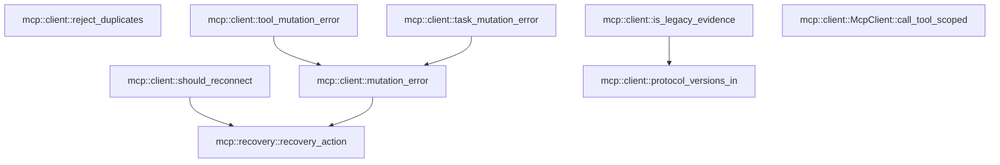

```mermaid
flowchart TD
  n0["mcp::client::client_capabilities"]
  n1["mcp::client::adopt_task_creation"]
  n2["mcp::client::adopt_official_task_shape"]
  n3["mcp::client::value"]
  n4["mcp::client::to_json"]
  n5["mcp::client::decode"]
  n6["mcp::client::should_reconnect"]
  n7["mcp::client::tool_mutation_error"]
  n8["mcp::client::McpClient::close_transport"]
  n9["mcp::client::McpClient::reconnect_generation"]
  n10["mcp::client::McpClient::catalog_generation"]
  n11["mcp::client::McpClient::connect_legacy"]
  n12["mcp::client::McpClient::connect_modern"]
  n13["mcp::client::McpClient::allocate_request_id"]
  n14["mcp::client::McpClient::call_raw_once"]
  n15["mcp::client::McpClient::call_read_raw"]
  n16["mcp::client::McpClient::call_raw_cancellable"]
  n17["mcp::client::McpClient::observe_notifications"]
  n18["mcp::client::McpClient::protocol_params"]
  n19["mcp::client::McpClient::call_typed"]
  n20["mcp::client::McpClient::paginated"]
  n21["mcp::client::McpClient::paginated_once"]
  n22["mcp::client::McpClient::continue_tool_call"]
  n23["mcp::client::McpClient::complete_task_poll"]
  n24["mcp::client::McpClient::task_mutation_with_resumable_identity"]
  n25["mcp::client::McpClient::start_scoped_tool"]
  n26["mcp::client::McpClient::server_name"]
  n27["mcp::client::McpClient::protocol_version"]
  n28["mcp::client::McpClient::server_identity"]
  n29["mcp::client::McpClient::capabilities"]
  n30["mcp::recovery::recovery_action"]
  n31["mcp::types::McpTask::validate_result"]
  n32["mcp::types::JsonRpcRequest::call"]
  n33["mcp::types::JsonRpcRequest::notification"]
  n11 --> n3
  n11 --> n19
  n11 --> n33
  n12 --> n19
  n14 --> n8
  n14 --> n13
  n14 --> n17
  n14 --> n18
  n14 --> n32
  n15 --> n6
  n15 --> n9
  n15 --> n14
  n16 --> n3
  n16 --> n8
  n16 --> n13
  n16 --> n17
  n16 --> n18
  n16 --> n32
  n16 --> n33
  n18 --> n0
  n18 --> n3
  n19 --> n5
  n19 --> n8
  n19 --> n14
  n20 --> n6
  n20 --> n9
  n20 --> n21
  n21 --> n3
  n21 --> n8
  n21 --> n14
  n22 --> n1
  n22 --> n3
  n22 --> n16
  n22 --> n23
  n22 --> n31
  n23 --> n2
  n23 --> n3
  n23 --> n4
  n23 --> n15
  n23 --> n16
  n24 --> n3
  n24 --> n9
  n24 --> n14
  n24 --> n23
  n24 --> n30
  n25 --> n1
  n25 --> n3
  n25 --> n7
  n25 --> n32
```

```mermaid
flowchart TD
  n0["mcp::client::McpClient::call_tool_augmented"]
  n1["mcp::client::McpClient::get_prompt"]
  n2["mcp::client::McpClient::read_resource"]
  n3["mcp::client::McpClient::task_operation"]
  n4["mcp::client::McpClient::task_operation_cancellable"]
  n5["mcp::client::McpClient::close"]
  n6["mcp::client::page"]
  n7["mcp::client::client_capabilities"]
  n8["mcp::client::adopt_task_creation"]
  n9["mcp::client::adopt_official_task_shape"]
  n10["mcp::client::value"]
  n11["mcp::client::to_json"]
  n12["mcp::client::decode"]
  n13["mcp::client::reject_duplicates"]
  n14["mcp::client::McpClient::catalog_generation"]
  n15["mcp::client::McpClient::start_catalog_subscription"]
  n16["mcp::client::McpClient::list_tools"]
  n17["mcp::client::McpClient::list_prompts"]
  n18["mcp::client::McpClient::list_resources"]
  n19["mcp::client::McpClient::call_tool"]
  n20["mcp::client::McpClient::call_tool_with_context"]
  n21["schema::ijson::IJsonValue::parse"]
  n0 --> n8
  n0 --> n9
  n0 --> n10
  n0 --> n11
  n1 --> n10
  n2 --> n10
  n3 --> n9
  n3 --> n10
  n3 --> n11
  n4 --> n9
  n4 --> n10
  n4 --> n11
  n6 --> n11
  n8 --> n9
  n8 --> n10
  n10 --> n21
  n16 --> n6
  n16 --> n13
  n17 --> n6
  n17 --> n13
  n18 --> n6
  n18 --> n13
  n19 --> n8
  n19 --> n10
  n20 --> n8
  n20 --> n10
```

# mcp::client

[Package atlas](index.md) · [Source](../../src/client.rs)

## Declarations

Visibility is the declaration spelling; trait members and reexports require their enclosing interface. `cfg` is not evaluated.

| Symbol | Kind | Visibility | Test / cfg |
|---|---|---|---|
| [mcp::client::CANCELLATION_IO_TIMEOUT](../../src/client.rs#L18) | const_item | `private` |  |
| [mcp::client::McpPeerFuture](../../src/client.rs#L20) | type_item | `pub` |  |
| [mcp::client::McpPeer](../../src/client.rs#L22) | trait_item | `pub` |  |
| [mcp::client::McpPeer::server_name](../../src/client.rs#L23) | function_signature_item | `private` |  |
| [mcp::client::McpPeer::start_scoped_tool](../../src/client.rs#L27) | function_item | `private` |  |
| [mcp::client::McpPeer::protocol_version](../../src/client.rs#L37) | function_item | `private` |  |
| [mcp::client::McpPeer::server_identity](../../src/client.rs#L40) | function_item | `private` |  |
| [mcp::client::McpPeer::capabilities](../../src/client.rs#L43) | function_signature_item | `private` |  |
| [mcp::client::McpPeer::catalog_generation](../../src/client.rs#L44) | function_item | `private` |  |
| [mcp::client::McpPeer::start_catalog_subscription](../../src/client.rs#L47) | function_item | `private` |  |
| [mcp::client::McpPeer::list_tools](../../src/client.rs#L50) | function_signature_item | `private` |  |
| [mcp::client::McpPeer::list_prompts](../../src/client.rs#L51) | function_signature_item | `private` |  |
| [mcp::client::McpPeer::list_resources](../../src/client.rs#L52) | function_signature_item | `private` |  |
| [mcp::client::McpPeer::call_tool](../../src/client.rs#L53) | function_signature_item | `private` |  |
| [mcp::client::McpPeer::call_tool_with_context](../../src/client.rs#L59) | function_item | `private` |  |
| [mcp::client::McpPeer::call_tool_augmented](../../src/client.rs#L75) | function_item | `private` |  |
| [mcp::client::McpPeer::get_prompt](../../src/client.rs#L89) | function_signature_item | `private` |  |
| [mcp::client::McpPeer::read_resource](../../src/client.rs#L90) | function_signature_item | `private` |  |
| [mcp::client::McpPeer::task_operation](../../src/client.rs#L91) | function_signature_item | `private` |  |
| [mcp::client::McpPeer::task_operation_cancellable](../../src/client.rs#L93) | function_item | `private` |  |
| [mcp::client::McpPeer::close](../../src/client.rs#L121) | function_signature_item | `private` |  |
| [mcp::client::McpClient](../../src/client.rs#L124) | struct_item | `pub` |  |
| [mcp::client::McpClient::new](../../src/client.rs#L140) | function_item | `pub` |  |
| [mcp::client::McpClient::connect](../../src/client.rs#L157) | function_item | `pub` |  |
| [mcp::client::McpClient::connect_cancellable](../../src/client.rs#L165) | function_item | `pub` |  |
| [mcp::client::McpClient::connect_handshake](../../src/client.rs#L185) | function_item | `private` |  |
| [mcp::client::McpClient::close_transport](../../src/client.rs#L198) | function_item | `private` |  |
| [mcp::client::McpClient::reconnect_transport](../../src/client.rs#L206) | function_item | `private` |  |
| [mcp::client::McpClient::connect_once](../../src/client.rs#L212) | function_item | `private` |  |
| [mcp::client::McpClient::reset_generation](../../src/client.rs#L232) | function_item | `private` |  |
| [mcp::client::McpClient::reconnect_generation](../../src/client.rs#L246) | function_item | `private` |  |
| [mcp::client::McpClient::server](../../src/client.rs#L275) | function_item | `pub` |  |
| [mcp::client::McpClient::supported_versions](../../src/client.rs#L280) | function_item | `pub` |  |
| [mcp::client::McpClient::protocol_version](../../src/client.rs#L284) | function_item | `pub` |  |
| [mcp::client::McpClient::catalog_generation](../../src/client.rs#L289) | function_item | `pub` |  |
| [mcp::client::McpClient::connect_legacy](../../src/client.rs#L294) | function_item | `private` |  |
| [mcp::client::McpClient::connect_legacy::InitializeResult](../../src/client.rs#L297) | struct_item | `private` |  |
| [mcp::client::McpClient::connect_modern](../../src/client.rs#L330) | function_item | `private` |  |
| [mcp::client::McpClient::connect_modern::DiscoverResult](../../src/client.rs#L336) | struct_item | `private` |  |
| [mcp::client::McpClient::connect_modern::DiscoverMetadata](../../src/client.rs#L351) | struct_item | `private` |  |
| [mcp::client::McpClient::allocate_request_id](../../src/client.rs#L378) | function_item | `private` |  |
| [mcp::client::McpClient::call_raw_once](../../src/client.rs#L388) | function_item | `private` |  |
| [mcp::client::McpClient::call_read_raw](../../src/client.rs#L416) | function_item | `private` |  |
| [mcp::client::McpClient::call_raw_cancellable](../../src/client.rs#L430) | function_item | `private` |  |
| [mcp::client::McpClient::observe_notifications](../../src/client.rs#L485) | function_item | `private` |  |
| [mcp::client::McpClient::protocol_params](../../src/client.rs#L502) | function_item | `private` |  |
| [mcp::client::McpClient::call_typed](../../src/client.rs#L540) | function_item | `private` |  |
| [mcp::client::McpClient::paginated](../../src/client.rs#L553) | function_item | `private` |  |
| [mcp::client::McpClient::paginated_once](../../src/client.rs#L566) | function_item | `private` |  |
| [mcp::client::McpClient::continue_tool_call](../../src/client.rs#L612) | function_item | `pub` |  |
| [mcp::client::McpClient::complete_task_poll](../../src/client.rs#L671) | function_item | `private` |  |
| [mcp::client::McpClient::task_mutation_with_resumable_identity](../../src/client.rs#L710) | function_item | `pub` |  |
| [mcp::client::McpClient::start_scoped_tool](../../src/client.rs#L754) | function_item | `private` |  |
| [mcp::client::McpClient::server_name](../../src/client.rs#L836) | function_item | `private` |  |
| [mcp::client::McpClient::protocol_version](../../src/client.rs#L840) | function_item | `private` |  |
| [mcp::client::McpClient::server_identity](../../src/client.rs#L844) | function_item | `private` |  |
| [mcp::client::McpClient::capabilities](../../src/client.rs#L848) | function_item | `private` |  |
| [mcp::client::McpClient::catalog_generation](../../src/client.rs#L852) | function_item | `private` |  |
| [mcp::client::McpClient::start_catalog_subscription](../../src/client.rs#L857) | function_item | `private` |  |
| [mcp::client::McpClient::list_tools](../../src/client.rs#L890) | function_item | `private` |  |
| [mcp::client::McpClient::list_prompts](../../src/client.rs#L907) | function_item | `private` |  |
| [mcp::client::McpClient::list_resources](../../src/client.rs#L924) | function_item | `private` |  |
| [mcp::client::McpClient::call_tool](../../src/client.rs#L942) | function_item | `private` |  |
| [mcp::client::McpClient::call_tool_with_context](../../src/client.rs#L967) | function_item | `private` |  |
| [mcp::client::McpClient::call_tool_augmented](../../src/client.rs#L1015) | function_item | `private` |  |
| [mcp::client::McpClient::get_prompt](../../src/client.rs#L1079) | function_item | `private` |  |
| [mcp::client::McpClient::read_resource](../../src/client.rs#L1091) | function_item | `private` |  |
| [mcp::client::McpClient::task_operation](../../src/client.rs#L1106) | function_item | `private` |  |
| [mcp::client::McpClient::task_operation_cancellable](../../src/client.rs#L1138) | function_item | `private` |  |
| [mcp::client::McpClient::close](../../src/client.rs#L1178) | function_item | `private` |  |
| [mcp::client::Page](../../src/client.rs#L1183) | struct_item | `private` |  |
| [mcp::client::page](../../src/client.rs#L1188) | function_item | `private` |  |
| [mcp::client::client_capabilities](../../src/client.rs#L1242) | function_item | `private` |  |
| [mcp::client::adopt_task_creation](../../src/client.rs#L1251) | function_item | `private` |  |
| [mcp::client::adopt_official_task_shape](../../src/client.rs#L1277) | function_item | `private` |  |
| [mcp::client::value](../../src/client.rs#L1296) | function_item | `private` |  |
| [mcp::client::to_json](../../src/client.rs#L1303) | function_item | `private` |  |
| [mcp::client::decode](../../src/client.rs#L1312) | function_item | `private` |  |
| [mcp::client::reject_duplicates](../../src/client.rs#L1321) | function_item | `private` |  |
| [mcp::client::should_reconnect](../../src/client.rs#L1337) | function_item | `private` |  |
| [mcp::client::tool_mutation_error](../../src/client.rs#L1342) | function_item | `private` |  |
| [mcp::client::task_mutation_error](../../src/client.rs#L1346) | function_item | `private` |  |
| [mcp::client::mutation_error](../../src/client.rs#L1350) | function_item | `private` |  |
| [mcp::client::is_legacy_evidence](../../src/client.rs#L1361) | function_item | `private` |  |
| [mcp::client::protocol_versions_in](../../src/client.rs#L1397) | function_item | `private` |  |
| [mcp::client::McpClient::call_tool_scoped](../../src/client.rs#L1428) | function_item | `pub` |  |
| [mcp::client::legacy_evidence_tests::auto_fallback_requires_explicit_protocol_evidence](../../src/client.rs#L1446) | function_item | `private` | test; #[cfg(test)] |
| [mcp::client::legacy_evidence_tests::textual_protocol_version_rejection_is_legacy_evidence_when_it_lists_an_older_version](../../src/client.rs#L1474) | function_item | `private` | test; #[cfg(test)] |

## Imports / reexports

| Local name | Source path | Visibility |
|---|---|---|
| `BTreeSet` | `std::collections::BTreeSet` | `private` |
| `Future` | `std::future::Future` | `private` |
| `Pin` | `std::pin::Pin` | `private` |
| `Duration` | `std::time::Duration` | `private` |
| `IJsonValue` | `schema::IJsonValue` | `private` |
| `Deserialize` | `serde::Deserialize` | `private` |
| `DeserializeOwned` | `serde::de::DeserializeOwned` | `private` |
| `json` | `serde_json::json` | `private` |
| `JsonRpcRequest` | `crate::JsonRpcRequest` | `private` |
| `MAX_CATALOG_ITEMS` | `crate::MAX_CATALOG_ITEMS` | `private` |
| `MAX_CATALOG_PAGES` | `crate::MAX_CATALOG_PAGES` | `private` |
| `MAX_CONTINUATION_ROUNDS` | `crate::MAX_CONTINUATION_ROUNDS` | `private` |
| `McpCancellationToken` | `crate::McpCancellationToken` | `private` |
| `McpCapabilities` | `crate::McpCapabilities` | `private` |
| `McpError` | `crate::McpError` | `private` |
| `McpImplementation` | `crate::McpImplementation` | `private` |
| `McpLossState` | `crate::McpLossState` | `private` |
| `McpPrompt` | `crate::McpPrompt` | `private` |
| `McpResource` | `crate::McpResource` | `private` |
| `McpTool` | `crate::McpTool` | `private` |
| `McpToolCallContext` | `crate::McpToolCallContext` | `private` |
| `McpToolContinuation` | `crate::McpToolContinuation` | `private` |
| `McpTransport` | `crate::McpTransport` | `private` |
| `ProtocolMode` | `crate::ProtocolMode` | `private` |
| `RecoveryAction` | `crate::RecoveryAction` | `private` |
| `recovery_action` | `crate::recovery_action` | `private` |
| `*` | `super::*` | `private` |

## Module declarations

| Module | Visibility | Attributes |
|---|---|---|
| `mcp::client::legacy_evidence_tests` | `private` | #[cfg(test)] |

## Function call graphs

Edges below are syntactically resolved calls only, including private functions. Graphs partition callers into groups of 20; they are not execution order. All unresolved sites are listed below and in the JSON inventory.

Functions 1–20: 14 direct edges

Functions 21–40: 49 direct edges

Functions 41–60: 26 direct edges

Functions 61–68: 5 direct edges

## Call sites

Includes test functions (marked in declarations). Receiver-type-required sites need type analysis/manual tracing. Calls in closures are attributed to their enclosing function; their occurrence here does not mean the closure executes immediately.

| Caller | Callee expression | Source lines | Target / classification |
|---|---|---|---|
| `CANCELLATION_IO_TIMEOUT` | `Duration::from_millis` | [18](../../src/client.rs#L18) | external-constructor-callback-or-unresolved |
| `call_tool_with_context` | `Box::pin` | [66](../../src/client.rs#L66) | external-constructor-callback-or-unresolved |
| `call_tool_with_context` | `Err` | [67](../../src/client.rs#L67) | external-constructor-callback-or-unresolved |
| `call_tool_with_context` | `McpError::Unsupported` | [67](../../src/client.rs#L67) | external-constructor-callback-or-unresolved |
| `call_tool_with_context` | `"idempotency-reconcile tool calls".to_owned` | [68](../../src/client.rs#L68) | receiver-type-required |
| `call_tool_augmented` | `Box::pin` | [83](../../src/client.rs#L83) | external-constructor-callback-or-unresolved |
| `call_tool_augmented` | `Err` | [84](../../src/client.rs#L84) | external-constructor-callback-or-unresolved |
| `call_tool_augmented` | `McpError::Unsupported` | [84](../../src/client.rs#L84) | external-constructor-callback-or-unresolved |
| `call_tool_augmented` | `"task-augmented tool calls".to_owned` | [85](../../src/client.rs#L85) | receiver-type-required |
| `task_operation_cancellable` | `method.to_owned` | [99](../../src/client.rs#L99) | receiver-type-required |
| `task_operation_cancellable` | `Box::pin` | [100](../../src/client.rs#L100) | external-constructor-callback-or-unresolved |
| `task_operation_cancellable` | `cancellation.is_cancelled` | [101](../../src/client.rs#L101) | receiver-type-required |
| `task_operation_cancellable` | `Err` | [102](../../src/client.rs#L102), [112](../../src/client.rs#L112) | external-constructor-callback-or-unresolved |
| `task_operation_cancellable` | `self.close` | [111](../../src/client.rs#L111) | receiver-type-required |
| `new` | `server_name.into` | [142](../../src/client.rs#L142) | receiver-type-required |
| `new` | `std::sync::atomic::AtomicU64::new` | [146](../../src/client.rs#L146), [153](../../src/client.rs#L153) | external-constructor-callback-or-unresolved |
| `new` | `McpCapabilities::default` | [147](../../src/client.rs#L147) | external-constructor-callback-or-unresolved |
| `new` | `String::new` | [149](../../src/client.rs#L149) | external-constructor-callback-or-unresolved |
| `new` | `Vec::new` | [150](../../src/client.rs#L150) | external-constructor-callback-or-unresolved |
| `new` | `std::sync::Arc::new` | [153](../../src/client.rs#L153) | external-constructor-callback-or-unresolved |
| `connect` | `self.connect_cancellable` | [158](../../src/client.rs#L158) | [mcp::client::McpClient::connect_cancellable](../../src/client.rs#L165) |
| `connect` | `McpCancellationToken::default` | [158](../../src/client.rs#L158) | external-constructor-callback-or-unresolved |
| `connect_cancellable` | `cancellation.is_cancelled` | [170](../../src/client.rs#L170) | receiver-type-required |
| `connect_cancellable` | `Err` | [171](../../src/client.rs#L171) | external-constructor-callback-or-unresolved |
| `connect_cancellable` | `result.is_err` | [179](../../src/client.rs#L179) | receiver-type-required |
| `connect_cancellable` | `self.close_transport` | [180](../../src/client.rs#L180) | [mcp::client::McpClient::close_transport](../../src/client.rs#L198) |
| `connect_handshake` | `Some` | [186](../../src/client.rs#L186) | external-constructor-callback-or-unresolved |
| `connect_handshake` | `self.connect_once` | [187](../../src/client.rs#L187), [191](../../src/client.rs#L191) | [mcp::client::McpClient::connect_once](../../src/client.rs#L212) |
| `connect_handshake` | `should_reconnect` | [188](../../src/client.rs#L188) | [mcp::client::should_reconnect](../../src/client.rs#L1337) |
| `connect_handshake` | `self.reset_generation` | [189](../../src/client.rs#L189) | [mcp::client::McpClient::reset_generation](../../src/client.rs#L232) |
| `connect_handshake` | `self.reconnect_transport` | [190](../../src/client.rs#L190) | [mcp::client::McpClient::reconnect_transport](../../src/client.rs#L206) |
| `connect_handshake` | `Err` | [192](../../src/client.rs#L192) | external-constructor-callback-or-unresolved |
| `close_transport` | `Box::pin` | [200](../../src/client.rs#L200) | external-constructor-callback-or-unresolved |
| `close_transport` | `Ok` | [200](../../src/client.rs#L200) | external-constructor-callback-or-unresolved |
| `close_transport` | `self.transport.close` | [203](../../src/client.rs#L203) | receiver-type-required |
| `reconnect_transport` | `self.transport.reconnect` | [209](../../src/client.rs#L209) | receiver-type-required |
| `connect_once` | `self.connect_modern` | [214](../../src/client.rs#L214), [217](../../src/client.rs#L217) | [mcp::client::McpClient::connect_modern](../../src/client.rs#L330) |
| `connect_once` | `self.connect_legacy` | [215](../../src/client.rs#L215), [221](../../src/client.rs#L221), [228](../../src/client.rs#L228) | [mcp::client::McpClient::connect_legacy](../../src/client.rs#L294) |
| `connect_once` | `self.transport.supports_http_discovery` | [216](../../src/client.rs#L216) | receiver-type-required |
| `connect_once` | `result.as_ref().err().is_some_and` | [218](../../src/client.rs#L218) | receiver-type-required |
| `connect_once` | `result.as_ref().err` | [218](../../src/client.rs#L218) | receiver-type-required |
| `connect_once` | `result.as_ref` | [218](../../src/client.rs#L218) | receiver-type-required |
| `connect_once` | `self.reset_generation` | [219](../../src/client.rs#L219) | [mcp::client::McpClient::reset_generation](../../src/client.rs#L232) |
| `connect_once` | `self.reconnect_transport` | [220](../../src/client.rs#L220) | [mcp::client::McpClient::reconnect_transport](../../src/client.rs#L206) |
| `reset_generation` | `self.next_id.store` | [233](../../src/client.rs#L233) | receiver-type-required |
| `reset_generation` | `McpCapabilities::default` | [234](../../src/client.rs#L234) | external-constructor-callback-or-unresolved |
| `reset_generation` | `self.protocol_version.clear` | [236](../../src/client.rs#L236) | receiver-type-required |
| `reset_generation` | `self.supported_versions.clear` | [237](../../src/client.rs#L237) | receiver-type-required |
| `reset_generation` | `self.catalog_generation.fetch_update` | [239](../../src/client.rs#L239) | receiver-type-required |
| `reset_generation` | `Some` | [242](../../src/client.rs#L242) | external-constructor-callback-or-unresolved |
| `reset_generation` | `v.saturating_add` | [242](../../src/client.rs#L242) | receiver-type-required |
| `reconnect_generation` | `self             .mode             .ok_or_else` | [247](../../src/client.rs#L247) | receiver-type-required |
| `reconnect_generation` | `McpError::Protocol` | [249](../../src/client.rs#L249), [252](../../src/client.rs#L252) | external-constructor-callback-or-unresolved |
| `reconnect_generation` | `"MCP peer was never connected".to_owned` | [249](../../src/client.rs#L249) | receiver-type-required |
| `reconnect_generation` | `self.protocol_version.clone` | [250](../../src/client.rs#L250) | receiver-type-required |
| `reconnect_generation` | `self.server.clone().ok_or_else` | [251](../../src/client.rs#L251) | receiver-type-required |
| `reconnect_generation` | `self.server.clone` | [251](../../src/client.rs#L251) | receiver-type-required |
| `reconnect_generation` | `"MCP peer has no negotiated server identity".to_owned` | [252](../../src/client.rs#L252) | receiver-type-required |
| `reconnect_generation` | `self.reconnect_transport` | [255](../../src/client.rs#L255) | [mcp::client::McpClient::reconnect_transport](../../src/client.rs#L206) |
| `reconnect_generation` | `self.reset_generation` | [256](../../src/client.rs#L256) | [mcp::client::McpClient::reset_generation](../../src/client.rs#L232) |
| `reconnect_generation` | `self.connect_once` | [257](../../src/client.rs#L257) | [mcp::client::McpClient::connect_once](../../src/client.rs#L212) |
| `reconnect_generation` | `self.close_transport` | [261](../../src/client.rs#L261), [267](../../src/client.rs#L267) | [mcp::client::McpClient::close_transport](../../src/client.rs#L198) |
| `reconnect_generation` | `Err` | [262](../../src/client.rs#L262), [268](../../src/client.rs#L268) | external-constructor-callback-or-unresolved |
| `reconnect_generation` | `self.server.as_ref` | [265](../../src/client.rs#L265) | receiver-type-required |
| `reconnect_generation` | `Some` | [265](../../src/client.rs#L265) | external-constructor-callback-or-unresolved |
| `reconnect_generation` | `McpError::Conflict` | [268](../../src/client.rs#L268) | external-constructor-callback-or-unresolved |
| `reconnect_generation` | `"MCP negotiated authority changed during reconnect".to_owned` | [269](../../src/client.rs#L269) | receiver-type-required |
| `reconnect_generation` | `Ok` | [272](../../src/client.rs#L272) | external-constructor-callback-or-unresolved |
| `server` | `self.server.as_ref` | [276](../../src/client.rs#L276) | receiver-type-required |
| `catalog_generation` | `self.catalog_generation             .load` | [290](../../src/client.rs#L290) | receiver-type-required |
| `connect_legacy` | `value` | [307](../../src/client.rs#L307) | [mcp::client::value](../../src/client.rs#L1296) |
| `connect_legacy` | `self             .call_typed` | [312](../../src/client.rs#L312) | [mcp::client::McpClient::call_typed](../../src/client.rs#L540) |
| `connect_legacy` | `Some` | [313](../../src/client.rs#L313), [321](../../src/client.rs#L321) | external-constructor-callback-or-unresolved |
| `connect_legacy` | `Duration::from_secs` | [313](../../src/client.rs#L313) | external-constructor-callback-or-unresolved |
| `connect_legacy` | `Err` | [316](../../src/client.rs#L316) | external-constructor-callback-or-unresolved |
| `connect_legacy` | `McpError::Unsupported` | [316](../../src/client.rs#L316) | external-constructor-callback-or-unresolved |
| `connect_legacy` | `self.transport             .notify` | [322](../../src/client.rs#L322) | receiver-type-required |
| `connect_legacy` | `JsonRpcRequest::notification` | [323](../../src/client.rs#L323) | [mcp::types::JsonRpcRequest::notification](../../src/types.rs#L66) |
| `connect_modern` | `crate::MODERN_PROTOCOL_VERSION.to_owned` | [334](../../src/client.rs#L334), [370](../../src/client.rs#L370) | receiver-type-required |
| `connect_modern` | `self             .call_typed` | [355](../../src/client.rs#L355) | [mcp::client::McpClient::call_typed](../../src/client.rs#L540) |
| `connect_modern` | `Duration::from_secs` | [356](../../src/client.rs#L356) | external-constructor-callback-or-unresolved |
| `connect_modern` | `Err` | [359](../../src/client.rs#L359), [368](../../src/client.rs#L368) | external-constructor-callback-or-unresolved |
| `connect_modern` | `McpError::Protocol` | [359](../../src/client.rs#L359) | external-constructor-callback-or-unresolved |
| `connect_modern` | `"modern discovery did not return a complete result".to_owned` | [360](../../src/client.rs#L360) | receiver-type-required |
| `connect_modern` | `result             .supported_versions             .iter()             .any` | [363](../../src/client.rs#L363) | receiver-type-required |
| `connect_modern` | `result             .supported_versions             .iter` | [363](../../src/client.rs#L363) | receiver-type-required |
| `connect_modern` | `McpError::NoMutualProtocol` | [368](../../src/client.rs#L368) | external-constructor-callback-or-unresolved |
| `connect_modern` | `Some` | [373](../../src/client.rs#L373) | external-constructor-callback-or-unresolved |
| `connect_modern` | `Ok` | [375](../../src/client.rs#L375) | external-constructor-callback-or-unresolved |
| `allocate_request_id` | `self.next_id             .fetch_update(                 std::sync::atomic::Ordering::Relaxed,                 std::sync::atomic::Ordering::Relaxed,                 &#124;id&#124; id.checked_add(1),             )             .map_err` | [379](../../src/client.rs#L379) | receiver-type-required |
| `allocate_request_id` | `self.next_id             .fetch_update` | [379](../../src/client.rs#L379) | receiver-type-required |
| `allocate_request_id` | `id.checked_add` | [383](../../src/client.rs#L383) | receiver-type-required |
| `allocate_request_id` | `McpError::Protocol` | [385](../../src/client.rs#L385) | external-constructor-callback-or-unresolved |
| `allocate_request_id` | `"request id exhausted".to_owned` | [385](../../src/client.rs#L385) | receiver-type-required |
| `call_raw_once` | `self.allocate_request_id` | [394](../../src/client.rs#L394) | [mcp::client::McpClient::allocate_request_id](../../src/client.rs#L378) |
| `call_raw_once` | `self.protocol_params` | [395](../../src/client.rs#L395) | [mcp::client::McpClient::protocol_params](../../src/client.rs#L502) |
| `call_raw_once` | `self             .transport             .request` | [396](../../src/client.rs#L396) | receiver-type-required |
| `call_raw_once` | `JsonRpcRequest::call` | [398](../../src/client.rs#L398) | [mcp::types::JsonRpcRequest::call](../../src/types.rs#L57) |
| `call_raw_once` | `self.observe_notifications` | [400](../../src/client.rs#L400) | [mcp::client::McpClient::observe_notifications](../../src/client.rs#L485) |
| `call_raw_once` | `self.close_transport` | [404](../../src/client.rs#L404), [411](../../src/client.rs#L411) | [mcp::client::McpClient::close_transport](../../src/client.rs#L198) |
| `call_raw_once` | `Err` | [405](../../src/client.rs#L405), [407](../../src/client.rs#L407) | external-constructor-callback-or-unresolved |
| `call_raw_once` | `response.into_result` | [409](../../src/client.rs#L409) | receiver-type-required |
| `call_read_raw` | `self.call_raw_once` | [422](../../src/client.rs#L422), [427](../../src/client.rs#L427) | [mcp::client::McpClient::call_raw_once](../../src/client.rs#L388) |
| `call_read_raw` | `params.clone` | [422](../../src/client.rs#L422) | receiver-type-required |
| `call_read_raw` | `should_reconnect` | [423](../../src/client.rs#L423) | [mcp::client::should_reconnect](../../src/client.rs#L1337) |
| `call_read_raw` | `self.reconnect_generation` | [426](../../src/client.rs#L426) | [mcp::client::McpClient::reconnect_generation](../../src/client.rs#L246) |
| `call_raw_cancellable` | `cancellation.is_cancelled` | [437](../../src/client.rs#L437) | receiver-type-required |
| `call_raw_cancellable` | `Err` | [438](../../src/client.rs#L438), [457](../../src/client.rs#L457), [459](../../src/client.rs#L459), [482](../../src/client.rs#L482) | external-constructor-callback-or-unresolved |
| `call_raw_cancellable` | `self.allocate_request_id` | [440](../../src/client.rs#L440) | [mcp::client::McpClient::allocate_request_id](../../src/client.rs#L378) |
| `call_raw_cancellable` | `self.protocol_params` | [441](../../src/client.rs#L441) | [mcp::client::McpClient::protocol_params](../../src/client.rs#L502) |
| `call_raw_cancellable` | `JsonRpcRequest::call` | [442](../../src/client.rs#L442) | [mcp::types::JsonRpcRequest::call](../../src/types.rs#L57) |
| `call_raw_cancellable` | `self.transport.request` | [444](../../src/client.rs#L444) | receiver-type-required |
| `call_raw_cancellable` | `self.observe_notifications` | [452](../../src/client.rs#L452) | [mcp::client::McpClient::observe_notifications](../../src/client.rs#L485) |
| `call_raw_cancellable` | `self.close_transport` | [456](../../src/client.rs#L456), [463](../../src/client.rs#L463), [481](../../src/client.rs#L481) | [mcp::client::McpClient::close_transport](../../src/client.rs#L198) |
| `call_raw_cancellable` | `response.into_result` | [461](../../src/client.rs#L461) | receiver-type-required |
| `call_raw_cancellable` | `self.transport.mark_cancelled` | [467](../../src/client.rs#L467) | receiver-type-required |
| `call_raw_cancellable` | `JsonRpcRequest::notification` | [468](../../src/client.rs#L468) | [mcp::types::JsonRpcRequest::notification](../../src/types.rs#L66) |
| `call_raw_cancellable` | `Some` | [470](../../src/client.rs#L470) | external-constructor-callback-or-unresolved |
| `call_raw_cancellable` | `value` | [470](../../src/client.rs#L470) | [mcp::client::value](../../src/client.rs#L1296) |
| `call_raw_cancellable` | `tokio::time::timeout` | [472](../../src/client.rs#L472), [481](../../src/client.rs#L481) | external-constructor-callback-or-unresolved |
| `call_raw_cancellable` | `self.transport.notify` | [474](../../src/client.rs#L474) | receiver-type-required |
| `observe_notifications` | `self.transport.take_notifications` | [486](../../src/client.rs#L486) | receiver-type-required |
| `observe_notifications` | `self.catalog_generation.fetch_update` | [493](../../src/client.rs#L493) | receiver-type-required |
| `observe_notifications` | `Some` | [496](../../src/client.rs#L496) | external-constructor-callback-or-unresolved |
| `observe_notifications` | `v.saturating_add` | [496](../../src/client.rs#L496) | receiver-type-required |
| `protocol_params` | `Ok` | [504](../../src/client.rs#L504), [507](../../src/client.rs#L507), [537](../../src/client.rs#L537) | external-constructor-callback-or-unresolved |
| `protocol_params` | `params.map_or_else` | [506](../../src/client.rs#L506) | receiver-type-required |
| `protocol_params` | `serde_json::Value::Object` | [507](../../src/client.rs#L507), [521](../../src/client.rs#L521) | external-constructor-callback-or-unresolved |
| `protocol_params` | `serde_json::Map::new` | [507](../../src/client.rs#L507), [521](../../src/client.rs#L521) | external-constructor-callback-or-unresolved |
| `protocol_params` | `value                     .canonical_bytes()                     .map_err` | [509](../../src/client.rs#L509) | receiver-type-required |
| `protocol_params` | `value                     .canonical_bytes` | [509](../../src/client.rs#L509) | receiver-type-required |
| `protocol_params` | `McpError::Protocol` | [511](../../src/client.rs#L511), [513](../../src/client.rs#L513), [517](../../src/client.rs#L517), [523](../../src/client.rs#L523), [525](../../src/client.rs#L525) | external-constructor-callback-or-unresolved |
| `protocol_params` | `error.to_string` | [511](../../src/client.rs#L511), [513](../../src/client.rs#L513) | receiver-type-required |
| `protocol_params` | `serde_json::from_slice::<serde_json::Value>(&bytes)                     .map_err` | [512](../../src/client.rs#L512) | receiver-type-required |
| `protocol_params` | `serde_json::from_slice::<serde_json::Value>` | [512](../../src/client.rs#L512) | external-constructor-callback-or-unresolved |
| `protocol_params` | `json_value.as_object_mut().ok_or_else` | [516](../../src/client.rs#L516) | receiver-type-required |
| `protocol_params` | `json_value.as_object_mut` | [516](../../src/client.rs#L516) | receiver-type-required |
| `protocol_params` | `"modern request params must be an object".to_owned` | [517](../../src/client.rs#L517) | receiver-type-required |
| `protocol_params` | `object             .entry("_meta".to_owned())             .or_insert_with(&#124;&#124; serde_json::Value::Object(serde_json::Map::new()))             .as_object_mut()             .ok_or_else` | [519](../../src/client.rs#L519) | receiver-type-required |
| `protocol_params` | `object             .entry("_meta".to_owned())             .or_insert_with(&#124;&#124; serde_json::Value::Object(serde_json::Map::new()))             .as_object_mut` | [519](../../src/client.rs#L519) | receiver-type-required |
| `protocol_params` | `object             .entry("_meta".to_owned())             .or_insert_with` | [519](../../src/client.rs#L519) | receiver-type-required |
| `protocol_params` | `object             .entry` | [519](../../src/client.rs#L519) | receiver-type-required |
| `protocol_params` | `"_meta".to_owned` | [520](../../src/client.rs#L520) | receiver-type-required |
| `protocol_params` | `"request _meta must be an object".to_owned` | [523](../../src/client.rs#L523) | receiver-type-required |
| `protocol_params` | `metadata.contains_key` | [524](../../src/client.rs#L524) | receiver-type-required |
| `protocol_params` | `Err` | [525](../../src/client.rs#L525) | external-constructor-callback-or-unresolved |
| `protocol_params` | `"caller params must not override protocol metadata".to_owned` | [526](../../src/client.rs#L526) | receiver-type-required |
| `protocol_params` | `metadata.insert` | [529](../../src/client.rs#L529), [533](../../src/client.rs#L533) | receiver-type-required |
| `protocol_params` | `"io.modelcontextprotocol/protocolVersion".to_owned` | [530](../../src/client.rs#L530) | receiver-type-required |
| `protocol_params` | `"io.modelcontextprotocol/clientCapabilities".to_owned` | [534](../../src/client.rs#L534) | receiver-type-required |
| `protocol_params` | `client_capabilities` | [535](../../src/client.rs#L535) | [mcp::client::client_capabilities](../../src/client.rs#L1242) |
| `protocol_params` | `Some` | [537](../../src/client.rs#L537) | external-constructor-callback-or-unresolved |
| `protocol_params` | `value` | [537](../../src/client.rs#L537) | [mcp::client::value](../../src/client.rs#L1296) |
| `call_typed` | `decode` | [546](../../src/client.rs#L546) | [mcp::client::decode](../../src/client.rs#L1312) |
| `call_typed` | `self.call_raw_once` | [546](../../src/client.rs#L546) | [mcp::client::McpClient::call_raw_once](../../src/client.rs#L388) |
| `call_typed` | `self.close_transport` | [548](../../src/client.rs#L548) | [mcp::client::McpClient::close_transport](../../src/client.rs#L198) |
| `paginated` | `self.paginated_once` | [558](../../src/client.rs#L558), [563](../../src/client.rs#L563) | [mcp::client::McpClient::paginated_once](../../src/client.rs#L566) |
| `paginated` | `extract.clone` | [558](../../src/client.rs#L558) | receiver-type-required |
| `paginated` | `should_reconnect` | [559](../../src/client.rs#L559) | [mcp::client::should_reconnect](../../src/client.rs#L1337) |
| `paginated` | `self.reconnect_generation` | [562](../../src/client.rs#L562) | [mcp::client::McpClient::reconnect_generation](../../src/client.rs#L246) |
| `paginated_once` | `Vec::new` | [575](../../src/client.rs#L575) | external-constructor-callback-or-unresolved |
| `paginated_once` | `BTreeSet::new` | [577](../../src/client.rs#L577) | external-constructor-callback-or-unresolved |
| `paginated_once` | `cursor                 .as_ref()                 .map(&#124;cursor&#124; value(json!({"cursor":cursor})))                 .transpose` | [579](../../src/client.rs#L579) | receiver-type-required |
| `paginated_once` | `cursor                 .as_ref()                 .map` | [579](../../src/client.rs#L579) | receiver-type-required |
| `paginated_once` | `cursor                 .as_ref` | [579](../../src/client.rs#L579) | receiver-type-required |
| `paginated_once` | `value` | [581](../../src/client.rs#L581) | [mcp::client::value](../../src/client.rs#L1296) |
| `paginated_once` | `extract` | [583](../../src/client.rs#L583) | external-constructor-callback-or-unresolved |
| `paginated_once` | `self.call_raw_once` | [584](../../src/client.rs#L584) | [mcp::client::McpClient::call_raw_once](../../src/client.rs#L388) |
| `paginated_once` | `Duration::from_secs` | [584](../../src/client.rs#L584) | external-constructor-callback-or-unresolved |
| `paginated_once` | `self.close_transport` | [590](../../src/client.rs#L590) | [mcp::client::McpClient::close_transport](../../src/client.rs#L198) |
| `paginated_once` | `Err` | [591](../../src/client.rs#L591), [593](../../src/client.rs#L593), [597](../../src/client.rs#L597), [603](../../src/client.rs#L603), [609](../../src/client.rs#L609) | external-constructor-callback-or-unresolved |
| `paginated_once` | `output.extend` | [595](../../src/client.rs#L595) | receiver-type-required |
| `paginated_once` | `output.len` | [596](../../src/client.rs#L596) | receiver-type-required |
| `paginated_once` | `Ok` | [600](../../src/client.rs#L600) | external-constructor-callback-or-unresolved |
| `paginated_once` | `next.is_empty` | [602](../../src/client.rs#L602) | receiver-type-required |
| `paginated_once` | `seen.insert` | [602](../../src/client.rs#L602) | receiver-type-required |
| `paginated_once` | `next.clone` | [602](../../src/client.rs#L602) | receiver-type-required |
| `paginated_once` | `McpError::Protocol` | [603](../../src/client.rs#L603) | external-constructor-callback-or-unresolved |
| `paginated_once` | `"catalog cursor is empty or repeated".to_owned` | [604](../../src/client.rs#L604) | receiver-type-required |
| `paginated_once` | `Some` | [607](../../src/client.rs#L607) | external-constructor-callback-or-unresolved |
| `continue_tool_call` | `Err` | [620](../../src/client.rs#L620), [623](../../src/client.rs#L623), [629](../../src/client.rs#L629), [632](../../src/client.rs#L632) | external-constructor-callback-or-unresolved |
| `continue_tool_call` | `McpError::Unsupported` | [620](../../src/client.rs#L620), [629](../../src/client.rs#L629) | external-constructor-callback-or-unresolved |
| `continue_tool_call` | `"tools".to_owned` | [620](../../src/client.rs#L620) | receiver-type-required |
| `continue_tool_call` | `McpError::Protocol` | [623](../../src/client.rs#L623), [632](../../src/client.rs#L632) | external-constructor-callback-or-unresolved |
| `continue_tool_call` | `"MCP continuation round must be within 1...32".to_owned` | [624](../../src/client.rs#L624) | receiver-type-required |
| `continue_tool_call` | `self.capabilities.supports_tasks` | [628](../../src/client.rs#L628), [654](../../src/client.rs#L654) | receiver-type-required |
| `continue_tool_call` | `"tasks/get".to_owned` | [629](../../src/client.rs#L629) | receiver-type-required |
| `continue_tool_call` | `task_id.is_empty` | [631](../../src/client.rs#L631) | receiver-type-required |
| `continue_tool_call` | `"empty continuation task identity".to_owned` | [633](../../src/client.rs#L633) | receiver-type-required |
| `continue_tool_call` | `self                 .call_raw_cancellable` | [636](../../src/client.rs#L636) | [mcp::client::McpClient::call_raw_cancellable](../../src/client.rs#L430) |
| `continue_tool_call` | `Some` | [639](../../src/client.rs#L639), [644](../../src/client.rs#L644), [657](../../src/client.rs#L657) | external-constructor-callback-or-unresolved |
| `continue_tool_call` | `value` | [639](../../src/client.rs#L639), [648](../../src/client.rs#L648) | [mcp::client::value](../../src/client.rs#L1296) |
| `continue_tool_call` | `Duration::from_secs` | [640](../../src/client.rs#L640), [658](../../src/client.rs#L658) | external-constructor-callback-or-unresolved |
| `continue_tool_call` | `self.complete_task_poll` | [644](../../src/client.rs#L644) | [mcp::client::McpClient::complete_task_poll](../../src/client.rs#L671) |
| `continue_tool_call` | `crate::McpTask::validate_result` | [645](../../src/client.rs#L645) | [mcp::types::McpTask::validate_result](../../src/types.rs#L564) |
| `continue_tool_call` | `Ok` | [646](../../src/client.rs#L646) | external-constructor-callback-or-unresolved |
| `continue_tool_call` | `self.call_raw_cancellable(             "tools/call",             Some(params),             Duration::from_secs(600),             &cancellation,         )         .await         .and_then(&#124;result&#124; adopt_task_creation(result, tasks))         .map_err` | [655](../../src/client.rs#L655) | receiver-type-required |
| `continue_tool_call` | `self.call_raw_cancellable(             "tools/call",             Some(params),             Duration::from_secs(600),             &cancellation,         )         .await         .and_then` | [655](../../src/client.rs#L655) | receiver-type-required |
| `continue_tool_call` | `self.call_raw_cancellable` | [655](../../src/client.rs#L655) | [mcp::client::McpClient::call_raw_cancellable](../../src/client.rs#L430) |
| `continue_tool_call` | `adopt_task_creation` | [662](../../src/client.rs#L662) | [mcp::client::adopt_task_creation](../../src/client.rs#L1251) |
| `complete_task_poll` | `to_json` | [676](../../src/client.rs#L676), [705](../../src/client.rs#L705) | [mcp::client::to_json](../../src/client.rs#L1303) |
| `complete_task_poll` | `adopt_official_task_shape` | [677](../../src/client.rs#L677) | [mcp::client::adopt_official_task_shape](../../src/client.rs#L1277) |
| `complete_task_poll` | `task["result"].is_object` | [682](../../src/client.rs#L682) | receiver-type-required |
| `complete_task_poll` | `task["taskId"]                 .as_str()                 .filter(&#124;id&#124; !id.is_empty())                 .ok_or_else(&#124;&#124; McpError::Protocol("completed MCP task lacks taskId".to_owned()))?                 .to_owned` | [684](../../src/client.rs#L684) | receiver-type-required |
| `complete_task_poll` | `task["taskId"]                 .as_str()                 .filter(&#124;id&#124; !id.is_empty())                 .ok_or_else` | [684](../../src/client.rs#L684) | receiver-type-required |
| `complete_task_poll` | `task["taskId"]                 .as_str()                 .filter` | [684](../../src/client.rs#L684) | receiver-type-required |
| `complete_task_poll` | `task["taskId"]                 .as_str` | [684](../../src/client.rs#L684) | receiver-type-required |
| `complete_task_poll` | `id.is_empty` | [686](../../src/client.rs#L686) | receiver-type-required |
| `complete_task_poll` | `McpError::Protocol` | [687](../../src/client.rs#L687) | external-constructor-callback-or-unresolved |
| `complete_task_poll` | `"completed MCP task lacks taskId".to_owned` | [687](../../src/client.rs#L687) | receiver-type-required |
| `complete_task_poll` | `Some` | [689](../../src/client.rs#L689) | external-constructor-callback-or-unresolved |
| `complete_task_poll` | `value` | [689](../../src/client.rs#L689), [707](../../src/client.rs#L707) | [mcp::client::value](../../src/client.rs#L1296) |
| `complete_task_poll` | `self.call_raw_cancellable` | [692](../../src/client.rs#L692) | [mcp::client::McpClient::call_raw_cancellable](../../src/client.rs#L430) |
| `complete_task_poll` | `Duration::from_secs` | [695](../../src/client.rs#L695), [701](../../src/client.rs#L701) | external-constructor-callback-or-unresolved |
| `complete_task_poll` | `self.call_read_raw` | [701](../../src/client.rs#L701) | [mcp::client::McpClient::call_read_raw](../../src/client.rs#L416) |
| `task_mutation_with_resumable_identity` | `self.capabilities.supports_tasks` | [716](../../src/client.rs#L716) | receiver-type-required |
| `task_mutation_with_resumable_identity` | `Err` | [718](../../src/client.rs#L718), [721](../../src/client.rs#L721), [734](../../src/client.rs#L734), [737](../../src/client.rs#L737), [748](../../src/client.rs#L748) | external-constructor-callback-or-unresolved |
| `task_mutation_with_resumable_identity` | `McpError::Unsupported` | [718](../../src/client.rs#L718) | external-constructor-callback-or-unresolved |
| `task_mutation_with_resumable_identity` | `method.to_owned` | [718](../../src/client.rs#L718) | receiver-type-required |
| `task_mutation_with_resumable_identity` | `resumable_task_id.is_empty` | [720](../../src/client.rs#L720) | receiver-type-required |
| `task_mutation_with_resumable_identity` | `McpError::Protocol` | [721](../../src/client.rs#L721) | external-constructor-callback-or-unresolved |
| `task_mutation_with_resumable_identity` | `"resumable task identity is empty".to_owned` | [722](../../src/client.rs#L722) | receiver-type-required |
| `task_mutation_with_resumable_identity` | `self             .call_raw_once` | [725](../../src/client.rs#L725) | [mcp::client::McpClient::call_raw_once](../../src/client.rs#L388) |
| `task_mutation_with_resumable_identity` | `Some` | [726](../../src/client.rs#L726), [742](../../src/client.rs#L742) | external-constructor-callback-or-unresolved |
| `task_mutation_with_resumable_identity` | `Duration::from_secs` | [726](../../src/client.rs#L726), [743](../../src/client.rs#L743) | external-constructor-callback-or-unresolved |
| `task_mutation_with_resumable_identity` | `Ok` | [729](../../src/client.rs#L729) | external-constructor-callback-or-unresolved |
| `task_mutation_with_resumable_identity` | `recovery_action` | [731](../../src/client.rs#L731) | [mcp::recovery::recovery_action](../../src/recovery.rs#L23) |
| `task_mutation_with_resumable_identity` | `self.reconnect_generation().await.is_err` | [736](../../src/client.rs#L736) | receiver-type-required |
| `task_mutation_with_resumable_identity` | `self.reconnect_generation` | [736](../../src/client.rs#L736) | [mcp::client::McpClient::reconnect_generation](../../src/client.rs#L246) |
| `task_mutation_with_resumable_identity` | `self                     .call_raw_once` | [739](../../src/client.rs#L739) | [mcp::client::McpClient::call_raw_once](../../src/client.rs#L388) |
| `task_mutation_with_resumable_identity` | `value` | [742](../../src/client.rs#L742) | [mcp::client::value](../../src/client.rs#L1296) |
| `task_mutation_with_resumable_identity` | `self.complete_task_poll` | [746](../../src/client.rs#L746) | [mcp::client::McpClient::complete_task_poll](../../src/client.rs#L671) |
| `start_scoped_tool` | `self.transport.supports_http_discovery` | [761](../../src/client.rs#L761) | receiver-type-required |
| `start_scoped_tool` | `(&#124;&#124; {             if self.transport_closed {                 return Err(McpError::Transport("MCP peer is closed".into()));             }             if !self.capabilities.tools {                 return Err(McpError::Unsupported("tools".into()));             }             if cancellation.is_cancelled() {                 return Err(McpError::Cancelled);             }             let mut params = json!({"name":name,"arguments":serde_json::to_value(arguments).map_err(&#124;e&#124; McpError::Protocol(e.to_string()))?});             if let Some(context) = context {                 if context.idempotency_key.len() != 64                     &#124;&#124; !context                         .idempotency_key                         .bytes()                         .all(&#124;byte&#124; byte.is_ascii_digit() &#124;&#124; (b'a'..=b'f').contains(&byte))                 {                     return Err(McpError::Protocol(                         "external-effect idempotency key must be 64 lowercase hexadecimal bytes"                             .into(),                     ));                 }                 params["_meta"] = json!({"io.tekes/idempotencyKey":context.idempotency_key});             }             Ok((                 self.allocate_request_id()?,                 self.protocol_params(Some(value(params)?))?,             ))         })` | [764](../../src/client.rs#L764) | external-constructor-callback-or-unresolved |
| `start_scoped_tool` | `Err` | [766](../../src/client.rs#L766), [769](../../src/client.rs#L769), [772](../../src/client.rs#L772), [782](../../src/client.rs#L782), [796](../../src/client.rs#L796) | external-constructor-callback-or-unresolved |
| `start_scoped_tool` | `McpError::Transport` | [766](../../src/client.rs#L766) | external-constructor-callback-or-unresolved |
| `start_scoped_tool` | `"MCP peer is closed".into` | [766](../../src/client.rs#L766) | receiver-type-required |
| `start_scoped_tool` | `McpError::Unsupported` | [769](../../src/client.rs#L769) | external-constructor-callback-or-unresolved |
| `start_scoped_tool` | `"tools".into` | [769](../../src/client.rs#L769) | receiver-type-required |
| `start_scoped_tool` | `cancellation.is_cancelled` | [771](../../src/client.rs#L771) | receiver-type-required |
| `start_scoped_tool` | `context.idempotency_key.len` | [776](../../src/client.rs#L776) | receiver-type-required |
| `start_scoped_tool` | `context                         .idempotency_key                         .bytes()                         .all` | [777](../../src/client.rs#L777) | receiver-type-required |
| `start_scoped_tool` | `context                         .idempotency_key                         .bytes` | [777](../../src/client.rs#L777) | receiver-type-required |
| `start_scoped_tool` | `byte.is_ascii_digit` | [780](../../src/client.rs#L780) | receiver-type-required |
| `start_scoped_tool` | `(b'a'..=b'f').contains` | [780](../../src/client.rs#L780) | receiver-type-required |
| `start_scoped_tool` | `McpError::Protocol` | [782](../../src/client.rs#L782) | external-constructor-callback-or-unresolved |
| `start_scoped_tool` | `"external-effect idempotency key must be 64 lowercase hexadecimal bytes"                             .into` | [783](../../src/client.rs#L783) | receiver-type-required |
| `start_scoped_tool` | `Ok` | [789](../../src/client.rs#L789) | external-constructor-callback-or-unresolved |
| `start_scoped_tool` | `self.allocate_request_id` | [790](../../src/client.rs#L790) | receiver-type-required |
| `start_scoped_tool` | `self.protocol_params` | [791](../../src/client.rs#L791) | receiver-type-required |
| `start_scoped_tool` | `Some` | [791](../../src/client.rs#L791), [796](../../src/client.rs#L796), [810](../../src/client.rs#L810), [818](../../src/client.rs#L818), [820](../../src/client.rs#L820) | external-constructor-callback-or-unresolved |
| `start_scoped_tool` | `value` | [791](../../src/client.rs#L791) | [mcp::client::value](../../src/client.rs#L1296) |
| `start_scoped_tool` | `Box::pin` | [796](../../src/client.rs#L796), [820](../../src/client.rs#L820) | external-constructor-callback-or-unresolved |
| `start_scoped_tool` | `self.capabilities.supports_tasks` | [798](../../src/client.rs#L798) | receiver-type-required |
| `start_scoped_tool` | `self.catalog_generation.clone` | [799](../../src/client.rs#L799) | receiver-type-required |
| `start_scoped_tool` | `std::sync::Arc::new` | [800](../../src/client.rs#L800) | external-constructor-callback-or-unresolved |
| `start_scoped_tool` | `generation.fetch_update` | [807](../../src/client.rs#L807) | receiver-type-required |
| `start_scoped_tool` | `v.saturating_add` | [810](../../src/client.rs#L810) | receiver-type-required |
| `start_scoped_tool` | `self.transport.start_scoped_request` | [814](../../src/client.rs#L814) | receiver-type-required |
| `start_scoped_tool` | `JsonRpcRequest::call` | [815](../../src/client.rs#L815) | [mcp::types::JsonRpcRequest::call](../../src/types.rs#L57) |
| `start_scoped_tool` | `Duration::from_secs` | [816](../../src/client.rs#L816) | external-constructor-callback-or-unresolved |
| `start_scoped_tool` | `future.await.map_err` | [821](../../src/client.rs#L821) | receiver-type-required |
| `start_scoped_tool` | `tool_mutation_error` | [825](../../src/client.rs#L825) | [mcp::client::tool_mutation_error](../../src/client.rs#L1342) |
| `start_scoped_tool` | `response.validate_for(id).map_err` | [828](../../src/client.rs#L828) | receiver-type-required |
| `start_scoped_tool` | `response.validate_for` | [828](../../src/client.rs#L828) | receiver-type-required |
| `start_scoped_tool` | `response                 .into_result()                 .and_then(&#124;result&#124; adopt_task_creation(result, tasks))                 .map_err` | [829](../../src/client.rs#L829) | receiver-type-required |
| `start_scoped_tool` | `response                 .into_result()                 .and_then` | [829](../../src/client.rs#L829) | receiver-type-required |
| `start_scoped_tool` | `response                 .into_result` | [829](../../src/client.rs#L829) | receiver-type-required |
| `start_scoped_tool` | `adopt_task_creation` | [831](../../src/client.rs#L831) | [mcp::client::adopt_task_creation](../../src/client.rs#L1251) |
| `server_identity` | `self.server.as_ref` | [845](../../src/client.rs#L845) | receiver-type-required |
| `catalog_generation` | `self.catalog_generation             .load` | [853](../../src/client.rs#L853) | receiver-type-required |
| `start_catalog_subscription` | `self.allocate_request_id` | [861](../../src/client.rs#L861) | receiver-type-required |
| `start_catalog_subscription` | `Some` | [863](../../src/client.rs#L863), [870](../../src/client.rs#L870), [878](../../src/client.rs#L878), [884](../../src/client.rs#L884) | external-constructor-callback-or-unresolved |
| `start_catalog_subscription` | `Box::pin` | [863](../../src/client.rs#L863), [878](../../src/client.rs#L878) | external-constructor-callback-or-unresolved |
| `start_catalog_subscription` | `Err` | [863](../../src/client.rs#L863) | external-constructor-callback-or-unresolved |
| `start_catalog_subscription` | `self.catalog_generation.clone` | [865](../../src/client.rs#L865), [877](../../src/client.rs#L877) | receiver-type-required |
| `start_catalog_subscription` | `std::sync::Arc::new` | [866](../../src/client.rs#L866) | external-constructor-callback-or-unresolved |
| `start_catalog_subscription` | `generation.fetch_update` | [867](../../src/client.rs#L867), [881](../../src/client.rs#L881) | receiver-type-required |
| `start_catalog_subscription` | `v.saturating_add` | [870](../../src/client.rs#L870), [884](../../src/client.rs#L884) | receiver-type-required |
| `start_catalog_subscription` | `self             .transport             .start_catalog_subscription` | [873](../../src/client.rs#L873) | receiver-type-required |
| `start_catalog_subscription` | `result.map` | [886](../../src/client.rs#L886) | receiver-type-required |
| `list_tools` | `Box::pin` | [891](../../src/client.rs#L891) | external-constructor-callback-or-unresolved |
| `list_tools` | `Err` | [893](../../src/client.rs#L893), [900](../../src/client.rs#L900) | external-constructor-callback-or-unresolved |
| `list_tools` | `McpError::Unsupported` | [893](../../src/client.rs#L893) | external-constructor-callback-or-unresolved |
| `list_tools` | `"tools".to_owned` | [893](../../src/client.rs#L893) | receiver-type-required |
| `list_tools` | `self                 .paginated` | [895](../../src/client.rs#L895) | receiver-type-required |
| `list_tools` | `page` | [896](../../src/client.rs#L896) | [mcp::client::page](../../src/client.rs#L1188) |
| `list_tools` | `reject_duplicates` | [898](../../src/client.rs#L898) | [mcp::client::reject_duplicates](../../src/client.rs#L1321) |
| `list_tools` | `tool.name.as_str` | [898](../../src/client.rs#L898) | receiver-type-required |
| `list_tools` | `self.close_transport` | [899](../../src/client.rs#L899) | receiver-type-required |
| `list_tools` | `self.transport.install_tool_catalog` | [902](../../src/client.rs#L902) | receiver-type-required |
| `list_tools` | `Ok` | [903](../../src/client.rs#L903) | external-constructor-callback-or-unresolved |
| `list_prompts` | `Box::pin` | [908](../../src/client.rs#L908) | external-constructor-callback-or-unresolved |
| `list_prompts` | `Err` | [910](../../src/client.rs#L910), [918](../../src/client.rs#L918) | external-constructor-callback-or-unresolved |
| `list_prompts` | `McpError::Unsupported` | [910](../../src/client.rs#L910) | external-constructor-callback-or-unresolved |
| `list_prompts` | `"prompts".to_owned` | [910](../../src/client.rs#L910) | receiver-type-required |
| `list_prompts` | `self                 .paginated` | [912](../../src/client.rs#L912) | receiver-type-required |
| `list_prompts` | `page` | [913](../../src/client.rs#L913) | [mcp::client::page](../../src/client.rs#L1188) |
| `list_prompts` | `reject_duplicates` | [915](../../src/client.rs#L915) | [mcp::client::reject_duplicates](../../src/client.rs#L1321) |
| `list_prompts` | `prompt.name.as_str` | [915](../../src/client.rs#L915) | receiver-type-required |
| `list_prompts` | `self.close_transport` | [917](../../src/client.rs#L917) | receiver-type-required |
| `list_prompts` | `Ok` | [920](../../src/client.rs#L920) | external-constructor-callback-or-unresolved |
| `list_resources` | `Box::pin` | [925](../../src/client.rs#L925) | external-constructor-callback-or-unresolved |
| `list_resources` | `Err` | [927](../../src/client.rs#L927), [936](../../src/client.rs#L936) | external-constructor-callback-or-unresolved |
| `list_resources` | `McpError::Unsupported` | [927](../../src/client.rs#L927) | external-constructor-callback-or-unresolved |
| `list_resources` | `"resources".to_owned` | [927](../../src/client.rs#L927) | receiver-type-required |
| `list_resources` | `self                 .paginated` | [929](../../src/client.rs#L929) | receiver-type-required |
| `list_resources` | `page` | [930](../../src/client.rs#L930) | [mcp::client::page](../../src/client.rs#L1188) |
| `list_resources` | `reject_duplicates` | [933](../../src/client.rs#L933) | [mcp::client::reject_duplicates](../../src/client.rs#L1321) |
| `list_resources` | `resource.uri.as_str` | [933](../../src/client.rs#L933) | receiver-type-required |
| `list_resources` | `self.close_transport` | [935](../../src/client.rs#L935) | receiver-type-required |
| `list_resources` | `Ok` | [938](../../src/client.rs#L938) | external-constructor-callback-or-unresolved |
| `call_tool` | `name.to_owned` | [948](../../src/client.rs#L948) | receiver-type-required |
| `call_tool` | `Box::pin` | [949](../../src/client.rs#L949) | external-constructor-callback-or-unresolved |
| `call_tool` | `Err` | [951](../../src/client.rs#L951) | external-constructor-callback-or-unresolved |
| `call_tool` | `McpError::Unsupported` | [951](../../src/client.rs#L951) | external-constructor-callback-or-unresolved |
| `call_tool` | `"tools".to_owned` | [951](../../src/client.rs#L951) | receiver-type-required |
| `call_tool` | `value` | [953](../../src/client.rs#L953) | [mcp::client::value](../../src/client.rs#L1296) |
| `call_tool` | `self.capabilities.supports_tasks` | [954](../../src/client.rs#L954) | receiver-type-required |
| `call_tool` | `self.call_raw_cancellable(                 "tools/call",                 Some(params),                 Duration::from_secs(600),                 &cancellation,             )             .await             .and_then(&#124;result&#124; adopt_task_creation(result, tasks))             .map_err` | [955](../../src/client.rs#L955) | receiver-type-required |
| `call_tool` | `self.call_raw_cancellable(                 "tools/call",                 Some(params),                 Duration::from_secs(600),                 &cancellation,             )             .await             .and_then` | [955](../../src/client.rs#L955) | receiver-type-required |
| `call_tool` | `self.call_raw_cancellable` | [955](../../src/client.rs#L955) | receiver-type-required |
| `call_tool` | `Some` | [957](../../src/client.rs#L957) | external-constructor-callback-or-unresolved |
| `call_tool` | `Duration::from_secs` | [958](../../src/client.rs#L958) | external-constructor-callback-or-unresolved |
| `call_tool` | `adopt_task_creation` | [962](../../src/client.rs#L962) | [mcp::client::adopt_task_creation](../../src/client.rs#L1251) |
| `call_tool_with_context` | `name.to_owned` | [974](../../src/client.rs#L974) | receiver-type-required |
| `call_tool_with_context` | `Box::pin` | [975](../../src/client.rs#L975) | external-constructor-callback-or-unresolved |
| `call_tool_with_context` | `Err` | [977](../../src/client.rs#L977), [984](../../src/client.rs#L984), [992](../../src/client.rs#L992) | external-constructor-callback-or-unresolved |
| `call_tool_with_context` | `McpError::Unsupported` | [977](../../src/client.rs#L977) | external-constructor-callback-or-unresolved |
| `call_tool_with_context` | `"tools".to_owned` | [977](../../src/client.rs#L977) | receiver-type-required |
| `call_tool_with_context` | `cancellation.is_cancelled` | [983](../../src/client.rs#L983) | receiver-type-required |
| `call_tool_with_context` | `context.idempotency_key.len` | [986](../../src/client.rs#L986) | receiver-type-required |
| `call_tool_with_context` | `context                     .idempotency_key                     .bytes()                     .all` | [987](../../src/client.rs#L987) | receiver-type-required |
| `call_tool_with_context` | `context                     .idempotency_key                     .bytes` | [987](../../src/client.rs#L987) | receiver-type-required |
| `call_tool_with_context` | `byte.is_ascii_digit` | [990](../../src/client.rs#L990) | receiver-type-required |
| `call_tool_with_context` | `(b'a'..=b'f').contains` | [990](../../src/client.rs#L990) | receiver-type-required |
| `call_tool_with_context` | `McpError::Protocol` | [992](../../src/client.rs#L992) | external-constructor-callback-or-unresolved |
| `call_tool_with_context` | `"external-effect idempotency key must be 64 lowercase hexadecimal bytes"                         .to_owned` | [993](../../src/client.rs#L993) | receiver-type-required |
| `call_tool_with_context` | `value` | [997](../../src/client.rs#L997) | [mcp::client::value](../../src/client.rs#L1296) |
| `call_tool_with_context` | `self.capabilities.supports_tasks` | [1002](../../src/client.rs#L1002) | receiver-type-required |
| `call_tool_with_context` | `self.call_raw_cancellable(                 "tools/call",                 Some(params),                 Duration::from_secs(600),                 &cancellation,             )             .await             .and_then(&#124;result&#124; adopt_task_creation(result, tasks))             .map_err` | [1003](../../src/client.rs#L1003) | receiver-type-required |
| `call_tool_with_context` | `self.call_raw_cancellable(                 "tools/call",                 Some(params),                 Duration::from_secs(600),                 &cancellation,             )             .await             .and_then` | [1003](../../src/client.rs#L1003) | receiver-type-required |
| `call_tool_with_context` | `self.call_raw_cancellable` | [1003](../../src/client.rs#L1003) | receiver-type-required |
| `call_tool_with_context` | `Some` | [1005](../../src/client.rs#L1005) | external-constructor-callback-or-unresolved |
| `call_tool_with_context` | `Duration::from_secs` | [1006](../../src/client.rs#L1006) | external-constructor-callback-or-unresolved |
| `call_tool_with_context` | `adopt_task_creation` | [1010](../../src/client.rs#L1010) | [mcp::client::adopt_task_creation](../../src/client.rs#L1251) |
| `call_tool_augmented` | `name.to_owned` | [1023](../../src/client.rs#L1023) | receiver-type-required |
| `call_tool_augmented` | `Box::pin` | [1024](../../src/client.rs#L1024) | external-constructor-callback-or-unresolved |
| `call_tool_augmented` | `Err` | [1026](../../src/client.rs#L1026), [1029](../../src/client.rs#L1029), [1034](../../src/client.rs#L1034), [1037](../../src/client.rs#L1037), [1053](../../src/client.rs#L1053) | external-constructor-callback-or-unresolved |
| `call_tool_augmented` | `McpError::Unsupported` | [1026](../../src/client.rs#L1026), [1029](../../src/client.rs#L1029) | external-constructor-callback-or-unresolved |
| `call_tool_augmented` | `"tools".to_owned` | [1026](../../src/client.rs#L1026) | receiver-type-required |
| `call_tool_augmented` | `self.capabilities.supports_tasks` | [1028](../../src/client.rs#L1028), [1060](../../src/client.rs#L1060) | receiver-type-required |
| `call_tool_augmented` | `"task-augmented tools/call".to_owned` | [1030](../../src/client.rs#L1030) | receiver-type-required |
| `call_tool_augmented` | `McpError::Protocol` | [1034](../../src/client.rs#L1034), [1053](../../src/client.rs#L1053) | external-constructor-callback-or-unresolved |
| `call_tool_augmented` | `"task ttl must be positive".to_owned` | [1034](../../src/client.rs#L1034) | receiver-type-required |
| `call_tool_augmented` | `cancellation.is_cancelled` | [1036](../../src/client.rs#L1036) | receiver-type-required |
| `call_tool_augmented` | `context.idempotency_key.len` | [1047](../../src/client.rs#L1047) | receiver-type-required |
| `call_tool_augmented` | `context                         .idempotency_key                         .bytes()                         .all` | [1048](../../src/client.rs#L1048) | receiver-type-required |
| `call_tool_augmented` | `context                         .idempotency_key                         .bytes` | [1048](../../src/client.rs#L1048) | receiver-type-required |
| `call_tool_augmented` | `byte.is_ascii_digit` | [1051](../../src/client.rs#L1051) | receiver-type-required |
| `call_tool_augmented` | `(b'a'..=b'f').contains` | [1051](../../src/client.rs#L1051) | receiver-type-required |
| `call_tool_augmented` | `"external-effect idempotency key must be 64 lowercase hexadecimal bytes"                             .to_owned` | [1054](../../src/client.rs#L1054) | receiver-type-required |
| `call_tool_augmented` | `to_json` | [1061](../../src/client.rs#L1061) | [mcp::client::to_json](../../src/client.rs#L1303) |
| `call_tool_augmented` | `self.call_raw_cancellable(                     "tools/call",                     Some(value(params)?),                     Duration::from_secs(600),                     &cancellation,                 )                 .await                 .and_then(&#124;result&#124; adopt_task_creation(result, tasks))                 .map_err` | [1062](../../src/client.rs#L1062) | receiver-type-required |
| `call_tool_augmented` | `self.call_raw_cancellable(                     "tools/call",                     Some(value(params)?),                     Duration::from_secs(600),                     &cancellation,                 )                 .await                 .and_then` | [1062](../../src/client.rs#L1062) | receiver-type-required |
| `call_tool_augmented` | `self.call_raw_cancellable` | [1062](../../src/client.rs#L1062) | receiver-type-required |
| `call_tool_augmented` | `Some` | [1064](../../src/client.rs#L1064) | external-constructor-callback-or-unresolved |
| `call_tool_augmented` | `value` | [1064](../../src/client.rs#L1064), [1075](../../src/client.rs#L1075) | [mcp::client::value](../../src/client.rs#L1296) |
| `call_tool_augmented` | `Duration::from_secs` | [1065](../../src/client.rs#L1065) | external-constructor-callback-or-unresolved |
| `call_tool_augmented` | `adopt_task_creation` | [1069](../../src/client.rs#L1069) | [mcp::client::adopt_task_creation](../../src/client.rs#L1251) |
| `call_tool_augmented` | `created.get_mut` | [1072](../../src/client.rs#L1072) | receiver-type-required |
| `call_tool_augmented` | `adopt_official_task_shape` | [1073](../../src/client.rs#L1073) | [mcp::client::adopt_official_task_shape](../../src/client.rs#L1277) |
| `get_prompt` | `name.to_owned` | [1080](../../src/client.rs#L1080) | receiver-type-required |
| `get_prompt` | `Box::pin` | [1081](../../src/client.rs#L1081) | external-constructor-callback-or-unresolved |
| `get_prompt` | `Err` | [1083](../../src/client.rs#L1083) | external-constructor-callback-or-unresolved |
| `get_prompt` | `McpError::Unsupported` | [1083](../../src/client.rs#L1083) | external-constructor-callback-or-unresolved |
| `get_prompt` | `"prompts".to_owned` | [1083](../../src/client.rs#L1083) | receiver-type-required |
| `get_prompt` | `value` | [1085](../../src/client.rs#L1085) | [mcp::client::value](../../src/client.rs#L1296) |
| `get_prompt` | `self.call_read_raw` | [1086](../../src/client.rs#L1086) | receiver-type-required |
| `get_prompt` | `Some` | [1086](../../src/client.rs#L1086) | external-constructor-callback-or-unresolved |
| `get_prompt` | `Duration::from_secs` | [1086](../../src/client.rs#L1086) | external-constructor-callback-or-unresolved |
| `read_resource` | `uri.to_owned` | [1092](../../src/client.rs#L1092) | receiver-type-required |
| `read_resource` | `Box::pin` | [1093](../../src/client.rs#L1093) | external-constructor-callback-or-unresolved |
| `read_resource` | `Err` | [1095](../../src/client.rs#L1095) | external-constructor-callback-or-unresolved |
| `read_resource` | `McpError::Unsupported` | [1095](../../src/client.rs#L1095) | external-constructor-callback-or-unresolved |
| `read_resource` | `"resources".to_owned` | [1095](../../src/client.rs#L1095) | receiver-type-required |
| `read_resource` | `self.call_read_raw` | [1097](../../src/client.rs#L1097) | receiver-type-required |
| `read_resource` | `Some` | [1099](../../src/client.rs#L1099) | external-constructor-callback-or-unresolved |
| `read_resource` | `value` | [1099](../../src/client.rs#L1099) | [mcp::client::value](../../src/client.rs#L1296) |
| `read_resource` | `Duration::from_secs` | [1100](../../src/client.rs#L1100) | external-constructor-callback-or-unresolved |
| `task_operation` | `method.to_owned` | [1111](../../src/client.rs#L1111) | receiver-type-required |
| `task_operation` | `Box::pin` | [1112](../../src/client.rs#L1112) | external-constructor-callback-or-unresolved |
| `task_operation` | `self.capabilities.supports_tasks` | [1113](../../src/client.rs#L1113) | receiver-type-required |
| `task_operation` | `Err` | [1119](../../src/client.rs#L1119) | external-constructor-callback-or-unresolved |
| `task_operation` | `McpError::Unsupported` | [1119](../../src/client.rs#L1119) | external-constructor-callback-or-unresolved |
| `task_operation` | `self                     .call_read_raw` | [1122](../../src/client.rs#L1122) | receiver-type-required |
| `task_operation` | `Some` | [1123](../../src/client.rs#L1123), [1128](../../src/client.rs#L1128) | external-constructor-callback-or-unresolved |
| `task_operation` | `Duration::from_secs` | [1123](../../src/client.rs#L1123), [1128](../../src/client.rs#L1128) | external-constructor-callback-or-unresolved |
| `task_operation` | `self.complete_task_poll` | [1125](../../src/client.rs#L1125) | receiver-type-required |
| `task_operation` | `to_json` | [1127](../../src/client.rs#L1127) | [mcp::client::to_json](../../src/client.rs#L1303) |
| `task_operation` | `self.call_raw_once(&method, Some(params), Duration::from_secs(600))                         .await                         .map_err` | [1128](../../src/client.rs#L1128) | receiver-type-required |
| `task_operation` | `self.call_raw_once` | [1128](../../src/client.rs#L1128) | receiver-type-required |
| `task_operation` | `adopt_official_task_shape` | [1132](../../src/client.rs#L1132) | [mcp::client::adopt_official_task_shape](../../src/client.rs#L1277) |
| `task_operation` | `value` | [1133](../../src/client.rs#L1133) | [mcp::client::value](../../src/client.rs#L1296) |
| `task_operation_cancellable` | `method.to_owned` | [1144](../../src/client.rs#L1144) | receiver-type-required |
| `task_operation_cancellable` | `Box::pin` | [1145](../../src/client.rs#L1145) | external-constructor-callback-or-unresolved |
| `task_operation_cancellable` | `self.capabilities.supports_tasks` | [1146](../../src/client.rs#L1146) | receiver-type-required |
| `task_operation_cancellable` | `Err` | [1152](../../src/client.rs#L1152), [1165](../../src/client.rs#L1165), [1168](../../src/client.rs#L1168) | external-constructor-callback-or-unresolved |
| `task_operation_cancellable` | `McpError::Unsupported` | [1152](../../src/client.rs#L1152) | external-constructor-callback-or-unresolved |
| `task_operation_cancellable` | `self                 .call_raw_cancellable` | [1154](../../src/client.rs#L1154) | receiver-type-required |
| `task_operation_cancellable` | `Some` | [1157](../../src/client.rs#L1157), [1167](../../src/client.rs#L1167) | external-constructor-callback-or-unresolved |
| `task_operation_cancellable` | `Duration::from_secs` | [1158](../../src/client.rs#L1158) | external-constructor-callback-or-unresolved |
| `task_operation_cancellable` | `cancellation.is_cancelled` | [1164](../../src/client.rs#L1164) | receiver-type-required |
| `task_operation_cancellable` | `self.complete_task_poll` | [1167](../../src/client.rs#L1167) | receiver-type-required |
| `task_operation_cancellable` | `to_json` | [1171](../../src/client.rs#L1171) | [mcp::client::to_json](../../src/client.rs#L1303) |
| `task_operation_cancellable` | `result.map_err` | [1171](../../src/client.rs#L1171) | receiver-type-required |
| `task_operation_cancellable` | `adopt_official_task_shape` | [1172](../../src/client.rs#L1172) | [mcp::client::adopt_official_task_shape](../../src/client.rs#L1277) |
| `task_operation_cancellable` | `value` | [1173](../../src/client.rs#L1173) | [mcp::client::value](../../src/client.rs#L1296) |
| `close` | `self.close_transport` | [1179](../../src/client.rs#L1179) | receiver-type-required |
| `page` | `to_json` | [1189](../../src/client.rs#L1189) | [mcp::client::to_json](../../src/client.rs#L1303) |
| `page` | `raw         .as_object_mut()         .ok_or_else` | [1190](../../src/client.rs#L1190) | receiver-type-required |
| `page` | `raw         .as_object_mut` | [1190](../../src/client.rs#L1190) | receiver-type-required |
| `page` | `McpError::Protocol` | [1192](../../src/client.rs#L1192), [1195](../../src/client.rs#L1195), [1197](../../src/client.rs#L1197), [1202](../../src/client.rs#L1202), [1206](../../src/client.rs#L1206), [1213](../../src/client.rs#L1213), [1220](../../src/client.rs#L1220), [1227](../../src/client.rs#L1227), [1232](../../src/client.rs#L1232) | external-constructor-callback-or-unresolved |
| `page` | `"catalog page is not an object".to_owned` | [1192](../../src/client.rs#L1192) | receiver-type-required |
| `page` | `object         .remove(key)         .ok_or_else` | [1193](../../src/client.rs#L1193) | receiver-type-required |
| `page` | `object         .remove` | [1193](../../src/client.rs#L1193), [1198](../../src/client.rs#L1198) | receiver-type-required |
| `page` | `serde_json::from_value(items).map_err` | [1197](../../src/client.rs#L1197) | receiver-type-required |
| `page` | `serde_json::from_value` | [1197](../../src/client.rs#L1197) | external-constructor-callback-or-unresolved |
| `page` | `error.to_string` | [1197](../../src/client.rs#L1197), [1202](../../src/client.rs#L1202) | receiver-type-required |
| `page` | `object         .remove("nextCursor")         .map(serde_json::from_value)         .transpose()         .map_err` | [1198](../../src/client.rs#L1198) | receiver-type-required |
| `page` | `object         .remove("nextCursor")         .map(serde_json::from_value)         .transpose` | [1198](../../src/client.rs#L1198) | receiver-type-required |
| `page` | `object         .remove("nextCursor")         .map` | [1198](../../src/client.rs#L1198) | receiver-type-required |
| `page` | `object.remove` | [1203](../../src/client.rs#L1203), [1210](../../src/client.rs#L1210), [1217](../../src/client.rs#L1217), [1224](../../src/client.rs#L1224) | receiver-type-required |
| `page` | `result_type.as_str` | [1204](../../src/client.rs#L1204) | receiver-type-required |
| `page` | `Some` | [1204](../../src/client.rs#L1204) | external-constructor-callback-or-unresolved |
| `page` | `Err` | [1206](../../src/client.rs#L1206), [1213](../../src/client.rs#L1213), [1220](../../src/client.rs#L1220), [1227](../../src/client.rs#L1227), [1232](../../src/client.rs#L1232) | external-constructor-callback-or-unresolved |
| `page` | `"modern catalog page is not complete".to_owned` | [1207](../../src/client.rs#L1207) | receiver-type-required |
| `page` | `ttl.as_u64().is_none` | [1211](../../src/client.rs#L1211) | receiver-type-required |
| `page` | `ttl.as_u64` | [1211](../../src/client.rs#L1211) | receiver-type-required |
| `page` | `"modern catalog ttlMs is invalid".to_owned` | [1214](../../src/client.rs#L1214) | receiver-type-required |
| `page` | `"modern catalog cacheScope is invalid".to_owned` | [1221](../../src/client.rs#L1221) | receiver-type-required |
| `page` | `metadata.is_object` | [1225](../../src/client.rs#L1225) | receiver-type-required |
| `page` | `"catalog _meta must be an object".to_owned` | [1228](../../src/client.rs#L1228) | receiver-type-required |
| `page` | `object.is_empty` | [1231](../../src/client.rs#L1231) | receiver-type-required |
| `page` | `"catalog page contains unknown fields".to_owned` | [1233](../../src/client.rs#L1233) | receiver-type-required |
| `page` | `Ok` | [1236](../../src/client.rs#L1236) | external-constructor-callback-or-unresolved |
| `adopt_task_creation` | `serde_json::to_value(&result).map_err` | [1253](../../src/client.rs#L1253) | receiver-type-required |
| `adopt_task_creation` | `serde_json::to_value` | [1253](../../src/client.rs#L1253) | external-constructor-callback-or-unresolved |
| `adopt_task_creation` | `McpError::Protocol` | [1253](../../src/client.rs#L1253), [1258](../../src/client.rs#L1258), [1263](../../src/client.rs#L1263) | external-constructor-callback-or-unresolved |
| `adopt_task_creation` | `error.to_string` | [1253](../../src/client.rs#L1253) | receiver-type-required |
| `adopt_task_creation` | `raw.get("resultType").and_then` | [1254](../../src/client.rs#L1254) | receiver-type-required |
| `adopt_task_creation` | `raw.get` | [1254](../../src/client.rs#L1254), [1262](../../src/client.rs#L1262) | receiver-type-required |
| `adopt_task_creation` | `Some` | [1254](../../src/client.rs#L1254) | external-constructor-callback-or-unresolved |
| `adopt_task_creation` | `Ok` | [1255](../../src/client.rs#L1255) | external-constructor-callback-or-unresolved |
| `adopt_task_creation` | `Err` | [1258](../../src/client.rs#L1258), [1263](../../src/client.rs#L1263) | external-constructor-callback-or-unresolved |
| `adopt_task_creation` | `"MCP task result from a peer that advertised no task capability".to_owned` | [1259](../../src/client.rs#L1259) | receiver-type-required |
| `adopt_task_creation` | `raw.get("task").is_some` | [1262](../../src/client.rs#L1262) | receiver-type-required |
| `adopt_task_creation` | `"MCP task result mixes the flat and nested task shapes".to_owned` | [1264](../../src/client.rs#L1264) | receiver-type-required |
| `adopt_task_creation` | `adopt_official_task_shape` | [1267](../../src/client.rs#L1267) | [mcp::client::adopt_official_task_shape](../../src/client.rs#L1277) |
| `adopt_task_creation` | `value` | [1268](../../src/client.rs#L1268) | [mcp::client::value](../../src/client.rs#L1296) |
| `adopt_official_task_shape` | `task.as_object_mut` | [1278](../../src/client.rs#L1278) | receiver-type-required |
| `adopt_official_task_shape` | `object.remove` | [1285](../../src/client.rs#L1285) | receiver-type-required |
| `adopt_official_task_shape` | `object.contains_key` | [1288](../../src/client.rs#L1288) | receiver-type-required |
| `adopt_official_task_shape` | `object.get(official).cloned` | [1289](../../src/client.rs#L1289) | receiver-type-required |
| `adopt_official_task_shape` | `object.get` | [1289](../../src/client.rs#L1289) | receiver-type-required |
| `adopt_official_task_shape` | `object.insert` | [1291](../../src/client.rs#L1291) | receiver-type-required |
| `adopt_official_task_shape` | `kernel.to_owned` | [1291](../../src/client.rs#L1291) | receiver-type-required |
| `value` | `IJsonValue::parse(         &serde_json::to_vec(&value).map_err(&#124;error&#124; McpError::Protocol(error.to_string()))?,     )     .map_err` | [1297](../../src/client.rs#L1297) | receiver-type-required |
| `value` | `IJsonValue::parse` | [1297](../../src/client.rs#L1297) | [schema::ijson::IJsonValue::parse](../../../schema/src/ijson.rs#L16) |
| `value` | `serde_json::to_vec(&value).map_err` | [1298](../../src/client.rs#L1298) | receiver-type-required |
| `value` | `serde_json::to_vec` | [1298](../../src/client.rs#L1298) | external-constructor-callback-or-unresolved |
| `value` | `McpError::Protocol` | [1298](../../src/client.rs#L1298), [1300](../../src/client.rs#L1300) | external-constructor-callback-or-unresolved |
| `value` | `error.to_string` | [1298](../../src/client.rs#L1298), [1300](../../src/client.rs#L1300) | receiver-type-required |
| `to_json` | `serde_json::from_slice(         &value             .canonical_bytes()             .map_err(&#124;error&#124; McpError::Protocol(error.to_string()))?,     )     .map_err` | [1304](../../src/client.rs#L1304) | receiver-type-required |
| `to_json` | `serde_json::from_slice` | [1304](../../src/client.rs#L1304) | external-constructor-callback-or-unresolved |
| `to_json` | `value             .canonical_bytes()             .map_err` | [1305](../../src/client.rs#L1305) | receiver-type-required |
| `to_json` | `value             .canonical_bytes` | [1305](../../src/client.rs#L1305) | receiver-type-required |
| `to_json` | `McpError::Protocol` | [1307](../../src/client.rs#L1307), [1309](../../src/client.rs#L1309) | external-constructor-callback-or-unresolved |
| `to_json` | `error.to_string` | [1307](../../src/client.rs#L1307), [1309](../../src/client.rs#L1309) | receiver-type-required |
| `decode` | `serde_json::from_slice(         &value             .canonical_bytes()             .map_err(&#124;error&#124; McpError::Protocol(error.to_string()))?,     )     .map_err` | [1313](../../src/client.rs#L1313) | receiver-type-required |
| `decode` | `serde_json::from_slice` | [1313](../../src/client.rs#L1313) | external-constructor-callback-or-unresolved |
| `decode` | `value             .canonical_bytes()             .map_err` | [1314](../../src/client.rs#L1314) | receiver-type-required |
| `decode` | `value             .canonical_bytes` | [1314](../../src/client.rs#L1314) | receiver-type-required |
| `decode` | `McpError::Protocol` | [1316](../../src/client.rs#L1316), [1318](../../src/client.rs#L1318) | external-constructor-callback-or-unresolved |
| `decode` | `error.to_string` | [1316](../../src/client.rs#L1316), [1318](../../src/client.rs#L1318) | receiver-type-required |
| `reject_duplicates` | `BTreeSet::new` | [1325](../../src/client.rs#L1325) | external-constructor-callback-or-unresolved |
| `reject_duplicates` | `key` | [1327](../../src/client.rs#L1327) | external-constructor-callback-or-unresolved |
| `reject_duplicates` | `value.is_empty` | [1328](../../src/client.rs#L1328) | receiver-type-required |
| `reject_duplicates` | `seen.insert` | [1328](../../src/client.rs#L1328) | receiver-type-required |
| `reject_duplicates` | `Err` | [1329](../../src/client.rs#L1329) | external-constructor-callback-or-unresolved |
| `reject_duplicates` | `McpError::Protocol` | [1329](../../src/client.rs#L1329) | external-constructor-callback-or-unresolved |
| `reject_duplicates` | `Ok` | [1334](../../src/client.rs#L1334) | external-constructor-callback-or-unresolved |
| `should_reconnect` | `recovery_action` | [1338](../../src/client.rs#L1338) | [mcp::recovery::recovery_action](../../src/recovery.rs#L23) |
| `tool_mutation_error` | `mutation_error` | [1343](../../src/client.rs#L1343) | [mcp::client::mutation_error](../../src/client.rs#L1350) |
| `task_mutation_error` | `mutation_error` | [1347](../../src/client.rs#L1347) | [mcp::client::mutation_error](../../src/client.rs#L1350) |
| `mutation_error` | `recovery_action` | [1353](../../src/client.rs#L1353) | [mcp::recovery::recovery_action](../../src/recovery.rs#L23) |
| `is_legacy_evidence` | `message.to_ascii_lowercase().contains` | [1371](../../src/client.rs#L1371) | receiver-type-required |
| `is_legacy_evidence` | `message.to_ascii_lowercase` | [1371](../../src/client.rs#L1371) | receiver-type-required |
| `is_legacy_evidence` | `protocol_versions_in(message)                 .iter()                 .any` | [1372](../../src/client.rs#L1372) | receiver-type-required |
| `is_legacy_evidence` | `protocol_versions_in(message)                 .iter` | [1372](../../src/client.rs#L1372) | receiver-type-required |
| `is_legacy_evidence` | `protocol_versions_in` | [1372](../../src/client.rs#L1372) | [mcp::client::protocol_versions_in](../../src/client.rs#L1397) |
| `is_legacy_evidence` | `version.as_str` | [1374](../../src/client.rs#L1374), [1378](../../src/client.rs#L1378) | receiver-type-required |
| `is_legacy_evidence` | `versions             .iter()             .any` | [1376](../../src/client.rs#L1376) | receiver-type-required |
| `is_legacy_evidence` | `versions             .iter` | [1376](../../src/client.rs#L1376) | receiver-type-required |
| `is_legacy_evidence` | `serde_json::to_value(data).ok().is_some_and` | [1383](../../src/client.rs#L1383) | receiver-type-required |
| `is_legacy_evidence` | `serde_json::to_value(data).ok` | [1383](../../src/client.rs#L1383) | receiver-type-required |
| `is_legacy_evidence` | `serde_json::to_value` | [1383](../../src/client.rs#L1383) | external-constructor-callback-or-unresolved |
| `is_legacy_evidence` | `value["supported"].as_array().is_some_and` | [1384](../../src/client.rs#L1384) | receiver-type-required |
| `is_legacy_evidence` | `value["supported"].as_array` | [1384](../../src/client.rs#L1384) | receiver-type-required |
| `is_legacy_evidence` | `versions.iter().any` | [1385](../../src/client.rs#L1385) | receiver-type-required |
| `is_legacy_evidence` | `versions.iter` | [1385](../../src/client.rs#L1385) | receiver-type-required |
| `is_legacy_evidence` | `version                         .as_str()                         .is_some_and` | [1386](../../src/client.rs#L1386) | receiver-type-required |
| `is_legacy_evidence` | `version                         .as_str` | [1386](../../src/client.rs#L1386) | receiver-type-required |
| `protocol_versions_in` | `message.as_bytes` | [1398](../../src/client.rs#L1398) | receiver-type-required |
| `protocol_versions_in` | `Vec::new` | [1399](../../src/client.rs#L1399) | external-constructor-callback-or-unresolved |
| `protocol_versions_in` | `bytes.len` | [1401](../../src/client.rs#L1401) | receiver-type-required |
| `protocol_versions_in` | `window             .iter()             .enumerate()             .all` | [1403](../../src/client.rs#L1403) | receiver-type-required |
| `protocol_versions_in` | `window             .iter()             .enumerate` | [1403](../../src/client.rs#L1403) | receiver-type-required |
| `protocol_versions_in` | `window             .iter` | [1403](../../src/client.rs#L1403) | receiver-type-required |
| `protocol_versions_in` | `byte.is_ascii_digit` | [1408](../../src/client.rs#L1408) | receiver-type-required |
| `protocol_versions_in` | `index             .checked_sub(1)             .is_none_or` | [1410](../../src/client.rs#L1410) | receiver-type-required |
| `protocol_versions_in` | `index             .checked_sub` | [1410](../../src/client.rs#L1410) | receiver-type-required |
| `protocol_versions_in` | `bytes[before].is_ascii_digit` | [1412](../../src/client.rs#L1412) | receiver-type-required |
| `protocol_versions_in` | `bytes                 .get(index + 10)                 .is_none_or` | [1413](../../src/client.rs#L1413) | receiver-type-required |
| `protocol_versions_in` | `bytes                 .get` | [1413](../../src/client.rs#L1413) | receiver-type-required |
| `protocol_versions_in` | `after.is_ascii_digit` | [1415](../../src/client.rs#L1415) | receiver-type-required |
| `protocol_versions_in` | `versions.push` | [1417](../../src/client.rs#L1417) | receiver-type-required |
| `protocol_versions_in` | `String::from_utf8_lossy(window).into_owned` | [1417](../../src/client.rs#L1417) | receiver-type-required |
| `protocol_versions_in` | `String::from_utf8_lossy` | [1417](../../src/client.rs#L1417) | external-constructor-callback-or-unresolved |
| `call_tool_scoped` | `self.start_scoped_tool(name, &arguments, None, cancellation)             .ok_or_else` | [1434](../../src/client.rs#L1434) | receiver-type-required |
| `call_tool_scoped` | `self.start_scoped_tool` | [1434](../../src/client.rs#L1434) | receiver-type-required |
| `call_tool_scoped` | `McpError::Unsupported` | [1436](../../src/client.rs#L1436) | external-constructor-callback-or-unresolved |
| `call_tool_scoped` | `"concurrent calls require an open modern HTTP peer".into` | [1436](../../src/client.rs#L1436) | receiver-type-required |
| `auto_fallback_requires_explicit_protocol_evidence` | `"test".into` | [1449](../../src/client.rs#L1449) | receiver-type-required |
| `textual_protocol_version_rejection_is_legacy_evidence_when_it_lists_an_older_version` | `message.into` | [1477](../../src/client.rs#L1477) | receiver-type-required |
