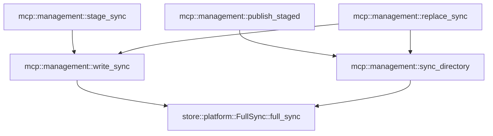

```mermaid
flowchart TD
  n0["mcp::management::scope_rank"]
  n1["mcp::management::canonical"]
  n2["mcp::management::decode_registry_file"]
  n3["mcp::management::dedupe_registry_last_wins"]
  n4["mcp::management::decode_canonical"]
  n5["mcp::management::validate_token"]
  n6["mcp::management::validate_digest"]
  n7["mcp::management::hex_digest"]
  n8["mcp::management::stage_sync"]
  n9["mcp::management::publish_staged"]
  n10["mcp::management::replace_sync"]
  n11["mcp::management::sync_directory"]
  n12["mcp::management::CredentialRegistry::from_registry"]
  n13["mcp::management::McpRegistryStore::load_registry_locked"]
  n14["mcp::management::McpRegistryStore::load_credentials_locked"]
  n15["mcp::management::McpRegistryStore::apply_locked"]
  n16["mcp::management::McpRegistryStore::recover_locked"]
  n17["mcp::management::McpRegistryStore::complete_operation"]
  n18["mcp::management::McpRegistryStore::write_operation"]
  n19["mcp::management::McpRegistryStore::receipt_path"]
  n20["mcp::management::McpRegistryStore::crash"]
  n21["mcp::management::apply_credential_field_operations"]
  n22["mcp::management::credential_fields"]
  n23["mcp::management::set_credential_field"]
  n24["mcp::management::DurableOperation::validate"]
  n25["mcp::management::validate_server"]
  n2 --> n3
  n2 --> n4
  n4 --> n1
  n14 --> n4
  n14 --> n13
  n15 --> n5
  n15 --> n12
  n15 --> n13
  n15 --> n14
  n15 --> n21
  n15 --> n25
  n16 --> n4
  n16 --> n17
  n17 --> n1
  n17 --> n8
  n17 --> n9
  n17 --> n10
  n17 --> n11
  n17 --> n18
  n17 --> n19
  n17 --> n20
  n18 --> n1
  n18 --> n10
  n18 --> n11
  n21 --> n5
  n21 --> n22
  n21 --> n23
  n24 --> n1
  n24 --> n5
  n24 --> n7
```

# mcp::management

[Package atlas](index.md) · [Source](../../src/management.rs)

## Declarations

Visibility is the declaration spelling; trait members and reexports require their enclosing interface. `cfg` is not evaluated.

| Symbol | Kind | Visibility | Test / cfg |
|---|---|---|---|
| [mcp::management::FORMAT](../../src/management.rs#L15) | const_item | `private` |  |
| [mcp::management::McpScope](../../src/management.rs#L19) | enum_item | `pub` |  |
| [mcp::management::McpServerReference](../../src/management.rs#L27) | struct_item | `pub` |  |
| [mcp::management::CredentialValue](../../src/management.rs#L35) | enum_item | `pub` |  |
| [mcp::management::ClosedCredentialValue](../../src/management.rs#L42) | enum_item | `private` |  |
| [mcp::management::CredentialLiteral](../../src/management.rs#L49) | struct_item | `private` |  |
| [mcp::management::CredentialReferenceValue](../../src/management.rs#L55) | struct_item | `private` |  |
| [mcp::management::CredentialValue::deserialize](../../src/management.rs#L60) | function_item | `private` |  |
| [mcp::management::McpTransportConfig](../../src/management.rs#L77) | enum_item | `pub` |  |
| [mcp::management::McpServerConfig](../../src/management.rs#L94) | struct_item | `pub` |  |
| [mcp::management::McpRegistry](../../src/management.rs#L113) | struct_item | `pub` |  |
| [mcp::management::McpRegistry::default](../../src/management.rs#L119) | function_item | `private` |  |
| [mcp::management::McpRegistry::validate](../../src/management.rs#L128) | function_item | `pub` |  |
| [mcp::management::McpRegistry::resolve](../../src/management.rs#L154) | function_item | `pub` |  |
| [mcp::management::McpCredentialReferenceState](../../src/management.rs#L189) | enum_item | `pub` |  |
| [mcp::management::McpCredentialReference](../../src/management.rs#L196) | struct_item | `pub` |  |
| [mcp::management::CredentialRegistry](../../src/management.rs#L205) | struct_item | `private` |  |
| [mcp::management::CredentialRegistry::default](../../src/management.rs#L211) | function_item | `private` |  |
| [mcp::management::CredentialRegistry::from_registry](../../src/management.rs#L220) | function_item | `private` |  |
| [mcp::management::CredentialRegistry::validate](../../src/management.rs#L265) | function_item | `private` |  |
| [mcp::management::McpManagementMutation](../../src/management.rs#L305) | enum_item | `pub` |  |
| [mcp::management::McpCredentialFieldOperation](../../src/management.rs#L332) | enum_item | `pub` |  |
| [mcp::management::McpManagementResult](../../src/management.rs#L340) | enum_item | `pub` |  |
| [mcp::management::McpMutationReceipt](../../src/management.rs#L362) | struct_item | `pub` |  |
| [mcp::management::McpManagementFault](../../src/management.rs#L372) | enum_item | `pub` |  |
| [mcp::management::McpRegistryStore](../../src/management.rs#L382) | struct_item | `pub` |  |
| [mcp::management::McpRegistryStore::root](../../src/management.rs#L388) | function_item | `pub` |  |
| [mcp::management::McpRegistryStore::new](../../src/management.rs#L391) | function_item | `pub` |  |
| [mcp::management::McpRegistryStore::injecting_fault](../../src/management.rs#L399) | function_item | `pub` |  |
| [mcp::management::McpRegistryStore::load](../../src/management.rs#L404) | function_item | `pub` |  |
| [mcp::management::McpRegistryStore::publish](../../src/management.rs#L408) | function_item | `pub` |  |
| [mcp::management::McpRegistryStore::list](../../src/management.rs#L416) | function_item | `pub` |  |
| [mcp::management::McpRegistryStore::get](../../src/management.rs#L425) | function_item | `pub` |  |
| [mcp::management::McpRegistryStore::credential_reference_state](../../src/management.rs#L436) | function_item | `pub` |  |
| [mcp::management::McpRegistryStore::committed_receipt](../../src/management.rs#L459) | function_item | `pub` |  |
| [mcp::management::McpRegistryStore::mutate_idempotent](../../src/management.rs#L483) | function_item | `pub` |  |
| [mcp::management::McpRegistryStore::recover](../../src/management.rs#L533) | function_item | `pub` |  |
| [mcp::management::McpRegistryStore::with_lock](../../src/management.rs#L537) | function_item | `private` |  |
| [mcp::management::McpRegistryStore::load_registry_locked](../../src/management.rs#L547) | function_item | `private` |  |
| [mcp::management::McpRegistryStore::load_credentials_locked](../../src/management.rs#L556) | function_item | `private` |  |
| [mcp::management::McpRegistryStore::apply_locked](../../src/management.rs#L567) | function_item | `private` |  |
| [mcp::management::McpRegistryStore::recover_locked](../../src/management.rs#L727) | function_item | `private` |  |
| [mcp::management::McpRegistryStore::complete_operation](../../src/management.rs#L737) | function_item | `private` |  |
| [mcp::management::McpRegistryStore::write_operation](../../src/management.rs#L771) | function_item | `private` |  |
| [mcp::management::McpRegistryStore::receipt_path](../../src/management.rs#L779) | function_item | `private` |  |
| [mcp::management::McpRegistryStore::crash](../../src/management.rs#L783) | function_item | `private` |  |
| [mcp::management::apply_credential_field_operations](../../src/management.rs#L792) | function_item | `private` |  |
| [mcp::management::credential_fields](../../src/management.rs#L827) | function_item | `private` |  |
| [mcp::management::set_credential_field](../../src/management.rs#L851) | function_item | `private` |  |
| [mcp::management::OperationPhase](../../src/management.rs#L893) | enum_item | `private` |  |
| [mcp::management::DurableOperation](../../src/management.rs#L901) | struct_item | `private` |  |
| [mcp::management::DurableOperation::validate](../../src/management.rs#L913) | function_item | `private` |  |
| [mcp::management::validate_server](../../src/management.rs#L936) | function_item | `private` |  |
| [mcp::management::scope_rank](../../src/management.rs#L1018) | function_item | `private` |  |
| [mcp::management::canonical](../../src/management.rs#L1026) | function_item | `private` |  |
| [mcp::management::decode_registry_file](../../src/management.rs#L1042) | function_item | `private` |  |
| [mcp::management::dedupe_registry_last_wins](../../src/management.rs#L1091) | function_item | `private` |  |
| [mcp::management::decode_canonical](../../src/management.rs#L1121) | function_item | `private` |  |
| [mcp::management::validate_token](../../src/management.rs#L1140) | function_item | `private` |  |
| [mcp::management::validate_digest](../../src/management.rs#L1152) | function_item | `private` |  |
| [mcp::management::hex_digest](../../src/management.rs#L1163) | function_item | `private` |  |
| [mcp::management::stage_sync](../../src/management.rs#L1167) | function_item | `private` |  |
| [mcp::management::publish_staged](../../src/management.rs#L1174) | function_item | `private` |  |
| [mcp::management::replace_sync](../../src/management.rs#L1189) | function_item | `private` |  |
| [mcp::management::write_sync](../../src/management.rs#L1202) | function_item | `private` |  |
| [mcp::management::sync_directory](../../src/management.rs#L1209) | function_item | `private` |  |
| [mcp::management::McpRegistryError](../../src/management.rs#L1215) | enum_item | `pub` |  |

## Imports / reexports

| Local name | Source path | Visibility |
|---|---|---|
| `BTreeMap` | `std::collections::BTreeMap` | `private` |
| `BTreeSet` | `std::collections::BTreeSet` | `private` |
| `fs` | `std::fs` | `private` |
| `File` | `std::fs::File` | `private` |
| `OpenOptions` | `std::fs::OpenOptions` | `private` |
| `Write` | `std::io::Write` | `private` |
| `Path` | `std::path::Path` | `private` |
| `PathBuf` | `std::path::PathBuf` | `private` |
| `PluginComponentReference` | `plugins::PluginComponentReference` | `private` |
| `Deserialize` | `serde::Deserialize` | `private` |
| `Serialize` | `serde::Serialize` | `private` |
| `Digest` | `sha2::Digest` | `private` |
| `Sha256` | `sha2::Sha256` | `private` |
| `FullSync` | `store::FullSync` | `private` |
| `NamedLock` | `store::NamedLock` | `private` |
| `Error` | `thiserror::Error` | `private` |
| `UnicodeNormalization` | `unicode_normalization::UnicodeNormalization` | `private` |
| `ProtocolMode` | `crate::ProtocolMode` | `private` |

## Module declarations

| Module | Visibility | Attributes |
|---|---|---|

## Function call graphs

Edges below are syntactically resolved calls only, including private functions. Graphs partition callers into groups of 20; they are not execution order. All unresolved sites are listed below and in the JSON inventory.

Functions 1–20: 28 direct edges

Functions 21–40: 30 direct edges

Functions 41–45: 6 direct edges

## Call sites

Includes test functions (marked in declarations). Receiver-type-required sites need type analysis/manual tracing. Calls in closures are attributed to their enclosing function; their occurrence here does not mean the closure executes immediately.

| Caller | Callee expression | Source lines | Target / classification |
|---|---|---|---|
| `deserialize` | `ClosedCredentialValue::deserialize` | [64](../../src/management.rs#L64) | external-constructor-callback-or-unresolved |
| `deserialize` | `Ok` | [65](../../src/management.rs#L65), [68](../../src/management.rs#L68) | external-constructor-callback-or-unresolved |
| `default` | `Vec::new` | [122](../../src/management.rs#L122) | external-constructor-callback-or-unresolved |
| `validate` | `Err` | [130](../../src/management.rs#L130), [137](../../src/management.rs#L137), [145](../../src/management.rs#L145) | external-constructor-callback-or-unresolved |
| `validate` | `McpRegistryError::Invalid` | [130](../../src/management.rs#L130), [137](../../src/management.rs#L137), [145](../../src/management.rs#L145) | external-constructor-callback-or-unresolved |
| `validate` | `"format must be 1".to_owned` | [130](../../src/management.rs#L130) | receiver-type-required |
| `validate` | `BTreeSet::new` | [132](../../src/management.rs#L132) | external-constructor-callback-or-unresolved |
| `validate` | `validate_server` | [135](../../src/management.rs#L135) | [mcp::management::validate_server](../../src/management.rs#L936) |
| `validate` | `seen.insert` | [136](../../src/management.rs#L136) | receiver-type-required |
| `validate` | `server.reference.clone` | [136](../../src/management.rs#L136), [149](../../src/management.rs#L149) | receiver-type-required |
| `validate` | `"duplicate MCP server reference".to_owned` | [138](../../src/management.rs#L138) | receiver-type-required |
| `validate` | `previous                 .as_ref()                 .is_some_and` | [141](../../src/management.rs#L141) | receiver-type-required |
| `validate` | `previous                 .as_ref` | [141](../../src/management.rs#L141) | receiver-type-required |
| `validate` | `"MCP servers must be strictly reference-sorted".to_owned` | [146](../../src/management.rs#L146) | receiver-type-required |
| `validate` | `Some` | [149](../../src/management.rs#L149) | external-constructor-callback-or-unresolved |
| `validate` | `Ok` | [151](../../src/management.rs#L151) | external-constructor-callback-or-unresolved |
| `resolve` | `BTreeMap::new` | [155](../../src/management.rs#L155) | external-constructor-callback-or-unresolved |
| `resolve` | `resolved.get` | [165](../../src/management.rs#L165) | receiver-type-required |
| `resolve` | `server.reference.name.as_str` | [165](../../src/management.rs#L165) | receiver-type-required |
| `resolve` | `Err` | [170](../../src/management.rs#L170) | external-constructor-callback-or-unresolved |
| `resolve` | `McpRegistryError::Conflict` | [170](../../src/management.rs#L170) | external-constructor-callback-or-unresolved |
| `resolve` | `scope_rank` | [176](../../src/management.rs#L176), [177](../../src/management.rs#L177) | [mcp::management::scope_rank](../../src/management.rs#L1018) |
| `resolve` | `resolved.insert` | [179](../../src/management.rs#L179) | receiver-type-required |
| `resolve` | `Ok` | [183](../../src/management.rs#L183) | external-constructor-callback-or-unresolved |
| `resolve` | `resolved.into_values().collect` | [183](../../src/management.rs#L183) | receiver-type-required |
| `resolve` | `resolved.into_values` | [183](../../src/management.rs#L183) | receiver-type-required |
| `default` | `Vec::new` | [214](../../src/management.rs#L214) | external-constructor-callback-or-unresolved |
| `from_registry` | `registry             .servers             .iter()             .flat_map(&#124;server&#124; {                 credential_fields(server)                     .into_iter()                     .map(&#124;(field, credential_id)&#124; {                         let state = if pending.is_some_and(&#124;(reference, credential)&#124; {                             reference == &server.reference && credential == credential_id                         }) {                             McpCredentialReferenceState::Pending                         } else {                             prior                                 .references                                 .iter()                                 .find(&#124;item&#124; {                                     item.server == server.reference                                         && item.field == field                                         && item.credential_id == credential_id                                 })                                 .map_or(McpCredentialReferenceState::Bound, &#124;item&#124; {                                     item.state.clone()                                 })                         };                         McpCredentialReference {                             credential_id,                             server: server.reference.clone(),                             field,                             state,                         }                     })             })             .collect::<Vec<_>>` | [225](../../src/management.rs#L225) | receiver-type-required |
| `from_registry` | `registry             .servers             .iter()             .flat_map` | [225](../../src/management.rs#L225) | receiver-type-required |
| `from_registry` | `registry             .servers             .iter` | [225](../../src/management.rs#L225) | receiver-type-required |
| `from_registry` | `credential_fields(server)                     .into_iter()                     .map` | [229](../../src/management.rs#L229) | receiver-type-required |
| `from_registry` | `credential_fields(server)                     .into_iter` | [229](../../src/management.rs#L229) | receiver-type-required |
| `from_registry` | `credential_fields` | [229](../../src/management.rs#L229) | [mcp::management::credential_fields](../../src/management.rs#L827) |
| `from_registry` | `pending.is_some_and` | [232](../../src/management.rs#L232) | receiver-type-required |
| `from_registry` | `prior                                 .references                                 .iter()                                 .find(&#124;item&#124; {                                     item.server == server.reference                                         && item.field == field                                         && item.credential_id == credential_id                                 })                                 .map_or` | [237](../../src/management.rs#L237) | receiver-type-required |
| `from_registry` | `prior                                 .references                                 .iter()                                 .find` | [237](../../src/management.rs#L237) | receiver-type-required |
| `from_registry` | `prior                                 .references                                 .iter` | [237](../../src/management.rs#L237) | receiver-type-required |
| `from_registry` | `item.state.clone` | [246](../../src/management.rs#L246) | receiver-type-required |
| `from_registry` | `server.reference.clone` | [251](../../src/management.rs#L251) | receiver-type-required |
| `from_registry` | `references.sort` | [258](../../src/management.rs#L258) | receiver-type-required |
| `validate` | `Err` | [267](../../src/management.rs#L267), [276](../../src/management.rs#L276), [281](../../src/management.rs#L281), [293](../../src/management.rs#L293) | external-constructor-callback-or-unresolved |
| `validate` | `McpRegistryError::Invalid` | [267](../../src/management.rs#L267), [276](../../src/management.rs#L276), [281](../../src/management.rs#L281), [290](../../src/management.rs#L290), [293](../../src/management.rs#L293) | external-constructor-callback-or-unresolved |
| `validate` | `"credential reference format must be 1".to_owned` | [268](../../src/management.rs#L268) | receiver-type-required |
| `validate` | `BTreeSet::new` | [272](../../src/management.rs#L272) | external-constructor-callback-or-unresolved |
| `validate` | `validate_token` | [274](../../src/management.rs#L274) | [mcp::management::validate_token](../../src/management.rs#L1140) |
| `validate` | `previous.as_ref().is_some_and` | [275](../../src/management.rs#L275) | receiver-type-required |
| `validate` | `previous.as_ref` | [275](../../src/management.rs#L275) | receiver-type-required |
| `validate` | `"credential references must be strictly sorted".to_owned` | [277](../../src/management.rs#L277) | receiver-type-required |
| `validate` | `fields.insert` | [280](../../src/management.rs#L280) | receiver-type-required |
| `validate` | `reference.server.clone` | [280](../../src/management.rs#L280) | receiver-type-required |
| `validate` | `reference.field.clone` | [280](../../src/management.rs#L280) | receiver-type-required |
| `validate` | `"MCP server has duplicate credential field references".to_owned` | [282](../../src/management.rs#L282) | receiver-type-required |
| `validate` | `registry                 .servers                 .iter()                 .find(&#124;server&#124; server.reference == reference.server)                 .ok_or_else` | [285](../../src/management.rs#L285) | receiver-type-required |
| `validate` | `registry                 .servers                 .iter()                 .find` | [285](../../src/management.rs#L285) | receiver-type-required |
| `validate` | `registry                 .servers                 .iter` | [285](../../src/management.rs#L285) | receiver-type-required |
| `validate` | `"credential reference has no MCP server".to_owned` | [290](../../src/management.rs#L290) | receiver-type-required |
| `validate` | `credential_fields(server).get` | [292](../../src/management.rs#L292) | receiver-type-required |
| `validate` | `credential_fields` | [292](../../src/management.rs#L292) | [mcp::management::credential_fields](../../src/management.rs#L827) |
| `validate` | `Some` | [292](../../src/management.rs#L292), [297](../../src/management.rs#L297) | external-constructor-callback-or-unresolved |
| `validate` | `"credential reference differs from MCP field binding".to_owned` | [294](../../src/management.rs#L294) | receiver-type-required |
| `validate` | `Ok` | [299](../../src/management.rs#L299) | external-constructor-callback-or-unresolved |
| `new` | `root.into` | [393](../../src/management.rs#L393) | receiver-type-required |
| `injecting_fault` | `Some` | [400](../../src/management.rs#L400) | external-constructor-callback-or-unresolved |
| `load` | `self.with_lock` | [405](../../src/management.rs#L405) | [mcp::management::McpRegistryStore::with_lock](../../src/management.rs#L537) |
| `load` | `store.load_registry_locked` | [405](../../src/management.rs#L405) | receiver-type-required |
| `publish` | `registry.validate` | [409](../../src/management.rs#L409) | receiver-type-required |
| `publish` | `self.with_lock` | [410](../../src/management.rs#L410) | [mcp::management::McpRegistryStore::with_lock](../../src/management.rs#L537) |
| `publish` | `replace_sync` | [411](../../src/management.rs#L411) | [mcp::management::replace_sync](../../src/management.rs#L1189) |
| `publish` | `store.root.join` | [411](../../src/management.rs#L411) | receiver-type-required |
| `publish` | `canonical` | [411](../../src/management.rs#L411) | [mcp::management::canonical](../../src/management.rs#L1026) |
| `publish` | `sync_directory` | [412](../../src/management.rs#L412) | [mcp::management::sync_directory](../../src/management.rs#L1209) |
| `list` | `Ok` | [417](../../src/management.rs#L417) | external-constructor-callback-or-unresolved |
| `list` | `self             .load()?             .servers             .into_iter()             .filter(&#124;server&#124; server.reference.workspace_id == workspace_id)             .collect` | [417](../../src/management.rs#L417) | receiver-type-required |
| `list` | `self             .load()?             .servers             .into_iter()             .filter` | [417](../../src/management.rs#L417) | receiver-type-required |
| `list` | `self             .load()?             .servers             .into_iter` | [417](../../src/management.rs#L417) | receiver-type-required |
| `list` | `self             .load` | [417](../../src/management.rs#L417) | [mcp::management::McpRegistryStore::load](../../src/management.rs#L404) |
| `get` | `Ok` | [429](../../src/management.rs#L429) | external-constructor-callback-or-unresolved |
| `get` | `self             .load()?             .servers             .into_iter()             .find` | [429](../../src/management.rs#L429) | receiver-type-required |
| `get` | `self             .load()?             .servers             .into_iter` | [429](../../src/management.rs#L429) | receiver-type-required |
| `get` | `self             .load` | [429](../../src/management.rs#L429) | [mcp::management::McpRegistryStore::load](../../src/management.rs#L404) |
| `credential_reference_state` | `self.with_lock` | [442](../../src/management.rs#L442) | [mcp::management::McpRegistryStore::with_lock](../../src/management.rs#L537) |
| `credential_reference_state` | `Ok` | [443](../../src/management.rs#L443) | external-constructor-callback-or-unresolved |
| `credential_reference_state` | `store                 .load_credentials_locked()?                 .references                 .into_iter()                 .find(&#124;reference&#124; {                     &reference.server == server                         && reference.field == field                         && reference.credential_id == credential_id                 })                 .map` | [443](../../src/management.rs#L443) | receiver-type-required |
| `credential_reference_state` | `store                 .load_credentials_locked()?                 .references                 .into_iter()                 .find` | [443](../../src/management.rs#L443) | receiver-type-required |
| `credential_reference_state` | `store                 .load_credentials_locked()?                 .references                 .into_iter` | [443](../../src/management.rs#L443) | receiver-type-required |
| `credential_reference_state` | `store                 .load_credentials_locked` | [443](../../src/management.rs#L443) | receiver-type-required |
| `committed_receipt` | `validate_token` | [464](../../src/management.rs#L464) | [mcp::management::validate_token](../../src/management.rs#L1140) |
| `committed_receipt` | `hex_digest` | [465](../../src/management.rs#L465) | [mcp::management::hex_digest](../../src/management.rs#L1163) |
| `committed_receipt` | `canonical` | [465](../../src/management.rs#L465) | [mcp::management::canonical](../../src/management.rs#L1026) |
| `committed_receipt` | `self.with_lock` | [466](../../src/management.rs#L466) | [mcp::management::McpRegistryStore::with_lock](../../src/management.rs#L537) |
| `committed_receipt` | `store.receipt_path` | [467](../../src/management.rs#L467) | receiver-type-required |
| `committed_receipt` | `path.exists` | [468](../../src/management.rs#L468) | receiver-type-required |
| `committed_receipt` | `Ok` | [469](../../src/management.rs#L469), [473](../../src/management.rs#L473) | external-constructor-callback-or-unresolved |
| `committed_receipt` | `decode_canonical` | [471](../../src/management.rs#L471) | [mcp::management::decode_canonical](../../src/management.rs#L1121) |
| `committed_receipt` | `fs::read` | [471](../../src/management.rs#L471) | external-constructor-callback-or-unresolved |
| `committed_receipt` | `Some` | [473](../../src/management.rs#L473) | external-constructor-callback-or-unresolved |
| `committed_receipt` | `Err` | [475](../../src/management.rs#L475) | external-constructor-callback-or-unresolved |
| `committed_receipt` | `McpRegistryError::Conflict` | [475](../../src/management.rs#L475) | external-constructor-callback-or-unresolved |
| `committed_receipt` | `"rpc id was already committed for a different management request".to_owned` | [476](../../src/management.rs#L476) | receiver-type-required |
| `mutate_idempotent` | `validate_token` | [488](../../src/management.rs#L488), [494](../../src/management.rs#L494) | [mcp::management::validate_token](../../src/management.rs#L1140) |
| `mutate_idempotent` | `hex_digest` | [489](../../src/management.rs#L489), [512](../../src/management.rs#L512), [513](../../src/management.rs#L513) | [mcp::management::hex_digest](../../src/management.rs#L1163) |
| `mutate_idempotent` | `canonical` | [489](../../src/management.rs#L489), [506](../../src/management.rs#L506), [507](../../src/management.rs#L507) | [mcp::management::canonical](../../src/management.rs#L1026) |
| `mutate_idempotent` | `self.with_lock` | [490](../../src/management.rs#L490) | [mcp::management::McpRegistryStore::with_lock](../../src/management.rs#L537) |
| `mutate_idempotent` | `store.receipt_path` | [491](../../src/management.rs#L491) | receiver-type-required |
| `mutate_idempotent` | `receipt_path.exists` | [492](../../src/management.rs#L492) | receiver-type-required |
| `mutate_idempotent` | `decode_canonical` | [493](../../src/management.rs#L493) | [mcp::management::decode_canonical](../../src/management.rs#L1121) |
| `mutate_idempotent` | `fs::read` | [493](../../src/management.rs#L493) | external-constructor-callback-or-unresolved |
| `mutate_idempotent` | `validate_digest` | [495](../../src/management.rs#L495), [496](../../src/management.rs#L496), [497](../../src/management.rs#L497) | [mcp::management::validate_digest](../../src/management.rs#L1152) |
| `mutate_idempotent` | `Ok` | [499](../../src/management.rs#L499), [529](../../src/management.rs#L529) | external-constructor-callback-or-unresolved |
| `mutate_idempotent` | `Err` | [501](../../src/management.rs#L501) | external-constructor-callback-or-unresolved |
| `mutate_idempotent` | `McpRegistryError::Conflict` | [501](../../src/management.rs#L501) | external-constructor-callback-or-unresolved |
| `mutate_idempotent` | `"rpc id was already committed for a different management request".to_owned` | [502](../../src/management.rs#L502) | receiver-type-required |
| `mutate_idempotent` | `store.apply_locked` | [505](../../src/management.rs#L505) | receiver-type-required |
| `mutate_idempotent` | `rpc_id.to_owned` | [510](../../src/management.rs#L510), [518](../../src/management.rs#L518) | receiver-type-required |
| `mutate_idempotent` | `receipt.request_digest.clone` | [519](../../src/management.rs#L519) | receiver-type-required |
| `mutate_idempotent` | `mutation.clone` | [520](../../src/management.rs#L520) | receiver-type-required |
| `mutate_idempotent` | `receipt.clone` | [524](../../src/management.rs#L524) | receiver-type-required |
| `mutate_idempotent` | `store.write_operation` | [526](../../src/management.rs#L526) | receiver-type-required |
| `mutate_idempotent` | `store.crash` | [527](../../src/management.rs#L527) | receiver-type-required |
| `mutate_idempotent` | `store.complete_operation` | [528](../../src/management.rs#L528) | receiver-type-required |
| `recover` | `self.with_lock` | [534](../../src/management.rs#L534) | [mcp::management::McpRegistryStore::with_lock](../../src/management.rs#L537) |
| `recover` | `Ok` | [534](../../src/management.rs#L534) | external-constructor-callback-or-unresolved |
| `with_lock` | `fs::create_dir_all` | [541](../../src/management.rs#L541) | external-constructor-callback-or-unresolved |
| `with_lock` | `NamedLock::exclusive` | [542](../../src/management.rs#L542) | [store::platform::NamedLock::exclusive](../../../store/src/platform.rs#L103) |
| `with_lock` | `self.root.join` | [542](../../src/management.rs#L542) | receiver-type-required |
| `with_lock` | `self.recover_locked` | [543](../../src/management.rs#L543) | [mcp::management::McpRegistryStore::recover_locked](../../src/management.rs#L727) |
| `with_lock` | `action` | [544](../../src/management.rs#L544) | external-constructor-callback-or-unresolved |
| `load_registry_locked` | `self.root.join` | [548](../../src/management.rs#L548) | receiver-type-required |
| `load_registry_locked` | `path.exists` | [549](../../src/management.rs#L549) | receiver-type-required |
| `load_registry_locked` | `decode_registry_file` | [550](../../src/management.rs#L550) | [mcp::management::decode_registry_file](../../src/management.rs#L1042) |
| `load_registry_locked` | `fs::read` | [550](../../src/management.rs#L550) | external-constructor-callback-or-unresolved |
| `load_registry_locked` | `Ok` | [552](../../src/management.rs#L552) | external-constructor-callback-or-unresolved |
| `load_registry_locked` | `McpRegistry::default` | [552](../../src/management.rs#L552) | external-constructor-callback-or-unresolved |
| `load_credentials_locked` | `self.root.join` | [557](../../src/management.rs#L557) | receiver-type-required |
| `load_credentials_locked` | `path.exists` | [558](../../src/management.rs#L558) | receiver-type-required |
| `load_credentials_locked` | `decode_canonical` | [559](../../src/management.rs#L559) | [mcp::management::decode_canonical](../../src/management.rs#L1121) |
| `load_credentials_locked` | `fs::read` | [559](../../src/management.rs#L559) | external-constructor-callback-or-unresolved |
| `load_credentials_locked` | `credentials.validate` | [560](../../src/management.rs#L560) | receiver-type-required |
| `load_credentials_locked` | `self.load_registry_locked` | [560](../../src/management.rs#L560) | [mcp::management::McpRegistryStore::load_registry_locked](../../src/management.rs#L547) |
| `load_credentials_locked` | `Ok` | [561](../../src/management.rs#L561), [563](../../src/management.rs#L563) | external-constructor-callback-or-unresolved |
| `load_credentials_locked` | `CredentialRegistry::default` | [563](../../src/management.rs#L563) | external-constructor-callback-or-unresolved |
| `apply_locked` | `self.load_registry_locked` | [571](../../src/management.rs#L571) | [mcp::management::McpRegistryStore::load_registry_locked](../../src/management.rs#L547) |
| `apply_locked` | `self.load_credentials_locked` | [572](../../src/management.rs#L572) | [mcp::management::McpRegistryStore::load_credentials_locked](../../src/management.rs#L556) |
| `apply_locked` | `registry                     .servers                     .iter()                     .find` | [579](../../src/management.rs#L579), [683](../../src/management.rs#L683) | receiver-type-required |
| `apply_locked` | `registry                     .servers                     .iter` | [579](../../src/management.rs#L579), [602](../../src/management.rs#L602), [683](../../src/management.rs#L683) | receiver-type-required |
| `apply_locked` | `apply_credential_field_operations` | [584](../../src/management.rs#L584) | [mcp::management::apply_credential_field_operations](../../src/management.rs#L792) |
| `apply_locked` | `validate_server` | [585](../../src/management.rs#L585) | [mcp::management::validate_server](../../src/management.rs#L936) |
| `apply_locked` | `Err` | [587](../../src/management.rs#L587), [600](../../src/management.rs#L600), [607](../../src/management.rs#L607), [632](../../src/management.rs#L632), [637](../../src/management.rs#L637), [645](../../src/management.rs#L645), [658](../../src/management.rs#L658), [666](../../src/management.rs#L666), [681](../../src/management.rs#L681), [689](../../src/management.rs#L689), [694](../../src/management.rs#L694), [703](../../src/management.rs#L703), [708](../../src/management.rs#L708) | external-constructor-callback-or-unresolved |
| `apply_locked` | `registry                     .servers                     .retain` | [589](../../src/management.rs#L589) | receiver-type-required |
| `apply_locked` | `registry.servers.push` | [592](../../src/management.rs#L592) | receiver-type-required |
| `apply_locked` | `server.clone` | [592](../../src/management.rs#L592) | receiver-type-required |
| `apply_locked` | `registry                     .servers                     .sort_by` | [593](../../src/management.rs#L593) | receiver-type-required |
| `apply_locked` | `left.reference.cmp` | [595](../../src/management.rs#L595) | receiver-type-required |
| `apply_locked` | `registry                     .servers                     .iter()                     .any` | [602](../../src/management.rs#L602) | receiver-type-required |
| `apply_locked` | `registry.servers.retain` | [609](../../src/management.rs#L609) | receiver-type-required |
| `apply_locked` | `reference.clone` | [611](../../src/management.rs#L611), [672](../../src/management.rs#L672), [714](../../src/management.rs#L714) | receiver-type-required |
| `apply_locked` | `validate_token` | [619](../../src/management.rs#L619), [679](../../src/management.rs#L679) | [mcp::management::validate_token](../../src/management.rs#L1140) |
| `apply_locked` | `url::Url::parse(authorization_url)                     .map_err` | [620](../../src/management.rs#L620) | receiver-type-required |
| `apply_locked` | `url::Url::parse` | [620](../../src/management.rs#L620) | external-constructor-callback-or-unresolved |
| `apply_locked` | `McpRegistryError::Invalid` | [621](../../src/management.rs#L621), [632](../../src/management.rs#L632), [645](../../src/management.rs#L645), [666](../../src/management.rs#L666), [689](../../src/management.rs#L689), [694](../../src/management.rs#L694), [703](../../src/management.rs#L703), [708](../../src/management.rs#L708) | external-constructor-callback-or-unresolved |
| `apply_locked` | `error.to_string` | [621](../../src/management.rs#L621) | receiver-type-required |
| `apply_locked` | `parsed.scheme` | [622](../../src/management.rs#L622) | receiver-type-required |
| `apply_locked` | `parsed.username` | [623](../../src/management.rs#L623) | receiver-type-required |
| `apply_locked` | `parsed.password().is_some` | [624](../../src/management.rs#L624) | receiver-type-required |
| `apply_locked` | `parsed.password` | [624](../../src/management.rs#L624) | receiver-type-required |
| `apply_locked` | `parsed.query_pairs().any` | [625](../../src/management.rs#L625) | receiver-type-required |
| `apply_locked` | `parsed.query_pairs` | [625](../../src/management.rs#L625) | receiver-type-required |
| `apply_locked` | `"OAuth authorization URL must be credential-free HTTPS".to_owned` | [633](../../src/management.rs#L633) | receiver-type-required |
| `apply_locked` | `registry                     .servers                     .iter_mut()                     .find(&#124;item&#124; &item.reference == reference)                     .ok_or` | [639](../../src/management.rs#L639), [660](../../src/management.rs#L660) | receiver-type-required |
| `apply_locked` | `registry                     .servers                     .iter_mut()                     .find` | [639](../../src/management.rs#L639), [660](../../src/management.rs#L660) | receiver-type-required |
| `apply_locked` | `registry                     .servers                     .iter_mut` | [639](../../src/management.rs#L639), [660](../../src/management.rs#L660) | receiver-type-required |
| `apply_locked` | `"OAuth requires an HTTP MCP server".to_owned` | [646](../../src/management.rs#L646), [667](../../src/management.rs#L667), [690](../../src/management.rs#L690) | receiver-type-required |
| `apply_locked` | `Some` | [649](../../src/management.rs#L649), [650](../../src/management.rs#L650), [693](../../src/management.rs#L693) | external-constructor-callback-or-unresolved |
| `apply_locked` | `credential_id.clone` | [649](../../src/management.rs#L649), [652](../../src/management.rs#L652), [715](../../src/management.rs#L715) | receiver-type-required |
| `apply_locked` | `credential_id.as_str` | [650](../../src/management.rs#L650) | receiver-type-required |
| `apply_locked` | `authorization_url.clone` | [653](../../src/management.rs#L653) | receiver-type-required |
| `apply_locked` | `registry                     .servers                     .iter()                     .find(&#124;item&#124; &item.reference == reference)                     .ok_or` | [683](../../src/management.rs#L683) | receiver-type-required |
| `apply_locked` | `oauth.as_deref` | [693](../../src/management.rs#L693) | receiver-type-required |
| `apply_locked` | `"OAuth completion does not own the pending credential reference".to_owned` | [695](../../src/management.rs#L695) | receiver-type-required |
| `apply_locked` | `credentials.references.iter_mut().find` | [698](../../src/management.rs#L698) | receiver-type-required |
| `apply_locked` | `credentials.references.iter_mut` | [698](../../src/management.rs#L698) | receiver-type-required |
| `apply_locked` | `"OAuth completion has no pending credential reference".to_owned` | [704](../../src/management.rs#L704) | receiver-type-required |
| `apply_locked` | `"OAuth credential reference is not pending".to_owned` | [709](../../src/management.rs#L709) | receiver-type-required |
| `apply_locked` | `registry.validate` | [719](../../src/management.rs#L719) | receiver-type-required |
| `apply_locked` | `CredentialRegistry::from_registry` | [721](../../src/management.rs#L721) | [mcp::management::CredentialRegistry::from_registry](../../src/management.rs#L220) |
| `apply_locked` | `credentials.validate` | [723](../../src/management.rs#L723) | receiver-type-required |
| `apply_locked` | `Ok` | [724](../../src/management.rs#L724) | external-constructor-callback-or-unresolved |
| `recover_locked` | `self.root.join` | [728](../../src/management.rs#L728) | receiver-type-required |
| `recover_locked` | `path.exists` | [729](../../src/management.rs#L729) | receiver-type-required |
| `recover_locked` | `Ok` | [730](../../src/management.rs#L730) | external-constructor-callback-or-unresolved |
| `recover_locked` | `decode_canonical` | [732](../../src/management.rs#L732) | [mcp::management::decode_canonical](../../src/management.rs#L1121) |
| `recover_locked` | `fs::read` | [732](../../src/management.rs#L732) | external-constructor-callback-or-unresolved |
| `recover_locked` | `operation.validate` | [733](../../src/management.rs#L733) | receiver-type-required |
| `recover_locked` | `self.complete_operation` | [734](../../src/management.rs#L734) | [mcp::management::McpRegistryStore::complete_operation](../../src/management.rs#L737) |
| `complete_operation` | `canonical` | [738](../../src/management.rs#L738), [739](../../src/management.rs#L739), [764](../../src/management.rs#L764) | [mcp::management::canonical](../../src/management.rs#L1026) |
| `complete_operation` | `stage_sync` | [740](../../src/management.rs#L740), [742](../../src/management.rs#L742) | [mcp::management::stage_sync](../../src/management.rs#L1167) |
| `complete_operation` | `self.root.join` | [740](../../src/management.rs#L740), [743](../../src/management.rs#L743), [760](../../src/management.rs#L760), [767](../../src/management.rs#L767) | receiver-type-required |
| `complete_operation` | `self.crash` | [741](../../src/management.rs#L741), [746](../../src/management.rs#L746), [750](../../src/management.rs#L750), [756](../../src/management.rs#L756), [759](../../src/management.rs#L759) | [mcp::management::McpRegistryStore::crash](../../src/management.rs#L783) |
| `complete_operation` | `self.write_operation` | [748](../../src/management.rs#L748), [758](../../src/management.rs#L758) | [mcp::management::McpRegistryStore::write_operation](../../src/management.rs#L771) |
| `complete_operation` | `publish_staged` | [749](../../src/management.rs#L749), [751](../../src/management.rs#L751) | [mcp::management::publish_staged](../../src/management.rs#L1174) |
| `complete_operation` | `fs::create_dir_all` | [761](../../src/management.rs#L761) | external-constructor-callback-or-unresolved |
| `complete_operation` | `replace_sync` | [762](../../src/management.rs#L762) | [mcp::management::replace_sync](../../src/management.rs#L1189) |
| `complete_operation` | `self.receipt_path` | [763](../../src/management.rs#L763) | [mcp::management::McpRegistryStore::receipt_path](../../src/management.rs#L779) |
| `complete_operation` | `sync_directory` | [766](../../src/management.rs#L766), [768](../../src/management.rs#L768) | [mcp::management::sync_directory](../../src/management.rs#L1209) |
| `complete_operation` | `fs::remove_file` | [767](../../src/management.rs#L767) | external-constructor-callback-or-unresolved |
| `write_operation` | `replace_sync` | [772](../../src/management.rs#L772) | [mcp::management::replace_sync](../../src/management.rs#L1189) |
| `write_operation` | `self.root.join` | [773](../../src/management.rs#L773) | receiver-type-required |
| `write_operation` | `canonical` | [774](../../src/management.rs#L774) | [mcp::management::canonical](../../src/management.rs#L1026) |
| `write_operation` | `sync_directory` | [776](../../src/management.rs#L776) | [mcp::management::sync_directory](../../src/management.rs#L1209) |
| `receipt_path` | `self.root.join("receipts").join` | [780](../../src/management.rs#L780) | receiver-type-required |
| `receipt_path` | `self.root.join` | [780](../../src/management.rs#L780) | receiver-type-required |
| `crash` | `Some` | [784](../../src/management.rs#L784) | external-constructor-callback-or-unresolved |
| `crash` | `Err` | [785](../../src/management.rs#L785) | external-constructor-callback-or-unresolved |
| `crash` | `McpRegistryError::InjectedFault` | [785](../../src/management.rs#L785) | external-constructor-callback-or-unresolved |
| `crash` | `Ok` | [787](../../src/management.rs#L787) | external-constructor-callback-or-unresolved |
| `apply_credential_field_operations` | `proposed.clone` | [797](../../src/management.rs#L797) | receiver-type-required |
| `apply_credential_field_operations` | `credential_fields` | [798](../../src/management.rs#L798) | [mcp::management::credential_fields](../../src/management.rs#L827) |
| `apply_credential_field_operations` | `proposed_credentials.is_empty` | [799](../../src/management.rs#L799) | receiver-type-required |
| `apply_credential_field_operations` | `Err` | [800](../../src/management.rs#L800) | external-constructor-callback-or-unresolved |
| `apply_credential_field_operations` | `McpRegistryError::Invalid` | [800](../../src/management.rs#L800) | external-constructor-callback-or-unresolved |
| `apply_credential_field_operations` | `"save transport embeds credential ids; use credentialFields replace operations"                 .to_owned` | [801](../../src/management.rs#L801) | receiver-type-required |
| `apply_credential_field_operations` | `existing.map(credential_fields).unwrap_or_default` | [805](../../src/management.rs#L805) | receiver-type-required |
| `apply_credential_field_operations` | `existing.map` | [805](../../src/management.rs#L805) | receiver-type-required |
| `apply_credential_field_operations` | `existing_credentials         .keys()         .chain(operations.keys())         .cloned()         .collect::<BTreeSet<_>>` | [806](../../src/management.rs#L806) | receiver-type-required |
| `apply_credential_field_operations` | `existing_credentials         .keys()         .chain(operations.keys())         .cloned` | [806](../../src/management.rs#L806) | receiver-type-required |
| `apply_credential_field_operations` | `existing_credentials         .keys()         .chain` | [806](../../src/management.rs#L806) | receiver-type-required |
| `apply_credential_field_operations` | `existing_credentials         .keys` | [806](../../src/management.rs#L806) | receiver-type-required |
| `apply_credential_field_operations` | `operations.keys` | [808](../../src/management.rs#L808) | receiver-type-required |
| `apply_credential_field_operations` | `std::mem::take` | [811](../../src/management.rs#L811) | external-constructor-callback-or-unresolved |
| `apply_credential_field_operations` | `operations.get` | [812](../../src/management.rs#L812) | receiver-type-required |
| `apply_credential_field_operations` | `existing_credentials.get(&key).cloned` | [814](../../src/management.rs#L814) | receiver-type-required |
| `apply_credential_field_operations` | `existing_credentials.get` | [814](../../src/management.rs#L814) | receiver-type-required |
| `apply_credential_field_operations` | `validate_token` | [817](../../src/management.rs#L817) | [mcp::management::validate_token](../../src/management.rs#L1140) |
| `apply_credential_field_operations` | `Some` | [818](../../src/management.rs#L818) | external-constructor-callback-or-unresolved |
| `apply_credential_field_operations` | `credential_id.clone` | [818](../../src/management.rs#L818) | receiver-type-required |
| `apply_credential_field_operations` | `set_credential_field` | [822](../../src/management.rs#L822) | [mcp::management::set_credential_field](../../src/management.rs#L851) |
| `apply_credential_field_operations` | `Ok` | [824](../../src/management.rs#L824) | external-constructor-callback-or-unresolved |
| `credential_fields` | `BTreeMap::new` | [828](../../src/management.rs#L828) | external-constructor-callback-or-unresolved |
| `credential_fields` | `fields.insert` | [833](../../src/management.rs#L833), [840](../../src/management.rs#L840), [844](../../src/management.rs#L844) | receiver-type-required |
| `credential_fields` | `credential.clone` | [833](../../src/management.rs#L833), [840](../../src/management.rs#L840), [844](../../src/management.rs#L844) | receiver-type-required |
| `credential_fields` | `"oauth".to_owned` | [844](../../src/management.rs#L844) | receiver-type-required |
| `set_credential_field` | `key.split_once` | [856](../../src/management.rs#L856) | receiver-type-required |
| `set_credential_field` | `name.is_empty` | [858](../../src/management.rs#L858), [869](../../src/management.rs#L869) | receiver-type-required |
| `set_credential_field` | `environment.insert` | [862](../../src/management.rs#L862) | receiver-type-required |
| `set_credential_field` | `name.to_owned` | [862](../../src/management.rs#L862), [872](../../src/management.rs#L872) | receiver-type-required |
| `set_credential_field` | `environment.remove` | [865](../../src/management.rs#L865) | receiver-type-required |
| `set_credential_field` | `headers.insert` | [872](../../src/management.rs#L872) | receiver-type-required |
| `set_credential_field` | `headers.remove` | [875](../../src/management.rs#L875) | receiver-type-required |
| `set_credential_field` | `Err` | [883](../../src/management.rs#L883) | external-constructor-callback-or-unresolved |
| `set_credential_field` | `McpRegistryError::Invalid` | [883](../../src/management.rs#L883) | external-constructor-callback-or-unresolved |
| `set_credential_field` | `Ok` | [888](../../src/management.rs#L888) | external-constructor-callback-or-unresolved |
| `validate` | `self.registry.validate` | [914](../../src/management.rs#L914) | receiver-type-required |
| `validate` | `self.credentials.validate` | [915](../../src/management.rs#L915) | receiver-type-required |
| `validate` | `validate_token` | [916](../../src/management.rs#L916) | [mcp::management::validate_token](../../src/management.rs#L1140) |
| `validate` | `hex_digest` | [917](../../src/management.rs#L917), [918](../../src/management.rs#L918), [919](../../src/management.rs#L919) | [mcp::management::hex_digest](../../src/management.rs#L1163) |
| `validate` | `canonical` | [917](../../src/management.rs#L917), [918](../../src/management.rs#L918), [919](../../src/management.rs#L919) | [mcp::management::canonical](../../src/management.rs#L1026) |
| `validate` | `Err` | [928](../../src/management.rs#L928) | external-constructor-callback-or-unresolved |
| `validate` | `McpRegistryError::Invalid` | [928](../../src/management.rs#L928) | external-constructor-callback-or-unresolved |
| `validate` | `"durable MCP operation and receipt digests differ".to_owned` | [929](../../src/management.rs#L929) | receiver-type-required |
| `validate` | `Ok` | [932](../../src/management.rs#L932) | external-constructor-callback-or-unresolved |
| `validate_server` | `folder.len` | [940](../../src/management.rs#L940) | receiver-type-required |
| `validate_server` | `folder                 .bytes()                 .all` | [941](../../src/management.rs#L941) | receiver-type-required |
| `validate_server` | `folder                 .bytes` | [941](../../src/management.rs#L941) | receiver-type-required |
| `validate_server` | `byte.is_ascii_hexdigit` | [943](../../src/management.rs#L943) | receiver-type-required |
| `validate_server` | `byte.is_ascii_uppercase` | [943](../../src/management.rs#L943) | receiver-type-required |
| `validate_server` | `Err` | [945](../../src/management.rs#L945), [954](../../src/management.rs#L954), [973](../../src/management.rs#L973), [978](../../src/management.rs#L978), [986](../../src/management.rs#L986), [1000](../../src/management.rs#L1000), [1009](../../src/management.rs#L1009) | external-constructor-callback-or-unresolved |
| `validate_server` | `McpRegistryError::Invalid` | [945](../../src/management.rs#L945), [954](../../src/management.rs#L954), [965](../../src/management.rs#L965), [968](../../src/management.rs#L968), [973](../../src/management.rs#L973), [978](../../src/management.rs#L978), [986](../../src/management.rs#L986), [1000](../../src/management.rs#L1000), [1007](../../src/management.rs#L1007), [1009](../../src/management.rs#L1009) | external-constructor-callback-or-unresolved |
| `validate_server` | `"invalid project folder_id".into` | [946](../../src/management.rs#L946) | receiver-type-required |
| `validate_server` | `reference.workspace_id.is_empty` | [949](../../src/management.rs#L949) | receiver-type-required |
| `validate_server` | `reference.name.is_empty` | [950](../../src/management.rs#L950) | receiver-type-required |
| `validate_server` | `reference.name.len` | [951](../../src/management.rs#L951) | receiver-type-required |
| `validate_server` | `reference.name.nfc().collect::<String>` | [952](../../src/management.rs#L952) | receiver-type-required |
| `validate_server` | `reference.name.nfc` | [952](../../src/management.rs#L952) | receiver-type-required |
| `validate_server` | `"invalid MCP workspace/name identity".to_owned` | [955](../../src/management.rs#L955) | receiver-type-required |
| `validate_server` | `server                 .owner                 .as_deref()                 .filter(&#124;value&#124; !value.is_empty())                 .ok_or_else` | [960](../../src/management.rs#L960) | receiver-type-required |
| `validate_server` | `server                 .owner                 .as_deref()                 .filter` | [960](../../src/management.rs#L960) | receiver-type-required |
| `validate_server` | `server                 .owner                 .as_deref` | [960](../../src/management.rs#L960) | receiver-type-required |
| `validate_server` | `value.is_empty` | [963](../../src/management.rs#L963) | receiver-type-required |
| `validate_server` | `"plugin MCP server requires owner".to_owned` | [965](../../src/management.rs#L965) | receiver-type-required |
| `validate_server` | `server.plugin_component.as_ref().ok_or_else` | [967](../../src/management.rs#L967) | receiver-type-required |
| `validate_server` | `server.plugin_component.as_ref` | [967](../../src/management.rs#L967) | receiver-type-required |
| `validate_server` | `"plugin MCP server requires component reference".to_owned` | [969](../../src/management.rs#L969) | receiver-type-required |
| `validate_server` | `"plugin owner and component reference differ".to_owned` | [974](../../src/management.rs#L974) | receiver-type-required |
| `validate_server` | `"plugin MCP server must use stdio".to_owned` | [979](../../src/management.rs#L979) | receiver-type-required |
| `validate_server` | `server.owner.is_some` | [984](../../src/management.rs#L984) | receiver-type-required |
| `validate_server` | `server.plugin_component.is_some` | [984](../../src/management.rs#L984) | receiver-type-required |
| `validate_server` | `"standalone MCP server cannot claim plugin ownership".to_owned` | [987](../../src/management.rs#L987) | receiver-type-required |
| `validate_server` | `command.first().is_none_or` | [995](../../src/management.rs#L995) | receiver-type-required |
| `validate_server` | `command.first` | [995](../../src/management.rs#L995) | receiver-type-required |
| `validate_server` | `cwd                         .as_ref()                         .is_some_and` | [996](../../src/management.rs#L996) | receiver-type-required |
| `validate_server` | `cwd                         .as_ref` | [996](../../src/management.rs#L996) | receiver-type-required |
| `validate_server` | `Path::new(path).is_absolute` | [998](../../src/management.rs#L998) | receiver-type-required |
| `validate_server` | `Path::new` | [998](../../src/management.rs#L998) | external-constructor-callback-or-unresolved |
| `validate_server` | `"invalid stdio MCP transport".to_owned` | [1001](../../src/management.rs#L1001) | receiver-type-required |
| `validate_server` | `url::Url::parse(url)                 .map_err` | [1006](../../src/management.rs#L1006) | receiver-type-required |
| `validate_server` | `url::Url::parse` | [1006](../../src/management.rs#L1006) | external-constructor-callback-or-unresolved |
| `validate_server` | `error.to_string` | [1007](../../src/management.rs#L1007) | receiver-type-required |
| `validate_server` | `url.scheme` | [1008](../../src/management.rs#L1008) | receiver-type-required |
| `validate_server` | `"production HTTP MCP URL must use https".to_owned` | [1010](../../src/management.rs#L1010) | receiver-type-required |
| `validate_server` | `Ok` | [1015](../../src/management.rs#L1015) | external-constructor-callback-or-unresolved |
| `canonical` | `serde_json_canonicalizer::to_vec(value)         .map_err` | [1027](../../src/management.rs#L1027) | receiver-type-required |
| `canonical` | `serde_json_canonicalizer::to_vec` | [1027](../../src/management.rs#L1027) | external-constructor-callback-or-unresolved |
| `canonical` | `McpRegistryError::Invalid` | [1028](../../src/management.rs#L1028) | external-constructor-callback-or-unresolved |
| `canonical` | `error.to_string` | [1028](../../src/management.rs#L1028) | receiver-type-required |
| `canonical` | `bytes.push` | [1029](../../src/management.rs#L1029) | receiver-type-required |
| `canonical` | `Ok` | [1030](../../src/management.rs#L1030) | external-constructor-callback-or-unresolved |
| `decode_registry_file` | `bytes.is_empty` | [1044](../../src/management.rs#L1044) | receiver-type-required |
| `decode_registry_file` | `bytes.ends_with` | [1044](../../src/management.rs#L1044) | receiver-type-required |
| `decode_registry_file` | `bytes.to_vec` | [1047](../../src/management.rs#L1047) | receiver-type-required |
| `decode_registry_file` | `repaired.push` | [1048](../../src/management.rs#L1048) | receiver-type-required |
| `decode_registry_file` | `McpRegistryError::Invalid` | [1053](../../src/management.rs#L1053), [1069](../../src/management.rs#L1069) | external-constructor-callback-or-unresolved |
| `decode_registry_file` | `decode_canonical(bytes).map_err` | [1057](../../src/management.rs#L1057) | receiver-type-required |
| `decode_registry_file` | `decode_canonical` | [1057](../../src/management.rs#L1057) | [mcp::management::decode_canonical](../../src/management.rs#L1121) |
| `decode_registry_file` | `BTreeMap::new` | [1058](../../src/management.rs#L1058) | external-constructor-callback-or-unresolved |
| `decode_registry_file` | `registry         .servers         .iter()         .filter` | [1059](../../src/management.rs#L1059) | receiver-type-required |
| `decode_registry_file` | `registry         .servers         .iter` | [1059](../../src/management.rs#L1059) | receiver-type-required |
| `decode_registry_file` | `server.clone` | [1064](../../src/management.rs#L1064) | receiver-type-required |
| `decode_registry_file` | `active.insert` | [1066](../../src/management.rs#L1066) | receiver-type-required |
| `decode_registry_file` | `server.reference.clone` | [1066](../../src/management.rs#L1066) | receiver-type-required |
| `decode_registry_file` | `comparable.clone` | [1066](../../src/management.rs#L1066) | receiver-type-required |
| `decode_registry_file` | `Err` | [1069](../../src/management.rs#L1069) | external-constructor-callback-or-unresolved |
| `decode_registry_file` | `name_file` | [1069](../../src/management.rs#L1069) | external-constructor-callback-or-unresolved |
| `decode_registry_file` | `"conflicting active user MCP aliases; repair duplicate rows".into` | [1070](../../src/management.rs#L1070) | receiver-type-required |
| `decode_registry_file` | `dedupe_registry_last_wins` | [1074](../../src/management.rs#L1074) | [mcp::management::dedupe_registry_last_wins](../../src/management.rs#L1091) |
| `decode_registry_file` | `registry.validate().map_err` | [1084](../../src/management.rs#L1084) | receiver-type-required |
| `decode_registry_file` | `registry.validate` | [1084](../../src/management.rs#L1084) | receiver-type-required |
| `decode_registry_file` | `Ok` | [1085](../../src/management.rs#L1085) | external-constructor-callback-or-unresolved |
| `dedupe_registry_last_wins` | `BTreeMap::new` | [1092](../../src/management.rs#L1092) | external-constructor-callback-or-unresolved |
| `dedupe_registry_last_wins` | `Vec::new` | [1093](../../src/management.rs#L1093) | external-constructor-callback-or-unresolved |
| `dedupe_registry_last_wins` | `registry.servers.iter().enumerate` | [1094](../../src/management.rs#L1094) | receiver-type-required |
| `dedupe_registry_last_wins` | `registry.servers.iter` | [1094](../../src/management.rs#L1094) | receiver-type-required |
| `dedupe_registry_last_wins` | `last_index.insert(server.reference.clone(), index).is_some` | [1095](../../src/management.rs#L1095) | receiver-type-required |
| `dedupe_registry_last_wins` | `last_index.insert` | [1095](../../src/management.rs#L1095) | receiver-type-required |
| `dedupe_registry_last_wins` | `server.reference.clone` | [1095](../../src/management.rs#L1095), [1098](../../src/management.rs#L1098) | receiver-type-required |
| `dedupe_registry_last_wins` | `duplicates.contains` | [1096](../../src/management.rs#L1096) | receiver-type-required |
| `dedupe_registry_last_wins` | `duplicates.push` | [1098](../../src/management.rs#L1098) | receiver-type-required |
| `dedupe_registry_last_wins` | `registry         .servers         .windows(2)         .all` | [1101](../../src/management.rs#L1101) | receiver-type-required |
| `dedupe_registry_last_wins` | `registry         .servers         .windows` | [1101](../../src/management.rs#L1101) | receiver-type-required |
| `dedupe_registry_last_wins` | `duplicates.is_empty` | [1105](../../src/management.rs#L1105) | receiver-type-required |
| `dedupe_registry_last_wins` | `std::mem::take` | [1108](../../src/management.rs#L1108) | external-constructor-callback-or-unresolved |
| `dedupe_registry_last_wins` | `servers         .into_iter()         .enumerate()         .filter(&#124;(index, server)&#124; last_index[&server.reference] == *index)         .map(&#124;(_, server)&#124; server)         .collect` | [1109](../../src/management.rs#L1109) | receiver-type-required |
| `dedupe_registry_last_wins` | `servers         .into_iter()         .enumerate()         .filter(&#124;(index, server)&#124; last_index[&server.reference] == *index)         .map` | [1109](../../src/management.rs#L1109) | receiver-type-required |
| `dedupe_registry_last_wins` | `servers         .into_iter()         .enumerate()         .filter` | [1109](../../src/management.rs#L1109) | receiver-type-required |
| `dedupe_registry_last_wins` | `servers         .into_iter()         .enumerate` | [1109](../../src/management.rs#L1109) | receiver-type-required |
| `dedupe_registry_last_wins` | `servers         .into_iter` | [1109](../../src/management.rs#L1109) | receiver-type-required |
| `dedupe_registry_last_wins` | `registry         .servers         .sort_by` | [1115](../../src/management.rs#L1115) | receiver-type-required |
| `dedupe_registry_last_wins` | `left.reference.cmp` | [1117](../../src/management.rs#L1117) | receiver-type-required |
| `decode_canonical` | `bytes.ends_with` | [1125](../../src/management.rs#L1125) | receiver-type-required |
| `decode_canonical` | `bytes[..bytes.len().saturating_sub(1)].contains` | [1125](../../src/management.rs#L1125) | receiver-type-required |
| `decode_canonical` | `bytes.len().saturating_sub` | [1125](../../src/management.rs#L1125) | receiver-type-required |
| `decode_canonical` | `bytes.len` | [1125](../../src/management.rs#L1125), [1130](../../src/management.rs#L1130) | receiver-type-required |
| `decode_canonical` | `Err` | [1126](../../src/management.rs#L1126), [1133](../../src/management.rs#L1133) | external-constructor-callback-or-unresolved |
| `decode_canonical` | `McpRegistryError::Invalid` | [1126](../../src/management.rs#L1126), [1131](../../src/management.rs#L1131), [1133](../../src/management.rs#L1133) | external-constructor-callback-or-unresolved |
| `decode_canonical` | `"record must be one canonical JSON line".to_owned` | [1127](../../src/management.rs#L1127) | receiver-type-required |
| `decode_canonical` | `serde_json::from_slice(&bytes[..bytes.len() - 1])         .map_err` | [1130](../../src/management.rs#L1130) | receiver-type-required |
| `decode_canonical` | `serde_json::from_slice` | [1130](../../src/management.rs#L1130) | external-constructor-callback-or-unresolved |
| `decode_canonical` | `error.to_string` | [1131](../../src/management.rs#L1131) | receiver-type-required |
| `decode_canonical` | `canonical` | [1132](../../src/management.rs#L1132) | [mcp::management::canonical](../../src/management.rs#L1026) |
| `decode_canonical` | `"record bytes are not canonical".to_owned` | [1134](../../src/management.rs#L1134) | receiver-type-required |
| `decode_canonical` | `Ok` | [1137](../../src/management.rs#L1137) | external-constructor-callback-or-unresolved |
| `validate_token` | `value.is_empty` | [1141](../../src/management.rs#L1141) | receiver-type-required |
| `validate_token` | `value.len` | [1142](../../src/management.rs#L1142) | receiver-type-required |
| `validate_token` | `value             .bytes()             .all` | [1143](../../src/management.rs#L1143) | receiver-type-required |
| `validate_token` | `value             .bytes` | [1143](../../src/management.rs#L1143) | receiver-type-required |
| `validate_token` | `byte.is_ascii_alphanumeric` | [1145](../../src/management.rs#L1145) | receiver-type-required |
| `validate_token` | `Err` | [1147](../../src/management.rs#L1147) | external-constructor-callback-or-unresolved |
| `validate_token` | `McpRegistryError::Invalid` | [1147](../../src/management.rs#L1147) | external-constructor-callback-or-unresolved |
| `validate_token` | `Ok` | [1149](../../src/management.rs#L1149) | external-constructor-callback-or-unresolved |
| `validate_digest` | `value.len` | [1153](../../src/management.rs#L1153) | receiver-type-required |
| `validate_digest` | `value             .bytes()             .all` | [1154](../../src/management.rs#L1154) | receiver-type-required |
| `validate_digest` | `value             .bytes` | [1154](../../src/management.rs#L1154) | receiver-type-required |
| `validate_digest` | `byte.is_ascii_digit` | [1156](../../src/management.rs#L1156) | receiver-type-required |
| `validate_digest` | `(b'a'..=b'f').contains` | [1156](../../src/management.rs#L1156) | receiver-type-required |
| `validate_digest` | `Err` | [1158](../../src/management.rs#L1158) | external-constructor-callback-or-unresolved |
| `validate_digest` | `McpRegistryError::Invalid` | [1158](../../src/management.rs#L1158) | external-constructor-callback-or-unresolved |
| `validate_digest` | `Ok` | [1160](../../src/management.rs#L1160) | external-constructor-callback-or-unresolved |
| `stage_sync` | `path.exists` | [1168](../../src/management.rs#L1168) | receiver-type-required |
| `stage_sync` | `fs::remove_file` | [1169](../../src/management.rs#L1169) | external-constructor-callback-or-unresolved |
| `stage_sync` | `write_sync` | [1171](../../src/management.rs#L1171) | [mcp::management::write_sync](../../src/management.rs#L1202) |
| `publish_staged` | `root.join` | [1175](../../src/management.rs#L1175), [1176](../../src/management.rs#L1176) | receiver-type-required |
| `publish_staged` | `staged.exists` | [1177](../../src/management.rs#L1177) | receiver-type-required |
| `publish_staged` | `fs::rename` | [1178](../../src/management.rs#L1178) | external-constructor-callback-or-unresolved |
| `publish_staged` | `sync_directory` | [1179](../../src/management.rs#L1179) | [mcp::management::sync_directory](../../src/management.rs#L1209) |
| `publish_staged` | `destination.exists` | [1181](../../src/management.rs#L1181) | receiver-type-required |
| `publish_staged` | `fs::read` | [1181](../../src/management.rs#L1181) | external-constructor-callback-or-unresolved |
| `publish_staged` | `Err` | [1182](../../src/management.rs#L1182) | external-constructor-callback-or-unresolved |
| `publish_staged` | `McpRegistryError::Invalid` | [1182](../../src/management.rs#L1182) | external-constructor-callback-or-unresolved |
| `publish_staged` | `"published management bytes differ from durable operation".to_owned` | [1183](../../src/management.rs#L1183) | receiver-type-required |
| `publish_staged` | `Ok` | [1186](../../src/management.rs#L1186) | external-constructor-callback-or-unresolved |
| `replace_sync` | `path.with_extension` | [1190](../../src/management.rs#L1190) | receiver-type-required |
| `replace_sync` | `temporary.exists` | [1191](../../src/management.rs#L1191) | receiver-type-required |
| `replace_sync` | `fs::remove_file` | [1192](../../src/management.rs#L1192) | external-constructor-callback-or-unresolved |
| `replace_sync` | `write_sync` | [1194](../../src/management.rs#L1194) | [mcp::management::write_sync](../../src/management.rs#L1202) |
| `replace_sync` | `fs::rename` | [1195](../../src/management.rs#L1195) | external-constructor-callback-or-unresolved |
| `replace_sync` | `path.parent` | [1196](../../src/management.rs#L1196) | receiver-type-required |
| `replace_sync` | `sync_directory` | [1197](../../src/management.rs#L1197) | [mcp::management::sync_directory](../../src/management.rs#L1209) |
| `replace_sync` | `Ok` | [1199](../../src/management.rs#L1199) | external-constructor-callback-or-unresolved |
| `write_sync` | `OpenOptions::new().create_new(true).write(true).open` | [1203](../../src/management.rs#L1203) | receiver-type-required |
| `write_sync` | `OpenOptions::new().create_new(true).write` | [1203](../../src/management.rs#L1203) | receiver-type-required |
| `write_sync` | `OpenOptions::new().create_new` | [1203](../../src/management.rs#L1203) | receiver-type-required |
| `write_sync` | `OpenOptions::new` | [1203](../../src/management.rs#L1203) | external-constructor-callback-or-unresolved |
| `write_sync` | `file.write_all` | [1204](../../src/management.rs#L1204) | receiver-type-required |
| `write_sync` | `FullSync::full_sync` | [1205](../../src/management.rs#L1205) | [store::platform::FullSync::full_sync](../../../store/src/platform.rs#L31) |
| `write_sync` | `Ok` | [1206](../../src/management.rs#L1206) | external-constructor-callback-or-unresolved |
| `sync_directory` | `FullSync::full_sync` | [1210](../../src/management.rs#L1210) | [store::platform::FullSync::full_sync](../../../store/src/platform.rs#L31) |
| `sync_directory` | `File::open` | [1210](../../src/management.rs#L1210) | external-constructor-callback-or-unresolved |
| `sync_directory` | `Ok` | [1211](../../src/management.rs#L1211) | external-constructor-callback-or-unresolved |
