# mcp::pool

[Package atlas](index.md) · [Source](../../src/pool.rs)

## Declarations

Visibility is the declaration spelling; trait members and reexports require their enclosing interface. `cfg` is not evaluated.

| Symbol | Kind | Visibility | Test / cfg |
|---|---|---|---|
| [mcp::pool::McpPoolKey](../../src/pool.rs#L10) | struct_item | `pub` |  |
| [mcp::pool::PooledPeer](../../src/pool.rs#L17) | type_item | `pub` |  |
| [mcp::pool::PoolEntry](../../src/pool.rs#L19) | struct_item | `private` |  |
| [mcp::pool::McpPool](../../src/pool.rs#L26) | struct_item | `pub` |  |
| [mcp::pool::CreationSlot](../../src/pool.rs#L31) | struct_item | `private` |  |
| [mcp::pool::McpPoolLease](../../src/pool.rs#L36) | struct_item | `pub` |  |
| [mcp::pool::McpPoolLease::peer](../../src/pool.rs#L45) | function_item | `pub` |  |
| [mcp::pool::McpPoolLease::release](../../src/pool.rs#L49) | function_item | `pub` |  |
| [mcp::pool::McpPoolLease::drop](../../src/pool.rs#L56) | function_item | `private` |  |
| [mcp::pool::McpPool::new](../../src/pool.rs#L72) | function_item | `pub` |  |
| [mcp::pool::McpPool::get](../../src/pool.rs#L76) | function_item | `pub` |  |
| [mcp::pool::McpPool::retain](../../src/pool.rs#L84) | function_item | `pub(crate)` |  |
| [mcp::pool::McpPool::acquire_or_create](../../src/pool.rs#L91) | function_item | `pub` |  |
| [mcp::pool::McpPool::reap_revoked](../../src/pool.rs#L172) | function_item | `pub` |  |
| [mcp::pool::McpPool::insert](../../src/pool.rs#L191) | function_item | `pub` |  |
| [mcp::pool::McpPool::replace_generation](../../src/pool.rs#L221) | function_item | `pub` |  |
| [mcp::pool::McpPool::remove](../../src/pool.rs#L280) | function_item | `pub` |  |
| [mcp::pool::McpPool::release](../../src/pool.rs#L291) | function_item | `pub` |  |
| [mcp::pool::McpPool::drain](../../src/pool.rs#L310) | function_item | `pub` |  |
| [mcp::pool::McpPoolError](../../src/pool.rs#L326) | enum_item | `pub` |  |

## Imports / reexports

| Local name | Source path | Visibility |
|---|---|---|
| `BTreeMap` | `std::collections::BTreeMap` | `private` |
| `Future` | `std::future::Future` | `private` |
| `Arc` | `std::sync::Arc` | `private` |
| `Mutex` | `tokio::sync::Mutex` | `private` |
| `Notify` | `tokio::sync::Notify` | `private` |
| `RwLock` | `tokio::sync::RwLock` | `private` |
| `McpError` | `crate::McpError` | `private` |
| `McpPeer` | `crate::McpPeer` | `private` |

## Module declarations

| Module | Visibility | Attributes |
|---|---|---|

## Function call graphs

Edges below are syntactically resolved calls only, including private functions. Graphs partition callers into groups of 20; they are not execution order. All unresolved sites are listed below and in the JSON inventory.

```mermaid
flowchart TD
  n0["mcp::pool::McpPool::reap_revoked"]
  n1["mcp::pool::McpPool::insert"]
  n2["mcp::pool::McpPool::replace_generation"]
  n3["mcp::pool::McpPool::remove"]
  n4["mcp::pool::McpPool::release"]
  n5["mcp::pool::McpPool::drain"]
  n6["mcp::pool::McpPoolLease::peer"]
  n7["mcp::pool::McpPoolLease::release"]
  n8["mcp::pool::McpPoolLease::drop"]
  n9["mcp::pool::McpPool::new"]
  n10["mcp::pool::McpPool::get"]
  n11["mcp::pool::McpPool::retain"]
  n12["mcp::pool::McpPool::acquire_or_create"]
  n0 --> n3
  n12 --> n2
  n12 --> n11
```

Functions 1–13: 3 direct edges

## Call sites

Includes test functions (marked in declarations). Receiver-type-required sites need type analysis/manual tracing. Calls in closures are attributed to their enclosing function; their occurrence here does not mean the closure executes immediately.

| Caller | Callee expression | Source lines | Target / classification |
|---|---|---|---|
| `peer` | `Arc::clone` | [46](../../src/pool.rs#L46) | external-constructor-callback-or-unresolved |
| `release` | `self.pool.release` | [51](../../src/pool.rs#L51) | receiver-type-required |
| `drop` | `Arc::clone` | [60](../../src/pool.rs#L60) | external-constructor-callback-or-unresolved |
| `drop` | `self.key.clone` | [61](../../src/pool.rs#L61) | receiver-type-required |
| `drop` | `tokio::runtime::Handle::try_current` | [62](../../src/pool.rs#L62) | external-constructor-callback-or-unresolved |
| `drop` | `runtime.spawn` | [63](../../src/pool.rs#L63) | receiver-type-required |
| `drop` | `pool.release` | [64](../../src/pool.rs#L64) | receiver-type-required |
| `new` | `Self::default` | [73](../../src/pool.rs#L73) | external-constructor-callback-or-unresolved |
| `get` | `self.peers             .read()             .await             .get(key)             .map` | [77](../../src/pool.rs#L77) | receiver-type-required |
| `get` | `self.peers             .read()             .await             .get` | [77](../../src/pool.rs#L77) | receiver-type-required |
| `get` | `self.peers             .read` | [77](../../src/pool.rs#L77) | receiver-type-required |
| `get` | `Arc::clone` | [81](../../src/pool.rs#L81) | external-constructor-callback-or-unresolved |
| `retain` | `self.peers.write` | [85](../../src/pool.rs#L85) | receiver-type-required |
| `retain` | `peers.get_mut` | [86](../../src/pool.rs#L86) | receiver-type-required |
| `retain` | `entry.clients.saturating_add` | [87](../../src/pool.rs#L87) | receiver-type-required |
| `retain` | `Some` | [88](../../src/pool.rs#L88) | external-constructor-callback-or-unresolved |
| `retain` | `Arc::clone` | [88](../../src/pool.rs#L88) | external-constructor-callback-or-unresolved |
| `acquire_or_create` | `self.retain` | [101](../../src/pool.rs#L101), [151](../../src/pool.rs#L151) | [mcp::pool::McpPool::retain](../../src/pool.rs#L84) |
| `acquire_or_create` | `Ok` | [102](../../src/pool.rs#L102), [131](../../src/pool.rs#L131), [137](../../src/pool.rs#L137), [156](../../src/pool.rs#L156) | external-constructor-callback-or-unresolved |
| `acquire_or_create` | `Arc::clone` | [103](../../src/pool.rs#L103), [112](../../src/pool.rs#L112), [118](../../src/pool.rs#L118), [131](../../src/pool.rs#L131), [138](../../src/pool.rs#L138), [157](../../src/pool.rs#L157) | external-constructor-callback-or-unresolved |
| `acquire_or_create` | `self.creations.lock` | [110](../../src/pool.rs#L110), [135](../../src/pool.rs#L135) | receiver-type-required |
| `acquire_or_create` | `creations.get` | [111](../../src/pool.rs#L111) | receiver-type-required |
| `acquire_or_create` | `Arc::new` | [114](../../src/pool.rs#L114) | external-constructor-callback-or-unresolved |
| `acquire_or_create` | `Mutex::new` | [115](../../src/pool.rs#L115) | external-constructor-callback-or-unresolved |
| `acquire_or_create` | `Notify::new` | [116](../../src/pool.rs#L116) | external-constructor-callback-or-unresolved |
| `acquire_or_create` | `creations.insert` | [118](../../src/pool.rs#L118) | receiver-type-required |
| `acquire_or_create` | `key.clone` | [118](../../src/pool.rs#L118), [125](../../src/pool.rs#L125) | receiver-type-required |
| `acquire_or_create` | `factory` | [123](../../src/pool.rs#L123) | external-constructor-callback-or-unresolved |
| `acquire_or_create` | `self                     .replace_generation(key.clone(), peer, always_on)                     .await                     .map_err` | [124](../../src/pool.rs#L124) | receiver-type-required |
| `acquire_or_create` | `self                     .replace_generation` | [124](../../src/pool.rs#L124) | [mcp::pool::McpPool::replace_generation](../../src/pool.rs#L221) |
| `acquire_or_create` | `McpError::Transport` | [127](../../src/pool.rs#L127), [152](../../src/pool.rs#L152) | external-constructor-callback-or-unresolved |
| `acquire_or_create` | `error.to_string` | [127](../../src/pool.rs#L127) | receiver-type-required |
| `acquire_or_create` | `Err` | [128](../../src/pool.rs#L128), [132](../../src/pool.rs#L132), [163](../../src/pool.rs#L163) | external-constructor-callback-or-unresolved |
| `acquire_or_create` | `slot.outcome.lock` | [130](../../src/pool.rs#L130), [148](../../src/pool.rs#L148) | receiver-type-required |
| `acquire_or_create` | `Some` | [130](../../src/pool.rs#L130) | external-constructor-callback-or-unresolved |
| `acquire_or_create` | `error.clone` | [132](../../src/pool.rs#L132), [163](../../src/pool.rs#L163) | receiver-type-required |
| `acquire_or_create` | `slot.ready.notify_waiters` | [134](../../src/pool.rs#L134) | receiver-type-required |
| `acquire_or_create` | `self.creations.lock().await.remove` | [135](../../src/pool.rs#L135) | receiver-type-required |
| `acquire_or_create` | `slot.ready.notified` | [145](../../src/pool.rs#L145) | receiver-type-required |
| `acquire_or_create` | `notified.as_mut().enable` | [147](../../src/pool.rs#L147) | receiver-type-required |
| `acquire_or_create` | `notified.as_mut` | [147](../../src/pool.rs#L147) | receiver-type-required |
| `acquire_or_create` | `slot.outcome.lock().await.as_ref` | [148](../../src/pool.rs#L148) | receiver-type-required |
| `acquire_or_create` | `self.retain(&key).await.ok_or_else` | [151](../../src/pool.rs#L151) | receiver-type-required |
| `acquire_or_create` | `"MCP peer disappeared after single-flight creation".to_owned` | [153](../../src/pool.rs#L153) | receiver-type-required |
| `reap_revoked` | `self             .peers             .read()             .await             .iter()             .map(&#124;(key, entry)&#124; (key.clone(), Arc::clone(&entry.peer)))             .collect::<Vec<_>>` | [173](../../src/pool.rs#L173) | receiver-type-required |
| `reap_revoked` | `self             .peers             .read()             .await             .iter()             .map` | [173](../../src/pool.rs#L173) | receiver-type-required |
| `reap_revoked` | `self             .peers             .read()             .await             .iter` | [173](../../src/pool.rs#L173) | receiver-type-required |
| `reap_revoked` | `self             .peers             .read` | [173](../../src/pool.rs#L173) | receiver-type-required |
| `reap_revoked` | `key.clone` | [178](../../src/pool.rs#L178) | receiver-type-required |
| `reap_revoked` | `Arc::clone` | [178](../../src/pool.rs#L178) | external-constructor-callback-or-unresolved |
| `reap_revoked` | `peer                 .try_lock()                 .ok()                 .is_some_and` | [181](../../src/pool.rs#L181) | receiver-type-required |
| `reap_revoked` | `peer                 .try_lock()                 .ok` | [181](../../src/pool.rs#L181) | receiver-type-required |
| `reap_revoked` | `peer                 .try_lock` | [181](../../src/pool.rs#L181) | receiver-type-required |
| `reap_revoked` | `guard.admit().is_err` | [184](../../src/pool.rs#L184) | receiver-type-required |
| `reap_revoked` | `guard.admit` | [184](../../src/pool.rs#L184) | receiver-type-required |
| `reap_revoked` | `self.remove` | [186](../../src/pool.rs#L186) | [mcp::pool::McpPool::remove](../../src/pool.rs#L280) |
| `insert` | `self.peers.write` | [196](../../src/pool.rs#L196) | receiver-type-required |
| `insert` | `peers.get_mut` | [197](../../src/pool.rs#L197) | receiver-type-required |
| `insert` | `existing.clients.saturating_add` | [198](../../src/pool.rs#L198) | receiver-type-required |
| `insert` | `Arc::clone` | [199](../../src/pool.rs#L199), [210](../../src/pool.rs#L210) | external-constructor-callback-or-unresolved |
| `insert` | `drop` | [200](../../src/pool.rs#L200) | external-constructor-callback-or-unresolved |
| `insert` | `peer.close()                 .await                 .map_err` | [201](../../src/pool.rs#L201) | receiver-type-required |
| `insert` | `peer.close` | [201](../../src/pool.rs#L201) | receiver-type-required |
| `insert` | `McpPoolError::Close` | [203](../../src/pool.rs#L203) | external-constructor-callback-or-unresolved |
| `insert` | `error.to_string` | [203](../../src/pool.rs#L203) | receiver-type-required |
| `insert` | `Ok` | [204](../../src/pool.rs#L204), [215](../../src/pool.rs#L215) | external-constructor-callback-or-unresolved |
| `insert` | `Arc::new` | [206](../../src/pool.rs#L206) | external-constructor-callback-or-unresolved |
| `insert` | `Mutex::new` | [206](../../src/pool.rs#L206) | external-constructor-callback-or-unresolved |
| `insert` | `peers.insert` | [207](../../src/pool.rs#L207) | receiver-type-required |
| `replace_generation` | `self.peers.write` | [227](../../src/pool.rs#L227) | receiver-type-required |
| `replace_generation` | `peers             .keys()             .filter(&#124;existing&#124; {                 existing.session_id == key.session_id                     && existing.connection == key.connection                     && *existing != &key             })             .cloned()             .collect::<Vec<_>>` | [228](../../src/pool.rs#L228) | receiver-type-required |
| `replace_generation` | `peers             .keys()             .filter(&#124;existing&#124; {                 existing.session_id == key.session_id                     && existing.connection == key.connection                     && *existing != &key             })             .cloned` | [228](../../src/pool.rs#L228) | receiver-type-required |
| `replace_generation` | `peers             .keys()             .filter` | [228](../../src/pool.rs#L228) | receiver-type-required |
| `replace_generation` | `peers             .keys` | [228](../../src/pool.rs#L228) | receiver-type-required |
| `replace_generation` | `stale_keys             .iter()             .filter_map(&#124;stale&#124; peers.remove(stale))             .collect::<Vec<_>>` | [237](../../src/pool.rs#L237) | receiver-type-required |
| `replace_generation` | `stale_keys             .iter()             .filter_map` | [237](../../src/pool.rs#L237) | receiver-type-required |
| `replace_generation` | `stale_keys             .iter` | [237](../../src/pool.rs#L237) | receiver-type-required |
| `replace_generation` | `peers.remove` | [239](../../src/pool.rs#L239) | receiver-type-required |
| `replace_generation` | `peers.get_mut` | [241](../../src/pool.rs#L241) | receiver-type-required |
| `replace_generation` | `existing.clients.saturating_add` | [242](../../src/pool.rs#L242) | receiver-type-required |
| `replace_generation` | `Arc::clone` | [244](../../src/pool.rs#L244), [263](../../src/pool.rs#L263) | external-constructor-callback-or-unresolved |
| `replace_generation` | `drop` | [245](../../src/pool.rs#L245), [268](../../src/pool.rs#L268) | external-constructor-callback-or-unresolved |
| `replace_generation` | `old.peer                     .lock()                     .await                     .close()                     .await                     .map_err` | [247](../../src/pool.rs#L247) | receiver-type-required |
| `replace_generation` | `old.peer                     .lock()                     .await                     .close` | [247](../../src/pool.rs#L247) | receiver-type-required |
| `replace_generation` | `old.peer                     .lock` | [247](../../src/pool.rs#L247) | receiver-type-required |
| `replace_generation` | `McpPoolError::Close` | [252](../../src/pool.rs#L252), [256](../../src/pool.rs#L256), [275](../../src/pool.rs#L275) | external-constructor-callback-or-unresolved |
| `replace_generation` | `error.to_string` | [252](../../src/pool.rs#L252), [256](../../src/pool.rs#L256), [275](../../src/pool.rs#L275) | receiver-type-required |
| `replace_generation` | `peer.close()                 .await                 .map_err` | [254](../../src/pool.rs#L254) | receiver-type-required |
| `replace_generation` | `peer.close` | [254](../../src/pool.rs#L254) | receiver-type-required |
| `replace_generation` | `Ok` | [257](../../src/pool.rs#L257), [277](../../src/pool.rs#L277) | external-constructor-callback-or-unresolved |
| `replace_generation` | `Arc::new` | [259](../../src/pool.rs#L259) | external-constructor-callback-or-unresolved |
| `replace_generation` | `Mutex::new` | [259](../../src/pool.rs#L259) | external-constructor-callback-or-unresolved |
| `replace_generation` | `peers.insert` | [260](../../src/pool.rs#L260) | receiver-type-required |
| `replace_generation` | `old.peer                 .lock()                 .await                 .close()                 .await                 .map_err` | [270](../../src/pool.rs#L270) | receiver-type-required |
| `replace_generation` | `old.peer                 .lock()                 .await                 .close` | [270](../../src/pool.rs#L270) | receiver-type-required |
| `replace_generation` | `old.peer                 .lock` | [270](../../src/pool.rs#L270) | receiver-type-required |
| `remove` | `self.peers.write().await.remove` | [281](../../src/pool.rs#L281) | receiver-type-required |
| `remove` | `self.peers.write` | [281](../../src/pool.rs#L281) | receiver-type-required |
| `remove` | `Ok` | [283](../../src/pool.rs#L283), [286](../../src/pool.rs#L286) | external-constructor-callback-or-unresolved |
| `remove` | `entry.peer.lock().await.close` | [285](../../src/pool.rs#L285) | receiver-type-required |
| `remove` | `entry.peer.lock` | [285](../../src/pool.rs#L285) | receiver-type-required |
| `release` | `self.peers.write` | [293](../../src/pool.rs#L293) | receiver-type-required |
| `release` | `peers.get_mut` | [294](../../src/pool.rs#L294) | receiver-type-required |
| `release` | `Ok` | [295](../../src/pool.rs#L295), [299](../../src/pool.rs#L299), [305](../../src/pool.rs#L305), [307](../../src/pool.rs#L307) | external-constructor-callback-or-unresolved |
| `release` | `entry.clients.saturating_sub` | [297](../../src/pool.rs#L297) | receiver-type-required |
| `release` | `peers.remove(key).map` | [301](../../src/pool.rs#L301) | receiver-type-required |
| `release` | `peers.remove` | [301](../../src/pool.rs#L301) | receiver-type-required |
| `release` | `peer.lock().await.close` | [304](../../src/pool.rs#L304) | receiver-type-required |
| `release` | `peer.lock` | [304](../../src/pool.rs#L304) | receiver-type-required |
| `drain` | `self.peers.write` | [312](../../src/pool.rs#L312) | receiver-type-required |
| `drain` | `std::mem::take(&mut *peers)                 .into_values()                 .collect::<Vec<_>>` | [313](../../src/pool.rs#L313) | receiver-type-required |
| `drain` | `std::mem::take(&mut *peers)                 .into_values` | [313](../../src/pool.rs#L313) | receiver-type-required |
| `drain` | `std::mem::take` | [313](../../src/pool.rs#L313) | external-constructor-callback-or-unresolved |
| `drain` | `entries.len` | [317](../../src/pool.rs#L317) | receiver-type-required |
| `drain` | `entry.peer.lock().await.close` | [319](../../src/pool.rs#L319) | receiver-type-required |
| `drain` | `entry.peer.lock` | [319](../../src/pool.rs#L319) | receiver-type-required |
| `drain` | `Ok` | [321](../../src/pool.rs#L321) | external-constructor-callback-or-unresolved |
