# mcp::pool

[Package atlas](index.md) · [Source](../../src/pool.rs)

## Declarations

Visibility is the declaration spelling; trait members and reexports require their enclosing interface. `cfg` is not evaluated.

| Symbol | Kind | Visibility | Test / cfg |
|---|---|---|---|
| [mcp::pool::McpPoolKey](../../src/pool.rs#L10) | struct_item | `pub` |  |
| [mcp::pool::PooledPeer](../../src/pool.rs#L20) | type_item | `pub` |  |
| [mcp::pool::PoolEntry](../../src/pool.rs#L22) | struct_item | `private` |  |
| [mcp::pool::McpPool](../../src/pool.rs#L29) | struct_item | `pub` |  |
| [mcp::pool::CreationSlot](../../src/pool.rs#L34) | struct_item | `private` |  |
| [mcp::pool::McpPoolLease](../../src/pool.rs#L39) | struct_item | `pub` |  |
| [mcp::pool::McpPoolLease::peer](../../src/pool.rs#L48) | function_item | `pub` |  |
| [mcp::pool::McpPoolLease::release](../../src/pool.rs#L52) | function_item | `pub` |  |
| [mcp::pool::McpPoolLease::drop](../../src/pool.rs#L59) | function_item | `private` |  |
| [mcp::pool::McpPool::new](../../src/pool.rs#L75) | function_item | `pub` |  |
| [mcp::pool::McpPool::get](../../src/pool.rs#L79) | function_item | `pub` |  |
| [mcp::pool::McpPool::retain](../../src/pool.rs#L87) | function_item | `pub(crate)` |  |
| [mcp::pool::McpPool::acquire_or_create](../../src/pool.rs#L94) | function_item | `pub` |  |
| [mcp::pool::McpPool::reap_revoked](../../src/pool.rs#L175) | function_item | `pub` |  |
| [mcp::pool::McpPool::insert](../../src/pool.rs#L194) | function_item | `pub` |  |
| [mcp::pool::McpPool::replace_generation](../../src/pool.rs#L224) | function_item | `pub` |  |
| [mcp::pool::McpPool::remove](../../src/pool.rs#L284) | function_item | `pub` |  |
| [mcp::pool::McpPool::release](../../src/pool.rs#L295) | function_item | `pub` |  |
| [mcp::pool::McpPool::drain](../../src/pool.rs#L314) | function_item | `pub` |  |
| [mcp::pool::McpPoolError](../../src/pool.rs#L330) | enum_item | `pub` |  |

## Imports / reexports

| Local name | Source path | Visibility |
|---|---|---|
| `BTreeMap` | `std::collections::BTreeMap` | `private` |
| `Future` | `std::future::Future` | `private` |
| `Arc` | `std::sync::Arc` | `private` |
| `Mutex` | `tokio::sync::Mutex` | `private` |
| `Notify` | `tokio::sync::Notify` | `private` |
| `RwLock` | `tokio::sync::RwLock` | `private` |
| `McpError` | `crate::McpError` | `private` |
| `McpPeer` | `crate::McpPeer` | `private` |

## Module declarations

| Module | Visibility | Attributes |
|---|---|---|

## Function call graphs

Edges below are syntactically resolved calls only, including private functions. Graphs partition callers into groups of 20; they are not execution order. All unresolved sites are listed below and in the JSON inventory.

```mermaid
flowchart TD
  n0["mcp::pool::McpPool::reap_revoked"]
  n1["mcp::pool::McpPool::insert"]
  n2["mcp::pool::McpPool::replace_generation"]
  n3["mcp::pool::McpPool::remove"]
  n4["mcp::pool::McpPool::release"]
  n5["mcp::pool::McpPool::drain"]
  n6["mcp::pool::McpPoolLease::peer"]
  n7["mcp::pool::McpPoolLease::release"]
  n8["mcp::pool::McpPoolLease::drop"]
  n9["mcp::pool::McpPool::new"]
  n10["mcp::pool::McpPool::get"]
  n11["mcp::pool::McpPool::retain"]
  n12["mcp::pool::McpPool::acquire_or_create"]
  n0 --> n3
  n12 --> n2
  n12 --> n11
```

Functions 1–13: 3 direct edges

## Call sites

Includes test functions (marked in declarations). Receiver-type-required sites need type analysis/manual tracing. Calls in closures are attributed to their enclosing function; their occurrence here does not mean the closure executes immediately.

| Caller | Callee expression | Source lines | Target / classification |
|---|---|---|---|
| `peer` | `Arc::clone` | [49](../../src/pool.rs#L49) | external-constructor-callback-or-unresolved |
| `release` | `self.pool.release` | [54](../../src/pool.rs#L54) | receiver-type-required |
| `drop` | `Arc::clone` | [63](../../src/pool.rs#L63) | external-constructor-callback-or-unresolved |
| `drop` | `self.key.clone` | [64](../../src/pool.rs#L64) | receiver-type-required |
| `drop` | `tokio::runtime::Handle::try_current` | [65](../../src/pool.rs#L65) | external-constructor-callback-or-unresolved |
| `drop` | `runtime.spawn` | [66](../../src/pool.rs#L66) | receiver-type-required |
| `drop` | `pool.release` | [67](../../src/pool.rs#L67) | receiver-type-required |
| `new` | `Self::default` | [76](../../src/pool.rs#L76) | external-constructor-callback-or-unresolved |
| `get` | `self.peers             .read()             .await             .get(key)             .map` | [80](../../src/pool.rs#L80) | receiver-type-required |
| `get` | `self.peers             .read()             .await             .get` | [80](../../src/pool.rs#L80) | receiver-type-required |
| `get` | `self.peers             .read` | [80](../../src/pool.rs#L80) | receiver-type-required |
| `get` | `Arc::clone` | [84](../../src/pool.rs#L84) | external-constructor-callback-or-unresolved |
| `retain` | `self.peers.write` | [88](../../src/pool.rs#L88) | receiver-type-required |
| `retain` | `peers.get_mut` | [89](../../src/pool.rs#L89) | receiver-type-required |
| `retain` | `entry.clients.saturating_add` | [90](../../src/pool.rs#L90) | receiver-type-required |
| `retain` | `Some` | [91](../../src/pool.rs#L91) | external-constructor-callback-or-unresolved |
| `retain` | `Arc::clone` | [91](../../src/pool.rs#L91) | external-constructor-callback-or-unresolved |
| `acquire_or_create` | `self.retain` | [104](../../src/pool.rs#L104), [154](../../src/pool.rs#L154) | [mcp::pool::McpPool::retain](../../src/pool.rs#L87) |
| `acquire_or_create` | `Ok` | [105](../../src/pool.rs#L105), [134](../../src/pool.rs#L134), [140](../../src/pool.rs#L140), [159](../../src/pool.rs#L159) | external-constructor-callback-or-unresolved |
| `acquire_or_create` | `Arc::clone` | [106](../../src/pool.rs#L106), [115](../../src/pool.rs#L115), [121](../../src/pool.rs#L121), [134](../../src/pool.rs#L134), [141](../../src/pool.rs#L141), [160](../../src/pool.rs#L160) | external-constructor-callback-or-unresolved |
| `acquire_or_create` | `self.creations.lock` | [113](../../src/pool.rs#L113), [138](../../src/pool.rs#L138) | receiver-type-required |
| `acquire_or_create` | `creations.get` | [114](../../src/pool.rs#L114) | receiver-type-required |
| `acquire_or_create` | `Arc::new` | [117](../../src/pool.rs#L117) | external-constructor-callback-or-unresolved |
| `acquire_or_create` | `Mutex::new` | [118](../../src/pool.rs#L118) | external-constructor-callback-or-unresolved |
| `acquire_or_create` | `Notify::new` | [119](../../src/pool.rs#L119) | external-constructor-callback-or-unresolved |
| `acquire_or_create` | `creations.insert` | [121](../../src/pool.rs#L121) | receiver-type-required |
| `acquire_or_create` | `key.clone` | [121](../../src/pool.rs#L121), [128](../../src/pool.rs#L128) | receiver-type-required |
| `acquire_or_create` | `factory` | [126](../../src/pool.rs#L126) | external-constructor-callback-or-unresolved |
| `acquire_or_create` | `self                     .replace_generation(key.clone(), peer, always_on)                     .await                     .map_err` | [127](../../src/pool.rs#L127) | receiver-type-required |
| `acquire_or_create` | `self                     .replace_generation` | [127](../../src/pool.rs#L127) | [mcp::pool::McpPool::replace_generation](../../src/pool.rs#L224) |
| `acquire_or_create` | `McpError::Transport` | [130](../../src/pool.rs#L130), [155](../../src/pool.rs#L155) | external-constructor-callback-or-unresolved |
| `acquire_or_create` | `error.to_string` | [130](../../src/pool.rs#L130) | receiver-type-required |
| `acquire_or_create` | `Err` | [131](../../src/pool.rs#L131), [135](../../src/pool.rs#L135), [166](../../src/pool.rs#L166) | external-constructor-callback-or-unresolved |
| `acquire_or_create` | `slot.outcome.lock` | [133](../../src/pool.rs#L133), [151](../../src/pool.rs#L151) | receiver-type-required |
| `acquire_or_create` | `Some` | [133](../../src/pool.rs#L133) | external-constructor-callback-or-unresolved |
| `acquire_or_create` | `error.clone` | [135](../../src/pool.rs#L135), [166](../../src/pool.rs#L166) | receiver-type-required |
| `acquire_or_create` | `slot.ready.notify_waiters` | [137](../../src/pool.rs#L137) | receiver-type-required |
| `acquire_or_create` | `self.creations.lock().await.remove` | [138](../../src/pool.rs#L138) | receiver-type-required |
| `acquire_or_create` | `slot.ready.notified` | [148](../../src/pool.rs#L148) | receiver-type-required |
| `acquire_or_create` | `notified.as_mut().enable` | [150](../../src/pool.rs#L150) | receiver-type-required |
| `acquire_or_create` | `notified.as_mut` | [150](../../src/pool.rs#L150) | receiver-type-required |
| `acquire_or_create` | `slot.outcome.lock().await.as_ref` | [151](../../src/pool.rs#L151) | receiver-type-required |
| `acquire_or_create` | `self.retain(&key).await.ok_or_else` | [154](../../src/pool.rs#L154) | receiver-type-required |
| `acquire_or_create` | `"MCP peer disappeared after single-flight creation".to_owned` | [156](../../src/pool.rs#L156) | receiver-type-required |
| `reap_revoked` | `self             .peers             .read()             .await             .iter()             .map(&#124;(key, entry)&#124; (key.clone(), Arc::clone(&entry.peer)))             .collect::<Vec<_>>` | [176](../../src/pool.rs#L176) | receiver-type-required |
| `reap_revoked` | `self             .peers             .read()             .await             .iter()             .map` | [176](../../src/pool.rs#L176) | receiver-type-required |
| `reap_revoked` | `self             .peers             .read()             .await             .iter` | [176](../../src/pool.rs#L176) | receiver-type-required |
| `reap_revoked` | `self             .peers             .read` | [176](../../src/pool.rs#L176) | receiver-type-required |
| `reap_revoked` | `key.clone` | [181](../../src/pool.rs#L181) | receiver-type-required |
| `reap_revoked` | `Arc::clone` | [181](../../src/pool.rs#L181) | external-constructor-callback-or-unresolved |
| `reap_revoked` | `peer                 .try_lock()                 .ok()                 .is_some_and` | [184](../../src/pool.rs#L184) | receiver-type-required |
| `reap_revoked` | `peer                 .try_lock()                 .ok` | [184](../../src/pool.rs#L184) | receiver-type-required |
| `reap_revoked` | `peer                 .try_lock` | [184](../../src/pool.rs#L184) | receiver-type-required |
| `reap_revoked` | `guard.admit().is_err` | [187](../../src/pool.rs#L187) | receiver-type-required |
| `reap_revoked` | `guard.admit` | [187](../../src/pool.rs#L187) | receiver-type-required |
| `reap_revoked` | `self.remove` | [189](../../src/pool.rs#L189) | [mcp::pool::McpPool::remove](../../src/pool.rs#L284) |
| `insert` | `self.peers.write` | [199](../../src/pool.rs#L199) | receiver-type-required |
| `insert` | `peers.get_mut` | [200](../../src/pool.rs#L200) | receiver-type-required |
| `insert` | `existing.clients.saturating_add` | [201](../../src/pool.rs#L201) | receiver-type-required |
| `insert` | `Arc::clone` | [202](../../src/pool.rs#L202), [213](../../src/pool.rs#L213) | external-constructor-callback-or-unresolved |
| `insert` | `drop` | [203](../../src/pool.rs#L203) | external-constructor-callback-or-unresolved |
| `insert` | `peer.close()                 .await                 .map_err` | [204](../../src/pool.rs#L204) | receiver-type-required |
| `insert` | `peer.close` | [204](../../src/pool.rs#L204) | receiver-type-required |
| `insert` | `McpPoolError::Close` | [206](../../src/pool.rs#L206) | external-constructor-callback-or-unresolved |
| `insert` | `error.to_string` | [206](../../src/pool.rs#L206) | receiver-type-required |
| `insert` | `Ok` | [207](../../src/pool.rs#L207), [218](../../src/pool.rs#L218) | external-constructor-callback-or-unresolved |
| `insert` | `Arc::new` | [209](../../src/pool.rs#L209) | external-constructor-callback-or-unresolved |
| `insert` | `Mutex::new` | [209](../../src/pool.rs#L209) | external-constructor-callback-or-unresolved |
| `insert` | `peers.insert` | [210](../../src/pool.rs#L210) | receiver-type-required |
| `replace_generation` | `self.peers.write` | [230](../../src/pool.rs#L230) | receiver-type-required |
| `replace_generation` | `peers             .keys()             .filter(&#124;existing&#124; {                 existing.owner == key.owner                     && existing.scope == key.scope                     && existing.server == key.server                     && *existing != &key             })             .cloned()             .collect::<Vec<_>>` | [231](../../src/pool.rs#L231) | receiver-type-required |
| `replace_generation` | `peers             .keys()             .filter(&#124;existing&#124; {                 existing.owner == key.owner                     && existing.scope == key.scope                     && existing.server == key.server                     && *existing != &key             })             .cloned` | [231](../../src/pool.rs#L231) | receiver-type-required |
| `replace_generation` | `peers             .keys()             .filter` | [231](../../src/pool.rs#L231) | receiver-type-required |
| `replace_generation` | `peers             .keys` | [231](../../src/pool.rs#L231) | receiver-type-required |
| `replace_generation` | `stale_keys             .iter()             .filter_map(&#124;stale&#124; peers.remove(stale))             .collect::<Vec<_>>` | [241](../../src/pool.rs#L241) | receiver-type-required |
| `replace_generation` | `stale_keys             .iter()             .filter_map` | [241](../../src/pool.rs#L241) | receiver-type-required |
| `replace_generation` | `stale_keys             .iter` | [241](../../src/pool.rs#L241) | receiver-type-required |
| `replace_generation` | `peers.remove` | [243](../../src/pool.rs#L243) | receiver-type-required |
| `replace_generation` | `peers.get_mut` | [245](../../src/pool.rs#L245) | receiver-type-required |
| `replace_generation` | `existing.clients.saturating_add` | [246](../../src/pool.rs#L246) | receiver-type-required |
| `replace_generation` | `Arc::clone` | [248](../../src/pool.rs#L248), [267](../../src/pool.rs#L267) | external-constructor-callback-or-unresolved |
| `replace_generation` | `drop` | [249](../../src/pool.rs#L249), [272](../../src/pool.rs#L272) | external-constructor-callback-or-unresolved |
| `replace_generation` | `old.peer                     .lock()                     .await                     .close()                     .await                     .map_err` | [251](../../src/pool.rs#L251) | receiver-type-required |
| `replace_generation` | `old.peer                     .lock()                     .await                     .close` | [251](../../src/pool.rs#L251) | receiver-type-required |
| `replace_generation` | `old.peer                     .lock` | [251](../../src/pool.rs#L251) | receiver-type-required |
| `replace_generation` | `McpPoolError::Close` | [256](../../src/pool.rs#L256), [260](../../src/pool.rs#L260), [279](../../src/pool.rs#L279) | external-constructor-callback-or-unresolved |
| `replace_generation` | `error.to_string` | [256](../../src/pool.rs#L256), [260](../../src/pool.rs#L260), [279](../../src/pool.rs#L279) | receiver-type-required |
| `replace_generation` | `peer.close()                 .await                 .map_err` | [258](../../src/pool.rs#L258) | receiver-type-required |
| `replace_generation` | `peer.close` | [258](../../src/pool.rs#L258) | receiver-type-required |
| `replace_generation` | `Ok` | [261](../../src/pool.rs#L261), [281](../../src/pool.rs#L281) | external-constructor-callback-or-unresolved |
| `replace_generation` | `Arc::new` | [263](../../src/pool.rs#L263) | external-constructor-callback-or-unresolved |
| `replace_generation` | `Mutex::new` | [263](../../src/pool.rs#L263) | external-constructor-callback-or-unresolved |
| `replace_generation` | `peers.insert` | [264](../../src/pool.rs#L264) | receiver-type-required |
| `replace_generation` | `old.peer                 .lock()                 .await                 .close()                 .await                 .map_err` | [274](../../src/pool.rs#L274) | receiver-type-required |
| `replace_generation` | `old.peer                 .lock()                 .await                 .close` | [274](../../src/pool.rs#L274) | receiver-type-required |
| `replace_generation` | `old.peer                 .lock` | [274](../../src/pool.rs#L274) | receiver-type-required |
| `remove` | `self.peers.write().await.remove` | [285](../../src/pool.rs#L285) | receiver-type-required |
| `remove` | `self.peers.write` | [285](../../src/pool.rs#L285) | receiver-type-required |
| `remove` | `Ok` | [287](../../src/pool.rs#L287), [290](../../src/pool.rs#L290) | external-constructor-callback-or-unresolved |
| `remove` | `entry.peer.lock().await.close` | [289](../../src/pool.rs#L289) | receiver-type-required |
| `remove` | `entry.peer.lock` | [289](../../src/pool.rs#L289) | receiver-type-required |
| `release` | `self.peers.write` | [297](../../src/pool.rs#L297) | receiver-type-required |
| `release` | `peers.get_mut` | [298](../../src/pool.rs#L298) | receiver-type-required |
| `release` | `Ok` | [299](../../src/pool.rs#L299), [303](../../src/pool.rs#L303), [309](../../src/pool.rs#L309), [311](../../src/pool.rs#L311) | external-constructor-callback-or-unresolved |
| `release` | `entry.clients.saturating_sub` | [301](../../src/pool.rs#L301) | receiver-type-required |
| `release` | `peers.remove(key).map` | [305](../../src/pool.rs#L305) | receiver-type-required |
| `release` | `peers.remove` | [305](../../src/pool.rs#L305) | receiver-type-required |
| `release` | `peer.lock().await.close` | [308](../../src/pool.rs#L308) | receiver-type-required |
| `release` | `peer.lock` | [308](../../src/pool.rs#L308) | receiver-type-required |
| `drain` | `self.peers.write` | [316](../../src/pool.rs#L316) | receiver-type-required |
| `drain` | `std::mem::take(&mut *peers)                 .into_values()                 .collect::<Vec<_>>` | [317](../../src/pool.rs#L317) | receiver-type-required |
| `drain` | `std::mem::take(&mut *peers)                 .into_values` | [317](../../src/pool.rs#L317) | receiver-type-required |
| `drain` | `std::mem::take` | [317](../../src/pool.rs#L317) | external-constructor-callback-or-unresolved |
| `drain` | `entries.len` | [321](../../src/pool.rs#L321) | receiver-type-required |
| `drain` | `entry.peer.lock().await.close` | [323](../../src/pool.rs#L323) | receiver-type-required |
| `drain` | `entry.peer.lock` | [323](../../src/pool.rs#L323) | receiver-type-required |
| `drain` | `Ok` | [325](../../src/pool.rs#L325) | external-constructor-callback-or-unresolved |
