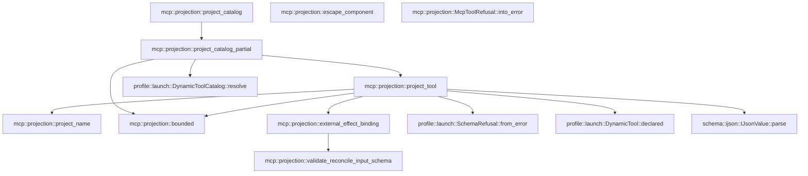

# mcp::projection

[Package atlas](index.md) · [Source](../../src/projection.rs)

## Declarations

Visibility is the declaration spelling; trait members and reexports require their enclosing interface. `cfg` is not evaluated.

| Symbol | Kind | Visibility | Test / cfg |
|---|---|---|---|
| [mcp::projection::project_name](../../src/projection.rs#L14) | function_item | `pub` |  |
| [mcp::projection::project_catalog](../../src/projection.rs#L28) | function_item | `pub` |  |
| [mcp::projection::MAX_TOOL_REFUSAL_REASON_BYTES](../../src/projection.rs#L42) | const_item | `pub` |  |
| [mcp::projection::MAX_TOOL_REFUSAL_NAME_BYTES](../../src/projection.rs#L44) | const_item | `pub` |  |
| [mcp::projection::refusal_code::SCHEMA_REFUSED](../../src/projection.rs#L50) | const_item | `pub` |  |
| [mcp::projection::refusal_code::EXTERNAL_EFFECT_REFUSED](../../src/projection.rs#L52) | const_item | `pub` |  |
| [mcp::projection::refusal_code::DEPENDENCY_REFUSED](../../src/projection.rs#L54) | const_item | `pub` |  |
| [mcp::projection::McpToolRefusal](../../src/projection.rs#L60) | struct_item | `pub` |  |
| [mcp::projection::McpToolRefusal::into_error](../../src/projection.rs#L76) | function_item | `private` |  |
| [mcp::projection::PartialProjection](../../src/projection.rs#L97) | struct_item | `pub` |  |
| [mcp::projection::project_catalog_partial](../../src/projection.rs#L112) | function_item | `pub` |  |
| [mcp::projection::project_tool](../../src/projection.rs#L186) | function_item | `private` |  |
| [mcp::projection::bounded](../../src/projection.rs#L268) | function_item | `private` |  |
| [mcp::projection::EXTERNAL_EFFECT_METADATA_KEY](../../src/projection.rs#L279) | const_item | `private` |  |
| [mcp::projection::ExternalEffectMetadata](../../src/projection.rs#L283) | struct_item | `private` |  |
| [mcp::projection::external_effect_binding](../../src/projection.rs#L289) | function_item | `private` |  |
| [mcp::projection::validate_reconcile_input_schema](../../src/projection.rs#L334) | function_item | `private` |  |
| [mcp::projection::escape_component](../../src/projection.rs#L365) | function_item | `private` |  |
| [mcp::projection::McpProjectionError](../../src/projection.rs#L379) | enum_item | `pub` |  |

## Imports / reexports

| Local name | Source path | Visibility |
|---|---|---|
| `BTreeSet` | `std::collections::BTreeSet` | `private` |
| `DynamicTool` | `profile::DynamicTool` | `private` |
| `DynamicToolCatalog` | `profile::DynamicToolCatalog` | `private` |
| `DynamicToolEffect` | `profile::DynamicToolEffect` | `private` |
| `DynamicToolSource` | `profile::DynamicToolSource` | `private` |
| `DynamicToolSourceKind` | `profile::DynamicToolSourceKind` | `private` |
| `ExternalEffectBinding` | `profile::ExternalEffectBinding` | `private` |
| `ExternalEffectProtocol` | `profile::ExternalEffectProtocol` | `private` |
| `SchemaRefusal` | `profile::SchemaRefusal` | `private` |
| `IJsonValue` | `schema::IJsonValue` | `private` |
| `Deserialize` | `serde::Deserialize` | `private` |
| `json` | `serde_json::json` | `private` |
| `Error` | `thiserror::Error` | `private` |
| `McpTool` | `crate::McpTool` | `private` |

## Module declarations

| Module | Visibility | Attributes |
|---|---|---|
| `mcp::projection::refusal_code` | `pub` |  |

## Function call graphs

Edges below are syntactically resolved calls only, including private functions. Graphs partition callers into groups of 20; they are not execution order. All unresolved sites are listed below and in the JSON inventory.

Functions 1–9: 11 direct edges

## Call sites

Includes test functions (marked in declarations). Receiver-type-required sites need type analysis/manual tracing. Calls in closures are attributed to their enclosing function; their occurrence here does not mean the closure executes immediately.

| Caller | Callee expression | Source lines | Target / classification |
|---|---|---|---|
| `project_name` | `server.is_empty` | [15](../../src/projection.rs#L15) | receiver-type-required |
| `project_name` | `tool.is_empty` | [15](../../src/projection.rs#L15) | receiver-type-required |
| `project_name` | `Err` | [16](../../src/projection.rs#L16) | external-constructor-callback-or-unresolved |
| `project_name` | `Ok` | [18](../../src/projection.rs#L18) | external-constructor-callback-or-unresolved |
| `project_catalog` | `project_catalog_partial` | [33](../../src/projection.rs#L33) | [mcp::projection::project_catalog_partial](../../src/projection.rs#L112) |
| `project_catalog` | `partial.refused.into_iter().next` | [34](../../src/projection.rs#L34) | receiver-type-required |
| `project_catalog` | `partial.refused.into_iter` | [34](../../src/projection.rs#L34) | receiver-type-required |
| `project_catalog` | `Ok` | [35](../../src/projection.rs#L35) | external-constructor-callback-or-unresolved |
| `project_catalog` | `Err` | [36](../../src/projection.rs#L36) | external-constructor-callback-or-unresolved |
| `project_catalog` | `refusal.into_error` | [36](../../src/projection.rs#L36) | receiver-type-required |
| `into_error` | `McpProjectionError::Schema` | [87](../../src/projection.rs#L87) | external-constructor-callback-or-unresolved |
| `into_error` | `McpProjectionError::ExternalEffect` | [89](../../src/projection.rs#L89) | external-constructor-callback-or-unresolved |
| `project_catalog_partial` | `server.is_empty` | [117](../../src/projection.rs#L117) | receiver-type-required |
| `project_catalog_partial` | `Err` | [118](../../src/projection.rs#L118), [123](../../src/projection.rs#L123) | external-constructor-callback-or-unresolved |
| `project_catalog_partial` | `BTreeSet::new` | [120](../../src/projection.rs#L120) | external-constructor-callback-or-unresolved |
| `project_catalog_partial` | `seen_source.insert` | [122](../../src/projection.rs#L122) | receiver-type-required |
| `project_catalog_partial` | `tool.name.clone` | [122](../../src/projection.rs#L122), [123](../../src/projection.rs#L123), [132](../../src/projection.rs#L132), [133](../../src/projection.rs#L133) | receiver-type-required |
| `project_catalog_partial` | `McpProjectionError::Duplicate` | [123](../../src/projection.rs#L123) | external-constructor-callback-or-unresolved |
| `project_catalog_partial` | `Vec::with_capacity` | [126](../../src/projection.rs#L126) | external-constructor-callback-or-unresolved |
| `project_catalog_partial` | `tools.len` | [126](../../src/projection.rs#L126) | receiver-type-required |
| `project_catalog_partial` | `Vec::new` | [129](../../src/projection.rs#L129) | external-constructor-callback-or-unresolved |
| `project_catalog_partial` | `project_tool` | [131](../../src/projection.rs#L131) | [mcp::projection::project_tool](../../src/projection.rs#L186) |
| `project_catalog_partial` | `projected.push` | [132](../../src/projection.rs#L132) | receiver-type-required |
| `project_catalog_partial` | `refused.push` | [133](../../src/projection.rs#L133), [157](../../src/projection.rs#L157) | receiver-type-required |
| `project_catalog_partial` | `refused             .iter()             .map(&#124;(source, _)&#124; source.clone())             .collect::<BTreeSet<_>>` | [139](../../src/projection.rs#L139) | receiver-type-required |
| `project_catalog_partial` | `refused             .iter()             .map` | [139](../../src/projection.rs#L139) | receiver-type-required |
| `project_catalog_partial` | `refused             .iter` | [139](../../src/projection.rs#L139) | receiver-type-required |
| `project_catalog_partial` | `source.clone` | [141](../../src/projection.rs#L141), [158](../../src/projection.rs#L158) | receiver-type-required |
| `project_catalog_partial` | `projected.iter().position` | [143](../../src/projection.rs#L143) | receiver-type-required |
| `project_catalog_partial` | `projected.iter` | [143](../../src/projection.rs#L143) | receiver-type-required |
| `project_catalog_partial` | `dynamic                 .external_effect                 .as_ref()                 .is_some_and` | [144](../../src/projection.rs#L144) | receiver-type-required |
| `project_catalog_partial` | `dynamic                 .external_effect                 .as_ref` | [144](../../src/projection.rs#L144) | receiver-type-required |
| `project_catalog_partial` | `refused_sources.contains` | [147](../../src/projection.rs#L147) | receiver-type-required |
| `project_catalog_partial` | `projected.remove` | [151](../../src/projection.rs#L151) | receiver-type-required |
| `project_catalog_partial` | `dynamic             .external_effect             .as_ref()             .map(&#124;binding&#124; binding.reconcile_tool.clone())             .unwrap_or_default` | [152](../../src/projection.rs#L152) | receiver-type-required |
| `project_catalog_partial` | `dynamic             .external_effect             .as_ref()             .map` | [152](../../src/projection.rs#L152) | receiver-type-required |
| `project_catalog_partial` | `dynamic             .external_effect             .as_ref` | [152](../../src/projection.rs#L152) | receiver-type-required |
| `project_catalog_partial` | `binding.reconcile_tool.clone` | [155](../../src/projection.rs#L155) | receiver-type-required |
| `project_catalog_partial` | `bounded` | [160](../../src/projection.rs#L160), [165](../../src/projection.rs#L165) | [mcp::projection::bounded](../../src/projection.rs#L268) |
| `project_catalog_partial` | `Some` | [161](../../src/projection.rs#L161) | external-constructor-callback-or-unresolved |
| `project_catalog_partial` | `DynamicToolCatalog::resolve(projected.into_iter().map(&#124;(_, tool)&#124; tool).collect())             .map_err` | [173](../../src/projection.rs#L173) | receiver-type-required |
| `project_catalog_partial` | `DynamicToolCatalog::resolve` | [173](../../src/projection.rs#L173) | [profile::launch::DynamicToolCatalog::resolve](../../../profile/src/launch.rs#L128) |
| `project_catalog_partial` | `projected.into_iter().map(&#124;(_, tool)&#124; tool).collect` | [173](../../src/projection.rs#L173) | receiver-type-required |
| `project_catalog_partial` | `projected.into_iter().map` | [173](../../src/projection.rs#L173) | receiver-type-required |
| `project_catalog_partial` | `projected.into_iter` | [173](../../src/projection.rs#L173) | receiver-type-required |
| `project_catalog_partial` | `McpProjectionError::Schema` | [174](../../src/projection.rs#L174) | external-constructor-callback-or-unresolved |
| `project_catalog_partial` | `error.to_string` | [174](../../src/projection.rs#L174) | receiver-type-required |
| `project_catalog_partial` | `tools         .iter()         .enumerate()         .map(&#124;(index, tool)&#124; (tool.name.as_str(), index))         .collect::<std::collections::BTreeMap<_, _>>` | [176](../../src/projection.rs#L176) | receiver-type-required |
| `project_catalog_partial` | `tools         .iter()         .enumerate()         .map` | [176](../../src/projection.rs#L176) | receiver-type-required |
| `project_catalog_partial` | `tools         .iter()         .enumerate` | [176](../../src/projection.rs#L176) | receiver-type-required |
| `project_catalog_partial` | `tools         .iter` | [176](../../src/projection.rs#L176) | receiver-type-required |
| `project_catalog_partial` | `tool.name.as_str` | [179](../../src/projection.rs#L179) | receiver-type-required |
| `project_catalog_partial` | `refused.sort_by_key` | [181](../../src/projection.rs#L181) | receiver-type-required |
| `project_catalog_partial` | `order.get(source.as_str()).copied().unwrap_or` | [181](../../src/projection.rs#L181) | receiver-type-required |
| `project_catalog_partial` | `order.get(source.as_str()).copied` | [181](../../src/projection.rs#L181) | receiver-type-required |
| `project_catalog_partial` | `order.get` | [181](../../src/projection.rs#L181) | receiver-type-required |
| `project_catalog_partial` | `source.as_str` | [181](../../src/projection.rs#L181) | receiver-type-required |
| `project_catalog_partial` | `refused.into_iter().map(&#124;(_, refusal)&#124; refusal).collect` | [182](../../src/projection.rs#L182) | receiver-type-required |
| `project_catalog_partial` | `refused.into_iter().map` | [182](../../src/projection.rs#L182) | receiver-type-required |
| `project_catalog_partial` | `refused.into_iter` | [182](../../src/projection.rs#L182) | receiver-type-required |
| `project_catalog_partial` | `Ok` | [183](../../src/projection.rs#L183) | external-constructor-callback-or-unresolved |
| `project_tool` | `Box::new` | [193](../../src/projection.rs#L193), [228](../../src/projection.rs#L228), [250](../../src/projection.rs#L250) | external-constructor-callback-or-unresolved |
| `project_tool` | `bounded` | [194](../../src/projection.rs#L194), [199](../../src/projection.rs#L199), [229](../../src/projection.rs#L229), [234](../../src/projection.rs#L234), [251](../../src/projection.rs#L251), [256](../../src/projection.rs#L256), [259](../../src/projection.rs#L259), [260](../../src/projection.rs#L260) | [mcp::projection::bounded](../../src/projection.rs#L268) |
| `project_tool` | `project_name(server, &tool.name).ok` | [195](../../src/projection.rs#L195) | receiver-type-required |
| `project_tool` | `project_name` | [195](../../src/projection.rs#L195), [203](../../src/projection.rs#L203) | [mcp::projection::project_name](../../src/projection.rs#L14) |
| `project_tool` | `project_name(server, &tool.name).map_err` | [203](../../src/projection.rs#L203) | receiver-type-required |
| `project_tool` | `refuse_schema` | [203](../../src/projection.rs#L203) | external-constructor-callback-or-unresolved |
| `project_tool` | `error.to_string` | [203](../../src/projection.rs#L203), [207](../../src/projection.rs#L207), [209](../../src/projection.rs#L209), [217](../../src/projection.rs#L217), [218](../../src/projection.rs#L218), [234](../../src/projection.rs#L234) | receiver-type-required |
| `project_tool` | `tool         .input_schema         .canonical_bytes()         .map_err(&#124;error&#124; error.to_string())         .and_then(&#124;bytes&#124; {             serde_json::from_slice::<serde_json::Value>(&bytes).map_err(&#124;error&#124; error.to_string())         })         .map_err` | [204](../../src/projection.rs#L204) | receiver-type-required |
| `project_tool` | `tool         .input_schema         .canonical_bytes()         .map_err(&#124;error&#124; error.to_string())         .and_then` | [204](../../src/projection.rs#L204) | receiver-type-required |
| `project_tool` | `tool         .input_schema         .canonical_bytes()         .map_err` | [204](../../src/projection.rs#L204) | receiver-type-required |
| `project_tool` | `tool         .input_schema         .canonical_bytes` | [204](../../src/projection.rs#L204) | receiver-type-required |
| `project_tool` | `serde_json::from_slice::<serde_json::Value>(&bytes).map_err` | [209](../../src/projection.rs#L209) | receiver-type-required |
| `project_tool` | `serde_json::from_slice::<serde_json::Value>` | [209](../../src/projection.rs#L209) | external-constructor-callback-or-unresolved |
| `project_tool` | `serde_json::to_vec(&json!({         "name": name,         "description": tool.description,         "parameters": parameters     }))     .map_err(&#124;error&#124; error.to_string())     .and_then(&#124;bytes&#124; IJsonValue::parse(&bytes).map_err(&#124;error&#124; error.to_string()))     .map_err` | [212](../../src/projection.rs#L212) | receiver-type-required |
| `project_tool` | `serde_json::to_vec(&json!({         "name": name,         "description": tool.description,         "parameters": parameters     }))     .map_err(&#124;error&#124; error.to_string())     .and_then` | [212](../../src/projection.rs#L212) | receiver-type-required |
| `project_tool` | `serde_json::to_vec(&json!({         "name": name,         "description": tool.description,         "parameters": parameters     }))     .map_err` | [212](../../src/projection.rs#L212) | receiver-type-required |
| `project_tool` | `serde_json::to_vec` | [212](../../src/projection.rs#L212) | external-constructor-callback-or-unresolved |
| `project_tool` | `IJsonValue::parse(&bytes).map_err` | [218](../../src/projection.rs#L218) | receiver-type-required |
| `project_tool` | `IJsonValue::parse` | [218](../../src/projection.rs#L218) | [schema::ijson::IJsonValue::parse](../../../schema/src/ijson.rs#L16) |
| `project_tool` | `external_effect_binding(tool, tools).map_err` | [227](../../src/projection.rs#L227) | receiver-type-required |
| `project_tool` | `external_effect_binding` | [227](../../src/projection.rs#L227) | [mcp::projection::external_effect_binding](../../src/projection.rs#L289) |
| `project_tool` | `Some` | [230](../../src/projection.rs#L230), [252](../../src/projection.rs#L252) | external-constructor-callback-or-unresolved |
| `project_tool` | `name.clone` | [230](../../src/projection.rs#L230), [238](../../src/projection.rs#L238) | receiver-type-required |
| `project_tool` | `DynamicTool::declared(         name.clone(),         DynamicToolSource {             kind: DynamicToolSourceKind::Mcp,             id: server.to_owned(),         },         effect,         always_on,         Vec::new(),         schema,     )     .map_err` | [237](../../src/projection.rs#L237) | receiver-type-required |
| `project_tool` | `DynamicTool::declared` | [237](../../src/projection.rs#L237) | [profile::launch::DynamicTool::declared](../../../profile/src/launch.rs#L87) |
| `project_tool` | `server.to_owned` | [241](../../src/projection.rs#L241) | receiver-type-required |
| `project_tool` | `Vec::new` | [245](../../src/projection.rs#L245) | external-constructor-callback-or-unresolved |
| `project_tool` | `SchemaRefusal::from_error` | [249](../../src/projection.rs#L249) | [profile::launch::SchemaRefusal::from_error](../../../profile/src/launch.rs#L448) |
| `project_tool` | `parts                 .pointer                 .map` | [254](../../src/projection.rs#L254) | receiver-type-required |
| `project_tool` | `parts                 .keyword                 .map` | [257](../../src/projection.rs#L257) | receiver-type-required |
| `project_tool` | `Ok` | [264](../../src/projection.rs#L264) | external-constructor-callback-or-unresolved |
| `bounded` | `value.len` | [269](../../src/projection.rs#L269) | receiver-type-required |
| `bounded` | `value.to_owned` | [270](../../src/projection.rs#L270) | receiver-type-required |
| `bounded` | `limit.saturating_sub` | [272](../../src/projection.rs#L272) | receiver-type-required |
| `bounded` | `value.is_char_boundary` | [273](../../src/projection.rs#L273) | receiver-type-required |
| `external_effect_binding` | `Ok` | [294](../../src/projection.rs#L294), [303](../../src/projection.rs#L303), [328](../../src/projection.rs#L328) | external-constructor-callback-or-unresolved |
| `external_effect_binding` | `serde_json::from_slice(         &metadata             .canonical_bytes()             .map_err(&#124;error&#124; McpProjectionError::Schema(error.to_string()))?,     )     .map_err` | [296](../../src/projection.rs#L296) | receiver-type-required |
| `external_effect_binding` | `serde_json::from_slice` | [296](../../src/projection.rs#L296) | external-constructor-callback-or-unresolved |
| `external_effect_binding` | `metadata             .canonical_bytes()             .map_err` | [297](../../src/projection.rs#L297) | receiver-type-required |
| `external_effect_binding` | `metadata             .canonical_bytes` | [297](../../src/projection.rs#L297) | receiver-type-required |
| `external_effect_binding` | `McpProjectionError::Schema` | [299](../../src/projection.rs#L299), [301](../../src/projection.rs#L301) | external-constructor-callback-or-unresolved |
| `external_effect_binding` | `error.to_string` | [299](../../src/projection.rs#L299), [301](../../src/projection.rs#L301), [306](../../src/projection.rs#L306) | receiver-type-required |
| `external_effect_binding` | `raw.get` | [302](../../src/projection.rs#L302) | receiver-type-required |
| `external_effect_binding` | `serde_json::from_value(contract.clone())         .map_err` | [305](../../src/projection.rs#L305) | receiver-type-required |
| `external_effect_binding` | `serde_json::from_value` | [305](../../src/projection.rs#L305) | external-constructor-callback-or-unresolved |
| `external_effect_binding` | `contract.clone` | [305](../../src/projection.rs#L305) | receiver-type-required |
| `external_effect_binding` | `McpProjectionError::ExternalEffect` | [306](../../src/projection.rs#L306), [308](../../src/projection.rs#L308), [316](../../src/projection.rs#L316), [322](../../src/projection.rs#L322) | external-constructor-callback-or-unresolved |
| `external_effect_binding` | `contract.reconcile_tool.is_empty` | [307](../../src/projection.rs#L307) | receiver-type-required |
| `external_effect_binding` | `Err` | [308](../../src/projection.rs#L308), [322](../../src/projection.rs#L322) | external-constructor-callback-or-unresolved |
| `external_effect_binding` | `"external-effect version must be 1 and reconcileTool must be nonempty".to_owned` | [309](../../src/projection.rs#L309) | receiver-type-required |
| `external_effect_binding` | `catalog         .iter()         .find(&#124;candidate&#124; candidate.name == contract.reconcile_tool)         .ok_or_else` | [312](../../src/projection.rs#L312) | receiver-type-required |
| `external_effect_binding` | `catalog         .iter()         .find` | [312](../../src/projection.rs#L312) | receiver-type-required |
| `external_effect_binding` | `catalog         .iter` | [312](../../src/projection.rs#L312) | receiver-type-required |
| `external_effect_binding` | `validate_reconcile_input_schema` | [327](../../src/projection.rs#L327) | [mcp::projection::validate_reconcile_input_schema](../../src/projection.rs#L334) |
| `external_effect_binding` | `Some` | [328](../../src/projection.rs#L328) | external-constructor-callback-or-unresolved |
| `validate_reconcile_input_schema` | `serde_json::from_slice(         &tool             .input_schema             .canonical_bytes()             .map_err(&#124;error&#124; McpProjectionError::Schema(error.to_string()))?,     )     .map_err` | [335](../../src/projection.rs#L335) | receiver-type-required |
| `validate_reconcile_input_schema` | `serde_json::from_slice` | [335](../../src/projection.rs#L335) | external-constructor-callback-or-unresolved |
| `validate_reconcile_input_schema` | `tool             .input_schema             .canonical_bytes()             .map_err` | [336](../../src/projection.rs#L336) | receiver-type-required |
| `validate_reconcile_input_schema` | `tool             .input_schema             .canonical_bytes` | [336](../../src/projection.rs#L336) | receiver-type-required |
| `validate_reconcile_input_schema` | `McpProjectionError::Schema` | [339](../../src/projection.rs#L339), [341](../../src/projection.rs#L341) | external-constructor-callback-or-unresolved |
| `validate_reconcile_input_schema` | `error.to_string` | [339](../../src/projection.rs#L339), [341](../../src/projection.rs#L341) | receiver-type-required |
| `validate_reconcile_input_schema` | `schema         .get("properties")         .and_then(&#124;value&#124; value.get("idempotencyKey"))         .and_then(&#124;value&#124; value.get("type"))         .and_then` | [342](../../src/projection.rs#L342) | receiver-type-required |
| `validate_reconcile_input_schema` | `schema         .get("properties")         .and_then(&#124;value&#124; value.get("idempotencyKey"))         .and_then` | [342](../../src/projection.rs#L342) | receiver-type-required |
| `validate_reconcile_input_schema` | `schema         .get("properties")         .and_then` | [342](../../src/projection.rs#L342) | receiver-type-required |
| `validate_reconcile_input_schema` | `schema         .get` | [342](../../src/projection.rs#L342), [348](../../src/projection.rs#L348) | receiver-type-required |
| `validate_reconcile_input_schema` | `value.get` | [344](../../src/projection.rs#L344), [345](../../src/projection.rs#L345) | receiver-type-required |
| `validate_reconcile_input_schema` | `Some` | [347](../../src/projection.rs#L347), [354](../../src/projection.rs#L354) | external-constructor-callback-or-unresolved |
| `validate_reconcile_input_schema` | `schema         .get("required")         .and_then(serde_json::Value::as_array)         .is_some_and` | [348](../../src/projection.rs#L348) | receiver-type-required |
| `validate_reconcile_input_schema` | `schema         .get("required")         .and_then` | [348](../../src/projection.rs#L348) | receiver-type-required |
| `validate_reconcile_input_schema` | `values                 .iter()                 .any` | [352](../../src/projection.rs#L352) | receiver-type-required |
| `validate_reconcile_input_schema` | `values                 .iter` | [352](../../src/projection.rs#L352) | receiver-type-required |
| `validate_reconcile_input_schema` | `value.as_str` | [354](../../src/projection.rs#L354) | receiver-type-required |
| `validate_reconcile_input_schema` | `Err` | [357](../../src/projection.rs#L357) | external-constructor-callback-or-unresolved |
| `validate_reconcile_input_schema` | `McpProjectionError::ExternalEffect` | [357](../../src/projection.rs#L357) | external-constructor-callback-or-unresolved |
| `validate_reconcile_input_schema` | `Ok` | [362](../../src/projection.rs#L362) | external-constructor-callback-or-unresolved |
| `escape_component` | `String::new` | [366](../../src/projection.rs#L366) | external-constructor-callback-or-unresolved |
| `escape_component` | `value.as_bytes` | [367](../../src/projection.rs#L367) | receiver-type-required |
| `escape_component` | `byte.is_ascii_alphanumeric` | [368](../../src/projection.rs#L368) | receiver-type-required |
| `escape_component` | `output.push` | [369](../../src/projection.rs#L369) | receiver-type-required |
| `escape_component` | `char::from` | [369](../../src/projection.rs#L369) | external-constructor-callback-or-unresolved |
