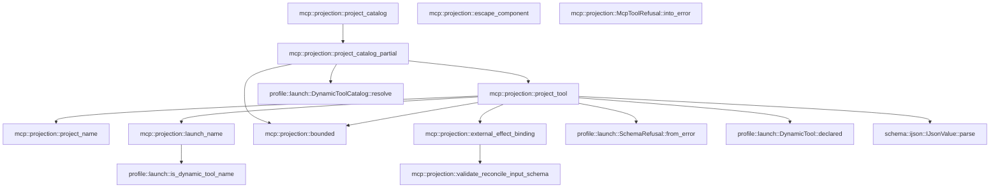

# mcp::projection

[Package atlas](index.md) · [Source](../../src/projection.rs)

## Declarations

Visibility is the declaration spelling; trait members and reexports require their enclosing interface. `cfg` is not evaluated.

| Symbol | Kind | Visibility | Test / cfg |
|---|---|---|---|
| [mcp::projection::project_name](../../src/projection.rs#L14) | function_item | `pub` |  |
| [mcp::projection::project_catalog](../../src/projection.rs#L28) | function_item | `pub` |  |
| [mcp::projection::MAX_TOOL_REFUSAL_REASON_BYTES](../../src/projection.rs#L42) | const_item | `pub` |  |
| [mcp::projection::MAX_TOOL_REFUSAL_NAME_BYTES](../../src/projection.rs#L44) | const_item | `pub` |  |
| [mcp::projection::refusal_code::SCHEMA_REFUSED](../../src/projection.rs#L50) | const_item | `pub` |  |
| [mcp::projection::refusal_code::EXTERNAL_EFFECT_REFUSED](../../src/projection.rs#L52) | const_item | `pub` |  |
| [mcp::projection::refusal_code::DEPENDENCY_REFUSED](../../src/projection.rs#L54) | const_item | `pub` |  |
| [mcp::projection::McpToolRefusal](../../src/projection.rs#L60) | struct_item | `pub` |  |
| [mcp::projection::McpToolRefusal::into_error](../../src/projection.rs#L79) | function_item | `private` |  |
| [mcp::projection::PartialProjection](../../src/projection.rs#L100) | struct_item | `pub` |  |
| [mcp::projection::project_catalog_partial](../../src/projection.rs#L115) | function_item | `pub` |  |
| [mcp::projection::project_tool](../../src/projection.rs#L189) | function_item | `private` |  |
| [mcp::projection::launch_name](../../src/projection.rs#L271) | function_item | `private` |  |
| [mcp::projection::bounded](../../src/projection.rs#L276) | function_item | `private` |  |
| [mcp::projection::EXTERNAL_EFFECT_METADATA_KEY](../../src/projection.rs#L287) | const_item | `private` |  |
| [mcp::projection::ExternalEffectMetadata](../../src/projection.rs#L291) | struct_item | `private` |  |
| [mcp::projection::external_effect_binding](../../src/projection.rs#L297) | function_item | `private` |  |
| [mcp::projection::validate_reconcile_input_schema](../../src/projection.rs#L342) | function_item | `private` |  |
| [mcp::projection::escape_component](../../src/projection.rs#L373) | function_item | `private` |  |
| [mcp::projection::McpProjectionError](../../src/projection.rs#L387) | enum_item | `pub` |  |

## Imports / reexports

| Local name | Source path | Visibility |
|---|---|---|
| `BTreeSet` | `std::collections::BTreeSet` | `private` |
| `DynamicTool` | `profile::DynamicTool` | `private` |
| `DynamicToolCatalog` | `profile::DynamicToolCatalog` | `private` |
| `DynamicToolEffect` | `profile::DynamicToolEffect` | `private` |
| `DynamicToolSource` | `profile::DynamicToolSource` | `private` |
| `DynamicToolSourceKind` | `profile::DynamicToolSourceKind` | `private` |
| `ExternalEffectBinding` | `profile::ExternalEffectBinding` | `private` |
| `ExternalEffectProtocol` | `profile::ExternalEffectProtocol` | `private` |
| `SchemaRefusal` | `profile::SchemaRefusal` | `private` |
| `is_dynamic_tool_name` | `profile::is_dynamic_tool_name` | `private` |
| `IJsonValue` | `schema::IJsonValue` | `private` |
| `Deserialize` | `serde::Deserialize` | `private` |
| `json` | `serde_json::json` | `private` |
| `Error` | `thiserror::Error` | `private` |
| `McpTool` | `crate::McpTool` | `private` |

## Module declarations

| Module | Visibility | Attributes |
|---|---|---|
| `mcp::projection::refusal_code` | `pub` |  |

## Function call graphs

Edges below are syntactically resolved calls only, including private functions. Graphs partition callers into groups of 20; they are not execution order. All unresolved sites are listed below and in the JSON inventory.

Functions 1–10: 13 direct edges

## Call sites

Includes test functions (marked in declarations). Receiver-type-required sites need type analysis/manual tracing. Calls in closures are attributed to their enclosing function; their occurrence here does not mean the closure executes immediately.

| Caller | Callee expression | Source lines | Target / classification |
|---|---|---|---|
| `project_name` | `server.is_empty` | [15](../../src/projection.rs#L15) | receiver-type-required |
| `project_name` | `tool.is_empty` | [15](../../src/projection.rs#L15) | receiver-type-required |
| `project_name` | `Err` | [16](../../src/projection.rs#L16) | external-constructor-callback-or-unresolved |
| `project_name` | `Ok` | [18](../../src/projection.rs#L18) | external-constructor-callback-or-unresolved |
| `project_catalog` | `project_catalog_partial` | [33](../../src/projection.rs#L33) | [mcp::projection::project_catalog_partial](../../src/projection.rs#L115) |
| `project_catalog` | `partial.refused.into_iter().next` | [34](../../src/projection.rs#L34) | receiver-type-required |
| `project_catalog` | `partial.refused.into_iter` | [34](../../src/projection.rs#L34) | receiver-type-required |
| `project_catalog` | `Ok` | [35](../../src/projection.rs#L35) | external-constructor-callback-or-unresolved |
| `project_catalog` | `Err` | [36](../../src/projection.rs#L36) | external-constructor-callback-or-unresolved |
| `project_catalog` | `refusal.into_error` | [36](../../src/projection.rs#L36) | receiver-type-required |
| `into_error` | `McpProjectionError::Schema` | [90](../../src/projection.rs#L90) | external-constructor-callback-or-unresolved |
| `into_error` | `McpProjectionError::ExternalEffect` | [92](../../src/projection.rs#L92) | external-constructor-callback-or-unresolved |
| `project_catalog_partial` | `server.is_empty` | [120](../../src/projection.rs#L120) | receiver-type-required |
| `project_catalog_partial` | `Err` | [121](../../src/projection.rs#L121), [126](../../src/projection.rs#L126) | external-constructor-callback-or-unresolved |
| `project_catalog_partial` | `BTreeSet::new` | [123](../../src/projection.rs#L123) | external-constructor-callback-or-unresolved |
| `project_catalog_partial` | `seen_source.insert` | [125](../../src/projection.rs#L125) | receiver-type-required |
| `project_catalog_partial` | `tool.name.clone` | [125](../../src/projection.rs#L125), [126](../../src/projection.rs#L126), [135](../../src/projection.rs#L135), [136](../../src/projection.rs#L136) | receiver-type-required |
| `project_catalog_partial` | `McpProjectionError::Duplicate` | [126](../../src/projection.rs#L126) | external-constructor-callback-or-unresolved |
| `project_catalog_partial` | `Vec::with_capacity` | [129](../../src/projection.rs#L129) | external-constructor-callback-or-unresolved |
| `project_catalog_partial` | `tools.len` | [129](../../src/projection.rs#L129) | receiver-type-required |
| `project_catalog_partial` | `Vec::new` | [132](../../src/projection.rs#L132) | external-constructor-callback-or-unresolved |
| `project_catalog_partial` | `project_tool` | [134](../../src/projection.rs#L134) | [mcp::projection::project_tool](../../src/projection.rs#L189) |
| `project_catalog_partial` | `projected.push` | [135](../../src/projection.rs#L135) | receiver-type-required |
| `project_catalog_partial` | `refused.push` | [136](../../src/projection.rs#L136), [160](../../src/projection.rs#L160) | receiver-type-required |
| `project_catalog_partial` | `refused             .iter()             .map(&#124;(source, _)&#124; source.clone())             .collect::<BTreeSet<_>>` | [142](../../src/projection.rs#L142) | receiver-type-required |
| `project_catalog_partial` | `refused             .iter()             .map` | [142](../../src/projection.rs#L142) | receiver-type-required |
| `project_catalog_partial` | `refused             .iter` | [142](../../src/projection.rs#L142) | receiver-type-required |
| `project_catalog_partial` | `source.clone` | [144](../../src/projection.rs#L144), [161](../../src/projection.rs#L161) | receiver-type-required |
| `project_catalog_partial` | `projected.iter().position` | [146](../../src/projection.rs#L146) | receiver-type-required |
| `project_catalog_partial` | `projected.iter` | [146](../../src/projection.rs#L146) | receiver-type-required |
| `project_catalog_partial` | `dynamic                 .external_effect                 .as_ref()                 .is_some_and` | [147](../../src/projection.rs#L147) | receiver-type-required |
| `project_catalog_partial` | `dynamic                 .external_effect                 .as_ref` | [147](../../src/projection.rs#L147) | receiver-type-required |
| `project_catalog_partial` | `refused_sources.contains` | [150](../../src/projection.rs#L150) | receiver-type-required |
| `project_catalog_partial` | `projected.remove` | [154](../../src/projection.rs#L154) | receiver-type-required |
| `project_catalog_partial` | `dynamic             .external_effect             .as_ref()             .map(&#124;binding&#124; binding.reconcile_tool.clone())             .unwrap_or_default` | [155](../../src/projection.rs#L155) | receiver-type-required |
| `project_catalog_partial` | `dynamic             .external_effect             .as_ref()             .map` | [155](../../src/projection.rs#L155) | receiver-type-required |
| `project_catalog_partial` | `dynamic             .external_effect             .as_ref` | [155](../../src/projection.rs#L155) | receiver-type-required |
| `project_catalog_partial` | `binding.reconcile_tool.clone` | [158](../../src/projection.rs#L158) | receiver-type-required |
| `project_catalog_partial` | `bounded` | [163](../../src/projection.rs#L163), [168](../../src/projection.rs#L168) | [mcp::projection::bounded](../../src/projection.rs#L276) |
| `project_catalog_partial` | `Some` | [164](../../src/projection.rs#L164) | external-constructor-callback-or-unresolved |
| `project_catalog_partial` | `DynamicToolCatalog::resolve(projected.into_iter().map(&#124;(_, tool)&#124; tool).collect())             .map_err` | [176](../../src/projection.rs#L176) | receiver-type-required |
| `project_catalog_partial` | `DynamicToolCatalog::resolve` | [176](../../src/projection.rs#L176) | [profile::launch::DynamicToolCatalog::resolve](../../../profile/src/launch.rs#L128) |
| `project_catalog_partial` | `projected.into_iter().map(&#124;(_, tool)&#124; tool).collect` | [176](../../src/projection.rs#L176) | receiver-type-required |
| `project_catalog_partial` | `projected.into_iter().map` | [176](../../src/projection.rs#L176) | receiver-type-required |
| `project_catalog_partial` | `projected.into_iter` | [176](../../src/projection.rs#L176) | receiver-type-required |
| `project_catalog_partial` | `McpProjectionError::Schema` | [177](../../src/projection.rs#L177) | external-constructor-callback-or-unresolved |
| `project_catalog_partial` | `error.to_string` | [177](../../src/projection.rs#L177) | receiver-type-required |
| `project_catalog_partial` | `tools         .iter()         .enumerate()         .map(&#124;(index, tool)&#124; (tool.name.as_str(), index))         .collect::<std::collections::BTreeMap<_, _>>` | [179](../../src/projection.rs#L179) | receiver-type-required |
| `project_catalog_partial` | `tools         .iter()         .enumerate()         .map` | [179](../../src/projection.rs#L179) | receiver-type-required |
| `project_catalog_partial` | `tools         .iter()         .enumerate` | [179](../../src/projection.rs#L179) | receiver-type-required |
| `project_catalog_partial` | `tools         .iter` | [179](../../src/projection.rs#L179) | receiver-type-required |
| `project_catalog_partial` | `tool.name.as_str` | [182](../../src/projection.rs#L182) | receiver-type-required |
| `project_catalog_partial` | `refused.sort_by_key` | [184](../../src/projection.rs#L184) | receiver-type-required |
| `project_catalog_partial` | `order.get(source.as_str()).copied().unwrap_or` | [184](../../src/projection.rs#L184) | receiver-type-required |
| `project_catalog_partial` | `order.get(source.as_str()).copied` | [184](../../src/projection.rs#L184) | receiver-type-required |
| `project_catalog_partial` | `order.get` | [184](../../src/projection.rs#L184) | receiver-type-required |
| `project_catalog_partial` | `source.as_str` | [184](../../src/projection.rs#L184) | receiver-type-required |
| `project_catalog_partial` | `refused.into_iter().map(&#124;(_, refusal)&#124; refusal).collect` | [185](../../src/projection.rs#L185) | receiver-type-required |
| `project_catalog_partial` | `refused.into_iter().map` | [185](../../src/projection.rs#L185) | receiver-type-required |
| `project_catalog_partial` | `refused.into_iter` | [185](../../src/projection.rs#L185) | receiver-type-required |
| `project_catalog_partial` | `Ok` | [186](../../src/projection.rs#L186) | external-constructor-callback-or-unresolved |
| `project_tool` | `Box::new` | [196](../../src/projection.rs#L196), [231](../../src/projection.rs#L231), [253](../../src/projection.rs#L253) | external-constructor-callback-or-unresolved |
| `project_tool` | `bounded` | [197](../../src/projection.rs#L197), [202](../../src/projection.rs#L202), [232](../../src/projection.rs#L232), [237](../../src/projection.rs#L237), [254](../../src/projection.rs#L254), [259](../../src/projection.rs#L259), [262](../../src/projection.rs#L262), [263](../../src/projection.rs#L263) | [mcp::projection::bounded](../../src/projection.rs#L276) |
| `project_tool` | `launch_name` | [198](../../src/projection.rs#L198), [233](../../src/projection.rs#L233), [255](../../src/projection.rs#L255) | [mcp::projection::launch_name](../../src/projection.rs#L271) |
| `project_tool` | `project_name(server, &tool.name).ok` | [198](../../src/projection.rs#L198) | receiver-type-required |
| `project_tool` | `project_name` | [198](../../src/projection.rs#L198), [206](../../src/projection.rs#L206) | [mcp::projection::project_name](../../src/projection.rs#L14) |
| `project_tool` | `project_name(server, &tool.name).map_err` | [206](../../src/projection.rs#L206) | receiver-type-required |
| `project_tool` | `refuse_schema` | [206](../../src/projection.rs#L206) | external-constructor-callback-or-unresolved |
| `project_tool` | `error.to_string` | [206](../../src/projection.rs#L206), [210](../../src/projection.rs#L210), [212](../../src/projection.rs#L212), [220](../../src/projection.rs#L220), [221](../../src/projection.rs#L221), [237](../../src/projection.rs#L237) | receiver-type-required |
| `project_tool` | `tool         .input_schema         .canonical_bytes()         .map_err(&#124;error&#124; error.to_string())         .and_then(&#124;bytes&#124; {             serde_json::from_slice::<serde_json::Value>(&bytes).map_err(&#124;error&#124; error.to_string())         })         .map_err` | [207](../../src/projection.rs#L207) | receiver-type-required |
| `project_tool` | `tool         .input_schema         .canonical_bytes()         .map_err(&#124;error&#124; error.to_string())         .and_then` | [207](../../src/projection.rs#L207) | receiver-type-required |
| `project_tool` | `tool         .input_schema         .canonical_bytes()         .map_err` | [207](../../src/projection.rs#L207) | receiver-type-required |
| `project_tool` | `tool         .input_schema         .canonical_bytes` | [207](../../src/projection.rs#L207) | receiver-type-required |
| `project_tool` | `serde_json::from_slice::<serde_json::Value>(&bytes).map_err` | [212](../../src/projection.rs#L212) | receiver-type-required |
| `project_tool` | `serde_json::from_slice::<serde_json::Value>` | [212](../../src/projection.rs#L212) | external-constructor-callback-or-unresolved |
| `project_tool` | `serde_json::to_vec(&json!({         "name": name,         "description": tool.description,         "parameters": parameters     }))     .map_err(&#124;error&#124; error.to_string())     .and_then(&#124;bytes&#124; IJsonValue::parse(&bytes).map_err(&#124;error&#124; error.to_string()))     .map_err` | [215](../../src/projection.rs#L215) | receiver-type-required |
| `project_tool` | `serde_json::to_vec(&json!({         "name": name,         "description": tool.description,         "parameters": parameters     }))     .map_err(&#124;error&#124; error.to_string())     .and_then` | [215](../../src/projection.rs#L215) | receiver-type-required |
| `project_tool` | `serde_json::to_vec(&json!({         "name": name,         "description": tool.description,         "parameters": parameters     }))     .map_err` | [215](../../src/projection.rs#L215) | receiver-type-required |
| `project_tool` | `serde_json::to_vec` | [215](../../src/projection.rs#L215) | external-constructor-callback-or-unresolved |
| `project_tool` | `IJsonValue::parse(&bytes).map_err` | [221](../../src/projection.rs#L221) | receiver-type-required |
| `project_tool` | `IJsonValue::parse` | [221](../../src/projection.rs#L221) | [schema::ijson::IJsonValue::parse](../../../schema/src/ijson.rs#L16) |
| `project_tool` | `external_effect_binding(tool, tools).map_err` | [230](../../src/projection.rs#L230) | receiver-type-required |
| `project_tool` | `external_effect_binding` | [230](../../src/projection.rs#L230) | [mcp::projection::external_effect_binding](../../src/projection.rs#L297) |
| `project_tool` | `Some` | [233](../../src/projection.rs#L233), [255](../../src/projection.rs#L255) | external-constructor-callback-or-unresolved |
| `project_tool` | `name.clone` | [233](../../src/projection.rs#L233), [241](../../src/projection.rs#L241) | receiver-type-required |
| `project_tool` | `DynamicTool::declared(         name.clone(),         DynamicToolSource {             kind: DynamicToolSourceKind::Mcp,             id: server.to_owned(),         },         effect,         always_on,         Vec::new(),         schema,     )     .map_err` | [240](../../src/projection.rs#L240) | receiver-type-required |
| `project_tool` | `DynamicTool::declared` | [240](../../src/projection.rs#L240) | [profile::launch::DynamicTool::declared](../../../profile/src/launch.rs#L87) |
| `project_tool` | `server.to_owned` | [244](../../src/projection.rs#L244) | receiver-type-required |
| `project_tool` | `Vec::new` | [248](../../src/projection.rs#L248) | external-constructor-callback-or-unresolved |
| `project_tool` | `SchemaRefusal::from_error` | [252](../../src/projection.rs#L252) | [profile::launch::SchemaRefusal::from_error](../../../profile/src/launch.rs#L458) |
| `project_tool` | `parts                 .pointer                 .map` | [257](../../src/projection.rs#L257) | receiver-type-required |
| `project_tool` | `parts                 .keyword                 .map` | [260](../../src/projection.rs#L260) | receiver-type-required |
| `project_tool` | `Ok` | [267](../../src/projection.rs#L267) | external-constructor-callback-or-unresolved |
| `launch_name` | `name.filter` | [272](../../src/projection.rs#L272) | receiver-type-required |
| `launch_name` | `is_dynamic_tool_name` | [272](../../src/projection.rs#L272) | [profile::launch::is_dynamic_tool_name](../../../profile/src/launch.rs#L818) |
| `bounded` | `value.len` | [277](../../src/projection.rs#L277) | receiver-type-required |
| `bounded` | `value.to_owned` | [278](../../src/projection.rs#L278) | receiver-type-required |
| `bounded` | `limit.saturating_sub` | [280](../../src/projection.rs#L280) | receiver-type-required |
| `bounded` | `value.is_char_boundary` | [281](../../src/projection.rs#L281) | receiver-type-required |
| `external_effect_binding` | `Ok` | [302](../../src/projection.rs#L302), [311](../../src/projection.rs#L311), [336](../../src/projection.rs#L336) | external-constructor-callback-or-unresolved |
| `external_effect_binding` | `serde_json::from_slice(         &metadata             .canonical_bytes()             .map_err(&#124;error&#124; McpProjectionError::Schema(error.to_string()))?,     )     .map_err` | [304](../../src/projection.rs#L304) | receiver-type-required |
| `external_effect_binding` | `serde_json::from_slice` | [304](../../src/projection.rs#L304) | external-constructor-callback-or-unresolved |
| `external_effect_binding` | `metadata             .canonical_bytes()             .map_err` | [305](../../src/projection.rs#L305) | receiver-type-required |
| `external_effect_binding` | `metadata             .canonical_bytes` | [305](../../src/projection.rs#L305) | receiver-type-required |
| `external_effect_binding` | `McpProjectionError::Schema` | [307](../../src/projection.rs#L307), [309](../../src/projection.rs#L309) | external-constructor-callback-or-unresolved |
| `external_effect_binding` | `error.to_string` | [307](../../src/projection.rs#L307), [309](../../src/projection.rs#L309), [314](../../src/projection.rs#L314) | receiver-type-required |
| `external_effect_binding` | `raw.get` | [310](../../src/projection.rs#L310) | receiver-type-required |
| `external_effect_binding` | `serde_json::from_value(contract.clone())         .map_err` | [313](../../src/projection.rs#L313) | receiver-type-required |
| `external_effect_binding` | `serde_json::from_value` | [313](../../src/projection.rs#L313) | external-constructor-callback-or-unresolved |
| `external_effect_binding` | `contract.clone` | [313](../../src/projection.rs#L313) | receiver-type-required |
| `external_effect_binding` | `McpProjectionError::ExternalEffect` | [314](../../src/projection.rs#L314), [316](../../src/projection.rs#L316), [324](../../src/projection.rs#L324), [330](../../src/projection.rs#L330) | external-constructor-callback-or-unresolved |
| `external_effect_binding` | `contract.reconcile_tool.is_empty` | [315](../../src/projection.rs#L315) | receiver-type-required |
| `external_effect_binding` | `Err` | [316](../../src/projection.rs#L316), [330](../../src/projection.rs#L330) | external-constructor-callback-or-unresolved |
| `external_effect_binding` | `"external-effect version must be 1 and reconcileTool must be nonempty".to_owned` | [317](../../src/projection.rs#L317) | receiver-type-required |
| `external_effect_binding` | `catalog         .iter()         .find(&#124;candidate&#124; candidate.name == contract.reconcile_tool)         .ok_or_else` | [320](../../src/projection.rs#L320) | receiver-type-required |
| `external_effect_binding` | `catalog         .iter()         .find` | [320](../../src/projection.rs#L320) | receiver-type-required |
| `external_effect_binding` | `catalog         .iter` | [320](../../src/projection.rs#L320) | receiver-type-required |
| `external_effect_binding` | `validate_reconcile_input_schema` | [335](../../src/projection.rs#L335) | [mcp::projection::validate_reconcile_input_schema](../../src/projection.rs#L342) |
| `external_effect_binding` | `Some` | [336](../../src/projection.rs#L336) | external-constructor-callback-or-unresolved |
| `validate_reconcile_input_schema` | `serde_json::from_slice(         &tool             .input_schema             .canonical_bytes()             .map_err(&#124;error&#124; McpProjectionError::Schema(error.to_string()))?,     )     .map_err` | [343](../../src/projection.rs#L343) | receiver-type-required |
| `validate_reconcile_input_schema` | `serde_json::from_slice` | [343](../../src/projection.rs#L343) | external-constructor-callback-or-unresolved |
| `validate_reconcile_input_schema` | `tool             .input_schema             .canonical_bytes()             .map_err` | [344](../../src/projection.rs#L344) | receiver-type-required |
| `validate_reconcile_input_schema` | `tool             .input_schema             .canonical_bytes` | [344](../../src/projection.rs#L344) | receiver-type-required |
| `validate_reconcile_input_schema` | `McpProjectionError::Schema` | [347](../../src/projection.rs#L347), [349](../../src/projection.rs#L349) | external-constructor-callback-or-unresolved |
| `validate_reconcile_input_schema` | `error.to_string` | [347](../../src/projection.rs#L347), [349](../../src/projection.rs#L349) | receiver-type-required |
| `validate_reconcile_input_schema` | `schema         .get("properties")         .and_then(&#124;value&#124; value.get("idempotencyKey"))         .and_then(&#124;value&#124; value.get("type"))         .and_then` | [350](../../src/projection.rs#L350) | receiver-type-required |
| `validate_reconcile_input_schema` | `schema         .get("properties")         .and_then(&#124;value&#124; value.get("idempotencyKey"))         .and_then` | [350](../../src/projection.rs#L350) | receiver-type-required |
| `validate_reconcile_input_schema` | `schema         .get("properties")         .and_then` | [350](../../src/projection.rs#L350) | receiver-type-required |
| `validate_reconcile_input_schema` | `schema         .get` | [350](../../src/projection.rs#L350), [356](../../src/projection.rs#L356) | receiver-type-required |
| `validate_reconcile_input_schema` | `value.get` | [352](../../src/projection.rs#L352), [353](../../src/projection.rs#L353) | receiver-type-required |
| `validate_reconcile_input_schema` | `Some` | [355](../../src/projection.rs#L355), [362](../../src/projection.rs#L362) | external-constructor-callback-or-unresolved |
| `validate_reconcile_input_schema` | `schema         .get("required")         .and_then(serde_json::Value::as_array)         .is_some_and` | [356](../../src/projection.rs#L356) | receiver-type-required |
| `validate_reconcile_input_schema` | `schema         .get("required")         .and_then` | [356](../../src/projection.rs#L356) | receiver-type-required |
| `validate_reconcile_input_schema` | `values                 .iter()                 .any` | [360](../../src/projection.rs#L360) | receiver-type-required |
| `validate_reconcile_input_schema` | `values                 .iter` | [360](../../src/projection.rs#L360) | receiver-type-required |
| `validate_reconcile_input_schema` | `value.as_str` | [362](../../src/projection.rs#L362) | receiver-type-required |
| `validate_reconcile_input_schema` | `Err` | [365](../../src/projection.rs#L365) | external-constructor-callback-or-unresolved |
| `validate_reconcile_input_schema` | `McpProjectionError::ExternalEffect` | [365](../../src/projection.rs#L365) | external-constructor-callback-or-unresolved |
| `validate_reconcile_input_schema` | `Ok` | [370](../../src/projection.rs#L370) | external-constructor-callback-or-unresolved |
| `escape_component` | `String::new` | [374](../../src/projection.rs#L374) | external-constructor-callback-or-unresolved |
| `escape_component` | `value.as_bytes` | [375](../../src/projection.rs#L375) | receiver-type-required |
| `escape_component` | `byte.is_ascii_alphanumeric` | [376](../../src/projection.rs#L376) | receiver-type-required |
| `escape_component` | `output.push` | [377](../../src/projection.rs#L377) | receiver-type-required |
| `escape_component` | `char::from` | [377](../../src/projection.rs#L377) | external-constructor-callback-or-unresolved |
