```mermaid
flowchart TD
  n0["mcp::subscription::McpSubscriptionFilter::new"]
  n1["mcp::transport::SecretText::new"]
  n2["mcp::transport::reap_stdio"]
  n3["mcp::transport::reap_stdio_with_signal"]
  n4["mcp::transport::start_stdio_reaper"]
  n5["mcp::transport::await_stdio_reaper"]
  n6["mcp::transport::StdioTransport::request"]
  n7["mcp::transport::StdioTransport::notify"]
  n8["mcp::transport::StdioTransport::close"]
  n9["mcp::transport::StdioTransport::reconnect"]
  n10["mcp::transport::StdioTransport::mark_cancelled"]
  n11["mcp::transport::StdioTransport::take_notifications"]
  n12["mcp::transport::StdioTransport::drop"]
  n13["mcp::transport::HttpTransport::drop"]
  n14["mcp::transport::HttpRequestAuthorization::drop"]
  n15["mcp::transport::HttpTransport::request_modern_scoped"]
  n16["mcp::transport::HttpTransport::request_modern_scoped_observed"]
  n17["mcp::transport::HttpTransport::start_modern_scoped"]
  n18["mcp::transport::HttpTransport::start_modern_scoped_detailed"]
  n19["mcp::transport::HttpTransport::listen_subscription"]
  n20["mcp::transport::HttpTransport::with_notification_handler"]
  n21["mcp::transport::HttpTransport::new"]
  n22["mcp::transport::HttpTransport::new_with_authorization_provider"]
  n23["mcp::transport::HttpTransport::new_with_request_authorization_provider"]
  n24["mcp::types::JsonRpcRequest::call"]
  n25["schema::ijson::IJsonValue::parse_str"]
  n4 --> n2
  n12 --> n4
  n15 --> n16
  n16 --> n17
  n17 --> n18
  n18 --> n1
  n19 --> n0
  n19 --> n18
  n19 --> n24
  n19 --> n25
  n21 --> n1
  n21 --> n22
  n22 --> n23
```

# mcp::transport

[Package atlas](index.md) · [Source](../../src/transport.rs)

## Declarations

Visibility is the declaration spelling; trait members and reexports require their enclosing interface. `cfg` is not evaluated.

| Symbol | Kind | Visibility | Test / cfg |
|---|---|---|---|
| [mcp::transport::McpMethodObserver](../../src/transport.rs#L15) | type_item | `pub` |  |
| [mcp::transport::McpValueObserver](../../src/transport.rs#L17) | type_item | `pub` |  |
| [mcp::transport::McpTransport](../../src/transport.rs#L28) | trait_item | `pub` |  |
| [mcp::transport::McpTransport::supports_http_discovery](../../src/transport.rs#L29) | function_item | `private` |  |
| [mcp::transport::McpTransport::start_catalog_subscription](../../src/transport.rs#L32) | function_item | `private` |  |
| [mcp::transport::McpTransport::install_tool_catalog](../../src/transport.rs#L41) | function_item | `private` |  |
| [mcp::transport::McpTransport::start_scoped_request](../../src/transport.rs#L51) | function_item | `private` |  |
| [mcp::transport::McpTransport::request](../../src/transport.rs#L61) | function_signature_item | `private` |  |
| [mcp::transport::McpTransport::notify](../../src/transport.rs#L67) | function_signature_item | `private` |  |
| [mcp::transport::McpTransport::close](../../src/transport.rs#L69) | function_signature_item | `private` |  |
| [mcp::transport::McpTransport::reconnect](../../src/transport.rs#L71) | function_item | `private` |  |
| [mcp::transport::McpTransport::mark_cancelled](../../src/transport.rs#L79) | function_item | `private` |  |
| [mcp::transport::McpTransport::take_notifications](../../src/transport.rs#L81) | function_item | `private` |  |
| [mcp::transport::StdioTransport](../../src/transport.rs#L86) | struct_item | `pub` |  |
| [mcp::transport::StdioSpawnSpec](../../src/transport.rs#L94) | struct_item | `private` |  |
| [mcp::transport::SecretText](../../src/transport.rs#L102) | struct_item | `private` |  |
| [mcp::transport::SecretText::new](../../src/transport.rs#L105) | function_item | `private` |  |
| [mcp::transport::SecretText::as_str](../../src/transport.rs#L109) | function_item | `private` |  |
| [mcp::transport::SecretText::drop](../../src/transport.rs#L115) | function_item | `private` |  |
| [mcp::transport::StdioParts](../../src/transport.rs#L120) | struct_item | `private` |  |
| [mcp::transport::StdioGeneration](../../src/transport.rs#L125) | struct_item | `private` |  |
| [mcp::transport::STDERR_POLL_INTERVAL](../../src/transport.rs#L133) | const_item | `private` |  |
| [mcp::transport::STDIO_REAP_TIMEOUT](../../src/transport.rs#L134) | const_item | `private` |  |
| [mcp::transport::StdioTransport::spawn](../../src/transport.rs#L137) | function_item | `pub` |  |
| [mcp::transport::StdioTransport::terminate](../../src/transport.rs#L160) | function_item | `private` |  |
| [mcp::transport::StdioTransport::restart](../../src/transport.rs#L171) | function_item | `private` |  |
| [mcp::transport::StdioTransport::request_inner](../../src/transport.rs#L181) | function_item | `private` |  |
| [mcp::transport::StdioTransport::close_after_protocol_error](../../src/transport.rs#L203) | function_item | `private` |  |
| [mcp::transport::StdioTransport::write](../../src/transport.rs#L213) | function_item | `private` |  |
| [mcp::transport::StdioTransport::read_response_line](../../src/transport.rs#L239) | function_item | `private` |  |
| [mcp::transport::spawn_stdio](../../src/transport.rs#L279) | function_item | `private` |  |
| [mcp::transport::set_nonblocking](../../src/transport.rs#L358) | function_item | `private` |  |
| [mcp::transport::reap_stdio](../../src/transport.rs#L365) | function_item | `private` |  |
| [mcp::transport::reap_stdio_with_signal](../../src/transport.rs#L371) | function_item | `private` |  |
| [mcp::transport::start_stdio_reaper](../../src/transport.rs#L404) | function_item | `private` |  |
| [mcp::transport::await_stdio_reaper](../../src/transport.rs#L440) | function_item | `private` |  |
| [mcp::transport::StdioTransport::request](../../src/transport.rs#L455) | function_item | `private` |  |
| [mcp::transport::StdioTransport::notify](../../src/transport.rs#L466) | function_item | `private` |  |
| [mcp::transport::StdioTransport::close](../../src/transport.rs#L475) | function_item | `private` |  |
| [mcp::transport::StdioTransport::reconnect](../../src/transport.rs#L479) | function_item | `private` |  |
| [mcp::transport::StdioTransport::mark_cancelled](../../src/transport.rs#L483) | function_item | `private` |  |
| [mcp::transport::StdioTransport::take_notifications](../../src/transport.rs#L487) | function_item | `private` |  |
| [mcp::transport::StdioTransport::drop](../../src/transport.rs#L493) | function_item | `private` |  |
| [mcp::transport::HttpTransport](../../src/transport.rs#L500) | struct_item | `pub` |  |
| [mcp::transport::AuthorizationProvider](../../src/transport.rs#L515) | type_item | `private` |  |
| [mcp::transport::HttpTransport::drop](../../src/transport.rs#L519) | function_item | `private` |  |
| [mcp::transport::HttpRequestAuthorization](../../src/transport.rs#L527) | struct_item | `pub` |  |
| [mcp::transport::HttpRequestAuthorization::drop](../../src/transport.rs#L534) | function_item | `private` |  |
| [mcp::transport::HttpTransport::request_modern_scoped](../../src/transport.rs#L547) | function_item | `pub` |  |
| [mcp::transport::HttpTransport::request_modern_scoped_observed](../../src/transport.rs#L557) | function_item | `pub(crate)` |  |
| [mcp::transport::HttpTransport::start_modern_scoped](../../src/transport.rs#L570) | function_item | `pub(crate)` |  |
| [mcp::transport::HttpTransport::start_modern_scoped_detailed](../../src/transport.rs#L580) | function_item | `private` |  |
| [mcp::transport::HttpTransport::listen_subscription](../../src/transport.rs#L643) | function_item | `pub` |  |
| [mcp::transport::HttpTransport::with_notification_handler](../../src/transport.rs#L687) | function_item | `pub` |  |
| [mcp::transport::HttpTransport::new](../../src/transport.rs#L694) | function_item | `pub` |  |
| [mcp::transport::HttpTransport::new_with_authorization_provider](../../src/transport.rs#L719) | function_item | `pub` |  |
| [mcp::transport::HttpTransport::new_with_request_authorization_provider](../../src/transport.rs#L743) | function_item | `pub` |  |
| [mcp::transport::HttpTransport::request_headers](../../src/transport.rs#L800) | function_item | `private` |  |
| [mcp::transport::HttpTransport::start_catalog_subscription](../../src/transport.rs#L925) | function_item | `private` |  |
| [mcp::transport::HttpTransport::install_tool_catalog](../../src/transport.rs#L944) | function_item | `private` |  |
| [mcp::transport::HttpTransport::supports_http_discovery](../../src/transport.rs#L949) | function_item | `private` |  |
| [mcp::transport::HttpTransport::start_scoped_request](../../src/transport.rs#L953) | function_item | `private` |  |
| [mcp::transport::HttpTransport::request](../../src/transport.rs#L963) | function_item | `private` |  |
| [mcp::transport::HttpTransport::notify](../../src/transport.rs#L1122) | function_item | `private` |  |
| [mcp::transport::HttpTransport::close](../../src/transport.rs#L1151) | function_item | `private` |  |
| [mcp::transport::HttpTransport::reconnect](../../src/transport.rs#L1185) | function_item | `private` |  |
| [mcp::transport::HttpTransport::take_notifications](../../src/transport.rs#L1195) | function_item | `private` |  |
| [mcp::transport::SseDecoder](../../src/transport.rs#L1201) | struct_item | `private` |  |
| [mcp::transport::SseDecoder::push](../../src/transport.rs#L1208) | function_item | `private` |  |
| [mcp::transport::Inbound](../../src/transport.rs#L1252) | enum_item | `private` |  |
| [mcp::transport::InboundWire](../../src/transport.rs#L1260) | struct_item | `private` |  |
| [mcp::transport::decode_response](../../src/transport.rs#L1274) | function_item | `private` |  |
| [mcp::transport::decode_inbound](../../src/transport.rs#L1283) | function_item | `private` |  |
| [mcp::transport::tests::exited_generation](../../src/transport.rs#L1359) | function_item | `private` | test; #[cfg(test)] |
| [mcp::transport::tests::stdio_reaps_an_already_exited_group_leader](../../src/transport.rs#L1378) | function_item | `private` | test; #[cfg(test)] |
| [mcp::transport::tests::stdio_group_signal_failure_still_reaps_child_and_joins_stderr](../../src/transport.rs#L1394) | function_item | `private` | test; #[cfg(test)] |
| [mcp::transport::tests::owned_scoped_requests_cannot_outlive_close_or_reconnect](../../src/transport.rs#L1423) | function_item | `private` | test; #[cfg(test)] |
| [mcp::transport::tests::duplicate_json_members_fail_before_value_collapse](../../src/transport.rs#L1503) | function_item | `private` | test; #[cfg(test)] |
| [mcp::transport::tests::cancelled_response_tombstone_is_consumed_once](../../src/transport.rs#L1517) | function_item | `private` | test; #[cfg(test)] |
| [mcp::transport::tests::sse_decoder_yields_the_first_complete_event_without_eof](../../src/transport.rs#L1539) | function_item | `private` | test; #[cfg(test)] |
| [mcp::transport::tests::timed_out_detached_reaper_does_not_delay_runtime_drop](../../src/transport.rs#L1558) | function_item | `private` | test; #[cfg(test)] |

## Imports / reexports

| Local name | Source path | Visibility |
|---|---|---|
| `BTreeMap` | `std::collections::BTreeMap` | `private` |
| `BTreeSet` | `std::collections::BTreeSet` | `private` |
| `File` | `std::fs::File` | `private` |
| `Read` | `std::io::Read` | `private` |
| `OwnedFd` | `std::os::fd::OwnedFd` | `private` |
| `CommandExt` | `std::os::unix::process::CommandExt` | `private` |
| `PathBuf` | `std::path::PathBuf` | `private` |
| `Child` | `std::process::Child` | `private` |
| `Command` | `std::process::Command` | `private` |
| `Stdio` | `std::process::Stdio` | `private` |
| `AtomicBool` | `std::sync::atomic::AtomicBool` | `private` |
| `Ordering` | `std::sync::atomic::Ordering` | `private` |
| `Arc` | `std::sync::Arc` | `private` |
| `Mutex` | `std::sync::Mutex` | `private` |
| `Duration` | `std::time::Duration` | `private` |
| `StreamExt` | `futures_util::StreamExt` | `private` |
| `_` | `base64::Engine` | `private` |
| `ACCEPT` | `reqwest::header::ACCEPT` | `private` |
| `AUTHORIZATION` | `reqwest::header::AUTHORIZATION` | `private` |
| `CONTENT_TYPE` | `reqwest::header::CONTENT_TYPE` | `private` |
| `HeaderMap` | `reqwest::header::HeaderMap` | `private` |
| `HeaderName` | `reqwest::header::HeaderName` | `private` |
| `HeaderValue` | `reqwest::header::HeaderValue` | `private` |
| `IJsonValue` | `schema::IJsonValue` | `private` |
| `Deserialize` | `serde::Deserialize` | `private` |
| `AsyncReadExt` | `tokio::io::AsyncReadExt` | `private` |
| `AsyncWriteExt` | `tokio::io::AsyncWriteExt` | `private` |
| `pipe` | `tokio::net::unix::pipe` | `private` |
| `Url` | `url::Url` | `private` |
| `JsonRpcError` | `crate::JsonRpcError` | `private` |
| `JsonRpcRequest` | `crate::JsonRpcRequest` | `private` |
| `JsonRpcResponse` | `crate::JsonRpcResponse` | `private` |
| `MAX_FRAME_BYTES` | `crate::MAX_FRAME_BYTES` | `private` |
| `McpError` | `crate::McpError` | `private` |
| `*` | `super::*` | `private` |

## Module declarations

| Module | Visibility | Attributes |
|---|---|---|
| `mcp::transport::tests` | `private` | #[cfg(test)] |

## Function call graphs

Edges below are syntactically resolved calls only, including private functions. Graphs partition callers into groups of 20; they are not execution order. All unresolved sites are listed below and in the JSON inventory.

Functions 1–20: 13 direct edges

Functions 21–40: 13 direct edges

Functions 41–54: 8 direct edges

```mermaid
flowchart TD
  n0["mcp::parameter_headers::ParameterHeaders::catalog"]
  n1["mcp::subscription::McpSubscriptionFilter::new"]
  n2["mcp::transport::SecretText::new"]
  n3["mcp::transport::HttpTransport::notify"]
  n4["mcp::transport::HttpTransport::close"]
  n5["mcp::transport::HttpTransport::reconnect"]
  n6["mcp::transport::HttpTransport::take_notifications"]
  n7["mcp::transport::SseDecoder::push"]
  n8["mcp::transport::decode_response"]
  n9["mcp::transport::decode_inbound"]
  n10["mcp::transport::HttpTransport::new_with_request_authorization_provider"]
  n11["mcp::transport::HttpTransport::request_headers"]
  n12["mcp::transport::HttpTransport::start_catalog_subscription"]
  n13["mcp::transport::HttpTransport::install_tool_catalog"]
  n14["mcp::transport::HttpTransport::supports_http_discovery"]
  n15["mcp::transport::HttpTransport::start_scoped_request"]
  n16["mcp::transport::HttpTransport::request"]
  n17["mcp::types::JsonRpcRequest::notification"]
  n18["schema::ijson::IJsonValue::parse"]
  n4 --> n17
  n8 --> n9
  n10 --> n2
  n12 --> n1
  n13 --> n0
  n16 --> n8
  n16 --> n9
  n16 --> n18
```

## Call sites

Includes test functions (marked in declarations). Receiver-type-required sites need type analysis/manual tracing. Calls in closures are attributed to their enclosing function; their occurrence here does not mean the closure executes immediately.

| Caller | Callee expression | Source lines | Target / classification |
|---|---|---|---|
| `install_tool_catalog` | `crate::parameter_headers::ParameterHeaders::catalog` | [42](../../src/transport.rs#L42) | [mcp::parameter_headers::ParameterHeaders::catalog](../../src/parameter_headers.rs#L20) |
| `install_tool_catalog` | `catalog.values().any` | [43](../../src/transport.rs#L43) | receiver-type-required |
| `install_tool_catalog` | `catalog.values` | [43](../../src/transport.rs#L43) | receiver-type-required |
| `install_tool_catalog` | `projection.is_empty` | [43](../../src/transport.rs#L43) | receiver-type-required |
| `install_tool_catalog` | `Err` | [44](../../src/transport.rs#L44) | external-constructor-callback-or-unresolved |
| `install_tool_catalog` | `McpError::Unsupported` | [44](../../src/transport.rs#L44) | external-constructor-callback-or-unresolved |
| `install_tool_catalog` | `"transport cannot carry MCP parameter headers".into` | [45](../../src/transport.rs#L45) | receiver-type-required |
| `install_tool_catalog` | `Ok` | [48](../../src/transport.rs#L48) | external-constructor-callback-or-unresolved |
| `reconnect` | `Box::pin` | [72](../../src/transport.rs#L72) | external-constructor-callback-or-unresolved |
| `reconnect` | `Err` | [73](../../src/transport.rs#L73) | external-constructor-callback-or-unresolved |
| `reconnect` | `McpError::Transport` | [73](../../src/transport.rs#L73) | external-constructor-callback-or-unresolved |
| `reconnect` | `"MCP transport does not support reconnect".to_owned` | [74](../../src/transport.rs#L74) | receiver-type-required |
| `take_notifications` | `Vec::new` | [82](../../src/transport.rs#L82) | external-constructor-callback-or-unresolved |
| `new` | `Self` | [106](../../src/transport.rs#L106) | external-constructor-callback-or-unresolved |
| `drop` | `self.0.clear` | [116](../../src/transport.rs#L116) | receiver-type-required |
| `STDERR_POLL_INTERVAL` | `Duration::from_millis` | [133](../../src/transport.rs#L133) | external-constructor-callback-or-unresolved |
| `STDIO_REAP_TIMEOUT` | `Duration::from_secs` | [134](../../src/transport.rs#L134) | external-constructor-callback-or-unresolved |
| `spawn` | `argv.to_vec` | [143](../../src/transport.rs#L143) | receiver-type-required |
| `spawn` | `environment                 .iter()                 .map(&#124;(name, value)&#124; (name.clone(), SecretText::new(value.clone())))                 .collect` | [145](../../src/transport.rs#L145) | receiver-type-required |
| `spawn` | `environment                 .iter()                 .map` | [145](../../src/transport.rs#L145) | receiver-type-required |
| `spawn` | `environment                 .iter` | [145](../../src/transport.rs#L145) | receiver-type-required |
| `spawn` | `name.clone` | [147](../../src/transport.rs#L147) | receiver-type-required |
| `spawn` | `SecretText::new` | [147](../../src/transport.rs#L147) | [mcp::transport::SecretText::new](../../src/transport.rs#L105) |
| `spawn` | `value.clone` | [147](../../src/transport.rs#L147) | receiver-type-required |
| `spawn` | `spawn_stdio` | [150](../../src/transport.rs#L150) | [mcp::transport::spawn_stdio](../../src/transport.rs#L279) |
| `spawn` | `Ok` | [151](../../src/transport.rs#L151) | external-constructor-callback-or-unresolved |
| `spawn` | `Some` | [152](../../src/transport.rs#L152) | external-constructor-callback-or-unresolved |
| `spawn` | `BTreeSet::new` | [155](../../src/transport.rs#L155) | external-constructor-callback-or-unresolved |
| `spawn` | `Vec::new` | [156](../../src/transport.rs#L156) | external-constructor-callback-or-unresolved |
| `terminate` | `self.generation.take` | [161](../../src/transport.rs#L161) | receiver-type-required |
| `terminate` | `Ok` | [162](../../src/transport.rs#L162) | external-constructor-callback-or-unresolved |
| `terminate` | `start_stdio_reaper` | [167](../../src/transport.rs#L167) | [mcp::transport::start_stdio_reaper](../../src/transport.rs#L404) |
| `terminate` | `await_stdio_reaper` | [168](../../src/transport.rs#L168) | [mcp::transport::await_stdio_reaper](../../src/transport.rs#L440) |
| `restart` | `self.terminate` | [172](../../src/transport.rs#L172) | [mcp::transport::StdioTransport::terminate](../../src/transport.rs#L160) |
| `restart` | `spawn_stdio` | [173](../../src/transport.rs#L173) | [mcp::transport::spawn_stdio](../../src/transport.rs#L279) |
| `restart` | `Some` | [174](../../src/transport.rs#L174) | external-constructor-callback-or-unresolved |
| `restart` | `self.cancelled_ids.clear` | [176](../../src/transport.rs#L176) | receiver-type-required |
| `restart` | `self.notifications.clear` | [177](../../src/transport.rs#L177) | receiver-type-required |
| `restart` | `Ok` | [178](../../src/transport.rs#L178) | external-constructor-callback-or-unresolved |
| `request_inner` | `request             .id             .ok_or_else` | [186](../../src/transport.rs#L186) | receiver-type-required |
| `request_inner` | `McpError::Protocol` | [188](../../src/transport.rs#L188) | external-constructor-callback-or-unresolved |
| `request_inner` | `"request id is absent".to_owned` | [188](../../src/transport.rs#L188) | receiver-type-required |
| `request_inner` | `self.write` | [189](../../src/transport.rs#L189) | [mcp::transport::StdioTransport::write](../../src/transport.rs#L213) |
| `request_inner` | `tokio::time::Instant::now` | [190](../../src/transport.rs#L190) | external-constructor-callback-or-unresolved |
| `request_inner` | `tokio::time::timeout_at(deadline, self.read_response_line())                 .await                 .map_err` | [192](../../src/transport.rs#L192) | receiver-type-required |
| `request_inner` | `tokio::time::timeout_at` | [192](../../src/transport.rs#L192) | external-constructor-callback-or-unresolved |
| `request_inner` | `self.read_response_line` | [192](../../src/transport.rs#L192) | [mcp::transport::StdioTransport::read_response_line](../../src/transport.rs#L239) |
| `request_inner` | `McpError::Timeout` | [194](../../src/transport.rs#L194) | external-constructor-callback-or-unresolved |
| `request_inner` | `request.method.clone` | [194](../../src/transport.rs#L194) | receiver-type-required |
| `request_inner` | `decode_inbound` | [195](../../src/transport.rs#L195) | [mcp::transport::decode_inbound](../../src/transport.rs#L1283) |
| `request_inner` | `Ok` | [196](../../src/transport.rs#L196) | external-constructor-callback-or-unresolved |
| `request_inner` | `self.notifications.push` | [197](../../src/transport.rs#L197) | receiver-type-required |
| `close_after_protocol_error` | `self.terminate` | [208](../../src/transport.rs#L208) | [mcp::transport::StdioTransport::terminate](../../src/transport.rs#L160) |
| `write` | `request.canonical_line` | [214](../../src/transport.rs#L214) | receiver-type-required |
| `write` | `bytes.len` | [215](../../src/transport.rs#L215) | receiver-type-required |
| `write` | `Err` | [216](../../src/transport.rs#L216) | external-constructor-callback-or-unresolved |
| `write` | `McpError::Protocol` | [216](../../src/transport.rs#L216) | external-constructor-callback-or-unresolved |
| `write` | `"outbound frame exceeds 4 MiB".to_owned` | [217](../../src/transport.rs#L217) | receiver-type-required |
| `write` | `pipe::Sender::from_file(             self.generation                 .as_ref()                 .ok_or_else(&#124;&#124; McpError::Transport("stdio generation is closed".to_owned()))?                 .stdin                 .try_clone()                 .map_err(&#124;error&#124; McpError::Transport(error.to_string()))?,         )         .map_err` | [220](../../src/transport.rs#L220) | receiver-type-required |
| `write` | `pipe::Sender::from_file` | [220](../../src/transport.rs#L220) | external-constructor-callback-or-unresolved |
| `write` | `self.generation                 .as_ref()                 .ok_or_else(&#124;&#124; McpError::Transport("stdio generation is closed".to_owned()))?                 .stdin                 .try_clone()                 .map_err` | [221](../../src/transport.rs#L221) | receiver-type-required |
| `write` | `self.generation                 .as_ref()                 .ok_or_else(&#124;&#124; McpError::Transport("stdio generation is closed".to_owned()))?                 .stdin                 .try_clone` | [221](../../src/transport.rs#L221) | receiver-type-required |
| `write` | `self.generation                 .as_ref()                 .ok_or_else` | [221](../../src/transport.rs#L221) | receiver-type-required |
| `write` | `self.generation                 .as_ref` | [221](../../src/transport.rs#L221) | receiver-type-required |
| `write` | `McpError::Transport` | [223](../../src/transport.rs#L223), [226](../../src/transport.rs#L226), [228](../../src/transport.rs#L228), [232](../../src/transport.rs#L232), [236](../../src/transport.rs#L236) | external-constructor-callback-or-unresolved |
| `write` | `"stdio generation is closed".to_owned` | [223](../../src/transport.rs#L223) | receiver-type-required |
| `write` | `error.to_string` | [226](../../src/transport.rs#L226), [228](../../src/transport.rs#L228), [232](../../src/transport.rs#L232), [236](../../src/transport.rs#L236) | receiver-type-required |
| `write` | `stdin             .write_all(&bytes)             .await             .map_err` | [229](../../src/transport.rs#L229) | receiver-type-required |
| `write` | `stdin             .write_all` | [229](../../src/transport.rs#L229) | receiver-type-required |
| `write` | `stdin             .flush()             .await             .map_err` | [233](../../src/transport.rs#L233) | receiver-type-required |
| `write` | `stdin             .flush` | [233](../../src/transport.rs#L233) | receiver-type-required |
| `read_response_line` | `Vec::new` | [240](../../src/transport.rs#L240) | external-constructor-callback-or-unresolved |
| `read_response_line` | `pipe::Receiver::from_file(             self.generation                 .as_ref()                 .ok_or_else(&#124;&#124; McpError::Transport("stdio generation is closed".to_owned()))?                 .stdout                 .try_clone()                 .map_err(&#124;error&#124; McpError::Transport(error.to_string()))?,         )         .map_err` | [241](../../src/transport.rs#L241) | receiver-type-required |
| `read_response_line` | `pipe::Receiver::from_file` | [241](../../src/transport.rs#L241) | external-constructor-callback-or-unresolved |
| `read_response_line` | `self.generation                 .as_ref()                 .ok_or_else(&#124;&#124; McpError::Transport("stdio generation is closed".to_owned()))?                 .stdout                 .try_clone()                 .map_err` | [242](../../src/transport.rs#L242) | receiver-type-required |
| `read_response_line` | `self.generation                 .as_ref()                 .ok_or_else(&#124;&#124; McpError::Transport("stdio generation is closed".to_owned()))?                 .stdout                 .try_clone` | [242](../../src/transport.rs#L242) | receiver-type-required |
| `read_response_line` | `self.generation                 .as_ref()                 .ok_or_else` | [242](../../src/transport.rs#L242) | receiver-type-required |
| `read_response_line` | `self.generation                 .as_ref` | [242](../../src/transport.rs#L242) | receiver-type-required |
| `read_response_line` | `McpError::Transport` | [244](../../src/transport.rs#L244), [247](../../src/transport.rs#L247), [249](../../src/transport.rs#L249), [255](../../src/transport.rs#L255), [257](../../src/transport.rs#L257) | external-constructor-callback-or-unresolved |
| `read_response_line` | `"stdio generation is closed".to_owned` | [244](../../src/transport.rs#L244) | receiver-type-required |
| `read_response_line` | `error.to_string` | [247](../../src/transport.rs#L247), [249](../../src/transport.rs#L249), [255](../../src/transport.rs#L255) | receiver-type-required |
| `read_response_line` | `bytes.len` | [250](../../src/transport.rs#L250), [264](../../src/transport.rs#L264) | receiver-type-required |
| `read_response_line` | `stdout                 .read(&mut byte)                 .await                 .map_err` | [252](../../src/transport.rs#L252) | receiver-type-required |
| `read_response_line` | `stdout                 .read` | [252](../../src/transport.rs#L252) | receiver-type-required |
| `read_response_line` | `Err` | [257](../../src/transport.rs#L257), [265](../../src/transport.rs#L265), [271](../../src/transport.rs#L271) | external-constructor-callback-or-unresolved |
| `read_response_line` | `"stdio EOF".to_owned` | [257](../../src/transport.rs#L257) | receiver-type-required |
| `read_response_line` | `bytes.push` | [259](../../src/transport.rs#L259) | receiver-type-required |
| `read_response_line` | `bytes.last` | [264](../../src/transport.rs#L264), [270](../../src/transport.rs#L270) | receiver-type-required |
| `read_response_line` | `Some` | [264](../../src/transport.rs#L264), [270](../../src/transport.rs#L270) | external-constructor-callback-or-unresolved |
| `read_response_line` | `McpError::Protocol` | [265](../../src/transport.rs#L265), [271](../../src/transport.rs#L271) | external-constructor-callback-or-unresolved |
| `read_response_line` | `"inbound frame exceeds 4 MiB or lacks LF framing".to_owned` | [266](../../src/transport.rs#L266) | receiver-type-required |
| `read_response_line` | `bytes.pop` | [269](../../src/transport.rs#L269) | receiver-type-required |
| `read_response_line` | `"stdio frames require LF rather than CRLF".to_owned` | [272](../../src/transport.rs#L272) | receiver-type-required |
| `read_response_line` | `Ok` | [275](../../src/transport.rs#L275) | external-constructor-callback-or-unresolved |
| `spawn_stdio` | `spawn.cwd.clone` | [281](../../src/transport.rs#L281) | receiver-type-required |
| `spawn_stdio` | `argv         .split_first()         .ok_or_else` | [283](../../src/transport.rs#L283) | receiver-type-required |
| `spawn_stdio` | `argv         .split_first` | [283](../../src/transport.rs#L283) | receiver-type-required |
| `spawn_stdio` | `McpError::Transport` | [285](../../src/transport.rs#L285), [302](../../src/transport.rs#L302), [306](../../src/transport.rs#L306), [310](../../src/transport.rs#L310), [314](../../src/transport.rs#L314), [345](../../src/transport.rs#L345) | external-constructor-callback-or-unresolved |
| `spawn_stdio` | `"stdio argv is empty".to_owned` | [285](../../src/transport.rs#L285) | receiver-type-required |
| `spawn_stdio` | `Command::new` | [286](../../src/transport.rs#L286) | external-constructor-callback-or-unresolved |
| `spawn_stdio` | `command         .args(arguments)         .env_clear()         .stdin(Stdio::piped())         .stdout(Stdio::piped())         .stderr` | [287](../../src/transport.rs#L287) | receiver-type-required |
| `spawn_stdio` | `command         .args(arguments)         .env_clear()         .stdin(Stdio::piped())         .stdout` | [287](../../src/transport.rs#L287) | receiver-type-required |
| `spawn_stdio` | `command         .args(arguments)         .env_clear()         .stdin` | [287](../../src/transport.rs#L287) | receiver-type-required |
| `spawn_stdio` | `command         .args(arguments)         .env_clear` | [287](../../src/transport.rs#L287) | receiver-type-required |
| `spawn_stdio` | `command         .args` | [287](../../src/transport.rs#L287) | receiver-type-required |
| `spawn_stdio` | `Stdio::piped` | [290](../../src/transport.rs#L290), [291](../../src/transport.rs#L291), [292](../../src/transport.rs#L292) | external-constructor-callback-or-unresolved |
| `spawn_stdio` | `command.env` | [294](../../src/transport.rs#L294) | receiver-type-required |
| `spawn_stdio` | `value.as_str` | [294](../../src/transport.rs#L294) | receiver-type-required |
| `spawn_stdio` | `command.current_dir` | [297](../../src/transport.rs#L297) | receiver-type-required |
| `spawn_stdio` | `command.process_group` | [299](../../src/transport.rs#L299) | receiver-type-required |
| `spawn_stdio` | `command         .spawn()         .map_err` | [300](../../src/transport.rs#L300) | receiver-type-required |
| `spawn_stdio` | `command         .spawn` | [300](../../src/transport.rs#L300) | receiver-type-required |
| `spawn_stdio` | `error.to_string` | [302](../../src/transport.rs#L302), [345](../../src/transport.rs#L345) | receiver-type-required |
| `spawn_stdio` | `child         .stdin         .take()         .ok_or_else` | [303](../../src/transport.rs#L303) | receiver-type-required |
| `spawn_stdio` | `child         .stdin         .take` | [303](../../src/transport.rs#L303) | receiver-type-required |
| `spawn_stdio` | `"stdio stdin is absent".to_owned` | [306](../../src/transport.rs#L306) | receiver-type-required |
| `spawn_stdio` | `child         .stdout         .take()         .ok_or_else` | [307](../../src/transport.rs#L307) | receiver-type-required |
| `spawn_stdio` | `child         .stdout         .take` | [307](../../src/transport.rs#L307) | receiver-type-required |
| `spawn_stdio` | `"stdio stdout is absent".to_owned` | [310](../../src/transport.rs#L310) | receiver-type-required |
| `spawn_stdio` | `child         .stderr         .take()         .ok_or_else` | [311](../../src/transport.rs#L311) | receiver-type-required |
| `spawn_stdio` | `child         .stderr         .take` | [311](../../src/transport.rs#L311) | receiver-type-required |
| `spawn_stdio` | `"stdio stderr is absent".to_owned` | [314](../../src/transport.rs#L314) | receiver-type-required |
| `spawn_stdio` | `File::from` | [315](../../src/transport.rs#L315), [349](../../src/transport.rs#L349), [350](../../src/transport.rs#L350) | external-constructor-callback-or-unresolved |
| `spawn_stdio` | `OwnedFd::from` | [315](../../src/transport.rs#L315), [349](../../src/transport.rs#L349), [350](../../src/transport.rs#L350) | external-constructor-callback-or-unresolved |
| `spawn_stdio` | `set_nonblocking` | [316](../../src/transport.rs#L316) | [mcp::transport::set_nonblocking](../../src/transport.rs#L358) |
| `spawn_stdio` | `Arc::new` | [317](../../src/transport.rs#L317), [319](../../src/transport.rs#L319) | external-constructor-callback-or-unresolved |
| `spawn_stdio` | `Mutex::new` | [317](../../src/transport.rs#L317) | external-constructor-callback-or-unresolved |
| `spawn_stdio` | `Vec::new` | [317](../../src/transport.rs#L317) | external-constructor-callback-or-unresolved |
| `spawn_stdio` | `Arc::clone` | [318](../../src/transport.rs#L318), [320](../../src/transport.rs#L320) | external-constructor-callback-or-unresolved |
| `spawn_stdio` | `AtomicBool::new` | [319](../../src/transport.rs#L319) | external-constructor-callback-or-unresolved |
| `spawn_stdio` | `std::thread::Builder::new()         .name("tekes-mcp-stderr".to_owned())         .spawn(move &#124;&#124; {             let mut buffer = [0_u8; 8 * 1024];             while !stderr_task_stop.load(Ordering::Acquire) {                 let count = match stderr.read(&mut buffer) {                     Ok(0) => break,                     Ok(count) => count,                     Err(error) if error.kind() == std::io::ErrorKind::WouldBlock => {                         std::thread::sleep(STDERR_POLL_INTERVAL);                         continue;                     }                     Err(error) if error.kind() == std::io::ErrorKind::Interrupted => continue,                     Err(_) => break,                 };                 if count > 0 {                     let mut retained = diagnostics_writer                         .lock()                         .unwrap_or_else(std::sync::PoisonError::into_inner);                     let remaining = (64_usize * 1024).saturating_sub(retained.len());                     retained.extend_from_slice(&buffer[..count.min(remaining)]);                 }             }         })         .map_err` | [321](../../src/transport.rs#L321) | receiver-type-required |
| `spawn_stdio` | `std::thread::Builder::new()         .name("tekes-mcp-stderr".to_owned())         .spawn` | [321](../../src/transport.rs#L321) | receiver-type-required |
| `spawn_stdio` | `std::thread::Builder::new()         .name` | [321](../../src/transport.rs#L321) | receiver-type-required |
| `spawn_stdio` | `std::thread::Builder::new` | [321](../../src/transport.rs#L321) | external-constructor-callback-or-unresolved |
| `spawn_stdio` | `"tekes-mcp-stderr".to_owned` | [322](../../src/transport.rs#L322) | receiver-type-required |
| `spawn_stdio` | `stderr_task_stop.load` | [325](../../src/transport.rs#L325) | receiver-type-required |
| `spawn_stdio` | `stderr.read` | [326](../../src/transport.rs#L326) | receiver-type-required |
| `spawn_stdio` | `error.kind` | [329](../../src/transport.rs#L329), [333](../../src/transport.rs#L333) | receiver-type-required |
| `spawn_stdio` | `std::thread::sleep` | [330](../../src/transport.rs#L330) | external-constructor-callback-or-unresolved |
| `spawn_stdio` | `diagnostics_writer                         .lock()                         .unwrap_or_else` | [337](../../src/transport.rs#L337) | receiver-type-required |
| `spawn_stdio` | `diagnostics_writer                         .lock` | [337](../../src/transport.rs#L337) | receiver-type-required |
| `spawn_stdio` | `(64_usize * 1024).saturating_sub` | [340](../../src/transport.rs#L340) | receiver-type-required |
| `spawn_stdio` | `retained.len` | [340](../../src/transport.rs#L340) | receiver-type-required |
| `spawn_stdio` | `retained.extend_from_slice` | [341](../../src/transport.rs#L341) | receiver-type-required |
| `spawn_stdio` | `count.min` | [341](../../src/transport.rs#L341) | receiver-type-required |
| `spawn_stdio` | `Ok` | [346](../../src/transport.rs#L346) | external-constructor-callback-or-unresolved |
| `set_nonblocking` | `rustix::fs::fcntl_getfl(file).map_err` | [360](../../src/transport.rs#L360) | receiver-type-required |
| `set_nonblocking` | `rustix::fs::fcntl_getfl` | [360](../../src/transport.rs#L360) | external-constructor-callback-or-unresolved |
| `set_nonblocking` | `McpError::Transport` | [360](../../src/transport.rs#L360), [362](../../src/transport.rs#L362) | external-constructor-callback-or-unresolved |
| `set_nonblocking` | `error.to_string` | [360](../../src/transport.rs#L360), [362](../../src/transport.rs#L362) | receiver-type-required |
| `set_nonblocking` | `rustix::fs::fcntl_setfl(file, flags &#124; rustix::fs::OFlags::NONBLOCK)         .map_err` | [361](../../src/transport.rs#L361) | receiver-type-required |
| `set_nonblocking` | `rustix::fs::fcntl_setfl` | [361](../../src/transport.rs#L361) | external-constructor-callback-or-unresolved |
| `reap_stdio` | `reap_stdio_with_signal` | [366](../../src/transport.rs#L366) | [mcp::transport::reap_stdio_with_signal](../../src/transport.rs#L371) |
| `reap_stdio` | `rustix::process::kill_process_group` | [367](../../src/transport.rs#L367) | external-constructor-callback-or-unresolved |
| `reap_stdio_with_signal` | `generation.stderr_stop.store` | [375](../../src/transport.rs#L375) | receiver-type-required |
| `reap_stdio_with_signal` | `drop` | [376](../../src/transport.rs#L376), [377](../../src/transport.rs#L377) | external-constructor-callback-or-unresolved |
| `reap_stdio_with_signal` | `rustix::process::Pid::from_raw` | [378](../../src/transport.rs#L378) | external-constructor-callback-or-unresolved |
| `reap_stdio_with_signal` | `generation.child.id` | [378](../../src/transport.rs#L378) | receiver-type-required |
| `reap_stdio_with_signal` | `pid.map_or` | [379](../../src/transport.rs#L379), [393](../../src/transport.rs#L393) | receiver-type-required |
| `reap_stdio_with_signal` | `Ok` | [379](../../src/transport.rs#L379), [393](../../src/transport.rs#L393) | external-constructor-callback-or-unresolved |
| `reap_stdio_with_signal` | `(&#124;&#124; {         if generation.child.try_wait()?.is_none() {             generation.child.kill()?;             generation.child.wait()?;         }         Ok::<_, std::io::Error>(())     })` | [382](../../src/transport.rs#L382) | external-constructor-callback-or-unresolved |
| `reap_stdio_with_signal` | `generation.child.try_wait()?.is_none` | [383](../../src/transport.rs#L383) | receiver-type-required |
| `reap_stdio_with_signal` | `generation.child.try_wait` | [383](../../src/transport.rs#L383) | receiver-type-required |
| `reap_stdio_with_signal` | `generation.child.kill` | [384](../../src/transport.rs#L384) | receiver-type-required |
| `reap_stdio_with_signal` | `generation.child.wait` | [385](../../src/transport.rs#L385) | receiver-type-required |
| `reap_stdio_with_signal` | `Ok::<_, std::io::Error>` | [387](../../src/transport.rs#L387) | external-constructor-callback-or-unresolved |
| `reap_stdio_with_signal` | `Err` | [389](../../src/transport.rs#L389), [398](../../src/transport.rs#L398) | external-constructor-callback-or-unresolved |
| `reap_stdio_with_signal` | `child_result.is_ok` | [389](../../src/transport.rs#L389) | receiver-type-required |
| `reap_stdio_with_signal` | `generation.stderr_task.join` | [395](../../src/transport.rs#L395) | receiver-type-required |
| `reap_stdio_with_signal` | `McpError::Transport` | [398](../../src/transport.rs#L398), [400](../../src/transport.rs#L400), [401](../../src/transport.rs#L401) | external-constructor-callback-or-unresolved |
| `reap_stdio_with_signal` | `error.to_string` | [398](../../src/transport.rs#L398), [400](../../src/transport.rs#L400) | receiver-type-required |
| `reap_stdio_with_signal` | `child_result.map_err` | [400](../../src/transport.rs#L400) | receiver-type-required |
| `reap_stdio_with_signal` | `drain_result.map_err` | [401](../../src/transport.rs#L401) | receiver-type-required |
| `reap_stdio_with_signal` | `"stdio stderr drain thread panicked".to_owned` | [401](../../src/transport.rs#L401) | receiver-type-required |
| `start_stdio_reaper` | `Arc::new` | [407](../../src/transport.rs#L407) | external-constructor-callback-or-unresolved |
| `start_stdio_reaper` | `Mutex::new` | [407](../../src/transport.rs#L407) | external-constructor-callback-or-unresolved |
| `start_stdio_reaper` | `Some` | [407](../../src/transport.rs#L407) | external-constructor-callback-or-unresolved |
| `start_stdio_reaper` | `Arc::clone` | [408](../../src/transport.rs#L408) | external-constructor-callback-or-unresolved |
| `start_stdio_reaper` | `tokio::sync::oneshot::channel` | [409](../../src/transport.rs#L409) | external-constructor-callback-or-unresolved |
| `start_stdio_reaper` | `std::thread::Builder::new()         .name("tekes-mcp-reaper".to_owned())         .spawn` | [410](../../src/transport.rs#L410) | receiver-type-required |
| `start_stdio_reaper` | `std::thread::Builder::new()         .name` | [410](../../src/transport.rs#L410) | receiver-type-required |
| `start_stdio_reaper` | `std::thread::Builder::new` | [410](../../src/transport.rs#L410) | external-constructor-callback-or-unresolved |
| `start_stdio_reaper` | `"tekes-mcp-reaper".to_owned` | [411](../../src/transport.rs#L411) | receiver-type-required |
| `start_stdio_reaper` | `reaper_generation                 .lock()                 .unwrap_or_else(std::sync::PoisonError::into_inner)                 .take()                 .expect` | [413](../../src/transport.rs#L413) | receiver-type-required |
| `start_stdio_reaper` | `reaper_generation                 .lock()                 .unwrap_or_else(std::sync::PoisonError::into_inner)                 .take` | [413](../../src/transport.rs#L413) | receiver-type-required |
| `start_stdio_reaper` | `reaper_generation                 .lock()                 .unwrap_or_else` | [413](../../src/transport.rs#L413) | receiver-type-required |
| `start_stdio_reaper` | `reaper_generation                 .lock` | [413](../../src/transport.rs#L413) | receiver-type-required |
| `start_stdio_reaper` | `sender.send` | [418](../../src/transport.rs#L418) | receiver-type-required |
| `start_stdio_reaper` | `reap_stdio` | [418](../../src/transport.rs#L418) | [mcp::transport::reap_stdio](../../src/transport.rs#L365) |
| `start_stdio_reaper` | `Ok` | [420](../../src/transport.rs#L420) | external-constructor-callback-or-unresolved |
| `start_stdio_reaper` | `generation                 .lock()                 .unwrap_or_else(std::sync::PoisonError::into_inner)                 .take` | [422](../../src/transport.rs#L422) | receiver-type-required |
| `start_stdio_reaper` | `generation                 .lock()                 .unwrap_or_else` | [422](../../src/transport.rs#L422) | receiver-type-required |
| `start_stdio_reaper` | `generation                 .lock` | [422](../../src/transport.rs#L422) | receiver-type-required |
| `start_stdio_reaper` | `generation.stderr_stop.store` | [430](../../src/transport.rs#L430) | receiver-type-required |
| `start_stdio_reaper` | `generation.child.kill` | [431](../../src/transport.rs#L431) | receiver-type-required |
| `start_stdio_reaper` | `Err` | [433](../../src/transport.rs#L433) | external-constructor-callback-or-unresolved |
| `start_stdio_reaper` | `McpError::Transport` | [433](../../src/transport.rs#L433) | external-constructor-callback-or-unresolved |
| `await_stdio_reaper` | `tokio::time::timeout` | [443](../../src/transport.rs#L443) | external-constructor-callback-or-unresolved |
| `await_stdio_reaper` | `Err` | [445](../../src/transport.rs#L445), [448](../../src/transport.rs#L448) | external-constructor-callback-or-unresolved |
| `await_stdio_reaper` | `McpError::Transport` | [445](../../src/transport.rs#L445), [448](../../src/transport.rs#L448) | external-constructor-callback-or-unresolved |
| `await_stdio_reaper` | `"stdio reaper thread exited without a result".to_owned` | [446](../../src/transport.rs#L446) | receiver-type-required |
| `await_stdio_reaper` | `"stdio generation reap exceeded one second".to_owned` | [449](../../src/transport.rs#L449) | receiver-type-required |
| `request` | `Box::pin` | [460](../../src/transport.rs#L460) | external-constructor-callback-or-unresolved |
| `request` | `self.request_inner` | [461](../../src/transport.rs#L461) | receiver-type-required |
| `request` | `self.close_after_protocol_error` | [462](../../src/transport.rs#L462) | receiver-type-required |
| `notify` | `Box::pin` | [467](../../src/transport.rs#L467) | external-constructor-callback-or-unresolved |
| `notify` | `notification.id.is_some` | [468](../../src/transport.rs#L468) | receiver-type-required |
| `notify` | `Err` | [469](../../src/transport.rs#L469) | external-constructor-callback-or-unresolved |
| `notify` | `McpError::Protocol` | [469](../../src/transport.rs#L469) | external-constructor-callback-or-unresolved |
| `notify` | `"notification has an id".to_owned` | [469](../../src/transport.rs#L469) | receiver-type-required |
| `notify` | `self.write` | [471](../../src/transport.rs#L471) | receiver-type-required |
| `close` | `Box::pin` | [476](../../src/transport.rs#L476) | external-constructor-callback-or-unresolved |
| `close` | `self.terminate` | [476](../../src/transport.rs#L476) | receiver-type-required |
| `reconnect` | `Box::pin` | [480](../../src/transport.rs#L480) | external-constructor-callback-or-unresolved |
| `reconnect` | `self.restart` | [480](../../src/transport.rs#L480) | receiver-type-required |
| `mark_cancelled` | `self.cancelled_ids.insert` | [484](../../src/transport.rs#L484) | receiver-type-required |
| `take_notifications` | `std::mem::take` | [488](../../src/transport.rs#L488) | external-constructor-callback-or-unresolved |
| `drop` | `self.generation.take` | [494](../../src/transport.rs#L494) | receiver-type-required |
| `drop` | `start_stdio_reaper` | [495](../../src/transport.rs#L495) | [mcp::transport::start_stdio_reaper](../../src/transport.rs#L404) |
| `drop` | `self.scoped_generation.cancel` | [520](../../src/transport.rs#L520) | receiver-type-required |
| `drop` | `self.headers.values_mut` | [535](../../src/transport.rs#L535) | receiver-type-required |
| `drop` | `value.clear` | [536](../../src/transport.rs#L536), [539](../../src/transport.rs#L539) | receiver-type-required |
| `request_modern_scoped` | `self.request_modern_scoped_observed` | [553](../../src/transport.rs#L553) | [mcp::transport::HttpTransport::request_modern_scoped_observed](../../src/transport.rs#L557) |
| `request_modern_scoped_observed` | `self.start_modern_scoped` | [564](../../src/transport.rs#L564) | [mcp::transport::HttpTransport::start_modern_scoped](../../src/transport.rs#L570) |
| `request_modern_scoped_observed` | `request.clone` | [564](../../src/transport.rs#L564) | receiver-type-required |
| `start_modern_scoped` | `self.start_modern_scoped_detailed` | [577](../../src/transport.rs#L577) | [mcp::transport::HttpTransport::start_modern_scoped_detailed](../../src/transport.rs#L580) |
| `start_modern_scoped_detailed` | `self.notification_handler.clone` | [588](../../src/transport.rs#L588) | receiver-type-required |
| `start_modern_scoped_detailed` | `Arc::new` | [589](../../src/transport.rs#L589) | external-constructor-callback-or-unresolved |
| `start_modern_scoped_detailed` | `observer` | [591](../../src/transport.rs#L591) | external-constructor-callback-or-unresolved |
| `start_modern_scoped_detailed` | `original` | [594](../../src/transport.rs#L594) | external-constructor-callback-or-unresolved |
| `start_modern_scoped_detailed` | `self.scoped_generation.clone` | [597](../../src/transport.rs#L597) | receiver-type-required |
| `start_modern_scoped_detailed` | `self.parameter_headers.clone` | [599](../../src/transport.rs#L599) | receiver-type-required |
| `start_modern_scoped_detailed` | `self.client.clone` | [600](../../src/transport.rs#L600) | receiver-type-required |
| `start_modern_scoped_detailed` | `self.url.clone` | [601](../../src/transport.rs#L601) | receiver-type-required |
| `start_modern_scoped_detailed` | `self                 .headers                 .iter()                 .map(&#124;(k, v)&#124; (k.clone(), SecretText::new(v.as_str().to_owned())))                 .collect` | [602](../../src/transport.rs#L602) | receiver-type-required |
| `start_modern_scoped_detailed` | `self                 .headers                 .iter()                 .map` | [602](../../src/transport.rs#L602) | receiver-type-required |
| `start_modern_scoped_detailed` | `self                 .headers                 .iter` | [602](../../src/transport.rs#L602) | receiver-type-required |
| `start_modern_scoped_detailed` | `k.clone` | [605](../../src/transport.rs#L605) | receiver-type-required |
| `start_modern_scoped_detailed` | `SecretText::new` | [605](../../src/transport.rs#L605) | [mcp::transport::SecretText::new](../../src/transport.rs#L105) |
| `start_modern_scoped_detailed` | `v.as_str().to_owned` | [605](../../src/transport.rs#L605) | receiver-type-required |
| `start_modern_scoped_detailed` | `v.as_str` | [605](../../src/transport.rs#L605) | receiver-type-required |
| `start_modern_scoped_detailed` | `self.authorization.clone` | [607](../../src/transport.rs#L607) | receiver-type-required |
| `start_modern_scoped_detailed` | `Vec::new` | [610](../../src/transport.rs#L610) | external-constructor-callback-or-unresolved |
| `start_modern_scoped_detailed` | `Some` | [611](../../src/transport.rs#L611), [622](../../src/transport.rs#L622) | external-constructor-callback-or-unresolved |
| `start_modern_scoped_detailed` | `crate::McpCancellationToken::default` | [614](../../src/transport.rs#L614) | external-constructor-callback-or-unresolved |
| `start_modern_scoped_detailed` | `Box::pin` | [616](../../src/transport.rs#L616) | external-constructor-callback-or-unresolved |
| `start_modern_scoped_detailed` | `serde_json::to_value(&request).map_err` | [618](../../src/transport.rs#L618) | receiver-type-required |
| `start_modern_scoped_detailed` | `serde_json::to_value` | [618](../../src/transport.rs#L618) | external-constructor-callback-or-unresolved |
| `start_modern_scoped_detailed` | `McpError::Protocol` | [618](../../src/transport.rs#L618) | external-constructor-callback-or-unresolved |
| `start_modern_scoped_detailed` | `e.to_string` | [618](../../src/transport.rs#L618) | receiver-type-required |
| `start_modern_scoped_detailed` | `value                 .pointer("/params/_meta/io.modelcontextprotocol~1protocolVersion")                 .and_then` | [619](../../src/transport.rs#L619) | receiver-type-required |
| `start_modern_scoped_detailed` | `value                 .pointer` | [619](../../src/transport.rs#L619) | receiver-type-required |
| `start_modern_scoped_detailed` | `Err` | [624](../../src/transport.rs#L624), [629](../../src/transport.rs#L629) | external-constructor-callback-or-unresolved |
| `start_modern_scoped_detailed` | `McpError::Unsupported` | [624](../../src/transport.rs#L624) | external-constructor-callback-or-unresolved |
| `start_modern_scoped_detailed` | `"request-scoped HTTP requires modern protocol metadata".into` | [625](../../src/transport.rs#L625) | receiver-type-required |
| `start_modern_scoped_detailed` | `McpError::Transport` | [629](../../src/transport.rs#L629) | external-constructor-callback-or-unresolved |
| `start_modern_scoped_detailed` | `"HTTP transport is closed".into` | [629](../../src/transport.rs#L629) | receiver-type-required |
| `listen_subscription` | `crate::McpSubscriptionFilter::new` | [652](../../src/transport.rs#L652) | [mcp::subscription::McpSubscriptionFilter::new](../../src/subscription.rs#L16) |
| `listen_subscription` | `filter.is_empty` | [653](../../src/transport.rs#L653) | receiver-type-required |
| `listen_subscription` | `Box::pin` | [654](../../src/transport.rs#L654), [666](../../src/transport.rs#L666) | external-constructor-callback-or-unresolved |
| `listen_subscription` | `Err` | [655](../../src/transport.rs#L655), [666](../../src/transport.rs#L666) | external-constructor-callback-or-unresolved |
| `listen_subscription` | `McpError::Unsupported` | [655](../../src/transport.rs#L655) | external-constructor-callback-or-unresolved |
| `listen_subscription` | `"empty subscription or invalid identity".into` | [656](../../src/transport.rs#L656) | receiver-type-required |
| `listen_subscription` | `filter.request_params` | [660](../../src/transport.rs#L660) | receiver-type-required |
| `listen_subscription` | `IJsonValue::parse_str(&params.to_string())             .map_err` | [662](../../src/transport.rs#L662) | receiver-type-required |
| `listen_subscription` | `IJsonValue::parse_str` | [662](../../src/transport.rs#L662) | [schema::ijson::IJsonValue::parse_str](../../../schema/src/ijson.rs#L23) |
| `listen_subscription` | `params.to_string` | [662](../../src/transport.rs#L662) | receiver-type-required |
| `listen_subscription` | `McpError::Protocol` | [663](../../src/transport.rs#L663) | external-constructor-callback-or-unresolved |
| `listen_subscription` | `error.to_string` | [663](../../src/transport.rs#L663) | receiver-type-required |
| `listen_subscription` | `Mutex::new` | [668](../../src/transport.rs#L668) | external-constructor-callback-or-unresolved |
| `listen_subscription` | `Arc::new` | [669](../../src/transport.rs#L669) | external-constructor-callback-or-unresolved |
| `listen_subscription` | `filter                 .lock()                 .map(&#124;mut filter&#124; filter.accepts(notification))                 .unwrap_or` | [670](../../src/transport.rs#L670) | receiver-type-required |
| `listen_subscription` | `filter                 .lock()                 .map` | [670](../../src/transport.rs#L670) | receiver-type-required |
| `listen_subscription` | `filter                 .lock` | [670](../../src/transport.rs#L670) | receiver-type-required |
| `listen_subscription` | `filter.accepts` | [672](../../src/transport.rs#L672) | receiver-type-required |
| `listen_subscription` | `sink` | [675](../../src/transport.rs#L675) | external-constructor-callback-or-unresolved |
| `listen_subscription` | `self.start_modern_scoped_detailed` | [678](../../src/transport.rs#L678) | [mcp::transport::HttpTransport::start_modern_scoped_detailed](../../src/transport.rs#L580) |
| `listen_subscription` | `JsonRpcRequest::call` | [679](../../src/transport.rs#L679) | [mcp::types::JsonRpcRequest::call](../../src/types.rs#L57) |
| `listen_subscription` | `Some` | [679](../../src/transport.rs#L679), [683](../../src/transport.rs#L683) | external-constructor-callback-or-unresolved |
| `with_notification_handler` | `Some` | [691](../../src/transport.rs#L691) | external-constructor-callback-or-unresolved |
| `with_notification_handler` | `Arc::new` | [691](../../src/transport.rs#L691) | external-constructor-callback-or-unresolved |
| `new` | `bearer.map` | [700](../../src/transport.rs#L700) | receiver-type-required |
| `new` | `SecretText::new` | [700](../../src/transport.rs#L700) | [mcp::transport::SecretText::new](../../src/transport.rs#L105) |
| `new` | `value.to_owned` | [700](../../src/transport.rs#L700) | receiver-type-required |
| `new` | `bearer.is_some` | [701](../../src/transport.rs#L701) | receiver-type-required |
| `new` | `"fixed-bearer".to_owned` | [702](../../src/transport.rs#L702) | receiver-type-required |
| `new` | `"anonymous".to_owned` | [704](../../src/transport.rs#L704) | receiver-type-required |
| `new` | `Self::new_with_authorization_provider` | [706](../../src/transport.rs#L706) | [mcp::transport::HttpTransport::new_with_authorization_provider](../../src/transport.rs#L719) |
| `new` | `Ok` | [710](../../src/transport.rs#L710) | external-constructor-callback-or-unresolved |
| `new` | `identity.clone` | [711](../../src/transport.rs#L711) | receiver-type-required |
| `new` | `fixed_bearer.as_ref().map` | [712](../../src/transport.rs#L712) | receiver-type-required |
| `new` | `fixed_bearer.as_ref` | [712](../../src/transport.rs#L712) | receiver-type-required |
| `new` | `value.as_str().to_owned` | [712](../../src/transport.rs#L712) | receiver-type-required |
| `new` | `value.as_str` | [712](../../src/transport.rs#L712) | receiver-type-required |
| `new_with_authorization_provider` | `Self::new_with_request_authorization_provider` | [728](../../src/transport.rs#L728) | [mcp::transport::HttpTransport::new_with_request_authorization_provider](../../src/transport.rs#L743) |
| `new_with_authorization_provider` | `authorization` | [732](../../src/transport.rs#L732) | external-constructor-callback-or-unresolved |
| `new_with_authorization_provider` | `Ok` | [733](../../src/transport.rs#L733) | external-constructor-callback-or-unresolved |
| `new_with_authorization_provider` | `BTreeMap::new` | [735](../../src/transport.rs#L735) | external-constructor-callback-or-unresolved |
| `new_with_request_authorization_provider` | `url             .host_str()             .is_some_and` | [752](../../src/transport.rs#L752) | receiver-type-required |
| `new_with_request_authorization_provider` | `url             .host_str` | [752](../../src/transport.rs#L752) | receiver-type-required |
| `new_with_request_authorization_provider` | `url.scheme` | [755](../../src/transport.rs#L755) | receiver-type-required |
| `new_with_request_authorization_provider` | `Err` | [756](../../src/transport.rs#L756), [773](../../src/transport.rs#L773) | external-constructor-callback-or-unresolved |
| `new_with_request_authorization_provider` | `McpError::Transport` | [756](../../src/transport.rs#L756), [763](../../src/transport.rs#L763), [773](../../src/transport.rs#L773), [777](../../src/transport.rs#L777), [783](../../src/transport.rs#L783) | external-constructor-callback-or-unresolved |
| `new_with_request_authorization_provider` | `"HTTP MCP requires HTTPS outside an explicit loopback test".to_owned` | [757](../../src/transport.rs#L757) | receiver-type-required |
| `new_with_request_authorization_provider` | `Vec::new` | [760](../../src/transport.rs#L760), [794](../../src/transport.rs#L794) | external-constructor-callback-or-unresolved |
| `new_with_request_authorization_provider` | `HeaderName::from_bytes(name.as_bytes())                 .map_err` | [762](../../src/transport.rs#L762) | receiver-type-required |
| `new_with_request_authorization_provider` | `HeaderName::from_bytes` | [762](../../src/transport.rs#L762) | external-constructor-callback-or-unresolved |
| `new_with_request_authorization_provider` | `name.as_bytes` | [762](../../src/transport.rs#L762) | receiver-type-required |
| `new_with_request_authorization_provider` | `error.to_string` | [763](../../src/transport.rs#L763), [777](../../src/transport.rs#L777), [783](../../src/transport.rs#L783) | receiver-type-required |
| `new_with_request_authorization_provider` | `name.as_str().eq_ignore_ascii_case` | [767](../../src/transport.rs#L767), [768](../../src/transport.rs#L768), [769](../../src/transport.rs#L769), [770](../../src/transport.rs#L770) | receiver-type-required |
| `new_with_request_authorization_provider` | `name.as_str` | [767](../../src/transport.rs#L767), [768](../../src/transport.rs#L768), [769](../../src/transport.rs#L769), [770](../../src/transport.rs#L770), [771](../../src/transport.rs#L771) | receiver-type-required |
| `new_with_request_authorization_provider` | `name.as_str().starts_with` | [771](../../src/transport.rs#L771) | receiver-type-required |
| `new_with_request_authorization_provider` | `HeaderValue::from_str(value).map_err` | [777](../../src/transport.rs#L777) | receiver-type-required |
| `new_with_request_authorization_provider` | `HeaderValue::from_str` | [777](../../src/transport.rs#L777) | external-constructor-callback-or-unresolved |
| `new_with_request_authorization_provider` | `configured.push` | [778](../../src/transport.rs#L778) | receiver-type-required |
| `new_with_request_authorization_provider` | `SecretText::new` | [778](../../src/transport.rs#L778) | [mcp::transport::SecretText::new](../../src/transport.rs#L105) |
| `new_with_request_authorization_provider` | `value.clone` | [778](../../src/transport.rs#L778) | receiver-type-required |
| `new_with_request_authorization_provider` | `reqwest::Client::builder()             .redirect(reqwest::redirect::Policy::none())             .build()             .map_err` | [780](../../src/transport.rs#L780) | receiver-type-required |
| `new_with_request_authorization_provider` | `reqwest::Client::builder()             .redirect(reqwest::redirect::Policy::none())             .build` | [780](../../src/transport.rs#L780) | receiver-type-required |
| `new_with_request_authorization_provider` | `reqwest::Client::builder()             .redirect` | [780](../../src/transport.rs#L780) | receiver-type-required |
| `new_with_request_authorization_provider` | `reqwest::Client::builder` | [780](../../src/transport.rs#L780) | external-constructor-callback-or-unresolved |
| `new_with_request_authorization_provider` | `reqwest::redirect::Policy::none` | [781](../../src/transport.rs#L781) | external-constructor-callback-or-unresolved |
| `new_with_request_authorization_provider` | `Ok` | [784](../../src/transport.rs#L784) | external-constructor-callback-or-unresolved |
| `new_with_request_authorization_provider` | `BTreeMap::new` | [785](../../src/transport.rs#L785) | external-constructor-callback-or-unresolved |
| `new_with_request_authorization_provider` | `Arc::new` | [789](../../src/transport.rs#L789) | external-constructor-callback-or-unresolved |
| `new_with_request_authorization_provider` | `crate::McpCancellationToken::default` | [796](../../src/transport.rs#L796) | external-constructor-callback-or-unresolved |
| `request_headers` | `Err` | [802](../../src/transport.rs#L802), [806](../../src/transport.rs#L806), [843](../../src/transport.rs#L843) | external-constructor-callback-or-unresolved |
| `request_headers` | `McpError::Transport` | [802](../../src/transport.rs#L802), [806](../../src/transport.rs#L806), [828](../../src/transport.rs#L828), [833](../../src/transport.rs#L833), [843](../../src/transport.rs#L843), [850](../../src/transport.rs#L850), [855](../../src/transport.rs#L855) | external-constructor-callback-or-unresolved |
| `request_headers` | `"HTTP MCP peer is closed".to_owned` | [802](../../src/transport.rs#L802) | receiver-type-required |
| `request_headers` | `(self.authorization)` | [804](../../src/transport.rs#L804) | external-constructor-callback-or-unresolved |
| `request_headers` | `authorization.identity.is_empty` | [805](../../src/transport.rs#L805) | receiver-type-required |
| `request_headers` | `"HTTP authorization identity is empty".to_owned` | [807](../../src/transport.rs#L807) | receiver-type-required |
| `request_headers` | `self             .session_authorization_identity             .as_ref()             .is_some_and` | [810](../../src/transport.rs#L810) | receiver-type-required |
| `request_headers` | `self             .session_authorization_identity             .as_ref` | [810](../../src/transport.rs#L810) | receiver-type-required |
| `request_headers` | `Some` | [817](../../src/transport.rs#L817), [881](../../src/transport.rs#L881), [882](../../src/transport.rs#L882), [883](../../src/transport.rs#L883) | external-constructor-callback-or-unresolved |
| `request_headers` | `authorization.identity.clone` | [817](../../src/transport.rs#L817) | receiver-type-required |
| `request_headers` | `HeaderMap::new` | [818](../../src/transport.rs#L818) | external-constructor-callback-or-unresolved |
| `request_headers` | `map.insert` | [819](../../src/transport.rs#L819), [820](../../src/transport.rs#L820), [825](../../src/transport.rs#L825), [847](../../src/transport.rs#L847), [856](../../src/transport.rs#L856), [859](../../src/transport.rs#L859), [870](../../src/transport.rs#L870), [875](../../src/transport.rs#L875), [899](../../src/transport.rs#L899), [913](../../src/transport.rs#L913) | receiver-type-required |
| `request_headers` | `HeaderValue::from_static` | [819](../../src/transport.rs#L819), [822](../../src/transport.rs#L822) | external-constructor-callback-or-unresolved |
| `request_headers` | `name.clone` | [826](../../src/transport.rs#L826) | receiver-type-required |
| `request_headers` | `HeaderValue::from_str(value.as_str())                     .map_err` | [827](../../src/transport.rs#L827) | receiver-type-required |
| `request_headers` | `HeaderValue::from_str` | [827](../../src/transport.rs#L827), [849](../../src/transport.rs#L849), [854](../../src/transport.rs#L854), [872](../../src/transport.rs#L872), [877](../../src/transport.rs#L877), [901](../../src/transport.rs#L901), [916](../../src/transport.rs#L916) | external-constructor-callback-or-unresolved |
| `request_headers` | `value.as_str` | [827](../../src/transport.rs#L827) | receiver-type-required |
| `request_headers` | `error.to_string` | [828](../../src/transport.rs#L828), [833](../../src/transport.rs#L833), [850](../../src/transport.rs#L850), [855](../../src/transport.rs#L855), [865](../../src/transport.rs#L865), [873](../../src/transport.rs#L873), [878](../../src/transport.rs#L878), [902](../../src/transport.rs#L902) | receiver-type-required |
| `request_headers` | `HeaderName::from_bytes(name.as_bytes())                 .map_err` | [832](../../src/transport.rs#L832) | receiver-type-required |
| `request_headers` | `HeaderName::from_bytes` | [832](../../src/transport.rs#L832), [914](../../src/transport.rs#L914) | external-constructor-callback-or-unresolved |
| `request_headers` | `name.as_bytes` | [832](../../src/transport.rs#L832), [914](../../src/transport.rs#L914) | receiver-type-required |
| `request_headers` | `name.as_str().eq_ignore_ascii_case` | [837](../../src/transport.rs#L837), [838](../../src/transport.rs#L838), [839](../../src/transport.rs#L839), [840](../../src/transport.rs#L840) | receiver-type-required |
| `request_headers` | `name.as_str` | [837](../../src/transport.rs#L837), [838](../../src/transport.rs#L838), [839](../../src/transport.rs#L839), [840](../../src/transport.rs#L840), [841](../../src/transport.rs#L841) | receiver-type-required |
| `request_headers` | `name.as_str().starts_with` | [841](../../src/transport.rs#L841) | receiver-type-required |
| `request_headers` | `HeaderValue::from_str(value)                     .map_err` | [849](../../src/transport.rs#L849) | receiver-type-required |
| `request_headers` | `HeaderValue::from_str(&format!("Bearer {bearer}"))                 .map_err` | [854](../../src/transport.rs#L854) | receiver-type-required |
| `request_headers` | `HeaderName::from_static` | [860](../../src/transport.rs#L860), [871](../../src/transport.rs#L871), [876](../../src/transport.rs#L876), [900](../../src/transport.rs#L900) | external-constructor-callback-or-unresolved |
| `request_headers` | `session_id.clone` | [861](../../src/transport.rs#L861) | receiver-type-required |
| `request_headers` | `serde_json::to_value(request).map_err` | [865](../../src/transport.rs#L865) | receiver-type-required |
| `request_headers` | `serde_json::to_value` | [865](../../src/transport.rs#L865) | external-constructor-callback-or-unresolved |
| `request_headers` | `McpError::Protocol` | [865](../../src/transport.rs#L865), [873](../../src/transport.rs#L873), [878](../../src/transport.rs#L878), [902](../../src/transport.rs#L902), [915](../../src/transport.rs#L915), [916](../../src/transport.rs#L916) | external-constructor-callback-or-unresolved |
| `request_headers` | `request_value             .pointer("/params/_meta/io.modelcontextprotocol~1protocolVersion")             .and_then` | [866](../../src/transport.rs#L866) | receiver-type-required |
| `request_headers` | `request_value             .pointer` | [866](../../src/transport.rs#L866) | receiver-type-required |
| `request_headers` | `HeaderValue::from_str(version)                     .map_err` | [872](../../src/transport.rs#L872) | receiver-type-required |
| `request_headers` | `HeaderValue::from_str(&request.method)                     .map_err` | [877](../../src/transport.rs#L877) | receiver-type-required |
| `request_headers` | `request.method.as_str` | [880](../../src/transport.rs#L880) | receiver-type-required |
| `request_headers` | `key.and_then` | [886](../../src/transport.rs#L886) | receiver-type-required |
| `request_headers` | `request_value["params"][key].as_str` | [886](../../src/transport.rs#L886) | receiver-type-required |
| `request_headers` | `name.is_empty` | [887](../../src/transport.rs#L887) | receiver-type-required |
| `request_headers` | `name.bytes().all` | [888](../../src/transport.rs#L888) | receiver-type-required |
| `request_headers` | `name.bytes` | [888](../../src/transport.rs#L888) | receiver-type-required |
| `request_headers` | `(0x20..=0x7e).contains` | [888](../../src/transport.rs#L888) | receiver-type-required |
| `request_headers` | `name.trim` | [889](../../src/transport.rs#L889) | receiver-type-required |
| `request_headers` | `name.starts_with` | [890](../../src/transport.rs#L890) | receiver-type-required |
| `request_headers` | `name.ends_with` | [890](../../src/transport.rs#L890) | receiver-type-required |
| `request_headers` | `name.to_owned` | [892](../../src/transport.rs#L892) | receiver-type-required |
| `request_headers` | `HeaderValue::from_str(&encoded)                         .map_err` | [901](../../src/transport.rs#L901) | receiver-type-required |
| `request_headers` | `map.contains_key` | [907](../../src/transport.rs#L907) | receiver-type-required |
| `request_headers` | `request_value["params"]["name"]                 .as_str()                 .and_then` | [908](../../src/transport.rs#L908) | receiver-type-required |
| `request_headers` | `request_value["params"]["name"]                 .as_str` | [908](../../src/transport.rs#L908) | receiver-type-required |
| `request_headers` | `self.parameter_headers.get` | [910](../../src/transport.rs#L910) | receiver-type-required |
| `request_headers` | `projection.project` | [912](../../src/transport.rs#L912) | receiver-type-required |
| `request_headers` | `HeaderName::from_bytes(name.as_bytes())                         .map_err` | [914](../../src/transport.rs#L914) | receiver-type-required |
| `request_headers` | `e.to_string` | [915](../../src/transport.rs#L915), [916](../../src/transport.rs#L916) | receiver-type-required |
| `request_headers` | `HeaderValue::from_str(&value).map_err` | [916](../../src/transport.rs#L916) | receiver-type-required |
| `request_headers` | `Ok` | [920](../../src/transport.rs#L920) | external-constructor-callback-or-unresolved |
| `start_catalog_subscription` | `crate::McpSubscriptionFilter::new(id, capabilities, &[]).is_empty` | [931](../../src/transport.rs#L931) | receiver-type-required |
| `start_catalog_subscription` | `crate::McpSubscriptionFilter::new` | [931](../../src/transport.rs#L931) | [mcp::subscription::McpSubscriptionFilter::new](../../src/subscription.rs#L16) |
| `start_catalog_subscription` | `Some` | [934](../../src/transport.rs#L934) | external-constructor-callback-or-unresolved |
| `start_catalog_subscription` | `self.listen_subscription` | [934](../../src/transport.rs#L934) | receiver-type-required |
| `start_catalog_subscription` | `Duration::from_secs` | [938](../../src/transport.rs#L938) | external-constructor-callback-or-unresolved |
| `start_catalog_subscription` | `crate::McpCancellationToken::default` | [939](../../src/transport.rs#L939) | external-constructor-callback-or-unresolved |
| `install_tool_catalog` | `crate::parameter_headers::ParameterHeaders::catalog` | [945](../../src/transport.rs#L945) | [mcp::parameter_headers::ParameterHeaders::catalog](../../src/parameter_headers.rs#L20) |
| `install_tool_catalog` | `Ok` | [946](../../src/transport.rs#L946) | external-constructor-callback-or-unresolved |
| `start_scoped_request` | `Some` | [960](../../src/transport.rs#L960) | external-constructor-callback-or-unresolved |
| `start_scoped_request` | `self.start_modern_scoped` | [960](../../src/transport.rs#L960) | receiver-type-required |
| `request` | `Box::pin` | [968](../../src/transport.rs#L968) | external-constructor-callback-or-unresolved |
| `request` | `request                 .id                 .ok_or_else` | [969](../../src/transport.rs#L969) | receiver-type-required |
| `request` | `McpError::Protocol` | [971](../../src/transport.rs#L971), [1056](../../src/transport.rs#L1056), [1075](../../src/transport.rs#L1075), [1093](../../src/transport.rs#L1093), [1103](../../src/transport.rs#L1103), [1109](../../src/transport.rs#L1109) | external-constructor-callback-or-unresolved |
| `request` | `"request id is absent".to_owned` | [971](../../src/transport.rs#L971) | receiver-type-required |
| `request` | `self.request_headers` | [972](../../src/transport.rs#L972) | receiver-type-required |
| `request` | `self                 .client                 .post(self.url.clone())                 .headers(headers)                 .timeout(timeout)                 .json(request)                 .send()                 .await                 .map_err` | [973](../../src/transport.rs#L973) | receiver-type-required |
| `request` | `self                 .client                 .post(self.url.clone())                 .headers(headers)                 .timeout(timeout)                 .json(request)                 .send` | [973](../../src/transport.rs#L973) | receiver-type-required |
| `request` | `self                 .client                 .post(self.url.clone())                 .headers(headers)                 .timeout(timeout)                 .json` | [973](../../src/transport.rs#L973) | receiver-type-required |
| `request` | `self                 .client                 .post(self.url.clone())                 .headers(headers)                 .timeout` | [973](../../src/transport.rs#L973) | receiver-type-required |
| `request` | `self                 .client                 .post(self.url.clone())                 .headers` | [973](../../src/transport.rs#L973) | receiver-type-required |
| `request` | `self                 .client                 .post` | [973](../../src/transport.rs#L973) | receiver-type-required |
| `request` | `self.url.clone` | [975](../../src/transport.rs#L975) | receiver-type-required |
| `request` | `error.is_timeout` | [982](../../src/transport.rs#L982) | receiver-type-required |
| `request` | `McpError::Timeout` | [983](../../src/transport.rs#L983) | external-constructor-callback-or-unresolved |
| `request` | `request.method.clone` | [983](../../src/transport.rs#L983) | receiver-type-required |
| `request` | `McpError::Transport` | [985](../../src/transport.rs#L985), [989](../../src/transport.rs#L989), [1041](../../src/transport.rs#L1041), [1064](../../src/transport.rs#L1064), [1101](../../src/transport.rs#L1101) | external-constructor-callback-or-unresolved |
| `request` | `error.to_string` | [985](../../src/transport.rs#L985), [1064](../../src/transport.rs#L1064), [1075](../../src/transport.rs#L1075), [1101](../../src/transport.rs#L1101) | receiver-type-required |
| `request` | `response.status().is_redirection` | [988](../../src/transport.rs#L988) | receiver-type-required |
| `request` | `response.status` | [988](../../src/transport.rs#L988), [993](../../src/transport.rs#L993), [994](../../src/transport.rs#L994) | receiver-type-required |
| `request` | `Err` | [989](../../src/transport.rs#L989), [1033](../../src/transport.rs#L1033), [1041](../../src/transport.rs#L1041), [1056](../../src/transport.rs#L1056), [1103](../../src/transport.rs#L1103), [1109](../../src/transport.rs#L1109) | external-constructor-callback-or-unresolved |
| `request` | `"cross-origin redirect rejected".to_owned` | [990](../../src/transport.rs#L990) | receiver-type-required |
| `request` | `response.status().is_success` | [993](../../src/transport.rs#L993) | receiver-type-required |
| `request` | `status.is_client_error` | [997](../../src/transport.rs#L997) | receiver-type-required |
| `request` | `status.as_u16` | [997](../../src/transport.rs#L997) | receiver-type-required |
| `request` | `response.bytes_stream` | [998](../../src/transport.rs#L998), [1060](../../src/transport.rs#L1060), [1098](../../src/transport.rs#L1098) | receiver-type-required |
| `request` | `Vec::new` | [999](../../src/transport.rs#L999), [1099](../../src/transport.rs#L1099) | external-constructor-callback-or-unresolved |
| `request` | `stream.next` | [1000](../../src/transport.rs#L1000), [1063](../../src/transport.rs#L1063), [1100](../../src/transport.rs#L1100) | receiver-type-required |
| `request` | `bytes.clear` | [1002](../../src/transport.rs#L1002), [1006](../../src/transport.rs#L1006) | receiver-type-required |
| `request` | `bytes.len` | [1005](../../src/transport.rs#L1005), [1102](../../src/transport.rs#L1102) | receiver-type-required |
| `request` | `chunk.len` | [1005](../../src/transport.rs#L1005), [1102](../../src/transport.rs#L1102) | receiver-type-required |
| `request` | `bytes.extend_from_slice` | [1009](../../src/transport.rs#L1009), [1105](../../src/transport.rs#L1105) | receiver-type-required |
| `request` | `serde_json::from_slice::<JsonRpcResponse>` | [1011](../../src/transport.rs#L1011) | external-constructor-callback-or-unresolved |
| `request` | `rpc.error.is_some` | [1012](../../src/transport.rs#L1012) | receiver-type-required |
| `request` | `request.id.is_some_and` | [1013](../../src/transport.rs#L1013) | receiver-type-required |
| `request` | `rpc.validate_for(id).is_ok` | [1013](../../src/transport.rs#L1013) | receiver-type-required |
| `request` | `rpc.validate_for` | [1013](../../src/transport.rs#L1013) | receiver-type-required |
| `request` | `Ok` | [1015](../../src/transport.rs#L1015) | external-constructor-callback-or-unresolved |
| `request` | `serde_json::from_slice::<serde_json::Value>` | [1022](../../src/transport.rs#L1022) | external-constructor-callback-or-unresolved |
| `request` | `error["message"].as_str().unwrap_or_default` | [1024](../../src/transport.rs#L1024) | receiver-type-required |
| `request` | `error["message"].as_str` | [1024](../../src/transport.rs#L1024) | receiver-type-required |
| `request` | `error["code"].as_i64` | [1025](../../src/transport.rs#L1025) | receiver-type-required |
| `request` | `Some` | [1025](../../src/transport.rs#L1025), [1044](../../src/transport.rs#L1044), [1068](../../src/transport.rs#L1068) | external-constructor-callback-or-unresolved |
| `request` | `message.to_ascii_lowercase().contains` | [1026](../../src/transport.rs#L1026) | receiver-type-required |
| `request` | `message.to_ascii_lowercase` | [1026](../../src/transport.rs#L1026) | receiver-type-required |
| `request` | `error                                 .get("data")                                 .filter(&#124;data&#124; !data.is_null())                                 .and_then(&#124;data&#124; serde_json::to_vec(data).ok())                                 .and_then` | [1028](../../src/transport.rs#L1028) | receiver-type-required |
| `request` | `error                                 .get("data")                                 .filter(&#124;data&#124; !data.is_null())                                 .and_then` | [1028](../../src/transport.rs#L1028) | receiver-type-required |
| `request` | `error                                 .get("data")                                 .filter` | [1028](../../src/transport.rs#L1028) | receiver-type-required |
| `request` | `error                                 .get` | [1028](../../src/transport.rs#L1028) | receiver-type-required |
| `request` | `data.is_null` | [1030](../../src/transport.rs#L1030) | receiver-type-required |
| `request` | `serde_json::to_vec(data).ok` | [1031](../../src/transport.rs#L1031) | receiver-type-required |
| `request` | `serde_json::to_vec` | [1031](../../src/transport.rs#L1031) | external-constructor-callback-or-unresolved |
| `request` | `IJsonValue::parse(&bytes).ok` | [1032](../../src/transport.rs#L1032) | receiver-type-required |
| `request` | `IJsonValue::parse` | [1032](../../src/transport.rs#L1032) | [schema::ijson::IJsonValue::parse](../../../schema/src/ijson.rs#L16) |
| `request` | `message.to_owned` | [1035](../../src/transport.rs#L1035) | receiver-type-required |
| `request` | `response.headers().get` | [1043](../../src/transport.rs#L1043) | receiver-type-required |
| `request` | `response.headers` | [1043](../../src/transport.rs#L1043) | receiver-type-required |
| `request` | `session_id.clone` | [1044](../../src/transport.rs#L1044) | receiver-type-required |
| `request` | `response                 .headers()                 .get(CONTENT_TYPE)                 .and_then(&#124;value&#124; value.to_str().ok())                 .unwrap_or("")                 .to_owned` | [1046](../../src/transport.rs#L1046) | receiver-type-required |
| `request` | `response                 .headers()                 .get(CONTENT_TYPE)                 .and_then(&#124;value&#124; value.to_str().ok())                 .unwrap_or` | [1046](../../src/transport.rs#L1046) | receiver-type-required |
| `request` | `response                 .headers()                 .get(CONTENT_TYPE)                 .and_then` | [1046](../../src/transport.rs#L1046) | receiver-type-required |
| `request` | `response                 .headers()                 .get` | [1046](../../src/transport.rs#L1046) | receiver-type-required |
| `request` | `response                 .headers` | [1046](../../src/transport.rs#L1046) | receiver-type-required |
| `request` | `value.to_str().ok` | [1049](../../src/transport.rs#L1049) | receiver-type-required |
| `request` | `value.to_str` | [1049](../../src/transport.rs#L1049) | receiver-type-required |
| `request` | `response                 .content_length()                 .is_some_and` | [1052](../../src/transport.rs#L1052) | receiver-type-required |
| `request` | `response                 .content_length` | [1052](../../src/transport.rs#L1052) | receiver-type-required |
| `request` | `"HTTP result exceeds 4 MiB".to_owned` | [1056](../../src/transport.rs#L1056), [1103](../../src/transport.rs#L1103) | receiver-type-required |
| `request` | `content_type.split(';').next().map(str::trim).unwrap_or` | [1058](../../src/transport.rs#L1058) | receiver-type-required |
| `request` | `content_type.split(';').next().map` | [1058](../../src/transport.rs#L1058) | receiver-type-required |
| `request` | `content_type.split(';').next` | [1058](../../src/transport.rs#L1058) | receiver-type-required |
| `request` | `content_type.split` | [1058](../../src/transport.rs#L1058) | receiver-type-required |
| `request` | `SseDecoder::default` | [1061](../../src/transport.rs#L1061) | external-constructor-callback-or-unresolved |
| `request` | `chunk.map_err` | [1064](../../src/transport.rs#L1064), [1101](../../src/transport.rs#L1101) | receiver-type-required |
| `request` | `decoder.push` | [1065](../../src/transport.rs#L1065) | receiver-type-required |
| `request` | `decode_inbound` | [1066](../../src/transport.rs#L1066) | [mcp::transport::decode_inbound](../../src/transport.rs#L1283) |
| `request` | `BTreeSet::new` | [1066](../../src/transport.rs#L1066) | external-constructor-callback-or-unresolved |
| `request` | `serde_json::from_slice(&payload).map_err` | [1074](../../src/transport.rs#L1074) | receiver-type-required |
| `request` | `serde_json::from_slice` | [1074](../../src/transport.rs#L1074) | external-constructor-callback-or-unresolved |
| `request` | `handler` | [1077](../../src/transport.rs#L1077), [1080](../../src/transport.rs#L1080) | external-constructor-callback-or-unresolved |
| `request` | `self.notifications.push` | [1082](../../src/transport.rs#L1082) | receiver-type-required |
| `request` | `result.is_some` | [1088](../../src/transport.rs#L1088) | receiver-type-required |
| `request` | `result.ok_or_else` | [1092](../../src/transport.rs#L1092) | receiver-type-required |
| `request` | `"SSE contains no complete matching response event".to_owned` | [1094](../../src/transport.rs#L1094) | receiver-type-required |
| `request` | `bytes.len().saturating_add` | [1102](../../src/transport.rs#L1102) | receiver-type-required |
| `request` | `decode_response` | [1107](../../src/transport.rs#L1107) | [mcp::transport::decode_response](../../src/transport.rs#L1274) |
| `request` | `self.scoped_generation.cancel` | [1114](../../src/transport.rs#L1114) | receiver-type-required |
| `notify` | `Box::pin` | [1123](../../src/transport.rs#L1123) | external-constructor-callback-or-unresolved |
| `notify` | `notification.id.is_some` | [1124](../../src/transport.rs#L1124) | receiver-type-required |
| `notify` | `Err` | [1125](../../src/transport.rs#L1125), [1143](../../src/transport.rs#L1143) | external-constructor-callback-or-unresolved |
| `notify` | `McpError::Protocol` | [1125](../../src/transport.rs#L1125) | external-constructor-callback-or-unresolved |
| `notify` | `"notification has an id".to_owned` | [1125](../../src/transport.rs#L1125) | receiver-type-required |
| `notify` | `self.request_headers` | [1127](../../src/transport.rs#L1127) | receiver-type-required |
| `notify` | `self                 .client                 .post(self.url.clone())                 .headers(headers)                 .timeout(Duration::from_secs(15))                 .json(notification)                 .send()                 .await                 .map_err` | [1128](../../src/transport.rs#L1128) | receiver-type-required |
| `notify` | `self                 .client                 .post(self.url.clone())                 .headers(headers)                 .timeout(Duration::from_secs(15))                 .json(notification)                 .send` | [1128](../../src/transport.rs#L1128) | receiver-type-required |
| `notify` | `self                 .client                 .post(self.url.clone())                 .headers(headers)                 .timeout(Duration::from_secs(15))                 .json` | [1128](../../src/transport.rs#L1128) | receiver-type-required |
| `notify` | `self                 .client                 .post(self.url.clone())                 .headers(headers)                 .timeout` | [1128](../../src/transport.rs#L1128) | receiver-type-required |
| `notify` | `self                 .client                 .post(self.url.clone())                 .headers` | [1128](../../src/transport.rs#L1128) | receiver-type-required |
| `notify` | `self                 .client                 .post` | [1128](../../src/transport.rs#L1128) | receiver-type-required |
| `notify` | `self.url.clone` | [1130](../../src/transport.rs#L1130) | receiver-type-required |
| `notify` | `Duration::from_secs` | [1132](../../src/transport.rs#L1132) | external-constructor-callback-or-unresolved |
| `notify` | `McpError::Transport` | [1136](../../src/transport.rs#L1136), [1143](../../src/transport.rs#L1143) | external-constructor-callback-or-unresolved |
| `notify` | `error.to_string` | [1136](../../src/transport.rs#L1136) | receiver-type-required |
| `notify` | `response.headers().get` | [1137](../../src/transport.rs#L1137) | receiver-type-required |
| `notify` | `response.headers` | [1137](../../src/transport.rs#L1137) | receiver-type-required |
| `notify` | `Some` | [1138](../../src/transport.rs#L1138) | external-constructor-callback-or-unresolved |
| `notify` | `session_id.clone` | [1138](../../src/transport.rs#L1138) | receiver-type-required |
| `notify` | `response.status().is_success` | [1140](../../src/transport.rs#L1140) | receiver-type-required |
| `notify` | `response.status` | [1140](../../src/transport.rs#L1140) | receiver-type-required |
| `notify` | `Ok` | [1141](../../src/transport.rs#L1141) | external-constructor-callback-or-unresolved |
| `close` | `self.session_id.is_some` | [1154](../../src/transport.rs#L1154) | receiver-type-required |
| `close` | `self.request_headers(&JsonRpcRequest::notification("", None))                 .ok()                 .filter` | [1155](../../src/transport.rs#L1155) | receiver-type-required |
| `close` | `self.request_headers(&JsonRpcRequest::notification("", None))                 .ok` | [1155](../../src/transport.rs#L1155) | receiver-type-required |
| `close` | `self.request_headers` | [1155](../../src/transport.rs#L1155) | receiver-type-required |
| `close` | `JsonRpcRequest::notification` | [1155](../../src/transport.rs#L1155) | [mcp::types::JsonRpcRequest::notification](../../src/types.rs#L66) |
| `close` | `headers.contains_key` | [1157](../../src/transport.rs#L1157) | receiver-type-required |
| `close` | `self.scoped_generation.cancel` | [1161](../../src/transport.rs#L1161) | receiver-type-required |
| `close` | `Box::pin` | [1165](../../src/transport.rs#L1165) | external-constructor-callback-or-unresolved |
| `close` | `headers.insert` | [1167](../../src/transport.rs#L1167) | receiver-type-required |
| `close` | `HeaderName::from_static` | [1168](../../src/transport.rs#L1168) | external-constructor-callback-or-unresolved |
| `close` | `HeaderValue::from_static` | [1169](../../src/transport.rs#L1169) | external-constructor-callback-or-unresolved |
| `close` | `self                     .client                     .delete(self.url.clone())                     .headers(headers)                     .timeout(Duration::from_secs(15))                     .send` | [1173](../../src/transport.rs#L1173) | receiver-type-required |
| `close` | `self                     .client                     .delete(self.url.clone())                     .headers(headers)                     .timeout` | [1173](../../src/transport.rs#L1173) | receiver-type-required |
| `close` | `self                     .client                     .delete(self.url.clone())                     .headers` | [1173](../../src/transport.rs#L1173) | receiver-type-required |
| `close` | `self                     .client                     .delete` | [1173](../../src/transport.rs#L1173) | receiver-type-required |
| `close` | `self.url.clone` | [1175](../../src/transport.rs#L1175) | receiver-type-required |
| `close` | `Duration::from_secs` | [1177](../../src/transport.rs#L1177) | external-constructor-callback-or-unresolved |
| `close` | `Ok` | [1181](../../src/transport.rs#L1181) | external-constructor-callback-or-unresolved |
| `reconnect` | `self.scoped_generation.cancel` | [1186](../../src/transport.rs#L1186) | receiver-type-required |
| `reconnect` | `crate::McpCancellationToken::default` | [1187](../../src/transport.rs#L1187) | external-constructor-callback-or-unresolved |
| `reconnect` | `self.notifications.clear` | [1191](../../src/transport.rs#L1191) | receiver-type-required |
| `reconnect` | `Box::pin` | [1192](../../src/transport.rs#L1192) | external-constructor-callback-or-unresolved |
| `reconnect` | `Ok` | [1192](../../src/transport.rs#L1192) | external-constructor-callback-or-unresolved |
| `take_notifications` | `std::mem::take` | [1196](../../src/transport.rs#L1196) | external-constructor-callback-or-unresolved |
| `push` | `self.pending.len().saturating_add` | [1209](../../src/transport.rs#L1209) | receiver-type-required |
| `push` | `self.pending.len` | [1209](../../src/transport.rs#L1209) | receiver-type-required |
| `push` | `chunk.len` | [1209](../../src/transport.rs#L1209) | receiver-type-required |
| `push` | `Err` | [1210](../../src/transport.rs#L1210), [1225](../../src/transport.rs#L1225), [1243](../../src/transport.rs#L1243) | external-constructor-callback-or-unresolved |
| `push` | `McpError::Protocol` | [1210](../../src/transport.rs#L1210), [1225](../../src/transport.rs#L1225), [1243](../../src/transport.rs#L1243) | external-constructor-callback-or-unresolved |
| `push` | `"SSE event exceeds 4 MiB".to_owned` | [1210](../../src/transport.rs#L1210), [1225](../../src/transport.rs#L1225), [1243](../../src/transport.rs#L1243) | receiver-type-required |
| `push` | `self.pending.extend_from_slice` | [1212](../../src/transport.rs#L1212) | receiver-type-required |
| `push` | `Vec::new` | [1213](../../src/transport.rs#L1213) | external-constructor-callback-or-unresolved |
| `push` | `self.pending.iter().position` | [1214](../../src/transport.rs#L1214) | receiver-type-required |
| `push` | `self.pending.iter` | [1214](../../src/transport.rs#L1214) | receiver-type-required |
| `push` | `self.pending.drain(..=newline).collect::<Vec<_>>` | [1215](../../src/transport.rs#L1215) | receiver-type-required |
| `push` | `self.pending.drain` | [1215](../../src/transport.rs#L1215) | receiver-type-required |
| `push` | `line.pop` | [1216](../../src/transport.rs#L1216), [1218](../../src/transport.rs#L1218) | receiver-type-required |
| `push` | `line.last` | [1217](../../src/transport.rs#L1217) | receiver-type-required |
| `push` | `Some` | [1217](../../src/transport.rs#L1217) | external-constructor-callback-or-unresolved |
| `push` | `line.is_empty` | [1220](../../src/transport.rs#L1220) | receiver-type-required |
| `push` | `self.data.is_empty` | [1221](../../src/transport.rs#L1221) | receiver-type-required |
| `push` | `self.data.iter().map(Vec::len).sum::<usize>` | [1222](../../src/transport.rs#L1222) | receiver-type-required |
| `push` | `self.data.iter().map` | [1222](../../src/transport.rs#L1222) | receiver-type-required |
| `push` | `self.data.iter` | [1222](../../src/transport.rs#L1222) | receiver-type-required |
| `push` | `self.data.len().saturating_sub` | [1223](../../src/transport.rs#L1223) | receiver-type-required |
| `push` | `self.data.len` | [1223](../../src/transport.rs#L1223) | receiver-type-required |
| `push` | `Vec::with_capacity` | [1227](../../src/transport.rs#L1227) | external-constructor-callback-or-unresolved |
| `push` | `self.data.drain(..).enumerate` | [1228](../../src/transport.rs#L1228) | receiver-type-required |
| `push` | `self.data.drain` | [1228](../../src/transport.rs#L1228) | receiver-type-required |
| `push` | `payload.push` | [1230](../../src/transport.rs#L1230) | receiver-type-required |
| `push` | `payload.extend_from_slice` | [1232](../../src/transport.rs#L1232) | receiver-type-required |
| `push` | `events.push` | [1235](../../src/transport.rs#L1235) | receiver-type-required |
| `push` | `line.strip_prefix` | [1239](../../src/transport.rs#L1239) | receiver-type-required |
| `push` | `value.strip_prefix(b" ").unwrap_or(value).to_vec` | [1240](../../src/transport.rs#L1240) | receiver-type-required |
| `push` | `value.strip_prefix(b" ").unwrap_or` | [1240](../../src/transport.rs#L1240) | receiver-type-required |
| `push` | `value.strip_prefix` | [1240](../../src/transport.rs#L1240) | receiver-type-required |
| `push` | `self.event_bytes.saturating_add` | [1241](../../src/transport.rs#L1241) | receiver-type-required |
| `push` | `value.len` | [1241](../../src/transport.rs#L1241) | receiver-type-required |
| `push` | `self.data.push` | [1245](../../src/transport.rs#L1245) | receiver-type-required |
| `push` | `Ok` | [1248](../../src/transport.rs#L1248) | external-constructor-callback-or-unresolved |
| `decode_response` | `decode_inbound` | [1275](../../src/transport.rs#L1275) | [mcp::transport::decode_inbound](../../src/transport.rs#L1283) |
| `decode_response` | `BTreeSet::new` | [1275](../../src/transport.rs#L1275) | external-constructor-callback-or-unresolved |
| `decode_response` | `Ok` | [1276](../../src/transport.rs#L1276) | external-constructor-callback-or-unresolved |
| `decode_response` | `Err` | [1277](../../src/transport.rs#L1277) | external-constructor-callback-or-unresolved |
| `decode_response` | `McpError::Protocol` | [1277](../../src/transport.rs#L1277) | external-constructor-callback-or-unresolved |
| `decode_response` | `"HTTP JSON response did not contain a matching response".to_owned` | [1278](../../src/transport.rs#L1278) | receiver-type-required |
| `decode_inbound` | `serde_json::from_slice(bytes).map_err` | [1289](../../src/transport.rs#L1289) | receiver-type-required |
| `decode_inbound` | `serde_json::from_slice` | [1289](../../src/transport.rs#L1289) | external-constructor-callback-or-unresolved |
| `decode_inbound` | `McpError::Protocol` | [1289](../../src/transport.rs#L1289), [1291](../../src/transport.rs#L1291), [1297](../../src/transport.rs#L1297), [1302](../../src/transport.rs#L1302), [1310](../../src/transport.rs#L1310), [1315](../../src/transport.rs#L1315), [1329](../../src/transport.rs#L1329), [1335](../../src/transport.rs#L1335), [1349](../../src/transport.rs#L1349) | external-constructor-callback-or-unresolved |
| `decode_inbound` | `error.to_string` | [1289](../../src/transport.rs#L1289) | receiver-type-required |
| `decode_inbound` | `Err` | [1291](../../src/transport.rs#L1291), [1297](../../src/transport.rs#L1297), [1302](../../src/transport.rs#L1302), [1310](../../src/transport.rs#L1310), [1315](../../src/transport.rs#L1315), [1329](../../src/transport.rs#L1329), [1349](../../src/transport.rs#L1349) | external-constructor-callback-or-unresolved |
| `decode_inbound` | `"JSON-RPC frame version is not 2.0".to_owned` | [1292](../../src/transport.rs#L1292) | receiver-type-required |
| `decode_inbound` | `"response id is not a positive integer".to_owned` | [1298](../../src/transport.rs#L1298) | receiver-type-required |
| `decode_inbound` | `frame.method.is_some` | [1301](../../src/transport.rs#L1301) | receiver-type-required |
| `decode_inbound` | `"server request has no installed client handler".to_owned` | [1303](../../src/transport.rs#L1303) | receiver-type-required |
| `decode_inbound` | `cancelled_ids.remove` | [1307](../../src/transport.rs#L1307) | receiver-type-required |
| `decode_inbound` | `Ok` | [1308](../../src/transport.rs#L1308), [1326](../../src/transport.rs#L1326), [1347](../../src/transport.rs#L1347) | external-constructor-callback-or-unresolved |
| `decode_inbound` | `frame.params.is_some` | [1314](../../src/transport.rs#L1314) | receiver-type-required |
| `decode_inbound` | `"response contains notification params".to_owned` | [1316](../../src/transport.rs#L1316) | receiver-type-required |
| `decode_inbound` | `response.validate_for` | [1325](../../src/transport.rs#L1325) | receiver-type-required |
| `decode_inbound` | `Inbound::Response` | [1326](../../src/transport.rs#L1326) | external-constructor-callback-or-unresolved |
| `decode_inbound` | `frame.result.is_some` | [1328](../../src/transport.rs#L1328) | receiver-type-required |
| `decode_inbound` | `frame.error.is_some` | [1328](../../src/transport.rs#L1328) | receiver-type-required |
| `decode_inbound` | `"id-less frame is not a notification".to_owned` | [1330](../../src/transport.rs#L1330), [1335](../../src/transport.rs#L1335) | receiver-type-required |
| `decode_inbound` | `frame         .method         .ok_or_else` | [1333](../../src/transport.rs#L1333) | receiver-type-required |
| `decode_inbound` | `Inbound::Notification` | [1347](../../src/transport.rs#L1347) | external-constructor-callback-or-unresolved |
| `exited_generation` | `spawn_stdio(&StdioSpawnSpec {             argv: vec!["/bin/sh".into(), "-c".into(), "exit 0".into()],             cwd: None,             environment: BTreeMap::new(),         })         .unwrap` | [1360](../../src/transport.rs#L1360) | receiver-type-required |
| `exited_generation` | `spawn_stdio` | [1360](../../src/transport.rs#L1360) | external-constructor-callback-or-unresolved |
| `exited_generation` | `BTreeMap::new` | [1363](../../src/transport.rs#L1363) | external-constructor-callback-or-unresolved |
| `exited_generation` | `rustix::process::Pid::from_raw(parts.generation.child.id() as i32).unwrap` | [1366](../../src/transport.rs#L1366) | receiver-type-required |
| `exited_generation` | `rustix::process::Pid::from_raw` | [1366](../../src/transport.rs#L1366) | external-constructor-callback-or-unresolved |
| `exited_generation` | `parts.generation.child.id` | [1366](../../src/transport.rs#L1366) | receiver-type-required |
| `exited_generation` | `rustix::process::waitid(             rustix::process::WaitId::Pid(pid),             rustix::process::WaitIdOptions::EXITED &#124; rustix::process::WaitIdOptions::NOWAIT,         )         .unwrap` | [1369](../../src/transport.rs#L1369) | receiver-type-required |
| `exited_generation` | `rustix::process::waitid` | [1369](../../src/transport.rs#L1369) | external-constructor-callback-or-unresolved |
| `exited_generation` | `rustix::process::WaitId::Pid` | [1370](../../src/transport.rs#L1370) | external-constructor-callback-or-unresolved |
| `stdio_reaps_an_already_exited_group_leader` | `exited_generation` | [1379](../../src/transport.rs#L1379) | [mcp::transport::tests::exited_generation](../../src/transport.rs#L1359) |
| `stdio_reaps_an_already_exited_group_leader` | `rustix::process::Pid::from_raw(generation.child.id() as i32).unwrap` | [1380](../../src/transport.rs#L1380) | receiver-type-required |
| `stdio_reaps_an_already_exited_group_leader` | `rustix::process::Pid::from_raw` | [1380](../../src/transport.rs#L1380) | external-constructor-callback-or-unresolved |
| `stdio_reaps_an_already_exited_group_leader` | `generation.child.id` | [1380](../../src/transport.rs#L1380) | receiver-type-required |
| `stdio_reaps_an_already_exited_group_leader` | `reap_stdio(generation).unwrap` | [1386](../../src/transport.rs#L1386) | receiver-type-required |
| `stdio_reaps_an_already_exited_group_leader` | `reap_stdio` | [1386](../../src/transport.rs#L1386) | external-constructor-callback-or-unresolved |
| `stdio_group_signal_failure_still_reaps_child_and_joins_stderr` | `exited_generation` | [1395](../../src/transport.rs#L1395) | [mcp::transport::tests::exited_generation](../../src/transport.rs#L1359) |
| `stdio_group_signal_failure_still_reaps_child_and_joins_stderr` | `rustix::process::Pid::from_raw(generation.child.id() as i32).unwrap` | [1396](../../src/transport.rs#L1396) | receiver-type-required |
| `stdio_group_signal_failure_still_reaps_child_and_joins_stderr` | `rustix::process::Pid::from_raw` | [1396](../../src/transport.rs#L1396) | external-constructor-callback-or-unresolved |
| `stdio_group_signal_failure_still_reaps_child_and_joins_stderr` | `generation.child.id` | [1396](../../src/transport.rs#L1396) | receiver-type-required |
| `stdio_group_signal_failure_still_reaps_child_and_joins_stderr` | `Arc::new` | [1397](../../src/transport.rs#L1397) | external-constructor-callback-or-unresolved |
| `stdio_group_signal_failure_still_reaps_child_and_joins_stderr` | `AtomicBool::new` | [1397](../../src/transport.rs#L1397) | external-constructor-callback-or-unresolved |
| `stdio_group_signal_failure_still_reaps_child_and_joins_stderr` | `joined.clone` | [1398](../../src/transport.rs#L1398) | receiver-type-required |
| `stdio_group_signal_failure_still_reaps_child_and_joins_stderr` | `std::thread::spawn` | [1400](../../src/transport.rs#L1400) | external-constructor-callback-or-unresolved |
| `stdio_group_signal_failure_still_reaps_child_and_joins_stderr` | `drain.join().unwrap` | [1401](../../src/transport.rs#L1401) | receiver-type-required |
| `stdio_group_signal_failure_still_reaps_child_and_joins_stderr` | `drain.join` | [1401](../../src/transport.rs#L1401) | receiver-type-required |
| `stdio_group_signal_failure_still_reaps_child_and_joins_stderr` | `joined_copy.store` | [1402](../../src/transport.rs#L1402) | receiver-type-required |
| `stdio_group_signal_failure_still_reaps_child_and_joins_stderr` | `reap_stdio_with_signal(generation, &#124;_&#124; {             attempts += 1;             Err(rustix::io::Errno::PERM)         })         .unwrap_err` | [1405](../../src/transport.rs#L1405) | receiver-type-required |
| `stdio_group_signal_failure_still_reaps_child_and_joins_stderr` | `reap_stdio_with_signal` | [1405](../../src/transport.rs#L1405) | external-constructor-callback-or-unresolved |
| `stdio_group_signal_failure_still_reaps_child_and_joins_stderr` | `Err` | [1407](../../src/transport.rs#L1407) | external-constructor-callback-or-unresolved |
| `owned_scoped_requests_cannot_outlive_close_or_reconnect` | `tokio::net::TcpListener::bind("127.0.0.1:0").await.unwrap` | [1425](../../src/transport.rs#L1425) | receiver-type-required |
| `owned_scoped_requests_cannot_outlive_close_or_reconnect` | `tokio::net::TcpListener::bind` | [1425](../../src/transport.rs#L1425) | external-constructor-callback-or-unresolved |
| `owned_scoped_requests_cannot_outlive_close_or_reconnect` | `listener.local_addr().unwrap` | [1426](../../src/transport.rs#L1426) | receiver-type-required |
| `owned_scoped_requests_cannot_outlive_close_or_reconnect` | `listener.local_addr` | [1426](../../src/transport.rs#L1426) | receiver-type-required |
| `owned_scoped_requests_cannot_outlive_close_or_reconnect` | `Arc::new` | [1427](../../src/transport.rs#L1427) | external-constructor-callback-or-unresolved |
| `owned_scoped_requests_cannot_outlive_close_or_reconnect` | `tokio::sync::Notify::new` | [1427](../../src/transport.rs#L1427) | external-constructor-callback-or-unresolved |
| `owned_scoped_requests_cannot_outlive_close_or_reconnect` | `received.clone` | [1428](../../src/transport.rs#L1428) | receiver-type-required |
| `owned_scoped_requests_cannot_outlive_close_or_reconnect` | `tokio::spawn` | [1429](../../src/transport.rs#L1429) | external-constructor-callback-or-unresolved |
| `owned_scoped_requests_cannot_outlive_close_or_reconnect` | `listener.accept().await.unwrap` | [1430](../../src/transport.rs#L1430) | receiver-type-required |
| `owned_scoped_requests_cannot_outlive_close_or_reconnect` | `listener.accept` | [1430](../../src/transport.rs#L1430) | receiver-type-required |
| `owned_scoped_requests_cannot_outlive_close_or_reconnect` | `Vec::new` | [1431](../../src/transport.rs#L1431) | external-constructor-callback-or-unresolved |
| `owned_scoped_requests_cannot_outlive_close_or_reconnect` | `socket.read(&mut chunk).await.unwrap` | [1434](../../src/transport.rs#L1434) | receiver-type-required |
| `owned_scoped_requests_cannot_outlive_close_or_reconnect` | `socket.read` | [1434](../../src/transport.rs#L1434) | receiver-type-required |
| `owned_scoped_requests_cannot_outlive_close_or_reconnect` | `bytes.extend_from_slice` | [1436](../../src/transport.rs#L1436) | receiver-type-required |
| `owned_scoped_requests_cannot_outlive_close_or_reconnect` | `bytes.windows(4).position` | [1437](../../src/transport.rs#L1437) | receiver-type-required |
| `owned_scoped_requests_cannot_outlive_close_or_reconnect` | `bytes.windows` | [1437](../../src/transport.rs#L1437) | receiver-type-required |
| `owned_scoped_requests_cannot_outlive_close_or_reconnect` | `String::from_utf8_lossy(&bytes[..offset]).to_ascii_lowercase` | [1438](../../src/transport.rs#L1438) | receiver-type-required |
| `owned_scoped_requests_cannot_outlive_close_or_reconnect` | `String::from_utf8_lossy` | [1438](../../src/transport.rs#L1438) | external-constructor-callback-or-unresolved |
| `owned_scoped_requests_cannot_outlive_close_or_reconnect` | `header                             .lines()                             .find_map(&#124;line&#124; line.strip_prefix("content-length:"))                             .unwrap()                             .trim()                             .parse()                             .unwrap` | [1439](../../src/transport.rs#L1439) | receiver-type-required |
| `owned_scoped_requests_cannot_outlive_close_or_reconnect` | `header                             .lines()                             .find_map(&#124;line&#124; line.strip_prefix("content-length:"))                             .unwrap()                             .trim()                             .parse` | [1439](../../src/transport.rs#L1439) | receiver-type-required |
| `owned_scoped_requests_cannot_outlive_close_or_reconnect` | `header                             .lines()                             .find_map(&#124;line&#124; line.strip_prefix("content-length:"))                             .unwrap()                             .trim` | [1439](../../src/transport.rs#L1439) | receiver-type-required |
| `owned_scoped_requests_cannot_outlive_close_or_reconnect` | `header                             .lines()                             .find_map(&#124;line&#124; line.strip_prefix("content-length:"))                             .unwrap` | [1439](../../src/transport.rs#L1439) | receiver-type-required |
| `owned_scoped_requests_cannot_outlive_close_or_reconnect` | `header                             .lines()                             .find_map` | [1439](../../src/transport.rs#L1439) | receiver-type-required |
| `owned_scoped_requests_cannot_outlive_close_or_reconnect` | `header                             .lines` | [1439](../../src/transport.rs#L1439) | receiver-type-required |
| `owned_scoped_requests_cannot_outlive_close_or_reconnect` | `line.strip_prefix` | [1441](../../src/transport.rs#L1441) | receiver-type-required |
| `owned_scoped_requests_cannot_outlive_close_or_reconnect` | `bytes.len` | [1446](../../src/transport.rs#L1446) | receiver-type-required |
| `owned_scoped_requests_cannot_outlive_close_or_reconnect` | `signal.notify_one` | [1451](../../src/transport.rs#L1451) | receiver-type-required |
| `owned_scoped_requests_cannot_outlive_close_or_reconnect` | `HttpTransport::new(                 format!("http://{address}/mcp").parse().unwrap(),                 &BTreeMap::new(),                 None,                 true,             )             .unwrap` | [1468](../../src/transport.rs#L1468) | receiver-type-required |
| `owned_scoped_requests_cannot_outlive_close_or_reconnect` | `HttpTransport::new` | [1468](../../src/transport.rs#L1468) | external-constructor-callback-or-unresolved |
| `owned_scoped_requests_cannot_outlive_close_or_reconnect` | `format!("http://{address}/mcp").parse().unwrap` | [1469](../../src/transport.rs#L1469) | receiver-type-required |
| `owned_scoped_requests_cannot_outlive_close_or_reconnect` | `format!("http://{address}/mcp").parse` | [1469](../../src/transport.rs#L1469) | receiver-type-required |
| `owned_scoped_requests_cannot_outlive_close_or_reconnect` | `BTreeMap::new` | [1470](../../src/transport.rs#L1470) | external-constructor-callback-or-unresolved |
| `owned_scoped_requests_cannot_outlive_close_or_reconnect` | `serde_json::from_value(serde_json::json!({"jsonrpc":"2.0","id":1,"method":"tools/call","params":{"name":"write","arguments":{},"_meta":{"io.modelcontextprotocol/protocolVersion":crate::MODERN_PROTOCOL_VERSION}}})).unwrap` | [1475](../../src/transport.rs#L1475) | receiver-type-required |
| `owned_scoped_requests_cannot_outlive_close_or_reconnect` | `serde_json::from_value` | [1475](../../src/transport.rs#L1475) | external-constructor-callback-or-unresolved |
| `owned_scoped_requests_cannot_outlive_close_or_reconnect` | `transport.start_modern_scoped` | [1476](../../src/transport.rs#L1476), [1482](../../src/transport.rs#L1482) | receiver-type-required |
| `owned_scoped_requests_cannot_outlive_close_or_reconnect` | `request.clone` | [1477](../../src/transport.rs#L1477) | receiver-type-required |
| `owned_scoped_requests_cannot_outlive_close_or_reconnect` | `Duration::from_secs` | [1478](../../src/transport.rs#L1478), [1484](../../src/transport.rs#L1484) | external-constructor-callback-or-unresolved |
| `owned_scoped_requests_cannot_outlive_close_or_reconnect` | `crate::McpCancellationToken::default` | [1479](../../src/transport.rs#L1479), [1485](../../src/transport.rs#L1485) | external-constructor-callback-or-unresolved |
| `owned_scoped_requests_cannot_outlive_close_or_reconnect` | `server.await.unwrap` | [1498](../../src/transport.rs#L1498) | receiver-type-required |
| `cancelled_response_tombstone_is_consumed_once` | `BTreeSet::from` | [1518](../../src/transport.rs#L1518) | external-constructor-callback-or-unresolved |
| `sse_decoder_yields_the_first_complete_event_without_eof` | `SseDecoder::default` | [1540](../../src/transport.rs#L1540) | external-constructor-callback-or-unresolved |
| `sse_decoder_yields_the_first_complete_event_without_eof` | `decoder             .push(b"\"result\":{}}\n\n: connection remains open\n")             .expect` | [1547](../../src/transport.rs#L1547) | receiver-type-required |
| `sse_decoder_yields_the_first_complete_event_without_eof` | `decoder             .push` | [1547](../../src/transport.rs#L1547) | receiver-type-required |
| `timed_out_detached_reaper_does_not_delay_runtime_drop` | `std::time::Instant::now` | [1559](../../src/transport.rs#L1559) | external-constructor-callback-or-unresolved |
| `timed_out_detached_reaper_does_not_delay_runtime_drop` | `tokio::runtime::Builder::new_current_thread()             .enable_all()             .build()             .expect` | [1560](../../src/transport.rs#L1560) | receiver-type-required |
| `timed_out_detached_reaper_does_not_delay_runtime_drop` | `tokio::runtime::Builder::new_current_thread()             .enable_all()             .build` | [1560](../../src/transport.rs#L1560) | receiver-type-required |
| `timed_out_detached_reaper_does_not_delay_runtime_drop` | `tokio::runtime::Builder::new_current_thread()             .enable_all` | [1560](../../src/transport.rs#L1560) | receiver-type-required |
| `timed_out_detached_reaper_does_not_delay_runtime_drop` | `tokio::runtime::Builder::new_current_thread` | [1560](../../src/transport.rs#L1560) | external-constructor-callback-or-unresolved |
| `timed_out_detached_reaper_does_not_delay_runtime_drop` | `runtime.block_on` | [1564](../../src/transport.rs#L1564) | receiver-type-required |
| `timed_out_detached_reaper_does_not_delay_runtime_drop` | `tokio::sync::oneshot::channel` | [1565](../../src/transport.rs#L1565) | external-constructor-callback-or-unresolved |
| `timed_out_detached_reaper_does_not_delay_runtime_drop` | `std::thread::spawn` | [1566](../../src/transport.rs#L1566) | external-constructor-callback-or-unresolved |
| `timed_out_detached_reaper_does_not_delay_runtime_drop` | `std::thread::sleep` | [1567](../../src/transport.rs#L1567) | external-constructor-callback-or-unresolved |
| `timed_out_detached_reaper_does_not_delay_runtime_drop` | `Duration::from_secs` | [1567](../../src/transport.rs#L1567) | external-constructor-callback-or-unresolved |
| `timed_out_detached_reaper_does_not_delay_runtime_drop` | `sender.send` | [1568](../../src/transport.rs#L1568) | receiver-type-required |
| `timed_out_detached_reaper_does_not_delay_runtime_drop` | `Ok` | [1568](../../src/transport.rs#L1568) | external-constructor-callback-or-unresolved |
| `timed_out_detached_reaper_does_not_delay_runtime_drop` | `drop` | [1575](../../src/transport.rs#L1575) | external-constructor-callback-or-unresolved |
