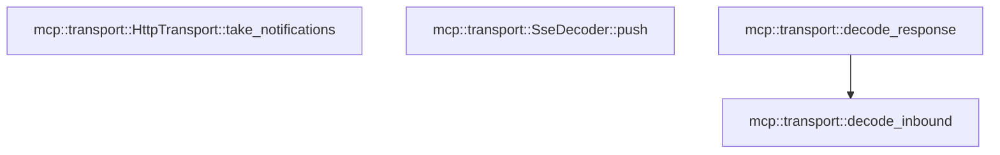

# mcp::transport

[Package atlas](index.md) · [Source](../../src/transport.rs)

## Declarations

Visibility is the declaration spelling; trait members and reexports require their enclosing interface. `cfg` is not evaluated.

| Symbol | Kind | Visibility | Test / cfg |
|---|---|---|---|
| [mcp::transport::McpMethodObserver](../../src/transport.rs#L15) | type_item | `pub` |  |
| [mcp::transport::McpValueObserver](../../src/transport.rs#L17) | type_item | `pub` |  |
| [mcp::transport::McpTransport](../../src/transport.rs#L28) | trait_item | `pub` |  |
| [mcp::transport::McpTransport::supports_http_discovery](../../src/transport.rs#L29) | function_item | `private` |  |
| [mcp::transport::McpTransport::start_catalog_subscription](../../src/transport.rs#L32) | function_item | `private` |  |
| [mcp::transport::McpTransport::install_tool_catalog](../../src/transport.rs#L41) | function_item | `private` |  |
| [mcp::transport::McpTransport::start_scoped_request](../../src/transport.rs#L51) | function_item | `private` |  |
| [mcp::transport::McpTransport::request](../../src/transport.rs#L61) | function_signature_item | `private` |  |
| [mcp::transport::McpTransport::notify](../../src/transport.rs#L67) | function_signature_item | `private` |  |
| [mcp::transport::McpTransport::close](../../src/transport.rs#L69) | function_signature_item | `private` |  |
| [mcp::transport::McpTransport::reconnect](../../src/transport.rs#L71) | function_item | `private` |  |
| [mcp::transport::McpTransport::mark_cancelled](../../src/transport.rs#L79) | function_item | `private` |  |
| [mcp::transport::McpTransport::take_notifications](../../src/transport.rs#L81) | function_item | `private` |  |
| [mcp::transport::PipeTransport](../../src/transport.rs#L88) | struct_item | `pub` |  |
| [mcp::transport::PipeTransport::new](../../src/transport.rs#L95) | function_item | `pub` |  |
| [mcp::transport::PipeTransport::write](../../src/transport.rs#L105) | function_item | `private` |  |
| [mcp::transport::PipeTransport::read_line](../../src/transport.rs#L130) | function_item | `private` |  |
| [mcp::transport::pipe_error](../../src/transport.rs#L165) | function_item | `private` |  |
| [mcp::transport::PipeTransport::request](../../src/transport.rs#L169) | function_item | `private` |  |
| [mcp::transport::PipeTransport::notify](../../src/transport.rs#L206) | function_item | `private` |  |
| [mcp::transport::PipeTransport::close](../../src/transport.rs#L214) | function_item | `private` |  |
| [mcp::transport::PipeTransport::reconnect](../../src/transport.rs#L218) | function_item | `private` |  |
| [mcp::transport::PipeTransport::mark_cancelled](../../src/transport.rs#L225) | function_item | `private` |  |
| [mcp::transport::PipeTransport::take_notifications](../../src/transport.rs#L228) | function_item | `private` |  |
| [mcp::transport::StdioTransport](../../src/transport.rs#L233) | struct_item | `pub` |  |
| [mcp::transport::StdioSpawnSpec](../../src/transport.rs#L241) | struct_item | `private` |  |
| [mcp::transport::SecretText](../../src/transport.rs#L249) | struct_item | `private` |  |
| [mcp::transport::SecretText::new](../../src/transport.rs#L252) | function_item | `private` |  |
| [mcp::transport::SecretText::as_str](../../src/transport.rs#L256) | function_item | `private` |  |
| [mcp::transport::SecretText::drop](../../src/transport.rs#L262) | function_item | `private` |  |
| [mcp::transport::StdioParts](../../src/transport.rs#L267) | struct_item | `private` |  |
| [mcp::transport::StdioGeneration](../../src/transport.rs#L272) | struct_item | `private` |  |
| [mcp::transport::STDERR_POLL_INTERVAL](../../src/transport.rs#L280) | const_item | `private` |  |
| [mcp::transport::STDIO_REAP_TIMEOUT](../../src/transport.rs#L281) | const_item | `private` |  |
| [mcp::transport::StdioTransport::spawn](../../src/transport.rs#L284) | function_item | `pub` |  |
| [mcp::transport::StdioTransport::terminate](../../src/transport.rs#L307) | function_item | `private` |  |
| [mcp::transport::StdioTransport::restart](../../src/transport.rs#L318) | function_item | `private` |  |
| [mcp::transport::StdioTransport::request_inner](../../src/transport.rs#L328) | function_item | `private` |  |
| [mcp::transport::StdioTransport::close_after_protocol_error](../../src/transport.rs#L350) | function_item | `private` |  |
| [mcp::transport::StdioTransport::write](../../src/transport.rs#L360) | function_item | `private` |  |
| [mcp::transport::StdioTransport::read_response_line](../../src/transport.rs#L386) | function_item | `private` |  |
| [mcp::transport::spawn_stdio](../../src/transport.rs#L426) | function_item | `private` |  |
| [mcp::transport::set_nonblocking](../../src/transport.rs#L505) | function_item | `private` |  |
| [mcp::transport::reap_stdio](../../src/transport.rs#L512) | function_item | `private` |  |
| [mcp::transport::reap_stdio_with_signal](../../src/transport.rs#L518) | function_item | `private` |  |
| [mcp::transport::start_stdio_reaper](../../src/transport.rs#L551) | function_item | `private` |  |
| [mcp::transport::await_stdio_reaper](../../src/transport.rs#L587) | function_item | `private` |  |
| [mcp::transport::StdioTransport::request](../../src/transport.rs#L602) | function_item | `private` |  |
| [mcp::transport::StdioTransport::notify](../../src/transport.rs#L613) | function_item | `private` |  |
| [mcp::transport::StdioTransport::close](../../src/transport.rs#L622) | function_item | `private` |  |
| [mcp::transport::StdioTransport::reconnect](../../src/transport.rs#L626) | function_item | `private` |  |
| [mcp::transport::StdioTransport::mark_cancelled](../../src/transport.rs#L630) | function_item | `private` |  |
| [mcp::transport::StdioTransport::take_notifications](../../src/transport.rs#L634) | function_item | `private` |  |
| [mcp::transport::StdioTransport::drop](../../src/transport.rs#L640) | function_item | `private` |  |
| [mcp::transport::HttpTransport](../../src/transport.rs#L647) | struct_item | `pub` |  |
| [mcp::transport::AuthorizationProvider](../../src/transport.rs#L662) | type_item | `private` |  |
| [mcp::transport::HttpTransport::drop](../../src/transport.rs#L666) | function_item | `private` |  |
| [mcp::transport::HttpRequestAuthorization](../../src/transport.rs#L674) | struct_item | `pub` |  |
| [mcp::transport::HttpRequestAuthorization::drop](../../src/transport.rs#L681) | function_item | `private` |  |
| [mcp::transport::HttpTransport::request_modern_scoped](../../src/transport.rs#L694) | function_item | `pub` |  |
| [mcp::transport::HttpTransport::request_modern_scoped_observed](../../src/transport.rs#L704) | function_item | `pub(crate)` |  |
| [mcp::transport::HttpTransport::start_modern_scoped](../../src/transport.rs#L717) | function_item | `pub(crate)` |  |
| [mcp::transport::HttpTransport::start_modern_scoped_detailed](../../src/transport.rs#L727) | function_item | `private` |  |
| [mcp::transport::HttpTransport::listen_subscription](../../src/transport.rs#L790) | function_item | `pub` |  |
| [mcp::transport::HttpTransport::with_notification_handler](../../src/transport.rs#L834) | function_item | `pub` |  |
| [mcp::transport::HttpTransport::new](../../src/transport.rs#L841) | function_item | `pub` |  |
| [mcp::transport::HttpTransport::new_with_authorization_provider](../../src/transport.rs#L866) | function_item | `pub` |  |
| [mcp::transport::HttpTransport::new_with_request_authorization_provider](../../src/transport.rs#L890) | function_item | `pub` |  |
| [mcp::transport::HttpTransport::request_headers](../../src/transport.rs#L949) | function_item | `private` |  |
| [mcp::transport::HttpTransport::start_catalog_subscription](../../src/transport.rs#L1074) | function_item | `private` |  |
| [mcp::transport::HttpTransport::install_tool_catalog](../../src/transport.rs#L1093) | function_item | `private` |  |
| [mcp::transport::HttpTransport::supports_http_discovery](../../src/transport.rs#L1098) | function_item | `private` |  |
| [mcp::transport::HttpTransport::start_scoped_request](../../src/transport.rs#L1102) | function_item | `private` |  |
| [mcp::transport::HttpTransport::request](../../src/transport.rs#L1112) | function_item | `private` |  |
| [mcp::transport::HttpTransport::notify](../../src/transport.rs#L1271) | function_item | `private` |  |
| [mcp::transport::HttpTransport::close](../../src/transport.rs#L1300) | function_item | `private` |  |
| [mcp::transport::HttpTransport::reconnect](../../src/transport.rs#L1334) | function_item | `private` |  |
| [mcp::transport::HttpTransport::take_notifications](../../src/transport.rs#L1344) | function_item | `private` |  |
| [mcp::transport::SseDecoder](../../src/transport.rs#L1350) | struct_item | `private` |  |
| [mcp::transport::SseDecoder::push](../../src/transport.rs#L1357) | function_item | `private` |  |
| [mcp::transport::Inbound](../../src/transport.rs#L1401) | enum_item | `private` |  |
| [mcp::transport::InboundWire](../../src/transport.rs#L1409) | struct_item | `private` |  |
| [mcp::transport::decode_response](../../src/transport.rs#L1423) | function_item | `private` |  |
| [mcp::transport::decode_inbound](../../src/transport.rs#L1432) | function_item | `private` |  |
| [mcp::transport::tests::exited_generation](../../src/transport.rs#L1508) | function_item | `private` | test; #[cfg(test)] |
| [mcp::transport::tests::stdio_reaps_an_already_exited_group_leader](../../src/transport.rs#L1527) | function_item | `private` | test; #[cfg(test)] |
| [mcp::transport::tests::stdio_group_signal_failure_still_reaps_child_and_joins_stderr](../../src/transport.rs#L1543) | function_item | `private` | test; #[cfg(test)] |
| [mcp::transport::tests::owned_scoped_requests_cannot_outlive_close_or_reconnect](../../src/transport.rs#L1572) | function_item | `private` | test; #[cfg(test)] |
| [mcp::transport::tests::duplicate_json_members_fail_before_value_collapse](../../src/transport.rs#L1652) | function_item | `private` | test; #[cfg(test)] |
| [mcp::transport::tests::cancelled_response_tombstone_is_consumed_once](../../src/transport.rs#L1666) | function_item | `private` | test; #[cfg(test)] |
| [mcp::transport::tests::sse_decoder_yields_the_first_complete_event_without_eof](../../src/transport.rs#L1688) | function_item | `private` | test; #[cfg(test)] |
| [mcp::transport::tests::timed_out_detached_reaper_does_not_delay_runtime_drop](../../src/transport.rs#L1707) | function_item | `private` | test; #[cfg(test)] |

## Imports / reexports

| Local name | Source path | Visibility |
|---|---|---|
| `BTreeMap` | `std::collections::BTreeMap` | `private` |
| `BTreeSet` | `std::collections::BTreeSet` | `private` |
| `File` | `std::fs::File` | `private` |
| `Read` | `std::io::Read` | `private` |
| `OwnedFd` | `std::os::fd::OwnedFd` | `private` |
| `CommandExt` | `std::os::unix::process::CommandExt` | `private` |
| `PathBuf` | `std::path::PathBuf` | `private` |
| `Child` | `std::process::Child` | `private` |
| `Command` | `std::process::Command` | `private` |
| `Stdio` | `std::process::Stdio` | `private` |
| `AtomicBool` | `std::sync::atomic::AtomicBool` | `private` |
| `Ordering` | `std::sync::atomic::Ordering` | `private` |
| `Arc` | `std::sync::Arc` | `private` |
| `Mutex` | `std::sync::Mutex` | `private` |
| `Duration` | `std::time::Duration` | `private` |
| `StreamExt` | `futures_util::StreamExt` | `private` |
| `_` | `base64::Engine` | `private` |
| `ACCEPT` | `reqwest::header::ACCEPT` | `private` |
| `AUTHORIZATION` | `reqwest::header::AUTHORIZATION` | `private` |
| `CONTENT_TYPE` | `reqwest::header::CONTENT_TYPE` | `private` |
| `HeaderMap` | `reqwest::header::HeaderMap` | `private` |
| `HeaderName` | `reqwest::header::HeaderName` | `private` |
| `HeaderValue` | `reqwest::header::HeaderValue` | `private` |
| `IJsonValue` | `schema::IJsonValue` | `private` |
| `Deserialize` | `serde::Deserialize` | `private` |
| `AsyncReadExt` | `tokio::io::AsyncReadExt` | `private` |
| `AsyncWriteExt` | `tokio::io::AsyncWriteExt` | `private` |
| `pipe` | `tokio::net::unix::pipe` | `private` |
| `Url` | `url::Url` | `private` |
| `JsonRpcError` | `crate::JsonRpcError` | `private` |
| `JsonRpcRequest` | `crate::JsonRpcRequest` | `private` |
| `JsonRpcResponse` | `crate::JsonRpcResponse` | `private` |
| `MAX_FRAME_BYTES` | `crate::MAX_FRAME_BYTES` | `private` |
| `McpError` | `crate::McpError` | `private` |
| `*` | `super::*` | `private` |

## Module declarations

| Module | Visibility | Attributes |
|---|---|---|
| `mcp::transport::tests` | `private` | #[cfg(test)] |

## Function call graphs

Edges below are syntactically resolved calls only, including private functions. Graphs partition callers into groups of 20; they are not execution order. All unresolved sites are listed below and in the JSON inventory.

Functions 1–20: 5 direct edges

Functions 21–40: 14 direct edges

Functions 41–60: 18 direct edges

Functions 61–64: 1 direct edges

## Call sites

Includes test functions (marked in declarations). Receiver-type-required sites need type analysis/manual tracing. Calls in closures are attributed to their enclosing function; their occurrence here does not mean the closure executes immediately.

| Caller | Callee expression | Source lines | Target / classification |
|---|---|---|---|
| `install_tool_catalog` | `crate::parameter_headers::ParameterHeaders::catalog` | [42](../../src/transport.rs#L42) | [mcp::parameter_headers::ParameterHeaders::catalog](../../src/parameter_headers.rs#L20) |
| `install_tool_catalog` | `catalog.values().any` | [43](../../src/transport.rs#L43) | receiver-type-required |
| `install_tool_catalog` | `catalog.values` | [43](../../src/transport.rs#L43) | receiver-type-required |
| `install_tool_catalog` | `projection.is_empty` | [43](../../src/transport.rs#L43) | receiver-type-required |
| `install_tool_catalog` | `Err` | [44](../../src/transport.rs#L44) | external-constructor-callback-or-unresolved |
| `install_tool_catalog` | `McpError::Unsupported` | [44](../../src/transport.rs#L44) | external-constructor-callback-or-unresolved |
| `install_tool_catalog` | `"transport cannot carry MCP parameter headers".into` | [45](../../src/transport.rs#L45) | receiver-type-required |
| `install_tool_catalog` | `Ok` | [48](../../src/transport.rs#L48) | external-constructor-callback-or-unresolved |
| `reconnect` | `Box::pin` | [72](../../src/transport.rs#L72) | external-constructor-callback-or-unresolved |
| `reconnect` | `Err` | [73](../../src/transport.rs#L73) | external-constructor-callback-or-unresolved |
| `reconnect` | `McpError::Transport` | [73](../../src/transport.rs#L73) | external-constructor-callback-or-unresolved |
| `reconnect` | `"MCP transport does not support reconnect".to_owned` | [74](../../src/transport.rs#L74) | receiver-type-required |
| `take_notifications` | `Vec::new` | [82](../../src/transport.rs#L82) | external-constructor-callback-or-unresolved |
| `new` | `set_nonblocking` | [96](../../src/transport.rs#L96), [97](../../src/transport.rs#L97) | [mcp::transport::set_nonblocking](../../src/transport.rs#L505) |
| `new` | `Ok` | [98](../../src/transport.rs#L98) | external-constructor-callback-or-unresolved |
| `new` | `Some` | [99](../../src/transport.rs#L99) | external-constructor-callback-or-unresolved |
| `new` | `Vec::new` | [100](../../src/transport.rs#L100), [102](../../src/transport.rs#L102) | external-constructor-callback-or-unresolved |
| `new` | `BTreeSet::new` | [101](../../src/transport.rs#L101) | external-constructor-callback-or-unresolved |
| `write` | `request.canonical_line` | [106](../../src/transport.rs#L106) | receiver-type-required |
| `write` | `bytes.len` | [107](../../src/transport.rs#L107), [119](../../src/transport.rs#L119) | receiver-type-required |
| `write` | `Err` | [108](../../src/transport.rs#L108), [123](../../src/transport.rs#L123), [125](../../src/transport.rs#L125) | external-constructor-callback-or-unresolved |
| `write` | `McpError::Protocol` | [108](../../src/transport.rs#L108) | external-constructor-callback-or-unresolved |
| `write` | `"outbound frame exceeds 4 MiB".into` | [108](../../src/transport.rs#L108) | receiver-type-required |
| `write` | `self             .streams             .as_ref()             .ok_or_else(&#124;&#124; McpError::Transport("stdio channel closed".into()))?             .1             .try_clone()             .map_err` | [110](../../src/transport.rs#L110) | receiver-type-required |
| `write` | `self             .streams             .as_ref()             .ok_or_else(&#124;&#124; McpError::Transport("stdio channel closed".into()))?             .1             .try_clone` | [110](../../src/transport.rs#L110) | receiver-type-required |
| `write` | `self             .streams             .as_ref()             .ok_or_else` | [110](../../src/transport.rs#L110) | receiver-type-required |
| `write` | `self             .streams             .as_ref` | [110](../../src/transport.rs#L110) | receiver-type-required |
| `write` | `McpError::Transport` | [113](../../src/transport.rs#L113), [123](../../src/transport.rs#L123) | external-constructor-callback-or-unresolved |
| `write` | `"stdio channel closed".into` | [113](../../src/transport.rs#L113) | receiver-type-required |
| `write` | `tokio::io::unix::AsyncFd::new(file).map_err` | [117](../../src/transport.rs#L117) | receiver-type-required |
| `write` | `tokio::io::unix::AsyncFd::new` | [117](../../src/transport.rs#L117) | external-constructor-callback-or-unresolved |
| `write` | `output.writable().await.map_err` | [120](../../src/transport.rs#L120) | receiver-type-required |
| `write` | `output.writable` | [120](../../src/transport.rs#L120) | receiver-type-required |
| `write` | `ready.try_io` | [121](../../src/transport.rs#L121) | receiver-type-required |
| `write` | `std::io::Write::write` | [121](../../src/transport.rs#L121) | external-constructor-callback-or-unresolved |
| `write` | `fd.get_ref` | [121](../../src/transport.rs#L121) | receiver-type-required |
| `write` | `"stdio channel write EOF".into` | [123](../../src/transport.rs#L123) | receiver-type-required |
| `write` | `pipe_error` | [125](../../src/transport.rs#L125) | [mcp::transport::pipe_error](../../src/transport.rs#L165) |
| `write` | `Ok` | [128](../../src/transport.rs#L128) | external-constructor-callback-or-unresolved |
| `read_line` | `self             .streams             .as_ref()             .ok_or_else(&#124;&#124; McpError::Transport("stdio channel closed".into()))?             .0             .try_clone()             .map_err` | [131](../../src/transport.rs#L131) | receiver-type-required |
| `read_line` | `self             .streams             .as_ref()             .ok_or_else(&#124;&#124; McpError::Transport("stdio channel closed".into()))?             .0             .try_clone` | [131](../../src/transport.rs#L131) | receiver-type-required |
| `read_line` | `self             .streams             .as_ref()             .ok_or_else` | [131](../../src/transport.rs#L131) | receiver-type-required |
| `read_line` | `self             .streams             .as_ref` | [131](../../src/transport.rs#L131) | receiver-type-required |
| `read_line` | `McpError::Transport` | [134](../../src/transport.rs#L134), [158](../../src/transport.rs#L158) | external-constructor-callback-or-unresolved |
| `read_line` | `"stdio channel closed".into` | [134](../../src/transport.rs#L134) | receiver-type-required |
| `read_line` | `tokio::io::unix::AsyncFd::new(file).map_err` | [138](../../src/transport.rs#L138) | receiver-type-required |
| `read_line` | `tokio::io::unix::AsyncFd::new` | [138](../../src/transport.rs#L138) | external-constructor-callback-or-unresolved |
| `read_line` | `self.pending.iter().position` | [140](../../src/transport.rs#L140) | receiver-type-required |
| `read_line` | `self.pending.iter` | [140](../../src/transport.rs#L140) | receiver-type-required |
| `read_line` | `Err` | [142](../../src/transport.rs#L142), [152](../../src/transport.rs#L152), [158](../../src/transport.rs#L158), [160](../../src/transport.rs#L160) | external-constructor-callback-or-unresolved |
| `read_line` | `McpError::Protocol` | [142](../../src/transport.rs#L142), [152](../../src/transport.rs#L152) | external-constructor-callback-or-unresolved |
| `read_line` | `"inbound frame exceeds 4 MiB".into` | [142](../../src/transport.rs#L142), [152](../../src/transport.rs#L152) | receiver-type-required |
| `read_line` | `self.pending.drain(..=end).collect::<Vec<_>>` | [144](../../src/transport.rs#L144) | receiver-type-required |
| `read_line` | `self.pending.drain` | [144](../../src/transport.rs#L144) | receiver-type-required |
| `read_line` | `line.pop` | [145](../../src/transport.rs#L145), [147](../../src/transport.rs#L147) | receiver-type-required |
| `read_line` | `line.last` | [146](../../src/transport.rs#L146) | receiver-type-required |
| `read_line` | `Some` | [146](../../src/transport.rs#L146) | external-constructor-callback-or-unresolved |
| `read_line` | `Ok` | [149](../../src/transport.rs#L149) | external-constructor-callback-or-unresolved |
| `read_line` | `self.pending.len` | [151](../../src/transport.rs#L151) | receiver-type-required |
| `read_line` | `input.readable().await.map_err` | [155](../../src/transport.rs#L155) | receiver-type-required |
| `read_line` | `input.readable` | [155](../../src/transport.rs#L155) | receiver-type-required |
| `read_line` | `ready.try_io` | [156](../../src/transport.rs#L156) | receiver-type-required |
| `read_line` | `std::io::Read::read` | [156](../../src/transport.rs#L156) | external-constructor-callback-or-unresolved |
| `read_line` | `fd.get_ref` | [156](../../src/transport.rs#L156) | receiver-type-required |
| `read_line` | `"stdio channel EOF".into` | [158](../../src/transport.rs#L158) | receiver-type-required |
| `read_line` | `self.pending.extend_from_slice` | [159](../../src/transport.rs#L159) | receiver-type-required |
| `read_line` | `pipe_error` | [160](../../src/transport.rs#L160) | [mcp::transport::pipe_error](../../src/transport.rs#L165) |
| `pipe_error` | `McpError::Transport` | [166](../../src/transport.rs#L166) | external-constructor-callback-or-unresolved |
| `pipe_error` | `error.to_string` | [166](../../src/transport.rs#L166) | receiver-type-required |
| `request` | `Box::pin` | [174](../../src/transport.rs#L174) | external-constructor-callback-or-unresolved |
| `request` | `tokio::time::timeout(timeout, async {                 let id = request                     .id                     .ok_or_else(&#124;&#124; McpError::Protocol("request id is absent".into()))?;                 self.write(request).await?;                 loop {                     let bytes = self.read_line().await?;                     match decode_inbound(&bytes, id, &mut self.cancelled_ids)? {                         Inbound::Response(response) => return Ok(response),                         Inbound::Notification(method) => {                             if self.notifications.len() >= 1024 {                                 return Err(McpError::Protocol(                                     "stdio notification backlog exceeded".into(),                                 ));                             }                             self.notifications.push(method);                         }                         Inbound::LateCancelled => {}                     }                 }             })             .await             .map_err(&#124;_&#124; McpError::Timeout(request.method.clone()))             .and_then` | [175](../../src/transport.rs#L175) | receiver-type-required |
| `request` | `tokio::time::timeout(timeout, async {                 let id = request                     .id                     .ok_or_else(&#124;&#124; McpError::Protocol("request id is absent".into()))?;                 self.write(request).await?;                 loop {                     let bytes = self.read_line().await?;                     match decode_inbound(&bytes, id, &mut self.cancelled_ids)? {                         Inbound::Response(response) => return Ok(response),                         Inbound::Notification(method) => {                             if self.notifications.len() >= 1024 {                                 return Err(McpError::Protocol(                                     "stdio notification backlog exceeded".into(),                                 ));                             }                             self.notifications.push(method);                         }                         Inbound::LateCancelled => {}                     }                 }             })             .await             .map_err` | [175](../../src/transport.rs#L175) | receiver-type-required |
| `request` | `tokio::time::timeout` | [175](../../src/transport.rs#L175) | external-constructor-callback-or-unresolved |
| `request` | `request                     .id                     .ok_or_else` | [176](../../src/transport.rs#L176) | receiver-type-required |
| `request` | `McpError::Protocol` | [178](../../src/transport.rs#L178), [186](../../src/transport.rs#L186) | external-constructor-callback-or-unresolved |
| `request` | `"request id is absent".into` | [178](../../src/transport.rs#L178) | receiver-type-required |
| `request` | `self.write` | [179](../../src/transport.rs#L179) | receiver-type-required |
| `request` | `self.read_line` | [181](../../src/transport.rs#L181) | receiver-type-required |
| `request` | `decode_inbound` | [182](../../src/transport.rs#L182) | [mcp::transport::decode_inbound](../../src/transport.rs#L1432) |
| `request` | `Ok` | [183](../../src/transport.rs#L183) | external-constructor-callback-or-unresolved |
| `request` | `self.notifications.len` | [185](../../src/transport.rs#L185) | receiver-type-required |
| `request` | `Err` | [186](../../src/transport.rs#L186) | external-constructor-callback-or-unresolved |
| `request` | `"stdio notification backlog exceeded".into` | [187](../../src/transport.rs#L187) | receiver-type-required |
| `request` | `self.notifications.push` | [190](../../src/transport.rs#L190) | receiver-type-required |
| `request` | `McpError::Timeout` | [197](../../src/transport.rs#L197) | external-constructor-callback-or-unresolved |
| `request` | `request.method.clone` | [197](../../src/transport.rs#L197) | receiver-type-required |
| `request` | `result.is_err` | [200](../../src/transport.rs#L200) | receiver-type-required |
| `request` | `self.streams.take` | [201](../../src/transport.rs#L201) | receiver-type-required |
| `notify` | `Box::pin` | [207](../../src/transport.rs#L207) | external-constructor-callback-or-unresolved |
| `notify` | `notification.id.is_some` | [208](../../src/transport.rs#L208) | receiver-type-required |
| `notify` | `Err` | [209](../../src/transport.rs#L209) | external-constructor-callback-or-unresolved |
| `notify` | `McpError::Protocol` | [209](../../src/transport.rs#L209) | external-constructor-callback-or-unresolved |
| `notify` | `"notification has an id".into` | [209](../../src/transport.rs#L209) | receiver-type-required |
| `notify` | `self.write` | [211](../../src/transport.rs#L211) | receiver-type-required |
| `close` | `self.streams.take` | [215](../../src/transport.rs#L215) | receiver-type-required |
| `close` | `Box::pin` | [216](../../src/transport.rs#L216) | external-constructor-callback-or-unresolved |
| `close` | `Ok` | [216](../../src/transport.rs#L216) | external-constructor-callback-or-unresolved |
| `reconnect` | `Box::pin` | [219](../../src/transport.rs#L219) | external-constructor-callback-or-unresolved |
| `reconnect` | `Err` | [220](../../src/transport.rs#L220) | external-constructor-callback-or-unresolved |
| `reconnect` | `McpError::Transport` | [220](../../src/transport.rs#L220) | external-constructor-callback-or-unresolved |
| `reconnect` | `"host must supply a fresh stdio channel".into` | [221](../../src/transport.rs#L221) | receiver-type-required |
| `mark_cancelled` | `self.cancelled_ids.insert` | [226](../../src/transport.rs#L226) | receiver-type-required |
| `take_notifications` | `std::mem::take` | [229](../../src/transport.rs#L229) | external-constructor-callback-or-unresolved |
| `new` | `Self` | [253](../../src/transport.rs#L253) | external-constructor-callback-or-unresolved |
| `drop` | `self.0.clear` | [263](../../src/transport.rs#L263) | receiver-type-required |
| `STDERR_POLL_INTERVAL` | `Duration::from_millis` | [280](../../src/transport.rs#L280) | external-constructor-callback-or-unresolved |
| `STDIO_REAP_TIMEOUT` | `Duration::from_secs` | [281](../../src/transport.rs#L281) | external-constructor-callback-or-unresolved |
| `spawn` | `argv.to_vec` | [290](../../src/transport.rs#L290) | receiver-type-required |
| `spawn` | `environment                 .iter()                 .map(&#124;(name, value)&#124; (name.clone(), SecretText::new(value.clone())))                 .collect` | [292](../../src/transport.rs#L292) | receiver-type-required |
| `spawn` | `environment                 .iter()                 .map` | [292](../../src/transport.rs#L292) | receiver-type-required |
| `spawn` | `environment                 .iter` | [292](../../src/transport.rs#L292) | receiver-type-required |
| `spawn` | `name.clone` | [294](../../src/transport.rs#L294) | receiver-type-required |
| `spawn` | `SecretText::new` | [294](../../src/transport.rs#L294) | [mcp::transport::SecretText::new](../../src/transport.rs#L252) |
| `spawn` | `value.clone` | [294](../../src/transport.rs#L294) | receiver-type-required |
| `spawn` | `spawn_stdio` | [297](../../src/transport.rs#L297) | [mcp::transport::spawn_stdio](../../src/transport.rs#L426) |
| `spawn` | `Ok` | [298](../../src/transport.rs#L298) | external-constructor-callback-or-unresolved |
| `spawn` | `Some` | [299](../../src/transport.rs#L299) | external-constructor-callback-or-unresolved |
| `spawn` | `BTreeSet::new` | [302](../../src/transport.rs#L302) | external-constructor-callback-or-unresolved |
| `spawn` | `Vec::new` | [303](../../src/transport.rs#L303) | external-constructor-callback-or-unresolved |
| `terminate` | `self.generation.take` | [308](../../src/transport.rs#L308) | receiver-type-required |
| `terminate` | `Ok` | [309](../../src/transport.rs#L309) | external-constructor-callback-or-unresolved |
| `terminate` | `start_stdio_reaper` | [314](../../src/transport.rs#L314) | [mcp::transport::start_stdio_reaper](../../src/transport.rs#L551) |
| `terminate` | `await_stdio_reaper` | [315](../../src/transport.rs#L315) | [mcp::transport::await_stdio_reaper](../../src/transport.rs#L587) |
| `restart` | `self.terminate` | [319](../../src/transport.rs#L319) | [mcp::transport::StdioTransport::terminate](../../src/transport.rs#L307) |
| `restart` | `spawn_stdio` | [320](../../src/transport.rs#L320) | [mcp::transport::spawn_stdio](../../src/transport.rs#L426) |
| `restart` | `Some` | [321](../../src/transport.rs#L321) | external-constructor-callback-or-unresolved |
| `restart` | `self.cancelled_ids.clear` | [323](../../src/transport.rs#L323) | receiver-type-required |
| `restart` | `self.notifications.clear` | [324](../../src/transport.rs#L324) | receiver-type-required |
| `restart` | `Ok` | [325](../../src/transport.rs#L325) | external-constructor-callback-or-unresolved |
| `request_inner` | `request             .id             .ok_or_else` | [333](../../src/transport.rs#L333) | receiver-type-required |
| `request_inner` | `McpError::Protocol` | [335](../../src/transport.rs#L335) | external-constructor-callback-or-unresolved |
| `request_inner` | `"request id is absent".to_owned` | [335](../../src/transport.rs#L335) | receiver-type-required |
| `request_inner` | `self.write` | [336](../../src/transport.rs#L336) | [mcp::transport::StdioTransport::write](../../src/transport.rs#L360) |
| `request_inner` | `tokio::time::Instant::now` | [337](../../src/transport.rs#L337) | external-constructor-callback-or-unresolved |
| `request_inner` | `tokio::time::timeout_at(deadline, self.read_response_line())                 .await                 .map_err` | [339](../../src/transport.rs#L339) | receiver-type-required |
| `request_inner` | `tokio::time::timeout_at` | [339](../../src/transport.rs#L339) | external-constructor-callback-or-unresolved |
| `request_inner` | `self.read_response_line` | [339](../../src/transport.rs#L339) | [mcp::transport::StdioTransport::read_response_line](../../src/transport.rs#L386) |
| `request_inner` | `McpError::Timeout` | [341](../../src/transport.rs#L341) | external-constructor-callback-or-unresolved |
| `request_inner` | `request.method.clone` | [341](../../src/transport.rs#L341) | receiver-type-required |
| `request_inner` | `decode_inbound` | [342](../../src/transport.rs#L342) | [mcp::transport::decode_inbound](../../src/transport.rs#L1432) |
| `request_inner` | `Ok` | [343](../../src/transport.rs#L343) | external-constructor-callback-or-unresolved |
| `request_inner` | `self.notifications.push` | [344](../../src/transport.rs#L344) | receiver-type-required |
| `close_after_protocol_error` | `self.terminate` | [355](../../src/transport.rs#L355) | [mcp::transport::StdioTransport::terminate](../../src/transport.rs#L307) |
| `write` | `request.canonical_line` | [361](../../src/transport.rs#L361) | receiver-type-required |
| `write` | `bytes.len` | [362](../../src/transport.rs#L362) | receiver-type-required |
| `write` | `Err` | [363](../../src/transport.rs#L363) | external-constructor-callback-or-unresolved |
| `write` | `McpError::Protocol` | [363](../../src/transport.rs#L363) | external-constructor-callback-or-unresolved |
| `write` | `"outbound frame exceeds 4 MiB".to_owned` | [364](../../src/transport.rs#L364) | receiver-type-required |
| `write` | `pipe::Sender::from_file(             self.generation                 .as_ref()                 .ok_or_else(&#124;&#124; McpError::Transport("stdio generation is closed".to_owned()))?                 .stdin                 .try_clone()                 .map_err(&#124;error&#124; McpError::Transport(error.to_string()))?,         )         .map_err` | [367](../../src/transport.rs#L367) | receiver-type-required |
| `write` | `pipe::Sender::from_file` | [367](../../src/transport.rs#L367) | external-constructor-callback-or-unresolved |
| `write` | `self.generation                 .as_ref()                 .ok_or_else(&#124;&#124; McpError::Transport("stdio generation is closed".to_owned()))?                 .stdin                 .try_clone()                 .map_err` | [368](../../src/transport.rs#L368) | receiver-type-required |
| `write` | `self.generation                 .as_ref()                 .ok_or_else(&#124;&#124; McpError::Transport("stdio generation is closed".to_owned()))?                 .stdin                 .try_clone` | [368](../../src/transport.rs#L368) | receiver-type-required |
| `write` | `self.generation                 .as_ref()                 .ok_or_else` | [368](../../src/transport.rs#L368) | receiver-type-required |
| `write` | `self.generation                 .as_ref` | [368](../../src/transport.rs#L368) | receiver-type-required |
| `write` | `McpError::Transport` | [370](../../src/transport.rs#L370), [373](../../src/transport.rs#L373), [375](../../src/transport.rs#L375), [379](../../src/transport.rs#L379), [383](../../src/transport.rs#L383) | external-constructor-callback-or-unresolved |
| `write` | `"stdio generation is closed".to_owned` | [370](../../src/transport.rs#L370) | receiver-type-required |
| `write` | `error.to_string` | [373](../../src/transport.rs#L373), [375](../../src/transport.rs#L375), [379](../../src/transport.rs#L379), [383](../../src/transport.rs#L383) | receiver-type-required |
| `write` | `stdin             .write_all(&bytes)             .await             .map_err` | [376](../../src/transport.rs#L376) | receiver-type-required |
| `write` | `stdin             .write_all` | [376](../../src/transport.rs#L376) | receiver-type-required |
| `write` | `stdin             .flush()             .await             .map_err` | [380](../../src/transport.rs#L380) | receiver-type-required |
| `write` | `stdin             .flush` | [380](../../src/transport.rs#L380) | receiver-type-required |
| `read_response_line` | `Vec::new` | [387](../../src/transport.rs#L387) | external-constructor-callback-or-unresolved |
| `read_response_line` | `pipe::Receiver::from_file(             self.generation                 .as_ref()                 .ok_or_else(&#124;&#124; McpError::Transport("stdio generation is closed".to_owned()))?                 .stdout                 .try_clone()                 .map_err(&#124;error&#124; McpError::Transport(error.to_string()))?,         )         .map_err` | [388](../../src/transport.rs#L388) | receiver-type-required |
| `read_response_line` | `pipe::Receiver::from_file` | [388](../../src/transport.rs#L388) | external-constructor-callback-or-unresolved |
| `read_response_line` | `self.generation                 .as_ref()                 .ok_or_else(&#124;&#124; McpError::Transport("stdio generation is closed".to_owned()))?                 .stdout                 .try_clone()                 .map_err` | [389](../../src/transport.rs#L389) | receiver-type-required |
| `read_response_line` | `self.generation                 .as_ref()                 .ok_or_else(&#124;&#124; McpError::Transport("stdio generation is closed".to_owned()))?                 .stdout                 .try_clone` | [389](../../src/transport.rs#L389) | receiver-type-required |
| `read_response_line` | `self.generation                 .as_ref()                 .ok_or_else` | [389](../../src/transport.rs#L389) | receiver-type-required |
| `read_response_line` | `self.generation                 .as_ref` | [389](../../src/transport.rs#L389) | receiver-type-required |
| `read_response_line` | `McpError::Transport` | [391](../../src/transport.rs#L391), [394](../../src/transport.rs#L394), [396](../../src/transport.rs#L396), [402](../../src/transport.rs#L402), [404](../../src/transport.rs#L404) | external-constructor-callback-or-unresolved |
| `read_response_line` | `"stdio generation is closed".to_owned` | [391](../../src/transport.rs#L391) | receiver-type-required |
| `read_response_line` | `error.to_string` | [394](../../src/transport.rs#L394), [396](../../src/transport.rs#L396), [402](../../src/transport.rs#L402) | receiver-type-required |
| `read_response_line` | `bytes.len` | [397](../../src/transport.rs#L397), [411](../../src/transport.rs#L411) | receiver-type-required |
| `read_response_line` | `stdout                 .read(&mut byte)                 .await                 .map_err` | [399](../../src/transport.rs#L399) | receiver-type-required |
| `read_response_line` | `stdout                 .read` | [399](../../src/transport.rs#L399) | receiver-type-required |
| `read_response_line` | `Err` | [404](../../src/transport.rs#L404), [412](../../src/transport.rs#L412), [418](../../src/transport.rs#L418) | external-constructor-callback-or-unresolved |
| `read_response_line` | `"stdio EOF".to_owned` | [404](../../src/transport.rs#L404) | receiver-type-required |
| `read_response_line` | `bytes.push` | [406](../../src/transport.rs#L406) | receiver-type-required |
| `read_response_line` | `bytes.last` | [411](../../src/transport.rs#L411), [417](../../src/transport.rs#L417) | receiver-type-required |
| `read_response_line` | `Some` | [411](../../src/transport.rs#L411), [417](../../src/transport.rs#L417) | external-constructor-callback-or-unresolved |
| `read_response_line` | `McpError::Protocol` | [412](../../src/transport.rs#L412), [418](../../src/transport.rs#L418) | external-constructor-callback-or-unresolved |
| `read_response_line` | `"inbound frame exceeds 4 MiB or lacks LF framing".to_owned` | [413](../../src/transport.rs#L413) | receiver-type-required |
| `read_response_line` | `bytes.pop` | [416](../../src/transport.rs#L416) | receiver-type-required |
| `read_response_line` | `"stdio frames require LF rather than CRLF".to_owned` | [419](../../src/transport.rs#L419) | receiver-type-required |
| `read_response_line` | `Ok` | [422](../../src/transport.rs#L422) | external-constructor-callback-or-unresolved |
| `spawn_stdio` | `spawn.cwd.clone` | [428](../../src/transport.rs#L428) | receiver-type-required |
| `spawn_stdio` | `argv         .split_first()         .ok_or_else` | [430](../../src/transport.rs#L430) | receiver-type-required |
| `spawn_stdio` | `argv         .split_first` | [430](../../src/transport.rs#L430) | receiver-type-required |
| `spawn_stdio` | `McpError::Transport` | [432](../../src/transport.rs#L432), [449](../../src/transport.rs#L449), [453](../../src/transport.rs#L453), [457](../../src/transport.rs#L457), [461](../../src/transport.rs#L461), [492](../../src/transport.rs#L492) | external-constructor-callback-or-unresolved |
| `spawn_stdio` | `"stdio argv is empty".to_owned` | [432](../../src/transport.rs#L432) | receiver-type-required |
| `spawn_stdio` | `Command::new` | [433](../../src/transport.rs#L433) | external-constructor-callback-or-unresolved |
| `spawn_stdio` | `command         .args(arguments)         .env_clear()         .stdin(Stdio::piped())         .stdout(Stdio::piped())         .stderr` | [434](../../src/transport.rs#L434) | receiver-type-required |
| `spawn_stdio` | `command         .args(arguments)         .env_clear()         .stdin(Stdio::piped())         .stdout` | [434](../../src/transport.rs#L434) | receiver-type-required |
| `spawn_stdio` | `command         .args(arguments)         .env_clear()         .stdin` | [434](../../src/transport.rs#L434) | receiver-type-required |
| `spawn_stdio` | `command         .args(arguments)         .env_clear` | [434](../../src/transport.rs#L434) | receiver-type-required |
| `spawn_stdio` | `command         .args` | [434](../../src/transport.rs#L434) | receiver-type-required |
| `spawn_stdio` | `Stdio::piped` | [437](../../src/transport.rs#L437), [438](../../src/transport.rs#L438), [439](../../src/transport.rs#L439) | external-constructor-callback-or-unresolved |
| `spawn_stdio` | `command.env` | [441](../../src/transport.rs#L441) | receiver-type-required |
| `spawn_stdio` | `value.as_str` | [441](../../src/transport.rs#L441) | receiver-type-required |
| `spawn_stdio` | `command.current_dir` | [444](../../src/transport.rs#L444) | receiver-type-required |
| `spawn_stdio` | `command.process_group` | [446](../../src/transport.rs#L446) | receiver-type-required |
| `spawn_stdio` | `command         .spawn()         .map_err` | [447](../../src/transport.rs#L447) | receiver-type-required |
| `spawn_stdio` | `command         .spawn` | [447](../../src/transport.rs#L447) | receiver-type-required |
| `spawn_stdio` | `error.to_string` | [449](../../src/transport.rs#L449), [492](../../src/transport.rs#L492) | receiver-type-required |
| `spawn_stdio` | `child         .stdin         .take()         .ok_or_else` | [450](../../src/transport.rs#L450) | receiver-type-required |
| `spawn_stdio` | `child         .stdin         .take` | [450](../../src/transport.rs#L450) | receiver-type-required |
| `spawn_stdio` | `"stdio stdin is absent".to_owned` | [453](../../src/transport.rs#L453) | receiver-type-required |
| `spawn_stdio` | `child         .stdout         .take()         .ok_or_else` | [454](../../src/transport.rs#L454) | receiver-type-required |
| `spawn_stdio` | `child         .stdout         .take` | [454](../../src/transport.rs#L454) | receiver-type-required |
| `spawn_stdio` | `"stdio stdout is absent".to_owned` | [457](../../src/transport.rs#L457) | receiver-type-required |
| `spawn_stdio` | `child         .stderr         .take()         .ok_or_else` | [458](../../src/transport.rs#L458) | receiver-type-required |
| `spawn_stdio` | `child         .stderr         .take` | [458](../../src/transport.rs#L458) | receiver-type-required |
| `spawn_stdio` | `"stdio stderr is absent".to_owned` | [461](../../src/transport.rs#L461) | receiver-type-required |
| `spawn_stdio` | `File::from` | [462](../../src/transport.rs#L462), [496](../../src/transport.rs#L496), [497](../../src/transport.rs#L497) | external-constructor-callback-or-unresolved |
| `spawn_stdio` | `OwnedFd::from` | [462](../../src/transport.rs#L462), [496](../../src/transport.rs#L496), [497](../../src/transport.rs#L497) | external-constructor-callback-or-unresolved |
| `spawn_stdio` | `set_nonblocking` | [463](../../src/transport.rs#L463) | [mcp::transport::set_nonblocking](../../src/transport.rs#L505) |
| `spawn_stdio` | `Arc::new` | [464](../../src/transport.rs#L464), [466](../../src/transport.rs#L466) | external-constructor-callback-or-unresolved |
| `spawn_stdio` | `Mutex::new` | [464](../../src/transport.rs#L464) | external-constructor-callback-or-unresolved |
| `spawn_stdio` | `Vec::new` | [464](../../src/transport.rs#L464) | external-constructor-callback-or-unresolved |
| `spawn_stdio` | `Arc::clone` | [465](../../src/transport.rs#L465), [467](../../src/transport.rs#L467) | external-constructor-callback-or-unresolved |
| `spawn_stdio` | `AtomicBool::new` | [466](../../src/transport.rs#L466) | external-constructor-callback-or-unresolved |
| `spawn_stdio` | `std::thread::Builder::new()         .name("tekes-mcp-stderr".to_owned())         .spawn(move &#124;&#124; {             let mut buffer = [0_u8; 8 * 1024];             while !stderr_task_stop.load(Ordering::Acquire) {                 let count = match stderr.read(&mut buffer) {                     Ok(0) => break,                     Ok(count) => count,                     Err(error) if error.kind() == std::io::ErrorKind::WouldBlock => {                         std::thread::sleep(STDERR_POLL_INTERVAL);                         continue;                     }                     Err(error) if error.kind() == std::io::ErrorKind::Interrupted => continue,                     Err(_) => break,                 };                 if count > 0 {                     let mut retained = diagnostics_writer                         .lock()                         .unwrap_or_else(std::sync::PoisonError::into_inner);                     let remaining = (64_usize * 1024).saturating_sub(retained.len());                     retained.extend_from_slice(&buffer[..count.min(remaining)]);                 }             }         })         .map_err` | [468](../../src/transport.rs#L468) | receiver-type-required |
| `spawn_stdio` | `std::thread::Builder::new()         .name("tekes-mcp-stderr".to_owned())         .spawn` | [468](../../src/transport.rs#L468) | receiver-type-required |
| `spawn_stdio` | `std::thread::Builder::new()         .name` | [468](../../src/transport.rs#L468) | receiver-type-required |
| `spawn_stdio` | `std::thread::Builder::new` | [468](../../src/transport.rs#L468) | external-constructor-callback-or-unresolved |
| `spawn_stdio` | `"tekes-mcp-stderr".to_owned` | [469](../../src/transport.rs#L469) | receiver-type-required |
| `spawn_stdio` | `stderr_task_stop.load` | [472](../../src/transport.rs#L472) | receiver-type-required |
| `spawn_stdio` | `stderr.read` | [473](../../src/transport.rs#L473) | receiver-type-required |
| `spawn_stdio` | `error.kind` | [476](../../src/transport.rs#L476), [480](../../src/transport.rs#L480) | receiver-type-required |
| `spawn_stdio` | `std::thread::sleep` | [477](../../src/transport.rs#L477) | external-constructor-callback-or-unresolved |
| `spawn_stdio` | `diagnostics_writer                         .lock()                         .unwrap_or_else` | [484](../../src/transport.rs#L484) | receiver-type-required |
| `spawn_stdio` | `diagnostics_writer                         .lock` | [484](../../src/transport.rs#L484) | receiver-type-required |
| `spawn_stdio` | `(64_usize * 1024).saturating_sub` | [487](../../src/transport.rs#L487) | receiver-type-required |
| `spawn_stdio` | `retained.len` | [487](../../src/transport.rs#L487) | receiver-type-required |
| `spawn_stdio` | `retained.extend_from_slice` | [488](../../src/transport.rs#L488) | receiver-type-required |
| `spawn_stdio` | `count.min` | [488](../../src/transport.rs#L488) | receiver-type-required |
| `spawn_stdio` | `Ok` | [493](../../src/transport.rs#L493) | external-constructor-callback-or-unresolved |
| `set_nonblocking` | `rustix::fs::fcntl_getfl(file).map_err` | [507](../../src/transport.rs#L507) | receiver-type-required |
| `set_nonblocking` | `rustix::fs::fcntl_getfl` | [507](../../src/transport.rs#L507) | external-constructor-callback-or-unresolved |
| `set_nonblocking` | `McpError::Transport` | [507](../../src/transport.rs#L507), [509](../../src/transport.rs#L509) | external-constructor-callback-or-unresolved |
| `set_nonblocking` | `error.to_string` | [507](../../src/transport.rs#L507), [509](../../src/transport.rs#L509) | receiver-type-required |
| `set_nonblocking` | `rustix::fs::fcntl_setfl(file, flags &#124; rustix::fs::OFlags::NONBLOCK)         .map_err` | [508](../../src/transport.rs#L508) | receiver-type-required |
| `set_nonblocking` | `rustix::fs::fcntl_setfl` | [508](../../src/transport.rs#L508) | external-constructor-callback-or-unresolved |
| `reap_stdio` | `reap_stdio_with_signal` | [513](../../src/transport.rs#L513) | [mcp::transport::reap_stdio_with_signal](../../src/transport.rs#L518) |
| `reap_stdio` | `rustix::process::kill_process_group` | [514](../../src/transport.rs#L514) | external-constructor-callback-or-unresolved |
| `reap_stdio_with_signal` | `generation.stderr_stop.store` | [522](../../src/transport.rs#L522) | receiver-type-required |
| `reap_stdio_with_signal` | `drop` | [523](../../src/transport.rs#L523), [524](../../src/transport.rs#L524) | external-constructor-callback-or-unresolved |
| `reap_stdio_with_signal` | `rustix::process::Pid::from_raw` | [525](../../src/transport.rs#L525) | external-constructor-callback-or-unresolved |
| `reap_stdio_with_signal` | `generation.child.id` | [525](../../src/transport.rs#L525) | receiver-type-required |
| `reap_stdio_with_signal` | `pid.map_or` | [526](../../src/transport.rs#L526), [540](../../src/transport.rs#L540) | receiver-type-required |
| `reap_stdio_with_signal` | `Ok` | [526](../../src/transport.rs#L526), [540](../../src/transport.rs#L540) | external-constructor-callback-or-unresolved |
| `reap_stdio_with_signal` | `(&#124;&#124; {         if generation.child.try_wait()?.is_none() {             generation.child.kill()?;             generation.child.wait()?;         }         Ok::<_, std::io::Error>(())     })` | [529](../../src/transport.rs#L529) | external-constructor-callback-or-unresolved |
| `reap_stdio_with_signal` | `generation.child.try_wait()?.is_none` | [530](../../src/transport.rs#L530) | receiver-type-required |
| `reap_stdio_with_signal` | `generation.child.try_wait` | [530](../../src/transport.rs#L530) | receiver-type-required |
| `reap_stdio_with_signal` | `generation.child.kill` | [531](../../src/transport.rs#L531) | receiver-type-required |
| `reap_stdio_with_signal` | `generation.child.wait` | [532](../../src/transport.rs#L532) | receiver-type-required |
| `reap_stdio_with_signal` | `Ok::<_, std::io::Error>` | [534](../../src/transport.rs#L534) | external-constructor-callback-or-unresolved |
| `reap_stdio_with_signal` | `Err` | [536](../../src/transport.rs#L536), [545](../../src/transport.rs#L545) | external-constructor-callback-or-unresolved |
| `reap_stdio_with_signal` | `child_result.is_ok` | [536](../../src/transport.rs#L536) | receiver-type-required |
| `reap_stdio_with_signal` | `generation.stderr_task.join` | [542](../../src/transport.rs#L542) | receiver-type-required |
| `reap_stdio_with_signal` | `McpError::Transport` | [545](../../src/transport.rs#L545), [547](../../src/transport.rs#L547), [548](../../src/transport.rs#L548) | external-constructor-callback-or-unresolved |
| `reap_stdio_with_signal` | `error.to_string` | [545](../../src/transport.rs#L545), [547](../../src/transport.rs#L547) | receiver-type-required |
| `reap_stdio_with_signal` | `child_result.map_err` | [547](../../src/transport.rs#L547) | receiver-type-required |
| `reap_stdio_with_signal` | `drain_result.map_err` | [548](../../src/transport.rs#L548) | receiver-type-required |
| `reap_stdio_with_signal` | `"stdio stderr drain thread panicked".to_owned` | [548](../../src/transport.rs#L548) | receiver-type-required |
| `start_stdio_reaper` | `Arc::new` | [554](../../src/transport.rs#L554) | external-constructor-callback-or-unresolved |
| `start_stdio_reaper` | `Mutex::new` | [554](../../src/transport.rs#L554) | external-constructor-callback-or-unresolved |
| `start_stdio_reaper` | `Some` | [554](../../src/transport.rs#L554) | external-constructor-callback-or-unresolved |
| `start_stdio_reaper` | `Arc::clone` | [555](../../src/transport.rs#L555) | external-constructor-callback-or-unresolved |
| `start_stdio_reaper` | `tokio::sync::oneshot::channel` | [556](../../src/transport.rs#L556) | external-constructor-callback-or-unresolved |
| `start_stdio_reaper` | `std::thread::Builder::new()         .name("tekes-mcp-reaper".to_owned())         .spawn` | [557](../../src/transport.rs#L557) | receiver-type-required |
| `start_stdio_reaper` | `std::thread::Builder::new()         .name` | [557](../../src/transport.rs#L557) | receiver-type-required |
| `start_stdio_reaper` | `std::thread::Builder::new` | [557](../../src/transport.rs#L557) | external-constructor-callback-or-unresolved |
| `start_stdio_reaper` | `"tekes-mcp-reaper".to_owned` | [558](../../src/transport.rs#L558) | receiver-type-required |
| `start_stdio_reaper` | `reaper_generation                 .lock()                 .unwrap_or_else(std::sync::PoisonError::into_inner)                 .take()                 .expect` | [560](../../src/transport.rs#L560) | receiver-type-required |
| `start_stdio_reaper` | `reaper_generation                 .lock()                 .unwrap_or_else(std::sync::PoisonError::into_inner)                 .take` | [560](../../src/transport.rs#L560) | receiver-type-required |
| `start_stdio_reaper` | `reaper_generation                 .lock()                 .unwrap_or_else` | [560](../../src/transport.rs#L560) | receiver-type-required |
| `start_stdio_reaper` | `reaper_generation                 .lock` | [560](../../src/transport.rs#L560) | receiver-type-required |
| `start_stdio_reaper` | `sender.send` | [565](../../src/transport.rs#L565) | receiver-type-required |
| `start_stdio_reaper` | `reap_stdio` | [565](../../src/transport.rs#L565) | [mcp::transport::reap_stdio](../../src/transport.rs#L512) |
| `start_stdio_reaper` | `Ok` | [567](../../src/transport.rs#L567) | external-constructor-callback-or-unresolved |
| `start_stdio_reaper` | `generation                 .lock()                 .unwrap_or_else(std::sync::PoisonError::into_inner)                 .take` | [569](../../src/transport.rs#L569) | receiver-type-required |
| `start_stdio_reaper` | `generation                 .lock()                 .unwrap_or_else` | [569](../../src/transport.rs#L569) | receiver-type-required |
| `start_stdio_reaper` | `generation                 .lock` | [569](../../src/transport.rs#L569) | receiver-type-required |
| `start_stdio_reaper` | `generation.stderr_stop.store` | [577](../../src/transport.rs#L577) | receiver-type-required |
| `start_stdio_reaper` | `generation.child.kill` | [578](../../src/transport.rs#L578) | receiver-type-required |
| `start_stdio_reaper` | `Err` | [580](../../src/transport.rs#L580) | external-constructor-callback-or-unresolved |
| `start_stdio_reaper` | `McpError::Transport` | [580](../../src/transport.rs#L580) | external-constructor-callback-or-unresolved |
| `await_stdio_reaper` | `tokio::time::timeout` | [590](../../src/transport.rs#L590) | external-constructor-callback-or-unresolved |
| `await_stdio_reaper` | `Err` | [592](../../src/transport.rs#L592), [595](../../src/transport.rs#L595) | external-constructor-callback-or-unresolved |
| `await_stdio_reaper` | `McpError::Transport` | [592](../../src/transport.rs#L592), [595](../../src/transport.rs#L595) | external-constructor-callback-or-unresolved |
| `await_stdio_reaper` | `"stdio reaper thread exited without a result".to_owned` | [593](../../src/transport.rs#L593) | receiver-type-required |
| `await_stdio_reaper` | `"stdio generation reap exceeded one second".to_owned` | [596](../../src/transport.rs#L596) | receiver-type-required |
| `request` | `Box::pin` | [607](../../src/transport.rs#L607) | external-constructor-callback-or-unresolved |
| `request` | `self.request_inner` | [608](../../src/transport.rs#L608) | receiver-type-required |
| `request` | `self.close_after_protocol_error` | [609](../../src/transport.rs#L609) | receiver-type-required |
| `notify` | `Box::pin` | [614](../../src/transport.rs#L614) | external-constructor-callback-or-unresolved |
| `notify` | `notification.id.is_some` | [615](../../src/transport.rs#L615) | receiver-type-required |
| `notify` | `Err` | [616](../../src/transport.rs#L616) | external-constructor-callback-or-unresolved |
| `notify` | `McpError::Protocol` | [616](../../src/transport.rs#L616) | external-constructor-callback-or-unresolved |
| `notify` | `"notification has an id".to_owned` | [616](../../src/transport.rs#L616) | receiver-type-required |
| `notify` | `self.write` | [618](../../src/transport.rs#L618) | receiver-type-required |
| `close` | `Box::pin` | [623](../../src/transport.rs#L623) | external-constructor-callback-or-unresolved |
| `close` | `self.terminate` | [623](../../src/transport.rs#L623) | receiver-type-required |
| `reconnect` | `Box::pin` | [627](../../src/transport.rs#L627) | external-constructor-callback-or-unresolved |
| `reconnect` | `self.restart` | [627](../../src/transport.rs#L627) | receiver-type-required |
| `mark_cancelled` | `self.cancelled_ids.insert` | [631](../../src/transport.rs#L631) | receiver-type-required |
| `take_notifications` | `std::mem::take` | [635](../../src/transport.rs#L635) | external-constructor-callback-or-unresolved |
| `drop` | `self.generation.take` | [641](../../src/transport.rs#L641) | receiver-type-required |
| `drop` | `start_stdio_reaper` | [642](../../src/transport.rs#L642) | [mcp::transport::start_stdio_reaper](../../src/transport.rs#L551) |
| `drop` | `self.scoped_generation.cancel` | [667](../../src/transport.rs#L667) | receiver-type-required |
| `drop` | `self.headers.values_mut` | [682](../../src/transport.rs#L682) | receiver-type-required |
| `drop` | `value.clear` | [683](../../src/transport.rs#L683), [686](../../src/transport.rs#L686) | receiver-type-required |
| `request_modern_scoped` | `self.request_modern_scoped_observed` | [700](../../src/transport.rs#L700) | [mcp::transport::HttpTransport::request_modern_scoped_observed](../../src/transport.rs#L704) |
| `request_modern_scoped_observed` | `self.start_modern_scoped` | [711](../../src/transport.rs#L711) | [mcp::transport::HttpTransport::start_modern_scoped](../../src/transport.rs#L717) |
| `request_modern_scoped_observed` | `request.clone` | [711](../../src/transport.rs#L711) | receiver-type-required |
| `start_modern_scoped` | `self.start_modern_scoped_detailed` | [724](../../src/transport.rs#L724) | [mcp::transport::HttpTransport::start_modern_scoped_detailed](../../src/transport.rs#L727) |
| `start_modern_scoped_detailed` | `self.notification_handler.clone` | [735](../../src/transport.rs#L735) | receiver-type-required |
| `start_modern_scoped_detailed` | `Arc::new` | [736](../../src/transport.rs#L736) | external-constructor-callback-or-unresolved |
| `start_modern_scoped_detailed` | `observer` | [738](../../src/transport.rs#L738) | external-constructor-callback-or-unresolved |
| `start_modern_scoped_detailed` | `original` | [741](../../src/transport.rs#L741) | external-constructor-callback-or-unresolved |
| `start_modern_scoped_detailed` | `self.scoped_generation.clone` | [744](../../src/transport.rs#L744) | receiver-type-required |
| `start_modern_scoped_detailed` | `self.parameter_headers.clone` | [746](../../src/transport.rs#L746) | receiver-type-required |
| `start_modern_scoped_detailed` | `self.client.clone` | [747](../../src/transport.rs#L747) | receiver-type-required |
| `start_modern_scoped_detailed` | `self.url.clone` | [748](../../src/transport.rs#L748) | receiver-type-required |
| `start_modern_scoped_detailed` | `self                 .headers                 .iter()                 .map(&#124;(k, v)&#124; (k.clone(), SecretText::new(v.as_str().to_owned())))                 .collect` | [749](../../src/transport.rs#L749) | receiver-type-required |
| `start_modern_scoped_detailed` | `self                 .headers                 .iter()                 .map` | [749](../../src/transport.rs#L749) | receiver-type-required |
| `start_modern_scoped_detailed` | `self                 .headers                 .iter` | [749](../../src/transport.rs#L749) | receiver-type-required |
| `start_modern_scoped_detailed` | `k.clone` | [752](../../src/transport.rs#L752) | receiver-type-required |
| `start_modern_scoped_detailed` | `SecretText::new` | [752](../../src/transport.rs#L752) | [mcp::transport::SecretText::new](../../src/transport.rs#L252) |
| `start_modern_scoped_detailed` | `v.as_str().to_owned` | [752](../../src/transport.rs#L752) | receiver-type-required |
| `start_modern_scoped_detailed` | `v.as_str` | [752](../../src/transport.rs#L752) | receiver-type-required |
| `start_modern_scoped_detailed` | `self.authorization.clone` | [754](../../src/transport.rs#L754) | receiver-type-required |
| `start_modern_scoped_detailed` | `Vec::new` | [757](../../src/transport.rs#L757) | external-constructor-callback-or-unresolved |
| `start_modern_scoped_detailed` | `Some` | [758](../../src/transport.rs#L758), [769](../../src/transport.rs#L769) | external-constructor-callback-or-unresolved |
| `start_modern_scoped_detailed` | `crate::McpCancellationToken::default` | [761](../../src/transport.rs#L761) | external-constructor-callback-or-unresolved |
| `start_modern_scoped_detailed` | `Box::pin` | [763](../../src/transport.rs#L763) | external-constructor-callback-or-unresolved |
| `start_modern_scoped_detailed` | `serde_json::to_value(&request).map_err` | [765](../../src/transport.rs#L765) | receiver-type-required |
| `start_modern_scoped_detailed` | `serde_json::to_value` | [765](../../src/transport.rs#L765) | external-constructor-callback-or-unresolved |
| `start_modern_scoped_detailed` | `McpError::Protocol` | [765](../../src/transport.rs#L765) | external-constructor-callback-or-unresolved |
| `start_modern_scoped_detailed` | `e.to_string` | [765](../../src/transport.rs#L765) | receiver-type-required |
| `start_modern_scoped_detailed` | `value                 .pointer("/params/_meta/io.modelcontextprotocol~1protocolVersion")                 .and_then` | [766](../../src/transport.rs#L766) | receiver-type-required |
| `start_modern_scoped_detailed` | `value                 .pointer` | [766](../../src/transport.rs#L766) | receiver-type-required |
| `start_modern_scoped_detailed` | `Err` | [771](../../src/transport.rs#L771), [776](../../src/transport.rs#L776) | external-constructor-callback-or-unresolved |
| `start_modern_scoped_detailed` | `McpError::Unsupported` | [771](../../src/transport.rs#L771) | external-constructor-callback-or-unresolved |
| `start_modern_scoped_detailed` | `"request-scoped HTTP requires modern protocol metadata".into` | [772](../../src/transport.rs#L772) | receiver-type-required |
| `start_modern_scoped_detailed` | `McpError::Transport` | [776](../../src/transport.rs#L776) | external-constructor-callback-or-unresolved |
| `start_modern_scoped_detailed` | `"HTTP transport is closed".into` | [776](../../src/transport.rs#L776) | receiver-type-required |
| `listen_subscription` | `crate::McpSubscriptionFilter::new` | [799](../../src/transport.rs#L799) | [mcp::subscription::McpSubscriptionFilter::new](../../src/subscription.rs#L16) |
| `listen_subscription` | `filter.is_empty` | [800](../../src/transport.rs#L800) | receiver-type-required |
| `listen_subscription` | `Box::pin` | [801](../../src/transport.rs#L801), [813](../../src/transport.rs#L813) | external-constructor-callback-or-unresolved |
| `listen_subscription` | `Err` | [802](../../src/transport.rs#L802), [813](../../src/transport.rs#L813) | external-constructor-callback-or-unresolved |
| `listen_subscription` | `McpError::Unsupported` | [802](../../src/transport.rs#L802) | external-constructor-callback-or-unresolved |
| `listen_subscription` | `"empty subscription or invalid identity".into` | [803](../../src/transport.rs#L803) | receiver-type-required |
| `listen_subscription` | `filter.request_params` | [807](../../src/transport.rs#L807) | receiver-type-required |
| `listen_subscription` | `IJsonValue::parse_str(&params.to_string())             .map_err` | [809](../../src/transport.rs#L809) | receiver-type-required |
| `listen_subscription` | `IJsonValue::parse_str` | [809](../../src/transport.rs#L809) | [schema::ijson::IJsonValue::parse_str](../../../schema/src/ijson.rs#L23) |
| `listen_subscription` | `params.to_string` | [809](../../src/transport.rs#L809) | receiver-type-required |
| `listen_subscription` | `McpError::Protocol` | [810](../../src/transport.rs#L810) | external-constructor-callback-or-unresolved |
| `listen_subscription` | `error.to_string` | [810](../../src/transport.rs#L810) | receiver-type-required |
| `listen_subscription` | `Mutex::new` | [815](../../src/transport.rs#L815) | external-constructor-callback-or-unresolved |
| `listen_subscription` | `Arc::new` | [816](../../src/transport.rs#L816) | external-constructor-callback-or-unresolved |
| `listen_subscription` | `filter                 .lock()                 .map(&#124;mut filter&#124; filter.accepts(notification))                 .unwrap_or` | [817](../../src/transport.rs#L817) | receiver-type-required |
| `listen_subscription` | `filter                 .lock()                 .map` | [817](../../src/transport.rs#L817) | receiver-type-required |
| `listen_subscription` | `filter                 .lock` | [817](../../src/transport.rs#L817) | receiver-type-required |
| `listen_subscription` | `filter.accepts` | [819](../../src/transport.rs#L819) | receiver-type-required |
| `listen_subscription` | `sink` | [822](../../src/transport.rs#L822) | external-constructor-callback-or-unresolved |
| `listen_subscription` | `self.start_modern_scoped_detailed` | [825](../../src/transport.rs#L825) | [mcp::transport::HttpTransport::start_modern_scoped_detailed](../../src/transport.rs#L727) |
| `listen_subscription` | `JsonRpcRequest::call` | [826](../../src/transport.rs#L826) | [mcp::types::JsonRpcRequest::call](../../src/types.rs#L57) |
| `listen_subscription` | `Some` | [826](../../src/transport.rs#L826), [830](../../src/transport.rs#L830) | external-constructor-callback-or-unresolved |
| `with_notification_handler` | `Some` | [838](../../src/transport.rs#L838) | external-constructor-callback-or-unresolved |
| `with_notification_handler` | `Arc::new` | [838](../../src/transport.rs#L838) | external-constructor-callback-or-unresolved |
| `new` | `bearer.map` | [847](../../src/transport.rs#L847) | receiver-type-required |
| `new` | `SecretText::new` | [847](../../src/transport.rs#L847) | [mcp::transport::SecretText::new](../../src/transport.rs#L252) |
| `new` | `value.to_owned` | [847](../../src/transport.rs#L847) | receiver-type-required |
| `new` | `bearer.is_some` | [848](../../src/transport.rs#L848) | receiver-type-required |
| `new` | `"fixed-bearer".to_owned` | [849](../../src/transport.rs#L849) | receiver-type-required |
| `new` | `"anonymous".to_owned` | [851](../../src/transport.rs#L851) | receiver-type-required |
| `new` | `Self::new_with_authorization_provider` | [853](../../src/transport.rs#L853) | [mcp::transport::HttpTransport::new_with_authorization_provider](../../src/transport.rs#L866) |
| `new` | `Ok` | [857](../../src/transport.rs#L857) | external-constructor-callback-or-unresolved |
| `new` | `identity.clone` | [858](../../src/transport.rs#L858) | receiver-type-required |
| `new` | `fixed_bearer.as_ref().map` | [859](../../src/transport.rs#L859) | receiver-type-required |
| `new` | `fixed_bearer.as_ref` | [859](../../src/transport.rs#L859) | receiver-type-required |
| `new` | `value.as_str().to_owned` | [859](../../src/transport.rs#L859) | receiver-type-required |
| `new` | `value.as_str` | [859](../../src/transport.rs#L859) | receiver-type-required |
| `new_with_authorization_provider` | `Self::new_with_request_authorization_provider` | [875](../../src/transport.rs#L875) | [mcp::transport::HttpTransport::new_with_request_authorization_provider](../../src/transport.rs#L890) |
| `new_with_authorization_provider` | `authorization` | [879](../../src/transport.rs#L879) | external-constructor-callback-or-unresolved |
| `new_with_authorization_provider` | `Ok` | [880](../../src/transport.rs#L880) | external-constructor-callback-or-unresolved |
| `new_with_authorization_provider` | `BTreeMap::new` | [882](../../src/transport.rs#L882) | external-constructor-callback-or-unresolved |
| `new_with_request_authorization_provider` | `url.host().is_some_and` | [899](../../src/transport.rs#L899) | receiver-type-required |
| `new_with_request_authorization_provider` | `url.host` | [899](../../src/transport.rs#L899) | receiver-type-required |
| `new_with_request_authorization_provider` | `address.is_loopback` | [901](../../src/transport.rs#L901), [902](../../src/transport.rs#L902) | receiver-type-required |
| `new_with_request_authorization_provider` | `url.scheme` | [904](../../src/transport.rs#L904) | receiver-type-required |
| `new_with_request_authorization_provider` | `Err` | [905](../../src/transport.rs#L905), [922](../../src/transport.rs#L922) | external-constructor-callback-or-unresolved |
| `new_with_request_authorization_provider` | `McpError::Transport` | [905](../../src/transport.rs#L905), [912](../../src/transport.rs#L912), [922](../../src/transport.rs#L922), [926](../../src/transport.rs#L926), [932](../../src/transport.rs#L932) | external-constructor-callback-or-unresolved |
| `new_with_request_authorization_provider` | `"HTTP MCP requires HTTPS outside an explicit loopback test".to_owned` | [906](../../src/transport.rs#L906) | receiver-type-required |
| `new_with_request_authorization_provider` | `Vec::new` | [909](../../src/transport.rs#L909), [943](../../src/transport.rs#L943) | external-constructor-callback-or-unresolved |
| `new_with_request_authorization_provider` | `HeaderName::from_bytes(name.as_bytes())                 .map_err` | [911](../../src/transport.rs#L911) | receiver-type-required |
| `new_with_request_authorization_provider` | `HeaderName::from_bytes` | [911](../../src/transport.rs#L911) | external-constructor-callback-or-unresolved |
| `new_with_request_authorization_provider` | `name.as_bytes` | [911](../../src/transport.rs#L911) | receiver-type-required |
| `new_with_request_authorization_provider` | `error.to_string` | [912](../../src/transport.rs#L912), [926](../../src/transport.rs#L926), [932](../../src/transport.rs#L932) | receiver-type-required |
| `new_with_request_authorization_provider` | `name.as_str().eq_ignore_ascii_case` | [916](../../src/transport.rs#L916), [917](../../src/transport.rs#L917), [918](../../src/transport.rs#L918), [919](../../src/transport.rs#L919) | receiver-type-required |
| `new_with_request_authorization_provider` | `name.as_str` | [916](../../src/transport.rs#L916), [917](../../src/transport.rs#L917), [918](../../src/transport.rs#L918), [919](../../src/transport.rs#L919), [920](../../src/transport.rs#L920) | receiver-type-required |
| `new_with_request_authorization_provider` | `name.as_str().starts_with` | [920](../../src/transport.rs#L920) | receiver-type-required |
| `new_with_request_authorization_provider` | `HeaderValue::from_str(value).map_err` | [926](../../src/transport.rs#L926) | receiver-type-required |
| `new_with_request_authorization_provider` | `HeaderValue::from_str` | [926](../../src/transport.rs#L926) | external-constructor-callback-or-unresolved |
| `new_with_request_authorization_provider` | `configured.push` | [927](../../src/transport.rs#L927) | receiver-type-required |
| `new_with_request_authorization_provider` | `SecretText::new` | [927](../../src/transport.rs#L927) | [mcp::transport::SecretText::new](../../src/transport.rs#L252) |
| `new_with_request_authorization_provider` | `value.clone` | [927](../../src/transport.rs#L927) | receiver-type-required |
| `new_with_request_authorization_provider` | `reqwest::Client::builder()             .redirect(reqwest::redirect::Policy::none())             .build()             .map_err` | [929](../../src/transport.rs#L929) | receiver-type-required |
| `new_with_request_authorization_provider` | `reqwest::Client::builder()             .redirect(reqwest::redirect::Policy::none())             .build` | [929](../../src/transport.rs#L929) | receiver-type-required |
| `new_with_request_authorization_provider` | `reqwest::Client::builder()             .redirect` | [929](../../src/transport.rs#L929) | receiver-type-required |
| `new_with_request_authorization_provider` | `reqwest::Client::builder` | [929](../../src/transport.rs#L929) | external-constructor-callback-or-unresolved |
| `new_with_request_authorization_provider` | `reqwest::redirect::Policy::none` | [930](../../src/transport.rs#L930) | external-constructor-callback-or-unresolved |
| `new_with_request_authorization_provider` | `Ok` | [933](../../src/transport.rs#L933) | external-constructor-callback-or-unresolved |
| `new_with_request_authorization_provider` | `BTreeMap::new` | [934](../../src/transport.rs#L934) | external-constructor-callback-or-unresolved |
| `new_with_request_authorization_provider` | `Arc::new` | [938](../../src/transport.rs#L938) | external-constructor-callback-or-unresolved |
| `new_with_request_authorization_provider` | `crate::McpCancellationToken::default` | [945](../../src/transport.rs#L945) | external-constructor-callback-or-unresolved |
| `request_headers` | `Err` | [951](../../src/transport.rs#L951), [955](../../src/transport.rs#L955), [992](../../src/transport.rs#L992) | external-constructor-callback-or-unresolved |
| `request_headers` | `McpError::Transport` | [951](../../src/transport.rs#L951), [955](../../src/transport.rs#L955), [977](../../src/transport.rs#L977), [982](../../src/transport.rs#L982), [992](../../src/transport.rs#L992), [999](../../src/transport.rs#L999), [1004](../../src/transport.rs#L1004) | external-constructor-callback-or-unresolved |
| `request_headers` | `"HTTP MCP peer is closed".to_owned` | [951](../../src/transport.rs#L951) | receiver-type-required |
| `request_headers` | `(self.authorization)` | [953](../../src/transport.rs#L953) | external-constructor-callback-or-unresolved |
| `request_headers` | `authorization.identity.is_empty` | [954](../../src/transport.rs#L954) | receiver-type-required |
| `request_headers` | `"HTTP authorization identity is empty".to_owned` | [956](../../src/transport.rs#L956) | receiver-type-required |
| `request_headers` | `self             .session_authorization_identity             .as_ref()             .is_some_and` | [959](../../src/transport.rs#L959) | receiver-type-required |
| `request_headers` | `self             .session_authorization_identity             .as_ref` | [959](../../src/transport.rs#L959) | receiver-type-required |
| `request_headers` | `Some` | [966](../../src/transport.rs#L966), [1030](../../src/transport.rs#L1030), [1031](../../src/transport.rs#L1031), [1032](../../src/transport.rs#L1032) | external-constructor-callback-or-unresolved |
| `request_headers` | `authorization.identity.clone` | [966](../../src/transport.rs#L966) | receiver-type-required |
| `request_headers` | `HeaderMap::new` | [967](../../src/transport.rs#L967) | external-constructor-callback-or-unresolved |
| `request_headers` | `map.insert` | [968](../../src/transport.rs#L968), [969](../../src/transport.rs#L969), [974](../../src/transport.rs#L974), [996](../../src/transport.rs#L996), [1005](../../src/transport.rs#L1005), [1008](../../src/transport.rs#L1008), [1019](../../src/transport.rs#L1019), [1024](../../src/transport.rs#L1024), [1048](../../src/transport.rs#L1048), [1062](../../src/transport.rs#L1062) | receiver-type-required |
| `request_headers` | `HeaderValue::from_static` | [968](../../src/transport.rs#L968), [971](../../src/transport.rs#L971) | external-constructor-callback-or-unresolved |
| `request_headers` | `name.clone` | [975](../../src/transport.rs#L975) | receiver-type-required |
| `request_headers` | `HeaderValue::from_str(value.as_str())                     .map_err` | [976](../../src/transport.rs#L976) | receiver-type-required |
| `request_headers` | `HeaderValue::from_str` | [976](../../src/transport.rs#L976), [998](../../src/transport.rs#L998), [1003](../../src/transport.rs#L1003), [1021](../../src/transport.rs#L1021), [1026](../../src/transport.rs#L1026), [1050](../../src/transport.rs#L1050), [1065](../../src/transport.rs#L1065) | external-constructor-callback-or-unresolved |
| `request_headers` | `value.as_str` | [976](../../src/transport.rs#L976) | receiver-type-required |
| `request_headers` | `error.to_string` | [977](../../src/transport.rs#L977), [982](../../src/transport.rs#L982), [999](../../src/transport.rs#L999), [1004](../../src/transport.rs#L1004), [1014](../../src/transport.rs#L1014), [1022](../../src/transport.rs#L1022), [1027](../../src/transport.rs#L1027), [1051](../../src/transport.rs#L1051) | receiver-type-required |
| `request_headers` | `HeaderName::from_bytes(name.as_bytes())                 .map_err` | [981](../../src/transport.rs#L981) | receiver-type-required |
| `request_headers` | `HeaderName::from_bytes` | [981](../../src/transport.rs#L981), [1063](../../src/transport.rs#L1063) | external-constructor-callback-or-unresolved |
| `request_headers` | `name.as_bytes` | [981](../../src/transport.rs#L981), [1063](../../src/transport.rs#L1063) | receiver-type-required |
| `request_headers` | `name.as_str().eq_ignore_ascii_case` | [986](../../src/transport.rs#L986), [987](../../src/transport.rs#L987), [988](../../src/transport.rs#L988), [989](../../src/transport.rs#L989) | receiver-type-required |
| `request_headers` | `name.as_str` | [986](../../src/transport.rs#L986), [987](../../src/transport.rs#L987), [988](../../src/transport.rs#L988), [989](../../src/transport.rs#L989), [990](../../src/transport.rs#L990) | receiver-type-required |
| `request_headers` | `name.as_str().starts_with` | [990](../../src/transport.rs#L990) | receiver-type-required |
| `request_headers` | `HeaderValue::from_str(value)                     .map_err` | [998](../../src/transport.rs#L998) | receiver-type-required |
| `request_headers` | `HeaderValue::from_str(&format!("Bearer {bearer}"))                 .map_err` | [1003](../../src/transport.rs#L1003) | receiver-type-required |
| `request_headers` | `HeaderName::from_static` | [1009](../../src/transport.rs#L1009), [1020](../../src/transport.rs#L1020), [1025](../../src/transport.rs#L1025), [1049](../../src/transport.rs#L1049) | external-constructor-callback-or-unresolved |
| `request_headers` | `session_id.clone` | [1010](../../src/transport.rs#L1010) | receiver-type-required |
| `request_headers` | `serde_json::to_value(request).map_err` | [1014](../../src/transport.rs#L1014) | receiver-type-required |
| `request_headers` | `serde_json::to_value` | [1014](../../src/transport.rs#L1014) | external-constructor-callback-or-unresolved |
| `request_headers` | `McpError::Protocol` | [1014](../../src/transport.rs#L1014), [1022](../../src/transport.rs#L1022), [1027](../../src/transport.rs#L1027), [1051](../../src/transport.rs#L1051), [1064](../../src/transport.rs#L1064), [1065](../../src/transport.rs#L1065) | external-constructor-callback-or-unresolved |
| `request_headers` | `request_value             .pointer("/params/_meta/io.modelcontextprotocol~1protocolVersion")             .and_then` | [1015](../../src/transport.rs#L1015) | receiver-type-required |
| `request_headers` | `request_value             .pointer` | [1015](../../src/transport.rs#L1015) | receiver-type-required |
| `request_headers` | `HeaderValue::from_str(version)                     .map_err` | [1021](../../src/transport.rs#L1021) | receiver-type-required |
| `request_headers` | `HeaderValue::from_str(&request.method)                     .map_err` | [1026](../../src/transport.rs#L1026) | receiver-type-required |
| `request_headers` | `request.method.as_str` | [1029](../../src/transport.rs#L1029) | receiver-type-required |
| `request_headers` | `key.and_then` | [1035](../../src/transport.rs#L1035) | receiver-type-required |
| `request_headers` | `request_value["params"][key].as_str` | [1035](../../src/transport.rs#L1035) | receiver-type-required |
| `request_headers` | `name.is_empty` | [1036](../../src/transport.rs#L1036) | receiver-type-required |
| `request_headers` | `name.bytes().all` | [1037](../../src/transport.rs#L1037) | receiver-type-required |
| `request_headers` | `name.bytes` | [1037](../../src/transport.rs#L1037) | receiver-type-required |
| `request_headers` | `(0x20..=0x7e).contains` | [1037](../../src/transport.rs#L1037) | receiver-type-required |
| `request_headers` | `name.trim` | [1038](../../src/transport.rs#L1038) | receiver-type-required |
| `request_headers` | `name.starts_with` | [1039](../../src/transport.rs#L1039) | receiver-type-required |
| `request_headers` | `name.ends_with` | [1039](../../src/transport.rs#L1039) | receiver-type-required |
| `request_headers` | `name.to_owned` | [1041](../../src/transport.rs#L1041) | receiver-type-required |
| `request_headers` | `HeaderValue::from_str(&encoded)                         .map_err` | [1050](../../src/transport.rs#L1050) | receiver-type-required |
| `request_headers` | `map.contains_key` | [1056](../../src/transport.rs#L1056) | receiver-type-required |
| `request_headers` | `request_value["params"]["name"]                 .as_str()                 .and_then` | [1057](../../src/transport.rs#L1057) | receiver-type-required |
| `request_headers` | `request_value["params"]["name"]                 .as_str` | [1057](../../src/transport.rs#L1057) | receiver-type-required |
| `request_headers` | `self.parameter_headers.get` | [1059](../../src/transport.rs#L1059) | receiver-type-required |
| `request_headers` | `projection.project` | [1061](../../src/transport.rs#L1061) | receiver-type-required |
| `request_headers` | `HeaderName::from_bytes(name.as_bytes())                         .map_err` | [1063](../../src/transport.rs#L1063) | receiver-type-required |
| `request_headers` | `e.to_string` | [1064](../../src/transport.rs#L1064), [1065](../../src/transport.rs#L1065) | receiver-type-required |
| `request_headers` | `HeaderValue::from_str(&value).map_err` | [1065](../../src/transport.rs#L1065) | receiver-type-required |
| `request_headers` | `Ok` | [1069](../../src/transport.rs#L1069) | external-constructor-callback-or-unresolved |
| `start_catalog_subscription` | `crate::McpSubscriptionFilter::new(id, capabilities, &[]).is_empty` | [1080](../../src/transport.rs#L1080) | receiver-type-required |
| `start_catalog_subscription` | `crate::McpSubscriptionFilter::new` | [1080](../../src/transport.rs#L1080) | [mcp::subscription::McpSubscriptionFilter::new](../../src/subscription.rs#L16) |
| `start_catalog_subscription` | `Some` | [1083](../../src/transport.rs#L1083) | external-constructor-callback-or-unresolved |
| `start_catalog_subscription` | `self.listen_subscription` | [1083](../../src/transport.rs#L1083) | receiver-type-required |
| `start_catalog_subscription` | `Duration::from_secs` | [1087](../../src/transport.rs#L1087) | external-constructor-callback-or-unresolved |
| `start_catalog_subscription` | `crate::McpCancellationToken::default` | [1088](../../src/transport.rs#L1088) | external-constructor-callback-or-unresolved |
| `install_tool_catalog` | `crate::parameter_headers::ParameterHeaders::catalog` | [1094](../../src/transport.rs#L1094) | [mcp::parameter_headers::ParameterHeaders::catalog](../../src/parameter_headers.rs#L20) |
| `install_tool_catalog` | `Ok` | [1095](../../src/transport.rs#L1095) | external-constructor-callback-or-unresolved |
| `start_scoped_request` | `Some` | [1109](../../src/transport.rs#L1109) | external-constructor-callback-or-unresolved |
| `start_scoped_request` | `self.start_modern_scoped` | [1109](../../src/transport.rs#L1109) | receiver-type-required |
| `request` | `Box::pin` | [1117](../../src/transport.rs#L1117) | external-constructor-callback-or-unresolved |
| `request` | `request                 .id                 .ok_or_else` | [1118](../../src/transport.rs#L1118) | receiver-type-required |
| `request` | `McpError::Protocol` | [1120](../../src/transport.rs#L1120), [1205](../../src/transport.rs#L1205), [1224](../../src/transport.rs#L1224), [1242](../../src/transport.rs#L1242), [1252](../../src/transport.rs#L1252), [1258](../../src/transport.rs#L1258) | external-constructor-callback-or-unresolved |
| `request` | `"request id is absent".to_owned` | [1120](../../src/transport.rs#L1120) | receiver-type-required |
| `request` | `self.request_headers` | [1121](../../src/transport.rs#L1121) | receiver-type-required |
| `request` | `self                 .client                 .post(self.url.clone())                 .headers(headers)                 .timeout(timeout)                 .json(request)                 .send()                 .await                 .map_err` | [1122](../../src/transport.rs#L1122) | receiver-type-required |
| `request` | `self                 .client                 .post(self.url.clone())                 .headers(headers)                 .timeout(timeout)                 .json(request)                 .send` | [1122](../../src/transport.rs#L1122) | receiver-type-required |
| `request` | `self                 .client                 .post(self.url.clone())                 .headers(headers)                 .timeout(timeout)                 .json` | [1122](../../src/transport.rs#L1122) | receiver-type-required |
| `request` | `self                 .client                 .post(self.url.clone())                 .headers(headers)                 .timeout` | [1122](../../src/transport.rs#L1122) | receiver-type-required |
| `request` | `self                 .client                 .post(self.url.clone())                 .headers` | [1122](../../src/transport.rs#L1122) | receiver-type-required |
| `request` | `self                 .client                 .post` | [1122](../../src/transport.rs#L1122) | receiver-type-required |
| `request` | `self.url.clone` | [1124](../../src/transport.rs#L1124) | receiver-type-required |
| `request` | `error.is_timeout` | [1131](../../src/transport.rs#L1131) | receiver-type-required |
| `request` | `McpError::Timeout` | [1132](../../src/transport.rs#L1132) | external-constructor-callback-or-unresolved |
| `request` | `request.method.clone` | [1132](../../src/transport.rs#L1132) | receiver-type-required |
| `request` | `McpError::Transport` | [1134](../../src/transport.rs#L1134), [1138](../../src/transport.rs#L1138), [1190](../../src/transport.rs#L1190), [1213](../../src/transport.rs#L1213), [1250](../../src/transport.rs#L1250) | external-constructor-callback-or-unresolved |
| `request` | `error.to_string` | [1134](../../src/transport.rs#L1134), [1213](../../src/transport.rs#L1213), [1224](../../src/transport.rs#L1224), [1250](../../src/transport.rs#L1250) | receiver-type-required |
| `request` | `response.status().is_redirection` | [1137](../../src/transport.rs#L1137) | receiver-type-required |
| `request` | `response.status` | [1137](../../src/transport.rs#L1137), [1142](../../src/transport.rs#L1142), [1143](../../src/transport.rs#L1143) | receiver-type-required |
| `request` | `Err` | [1138](../../src/transport.rs#L1138), [1182](../../src/transport.rs#L1182), [1190](../../src/transport.rs#L1190), [1205](../../src/transport.rs#L1205), [1252](../../src/transport.rs#L1252), [1258](../../src/transport.rs#L1258) | external-constructor-callback-or-unresolved |
| `request` | `"cross-origin redirect rejected".to_owned` | [1139](../../src/transport.rs#L1139) | receiver-type-required |
| `request` | `response.status().is_success` | [1142](../../src/transport.rs#L1142) | receiver-type-required |
| `request` | `status.is_client_error` | [1146](../../src/transport.rs#L1146) | receiver-type-required |
| `request` | `status.as_u16` | [1146](../../src/transport.rs#L1146) | receiver-type-required |
| `request` | `response.bytes_stream` | [1147](../../src/transport.rs#L1147), [1209](../../src/transport.rs#L1209), [1247](../../src/transport.rs#L1247) | receiver-type-required |
| `request` | `Vec::new` | [1148](../../src/transport.rs#L1148), [1248](../../src/transport.rs#L1248) | external-constructor-callback-or-unresolved |
| `request` | `stream.next` | [1149](../../src/transport.rs#L1149), [1212](../../src/transport.rs#L1212), [1249](../../src/transport.rs#L1249) | receiver-type-required |
| `request` | `bytes.clear` | [1151](../../src/transport.rs#L1151), [1155](../../src/transport.rs#L1155) | receiver-type-required |
| `request` | `bytes.len` | [1154](../../src/transport.rs#L1154), [1251](../../src/transport.rs#L1251) | receiver-type-required |
| `request` | `chunk.len` | [1154](../../src/transport.rs#L1154), [1251](../../src/transport.rs#L1251) | receiver-type-required |
| `request` | `bytes.extend_from_slice` | [1158](../../src/transport.rs#L1158), [1254](../../src/transport.rs#L1254) | receiver-type-required |
| `request` | `serde_json::from_slice::<JsonRpcResponse>` | [1160](../../src/transport.rs#L1160) | external-constructor-callback-or-unresolved |
| `request` | `rpc.error.is_some` | [1161](../../src/transport.rs#L1161) | receiver-type-required |
| `request` | `request.id.is_some_and` | [1162](../../src/transport.rs#L1162) | receiver-type-required |
| `request` | `rpc.validate_for(id).is_ok` | [1162](../../src/transport.rs#L1162) | receiver-type-required |
| `request` | `rpc.validate_for` | [1162](../../src/transport.rs#L1162) | receiver-type-required |
| `request` | `Ok` | [1164](../../src/transport.rs#L1164) | external-constructor-callback-or-unresolved |
| `request` | `serde_json::from_slice::<serde_json::Value>` | [1171](../../src/transport.rs#L1171) | external-constructor-callback-or-unresolved |
| `request` | `error["message"].as_str().unwrap_or_default` | [1173](../../src/transport.rs#L1173) | receiver-type-required |
| `request` | `error["message"].as_str` | [1173](../../src/transport.rs#L1173) | receiver-type-required |
| `request` | `error["code"].as_i64` | [1174](../../src/transport.rs#L1174) | receiver-type-required |
| `request` | `Some` | [1174](../../src/transport.rs#L1174), [1193](../../src/transport.rs#L1193), [1217](../../src/transport.rs#L1217) | external-constructor-callback-or-unresolved |
| `request` | `message.to_ascii_lowercase().contains` | [1175](../../src/transport.rs#L1175) | receiver-type-required |
| `request` | `message.to_ascii_lowercase` | [1175](../../src/transport.rs#L1175) | receiver-type-required |
| `request` | `error                                 .get("data")                                 .filter(&#124;data&#124; !data.is_null())                                 .and_then(&#124;data&#124; serde_json::to_vec(data).ok())                                 .and_then` | [1177](../../src/transport.rs#L1177) | receiver-type-required |
| `request` | `error                                 .get("data")                                 .filter(&#124;data&#124; !data.is_null())                                 .and_then` | [1177](../../src/transport.rs#L1177) | receiver-type-required |
| `request` | `error                                 .get("data")                                 .filter` | [1177](../../src/transport.rs#L1177) | receiver-type-required |
| `request` | `error                                 .get` | [1177](../../src/transport.rs#L1177) | receiver-type-required |
| `request` | `data.is_null` | [1179](../../src/transport.rs#L1179) | receiver-type-required |
| `request` | `serde_json::to_vec(data).ok` | [1180](../../src/transport.rs#L1180) | receiver-type-required |
| `request` | `serde_json::to_vec` | [1180](../../src/transport.rs#L1180) | external-constructor-callback-or-unresolved |
| `request` | `IJsonValue::parse(&bytes).ok` | [1181](../../src/transport.rs#L1181) | receiver-type-required |
| `request` | `IJsonValue::parse` | [1181](../../src/transport.rs#L1181) | [schema::ijson::IJsonValue::parse](../../../schema/src/ijson.rs#L16) |
| `request` | `message.to_owned` | [1184](../../src/transport.rs#L1184) | receiver-type-required |
| `request` | `response.headers().get` | [1192](../../src/transport.rs#L1192) | receiver-type-required |
| `request` | `response.headers` | [1192](../../src/transport.rs#L1192) | receiver-type-required |
| `request` | `session_id.clone` | [1193](../../src/transport.rs#L1193) | receiver-type-required |
| `request` | `response                 .headers()                 .get(CONTENT_TYPE)                 .and_then(&#124;value&#124; value.to_str().ok())                 .unwrap_or("")                 .to_owned` | [1195](../../src/transport.rs#L1195) | receiver-type-required |
| `request` | `response                 .headers()                 .get(CONTENT_TYPE)                 .and_then(&#124;value&#124; value.to_str().ok())                 .unwrap_or` | [1195](../../src/transport.rs#L1195) | receiver-type-required |
| `request` | `response                 .headers()                 .get(CONTENT_TYPE)                 .and_then` | [1195](../../src/transport.rs#L1195) | receiver-type-required |
| `request` | `response                 .headers()                 .get` | [1195](../../src/transport.rs#L1195) | receiver-type-required |
| `request` | `response                 .headers` | [1195](../../src/transport.rs#L1195) | receiver-type-required |
| `request` | `value.to_str().ok` | [1198](../../src/transport.rs#L1198) | receiver-type-required |
| `request` | `value.to_str` | [1198](../../src/transport.rs#L1198) | receiver-type-required |
| `request` | `response                 .content_length()                 .is_some_and` | [1201](../../src/transport.rs#L1201) | receiver-type-required |
| `request` | `response                 .content_length` | [1201](../../src/transport.rs#L1201) | receiver-type-required |
| `request` | `"HTTP result exceeds 4 MiB".to_owned` | [1205](../../src/transport.rs#L1205), [1252](../../src/transport.rs#L1252) | receiver-type-required |
| `request` | `content_type.split(';').next().map(str::trim).unwrap_or` | [1207](../../src/transport.rs#L1207) | receiver-type-required |
| `request` | `content_type.split(';').next().map` | [1207](../../src/transport.rs#L1207) | receiver-type-required |
| `request` | `content_type.split(';').next` | [1207](../../src/transport.rs#L1207) | receiver-type-required |
| `request` | `content_type.split` | [1207](../../src/transport.rs#L1207) | receiver-type-required |
| `request` | `SseDecoder::default` | [1210](../../src/transport.rs#L1210) | external-constructor-callback-or-unresolved |
| `request` | `chunk.map_err` | [1213](../../src/transport.rs#L1213), [1250](../../src/transport.rs#L1250) | receiver-type-required |
| `request` | `decoder.push` | [1214](../../src/transport.rs#L1214) | receiver-type-required |
| `request` | `decode_inbound` | [1215](../../src/transport.rs#L1215) | [mcp::transport::decode_inbound](../../src/transport.rs#L1432) |
| `request` | `BTreeSet::new` | [1215](../../src/transport.rs#L1215) | external-constructor-callback-or-unresolved |
| `request` | `serde_json::from_slice(&payload).map_err` | [1223](../../src/transport.rs#L1223) | receiver-type-required |
| `request` | `serde_json::from_slice` | [1223](../../src/transport.rs#L1223) | external-constructor-callback-or-unresolved |
| `request` | `handler` | [1226](../../src/transport.rs#L1226), [1229](../../src/transport.rs#L1229) | external-constructor-callback-or-unresolved |
| `request` | `self.notifications.push` | [1231](../../src/transport.rs#L1231) | receiver-type-required |
| `request` | `result.is_some` | [1237](../../src/transport.rs#L1237) | receiver-type-required |
| `request` | `result.ok_or_else` | [1241](../../src/transport.rs#L1241) | receiver-type-required |
| `request` | `"SSE contains no complete matching response event".to_owned` | [1243](../../src/transport.rs#L1243) | receiver-type-required |
| `request` | `bytes.len().saturating_add` | [1251](../../src/transport.rs#L1251) | receiver-type-required |
| `request` | `decode_response` | [1256](../../src/transport.rs#L1256) | [mcp::transport::decode_response](../../src/transport.rs#L1423) |
| `request` | `self.scoped_generation.cancel` | [1263](../../src/transport.rs#L1263) | receiver-type-required |
| `notify` | `Box::pin` | [1272](../../src/transport.rs#L1272) | external-constructor-callback-or-unresolved |
| `notify` | `notification.id.is_some` | [1273](../../src/transport.rs#L1273) | receiver-type-required |
| `notify` | `Err` | [1274](../../src/transport.rs#L1274), [1292](../../src/transport.rs#L1292) | external-constructor-callback-or-unresolved |
| `notify` | `McpError::Protocol` | [1274](../../src/transport.rs#L1274) | external-constructor-callback-or-unresolved |
| `notify` | `"notification has an id".to_owned` | [1274](../../src/transport.rs#L1274) | receiver-type-required |
| `notify` | `self.request_headers` | [1276](../../src/transport.rs#L1276) | receiver-type-required |
| `notify` | `self                 .client                 .post(self.url.clone())                 .headers(headers)                 .timeout(Duration::from_secs(15))                 .json(notification)                 .send()                 .await                 .map_err` | [1277](../../src/transport.rs#L1277) | receiver-type-required |
| `notify` | `self                 .client                 .post(self.url.clone())                 .headers(headers)                 .timeout(Duration::from_secs(15))                 .json(notification)                 .send` | [1277](../../src/transport.rs#L1277) | receiver-type-required |
| `notify` | `self                 .client                 .post(self.url.clone())                 .headers(headers)                 .timeout(Duration::from_secs(15))                 .json` | [1277](../../src/transport.rs#L1277) | receiver-type-required |
| `notify` | `self                 .client                 .post(self.url.clone())                 .headers(headers)                 .timeout` | [1277](../../src/transport.rs#L1277) | receiver-type-required |
| `notify` | `self                 .client                 .post(self.url.clone())                 .headers` | [1277](../../src/transport.rs#L1277) | receiver-type-required |
| `notify` | `self                 .client                 .post` | [1277](../../src/transport.rs#L1277) | receiver-type-required |
| `notify` | `self.url.clone` | [1279](../../src/transport.rs#L1279) | receiver-type-required |
| `notify` | `Duration::from_secs` | [1281](../../src/transport.rs#L1281) | external-constructor-callback-or-unresolved |
| `notify` | `McpError::Transport` | [1285](../../src/transport.rs#L1285), [1292](../../src/transport.rs#L1292) | external-constructor-callback-or-unresolved |
| `notify` | `error.to_string` | [1285](../../src/transport.rs#L1285) | receiver-type-required |
| `notify` | `response.headers().get` | [1286](../../src/transport.rs#L1286) | receiver-type-required |
| `notify` | `response.headers` | [1286](../../src/transport.rs#L1286) | receiver-type-required |
| `notify` | `Some` | [1287](../../src/transport.rs#L1287) | external-constructor-callback-or-unresolved |
| `notify` | `session_id.clone` | [1287](../../src/transport.rs#L1287) | receiver-type-required |
| `notify` | `response.status().is_success` | [1289](../../src/transport.rs#L1289) | receiver-type-required |
| `notify` | `response.status` | [1289](../../src/transport.rs#L1289) | receiver-type-required |
| `notify` | `Ok` | [1290](../../src/transport.rs#L1290) | external-constructor-callback-or-unresolved |
| `close` | `self.session_id.is_some` | [1303](../../src/transport.rs#L1303) | receiver-type-required |
| `close` | `self.request_headers(&JsonRpcRequest::notification("", None))                 .ok()                 .filter` | [1304](../../src/transport.rs#L1304) | receiver-type-required |
| `close` | `self.request_headers(&JsonRpcRequest::notification("", None))                 .ok` | [1304](../../src/transport.rs#L1304) | receiver-type-required |
| `close` | `self.request_headers` | [1304](../../src/transport.rs#L1304) | receiver-type-required |
| `close` | `JsonRpcRequest::notification` | [1304](../../src/transport.rs#L1304) | [mcp::types::JsonRpcRequest::notification](../../src/types.rs#L66) |
| `close` | `headers.contains_key` | [1306](../../src/transport.rs#L1306) | receiver-type-required |
| `close` | `self.scoped_generation.cancel` | [1310](../../src/transport.rs#L1310) | receiver-type-required |
| `close` | `Box::pin` | [1314](../../src/transport.rs#L1314) | external-constructor-callback-or-unresolved |
| `close` | `headers.insert` | [1316](../../src/transport.rs#L1316) | receiver-type-required |
| `close` | `HeaderName::from_static` | [1317](../../src/transport.rs#L1317) | external-constructor-callback-or-unresolved |
| `close` | `HeaderValue::from_static` | [1318](../../src/transport.rs#L1318) | external-constructor-callback-or-unresolved |
| `close` | `self                     .client                     .delete(self.url.clone())                     .headers(headers)                     .timeout(Duration::from_secs(15))                     .send` | [1322](../../src/transport.rs#L1322) | receiver-type-required |
| `close` | `self                     .client                     .delete(self.url.clone())                     .headers(headers)                     .timeout` | [1322](../../src/transport.rs#L1322) | receiver-type-required |
| `close` | `self                     .client                     .delete(self.url.clone())                     .headers` | [1322](../../src/transport.rs#L1322) | receiver-type-required |
| `close` | `self                     .client                     .delete` | [1322](../../src/transport.rs#L1322) | receiver-type-required |
| `close` | `self.url.clone` | [1324](../../src/transport.rs#L1324) | receiver-type-required |
| `close` | `Duration::from_secs` | [1326](../../src/transport.rs#L1326) | external-constructor-callback-or-unresolved |
| `close` | `Ok` | [1330](../../src/transport.rs#L1330) | external-constructor-callback-or-unresolved |
| `reconnect` | `self.scoped_generation.cancel` | [1335](../../src/transport.rs#L1335) | receiver-type-required |
| `reconnect` | `crate::McpCancellationToken::default` | [1336](../../src/transport.rs#L1336) | external-constructor-callback-or-unresolved |
| `reconnect` | `self.notifications.clear` | [1340](../../src/transport.rs#L1340) | receiver-type-required |
| `reconnect` | `Box::pin` | [1341](../../src/transport.rs#L1341) | external-constructor-callback-or-unresolved |
| `reconnect` | `Ok` | [1341](../../src/transport.rs#L1341) | external-constructor-callback-or-unresolved |
| `take_notifications` | `std::mem::take` | [1345](../../src/transport.rs#L1345) | external-constructor-callback-or-unresolved |
| `push` | `self.pending.len().saturating_add` | [1358](../../src/transport.rs#L1358) | receiver-type-required |
| `push` | `self.pending.len` | [1358](../../src/transport.rs#L1358) | receiver-type-required |
| `push` | `chunk.len` | [1358](../../src/transport.rs#L1358) | receiver-type-required |
| `push` | `Err` | [1359](../../src/transport.rs#L1359), [1374](../../src/transport.rs#L1374), [1392](../../src/transport.rs#L1392) | external-constructor-callback-or-unresolved |
| `push` | `McpError::Protocol` | [1359](../../src/transport.rs#L1359), [1374](../../src/transport.rs#L1374), [1392](../../src/transport.rs#L1392) | external-constructor-callback-or-unresolved |
| `push` | `"SSE event exceeds 4 MiB".to_owned` | [1359](../../src/transport.rs#L1359), [1374](../../src/transport.rs#L1374), [1392](../../src/transport.rs#L1392) | receiver-type-required |
| `push` | `self.pending.extend_from_slice` | [1361](../../src/transport.rs#L1361) | receiver-type-required |
| `push` | `Vec::new` | [1362](../../src/transport.rs#L1362) | external-constructor-callback-or-unresolved |
| `push` | `self.pending.iter().position` | [1363](../../src/transport.rs#L1363) | receiver-type-required |
| `push` | `self.pending.iter` | [1363](../../src/transport.rs#L1363) | receiver-type-required |
| `push` | `self.pending.drain(..=newline).collect::<Vec<_>>` | [1364](../../src/transport.rs#L1364) | receiver-type-required |
| `push` | `self.pending.drain` | [1364](../../src/transport.rs#L1364) | receiver-type-required |
| `push` | `line.pop` | [1365](../../src/transport.rs#L1365), [1367](../../src/transport.rs#L1367) | receiver-type-required |
| `push` | `line.last` | [1366](../../src/transport.rs#L1366) | receiver-type-required |
| `push` | `Some` | [1366](../../src/transport.rs#L1366) | external-constructor-callback-or-unresolved |
| `push` | `line.is_empty` | [1369](../../src/transport.rs#L1369) | receiver-type-required |
| `push` | `self.data.is_empty` | [1370](../../src/transport.rs#L1370) | receiver-type-required |
| `push` | `self.data.iter().map(Vec::len).sum::<usize>` | [1371](../../src/transport.rs#L1371) | receiver-type-required |
| `push` | `self.data.iter().map` | [1371](../../src/transport.rs#L1371) | receiver-type-required |
| `push` | `self.data.iter` | [1371](../../src/transport.rs#L1371) | receiver-type-required |
| `push` | `self.data.len().saturating_sub` | [1372](../../src/transport.rs#L1372) | receiver-type-required |
| `push` | `self.data.len` | [1372](../../src/transport.rs#L1372) | receiver-type-required |
| `push` | `Vec::with_capacity` | [1376](../../src/transport.rs#L1376) | external-constructor-callback-or-unresolved |
| `push` | `self.data.drain(..).enumerate` | [1377](../../src/transport.rs#L1377) | receiver-type-required |
| `push` | `self.data.drain` | [1377](../../src/transport.rs#L1377) | receiver-type-required |
| `push` | `payload.push` | [1379](../../src/transport.rs#L1379) | receiver-type-required |
| `push` | `payload.extend_from_slice` | [1381](../../src/transport.rs#L1381) | receiver-type-required |
| `push` | `events.push` | [1384](../../src/transport.rs#L1384) | receiver-type-required |
| `push` | `line.strip_prefix` | [1388](../../src/transport.rs#L1388) | receiver-type-required |
| `push` | `value.strip_prefix(b" ").unwrap_or(value).to_vec` | [1389](../../src/transport.rs#L1389) | receiver-type-required |
| `push` | `value.strip_prefix(b" ").unwrap_or` | [1389](../../src/transport.rs#L1389) | receiver-type-required |
| `push` | `value.strip_prefix` | [1389](../../src/transport.rs#L1389) | receiver-type-required |
| `push` | `self.event_bytes.saturating_add` | [1390](../../src/transport.rs#L1390) | receiver-type-required |
| `push` | `value.len` | [1390](../../src/transport.rs#L1390) | receiver-type-required |
| `push` | `self.data.push` | [1394](../../src/transport.rs#L1394) | receiver-type-required |
| `push` | `Ok` | [1397](../../src/transport.rs#L1397) | external-constructor-callback-or-unresolved |
| `decode_response` | `decode_inbound` | [1424](../../src/transport.rs#L1424) | [mcp::transport::decode_inbound](../../src/transport.rs#L1432) |
| `decode_response` | `BTreeSet::new` | [1424](../../src/transport.rs#L1424) | external-constructor-callback-or-unresolved |
| `decode_response` | `Ok` | [1425](../../src/transport.rs#L1425) | external-constructor-callback-or-unresolved |
| `decode_response` | `Err` | [1426](../../src/transport.rs#L1426) | external-constructor-callback-or-unresolved |
| `decode_response` | `McpError::Protocol` | [1426](../../src/transport.rs#L1426) | external-constructor-callback-or-unresolved |
| `decode_response` | `"HTTP JSON response did not contain a matching response".to_owned` | [1427](../../src/transport.rs#L1427) | receiver-type-required |
| `decode_inbound` | `serde_json::from_slice(bytes).map_err` | [1438](../../src/transport.rs#L1438) | receiver-type-required |
| `decode_inbound` | `serde_json::from_slice` | [1438](../../src/transport.rs#L1438) | external-constructor-callback-or-unresolved |
| `decode_inbound` | `McpError::Protocol` | [1438](../../src/transport.rs#L1438), [1440](../../src/transport.rs#L1440), [1446](../../src/transport.rs#L1446), [1451](../../src/transport.rs#L1451), [1459](../../src/transport.rs#L1459), [1464](../../src/transport.rs#L1464), [1478](../../src/transport.rs#L1478), [1484](../../src/transport.rs#L1484), [1498](../../src/transport.rs#L1498) | external-constructor-callback-or-unresolved |
| `decode_inbound` | `error.to_string` | [1438](../../src/transport.rs#L1438) | receiver-type-required |
| `decode_inbound` | `Err` | [1440](../../src/transport.rs#L1440), [1446](../../src/transport.rs#L1446), [1451](../../src/transport.rs#L1451), [1459](../../src/transport.rs#L1459), [1464](../../src/transport.rs#L1464), [1478](../../src/transport.rs#L1478), [1498](../../src/transport.rs#L1498) | external-constructor-callback-or-unresolved |
| `decode_inbound` | `"JSON-RPC frame version is not 2.0".to_owned` | [1441](../../src/transport.rs#L1441) | receiver-type-required |
| `decode_inbound` | `"response id is not a positive integer".to_owned` | [1447](../../src/transport.rs#L1447) | receiver-type-required |
| `decode_inbound` | `frame.method.is_some` | [1450](../../src/transport.rs#L1450) | receiver-type-required |
| `decode_inbound` | `"server request has no installed client handler".to_owned` | [1452](../../src/transport.rs#L1452) | receiver-type-required |
| `decode_inbound` | `cancelled_ids.remove` | [1456](../../src/transport.rs#L1456) | receiver-type-required |
| `decode_inbound` | `Ok` | [1457](../../src/transport.rs#L1457), [1475](../../src/transport.rs#L1475), [1496](../../src/transport.rs#L1496) | external-constructor-callback-or-unresolved |
| `decode_inbound` | `frame.params.is_some` | [1463](../../src/transport.rs#L1463) | receiver-type-required |
| `decode_inbound` | `"response contains notification params".to_owned` | [1465](../../src/transport.rs#L1465) | receiver-type-required |
| `decode_inbound` | `response.validate_for` | [1474](../../src/transport.rs#L1474) | receiver-type-required |
| `decode_inbound` | `Inbound::Response` | [1475](../../src/transport.rs#L1475) | external-constructor-callback-or-unresolved |
| `decode_inbound` | `frame.result.is_some` | [1477](../../src/transport.rs#L1477) | receiver-type-required |
| `decode_inbound` | `frame.error.is_some` | [1477](../../src/transport.rs#L1477) | receiver-type-required |
| `decode_inbound` | `"id-less frame is not a notification".to_owned` | [1479](../../src/transport.rs#L1479), [1484](../../src/transport.rs#L1484) | receiver-type-required |
| `decode_inbound` | `frame         .method         .ok_or_else` | [1482](../../src/transport.rs#L1482) | receiver-type-required |
| `decode_inbound` | `Inbound::Notification` | [1496](../../src/transport.rs#L1496) | external-constructor-callback-or-unresolved |
| `exited_generation` | `spawn_stdio(&StdioSpawnSpec {             argv: vec!["/bin/sh".into(), "-c".into(), "exit 0".into()],             cwd: None,             environment: BTreeMap::new(),         })         .unwrap` | [1509](../../src/transport.rs#L1509) | receiver-type-required |
| `exited_generation` | `spawn_stdio` | [1509](../../src/transport.rs#L1509) | external-constructor-callback-or-unresolved |
| `exited_generation` | `BTreeMap::new` | [1512](../../src/transport.rs#L1512) | external-constructor-callback-or-unresolved |
| `exited_generation` | `rustix::process::Pid::from_raw(parts.generation.child.id() as i32).unwrap` | [1515](../../src/transport.rs#L1515) | receiver-type-required |
| `exited_generation` | `rustix::process::Pid::from_raw` | [1515](../../src/transport.rs#L1515) | external-constructor-callback-or-unresolved |
| `exited_generation` | `parts.generation.child.id` | [1515](../../src/transport.rs#L1515) | receiver-type-required |
| `exited_generation` | `rustix::process::waitid(             rustix::process::WaitId::Pid(pid),             rustix::process::WaitIdOptions::EXITED &#124; rustix::process::WaitIdOptions::NOWAIT,         )         .unwrap` | [1518](../../src/transport.rs#L1518) | receiver-type-required |
| `exited_generation` | `rustix::process::waitid` | [1518](../../src/transport.rs#L1518) | external-constructor-callback-or-unresolved |
| `exited_generation` | `rustix::process::WaitId::Pid` | [1519](../../src/transport.rs#L1519) | external-constructor-callback-or-unresolved |
| `stdio_reaps_an_already_exited_group_leader` | `exited_generation` | [1528](../../src/transport.rs#L1528) | [mcp::transport::tests::exited_generation](../../src/transport.rs#L1508) |
| `stdio_reaps_an_already_exited_group_leader` | `rustix::process::Pid::from_raw(generation.child.id() as i32).unwrap` | [1529](../../src/transport.rs#L1529) | receiver-type-required |
| `stdio_reaps_an_already_exited_group_leader` | `rustix::process::Pid::from_raw` | [1529](../../src/transport.rs#L1529) | external-constructor-callback-or-unresolved |
| `stdio_reaps_an_already_exited_group_leader` | `generation.child.id` | [1529](../../src/transport.rs#L1529) | receiver-type-required |
| `stdio_reaps_an_already_exited_group_leader` | `reap_stdio(generation).unwrap` | [1535](../../src/transport.rs#L1535) | receiver-type-required |
| `stdio_reaps_an_already_exited_group_leader` | `reap_stdio` | [1535](../../src/transport.rs#L1535) | external-constructor-callback-or-unresolved |
| `stdio_group_signal_failure_still_reaps_child_and_joins_stderr` | `exited_generation` | [1544](../../src/transport.rs#L1544) | [mcp::transport::tests::exited_generation](../../src/transport.rs#L1508) |
| `stdio_group_signal_failure_still_reaps_child_and_joins_stderr` | `rustix::process::Pid::from_raw(generation.child.id() as i32).unwrap` | [1545](../../src/transport.rs#L1545) | receiver-type-required |
| `stdio_group_signal_failure_still_reaps_child_and_joins_stderr` | `rustix::process::Pid::from_raw` | [1545](../../src/transport.rs#L1545) | external-constructor-callback-or-unresolved |
| `stdio_group_signal_failure_still_reaps_child_and_joins_stderr` | `generation.child.id` | [1545](../../src/transport.rs#L1545) | receiver-type-required |
| `stdio_group_signal_failure_still_reaps_child_and_joins_stderr` | `Arc::new` | [1546](../../src/transport.rs#L1546) | external-constructor-callback-or-unresolved |
| `stdio_group_signal_failure_still_reaps_child_and_joins_stderr` | `AtomicBool::new` | [1546](../../src/transport.rs#L1546) | external-constructor-callback-or-unresolved |
| `stdio_group_signal_failure_still_reaps_child_and_joins_stderr` | `joined.clone` | [1547](../../src/transport.rs#L1547) | receiver-type-required |
| `stdio_group_signal_failure_still_reaps_child_and_joins_stderr` | `std::thread::spawn` | [1549](../../src/transport.rs#L1549) | external-constructor-callback-or-unresolved |
| `stdio_group_signal_failure_still_reaps_child_and_joins_stderr` | `drain.join().unwrap` | [1550](../../src/transport.rs#L1550) | receiver-type-required |
| `stdio_group_signal_failure_still_reaps_child_and_joins_stderr` | `drain.join` | [1550](../../src/transport.rs#L1550) | receiver-type-required |
| `stdio_group_signal_failure_still_reaps_child_and_joins_stderr` | `joined_copy.store` | [1551](../../src/transport.rs#L1551) | receiver-type-required |
| `stdio_group_signal_failure_still_reaps_child_and_joins_stderr` | `reap_stdio_with_signal(generation, &#124;_&#124; {             attempts += 1;             Err(rustix::io::Errno::PERM)         })         .unwrap_err` | [1554](../../src/transport.rs#L1554) | receiver-type-required |
| `stdio_group_signal_failure_still_reaps_child_and_joins_stderr` | `reap_stdio_with_signal` | [1554](../../src/transport.rs#L1554) | external-constructor-callback-or-unresolved |
| `stdio_group_signal_failure_still_reaps_child_and_joins_stderr` | `Err` | [1556](../../src/transport.rs#L1556) | external-constructor-callback-or-unresolved |
| `owned_scoped_requests_cannot_outlive_close_or_reconnect` | `tokio::net::TcpListener::bind("127.0.0.1:0").await.unwrap` | [1574](../../src/transport.rs#L1574) | receiver-type-required |
| `owned_scoped_requests_cannot_outlive_close_or_reconnect` | `tokio::net::TcpListener::bind` | [1574](../../src/transport.rs#L1574) | external-constructor-callback-or-unresolved |
| `owned_scoped_requests_cannot_outlive_close_or_reconnect` | `listener.local_addr().unwrap` | [1575](../../src/transport.rs#L1575) | receiver-type-required |
| `owned_scoped_requests_cannot_outlive_close_or_reconnect` | `listener.local_addr` | [1575](../../src/transport.rs#L1575) | receiver-type-required |
| `owned_scoped_requests_cannot_outlive_close_or_reconnect` | `Arc::new` | [1576](../../src/transport.rs#L1576) | external-constructor-callback-or-unresolved |
| `owned_scoped_requests_cannot_outlive_close_or_reconnect` | `tokio::sync::Notify::new` | [1576](../../src/transport.rs#L1576) | external-constructor-callback-or-unresolved |
| `owned_scoped_requests_cannot_outlive_close_or_reconnect` | `received.clone` | [1577](../../src/transport.rs#L1577) | receiver-type-required |
| `owned_scoped_requests_cannot_outlive_close_or_reconnect` | `tokio::spawn` | [1578](../../src/transport.rs#L1578) | external-constructor-callback-or-unresolved |
| `owned_scoped_requests_cannot_outlive_close_or_reconnect` | `listener.accept().await.unwrap` | [1579](../../src/transport.rs#L1579) | receiver-type-required |
| `owned_scoped_requests_cannot_outlive_close_or_reconnect` | `listener.accept` | [1579](../../src/transport.rs#L1579) | receiver-type-required |
| `owned_scoped_requests_cannot_outlive_close_or_reconnect` | `Vec::new` | [1580](../../src/transport.rs#L1580) | external-constructor-callback-or-unresolved |
| `owned_scoped_requests_cannot_outlive_close_or_reconnect` | `socket.read(&mut chunk).await.unwrap` | [1583](../../src/transport.rs#L1583) | receiver-type-required |
| `owned_scoped_requests_cannot_outlive_close_or_reconnect` | `socket.read` | [1583](../../src/transport.rs#L1583) | receiver-type-required |
| `owned_scoped_requests_cannot_outlive_close_or_reconnect` | `bytes.extend_from_slice` | [1585](../../src/transport.rs#L1585) | receiver-type-required |
| `owned_scoped_requests_cannot_outlive_close_or_reconnect` | `bytes.windows(4).position` | [1586](../../src/transport.rs#L1586) | receiver-type-required |
| `owned_scoped_requests_cannot_outlive_close_or_reconnect` | `bytes.windows` | [1586](../../src/transport.rs#L1586) | receiver-type-required |
| `owned_scoped_requests_cannot_outlive_close_or_reconnect` | `String::from_utf8_lossy(&bytes[..offset]).to_ascii_lowercase` | [1587](../../src/transport.rs#L1587) | receiver-type-required |
| `owned_scoped_requests_cannot_outlive_close_or_reconnect` | `String::from_utf8_lossy` | [1587](../../src/transport.rs#L1587) | external-constructor-callback-or-unresolved |
| `owned_scoped_requests_cannot_outlive_close_or_reconnect` | `header                             .lines()                             .find_map(&#124;line&#124; line.strip_prefix("content-length:"))                             .unwrap()                             .trim()                             .parse()                             .unwrap` | [1588](../../src/transport.rs#L1588) | receiver-type-required |
| `owned_scoped_requests_cannot_outlive_close_or_reconnect` | `header                             .lines()                             .find_map(&#124;line&#124; line.strip_prefix("content-length:"))                             .unwrap()                             .trim()                             .parse` | [1588](../../src/transport.rs#L1588) | receiver-type-required |
| `owned_scoped_requests_cannot_outlive_close_or_reconnect` | `header                             .lines()                             .find_map(&#124;line&#124; line.strip_prefix("content-length:"))                             .unwrap()                             .trim` | [1588](../../src/transport.rs#L1588) | receiver-type-required |
| `owned_scoped_requests_cannot_outlive_close_or_reconnect` | `header                             .lines()                             .find_map(&#124;line&#124; line.strip_prefix("content-length:"))                             .unwrap` | [1588](../../src/transport.rs#L1588) | receiver-type-required |
| `owned_scoped_requests_cannot_outlive_close_or_reconnect` | `header                             .lines()                             .find_map` | [1588](../../src/transport.rs#L1588) | receiver-type-required |
| `owned_scoped_requests_cannot_outlive_close_or_reconnect` | `header                             .lines` | [1588](../../src/transport.rs#L1588) | receiver-type-required |
| `owned_scoped_requests_cannot_outlive_close_or_reconnect` | `line.strip_prefix` | [1590](../../src/transport.rs#L1590) | receiver-type-required |
| `owned_scoped_requests_cannot_outlive_close_or_reconnect` | `bytes.len` | [1595](../../src/transport.rs#L1595) | receiver-type-required |
| `owned_scoped_requests_cannot_outlive_close_or_reconnect` | `signal.notify_one` | [1600](../../src/transport.rs#L1600) | receiver-type-required |
| `owned_scoped_requests_cannot_outlive_close_or_reconnect` | `HttpTransport::new(                 format!("http://{address}/mcp").parse().unwrap(),                 &BTreeMap::new(),                 None,                 true,             )             .unwrap` | [1617](../../src/transport.rs#L1617) | receiver-type-required |
| `owned_scoped_requests_cannot_outlive_close_or_reconnect` | `HttpTransport::new` | [1617](../../src/transport.rs#L1617) | external-constructor-callback-or-unresolved |
| `owned_scoped_requests_cannot_outlive_close_or_reconnect` | `format!("http://{address}/mcp").parse().unwrap` | [1618](../../src/transport.rs#L1618) | receiver-type-required |
| `owned_scoped_requests_cannot_outlive_close_or_reconnect` | `format!("http://{address}/mcp").parse` | [1618](../../src/transport.rs#L1618) | receiver-type-required |
| `owned_scoped_requests_cannot_outlive_close_or_reconnect` | `BTreeMap::new` | [1619](../../src/transport.rs#L1619) | external-constructor-callback-or-unresolved |
| `owned_scoped_requests_cannot_outlive_close_or_reconnect` | `serde_json::from_value(serde_json::json!({"jsonrpc":"2.0","id":1,"method":"tools/call","params":{"name":"write","arguments":{},"_meta":{"io.modelcontextprotocol/protocolVersion":crate::MODERN_PROTOCOL_VERSION}}})).unwrap` | [1624](../../src/transport.rs#L1624) | receiver-type-required |
| `owned_scoped_requests_cannot_outlive_close_or_reconnect` | `serde_json::from_value` | [1624](../../src/transport.rs#L1624) | external-constructor-callback-or-unresolved |
| `owned_scoped_requests_cannot_outlive_close_or_reconnect` | `transport.start_modern_scoped` | [1625](../../src/transport.rs#L1625), [1631](../../src/transport.rs#L1631) | receiver-type-required |
| `owned_scoped_requests_cannot_outlive_close_or_reconnect` | `request.clone` | [1626](../../src/transport.rs#L1626) | receiver-type-required |
| `owned_scoped_requests_cannot_outlive_close_or_reconnect` | `Duration::from_secs` | [1627](../../src/transport.rs#L1627), [1633](../../src/transport.rs#L1633) | external-constructor-callback-or-unresolved |
| `owned_scoped_requests_cannot_outlive_close_or_reconnect` | `crate::McpCancellationToken::default` | [1628](../../src/transport.rs#L1628), [1634](../../src/transport.rs#L1634) | external-constructor-callback-or-unresolved |
| `owned_scoped_requests_cannot_outlive_close_or_reconnect` | `server.await.unwrap` | [1647](../../src/transport.rs#L1647) | receiver-type-required |
| `cancelled_response_tombstone_is_consumed_once` | `BTreeSet::from` | [1667](../../src/transport.rs#L1667) | external-constructor-callback-or-unresolved |
| `sse_decoder_yields_the_first_complete_event_without_eof` | `SseDecoder::default` | [1689](../../src/transport.rs#L1689) | external-constructor-callback-or-unresolved |
| `sse_decoder_yields_the_first_complete_event_without_eof` | `decoder             .push(b"\"result\":{}}\n\n: connection remains open\n")             .expect` | [1696](../../src/transport.rs#L1696) | receiver-type-required |
| `sse_decoder_yields_the_first_complete_event_without_eof` | `decoder             .push` | [1696](../../src/transport.rs#L1696) | receiver-type-required |
| `timed_out_detached_reaper_does_not_delay_runtime_drop` | `std::time::Instant::now` | [1708](../../src/transport.rs#L1708) | external-constructor-callback-or-unresolved |
| `timed_out_detached_reaper_does_not_delay_runtime_drop` | `tokio::runtime::Builder::new_current_thread()             .enable_all()             .build()             .expect` | [1709](../../src/transport.rs#L1709) | receiver-type-required |
| `timed_out_detached_reaper_does_not_delay_runtime_drop` | `tokio::runtime::Builder::new_current_thread()             .enable_all()             .build` | [1709](../../src/transport.rs#L1709) | receiver-type-required |
| `timed_out_detached_reaper_does_not_delay_runtime_drop` | `tokio::runtime::Builder::new_current_thread()             .enable_all` | [1709](../../src/transport.rs#L1709) | receiver-type-required |
| `timed_out_detached_reaper_does_not_delay_runtime_drop` | `tokio::runtime::Builder::new_current_thread` | [1709](../../src/transport.rs#L1709) | external-constructor-callback-or-unresolved |
| `timed_out_detached_reaper_does_not_delay_runtime_drop` | `runtime.block_on` | [1713](../../src/transport.rs#L1713) | receiver-type-required |
| `timed_out_detached_reaper_does_not_delay_runtime_drop` | `tokio::sync::oneshot::channel` | [1714](../../src/transport.rs#L1714) | external-constructor-callback-or-unresolved |
| `timed_out_detached_reaper_does_not_delay_runtime_drop` | `std::thread::spawn` | [1715](../../src/transport.rs#L1715) | external-constructor-callback-or-unresolved |
| `timed_out_detached_reaper_does_not_delay_runtime_drop` | `std::thread::sleep` | [1716](../../src/transport.rs#L1716) | external-constructor-callback-or-unresolved |
| `timed_out_detached_reaper_does_not_delay_runtime_drop` | `Duration::from_secs` | [1716](../../src/transport.rs#L1716) | external-constructor-callback-or-unresolved |
| `timed_out_detached_reaper_does_not_delay_runtime_drop` | `sender.send` | [1717](../../src/transport.rs#L1717) | receiver-type-required |
| `timed_out_detached_reaper_does_not_delay_runtime_drop` | `Ok` | [1717](../../src/transport.rs#L1717) | external-constructor-callback-or-unresolved |
| `timed_out_detached_reaper_does_not_delay_runtime_drop` | `drop` | [1724](../../src/transport.rs#L1724) | external-constructor-callback-or-unresolved |
