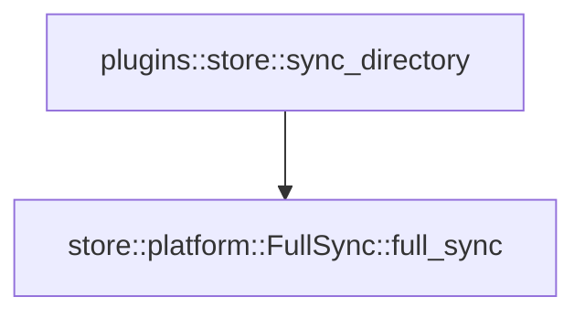

```mermaid
flowchart TD
  n0["plugins::model::safe_relative"]
  n1["plugins::model::qualified_id"]
  n2["plugins::store::PluginStore::crash"]
  n3["plugins::store::PluginStore::packages_root"]
  n4["plugins::store::PluginStore::data_root"]
  n5["plugins::store::PluginStore::staging_root"]
  n6["plugins::store::PluginStore::operations_root"]
  n7["plugins::store::PluginStore::operation_path"]
  n8["plugins::store::PluginStore::registry_path"]
  n9["plugins::store::sorted_capabilities"]
  n10["plugins::store::validate_operation"]
  n11["plugins::store::validate_receipt"]
  n12["plugins::store::is_lower_hex_digest"]
  n13["plugins::store::write_canonical"]
  n14["plugins::store::read_canonical"]
  n15["plugins::store::remove_tree"]
  n16["plugins::store::cleanup_temporaries"]
  n17["plugins::store::read_dirs"]
  n18["plugins::store::path_is_present"]
  n19["plugins::store::ensure_directory"]
  n20["plugins::store::remove_empty"]
  n21["plugins::store::sync_directory"]
  n22["plugins::store::PluginStore::load_package"]
  n23["plugins::store::PluginStore::verify_native_helpers"]
  n24["plugins::store::PluginStore::create_layout"]
  n25["plugins::store::PluginStore::read_registry"]
  n26["plugins::store::PluginStore::write_registry"]
  n27["plugins::store::PluginStore::write_operation"]
  n28["plugins::store::PluginStore::collect_orphans"]
  n29["plugins::store::PluginStore::cleanup_publication_temporaries"]
  n30["plugins::store::PluginStore::ensure_plugin_data_directory"]
  n31["store::platform::FullSync::full_sync"]
  n7 --> n6
  n10 --> n1
  n10 --> n11
  n11 --> n0
  n11 --> n1
  n11 --> n12
  n24 --> n3
  n24 --> n4
  n24 --> n5
  n24 --> n6
  n24 --> n19
  n24 --> n21
  n25 --> n8
  n25 --> n11
  n25 --> n14
  n25 --> n18
  n26 --> n8
  n26 --> n13
  n27 --> n7
  n27 --> n13
  n28 --> n3
  n28 --> n4
  n28 --> n15
  n28 --> n17
  n28 --> n20
  n28 --> n25
  n29 --> n6
  n29 --> n16
  n30 --> n4
  n30 --> n19
  n30 --> n31
```

```mermaid
flowchart TD
  n0["plugins::signature::hex"]
  n1["plugins::store::validate_grants"]
  n2["plugins::store::require_all_grants"]
  n3["plugins::store::package_digest"]
  n4["plugins::store::collect_entries"]
  n5["plugins::store::hash_fields"]
  n6["plugins::store::hash_value"]
  n7["plugins::store::write_canonical"]
  n8["plugins::store::read_canonical"]
  n9["plugins::store::operation_id"]
  n10["plugins::store::seal_tree"]
  n11["plugins::store::sync_tree"]
  n12["plugins::store::collect_paths"]
  n13["plugins::store::remove_tree"]
  n14["plugins::store::clear_directory"]
  n15["plugins::store::cleanup_temporaries"]
  n16["plugins::store::read_dirs"]
  n17["plugins::store::path_is_present"]
  n18["plugins::store::require_directory"]
  n19["plugins::store::ensure_directory"]
  n20["plugins::store::remove_empty"]
  n21["plugins::store::sync_directory"]
  n22["store::platform::FullSync::full_sync"]
  n3 --> n0
  n3 --> n4
  n3 --> n5
  n3 --> n6
  n4 --> n4
  n5 --> n6
  n7 --> n19
  n7 --> n21
  n7 --> n22
  n10 --> n12
  n11 --> n12
  n11 --> n22
  n12 --> n12
  n13 --> n12
  n13 --> n21
  n14 --> n13
  n14 --> n21
  n15 --> n21
  n19 --> n18
  n19 --> n21
  n20 --> n21
```

# plugins::store

[Package atlas](index.md) · [Source](../../src/store.rs)

## Declarations

Visibility is the declaration spelling; trait members and reexports require their enclosing interface. `cfg` is not evaluated.

| Symbol | Kind | Visibility | Test / cfg |
|---|---|---|---|
| [plugins::store::OPERATION_ORDINAL](../../src/store.rs#L26) | static_item | `private` |  |
| [plugins::store::PluginError](../../src/store.rs#L29) | enum_item | `pub` |  |
| [plugins::store::FaultPoint](../../src/store.rs#L71) | enum_item | `pub` |  |
| [plugins::store::InstallOptions](../../src/store.rs#L78) | struct_item | `pub` |  |
| [plugins::store::IntegrityStatus](../../src/store.rs#L87) | enum_item | `pub` |  |
| [plugins::store::PluginReceipt](../../src/store.rs#L94) | struct_item | `pub` |  |
| [plugins::store::PluginInspection](../../src/store.rs#L112) | struct_item | `pub` |  |
| [plugins::store::PluginReceipt::requested_ids](../../src/store.rs#L120) | function_item | `private` |  |
| [plugins::store::ManagementRequest](../../src/store.rs#L129) | enum_item | `pub` |  |
| [plugins::store::ManagementResult](../../src/store.rs#L151) | enum_item | `pub` |  |
| [plugins::store::Registry](../../src/store.rs#L160) | struct_item | `private` |  |
| [plugins::store::Registry::default](../../src/store.rs#L166) | function_item | `private` |  |
| [plugins::store::OperationKind](../../src/store.rs#L176) | enum_item | `private` |  |
| [plugins::store::OperationPhase](../../src/store.rs#L185) | enum_item | `private` |  |
| [plugins::store::Operation](../../src/store.rs#L192) | struct_item | `private` |  |
| [plugins::store::PluginStore](../../src/store.rs#L202) | struct_item | `pub` |  |
| [plugins::store::PluginStore::open](../../src/store.rs#L211) | function_item | `pub` |  |
| [plugins::store::PluginStore::injecting_fault](../../src/store.rs#L230) | function_item | `pub` |  |
| [plugins::store::PluginStore::manage](../../src/store.rs#L235) | function_item | `pub` |  |
| [plugins::store::PluginStore::install](../../src/store.rs#L258) | function_item | `pub` |  |
| [plugins::store::PluginStore::inspect](../../src/store.rs#L391) | function_item | `pub` |  |
| [plugins::store::PluginStore::freeze_source](../../src/store.rs#L411) | function_item | `pub` |  |
| [plugins::store::PluginStore::inspect_staged](../../src/store.rs#L437) | function_item | `private` |  |
| [plugins::store::PluginStore::list](../../src/store.rs#L468) | function_item | `pub` |  |
| [plugins::store::PluginStore::set_enabled](../../src/store.rs#L474) | function_item | `pub` |  |
| [plugins::store::PluginStore::set_grants](../../src/store.rs#L495) | function_item | `pub` |  |
| [plugins::store::PluginStore::remove](../../src/store.rs#L513) | function_item | `pub` |  |
| [plugins::store::PluginStore::components](../../src/store.rs#L549) | function_item | `pub` |  |
| [plugins::store::PluginStore::resolve_executable_component](../../src/store.rs#L597) | function_item | `pub` |  |
| [plugins::store::PluginStore::lock_authority](../../src/store.rs#L641) | function_item | `private` |  |
| [plugins::store::PluginStore::recover](../../src/store.rs#L647) | function_item | `pub` |  |
| [plugins::store::PluginStore::recover_locked](../../src/store.rs#L652) | function_item | `private` |  |
| [plugins::store::PluginStore::mutate_receipt](../../src/store.rs#L698) | function_item | `private` |  |
| [plugins::store::PluginStore::verify_stored_receipt](../../src/store.rs#L740) | function_item | `private` |  |
| [plugins::store::PluginStore::load_package](../../src/store.rs#L823) | function_item | `private` |  |
| [plugins::store::PluginStore::verify_native_helpers](../../src/store.rs#L867) | function_item | `private` |  |
| [plugins::store::PluginStore::create_layout](../../src/store.rs#L893) | function_item | `private` |  |
| [plugins::store::PluginStore::read_registry](../../src/store.rs#L909) | function_item | `private` |  |
| [plugins::store::PluginStore::write_registry](../../src/store.rs#L932) | function_item | `private` |  |
| [plugins::store::PluginStore::write_operation](../../src/store.rs#L940) | function_item | `private` |  |
| [plugins::store::PluginStore::collect_orphans](../../src/store.rs#L944) | function_item | `private` |  |
| [plugins::store::PluginStore::cleanup_publication_temporaries](../../src/store.rs#L979) | function_item | `private` |  |
| [plugins::store::PluginStore::ensure_plugin_data_directory](../../src/store.rs#L984) | function_item | `private` |  |
| [plugins::store::PluginStore::crash](../../src/store.rs#L1004) | function_item | `private` |  |
| [plugins::store::PluginStore::packages_root](../../src/store.rs#L1012) | function_item | `private` |  |
| [plugins::store::PluginStore::data_root](../../src/store.rs#L1015) | function_item | `private` |  |
| [plugins::store::PluginStore::staging_root](../../src/store.rs#L1018) | function_item | `private` |  |
| [plugins::store::PluginStore::operations_root](../../src/store.rs#L1021) | function_item | `private` |  |
| [plugins::store::PluginStore::operation_path](../../src/store.rs#L1024) | function_item | `private` |  |
| [plugins::store::PluginStore::registry_path](../../src/store.rs#L1027) | function_item | `private` |  |
| [plugins::store::LoadedPackage](../../src/store.rs#L1032) | struct_item | `private` |  |
| [plugins::store::sorted_capabilities](../../src/store.rs#L1037) | function_item | `private` |  |
| [plugins::store::validate_operation](../../src/store.rs#L1043) | function_item | `private` |  |
| [plugins::store::validate_receipt](../../src/store.rs#L1095) | function_item | `private` |  |
| [plugins::store::is_lower_hex_digest](../../src/store.rs#L1165) | function_item | `private` |  |
| [plugins::store::validate_grants](../../src/store.rs#L1172) | function_item | `private` |  |
| [plugins::store::require_all_grants](../../src/store.rs#L1185) | function_item | `private` |  |
| [plugins::store::package_digest](../../src/store.rs#L1198) | function_item | `private` |  |
| [plugins::store::collect_entries](../../src/store.rs#L1231) | function_item | `private` |  |
| [plugins::store::hash_fields](../../src/store.rs#L1259) | function_item | `private` |  |
| [plugins::store::hash_value](../../src/store.rs#L1265) | function_item | `private` |  |
| [plugins::store::write_canonical](../../src/store.rs#L1270) | function_item | `private` |  |
| [plugins::store::read_canonical](../../src/store.rs#L1298) | function_item | `private` |  |
| [plugins::store::operation_id](../../src/store.rs#L1322) | function_item | `private` |  |
| [plugins::store::seal_tree](../../src/store.rs#L1330) | function_item | `private` |  |
| [plugins::store::sync_tree](../../src/store.rs#L1350) | function_item | `private` |  |
| [plugins::store::collect_paths](../../src/store.rs#L1361) | function_item | `private` |  |
| [plugins::store::remove_tree](../../src/store.rs#L1384) | function_item | `private` |  |
| [plugins::store::clear_directory](../../src/store.rs#L1421) | function_item | `private` |  |
| [plugins::store::cleanup_temporaries](../../src/store.rs#L1432) | function_item | `private` |  |
| [plugins::store::read_dirs](../../src/store.rs#L1460) | function_item | `private` |  |
| [plugins::store::path_is_present](../../src/store.rs#L1481) | function_item | `private` |  |
| [plugins::store::require_directory](../../src/store.rs#L1489) | function_item | `private` |  |
| [plugins::store::ensure_directory](../../src/store.rs#L1502) | function_item | `private` |  |
| [plugins::store::remove_empty](../../src/store.rs#L1518) | function_item | `private` |  |
| [plugins::store::sync_directory](../../src/store.rs#L1532) | function_item | `private` |  |

## Imports / reexports

| Local name | Source path | Visibility |
|---|---|---|
| `BTreeMap` | `std::collections::BTreeMap` | `private` |
| `BTreeSet` | `std::collections::BTreeSet` | `private` |
| `fs` | `std::fs` | `private` |
| `File` | `std::fs::File` | `private` |
| `OpenOptions` | `std::fs::OpenOptions` | `private` |
| `Write` | `std::io::Write` | `private` |
| `OpenOptionsExt` | `std::os::unix::fs::OpenOptionsExt` | `private` |
| `PermissionsExt` | `std::os::unix::fs::PermissionsExt` | `private` |
| `Path` | `std::path::Path` | `private` |
| `PathBuf` | `std::path::PathBuf` | `private` |
| `AtomicU64` | `std::sync::atomic::AtomicU64` | `private` |
| `Ordering` | `std::sync::atomic::Ordering` | `private` |
| `SystemTime` | `std::time::SystemTime` | `private` |
| `UNIX_EPOCH` | `std::time::UNIX_EPOCH` | `private` |
| `Mode` | `rustix::fs::Mode` | `private` |
| `OFlags` | `rustix::fs::OFlags` | `private` |
| `fchmod` | `rustix::fs::fchmod` | `private` |
| `open` | `rustix::fs::open` | `private` |
| `DeserializeOwned` | `serde::de::DeserializeOwned` | `private` |
| `Deserialize` | `serde::Deserialize` | `private` |
| `Serialize` | `serde::Serialize` | `private` |
| `Digest` | `sha2::Digest` | `private` |
| `Sha256` | `sha2::Sha256` | `private` |
| `FullSync` | `store::FullSync` | `private` |
| `Error` | `thiserror::Error` | `private` |
| `ComponentKind` | `crate::model::ComponentKind` | `private` |
| `ComponentProjection` | `crate::model::ComponentProjection` | `private` |
| `NativeHelperIdentity` | `crate::signature::NativeHelperIdentity` | `private` |
| `NativeHelperVerifier` | `crate::signature::NativeHelperVerifier` | `private` |
| `PUBLISHER_ATTESTATION_PATH` | `crate::signature::PUBLISHER_ATTESTATION_PATH` | `private` |
| `PublisherIdentity` | `crate::signature::PublisherIdentity` | `private` |
| `SignaturePolicy` | `crate::signature::SignaturePolicy` | `private` |
| `hex` | `crate::signature::hex` | `private` |
| `verify_publisher` | `crate::signature::verify_publisher` | `private` |
| `HostEnvironment` | `crate::HostEnvironment` | `private` |
| `Manifest` | `crate::Manifest` | `private` |
| `PLUGIN_MANIFEST_FILE` | `crate::PLUGIN_MANIFEST_FILE` | `private` |
| `PluginComponentReference` | `crate::PluginComponentReference` | `private` |
| `PluginSource` | `crate::PluginSource` | `private` |
| `PluginVersion` | `crate::PluginVersion` | `private` |
| `ResolvedPluginExecutable` | `crate::ResolvedPluginExecutable` | `private` |

## Module declarations

| Module | Visibility | Attributes |
|---|---|---|

## Function call graphs

Edges below are syntactically resolved calls only, including private functions. Graphs partition callers into groups of 20; they are not execution order. All unresolved sites are listed below and in the JSON inventory.

```mermaid
flowchart TD
  n0["plugins::signature::verify_publisher"]
  n1["plugins::store::PluginStore::crash"]
  n2["plugins::store::PluginStore::packages_root"]
  n3["plugins::store::PluginStore::data_root"]
  n4["plugins::store::PluginStore::staging_root"]
  n5["plugins::store::PluginStore::operations_root"]
  n6["plugins::store::PluginStore::operation_path"]
  n7["plugins::store::sorted_capabilities"]
  n8["plugins::store::validate_operation"]
  n9["plugins::store::validate_grants"]
  n10["plugins::store::require_all_grants"]
  n11["plugins::store::package_digest"]
  n12["plugins::store::PluginReceipt::requested_ids"]
  n13["plugins::store::read_canonical"]
  n14["plugins::store::operation_id"]
  n15["plugins::store::seal_tree"]
  n16["plugins::store::sync_tree"]
  n17["plugins::store::remove_tree"]
  n18["plugins::store::clear_directory"]
  n19["plugins::store::path_is_present"]
  n20["plugins::store::require_directory"]
  n21["plugins::store::ensure_directory"]
  n22["plugins::store::sync_directory"]
  n23["plugins::store::Registry::default"]
  n24["plugins::store::PluginStore::open"]
  n25["plugins::store::PluginStore::injecting_fault"]
  n26["plugins::store::PluginStore::manage"]
  n27["plugins::store::PluginStore::install"]
  n28["plugins::store::PluginStore::inspect"]
  n29["plugins::store::PluginStore::freeze_source"]
  n30["plugins::store::PluginStore::inspect_staged"]
  n31["plugins::store::PluginStore::list"]
  n32["plugins::store::PluginStore::set_enabled"]
  n33["plugins::store::PluginStore::set_grants"]
  n34["plugins::store::PluginStore::remove"]
  n35["plugins::store::PluginStore::components"]
  n36["plugins::store::PluginStore::resolve_executable_component"]
  n37["plugins::store::PluginStore::lock_authority"]
  n38["plugins::store::PluginStore::recover"]
  n39["plugins::store::PluginStore::recover_locked"]
  n40["plugins::store::PluginStore::mutate_receipt"]
  n41["plugins::store::PluginStore::verify_stored_receipt"]
  n42["plugins::store::PluginStore::load_package"]
  n43["plugins::store::PluginStore::verify_native_helpers"]
  n44["plugins::store::PluginStore::create_layout"]
  n45["plugins::store::PluginStore::read_registry"]
  n46["plugins::store::PluginStore::write_registry"]
  n47["plugins::store::PluginStore::write_operation"]
  n48["plugins::store::PluginStore::collect_orphans"]
  n49["plugins::store::PluginStore::cleanup_publication_temporaries"]
  n50["plugins::store::PluginStore::ensure_plugin_data_directory"]
  n51["store::platform::NamedLock::exclusive"]
  n26 --> n27
  n26 --> n31
  n26 --> n32
  n26 --> n33
  n26 --> n34
  n26 --> n35
  n26 --> n38
  n27 --> n0
  n27 --> n1
  n27 --> n2
  n27 --> n3
  n27 --> n4
  n27 --> n7
  n27 --> n9
  n27 --> n10
  n27 --> n11
  n27 --> n15
  n27 --> n16
  n27 --> n17
  n27 --> n19
  n27 --> n20
  n27 --> n21
  n27 --> n22
  n27 --> n37
  n27 --> n39
  n27 --> n42
  n27 --> n43
  n27 --> n45
  n27 --> n46
  n27 --> n47
  n28 --> n17
  n28 --> n30
  n29 --> n16
  n29 --> n17
  n29 --> n19
  n29 --> n20
  n29 --> n22
  n29 --> n30
  n30 --> n0
  n30 --> n7
  n30 --> n11
  n30 --> n42
  n30 --> n43
  n31 --> n37
  n31 --> n39
  n31 --> n45
  n32 --> n40
  n33 --> n40
  n34 --> n1
  n34 --> n14
  n34 --> n37
  n34 --> n39
  n34 --> n45
  n34 --> n46
  n34 --> n47
  n35 --> n3
  n35 --> n37
  n35 --> n39
  n35 --> n41
  n35 --> n42
  n35 --> n45
  n36 --> n37
  n36 --> n39
  n36 --> n41
  n36 --> n42
  n36 --> n45
  n36 --> n50
  n37 --> n44
  n37 --> n51
  n38 --> n37
  n38 --> n39
  n39 --> n3
  n39 --> n4
  n39 --> n5
  n39 --> n6
  n39 --> n8
  n39 --> n13
  n39 --> n17
  n39 --> n18
  n39 --> n19
  n39 --> n22
  n39 --> n41
  n39 --> n44
  n39 --> n45
  n39 --> n48
  n39 --> n49
  n39 --> n50
  n40 --> n1
  n40 --> n14
  n40 --> n37
  n40 --> n39
  n40 --> n41
  n40 --> n45
  n40 --> n46
  n40 --> n47
  n41 --> n0
  n41 --> n7
  n41 --> n9
  n41 --> n10
  n41 --> n11
  n41 --> n42
  n41 --> n43
```

Functions 1–20: 102 direct edges

Functions 21–40: 31 direct edges

Functions 41–60: 21 direct edges

Functions 61–61: 1 direct edges

## Call sites

Includes test functions (marked in declarations). Receiver-type-required sites need type analysis/manual tracing. Calls in closures are attributed to their enclosing function; their occurrence here does not mean the closure executes immediately.

| Caller | Callee expression | Source lines | Target / classification |
|---|---|---|---|
| `OPERATION_ORDINAL` | `AtomicU64::new` | [26](../../src/store.rs#L26) | external-constructor-callback-or-unresolved |
| `requested_ids` | `self.requested_capabilities             .iter()             .map(&#124;capability&#124; capability.id.clone())             .collect` | [121](../../src/store.rs#L121) | receiver-type-required |
| `requested_ids` | `self.requested_capabilities             .iter()             .map` | [121](../../src/store.rs#L121) | receiver-type-required |
| `requested_ids` | `self.requested_capabilities             .iter` | [121](../../src/store.rs#L121) | receiver-type-required |
| `requested_ids` | `capability.id.clone` | [123](../../src/store.rs#L123) | receiver-type-required |
| `default` | `Vec::new` | [169](../../src/store.rs#L169) | external-constructor-callback-or-unresolved |
| `open` | `root.into` | [218](../../src/store.rs#L218) | receiver-type-required |
| `open` | `store.create_layout` | [224](../../src/store.rs#L224) | receiver-type-required |
| `open` | `store.recover` | [225](../../src/store.rs#L225) | receiver-type-required |
| `open` | `Ok` | [226](../../src/store.rs#L226) | external-constructor-callback-or-unresolved |
| `injecting_fault` | `Some` | [231](../../src/store.rs#L231) | external-constructor-callback-or-unresolved |
| `manage` | `self                 .install(&source, options)                 .map(Box::new)                 .map` | [237](../../src/store.rs#L237) | receiver-type-required |
| `manage` | `self                 .install(&source, options)                 .map` | [237](../../src/store.rs#L237) | receiver-type-required |
| `manage` | `self                 .install` | [237](../../src/store.rs#L237) | [plugins::store::PluginStore::install](../../src/store.rs#L258) |
| `manage` | `self                 .set_enabled(&plugin_id, enabled)                 .map(Box::new)                 .map` | [241](../../src/store.rs#L241) | receiver-type-required |
| `manage` | `self                 .set_enabled(&plugin_id, enabled)                 .map` | [241](../../src/store.rs#L241) | receiver-type-required |
| `manage` | `self                 .set_enabled` | [241](../../src/store.rs#L241) | [plugins::store::PluginStore::set_enabled](../../src/store.rs#L474) |
| `manage` | `self                 .set_grants(&plugin_id, grants)                 .map(Box::new)                 .map` | [245](../../src/store.rs#L245) | receiver-type-required |
| `manage` | `self                 .set_grants(&plugin_id, grants)                 .map` | [245](../../src/store.rs#L245) | receiver-type-required |
| `manage` | `self                 .set_grants` | [245](../../src/store.rs#L245) | [plugins::store::PluginStore::set_grants](../../src/store.rs#L495) |
| `manage` | `self.remove(&plugin_id).map` | [250](../../src/store.rs#L250) | receiver-type-required |
| `manage` | `self.remove` | [250](../../src/store.rs#L250) | [plugins::store::PluginStore::remove](../../src/store.rs#L513) |
| `manage` | `self.list().map` | [252](../../src/store.rs#L252) | receiver-type-required |
| `manage` | `self.list` | [252](../../src/store.rs#L252) | [plugins::store::PluginStore::list](../../src/store.rs#L468) |
| `manage` | `self.components().map` | [253](../../src/store.rs#L253) | receiver-type-required |
| `manage` | `self.components` | [253](../../src/store.rs#L253) | [plugins::store::PluginStore::components](../../src/store.rs#L549) |
| `manage` | `self.recover().map` | [254](../../src/store.rs#L254) | receiver-type-required |
| `manage` | `self.recover` | [254](../../src/store.rs#L254) | [plugins::store::PluginStore::recover](../../src/store.rs#L647) |
| `install` | `self.lock_authority` | [263](../../src/store.rs#L263) | [plugins::store::PluginStore::lock_authority](../../src/store.rs#L641) |
| `install` | `self.recover_locked` | [264](../../src/store.rs#L264), [384](../../src/store.rs#L384) | [plugins::store::PluginStore::recover_locked](../../src/store.rs#L652) |
| `install` | `operation_id` | [265](../../src/store.rs#L265) | external-constructor-callback-or-unresolved |
| `install` | `self.staging_root().join` | [266](../../src/store.rs#L266) | receiver-type-required |
| `install` | `self.staging_root` | [266](../../src/store.rs#L266), [333](../../src/store.rs#L333), [337](../../src/store.rs#L337) | [plugins::store::PluginStore::staging_root](../../src/store.rs#L1018) |
| `install` | `source.stage` | [267](../../src/store.rs#L267) | receiver-type-required |
| `install` | `self.load_package` | [268](../../src/store.rs#L268) | [plugins::store::PluginStore::load_package](../../src/store.rs#L823) |
| `install` | `validate_grants` | [269](../../src/store.rs#L269) | [plugins::store::validate_grants](../../src/store.rs#L1172) |
| `install` | `require_all_grants` | [271](../../src/store.rs#L271) | [plugins::store::require_all_grants](../../src/store.rs#L1185) |
| `install` | `self.verify_native_helpers` | [273](../../src/store.rs#L273) | [plugins::store::PluginStore::verify_native_helpers](../../src/store.rs#L867) |
| `install` | `verify_publisher` | [274](../../src/store.rs#L274) | [plugins::signature::verify_publisher](../../src/signature.rs#L131) |
| `install` | `package_digest` | [275](../../src/store.rs#L275), [290](../../src/store.rs#L290), [321](../../src/store.rs#L321) | [plugins::store::package_digest](../../src/store.rs#L1198) |
| `install` | `Some` | [275](../../src/store.rs#L275), [281](../../src/store.rs#L281), [370](../../src/store.rs#L370) | external-constructor-callback-or-unresolved |
| `install` | `publisher.as_ref().is_some_and` | [277](../../src/store.rs#L277) | receiver-type-required |
| `install` | `publisher.as_ref` | [277](../../src/store.rs#L277) | receiver-type-required |
| `install` | `self.signature_policy                 .trusted_publishers                 .get` | [278](../../src/store.rs#L278) | receiver-type-required |
| `install` | `publisher.is_some` | [283](../../src/store.rs#L283) | receiver-type-required |
| `install` | `publisher.is_none` | [284](../../src/store.rs#L284) | receiver-type-required |
| `install` | `Err` | [286](../../src/store.rs#L286), [300](../../src/store.rs#L300), [309](../../src/store.rs#L309), [322](../../src/store.rs#L322) | external-constructor-callback-or-unresolved |
| `install` | `PluginError::PublisherTrustRequired` | [286](../../src/store.rs#L286) | external-constructor-callback-or-unresolved |
| `install` | `"package has no publisher key pinned by the trust policy".to_owned` | [287](../../src/store.rs#L287) | receiver-type-required |
| `install` | `self.read_registry` | [291](../../src/store.rs#L291) | [plugins::store::PluginStore::read_registry](../../src/store.rs#L909) |
| `install` | `registry             .plugins             .iter()             .find(&#124;receipt&#124; receipt.plugin_id == package.manifest.id)             .cloned` | [292](../../src/store.rs#L292) | receiver-type-required |
| `install` | `registry             .plugins             .iter()             .find` | [292](../../src/store.rs#L292) | receiver-type-required |
| `install` | `registry             .plugins             .iter` | [292](../../src/store.rs#L292) | receiver-type-required |
| `install` | `package.manifest.version.precedence_cmp` | [298](../../src/store.rs#L298) | receiver-type-required |
| `install` | `precedence.is_lt` | [299](../../src/store.rs#L299) | receiver-type-required |
| `install` | `installed.version.to_string` | [301](../../src/store.rs#L301) | receiver-type-required |
| `install` | `package.manifest.version.to_string` | [302](../../src/store.rs#L302), [310](../../src/store.rs#L310), [330](../../src/store.rs#L330) | receiver-type-required |
| `install` | `precedence.is_eq` | [305](../../src/store.rs#L305) | receiver-type-required |
| `install` | `PluginError::SameVersionChanged` | [309](../../src/store.rs#L309) | external-constructor-callback-or-unresolved |
| `install` | `self.root.join` | [318](../../src/store.rs#L318) | receiver-type-required |
| `install` | `path_is_present` | [319](../../src/store.rs#L319) | [plugins::store::path_is_present](../../src/store.rs#L1481) |
| `install` | `require_directory` | [320](../../src/store.rs#L320) | [plugins::store::require_directory](../../src/store.rs#L1489) |
| `install` | `PluginError::CorruptRegistry` | [322](../../src/store.rs#L322) | external-constructor-callback-or-unresolved |
| `install` | `"existing package digest mismatch".to_owned` | [323](../../src/store.rs#L323) | receiver-type-required |
| `install` | `remove_tree` | [326](../../src/store.rs#L326) | [plugins::store::remove_tree](../../src/store.rs#L1384) |
| `install` | `self.packages_root().join` | [328](../../src/store.rs#L328) | receiver-type-required |
| `install` | `self.packages_root` | [328](../../src/store.rs#L328) | [plugins::store::PluginStore::packages_root](../../src/store.rs#L1012) |
| `install` | `ensure_directory` | [329](../../src/store.rs#L329), [331](../../src/store.rs#L331), [361](../../src/store.rs#L361) | [plugins::store::ensure_directory](../../src/store.rs#L1502) |
| `install` | `plugin_root.join` | [330](../../src/store.rs#L330) | receiver-type-required |
| `install` | `sync_tree` | [332](../../src/store.rs#L332), [340](../../src/store.rs#L340) | [plugins::store::sync_tree](../../src/store.rs#L1350) |
| `install` | `sync_directory` | [333](../../src/store.rs#L333), [334](../../src/store.rs#L334), [337](../../src/store.rs#L337), [338](../../src/store.rs#L338), [341](../../src/store.rs#L341) | [plugins::store::sync_directory](../../src/store.rs#L1532) |
| `install` | `fs::rename(&stage, &final_path)                 .map_err` | [335](../../src/store.rs#L335) | receiver-type-required |
| `install` | `fs::rename` | [335](../../src/store.rs#L335) | external-constructor-callback-or-unresolved |
| `install` | `PluginError::Storage` | [336](../../src/store.rs#L336) | external-constructor-callback-or-unresolved |
| `install` | `error.to_string` | [336](../../src/store.rs#L336) | receiver-type-required |
| `install` | `seal_tree` | [339](../../src/store.rs#L339) | [plugins::store::seal_tree](../../src/store.rs#L1330) |
| `install` | `package.manifest.id.clone` | [344](../../src/store.rs#L344) | receiver-type-required |
| `install` | `package.manifest.version.clone` | [345](../../src/store.rs#L345) | receiver-type-required |
| `install` | `package.manifest.display_name.clone` | [346](../../src/store.rs#L346) | receiver-type-required |
| `install` | `source.description` | [349](../../src/store.rs#L349) | receiver-type-required |
| `install` | `sorted_capabilities` | [355](../../src/store.rs#L355) | [plugins::store::sorted_capabilities](../../src/store.rs#L1037) |
| `install` | `options.grants.iter().cloned().collect` | [356](../../src/store.rs#L356) | receiver-type-required |
| `install` | `options.grants.iter().cloned` | [356](../../src/store.rs#L356) | receiver-type-required |
| `install` | `options.grants.iter` | [356](../../src/store.rs#L356) | receiver-type-required |
| `install` | `self.data_root().join` | [361](../../src/store.rs#L361) | receiver-type-required |
| `install` | `self.data_root` | [361](../../src/store.rs#L361) | [plugins::store::PluginStore::data_root](../../src/store.rs#L1015) |
| `install` | `self.crash` | [362](../../src/store.rs#L362), [373](../../src/store.rs#L373), [379](../../src/store.rs#L379) | [plugins::store::PluginStore::crash](../../src/store.rs#L1004) |
| `install` | `receipt.plugin_id.clone` | [368](../../src/store.rs#L368) | receiver-type-required |
| `install` | `previous.clone` | [369](../../src/store.rs#L369) | receiver-type-required |
| `install` | `receipt.clone` | [370](../../src/store.rs#L370), [377](../../src/store.rs#L377) | receiver-type-required |
| `install` | `self.write_operation` | [372](../../src/store.rs#L372), [380](../../src/store.rs#L380) | [plugins::store::PluginStore::write_operation](../../src/store.rs#L940) |
| `install` | `registry             .plugins             .retain` | [374](../../src/store.rs#L374) | receiver-type-required |
| `install` | `registry.plugins.push` | [377](../../src/store.rs#L377) | receiver-type-required |
| `install` | `self.write_registry` | [378](../../src/store.rs#L378) | [plugins::store::PluginStore::write_registry](../../src/store.rs#L932) |
| `install` | `Ok` | [385](../../src/store.rs#L385) | external-constructor-callback-or-unresolved |
| `inspect` | `OPERATION_ORDINAL.fetch_add` | [392](../../src/store.rs#L392) | receiver-type-required |
| `inspect` | `std::env::temp_dir().join` | [393](../../src/store.rs#L393) | receiver-type-required |
| `inspect` | `std::env::temp_dir` | [393](../../src/store.rs#L393) | external-constructor-callback-or-unresolved |
| `inspect` | `source.stage` | [397](../../src/store.rs#L397) | receiver-type-required |
| `inspect` | `self.inspect_staged` | [398](../../src/store.rs#L398) | [plugins::store::PluginStore::inspect_staged](../../src/store.rs#L437) |
| `inspect` | `remove_tree` | [399](../../src/store.rs#L399) | [plugins::store::remove_tree](../../src/store.rs#L1384) |
| `inspect` | `Ok` | [401](../../src/store.rs#L401) | external-constructor-callback-or-unresolved |
| `inspect` | `Err` | [402](../../src/store.rs#L402), [403](../../src/store.rs#L403) | external-constructor-callback-or-unresolved |
| `freeze_source` | `path_is_present` | [416](../../src/store.rs#L416) | [plugins::store::path_is_present](../../src/store.rs#L1481) |
| `freeze_source` | `require_directory` | [417](../../src/store.rs#L417) | [plugins::store::require_directory](../../src/store.rs#L1489) |
| `freeze_source` | `self.inspect_staged` | [418](../../src/store.rs#L418), [424](../../src/store.rs#L424) | [plugins::store::PluginStore::inspect_staged](../../src/store.rs#L437) |
| `freeze_source` | `source.stage` | [420](../../src/store.rs#L420) | receiver-type-required |
| `freeze_source` | `remove_tree` | [421](../../src/store.rs#L421), [432](../../src/store.rs#L432) | [plugins::store::remove_tree](../../src/store.rs#L1384) |
| `freeze_source` | `Err` | [422](../../src/store.rs#L422) | external-constructor-callback-or-unresolved |
| `freeze_source` | `result.is_ok` | [425](../../src/store.rs#L425) | receiver-type-required |
| `freeze_source` | `sync_tree` | [426](../../src/store.rs#L426) | [plugins::store::sync_tree](../../src/store.rs#L1350) |
| `freeze_source` | `destination                 .parent()                 .ok_or_else` | [427](../../src/store.rs#L427) | receiver-type-required |
| `freeze_source` | `destination                 .parent` | [427](../../src/store.rs#L427) | receiver-type-required |
| `freeze_source` | `PluginError::Storage` | [429](../../src/store.rs#L429) | external-constructor-callback-or-unresolved |
| `freeze_source` | `"frozen source has no parent".to_owned` | [429](../../src/store.rs#L429) | receiver-type-required |
| `freeze_source` | `sync_directory` | [430](../../src/store.rs#L430) | [plugins::store::sync_directory](../../src/store.rs#L1532) |
| `inspect_staged` | `self.load_package` | [438](../../src/store.rs#L438) | [plugins::store::PluginStore::load_package](../../src/store.rs#L823) |
| `inspect_staged` | `self.verify_native_helpers` | [439](../../src/store.rs#L439) | [plugins::store::PluginStore::verify_native_helpers](../../src/store.rs#L867) |
| `inspect_staged` | `verify_publisher` | [440](../../src/store.rs#L440) | [plugins::signature::verify_publisher](../../src/signature.rs#L131) |
| `inspect_staged` | `package_digest` | [441](../../src/store.rs#L441), [459](../../src/store.rs#L459) | [plugins::store::package_digest](../../src/store.rs#L1198) |
| `inspect_staged` | `Some` | [441](../../src/store.rs#L441), [447](../../src/store.rs#L447) | external-constructor-callback-or-unresolved |
| `inspect_staged` | `publisher.as_ref().is_some_and` | [443](../../src/store.rs#L443) | receiver-type-required |
| `inspect_staged` | `publisher.as_ref` | [443](../../src/store.rs#L443) | receiver-type-required |
| `inspect_staged` | `self.signature_policy                 .trusted_publishers                 .get` | [444](../../src/store.rs#L444) | receiver-type-required |
| `inspect_staged` | `publisher.is_some` | [449](../../src/store.rs#L449) | receiver-type-required |
| `inspect_staged` | `publisher.is_none` | [450](../../src/store.rs#L450) | receiver-type-required |
| `inspect_staged` | `Err` | [452](../../src/store.rs#L452) | external-constructor-callback-or-unresolved |
| `inspect_staged` | `PluginError::PublisherTrustRequired` | [452](../../src/store.rs#L452) | external-constructor-callback-or-unresolved |
| `inspect_staged` | `"package has no publisher key pinned by the trust policy".to_owned` | [453](../../src/store.rs#L453) | receiver-type-required |
| `inspect_staged` | `Ok` | [456](../../src/store.rs#L456) | external-constructor-callback-or-unresolved |
| `inspect_staged` | `sorted_capabilities` | [457](../../src/store.rs#L457) | [plugins::store::sorted_capabilities](../../src/store.rs#L1037) |
| `list` | `self.lock_authority` | [469](../../src/store.rs#L469) | [plugins::store::PluginStore::lock_authority](../../src/store.rs#L641) |
| `list` | `self.recover_locked` | [470](../../src/store.rs#L470) | [plugins::store::PluginStore::recover_locked](../../src/store.rs#L652) |
| `list` | `Ok` | [471](../../src/store.rs#L471) | external-constructor-callback-or-unresolved |
| `list` | `self.read_registry` | [471](../../src/store.rs#L471) | [plugins::store::PluginStore::read_registry](../../src/store.rs#L909) |
| `set_enabled` | `self.mutate_receipt` | [479](../../src/store.rs#L479) | [plugins::store::PluginStore::mutate_receipt](../../src/store.rs#L698) |
| `set_enabled` | `receipt                     .granted_capabilities                     .iter()                     .cloned()                     .collect::<BTreeSet<_>>` | [481](../../src/store.rs#L481) | receiver-type-required |
| `set_enabled` | `receipt                     .granted_capabilities                     .iter()                     .cloned` | [481](../../src/store.rs#L481) | receiver-type-required |
| `set_enabled` | `receipt                     .granted_capabilities                     .iter` | [481](../../src/store.rs#L481) | receiver-type-required |
| `set_enabled` | `receipt.requested_ids().difference(&grants).next` | [486](../../src/store.rs#L486) | receiver-type-required |
| `set_enabled` | `receipt.requested_ids().difference` | [486](../../src/store.rs#L486) | receiver-type-required |
| `set_enabled` | `receipt.requested_ids` | [486](../../src/store.rs#L486) | receiver-type-required |
| `set_enabled` | `Err` | [487](../../src/store.rs#L487) | external-constructor-callback-or-unresolved |
| `set_enabled` | `PluginError::MissingGrant` | [487](../../src/store.rs#L487) | external-constructor-callback-or-unresolved |
| `set_enabled` | `missing.clone` | [487](../../src/store.rs#L487) | receiver-type-required |
| `set_enabled` | `Ok` | [491](../../src/store.rs#L491) | external-constructor-callback-or-unresolved |
| `set_grants` | `self.mutate_receipt` | [500](../../src/store.rs#L500) | [plugins::store::PluginStore::mutate_receipt](../../src/store.rs#L698) |
| `set_grants` | `receipt.requested_ids` | [501](../../src/store.rs#L501) | receiver-type-required |
| `set_grants` | `grants.difference(&requested).next` | [502](../../src/store.rs#L502) | receiver-type-required |
| `set_grants` | `grants.difference` | [502](../../src/store.rs#L502) | receiver-type-required |
| `set_grants` | `Err` | [503](../../src/store.rs#L503) | external-constructor-callback-or-unresolved |
| `set_grants` | `PluginError::UndeclaredGrant` | [503](../../src/store.rs#L503) | external-constructor-callback-or-unresolved |
| `set_grants` | `undeclared.clone` | [503](../../src/store.rs#L503) | receiver-type-required |
| `set_grants` | `grants.iter().cloned().collect` | [505](../../src/store.rs#L505) | receiver-type-required |
| `set_grants` | `grants.iter().cloned` | [505](../../src/store.rs#L505) | receiver-type-required |
| `set_grants` | `grants.iter` | [505](../../src/store.rs#L505) | receiver-type-required |
| `set_grants` | `requested.is_subset` | [506](../../src/store.rs#L506) | receiver-type-required |
| `set_grants` | `Ok` | [509](../../src/store.rs#L509) | external-constructor-callback-or-unresolved |
| `remove` | `self.lock_authority` | [514](../../src/store.rs#L514) | [plugins::store::PluginStore::lock_authority](../../src/store.rs#L641) |
| `remove` | `self.recover_locked` | [515](../../src/store.rs#L515), [545](../../src/store.rs#L545) | [plugins::store::PluginStore::recover_locked](../../src/store.rs#L652) |
| `remove` | `self.read_registry` | [516](../../src/store.rs#L516) | [plugins::store::PluginStore::read_registry](../../src/store.rs#L909) |
| `remove` | `registry             .plugins             .iter()             .find(&#124;receipt&#124; receipt.plugin_id == plugin_id)             .cloned` | [517](../../src/store.rs#L517) | receiver-type-required |
| `remove` | `registry             .plugins             .iter()             .find` | [517](../../src/store.rs#L517) | receiver-type-required |
| `remove` | `registry             .plugins             .iter` | [517](../../src/store.rs#L517) | receiver-type-required |
| `remove` | `Ok` | [523](../../src/store.rs#L523), [546](../../src/store.rs#L546) | external-constructor-callback-or-unresolved |
| `remove` | `operation_id` | [527](../../src/store.rs#L527) | [plugins::store::operation_id](../../src/store.rs#L1322) |
| `remove` | `plugin_id.to_owned` | [530](../../src/store.rs#L530) | receiver-type-required |
| `remove` | `Some` | [531](../../src/store.rs#L531) | external-constructor-callback-or-unresolved |
| `remove` | `self.write_operation` | [534](../../src/store.rs#L534), [541](../../src/store.rs#L541) | [plugins::store::PluginStore::write_operation](../../src/store.rs#L940) |
| `remove` | `self.crash` | [535](../../src/store.rs#L535), [540](../../src/store.rs#L540) | [plugins::store::PluginStore::crash](../../src/store.rs#L1004) |
| `remove` | `registry             .plugins             .retain` | [536](../../src/store.rs#L536) | receiver-type-required |
| `remove` | `self.write_registry` | [539](../../src/store.rs#L539) | [plugins::store::PluginStore::write_registry](../../src/store.rs#L932) |
| `components` | `self.lock_authority` | [550](../../src/store.rs#L550) | [plugins::store::PluginStore::lock_authority](../../src/store.rs#L641) |
| `components` | `self.recover_locked` | [551](../../src/store.rs#L551) | [plugins::store::PluginStore::recover_locked](../../src/store.rs#L652) |
| `components` | `Vec::new` | [552](../../src/store.rs#L552) | external-constructor-callback-or-unresolved |
| `components` | `BTreeMap::<(ComponentKind, String), String>::new` | [553](../../src/store.rs#L553) | external-constructor-callback-or-unresolved |
| `components` | `self.read_registry` | [554](../../src/store.rs#L554) | [plugins::store::PluginStore::read_registry](../../src/store.rs#L909) |
| `components` | `self.verify_stored_receipt` | [558](../../src/store.rs#L558) | [plugins::store::PluginStore::verify_stored_receipt](../../src/store.rs#L740) |
| `components` | `self.root.join` | [559](../../src/store.rs#L559) | receiver-type-required |
| `components` | `self.load_package` | [560](../../src/store.rs#L560) | [plugins::store::PluginStore::load_package](../../src/store.rs#L823) |
| `components` | `component.id.clone` | [562](../../src/store.rs#L562) | receiver-type-required |
| `components` | `owners.insert` | [563](../../src/store.rs#L563) | receiver-type-required |
| `components` | `key.clone` | [563](../../src/store.rs#L563) | receiver-type-required |
| `components` | `receipt.plugin_id.clone` | [563](../../src/store.rs#L563), [572](../../src/store.rs#L572) | receiver-type-required |
| `components` | `Err` | [564](../../src/store.rs#L564) | external-constructor-callback-or-unresolved |
| `components` | `projections.push` | [571](../../src/store.rs#L571) | receiver-type-required |
| `components` | `receipt.version.clone` | [573](../../src/store.rs#L573) | receiver-type-required |
| `components` | `package_root.clone` | [576](../../src/store.rs#L576) | receiver-type-required |
| `components` | `package_root.join` | [577](../../src/store.rs#L577) | receiver-type-required |
| `components` | `self.data_root().join` | [578](../../src/store.rs#L578) | receiver-type-required |
| `components` | `self.data_root` | [578](../../src/store.rs#L578) | [plugins::store::PluginStore::data_root](../../src/store.rs#L1015) |
| `components` | `receipt.granted_capabilities.clone` | [579](../../src/store.rs#L579) | receiver-type-required |
| `components` | `projections.sort_by` | [584](../../src/store.rs#L584) | receiver-type-required |
| `components` | `left.owner_plugin_id                 .cmp(&right.owner_plugin_id)                 .then_with` | [585](../../src/store.rs#L585) | receiver-type-required |
| `components` | `left.owner_plugin_id                 .cmp` | [585](../../src/store.rs#L585) | receiver-type-required |
| `components` | `left.component_id.cmp` | [587](../../src/store.rs#L587) | receiver-type-required |
| `components` | `Ok` | [589](../../src/store.rs#L589) | external-constructor-callback-or-unresolved |
| `resolve_executable_component` | `self.lock_authority` | [601](../../src/store.rs#L601) | [plugins::store::PluginStore::lock_authority](../../src/store.rs#L641) |
| `resolve_executable_component` | `self.recover_locked` | [602](../../src/store.rs#L602) | [plugins::store::PluginStore::recover_locked](../../src/store.rs#L652) |
| `resolve_executable_component` | `self.read_registry` | [603](../../src/store.rs#L603) | [plugins::store::PluginStore::read_registry](../../src/store.rs#L909) |
| `resolve_executable_component` | `registry             .plugins             .iter()             .find` | [604](../../src/store.rs#L604) | receiver-type-required |
| `resolve_executable_component` | `registry             .plugins             .iter` | [604](../../src/store.rs#L604) | receiver-type-required |
| `resolve_executable_component` | `Ok` | [609](../../src/store.rs#L609), [620](../../src/store.rs#L620), [626](../../src/store.rs#L626), [629](../../src/store.rs#L629) | external-constructor-callback-or-unresolved |
| `resolve_executable_component` | `self.verify_stored_receipt` | [611](../../src/store.rs#L611) | [plugins::store::PluginStore::verify_stored_receipt](../../src/store.rs#L740) |
| `resolve_executable_component` | `self.root.join` | [612](../../src/store.rs#L612) | receiver-type-required |
| `resolve_executable_component` | `self.load_package` | [613](../../src/store.rs#L613) | [plugins::store::PluginStore::load_package](../../src/store.rs#L823) |
| `resolve_executable_component` | `package             .manifest             .components             .iter()             .find` | [614](../../src/store.rs#L614) | receiver-type-required |
| `resolve_executable_component` | `package             .manifest             .components             .iter` | [614](../../src/store.rs#L614) | receiver-type-required |
| `resolve_executable_component` | `package_root.join` | [622](../../src/store.rs#L622) | receiver-type-required |
| `resolve_executable_component` | `fs::symlink_metadata(&executable_path)             .map_err` | [623](../../src/store.rs#L623) | receiver-type-required |
| `resolve_executable_component` | `fs::symlink_metadata` | [623](../../src/store.rs#L623) | external-constructor-callback-or-unresolved |
| `resolve_executable_component` | `PluginError::Storage` | [624](../../src/store.rs#L624) | external-constructor-callback-or-unresolved |
| `resolve_executable_component` | `error.to_string` | [624](../../src/store.rs#L624) | receiver-type-required |
| `resolve_executable_component` | `metadata.file_type().is_file` | [625](../../src/store.rs#L625) | receiver-type-required |
| `resolve_executable_component` | `metadata.file_type` | [625](../../src/store.rs#L625) | receiver-type-required |
| `resolve_executable_component` | `metadata.permissions().mode` | [625](../../src/store.rs#L625) | receiver-type-required |
| `resolve_executable_component` | `metadata.permissions` | [625](../../src/store.rs#L625) | receiver-type-required |
| `resolve_executable_component` | `self.ensure_plugin_data_directory` | [628](../../src/store.rs#L628) | [plugins::store::PluginStore::ensure_plugin_data_directory](../../src/store.rs#L984) |
| `resolve_executable_component` | `Some` | [629](../../src/store.rs#L629) | external-constructor-callback-or-unresolved |
| `resolve_executable_component` | `reference.clone` | [630](../../src/store.rs#L630) | receiver-type-required |
| `resolve_executable_component` | `receipt.package_digest.clone` | [634](../../src/store.rs#L634) | receiver-type-required |
| `resolve_executable_component` | `receipt.granted_capabilities.clone` | [635](../../src/store.rs#L635) | receiver-type-required |
| `lock_authority` | `self.create_layout` | [642](../../src/store.rs#L642) | [plugins::store::PluginStore::create_layout](../../src/store.rs#L893) |
| `lock_authority` | `store::NamedLock::exclusive(self.root.join(".authority.lock"))             .map_err` | [643](../../src/store.rs#L643) | receiver-type-required |
| `lock_authority` | `store::NamedLock::exclusive` | [643](../../src/store.rs#L643) | [store::platform::NamedLock::exclusive](../../../store/src/platform.rs#L103) |
| `lock_authority` | `self.root.join` | [643](../../src/store.rs#L643) | receiver-type-required |
| `lock_authority` | `PluginError::Storage` | [644](../../src/store.rs#L644) | external-constructor-callback-or-unresolved |
| `lock_authority` | `error.to_string` | [644](../../src/store.rs#L644) | receiver-type-required |
| `recover` | `self.lock_authority` | [648](../../src/store.rs#L648) | [plugins::store::PluginStore::lock_authority](../../src/store.rs#L641) |
| `recover` | `self.recover_locked` | [649](../../src/store.rs#L649) | [plugins::store::PluginStore::recover_locked](../../src/store.rs#L652) |
| `recover_locked` | `self.create_layout` | [653](../../src/store.rs#L653) | [plugins::store::PluginStore::create_layout](../../src/store.rs#L893) |
| `recover_locked` | `self.read_registry` | [654](../../src/store.rs#L654), [692](../../src/store.rs#L692) | [plugins::store::PluginStore::read_registry](../../src/store.rs#L909) |
| `recover_locked` | `self.verify_stored_receipt` | [656](../../src/store.rs#L656), [693](../../src/store.rs#L693) | [plugins::store::PluginStore::verify_stored_receipt](../../src/store.rs#L740) |
| `recover_locked` | `self.ensure_plugin_data_directory` | [657](../../src/store.rs#L657) | [plugins::store::PluginStore::ensure_plugin_data_directory](../../src/store.rs#L984) |
| `recover_locked` | `path_is_present` | [659](../../src/store.rs#L659) | [plugins::store::path_is_present](../../src/store.rs#L1481) |
| `recover_locked` | `self.operation_path` | [659](../../src/store.rs#L659), [660](../../src/store.rs#L660), [685](../../src/store.rs#L685) | [plugins::store::PluginStore::operation_path](../../src/store.rs#L1024) |
| `recover_locked` | `read_canonical` | [660](../../src/store.rs#L660) | [plugins::store::read_canonical](../../src/store.rs#L1298) |
| `recover_locked` | `validate_operation` | [661](../../src/store.rs#L661) | [plugins::store::validate_operation](../../src/store.rs#L1043) |
| `recover_locked` | `registry                 .plugins                 .iter()                 .find` | [662](../../src/store.rs#L662) | receiver-type-required |
| `recover_locked` | `registry                 .plugins                 .iter` | [662](../../src/store.rs#L662) | receiver-type-required |
| `recover_locked` | `operation.next.as_ref` | [666](../../src/store.rs#L666), [669](../../src/store.rs#L669) | receiver-type-required |
| `recover_locked` | `operation.next.as_ref().is_none_or` | [669](../../src/store.rs#L669) | receiver-type-required |
| `recover_locked` | `remove_tree` | [673](../../src/store.rs#L673), [676](../../src/store.rs#L676), [683](../../src/store.rs#L683) | [plugins::store::remove_tree](../../src/store.rs#L1384) |
| `recover_locked` | `self.root.join` | [673](../../src/store.rs#L673), [683](../../src/store.rs#L683) | receiver-type-required |
| `recover_locked` | `operation.next.is_none` | [675](../../src/store.rs#L675) | receiver-type-required |
| `recover_locked` | `self.data_root().join` | [676](../../src/store.rs#L676) | receiver-type-required |
| `recover_locked` | `self.data_root` | [676](../../src/store.rs#L676) | [plugins::store::PluginStore::data_root](../../src/store.rs#L1015) |
| `recover_locked` | `operation.previous.as_ref().is_none_or` | [679](../../src/store.rs#L679) | receiver-type-required |
| `recover_locked` | `operation.previous.as_ref` | [679](../../src/store.rs#L679) | receiver-type-required |
| `recover_locked` | `fs::remove_file(self.operation_path())                 .map_err` | [685](../../src/store.rs#L685) | receiver-type-required |
| `recover_locked` | `fs::remove_file` | [685](../../src/store.rs#L685) | external-constructor-callback-or-unresolved |
| `recover_locked` | `PluginError::Storage` | [686](../../src/store.rs#L686) | external-constructor-callback-or-unresolved |
| `recover_locked` | `error.to_string` | [686](../../src/store.rs#L686) | receiver-type-required |
| `recover_locked` | `sync_directory` | [687](../../src/store.rs#L687) | [plugins::store::sync_directory](../../src/store.rs#L1532) |
| `recover_locked` | `self.operations_root` | [687](../../src/store.rs#L687) | [plugins::store::PluginStore::operations_root](../../src/store.rs#L1021) |
| `recover_locked` | `clear_directory` | [689](../../src/store.rs#L689) | [plugins::store::clear_directory](../../src/store.rs#L1421) |
| `recover_locked` | `self.staging_root` | [689](../../src/store.rs#L689) | [plugins::store::PluginStore::staging_root](../../src/store.rs#L1018) |
| `recover_locked` | `self.cleanup_publication_temporaries` | [690](../../src/store.rs#L690) | [plugins::store::PluginStore::cleanup_publication_temporaries](../../src/store.rs#L979) |
| `recover_locked` | `self.collect_orphans` | [691](../../src/store.rs#L691) | [plugins::store::PluginStore::collect_orphans](../../src/store.rs#L944) |
| `recover_locked` | `Ok` | [695](../../src/store.rs#L695) | external-constructor-callback-or-unresolved |
| `mutate_receipt` | `self.lock_authority` | [704](../../src/store.rs#L704) | [plugins::store::PluginStore::lock_authority](../../src/store.rs#L641) |
| `mutate_receipt` | `self.recover_locked` | [705](../../src/store.rs#L705), [736](../../src/store.rs#L736) | [plugins::store::PluginStore::recover_locked](../../src/store.rs#L652) |
| `mutate_receipt` | `self.read_registry` | [706](../../src/store.rs#L706) | [plugins::store::PluginStore::read_registry](../../src/store.rs#L909) |
| `mutate_receipt` | `registry             .plugins             .iter()             .position(&#124;receipt&#124; receipt.plugin_id == plugin_id)             .ok_or_else` | [707](../../src/store.rs#L707) | receiver-type-required |
| `mutate_receipt` | `registry             .plugins             .iter()             .position` | [707](../../src/store.rs#L707) | receiver-type-required |
| `mutate_receipt` | `registry             .plugins             .iter` | [707](../../src/store.rs#L707) | receiver-type-required |
| `mutate_receipt` | `PluginError::NotInstalled` | [711](../../src/store.rs#L711) | external-constructor-callback-or-unresolved |
| `mutate_receipt` | `plugin_id.to_owned` | [711](../../src/store.rs#L711), [723](../../src/store.rs#L723) | receiver-type-required |
| `mutate_receipt` | `registry.plugins[index].clone` | [712](../../src/store.rs#L712) | receiver-type-required |
| `mutate_receipt` | `previous.clone` | [713](../../src/store.rs#L713) | receiver-type-required |
| `mutate_receipt` | `mutate` | [714](../../src/store.rs#L714) | external-constructor-callback-or-unresolved |
| `mutate_receipt` | `self.verify_stored_receipt` | [716](../../src/store.rs#L716) | [plugins::store::PluginStore::verify_stored_receipt](../../src/store.rs#L740) |
| `mutate_receipt` | `operation_id` | [720](../../src/store.rs#L720) | [plugins::store::operation_id](../../src/store.rs#L1322) |
| `mutate_receipt` | `Some` | [724](../../src/store.rs#L724), [725](../../src/store.rs#L725) | external-constructor-callback-or-unresolved |
| `mutate_receipt` | `next.clone` | [725](../../src/store.rs#L725), [729](../../src/store.rs#L729) | receiver-type-required |
| `mutate_receipt` | `self.write_operation` | [727](../../src/store.rs#L727), [732](../../src/store.rs#L732) | [plugins::store::PluginStore::write_operation](../../src/store.rs#L940) |
| `mutate_receipt` | `self.crash` | [728](../../src/store.rs#L728), [731](../../src/store.rs#L731) | [plugins::store::PluginStore::crash](../../src/store.rs#L1004) |
| `mutate_receipt` | `self.write_registry` | [730](../../src/store.rs#L730) | [plugins::store::PluginStore::write_registry](../../src/store.rs#L932) |
| `mutate_receipt` | `Ok` | [737](../../src/store.rs#L737) | external-constructor-callback-or-unresolved |
| `verify_stored_receipt` | `self.root.join` | [741](../../src/store.rs#L741) | receiver-type-required |
| `verify_stored_receipt` | `package_digest` | [742](../../src/store.rs#L742), [786](../../src/store.rs#L786) | [plugins::store::package_digest](../../src/store.rs#L1198) |
| `verify_stored_receipt` | `Err` | [743](../../src/store.rs#L743), [755](../../src/store.rs#L755), [780](../../src/store.rs#L780), [789](../../src/store.rs#L789), [806](../../src/store.rs#L806), [815](../../src/store.rs#L815) | external-constructor-callback-or-unresolved |
| `verify_stored_receipt` | `PluginError::CorruptRegistry` | [743](../../src/store.rs#L743), [755](../../src/store.rs#L755), [766](../../src/store.rs#L766), [773](../../src/store.rs#L773), [806](../../src/store.rs#L806) | external-constructor-callback-or-unresolved |
| `verify_stored_receipt` | `self.load_package` | [748](../../src/store.rs#L748) | [plugins::store::PluginStore::load_package](../../src/store.rs#L823) |
| `verify_stored_receipt` | `sorted_capabilities` | [749](../../src/store.rs#L749) | [plugins::store::sorted_capabilities](../../src/store.rs#L1037) |
| `verify_stored_receipt` | `receipt             .granted_capabilities             .iter()             .cloned()             .collect::<BTreeSet<_>>` | [760](../../src/store.rs#L760) | receiver-type-required |
| `verify_stored_receipt` | `receipt             .granted_capabilities             .iter()             .cloned` | [760](../../src/store.rs#L760) | receiver-type-required |
| `verify_stored_receipt` | `receipt             .granted_capabilities             .iter` | [760](../../src/store.rs#L760) | receiver-type-required |
| `verify_stored_receipt` | `validate_grants(&grants, &package.manifest).map_err` | [765](../../src/store.rs#L765) | receiver-type-required |
| `verify_stored_receipt` | `validate_grants` | [765](../../src/store.rs#L765) | [plugins::store::validate_grants](../../src/store.rs#L1172) |
| `verify_stored_receipt` | `require_all_grants(&grants, &package.manifest).map_err` | [772](../../src/store.rs#L772) | receiver-type-required |
| `verify_stored_receipt` | `require_all_grants` | [772](../../src/store.rs#L772) | [plugins::store::require_all_grants](../../src/store.rs#L1185) |
| `verify_stored_receipt` | `self.verify_native_helpers` | [779](../../src/store.rs#L779) | [plugins::store::PluginStore::verify_native_helpers](../../src/store.rs#L867) |
| `verify_stored_receipt` | `PluginError::Signature` | [780](../../src/store.rs#L780), [789](../../src/store.rs#L789) | external-constructor-callback-or-unresolved |
| `verify_stored_receipt` | `verify_publisher` | [785](../../src/store.rs#L785) | [plugins::signature::verify_publisher](../../src/signature.rs#L131) |
| `verify_stored_receipt` | `Some` | [786](../../src/store.rs#L786), [798](../../src/store.rs#L798) | external-constructor-callback-or-unresolved |
| `verify_stored_receipt` | `publisher.as_ref().is_some_and` | [794](../../src/store.rs#L794) | receiver-type-required |
| `verify_stored_receipt` | `publisher.as_ref` | [794](../../src/store.rs#L794) | receiver-type-required |
| `verify_stored_receipt` | `self.signature_policy                 .trusted_publishers                 .get` | [795](../../src/store.rs#L795) | receiver-type-required |
| `verify_stored_receipt` | `PluginError::PublisherTrustRequired` | [815](../../src/store.rs#L815) | external-constructor-callback-or-unresolved |
| `verify_stored_receipt` | `Ok` | [820](../../src/store.rs#L820) | external-constructor-callback-or-unresolved |
| `load_package` | `root.join` | [824](../../src/store.rs#L824), [838](../../src/store.rs#L838) | receiver-type-required |
| `load_package` | `fs::symlink_metadata(&manifest_path)             .map_err` | [825](../../src/store.rs#L825) | receiver-type-required |
| `load_package` | `fs::symlink_metadata` | [825](../../src/store.rs#L825), [845](../../src/store.rs#L845) | external-constructor-callback-or-unresolved |
| `load_package` | `PluginError::InvalidManifest` | [826](../../src/store.rs#L826), [828](../../src/store.rs#L828), [835](../../src/store.rs#L835), [840](../../src/store.rs#L840), [846](../../src/store.rs#L846), [855](../../src/store.rs#L855) | external-constructor-callback-or-unresolved |
| `load_package` | `error.to_string` | [826](../../src/store.rs#L826), [833](../../src/store.rs#L833), [835](../../src/store.rs#L835) | receiver-type-required |
| `load_package` | `metadata.file_type().is_file` | [827](../../src/store.rs#L827), [850](../../src/store.rs#L850) | receiver-type-required |
| `load_package` | `metadata.file_type` | [827](../../src/store.rs#L827), [848](../../src/store.rs#L848), [849](../../src/store.rs#L849), [850](../../src/store.rs#L850) | receiver-type-required |
| `load_package` | `Err` | [828](../../src/store.rs#L828), [840](../../src/store.rs#L840), [855](../../src/store.rs#L855) | external-constructor-callback-or-unresolved |
| `load_package` | `"tekes-plugin.json is not a regular file".to_owned` | [829](../../src/store.rs#L829) | receiver-type-required |
| `load_package` | `serde_json::from_slice(             &fs::read(&manifest_path).map_err(&#124;error&#124; PluginError::Storage(error.to_string()))?,         )         .map_err` | [832](../../src/store.rs#L832) | receiver-type-required |
| `load_package` | `serde_json::from_slice` | [832](../../src/store.rs#L832) | external-constructor-callback-or-unresolved |
| `load_package` | `fs::read(&manifest_path).map_err` | [833](../../src/store.rs#L833) | receiver-type-required |
| `load_package` | `fs::read` | [833](../../src/store.rs#L833) | external-constructor-callback-or-unresolved |
| `load_package` | `PluginError::Storage` | [833](../../src/store.rs#L833) | external-constructor-callback-or-unresolved |
| `load_package` | `manifest.validate` | [836](../../src/store.rs#L836) | receiver-type-required |
| `load_package` | `path.starts_with` | [839](../../src/store.rs#L839) | receiver-type-required |
| `load_package` | `fs::symlink_metadata(&path).map_err` | [845](../../src/store.rs#L845) | receiver-type-required |
| `load_package` | `metadata.file_type().is_symlink` | [848](../../src/store.rs#L848) | receiver-type-required |
| `load_package` | `component.kind.expects_directory` | [849](../../src/store.rs#L849), [850](../../src/store.rs#L850) | receiver-type-required |
| `load_package` | `metadata.file_type().is_dir` | [849](../../src/store.rs#L849) | receiver-type-required |
| `load_package` | `metadata.permissions().mode` | [852](../../src/store.rs#L852) | receiver-type-required |
| `load_package` | `metadata.permissions` | [852](../../src/store.rs#L852) | receiver-type-required |
| `load_package` | `path.join("SKILL.md").is_file` | [853](../../src/store.rs#L853) | receiver-type-required |
| `load_package` | `path.join` | [853](../../src/store.rs#L853) | receiver-type-required |
| `load_package` | `Ok` | [861](../../src/store.rs#L861) | external-constructor-callback-or-unresolved |
| `load_package` | `root.to_owned` | [862](../../src/store.rs#L862) | receiver-type-required |
| `verify_native_helpers` | `package             .manifest             .components             .iter()             .filter(&#124;component&#124; {                 component                     .capabilities                     .iter()                     .any(&#124;capability&#124; capability == "native-helper.execute")             })             .map(&#124;component&#124; {                 self.verifier.verify(                     &package.root.join(&component.path),                     &component.id,                     &component.path,                 )             })             .collect::<Result<Vec<_>, _>>` | [871](../../src/store.rs#L871) | receiver-type-required |
| `verify_native_helpers` | `package             .manifest             .components             .iter()             .filter(&#124;component&#124; {                 component                     .capabilities                     .iter()                     .any(&#124;capability&#124; capability == "native-helper.execute")             })             .map` | [871](../../src/store.rs#L871) | receiver-type-required |
| `verify_native_helpers` | `package             .manifest             .components             .iter()             .filter` | [871](../../src/store.rs#L871) | receiver-type-required |
| `verify_native_helpers` | `package             .manifest             .components             .iter` | [871](../../src/store.rs#L871) | receiver-type-required |
| `verify_native_helpers` | `component                     .capabilities                     .iter()                     .any` | [876](../../src/store.rs#L876) | receiver-type-required |
| `verify_native_helpers` | `component                     .capabilities                     .iter` | [876](../../src/store.rs#L876) | receiver-type-required |
| `verify_native_helpers` | `self.verifier.verify` | [882](../../src/store.rs#L882) | receiver-type-required |
| `verify_native_helpers` | `package.root.join` | [883](../../src/store.rs#L883) | receiver-type-required |
| `verify_native_helpers` | `identities.sort_by` | [889](../../src/store.rs#L889) | receiver-type-required |
| `verify_native_helpers` | `left.component_id.cmp` | [889](../../src/store.rs#L889) | receiver-type-required |
| `verify_native_helpers` | `Ok` | [890](../../src/store.rs#L890) | external-constructor-callback-or-unresolved |
| `create_layout` | `self.root.clone` | [895](../../src/store.rs#L895) | receiver-type-required |
| `create_layout` | `self.packages_root` | [896](../../src/store.rs#L896) | [plugins::store::PluginStore::packages_root](../../src/store.rs#L1012) |
| `create_layout` | `self.data_root` | [897](../../src/store.rs#L897) | [plugins::store::PluginStore::data_root](../../src/store.rs#L1015) |
| `create_layout` | `self.staging_root` | [898](../../src/store.rs#L898) | [plugins::store::PluginStore::staging_root](../../src/store.rs#L1018) |
| `create_layout` | `self.operations_root` | [899](../../src/store.rs#L899) | [plugins::store::PluginStore::operations_root](../../src/store.rs#L1021) |
| `create_layout` | `ensure_directory` | [901](../../src/store.rs#L901) | [plugins::store::ensure_directory](../../src/store.rs#L1502) |
| `create_layout` | `fs::set_permissions(&path, fs::Permissions::from_mode(0o700))                 .map_err` | [902](../../src/store.rs#L902) | receiver-type-required |
| `create_layout` | `fs::set_permissions` | [902](../../src/store.rs#L902) | external-constructor-callback-or-unresolved |
| `create_layout` | `fs::Permissions::from_mode` | [902](../../src/store.rs#L902) | external-constructor-callback-or-unresolved |
| `create_layout` | `PluginError::Storage` | [903](../../src/store.rs#L903) | external-constructor-callback-or-unresolved |
| `create_layout` | `error.to_string` | [903](../../src/store.rs#L903) | receiver-type-required |
| `create_layout` | `sync_directory` | [904](../../src/store.rs#L904) | [plugins::store::sync_directory](../../src/store.rs#L1532) |
| `create_layout` | `Ok` | [906](../../src/store.rs#L906) | external-constructor-callback-or-unresolved |
| `read_registry` | `path_is_present` | [910](../../src/store.rs#L910) | [plugins::store::path_is_present](../../src/store.rs#L1481) |
| `read_registry` | `self.registry_path` | [910](../../src/store.rs#L910), [913](../../src/store.rs#L913) | [plugins::store::PluginStore::registry_path](../../src/store.rs#L1027) |
| `read_registry` | `Ok` | [911](../../src/store.rs#L911), [929](../../src/store.rs#L929) | external-constructor-callback-or-unresolved |
| `read_registry` | `Registry::default` | [911](../../src/store.rs#L911) | external-constructor-callback-or-unresolved |
| `read_registry` | `read_canonical` | [913](../../src/store.rs#L913) | [plugins::store::read_canonical](../../src/store.rs#L1298) |
| `read_registry` | `Err` | [915](../../src/store.rs#L915), [923](../../src/store.rs#L923) | external-constructor-callback-or-unresolved |
| `read_registry` | `PluginError::CorruptRegistry` | [915](../../src/store.rs#L915), [923](../../src/store.rs#L923) | external-constructor-callback-or-unresolved |
| `read_registry` | `"unsupported registry format".to_owned` | [916](../../src/store.rs#L916) | receiver-type-required |
| `read_registry` | `BTreeSet::new` | [919](../../src/store.rs#L919) | external-constructor-callback-or-unresolved |
| `read_registry` | `validate_receipt` | [921](../../src/store.rs#L921) | [plugins::store::validate_receipt](../../src/store.rs#L1095) |
| `read_registry` | `ids.insert` | [922](../../src/store.rs#L922) | receiver-type-required |
| `read_registry` | `receipt.plugin_id.clone` | [922](../../src/store.rs#L922) | receiver-type-required |
| `write_registry` | `registry.clone` | [933](../../src/store.rs#L933) | receiver-type-required |
| `write_registry` | `normalized             .plugins             .sort_by` | [934](../../src/store.rs#L934) | receiver-type-required |
| `write_registry` | `left.plugin_id.cmp` | [936](../../src/store.rs#L936) | receiver-type-required |
| `write_registry` | `write_canonical` | [937](../../src/store.rs#L937) | [plugins::store::write_canonical](../../src/store.rs#L1270) |
| `write_registry` | `self.registry_path` | [937](../../src/store.rs#L937) | [plugins::store::PluginStore::registry_path](../../src/store.rs#L1027) |
| `write_operation` | `write_canonical` | [941](../../src/store.rs#L941) | [plugins::store::write_canonical](../../src/store.rs#L1270) |
| `write_operation` | `self.operation_path` | [941](../../src/store.rs#L941) | [plugins::store::PluginStore::operation_path](../../src/store.rs#L1024) |
| `collect_orphans` | `self.read_registry` | [945](../../src/store.rs#L945) | [plugins::store::PluginStore::read_registry](../../src/store.rs#L909) |
| `collect_orphans` | `registry             .plugins             .iter()             .map(&#124;receipt&#124; self.root.join(&receipt.package_relative_path))             .collect::<BTreeSet<_>>` | [946](../../src/store.rs#L946) | receiver-type-required |
| `collect_orphans` | `registry             .plugins             .iter()             .map` | [946](../../src/store.rs#L946), [962](../../src/store.rs#L962) | receiver-type-required |
| `collect_orphans` | `registry             .plugins             .iter` | [946](../../src/store.rs#L946), [962](../../src/store.rs#L962) | receiver-type-required |
| `collect_orphans` | `self.root.join` | [949](../../src/store.rs#L949) | receiver-type-required |
| `collect_orphans` | `read_dirs` | [951](../../src/store.rs#L951), [952](../../src/store.rs#L952), [953](../../src/store.rs#L953), [967](../../src/store.rs#L967) | [plugins::store::read_dirs](../../src/store.rs#L1460) |
| `collect_orphans` | `self.packages_root` | [951](../../src/store.rs#L951) | [plugins::store::PluginStore::packages_root](../../src/store.rs#L1012) |
| `collect_orphans` | `referenced.contains` | [954](../../src/store.rs#L954) | receiver-type-required |
| `collect_orphans` | `remove_tree` | [955](../../src/store.rs#L955), [973](../../src/store.rs#L973) | [plugins::store::remove_tree](../../src/store.rs#L1384) |
| `collect_orphans` | `remove_empty` | [958](../../src/store.rs#L958), [960](../../src/store.rs#L960) | [plugins::store::remove_empty](../../src/store.rs#L1518) |
| `collect_orphans` | `registry             .plugins             .iter()             .map(&#124;receipt&#124; receipt.plugin_id.as_str())             .collect::<BTreeSet<_>>` | [962](../../src/store.rs#L962) | receiver-type-required |
| `collect_orphans` | `receipt.plugin_id.as_str` | [965](../../src/store.rs#L965) | receiver-type-required |
| `collect_orphans` | `self.data_root` | [967](../../src/store.rs#L967) | [plugins::store::PluginStore::data_root](../../src/store.rs#L1015) |
| `collect_orphans` | `data                 .file_name()                 .and_then(&#124;name&#124; name.to_str())                 .is_some_and` | [968](../../src/store.rs#L968) | receiver-type-required |
| `collect_orphans` | `data                 .file_name()                 .and_then` | [968](../../src/store.rs#L968) | receiver-type-required |
| `collect_orphans` | `data                 .file_name` | [968](../../src/store.rs#L968) | receiver-type-required |
| `collect_orphans` | `name.to_str` | [970](../../src/store.rs#L970) | receiver-type-required |
| `collect_orphans` | `installed.contains` | [971](../../src/store.rs#L971) | receiver-type-required |
| `collect_orphans` | `Ok` | [976](../../src/store.rs#L976) | external-constructor-callback-or-unresolved |
| `cleanup_publication_temporaries` | `cleanup_temporaries` | [980](../../src/store.rs#L980), [981](../../src/store.rs#L981) | [plugins::store::cleanup_temporaries](../../src/store.rs#L1432) |
| `cleanup_publication_temporaries` | `self.operations_root` | [981](../../src/store.rs#L981) | [plugins::store::PluginStore::operations_root](../../src/store.rs#L1021) |
| `ensure_plugin_data_directory` | `self.data_root().join` | [985](../../src/store.rs#L985) | receiver-type-required |
| `ensure_plugin_data_directory` | `self.data_root` | [985](../../src/store.rs#L985) | [plugins::store::PluginStore::data_root](../../src/store.rs#L1015) |
| `ensure_plugin_data_directory` | `ensure_directory` | [986](../../src/store.rs#L986) | [plugins::store::ensure_directory](../../src/store.rs#L1502) |
| `ensure_plugin_data_directory` | `File::from` | [987](../../src/store.rs#L987) | external-constructor-callback-or-unresolved |
| `ensure_plugin_data_directory` | `open(                 &path,                 OFlags::RDONLY &#124; OFlags::DIRECTORY &#124; OFlags::NOFOLLOW &#124; OFlags::CLOEXEC,                 Mode::empty(),             )             .map_err` | [988](../../src/store.rs#L988) | receiver-type-required |
| `ensure_plugin_data_directory` | `open` | [988](../../src/store.rs#L988) | external-constructor-callback-or-unresolved |
| `ensure_plugin_data_directory` | `Mode::empty` | [991](../../src/store.rs#L991) | external-constructor-callback-or-unresolved |
| `ensure_plugin_data_directory` | `PluginError::Storage` | [994](../../src/store.rs#L994), [999](../../src/store.rs#L999), [1000](../../src/store.rs#L1000) | external-constructor-callback-or-unresolved |
| `ensure_plugin_data_directory` | `fchmod(&directory, Mode::RWXU).map_err` | [999](../../src/store.rs#L999) | receiver-type-required |
| `ensure_plugin_data_directory` | `fchmod` | [999](../../src/store.rs#L999) | external-constructor-callback-or-unresolved |
| `ensure_plugin_data_directory` | `error.to_string` | [999](../../src/store.rs#L999), [1000](../../src/store.rs#L1000) | receiver-type-required |
| `ensure_plugin_data_directory` | `FullSync::full_sync(&directory).map_err` | [1000](../../src/store.rs#L1000) | receiver-type-required |
| `ensure_plugin_data_directory` | `FullSync::full_sync` | [1000](../../src/store.rs#L1000) | [store::platform::FullSync::full_sync](../../../store/src/platform.rs#L31) |
| `ensure_plugin_data_directory` | `Ok` | [1001](../../src/store.rs#L1001) | external-constructor-callback-or-unresolved |
| `crash` | `Some` | [1005](../../src/store.rs#L1005) | external-constructor-callback-or-unresolved |
| `crash` | `Err` | [1006](../../src/store.rs#L1006) | external-constructor-callback-or-unresolved |
| `crash` | `PluginError::InjectedCrash` | [1006](../../src/store.rs#L1006) | external-constructor-callback-or-unresolved |
| `crash` | `Ok` | [1008](../../src/store.rs#L1008) | external-constructor-callback-or-unresolved |
| `packages_root` | `self.root.join` | [1013](../../src/store.rs#L1013) | receiver-type-required |
| `data_root` | `self.root.join` | [1016](../../src/store.rs#L1016) | receiver-type-required |
| `staging_root` | `self.root.join` | [1019](../../src/store.rs#L1019) | receiver-type-required |
| `operations_root` | `self.root.join` | [1022](../../src/store.rs#L1022) | receiver-type-required |
| `operation_path` | `self.operations_root().join` | [1025](../../src/store.rs#L1025) | receiver-type-required |
| `operation_path` | `self.operations_root` | [1025](../../src/store.rs#L1025) | [plugins::store::PluginStore::operations_root](../../src/store.rs#L1021) |
| `registry_path` | `self.root.join` | [1028](../../src/store.rs#L1028) | receiver-type-required |
| `sorted_capabilities` | `manifest.capabilities.clone` | [1038](../../src/store.rs#L1038) | receiver-type-required |
| `sorted_capabilities` | `values.sort_by` | [1039](../../src/store.rs#L1039) | receiver-type-required |
| `sorted_capabilities` | `left.id.cmp` | [1039](../../src/store.rs#L1039) | receiver-type-required |
| `validate_operation` | `crate::model::qualified_id` | [1045](../../src/store.rs#L1045) | [plugins::model::qualified_id](../../src/model.rs#L435) |
| `validate_operation` | `operation.id.is_empty` | [1046](../../src/store.rs#L1046) | receiver-type-required |
| `validate_operation` | `operation.id.len` | [1047](../../src/store.rs#L1047) | receiver-type-required |
| `validate_operation` | `Err` | [1049](../../src/store.rs#L1049), [1059](../../src/store.rs#L1059), [1088](../../src/store.rs#L1088) | external-constructor-callback-or-unresolved |
| `validate_operation` | `PluginError::CorruptRegistry` | [1049](../../src/store.rs#L1049), [1059](../../src/store.rs#L1059), [1088](../../src/store.rs#L1088) | external-constructor-callback-or-unresolved |
| `validate_operation` | `"invalid operation identity or format".to_owned` | [1050](../../src/store.rs#L1050) | receiver-type-required |
| `validate_operation` | `[operation.previous.as_ref(), operation.next.as_ref()]         .into_iter()         .flatten` | [1053](../../src/store.rs#L1053) | receiver-type-required |
| `validate_operation` | `[operation.previous.as_ref(), operation.next.as_ref()]         .into_iter` | [1053](../../src/store.rs#L1053) | receiver-type-required |
| `validate_operation` | `operation.previous.as_ref` | [1053](../../src/store.rs#L1053) | receiver-type-required |
| `validate_operation` | `operation.next.as_ref` | [1053](../../src/store.rs#L1053), [1070](../../src/store.rs#L1070), [1079](../../src/store.rs#L1079) | receiver-type-required |
| `validate_operation` | `validate_receipt` | [1057](../../src/store.rs#L1057) | [plugins::store::validate_receipt](../../src/store.rs#L1095) |
| `validate_operation` | `"operation receipt has a different plugin id".to_owned` | [1060](../../src/store.rs#L1060) | receiver-type-required |
| `validate_operation` | `operation.next.is_some` | [1065](../../src/store.rs#L1065) | receiver-type-required |
| `validate_operation` | `operation.previous.is_some` | [1066](../../src/store.rs#L1066) | receiver-type-required |
| `validate_operation` | `operation.next.is_none` | [1066](../../src/store.rs#L1066) | receiver-type-required |
| `validate_operation` | `operation             .previous             .as_ref()             .zip(operation.next.as_ref())             .is_some_and` | [1067](../../src/store.rs#L1067), [1076](../../src/store.rs#L1076) | receiver-type-required |
| `validate_operation` | `operation             .previous             .as_ref()             .zip` | [1067](../../src/store.rs#L1067), [1076](../../src/store.rs#L1076) | receiver-type-required |
| `validate_operation` | `operation             .previous             .as_ref` | [1067](../../src/store.rs#L1067), [1076](../../src/store.rs#L1076) | receiver-type-required |
| `validate_operation` | `previous.clone` | [1072](../../src/store.rs#L1072), [1081](../../src/store.rs#L1081) | receiver-type-required |
| `validate_operation` | `next.granted_capabilities.clone` | [1082](../../src/store.rs#L1082) | receiver-type-required |
| `validate_operation` | `"operation mutation shape is invalid".to_owned` | [1089](../../src/store.rs#L1089) | receiver-type-required |
| `validate_operation` | `Ok` | [1092](../../src/store.rs#L1092) | external-constructor-callback-or-unresolved |
| `validate_receipt` | `receipt.requested_ids` | [1096](../../src/store.rs#L1096) | receiver-type-required |
| `validate_receipt` | `receipt         .granted_capabilities         .iter()         .cloned()         .collect::<BTreeSet<_>>` | [1097](../../src/store.rs#L1097) | receiver-type-required |
| `validate_receipt` | `receipt         .granted_capabilities         .iter()         .cloned` | [1097](../../src/store.rs#L1097) | receiver-type-required |
| `validate_receipt` | `receipt         .granted_capabilities         .iter` | [1097](../../src/store.rs#L1097) | receiver-type-required |
| `validate_receipt` | `receipt         .requested_capabilities         .windows(2)         .all` | [1106](../../src/store.rs#L1106) | receiver-type-required |
| `validate_receipt` | `receipt         .requested_capabilities         .windows` | [1106](../../src/store.rs#L1106) | receiver-type-required |
| `validate_receipt` | `receipt         .granted_capabilities         .windows(2)         .all` | [1110](../../src/store.rs#L1110) | receiver-type-required |
| `validate_receipt` | `receipt         .granted_capabilities         .windows` | [1110](../../src/store.rs#L1110) | receiver-type-required |
| `validate_receipt` | `receipt         .native_helper_identities         .windows(2)         .all` | [1114](../../src/store.rs#L1114) | receiver-type-required |
| `validate_receipt` | `receipt         .native_helper_identities         .windows` | [1114](../../src/store.rs#L1114) | receiver-type-required |
| `validate_receipt` | `receipt.publisher_identity.is_none` | [1119](../../src/store.rs#L1119) | receiver-type-required |
| `validate_receipt` | `receipt.publisher_identity.is_some` | [1120](../../src/store.rs#L1120) | receiver-type-required |
| `validate_receipt` | `crate::model::qualified_id` | [1122](../../src/store.rs#L1122), [1132](../../src/store.rs#L1132), [1144](../../src/store.rs#L1144) | [plugins::model::qualified_id](../../src/model.rs#L435) |
| `validate_receipt` | `receipt.display_name.trim().is_empty` | [1123](../../src/store.rs#L1123) | receiver-type-required |
| `validate_receipt` | `receipt.display_name.trim` | [1123](../../src/store.rs#L1123) | receiver-type-required |
| `validate_receipt` | `receipt.display_name.chars().count` | [1124](../../src/store.rs#L1124) | receiver-type-required |
| `validate_receipt` | `receipt.display_name.chars` | [1124](../../src/store.rs#L1124) | receiver-type-required |
| `validate_receipt` | `receipt.source.is_empty` | [1125](../../src/store.rs#L1125) | receiver-type-required |
| `validate_receipt` | `is_lower_hex_digest` | [1126](../../src/store.rs#L1126), [1152](../../src/store.rs#L1152), [1153](../../src/store.rs#L1153) | [plugins::store::is_lower_hex_digest](../../src/store.rs#L1165) |
| `validate_receipt` | `crate::model::safe_relative` | [1127](../../src/store.rs#L1127), [1145](../../src/store.rs#L1145) | [plugins::model::safe_relative](../../src/model.rs#L424) |
| `validate_receipt` | `requested.len` | [1129](../../src/store.rs#L1129) | receiver-type-required |
| `validate_receipt` | `receipt.requested_capabilities.len` | [1129](../../src/store.rs#L1129) | receiver-type-required |
| `validate_receipt` | `receipt.requested_capabilities.iter().all` | [1131](../../src/store.rs#L1131) | receiver-type-required |
| `validate_receipt` | `receipt.requested_capabilities.iter` | [1131](../../src/store.rs#L1131) | receiver-type-required |
| `validate_receipt` | `capability                     .reason                     .as_ref()                     .is_none_or` | [1133](../../src/store.rs#L1133) | receiver-type-required |
| `validate_receipt` | `capability                     .reason                     .as_ref` | [1133](../../src/store.rs#L1133) | receiver-type-required |
| `validate_receipt` | `reason.trim().is_empty` | [1136](../../src/store.rs#L1136) | receiver-type-required |
| `validate_receipt` | `reason.trim` | [1136](../../src/store.rs#L1136) | receiver-type-required |
| `validate_receipt` | `reason.chars().count` | [1136](../../src/store.rs#L1136) | receiver-type-required |
| `validate_receipt` | `reason.chars` | [1136](../../src/store.rs#L1136) | receiver-type-required |
| `validate_receipt` | `grants.len` | [1138](../../src/store.rs#L1138) | receiver-type-required |
| `validate_receipt` | `receipt.granted_capabilities.len` | [1138](../../src/store.rs#L1138) | receiver-type-required |
| `validate_receipt` | `grants.is_subset` | [1140](../../src/store.rs#L1140) | receiver-type-required |
| `validate_receipt` | `requested.is_subset` | [1141](../../src/store.rs#L1141) | receiver-type-required |
| `validate_receipt` | `receipt.native_helper_identities.iter().all` | [1143](../../src/store.rs#L1143) | receiver-type-required |
| `validate_receipt` | `receipt.native_helper_identities.iter` | [1143](../../src/store.rs#L1143) | receiver-type-required |
| `validate_receipt` | `identity.designated_requirement.is_empty` | [1146](../../src/store.rs#L1146) | receiver-type-required |
| `validate_receipt` | `identity.signing_identifier.is_empty` | [1147](../../src/store.rs#L1147) | receiver-type-required |
| `validate_receipt` | `receipt.publisher_identity.as_ref().is_none_or` | [1150](../../src/store.rs#L1150) | receiver-type-required |
| `validate_receipt` | `receipt.publisher_identity.as_ref` | [1150](../../src/store.rs#L1150) | receiver-type-required |
| `validate_receipt` | `publisher.publisher_id.is_empty` | [1151](../../src/store.rs#L1151) | receiver-type-required |
| `validate_receipt` | `Ok` | [1156](../../src/store.rs#L1156) | external-constructor-callback-or-unresolved |
| `validate_receipt` | `Err` | [1158](../../src/store.rs#L1158) | external-constructor-callback-or-unresolved |
| `validate_receipt` | `PluginError::CorruptRegistry` | [1158](../../src/store.rs#L1158) | external-constructor-callback-or-unresolved |
| `is_lower_hex_digest` | `value.len` | [1166](../../src/store.rs#L1166) | receiver-type-required |
| `is_lower_hex_digest` | `value             .bytes()             .all` | [1167](../../src/store.rs#L1167) | receiver-type-required |
| `is_lower_hex_digest` | `value             .bytes` | [1167](../../src/store.rs#L1167) | receiver-type-required |
| `is_lower_hex_digest` | `byte.is_ascii_hexdigit` | [1169](../../src/store.rs#L1169) | receiver-type-required |
| `is_lower_hex_digest` | `byte.is_ascii_uppercase` | [1169](../../src/store.rs#L1169) | receiver-type-required |
| `validate_grants` | `manifest         .capabilities         .iter()         .map(&#124;capability&#124; capability.id.clone())         .collect::<BTreeSet<_>>` | [1173](../../src/store.rs#L1173) | receiver-type-required |
| `validate_grants` | `manifest         .capabilities         .iter()         .map` | [1173](../../src/store.rs#L1173) | receiver-type-required |
| `validate_grants` | `manifest         .capabilities         .iter` | [1173](../../src/store.rs#L1173) | receiver-type-required |
| `validate_grants` | `capability.id.clone` | [1176](../../src/store.rs#L1176) | receiver-type-required |
| `validate_grants` | `grants.difference(&requested).next` | [1178](../../src/store.rs#L1178) | receiver-type-required |
| `validate_grants` | `grants.difference` | [1178](../../src/store.rs#L1178) | receiver-type-required |
| `validate_grants` | `Err` | [1179](../../src/store.rs#L1179) | external-constructor-callback-or-unresolved |
| `validate_grants` | `PluginError::UndeclaredGrant` | [1179](../../src/store.rs#L1179) | external-constructor-callback-or-unresolved |
| `validate_grants` | `grant.clone` | [1179](../../src/store.rs#L1179) | receiver-type-required |
| `validate_grants` | `Ok` | [1181](../../src/store.rs#L1181) | external-constructor-callback-or-unresolved |
| `require_all_grants` | `manifest         .capabilities         .iter()         .map(&#124;capability&#124; capability.id.clone())         .collect::<BTreeSet<_>>` | [1186](../../src/store.rs#L1186) | receiver-type-required |
| `require_all_grants` | `manifest         .capabilities         .iter()         .map` | [1186](../../src/store.rs#L1186) | receiver-type-required |
| `require_all_grants` | `manifest         .capabilities         .iter` | [1186](../../src/store.rs#L1186) | receiver-type-required |
| `require_all_grants` | `capability.id.clone` | [1189](../../src/store.rs#L1189) | receiver-type-required |
| `require_all_grants` | `requested.difference(grants).next` | [1191](../../src/store.rs#L1191) | receiver-type-required |
| `require_all_grants` | `requested.difference` | [1191](../../src/store.rs#L1191) | receiver-type-required |
| `require_all_grants` | `Err` | [1192](../../src/store.rs#L1192) | external-constructor-callback-or-unresolved |
| `require_all_grants` | `PluginError::MissingGrant` | [1192](../../src/store.rs#L1192) | external-constructor-callback-or-unresolved |
| `require_all_grants` | `missing.clone` | [1192](../../src/store.rs#L1192) | receiver-type-required |
| `require_all_grants` | `Ok` | [1194](../../src/store.rs#L1194) | external-constructor-callback-or-unresolved |
| `package_digest` | `collect_entries` | [1200](../../src/store.rs#L1200) | [plugins::store::collect_entries](../../src/store.rs#L1231) |
| `package_digest` | `entries.sort_by` | [1201](../../src/store.rs#L1201) | receiver-type-required |
| `package_digest` | `left.0.cmp` | [1201](../../src/store.rs#L1201) | receiver-type-required |
| `package_digest` | `Sha256::new` | [1202](../../src/store.rs#L1202) | external-constructor-callback-or-unresolved |
| `package_digest` | `Some` | [1204](../../src/store.rs#L1204) | external-constructor-callback-or-unresolved |
| `package_digest` | `relative.as_str` | [1204](../../src/store.rs#L1204) | receiver-type-required |
| `package_digest` | `fs::symlink_metadata(&path).map_err` | [1208](../../src/store.rs#L1208) | receiver-type-required |
| `package_digest` | `fs::symlink_metadata` | [1208](../../src/store.rs#L1208) | external-constructor-callback-or-unresolved |
| `package_digest` | `PluginError::Storage` | [1208](../../src/store.rs#L1208), [1220](../../src/store.rs#L1220) | external-constructor-callback-or-unresolved |
| `package_digest` | `error.to_string` | [1208](../../src/store.rs#L1208), [1220](../../src/store.rs#L1220) | receiver-type-required |
| `package_digest` | `metadata.file_type().is_dir` | [1209](../../src/store.rs#L1209) | receiver-type-required |
| `package_digest` | `metadata.file_type` | [1209](../../src/store.rs#L1209), [1211](../../src/store.rs#L1211) | receiver-type-required |
| `package_digest` | `hash_fields` | [1210](../../src/store.rs#L1210), [1217](../../src/store.rs#L1217) | [plugins::store::hash_fields](../../src/store.rs#L1259) |
| `package_digest` | `metadata.file_type().is_file` | [1211](../../src/store.rs#L1211) | receiver-type-required |
| `package_digest` | `metadata.permissions().mode` | [1212](../../src/store.rs#L1212) | receiver-type-required |
| `package_digest` | `metadata.permissions` | [1212](../../src/store.rs#L1212) | receiver-type-required |
| `package_digest` | `hash_value` | [1218](../../src/store.rs#L1218) | [plugins::store::hash_value](../../src/store.rs#L1265) |
| `package_digest` | `fs::read(&path).map_err` | [1220](../../src/store.rs#L1220) | receiver-type-required |
| `package_digest` | `fs::read` | [1220](../../src/store.rs#L1220) | external-constructor-callback-or-unresolved |
| `package_digest` | `Err` | [1223](../../src/store.rs#L1223) | external-constructor-callback-or-unresolved |
| `package_digest` | `PluginError::InvalidArchive` | [1223](../../src/store.rs#L1223) | external-constructor-callback-or-unresolved |
| `package_digest` | `Ok` | [1228](../../src/store.rs#L1228) | external-constructor-callback-or-unresolved |
| `package_digest` | `hex` | [1228](../../src/store.rs#L1228) | [plugins::signature::hex](../../src/signature.rs#L181) |
| `package_digest` | `hasher.finalize` | [1228](../../src/store.rs#L1228) | receiver-type-required |
| `collect_entries` | `fs::read_dir(current).map_err` | [1236](../../src/store.rs#L1236) | receiver-type-required |
| `collect_entries` | `fs::read_dir` | [1236](../../src/store.rs#L1236) | external-constructor-callback-or-unresolved |
| `collect_entries` | `PluginError::Storage` | [1236](../../src/store.rs#L1236), [1237](../../src/store.rs#L1237), [1241](../../src/store.rs#L1241), [1245](../../src/store.rs#L1245) | external-constructor-callback-or-unresolved |
| `collect_entries` | `error.to_string` | [1236](../../src/store.rs#L1236), [1237](../../src/store.rs#L1237), [1241](../../src/store.rs#L1241), [1245](../../src/store.rs#L1245) | receiver-type-required |
| `collect_entries` | `entry.map_err` | [1237](../../src/store.rs#L1237) | receiver-type-required |
| `collect_entries` | `entry.path` | [1238](../../src/store.rs#L1238) | receiver-type-required |
| `collect_entries` | `path             .strip_prefix(root)             .map_err(&#124;error&#124; PluginError::Storage(error.to_string()))?             .to_string_lossy()             .to_string` | [1239](../../src/store.rs#L1239) | receiver-type-required |
| `collect_entries` | `path             .strip_prefix(root)             .map_err(&#124;error&#124; PluginError::Storage(error.to_string()))?             .to_string_lossy` | [1239](../../src/store.rs#L1239) | receiver-type-required |
| `collect_entries` | `path             .strip_prefix(root)             .map_err` | [1239](../../src/store.rs#L1239) | receiver-type-required |
| `collect_entries` | `path             .strip_prefix` | [1239](../../src/store.rs#L1239) | receiver-type-required |
| `collect_entries` | `fs::symlink_metadata(&path).map_err` | [1245](../../src/store.rs#L1245) | receiver-type-required |
| `collect_entries` | `fs::symlink_metadata` | [1245](../../src/store.rs#L1245) | external-constructor-callback-or-unresolved |
| `collect_entries` | `metadata.file_type().is_symlink` | [1246](../../src/store.rs#L1246) | receiver-type-required |
| `collect_entries` | `metadata.file_type` | [1246](../../src/store.rs#L1246), [1252](../../src/store.rs#L1252) | receiver-type-required |
| `collect_entries` | `Err` | [1247](../../src/store.rs#L1247) | external-constructor-callback-or-unresolved |
| `collect_entries` | `PluginError::InvalidArchive` | [1247](../../src/store.rs#L1247) | external-constructor-callback-or-unresolved |
| `collect_entries` | `entries.push` | [1251](../../src/store.rs#L1251) | receiver-type-required |
| `collect_entries` | `path.clone` | [1251](../../src/store.rs#L1251) | receiver-type-required |
| `collect_entries` | `metadata.file_type().is_dir` | [1252](../../src/store.rs#L1252) | receiver-type-required |
| `collect_entries` | `collect_entries` | [1253](../../src/store.rs#L1253) | [plugins::store::collect_entries](../../src/store.rs#L1231) |
| `collect_entries` | `Ok` | [1256](../../src/store.rs#L1256) | external-constructor-callback-or-unresolved |
| `hash_fields` | `hash_value` | [1261](../../src/store.rs#L1261) | [plugins::store::hash_value](../../src/store.rs#L1265) |
| `hash_fields` | `field.as_bytes` | [1261](../../src/store.rs#L1261) | receiver-type-required |
| `hash_value` | `hasher.update` | [1266](../../src/store.rs#L1266), [1267](../../src/store.rs#L1267) | receiver-type-required |
| `hash_value` | `u64::try_from(bytes.len()).unwrap_or(u64::MAX).to_be_bytes` | [1266](../../src/store.rs#L1266) | receiver-type-required |
| `hash_value` | `u64::try_from(bytes.len()).unwrap_or` | [1266](../../src/store.rs#L1266) | receiver-type-required |
| `hash_value` | `u64::try_from` | [1266](../../src/store.rs#L1266) | external-constructor-callback-or-unresolved |
| `hash_value` | `bytes.len` | [1266](../../src/store.rs#L1266) | receiver-type-required |
| `write_canonical` | `serde_json_canonicalizer::to_vec(value)         .map_err` | [1271](../../src/store.rs#L1271) | receiver-type-required |
| `write_canonical` | `serde_json_canonicalizer::to_vec` | [1271](../../src/store.rs#L1271) | external-constructor-callback-or-unresolved |
| `write_canonical` | `PluginError::Storage` | [1272](../../src/store.rs#L1272), [1276](../../src/store.rs#L1276), [1290](../../src/store.rs#L1290), [1292](../../src/store.rs#L1292), [1293](../../src/store.rs#L1293), [1294](../../src/store.rs#L1294) | external-constructor-callback-or-unresolved |
| `write_canonical` | `error.to_string` | [1272](../../src/store.rs#L1272), [1290](../../src/store.rs#L1290), [1292](../../src/store.rs#L1292), [1293](../../src/store.rs#L1293), [1294](../../src/store.rs#L1294) | receiver-type-required |
| `write_canonical` | `bytes.push` | [1273](../../src/store.rs#L1273) | receiver-type-required |
| `write_canonical` | `path         .parent()         .ok_or_else` | [1274](../../src/store.rs#L1274) | receiver-type-required |
| `write_canonical` | `path         .parent` | [1274](../../src/store.rs#L1274) | receiver-type-required |
| `write_canonical` | `"publication has no parent".to_owned` | [1276](../../src/store.rs#L1276) | receiver-type-required |
| `write_canonical` | `ensure_directory` | [1277](../../src/store.rs#L1277) | [plugins::store::ensure_directory](../../src/store.rs#L1502) |
| `write_canonical` | `parent.join` | [1278](../../src/store.rs#L1278) | receiver-type-required |
| `write_canonical` | `OpenOptions::new()         .create_new(true)         .write(true)         .mode(0o600)         .open(&temporary)         .map_err` | [1285](../../src/store.rs#L1285) | receiver-type-required |
| `write_canonical` | `OpenOptions::new()         .create_new(true)         .write(true)         .mode(0o600)         .open` | [1285](../../src/store.rs#L1285) | receiver-type-required |
| `write_canonical` | `OpenOptions::new()         .create_new(true)         .write(true)         .mode` | [1285](../../src/store.rs#L1285) | receiver-type-required |
| `write_canonical` | `OpenOptions::new()         .create_new(true)         .write` | [1285](../../src/store.rs#L1285) | receiver-type-required |
| `write_canonical` | `OpenOptions::new()         .create_new` | [1285](../../src/store.rs#L1285) | receiver-type-required |
| `write_canonical` | `OpenOptions::new` | [1285](../../src/store.rs#L1285) | external-constructor-callback-or-unresolved |
| `write_canonical` | `file.write_all(&bytes)         .map_err` | [1291](../../src/store.rs#L1291) | receiver-type-required |
| `write_canonical` | `file.write_all` | [1291](../../src/store.rs#L1291) | receiver-type-required |
| `write_canonical` | `FullSync::full_sync(&file).map_err` | [1293](../../src/store.rs#L1293) | receiver-type-required |
| `write_canonical` | `FullSync::full_sync` | [1293](../../src/store.rs#L1293) | [store::platform::FullSync::full_sync](../../../store/src/platform.rs#L31) |
| `write_canonical` | `fs::rename(&temporary, path).map_err` | [1294](../../src/store.rs#L1294) | receiver-type-required |
| `write_canonical` | `fs::rename` | [1294](../../src/store.rs#L1294) | external-constructor-callback-or-unresolved |
| `write_canonical` | `sync_directory` | [1295](../../src/store.rs#L1295) | [plugins::store::sync_directory](../../src/store.rs#L1532) |
| `read_canonical` | `fs::symlink_metadata(path).map_err` | [1300](../../src/store.rs#L1300) | receiver-type-required |
| `read_canonical` | `fs::symlink_metadata` | [1300](../../src/store.rs#L1300) | external-constructor-callback-or-unresolved |
| `read_canonical` | `PluginError::Storage` | [1300](../../src/store.rs#L1300), [1307](../../src/store.rs#L1307) | external-constructor-callback-or-unresolved |
| `read_canonical` | `error.to_string` | [1300](../../src/store.rs#L1300), [1307](../../src/store.rs#L1307), [1309](../../src/store.rs#L1309), [1311](../../src/store.rs#L1311) | receiver-type-required |
| `read_canonical` | `metadata.file_type().is_file` | [1301](../../src/store.rs#L1301) | receiver-type-required |
| `read_canonical` | `metadata.file_type` | [1301](../../src/store.rs#L1301) | receiver-type-required |
| `read_canonical` | `Err` | [1302](../../src/store.rs#L1302), [1314](../../src/store.rs#L1314) | external-constructor-callback-or-unresolved |
| `read_canonical` | `PluginError::CorruptRegistry` | [1302](../../src/store.rs#L1302), [1309](../../src/store.rs#L1309), [1311](../../src/store.rs#L1311), [1314](../../src/store.rs#L1314) | external-constructor-callback-or-unresolved |
| `read_canonical` | `fs::read(path).map_err` | [1307](../../src/store.rs#L1307) | receiver-type-required |
| `read_canonical` | `fs::read` | [1307](../../src/store.rs#L1307) | external-constructor-callback-or-unresolved |
| `read_canonical` | `serde_json::from_slice(&bytes)         .map_err` | [1308](../../src/store.rs#L1308) | receiver-type-required |
| `read_canonical` | `serde_json::from_slice` | [1308](../../src/store.rs#L1308) | external-constructor-callback-or-unresolved |
| `read_canonical` | `serde_json_canonicalizer::to_vec(&value)         .map_err` | [1310](../../src/store.rs#L1310) | receiver-type-required |
| `read_canonical` | `serde_json_canonicalizer::to_vec` | [1310](../../src/store.rs#L1310) | external-constructor-callback-or-unresolved |
| `read_canonical` | `canonical.push` | [1312](../../src/store.rs#L1312) | receiver-type-required |
| `read_canonical` | `Ok` | [1319](../../src/store.rs#L1319) | external-constructor-callback-or-unresolved |
| `operation_id` | `SystemTime::now()         .duration_since(UNIX_EPOCH)         .map_or` | [1323](../../src/store.rs#L1323) | receiver-type-required |
| `operation_id` | `SystemTime::now()         .duration_since` | [1323](../../src/store.rs#L1323) | receiver-type-required |
| `operation_id` | `SystemTime::now` | [1323](../../src/store.rs#L1323) | external-constructor-callback-or-unresolved |
| `operation_id` | `duration.as_nanos` | [1325](../../src/store.rs#L1325) | receiver-type-required |
| `operation_id` | `OPERATION_ORDINAL.fetch_add` | [1326](../../src/store.rs#L1326) | receiver-type-required |
| `seal_tree` | `Vec::new` | [1331](../../src/store.rs#L1331) | external-constructor-callback-or-unresolved |
| `seal_tree` | `collect_paths` | [1332](../../src/store.rs#L1332) | [plugins::store::collect_paths](../../src/store.rs#L1361) |
| `seal_tree` | `entries.sort_by_key` | [1333](../../src/store.rs#L1333) | receiver-type-required |
| `seal_tree` | `std::cmp::Reverse` | [1333](../../src/store.rs#L1333) | external-constructor-callback-or-unresolved |
| `seal_tree` | `path.components().count` | [1333](../../src/store.rs#L1333) | receiver-type-required |
| `seal_tree` | `path.components` | [1333](../../src/store.rs#L1333) | receiver-type-required |
| `seal_tree` | `fs::symlink_metadata(&path).map_err` | [1336](../../src/store.rs#L1336) | receiver-type-required |
| `seal_tree` | `fs::symlink_metadata` | [1336](../../src/store.rs#L1336) | external-constructor-callback-or-unresolved |
| `seal_tree` | `PluginError::Storage` | [1336](../../src/store.rs#L1336), [1345](../../src/store.rs#L1345) | external-constructor-callback-or-unresolved |
| `seal_tree` | `error.to_string` | [1336](../../src/store.rs#L1336), [1345](../../src/store.rs#L1345) | receiver-type-required |
| `seal_tree` | `metadata.file_type().is_dir` | [1337](../../src/store.rs#L1337) | receiver-type-required |
| `seal_tree` | `metadata.file_type` | [1337](../../src/store.rs#L1337) | receiver-type-required |
| `seal_tree` | `metadata.permissions().mode` | [1339](../../src/store.rs#L1339) | receiver-type-required |
| `seal_tree` | `metadata.permissions` | [1339](../../src/store.rs#L1339) | receiver-type-required |
| `seal_tree` | `fs::set_permissions(path, fs::Permissions::from_mode(mode))             .map_err` | [1344](../../src/store.rs#L1344) | receiver-type-required |
| `seal_tree` | `fs::set_permissions` | [1344](../../src/store.rs#L1344) | external-constructor-callback-or-unresolved |
| `seal_tree` | `fs::Permissions::from_mode` | [1344](../../src/store.rs#L1344) | external-constructor-callback-or-unresolved |
| `seal_tree` | `Ok` | [1347](../../src/store.rs#L1347) | external-constructor-callback-or-unresolved |
| `sync_tree` | `Vec::new` | [1351](../../src/store.rs#L1351) | external-constructor-callback-or-unresolved |
| `sync_tree` | `collect_paths` | [1352](../../src/store.rs#L1352) | [plugins::store::collect_paths](../../src/store.rs#L1361) |
| `sync_tree` | `entries.sort_by_key` | [1353](../../src/store.rs#L1353) | receiver-type-required |
| `sync_tree` | `std::cmp::Reverse` | [1353](../../src/store.rs#L1353) | external-constructor-callback-or-unresolved |
| `sync_tree` | `path.components().count` | [1353](../../src/store.rs#L1353) | receiver-type-required |
| `sync_tree` | `path.components` | [1353](../../src/store.rs#L1353) | receiver-type-required |
| `sync_tree` | `File::open(path).map_err` | [1355](../../src/store.rs#L1355) | receiver-type-required |
| `sync_tree` | `File::open` | [1355](../../src/store.rs#L1355) | external-constructor-callback-or-unresolved |
| `sync_tree` | `PluginError::Storage` | [1355](../../src/store.rs#L1355), [1356](../../src/store.rs#L1356) | external-constructor-callback-or-unresolved |
| `sync_tree` | `error.to_string` | [1355](../../src/store.rs#L1355), [1356](../../src/store.rs#L1356) | receiver-type-required |
| `sync_tree` | `FullSync::full_sync(&entry).map_err` | [1356](../../src/store.rs#L1356) | receiver-type-required |
| `sync_tree` | `FullSync::full_sync` | [1356](../../src/store.rs#L1356) | [store::platform::FullSync::full_sync](../../../store/src/platform.rs#L31) |
| `sync_tree` | `Ok` | [1358](../../src/store.rs#L1358) | external-constructor-callback-or-unresolved |
| `collect_paths` | `fs::symlink_metadata(root).map_err` | [1363](../../src/store.rs#L1363) | receiver-type-required |
| `collect_paths` | `fs::symlink_metadata` | [1363](../../src/store.rs#L1363) | external-constructor-callback-or-unresolved |
| `collect_paths` | `PluginError::Storage` | [1363](../../src/store.rs#L1363), [1365](../../src/store.rs#L1365), [1372](../../src/store.rs#L1372), [1375](../../src/store.rs#L1375) | external-constructor-callback-or-unresolved |
| `collect_paths` | `error.to_string` | [1363](../../src/store.rs#L1363), [1372](../../src/store.rs#L1372), [1375](../../src/store.rs#L1375) | receiver-type-required |
| `collect_paths` | `metadata.file_type().is_symlink` | [1364](../../src/store.rs#L1364) | receiver-type-required |
| `collect_paths` | `metadata.file_type` | [1364](../../src/store.rs#L1364), [1371](../../src/store.rs#L1371) | receiver-type-required |
| `collect_paths` | `Err` | [1365](../../src/store.rs#L1365) | external-constructor-callback-or-unresolved |
| `collect_paths` | `output.push` | [1370](../../src/store.rs#L1370) | receiver-type-required |
| `collect_paths` | `root.to_owned` | [1370](../../src/store.rs#L1370) | receiver-type-required |
| `collect_paths` | `metadata.file_type().is_dir` | [1371](../../src/store.rs#L1371) | receiver-type-required |
| `collect_paths` | `fs::read_dir(root).map_err` | [1372](../../src/store.rs#L1372) | receiver-type-required |
| `collect_paths` | `fs::read_dir` | [1372](../../src/store.rs#L1372) | external-constructor-callback-or-unresolved |
| `collect_paths` | `collect_paths` | [1373](../../src/store.rs#L1373) | [plugins::store::collect_paths](../../src/store.rs#L1361) |
| `collect_paths` | `entry                     .map_err(&#124;error&#124; PluginError::Storage(error.to_string()))?                     .path` | [1374](../../src/store.rs#L1374) | receiver-type-required |
| `collect_paths` | `entry                     .map_err` | [1374](../../src/store.rs#L1374) | receiver-type-required |
| `collect_paths` | `Ok` | [1381](../../src/store.rs#L1381) | external-constructor-callback-or-unresolved |
| `remove_tree` | `fs::symlink_metadata` | [1385](../../src/store.rs#L1385), [1401](../../src/store.rs#L1401) | external-constructor-callback-or-unresolved |
| `remove_tree` | `metadata.file_type().is_symlink` | [1386](../../src/store.rs#L1386), [1402](../../src/store.rs#L1402) | receiver-type-required |
| `remove_tree` | `metadata.file_type` | [1386](../../src/store.rs#L1386), [1402](../../src/store.rs#L1402), [1405](../../src/store.rs#L1405) | receiver-type-required |
| `remove_tree` | `fs::remove_file(path).map_err` | [1387](../../src/store.rs#L1387) | receiver-type-required |
| `remove_tree` | `fs::remove_file` | [1387](../../src/store.rs#L1387) | external-constructor-callback-or-unresolved |
| `remove_tree` | `PluginError::Storage` | [1387](../../src/store.rs#L1387), [1395](../../src/store.rs#L1395), [1401](../../src/store.rs#L1401), [1411](../../src/store.rs#L1411), [1414](../../src/store.rs#L1414) | external-constructor-callback-or-unresolved |
| `remove_tree` | `error.to_string` | [1387](../../src/store.rs#L1387), [1395](../../src/store.rs#L1395), [1401](../../src/store.rs#L1401), [1411](../../src/store.rs#L1411), [1414](../../src/store.rs#L1414) | receiver-type-required |
| `remove_tree` | `path.parent` | [1388](../../src/store.rs#L1388), [1415](../../src/store.rs#L1415) | receiver-type-required |
| `remove_tree` | `sync_directory` | [1389](../../src/store.rs#L1389), [1416](../../src/store.rs#L1416) | [plugins::store::sync_directory](../../src/store.rs#L1532) |
| `remove_tree` | `Ok` | [1391](../../src/store.rs#L1391), [1394](../../src/store.rs#L1394), [1418](../../src/store.rs#L1418) | external-constructor-callback-or-unresolved |
| `remove_tree` | `error.kind` | [1394](../../src/store.rs#L1394) | receiver-type-required |
| `remove_tree` | `Err` | [1395](../../src/store.rs#L1395) | external-constructor-callback-or-unresolved |
| `remove_tree` | `Vec::new` | [1397](../../src/store.rs#L1397) | external-constructor-callback-or-unresolved |
| `remove_tree` | `collect_paths` | [1398](../../src/store.rs#L1398) | [plugins::store::collect_paths](../../src/store.rs#L1361) |
| `remove_tree` | `fs::symlink_metadata(item).map_err` | [1401](../../src/store.rs#L1401) | receiver-type-required |
| `remove_tree` | `fs::set_permissions(                 item,                 fs::Permissions::from_mode(if metadata.file_type().is_dir() {                     0o700                 } else {                     0o600                 }),             )             .map_err` | [1403](../../src/store.rs#L1403) | receiver-type-required |
| `remove_tree` | `fs::set_permissions` | [1403](../../src/store.rs#L1403) | external-constructor-callback-or-unresolved |
| `remove_tree` | `fs::Permissions::from_mode` | [1405](../../src/store.rs#L1405) | external-constructor-callback-or-unresolved |
| `remove_tree` | `metadata.file_type().is_dir` | [1405](../../src/store.rs#L1405) | receiver-type-required |
| `remove_tree` | `fs::remove_dir_all(path).map_err` | [1414](../../src/store.rs#L1414) | receiver-type-required |
| `remove_tree` | `fs::remove_dir_all` | [1414](../../src/store.rs#L1414) | external-constructor-callback-or-unresolved |
| `clear_directory` | `fs::read_dir(path).map_err` | [1422](../../src/store.rs#L1422) | receiver-type-required |
| `clear_directory` | `fs::read_dir` | [1422](../../src/store.rs#L1422) | external-constructor-callback-or-unresolved |
| `clear_directory` | `PluginError::Storage` | [1422](../../src/store.rs#L1422), [1425](../../src/store.rs#L1425) | external-constructor-callback-or-unresolved |
| `clear_directory` | `error.to_string` | [1422](../../src/store.rs#L1422), [1425](../../src/store.rs#L1425) | receiver-type-required |
| `clear_directory` | `remove_tree` | [1423](../../src/store.rs#L1423) | [plugins::store::remove_tree](../../src/store.rs#L1384) |
| `clear_directory` | `entry                 .map_err(&#124;error&#124; PluginError::Storage(error.to_string()))?                 .path` | [1424](../../src/store.rs#L1424) | receiver-type-required |
| `clear_directory` | `entry                 .map_err` | [1424](../../src/store.rs#L1424) | receiver-type-required |
| `clear_directory` | `sync_directory` | [1429](../../src/store.rs#L1429) | [plugins::store::sync_directory](../../src/store.rs#L1532) |
| `cleanup_temporaries` | `fs::read_dir(path).map_err` | [1434](../../src/store.rs#L1434) | receiver-type-required |
| `cleanup_temporaries` | `fs::read_dir` | [1434](../../src/store.rs#L1434) | external-constructor-callback-or-unresolved |
| `cleanup_temporaries` | `PluginError::Storage` | [1434](../../src/store.rs#L1434), [1435](../../src/store.rs#L1435), [1444](../../src/store.rs#L1444), [1446](../../src/store.rs#L1446), [1451](../../src/store.rs#L1451) | external-constructor-callback-or-unresolved |
| `cleanup_temporaries` | `error.to_string` | [1434](../../src/store.rs#L1434), [1435](../../src/store.rs#L1435), [1444](../../src/store.rs#L1444), [1451](../../src/store.rs#L1451) | receiver-type-required |
| `cleanup_temporaries` | `entry.map_err` | [1435](../../src/store.rs#L1435) | receiver-type-required |
| `cleanup_temporaries` | `entry.file_name` | [1436](../../src/store.rs#L1436) | receiver-type-required |
| `cleanup_temporaries` | `name.to_str` | [1437](../../src/store.rs#L1437) | receiver-type-required |
| `cleanup_temporaries` | `name.starts_with` | [1440](../../src/store.rs#L1440) | receiver-type-required |
| `cleanup_temporaries` | `name.ends_with` | [1440](../../src/store.rs#L1440) | receiver-type-required |
| `cleanup_temporaries` | `fs::symlink_metadata(entry.path())             .map_err` | [1443](../../src/store.rs#L1443) | receiver-type-required |
| `cleanup_temporaries` | `fs::symlink_metadata` | [1443](../../src/store.rs#L1443) | external-constructor-callback-or-unresolved |
| `cleanup_temporaries` | `entry.path` | [1443](../../src/store.rs#L1443), [1451](../../src/store.rs#L1451) | receiver-type-required |
| `cleanup_temporaries` | `metadata.file_type().is_file` | [1445](../../src/store.rs#L1445) | receiver-type-required |
| `cleanup_temporaries` | `metadata.file_type` | [1445](../../src/store.rs#L1445) | receiver-type-required |
| `cleanup_temporaries` | `Err` | [1446](../../src/store.rs#L1446) | external-constructor-callback-or-unresolved |
| `cleanup_temporaries` | `fs::remove_file(entry.path()).map_err` | [1451](../../src/store.rs#L1451) | receiver-type-required |
| `cleanup_temporaries` | `fs::remove_file` | [1451](../../src/store.rs#L1451) | external-constructor-callback-or-unresolved |
| `cleanup_temporaries` | `sync_directory` | [1455](../../src/store.rs#L1455) | [plugins::store::sync_directory](../../src/store.rs#L1532) |
| `cleanup_temporaries` | `Ok` | [1457](../../src/store.rs#L1457) | external-constructor-callback-or-unresolved |
| `read_dirs` | `Vec::new` | [1461](../../src/store.rs#L1461) | external-constructor-callback-or-unresolved |
| `read_dirs` | `fs::read_dir(path).map_err` | [1462](../../src/store.rs#L1462) | receiver-type-required |
| `read_dirs` | `fs::read_dir` | [1462](../../src/store.rs#L1462) | external-constructor-callback-or-unresolved |
| `read_dirs` | `PluginError::Storage` | [1462](../../src/store.rs#L1462), [1464](../../src/store.rs#L1464), [1467](../../src/store.rs#L1467), [1470](../../src/store.rs#L1470) | external-constructor-callback-or-unresolved |
| `read_dirs` | `error.to_string` | [1462](../../src/store.rs#L1462), [1464](../../src/store.rs#L1464), [1467](../../src/store.rs#L1467) | receiver-type-required |
| `read_dirs` | `entry             .map_err(&#124;error&#124; PluginError::Storage(error.to_string()))?             .path` | [1463](../../src/store.rs#L1463) | receiver-type-required |
| `read_dirs` | `entry             .map_err` | [1463](../../src/store.rs#L1463) | receiver-type-required |
| `read_dirs` | `fs::symlink_metadata(&path)             .map_err(&#124;error&#124; PluginError::Storage(error.to_string()))?             .file_type` | [1466](../../src/store.rs#L1466) | receiver-type-required |
| `read_dirs` | `fs::symlink_metadata(&path)             .map_err` | [1466](../../src/store.rs#L1466) | receiver-type-required |
| `read_dirs` | `fs::symlink_metadata` | [1466](../../src/store.rs#L1466) | external-constructor-callback-or-unresolved |
| `read_dirs` | `metadata.is_dir` | [1469](../../src/store.rs#L1469) | receiver-type-required |
| `read_dirs` | `Err` | [1470](../../src/store.rs#L1470) | external-constructor-callback-or-unresolved |
| `read_dirs` | `values.push` | [1475](../../src/store.rs#L1475) | receiver-type-required |
| `read_dirs` | `values.sort` | [1477](../../src/store.rs#L1477) | receiver-type-required |
| `read_dirs` | `Ok` | [1478](../../src/store.rs#L1478) | external-constructor-callback-or-unresolved |
| `path_is_present` | `fs::symlink_metadata` | [1482](../../src/store.rs#L1482) | external-constructor-callback-or-unresolved |
| `path_is_present` | `Ok` | [1483](../../src/store.rs#L1483), [1484](../../src/store.rs#L1484) | external-constructor-callback-or-unresolved |
| `path_is_present` | `error.kind` | [1484](../../src/store.rs#L1484) | receiver-type-required |
| `path_is_present` | `Err` | [1485](../../src/store.rs#L1485) | external-constructor-callback-or-unresolved |
| `path_is_present` | `PluginError::Storage` | [1485](../../src/store.rs#L1485) | external-constructor-callback-or-unresolved |
| `path_is_present` | `error.to_string` | [1485](../../src/store.rs#L1485) | receiver-type-required |
| `require_directory` | `fs::symlink_metadata(path).map_err` | [1491](../../src/store.rs#L1491) | receiver-type-required |
| `require_directory` | `fs::symlink_metadata` | [1491](../../src/store.rs#L1491) | external-constructor-callback-or-unresolved |
| `require_directory` | `PluginError::Storage` | [1491](../../src/store.rs#L1491), [1495](../../src/store.rs#L1495) | external-constructor-callback-or-unresolved |
| `require_directory` | `error.to_string` | [1491](../../src/store.rs#L1491) | receiver-type-required |
| `require_directory` | `metadata.file_type().is_dir` | [1492](../../src/store.rs#L1492) | receiver-type-required |
| `require_directory` | `metadata.file_type` | [1492](../../src/store.rs#L1492) | receiver-type-required |
| `require_directory` | `Ok` | [1493](../../src/store.rs#L1493) | external-constructor-callback-or-unresolved |
| `require_directory` | `Err` | [1495](../../src/store.rs#L1495) | external-constructor-callback-or-unresolved |
| `ensure_directory` | `fs::create_dir` | [1503](../../src/store.rs#L1503) | external-constructor-callback-or-unresolved |
| `ensure_directory` | `fs::set_permissions(path, fs::Permissions::from_mode(0o700))                 .map_err` | [1505](../../src/store.rs#L1505) | receiver-type-required |
| `ensure_directory` | `fs::set_permissions` | [1505](../../src/store.rs#L1505) | external-constructor-callback-or-unresolved |
| `ensure_directory` | `fs::Permissions::from_mode` | [1505](../../src/store.rs#L1505) | external-constructor-callback-or-unresolved |
| `ensure_directory` | `PluginError::Storage` | [1506](../../src/store.rs#L1506), [1514](../../src/store.rs#L1514) | external-constructor-callback-or-unresolved |
| `ensure_directory` | `error.to_string` | [1506](../../src/store.rs#L1506), [1514](../../src/store.rs#L1514) | receiver-type-required |
| `ensure_directory` | `sync_directory` | [1507](../../src/store.rs#L1507), [1509](../../src/store.rs#L1509) | [plugins::store::sync_directory](../../src/store.rs#L1532) |
| `ensure_directory` | `path.parent` | [1508](../../src/store.rs#L1508) | receiver-type-required |
| `ensure_directory` | `Ok` | [1511](../../src/store.rs#L1511) | external-constructor-callback-or-unresolved |
| `ensure_directory` | `error.kind` | [1513](../../src/store.rs#L1513) | receiver-type-required |
| `ensure_directory` | `require_directory` | [1513](../../src/store.rs#L1513) | [plugins::store::require_directory](../../src/store.rs#L1489) |
| `ensure_directory` | `Err` | [1514](../../src/store.rs#L1514) | external-constructor-callback-or-unresolved |
| `remove_empty` | `fs::read_dir(path)         .map_err(&#124;error&#124; PluginError::Storage(error.to_string()))?         .next()         .is_none` | [1519](../../src/store.rs#L1519) | receiver-type-required |
| `remove_empty` | `fs::read_dir(path)         .map_err(&#124;error&#124; PluginError::Storage(error.to_string()))?         .next` | [1519](../../src/store.rs#L1519) | receiver-type-required |
| `remove_empty` | `fs::read_dir(path)         .map_err` | [1519](../../src/store.rs#L1519) | receiver-type-required |
| `remove_empty` | `fs::read_dir` | [1519](../../src/store.rs#L1519) | external-constructor-callback-or-unresolved |
| `remove_empty` | `PluginError::Storage` | [1520](../../src/store.rs#L1520), [1524](../../src/store.rs#L1524) | external-constructor-callback-or-unresolved |
| `remove_empty` | `error.to_string` | [1520](../../src/store.rs#L1520), [1524](../../src/store.rs#L1524) | receiver-type-required |
| `remove_empty` | `fs::remove_dir(path).map_err` | [1524](../../src/store.rs#L1524) | receiver-type-required |
| `remove_empty` | `fs::remove_dir` | [1524](../../src/store.rs#L1524) | external-constructor-callback-or-unresolved |
| `remove_empty` | `path.parent` | [1525](../../src/store.rs#L1525) | receiver-type-required |
| `remove_empty` | `sync_directory` | [1526](../../src/store.rs#L1526) | [plugins::store::sync_directory](../../src/store.rs#L1532) |
| `remove_empty` | `Ok` | [1529](../../src/store.rs#L1529) | external-constructor-callback-or-unresolved |
| `sync_directory` | `File::open(path).map_err` | [1533](../../src/store.rs#L1533) | receiver-type-required |
| `sync_directory` | `File::open` | [1533](../../src/store.rs#L1533) | external-constructor-callback-or-unresolved |
| `sync_directory` | `PluginError::Storage` | [1533](../../src/store.rs#L1533), [1534](../../src/store.rs#L1534) | external-constructor-callback-or-unresolved |
| `sync_directory` | `error.to_string` | [1533](../../src/store.rs#L1533), [1534](../../src/store.rs#L1534) | receiver-type-required |
| `sync_directory` | `FullSync::full_sync(&directory).map_err` | [1534](../../src/store.rs#L1534) | receiver-type-required |
| `sync_directory` | `FullSync::full_sync` | [1534](../../src/store.rs#L1534) | [store::platform::FullSync::full_sync](../../../store/src/platform.rs#L31) |
