```mermaid
flowchart TD
  n0["profile::config::validate_session_settings"]
  n1["profile::config::validate_session_reference"]
  n2["profile::config::validate_references"]
  n3["profile::config::validate_snapshot"]
  n4["profile::config::validate_safe_integer"]
  n5["profile::config::validate_id"]
  n6["profile::config::invalid"]
  n7["profile::config::invalid_reference"]
  n8["profile::config::ConfigRepository::settings"]
  n9["profile::config::ConfigRepository::publish_providers"]
  n10["profile::config::ConfigRepository::publish_providers_checked"]
  n11["profile::config::ConfigRepository::publish_settings"]
  n12["profile::config::ConfigRepository::publish_settings_checked"]
  n13["profile::config::ConfigRepository::publish_session_settings"]
  n14["profile::config::ConfigRepository::session_settings"]
  n15["profile::config::ConfigRepository::publish_global"]
  n16["profile::config::ConfigRepository::resolve_execution_snapshot"]
  n17["profile::config::ConfigRepository::read_optional"]
  n18["profile::config::ConfigRepository::read_global_optional"]
  n19["profile::config::ConfigRepository::validate_all_provider_references_unlocked"]
  n20["profile::config::check_publication_revision"]
  n21["profile::config::revision_from_value"]
  n22["profile::config::validate_common"]
  n23["profile::config::validate_providers"]
  n24["profile::config::validate_web_search_origin"]
  n25["profile::config::validate_settings"]
  n26["profile::parse_global_json"]
  n27["profile::canonical_line"]
  n28["profile::parse_canonical"]
  n29["store::atomic::AtomicPublisher::replace"]
  n30["store::management_root::session_settings_path"]
  n31["store::platform::NamedLock::exclusive"]
  n32["store::platform::NamedLock::shared"]
  n33["tools::runtime_backends::is_public_internet_address"]
  n0 --> n5
  n0 --> n6
  n0 --> n22
  n1 --> n7
  n8 --> n18
  n8 --> n25
  n8 --> n32
  n9 --> n15
  n9 --> n23
  n10 --> n18
  n10 --> n19
  n10 --> n20
  n10 --> n23
  n10 --> n27
  n10 --> n29
  n10 --> n31
  n10 --> n32
  n11 --> n15
  n11 --> n25
  n12 --> n2
  n12 --> n18
  n12 --> n20
  n12 --> n23
  n12 --> n25
  n12 --> n27
  n12 --> n29
  n12 --> n31
  n13 --> n0
  n13 --> n1
  n13 --> n17
  n13 --> n18
  n13 --> n20
  n13 --> n23
  n13 --> n27
  n13 --> n29
  n13 --> n30
  n13 --> n31
  n14 --> n0
  n14 --> n17
  n14 --> n30
  n14 --> n32
  n15 --> n20
  n15 --> n21
  n15 --> n26
  n15 --> n27
  n15 --> n29
  n15 --> n31
  n16 --> n3
  n16 --> n17
  n16 --> n18
  n16 --> n32
  n17 --> n28
  n18 --> n26
  n19 --> n2
  n20 --> n4
  n22 --> n4
  n23 --> n4
  n23 --> n5
  n23 --> n6
  n23 --> n22
  n23 --> n24
  n24 --> n6
  n24 --> n33
  n25 --> n4
  n25 --> n5
  n25 --> n6
  n25 --> n22
```

# profile::config

[Package atlas](index.md) · [Source](../../src/config.rs)

## Declarations

Visibility is the declaration spelling; trait members and reexports require their enclosing interface. `cfg` is not evaluated.

| Symbol | Kind | Visibility | Test / cfg |
|---|---|---|---|
| [profile::config::FORMAT](../../src/config.rs#L14) | const_item | `private` |  |
| [profile::config::MAX_SAFE_INTEGER](../../src/config.rs#L15) | const_item | `private` |  |
| [profile::config::ExecutionPolicy](../../src/config.rs#L19) | struct_item | `pub` |  |
| [profile::config::Model](../../src/config.rs#L37) | struct_item | `pub` |  |
| [profile::config::Provider](../../src/config.rs#L47) | struct_item | `pub` |  |
| [profile::config::WebSearch](../../src/config.rs#L66) | struct_item | `pub` |  |
| [profile::config::ProvidersConfig](../../src/config.rs#L74) | struct_item | `pub` |  |
| [profile::config::ProvidersConfig::default](../../src/config.rs#L83) | function_item | `private` |  |
| [profile::config::Limits](../../src/config.rs#L95) | struct_item | `pub` |  |
| [profile::config::AutomaticTitleMode](../../src/config.rs#L104) | enum_item | `pub` |  |
| [profile::config::DEFAULT_AUTOMATIC_TITLE_MAX_INPUT_CHARS](../../src/config.rs#L109) | const_item | `pub` |  |
| [profile::config::MAX_AUTOMATIC_TITLE_MAX_INPUT_CHARS](../../src/config.rs#L110) | const_item | `pub` |  |
| [profile::config::AutomaticTitleSettings](../../src/config.rs#L114) | struct_item | `pub` |  |
| [profile::config::SettingsConfig](../../src/config.rs#L126) | struct_item | `pub` |  |
| [profile::config::SessionSettings](../../src/config.rs#L141) | struct_item | `pub` |  |
| [profile::config::SettingsConfig::default](../../src/config.rs#L151) | function_item | `private` |  |
| [profile::config::ResolvedExecution](../../src/config.rs#L165) | struct_item | `pub` |  |
| [profile::config::RevisionVector](../../src/config.rs#L173) | struct_item | `pub` |  |
| [profile::config::ConfigSnapshot](../../src/config.rs#L182) | struct_item | `pub` |  |
| [profile::config::ConfigSnapshot::protected_roots](../../src/config.rs#L198) | function_item | `pub` |  |
| [profile::config::ConfigSnapshot::execution_cwd](../../src/config.rs#L206) | function_item | `pub` |  |
| [profile::config::ConfigSnapshot::canonical_bytes](../../src/config.rs#L210) | function_item | `pub` |  |
| [profile::config::ConfigSnapshot::digest](../../src/config.rs#L215) | function_item | `pub` |  |
| [profile::config::ConfigSnapshot::decode](../../src/config.rs#L219) | function_item | `pub` |  |
| [profile::config::ConfigSnapshot::publish](../../src/config.rs#L231) | function_item | `pub` |  |
| [profile::config::ConfigSnapshot::requires_respawn_from](../../src/config.rs#L245) | function_item | `pub` |  |
| [profile::config::config_document](../../src/config.rs#L269) | macro_definition | `private` |  |
| [profile::config::ConfigRepository](../../src/config.rs#L295) | struct_item | `pub` |  |
| [profile::config::invalid_private_directory](../../src/config.rs#L299) | function_item | `private` |  |
| [profile::config::validate_private_directory_fd](../../src/config.rs#L306) | function_item | `private` |  |
| [profile::config::rustix_profile_error](../../src/config.rs#L336) | function_item | `private` |  |
| [profile::config::open_directory_at](../../src/config.rs#L340) | function_item | `private` |  |
| [profile::config::open_private_root](../../src/config.rs#L374) | function_item | `private` |  |
| [profile::config::open_private_root_darwin](../../src/config.rs#L471) | function_item | `private` | #[cfg(target_os = "macos")] |
| [profile::config::open_private_root_sandboxed](../../src/config.rs#L536) | function_item | `private` | #[cfg(target_os = "macos")] |
| [profile::config::prepare_repository_directories](../../src/config.rs#L554) | function_item | `private` |  |
| [profile::config::ConfigRepository::open](../../src/config.rs#L568) | function_item | `pub` |  |
| [profile::config::ConfigRepository::root](../../src/config.rs#L575) | function_item | `pub` |  |
| [profile::config::ConfigRepository::providers](../../src/config.rs#L581) | function_item | `pub` |  |
| [profile::config::ConfigRepository::settings](../../src/config.rs#L590) | function_item | `pub` |  |
| [profile::config::ConfigRepository::publish_providers](../../src/config.rs#L598) | function_item | `pub` |  |
| [profile::config::ConfigRepository::publish_providers_checked](../../src/config.rs#L613) | function_item | `pub` |  |
| [profile::config::ConfigRepository::publish_settings](../../src/config.rs#L644) | function_item | `pub` |  |
| [profile::config::ConfigRepository::publish_settings_checked](../../src/config.rs#L657) | function_item | `pub` |  |
| [profile::config::ConfigRepository::publish_session_settings](../../src/config.rs#L680) | function_item | `pub` |  |
| [profile::config::ConfigRepository::session_settings](../../src/config.rs#L707) | function_item | `pub` |  |
| [profile::config::ConfigRepository::publish_global](../../src/config.rs#L720) | function_item | `private` |  |
| [profile::config::ConfigRepository::resolve_execution_snapshot](../../src/config.rs#L744) | function_item | `pub(crate)` |  |
| [profile::config::ConfigRepository::read_optional](../../src/config.rs#L802) | function_item | `private` |  |
| [profile::config::ConfigRepository::read_global_optional](../../src/config.rs#L813) | function_item | `private` |  |
| [profile::config::ConfigRepository::validate_all_provider_references_unlocked](../../src/config.rs#L824) | function_item | `private` |  |
| [profile::config::check_publication_revision](../../src/config.rs#L833) | function_item | `private` |  |
| [profile::config::revision_from_value](../../src/config.rs#L855) | function_item | `private` |  |
| [profile::config::revision_from_value::RevisionOnly](../../src/config.rs#L857) | struct_item | `private` |  |
| [profile::config::validate_common](../../src/config.rs#L872) | function_item | `private` |  |
| [profile::config::validate_providers](../../src/config.rs#L894) | function_item | `private` |  |
| [profile::config::validate_web_search_origin](../../src/config.rs#L956) | function_item | `private` |  |
| [profile::config::validate_settings](../../src/config.rs#L991) | function_item | `private` |  |
| [profile::config::validate_session_settings](../../src/config.rs#L1047) | function_item | `private` |  |
| [profile::config::validate_session_reference](../../src/config.rs#L1061) | function_item | `private` |  |
| [profile::config::validate_references](../../src/config.rs#L1087) | function_item | `private` |  |
| [profile::config::session_preset_tools](../../src/config.rs#L1119) | function_item | `private` |  |
| [profile::config::validate_snapshot](../../src/config.rs#L1143) | function_item | `private` |  |
| [profile::config::validate_safe_integer](../../src/config.rs#L1235) | function_item | `private` |  |
| [profile::config::is_sorted_unique](../../src/config.rs#L1246) | function_item | `private` |  |
| [profile::config::canonical_directory](../../src/config.rs#L1250) | function_item | `private` |  |
| [profile::config::validate_absolute](../../src/config.rs#L1271) | function_item | `private` |  |
| [profile::config::validate_id](../../src/config.rs#L1281) | function_item | `private` |  |
| [profile::config::validate_unique](../../src/config.rs#L1292) | function_item | `private` |  |
| [profile::config::invalid](../../src/config.rs#L1301) | function_item | `private` |  |
| [profile::config::invalid_reference](../../src/config.rs#L1308) | function_item | `private` |  |
| [profile::config::removed](../../src/config.rs#L1315) | function_item | `private` |  |
| [profile::config::lowered](../../src/config.rs#L1320) | function_item | `private` |  |
| [profile::config::enabled_provider_models](../../src/config.rs#L1328) | function_item | `private` |  |
| [profile::config::private_directory_tests::private_directory_rejects_wrong_owner](../../src/config.rs#L1353) | function_item | `private` | test; #[cfg(test)] |
| [profile::config::private_directory_tests::sandbox_fallback_rejects_a_symlinked_path](../../src/config.rs#L1365) | function_item | `private` | test; #[cfg(test)] #[cfg(target_os = "macos")] |
| [profile::config::automatic_title_settings_tests::legacy_settings_without_automatic_title_decode_as_default_local_policy](../../src/config.rs#L1390) | function_item | `private` | test; #[cfg(test)] |
| [profile::config::automatic_title_settings_tests::automatic_title_validation_enforces_mode_and_bounds](../../src/config.rs#L1397) | function_item | `private` | test; #[cfg(test)] |

## Imports / reexports

| Local name | Source path | Visibility |
|---|---|---|
| `BTreeSet` | `std::collections::BTreeSet` | `private` |
| `fs` | `std::fs` | `private` |
| `OwnedFd` | `std::os::fd::OwnedFd` | `private` |
| `OpenOptionsExt` | `std::os::unix::fs::OpenOptionsExt` | `private` |
| `Path` | `std::path::Path` | `private` |
| `PathBuf` | `std::path::PathBuf` | `private` |
| `Mode` | `rustix::fs::Mode` | `private` |
| `OFlags` | `rustix::fs::OFlags` | `private` |
| `fchmod` | `rustix::fs::fchmod` | `private` |
| `fstat` | `rustix::fs::fstat` | `private` |
| `mkdirat` | `rustix::fs::mkdirat` | `private` |
| `open` | `rustix::fs::open` | `private` |
| `openat` | `rustix::fs::openat` | `private` |
| `Deserialize` | `serde::Deserialize` | `private` |
| `Serialize` | `serde::Serialize` | `private` |
| `AssetRef` | `store::AssetRef` | `private` |
| `AssetStore` | `store::AssetStore` | `private` |
| `AtomicPublisher` | `store::AtomicPublisher` | `private` |
| `NamedLock` | `store::NamedLock` | `private` |
| `ProfileError` | `crate::ProfileError` | `private` |
| `canonical_line` | `crate::canonical_line` | `private` |
| `digest` | `crate::digest` | `private` |
| `parse_canonical` | `crate::parse_canonical` | `private` |
| `parse_global_json` | `crate::parse_global_json` | `private` |
| `open_private_root` | `super::open_private_root` | `private` |
| `validate_private_directory_fd` | `super::validate_private_directory_fd` | `private` |
| `open_private_root_sandboxed` | `super::open_private_root_sandboxed` | `private` |
| `OFlags` | `rustix::fs::OFlags` | `private` |
| `AutomaticTitleMode` | `super::AutomaticTitleMode` | `private` |
| `AutomaticTitleSettings` | `super::AutomaticTitleSettings` | `private` |
| `MAX_AUTOMATIC_TITLE_MAX_INPUT_CHARS` | `super::MAX_AUTOMATIC_TITLE_MAX_INPUT_CHARS` | `private` |
| `SettingsConfig` | `super::SettingsConfig` | `private` |

## Module declarations

| Module | Visibility | Attributes |
|---|---|---|
| `profile::config::private_directory_tests` | `private` | #[cfg(test)] |
| `profile::config::automatic_title_settings_tests` | `private` | #[cfg(test)] |

## Function call graphs

Edges below are syntactically resolved calls only, including private functions. Graphs partition callers into groups of 20; they are not execution order. All unresolved sites are listed below and in the JSON inventory.

```mermaid
flowchart TD
  n0["profile::config::validate_snapshot"]
  n1["profile::config::removed"]
  n2["profile::config::lowered"]
  n3["profile::config::enabled_provider_models"]
  n4["profile::config::SettingsConfig::default"]
  n5["profile::config::ConfigSnapshot::protected_roots"]
  n6["profile::config::ConfigSnapshot::execution_cwd"]
  n7["profile::config::ConfigSnapshot::canonical_bytes"]
  n8["profile::config::ConfigSnapshot::digest"]
  n9["profile::config::ConfigSnapshot::decode"]
  n10["profile::config::ConfigSnapshot::publish"]
  n11["profile::config::ConfigSnapshot::requires_respawn_from"]
  n12["profile::config::invalid_private_directory"]
  n13["profile::config::validate_private_directory_fd"]
  n14["profile::config::rustix_profile_error"]
  n15["profile::config::open_directory_at"]
  n16["profile::config::open_private_root"]
  n17["profile::config::open_private_root_darwin"]
  n18["profile::config::open_private_root_sandboxed"]
  n19["profile::config::prepare_repository_directories"]
  n20["profile::config::ConfigRepository::open"]
  n21["profile::config::ConfigRepository::root"]
  n22["profile::config::ConfigRepository::providers"]
  n23["profile::config::ConfigRepository::read_global_optional"]
  n24["profile::config::ProvidersConfig::default"]
  n25["profile::config::validate_providers"]
  n26["profile::canonical_line"]
  n27["profile::digest"]
  n28["profile::parse_canonical"]
  n29["store::platform::NamedLock::shared"]
  n30["tools::sandbox::kernel_protected_roots"]
  n31["tools::sandbox::kernel_protected_roots_with_user_agent_dir"]
  n5 --> n30
  n5 --> n31
  n7 --> n0
  n7 --> n26
  n8 --> n7
  n8 --> n27
  n9 --> n0
  n9 --> n28
  n10 --> n7
  n11 --> n1
  n11 --> n2
  n11 --> n3
  n13 --> n12
  n15 --> n12
  n15 --> n13
  n15 --> n14
  n16 --> n12
  n16 --> n13
  n16 --> n14
  n16 --> n17
  n16 --> n18
  n17 --> n12
  n17 --> n13
  n17 --> n14
  n18 --> n12
  n18 --> n13
  n19 --> n15
  n19 --> n16
  n20 --> n19
  n22 --> n23
  n22 --> n25
  n22 --> n29
```

Functions 1–20: 32 direct edges

Functions 21–40: 67 direct edges

Functions 41–54: 19 direct edges

```mermaid
flowchart TD
  n0["profile::config::validate_session_settings"]
  n1["profile::config::validate_session_reference"]
  n2["profile::config::validate_references"]
  n3["profile::config::session_preset_tools"]
  n4["profile::config::validate_snapshot"]
  n5["profile::config::validate_safe_integer"]
  n6["profile::config::is_sorted_unique"]
  n7["profile::config::canonical_directory"]
  n8["profile::config::validate_absolute"]
  n9["profile::config::validate_id"]
  n10["profile::config::validate_unique"]
  n11["profile::config::invalid"]
  n12["profile::config::invalid_reference"]
  n13["profile::config::removed"]
  n14["profile::config::lowered"]
  n15["profile::config::enabled_provider_models"]
  n16["profile::config::validate_providers"]
  n17["profile::config::validate_settings"]
  n18["store::tail::read_genesis"]
  n19["tools::preset::ResolvedPreset::from_genesis"]
  n2 --> n12
  n3 --> n18
  n3 --> n19
  n4 --> n0
  n4 --> n1
  n4 --> n2
  n4 --> n5
  n4 --> n6
  n4 --> n7
  n4 --> n8
  n4 --> n9
  n4 --> n10
  n4 --> n11
  n4 --> n16
  n4 --> n17
  n5 --> n11
  n7 --> n8
  n9 --> n11
  n10 --> n11
```

## Call sites

Includes test functions (marked in declarations). Receiver-type-required sites need type analysis/manual tracing. Calls in closures are attributed to their enclosing function; their occurrence here does not mean the closure executes immediately.

| Caller | Callee expression | Source lines | Target / classification |
|---|---|---|---|
| `default` | `Vec::new` | [87](../../src/config.rs#L87) | external-constructor-callback-or-unresolved |
| `protected_roots` | `self.user_agent_dir.as_deref().map_or_else` | [199](../../src/config.rs#L199) | receiver-type-required |
| `protected_roots` | `self.user_agent_dir.as_deref` | [199](../../src/config.rs#L199) | receiver-type-required |
| `protected_roots` | `tools::kernel_protected_roots` | [200](../../src/config.rs#L200) | [tools::sandbox::kernel_protected_roots](../../../tools/src/sandbox.rs#L179) |
| `protected_roots` | `tools::kernel_protected_roots_with_user_agent_dir` | [201](../../src/config.rs#L201) | [tools::sandbox::kernel_protected_roots_with_user_agent_dir](../../../tools/src/sandbox.rs#L200) |
| `protected_roots` | `Path::new` | [201](../../src/config.rs#L201) | external-constructor-callback-or-unresolved |
| `execution_cwd` | `self.execution.cwd.first().map` | [207](../../src/config.rs#L207) | receiver-type-required |
| `execution_cwd` | `self.execution.cwd.first` | [207](../../src/config.rs#L207) | receiver-type-required |
| `canonical_bytes` | `validate_snapshot` | [211](../../src/config.rs#L211) | [profile::config::validate_snapshot](../../src/config.rs#L1143) |
| `canonical_bytes` | `canonical_line` | [212](../../src/config.rs#L212) | [profile::canonical_line](../../src/lib.rs#L142) |
| `digest` | `Ok` | [216](../../src/config.rs#L216) | external-constructor-callback-or-unresolved |
| `digest` | `digest` | [216](../../src/config.rs#L216) | [profile::digest](../../src/lib.rs#L156) |
| `digest` | `self.canonical_bytes` | [216](../../src/config.rs#L216) | [profile::config::ConfigSnapshot::canonical_bytes](../../src/config.rs#L210) |
| `decode` | `parse_canonical` | [220](../../src/config.rs#L220) | [profile::parse_canonical](../../src/lib.rs#L73) |
| `decode` | `Err` | [222](../../src/config.rs#L222) | external-constructor-callback-or-unresolved |
| `decode` | `PathBuf::from` | [223](../../src/config.rs#L223) | external-constructor-callback-or-unresolved |
| `decode` | `validate_snapshot` | [227](../../src/config.rs#L227) | [profile::config::validate_snapshot](../../src/config.rs#L1143) |
| `decode` | `Ok` | [228](../../src/config.rs#L228) | external-constructor-callback-or-unresolved |
| `publish` | `self.canonical_bytes` | [232](../../src/config.rs#L232) | [profile::config::ConfigSnapshot::canonical_bytes](../../src/config.rs#L210) |
| `publish` | `digest` | [233](../../src/config.rs#L233) | external-constructor-callback-or-unresolved |
| `publish` | `assets.publish` | [234](../../src/config.rs#L234) | receiver-type-required |
| `publish` | `Err` | [236](../../src/config.rs#L236) | external-constructor-callback-or-unresolved |
| `publish` | `Ok` | [241](../../src/config.rs#L241) | external-constructor-callback-or-unresolved |
| `requires_respawn_from` | `removed` | [249](../../src/config.rs#L249), [251](../../src/config.rs#L251) | [profile::config::removed](../../src/config.rs#L1315) |
| `requires_respawn_from` | `lowered` | [252](../../src/config.rs#L252) | [profile::config::lowered](../../src/config.rs#L1320) |
| `requires_respawn_from` | `enabled_provider_models` | [258](../../src/config.rs#L258), [259](../../src/config.rs#L259) | [profile::config::enabled_provider_models](../../src/config.rs#L1328) |
| `requires_respawn_from` | `old_providers.is_subset` | [260](../../src/config.rs#L260) | receiver-type-required |
| `requires_respawn_from` | `previous                 .providers                 .web_search                 .as_ref()                 .is_some_and` | [261](../../src/config.rs#L261) | receiver-type-required |
| `requires_respawn_from` | `previous                 .providers                 .web_search                 .as_ref` | [261](../../src/config.rs#L261) | receiver-type-required |
| `requires_respawn_from` | `self.providers.web_search.as_ref` | [265](../../src/config.rs#L265) | receiver-type-required |
| `requires_respawn_from` | `Some` | [265](../../src/config.rs#L265) | external-constructor-callback-or-unresolved |
| `invalid_private_directory` | `path.to_path_buf` | [301](../../src/config.rs#L301) | receiver-type-required |
| `invalid_private_directory` | `reason.to_owned` | [302](../../src/config.rs#L302) | receiver-type-required |
| `validate_private_directory_fd` | `fstat(descriptor).map_err` | [311](../../src/config.rs#L311) | receiver-type-required |
| `validate_private_directory_fd` | `fstat` | [311](../../src/config.rs#L311) | external-constructor-callback-or-unresolved |
| `validate_private_directory_fd` | `Err` | [313](../../src/config.rs#L313), [319](../../src/config.rs#L319), [325](../../src/config.rs#L325) | external-constructor-callback-or-unresolved |
| `validate_private_directory_fd` | `invalid_private_directory` | [313](../../src/config.rs#L313), [319](../../src/config.rs#L319), [325](../../src/config.rs#L325) | [profile::config::invalid_private_directory](../../src/config.rs#L299) |
| `validate_private_directory_fd` | `fchmod(descriptor, Mode::RWXU).map_err` | [332](../../src/config.rs#L332) | receiver-type-required |
| `validate_private_directory_fd` | `fchmod` | [332](../../src/config.rs#L332) | external-constructor-callback-or-unresolved |
| `validate_private_directory_fd` | `Ok` | [333](../../src/config.rs#L333) | external-constructor-callback-or-unresolved |
| `rustix_profile_error` | `std::io::Error::from_raw_os_error(error.raw_os_error()).into` | [337](../../src/config.rs#L337) | receiver-type-required |
| `rustix_profile_error` | `std::io::Error::from_raw_os_error` | [337](../../src/config.rs#L337) | external-constructor-callback-or-unresolved |
| `rustix_profile_error` | `error.raw_os_error` | [337](../../src/config.rs#L337) | receiver-type-required |
| `open_directory_at` | `openat` | [348](../../src/config.rs#L348), [358](../../src/config.rs#L358) | external-constructor-callback-or-unresolved |
| `open_directory_at` | `Mode::empty` | [348](../../src/config.rs#L348), [358](../../src/config.rs#L358) | external-constructor-callback-or-unresolved |
| `open_directory_at` | `result         .as_ref()         .is_err_and` | [349](../../src/config.rs#L349) | receiver-type-required |
| `open_directory_at` | `result         .as_ref` | [349](../../src/config.rs#L349) | receiver-type-required |
| `open_directory_at` | `mkdirat` | [354](../../src/config.rs#L354) | external-constructor-callback-or-unresolved |
| `open_directory_at` | `Err` | [356](../../src/config.rs#L356), [363](../../src/config.rs#L363), [368](../../src/config.rs#L368) | external-constructor-callback-or-unresolved |
| `open_directory_at` | `rustix_profile_error` | [356](../../src/config.rs#L356), [368](../../src/config.rs#L368) | [profile::config::rustix_profile_error](../../src/config.rs#L336) |
| `open_directory_at` | `invalid_private_directory` | [363](../../src/config.rs#L363) | [profile::config::invalid_private_directory](../../src/config.rs#L299) |
| `open_directory_at` | `validate_private_directory_fd` | [370](../../src/config.rs#L370) | [profile::config::validate_private_directory_fd](../../src/config.rs#L306) |
| `open_directory_at` | `Ok` | [371](../../src/config.rs#L371) | external-constructor-callback-or-unresolved |
| `open_private_root` | `path.is_absolute` | [380](../../src/config.rs#L380), [391](../../src/config.rs#L391), [428](../../src/config.rs#L428) | receiver-type-required |
| `open_private_root` | `open_private_root_darwin` | [381](../../src/config.rs#L381) | [profile::config::open_private_root_darwin](../../src/config.rs#L471) |
| `open_private_root` | `path.strip_prefix("/var").map_or_else` | [384](../../src/config.rs#L384) | receiver-type-required |
| `open_private_root` | `path.strip_prefix` | [384](../../src/config.rs#L384) | receiver-type-required |
| `open_private_root` | `path.to_path_buf` | [385](../../src/config.rs#L385), [389](../../src/config.rs#L389) | receiver-type-required |
| `open_private_root` | `Path::new("/private/var").join` | [386](../../src/config.rs#L386) | receiver-type-required |
| `open_private_root` | `Path::new` | [386](../../src/config.rs#L386) | external-constructor-callback-or-unresolved |
| `open_private_root` | `open` | [392](../../src/config.rs#L392), [401](../../src/config.rs#L401) | external-constructor-callback-or-unresolved |
| `open_private_root` | `Mode::empty` | [392](../../src/config.rs#L392), [401](../../src/config.rs#L401), [436](../../src/config.rs#L436), [447](../../src/config.rs#L447) | external-constructor-callback-or-unresolved |
| `open_private_root` | `open_private_root_sandboxed` | [396](../../src/config.rs#L396), [453](../../src/config.rs#L453) | [profile::config::open_private_root_sandboxed](../../src/config.rs#L536) |
| `open_private_root` | `Err` | [398](../../src/config.rs#L398), [414](../../src/config.rs#L414), [422](../../src/config.rs#L422), [445](../../src/config.rs#L445), [458](../../src/config.rs#L458), [463](../../src/config.rs#L463) | external-constructor-callback-or-unresolved |
| `open_private_root` | `rustix_profile_error` | [398](../../src/config.rs#L398), [445](../../src/config.rs#L445), [463](../../src/config.rs#L463) | [profile::config::rustix_profile_error](../../src/config.rs#L336) |
| `open_private_root` | `open(".", flags, Mode::empty()).map_err` | [401](../../src/config.rs#L401) | receiver-type-required |
| `open_private_root` | `Vec::new` | [403](../../src/config.rs#L403) | external-constructor-callback-or-unresolved |
| `open_private_root` | `traversal_path.components` | [404](../../src/config.rs#L404) | receiver-type-required |
| `open_private_root` | `value.to_str().ok_or_else` | [408](../../src/config.rs#L408) | receiver-type-required |
| `open_private_root` | `value.to_str` | [408](../../src/config.rs#L408) | receiver-type-required |
| `open_private_root` | `invalid_private_directory` | [409](../../src/config.rs#L409), [414](../../src/config.rs#L414), [422](../../src/config.rs#L422), [458](../../src/config.rs#L458) | [profile::config::invalid_private_directory](../../src/config.rs#L299) |
| `open_private_root` | `components.push` | [411](../../src/config.rs#L411) | receiver-type-required |
| `open_private_root` | `value.to_owned` | [411](../../src/config.rs#L411) | receiver-type-required |
| `open_private_root` | `components.is_empty` | [421](../../src/config.rs#L421) | receiver-type-required |
| `open_private_root` | `PathBuf::from` | [429](../../src/config.rs#L429), [431](../../src/config.rs#L431) | external-constructor-callback-or-unresolved |
| `open_private_root` | `components.len` | [433](../../src/config.rs#L433) | receiver-type-required |
| `open_private_root` | `components.into_iter().enumerate` | [434](../../src/config.rs#L434) | receiver-type-required |
| `open_private_root` | `components.into_iter` | [434](../../src/config.rs#L434) | receiver-type-required |
| `open_private_root` | `traversed.push` | [435](../../src/config.rs#L435) | receiver-type-required |
| `open_private_root` | `openat` | [436](../../src/config.rs#L436), [447](../../src/config.rs#L447) | external-constructor-callback-or-unresolved |
| `open_private_root` | `result             .as_ref()             .is_err_and` | [437](../../src/config.rs#L437) | receiver-type-required |
| `open_private_root` | `result             .as_ref` | [437](../../src/config.rs#L437) | receiver-type-required |
| `open_private_root` | `mkdirat` | [443](../../src/config.rs#L443) | external-constructor-callback-or-unresolved |
| `open_private_root` | `validate_private_directory_fd` | [466](../../src/config.rs#L466) | [profile::config::validate_private_directory_fd](../../src/config.rs#L306) |
| `open_private_root` | `Ok` | [467](../../src/config.rs#L467) | external-constructor-callback-or-unresolved |
| `open_private_root_darwin` | `path.strip_prefix("/var").map_or_else` | [476](../../src/config.rs#L476) | receiver-type-required |
| `open_private_root_darwin` | `path.strip_prefix` | [476](../../src/config.rs#L476) | receiver-type-required |
| `open_private_root_darwin` | `path.to_path_buf` | [477](../../src/config.rs#L477) | receiver-type-required |
| `open_private_root_darwin` | `Path::new("/private/var").join` | [478](../../src/config.rs#L478) | receiver-type-required |
| `open_private_root_darwin` | `Path::new` | [478](../../src/config.rs#L478) | external-constructor-callback-or-unresolved |
| `open_private_root_darwin` | `path.components().any` | [480](../../src/config.rs#L480) | receiver-type-required |
| `open_private_root_darwin` | `path.components` | [480](../../src/config.rs#L480) | receiver-type-required |
| `open_private_root_darwin` | `Err` | [486](../../src/config.rs#L486), [492](../../src/config.rs#L492), [519](../../src/config.rs#L519), [524](../../src/config.rs#L524), [529](../../src/config.rs#L529) | external-constructor-callback-or-unresolved |
| `open_private_root_darwin` | `invalid_private_directory` | [486](../../src/config.rs#L486), [492](../../src/config.rs#L492), [511](../../src/config.rs#L511), [516](../../src/config.rs#L516), [524](../../src/config.rs#L524) | [profile::config::invalid_private_directory](../../src/config.rs#L299) |
| `open_private_root_darwin` | `path.file_name().is_none` | [491](../../src/config.rs#L491) | receiver-type-required |
| `open_private_root_darwin` | `path.file_name` | [491](../../src/config.rs#L491) | receiver-type-required |
| `open_private_root_darwin` | `fs::OpenOptions::new()             .read(true)             .custom_flags(libc::O_DIRECTORY &#124; libc::O_NOFOLLOW_ANY &#124; libc::O_CLOEXEC)             .open` | [501](../../src/config.rs#L501) | receiver-type-required |
| `open_private_root_darwin` | `fs::OpenOptions::new()             .read(true)             .custom_flags` | [501](../../src/config.rs#L501) | receiver-type-required |
| `open_private_root_darwin` | `fs::OpenOptions::new()             .read` | [501](../../src/config.rs#L501) | receiver-type-required |
| `open_private_root_darwin` | `fs::OpenOptions::new` | [501](../../src/config.rs#L501) | external-constructor-callback-or-unresolved |
| `open_private_root_darwin` | `Ok` | [505](../../src/config.rs#L505), [532](../../src/config.rs#L532) | external-constructor-callback-or-unresolved |
| `open_private_root_darwin` | `file.into` | [505](../../src/config.rs#L505) | receiver-type-required |
| `open_private_root_darwin` | `open_directory` | [507](../../src/config.rs#L507), [513](../../src/config.rs#L513), [521](../../src/config.rs#L521) | external-constructor-callback-or-unresolved |
| `open_private_root_darwin` | `error.kind` | [509](../../src/config.rs#L509) | receiver-type-required |
| `open_private_root_darwin` | `path.parent().ok_or_else` | [510](../../src/config.rs#L510) | receiver-type-required |
| `open_private_root_darwin` | `path.parent` | [510](../../src/config.rs#L510) | receiver-type-required |
| `open_private_root_darwin` | `open_directory(parent_path).map_err` | [513](../../src/config.rs#L513) | receiver-type-required |
| `open_private_root_darwin` | `path                 .file_name()                 .ok_or_else` | [514](../../src/config.rs#L514) | receiver-type-required |
| `open_private_root_darwin` | `path                 .file_name` | [514](../../src/config.rs#L514) | receiver-type-required |
| `open_private_root_darwin` | `mkdirat` | [517](../../src/config.rs#L517) | external-constructor-callback-or-unresolved |
| `open_private_root_darwin` | `rustix_profile_error` | [519](../../src/config.rs#L519) | [profile::config::rustix_profile_error](../../src/config.rs#L336) |
| `open_private_root_darwin` | `open_directory(&path).map_err` | [521](../../src/config.rs#L521) | receiver-type-required |
| `open_private_root_darwin` | `error.raw_os_error` | [523](../../src/config.rs#L523) | receiver-type-required |
| `open_private_root_darwin` | `Some` | [523](../../src/config.rs#L523) | external-constructor-callback-or-unresolved |
| `open_private_root_darwin` | `ProfileError::from` | [529](../../src/config.rs#L529) | external-constructor-callback-or-unresolved |
| `open_private_root_darwin` | `validate_private_directory_fd` | [531](../../src/config.rs#L531) | [profile::config::validate_private_directory_fd](../../src/config.rs#L306) |
| `open_private_root_sandboxed` | `fs::canonicalize` | [542](../../src/config.rs#L542) | external-constructor-callback-or-unresolved |
| `open_private_root_sandboxed` | `Err` | [544](../../src/config.rs#L544) | external-constructor-callback-or-unresolved |
| `open_private_root_sandboxed` | `invalid_private_directory` | [544](../../src/config.rs#L544) | [profile::config::invalid_private_directory](../../src/config.rs#L299) |
| `open_private_root_sandboxed` | `open(&canonical, flags, Mode::empty()).map_err` | [549](../../src/config.rs#L549) | receiver-type-required |
| `open_private_root_sandboxed` | `open` | [549](../../src/config.rs#L549) | external-constructor-callback-or-unresolved |
| `open_private_root_sandboxed` | `Mode::empty` | [549](../../src/config.rs#L549) | external-constructor-callback-or-unresolved |
| `open_private_root_sandboxed` | `validate_private_directory_fd` | [550](../../src/config.rs#L550) | [profile::config::validate_private_directory_fd](../../src/config.rs#L306) |
| `open_private_root_sandboxed` | `Ok` | [551](../../src/config.rs#L551) | external-constructor-callback-or-unresolved |
| `prepare_repository_directories` | `rustix::process::geteuid().as_raw` | [555](../../src/config.rs#L555) | receiver-type-required |
| `prepare_repository_directories` | `rustix::process::geteuid` | [555](../../src/config.rs#L555) | external-constructor-callback-or-unresolved |
| `prepare_repository_directories` | `open_private_root` | [556](../../src/config.rs#L556) | [profile::config::open_private_root](../../src/config.rs#L374) |
| `prepare_repository_directories` | `open_directory_at` | [557](../../src/config.rs#L557) | [profile::config::open_directory_at](../../src/config.rs#L340) |
| `prepare_repository_directories` | `root.join` | [560](../../src/config.rs#L560) | receiver-type-required |
| `prepare_repository_directories` | `Ok` | [564](../../src/config.rs#L564) | external-constructor-callback-or-unresolved |
| `open` | `root.as_ref().to_path_buf` | [569](../../src/config.rs#L569) | receiver-type-required |
| `open` | `root.as_ref` | [569](../../src/config.rs#L569) | receiver-type-required |
| `open` | `prepare_repository_directories` | [570](../../src/config.rs#L570) | [profile::config::prepare_repository_directories](../../src/config.rs#L554) |
| `open` | `Ok` | [571](../../src/config.rs#L571) | external-constructor-callback-or-unresolved |
| `providers` | `NamedLock::shared` | [582](../../src/config.rs#L582) | [store::platform::NamedLock::shared](../../../store/src/platform.rs#L99) |
| `providers` | `self.root.join` | [582](../../src/config.rs#L582), [583](../../src/config.rs#L583) | receiver-type-required |
| `providers` | `self.read_global_optional(&path)?.unwrap_or_default` | [584](../../src/config.rs#L584) | receiver-type-required |
| `providers` | `self.read_global_optional` | [584](../../src/config.rs#L584) | [profile::config::ConfigRepository::read_global_optional](../../src/config.rs#L813) |
| `providers` | `validate_providers` | [585](../../src/config.rs#L585) | [profile::config::validate_providers](../../src/config.rs#L894) |
| `providers` | `Ok` | [586](../../src/config.rs#L586) | external-constructor-callback-or-unresolved |
| `settings` | `NamedLock::shared` | [591](../../src/config.rs#L591) | [store::platform::NamedLock::shared](../../../store/src/platform.rs#L99) |
| `settings` | `self.root.join` | [591](../../src/config.rs#L591), [592](../../src/config.rs#L592) | receiver-type-required |
| `settings` | `self.read_global_optional(&path)?.unwrap_or_default` | [593](../../src/config.rs#L593) | receiver-type-required |
| `settings` | `self.read_global_optional` | [593](../../src/config.rs#L593) | [profile::config::ConfigRepository::read_global_optional](../../src/config.rs#L813) |
| `settings` | `validate_settings` | [594](../../src/config.rs#L594) | [profile::config::validate_settings](../../src/config.rs#L991) |
| `settings` | `Ok` | [595](../../src/config.rs#L595) | external-constructor-callback-or-unresolved |
| `publish_providers` | `self.root.join` | [603](../../src/config.rs#L603) | receiver-type-required |
| `publish_providers` | `self.publish_global` | [604](../../src/config.rs#L604) | [profile::config::ConfigRepository::publish_global](../../src/config.rs#L720) |
| `publish_providers` | `validate_providers` | [605](../../src/config.rs#L605) | [profile::config::validate_providers](../../src/config.rs#L894) |
| `publish_providers_checked` | `self.root.join` | [618](../../src/config.rs#L618), [622](../../src/config.rs#L622), [627](../../src/config.rs#L627), [637](../../src/config.rs#L637) | receiver-type-required |
| `publish_providers_checked` | `management_path             .exists()             .then(&#124;&#124; NamedLock::shared(&management_path))             .transpose` | [623](../../src/config.rs#L623) | receiver-type-required |
| `publish_providers_checked` | `management_path             .exists()             .then` | [623](../../src/config.rs#L623) | receiver-type-required |
| `publish_providers_checked` | `management_path             .exists` | [623](../../src/config.rs#L623) | receiver-type-required |
| `publish_providers_checked` | `NamedLock::shared` | [625](../../src/config.rs#L625) | [store::platform::NamedLock::shared](../../../store/src/platform.rs#L99) |
| `publish_providers_checked` | `NamedLock::exclusive` | [627](../../src/config.rs#L627) | [store::platform::NamedLock::exclusive](../../../store/src/platform.rs#L103) |
| `publish_providers_checked` | `self             .read_global_optional::<ProvidersConfig>(&path)?             .unwrap_or_default` | [628](../../src/config.rs#L628) | receiver-type-required |
| `publish_providers_checked` | `self             .read_global_optional::<ProvidersConfig>` | [628](../../src/config.rs#L628) | [profile::config::ConfigRepository::read_global_optional](../../src/config.rs#L813) |
| `publish_providers_checked` | `validate_providers` | [631](../../src/config.rs#L631), [633](../../src/config.rs#L633) | [profile::config::validate_providers](../../src/config.rs#L894) |
| `publish_providers_checked` | `check_publication_revision` | [632](../../src/config.rs#L632) | [profile::config::check_publication_revision](../../src/config.rs#L833) |
| `publish_providers_checked` | `self.validate_all_provider_references_unlocked` | [634](../../src/config.rs#L634) | [profile::config::ConfigRepository::validate_all_provider_references_unlocked](../../src/config.rs#L824) |
| `publish_providers_checked` | `self                 .read_global_optional::<SettingsConfig>(&self.root.join("config/settings.json"))?                 .unwrap_or_default` | [636](../../src/config.rs#L636) | receiver-type-required |
| `publish_providers_checked` | `self                 .read_global_optional::<SettingsConfig>` | [636](../../src/config.rs#L636) | [profile::config::ConfigRepository::read_global_optional](../../src/config.rs#L813) |
| `publish_providers_checked` | `AtomicPublisher::replace` | [640](../../src/config.rs#L640) | [store::atomic::AtomicPublisher::replace](../../../store/src/atomic.rs#L16) |
| `publish_providers_checked` | `canonical_line` | [640](../../src/config.rs#L640) | [profile::canonical_line](../../src/lib.rs#L142) |
| `publish_providers_checked` | `Ok` | [641](../../src/config.rs#L641) | external-constructor-callback-or-unresolved |
| `publish_settings` | `self.root.join` | [649](../../src/config.rs#L649) | receiver-type-required |
| `publish_settings` | `self.publish_global` | [650](../../src/config.rs#L650) | [profile::config::ConfigRepository::publish_global](../../src/config.rs#L720) |
| `publish_settings` | `validate_settings` | [651](../../src/config.rs#L651) | [profile::config::validate_settings](../../src/config.rs#L991) |
| `publish_settings_checked` | `self.root.join` | [662](../../src/config.rs#L662), [663](../../src/config.rs#L663), [664](../../src/config.rs#L664) | receiver-type-required |
| `publish_settings_checked` | `NamedLock::exclusive` | [664](../../src/config.rs#L664) | [store::platform::NamedLock::exclusive](../../../store/src/platform.rs#L103) |
| `publish_settings_checked` | `self             .read_global_optional::<SettingsConfig>(&path)?             .unwrap_or_default` | [665](../../src/config.rs#L665) | receiver-type-required |
| `publish_settings_checked` | `self             .read_global_optional::<SettingsConfig>` | [665](../../src/config.rs#L665) | [profile::config::ConfigRepository::read_global_optional](../../src/config.rs#L813) |
| `publish_settings_checked` | `validate_settings` | [668](../../src/config.rs#L668), [670](../../src/config.rs#L670) | [profile::config::validate_settings](../../src/config.rs#L991) |
| `publish_settings_checked` | `check_publication_revision` | [669](../../src/config.rs#L669) | [profile::config::check_publication_revision](../../src/config.rs#L833) |
| `publish_settings_checked` | `self             .read_global_optional::<ProvidersConfig>(&providers_path)?             .unwrap_or_default` | [671](../../src/config.rs#L671) | receiver-type-required |
| `publish_settings_checked` | `self             .read_global_optional::<ProvidersConfig>` | [671](../../src/config.rs#L671) | [profile::config::ConfigRepository::read_global_optional](../../src/config.rs#L813) |
| `publish_settings_checked` | `validate_providers` | [674](../../src/config.rs#L674) | [profile::config::validate_providers](../../src/config.rs#L894) |
| `publish_settings_checked` | `validate_references` | [675](../../src/config.rs#L675) | [profile::config::validate_references](../../src/config.rs#L1087) |
| `publish_settings_checked` | `AtomicPublisher::replace` | [676](../../src/config.rs#L676) | [store::atomic::AtomicPublisher::replace](../../../store/src/atomic.rs#L16) |
| `publish_settings_checked` | `canonical_line` | [676](../../src/config.rs#L676) | [profile::canonical_line](../../src/lib.rs#L142) |
| `publish_settings_checked` | `Ok` | [677](../../src/config.rs#L677) | external-constructor-callback-or-unresolved |
| `publish_session_settings` | `store::session_settings_path` | [686](../../src/config.rs#L686) | [store::management_root::session_settings_path](../../../store/src/management_root.rs#L44) |
| `publish_session_settings` | `session_folder.as_ref` | [686](../../src/config.rs#L686) | receiver-type-required |
| `publish_session_settings` | `NamedLock::exclusive` | [687](../../src/config.rs#L687) | [store::platform::NamedLock::exclusive](../../../store/src/platform.rs#L103) |
| `publish_session_settings` | `self.root.join` | [687](../../src/config.rs#L687), [697](../../src/config.rs#L697) | receiver-type-required |
| `publish_session_settings` | `self.read_optional::<SessionSettings>` | [688](../../src/config.rs#L688) | [profile::config::ConfigRepository::read_optional](../../src/config.rs#L802) |
| `publish_session_settings` | `validate_session_settings` | [690](../../src/config.rs#L690), [696](../../src/config.rs#L696) | [profile::config::validate_session_settings](../../src/config.rs#L1047) |
| `publish_session_settings` | `check_publication_revision` | [695](../../src/config.rs#L695) | [profile::config::check_publication_revision](../../src/config.rs#L833) |
| `publish_session_settings` | `self             .read_global_optional(&providers_path)?             .unwrap_or_default` | [698](../../src/config.rs#L698) | receiver-type-required |
| `publish_session_settings` | `self             .read_global_optional` | [698](../../src/config.rs#L698) | [profile::config::ConfigRepository::read_global_optional](../../src/config.rs#L813) |
| `publish_session_settings` | `validate_providers` | [701](../../src/config.rs#L701) | [profile::config::validate_providers](../../src/config.rs#L894) |
| `publish_session_settings` | `validate_session_reference` | [702](../../src/config.rs#L702) | [profile::config::validate_session_reference](../../src/config.rs#L1061) |
| `publish_session_settings` | `Some` | [702](../../src/config.rs#L702) | external-constructor-callback-or-unresolved |
| `publish_session_settings` | `value.clone` | [702](../../src/config.rs#L702) | receiver-type-required |
| `publish_session_settings` | `AtomicPublisher::replace` | [703](../../src/config.rs#L703) | [store::atomic::AtomicPublisher::replace](../../../store/src/atomic.rs#L16) |
| `publish_session_settings` | `canonical_line` | [703](../../src/config.rs#L703) | [profile::canonical_line](../../src/lib.rs#L142) |
| `publish_session_settings` | `Ok` | [704](../../src/config.rs#L704) | external-constructor-callback-or-unresolved |
| `session_settings` | `NamedLock::shared` | [711](../../src/config.rs#L711) | [store::platform::NamedLock::shared](../../../store/src/platform.rs#L99) |
| `session_settings` | `self.root.join` | [711](../../src/config.rs#L711) | receiver-type-required |
| `session_settings` | `store::session_settings_path` | [712](../../src/config.rs#L712) | [store::management_root::session_settings_path](../../../store/src/management_root.rs#L44) |
| `session_settings` | `session_folder.as_ref` | [712](../../src/config.rs#L712) | receiver-type-required |
| `session_settings` | `self.read_optional::<SessionSettings>` | [713](../../src/config.rs#L713) | [profile::config::ConfigRepository::read_optional](../../src/config.rs#L802) |
| `session_settings` | `validate_session_settings` | [715](../../src/config.rs#L715) | [profile::config::validate_session_settings](../../src/config.rs#L1047) |
| `session_settings` | `Ok` | [717](../../src/config.rs#L717) | external-constructor-callback-or-unresolved |
| `publish_global` | `NamedLock::exclusive` | [728](../../src/config.rs#L728) | [store::platform::NamedLock::exclusive](../../../store/src/platform.rs#L103) |
| `publish_global` | `self.root.join` | [728](../../src/config.rs#L728) | receiver-type-required |
| `publish_global` | `fs::read` | [729](../../src/config.rs#L729) | external-constructor-callback-or-unresolved |
| `publish_global` | `parse_global_json` | [731](../../src/config.rs#L731) | [profile::parse_global_json](../../src/lib.rs#L123) |
| `publish_global` | `validate` | [732](../../src/config.rs#L732), [739](../../src/config.rs#L739) | external-constructor-callback-or-unresolved |
| `publish_global` | `revision_from_value` | [733](../../src/config.rs#L733) | [profile::config::revision_from_value](../../src/config.rs#L855) |
| `publish_global` | `error.kind` | [735](../../src/config.rs#L735) | receiver-type-required |
| `publish_global` | `Err` | [736](../../src/config.rs#L736) | external-constructor-callback-or-unresolved |
| `publish_global` | `error.into` | [736](../../src/config.rs#L736) | receiver-type-required |
| `publish_global` | `check_publication_revision` | [738](../../src/config.rs#L738) | [profile::config::check_publication_revision](../../src/config.rs#L833) |
| `publish_global` | `AtomicPublisher::replace` | [740](../../src/config.rs#L740) | [store::atomic::AtomicPublisher::replace](../../../store/src/atomic.rs#L16) |
| `publish_global` | `canonical_line` | [740](../../src/config.rs#L740) | [profile::canonical_line](../../src/lib.rs#L142) |
| `publish_global` | `Ok` | [741](../../src/config.rs#L741) | external-constructor-callback-or-unresolved |
| `resolve_execution_snapshot` | `NamedLock::shared` | [750](../../src/config.rs#L750) | [store::platform::NamedLock::shared](../../../store/src/platform.rs#L99) |
| `resolve_execution_snapshot` | `self.root.join` | [750](../../src/config.rs#L750), [752](../../src/config.rs#L752), [755](../../src/config.rs#L755) | receiver-type-required |
| `resolve_execution_snapshot` | `self             .read_global_optional(&self.root.join("config/providers.json"))?             .unwrap_or_default` | [751](../../src/config.rs#L751) | receiver-type-required |
| `resolve_execution_snapshot` | `self             .read_global_optional` | [751](../../src/config.rs#L751), [754](../../src/config.rs#L754) | [profile::config::ConfigRepository::read_global_optional](../../src/config.rs#L813) |
| `resolve_execution_snapshot` | `self             .read_global_optional(&self.root.join("config/settings.json"))?             .unwrap_or_default` | [754](../../src/config.rs#L754) | receiver-type-required |
| `resolve_execution_snapshot` | `session_folder             .map(store::session_settings_path)             .transpose()?             .map(&#124;path&#124; self.read_optional::<SessionSettings>(&path))             .transpose()?             .flatten` | [757](../../src/config.rs#L757) | receiver-type-required |
| `resolve_execution_snapshot` | `session_folder             .map(store::session_settings_path)             .transpose()?             .map(&#124;path&#124; self.read_optional::<SessionSettings>(&path))             .transpose` | [757](../../src/config.rs#L757) | receiver-type-required |
| `resolve_execution_snapshot` | `session_folder             .map(store::session_settings_path)             .transpose()?             .map` | [757](../../src/config.rs#L757) | receiver-type-required |
| `resolve_execution_snapshot` | `session_folder             .map(store::session_settings_path)             .transpose` | [757](../../src/config.rs#L757) | receiver-type-required |
| `resolve_execution_snapshot` | `session_folder             .map` | [757](../../src/config.rs#L757), [764](../../src/config.rs#L764) | receiver-type-required |
| `resolve_execution_snapshot` | `self.read_optional::<SessionSettings>` | [760](../../src/config.rs#L760) | [profile::config::ConfigRepository::read_optional](../../src/config.rs#L802) |
| `resolve_execution_snapshot` | `execution.allowed_tools.clone` | [763](../../src/config.rs#L763) | receiver-type-required |
| `resolve_execution_snapshot` | `session_folder             .map(session_preset_tools)             .transpose()?             .flatten` | [764](../../src/config.rs#L764) | receiver-type-required |
| `resolve_execution_snapshot` | `session_folder             .map(session_preset_tools)             .transpose` | [764](../../src/config.rs#L764) | receiver-type-required |
| `resolve_execution_snapshot` | `allowed_tools.retain` | [769](../../src/config.rs#L769) | receiver-type-required |
| `resolve_execution_snapshot` | `selection.contains` | [769](../../src/config.rs#L769) | receiver-type-required |
| `resolve_execution_snapshot` | `session_id.to_owned` | [775](../../src/config.rs#L775) | receiver-type-required |
| `resolve_execution_snapshot` | `std::iter::once(&execution.cwd)                     .chain(&execution.read_roots)                     .cloned()                     .collect` | [777](../../src/config.rs#L777) | receiver-type-required |
| `resolve_execution_snapshot` | `std::iter::once(&execution.cwd)                     .chain(&execution.read_roots)                     .cloned` | [777](../../src/config.rs#L777) | receiver-type-required |
| `resolve_execution_snapshot` | `std::iter::once(&execution.cwd)                     .chain` | [777](../../src/config.rs#L777) | receiver-type-required |
| `resolve_execution_snapshot` | `std::iter::once` | [777](../../src/config.rs#L777) | external-constructor-callback-or-unresolved |
| `resolve_execution_snapshot` | `execution.writable_roots.clone` | [782](../../src/config.rs#L782) | receiver-type-required |
| `resolve_execution_snapshot` | `execution.toolchain_roots.clone` | [783](../../src/config.rs#L783) | receiver-type-required |
| `resolve_execution_snapshot` | `session_settings.as_ref().map` | [792](../../src/config.rs#L792) | receiver-type-required |
| `resolve_execution_snapshot` | `session_settings.as_ref` | [792](../../src/config.rs#L792) | receiver-type-required |
| `resolve_execution_snapshot` | `validate_snapshot` | [798](../../src/config.rs#L798) | [profile::config::validate_snapshot](../../src/config.rs#L1143) |
| `resolve_execution_snapshot` | `Ok` | [799](../../src/config.rs#L799) | external-constructor-callback-or-unresolved |
| `read_optional` | `fs::read` | [806](../../src/config.rs#L806) | external-constructor-callback-or-unresolved |
| `read_optional` | `Ok` | [807](../../src/config.rs#L807), [808](../../src/config.rs#L808) | external-constructor-callback-or-unresolved |
| `read_optional` | `Some` | [807](../../src/config.rs#L807) | external-constructor-callback-or-unresolved |
| `read_optional` | `parse_canonical` | [807](../../src/config.rs#L807) | [profile::parse_canonical](../../src/lib.rs#L73) |
| `read_optional` | `error.kind` | [808](../../src/config.rs#L808) | receiver-type-required |
| `read_optional` | `Err` | [809](../../src/config.rs#L809) | external-constructor-callback-or-unresolved |
| `read_optional` | `error.into` | [809](../../src/config.rs#L809) | receiver-type-required |
| `read_global_optional` | `fs::read` | [817](../../src/config.rs#L817) | external-constructor-callback-or-unresolved |
| `read_global_optional` | `Ok` | [818](../../src/config.rs#L818), [819](../../src/config.rs#L819) | external-constructor-callback-or-unresolved |
| `read_global_optional` | `Some` | [818](../../src/config.rs#L818) | external-constructor-callback-or-unresolved |
| `read_global_optional` | `parse_global_json` | [818](../../src/config.rs#L818) | [profile::parse_global_json](../../src/lib.rs#L123) |
| `read_global_optional` | `error.kind` | [819](../../src/config.rs#L819) | receiver-type-required |
| `read_global_optional` | `Err` | [820](../../src/config.rs#L820) | external-constructor-callback-or-unresolved |
| `read_global_optional` | `error.into` | [820](../../src/config.rs#L820) | receiver-type-required |
| `validate_all_provider_references_unlocked` | `validate_references` | [829](../../src/config.rs#L829) | [profile::config::validate_references](../../src/config.rs#L1087) |
| `validate_all_provider_references_unlocked` | `Path::new` | [829](../../src/config.rs#L829) | external-constructor-callback-or-unresolved |
| `check_publication_revision` | `validate_safe_integer` | [834](../../src/config.rs#L834), [835](../../src/config.rs#L835), [836](../../src/config.rs#L836) | [profile::config::validate_safe_integer](../../src/config.rs#L1235) |
| `check_publication_revision` | `Path::new` | [834](../../src/config.rs#L834), [835](../../src/config.rs#L835), [836](../../src/config.rs#L836) | external-constructor-callback-or-unresolved |
| `check_publication_revision` | `Err` | [838](../../src/config.rs#L838), [847](../../src/config.rs#L847) | external-constructor-callback-or-unresolved |
| `check_publication_revision` | `actual         .checked_add(1)         .ok_or_else` | [840](../../src/config.rs#L840) | receiver-type-required |
| `check_publication_revision` | `actual         .checked_add` | [840](../../src/config.rs#L840) | receiver-type-required |
| `check_publication_revision` | `PathBuf::from` | [843](../../src/config.rs#L843), [848](../../src/config.rs#L848) | external-constructor-callback-or-unresolved |
| `check_publication_revision` | `"revision cannot advance beyond the I-JSON safe-integer range".to_owned` | [844](../../src/config.rs#L844) | receiver-type-required |
| `check_publication_revision` | `Ok` | [852](../../src/config.rs#L852) | external-constructor-callback-or-unresolved |
| `revision_from_value` | `serde_json::to_value(value).map_err` | [860](../../src/config.rs#L860) | receiver-type-required |
| `revision_from_value` | `serde_json::to_value` | [860](../../src/config.rs#L860) | external-constructor-callback-or-unresolved |
| `revision_from_value` | `path.to_path_buf` | [861](../../src/config.rs#L861), [867](../../src/config.rs#L867) | receiver-type-required |
| `revision_from_value` | `error.to_string` | [862](../../src/config.rs#L862), [868](../../src/config.rs#L868) | receiver-type-required |
| `revision_from_value` | `serde_json::from_value::<RevisionOnly>(value)         .map(&#124;value&#124; value.revision)         .map_err` | [864](../../src/config.rs#L864) | receiver-type-required |
| `revision_from_value` | `serde_json::from_value::<RevisionOnly>(value)         .map` | [864](../../src/config.rs#L864) | receiver-type-required |
| `revision_from_value` | `serde_json::from_value::<RevisionOnly>` | [864](../../src/config.rs#L864) | external-constructor-callback-or-unresolved |
| `validate_common` | `Err` | [879](../../src/config.rs#L879), [885](../../src/config.rs#L885) | external-constructor-callback-or-unresolved |
| `validate_common` | `path.to_path_buf` | [880](../../src/config.rs#L880), [886](../../src/config.rs#L886) | receiver-type-required |
| `validate_common` | `"stored revision must be at least 1".to_owned` | [887](../../src/config.rs#L887) | receiver-type-required |
| `validate_common` | `validate_safe_integer` | [890](../../src/config.rs#L890) | [profile::config::validate_safe_integer](../../src/config.rs#L1235) |
| `validate_common` | `Ok` | [891](../../src/config.rs#L891) | external-constructor-callback-or-unresolved |
| `validate_providers` | `validate_common` | [899](../../src/config.rs#L899) | [profile::config::validate_common](../../src/config.rs#L872) |
| `validate_providers` | `BTreeSet::new` | [900](../../src/config.rs#L900), [926](../../src/config.rs#L926) | external-constructor-callback-or-unresolved |
| `validate_providers` | `validate_id` | [902](../../src/config.rs#L902), [904](../../src/config.rs#L904), [906](../../src/config.rs#L906), [907](../../src/config.rs#L907), [908](../../src/config.rs#L908), [909](../../src/config.rs#L909), [914](../../src/config.rs#L914), [919](../../src/config.rs#L919), [924](../../src/config.rs#L924), [928](../../src/config.rs#L928), [929](../../src/config.rs#L929), [950](../../src/config.rs#L950) | [profile::config::validate_id](../../src/config.rs#L1281) |
| `validate_providers` | `ids.insert` | [920](../../src/config.rs#L920) | receiver-type-required |
| `validate_providers` | `provider.id.as_str` | [920](../../src/config.rs#L920) | receiver-type-required |
| `validate_providers` | `invalid` | [921](../../src/config.rs#L921), [936](../../src/config.rs#L936), [942](../../src/config.rs#L942), [948](../../src/config.rs#L948) | [profile::config::invalid](../../src/config.rs#L1301) |
| `validate_providers` | `validate_safe_integer` | [930](../../src/config.rs#L930), [931](../../src/config.rs#L931) | [profile::config::validate_safe_integer](../../src/config.rs#L1235) |
| `validate_providers` | `models.insert` | [941](../../src/config.rs#L941) | receiver-type-required |
| `validate_providers` | `model.id.as_str` | [941](../../src/config.rs#L941) | receiver-type-required |
| `validate_providers` | `validate_web_search_origin` | [951](../../src/config.rs#L951) | [profile::config::validate_web_search_origin](../../src/config.rs#L956) |
| `validate_providers` | `Ok` | [953](../../src/config.rs#L953) | external-constructor-callback-or-unresolved |
| `validate_web_search_origin` | `url::Url::parse(value).map_err` | [957](../../src/config.rs#L957) | receiver-type-required |
| `validate_web_search_origin` | `url::Url::parse` | [957](../../src/config.rs#L957) | external-constructor-callback-or-unresolved |
| `validate_web_search_origin` | `path.to_path_buf` | [958](../../src/config.rs#L958) | receiver-type-required |
| `validate_web_search_origin` | `"web_search endpoint is not an absolute URL".to_owned` | [959](../../src/config.rs#L959) | receiver-type-required |
| `validate_web_search_origin` | `parsed.scheme` | [961](../../src/config.rs#L961) | receiver-type-required |
| `validate_web_search_origin` | `parsed.username` | [962](../../src/config.rs#L962) | receiver-type-required |
| `validate_web_search_origin` | `parsed.password().is_some` | [963](../../src/config.rs#L963) | receiver-type-required |
| `validate_web_search_origin` | `parsed.password` | [963](../../src/config.rs#L963) | receiver-type-required |
| `validate_web_search_origin` | `parsed.query().is_some` | [964](../../src/config.rs#L964) | receiver-type-required |
| `validate_web_search_origin` | `parsed.query` | [964](../../src/config.rs#L964) | receiver-type-required |
| `validate_web_search_origin` | `parsed.fragment().is_some` | [965](../../src/config.rs#L965) | receiver-type-required |
| `validate_web_search_origin` | `parsed.fragment` | [965](../../src/config.rs#L965) | receiver-type-required |
| `validate_web_search_origin` | `parsed.path` | [966](../../src/config.rs#L966) | receiver-type-required |
| `validate_web_search_origin` | `parsed.host_str().is_none` | [967](../../src/config.rs#L967) | receiver-type-required |
| `validate_web_search_origin` | `parsed.host_str` | [967](../../src/config.rs#L967), [975](../../src/config.rs#L975) | receiver-type-required |
| `validate_web_search_origin` | `value.ends_with` | [968](../../src/config.rs#L968) | receiver-type-required |
| `validate_web_search_origin` | `invalid` | [970](../../src/config.rs#L970), [986](../../src/config.rs#L986) | [profile::config::invalid](../../src/config.rs#L1301) |
| `validate_web_search_origin` | `parsed.host_str().expect` | [975](../../src/config.rs#L975) | receiver-type-required |
| `validate_web_search_origin` | `host         .strip_prefix('[')         .and_then(&#124;value&#124; value.strip_suffix(']'))         .unwrap_or` | [976](../../src/config.rs#L976) | receiver-type-required |
| `validate_web_search_origin` | `host         .strip_prefix('[')         .and_then` | [976](../../src/config.rs#L976) | receiver-type-required |
| `validate_web_search_origin` | `host         .strip_prefix` | [976](../../src/config.rs#L976) | receiver-type-required |
| `validate_web_search_origin` | `value.strip_suffix` | [978](../../src/config.rs#L978) | receiver-type-required |
| `validate_web_search_origin` | `host.eq_ignore_ascii_case` | [980](../../src/config.rs#L980) | receiver-type-required |
| `validate_web_search_origin` | `host.ends_with` | [981](../../src/config.rs#L981) | receiver-type-required |
| `validate_web_search_origin` | `address_literal             .parse::<std::net::IpAddr>()             .is_ok_and` | [982](../../src/config.rs#L982) | receiver-type-required |
| `validate_web_search_origin` | `address_literal             .parse::<std::net::IpAddr>` | [982](../../src/config.rs#L982) | receiver-type-required |
| `validate_web_search_origin` | `tools::is_public_internet_address` | [984](../../src/config.rs#L984) | [tools::runtime_backends::is_public_internet_address](../../../tools/src/runtime_backends.rs#L1744) |
| `validate_web_search_origin` | `Ok` | [988](../../src/config.rs#L988) | external-constructor-callback-or-unresolved |
| `validate_settings` | `validate_common` | [996](../../src/config.rs#L996) | [profile::config::validate_common](../../src/config.rs#L872) |
| `validate_settings` | `Some` | [998](../../src/config.rs#L998) | external-constructor-callback-or-unresolved |
| `validate_settings` | `invalid` | [999](../../src/config.rs#L999), [1017](../../src/config.rs#L1017), [1025](../../src/config.rs#L1025), [1029](../../src/config.rs#L1029), [1035](../../src/config.rs#L1035) | [profile::config::invalid](../../src/config.rs#L1301) |
| `validate_settings` | `validate_safe_integer` | [1006](../../src/config.rs#L1006), [1033](../../src/config.rs#L1033) | [profile::config::validate_safe_integer](../../src/config.rs#L1235) |
| `validate_settings` | `automatic_title.provider.is_some` | [1013](../../src/config.rs#L1013) | receiver-type-required |
| `validate_settings` | `automatic_title.model.is_some` | [1014](../../src/config.rs#L1014) | receiver-type-required |
| `validate_settings` | `automatic_title.max_input_chars.is_some` | [1015](../../src/config.rs#L1015) | receiver-type-required |
| `validate_settings` | `automatic_title.provider.as_deref` | [1024](../../src/config.rs#L1024) | receiver-type-required |
| `validate_settings` | `validate_id` | [1027](../../src/config.rs#L1027), [1031](../../src/config.rs#L1031) | [profile::config::validate_id](../../src/config.rs#L1281) |
| `validate_settings` | `automatic_title.model.as_deref` | [1028](../../src/config.rs#L1028) | receiver-type-required |
| `validate_settings` | `Ok` | [1044](../../src/config.rs#L1044) | external-constructor-callback-or-unresolved |
| `validate_session_settings` | `validate_common` | [1052](../../src/config.rs#L1052) | [profile::config::validate_common](../../src/config.rs#L872) |
| `validate_session_settings` | `validate_id` | [1053](../../src/config.rs#L1053), [1054](../../src/config.rs#L1054) | [profile::config::validate_id](../../src/config.rs#L1281) |
| `validate_session_settings` | `value.reasoning_effort.as_deref().is_some_and` | [1055](../../src/config.rs#L1055) | receiver-type-required |
| `validate_session_settings` | `value.reasoning_effort.as_deref` | [1055](../../src/config.rs#L1055) | receiver-type-required |
| `validate_session_settings` | `invalid` | [1056](../../src/config.rs#L1056) | [profile::config::invalid](../../src/config.rs#L1301) |
| `validate_session_settings` | `Ok` | [1058](../../src/config.rs#L1058) | external-constructor-callback-or-unresolved |
| `validate_session_reference` | `Ok` | [1067](../../src/config.rs#L1067), [1084](../../src/config.rs#L1084) | external-constructor-callback-or-unresolved |
| `validate_session_reference` | `providers         .providers         .iter()         .find(&#124;provider&#124; provider.id == settings.provider)         .ok_or_else` | [1069](../../src/config.rs#L1069) | receiver-type-required |
| `validate_session_reference` | `providers         .providers         .iter()         .find` | [1069](../../src/config.rs#L1069) | receiver-type-required |
| `validate_session_reference` | `providers         .providers         .iter` | [1069](../../src/config.rs#L1069) | receiver-type-required |
| `validate_session_reference` | `path.to_path_buf` | [1074](../../src/config.rs#L1074) | receiver-type-required |
| `validate_session_reference` | `provider         .models         .iter()         .any` | [1077](../../src/config.rs#L1077) | receiver-type-required |
| `validate_session_reference` | `provider         .models         .iter` | [1077](../../src/config.rs#L1077) | receiver-type-required |
| `validate_session_reference` | `invalid_reference` | [1082](../../src/config.rs#L1082) | [profile::config::invalid_reference](../../src/config.rs#L1308) |
| `validate_references` | `settings.default_provider.as_deref` | [1092](../../src/config.rs#L1092) | receiver-type-required |
| `validate_references` | `settings.default_model.is_some` | [1093](../../src/config.rs#L1093) | receiver-type-required |
| `validate_references` | `invalid_reference` | [1094](../../src/config.rs#L1094), [1113](../../src/config.rs#L1113) | [profile::config::invalid_reference](../../src/config.rs#L1308) |
| `validate_references` | `Ok` | [1096](../../src/config.rs#L1096), [1115](../../src/config.rs#L1115) | external-constructor-callback-or-unresolved |
| `validate_references` | `providers         .providers         .iter()         .find(&#124;provider&#124; provider.id == id)         .ok_or_else` | [1099](../../src/config.rs#L1099) | receiver-type-required |
| `validate_references` | `providers         .providers         .iter()         .find` | [1099](../../src/config.rs#L1099) | receiver-type-required |
| `validate_references` | `providers         .providers         .iter` | [1099](../../src/config.rs#L1099) | receiver-type-required |
| `validate_references` | `path.to_owned` | [1104](../../src/config.rs#L1104) | receiver-type-required |
| `validate_references` | `settings.default_model.as_deref` | [1107](../../src/config.rs#L1107) | receiver-type-required |
| `validate_references` | `provider             .models             .iter()             .any` | [1108](../../src/config.rs#L1108) | receiver-type-required |
| `validate_references` | `provider             .models             .iter` | [1108](../../src/config.rs#L1108) | receiver-type-required |
| `session_preset_tools` | `session_folder.join` | [1120](../../src/config.rs#L1120) | receiver-type-required |
| `session_preset_tools` | `ledger.is_file` | [1121](../../src/config.rs#L1121) | receiver-type-required |
| `session_preset_tools` | `Ok` | [1122](../../src/config.rs#L1122), [1125](../../src/config.rs#L1125), [1132](../../src/config.rs#L1132), [1140](../../src/config.rs#L1140) | external-constructor-callback-or-unresolved |
| `session_preset_tools` | `store::read_genesis` | [1124](../../src/config.rs#L1124) | [store::tail::read_genesis](../../../store/src/tail.rs#L86) |
| `session_preset_tools` | `serde_json::to_value(genesis.raw()).map_err` | [1127](../../src/config.rs#L1127) | receiver-type-required |
| `session_preset_tools` | `serde_json::to_value` | [1127](../../src/config.rs#L1127) | external-constructor-callback-or-unresolved |
| `session_preset_tools` | `genesis.raw` | [1127](../../src/config.rs#L1127) | receiver-type-required |
| `session_preset_tools` | `ledger.clone` | [1128](../../src/config.rs#L1128) | receiver-type-required |
| `session_preset_tools` | `error.to_string` | [1129](../../src/config.rs#L1129) | receiver-type-required |
| `session_preset_tools` | `raw.get` | [1131](../../src/config.rs#L1131) | receiver-type-required |
| `session_preset_tools` | `tools::ResolvedPreset::from_genesis(preset).map_err` | [1134](../../src/config.rs#L1134) | receiver-type-required |
| `session_preset_tools` | `tools::ResolvedPreset::from_genesis` | [1134](../../src/config.rs#L1134) | [tools::preset::ResolvedPreset::from_genesis](../../../tools/src/preset.rs#L855) |
| `validate_snapshot` | `Path::new` | [1144](../../src/config.rs#L1144), [1189](../../src/config.rs#L1189) | external-constructor-callback-or-unresolved |
| `validate_snapshot` | `validate_absolute` | [1146](../../src/config.rs#L1146), [1160](../../src/config.rs#L1160), [1172](../../src/config.rs#L1172), [1181](../../src/config.rs#L1181) | [profile::config::validate_absolute](../../src/config.rs#L1271) |
| `validate_snapshot` | `Err` | [1149](../../src/config.rs#L1149) | external-constructor-callback-or-unresolved |
| `validate_snapshot` | `path.to_path_buf` | [1150](../../src/config.rs#L1150) | receiver-type-required |
| `validate_snapshot` | `validate_id` | [1154](../../src/config.rs#L1154) | [profile::config::validate_id](../../src/config.rs#L1281) |
| `validate_snapshot` | `snapshot.execution.cwd.is_empty` | [1155](../../src/config.rs#L1155) | receiver-type-required |
| `validate_snapshot` | `invalid` | [1156](../../src/config.rs#L1156), [1162](../../src/config.rs#L1162), [1169](../../src/config.rs#L1169), [1174](../../src/config.rs#L1174), [1183](../../src/config.rs#L1183), [1191](../../src/config.rs#L1191), [1196](../../src/config.rs#L1196), [1206](../../src/config.rs#L1206), [1212](../../src/config.rs#L1212), [1227](../../src/config.rs#L1227) | [profile::config::invalid](../../src/config.rs#L1301) |
| `validate_snapshot` | `validate_unique` | [1158](../../src/config.rs#L1158) | [profile::config::validate_unique](../../src/config.rs#L1292) |
| `validate_snapshot` | `canonical_directory` | [1161](../../src/config.rs#L1161), [1173](../../src/config.rs#L1173), [1182](../../src/config.rs#L1182) | [profile::config::canonical_directory](../../src/config.rs#L1250) |
| `validate_snapshot` | `is_sorted_unique` | [1165](../../src/config.rs#L1165), [1166](../../src/config.rs#L1166), [1167](../../src/config.rs#L1167) | [profile::config::is_sorted_unique](../../src/config.rs#L1246) |
| `validate_snapshot` | `root.contains` | [1173](../../src/config.rs#L1173) | receiver-type-required |
| `validate_snapshot` | `snapshot             .execution             .cwd             .iter()             .any` | [1185](../../src/config.rs#L1185) | receiver-type-required |
| `validate_snapshot` | `snapshot             .execution             .cwd             .iter` | [1185](../../src/config.rs#L1185) | receiver-type-required |
| `validate_snapshot` | `Path::new(root).starts_with` | [1189](../../src/config.rs#L1189) | receiver-type-required |
| `validate_snapshot` | `validate_safe_integer` | [1198](../../src/config.rs#L1198) | [profile::config::validate_safe_integer](../../src/config.rs#L1235) |
| `validate_snapshot` | `validate_providers` | [1200](../../src/config.rs#L1200) | [profile::config::validate_providers](../../src/config.rs#L894) |
| `validate_snapshot` | `validate_settings` | [1201](../../src/config.rs#L1201) | [profile::config::validate_settings](../../src/config.rs#L991) |
| `validate_snapshot` | `validate_session_settings` | [1203](../../src/config.rs#L1203) | [profile::config::validate_session_settings](../../src/config.rs#L1047) |
| `validate_snapshot` | `ProvidersConfig::default` | [1205](../../src/config.rs#L1205) | external-constructor-callback-or-unresolved |
| `validate_snapshot` | `SettingsConfig::default` | [1211](../../src/config.rs#L1211) | external-constructor-callback-or-unresolved |
| `validate_snapshot` | `validate_references` | [1217](../../src/config.rs#L1217) | [profile::config::validate_references](../../src/config.rs#L1087) |
| `validate_snapshot` | `validate_session_reference` | [1218](../../src/config.rs#L1218) | [profile::config::validate_session_reference](../../src/config.rs#L1061) |
| `validate_snapshot` | `snapshot                 .session_settings                 .as_ref()                 .map` | [1222](../../src/config.rs#L1222) | receiver-type-required |
| `validate_snapshot` | `snapshot                 .session_settings                 .as_ref` | [1222](../../src/config.rs#L1222) | receiver-type-required |
| `validate_snapshot` | `Ok` | [1232](../../src/config.rs#L1232) | external-constructor-callback-or-unresolved |
| `validate_safe_integer` | `Ok` | [1237](../../src/config.rs#L1237) | external-constructor-callback-or-unresolved |
| `validate_safe_integer` | `invalid` | [1239](../../src/config.rs#L1239) | [profile::config::invalid](../../src/config.rs#L1301) |
| `is_sorted_unique` | `values.windows(2).all` | [1247](../../src/config.rs#L1247) | receiver-type-required |
| `is_sorted_unique` | `values.windows` | [1247](../../src/config.rs#L1247) | receiver-type-required |
| `canonical_directory` | `validate_absolute` | [1251](../../src/config.rs#L1251) | [profile::config::validate_absolute](../../src/config.rs#L1271) |
| `canonical_directory` | `fs::canonicalize(value).map_err` | [1252](../../src/config.rs#L1252) | receiver-type-required |
| `canonical_directory` | `fs::canonicalize` | [1252](../../src/config.rs#L1252) | external-constructor-callback-or-unresolved |
| `canonical_directory` | `PathBuf::from` | [1253](../../src/config.rs#L1253) | external-constructor-callback-or-unresolved |
| `canonical_directory` | `error.to_string` | [1254](../../src/config.rs#L1254) | receiver-type-required |
| `canonical_directory` | `canonical.is_dir` | [1256](../../src/config.rs#L1256) | receiver-type-required |
| `canonical_directory` | `Err` | [1257](../../src/config.rs#L1257) | external-constructor-callback-or-unresolved |
| `canonical_directory` | `"expected a directory".to_owned` | [1259](../../src/config.rs#L1259) | receiver-type-required |
| `canonical_directory` | `canonical         .to_str()         .map(ToOwned::to_owned)         .ok_or_else` | [1262](../../src/config.rs#L1262) | receiver-type-required |
| `canonical_directory` | `canonical         .to_str()         .map` | [1262](../../src/config.rs#L1262) | receiver-type-required |
| `canonical_directory` | `canonical         .to_str` | [1262](../../src/config.rs#L1262) | receiver-type-required |
| `canonical_directory` | `"path is not UTF-8".to_owned` | [1267](../../src/config.rs#L1267) | receiver-type-required |
| `validate_absolute` | `value.contains` | [1272](../../src/config.rs#L1272) | receiver-type-required |
| `validate_absolute` | `Path::new(value).is_absolute` | [1272](../../src/config.rs#L1272) | receiver-type-required |
| `validate_absolute` | `Path::new` | [1272](../../src/config.rs#L1272) | external-constructor-callback-or-unresolved |
| `validate_absolute` | `Err` | [1273](../../src/config.rs#L1273) | external-constructor-callback-or-unresolved |
| `validate_absolute` | `source.to_path_buf` | [1274](../../src/config.rs#L1274) | receiver-type-required |
| `validate_absolute` | `Ok` | [1278](../../src/config.rs#L1278) | external-constructor-callback-or-unresolved |
| `validate_id` | `value.is_empty` | [1282](../../src/config.rs#L1282) | receiver-type-required |
| `validate_id` | `value.chars().any` | [1282](../../src/config.rs#L1282) | receiver-type-required |
| `validate_id` | `value.chars` | [1282](../../src/config.rs#L1282) | receiver-type-required |
| `validate_id` | `invalid` | [1283](../../src/config.rs#L1283) | [profile::config::invalid](../../src/config.rs#L1301) |
| `validate_id` | `Ok` | [1288](../../src/config.rs#L1288) | external-constructor-callback-or-unresolved |
| `validate_unique` | `values.iter().collect::<BTreeSet<_>>` | [1293](../../src/config.rs#L1293) | receiver-type-required |
| `validate_unique` | `values.iter` | [1293](../../src/config.rs#L1293) | receiver-type-required |
| `validate_unique` | `unique.len` | [1294](../../src/config.rs#L1294) | receiver-type-required |
| `validate_unique` | `values.len` | [1294](../../src/config.rs#L1294) | receiver-type-required |
| `validate_unique` | `Ok` | [1295](../../src/config.rs#L1295) | external-constructor-callback-or-unresolved |
| `validate_unique` | `invalid` | [1297](../../src/config.rs#L1297) | [profile::config::invalid](../../src/config.rs#L1301) |
| `invalid` | `Err` | [1302](../../src/config.rs#L1302) | external-constructor-callback-or-unresolved |
| `invalid` | `path.to_path_buf` | [1303](../../src/config.rs#L1303) | receiver-type-required |
| `invalid` | `reason.to_owned` | [1304](../../src/config.rs#L1304) | receiver-type-required |
| `invalid_reference` | `Err` | [1309](../../src/config.rs#L1309) | external-constructor-callback-or-unresolved |
| `invalid_reference` | `path.to_path_buf` | [1310](../../src/config.rs#L1310) | receiver-type-required |
| `invalid_reference` | `reason.to_owned` | [1311](../../src/config.rs#L1311) | receiver-type-required |
| `removed` | `current.iter().collect::<BTreeSet<_>>` | [1316](../../src/config.rs#L1316) | receiver-type-required |
| `removed` | `current.iter` | [1316](../../src/config.rs#L1316) | receiver-type-required |
| `removed` | `previous.iter().any` | [1317](../../src/config.rs#L1317) | receiver-type-required |
| `removed` | `previous.iter` | [1317](../../src/config.rs#L1317) | receiver-type-required |
| `removed` | `current.contains` | [1317](../../src/config.rs#L1317) | receiver-type-required |
| `enabled_provider_models` | `providers         .providers         .iter()         .flat_map(&#124;provider&#124; {             provider                 .models                 .iter()                 .filter(&#124;model&#124; model.enabled)                 .map(move &#124;model&#124; (provider.id.as_str(), model.id.as_str()))         })         .collect` | [1329](../../src/config.rs#L1329) | receiver-type-required |
| `enabled_provider_models` | `providers         .providers         .iter()         .flat_map` | [1329](../../src/config.rs#L1329) | receiver-type-required |
| `enabled_provider_models` | `providers         .providers         .iter` | [1329](../../src/config.rs#L1329) | receiver-type-required |
| `enabled_provider_models` | `provider                 .models                 .iter()                 .filter(&#124;model&#124; model.enabled)                 .map` | [1333](../../src/config.rs#L1333) | receiver-type-required |
| `enabled_provider_models` | `provider                 .models                 .iter()                 .filter` | [1333](../../src/config.rs#L1333) | receiver-type-required |
| `enabled_provider_models` | `provider                 .models                 .iter` | [1333](../../src/config.rs#L1333) | receiver-type-required |
| `enabled_provider_models` | `provider.id.as_str` | [1337](../../src/config.rs#L1337) | receiver-type-required |
| `enabled_provider_models` | `model.id.as_str` | [1337](../../src/config.rs#L1337) | receiver-type-required |
| `private_directory_rejects_wrong_owner` | `tempfile::tempdir().expect` | [1354](../../src/config.rs#L1354) | receiver-type-required |
| `private_directory_rejects_wrong_owner` | `tempfile::tempdir` | [1354](../../src/config.rs#L1354) | external-constructor-callback-or-unresolved |
| `private_directory_rejects_wrong_owner` | `rustix::process::geteuid().as_raw` | [1355](../../src/config.rs#L1355) | receiver-type-required |
| `private_directory_rejects_wrong_owner` | `rustix::process::geteuid` | [1355](../../src/config.rs#L1355) | external-constructor-callback-or-unresolved |
| `private_directory_rejects_wrong_owner` | `open_private_root(root.path(), actual_uid, false).expect` | [1356](../../src/config.rs#L1356) | receiver-type-required |
| `private_directory_rejects_wrong_owner` | `open_private_root` | [1356](../../src/config.rs#L1356) | [profile::config::open_private_root](../../src/config.rs#L374) |
| `private_directory_rejects_wrong_owner` | `root.path` | [1356](../../src/config.rs#L1356), [1358](../../src/config.rs#L1358) | receiver-type-required |
| `private_directory_rejects_wrong_owner` | `validate_private_directory_fd(&descriptor, root.path(), actual_uid.wrapping_add(1))                 .expect_err` | [1358](../../src/config.rs#L1358) | receiver-type-required |
| `private_directory_rejects_wrong_owner` | `validate_private_directory_fd` | [1358](../../src/config.rs#L1358) | [profile::config::validate_private_directory_fd](../../src/config.rs#L306) |
| `private_directory_rejects_wrong_owner` | `actual_uid.wrapping_add` | [1358](../../src/config.rs#L1358) | receiver-type-required |
| `sandbox_fallback_rejects_a_symlinked_path` | `tempfile::tempdir().expect` | [1366](../../src/config.rs#L1366) | receiver-type-required |
| `sandbox_fallback_rejects_a_symlinked_path` | `tempfile::tempdir` | [1366](../../src/config.rs#L1366) | external-constructor-callback-or-unresolved |
| `sandbox_fallback_rejects_a_symlinked_path` | `root.path().join` | [1367](../../src/config.rs#L1367), [1369](../../src/config.rs#L1369) | receiver-type-required |
| `sandbox_fallback_rejects_a_symlinked_path` | `root.path` | [1367](../../src/config.rs#L1367), [1369](../../src/config.rs#L1369) | receiver-type-required |
| `sandbox_fallback_rejects_a_symlinked_path` | `std::fs::create_dir(&directory).expect` | [1368](../../src/config.rs#L1368) | receiver-type-required |
| `sandbox_fallback_rejects_a_symlinked_path` | `std::fs::create_dir` | [1368](../../src/config.rs#L1368) | external-constructor-callback-or-unresolved |
| `sandbox_fallback_rejects_a_symlinked_path` | `std::os::unix::fs::symlink(&directory, &alias).expect` | [1370](../../src/config.rs#L1370) | receiver-type-required |
| `sandbox_fallback_rejects_a_symlinked_path` | `std::os::unix::fs::symlink` | [1370](../../src/config.rs#L1370) | external-constructor-callback-or-unresolved |
| `sandbox_fallback_rejects_a_symlinked_path` | `open_private_root_sandboxed(             &alias,             &alias,             OFlags::RDONLY &#124; OFlags::DIRECTORY &#124; OFlags::CLOEXEC &#124; OFlags::NOFOLLOW,             rustix::process::geteuid().as_raw(),         )         .expect_err` | [1371](../../src/config.rs#L1371) | receiver-type-required |
| `sandbox_fallback_rejects_a_symlinked_path` | `open_private_root_sandboxed` | [1371](../../src/config.rs#L1371) | [profile::config::open_private_root_sandboxed](../../src/config.rs#L536) |
| `sandbox_fallback_rejects_a_symlinked_path` | `rustix::process::geteuid().as_raw` | [1375](../../src/config.rs#L1375) | receiver-type-required |
| `sandbox_fallback_rejects_a_symlinked_path` | `rustix::process::geteuid` | [1375](../../src/config.rs#L1375) | external-constructor-callback-or-unresolved |
| `legacy_settings_without_automatic_title_decode_as_default_local_policy` | `SettingsConfig::decode(b"{\"format\":1,\"revision\":1}\n").expect` | [1392](../../src/config.rs#L1392) | receiver-type-required |
| `legacy_settings_without_automatic_title_decode_as_default_local_policy` | `SettingsConfig::decode` | [1392](../../src/config.rs#L1392) | external-constructor-callback-or-unresolved |
| `automatic_title_validation_enforces_mode_and_bounds` | `Some` | [1400](../../src/config.rs#L1400), [1412](../../src/config.rs#L1412), [1414](../../src/config.rs#L1414), [1424](../../src/config.rs#L1424), [1426](../../src/config.rs#L1426), [1427](../../src/config.rs#L1427), [1428](../../src/config.rs#L1428), [1438](../../src/config.rs#L1438), [1443](../../src/config.rs#L1443), [1444](../../src/config.rs#L1444), [1449](../../src/config.rs#L1449), [1450](../../src/config.rs#L1450), [1451](../../src/config.rs#L1451), [1455](../../src/config.rs#L1455), [1456](../../src/config.rs#L1456), [1457](../../src/config.rs#L1457), [1462](../../src/config.rs#L1462) | external-constructor-callback-or-unresolved |
| `automatic_title_validation_enforces_mode_and_bounds` | `SettingsConfig::default` | [1406](../../src/config.rs#L1406), [1418](../../src/config.rs#L1418), [1430](../../src/config.rs#L1430), [1463](../../src/config.rs#L1463) | external-constructor-callback-or-unresolved |
| `automatic_title_validation_enforces_mode_and_bounds` | `"openai".into` | [1414](../../src/config.rs#L1414), [1426](../../src/config.rs#L1426), [1443](../../src/config.rs#L1443), [1449](../../src/config.rs#L1449), [1455](../../src/config.rs#L1455) | receiver-type-required |
| `automatic_title_validation_enforces_mode_and_bounds` | `"gpt-4.1".into` | [1427](../../src/config.rs#L1427), [1438](../../src/config.rs#L1438), [1450](../../src/config.rs#L1450), [1456](../../src/config.rs#L1456) | receiver-type-required |
| `automatic_title_validation_enforces_mode_and_bounds` | `String::new` | [1444](../../src/config.rs#L1444) | external-constructor-callback-or-unresolved |
