```mermaid
flowchart TD
  n0["profile::config::ConfigRepository::publish_global"]
  n1["profile::config::ConfigRepository::resolve_unlocked"]
  n2["profile::config::ConfigRepository::read_required"]
  n3["profile::config::ConfigRepository::read_optional"]
  n4["profile::config::validate_workspace_id"]
  n5["profile::config::workspace_document_path"]
  n6["profile::config::validate_workspace"]
  n7["profile::config::validate_providers"]
  n8["profile::config::validate_settings"]
  n9["profile::config::validate_environments"]
  n10["profile::config::invalid"]
  n11["profile::config::invalid_private_directory"]
  n12["profile::config::validate_private_directory_fd"]
  n13["profile::config::rustix_profile_error"]
  n14["profile::config::open_directory_at"]
  n15["profile::config::open_private_root"]
  n16["profile::config::open_private_root_darwin"]
  n17["profile::config::open_private_root_sandboxed"]
  n18["profile::config::prepare_repository_directories"]
  n19["profile::config::prepare_private_directory"]
  n20["profile::config::prepare_workspace_directory"]
  n21["profile::config::prepare_existing_workspace_directories"]
  n22["profile::config::ConfigRepository::open"]
  n23["profile::config::ConfigRepository::workspace_data_dir"]
  n24["profile::config::ConfigRepository::root"]
  n25["profile::config::ConfigRepository::resolve"]
  n26["profile::config::ConfigRepository::resolve_for_binding"]
  n27["profile::config::ConfigRepository::resolve_for_session"]
  n28["profile::config::ConfigRepository::resolve_for_session_binding"]
  n29["profile::config::ConfigRepository::resolve_scoped"]
  n30["profile::config::ConfigRepository::environments"]
  n31["profile::config::ConfigRepository::publish_environments"]
  n32["profile::config::ConfigRepository::providers"]
  n33["profile::config::ConfigRepository::settings"]
  n34["profile::config::ConfigRepository::workspace"]
  n35["store::platform::NamedLock::shared"]
  n15 --> n11
  n15 --> n12
  n15 --> n13
  n15 --> n16
  n15 --> n17
  n16 --> n11
  n16 --> n12
  n16 --> n13
  n17 --> n11
  n17 --> n12
  n18 --> n14
  n18 --> n15
  n19 --> n11
  n19 --> n14
  n19 --> n15
  n20 --> n4
  n20 --> n19
  n21 --> n20
  n22 --> n18
  n22 --> n21
  n23 --> n4
  n25 --> n1
  n25 --> n4
  n25 --> n35
  n26 --> n1
  n26 --> n4
  n26 --> n35
  n27 --> n1
  n27 --> n4
  n27 --> n35
  n28 --> n1
  n28 --> n4
  n28 --> n35
  n29 --> n1
  n29 --> n4
  n29 --> n35
  n30 --> n3
  n30 --> n9
  n30 --> n35
  n31 --> n0
  n31 --> n9
  n32 --> n3
  n32 --> n7
  n32 --> n35
  n33 --> n3
  n33 --> n8
  n33 --> n35
  n34 --> n2
  n34 --> n4
  n34 --> n5
  n34 --> n6
  n34 --> n10
  n34 --> n35
```

```mermaid
flowchart TD
  n0["profile::config::ConfigRepository::publish_workspace"]
  n1["profile::config::ConfigRepository::publish_providers"]
  n2["profile::config::ConfigRepository::publish_providers_checked"]
  n3["profile::config::ConfigRepository::publish_settings"]
  n4["profile::config::ConfigRepository::publish_settings_checked"]
  n5["profile::config::ConfigRepository::publish_workspace_policy"]
  n6["profile::config::ConfigRepository::publish_session_settings"]
  n7["profile::config::ConfigRepository::session_settings"]
  n8["profile::config::ConfigRepository::publish_global"]
  n9["profile::config::ConfigRepository::resolve_unlocked"]
  n10["profile::config::ConfigRepository::read_required"]
  n11["profile::config::ConfigRepository::read_optional"]
  n12["profile::config::ConfigRepository::validate_all_provider_references_unlocked"]
  n13["profile::config::check_publication_revision"]
  n14["profile::config::revision_from_value"]
  n15["profile::config::validate_workspace_id"]
  n16["profile::config::workspace_document_path"]
  n17["profile::config::validate_common"]
  n18["profile::config::validate_workspace"]
  n19["profile::config::validate_providers"]
  n20["profile::config::validate_settings"]
  n21["profile::config::validate_session_settings"]
  n22["profile::config::validate_session_reference"]
  n23["profile::config::validate_references"]
  n24["profile::config::apply_scope"]
  n25["profile::config::validate_environments"]
  n26["profile::config::resolve_workspace"]
  n27["profile::config::validate_safe_integer"]
  n28["profile::config::canonical_directory"]
  n29["profile::config::validate_id"]
  n30["profile::config::invalid"]
  n31["profile::config::prepare_workspace_directory"]
  n32["profile::config::ConfigRepository::workspaces"]
  n33["profile::config::ConfigRepository::resource_workspace_roots"]
  n34["profile::canonical_line"]
  n35["profile::parse_canonical"]
  n36["store::atomic::AtomicPublisher::replace"]
  n37["store::management_root::endpoint_management_root"]
  n38["store::management_root::session_settings_path"]
  n39["store::platform::NamedLock::exclusive"]
  n40["store::platform::NamedLock::shared"]
  n0 --> n11
  n0 --> n13
  n0 --> n15
  n0 --> n16
  n0 --> n18
  n0 --> n31
  n0 --> n34
  n0 --> n36
  n0 --> n39
  n1 --> n8
  n1 --> n19
  n2 --> n11
  n2 --> n12
  n2 --> n13
  n2 --> n19
  n2 --> n34
  n2 --> n36
  n2 --> n37
  n2 --> n39
  n2 --> n40
  n3 --> n8
  n3 --> n20
  n4 --> n11
  n4 --> n13
  n4 --> n19
  n4 --> n20
  n4 --> n23
  n4 --> n34
  n4 --> n36
  n4 --> n39
  n5 --> n10
  n5 --> n11
  n5 --> n13
  n5 --> n15
  n5 --> n16
  n5 --> n18
  n5 --> n19
  n5 --> n20
  n5 --> n23
  n5 --> n34
  n5 --> n36
  n5 --> n39
  n6 --> n11
  n6 --> n13
  n6 --> n19
  n6 --> n21
  n6 --> n22
  n6 --> n34
  n6 --> n36
  n6 --> n38
  n6 --> n39
  n7 --> n11
  n7 --> n21
  n7 --> n38
  n7 --> n40
  n8 --> n13
  n8 --> n14
  n8 --> n34
  n8 --> n35
  n8 --> n36
  n8 --> n39
  n9 --> n10
  n9 --> n11
  n9 --> n16
  n9 --> n18
  n9 --> n19
  n9 --> n20
  n9 --> n21
  n9 --> n22
  n9 --> n23
  n9 --> n24
  n9 --> n25
  n9 --> n26
  n9 --> n28
  n9 --> n29
  n10 --> n35
  n11 --> n35
  n12 --> n10
  n12 --> n11
  n12 --> n18
  n12 --> n20
  n12 --> n21
  n12 --> n22
  n12 --> n23
  n12 --> n30
  n12 --> n38
  n13 --> n27
  n17 --> n27
  n32 --> n10
  n32 --> n15
  n32 --> n18
  n32 --> n30
  n32 --> n40
  n33 --> n10
  n33 --> n15
  n33 --> n16
  n33 --> n18
  n33 --> n26
  n33 --> n40
```

```mermaid
flowchart TD
  n0["profile::config::validate_workspace_id"]
  n1["profile::config::validate_common"]
  n2["profile::config::validate_workspace"]
  n3["profile::config::validate_providers"]
  n4["profile::config::validate_web_search_origin"]
  n5["profile::config::validate_settings"]
  n6["profile::config::validate_session_settings"]
  n7["profile::config::validate_session_reference"]
  n8["profile::config::validate_references"]
  n9["profile::config::session_preset_tools"]
  n10["profile::config::apply_scope"]
  n11["profile::config::validate_environments"]
  n12["profile::config::resolve_workspace"]
  n13["profile::config::validate_snapshot"]
  n14["profile::config::validate_safe_integer"]
  n15["profile::config::is_sorted_unique"]
  n16["profile::config::canonical_directory"]
  n17["profile::config::validate_absolute"]
  n18["profile::config::validate_id"]
  n19["profile::config::validate_unique"]
  n20["profile::config::invalid"]
  n21["profile::config::invalid_reference"]
  n22["store::tail::read_genesis"]
  n23["tools::preset::ResolvedPreset::from_genesis"]
  n24["tools::runtime_backends::is_public_internet_address"]
  n2 --> n0
  n2 --> n1
  n2 --> n14
  n2 --> n17
  n2 --> n18
  n2 --> n19
  n2 --> n20
  n3 --> n1
  n3 --> n4
  n3 --> n14
  n3 --> n18
  n3 --> n20
  n4 --> n20
  n4 --> n24
  n5 --> n1
  n5 --> n14
  n5 --> n20
  n6 --> n1
  n6 --> n18
  n6 --> n20
  n7 --> n21
  n8 --> n21
  n9 --> n22
  n9 --> n23
  n10 --> n16
  n10 --> n20
  n11 --> n1
  n11 --> n18
  n11 --> n20
  n12 --> n16
  n12 --> n20
  n13 --> n0
  n13 --> n1
  n13 --> n3
  n13 --> n5
  n13 --> n6
  n13 --> n7
  n13 --> n8
  n13 --> n14
  n13 --> n15
  n13 --> n16
  n13 --> n17
  n13 --> n18
  n13 --> n19
  n13 --> n20
  n14 --> n20
  n16 --> n17
  n18 --> n20
  n19 --> n20
```

# profile::config

[Package atlas](index.md) · [Source](../../src/config.rs)

## Declarations

Visibility is the declaration spelling; trait members and reexports require their enclosing interface. `cfg` is not evaluated.

| Symbol | Kind | Visibility | Test / cfg |
|---|---|---|---|
| [profile::config::FORMAT](../../src/config.rs#L14) | const_item | `private` |  |
| [profile::config::MAX_SAFE_INTEGER](../../src/config.rs#L15) | const_item | `private` |  |
| [profile::config::WorkspacePolicy](../../src/config.rs#L19) | struct_item | `pub` |  |
| [profile::config::WorkspaceFolder](../../src/config.rs#L45) | struct_item | `pub` |  |
| [profile::config::WorkspaceConfig](../../src/config.rs#L52) | struct_item | `pub` |  |
| [profile::config::WorkspaceConfig::folder_paths](../../src/config.rs#L67) | function_item | `pub` |  |
| [profile::config::WorkspaceConfig::folder_ids](../../src/config.rs#L81) | function_item | `pub` |  |
| [profile::config::WorkspaceConfig::binding_for_path](../../src/config.rs#L95) | function_item | `pub` |  |
| [profile::config::WorkspaceConfig::path_for_binding](../../src/config.rs#L109) | function_item | `pub` |  |
| [profile::config::Model](../../src/config.rs#L127) | struct_item | `pub` |  |
| [profile::config::Provider](../../src/config.rs#L137) | struct_item | `pub` |  |
| [profile::config::WebSearch](../../src/config.rs#L156) | struct_item | `pub` |  |
| [profile::config::ProvidersConfig](../../src/config.rs#L164) | struct_item | `pub` |  |
| [profile::config::ProvidersConfig::default](../../src/config.rs#L173) | function_item | `private` |  |
| [profile::config::Limits](../../src/config.rs#L185) | struct_item | `pub` |  |
| [profile::config::SettingsConfig](../../src/config.rs#L194) | struct_item | `pub` |  |
| [profile::config::SessionSettings](../../src/config.rs#L207) | struct_item | `pub` |  |
| [profile::config::SettingsConfig::default](../../src/config.rs#L217) | function_item | `private` |  |
| [profile::config::EnvironmentsConfig](../../src/config.rs#L233) | struct_item | `pub` |  |
| [profile::config::EnvironmentsConfig::default](../../src/config.rs#L240) | function_item | `private` |  |
| [profile::config::EnvironmentsConfig::environment](../../src/config.rs#L253) | function_item | `pub` |  |
| [profile::config::Environment](../../src/config.rs#L267) | struct_item | `pub` |  |
| [profile::config::Environment::local](../../src/config.rs#L280) | function_item | `pub` |  |
| [profile::config::ScopeSelection](../../src/config.rs#L293) | struct_item | `pub` |  |
| [profile::config::ResolvedWorkspace](../../src/config.rs#L301) | struct_item | `pub` |  |
| [profile::config::RevisionVector](../../src/config.rs#L329) | struct_item | `pub` |  |
| [profile::config::ignore_legacy_field](../../src/config.rs#L348) | function_item | `private` |  |
| [profile::config::ConfigSnapshot](../../src/config.rs#L354) | struct_item | `pub` |  |
| [profile::config::ConfigSnapshot::execution_cwd](../../src/config.rs#L375) | function_item | `pub` |  |
| [profile::config::ConfigSnapshot::canonical_bytes](../../src/config.rs#L382) | function_item | `pub` |  |
| [profile::config::ConfigSnapshot::digest](../../src/config.rs#L387) | function_item | `pub` |  |
| [profile::config::ConfigSnapshot::decode](../../src/config.rs#L391) | function_item | `pub` |  |
| [profile::config::ConfigSnapshot::publish](../../src/config.rs#L403) | function_item | `pub` |  |
| [profile::config::ConfigSnapshot::requires_respawn_from](../../src/config.rs#L417) | function_item | `pub` |  |
| [profile::config::config_document](../../src/config.rs#L441) | macro_definition | `private` |  |
| [profile::config::ConfigRepository](../../src/config.rs#L468) | struct_item | `pub` |  |
| [profile::config::invalid_private_directory](../../src/config.rs#L472) | function_item | `private` |  |
| [profile::config::validate_private_directory_fd](../../src/config.rs#L479) | function_item | `private` |  |
| [profile::config::rustix_profile_error](../../src/config.rs#L509) | function_item | `private` |  |
| [profile::config::open_directory_at](../../src/config.rs#L513) | function_item | `private` |  |
| [profile::config::open_private_root](../../src/config.rs#L547) | function_item | `private` |  |
| [profile::config::open_private_root_darwin](../../src/config.rs#L644) | function_item | `private` | #[cfg(target_os = "macos")] |
| [profile::config::open_private_root_sandboxed](../../src/config.rs#L709) | function_item | `private` | #[cfg(target_os = "macos")] |
| [profile::config::prepare_repository_directories](../../src/config.rs#L727) | function_item | `private` |  |
| [profile::config::prepare_private_directory](../../src/config.rs#L736) | function_item | `private` |  |
| [profile::config::prepare_workspace_directory](../../src/config.rs#L752) | function_item | `private` |  |
| [profile::config::prepare_existing_workspace_directories](../../src/config.rs#L762) | function_item | `private` |  |
| [profile::config::ConfigRepository::open](../../src/config.rs#L786) | function_item | `pub` |  |
| [profile::config::ConfigRepository::workspace_data_dir](../../src/config.rs#L793) | function_item | `pub` |  |
| [profile::config::ConfigRepository::root](../../src/config.rs#L799) | function_item | `pub` |  |
| [profile::config::ConfigRepository::resolve](../../src/config.rs#L803) | function_item | `pub` |  |
| [profile::config::ConfigRepository::resolve_for_binding](../../src/config.rs#L812) | function_item | `pub` |  |
| [profile::config::ConfigRepository::resolve_for_session](../../src/config.rs#L822) | function_item | `pub` |  |
| [profile::config::ConfigRepository::resolve_for_session_binding](../../src/config.rs#L843) | function_item | `pub` |  |
| [profile::config::ConfigRepository::resolve_scoped](../../src/config.rs#L864) | function_item | `pub` |  |
| [profile::config::ConfigRepository::environments](../../src/config.rs#L889) | function_item | `pub` |  |
| [profile::config::ConfigRepository::publish_environments](../../src/config.rs#L897) | function_item | `pub` |  |
| [profile::config::ConfigRepository::providers](../../src/config.rs#L910) | function_item | `pub` |  |
| [profile::config::ConfigRepository::settings](../../src/config.rs#L919) | function_item | `pub` |  |
| [profile::config::ConfigRepository::workspace](../../src/config.rs#L929) | function_item | `pub` |  |
| [profile::config::ConfigRepository::workspaces](../../src/config.rs#L944) | function_item | `pub` |  |
| [profile::config::ConfigRepository::resource_workspace_roots](../../src/config.rs#L978) | function_item | `pub` |  |
| [profile::config::ConfigRepository::publish_workspace](../../src/config.rs#L1019) | function_item | `pub` |  |
| [profile::config::ConfigRepository::publish_providers](../../src/config.rs#L1041) | function_item | `pub` |  |
| [profile::config::ConfigRepository::publish_providers_checked](../../src/config.rs#L1056) | function_item | `pub` |  |
| [profile::config::ConfigRepository::publish_settings](../../src/config.rs#L1082) | function_item | `pub` |  |
| [profile::config::ConfigRepository::publish_settings_checked](../../src/config.rs#L1095) | function_item | `pub` |  |
| [profile::config::ConfigRepository::publish_workspace_policy](../../src/config.rs#L1130) | function_item | `pub` |  |
| [profile::config::ConfigRepository::publish_session_settings](../../src/config.rs#L1168) | function_item | `pub` |  |
| [profile::config::ConfigRepository::session_settings](../../src/config.rs#L1193) | function_item | `pub` |  |
| [profile::config::ConfigRepository::publish_global](../../src/config.rs#L1206) | function_item | `private` |  |
| [profile::config::ConfigRepository::resolve_unlocked](../../src/config.rs#L1230) | function_item | `private` |  |
| [profile::config::ConfigRepository::read_required](../../src/config.rs#L1333) | function_item | `private` |  |
| [profile::config::ConfigRepository::read_optional](../../src/config.rs#L1337) | function_item | `private` |  |
| [profile::config::ConfigRepository::validate_all_provider_references_unlocked](../../src/config.rs#L1348) | function_item | `private` |  |
| [profile::config::check_publication_revision](../../src/config.rs#L1396) | function_item | `private` |  |
| [profile::config::revision_from_value](../../src/config.rs#L1418) | function_item | `private` |  |
| [profile::config::revision_from_value::RevisionOnly](../../src/config.rs#L1420) | struct_item | `private` |  |
| [profile::config::validate_workspace_id](../../src/config.rs#L1435) | function_item | `private` |  |
| [profile::config::workspace_document_path](../../src/config.rs#L1452) | function_item | `private` |  |
| [profile::config::validate_common](../../src/config.rs#L1458) | function_item | `private` |  |
| [profile::config::validate_workspace](../../src/config.rs#L1480) | function_item | `private` |  |
| [profile::config::validate_providers](../../src/config.rs#L1520) | function_item | `private` |  |
| [profile::config::validate_web_search_origin](../../src/config.rs#L1582) | function_item | `private` |  |
| [profile::config::validate_settings](../../src/config.rs#L1617) | function_item | `private` |  |
| [profile::config::validate_session_settings](../../src/config.rs#L1639) | function_item | `private` |  |
| [profile::config::validate_session_reference](../../src/config.rs#L1653) | function_item | `private` |  |
| [profile::config::validate_references](../../src/config.rs#L1679) | function_item | `private` |  |
| [profile::config::session_preset_tools](../../src/config.rs#L1728) | function_item | `private` |  |
| [profile::config::apply_scope](../../src/config.rs#L1756) | function_item | `private` |  |
| [profile::config::validate_environments](../../src/config.rs#L1821) | function_item | `private` |  |
| [profile::config::resolve_workspace](../../src/config.rs#L1845) | function_item | `private` |  |
| [profile::config::validate_snapshot](../../src/config.rs#L1899) | function_item | `private` |  |
| [profile::config::validate_safe_integer](../../src/config.rs#L2024) | function_item | `private` |  |
| [profile::config::is_sorted_unique](../../src/config.rs#L2035) | function_item | `private` |  |
| [profile::config::canonical_directory](../../src/config.rs#L2039) | function_item | `private` |  |
| [profile::config::validate_absolute](../../src/config.rs#L2060) | function_item | `private` |  |
| [profile::config::validate_id](../../src/config.rs#L2070) | function_item | `private` |  |
| [profile::config::validate_unique](../../src/config.rs#L2081) | function_item | `private` |  |
| [profile::config::invalid](../../src/config.rs#L2090) | function_item | `private` |  |
| [profile::config::invalid_reference](../../src/config.rs#L2097) | function_item | `private` |  |
| [profile::config::removed](../../src/config.rs#L2104) | function_item | `private` |  |
| [profile::config::lowered](../../src/config.rs#L2109) | function_item | `private` |  |
| [profile::config::enabled_provider_models](../../src/config.rs#L2117) | function_item | `private` |  |
| [profile::config::private_directory_tests::private_directory_rejects_wrong_owner](../../src/config.rs#L2142) | function_item | `private` | test; #[cfg(test)] |
| [profile::config::private_directory_tests::sandbox_fallback_rejects_a_symlinked_path](../../src/config.rs#L2154) | function_item | `private` | test; #[cfg(test)] #[cfg(target_os = "macos")] |
| [profile::config::toolchain_tests::toolchain_roots_are_canonical_deduplicated_and_never_writable_roots](../../src/config.rs#L2176) | function_item | `private` | test; #[cfg(test)] |
| [profile::config::legacy_snapshot_tests::a_snapshot_published_with_the_integrations_file_still_decodes](../../src/config.rs#L2224) | function_item | `private` | test; #[cfg(test)] |

## Imports / reexports

| Local name | Source path | Visibility |
|---|---|---|
| `BTreeSet` | `std::collections::BTreeSet` | `private` |
| `fs` | `std::fs` | `private` |
| `OwnedFd` | `std::os::fd::OwnedFd` | `private` |
| `OpenOptionsExt` | `std::os::unix::fs::OpenOptionsExt` | `private` |
| `Path` | `std::path::Path` | `private` |
| `PathBuf` | `std::path::PathBuf` | `private` |
| `Mode` | `rustix::fs::Mode` | `private` |
| `OFlags` | `rustix::fs::OFlags` | `private` |
| `fchmod` | `rustix::fs::fchmod` | `private` |
| `fstat` | `rustix::fs::fstat` | `private` |
| `mkdirat` | `rustix::fs::mkdirat` | `private` |
| `open` | `rustix::fs::open` | `private` |
| `openat` | `rustix::fs::openat` | `private` |
| `Deserialize` | `serde::Deserialize` | `private` |
| `Serialize` | `serde::Serialize` | `private` |
| `AssetRef` | `store::AssetRef` | `private` |
| `AssetStore` | `store::AssetStore` | `private` |
| `AtomicPublisher` | `store::AtomicPublisher` | `private` |
| `NamedLock` | `store::NamedLock` | `private` |
| `ProfileError` | `crate::ProfileError` | `private` |
| `canonical_line` | `crate::canonical_line` | `private` |
| `digest` | `crate::digest` | `private` |
| `parse_canonical` | `crate::parse_canonical` | `private` |
| `open_private_root` | `super::open_private_root` | `private` |
| `validate_private_directory_fd` | `super::validate_private_directory_fd` | `private` |
| `open_private_root_sandboxed` | `super::open_private_root_sandboxed` | `private` |
| `OFlags` | `rustix::fs::OFlags` | `private` |
| `*` | `super::*` | `private` |
| `*` | `super::*` | `private` |

## Module declarations

| Module | Visibility | Attributes |
|---|---|---|
| `profile::config::private_directory_tests` | `private` | #[cfg(test)] |
| `profile::config::toolchain_tests` | `private` | #[cfg(test)] |
| `profile::config::legacy_snapshot_tests` | `private` | #[cfg(test)] |

## Function call graphs

Edges below are syntactically resolved calls only, including private functions. Graphs partition callers into groups of 20; they are not execution order. All unresolved sites are listed below and in the JSON inventory.

Functions 1–20: 14 direct edges

Functions 21–40: 53 direct edges

Functions 41–60: 99 direct edges

Functions 61–80: 49 direct edges

Functions 81–83: 0 direct edges

## Call sites

Includes test functions (marked in declarations). Receiver-type-required sites need type analysis/manual tracing. Calls in closures are attributed to their enclosing function; their occurrence here does not mean the closure executes immediately.

| Caller | Callee expression | Source lines | Target / classification |
|---|---|---|---|
| `folder_paths` | `self.folders.is_empty` | [68](../../src/config.rs#L68) | receiver-type-required |
| `folder_paths` | `self.cwd.iter().map(String::as_str).collect` | [69](../../src/config.rs#L69) | receiver-type-required |
| `folder_paths` | `self.cwd.iter().map` | [69](../../src/config.rs#L69) | receiver-type-required |
| `folder_paths` | `self.cwd.iter` | [69](../../src/config.rs#L69) | receiver-type-required |
| `folder_paths` | `self.folders                 .iter()                 .map(&#124;folder&#124; folder.path.as_str())                 .collect` | [71](../../src/config.rs#L71) | receiver-type-required |
| `folder_paths` | `self.folders                 .iter()                 .map` | [71](../../src/config.rs#L71) | receiver-type-required |
| `folder_paths` | `self.folders                 .iter` | [71](../../src/config.rs#L71) | receiver-type-required |
| `folder_paths` | `folder.path.as_str` | [73](../../src/config.rs#L73) | receiver-type-required |
| `folder_ids` | `self.folders.is_empty` | [82](../../src/config.rs#L82) | receiver-type-required |
| `folder_ids` | `(1..=self.cwd.len())                 .map(&#124;index&#124; format!("folder-{index:04}"))                 .collect` | [83](../../src/config.rs#L83) | receiver-type-required |
| `folder_ids` | `(1..=self.cwd.len())                 .map` | [83](../../src/config.rs#L83) | receiver-type-required |
| `folder_ids` | `self.cwd.len` | [83](../../src/config.rs#L83) | receiver-type-required |
| `folder_ids` | `self.folders                 .iter()                 .map(&#124;folder&#124; folder.id.clone())                 .collect` | [87](../../src/config.rs#L87) | receiver-type-required |
| `folder_ids` | `self.folders                 .iter()                 .map` | [87](../../src/config.rs#L87) | receiver-type-required |
| `folder_ids` | `self.folders                 .iter` | [87](../../src/config.rs#L87) | receiver-type-required |
| `folder_ids` | `folder.id.clone` | [89](../../src/config.rs#L89) | receiver-type-required |
| `binding_for_path` | `self.folders             .iter()             .find(&#124;folder&#124; folder.path == path)             .map(&#124;folder&#124; folder.id.clone())             .or_else` | [96](../../src/config.rs#L96) | receiver-type-required |
| `binding_for_path` | `self.folders             .iter()             .find(&#124;folder&#124; folder.path == path)             .map` | [96](../../src/config.rs#L96) | receiver-type-required |
| `binding_for_path` | `self.folders             .iter()             .find` | [96](../../src/config.rs#L96) | receiver-type-required |
| `binding_for_path` | `self.folders             .iter` | [96](../../src/config.rs#L96) | receiver-type-required |
| `binding_for_path` | `folder.id.clone` | [99](../../src/config.rs#L99) | receiver-type-required |
| `binding_for_path` | `self.cwd                     .iter()                     .position(&#124;candidate&#124; candidate == path)                     .map` | [101](../../src/config.rs#L101) | receiver-type-required |
| `binding_for_path` | `self.cwd                     .iter()                     .position` | [101](../../src/config.rs#L101) | receiver-type-required |
| `binding_for_path` | `self.cwd                     .iter` | [101](../../src/config.rs#L101) | receiver-type-required |
| `path_for_binding` | `self.folders.is_empty` | [110](../../src/config.rs#L110) | receiver-type-required |
| `path_for_binding` | `self.cwd                 .iter()                 .enumerate()                 .find(&#124;(index, _)&#124; binding == format!("folder-{:04}", index + 1))                 .map` | [111](../../src/config.rs#L111) | receiver-type-required |
| `path_for_binding` | `self.cwd                 .iter()                 .enumerate()                 .find` | [111](../../src/config.rs#L111) | receiver-type-required |
| `path_for_binding` | `self.cwd                 .iter()                 .enumerate` | [111](../../src/config.rs#L111) | receiver-type-required |
| `path_for_binding` | `self.cwd                 .iter` | [111](../../src/config.rs#L111) | receiver-type-required |
| `path_for_binding` | `path.as_str` | [115](../../src/config.rs#L115) | receiver-type-required |
| `path_for_binding` | `self.folders                 .iter()                 .find(&#124;folder&#124; folder.id == binding)                 .map` | [117](../../src/config.rs#L117) | receiver-type-required |
| `path_for_binding` | `self.folders                 .iter()                 .find` | [117](../../src/config.rs#L117) | receiver-type-required |
| `path_for_binding` | `self.folders                 .iter` | [117](../../src/config.rs#L117) | receiver-type-required |
| `path_for_binding` | `folder.path.as_str` | [120](../../src/config.rs#L120) | receiver-type-required |
| `default` | `Vec::new` | [177](../../src/config.rs#L177) | external-constructor-callback-or-unresolved |
| `default` | `Vec::new` | [244](../../src/config.rs#L244) | external-constructor-callback-or-unresolved |
| `environment` | `self.environments             .iter()             .find(&#124;environment&#124; environment.id == id)             .cloned()             .or_else` | [254](../../src/config.rs#L254) | receiver-type-required |
| `environment` | `self.environments             .iter()             .find(&#124;environment&#124; environment.id == id)             .cloned` | [254](../../src/config.rs#L254) | receiver-type-required |
| `environment` | `self.environments             .iter()             .find` | [254](../../src/config.rs#L254) | receiver-type-required |
| `environment` | `self.environments             .iter` | [254](../../src/config.rs#L254) | receiver-type-required |
| `environment` | `(id == schema::DEFAULT_ENVIRONMENT).then` | [258](../../src/config.rs#L258) | receiver-type-required |
| `local` | `schema::DEFAULT_ENVIRONMENT.to_owned` | [282](../../src/config.rs#L282) | receiver-type-required |
| `local` | `Vec::new` | [284](../../src/config.rs#L284) | external-constructor-callback-or-unresolved |
| `ignore_legacy_field` | `serde::de::IgnoredAny::deserialize(deserializer).map` | [349](../../src/config.rs#L349) | receiver-type-required |
| `ignore_legacy_field` | `serde::de::IgnoredAny::deserialize` | [349](../../src/config.rs#L349) | external-constructor-callback-or-unresolved |
| `execution_cwd` | `self.workspace             .selected_cwd             .as_deref()             .or_else` | [376](../../src/config.rs#L376) | receiver-type-required |
| `execution_cwd` | `self.workspace             .selected_cwd             .as_deref` | [376](../../src/config.rs#L376) | receiver-type-required |
| `execution_cwd` | `self.workspace.cwd.first().map` | [379](../../src/config.rs#L379) | receiver-type-required |
| `execution_cwd` | `self.workspace.cwd.first` | [379](../../src/config.rs#L379) | receiver-type-required |
| `canonical_bytes` | `validate_snapshot` | [383](../../src/config.rs#L383) | [profile::config::validate_snapshot](../../src/config.rs#L1899) |
| `canonical_bytes` | `canonical_line` | [384](../../src/config.rs#L384) | [profile::canonical_line](../../src/lib.rs#L112) |
| `digest` | `Ok` | [388](../../src/config.rs#L388) | external-constructor-callback-or-unresolved |
| `digest` | `digest` | [388](../../src/config.rs#L388) | [profile::digest](../../src/lib.rs#L126) |
| `digest` | `self.canonical_bytes` | [388](../../src/config.rs#L388) | [profile::config::ConfigSnapshot::canonical_bytes](../../src/config.rs#L382) |
| `decode` | `parse_canonical` | [392](../../src/config.rs#L392) | [profile::parse_canonical](../../src/lib.rs#L67) |
| `decode` | `Err` | [394](../../src/config.rs#L394) | external-constructor-callback-or-unresolved |
| `decode` | `PathBuf::from` | [395](../../src/config.rs#L395) | external-constructor-callback-or-unresolved |
| `decode` | `validate_snapshot` | [399](../../src/config.rs#L399) | [profile::config::validate_snapshot](../../src/config.rs#L1899) |
| `decode` | `Ok` | [400](../../src/config.rs#L400) | external-constructor-callback-or-unresolved |
| `publish` | `self.canonical_bytes` | [404](../../src/config.rs#L404) | [profile::config::ConfigSnapshot::canonical_bytes](../../src/config.rs#L382) |
| `publish` | `digest` | [405](../../src/config.rs#L405) | external-constructor-callback-or-unresolved |
| `publish` | `assets.publish` | [406](../../src/config.rs#L406) | receiver-type-required |
| `publish` | `Err` | [408](../../src/config.rs#L408) | external-constructor-callback-or-unresolved |
| `publish` | `Ok` | [413](../../src/config.rs#L413) | external-constructor-callback-or-unresolved |
| `requires_respawn_from` | `removed` | [421](../../src/config.rs#L421), [423](../../src/config.rs#L423) | [profile::config::removed](../../src/config.rs#L2104) |
| `requires_respawn_from` | `lowered` | [424](../../src/config.rs#L424) | [profile::config::lowered](../../src/config.rs#L2109) |
| `requires_respawn_from` | `enabled_provider_models` | [430](../../src/config.rs#L430), [431](../../src/config.rs#L431) | [profile::config::enabled_provider_models](../../src/config.rs#L2117) |
| `requires_respawn_from` | `old_providers.is_subset` | [432](../../src/config.rs#L432) | receiver-type-required |
| `requires_respawn_from` | `previous                 .providers                 .web_search                 .as_ref()                 .is_some_and` | [433](../../src/config.rs#L433) | receiver-type-required |
| `requires_respawn_from` | `previous                 .providers                 .web_search                 .as_ref` | [433](../../src/config.rs#L433) | receiver-type-required |
| `requires_respawn_from` | `self.providers.web_search.as_ref` | [437](../../src/config.rs#L437) | receiver-type-required |
| `requires_respawn_from` | `Some` | [437](../../src/config.rs#L437) | external-constructor-callback-or-unresolved |
| `invalid_private_directory` | `path.to_path_buf` | [474](../../src/config.rs#L474) | receiver-type-required |
| `invalid_private_directory` | `reason.to_owned` | [475](../../src/config.rs#L475) | receiver-type-required |
| `validate_private_directory_fd` | `fstat(descriptor).map_err` | [484](../../src/config.rs#L484) | receiver-type-required |
| `validate_private_directory_fd` | `fstat` | [484](../../src/config.rs#L484) | external-constructor-callback-or-unresolved |
| `validate_private_directory_fd` | `Err` | [486](../../src/config.rs#L486), [492](../../src/config.rs#L492), [498](../../src/config.rs#L498) | external-constructor-callback-or-unresolved |
| `validate_private_directory_fd` | `invalid_private_directory` | [486](../../src/config.rs#L486), [492](../../src/config.rs#L492), [498](../../src/config.rs#L498) | [profile::config::invalid_private_directory](../../src/config.rs#L472) |
| `validate_private_directory_fd` | `fchmod(descriptor, Mode::RWXU).map_err` | [505](../../src/config.rs#L505) | receiver-type-required |
| `validate_private_directory_fd` | `fchmod` | [505](../../src/config.rs#L505) | external-constructor-callback-or-unresolved |
| `validate_private_directory_fd` | `Ok` | [506](../../src/config.rs#L506) | external-constructor-callback-or-unresolved |
| `rustix_profile_error` | `std::io::Error::from_raw_os_error(error.raw_os_error()).into` | [510](../../src/config.rs#L510) | receiver-type-required |
| `rustix_profile_error` | `std::io::Error::from_raw_os_error` | [510](../../src/config.rs#L510) | external-constructor-callback-or-unresolved |
| `rustix_profile_error` | `error.raw_os_error` | [510](../../src/config.rs#L510) | receiver-type-required |
| `open_directory_at` | `openat` | [521](../../src/config.rs#L521), [531](../../src/config.rs#L531) | external-constructor-callback-or-unresolved |
| `open_directory_at` | `Mode::empty` | [521](../../src/config.rs#L521), [531](../../src/config.rs#L531) | external-constructor-callback-or-unresolved |
| `open_directory_at` | `result         .as_ref()         .is_err_and` | [522](../../src/config.rs#L522) | receiver-type-required |
| `open_directory_at` | `result         .as_ref` | [522](../../src/config.rs#L522) | receiver-type-required |
| `open_directory_at` | `mkdirat` | [527](../../src/config.rs#L527) | external-constructor-callback-or-unresolved |
| `open_directory_at` | `Err` | [529](../../src/config.rs#L529), [536](../../src/config.rs#L536), [541](../../src/config.rs#L541) | external-constructor-callback-or-unresolved |
| `open_directory_at` | `rustix_profile_error` | [529](../../src/config.rs#L529), [541](../../src/config.rs#L541) | [profile::config::rustix_profile_error](../../src/config.rs#L509) |
| `open_directory_at` | `invalid_private_directory` | [536](../../src/config.rs#L536) | [profile::config::invalid_private_directory](../../src/config.rs#L472) |
| `open_directory_at` | `validate_private_directory_fd` | [543](../../src/config.rs#L543) | [profile::config::validate_private_directory_fd](../../src/config.rs#L479) |
| `open_directory_at` | `Ok` | [544](../../src/config.rs#L544) | external-constructor-callback-or-unresolved |
| `open_private_root` | `path.is_absolute` | [553](../../src/config.rs#L553), [564](../../src/config.rs#L564), [601](../../src/config.rs#L601) | receiver-type-required |
| `open_private_root` | `open_private_root_darwin` | [554](../../src/config.rs#L554) | [profile::config::open_private_root_darwin](../../src/config.rs#L644) |
| `open_private_root` | `path.strip_prefix("/var").map_or_else` | [557](../../src/config.rs#L557) | receiver-type-required |
| `open_private_root` | `path.strip_prefix` | [557](../../src/config.rs#L557) | receiver-type-required |
| `open_private_root` | `path.to_path_buf` | [558](../../src/config.rs#L558), [562](../../src/config.rs#L562) | receiver-type-required |
| `open_private_root` | `Path::new("/private/var").join` | [559](../../src/config.rs#L559) | receiver-type-required |
| `open_private_root` | `Path::new` | [559](../../src/config.rs#L559) | external-constructor-callback-or-unresolved |
| `open_private_root` | `open` | [565](../../src/config.rs#L565), [574](../../src/config.rs#L574) | external-constructor-callback-or-unresolved |
| `open_private_root` | `Mode::empty` | [565](../../src/config.rs#L565), [574](../../src/config.rs#L574), [609](../../src/config.rs#L609), [620](../../src/config.rs#L620) | external-constructor-callback-or-unresolved |
| `open_private_root` | `open_private_root_sandboxed` | [569](../../src/config.rs#L569), [626](../../src/config.rs#L626) | [profile::config::open_private_root_sandboxed](../../src/config.rs#L709) |
| `open_private_root` | `Err` | [571](../../src/config.rs#L571), [587](../../src/config.rs#L587), [595](../../src/config.rs#L595), [618](../../src/config.rs#L618), [631](../../src/config.rs#L631), [636](../../src/config.rs#L636) | external-constructor-callback-or-unresolved |
| `open_private_root` | `rustix_profile_error` | [571](../../src/config.rs#L571), [618](../../src/config.rs#L618), [636](../../src/config.rs#L636) | [profile::config::rustix_profile_error](../../src/config.rs#L509) |
| `open_private_root` | `open(".", flags, Mode::empty()).map_err` | [574](../../src/config.rs#L574) | receiver-type-required |
| `open_private_root` | `Vec::new` | [576](../../src/config.rs#L576) | external-constructor-callback-or-unresolved |
| `open_private_root` | `traversal_path.components` | [577](../../src/config.rs#L577) | receiver-type-required |
| `open_private_root` | `value.to_str().ok_or_else` | [581](../../src/config.rs#L581) | receiver-type-required |
| `open_private_root` | `value.to_str` | [581](../../src/config.rs#L581) | receiver-type-required |
| `open_private_root` | `invalid_private_directory` | [582](../../src/config.rs#L582), [587](../../src/config.rs#L587), [595](../../src/config.rs#L595), [631](../../src/config.rs#L631) | [profile::config::invalid_private_directory](../../src/config.rs#L472) |
| `open_private_root` | `components.push` | [584](../../src/config.rs#L584) | receiver-type-required |
| `open_private_root` | `value.to_owned` | [584](../../src/config.rs#L584) | receiver-type-required |
| `open_private_root` | `components.is_empty` | [594](../../src/config.rs#L594) | receiver-type-required |
| `open_private_root` | `PathBuf::from` | [602](../../src/config.rs#L602), [604](../../src/config.rs#L604) | external-constructor-callback-or-unresolved |
| `open_private_root` | `components.len` | [606](../../src/config.rs#L606) | receiver-type-required |
| `open_private_root` | `components.into_iter().enumerate` | [607](../../src/config.rs#L607) | receiver-type-required |
| `open_private_root` | `components.into_iter` | [607](../../src/config.rs#L607) | receiver-type-required |
| `open_private_root` | `traversed.push` | [608](../../src/config.rs#L608) | receiver-type-required |
| `open_private_root` | `openat` | [609](../../src/config.rs#L609), [620](../../src/config.rs#L620) | external-constructor-callback-or-unresolved |
| `open_private_root` | `result             .as_ref()             .is_err_and` | [610](../../src/config.rs#L610) | receiver-type-required |
| `open_private_root` | `result             .as_ref` | [610](../../src/config.rs#L610) | receiver-type-required |
| `open_private_root` | `mkdirat` | [616](../../src/config.rs#L616) | external-constructor-callback-or-unresolved |
| `open_private_root` | `validate_private_directory_fd` | [639](../../src/config.rs#L639) | [profile::config::validate_private_directory_fd](../../src/config.rs#L479) |
| `open_private_root` | `Ok` | [640](../../src/config.rs#L640) | external-constructor-callback-or-unresolved |
| `open_private_root_darwin` | `path.strip_prefix("/var").map_or_else` | [649](../../src/config.rs#L649) | receiver-type-required |
| `open_private_root_darwin` | `path.strip_prefix` | [649](../../src/config.rs#L649) | receiver-type-required |
| `open_private_root_darwin` | `path.to_path_buf` | [650](../../src/config.rs#L650) | receiver-type-required |
| `open_private_root_darwin` | `Path::new("/private/var").join` | [651](../../src/config.rs#L651) | receiver-type-required |
| `open_private_root_darwin` | `Path::new` | [651](../../src/config.rs#L651) | external-constructor-callback-or-unresolved |
| `open_private_root_darwin` | `path.components().any` | [653](../../src/config.rs#L653) | receiver-type-required |
| `open_private_root_darwin` | `path.components` | [653](../../src/config.rs#L653) | receiver-type-required |
| `open_private_root_darwin` | `Err` | [659](../../src/config.rs#L659), [665](../../src/config.rs#L665), [692](../../src/config.rs#L692), [697](../../src/config.rs#L697), [702](../../src/config.rs#L702) | external-constructor-callback-or-unresolved |
| `open_private_root_darwin` | `invalid_private_directory` | [659](../../src/config.rs#L659), [665](../../src/config.rs#L665), [684](../../src/config.rs#L684), [689](../../src/config.rs#L689), [697](../../src/config.rs#L697) | [profile::config::invalid_private_directory](../../src/config.rs#L472) |
| `open_private_root_darwin` | `path.file_name().is_none` | [664](../../src/config.rs#L664) | receiver-type-required |
| `open_private_root_darwin` | `path.file_name` | [664](../../src/config.rs#L664) | receiver-type-required |
| `open_private_root_darwin` | `fs::OpenOptions::new()             .read(true)             .custom_flags(libc::O_DIRECTORY &#124; libc::O_NOFOLLOW_ANY &#124; libc::O_CLOEXEC)             .open` | [674](../../src/config.rs#L674) | receiver-type-required |
| `open_private_root_darwin` | `fs::OpenOptions::new()             .read(true)             .custom_flags` | [674](../../src/config.rs#L674) | receiver-type-required |
| `open_private_root_darwin` | `fs::OpenOptions::new()             .read` | [674](../../src/config.rs#L674) | receiver-type-required |
| `open_private_root_darwin` | `fs::OpenOptions::new` | [674](../../src/config.rs#L674) | external-constructor-callback-or-unresolved |
| `open_private_root_darwin` | `Ok` | [678](../../src/config.rs#L678), [705](../../src/config.rs#L705) | external-constructor-callback-or-unresolved |
| `open_private_root_darwin` | `file.into` | [678](../../src/config.rs#L678) | receiver-type-required |
| `open_private_root_darwin` | `open_directory` | [680](../../src/config.rs#L680), [686](../../src/config.rs#L686), [694](../../src/config.rs#L694) | external-constructor-callback-or-unresolved |
| `open_private_root_darwin` | `error.kind` | [682](../../src/config.rs#L682) | receiver-type-required |
| `open_private_root_darwin` | `path.parent().ok_or_else` | [683](../../src/config.rs#L683) | receiver-type-required |
| `open_private_root_darwin` | `path.parent` | [683](../../src/config.rs#L683) | receiver-type-required |
| `open_private_root_darwin` | `open_directory(parent_path).map_err` | [686](../../src/config.rs#L686) | receiver-type-required |
| `open_private_root_darwin` | `path                 .file_name()                 .ok_or_else` | [687](../../src/config.rs#L687) | receiver-type-required |
| `open_private_root_darwin` | `path                 .file_name` | [687](../../src/config.rs#L687) | receiver-type-required |
| `open_private_root_darwin` | `mkdirat` | [690](../../src/config.rs#L690) | external-constructor-callback-or-unresolved |
| `open_private_root_darwin` | `rustix_profile_error` | [692](../../src/config.rs#L692) | [profile::config::rustix_profile_error](../../src/config.rs#L509) |
| `open_private_root_darwin` | `open_directory(&path).map_err` | [694](../../src/config.rs#L694) | receiver-type-required |
| `open_private_root_darwin` | `error.raw_os_error` | [696](../../src/config.rs#L696) | receiver-type-required |
| `open_private_root_darwin` | `Some` | [696](../../src/config.rs#L696) | external-constructor-callback-or-unresolved |
| `open_private_root_darwin` | `ProfileError::from` | [702](../../src/config.rs#L702) | external-constructor-callback-or-unresolved |
| `open_private_root_darwin` | `validate_private_directory_fd` | [704](../../src/config.rs#L704) | [profile::config::validate_private_directory_fd](../../src/config.rs#L479) |
| `open_private_root_sandboxed` | `fs::canonicalize` | [715](../../src/config.rs#L715) | external-constructor-callback-or-unresolved |
| `open_private_root_sandboxed` | `Err` | [717](../../src/config.rs#L717) | external-constructor-callback-or-unresolved |
| `open_private_root_sandboxed` | `invalid_private_directory` | [717](../../src/config.rs#L717) | [profile::config::invalid_private_directory](../../src/config.rs#L472) |
| `open_private_root_sandboxed` | `open(&canonical, flags, Mode::empty()).map_err` | [722](../../src/config.rs#L722) | receiver-type-required |
| `open_private_root_sandboxed` | `open` | [722](../../src/config.rs#L722) | external-constructor-callback-or-unresolved |
| `open_private_root_sandboxed` | `Mode::empty` | [722](../../src/config.rs#L722) | external-constructor-callback-or-unresolved |
| `open_private_root_sandboxed` | `validate_private_directory_fd` | [723](../../src/config.rs#L723) | [profile::config::validate_private_directory_fd](../../src/config.rs#L479) |
| `open_private_root_sandboxed` | `Ok` | [724](../../src/config.rs#L724) | external-constructor-callback-or-unresolved |
| `prepare_repository_directories` | `rustix::process::geteuid().as_raw` | [728](../../src/config.rs#L728) | receiver-type-required |
| `prepare_repository_directories` | `rustix::process::geteuid` | [728](../../src/config.rs#L728) | external-constructor-callback-or-unresolved |
| `prepare_repository_directories` | `open_private_root` | [729](../../src/config.rs#L729) | [profile::config::open_private_root](../../src/config.rs#L547) |
| `prepare_repository_directories` | `open_directory_at` | [731](../../src/config.rs#L731) | [profile::config::open_directory_at](../../src/config.rs#L513) |
| `prepare_repository_directories` | `root.join` | [731](../../src/config.rs#L731) | receiver-type-required |
| `prepare_repository_directories` | `Ok` | [733](../../src/config.rs#L733) | external-constructor-callback-or-unresolved |
| `prepare_private_directory` | `path         .parent()         .ok_or_else` | [737](../../src/config.rs#L737) | receiver-type-required |
| `prepare_private_directory` | `path         .parent` | [737](../../src/config.rs#L737) | receiver-type-required |
| `prepare_private_directory` | `invalid_private_directory` | [739](../../src/config.rs#L739), [744](../../src/config.rs#L744) | [profile::config::invalid_private_directory](../../src/config.rs#L472) |
| `prepare_private_directory` | `path         .file_name()         .and_then(std::ffi::OsStr::to_str)         .ok_or_else` | [740](../../src/config.rs#L740) | receiver-type-required |
| `prepare_private_directory` | `path         .file_name()         .and_then` | [740](../../src/config.rs#L740) | receiver-type-required |
| `prepare_private_directory` | `path         .file_name` | [740](../../src/config.rs#L740) | receiver-type-required |
| `prepare_private_directory` | `rustix::process::geteuid().as_raw` | [746](../../src/config.rs#L746) | receiver-type-required |
| `prepare_private_directory` | `rustix::process::geteuid` | [746](../../src/config.rs#L746) | external-constructor-callback-or-unresolved |
| `prepare_private_directory` | `open_private_root` | [747](../../src/config.rs#L747) | [profile::config::open_private_root](../../src/config.rs#L547) |
| `prepare_private_directory` | `open_directory_at` | [748](../../src/config.rs#L748) | [profile::config::open_directory_at](../../src/config.rs#L513) |
| `prepare_private_directory` | `Ok` | [749](../../src/config.rs#L749) | external-constructor-callback-or-unresolved |
| `prepare_workspace_directory` | `validate_workspace_id` | [753](../../src/config.rs#L753) | [profile::config::validate_workspace_id](../../src/config.rs#L1435) |
| `prepare_workspace_directory` | `root.join("workspaces").join` | [754](../../src/config.rs#L754) | receiver-type-required |
| `prepare_workspace_directory` | `root.join` | [754](../../src/config.rs#L754) | receiver-type-required |
| `prepare_workspace_directory` | `prepare_private_directory` | [755](../../src/config.rs#L755), [757](../../src/config.rs#L757) | [profile::config::prepare_private_directory](../../src/config.rs#L736) |
| `prepare_workspace_directory` | `directory.join` | [757](../../src/config.rs#L757) | receiver-type-required |
| `prepare_workspace_directory` | `Ok` | [759](../../src/config.rs#L759) | external-constructor-callback-or-unresolved |
| `prepare_existing_workspace_directories` | `root.join` | [763](../../src/config.rs#L763) | receiver-type-required |
| `prepare_existing_workspace_directories` | `fs::read_dir` | [764](../../src/config.rs#L764) | external-constructor-callback-or-unresolved |
| `prepare_existing_workspace_directories` | `entry.path` | [766](../../src/config.rs#L766), [777](../../src/config.rs#L777) | receiver-type-required |
| `prepare_existing_workspace_directories` | `entry.file_type()?.is_symlink` | [767](../../src/config.rs#L767) | receiver-type-required |
| `prepare_existing_workspace_directories` | `entry.file_type` | [767](../../src/config.rs#L767) | receiver-type-required |
| `prepare_existing_workspace_directories` | `entry.file_type()?.is_dir` | [767](../../src/config.rs#L767) | receiver-type-required |
| `prepare_existing_workspace_directories` | `Err` | [768](../../src/config.rs#L768) | external-constructor-callback-or-unresolved |
| `prepare_existing_workspace_directories` | `"workspace authority entry must be a directory".to_owned` | [770](../../src/config.rs#L770) | receiver-type-required |
| `prepare_existing_workspace_directories` | `entry             .file_name()             .into_string()             .map_err` | [773](../../src/config.rs#L773) | receiver-type-required |
| `prepare_existing_workspace_directories` | `entry             .file_name()             .into_string` | [773](../../src/config.rs#L773) | receiver-type-required |
| `prepare_existing_workspace_directories` | `entry             .file_name` | [773](../../src/config.rs#L773) | receiver-type-required |
| `prepare_existing_workspace_directories` | `"workspace authority directory must be UTF-8".to_owned` | [778](../../src/config.rs#L778) | receiver-type-required |
| `prepare_existing_workspace_directories` | `prepare_workspace_directory` | [780](../../src/config.rs#L780) | [profile::config::prepare_workspace_directory](../../src/config.rs#L752) |
| `prepare_existing_workspace_directories` | `Ok` | [782](../../src/config.rs#L782) | external-constructor-callback-or-unresolved |
| `open` | `root.as_ref().to_path_buf` | [787](../../src/config.rs#L787) | receiver-type-required |
| `open` | `root.as_ref` | [787](../../src/config.rs#L787) | receiver-type-required |
| `open` | `prepare_repository_directories` | [788](../../src/config.rs#L788) | [profile::config::prepare_repository_directories](../../src/config.rs#L727) |
| `open` | `prepare_existing_workspace_directories` | [789](../../src/config.rs#L789) | [profile::config::prepare_existing_workspace_directories](../../src/config.rs#L762) |
| `open` | `Ok` | [790](../../src/config.rs#L790) | external-constructor-callback-or-unresolved |
| `workspace_data_dir` | `validate_workspace_id` | [794](../../src/config.rs#L794) | [profile::config::validate_workspace_id](../../src/config.rs#L1435) |
| `workspace_data_dir` | `Ok` | [795](../../src/config.rs#L795) | external-constructor-callback-or-unresolved |
| `workspace_data_dir` | `self.root.join("workspaces").join` | [795](../../src/config.rs#L795) | receiver-type-required |
| `workspace_data_dir` | `self.root.join` | [795](../../src/config.rs#L795) | receiver-type-required |
| `resolve` | `validate_workspace_id` | [804](../../src/config.rs#L804) | [profile::config::validate_workspace_id](../../src/config.rs#L1435) |
| `resolve` | `NamedLock::shared` | [805](../../src/config.rs#L805) | [store::platform::NamedLock::shared](../../../store/src/platform.rs#L99) |
| `resolve` | `self.root.join` | [805](../../src/config.rs#L805) | receiver-type-required |
| `resolve` | `self.resolve_unlocked` | [806](../../src/config.rs#L806) | [profile::config::ConfigRepository::resolve_unlocked](../../src/config.rs#L1230) |
| `resolve_for_binding` | `validate_workspace_id` | [817](../../src/config.rs#L817) | [profile::config::validate_workspace_id](../../src/config.rs#L1435) |
| `resolve_for_binding` | `NamedLock::shared` | [818](../../src/config.rs#L818) | [store::platform::NamedLock::shared](../../../store/src/platform.rs#L99) |
| `resolve_for_binding` | `self.root.join` | [818](../../src/config.rs#L818) | receiver-type-required |
| `resolve_for_binding` | `self.resolve_unlocked` | [819](../../src/config.rs#L819) | [profile::config::ConfigRepository::resolve_unlocked](../../src/config.rs#L1230) |
| `resolve_for_binding` | `Some` | [819](../../src/config.rs#L819) | external-constructor-callback-or-unresolved |
| `resolve_for_session` | `validate_workspace_id` | [827](../../src/config.rs#L827) | [profile::config::validate_workspace_id](../../src/config.rs#L1435) |
| `resolve_for_session` | `NamedLock::shared` | [828](../../src/config.rs#L828) | [store::platform::NamedLock::shared](../../../store/src/platform.rs#L99) |
| `resolve_for_session` | `self.root.join` | [828](../../src/config.rs#L828) | receiver-type-required |
| `resolve_for_session` | `self.resolve_unlocked` | [830](../../src/config.rs#L830) | [profile::config::ConfigRepository::resolve_unlocked](../../src/config.rs#L1230) |
| `resolve_for_session` | `Some` | [830](../../src/config.rs#L830) | external-constructor-callback-or-unresolved |
| `resolve_for_session` | `session_folder.as_ref` | [830](../../src/config.rs#L830), [833](../../src/config.rs#L833) | receiver-type-required |
| `resolve_for_session` | `snapshot.workspace.cwd.len` | [831](../../src/config.rs#L831) | receiver-type-required |
| `resolve_for_session` | `Err` | [832](../../src/config.rs#L832) | external-constructor-callback-or-unresolved |
| `resolve_for_session` | `session_folder.as_ref().to_path_buf` | [833](../../src/config.rs#L833) | receiver-type-required |
| `resolve_for_session` | `"multi-folder session has no stable folder binding".to_owned` | [834](../../src/config.rs#L834) | receiver-type-required |
| `resolve_for_session` | `Ok` | [837](../../src/config.rs#L837) | external-constructor-callback-or-unresolved |
| `resolve_for_session_binding` | `validate_workspace_id` | [849](../../src/config.rs#L849) | [profile::config::validate_workspace_id](../../src/config.rs#L1435) |
| `resolve_for_session_binding` | `NamedLock::shared` | [850](../../src/config.rs#L850) | [store::platform::NamedLock::shared](../../../store/src/platform.rs#L99) |
| `resolve_for_session_binding` | `self.root.join` | [850](../../src/config.rs#L850) | receiver-type-required |
| `resolve_for_session_binding` | `self.resolve_unlocked` | [851](../../src/config.rs#L851) | [profile::config::ConfigRepository::resolve_unlocked](../../src/config.rs#L1230) |
| `resolve_for_session_binding` | `Some` | [853](../../src/config.rs#L853), [854](../../src/config.rs#L854) | external-constructor-callback-or-unresolved |
| `resolve_for_session_binding` | `session_folder.as_ref` | [853](../../src/config.rs#L853) | receiver-type-required |
| `resolve_scoped` | `validate_workspace_id` | [871](../../src/config.rs#L871) | [profile::config::validate_workspace_id](../../src/config.rs#L1435) |
| `resolve_scoped` | `NamedLock::shared` | [872](../../src/config.rs#L872) | [store::platform::NamedLock::shared](../../../store/src/platform.rs#L99) |
| `resolve_scoped` | `self.root.join` | [872](../../src/config.rs#L872) | receiver-type-required |
| `resolve_scoped` | `self.resolve_unlocked` | [874](../../src/config.rs#L874) | [profile::config::ConfigRepository::resolve_unlocked](../../src/config.rs#L1230) |
| `resolve_scoped` | `Some` | [874](../../src/config.rs#L874) | external-constructor-callback-or-unresolved |
| `resolve_scoped` | `folder_binding.is_none` | [876](../../src/config.rs#L876) | receiver-type-required |
| `resolve_scoped` | `snapshot.workspace.cwd.len` | [877](../../src/config.rs#L877) | receiver-type-required |
| `resolve_scoped` | `Err` | [879](../../src/config.rs#L879) | external-constructor-callback-or-unresolved |
| `resolve_scoped` | `session_folder.to_path_buf` | [880](../../src/config.rs#L880) | receiver-type-required |
| `resolve_scoped` | `"multi-folder session has no stable folder binding".to_owned` | [881](../../src/config.rs#L881) | receiver-type-required |
| `resolve_scoped` | `Ok` | [884](../../src/config.rs#L884) | external-constructor-callback-or-unresolved |
| `environments` | `NamedLock::shared` | [890](../../src/config.rs#L890) | [store::platform::NamedLock::shared](../../../store/src/platform.rs#L99) |
| `environments` | `self.root.join` | [890](../../src/config.rs#L890), [891](../../src/config.rs#L891) | receiver-type-required |
| `environments` | `self.read_optional(&path)?.unwrap_or_default` | [892](../../src/config.rs#L892) | receiver-type-required |
| `environments` | `self.read_optional` | [892](../../src/config.rs#L892) | [profile::config::ConfigRepository::read_optional](../../src/config.rs#L1337) |
| `environments` | `validate_environments` | [893](../../src/config.rs#L893) | [profile::config::validate_environments](../../src/config.rs#L1821) |
| `environments` | `Ok` | [894](../../src/config.rs#L894) | external-constructor-callback-or-unresolved |
| `publish_environments` | `self.root.join` | [902](../../src/config.rs#L902) | receiver-type-required |
| `publish_environments` | `self.publish_global` | [903](../../src/config.rs#L903) | [profile::config::ConfigRepository::publish_global](../../src/config.rs#L1206) |
| `publish_environments` | `validate_environments` | [904](../../src/config.rs#L904) | [profile::config::validate_environments](../../src/config.rs#L1821) |
| `providers` | `NamedLock::shared` | [911](../../src/config.rs#L911) | [store::platform::NamedLock::shared](../../../store/src/platform.rs#L99) |
| `providers` | `self.root.join` | [911](../../src/config.rs#L911), [912](../../src/config.rs#L912) | receiver-type-required |
| `providers` | `self.read_optional(&path)?.unwrap_or_default` | [913](../../src/config.rs#L913) | receiver-type-required |
| `providers` | `self.read_optional` | [913](../../src/config.rs#L913) | [profile::config::ConfigRepository::read_optional](../../src/config.rs#L1337) |
| `providers` | `validate_providers` | [914](../../src/config.rs#L914) | [profile::config::validate_providers](../../src/config.rs#L1520) |
| `providers` | `Ok` | [915](../../src/config.rs#L915) | external-constructor-callback-or-unresolved |
| `settings` | `NamedLock::shared` | [920](../../src/config.rs#L920) | [store::platform::NamedLock::shared](../../../store/src/platform.rs#L99) |
| `settings` | `self.root.join` | [920](../../src/config.rs#L920), [921](../../src/config.rs#L921) | receiver-type-required |
| `settings` | `self.read_optional(&path)?.unwrap_or_default` | [922](../../src/config.rs#L922) | receiver-type-required |
| `settings` | `self.read_optional` | [922](../../src/config.rs#L922) | [profile::config::ConfigRepository::read_optional](../../src/config.rs#L1337) |
| `settings` | `validate_settings` | [923](../../src/config.rs#L923) | [profile::config::validate_settings](../../src/config.rs#L1617) |
| `settings` | `Ok` | [924](../../src/config.rs#L924) | external-constructor-callback-or-unresolved |
| `workspace` | `validate_workspace_id` | [930](../../src/config.rs#L930) | [profile::config::validate_workspace_id](../../src/config.rs#L1435) |
| `workspace` | `NamedLock::shared` | [931](../../src/config.rs#L931) | [store::platform::NamedLock::shared](../../../store/src/platform.rs#L99) |
| `workspace` | `self.root.join` | [931](../../src/config.rs#L931) | receiver-type-required |
| `workspace` | `workspace_document_path` | [932](../../src/config.rs#L932) | [profile::config::workspace_document_path](../../src/config.rs#L1452) |
| `workspace` | `self.read_required` | [933](../../src/config.rs#L933) | [profile::config::ConfigRepository::read_required](../../src/config.rs#L1333) |
| `workspace` | `validate_workspace` | [934](../../src/config.rs#L934) | [profile::config::validate_workspace](../../src/config.rs#L1480) |
| `workspace` | `invalid` | [936](../../src/config.rs#L936) | [profile::config::invalid](../../src/config.rs#L2090) |
| `workspace` | `Ok` | [938](../../src/config.rs#L938) | external-constructor-callback-or-unresolved |
| `workspaces` | `NamedLock::shared` | [945](../../src/config.rs#L945) | [store::platform::NamedLock::shared](../../../store/src/platform.rs#L99) |
| `workspaces` | `self.root.join` | [945](../../src/config.rs#L945), [947](../../src/config.rs#L947) | receiver-type-required |
| `workspaces` | `fs::read_dir(self.root.join("workspaces"))?.collect::<Result<Vec<_>, _>>` | [947](../../src/config.rs#L947) | receiver-type-required |
| `workspaces` | `fs::read_dir` | [947](../../src/config.rs#L947) | external-constructor-callback-or-unresolved |
| `workspaces` | `entries.sort_by_key` | [948](../../src/config.rs#L948) | receiver-type-required |
| `workspaces` | `Vec::with_capacity` | [949](../../src/config.rs#L949) | external-constructor-callback-or-unresolved |
| `workspaces` | `entries.len` | [949](../../src/config.rs#L949) | receiver-type-required |
| `workspaces` | `entry.path` | [951](../../src/config.rs#L951) | receiver-type-required |
| `workspaces` | `entry.file_type()?.is_symlink` | [952](../../src/config.rs#L952) | receiver-type-required |
| `workspaces` | `entry.file_type` | [952](../../src/config.rs#L952) | receiver-type-required |
| `workspaces` | `entry.file_type()?.is_dir` | [952](../../src/config.rs#L952) | receiver-type-required |
| `workspaces` | `invalid` | [953](../../src/config.rs#L953), [968](../../src/config.rs#L968) | [profile::config::invalid](../../src/config.rs#L2090) |
| `workspaces` | `entry                     .file_name()                     .into_string()                     .map_err` | [956](../../src/config.rs#L956) | receiver-type-required |
| `workspaces` | `entry                     .file_name()                     .into_string` | [956](../../src/config.rs#L956) | receiver-type-required |
| `workspaces` | `entry                     .file_name` | [956](../../src/config.rs#L956) | receiver-type-required |
| `workspaces` | `directory.clone` | [960](../../src/config.rs#L960) | receiver-type-required |
| `workspaces` | `"workspace authority directory must be UTF-8".to_owned` | [961](../../src/config.rs#L961) | receiver-type-required |
| `workspaces` | `validate_workspace_id` | [963](../../src/config.rs#L963) | [profile::config::validate_workspace_id](../../src/config.rs#L1435) |
| `workspaces` | `directory.join` | [964](../../src/config.rs#L964) | receiver-type-required |
| `workspaces` | `self.read_required` | [965](../../src/config.rs#L965) | [profile::config::ConfigRepository::read_required](../../src/config.rs#L1333) |
| `workspaces` | `validate_workspace` | [966](../../src/config.rs#L966) | [profile::config::validate_workspace](../../src/config.rs#L1480) |
| `workspaces` | `values.push` | [970](../../src/config.rs#L970) | receiver-type-required |
| `workspaces` | `Ok` | [972](../../src/config.rs#L972) | external-constructor-callback-or-unresolved |
| `resource_workspace_roots` | `NamedLock::shared` | [979](../../src/config.rs#L979) | [store::platform::NamedLock::shared](../../../store/src/platform.rs#L99) |
| `resource_workspace_roots` | `self.root.join` | [979](../../src/config.rs#L979), [980](../../src/config.rs#L980) | receiver-type-required |
| `resource_workspace_roots` | `fs::read_dir(&directory)?.collect::<Result<Vec<_>, _>>` | [981](../../src/config.rs#L981) | receiver-type-required |
| `resource_workspace_roots` | `fs::read_dir` | [981](../../src/config.rs#L981) | external-constructor-callback-or-unresolved |
| `resource_workspace_roots` | `entries.sort_by_key` | [982](../../src/config.rs#L982) | receiver-type-required |
| `resource_workspace_roots` | `Vec::new` | [983](../../src/config.rs#L983) | external-constructor-callback-or-unresolved |
| `resource_workspace_roots` | `entry.path` | [985](../../src/config.rs#L985) | receiver-type-required |
| `resource_workspace_roots` | `entry.file_type()?.is_dir` | [986](../../src/config.rs#L986) | receiver-type-required |
| `resource_workspace_roots` | `entry.file_type` | [986](../../src/config.rs#L986) | receiver-type-required |
| `resource_workspace_roots` | `Err` | [987](../../src/config.rs#L987), [1004](../../src/config.rs#L1004) | external-constructor-callback-or-unresolved |
| `resource_workspace_roots` | `"workspace authority entry must be a directory".to_owned` | [989](../../src/config.rs#L989) | receiver-type-required |
| `resource_workspace_roots` | `directory_path                 .file_name()                 .and_then(&#124;value&#124; value.to_str())                 .ok_or_else` | [992](../../src/config.rs#L992) | receiver-type-required |
| `resource_workspace_roots` | `directory_path                 .file_name()                 .and_then` | [992](../../src/config.rs#L992) | receiver-type-required |
| `resource_workspace_roots` | `directory_path                 .file_name` | [992](../../src/config.rs#L992) | receiver-type-required |
| `resource_workspace_roots` | `value.to_str` | [994](../../src/config.rs#L994) | receiver-type-required |
| `resource_workspace_roots` | `directory_path.clone` | [996](../../src/config.rs#L996) | receiver-type-required |
| `resource_workspace_roots` | `"workspace authority directory must be UTF-8".to_owned` | [997](../../src/config.rs#L997) | receiver-type-required |
| `resource_workspace_roots` | `validate_workspace_id` | [999](../../src/config.rs#L999) | [profile::config::validate_workspace_id](../../src/config.rs#L1435) |
| `resource_workspace_roots` | `workspace_document_path` | [1000](../../src/config.rs#L1000) | [profile::config::workspace_document_path](../../src/config.rs#L1452) |
| `resource_workspace_roots` | `self.read_required` | [1001](../../src/config.rs#L1001) | [profile::config::ConfigRepository::read_required](../../src/config.rs#L1333) |
| `resource_workspace_roots` | `validate_workspace` | [1002](../../src/config.rs#L1002) | [profile::config::validate_workspace](../../src/config.rs#L1480) |
| `resource_workspace_roots` | `"workspace id does not match filename".to_owned` | [1006](../../src/config.rs#L1006) | receiver-type-required |
| `resource_workspace_roots` | `resolve_workspace(&workspace, &path)?                 .cwd                 .into_iter()                 .map(PathBuf::from)                 .collect::<Vec<_>>` | [1009](../../src/config.rs#L1009) | receiver-type-required |
| `resource_workspace_roots` | `resolve_workspace(&workspace, &path)?                 .cwd                 .into_iter()                 .map` | [1009](../../src/config.rs#L1009) | receiver-type-required |
| `resource_workspace_roots` | `resolve_workspace(&workspace, &path)?                 .cwd                 .into_iter` | [1009](../../src/config.rs#L1009) | receiver-type-required |
| `resource_workspace_roots` | `resolve_workspace` | [1009](../../src/config.rs#L1009) | [profile::config::resolve_workspace](../../src/config.rs#L1845) |
| `resource_workspace_roots` | `workspaces.push` | [1014](../../src/config.rs#L1014) | receiver-type-required |
| `resource_workspace_roots` | `workspace_id.to_owned` | [1014](../../src/config.rs#L1014) | receiver-type-required |
| `resource_workspace_roots` | `Ok` | [1016](../../src/config.rs#L1016) | external-constructor-callback-or-unresolved |
| `publish_workspace` | `validate_workspace_id` | [1024](../../src/config.rs#L1024) | [profile::config::validate_workspace_id](../../src/config.rs#L1435) |
| `publish_workspace` | `workspace_document_path` | [1025](../../src/config.rs#L1025) | [profile::config::workspace_document_path](../../src/config.rs#L1452) |
| `publish_workspace` | `NamedLock::exclusive` | [1026](../../src/config.rs#L1026) | [store::platform::NamedLock::exclusive](../../../store/src/platform.rs#L103) |
| `publish_workspace` | `self.root.join` | [1026](../../src/config.rs#L1026) | receiver-type-required |
| `publish_workspace` | `prepare_workspace_directory` | [1027](../../src/config.rs#L1027) | [profile::config::prepare_workspace_directory](../../src/config.rs#L752) |
| `publish_workspace` | `self.read_optional::<WorkspaceConfig>` | [1028](../../src/config.rs#L1028) | [profile::config::ConfigRepository::read_optional](../../src/config.rs#L1337) |
| `publish_workspace` | `validate_workspace` | [1030](../../src/config.rs#L1030), [1036](../../src/config.rs#L1036) | [profile::config::validate_workspace](../../src/config.rs#L1480) |
| `publish_workspace` | `check_publication_revision` | [1035](../../src/config.rs#L1035) | [profile::config::check_publication_revision](../../src/config.rs#L1396) |
| `publish_workspace` | `AtomicPublisher::replace` | [1037](../../src/config.rs#L1037) | [store::atomic::AtomicPublisher::replace](../../../store/src/atomic.rs#L16) |
| `publish_workspace` | `canonical_line` | [1037](../../src/config.rs#L1037) | [profile::canonical_line](../../src/lib.rs#L112) |
| `publish_workspace` | `Ok` | [1038](../../src/config.rs#L1038) | external-constructor-callback-or-unresolved |
| `publish_providers` | `self.root.join` | [1046](../../src/config.rs#L1046) | receiver-type-required |
| `publish_providers` | `self.publish_global` | [1047](../../src/config.rs#L1047) | [profile::config::ConfigRepository::publish_global](../../src/config.rs#L1206) |
| `publish_providers` | `validate_providers` | [1048](../../src/config.rs#L1048) | [profile::config::validate_providers](../../src/config.rs#L1520) |
| `publish_providers_checked` | `self.root.join` | [1061](../../src/config.rs#L1061), [1070](../../src/config.rs#L1070) | receiver-type-required |
| `publish_providers_checked` | `store::endpoint_management_root(&self.root)?.join` | [1065](../../src/config.rs#L1065) | receiver-type-required |
| `publish_providers_checked` | `store::endpoint_management_root` | [1065](../../src/config.rs#L1065) | [store::management_root::endpoint_management_root](../../../store/src/management_root.rs#L47) |
| `publish_providers_checked` | `management_path             .exists()             .then(&#124;&#124; NamedLock::shared(&management_path))             .transpose` | [1066](../../src/config.rs#L1066) | receiver-type-required |
| `publish_providers_checked` | `management_path             .exists()             .then` | [1066](../../src/config.rs#L1066) | receiver-type-required |
| `publish_providers_checked` | `management_path             .exists` | [1066](../../src/config.rs#L1066) | receiver-type-required |
| `publish_providers_checked` | `NamedLock::shared` | [1068](../../src/config.rs#L1068) | [store::platform::NamedLock::shared](../../../store/src/platform.rs#L99) |
| `publish_providers_checked` | `NamedLock::exclusive` | [1070](../../src/config.rs#L1070) | [store::platform::NamedLock::exclusive](../../../store/src/platform.rs#L103) |
| `publish_providers_checked` | `self             .read_optional::<ProvidersConfig>(&path)?             .unwrap_or_default` | [1071](../../src/config.rs#L1071) | receiver-type-required |
| `publish_providers_checked` | `self             .read_optional::<ProvidersConfig>` | [1071](../../src/config.rs#L1071) | [profile::config::ConfigRepository::read_optional](../../src/config.rs#L1337) |
| `publish_providers_checked` | `validate_providers` | [1074](../../src/config.rs#L1074), [1076](../../src/config.rs#L1076) | [profile::config::validate_providers](../../src/config.rs#L1520) |
| `publish_providers_checked` | `check_publication_revision` | [1075](../../src/config.rs#L1075) | [profile::config::check_publication_revision](../../src/config.rs#L1396) |
| `publish_providers_checked` | `self.validate_all_provider_references_unlocked` | [1077](../../src/config.rs#L1077) | [profile::config::ConfigRepository::validate_all_provider_references_unlocked](../../src/config.rs#L1348) |
| `publish_providers_checked` | `AtomicPublisher::replace` | [1078](../../src/config.rs#L1078) | [store::atomic::AtomicPublisher::replace](../../../store/src/atomic.rs#L16) |
| `publish_providers_checked` | `canonical_line` | [1078](../../src/config.rs#L1078) | [profile::canonical_line](../../src/lib.rs#L112) |
| `publish_providers_checked` | `Ok` | [1079](../../src/config.rs#L1079) | external-constructor-callback-or-unresolved |
| `publish_settings` | `self.root.join` | [1087](../../src/config.rs#L1087) | receiver-type-required |
| `publish_settings` | `self.publish_global` | [1088](../../src/config.rs#L1088) | [profile::config::ConfigRepository::publish_global](../../src/config.rs#L1206) |
| `publish_settings` | `validate_settings` | [1089](../../src/config.rs#L1089) | [profile::config::validate_settings](../../src/config.rs#L1617) |
| `publish_settings_checked` | `self.root.join` | [1100](../../src/config.rs#L1100), [1101](../../src/config.rs#L1101), [1102](../../src/config.rs#L1102) | receiver-type-required |
| `publish_settings_checked` | `NamedLock::exclusive` | [1102](../../src/config.rs#L1102) | [store::platform::NamedLock::exclusive](../../../store/src/platform.rs#L103) |
| `publish_settings_checked` | `self             .read_optional::<SettingsConfig>(&path)?             .unwrap_or_default` | [1103](../../src/config.rs#L1103) | receiver-type-required |
| `publish_settings_checked` | `self             .read_optional::<SettingsConfig>` | [1103](../../src/config.rs#L1103) | [profile::config::ConfigRepository::read_optional](../../src/config.rs#L1337) |
| `publish_settings_checked` | `validate_settings` | [1106](../../src/config.rs#L1106), [1108](../../src/config.rs#L1108) | [profile::config::validate_settings](../../src/config.rs#L1617) |
| `publish_settings_checked` | `check_publication_revision` | [1107](../../src/config.rs#L1107) | [profile::config::check_publication_revision](../../src/config.rs#L1396) |
| `publish_settings_checked` | `self             .read_optional::<ProvidersConfig>(&providers_path)?             .unwrap_or_default` | [1109](../../src/config.rs#L1109) | receiver-type-required |
| `publish_settings_checked` | `self             .read_optional::<ProvidersConfig>` | [1109](../../src/config.rs#L1109) | [profile::config::ConfigRepository::read_optional](../../src/config.rs#L1337) |
| `publish_settings_checked` | `validate_providers` | [1112](../../src/config.rs#L1112) | [profile::config::validate_providers](../../src/config.rs#L1520) |
| `publish_settings_checked` | `"reference-check".to_owned` | [1116](../../src/config.rs#L1116), [1117](../../src/config.rs#L1117) | receiver-type-required |
| `publish_settings_checked` | `Vec::new` | [1119](../../src/config.rs#L1119) | external-constructor-callback-or-unresolved |
| `publish_settings_checked` | `validate_references` | [1122](../../src/config.rs#L1122) | [profile::config::validate_references](../../src/config.rs#L1679) |
| `publish_settings_checked` | `AtomicPublisher::replace` | [1123](../../src/config.rs#L1123) | [store::atomic::AtomicPublisher::replace](../../../store/src/atomic.rs#L16) |
| `publish_settings_checked` | `canonical_line` | [1123](../../src/config.rs#L1123) | [profile::canonical_line](../../src/lib.rs#L112) |
| `publish_settings_checked` | `Ok` | [1124](../../src/config.rs#L1124) | external-constructor-callback-or-unresolved |
| `publish_workspace_policy` | `validate_workspace_id` | [1136](../../src/config.rs#L1136) | [profile::config::validate_workspace_id](../../src/config.rs#L1435) |
| `publish_workspace_policy` | `workspace_document_path` | [1137](../../src/config.rs#L1137) | [profile::config::workspace_document_path](../../src/config.rs#L1452) |
| `publish_workspace_policy` | `self.root.join` | [1138](../../src/config.rs#L1138), [1139](../../src/config.rs#L1139), [1140](../../src/config.rs#L1140) | receiver-type-required |
| `publish_workspace_policy` | `NamedLock::exclusive` | [1140](../../src/config.rs#L1140) | [store::platform::NamedLock::exclusive](../../../store/src/platform.rs#L103) |
| `publish_workspace_policy` | `self.read_required` | [1141](../../src/config.rs#L1141) | [profile::config::ConfigRepository::read_required](../../src/config.rs#L1333) |
| `publish_workspace_policy` | `validate_workspace` | [1142](../../src/config.rs#L1142), [1154](../../src/config.rs#L1154) | [profile::config::validate_workspace](../../src/config.rs#L1480) |
| `publish_workspace_policy` | `value                 .revision                 .checked_add(1)                 .ok_or_else` | [1144](../../src/config.rs#L1144) | receiver-type-required |
| `publish_workspace_policy` | `value                 .revision                 .checked_add` | [1144](../../src/config.rs#L1144) | receiver-type-required |
| `publish_workspace_policy` | `path.clone` | [1148](../../src/config.rs#L1148) | receiver-type-required |
| `publish_workspace_policy` | `"workspace revision overflow".to_owned` | [1149](../../src/config.rs#L1149) | receiver-type-required |
| `publish_workspace_policy` | `check_publication_revision` | [1151](../../src/config.rs#L1151) | [profile::config::check_publication_revision](../../src/config.rs#L1396) |
| `publish_workspace_policy` | `Some` | [1153](../../src/config.rs#L1153) | external-constructor-callback-or-unresolved |
| `publish_workspace_policy` | `self             .read_optional::<ProvidersConfig>(&providers_path)?             .unwrap_or_default` | [1155](../../src/config.rs#L1155) | receiver-type-required |
| `publish_workspace_policy` | `self             .read_optional::<ProvidersConfig>` | [1155](../../src/config.rs#L1155) | [profile::config::ConfigRepository::read_optional](../../src/config.rs#L1337) |
| `publish_workspace_policy` | `self             .read_optional::<SettingsConfig>(&settings_path)?             .unwrap_or_default` | [1158](../../src/config.rs#L1158) | receiver-type-required |
| `publish_workspace_policy` | `self             .read_optional::<SettingsConfig>` | [1158](../../src/config.rs#L1158) | [profile::config::ConfigRepository::read_optional](../../src/config.rs#L1337) |
| `publish_workspace_policy` | `validate_providers` | [1161](../../src/config.rs#L1161) | [profile::config::validate_providers](../../src/config.rs#L1520) |
| `publish_workspace_policy` | `validate_settings` | [1162](../../src/config.rs#L1162) | [profile::config::validate_settings](../../src/config.rs#L1617) |
| `publish_workspace_policy` | `validate_references` | [1163](../../src/config.rs#L1163) | [profile::config::validate_references](../../src/config.rs#L1679) |
| `publish_workspace_policy` | `AtomicPublisher::replace` | [1164](../../src/config.rs#L1164) | [store::atomic::AtomicPublisher::replace](../../../store/src/atomic.rs#L16) |
| `publish_workspace_policy` | `canonical_line` | [1164](../../src/config.rs#L1164) | [profile::canonical_line](../../src/lib.rs#L112) |
| `publish_workspace_policy` | `Ok` | [1165](../../src/config.rs#L1165) | external-constructor-callback-or-unresolved |
| `publish_session_settings` | `store::session_settings_path` | [1174](../../src/config.rs#L1174) | [store::management_root::session_settings_path](../../../store/src/management_root.rs#L57) |
| `publish_session_settings` | `session_folder.as_ref` | [1174](../../src/config.rs#L1174) | receiver-type-required |
| `publish_session_settings` | `NamedLock::exclusive` | [1175](../../src/config.rs#L1175) | [store::platform::NamedLock::exclusive](../../../store/src/platform.rs#L103) |
| `publish_session_settings` | `self.root.join` | [1175](../../src/config.rs#L1175), [1185](../../src/config.rs#L1185) | receiver-type-required |
| `publish_session_settings` | `self.read_optional::<SessionSettings>` | [1176](../../src/config.rs#L1176) | [profile::config::ConfigRepository::read_optional](../../src/config.rs#L1337) |
| `publish_session_settings` | `validate_session_settings` | [1178](../../src/config.rs#L1178), [1184](../../src/config.rs#L1184) | [profile::config::validate_session_settings](../../src/config.rs#L1639) |
| `publish_session_settings` | `check_publication_revision` | [1183](../../src/config.rs#L1183) | [profile::config::check_publication_revision](../../src/config.rs#L1396) |
| `publish_session_settings` | `self.read_optional(&providers_path)?.unwrap_or_default` | [1186](../../src/config.rs#L1186) | receiver-type-required |
| `publish_session_settings` | `self.read_optional` | [1186](../../src/config.rs#L1186) | [profile::config::ConfigRepository::read_optional](../../src/config.rs#L1337) |
| `publish_session_settings` | `validate_providers` | [1187](../../src/config.rs#L1187) | [profile::config::validate_providers](../../src/config.rs#L1520) |
| `publish_session_settings` | `validate_session_reference` | [1188](../../src/config.rs#L1188) | [profile::config::validate_session_reference](../../src/config.rs#L1653) |
| `publish_session_settings` | `Some` | [1188](../../src/config.rs#L1188) | external-constructor-callback-or-unresolved |
| `publish_session_settings` | `value.clone` | [1188](../../src/config.rs#L1188) | receiver-type-required |
| `publish_session_settings` | `AtomicPublisher::replace` | [1189](../../src/config.rs#L1189) | [store::atomic::AtomicPublisher::replace](../../../store/src/atomic.rs#L16) |
| `publish_session_settings` | `canonical_line` | [1189](../../src/config.rs#L1189) | [profile::canonical_line](../../src/lib.rs#L112) |
| `publish_session_settings` | `Ok` | [1190](../../src/config.rs#L1190) | external-constructor-callback-or-unresolved |
| `session_settings` | `NamedLock::shared` | [1197](../../src/config.rs#L1197) | [store::platform::NamedLock::shared](../../../store/src/platform.rs#L99) |
| `session_settings` | `self.root.join` | [1197](../../src/config.rs#L1197) | receiver-type-required |
| `session_settings` | `store::session_settings_path` | [1198](../../src/config.rs#L1198) | [store::management_root::session_settings_path](../../../store/src/management_root.rs#L57) |
| `session_settings` | `session_folder.as_ref` | [1198](../../src/config.rs#L1198) | receiver-type-required |
| `session_settings` | `self.read_optional::<SessionSettings>` | [1199](../../src/config.rs#L1199) | [profile::config::ConfigRepository::read_optional](../../src/config.rs#L1337) |
| `session_settings` | `validate_session_settings` | [1201](../../src/config.rs#L1201) | [profile::config::validate_session_settings](../../src/config.rs#L1639) |
| `session_settings` | `Ok` | [1203](../../src/config.rs#L1203) | external-constructor-callback-or-unresolved |
| `publish_global` | `NamedLock::exclusive` | [1214](../../src/config.rs#L1214) | [store::platform::NamedLock::exclusive](../../../store/src/platform.rs#L103) |
| `publish_global` | `self.root.join` | [1214](../../src/config.rs#L1214) | receiver-type-required |
| `publish_global` | `fs::read` | [1215](../../src/config.rs#L1215) | external-constructor-callback-or-unresolved |
| `publish_global` | `parse_canonical` | [1217](../../src/config.rs#L1217) | [profile::parse_canonical](../../src/lib.rs#L67) |
| `publish_global` | `validate` | [1218](../../src/config.rs#L1218), [1225](../../src/config.rs#L1225) | external-constructor-callback-or-unresolved |
| `publish_global` | `revision_from_value` | [1219](../../src/config.rs#L1219) | [profile::config::revision_from_value](../../src/config.rs#L1418) |
| `publish_global` | `error.kind` | [1221](../../src/config.rs#L1221) | receiver-type-required |
| `publish_global` | `Err` | [1222](../../src/config.rs#L1222) | external-constructor-callback-or-unresolved |
| `publish_global` | `error.into` | [1222](../../src/config.rs#L1222) | receiver-type-required |
| `publish_global` | `check_publication_revision` | [1224](../../src/config.rs#L1224) | [profile::config::check_publication_revision](../../src/config.rs#L1396) |
| `publish_global` | `AtomicPublisher::replace` | [1226](../../src/config.rs#L1226) | [store::atomic::AtomicPublisher::replace](../../../store/src/atomic.rs#L16) |
| `publish_global` | `canonical_line` | [1226](../../src/config.rs#L1226) | [profile::canonical_line](../../src/lib.rs#L112) |
| `publish_global` | `Ok` | [1227](../../src/config.rs#L1227) | external-constructor-callback-or-unresolved |
| `resolve_unlocked` | `workspace_document_path` | [1237](../../src/config.rs#L1237) | [profile::config::workspace_document_path](../../src/config.rs#L1452) |
| `resolve_unlocked` | `self.read_required` | [1238](../../src/config.rs#L1238) | [profile::config::ConfigRepository::read_required](../../src/config.rs#L1333) |
| `resolve_unlocked` | `Err` | [1240](../../src/config.rs#L1240), [1290](../../src/config.rs#L1290) | external-constructor-callback-or-unresolved |
| `resolve_unlocked` | `"workspace id does not match filename".to_owned` | [1242](../../src/config.rs#L1242) | receiver-type-required |
| `resolve_unlocked` | `self.root.join` | [1245](../../src/config.rs#L1245), [1246](../../src/config.rs#L1246), [1300](../../src/config.rs#L1300) | receiver-type-required |
| `resolve_unlocked` | `self.read_optional(&providers_path)?.unwrap_or_default` | [1247](../../src/config.rs#L1247) | receiver-type-required |
| `resolve_unlocked` | `self.read_optional` | [1247](../../src/config.rs#L1247), [1248](../../src/config.rs#L1248), [1302](../../src/config.rs#L1302) | [profile::config::ConfigRepository::read_optional](../../src/config.rs#L1337) |
| `resolve_unlocked` | `self.read_optional(&settings_path)?.unwrap_or_default` | [1248](../../src/config.rs#L1248) | receiver-type-required |
| `resolve_unlocked` | `session_folder             .map(store::session_settings_path)             .transpose` | [1249](../../src/config.rs#L1249) | receiver-type-required |
| `resolve_unlocked` | `session_folder             .map` | [1249](../../src/config.rs#L1249), [1273](../../src/config.rs#L1273) | receiver-type-required |
| `resolve_unlocked` | `session_settings_path.as_ref` | [1252](../../src/config.rs#L1252) | receiver-type-required |
| `resolve_unlocked` | `self.read_optional::<SessionSettings>` | [1253](../../src/config.rs#L1253) | [profile::config::ConfigRepository::read_optional](../../src/config.rs#L1337) |
| `resolve_unlocked` | `validate_workspace` | [1257](../../src/config.rs#L1257) | [profile::config::validate_workspace](../../src/config.rs#L1480) |
| `resolve_unlocked` | `validate_providers` | [1258](../../src/config.rs#L1258) | [profile::config::validate_providers](../../src/config.rs#L1520) |
| `resolve_unlocked` | `validate_settings` | [1259](../../src/config.rs#L1259) | [profile::config::validate_settings](../../src/config.rs#L1617) |
| `resolve_unlocked` | `validate_session_settings` | [1261](../../src/config.rs#L1261) | [profile::config::validate_session_settings](../../src/config.rs#L1639) |
| `resolve_unlocked` | `validate_references` | [1263](../../src/config.rs#L1263) | [profile::config::validate_references](../../src/config.rs#L1679) |
| `resolve_unlocked` | `validate_session_reference` | [1264](../../src/config.rs#L1264) | [profile::config::validate_session_reference](../../src/config.rs#L1653) |
| `resolve_unlocked` | `session_settings_path.as_deref().unwrap_or` | [1267](../../src/config.rs#L1267) | receiver-type-required |
| `resolve_unlocked` | `session_settings_path.as_deref` | [1267](../../src/config.rs#L1267) | receiver-type-required |
| `resolve_unlocked` | `resolve_workspace` | [1269](../../src/config.rs#L1269) | [profile::config::resolve_workspace](../../src/config.rs#L1845) |
| `resolve_unlocked` | `session_folder             .map(session_preset_tools)             .transpose()?             .flatten` | [1273](../../src/config.rs#L1273) | receiver-type-required |
| `resolve_unlocked` | `session_folder             .map(session_preset_tools)             .transpose` | [1273](../../src/config.rs#L1273) | receiver-type-required |
| `resolve_unlocked` | `validate_id` | [1281](../../src/config.rs#L1281) | [profile::config::validate_id](../../src/config.rs#L2070) |
| `resolve_unlocked` | `workspace.path_for_binding(binding).ok_or_else` | [1282](../../src/config.rs#L1282) | receiver-type-required |
| `resolve_unlocked` | `workspace.path_for_binding` | [1282](../../src/config.rs#L1282) | receiver-type-required |
| `resolve_unlocked` | `workspace_path.clone` | [1284](../../src/config.rs#L1284), [1291](../../src/config.rs#L1291) | receiver-type-required |
| `resolve_unlocked` | `canonical_directory` | [1288](../../src/config.rs#L1288) | [profile::config::canonical_directory](../../src/config.rs#L2039) |
| `resolve_unlocked` | `resolved.cwd.contains` | [1289](../../src/config.rs#L1289) | receiver-type-required |
| `resolve_unlocked` | `Some` | [1295](../../src/config.rs#L1295), [1296](../../src/config.rs#L1296), [1311](../../src/config.rs#L1311) | external-constructor-callback-or-unresolved |
| `resolve_unlocked` | `binding.to_owned` | [1295](../../src/config.rs#L1295) | receiver-type-required |
| `resolve_unlocked` | `self.read_optional(&path)?.unwrap_or_default` | [1302](../../src/config.rs#L1302) | receiver-type-required |
| `resolve_unlocked` | `validate_environments` | [1303](../../src/config.rs#L1303) | [profile::config::validate_environments](../../src/config.rs#L1821) |
| `resolve_unlocked` | `apply_scope` | [1304](../../src/config.rs#L1304) | [profile::config::apply_scope](../../src/config.rs#L1756) |
| `resolve_unlocked` | `Ok` | [1315](../../src/config.rs#L1315) | external-constructor-callback-or-unresolved |
| `resolve_unlocked` | `session_settings.as_ref().map` | [1321](../../src/config.rs#L1321) | receiver-type-required |
| `resolve_unlocked` | `session_settings.as_ref` | [1321](../../src/config.rs#L1321) | receiver-type-required |
| `read_required` | `parse_canonical` | [1334](../../src/config.rs#L1334) | [profile::parse_canonical](../../src/lib.rs#L67) |
| `read_required` | `fs::read` | [1334](../../src/config.rs#L1334) | external-constructor-callback-or-unresolved |
| `read_optional` | `fs::read` | [1341](../../src/config.rs#L1341) | external-constructor-callback-or-unresolved |
| `read_optional` | `Ok` | [1342](../../src/config.rs#L1342), [1343](../../src/config.rs#L1343) | external-constructor-callback-or-unresolved |
| `read_optional` | `Some` | [1342](../../src/config.rs#L1342) | external-constructor-callback-or-unresolved |
| `read_optional` | `parse_canonical` | [1342](../../src/config.rs#L1342) | [profile::parse_canonical](../../src/lib.rs#L67) |
| `read_optional` | `error.kind` | [1343](../../src/config.rs#L1343) | receiver-type-required |
| `read_optional` | `Err` | [1344](../../src/config.rs#L1344) | external-constructor-callback-or-unresolved |
| `read_optional` | `error.into` | [1344](../../src/config.rs#L1344) | receiver-type-required |
| `validate_all_provider_references_unlocked` | `self.root.join` | [1352](../../src/config.rs#L1352), [1359](../../src/config.rs#L1359), [1375](../../src/config.rs#L1375) | receiver-type-required |
| `validate_all_provider_references_unlocked` | `self             .read_optional::<SettingsConfig>(&settings_path)?             .unwrap_or_default` | [1353](../../src/config.rs#L1353) | receiver-type-required |
| `validate_all_provider_references_unlocked` | `self             .read_optional::<SettingsConfig>` | [1353](../../src/config.rs#L1353) | [profile::config::ConfigRepository::read_optional](../../src/config.rs#L1337) |
| `validate_all_provider_references_unlocked` | `validate_settings` | [1356](../../src/config.rs#L1356) | [profile::config::validate_settings](../../src/config.rs#L1617) |
| `validate_all_provider_references_unlocked` | `fs::read_dir(self.root.join("workspaces"))?.collect::<Result<Vec<_>, _>>` | [1359](../../src/config.rs#L1359) | receiver-type-required |
| `validate_all_provider_references_unlocked` | `fs::read_dir` | [1359](../../src/config.rs#L1359), [1376](../../src/config.rs#L1376) | external-constructor-callback-or-unresolved |
| `validate_all_provider_references_unlocked` | `workspace_entries.sort_by_key` | [1360](../../src/config.rs#L1360) | receiver-type-required |
| `validate_all_provider_references_unlocked` | `entry.file_type()?.is_dir` | [1362](../../src/config.rs#L1362), [1382](../../src/config.rs#L1382) | receiver-type-required |
| `validate_all_provider_references_unlocked` | `entry.file_type` | [1362](../../src/config.rs#L1362), [1382](../../src/config.rs#L1382) | receiver-type-required |
| `validate_all_provider_references_unlocked` | `invalid` | [1363](../../src/config.rs#L1363) | [profile::config::invalid](../../src/config.rs#L2090) |
| `validate_all_provider_references_unlocked` | `entry.path` | [1364](../../src/config.rs#L1364), [1368](../../src/config.rs#L1368), [1385](../../src/config.rs#L1385) | receiver-type-required |
| `validate_all_provider_references_unlocked` | `entry.path().join` | [1368](../../src/config.rs#L1368) | receiver-type-required |
| `validate_all_provider_references_unlocked` | `self.read_required` | [1369](../../src/config.rs#L1369) | [profile::config::ConfigRepository::read_required](../../src/config.rs#L1333) |
| `validate_all_provider_references_unlocked` | `validate_workspace` | [1370](../../src/config.rs#L1370) | [profile::config::validate_workspace](../../src/config.rs#L1480) |
| `validate_all_provider_references_unlocked` | `validate_references` | [1371](../../src/config.rs#L1371) | [profile::config::validate_references](../../src/config.rs#L1679) |
| `validate_all_provider_references_unlocked` | `entries.collect::<Result<Vec<_>, _>>` | [1377](../../src/config.rs#L1377) | receiver-type-required |
| `validate_all_provider_references_unlocked` | `error.kind` | [1378](../../src/config.rs#L1378) | receiver-type-required |
| `validate_all_provider_references_unlocked` | `Err` | [1379](../../src/config.rs#L1379) | external-constructor-callback-or-unresolved |
| `validate_all_provider_references_unlocked` | `error.into` | [1379](../../src/config.rs#L1379) | receiver-type-required |
| `validate_all_provider_references_unlocked` | `store::session_settings_path` | [1385](../../src/config.rs#L1385) | [store::management_root::session_settings_path](../../../store/src/management_root.rs#L57) |
| `validate_all_provider_references_unlocked` | `self.read_optional::<SessionSettings>` | [1386](../../src/config.rs#L1386) | [profile::config::ConfigRepository::read_optional](../../src/config.rs#L1337) |
| `validate_all_provider_references_unlocked` | `validate_session_settings` | [1387](../../src/config.rs#L1387) | [profile::config::validate_session_settings](../../src/config.rs#L1639) |
| `validate_all_provider_references_unlocked` | `validate_session_reference` | [1388](../../src/config.rs#L1388) | [profile::config::validate_session_reference](../../src/config.rs#L1653) |
| `validate_all_provider_references_unlocked` | `Some` | [1388](../../src/config.rs#L1388) | external-constructor-callback-or-unresolved |
| `validate_all_provider_references_unlocked` | `Ok` | [1392](../../src/config.rs#L1392) | external-constructor-callback-or-unresolved |
| `check_publication_revision` | `validate_safe_integer` | [1397](../../src/config.rs#L1397), [1398](../../src/config.rs#L1398), [1399](../../src/config.rs#L1399) | [profile::config::validate_safe_integer](../../src/config.rs#L2024) |
| `check_publication_revision` | `Path::new` | [1397](../../src/config.rs#L1397), [1398](../../src/config.rs#L1398), [1399](../../src/config.rs#L1399) | external-constructor-callback-or-unresolved |
| `check_publication_revision` | `Err` | [1401](../../src/config.rs#L1401), [1410](../../src/config.rs#L1410) | external-constructor-callback-or-unresolved |
| `check_publication_revision` | `actual         .checked_add(1)         .ok_or_else` | [1403](../../src/config.rs#L1403) | receiver-type-required |
| `check_publication_revision` | `actual         .checked_add` | [1403](../../src/config.rs#L1403) | receiver-type-required |
| `check_publication_revision` | `PathBuf::from` | [1406](../../src/config.rs#L1406), [1411](../../src/config.rs#L1411) | external-constructor-callback-or-unresolved |
| `check_publication_revision` | `"revision cannot advance beyond the I-JSON safe-integer range".to_owned` | [1407](../../src/config.rs#L1407) | receiver-type-required |
| `check_publication_revision` | `Ok` | [1415](../../src/config.rs#L1415) | external-constructor-callback-or-unresolved |
| `revision_from_value` | `serde_json::to_value(value).map_err` | [1423](../../src/config.rs#L1423) | receiver-type-required |
| `revision_from_value` | `serde_json::to_value` | [1423](../../src/config.rs#L1423) | external-constructor-callback-or-unresolved |
| `revision_from_value` | `path.to_path_buf` | [1424](../../src/config.rs#L1424), [1430](../../src/config.rs#L1430) | receiver-type-required |
| `revision_from_value` | `error.to_string` | [1425](../../src/config.rs#L1425), [1431](../../src/config.rs#L1431) | receiver-type-required |
| `revision_from_value` | `serde_json::from_value::<RevisionOnly>(value)         .map(&#124;value&#124; value.revision)         .map_err` | [1427](../../src/config.rs#L1427) | receiver-type-required |
| `revision_from_value` | `serde_json::from_value::<RevisionOnly>(value)         .map` | [1427](../../src/config.rs#L1427) | receiver-type-required |
| `revision_from_value` | `serde_json::from_value::<RevisionOnly>` | [1427](../../src/config.rs#L1427) | external-constructor-callback-or-unresolved |
| `validate_workspace_id` | `id.is_empty` | [1436](../../src/config.rs#L1436) | receiver-type-required |
| `validate_workspace_id` | `id.len` | [1437](../../src/config.rs#L1437) | receiver-type-required |
| `validate_workspace_id` | `id.starts_with` | [1438](../../src/config.rs#L1438) | receiver-type-required |
| `validate_workspace_id` | `id             .bytes()             .all` | [1439](../../src/config.rs#L1439) | receiver-type-required |
| `validate_workspace_id` | `id             .bytes` | [1439](../../src/config.rs#L1439) | receiver-type-required |
| `validate_workspace_id` | `byte.is_ascii_alphanumeric` | [1441](../../src/config.rs#L1441) | receiver-type-required |
| `validate_workspace_id` | `Ok` | [1443](../../src/config.rs#L1443) | external-constructor-callback-or-unresolved |
| `validate_workspace_id` | `Err` | [1445](../../src/config.rs#L1445) | external-constructor-callback-or-unresolved |
| `validate_workspace_id` | `PathBuf::from` | [1446](../../src/config.rs#L1446) | external-constructor-callback-or-unresolved |
| `validate_workspace_id` | `"workspace id is outside [A-Za-z0-9._-]".to_owned` | [1447](../../src/config.rs#L1447) | receiver-type-required |
| `workspace_document_path` | `root.join("workspaces")         .join(workspace_id)         .join` | [1453](../../src/config.rs#L1453) | receiver-type-required |
| `workspace_document_path` | `root.join("workspaces")         .join` | [1453](../../src/config.rs#L1453) | receiver-type-required |
| `workspace_document_path` | `root.join` | [1453](../../src/config.rs#L1453) | receiver-type-required |
| `validate_common` | `Err` | [1465](../../src/config.rs#L1465), [1471](../../src/config.rs#L1471) | external-constructor-callback-or-unresolved |
| `validate_common` | `path.to_path_buf` | [1466](../../src/config.rs#L1466), [1472](../../src/config.rs#L1472) | receiver-type-required |
| `validate_common` | `"stored revision must be at least 1".to_owned` | [1473](../../src/config.rs#L1473) | receiver-type-required |
| `validate_common` | `validate_safe_integer` | [1476](../../src/config.rs#L1476) | [profile::config::validate_safe_integer](../../src/config.rs#L2024) |
| `validate_common` | `Ok` | [1477](../../src/config.rs#L1477) | external-constructor-callback-or-unresolved |
| `validate_workspace` | `validate_common` | [1485](../../src/config.rs#L1485) | [profile::config::validate_common](../../src/config.rs#L1458) |
| `validate_workspace` | `validate_workspace_id` | [1486](../../src/config.rs#L1486) | [profile::config::validate_workspace_id](../../src/config.rs#L1435) |
| `validate_workspace` | `validate_id` | [1487](../../src/config.rs#L1487), [1496](../../src/config.rs#L1496) | [profile::config::validate_id](../../src/config.rs#L2070) |
| `validate_workspace` | `value.cwd.is_empty` | [1488](../../src/config.rs#L1488), [1491](../../src/config.rs#L1491) | receiver-type-required |
| `validate_workspace` | `value.folders.is_empty` | [1488](../../src/config.rs#L1488), [1491](../../src/config.rs#L1491) | receiver-type-required |
| `validate_workspace` | `invalid` | [1489](../../src/config.rs#L1489), [1492](../../src/config.rs#L1492), [1498](../../src/config.rs#L1498), [1511](../../src/config.rs#L1511) | [profile::config::invalid](../../src/config.rs#L2090) |
| `validate_workspace` | `BTreeSet::new` | [1494](../../src/config.rs#L1494) | external-constructor-callback-or-unresolved |
| `validate_workspace` | `binding_ids.insert` | [1497](../../src/config.rs#L1497) | receiver-type-required |
| `validate_workspace` | `folder.id.as_str` | [1497](../../src/config.rs#L1497) | receiver-type-required |
| `validate_workspace` | `validate_absolute` | [1500](../../src/config.rs#L1500), [1503](../../src/config.rs#L1503), [1507](../../src/config.rs#L1507) | [profile::config::validate_absolute](../../src/config.rs#L2060) |
| `validate_workspace` | `value.folder_paths` | [1502](../../src/config.rs#L1502) | receiver-type-required |
| `validate_workspace` | `policy.writable_roots.iter().chain` | [1506](../../src/config.rs#L1506) | receiver-type-required |
| `validate_workspace` | `policy.writable_roots.iter` | [1506](../../src/config.rs#L1506) | receiver-type-required |
| `validate_workspace` | `validate_unique` | [1509](../../src/config.rs#L1509) | [profile::config::validate_unique](../../src/config.rs#L2081) |
| `validate_workspace` | `Some` | [1510](../../src/config.rs#L1510) | external-constructor-callback-or-unresolved |
| `validate_workspace` | `validate_safe_integer` | [1514](../../src/config.rs#L1514) | [profile::config::validate_safe_integer](../../src/config.rs#L2024) |
| `validate_workspace` | `Ok` | [1517](../../src/config.rs#L1517) | external-constructor-callback-or-unresolved |
| `validate_providers` | `validate_common` | [1525](../../src/config.rs#L1525) | [profile::config::validate_common](../../src/config.rs#L1458) |
| `validate_providers` | `BTreeSet::new` | [1526](../../src/config.rs#L1526), [1552](../../src/config.rs#L1552) | external-constructor-callback-or-unresolved |
| `validate_providers` | `validate_id` | [1528](../../src/config.rs#L1528), [1530](../../src/config.rs#L1530), [1532](../../src/config.rs#L1532), [1533](../../src/config.rs#L1533), [1534](../../src/config.rs#L1534), [1535](../../src/config.rs#L1535), [1540](../../src/config.rs#L1540), [1545](../../src/config.rs#L1545), [1550](../../src/config.rs#L1550), [1554](../../src/config.rs#L1554), [1555](../../src/config.rs#L1555), [1576](../../src/config.rs#L1576) | [profile::config::validate_id](../../src/config.rs#L2070) |
| `validate_providers` | `ids.insert` | [1546](../../src/config.rs#L1546) | receiver-type-required |
| `validate_providers` | `provider.id.as_str` | [1546](../../src/config.rs#L1546) | receiver-type-required |
| `validate_providers` | `invalid` | [1547](../../src/config.rs#L1547), [1562](../../src/config.rs#L1562), [1568](../../src/config.rs#L1568), [1574](../../src/config.rs#L1574) | [profile::config::invalid](../../src/config.rs#L2090) |
| `validate_providers` | `validate_safe_integer` | [1556](../../src/config.rs#L1556), [1557](../../src/config.rs#L1557) | [profile::config::validate_safe_integer](../../src/config.rs#L2024) |
| `validate_providers` | `models.insert` | [1567](../../src/config.rs#L1567) | receiver-type-required |
| `validate_providers` | `model.id.as_str` | [1567](../../src/config.rs#L1567) | receiver-type-required |
| `validate_providers` | `validate_web_search_origin` | [1577](../../src/config.rs#L1577) | [profile::config::validate_web_search_origin](../../src/config.rs#L1582) |
| `validate_providers` | `Ok` | [1579](../../src/config.rs#L1579) | external-constructor-callback-or-unresolved |
| `validate_web_search_origin` | `url::Url::parse(value).map_err` | [1583](../../src/config.rs#L1583) | receiver-type-required |
| `validate_web_search_origin` | `url::Url::parse` | [1583](../../src/config.rs#L1583) | external-constructor-callback-or-unresolved |
| `validate_web_search_origin` | `path.to_path_buf` | [1584](../../src/config.rs#L1584) | receiver-type-required |
| `validate_web_search_origin` | `"web_search endpoint is not an absolute URL".to_owned` | [1585](../../src/config.rs#L1585) | receiver-type-required |
| `validate_web_search_origin` | `parsed.scheme` | [1587](../../src/config.rs#L1587) | receiver-type-required |
| `validate_web_search_origin` | `parsed.username` | [1588](../../src/config.rs#L1588) | receiver-type-required |
| `validate_web_search_origin` | `parsed.password().is_some` | [1589](../../src/config.rs#L1589) | receiver-type-required |
| `validate_web_search_origin` | `parsed.password` | [1589](../../src/config.rs#L1589) | receiver-type-required |
| `validate_web_search_origin` | `parsed.query().is_some` | [1590](../../src/config.rs#L1590) | receiver-type-required |
| `validate_web_search_origin` | `parsed.query` | [1590](../../src/config.rs#L1590) | receiver-type-required |
| `validate_web_search_origin` | `parsed.fragment().is_some` | [1591](../../src/config.rs#L1591) | receiver-type-required |
| `validate_web_search_origin` | `parsed.fragment` | [1591](../../src/config.rs#L1591) | receiver-type-required |
| `validate_web_search_origin` | `parsed.path` | [1592](../../src/config.rs#L1592) | receiver-type-required |
| `validate_web_search_origin` | `parsed.host_str().is_none` | [1593](../../src/config.rs#L1593) | receiver-type-required |
| `validate_web_search_origin` | `parsed.host_str` | [1593](../../src/config.rs#L1593), [1601](../../src/config.rs#L1601) | receiver-type-required |
| `validate_web_search_origin` | `value.ends_with` | [1594](../../src/config.rs#L1594) | receiver-type-required |
| `validate_web_search_origin` | `invalid` | [1596](../../src/config.rs#L1596), [1612](../../src/config.rs#L1612) | [profile::config::invalid](../../src/config.rs#L2090) |
| `validate_web_search_origin` | `parsed.host_str().expect` | [1601](../../src/config.rs#L1601) | receiver-type-required |
| `validate_web_search_origin` | `host         .strip_prefix('[')         .and_then(&#124;value&#124; value.strip_suffix(']'))         .unwrap_or` | [1602](../../src/config.rs#L1602) | receiver-type-required |
| `validate_web_search_origin` | `host         .strip_prefix('[')         .and_then` | [1602](../../src/config.rs#L1602) | receiver-type-required |
| `validate_web_search_origin` | `host         .strip_prefix` | [1602](../../src/config.rs#L1602) | receiver-type-required |
| `validate_web_search_origin` | `value.strip_suffix` | [1604](../../src/config.rs#L1604) | receiver-type-required |
| `validate_web_search_origin` | `host.eq_ignore_ascii_case` | [1606](../../src/config.rs#L1606) | receiver-type-required |
| `validate_web_search_origin` | `host.ends_with` | [1607](../../src/config.rs#L1607) | receiver-type-required |
| `validate_web_search_origin` | `address_literal             .parse::<std::net::IpAddr>()             .is_ok_and` | [1608](../../src/config.rs#L1608) | receiver-type-required |
| `validate_web_search_origin` | `address_literal             .parse::<std::net::IpAddr>` | [1608](../../src/config.rs#L1608) | receiver-type-required |
| `validate_web_search_origin` | `tools::is_public_internet_address` | [1610](../../src/config.rs#L1610) | [tools::runtime_backends::is_public_internet_address](../../../tools/src/runtime_backends.rs#L1689) |
| `validate_web_search_origin` | `Ok` | [1614](../../src/config.rs#L1614) | external-constructor-callback-or-unresolved |
| `validate_settings` | `validate_common` | [1622](../../src/config.rs#L1622) | [profile::config::validate_common](../../src/config.rs#L1458) |
| `validate_settings` | `Some` | [1624](../../src/config.rs#L1624) | external-constructor-callback-or-unresolved |
| `validate_settings` | `invalid` | [1625](../../src/config.rs#L1625) | [profile::config::invalid](../../src/config.rs#L2090) |
| `validate_settings` | `validate_safe_integer` | [1632](../../src/config.rs#L1632) | [profile::config::validate_safe_integer](../../src/config.rs#L2024) |
| `validate_settings` | `Ok` | [1636](../../src/config.rs#L1636) | external-constructor-callback-or-unresolved |
| `validate_session_settings` | `validate_common` | [1644](../../src/config.rs#L1644) | [profile::config::validate_common](../../src/config.rs#L1458) |
| `validate_session_settings` | `validate_id` | [1645](../../src/config.rs#L1645), [1646](../../src/config.rs#L1646) | [profile::config::validate_id](../../src/config.rs#L2070) |
| `validate_session_settings` | `value.reasoning_effort.as_deref().is_some_and` | [1647](../../src/config.rs#L1647) | receiver-type-required |
| `validate_session_settings` | `value.reasoning_effort.as_deref` | [1647](../../src/config.rs#L1647) | receiver-type-required |
| `validate_session_settings` | `invalid` | [1648](../../src/config.rs#L1648) | [profile::config::invalid](../../src/config.rs#L2090) |
| `validate_session_settings` | `Ok` | [1650](../../src/config.rs#L1650) | external-constructor-callback-or-unresolved |
| `validate_session_reference` | `Ok` | [1659](../../src/config.rs#L1659), [1676](../../src/config.rs#L1676) | external-constructor-callback-or-unresolved |
| `validate_session_reference` | `providers         .providers         .iter()         .find(&#124;provider&#124; provider.id == settings.provider)         .ok_or_else` | [1661](../../src/config.rs#L1661) | receiver-type-required |
| `validate_session_reference` | `providers         .providers         .iter()         .find` | [1661](../../src/config.rs#L1661) | receiver-type-required |
| `validate_session_reference` | `providers         .providers         .iter` | [1661](../../src/config.rs#L1661) | receiver-type-required |
| `validate_session_reference` | `path.to_path_buf` | [1666](../../src/config.rs#L1666) | receiver-type-required |
| `validate_session_reference` | `provider         .models         .iter()         .any` | [1669](../../src/config.rs#L1669) | receiver-type-required |
| `validate_session_reference` | `provider         .models         .iter` | [1669](../../src/config.rs#L1669) | receiver-type-required |
| `validate_session_reference` | `invalid_reference` | [1674](../../src/config.rs#L1674) | [profile::config::invalid_reference](../../src/config.rs#L2097) |
| `validate_references` | `settings.default_provider.as_deref` | [1687](../../src/config.rs#L1687) | receiver-type-required |
| `validate_references` | `settings.default_model.as_deref` | [1688](../../src/config.rs#L1688) | receiver-type-required |
| `validate_references` | `workspace                 .policy                 .as_ref()                 .and_then` | [1691](../../src/config.rs#L1691), [1695](../../src/config.rs#L1695) | receiver-type-required |
| `validate_references` | `workspace                 .policy                 .as_ref` | [1691](../../src/config.rs#L1691), [1695](../../src/config.rs#L1695) | receiver-type-required |
| `validate_references` | `value.provider.as_deref` | [1694](../../src/config.rs#L1694) | receiver-type-required |
| `validate_references` | `value.model.as_deref` | [1698](../../src/config.rs#L1698) | receiver-type-required |
| `validate_references` | `model.is_some` | [1702](../../src/config.rs#L1702) | receiver-type-required |
| `validate_references` | `invalid_reference` | [1703](../../src/config.rs#L1703), [1721](../../src/config.rs#L1721) | [profile::config::invalid_reference](../../src/config.rs#L2097) |
| `validate_references` | `providers             .providers             .iter()             .find(&#124;value&#124; value.id == provider_id)             .ok_or_else` | [1707](../../src/config.rs#L1707) | receiver-type-required |
| `validate_references` | `providers             .providers             .iter()             .find` | [1707](../../src/config.rs#L1707) | receiver-type-required |
| `validate_references` | `providers             .providers             .iter` | [1707](../../src/config.rs#L1707) | receiver-type-required |
| `validate_references` | `path.to_path_buf` | [1712](../../src/config.rs#L1712) | receiver-type-required |
| `validate_references` | `provider                 .models                 .iter()                 .any` | [1716](../../src/config.rs#L1716) | receiver-type-required |
| `validate_references` | `provider                 .models                 .iter` | [1716](../../src/config.rs#L1716) | receiver-type-required |
| `validate_references` | `Ok` | [1724](../../src/config.rs#L1724) | external-constructor-callback-or-unresolved |
| `session_preset_tools` | `session_folder.join` | [1729](../../src/config.rs#L1729) | receiver-type-required |
| `session_preset_tools` | `ledger.is_file` | [1730](../../src/config.rs#L1730) | receiver-type-required |
| `session_preset_tools` | `Ok` | [1731](../../src/config.rs#L1731), [1734](../../src/config.rs#L1734), [1741](../../src/config.rs#L1741), [1749](../../src/config.rs#L1749) | external-constructor-callback-or-unresolved |
| `session_preset_tools` | `store::read_genesis` | [1733](../../src/config.rs#L1733) | [store::tail::read_genesis](../../../store/src/tail.rs#L86) |
| `session_preset_tools` | `serde_json::to_value(genesis.raw()).map_err` | [1736](../../src/config.rs#L1736) | receiver-type-required |
| `session_preset_tools` | `serde_json::to_value` | [1736](../../src/config.rs#L1736) | external-constructor-callback-or-unresolved |
| `session_preset_tools` | `genesis.raw` | [1736](../../src/config.rs#L1736) | receiver-type-required |
| `session_preset_tools` | `ledger.clone` | [1737](../../src/config.rs#L1737) | receiver-type-required |
| `session_preset_tools` | `error.to_string` | [1738](../../src/config.rs#L1738) | receiver-type-required |
| `session_preset_tools` | `raw.get` | [1740](../../src/config.rs#L1740) | receiver-type-required |
| `session_preset_tools` | `tools::ResolvedPreset::from_genesis(preset).map_err` | [1743](../../src/config.rs#L1743) | receiver-type-required |
| `session_preset_tools` | `tools::ResolvedPreset::from_genesis` | [1743](../../src/config.rs#L1743) | [tools::preset::ResolvedPreset::from_genesis](../../../tools/src/preset.rs#L855) |
| `apply_scope` | `environments.environment(scope.environment).ok_or_else` | [1763](../../src/config.rs#L1763) | receiver-type-required |
| `apply_scope` | `environments.environment` | [1763](../../src/config.rs#L1763) | receiver-type-required |
| `apply_scope` | `path.to_path_buf` | [1765](../../src/config.rs#L1765), [1776](../../src/config.rs#L1776), [1789](../../src/config.rs#L1789) | receiver-type-required |
| `apply_scope` | `Vec::with_capacity` | [1770](../../src/config.rs#L1770) | external-constructor-callback-or-unresolved |
| `apply_scope` | `ids.len` | [1770](../../src/config.rs#L1770) | receiver-type-required |
| `apply_scope` | `workspace                     .path_for_binding(id)                     .ok_or_else` | [1773](../../src/config.rs#L1773) | receiver-type-required |
| `apply_scope` | `workspace                     .path_for_binding` | [1773](../../src/config.rs#L1773) | receiver-type-required |
| `apply_scope` | `canonical_directory` | [1779](../../src/config.rs#L1779), [1809](../../src/config.rs#L1809) | [profile::config::canonical_directory](../../src/config.rs#L2039) |
| `apply_scope` | `cwd.contains` | [1780](../../src/config.rs#L1780), [1786](../../src/config.rs#L1786) | receiver-type-required |
| `apply_scope` | `invalid` | [1781](../../src/config.rs#L1781), [1811](../../src/config.rs#L1811) | [profile::config::invalid](../../src/config.rs#L2090) |
| `apply_scope` | `cwd.push` | [1783](../../src/config.rs#L1783) | receiver-type-required |
| `apply_scope` | `Err` | [1788](../../src/config.rs#L1788) | external-constructor-callback-or-unresolved |
| `apply_scope` | `"folder binding is not one of the session's folders".to_owned` | [1790](../../src/config.rs#L1790) | receiver-type-required |
| `apply_scope` | `resolved             .policy             .writable_roots             .retain` | [1793](../../src/config.rs#L1793) | receiver-type-required |
| `apply_scope` | `cwd.iter().any` | [1796](../../src/config.rs#L1796) | receiver-type-required |
| `apply_scope` | `cwd.iter` | [1796](../../src/config.rs#L1796) | receiver-type-required |
| `apply_scope` | `Path::new(root).starts_with` | [1796](../../src/config.rs#L1796) | receiver-type-required |
| `apply_scope` | `Path::new` | [1796](../../src/config.rs#L1796) | external-constructor-callback-or-unresolved |
| `apply_scope` | `Some` | [1798](../../src/config.rs#L1798), [1805](../../src/config.rs#L1805), [1817](../../src/config.rs#L1817) | external-constructor-callback-or-unresolved |
| `apply_scope` | `ids.to_vec` | [1798](../../src/config.rs#L1798) | receiver-type-required |
| `apply_scope` | `left.min` | [1805](../../src/config.rs#L1805) | receiver-type-required |
| `apply_scope` | `left.or` | [1806](../../src/config.rs#L1806) | receiver-type-required |
| `apply_scope` | `canonical.contains` | [1810](../../src/config.rs#L1810) | receiver-type-required |
| `apply_scope` | `resolved.policy.toolchain_roots.push` | [1813](../../src/config.rs#L1813) | receiver-type-required |
| `apply_scope` | `resolved.policy.toolchain_roots.sort` | [1815](../../src/config.rs#L1815) | receiver-type-required |
| `apply_scope` | `resolved.policy.toolchain_roots.dedup` | [1816](../../src/config.rs#L1816) | receiver-type-required |
| `apply_scope` | `Ok` | [1818](../../src/config.rs#L1818) | external-constructor-callback-or-unresolved |
| `validate_environments` | `validate_common` | [1826](../../src/config.rs#L1826) | [profile::config::validate_common](../../src/config.rs#L1458) |
| `validate_environments` | `BTreeSet::new` | [1827](../../src/config.rs#L1827) | external-constructor-callback-or-unresolved |
| `validate_environments` | `validate_id` | [1829](../../src/config.rs#L1829) | [profile::config::validate_id](../../src/config.rs#L2070) |
| `validate_environments` | `ids.insert` | [1830](../../src/config.rs#L1830) | receiver-type-required |
| `validate_environments` | `environment.id.as_str` | [1830](../../src/config.rs#L1830) | receiver-type-required |
| `validate_environments` | `invalid` | [1831](../../src/config.rs#L1831), [1835](../../src/config.rs#L1835), [1839](../../src/config.rs#L1839) | [profile::config::invalid](../../src/config.rs#L2090) |
| `validate_environments` | `Path::new(root).is_absolute` | [1834](../../src/config.rs#L1834) | receiver-type-required |
| `validate_environments` | `Path::new` | [1834](../../src/config.rs#L1834) | external-constructor-callback-or-unresolved |
| `validate_environments` | `root.contains` | [1834](../../src/config.rs#L1834) | receiver-type-required |
| `validate_environments` | `Some` | [1838](../../src/config.rs#L1838) | external-constructor-callback-or-unresolved |
| `validate_environments` | `Ok` | [1842](../../src/config.rs#L1842) | external-constructor-callback-or-unresolved |
| `resolve_workspace` | `Vec::new` | [1849](../../src/config.rs#L1849), [1858](../../src/config.rs#L1858), [1872](../../src/config.rs#L1872) | external-constructor-callback-or-unresolved |
| `resolve_workspace` | `value.folder_paths` | [1850](../../src/config.rs#L1850) | receiver-type-required |
| `resolve_workspace` | `canonical_directory` | [1851](../../src/config.rs#L1851), [1860](../../src/config.rs#L1860), [1874](../../src/config.rs#L1874) | [profile::config::canonical_directory](../../src/config.rs#L2039) |
| `resolve_workspace` | `cwd.contains` | [1852](../../src/config.rs#L1852) | receiver-type-required |
| `resolve_workspace` | `invalid` | [1853](../../src/config.rs#L1853), [1865](../../src/config.rs#L1865), [1876](../../src/config.rs#L1876) | [profile::config::invalid](../../src/config.rs#L2090) |
| `resolve_workspace` | `cwd.push` | [1855](../../src/config.rs#L1855) | receiver-type-required |
| `resolve_workspace` | `value.policy.clone().unwrap_or_default` | [1857](../../src/config.rs#L1857) | receiver-type-required |
| `resolve_workspace` | `value.policy.clone` | [1857](../../src/config.rs#L1857) | receiver-type-required |
| `resolve_workspace` | `cwd             .iter()             .any` | [1861](../../src/config.rs#L1861) | receiver-type-required |
| `resolve_workspace` | `cwd             .iter` | [1861](../../src/config.rs#L1861) | receiver-type-required |
| `resolve_workspace` | `Path::new(&resolved).starts_with` | [1863](../../src/config.rs#L1863) | receiver-type-required |
| `resolve_workspace` | `Path::new` | [1863](../../src/config.rs#L1863) | external-constructor-callback-or-unresolved |
| `resolve_workspace` | `roots.push` | [1867](../../src/config.rs#L1867) | receiver-type-required |
| `resolve_workspace` | `roots.sort` | [1869](../../src/config.rs#L1869) | receiver-type-required |
| `resolve_workspace` | `roots.dedup` | [1870](../../src/config.rs#L1870) | receiver-type-required |
| `resolve_workspace` | `canonical.contains` | [1875](../../src/config.rs#L1875) | receiver-type-required |
| `resolve_workspace` | `toolchains.push` | [1878](../../src/config.rs#L1878) | receiver-type-required |
| `resolve_workspace` | `toolchains.sort` | [1880](../../src/config.rs#L1880) | receiver-type-required |
| `resolve_workspace` | `toolchains.dedup` | [1881](../../src/config.rs#L1881) | receiver-type-required |
| `resolve_workspace` | `policy.allowed_tools.sort` | [1883](../../src/config.rs#L1883) | receiver-type-required |
| `resolve_workspace` | `policy.allowed_tools.dedup` | [1884](../../src/config.rs#L1884) | receiver-type-required |
| `resolve_workspace` | `Ok` | [1885](../../src/config.rs#L1885) | external-constructor-callback-or-unresolved |
| `resolve_workspace` | `value.id.clone` | [1888](../../src/config.rs#L1888) | receiver-type-required |
| `resolve_workspace` | `value.name.clone` | [1889](../../src/config.rs#L1889) | receiver-type-required |
| `validate_snapshot` | `Path::new` | [1900](../../src/config.rs#L1900), [1968](../../src/config.rs#L1968) | external-constructor-callback-or-unresolved |
| `validate_snapshot` | `Err` | [1902](../../src/config.rs#L1902) | external-constructor-callback-or-unresolved |
| `validate_snapshot` | `path.to_path_buf` | [1903](../../src/config.rs#L1903) | receiver-type-required |
| `validate_snapshot` | `validate_common` | [1907](../../src/config.rs#L1907) | [profile::config::validate_common](../../src/config.rs#L1458) |
| `validate_snapshot` | `validate_workspace_id` | [1913](../../src/config.rs#L1913) | [profile::config::validate_workspace_id](../../src/config.rs#L1435) |
| `validate_snapshot` | `validate_id` | [1914](../../src/config.rs#L1914), [1916](../../src/config.rs#L1916) | [profile::config::validate_id](../../src/config.rs#L2070) |
| `validate_snapshot` | `snapshot.workspace.folder_binding.as_ref` | [1919](../../src/config.rs#L1919) | receiver-type-required |
| `validate_snapshot` | `snapshot.workspace.selected_cwd.as_ref` | [1920](../../src/config.rs#L1920) | receiver-type-required |
| `validate_snapshot` | `validate_absolute` | [1923](../../src/config.rs#L1923), [1939](../../src/config.rs#L1939), [1951](../../src/config.rs#L1951), [1960](../../src/config.rs#L1960) | [profile::config::validate_absolute](../../src/config.rs#L2060) |
| `validate_snapshot` | `canonical_directory` | [1924](../../src/config.rs#L1924), [1940](../../src/config.rs#L1940), [1952](../../src/config.rs#L1952), [1961](../../src/config.rs#L1961) | [profile::config::canonical_directory](../../src/config.rs#L2039) |
| `validate_snapshot` | `invalid` | [1925](../../src/config.rs#L1925), [1928](../../src/config.rs#L1928), [1932](../../src/config.rs#L1932), [1935](../../src/config.rs#L1935), [1941](../../src/config.rs#L1941), [1948](../../src/config.rs#L1948), [1953](../../src/config.rs#L1953), [1962](../../src/config.rs#L1962), [1970](../../src/config.rs#L1970), [1975](../../src/config.rs#L1975), [1985](../../src/config.rs#L1985), [1991](../../src/config.rs#L1991), [2016](../../src/config.rs#L2016) | [profile::config::invalid](../../src/config.rs#L2090) |
| `validate_snapshot` | `snapshot.workspace.cwd.contains` | [1927](../../src/config.rs#L1927) | receiver-type-required |
| `validate_snapshot` | `snapshot.workspace.cwd.is_empty` | [1934](../../src/config.rs#L1934) | receiver-type-required |
| `validate_snapshot` | `validate_unique` | [1937](../../src/config.rs#L1937) | [profile::config::validate_unique](../../src/config.rs#L2081) |
| `validate_snapshot` | `is_sorted_unique` | [1944](../../src/config.rs#L1944), [1945](../../src/config.rs#L1945), [1946](../../src/config.rs#L1946) | [profile::config::is_sorted_unique](../../src/config.rs#L2035) |
| `validate_snapshot` | `root.contains` | [1952](../../src/config.rs#L1952) | receiver-type-required |
| `validate_snapshot` | `snapshot             .workspace             .cwd             .iter()             .any` | [1964](../../src/config.rs#L1964) | receiver-type-required |
| `validate_snapshot` | `snapshot             .workspace             .cwd             .iter` | [1964](../../src/config.rs#L1964) | receiver-type-required |
| `validate_snapshot` | `Path::new(root).starts_with` | [1968](../../src/config.rs#L1968) | receiver-type-required |
| `validate_snapshot` | `validate_safe_integer` | [1977](../../src/config.rs#L1977) | [profile::config::validate_safe_integer](../../src/config.rs#L2024) |
| `validate_snapshot` | `validate_providers` | [1979](../../src/config.rs#L1979) | [profile::config::validate_providers](../../src/config.rs#L1520) |
| `validate_snapshot` | `validate_settings` | [1980](../../src/config.rs#L1980) | [profile::config::validate_settings](../../src/config.rs#L1617) |
| `validate_snapshot` | `validate_session_settings` | [1982](../../src/config.rs#L1982) | [profile::config::validate_session_settings](../../src/config.rs#L1639) |
| `validate_snapshot` | `ProvidersConfig::default` | [1984](../../src/config.rs#L1984) | external-constructor-callback-or-unresolved |
| `validate_snapshot` | `SettingsConfig::default` | [1990](../../src/config.rs#L1990) | external-constructor-callback-or-unresolved |
| `validate_snapshot` | `snapshot.workspace.id.clone` | [1999](../../src/config.rs#L1999) | receiver-type-required |
| `validate_snapshot` | `snapshot.workspace.name.clone` | [2000](../../src/config.rs#L2000) | receiver-type-required |
| `validate_snapshot` | `snapshot.workspace.cwd.clone` | [2001](../../src/config.rs#L2001) | receiver-type-required |
| `validate_snapshot` | `Vec::new` | [2002](../../src/config.rs#L2002) | external-constructor-callback-or-unresolved |
| `validate_snapshot` | `Some` | [2003](../../src/config.rs#L2003) | external-constructor-callback-or-unresolved |
| `validate_snapshot` | `snapshot.workspace.policy.clone` | [2003](../../src/config.rs#L2003) | receiver-type-required |
| `validate_snapshot` | `validate_references` | [2005](../../src/config.rs#L2005) | [profile::config::validate_references](../../src/config.rs#L1679) |
| `validate_snapshot` | `validate_session_reference` | [2006](../../src/config.rs#L2006) | [profile::config::validate_session_reference](../../src/config.rs#L1653) |
| `validate_snapshot` | `snapshot                 .session_settings                 .as_ref()                 .map` | [2011](../../src/config.rs#L2011) | receiver-type-required |
| `validate_snapshot` | `snapshot                 .session_settings                 .as_ref` | [2011](../../src/config.rs#L2011) | receiver-type-required |
| `validate_snapshot` | `Ok` | [2021](../../src/config.rs#L2021) | external-constructor-callback-or-unresolved |
| `validate_safe_integer` | `Ok` | [2026](../../src/config.rs#L2026) | external-constructor-callback-or-unresolved |
| `validate_safe_integer` | `invalid` | [2028](../../src/config.rs#L2028) | [profile::config::invalid](../../src/config.rs#L2090) |
| `is_sorted_unique` | `values.windows(2).all` | [2036](../../src/config.rs#L2036) | receiver-type-required |
| `is_sorted_unique` | `values.windows` | [2036](../../src/config.rs#L2036) | receiver-type-required |
| `canonical_directory` | `validate_absolute` | [2040](../../src/config.rs#L2040) | [profile::config::validate_absolute](../../src/config.rs#L2060) |
| `canonical_directory` | `fs::canonicalize(value).map_err` | [2041](../../src/config.rs#L2041) | receiver-type-required |
| `canonical_directory` | `fs::canonicalize` | [2041](../../src/config.rs#L2041) | external-constructor-callback-or-unresolved |
| `canonical_directory` | `PathBuf::from` | [2042](../../src/config.rs#L2042) | external-constructor-callback-or-unresolved |
| `canonical_directory` | `error.to_string` | [2043](../../src/config.rs#L2043) | receiver-type-required |
| `canonical_directory` | `canonical.is_dir` | [2045](../../src/config.rs#L2045) | receiver-type-required |
| `canonical_directory` | `Err` | [2046](../../src/config.rs#L2046) | external-constructor-callback-or-unresolved |
| `canonical_directory` | `"expected a directory".to_owned` | [2048](../../src/config.rs#L2048) | receiver-type-required |
| `canonical_directory` | `canonical         .to_str()         .map(ToOwned::to_owned)         .ok_or_else` | [2051](../../src/config.rs#L2051) | receiver-type-required |
| `canonical_directory` | `canonical         .to_str()         .map` | [2051](../../src/config.rs#L2051) | receiver-type-required |
| `canonical_directory` | `canonical         .to_str` | [2051](../../src/config.rs#L2051) | receiver-type-required |
| `canonical_directory` | `"path is not UTF-8".to_owned` | [2056](../../src/config.rs#L2056) | receiver-type-required |
| `validate_absolute` | `value.contains` | [2061](../../src/config.rs#L2061) | receiver-type-required |
| `validate_absolute` | `Path::new(value).is_absolute` | [2061](../../src/config.rs#L2061) | receiver-type-required |
| `validate_absolute` | `Path::new` | [2061](../../src/config.rs#L2061) | external-constructor-callback-or-unresolved |
| `validate_absolute` | `Err` | [2062](../../src/config.rs#L2062) | external-constructor-callback-or-unresolved |
| `validate_absolute` | `source.to_path_buf` | [2063](../../src/config.rs#L2063) | receiver-type-required |
| `validate_absolute` | `Ok` | [2067](../../src/config.rs#L2067) | external-constructor-callback-or-unresolved |
| `validate_id` | `value.is_empty` | [2071](../../src/config.rs#L2071) | receiver-type-required |
| `validate_id` | `value.chars().any` | [2071](../../src/config.rs#L2071) | receiver-type-required |
| `validate_id` | `value.chars` | [2071](../../src/config.rs#L2071) | receiver-type-required |
| `validate_id` | `invalid` | [2072](../../src/config.rs#L2072) | [profile::config::invalid](../../src/config.rs#L2090) |
| `validate_id` | `Ok` | [2077](../../src/config.rs#L2077) | external-constructor-callback-or-unresolved |
| `validate_unique` | `values.iter().collect::<BTreeSet<_>>` | [2082](../../src/config.rs#L2082) | receiver-type-required |
| `validate_unique` | `values.iter` | [2082](../../src/config.rs#L2082) | receiver-type-required |
| `validate_unique` | `unique.len` | [2083](../../src/config.rs#L2083) | receiver-type-required |
| `validate_unique` | `values.len` | [2083](../../src/config.rs#L2083) | receiver-type-required |
| `validate_unique` | `Ok` | [2084](../../src/config.rs#L2084) | external-constructor-callback-or-unresolved |
| `validate_unique` | `invalid` | [2086](../../src/config.rs#L2086) | [profile::config::invalid](../../src/config.rs#L2090) |
| `invalid` | `Err` | [2091](../../src/config.rs#L2091) | external-constructor-callback-or-unresolved |
| `invalid` | `path.to_path_buf` | [2092](../../src/config.rs#L2092) | receiver-type-required |
| `invalid` | `reason.to_owned` | [2093](../../src/config.rs#L2093) | receiver-type-required |
| `invalid_reference` | `Err` | [2098](../../src/config.rs#L2098) | external-constructor-callback-or-unresolved |
| `invalid_reference` | `path.to_path_buf` | [2099](../../src/config.rs#L2099) | receiver-type-required |
| `invalid_reference` | `reason.to_owned` | [2100](../../src/config.rs#L2100) | receiver-type-required |
| `removed` | `current.iter().collect::<BTreeSet<_>>` | [2105](../../src/config.rs#L2105) | receiver-type-required |
| `removed` | `current.iter` | [2105](../../src/config.rs#L2105) | receiver-type-required |
| `removed` | `previous.iter().any` | [2106](../../src/config.rs#L2106) | receiver-type-required |
| `removed` | `previous.iter` | [2106](../../src/config.rs#L2106) | receiver-type-required |
| `removed` | `current.contains` | [2106](../../src/config.rs#L2106) | receiver-type-required |
| `enabled_provider_models` | `providers         .providers         .iter()         .flat_map(&#124;provider&#124; {             provider                 .models                 .iter()                 .filter(&#124;model&#124; model.enabled)                 .map(move &#124;model&#124; (provider.id.as_str(), model.id.as_str()))         })         .collect` | [2118](../../src/config.rs#L2118) | receiver-type-required |
| `enabled_provider_models` | `providers         .providers         .iter()         .flat_map` | [2118](../../src/config.rs#L2118) | receiver-type-required |
| `enabled_provider_models` | `providers         .providers         .iter` | [2118](../../src/config.rs#L2118) | receiver-type-required |
| `enabled_provider_models` | `provider                 .models                 .iter()                 .filter(&#124;model&#124; model.enabled)                 .map` | [2122](../../src/config.rs#L2122) | receiver-type-required |
| `enabled_provider_models` | `provider                 .models                 .iter()                 .filter` | [2122](../../src/config.rs#L2122) | receiver-type-required |
| `enabled_provider_models` | `provider                 .models                 .iter` | [2122](../../src/config.rs#L2122) | receiver-type-required |
| `enabled_provider_models` | `provider.id.as_str` | [2126](../../src/config.rs#L2126) | receiver-type-required |
| `enabled_provider_models` | `model.id.as_str` | [2126](../../src/config.rs#L2126) | receiver-type-required |
| `private_directory_rejects_wrong_owner` | `tempfile::tempdir().expect` | [2143](../../src/config.rs#L2143) | receiver-type-required |
| `private_directory_rejects_wrong_owner` | `tempfile::tempdir` | [2143](../../src/config.rs#L2143) | external-constructor-callback-or-unresolved |
| `private_directory_rejects_wrong_owner` | `rustix::process::geteuid().as_raw` | [2144](../../src/config.rs#L2144) | receiver-type-required |
| `private_directory_rejects_wrong_owner` | `rustix::process::geteuid` | [2144](../../src/config.rs#L2144) | external-constructor-callback-or-unresolved |
| `private_directory_rejects_wrong_owner` | `open_private_root(root.path(), actual_uid, false).expect` | [2145](../../src/config.rs#L2145) | receiver-type-required |
| `private_directory_rejects_wrong_owner` | `open_private_root` | [2145](../../src/config.rs#L2145) | [profile::config::open_private_root](../../src/config.rs#L547) |
| `private_directory_rejects_wrong_owner` | `root.path` | [2145](../../src/config.rs#L2145), [2147](../../src/config.rs#L2147) | receiver-type-required |
| `private_directory_rejects_wrong_owner` | `validate_private_directory_fd(&descriptor, root.path(), actual_uid.wrapping_add(1))                 .expect_err` | [2147](../../src/config.rs#L2147) | receiver-type-required |
| `private_directory_rejects_wrong_owner` | `validate_private_directory_fd` | [2147](../../src/config.rs#L2147) | [profile::config::validate_private_directory_fd](../../src/config.rs#L479) |
| `private_directory_rejects_wrong_owner` | `actual_uid.wrapping_add` | [2147](../../src/config.rs#L2147) | receiver-type-required |
| `sandbox_fallback_rejects_a_symlinked_path` | `tempfile::tempdir().expect` | [2155](../../src/config.rs#L2155) | receiver-type-required |
| `sandbox_fallback_rejects_a_symlinked_path` | `tempfile::tempdir` | [2155](../../src/config.rs#L2155) | external-constructor-callback-or-unresolved |
| `sandbox_fallback_rejects_a_symlinked_path` | `root.path().join` | [2156](../../src/config.rs#L2156), [2158](../../src/config.rs#L2158) | receiver-type-required |
| `sandbox_fallback_rejects_a_symlinked_path` | `root.path` | [2156](../../src/config.rs#L2156), [2158](../../src/config.rs#L2158) | receiver-type-required |
| `sandbox_fallback_rejects_a_symlinked_path` | `std::fs::create_dir(&directory).expect` | [2157](../../src/config.rs#L2157) | receiver-type-required |
| `sandbox_fallback_rejects_a_symlinked_path` | `std::fs::create_dir` | [2157](../../src/config.rs#L2157) | external-constructor-callback-or-unresolved |
| `sandbox_fallback_rejects_a_symlinked_path` | `std::os::unix::fs::symlink(&directory, &alias).expect` | [2159](../../src/config.rs#L2159) | receiver-type-required |
| `sandbox_fallback_rejects_a_symlinked_path` | `std::os::unix::fs::symlink` | [2159](../../src/config.rs#L2159) | external-constructor-callback-or-unresolved |
| `sandbox_fallback_rejects_a_symlinked_path` | `open_private_root_sandboxed(             &alias,             &alias,             OFlags::RDONLY &#124; OFlags::DIRECTORY &#124; OFlags::CLOEXEC &#124; OFlags::NOFOLLOW,             rustix::process::geteuid().as_raw(),         )         .expect_err` | [2160](../../src/config.rs#L2160) | receiver-type-required |
| `sandbox_fallback_rejects_a_symlinked_path` | `open_private_root_sandboxed` | [2160](../../src/config.rs#L2160) | [profile::config::open_private_root_sandboxed](../../src/config.rs#L709) |
| `sandbox_fallback_rejects_a_symlinked_path` | `rustix::process::geteuid().as_raw` | [2164](../../src/config.rs#L2164) | receiver-type-required |
| `sandbox_fallback_rejects_a_symlinked_path` | `rustix::process::geteuid` | [2164](../../src/config.rs#L2164) | external-constructor-callback-or-unresolved |
| `toolchain_roots_are_canonical_deduplicated_and_never_writable_roots` | `tempfile::tempdir().unwrap` | [2177](../../src/config.rs#L2177) | receiver-type-required |
| `toolchain_roots_are_canonical_deduplicated_and_never_writable_roots` | `tempfile::tempdir` | [2177](../../src/config.rs#L2177) | external-constructor-callback-or-unresolved |
| `toolchain_roots_are_canonical_deduplicated_and_never_writable_roots` | `root.path().join` | [2178](../../src/config.rs#L2178), [2179](../../src/config.rs#L2179), [2182](../../src/config.rs#L2182), [2211](../../src/config.rs#L2211) | receiver-type-required |
| `toolchain_roots_are_canonical_deduplicated_and_never_writable_roots` | `root.path` | [2178](../../src/config.rs#L2178), [2179](../../src/config.rs#L2179), [2182](../../src/config.rs#L2182), [2211](../../src/config.rs#L2211) | receiver-type-required |
| `toolchain_roots_are_canonical_deduplicated_and_never_writable_roots` | `fs::create_dir_all(&workspace).unwrap` | [2180](../../src/config.rs#L2180) | receiver-type-required |
| `toolchain_roots_are_canonical_deduplicated_and_never_writable_roots` | `fs::create_dir_all` | [2180](../../src/config.rs#L2180), [2181](../../src/config.rs#L2181) | external-constructor-callback-or-unresolved |
| `toolchain_roots_are_canonical_deduplicated_and_never_writable_roots` | `fs::create_dir_all(chain.join("bin")).unwrap` | [2181](../../src/config.rs#L2181) | receiver-type-required |
| `toolchain_roots_are_canonical_deduplicated_and_never_writable_roots` | `chain.join` | [2181](../../src/config.rs#L2181) | receiver-type-required |
| `toolchain_roots_are_canonical_deduplicated_and_never_writable_roots` | `std::os::unix::fs::symlink(&chain, &alias).unwrap` | [2183](../../src/config.rs#L2183) | receiver-type-required |
| `toolchain_roots_are_canonical_deduplicated_and_never_writable_roots` | `std::os::unix::fs::symlink` | [2183](../../src/config.rs#L2183) | external-constructor-callback-or-unresolved |
| `toolchain_roots_are_canonical_deduplicated_and_never_writable_roots` | `"ws".into` | [2187](../../src/config.rs#L2187), [2188](../../src/config.rs#L2188) | receiver-type-required |
| `toolchain_roots_are_canonical_deduplicated_and_never_writable_roots` | `Some` | [2191](../../src/config.rs#L2191) | external-constructor-callback-or-unresolved |
| `toolchain_roots_are_canonical_deduplicated_and_never_writable_roots` | `Default::default` | [2196](../../src/config.rs#L2196) | external-constructor-callback-or-unresolved |
| `toolchain_roots_are_canonical_deduplicated_and_never_writable_roots` | `resolve_workspace(&config, Path::new("test.json")).unwrap` | [2199](../../src/config.rs#L2199) | receiver-type-required |
| `toolchain_roots_are_canonical_deduplicated_and_never_writable_roots` | `resolve_workspace` | [2199](../../src/config.rs#L2199) | external-constructor-callback-or-unresolved |
| `toolchain_roots_are_canonical_deduplicated_and_never_writable_roots` | `Path::new` | [2199](../../src/config.rs#L2199) | external-constructor-callback-or-unresolved |
| `toolchain_roots_are_canonical_deduplicated_and_never_writable_roots` | `fs::create_dir(&ambiguous).unwrap` | [2212](../../src/config.rs#L2212) | receiver-type-required |
| `toolchain_roots_are_canonical_deduplicated_and_never_writable_roots` | `fs::create_dir` | [2212](../../src/config.rs#L2212) | external-constructor-callback-or-unresolved |
| `toolchain_roots_are_canonical_deduplicated_and_never_writable_roots` | `config.policy.as_mut().unwrap` | [2213](../../src/config.rs#L2213) | receiver-type-required |
| `toolchain_roots_are_canonical_deduplicated_and_never_writable_roots` | `config.policy.as_mut` | [2213](../../src/config.rs#L2213) | receiver-type-required |
| `a_snapshot_published_with_the_integrations_file_still_decodes` | `tempfile::tempdir().unwrap` | [2225](../../src/config.rs#L2225) | receiver-type-required |
| `a_snapshot_published_with_the_integrations_file_still_decodes` | `tempfile::tempdir` | [2225](../../src/config.rs#L2225) | external-constructor-callback-or-unresolved |
| `a_snapshot_published_with_the_integrations_file_still_decodes` | `std::fs::canonicalize(root.path()).unwrap` | [2226](../../src/config.rs#L2226) | receiver-type-required |
| `a_snapshot_published_with_the_integrations_file_still_decodes` | `std::fs::canonicalize` | [2226](../../src/config.rs#L2226) | external-constructor-callback-or-unresolved |
| `a_snapshot_published_with_the_integrations_file_still_decodes` | `root.path` | [2226](../../src/config.rs#L2226) | receiver-type-required |
| `a_snapshot_published_with_the_integrations_file_still_decodes` | `schema::IJsonValue::parse(&serde_json::to_vec(&legacy).unwrap())             .expect("i-json")             .canonical_bytes()             .expect` | [2238](../../src/config.rs#L2238) | receiver-type-required |
| `a_snapshot_published_with_the_integrations_file_still_decodes` | `schema::IJsonValue::parse(&serde_json::to_vec(&legacy).unwrap())             .expect("i-json")             .canonical_bytes` | [2238](../../src/config.rs#L2238) | receiver-type-required |
| `a_snapshot_published_with_the_integrations_file_still_decodes` | `schema::IJsonValue::parse(&serde_json::to_vec(&legacy).unwrap())             .expect` | [2238](../../src/config.rs#L2238) | receiver-type-required |
| `a_snapshot_published_with_the_integrations_file_still_decodes` | `schema::IJsonValue::parse` | [2238](../../src/config.rs#L2238) | [schema::ijson::IJsonValue::parse](../../../schema/src/ijson.rs#L16) |
| `a_snapshot_published_with_the_integrations_file_still_decodes` | `serde_json::to_vec(&legacy).unwrap` | [2238](../../src/config.rs#L2238) | receiver-type-required |
| `a_snapshot_published_with_the_integrations_file_still_decodes` | `serde_json::to_vec` | [2238](../../src/config.rs#L2238) | external-constructor-callback-or-unresolved |
| `a_snapshot_published_with_the_integrations_file_still_decodes` | `bytes.push` | [2242](../../src/config.rs#L2242) | receiver-type-required |
| `a_snapshot_published_with_the_integrations_file_still_decodes` | `ConfigSnapshot::decode(&bytes).expect` | [2243](../../src/config.rs#L2243) | receiver-type-required |
| `a_snapshot_published_with_the_integrations_file_still_decodes` | `ConfigSnapshot::decode` | [2243](../../src/config.rs#L2243) | external-constructor-callback-or-unresolved |
| `a_snapshot_published_with_the_integrations_file_still_decodes` | `snapshot.canonical_bytes().expect` | [2244](../../src/config.rs#L2244) | receiver-type-required |
| `a_snapshot_published_with_the_integrations_file_still_decodes` | `snapshot.canonical_bytes` | [2244](../../src/config.rs#L2244) | receiver-type-required |
