```mermaid
flowchart TD
  n0["profile::config::ConfigRepository::publish_global"]
  n1["profile::config::ConfigRepository::resolve_unlocked"]
  n2["profile::config::ConfigRepository::read_required"]
  n3["profile::config::ConfigRepository::read_optional"]
  n4["profile::config::ConfigRepository::validate_all_provider_references_unlocked"]
  n5["profile::config::check_publication_revision"]
  n6["profile::config::validate_workspace_id"]
  n7["profile::config::workspace_document_path"]
  n8["profile::config::validate_workspace"]
  n9["profile::config::validate_providers"]
  n10["profile::config::validate_settings"]
  n11["profile::config::resolve_workspace"]
  n12["profile::config::invalid"]
  n13["profile::config::invalid_private_directory"]
  n14["profile::config::open_directory_at"]
  n15["profile::config::open_private_root"]
  n16["profile::config::prepare_repository_directories"]
  n17["profile::config::prepare_private_directory"]
  n18["profile::config::prepare_workspace_directory"]
  n19["profile::config::prepare_existing_workspace_directories"]
  n20["profile::config::ConfigRepository::open"]
  n21["profile::config::ConfigRepository::workspace_data_dir"]
  n22["profile::config::ConfigRepository::root"]
  n23["profile::config::ConfigRepository::resolve"]
  n24["profile::config::ConfigRepository::resolve_for_binding"]
  n25["profile::config::ConfigRepository::resolve_for_session"]
  n26["profile::config::ConfigRepository::resolve_for_session_binding"]
  n27["profile::config::ConfigRepository::providers"]
  n28["profile::config::ConfigRepository::settings"]
  n29["profile::config::ConfigRepository::workspace"]
  n30["profile::config::ConfigRepository::workspaces"]
  n31["profile::config::ConfigRepository::resource_workspace_roots"]
  n32["profile::config::ConfigRepository::publish_workspace"]
  n33["profile::config::ConfigRepository::publish_providers"]
  n34["profile::config::ConfigRepository::publish_providers_checked"]
  n35["profile::config::ConfigRepository::publish_settings"]
  n36["profile::canonical_line"]
  n37["store::atomic::AtomicPublisher::replace"]
  n38["store::management_root::endpoint_management_root"]
  n39["store::platform::NamedLock::exclusive"]
  n40["store::platform::NamedLock::shared"]
  n16 --> n14
  n16 --> n15
  n17 --> n13
  n17 --> n14
  n17 --> n15
  n18 --> n6
  n18 --> n17
  n19 --> n18
  n20 --> n16
  n20 --> n19
  n21 --> n6
  n23 --> n1
  n23 --> n6
  n23 --> n40
  n24 --> n1
  n24 --> n6
  n24 --> n40
  n25 --> n1
  n25 --> n6
  n25 --> n40
  n26 --> n1
  n26 --> n6
  n26 --> n40
  n27 --> n3
  n27 --> n9
  n27 --> n40
  n28 --> n3
  n28 --> n10
  n28 --> n40
  n29 --> n2
  n29 --> n6
  n29 --> n7
  n29 --> n8
  n29 --> n12
  n29 --> n40
  n30 --> n2
  n30 --> n6
  n30 --> n8
  n30 --> n12
  n30 --> n40
  n31 --> n2
  n31 --> n6
  n31 --> n7
  n31 --> n8
  n31 --> n11
  n31 --> n40
  n32 --> n3
  n32 --> n5
  n32 --> n6
  n32 --> n7
  n32 --> n8
  n32 --> n18
  n32 --> n36
  n32 --> n37
  n32 --> n39
  n33 --> n0
  n33 --> n9
  n34 --> n3
  n34 --> n4
  n34 --> n5
  n34 --> n9
  n34 --> n36
  n34 --> n37
  n34 --> n38
  n34 --> n39
  n34 --> n40
  n35 --> n0
  n35 --> n10
```

# profile::config

[Package atlas](index.md) · [Source](../../src/config.rs)

## Declarations

Visibility is the declaration spelling; trait members and reexports require their enclosing interface. `cfg` is not evaluated.

| Symbol | Kind | Visibility | Test / cfg |
|---|---|---|---|
| [profile::config::FORMAT](../../src/config.rs#L14) | const_item | `private` |  |
| [profile::config::MAX_SAFE_INTEGER](../../src/config.rs#L15) | const_item | `private` |  |
| [profile::config::WorkspacePolicy](../../src/config.rs#L19) | struct_item | `pub` |  |
| [profile::config::WorkspaceFolder](../../src/config.rs#L45) | struct_item | `pub` |  |
| [profile::config::WorkspaceConfig](../../src/config.rs#L52) | struct_item | `pub` |  |
| [profile::config::WorkspaceConfig::folder_paths](../../src/config.rs#L67) | function_item | `pub` |  |
| [profile::config::WorkspaceConfig::folder_ids](../../src/config.rs#L81) | function_item | `pub` |  |
| [profile::config::WorkspaceConfig::binding_for_path](../../src/config.rs#L95) | function_item | `pub` |  |
| [profile::config::WorkspaceConfig::path_for_binding](../../src/config.rs#L109) | function_item | `pub` |  |
| [profile::config::Model](../../src/config.rs#L127) | struct_item | `pub` |  |
| [profile::config::Provider](../../src/config.rs#L137) | struct_item | `pub` |  |
| [profile::config::WebSearch](../../src/config.rs#L156) | struct_item | `pub` |  |
| [profile::config::ProvidersConfig](../../src/config.rs#L164) | struct_item | `pub` |  |
| [profile::config::ProvidersConfig::default](../../src/config.rs#L173) | function_item | `private` |  |
| [profile::config::Limits](../../src/config.rs#L185) | struct_item | `pub` |  |
| [profile::config::SettingsConfig](../../src/config.rs#L194) | struct_item | `pub` |  |
| [profile::config::SessionSettings](../../src/config.rs#L207) | struct_item | `pub` |  |
| [profile::config::SettingsConfig::default](../../src/config.rs#L217) | function_item | `private` |  |
| [profile::config::ResolvedWorkspace](../../src/config.rs#L230) | struct_item | `pub` |  |
| [profile::config::RevisionVector](../../src/config.rs#L249) | struct_item | `pub` |  |
| [profile::config::ignore_legacy_field](../../src/config.rs#L266) | function_item | `private` |  |
| [profile::config::ConfigSnapshot](../../src/config.rs#L272) | struct_item | `pub` |  |
| [profile::config::ConfigSnapshot::execution_cwd](../../src/config.rs#L293) | function_item | `pub` |  |
| [profile::config::ConfigSnapshot::canonical_bytes](../../src/config.rs#L300) | function_item | `pub` |  |
| [profile::config::ConfigSnapshot::digest](../../src/config.rs#L305) | function_item | `pub` |  |
| [profile::config::ConfigSnapshot::decode](../../src/config.rs#L309) | function_item | `pub` |  |
| [profile::config::ConfigSnapshot::publish](../../src/config.rs#L321) | function_item | `pub` |  |
| [profile::config::ConfigSnapshot::requires_respawn_from](../../src/config.rs#L335) | function_item | `pub` |  |
| [profile::config::config_document](../../src/config.rs#L359) | macro_definition | `private` |  |
| [profile::config::ConfigRepository](../../src/config.rs#L386) | struct_item | `pub` |  |
| [profile::config::invalid_private_directory](../../src/config.rs#L390) | function_item | `private` |  |
| [profile::config::validate_private_directory_fd](../../src/config.rs#L397) | function_item | `private` |  |
| [profile::config::rustix_profile_error](../../src/config.rs#L427) | function_item | `private` |  |
| [profile::config::open_directory_at](../../src/config.rs#L431) | function_item | `private` |  |
| [profile::config::open_private_root](../../src/config.rs#L465) | function_item | `private` |  |
| [profile::config::open_private_root_darwin](../../src/config.rs#L562) | function_item | `private` | #[cfg(target_os = "macos")] |
| [profile::config::open_private_root_sandboxed](../../src/config.rs#L627) | function_item | `private` | #[cfg(target_os = "macos")] |
| [profile::config::prepare_repository_directories](../../src/config.rs#L645) | function_item | `private` |  |
| [profile::config::prepare_private_directory](../../src/config.rs#L654) | function_item | `private` |  |
| [profile::config::prepare_workspace_directory](../../src/config.rs#L670) | function_item | `private` |  |
| [profile::config::prepare_existing_workspace_directories](../../src/config.rs#L680) | function_item | `private` |  |
| [profile::config::ConfigRepository::open](../../src/config.rs#L704) | function_item | `pub` |  |
| [profile::config::ConfigRepository::workspace_data_dir](../../src/config.rs#L711) | function_item | `pub` |  |
| [profile::config::ConfigRepository::root](../../src/config.rs#L717) | function_item | `pub` |  |
| [profile::config::ConfigRepository::resolve](../../src/config.rs#L721) | function_item | `pub` |  |
| [profile::config::ConfigRepository::resolve_for_binding](../../src/config.rs#L730) | function_item | `pub` |  |
| [profile::config::ConfigRepository::resolve_for_session](../../src/config.rs#L740) | function_item | `pub` |  |
| [profile::config::ConfigRepository::resolve_for_session_binding](../../src/config.rs#L760) | function_item | `pub` |  |
| [profile::config::ConfigRepository::providers](../../src/config.rs#L777) | function_item | `pub` |  |
| [profile::config::ConfigRepository::settings](../../src/config.rs#L786) | function_item | `pub` |  |
| [profile::config::ConfigRepository::workspace](../../src/config.rs#L796) | function_item | `pub` |  |
| [profile::config::ConfigRepository::workspaces](../../src/config.rs#L811) | function_item | `pub` |  |
| [profile::config::ConfigRepository::resource_workspace_roots](../../src/config.rs#L845) | function_item | `pub` |  |
| [profile::config::ConfigRepository::publish_workspace](../../src/config.rs#L886) | function_item | `pub` |  |
| [profile::config::ConfigRepository::publish_providers](../../src/config.rs#L908) | function_item | `pub` |  |
| [profile::config::ConfigRepository::publish_providers_checked](../../src/config.rs#L923) | function_item | `pub` |  |
| [profile::config::ConfigRepository::publish_settings](../../src/config.rs#L949) | function_item | `pub` |  |
| [profile::config::ConfigRepository::publish_settings_checked](../../src/config.rs#L962) | function_item | `pub` |  |
| [profile::config::ConfigRepository::publish_workspace_policy](../../src/config.rs#L997) | function_item | `pub` |  |
| [profile::config::ConfigRepository::publish_session_settings](../../src/config.rs#L1035) | function_item | `pub` |  |
| [profile::config::ConfigRepository::session_settings](../../src/config.rs#L1060) | function_item | `pub` |  |
| [profile::config::ConfigRepository::publish_global](../../src/config.rs#L1073) | function_item | `private` |  |
| [profile::config::ConfigRepository::resolve_unlocked](../../src/config.rs#L1097) | function_item | `private` |  |
| [profile::config::ConfigRepository::read_required](../../src/config.rs#L1181) | function_item | `private` |  |
| [profile::config::ConfigRepository::read_optional](../../src/config.rs#L1185) | function_item | `private` |  |
| [profile::config::ConfigRepository::validate_all_provider_references_unlocked](../../src/config.rs#L1196) | function_item | `private` |  |
| [profile::config::check_publication_revision](../../src/config.rs#L1244) | function_item | `private` |  |
| [profile::config::revision_from_value](../../src/config.rs#L1266) | function_item | `private` |  |
| [profile::config::revision_from_value::RevisionOnly](../../src/config.rs#L1268) | struct_item | `private` |  |
| [profile::config::validate_workspace_id](../../src/config.rs#L1283) | function_item | `private` |  |
| [profile::config::workspace_document_path](../../src/config.rs#L1300) | function_item | `private` |  |
| [profile::config::validate_common](../../src/config.rs#L1306) | function_item | `private` |  |
| [profile::config::validate_workspace](../../src/config.rs#L1328) | function_item | `private` |  |
| [profile::config::validate_providers](../../src/config.rs#L1368) | function_item | `private` |  |
| [profile::config::validate_web_search_origin](../../src/config.rs#L1430) | function_item | `private` |  |
| [profile::config::validate_settings](../../src/config.rs#L1465) | function_item | `private` |  |
| [profile::config::validate_session_settings](../../src/config.rs#L1487) | function_item | `private` |  |
| [profile::config::validate_session_reference](../../src/config.rs#L1501) | function_item | `private` |  |
| [profile::config::validate_references](../../src/config.rs#L1527) | function_item | `private` |  |
| [profile::config::session_preset_tools](../../src/config.rs#L1576) | function_item | `private` |  |
| [profile::config::resolve_workspace](../../src/config.rs#L1600) | function_item | `private` |  |
| [profile::config::validate_snapshot](../../src/config.rs#L1652) | function_item | `private` |  |
| [profile::config::validate_safe_integer](../../src/config.rs#L1777) | function_item | `private` |  |
| [profile::config::is_sorted_unique](../../src/config.rs#L1788) | function_item | `private` |  |
| [profile::config::canonical_directory](../../src/config.rs#L1792) | function_item | `private` |  |
| [profile::config::validate_absolute](../../src/config.rs#L1813) | function_item | `private` |  |
| [profile::config::validate_id](../../src/config.rs#L1823) | function_item | `private` |  |
| [profile::config::validate_unique](../../src/config.rs#L1834) | function_item | `private` |  |
| [profile::config::invalid](../../src/config.rs#L1843) | function_item | `private` |  |
| [profile::config::invalid_reference](../../src/config.rs#L1850) | function_item | `private` |  |
| [profile::config::removed](../../src/config.rs#L1857) | function_item | `private` |  |
| [profile::config::lowered](../../src/config.rs#L1862) | function_item | `private` |  |
| [profile::config::enabled_provider_models](../../src/config.rs#L1870) | function_item | `private` |  |
| [profile::config::private_directory_tests::private_directory_rejects_wrong_owner](../../src/config.rs#L1895) | function_item | `private` | test; #[cfg(test)] |
| [profile::config::private_directory_tests::sandbox_fallback_rejects_a_symlinked_path](../../src/config.rs#L1907) | function_item | `private` | test; #[cfg(test)] #[cfg(target_os = "macos")] |
| [profile::config::toolchain_tests::toolchain_roots_are_canonical_deduplicated_and_never_writable_roots](../../src/config.rs#L1929) | function_item | `private` | test; #[cfg(test)] |
| [profile::config::legacy_snapshot_tests::a_snapshot_published_with_the_integrations_file_still_decodes](../../src/config.rs#L1977) | function_item | `private` | test; #[cfg(test)] |

## Imports / reexports

| Local name | Source path | Visibility |
|---|---|---|
| `BTreeSet` | `std::collections::BTreeSet` | `private` |
| `fs` | `std::fs` | `private` |
| `OwnedFd` | `std::os::fd::OwnedFd` | `private` |
| `OpenOptionsExt` | `std::os::unix::fs::OpenOptionsExt` | `private` |
| `Path` | `std::path::Path` | `private` |
| `PathBuf` | `std::path::PathBuf` | `private` |
| `Mode` | `rustix::fs::Mode` | `private` |
| `OFlags` | `rustix::fs::OFlags` | `private` |
| `fchmod` | `rustix::fs::fchmod` | `private` |
| `fstat` | `rustix::fs::fstat` | `private` |
| `mkdirat` | `rustix::fs::mkdirat` | `private` |
| `open` | `rustix::fs::open` | `private` |
| `openat` | `rustix::fs::openat` | `private` |
| `Deserialize` | `serde::Deserialize` | `private` |
| `Serialize` | `serde::Serialize` | `private` |
| `AssetRef` | `store::AssetRef` | `private` |
| `AssetStore` | `store::AssetStore` | `private` |
| `AtomicPublisher` | `store::AtomicPublisher` | `private` |
| `NamedLock` | `store::NamedLock` | `private` |
| `ProfileError` | `crate::ProfileError` | `private` |
| `canonical_line` | `crate::canonical_line` | `private` |
| `digest` | `crate::digest` | `private` |
| `parse_canonical` | `crate::parse_canonical` | `private` |
| `open_private_root` | `super::open_private_root` | `private` |
| `validate_private_directory_fd` | `super::validate_private_directory_fd` | `private` |
| `open_private_root_sandboxed` | `super::open_private_root_sandboxed` | `private` |
| `OFlags` | `rustix::fs::OFlags` | `private` |
| `*` | `super::*` | `private` |
| `*` | `super::*` | `private` |

## Module declarations

| Module | Visibility | Attributes |
|---|---|---|
| `profile::config::private_directory_tests` | `private` | #[cfg(test)] |
| `profile::config::toolchain_tests` | `private` | #[cfg(test)] |
| `profile::config::legacy_snapshot_tests` | `private` | #[cfg(test)] |

## Function call graphs

Edges below are syntactically resolved calls only, including private functions. Graphs partition callers into groups of 20; they are not execution order. All unresolved sites are listed below and in the JSON inventory.

Functions 1–20: 24 direct edges

Functions 21–40: 68 direct edges

Functions 41–60: 85 direct edges

Functions 61–75: 23 direct edges

## Call sites

Includes test functions (marked in declarations). Receiver-type-required sites need type analysis/manual tracing. Calls in closures are attributed to their enclosing function; their occurrence here does not mean the closure executes immediately.

| Caller | Callee expression | Source lines | Target / classification |
|---|---|---|---|
| `folder_paths` | `self.folders.is_empty` | [68](../../src/config.rs#L68) | receiver-type-required |
| `folder_paths` | `self.cwd.iter().map(String::as_str).collect` | [69](../../src/config.rs#L69) | receiver-type-required |
| `folder_paths` | `self.cwd.iter().map` | [69](../../src/config.rs#L69) | receiver-type-required |
| `folder_paths` | `self.cwd.iter` | [69](../../src/config.rs#L69) | receiver-type-required |
| `folder_paths` | `self.folders                 .iter()                 .map(&#124;folder&#124; folder.path.as_str())                 .collect` | [71](../../src/config.rs#L71) | receiver-type-required |
| `folder_paths` | `self.folders                 .iter()                 .map` | [71](../../src/config.rs#L71) | receiver-type-required |
| `folder_paths` | `self.folders                 .iter` | [71](../../src/config.rs#L71) | receiver-type-required |
| `folder_paths` | `folder.path.as_str` | [73](../../src/config.rs#L73) | receiver-type-required |
| `folder_ids` | `self.folders.is_empty` | [82](../../src/config.rs#L82) | receiver-type-required |
| `folder_ids` | `(1..=self.cwd.len())                 .map(&#124;index&#124; format!("folder-{index:04}"))                 .collect` | [83](../../src/config.rs#L83) | receiver-type-required |
| `folder_ids` | `(1..=self.cwd.len())                 .map` | [83](../../src/config.rs#L83) | receiver-type-required |
| `folder_ids` | `self.cwd.len` | [83](../../src/config.rs#L83) | receiver-type-required |
| `folder_ids` | `self.folders                 .iter()                 .map(&#124;folder&#124; folder.id.clone())                 .collect` | [87](../../src/config.rs#L87) | receiver-type-required |
| `folder_ids` | `self.folders                 .iter()                 .map` | [87](../../src/config.rs#L87) | receiver-type-required |
| `folder_ids` | `self.folders                 .iter` | [87](../../src/config.rs#L87) | receiver-type-required |
| `folder_ids` | `folder.id.clone` | [89](../../src/config.rs#L89) | receiver-type-required |
| `binding_for_path` | `self.folders             .iter()             .find(&#124;folder&#124; folder.path == path)             .map(&#124;folder&#124; folder.id.clone())             .or_else` | [96](../../src/config.rs#L96) | receiver-type-required |
| `binding_for_path` | `self.folders             .iter()             .find(&#124;folder&#124; folder.path == path)             .map` | [96](../../src/config.rs#L96) | receiver-type-required |
| `binding_for_path` | `self.folders             .iter()             .find` | [96](../../src/config.rs#L96) | receiver-type-required |
| `binding_for_path` | `self.folders             .iter` | [96](../../src/config.rs#L96) | receiver-type-required |
| `binding_for_path` | `folder.id.clone` | [99](../../src/config.rs#L99) | receiver-type-required |
| `binding_for_path` | `self.cwd                     .iter()                     .position(&#124;candidate&#124; candidate == path)                     .map` | [101](../../src/config.rs#L101) | receiver-type-required |
| `binding_for_path` | `self.cwd                     .iter()                     .position` | [101](../../src/config.rs#L101) | receiver-type-required |
| `binding_for_path` | `self.cwd                     .iter` | [101](../../src/config.rs#L101) | receiver-type-required |
| `path_for_binding` | `self.folders.is_empty` | [110](../../src/config.rs#L110) | receiver-type-required |
| `path_for_binding` | `self.cwd                 .iter()                 .enumerate()                 .find(&#124;(index, _)&#124; binding == format!("folder-{:04}", index + 1))                 .map` | [111](../../src/config.rs#L111) | receiver-type-required |
| `path_for_binding` | `self.cwd                 .iter()                 .enumerate()                 .find` | [111](../../src/config.rs#L111) | receiver-type-required |
| `path_for_binding` | `self.cwd                 .iter()                 .enumerate` | [111](../../src/config.rs#L111) | receiver-type-required |
| `path_for_binding` | `self.cwd                 .iter` | [111](../../src/config.rs#L111) | receiver-type-required |
| `path_for_binding` | `path.as_str` | [115](../../src/config.rs#L115) | receiver-type-required |
| `path_for_binding` | `self.folders                 .iter()                 .find(&#124;folder&#124; folder.id == binding)                 .map` | [117](../../src/config.rs#L117) | receiver-type-required |
| `path_for_binding` | `self.folders                 .iter()                 .find` | [117](../../src/config.rs#L117) | receiver-type-required |
| `path_for_binding` | `self.folders                 .iter` | [117](../../src/config.rs#L117) | receiver-type-required |
| `path_for_binding` | `folder.path.as_str` | [120](../../src/config.rs#L120) | receiver-type-required |
| `default` | `Vec::new` | [177](../../src/config.rs#L177) | external-constructor-callback-or-unresolved |
| `ignore_legacy_field` | `serde::de::IgnoredAny::deserialize(deserializer).map` | [267](../../src/config.rs#L267) | receiver-type-required |
| `ignore_legacy_field` | `serde::de::IgnoredAny::deserialize` | [267](../../src/config.rs#L267) | external-constructor-callback-or-unresolved |
| `execution_cwd` | `self.workspace             .selected_cwd             .as_deref()             .or_else` | [294](../../src/config.rs#L294) | receiver-type-required |
| `execution_cwd` | `self.workspace             .selected_cwd             .as_deref` | [294](../../src/config.rs#L294) | receiver-type-required |
| `execution_cwd` | `self.workspace.cwd.first().map` | [297](../../src/config.rs#L297) | receiver-type-required |
| `execution_cwd` | `self.workspace.cwd.first` | [297](../../src/config.rs#L297) | receiver-type-required |
| `canonical_bytes` | `validate_snapshot` | [301](../../src/config.rs#L301) | [profile::config::validate_snapshot](../../src/config.rs#L1652) |
| `canonical_bytes` | `canonical_line` | [302](../../src/config.rs#L302) | [profile::canonical_line](../../src/lib.rs#L112) |
| `digest` | `Ok` | [306](../../src/config.rs#L306) | external-constructor-callback-or-unresolved |
| `digest` | `digest` | [306](../../src/config.rs#L306) | [profile::digest](../../src/lib.rs#L126) |
| `digest` | `self.canonical_bytes` | [306](../../src/config.rs#L306) | [profile::config::ConfigSnapshot::canonical_bytes](../../src/config.rs#L300) |
| `decode` | `parse_canonical` | [310](../../src/config.rs#L310) | [profile::parse_canonical](../../src/lib.rs#L67) |
| `decode` | `Err` | [312](../../src/config.rs#L312) | external-constructor-callback-or-unresolved |
| `decode` | `PathBuf::from` | [313](../../src/config.rs#L313) | external-constructor-callback-or-unresolved |
| `decode` | `validate_snapshot` | [317](../../src/config.rs#L317) | [profile::config::validate_snapshot](../../src/config.rs#L1652) |
| `decode` | `Ok` | [318](../../src/config.rs#L318) | external-constructor-callback-or-unresolved |
| `publish` | `self.canonical_bytes` | [322](../../src/config.rs#L322) | [profile::config::ConfigSnapshot::canonical_bytes](../../src/config.rs#L300) |
| `publish` | `digest` | [323](../../src/config.rs#L323) | external-constructor-callback-or-unresolved |
| `publish` | `assets.publish` | [324](../../src/config.rs#L324) | receiver-type-required |
| `publish` | `Err` | [326](../../src/config.rs#L326) | external-constructor-callback-or-unresolved |
| `publish` | `Ok` | [331](../../src/config.rs#L331) | external-constructor-callback-or-unresolved |
| `requires_respawn_from` | `removed` | [339](../../src/config.rs#L339), [341](../../src/config.rs#L341) | [profile::config::removed](../../src/config.rs#L1857) |
| `requires_respawn_from` | `lowered` | [342](../../src/config.rs#L342) | [profile::config::lowered](../../src/config.rs#L1862) |
| `requires_respawn_from` | `enabled_provider_models` | [348](../../src/config.rs#L348), [349](../../src/config.rs#L349) | [profile::config::enabled_provider_models](../../src/config.rs#L1870) |
| `requires_respawn_from` | `old_providers.is_subset` | [350](../../src/config.rs#L350) | receiver-type-required |
| `requires_respawn_from` | `previous                 .providers                 .web_search                 .as_ref()                 .is_some_and` | [351](../../src/config.rs#L351) | receiver-type-required |
| `requires_respawn_from` | `previous                 .providers                 .web_search                 .as_ref` | [351](../../src/config.rs#L351) | receiver-type-required |
| `requires_respawn_from` | `self.providers.web_search.as_ref` | [355](../../src/config.rs#L355) | receiver-type-required |
| `requires_respawn_from` | `Some` | [355](../../src/config.rs#L355) | external-constructor-callback-or-unresolved |
| `invalid_private_directory` | `path.to_path_buf` | [392](../../src/config.rs#L392) | receiver-type-required |
| `invalid_private_directory` | `reason.to_owned` | [393](../../src/config.rs#L393) | receiver-type-required |
| `validate_private_directory_fd` | `fstat(descriptor).map_err` | [402](../../src/config.rs#L402) | receiver-type-required |
| `validate_private_directory_fd` | `fstat` | [402](../../src/config.rs#L402) | external-constructor-callback-or-unresolved |
| `validate_private_directory_fd` | `Err` | [404](../../src/config.rs#L404), [410](../../src/config.rs#L410), [416](../../src/config.rs#L416) | external-constructor-callback-or-unresolved |
| `validate_private_directory_fd` | `invalid_private_directory` | [404](../../src/config.rs#L404), [410](../../src/config.rs#L410), [416](../../src/config.rs#L416) | [profile::config::invalid_private_directory](../../src/config.rs#L390) |
| `validate_private_directory_fd` | `fchmod(descriptor, Mode::RWXU).map_err` | [423](../../src/config.rs#L423) | receiver-type-required |
| `validate_private_directory_fd` | `fchmod` | [423](../../src/config.rs#L423) | external-constructor-callback-or-unresolved |
| `validate_private_directory_fd` | `Ok` | [424](../../src/config.rs#L424) | external-constructor-callback-or-unresolved |
| `rustix_profile_error` | `std::io::Error::from_raw_os_error(error.raw_os_error()).into` | [428](../../src/config.rs#L428) | receiver-type-required |
| `rustix_profile_error` | `std::io::Error::from_raw_os_error` | [428](../../src/config.rs#L428) | external-constructor-callback-or-unresolved |
| `rustix_profile_error` | `error.raw_os_error` | [428](../../src/config.rs#L428) | receiver-type-required |
| `open_directory_at` | `openat` | [439](../../src/config.rs#L439), [449](../../src/config.rs#L449) | external-constructor-callback-or-unresolved |
| `open_directory_at` | `Mode::empty` | [439](../../src/config.rs#L439), [449](../../src/config.rs#L449) | external-constructor-callback-or-unresolved |
| `open_directory_at` | `result         .as_ref()         .is_err_and` | [440](../../src/config.rs#L440) | receiver-type-required |
| `open_directory_at` | `result         .as_ref` | [440](../../src/config.rs#L440) | receiver-type-required |
| `open_directory_at` | `mkdirat` | [445](../../src/config.rs#L445) | external-constructor-callback-or-unresolved |
| `open_directory_at` | `Err` | [447](../../src/config.rs#L447), [454](../../src/config.rs#L454), [459](../../src/config.rs#L459) | external-constructor-callback-or-unresolved |
| `open_directory_at` | `rustix_profile_error` | [447](../../src/config.rs#L447), [459](../../src/config.rs#L459) | [profile::config::rustix_profile_error](../../src/config.rs#L427) |
| `open_directory_at` | `invalid_private_directory` | [454](../../src/config.rs#L454) | [profile::config::invalid_private_directory](../../src/config.rs#L390) |
| `open_directory_at` | `validate_private_directory_fd` | [461](../../src/config.rs#L461) | [profile::config::validate_private_directory_fd](../../src/config.rs#L397) |
| `open_directory_at` | `Ok` | [462](../../src/config.rs#L462) | external-constructor-callback-or-unresolved |
| `open_private_root` | `path.is_absolute` | [471](../../src/config.rs#L471), [482](../../src/config.rs#L482), [519](../../src/config.rs#L519) | receiver-type-required |
| `open_private_root` | `open_private_root_darwin` | [472](../../src/config.rs#L472) | [profile::config::open_private_root_darwin](../../src/config.rs#L562) |
| `open_private_root` | `path.strip_prefix("/var").map_or_else` | [475](../../src/config.rs#L475) | receiver-type-required |
| `open_private_root` | `path.strip_prefix` | [475](../../src/config.rs#L475) | receiver-type-required |
| `open_private_root` | `path.to_path_buf` | [476](../../src/config.rs#L476), [480](../../src/config.rs#L480) | receiver-type-required |
| `open_private_root` | `Path::new("/private/var").join` | [477](../../src/config.rs#L477) | receiver-type-required |
| `open_private_root` | `Path::new` | [477](../../src/config.rs#L477) | external-constructor-callback-or-unresolved |
| `open_private_root` | `open` | [483](../../src/config.rs#L483), [492](../../src/config.rs#L492) | external-constructor-callback-or-unresolved |
| `open_private_root` | `Mode::empty` | [483](../../src/config.rs#L483), [492](../../src/config.rs#L492), [527](../../src/config.rs#L527), [538](../../src/config.rs#L538) | external-constructor-callback-or-unresolved |
| `open_private_root` | `open_private_root_sandboxed` | [487](../../src/config.rs#L487), [544](../../src/config.rs#L544) | [profile::config::open_private_root_sandboxed](../../src/config.rs#L627) |
| `open_private_root` | `Err` | [489](../../src/config.rs#L489), [505](../../src/config.rs#L505), [513](../../src/config.rs#L513), [536](../../src/config.rs#L536), [549](../../src/config.rs#L549), [554](../../src/config.rs#L554) | external-constructor-callback-or-unresolved |
| `open_private_root` | `rustix_profile_error` | [489](../../src/config.rs#L489), [536](../../src/config.rs#L536), [554](../../src/config.rs#L554) | [profile::config::rustix_profile_error](../../src/config.rs#L427) |
| `open_private_root` | `open(".", flags, Mode::empty()).map_err` | [492](../../src/config.rs#L492) | receiver-type-required |
| `open_private_root` | `Vec::new` | [494](../../src/config.rs#L494) | external-constructor-callback-or-unresolved |
| `open_private_root` | `traversal_path.components` | [495](../../src/config.rs#L495) | receiver-type-required |
| `open_private_root` | `value.to_str().ok_or_else` | [499](../../src/config.rs#L499) | receiver-type-required |
| `open_private_root` | `value.to_str` | [499](../../src/config.rs#L499) | receiver-type-required |
| `open_private_root` | `invalid_private_directory` | [500](../../src/config.rs#L500), [505](../../src/config.rs#L505), [513](../../src/config.rs#L513), [549](../../src/config.rs#L549) | [profile::config::invalid_private_directory](../../src/config.rs#L390) |
| `open_private_root` | `components.push` | [502](../../src/config.rs#L502) | receiver-type-required |
| `open_private_root` | `value.to_owned` | [502](../../src/config.rs#L502) | receiver-type-required |
| `open_private_root` | `components.is_empty` | [512](../../src/config.rs#L512) | receiver-type-required |
| `open_private_root` | `PathBuf::from` | [520](../../src/config.rs#L520), [522](../../src/config.rs#L522) | external-constructor-callback-or-unresolved |
| `open_private_root` | `components.len` | [524](../../src/config.rs#L524) | receiver-type-required |
| `open_private_root` | `components.into_iter().enumerate` | [525](../../src/config.rs#L525) | receiver-type-required |
| `open_private_root` | `components.into_iter` | [525](../../src/config.rs#L525) | receiver-type-required |
| `open_private_root` | `traversed.push` | [526](../../src/config.rs#L526) | receiver-type-required |
| `open_private_root` | `openat` | [527](../../src/config.rs#L527), [538](../../src/config.rs#L538) | external-constructor-callback-or-unresolved |
| `open_private_root` | `result             .as_ref()             .is_err_and` | [528](../../src/config.rs#L528) | receiver-type-required |
| `open_private_root` | `result             .as_ref` | [528](../../src/config.rs#L528) | receiver-type-required |
| `open_private_root` | `mkdirat` | [534](../../src/config.rs#L534) | external-constructor-callback-or-unresolved |
| `open_private_root` | `validate_private_directory_fd` | [557](../../src/config.rs#L557) | [profile::config::validate_private_directory_fd](../../src/config.rs#L397) |
| `open_private_root` | `Ok` | [558](../../src/config.rs#L558) | external-constructor-callback-or-unresolved |
| `open_private_root_darwin` | `path.strip_prefix("/var").map_or_else` | [567](../../src/config.rs#L567) | receiver-type-required |
| `open_private_root_darwin` | `path.strip_prefix` | [567](../../src/config.rs#L567) | receiver-type-required |
| `open_private_root_darwin` | `path.to_path_buf` | [568](../../src/config.rs#L568) | receiver-type-required |
| `open_private_root_darwin` | `Path::new("/private/var").join` | [569](../../src/config.rs#L569) | receiver-type-required |
| `open_private_root_darwin` | `Path::new` | [569](../../src/config.rs#L569) | external-constructor-callback-or-unresolved |
| `open_private_root_darwin` | `path.components().any` | [571](../../src/config.rs#L571) | receiver-type-required |
| `open_private_root_darwin` | `path.components` | [571](../../src/config.rs#L571) | receiver-type-required |
| `open_private_root_darwin` | `Err` | [577](../../src/config.rs#L577), [583](../../src/config.rs#L583), [610](../../src/config.rs#L610), [615](../../src/config.rs#L615), [620](../../src/config.rs#L620) | external-constructor-callback-or-unresolved |
| `open_private_root_darwin` | `invalid_private_directory` | [577](../../src/config.rs#L577), [583](../../src/config.rs#L583), [602](../../src/config.rs#L602), [607](../../src/config.rs#L607), [615](../../src/config.rs#L615) | [profile::config::invalid_private_directory](../../src/config.rs#L390) |
| `open_private_root_darwin` | `path.file_name().is_none` | [582](../../src/config.rs#L582) | receiver-type-required |
| `open_private_root_darwin` | `path.file_name` | [582](../../src/config.rs#L582) | receiver-type-required |
| `open_private_root_darwin` | `fs::OpenOptions::new()             .read(true)             .custom_flags(libc::O_DIRECTORY &#124; libc::O_NOFOLLOW_ANY &#124; libc::O_CLOEXEC)             .open` | [592](../../src/config.rs#L592) | receiver-type-required |
| `open_private_root_darwin` | `fs::OpenOptions::new()             .read(true)             .custom_flags` | [592](../../src/config.rs#L592) | receiver-type-required |
| `open_private_root_darwin` | `fs::OpenOptions::new()             .read` | [592](../../src/config.rs#L592) | receiver-type-required |
| `open_private_root_darwin` | `fs::OpenOptions::new` | [592](../../src/config.rs#L592) | external-constructor-callback-or-unresolved |
| `open_private_root_darwin` | `Ok` | [596](../../src/config.rs#L596), [623](../../src/config.rs#L623) | external-constructor-callback-or-unresolved |
| `open_private_root_darwin` | `file.into` | [596](../../src/config.rs#L596) | receiver-type-required |
| `open_private_root_darwin` | `open_directory` | [598](../../src/config.rs#L598), [604](../../src/config.rs#L604), [612](../../src/config.rs#L612) | external-constructor-callback-or-unresolved |
| `open_private_root_darwin` | `error.kind` | [600](../../src/config.rs#L600) | receiver-type-required |
| `open_private_root_darwin` | `path.parent().ok_or_else` | [601](../../src/config.rs#L601) | receiver-type-required |
| `open_private_root_darwin` | `path.parent` | [601](../../src/config.rs#L601) | receiver-type-required |
| `open_private_root_darwin` | `open_directory(parent_path).map_err` | [604](../../src/config.rs#L604) | receiver-type-required |
| `open_private_root_darwin` | `path                 .file_name()                 .ok_or_else` | [605](../../src/config.rs#L605) | receiver-type-required |
| `open_private_root_darwin` | `path                 .file_name` | [605](../../src/config.rs#L605) | receiver-type-required |
| `open_private_root_darwin` | `mkdirat` | [608](../../src/config.rs#L608) | external-constructor-callback-or-unresolved |
| `open_private_root_darwin` | `rustix_profile_error` | [610](../../src/config.rs#L610) | [profile::config::rustix_profile_error](../../src/config.rs#L427) |
| `open_private_root_darwin` | `open_directory(&path).map_err` | [612](../../src/config.rs#L612) | receiver-type-required |
| `open_private_root_darwin` | `error.raw_os_error` | [614](../../src/config.rs#L614) | receiver-type-required |
| `open_private_root_darwin` | `Some` | [614](../../src/config.rs#L614) | external-constructor-callback-or-unresolved |
| `open_private_root_darwin` | `ProfileError::from` | [620](../../src/config.rs#L620) | external-constructor-callback-or-unresolved |
| `open_private_root_darwin` | `validate_private_directory_fd` | [622](../../src/config.rs#L622) | [profile::config::validate_private_directory_fd](../../src/config.rs#L397) |
| `open_private_root_sandboxed` | `fs::canonicalize` | [633](../../src/config.rs#L633) | external-constructor-callback-or-unresolved |
| `open_private_root_sandboxed` | `Err` | [635](../../src/config.rs#L635) | external-constructor-callback-or-unresolved |
| `open_private_root_sandboxed` | `invalid_private_directory` | [635](../../src/config.rs#L635) | [profile::config::invalid_private_directory](../../src/config.rs#L390) |
| `open_private_root_sandboxed` | `open(&canonical, flags, Mode::empty()).map_err` | [640](../../src/config.rs#L640) | receiver-type-required |
| `open_private_root_sandboxed` | `open` | [640](../../src/config.rs#L640) | external-constructor-callback-or-unresolved |
| `open_private_root_sandboxed` | `Mode::empty` | [640](../../src/config.rs#L640) | external-constructor-callback-or-unresolved |
| `open_private_root_sandboxed` | `validate_private_directory_fd` | [641](../../src/config.rs#L641) | [profile::config::validate_private_directory_fd](../../src/config.rs#L397) |
| `open_private_root_sandboxed` | `Ok` | [642](../../src/config.rs#L642) | external-constructor-callback-or-unresolved |
| `prepare_repository_directories` | `rustix::process::geteuid().as_raw` | [646](../../src/config.rs#L646) | receiver-type-required |
| `prepare_repository_directories` | `rustix::process::geteuid` | [646](../../src/config.rs#L646) | external-constructor-callback-or-unresolved |
| `prepare_repository_directories` | `open_private_root` | [647](../../src/config.rs#L647) | [profile::config::open_private_root](../../src/config.rs#L465) |
| `prepare_repository_directories` | `open_directory_at` | [649](../../src/config.rs#L649) | [profile::config::open_directory_at](../../src/config.rs#L431) |
| `prepare_repository_directories` | `root.join` | [649](../../src/config.rs#L649) | receiver-type-required |
| `prepare_repository_directories` | `Ok` | [651](../../src/config.rs#L651) | external-constructor-callback-or-unresolved |
| `prepare_private_directory` | `path         .parent()         .ok_or_else` | [655](../../src/config.rs#L655) | receiver-type-required |
| `prepare_private_directory` | `path         .parent` | [655](../../src/config.rs#L655) | receiver-type-required |
| `prepare_private_directory` | `invalid_private_directory` | [657](../../src/config.rs#L657), [662](../../src/config.rs#L662) | [profile::config::invalid_private_directory](../../src/config.rs#L390) |
| `prepare_private_directory` | `path         .file_name()         .and_then(std::ffi::OsStr::to_str)         .ok_or_else` | [658](../../src/config.rs#L658) | receiver-type-required |
| `prepare_private_directory` | `path         .file_name()         .and_then` | [658](../../src/config.rs#L658) | receiver-type-required |
| `prepare_private_directory` | `path         .file_name` | [658](../../src/config.rs#L658) | receiver-type-required |
| `prepare_private_directory` | `rustix::process::geteuid().as_raw` | [664](../../src/config.rs#L664) | receiver-type-required |
| `prepare_private_directory` | `rustix::process::geteuid` | [664](../../src/config.rs#L664) | external-constructor-callback-or-unresolved |
| `prepare_private_directory` | `open_private_root` | [665](../../src/config.rs#L665) | [profile::config::open_private_root](../../src/config.rs#L465) |
| `prepare_private_directory` | `open_directory_at` | [666](../../src/config.rs#L666) | [profile::config::open_directory_at](../../src/config.rs#L431) |
| `prepare_private_directory` | `Ok` | [667](../../src/config.rs#L667) | external-constructor-callback-or-unresolved |
| `prepare_workspace_directory` | `validate_workspace_id` | [671](../../src/config.rs#L671) | [profile::config::validate_workspace_id](../../src/config.rs#L1283) |
| `prepare_workspace_directory` | `root.join("workspaces").join` | [672](../../src/config.rs#L672) | receiver-type-required |
| `prepare_workspace_directory` | `root.join` | [672](../../src/config.rs#L672) | receiver-type-required |
| `prepare_workspace_directory` | `prepare_private_directory` | [673](../../src/config.rs#L673), [675](../../src/config.rs#L675) | [profile::config::prepare_private_directory](../../src/config.rs#L654) |
| `prepare_workspace_directory` | `directory.join` | [675](../../src/config.rs#L675) | receiver-type-required |
| `prepare_workspace_directory` | `Ok` | [677](../../src/config.rs#L677) | external-constructor-callback-or-unresolved |
| `prepare_existing_workspace_directories` | `root.join` | [681](../../src/config.rs#L681) | receiver-type-required |
| `prepare_existing_workspace_directories` | `fs::read_dir` | [682](../../src/config.rs#L682) | external-constructor-callback-or-unresolved |
| `prepare_existing_workspace_directories` | `entry.path` | [684](../../src/config.rs#L684), [695](../../src/config.rs#L695) | receiver-type-required |
| `prepare_existing_workspace_directories` | `entry.file_type()?.is_symlink` | [685](../../src/config.rs#L685) | receiver-type-required |
| `prepare_existing_workspace_directories` | `entry.file_type` | [685](../../src/config.rs#L685) | receiver-type-required |
| `prepare_existing_workspace_directories` | `entry.file_type()?.is_dir` | [685](../../src/config.rs#L685) | receiver-type-required |
| `prepare_existing_workspace_directories` | `Err` | [686](../../src/config.rs#L686) | external-constructor-callback-or-unresolved |
| `prepare_existing_workspace_directories` | `"workspace authority entry must be a directory".to_owned` | [688](../../src/config.rs#L688) | receiver-type-required |
| `prepare_existing_workspace_directories` | `entry             .file_name()             .into_string()             .map_err` | [691](../../src/config.rs#L691) | receiver-type-required |
| `prepare_existing_workspace_directories` | `entry             .file_name()             .into_string` | [691](../../src/config.rs#L691) | receiver-type-required |
| `prepare_existing_workspace_directories` | `entry             .file_name` | [691](../../src/config.rs#L691) | receiver-type-required |
| `prepare_existing_workspace_directories` | `"workspace authority directory must be UTF-8".to_owned` | [696](../../src/config.rs#L696) | receiver-type-required |
| `prepare_existing_workspace_directories` | `prepare_workspace_directory` | [698](../../src/config.rs#L698) | [profile::config::prepare_workspace_directory](../../src/config.rs#L670) |
| `prepare_existing_workspace_directories` | `Ok` | [700](../../src/config.rs#L700) | external-constructor-callback-or-unresolved |
| `open` | `root.as_ref().to_path_buf` | [705](../../src/config.rs#L705) | receiver-type-required |
| `open` | `root.as_ref` | [705](../../src/config.rs#L705) | receiver-type-required |
| `open` | `prepare_repository_directories` | [706](../../src/config.rs#L706) | [profile::config::prepare_repository_directories](../../src/config.rs#L645) |
| `open` | `prepare_existing_workspace_directories` | [707](../../src/config.rs#L707) | [profile::config::prepare_existing_workspace_directories](../../src/config.rs#L680) |
| `open` | `Ok` | [708](../../src/config.rs#L708) | external-constructor-callback-or-unresolved |
| `workspace_data_dir` | `validate_workspace_id` | [712](../../src/config.rs#L712) | [profile::config::validate_workspace_id](../../src/config.rs#L1283) |
| `workspace_data_dir` | `Ok` | [713](../../src/config.rs#L713) | external-constructor-callback-or-unresolved |
| `workspace_data_dir` | `self.root.join("workspaces").join` | [713](../../src/config.rs#L713) | receiver-type-required |
| `workspace_data_dir` | `self.root.join` | [713](../../src/config.rs#L713) | receiver-type-required |
| `resolve` | `validate_workspace_id` | [722](../../src/config.rs#L722) | [profile::config::validate_workspace_id](../../src/config.rs#L1283) |
| `resolve` | `NamedLock::shared` | [723](../../src/config.rs#L723) | [store::platform::NamedLock::shared](../../../store/src/platform.rs#L99) |
| `resolve` | `self.root.join` | [723](../../src/config.rs#L723) | receiver-type-required |
| `resolve` | `self.resolve_unlocked` | [724](../../src/config.rs#L724) | [profile::config::ConfigRepository::resolve_unlocked](../../src/config.rs#L1097) |
| `resolve_for_binding` | `validate_workspace_id` | [735](../../src/config.rs#L735) | [profile::config::validate_workspace_id](../../src/config.rs#L1283) |
| `resolve_for_binding` | `NamedLock::shared` | [736](../../src/config.rs#L736) | [store::platform::NamedLock::shared](../../../store/src/platform.rs#L99) |
| `resolve_for_binding` | `self.root.join` | [736](../../src/config.rs#L736) | receiver-type-required |
| `resolve_for_binding` | `self.resolve_unlocked` | [737](../../src/config.rs#L737) | [profile::config::ConfigRepository::resolve_unlocked](../../src/config.rs#L1097) |
| `resolve_for_binding` | `Some` | [737](../../src/config.rs#L737) | external-constructor-callback-or-unresolved |
| `resolve_for_session` | `validate_workspace_id` | [745](../../src/config.rs#L745) | [profile::config::validate_workspace_id](../../src/config.rs#L1283) |
| `resolve_for_session` | `NamedLock::shared` | [746](../../src/config.rs#L746) | [store::platform::NamedLock::shared](../../../store/src/platform.rs#L99) |
| `resolve_for_session` | `self.root.join` | [746](../../src/config.rs#L746) | receiver-type-required |
| `resolve_for_session` | `self.resolve_unlocked` | [747](../../src/config.rs#L747) | [profile::config::ConfigRepository::resolve_unlocked](../../src/config.rs#L1097) |
| `resolve_for_session` | `Some` | [747](../../src/config.rs#L747) | external-constructor-callback-or-unresolved |
| `resolve_for_session` | `session_folder.as_ref` | [747](../../src/config.rs#L747), [750](../../src/config.rs#L750) | receiver-type-required |
| `resolve_for_session` | `snapshot.workspace.cwd.len` | [748](../../src/config.rs#L748) | receiver-type-required |
| `resolve_for_session` | `Err` | [749](../../src/config.rs#L749) | external-constructor-callback-or-unresolved |
| `resolve_for_session` | `session_folder.as_ref().to_path_buf` | [750](../../src/config.rs#L750) | receiver-type-required |
| `resolve_for_session` | `"multi-folder session has no stable folder binding".to_owned` | [751](../../src/config.rs#L751) | receiver-type-required |
| `resolve_for_session` | `Ok` | [754](../../src/config.rs#L754) | external-constructor-callback-or-unresolved |
| `resolve_for_session_binding` | `validate_workspace_id` | [766](../../src/config.rs#L766) | [profile::config::validate_workspace_id](../../src/config.rs#L1283) |
| `resolve_for_session_binding` | `NamedLock::shared` | [767](../../src/config.rs#L767) | [store::platform::NamedLock::shared](../../../store/src/platform.rs#L99) |
| `resolve_for_session_binding` | `self.root.join` | [767](../../src/config.rs#L767) | receiver-type-required |
| `resolve_for_session_binding` | `self.resolve_unlocked` | [768](../../src/config.rs#L768) | [profile::config::ConfigRepository::resolve_unlocked](../../src/config.rs#L1097) |
| `resolve_for_session_binding` | `Some` | [770](../../src/config.rs#L770), [771](../../src/config.rs#L771) | external-constructor-callback-or-unresolved |
| `resolve_for_session_binding` | `session_folder.as_ref` | [770](../../src/config.rs#L770) | receiver-type-required |
| `providers` | `NamedLock::shared` | [778](../../src/config.rs#L778) | [store::platform::NamedLock::shared](../../../store/src/platform.rs#L99) |
| `providers` | `self.root.join` | [778](../../src/config.rs#L778), [779](../../src/config.rs#L779) | receiver-type-required |
| `providers` | `self.read_optional(&path)?.unwrap_or_default` | [780](../../src/config.rs#L780) | receiver-type-required |
| `providers` | `self.read_optional` | [780](../../src/config.rs#L780) | [profile::config::ConfigRepository::read_optional](../../src/config.rs#L1185) |
| `providers` | `validate_providers` | [781](../../src/config.rs#L781) | [profile::config::validate_providers](../../src/config.rs#L1368) |
| `providers` | `Ok` | [782](../../src/config.rs#L782) | external-constructor-callback-or-unresolved |
| `settings` | `NamedLock::shared` | [787](../../src/config.rs#L787) | [store::platform::NamedLock::shared](../../../store/src/platform.rs#L99) |
| `settings` | `self.root.join` | [787](../../src/config.rs#L787), [788](../../src/config.rs#L788) | receiver-type-required |
| `settings` | `self.read_optional(&path)?.unwrap_or_default` | [789](../../src/config.rs#L789) | receiver-type-required |
| `settings` | `self.read_optional` | [789](../../src/config.rs#L789) | [profile::config::ConfigRepository::read_optional](../../src/config.rs#L1185) |
| `settings` | `validate_settings` | [790](../../src/config.rs#L790) | [profile::config::validate_settings](../../src/config.rs#L1465) |
| `settings` | `Ok` | [791](../../src/config.rs#L791) | external-constructor-callback-or-unresolved |
| `workspace` | `validate_workspace_id` | [797](../../src/config.rs#L797) | [profile::config::validate_workspace_id](../../src/config.rs#L1283) |
| `workspace` | `NamedLock::shared` | [798](../../src/config.rs#L798) | [store::platform::NamedLock::shared](../../../store/src/platform.rs#L99) |
| `workspace` | `self.root.join` | [798](../../src/config.rs#L798) | receiver-type-required |
| `workspace` | `workspace_document_path` | [799](../../src/config.rs#L799) | [profile::config::workspace_document_path](../../src/config.rs#L1300) |
| `workspace` | `self.read_required` | [800](../../src/config.rs#L800) | [profile::config::ConfigRepository::read_required](../../src/config.rs#L1181) |
| `workspace` | `validate_workspace` | [801](../../src/config.rs#L801) | [profile::config::validate_workspace](../../src/config.rs#L1328) |
| `workspace` | `invalid` | [803](../../src/config.rs#L803) | [profile::config::invalid](../../src/config.rs#L1843) |
| `workspace` | `Ok` | [805](../../src/config.rs#L805) | external-constructor-callback-or-unresolved |
| `workspaces` | `NamedLock::shared` | [812](../../src/config.rs#L812) | [store::platform::NamedLock::shared](../../../store/src/platform.rs#L99) |
| `workspaces` | `self.root.join` | [812](../../src/config.rs#L812), [814](../../src/config.rs#L814) | receiver-type-required |
| `workspaces` | `fs::read_dir(self.root.join("workspaces"))?.collect::<Result<Vec<_>, _>>` | [814](../../src/config.rs#L814) | receiver-type-required |
| `workspaces` | `fs::read_dir` | [814](../../src/config.rs#L814) | external-constructor-callback-or-unresolved |
| `workspaces` | `entries.sort_by_key` | [815](../../src/config.rs#L815) | receiver-type-required |
| `workspaces` | `Vec::with_capacity` | [816](../../src/config.rs#L816) | external-constructor-callback-or-unresolved |
| `workspaces` | `entries.len` | [816](../../src/config.rs#L816) | receiver-type-required |
| `workspaces` | `entry.path` | [818](../../src/config.rs#L818) | receiver-type-required |
| `workspaces` | `entry.file_type()?.is_symlink` | [819](../../src/config.rs#L819) | receiver-type-required |
| `workspaces` | `entry.file_type` | [819](../../src/config.rs#L819) | receiver-type-required |
| `workspaces` | `entry.file_type()?.is_dir` | [819](../../src/config.rs#L819) | receiver-type-required |
| `workspaces` | `invalid` | [820](../../src/config.rs#L820), [835](../../src/config.rs#L835) | [profile::config::invalid](../../src/config.rs#L1843) |
| `workspaces` | `entry                     .file_name()                     .into_string()                     .map_err` | [823](../../src/config.rs#L823) | receiver-type-required |
| `workspaces` | `entry                     .file_name()                     .into_string` | [823](../../src/config.rs#L823) | receiver-type-required |
| `workspaces` | `entry                     .file_name` | [823](../../src/config.rs#L823) | receiver-type-required |
| `workspaces` | `directory.clone` | [827](../../src/config.rs#L827) | receiver-type-required |
| `workspaces` | `"workspace authority directory must be UTF-8".to_owned` | [828](../../src/config.rs#L828) | receiver-type-required |
| `workspaces` | `validate_workspace_id` | [830](../../src/config.rs#L830) | [profile::config::validate_workspace_id](../../src/config.rs#L1283) |
| `workspaces` | `directory.join` | [831](../../src/config.rs#L831) | receiver-type-required |
| `workspaces` | `self.read_required` | [832](../../src/config.rs#L832) | [profile::config::ConfigRepository::read_required](../../src/config.rs#L1181) |
| `workspaces` | `validate_workspace` | [833](../../src/config.rs#L833) | [profile::config::validate_workspace](../../src/config.rs#L1328) |
| `workspaces` | `values.push` | [837](../../src/config.rs#L837) | receiver-type-required |
| `workspaces` | `Ok` | [839](../../src/config.rs#L839) | external-constructor-callback-or-unresolved |
| `resource_workspace_roots` | `NamedLock::shared` | [846](../../src/config.rs#L846) | [store::platform::NamedLock::shared](../../../store/src/platform.rs#L99) |
| `resource_workspace_roots` | `self.root.join` | [846](../../src/config.rs#L846), [847](../../src/config.rs#L847) | receiver-type-required |
| `resource_workspace_roots` | `fs::read_dir(&directory)?.collect::<Result<Vec<_>, _>>` | [848](../../src/config.rs#L848) | receiver-type-required |
| `resource_workspace_roots` | `fs::read_dir` | [848](../../src/config.rs#L848) | external-constructor-callback-or-unresolved |
| `resource_workspace_roots` | `entries.sort_by_key` | [849](../../src/config.rs#L849) | receiver-type-required |
| `resource_workspace_roots` | `Vec::new` | [850](../../src/config.rs#L850) | external-constructor-callback-or-unresolved |
| `resource_workspace_roots` | `entry.path` | [852](../../src/config.rs#L852) | receiver-type-required |
| `resource_workspace_roots` | `entry.file_type()?.is_dir` | [853](../../src/config.rs#L853) | receiver-type-required |
| `resource_workspace_roots` | `entry.file_type` | [853](../../src/config.rs#L853) | receiver-type-required |
| `resource_workspace_roots` | `Err` | [854](../../src/config.rs#L854), [871](../../src/config.rs#L871) | external-constructor-callback-or-unresolved |
| `resource_workspace_roots` | `"workspace authority entry must be a directory".to_owned` | [856](../../src/config.rs#L856) | receiver-type-required |
| `resource_workspace_roots` | `directory_path                 .file_name()                 .and_then(&#124;value&#124; value.to_str())                 .ok_or_else` | [859](../../src/config.rs#L859) | receiver-type-required |
| `resource_workspace_roots` | `directory_path                 .file_name()                 .and_then` | [859](../../src/config.rs#L859) | receiver-type-required |
| `resource_workspace_roots` | `directory_path                 .file_name` | [859](../../src/config.rs#L859) | receiver-type-required |
| `resource_workspace_roots` | `value.to_str` | [861](../../src/config.rs#L861) | receiver-type-required |
| `resource_workspace_roots` | `directory_path.clone` | [863](../../src/config.rs#L863) | receiver-type-required |
| `resource_workspace_roots` | `"workspace authority directory must be UTF-8".to_owned` | [864](../../src/config.rs#L864) | receiver-type-required |
| `resource_workspace_roots` | `validate_workspace_id` | [866](../../src/config.rs#L866) | [profile::config::validate_workspace_id](../../src/config.rs#L1283) |
| `resource_workspace_roots` | `workspace_document_path` | [867](../../src/config.rs#L867) | [profile::config::workspace_document_path](../../src/config.rs#L1300) |
| `resource_workspace_roots` | `self.read_required` | [868](../../src/config.rs#L868) | [profile::config::ConfigRepository::read_required](../../src/config.rs#L1181) |
| `resource_workspace_roots` | `validate_workspace` | [869](../../src/config.rs#L869) | [profile::config::validate_workspace](../../src/config.rs#L1328) |
| `resource_workspace_roots` | `"workspace id does not match filename".to_owned` | [873](../../src/config.rs#L873) | receiver-type-required |
| `resource_workspace_roots` | `resolve_workspace(&workspace, &path)?                 .cwd                 .into_iter()                 .map(PathBuf::from)                 .collect::<Vec<_>>` | [876](../../src/config.rs#L876) | receiver-type-required |
| `resource_workspace_roots` | `resolve_workspace(&workspace, &path)?                 .cwd                 .into_iter()                 .map` | [876](../../src/config.rs#L876) | receiver-type-required |
| `resource_workspace_roots` | `resolve_workspace(&workspace, &path)?                 .cwd                 .into_iter` | [876](../../src/config.rs#L876) | receiver-type-required |
| `resource_workspace_roots` | `resolve_workspace` | [876](../../src/config.rs#L876) | [profile::config::resolve_workspace](../../src/config.rs#L1600) |
| `resource_workspace_roots` | `workspaces.push` | [881](../../src/config.rs#L881) | receiver-type-required |
| `resource_workspace_roots` | `workspace_id.to_owned` | [881](../../src/config.rs#L881) | receiver-type-required |
| `resource_workspace_roots` | `Ok` | [883](../../src/config.rs#L883) | external-constructor-callback-or-unresolved |
| `publish_workspace` | `validate_workspace_id` | [891](../../src/config.rs#L891) | [profile::config::validate_workspace_id](../../src/config.rs#L1283) |
| `publish_workspace` | `workspace_document_path` | [892](../../src/config.rs#L892) | [profile::config::workspace_document_path](../../src/config.rs#L1300) |
| `publish_workspace` | `NamedLock::exclusive` | [893](../../src/config.rs#L893) | [store::platform::NamedLock::exclusive](../../../store/src/platform.rs#L103) |
| `publish_workspace` | `self.root.join` | [893](../../src/config.rs#L893) | receiver-type-required |
| `publish_workspace` | `prepare_workspace_directory` | [894](../../src/config.rs#L894) | [profile::config::prepare_workspace_directory](../../src/config.rs#L670) |
| `publish_workspace` | `self.read_optional::<WorkspaceConfig>` | [895](../../src/config.rs#L895) | [profile::config::ConfigRepository::read_optional](../../src/config.rs#L1185) |
| `publish_workspace` | `validate_workspace` | [897](../../src/config.rs#L897), [903](../../src/config.rs#L903) | [profile::config::validate_workspace](../../src/config.rs#L1328) |
| `publish_workspace` | `check_publication_revision` | [902](../../src/config.rs#L902) | [profile::config::check_publication_revision](../../src/config.rs#L1244) |
| `publish_workspace` | `AtomicPublisher::replace` | [904](../../src/config.rs#L904) | [store::atomic::AtomicPublisher::replace](../../../store/src/atomic.rs#L16) |
| `publish_workspace` | `canonical_line` | [904](../../src/config.rs#L904) | [profile::canonical_line](../../src/lib.rs#L112) |
| `publish_workspace` | `Ok` | [905](../../src/config.rs#L905) | external-constructor-callback-or-unresolved |
| `publish_providers` | `self.root.join` | [913](../../src/config.rs#L913) | receiver-type-required |
| `publish_providers` | `self.publish_global` | [914](../../src/config.rs#L914) | [profile::config::ConfigRepository::publish_global](../../src/config.rs#L1073) |
| `publish_providers` | `validate_providers` | [915](../../src/config.rs#L915) | [profile::config::validate_providers](../../src/config.rs#L1368) |
| `publish_providers_checked` | `self.root.join` | [928](../../src/config.rs#L928), [937](../../src/config.rs#L937) | receiver-type-required |
| `publish_providers_checked` | `store::endpoint_management_root(&self.root)?.join` | [932](../../src/config.rs#L932) | receiver-type-required |
| `publish_providers_checked` | `store::endpoint_management_root` | [932](../../src/config.rs#L932) | [store::management_root::endpoint_management_root](../../../store/src/management_root.rs#L47) |
| `publish_providers_checked` | `management_path             .exists()             .then(&#124;&#124; NamedLock::shared(&management_path))             .transpose` | [933](../../src/config.rs#L933) | receiver-type-required |
| `publish_providers_checked` | `management_path             .exists()             .then` | [933](../../src/config.rs#L933) | receiver-type-required |
| `publish_providers_checked` | `management_path             .exists` | [933](../../src/config.rs#L933) | receiver-type-required |
| `publish_providers_checked` | `NamedLock::shared` | [935](../../src/config.rs#L935) | [store::platform::NamedLock::shared](../../../store/src/platform.rs#L99) |
| `publish_providers_checked` | `NamedLock::exclusive` | [937](../../src/config.rs#L937) | [store::platform::NamedLock::exclusive](../../../store/src/platform.rs#L103) |
| `publish_providers_checked` | `self             .read_optional::<ProvidersConfig>(&path)?             .unwrap_or_default` | [938](../../src/config.rs#L938) | receiver-type-required |
| `publish_providers_checked` | `self             .read_optional::<ProvidersConfig>` | [938](../../src/config.rs#L938) | [profile::config::ConfigRepository::read_optional](../../src/config.rs#L1185) |
| `publish_providers_checked` | `validate_providers` | [941](../../src/config.rs#L941), [943](../../src/config.rs#L943) | [profile::config::validate_providers](../../src/config.rs#L1368) |
| `publish_providers_checked` | `check_publication_revision` | [942](../../src/config.rs#L942) | [profile::config::check_publication_revision](../../src/config.rs#L1244) |
| `publish_providers_checked` | `self.validate_all_provider_references_unlocked` | [944](../../src/config.rs#L944) | [profile::config::ConfigRepository::validate_all_provider_references_unlocked](../../src/config.rs#L1196) |
| `publish_providers_checked` | `AtomicPublisher::replace` | [945](../../src/config.rs#L945) | [store::atomic::AtomicPublisher::replace](../../../store/src/atomic.rs#L16) |
| `publish_providers_checked` | `canonical_line` | [945](../../src/config.rs#L945) | [profile::canonical_line](../../src/lib.rs#L112) |
| `publish_providers_checked` | `Ok` | [946](../../src/config.rs#L946) | external-constructor-callback-or-unresolved |
| `publish_settings` | `self.root.join` | [954](../../src/config.rs#L954) | receiver-type-required |
| `publish_settings` | `self.publish_global` | [955](../../src/config.rs#L955) | [profile::config::ConfigRepository::publish_global](../../src/config.rs#L1073) |
| `publish_settings` | `validate_settings` | [956](../../src/config.rs#L956) | [profile::config::validate_settings](../../src/config.rs#L1465) |
| `publish_settings_checked` | `self.root.join` | [967](../../src/config.rs#L967), [968](../../src/config.rs#L968), [969](../../src/config.rs#L969) | receiver-type-required |
| `publish_settings_checked` | `NamedLock::exclusive` | [969](../../src/config.rs#L969) | [store::platform::NamedLock::exclusive](../../../store/src/platform.rs#L103) |
| `publish_settings_checked` | `self             .read_optional::<SettingsConfig>(&path)?             .unwrap_or_default` | [970](../../src/config.rs#L970) | receiver-type-required |
| `publish_settings_checked` | `self             .read_optional::<SettingsConfig>` | [970](../../src/config.rs#L970) | [profile::config::ConfigRepository::read_optional](../../src/config.rs#L1185) |
| `publish_settings_checked` | `validate_settings` | [973](../../src/config.rs#L973), [975](../../src/config.rs#L975) | [profile::config::validate_settings](../../src/config.rs#L1465) |
| `publish_settings_checked` | `check_publication_revision` | [974](../../src/config.rs#L974) | [profile::config::check_publication_revision](../../src/config.rs#L1244) |
| `publish_settings_checked` | `self             .read_optional::<ProvidersConfig>(&providers_path)?             .unwrap_or_default` | [976](../../src/config.rs#L976) | receiver-type-required |
| `publish_settings_checked` | `self             .read_optional::<ProvidersConfig>` | [976](../../src/config.rs#L976) | [profile::config::ConfigRepository::read_optional](../../src/config.rs#L1185) |
| `publish_settings_checked` | `validate_providers` | [979](../../src/config.rs#L979) | [profile::config::validate_providers](../../src/config.rs#L1368) |
| `publish_settings_checked` | `"reference-check".to_owned` | [983](../../src/config.rs#L983), [984](../../src/config.rs#L984) | receiver-type-required |
| `publish_settings_checked` | `Vec::new` | [986](../../src/config.rs#L986) | external-constructor-callback-or-unresolved |
| `publish_settings_checked` | `validate_references` | [989](../../src/config.rs#L989) | [profile::config::validate_references](../../src/config.rs#L1527) |
| `publish_settings_checked` | `AtomicPublisher::replace` | [990](../../src/config.rs#L990) | [store::atomic::AtomicPublisher::replace](../../../store/src/atomic.rs#L16) |
| `publish_settings_checked` | `canonical_line` | [990](../../src/config.rs#L990) | [profile::canonical_line](../../src/lib.rs#L112) |
| `publish_settings_checked` | `Ok` | [991](../../src/config.rs#L991) | external-constructor-callback-or-unresolved |
| `publish_workspace_policy` | `validate_workspace_id` | [1003](../../src/config.rs#L1003) | [profile::config::validate_workspace_id](../../src/config.rs#L1283) |
| `publish_workspace_policy` | `workspace_document_path` | [1004](../../src/config.rs#L1004) | [profile::config::workspace_document_path](../../src/config.rs#L1300) |
| `publish_workspace_policy` | `self.root.join` | [1005](../../src/config.rs#L1005), [1006](../../src/config.rs#L1006), [1007](../../src/config.rs#L1007) | receiver-type-required |
| `publish_workspace_policy` | `NamedLock::exclusive` | [1007](../../src/config.rs#L1007) | [store::platform::NamedLock::exclusive](../../../store/src/platform.rs#L103) |
| `publish_workspace_policy` | `self.read_required` | [1008](../../src/config.rs#L1008) | [profile::config::ConfigRepository::read_required](../../src/config.rs#L1181) |
| `publish_workspace_policy` | `validate_workspace` | [1009](../../src/config.rs#L1009), [1021](../../src/config.rs#L1021) | [profile::config::validate_workspace](../../src/config.rs#L1328) |
| `publish_workspace_policy` | `value                 .revision                 .checked_add(1)                 .ok_or_else` | [1011](../../src/config.rs#L1011) | receiver-type-required |
| `publish_workspace_policy` | `value                 .revision                 .checked_add` | [1011](../../src/config.rs#L1011) | receiver-type-required |
| `publish_workspace_policy` | `path.clone` | [1015](../../src/config.rs#L1015) | receiver-type-required |
| `publish_workspace_policy` | `"workspace revision overflow".to_owned` | [1016](../../src/config.rs#L1016) | receiver-type-required |
| `publish_workspace_policy` | `check_publication_revision` | [1018](../../src/config.rs#L1018) | [profile::config::check_publication_revision](../../src/config.rs#L1244) |
| `publish_workspace_policy` | `Some` | [1020](../../src/config.rs#L1020) | external-constructor-callback-or-unresolved |
| `publish_workspace_policy` | `self             .read_optional::<ProvidersConfig>(&providers_path)?             .unwrap_or_default` | [1022](../../src/config.rs#L1022) | receiver-type-required |
| `publish_workspace_policy` | `self             .read_optional::<ProvidersConfig>` | [1022](../../src/config.rs#L1022) | [profile::config::ConfigRepository::read_optional](../../src/config.rs#L1185) |
| `publish_workspace_policy` | `self             .read_optional::<SettingsConfig>(&settings_path)?             .unwrap_or_default` | [1025](../../src/config.rs#L1025) | receiver-type-required |
| `publish_workspace_policy` | `self             .read_optional::<SettingsConfig>` | [1025](../../src/config.rs#L1025) | [profile::config::ConfigRepository::read_optional](../../src/config.rs#L1185) |
| `publish_workspace_policy` | `validate_providers` | [1028](../../src/config.rs#L1028) | [profile::config::validate_providers](../../src/config.rs#L1368) |
| `publish_workspace_policy` | `validate_settings` | [1029](../../src/config.rs#L1029) | [profile::config::validate_settings](../../src/config.rs#L1465) |
| `publish_workspace_policy` | `validate_references` | [1030](../../src/config.rs#L1030) | [profile::config::validate_references](../../src/config.rs#L1527) |
| `publish_workspace_policy` | `AtomicPublisher::replace` | [1031](../../src/config.rs#L1031) | [store::atomic::AtomicPublisher::replace](../../../store/src/atomic.rs#L16) |
| `publish_workspace_policy` | `canonical_line` | [1031](../../src/config.rs#L1031) | [profile::canonical_line](../../src/lib.rs#L112) |
| `publish_workspace_policy` | `Ok` | [1032](../../src/config.rs#L1032) | external-constructor-callback-or-unresolved |
| `publish_session_settings` | `store::session_settings_path` | [1041](../../src/config.rs#L1041) | [store::management_root::session_settings_path](../../../store/src/management_root.rs#L57) |
| `publish_session_settings` | `session_folder.as_ref` | [1041](../../src/config.rs#L1041) | receiver-type-required |
| `publish_session_settings` | `NamedLock::exclusive` | [1042](../../src/config.rs#L1042) | [store::platform::NamedLock::exclusive](../../../store/src/platform.rs#L103) |
| `publish_session_settings` | `self.root.join` | [1042](../../src/config.rs#L1042), [1052](../../src/config.rs#L1052) | receiver-type-required |
| `publish_session_settings` | `self.read_optional::<SessionSettings>` | [1043](../../src/config.rs#L1043) | [profile::config::ConfigRepository::read_optional](../../src/config.rs#L1185) |
| `publish_session_settings` | `validate_session_settings` | [1045](../../src/config.rs#L1045), [1051](../../src/config.rs#L1051) | [profile::config::validate_session_settings](../../src/config.rs#L1487) |
| `publish_session_settings` | `check_publication_revision` | [1050](../../src/config.rs#L1050) | [profile::config::check_publication_revision](../../src/config.rs#L1244) |
| `publish_session_settings` | `self.read_optional(&providers_path)?.unwrap_or_default` | [1053](../../src/config.rs#L1053) | receiver-type-required |
| `publish_session_settings` | `self.read_optional` | [1053](../../src/config.rs#L1053) | [profile::config::ConfigRepository::read_optional](../../src/config.rs#L1185) |
| `publish_session_settings` | `validate_providers` | [1054](../../src/config.rs#L1054) | [profile::config::validate_providers](../../src/config.rs#L1368) |
| `publish_session_settings` | `validate_session_reference` | [1055](../../src/config.rs#L1055) | [profile::config::validate_session_reference](../../src/config.rs#L1501) |
| `publish_session_settings` | `Some` | [1055](../../src/config.rs#L1055) | external-constructor-callback-or-unresolved |
| `publish_session_settings` | `value.clone` | [1055](../../src/config.rs#L1055) | receiver-type-required |
| `publish_session_settings` | `AtomicPublisher::replace` | [1056](../../src/config.rs#L1056) | [store::atomic::AtomicPublisher::replace](../../../store/src/atomic.rs#L16) |
| `publish_session_settings` | `canonical_line` | [1056](../../src/config.rs#L1056) | [profile::canonical_line](../../src/lib.rs#L112) |
| `publish_session_settings` | `Ok` | [1057](../../src/config.rs#L1057) | external-constructor-callback-or-unresolved |
| `session_settings` | `NamedLock::shared` | [1064](../../src/config.rs#L1064) | [store::platform::NamedLock::shared](../../../store/src/platform.rs#L99) |
| `session_settings` | `self.root.join` | [1064](../../src/config.rs#L1064) | receiver-type-required |
| `session_settings` | `store::session_settings_path` | [1065](../../src/config.rs#L1065) | [store::management_root::session_settings_path](../../../store/src/management_root.rs#L57) |
| `session_settings` | `session_folder.as_ref` | [1065](../../src/config.rs#L1065) | receiver-type-required |
| `session_settings` | `self.read_optional::<SessionSettings>` | [1066](../../src/config.rs#L1066) | [profile::config::ConfigRepository::read_optional](../../src/config.rs#L1185) |
| `session_settings` | `validate_session_settings` | [1068](../../src/config.rs#L1068) | [profile::config::validate_session_settings](../../src/config.rs#L1487) |
| `session_settings` | `Ok` | [1070](../../src/config.rs#L1070) | external-constructor-callback-or-unresolved |
| `publish_global` | `NamedLock::exclusive` | [1081](../../src/config.rs#L1081) | [store::platform::NamedLock::exclusive](../../../store/src/platform.rs#L103) |
| `publish_global` | `self.root.join` | [1081](../../src/config.rs#L1081) | receiver-type-required |
| `publish_global` | `fs::read` | [1082](../../src/config.rs#L1082) | external-constructor-callback-or-unresolved |
| `publish_global` | `parse_canonical` | [1084](../../src/config.rs#L1084) | [profile::parse_canonical](../../src/lib.rs#L67) |
| `publish_global` | `validate` | [1085](../../src/config.rs#L1085), [1092](../../src/config.rs#L1092) | external-constructor-callback-or-unresolved |
| `publish_global` | `revision_from_value` | [1086](../../src/config.rs#L1086) | [profile::config::revision_from_value](../../src/config.rs#L1266) |
| `publish_global` | `error.kind` | [1088](../../src/config.rs#L1088) | receiver-type-required |
| `publish_global` | `Err` | [1089](../../src/config.rs#L1089) | external-constructor-callback-or-unresolved |
| `publish_global` | `error.into` | [1089](../../src/config.rs#L1089) | receiver-type-required |
| `publish_global` | `check_publication_revision` | [1091](../../src/config.rs#L1091) | [profile::config::check_publication_revision](../../src/config.rs#L1244) |
| `publish_global` | `AtomicPublisher::replace` | [1093](../../src/config.rs#L1093) | [store::atomic::AtomicPublisher::replace](../../../store/src/atomic.rs#L16) |
| `publish_global` | `canonical_line` | [1093](../../src/config.rs#L1093) | [profile::canonical_line](../../src/lib.rs#L112) |
| `publish_global` | `Ok` | [1094](../../src/config.rs#L1094) | external-constructor-callback-or-unresolved |
| `resolve_unlocked` | `workspace_document_path` | [1103](../../src/config.rs#L1103) | [profile::config::workspace_document_path](../../src/config.rs#L1300) |
| `resolve_unlocked` | `self.read_required` | [1104](../../src/config.rs#L1104) | [profile::config::ConfigRepository::read_required](../../src/config.rs#L1181) |
| `resolve_unlocked` | `Err` | [1106](../../src/config.rs#L1106), [1156](../../src/config.rs#L1156) | external-constructor-callback-or-unresolved |
| `resolve_unlocked` | `"workspace id does not match filename".to_owned` | [1108](../../src/config.rs#L1108) | receiver-type-required |
| `resolve_unlocked` | `self.root.join` | [1111](../../src/config.rs#L1111), [1112](../../src/config.rs#L1112) | receiver-type-required |
| `resolve_unlocked` | `self.read_optional(&providers_path)?.unwrap_or_default` | [1113](../../src/config.rs#L1113) | receiver-type-required |
| `resolve_unlocked` | `self.read_optional` | [1113](../../src/config.rs#L1113), [1114](../../src/config.rs#L1114) | [profile::config::ConfigRepository::read_optional](../../src/config.rs#L1185) |
| `resolve_unlocked` | `self.read_optional(&settings_path)?.unwrap_or_default` | [1114](../../src/config.rs#L1114) | receiver-type-required |
| `resolve_unlocked` | `session_folder             .map(store::session_settings_path)             .transpose` | [1115](../../src/config.rs#L1115) | receiver-type-required |
| `resolve_unlocked` | `session_folder             .map` | [1115](../../src/config.rs#L1115), [1139](../../src/config.rs#L1139) | receiver-type-required |
| `resolve_unlocked` | `session_settings_path.as_ref` | [1118](../../src/config.rs#L1118) | receiver-type-required |
| `resolve_unlocked` | `self.read_optional::<SessionSettings>` | [1119](../../src/config.rs#L1119) | [profile::config::ConfigRepository::read_optional](../../src/config.rs#L1185) |
| `resolve_unlocked` | `validate_workspace` | [1123](../../src/config.rs#L1123) | [profile::config::validate_workspace](../../src/config.rs#L1328) |
| `resolve_unlocked` | `validate_providers` | [1124](../../src/config.rs#L1124) | [profile::config::validate_providers](../../src/config.rs#L1368) |
| `resolve_unlocked` | `validate_settings` | [1125](../../src/config.rs#L1125) | [profile::config::validate_settings](../../src/config.rs#L1465) |
| `resolve_unlocked` | `validate_session_settings` | [1127](../../src/config.rs#L1127) | [profile::config::validate_session_settings](../../src/config.rs#L1487) |
| `resolve_unlocked` | `validate_references` | [1129](../../src/config.rs#L1129) | [profile::config::validate_references](../../src/config.rs#L1527) |
| `resolve_unlocked` | `validate_session_reference` | [1130](../../src/config.rs#L1130) | [profile::config::validate_session_reference](../../src/config.rs#L1501) |
| `resolve_unlocked` | `session_settings_path.as_deref().unwrap_or` | [1133](../../src/config.rs#L1133) | receiver-type-required |
| `resolve_unlocked` | `session_settings_path.as_deref` | [1133](../../src/config.rs#L1133) | receiver-type-required |
| `resolve_unlocked` | `resolve_workspace` | [1135](../../src/config.rs#L1135) | [profile::config::resolve_workspace](../../src/config.rs#L1600) |
| `resolve_unlocked` | `session_folder             .map(session_preset_tools)             .transpose()?             .flatten` | [1139](../../src/config.rs#L1139) | receiver-type-required |
| `resolve_unlocked` | `session_folder             .map(session_preset_tools)             .transpose` | [1139](../../src/config.rs#L1139) | receiver-type-required |
| `resolve_unlocked` | `validate_id` | [1147](../../src/config.rs#L1147) | [profile::config::validate_id](../../src/config.rs#L1823) |
| `resolve_unlocked` | `workspace.path_for_binding(binding).ok_or_else` | [1148](../../src/config.rs#L1148) | receiver-type-required |
| `resolve_unlocked` | `workspace.path_for_binding` | [1148](../../src/config.rs#L1148) | receiver-type-required |
| `resolve_unlocked` | `workspace_path.clone` | [1150](../../src/config.rs#L1150), [1157](../../src/config.rs#L1157) | receiver-type-required |
| `resolve_unlocked` | `canonical_directory` | [1154](../../src/config.rs#L1154) | [profile::config::canonical_directory](../../src/config.rs#L1792) |
| `resolve_unlocked` | `resolved.cwd.contains` | [1155](../../src/config.rs#L1155) | receiver-type-required |
| `resolve_unlocked` | `Some` | [1161](../../src/config.rs#L1161), [1162](../../src/config.rs#L1162) | external-constructor-callback-or-unresolved |
| `resolve_unlocked` | `binding.to_owned` | [1161](../../src/config.rs#L1161) | receiver-type-required |
| `resolve_unlocked` | `Ok` | [1164](../../src/config.rs#L1164) | external-constructor-callback-or-unresolved |
| `resolve_unlocked` | `session_settings.as_ref().map` | [1170](../../src/config.rs#L1170) | receiver-type-required |
| `resolve_unlocked` | `session_settings.as_ref` | [1170](../../src/config.rs#L1170) | receiver-type-required |
| `read_required` | `parse_canonical` | [1182](../../src/config.rs#L1182) | [profile::parse_canonical](../../src/lib.rs#L67) |
| `read_required` | `fs::read` | [1182](../../src/config.rs#L1182) | external-constructor-callback-or-unresolved |
| `read_optional` | `fs::read` | [1189](../../src/config.rs#L1189) | external-constructor-callback-or-unresolved |
| `read_optional` | `Ok` | [1190](../../src/config.rs#L1190), [1191](../../src/config.rs#L1191) | external-constructor-callback-or-unresolved |
| `read_optional` | `Some` | [1190](../../src/config.rs#L1190) | external-constructor-callback-or-unresolved |
| `read_optional` | `parse_canonical` | [1190](../../src/config.rs#L1190) | [profile::parse_canonical](../../src/lib.rs#L67) |
| `read_optional` | `error.kind` | [1191](../../src/config.rs#L1191) | receiver-type-required |
| `read_optional` | `Err` | [1192](../../src/config.rs#L1192) | external-constructor-callback-or-unresolved |
| `read_optional` | `error.into` | [1192](../../src/config.rs#L1192) | receiver-type-required |
| `validate_all_provider_references_unlocked` | `self.root.join` | [1200](../../src/config.rs#L1200), [1207](../../src/config.rs#L1207), [1223](../../src/config.rs#L1223) | receiver-type-required |
| `validate_all_provider_references_unlocked` | `self             .read_optional::<SettingsConfig>(&settings_path)?             .unwrap_or_default` | [1201](../../src/config.rs#L1201) | receiver-type-required |
| `validate_all_provider_references_unlocked` | `self             .read_optional::<SettingsConfig>` | [1201](../../src/config.rs#L1201) | [profile::config::ConfigRepository::read_optional](../../src/config.rs#L1185) |
| `validate_all_provider_references_unlocked` | `validate_settings` | [1204](../../src/config.rs#L1204) | [profile::config::validate_settings](../../src/config.rs#L1465) |
| `validate_all_provider_references_unlocked` | `fs::read_dir(self.root.join("workspaces"))?.collect::<Result<Vec<_>, _>>` | [1207](../../src/config.rs#L1207) | receiver-type-required |
| `validate_all_provider_references_unlocked` | `fs::read_dir` | [1207](../../src/config.rs#L1207), [1224](../../src/config.rs#L1224) | external-constructor-callback-or-unresolved |
| `validate_all_provider_references_unlocked` | `workspace_entries.sort_by_key` | [1208](../../src/config.rs#L1208) | receiver-type-required |
| `validate_all_provider_references_unlocked` | `entry.file_type()?.is_dir` | [1210](../../src/config.rs#L1210), [1230](../../src/config.rs#L1230) | receiver-type-required |
| `validate_all_provider_references_unlocked` | `entry.file_type` | [1210](../../src/config.rs#L1210), [1230](../../src/config.rs#L1230) | receiver-type-required |
| `validate_all_provider_references_unlocked` | `invalid` | [1211](../../src/config.rs#L1211) | [profile::config::invalid](../../src/config.rs#L1843) |
| `validate_all_provider_references_unlocked` | `entry.path` | [1212](../../src/config.rs#L1212), [1216](../../src/config.rs#L1216), [1233](../../src/config.rs#L1233) | receiver-type-required |
| `validate_all_provider_references_unlocked` | `entry.path().join` | [1216](../../src/config.rs#L1216) | receiver-type-required |
| `validate_all_provider_references_unlocked` | `self.read_required` | [1217](../../src/config.rs#L1217) | [profile::config::ConfigRepository::read_required](../../src/config.rs#L1181) |
| `validate_all_provider_references_unlocked` | `validate_workspace` | [1218](../../src/config.rs#L1218) | [profile::config::validate_workspace](../../src/config.rs#L1328) |
| `validate_all_provider_references_unlocked` | `validate_references` | [1219](../../src/config.rs#L1219) | [profile::config::validate_references](../../src/config.rs#L1527) |
| `validate_all_provider_references_unlocked` | `entries.collect::<Result<Vec<_>, _>>` | [1225](../../src/config.rs#L1225) | receiver-type-required |
| `validate_all_provider_references_unlocked` | `error.kind` | [1226](../../src/config.rs#L1226) | receiver-type-required |
| `validate_all_provider_references_unlocked` | `Err` | [1227](../../src/config.rs#L1227) | external-constructor-callback-or-unresolved |
| `validate_all_provider_references_unlocked` | `error.into` | [1227](../../src/config.rs#L1227) | receiver-type-required |
| `validate_all_provider_references_unlocked` | `store::session_settings_path` | [1233](../../src/config.rs#L1233) | [store::management_root::session_settings_path](../../../store/src/management_root.rs#L57) |
| `validate_all_provider_references_unlocked` | `self.read_optional::<SessionSettings>` | [1234](../../src/config.rs#L1234) | [profile::config::ConfigRepository::read_optional](../../src/config.rs#L1185) |
| `validate_all_provider_references_unlocked` | `validate_session_settings` | [1235](../../src/config.rs#L1235) | [profile::config::validate_session_settings](../../src/config.rs#L1487) |
| `validate_all_provider_references_unlocked` | `validate_session_reference` | [1236](../../src/config.rs#L1236) | [profile::config::validate_session_reference](../../src/config.rs#L1501) |
| `validate_all_provider_references_unlocked` | `Some` | [1236](../../src/config.rs#L1236) | external-constructor-callback-or-unresolved |
| `validate_all_provider_references_unlocked` | `Ok` | [1240](../../src/config.rs#L1240) | external-constructor-callback-or-unresolved |
| `check_publication_revision` | `validate_safe_integer` | [1245](../../src/config.rs#L1245), [1246](../../src/config.rs#L1246), [1247](../../src/config.rs#L1247) | [profile::config::validate_safe_integer](../../src/config.rs#L1777) |
| `check_publication_revision` | `Path::new` | [1245](../../src/config.rs#L1245), [1246](../../src/config.rs#L1246), [1247](../../src/config.rs#L1247) | external-constructor-callback-or-unresolved |
| `check_publication_revision` | `Err` | [1249](../../src/config.rs#L1249), [1258](../../src/config.rs#L1258) | external-constructor-callback-or-unresolved |
| `check_publication_revision` | `actual         .checked_add(1)         .ok_or_else` | [1251](../../src/config.rs#L1251) | receiver-type-required |
| `check_publication_revision` | `actual         .checked_add` | [1251](../../src/config.rs#L1251) | receiver-type-required |
| `check_publication_revision` | `PathBuf::from` | [1254](../../src/config.rs#L1254), [1259](../../src/config.rs#L1259) | external-constructor-callback-or-unresolved |
| `check_publication_revision` | `"revision cannot advance beyond the I-JSON safe-integer range".to_owned` | [1255](../../src/config.rs#L1255) | receiver-type-required |
| `check_publication_revision` | `Ok` | [1263](../../src/config.rs#L1263) | external-constructor-callback-or-unresolved |
| `revision_from_value` | `serde_json::to_value(value).map_err` | [1271](../../src/config.rs#L1271) | receiver-type-required |
| `revision_from_value` | `serde_json::to_value` | [1271](../../src/config.rs#L1271) | external-constructor-callback-or-unresolved |
| `revision_from_value` | `path.to_path_buf` | [1272](../../src/config.rs#L1272), [1278](../../src/config.rs#L1278) | receiver-type-required |
| `revision_from_value` | `error.to_string` | [1273](../../src/config.rs#L1273), [1279](../../src/config.rs#L1279) | receiver-type-required |
| `revision_from_value` | `serde_json::from_value::<RevisionOnly>(value)         .map(&#124;value&#124; value.revision)         .map_err` | [1275](../../src/config.rs#L1275) | receiver-type-required |
| `revision_from_value` | `serde_json::from_value::<RevisionOnly>(value)         .map` | [1275](../../src/config.rs#L1275) | receiver-type-required |
| `revision_from_value` | `serde_json::from_value::<RevisionOnly>` | [1275](../../src/config.rs#L1275) | external-constructor-callback-or-unresolved |
| `validate_workspace_id` | `id.is_empty` | [1284](../../src/config.rs#L1284) | receiver-type-required |
| `validate_workspace_id` | `id.len` | [1285](../../src/config.rs#L1285) | receiver-type-required |
| `validate_workspace_id` | `id.starts_with` | [1286](../../src/config.rs#L1286) | receiver-type-required |
| `validate_workspace_id` | `id             .bytes()             .all` | [1287](../../src/config.rs#L1287) | receiver-type-required |
| `validate_workspace_id` | `id             .bytes` | [1287](../../src/config.rs#L1287) | receiver-type-required |
| `validate_workspace_id` | `byte.is_ascii_alphanumeric` | [1289](../../src/config.rs#L1289) | receiver-type-required |
| `validate_workspace_id` | `Ok` | [1291](../../src/config.rs#L1291) | external-constructor-callback-or-unresolved |
| `validate_workspace_id` | `Err` | [1293](../../src/config.rs#L1293) | external-constructor-callback-or-unresolved |
| `validate_workspace_id` | `PathBuf::from` | [1294](../../src/config.rs#L1294) | external-constructor-callback-or-unresolved |
| `validate_workspace_id` | `"workspace id is outside [A-Za-z0-9._-]".to_owned` | [1295](../../src/config.rs#L1295) | receiver-type-required |
| `workspace_document_path` | `root.join("workspaces")         .join(workspace_id)         .join` | [1301](../../src/config.rs#L1301) | receiver-type-required |
| `workspace_document_path` | `root.join("workspaces")         .join` | [1301](../../src/config.rs#L1301) | receiver-type-required |
| `workspace_document_path` | `root.join` | [1301](../../src/config.rs#L1301) | receiver-type-required |
| `validate_common` | `Err` | [1313](../../src/config.rs#L1313), [1319](../../src/config.rs#L1319) | external-constructor-callback-or-unresolved |
| `validate_common` | `path.to_path_buf` | [1314](../../src/config.rs#L1314), [1320](../../src/config.rs#L1320) | receiver-type-required |
| `validate_common` | `"stored revision must be at least 1".to_owned` | [1321](../../src/config.rs#L1321) | receiver-type-required |
| `validate_common` | `validate_safe_integer` | [1324](../../src/config.rs#L1324) | [profile::config::validate_safe_integer](../../src/config.rs#L1777) |
| `validate_common` | `Ok` | [1325](../../src/config.rs#L1325) | external-constructor-callback-or-unresolved |
| `validate_workspace` | `validate_common` | [1333](../../src/config.rs#L1333) | [profile::config::validate_common](../../src/config.rs#L1306) |
| `validate_workspace` | `validate_workspace_id` | [1334](../../src/config.rs#L1334) | [profile::config::validate_workspace_id](../../src/config.rs#L1283) |
| `validate_workspace` | `validate_id` | [1335](../../src/config.rs#L1335), [1344](../../src/config.rs#L1344) | [profile::config::validate_id](../../src/config.rs#L1823) |
| `validate_workspace` | `value.cwd.is_empty` | [1336](../../src/config.rs#L1336), [1339](../../src/config.rs#L1339) | receiver-type-required |
| `validate_workspace` | `value.folders.is_empty` | [1336](../../src/config.rs#L1336), [1339](../../src/config.rs#L1339) | receiver-type-required |
| `validate_workspace` | `invalid` | [1337](../../src/config.rs#L1337), [1340](../../src/config.rs#L1340), [1346](../../src/config.rs#L1346), [1359](../../src/config.rs#L1359) | [profile::config::invalid](../../src/config.rs#L1843) |
| `validate_workspace` | `BTreeSet::new` | [1342](../../src/config.rs#L1342) | external-constructor-callback-or-unresolved |
| `validate_workspace` | `binding_ids.insert` | [1345](../../src/config.rs#L1345) | receiver-type-required |
| `validate_workspace` | `folder.id.as_str` | [1345](../../src/config.rs#L1345) | receiver-type-required |
| `validate_workspace` | `validate_absolute` | [1348](../../src/config.rs#L1348), [1351](../../src/config.rs#L1351), [1355](../../src/config.rs#L1355) | [profile::config::validate_absolute](../../src/config.rs#L1813) |
| `validate_workspace` | `value.folder_paths` | [1350](../../src/config.rs#L1350) | receiver-type-required |
| `validate_workspace` | `policy.writable_roots.iter().chain` | [1354](../../src/config.rs#L1354) | receiver-type-required |
| `validate_workspace` | `policy.writable_roots.iter` | [1354](../../src/config.rs#L1354) | receiver-type-required |
| `validate_workspace` | `validate_unique` | [1357](../../src/config.rs#L1357) | [profile::config::validate_unique](../../src/config.rs#L1834) |
| `validate_workspace` | `Some` | [1358](../../src/config.rs#L1358) | external-constructor-callback-or-unresolved |
| `validate_workspace` | `validate_safe_integer` | [1362](../../src/config.rs#L1362) | [profile::config::validate_safe_integer](../../src/config.rs#L1777) |
| `validate_workspace` | `Ok` | [1365](../../src/config.rs#L1365) | external-constructor-callback-or-unresolved |
| `validate_providers` | `validate_common` | [1373](../../src/config.rs#L1373) | [profile::config::validate_common](../../src/config.rs#L1306) |
| `validate_providers` | `BTreeSet::new` | [1374](../../src/config.rs#L1374), [1400](../../src/config.rs#L1400) | external-constructor-callback-or-unresolved |
| `validate_providers` | `validate_id` | [1376](../../src/config.rs#L1376), [1378](../../src/config.rs#L1378), [1380](../../src/config.rs#L1380), [1381](../../src/config.rs#L1381), [1382](../../src/config.rs#L1382), [1383](../../src/config.rs#L1383), [1388](../../src/config.rs#L1388), [1393](../../src/config.rs#L1393), [1398](../../src/config.rs#L1398), [1402](../../src/config.rs#L1402), [1403](../../src/config.rs#L1403), [1424](../../src/config.rs#L1424) | [profile::config::validate_id](../../src/config.rs#L1823) |
| `validate_providers` | `ids.insert` | [1394](../../src/config.rs#L1394) | receiver-type-required |
| `validate_providers` | `provider.id.as_str` | [1394](../../src/config.rs#L1394) | receiver-type-required |
| `validate_providers` | `invalid` | [1395](../../src/config.rs#L1395), [1410](../../src/config.rs#L1410), [1416](../../src/config.rs#L1416), [1422](../../src/config.rs#L1422) | [profile::config::invalid](../../src/config.rs#L1843) |
| `validate_providers` | `validate_safe_integer` | [1404](../../src/config.rs#L1404), [1405](../../src/config.rs#L1405) | [profile::config::validate_safe_integer](../../src/config.rs#L1777) |
| `validate_providers` | `models.insert` | [1415](../../src/config.rs#L1415) | receiver-type-required |
| `validate_providers` | `model.id.as_str` | [1415](../../src/config.rs#L1415) | receiver-type-required |
| `validate_providers` | `validate_web_search_origin` | [1425](../../src/config.rs#L1425) | [profile::config::validate_web_search_origin](../../src/config.rs#L1430) |
| `validate_providers` | `Ok` | [1427](../../src/config.rs#L1427) | external-constructor-callback-or-unresolved |
| `validate_web_search_origin` | `url::Url::parse(value).map_err` | [1431](../../src/config.rs#L1431) | receiver-type-required |
| `validate_web_search_origin` | `url::Url::parse` | [1431](../../src/config.rs#L1431) | external-constructor-callback-or-unresolved |
| `validate_web_search_origin` | `path.to_path_buf` | [1432](../../src/config.rs#L1432) | receiver-type-required |
| `validate_web_search_origin` | `"web_search endpoint is not an absolute URL".to_owned` | [1433](../../src/config.rs#L1433) | receiver-type-required |
| `validate_web_search_origin` | `parsed.scheme` | [1435](../../src/config.rs#L1435) | receiver-type-required |
| `validate_web_search_origin` | `parsed.username` | [1436](../../src/config.rs#L1436) | receiver-type-required |
| `validate_web_search_origin` | `parsed.password().is_some` | [1437](../../src/config.rs#L1437) | receiver-type-required |
| `validate_web_search_origin` | `parsed.password` | [1437](../../src/config.rs#L1437) | receiver-type-required |
| `validate_web_search_origin` | `parsed.query().is_some` | [1438](../../src/config.rs#L1438) | receiver-type-required |
| `validate_web_search_origin` | `parsed.query` | [1438](../../src/config.rs#L1438) | receiver-type-required |
| `validate_web_search_origin` | `parsed.fragment().is_some` | [1439](../../src/config.rs#L1439) | receiver-type-required |
| `validate_web_search_origin` | `parsed.fragment` | [1439](../../src/config.rs#L1439) | receiver-type-required |
| `validate_web_search_origin` | `parsed.path` | [1440](../../src/config.rs#L1440) | receiver-type-required |
| `validate_web_search_origin` | `parsed.host_str().is_none` | [1441](../../src/config.rs#L1441) | receiver-type-required |
| `validate_web_search_origin` | `parsed.host_str` | [1441](../../src/config.rs#L1441), [1449](../../src/config.rs#L1449) | receiver-type-required |
| `validate_web_search_origin` | `value.ends_with` | [1442](../../src/config.rs#L1442) | receiver-type-required |
| `validate_web_search_origin` | `invalid` | [1444](../../src/config.rs#L1444), [1460](../../src/config.rs#L1460) | [profile::config::invalid](../../src/config.rs#L1843) |
| `validate_web_search_origin` | `parsed.host_str().expect` | [1449](../../src/config.rs#L1449) | receiver-type-required |
| `validate_web_search_origin` | `host         .strip_prefix('[')         .and_then(&#124;value&#124; value.strip_suffix(']'))         .unwrap_or` | [1450](../../src/config.rs#L1450) | receiver-type-required |
| `validate_web_search_origin` | `host         .strip_prefix('[')         .and_then` | [1450](../../src/config.rs#L1450) | receiver-type-required |
| `validate_web_search_origin` | `host         .strip_prefix` | [1450](../../src/config.rs#L1450) | receiver-type-required |
| `validate_web_search_origin` | `value.strip_suffix` | [1452](../../src/config.rs#L1452) | receiver-type-required |
| `validate_web_search_origin` | `host.eq_ignore_ascii_case` | [1454](../../src/config.rs#L1454) | receiver-type-required |
| `validate_web_search_origin` | `host.ends_with` | [1455](../../src/config.rs#L1455) | receiver-type-required |
| `validate_web_search_origin` | `address_literal             .parse::<std::net::IpAddr>()             .is_ok_and` | [1456](../../src/config.rs#L1456) | receiver-type-required |
| `validate_web_search_origin` | `address_literal             .parse::<std::net::IpAddr>` | [1456](../../src/config.rs#L1456) | receiver-type-required |
| `validate_web_search_origin` | `tools::is_public_internet_address` | [1458](../../src/config.rs#L1458) | [tools::runtime_backends::is_public_internet_address](../../../tools/src/runtime_backends.rs#L1689) |
| `validate_web_search_origin` | `Ok` | [1462](../../src/config.rs#L1462) | external-constructor-callback-or-unresolved |
| `validate_settings` | `validate_common` | [1470](../../src/config.rs#L1470) | [profile::config::validate_common](../../src/config.rs#L1306) |
| `validate_settings` | `Some` | [1472](../../src/config.rs#L1472) | external-constructor-callback-or-unresolved |
| `validate_settings` | `invalid` | [1473](../../src/config.rs#L1473) | [profile::config::invalid](../../src/config.rs#L1843) |
| `validate_settings` | `validate_safe_integer` | [1480](../../src/config.rs#L1480) | [profile::config::validate_safe_integer](../../src/config.rs#L1777) |
| `validate_settings` | `Ok` | [1484](../../src/config.rs#L1484) | external-constructor-callback-or-unresolved |
| `validate_session_settings` | `validate_common` | [1492](../../src/config.rs#L1492) | [profile::config::validate_common](../../src/config.rs#L1306) |
| `validate_session_settings` | `validate_id` | [1493](../../src/config.rs#L1493), [1494](../../src/config.rs#L1494) | [profile::config::validate_id](../../src/config.rs#L1823) |
| `validate_session_settings` | `value.reasoning_effort.as_deref().is_some_and` | [1495](../../src/config.rs#L1495) | receiver-type-required |
| `validate_session_settings` | `value.reasoning_effort.as_deref` | [1495](../../src/config.rs#L1495) | receiver-type-required |
| `validate_session_settings` | `invalid` | [1496](../../src/config.rs#L1496) | [profile::config::invalid](../../src/config.rs#L1843) |
| `validate_session_settings` | `Ok` | [1498](../../src/config.rs#L1498) | external-constructor-callback-or-unresolved |
| `validate_session_reference` | `Ok` | [1507](../../src/config.rs#L1507), [1524](../../src/config.rs#L1524) | external-constructor-callback-or-unresolved |
| `validate_session_reference` | `providers         .providers         .iter()         .find(&#124;provider&#124; provider.id == settings.provider)         .ok_or_else` | [1509](../../src/config.rs#L1509) | receiver-type-required |
| `validate_session_reference` | `providers         .providers         .iter()         .find` | [1509](../../src/config.rs#L1509) | receiver-type-required |
| `validate_session_reference` | `providers         .providers         .iter` | [1509](../../src/config.rs#L1509) | receiver-type-required |
| `validate_session_reference` | `path.to_path_buf` | [1514](../../src/config.rs#L1514) | receiver-type-required |
| `validate_session_reference` | `provider         .models         .iter()         .any` | [1517](../../src/config.rs#L1517) | receiver-type-required |
| `validate_session_reference` | `provider         .models         .iter` | [1517](../../src/config.rs#L1517) | receiver-type-required |
| `validate_session_reference` | `invalid_reference` | [1522](../../src/config.rs#L1522) | [profile::config::invalid_reference](../../src/config.rs#L1850) |
| `validate_references` | `settings.default_provider.as_deref` | [1535](../../src/config.rs#L1535) | receiver-type-required |
| `validate_references` | `settings.default_model.as_deref` | [1536](../../src/config.rs#L1536) | receiver-type-required |
| `validate_references` | `workspace                 .policy                 .as_ref()                 .and_then` | [1539](../../src/config.rs#L1539), [1543](../../src/config.rs#L1543) | receiver-type-required |
| `validate_references` | `workspace                 .policy                 .as_ref` | [1539](../../src/config.rs#L1539), [1543](../../src/config.rs#L1543) | receiver-type-required |
| `validate_references` | `value.provider.as_deref` | [1542](../../src/config.rs#L1542) | receiver-type-required |
| `validate_references` | `value.model.as_deref` | [1546](../../src/config.rs#L1546) | receiver-type-required |
| `validate_references` | `model.is_some` | [1550](../../src/config.rs#L1550) | receiver-type-required |
| `validate_references` | `invalid_reference` | [1551](../../src/config.rs#L1551), [1569](../../src/config.rs#L1569) | [profile::config::invalid_reference](../../src/config.rs#L1850) |
| `validate_references` | `providers             .providers             .iter()             .find(&#124;value&#124; value.id == provider_id)             .ok_or_else` | [1555](../../src/config.rs#L1555) | receiver-type-required |
| `validate_references` | `providers             .providers             .iter()             .find` | [1555](../../src/config.rs#L1555) | receiver-type-required |
| `validate_references` | `providers             .providers             .iter` | [1555](../../src/config.rs#L1555) | receiver-type-required |
| `validate_references` | `path.to_path_buf` | [1560](../../src/config.rs#L1560) | receiver-type-required |
| `validate_references` | `provider                 .models                 .iter()                 .any` | [1564](../../src/config.rs#L1564) | receiver-type-required |
| `validate_references` | `provider                 .models                 .iter` | [1564](../../src/config.rs#L1564) | receiver-type-required |
| `validate_references` | `Ok` | [1572](../../src/config.rs#L1572) | external-constructor-callback-or-unresolved |
| `session_preset_tools` | `session_folder.join` | [1577](../../src/config.rs#L1577) | receiver-type-required |
| `session_preset_tools` | `ledger.is_file` | [1578](../../src/config.rs#L1578) | receiver-type-required |
| `session_preset_tools` | `Ok` | [1579](../../src/config.rs#L1579), [1582](../../src/config.rs#L1582), [1589](../../src/config.rs#L1589), [1597](../../src/config.rs#L1597) | external-constructor-callback-or-unresolved |
| `session_preset_tools` | `store::read_genesis` | [1581](../../src/config.rs#L1581) | [store::tail::read_genesis](../../../store/src/tail.rs#L86) |
| `session_preset_tools` | `serde_json::to_value(genesis.raw()).map_err` | [1584](../../src/config.rs#L1584) | receiver-type-required |
| `session_preset_tools` | `serde_json::to_value` | [1584](../../src/config.rs#L1584) | external-constructor-callback-or-unresolved |
| `session_preset_tools` | `genesis.raw` | [1584](../../src/config.rs#L1584) | receiver-type-required |
| `session_preset_tools` | `ledger.clone` | [1585](../../src/config.rs#L1585) | receiver-type-required |
| `session_preset_tools` | `error.to_string` | [1586](../../src/config.rs#L1586) | receiver-type-required |
| `session_preset_tools` | `raw.get` | [1588](../../src/config.rs#L1588) | receiver-type-required |
| `session_preset_tools` | `tools::ResolvedPreset::from_genesis(preset).map_err` | [1591](../../src/config.rs#L1591) | receiver-type-required |
| `session_preset_tools` | `tools::ResolvedPreset::from_genesis` | [1591](../../src/config.rs#L1591) | [tools::preset::ResolvedPreset::from_genesis](../../../tools/src/preset.rs#L855) |
| `resolve_workspace` | `Vec::new` | [1604](../../src/config.rs#L1604), [1613](../../src/config.rs#L1613), [1627](../../src/config.rs#L1627) | external-constructor-callback-or-unresolved |
| `resolve_workspace` | `value.folder_paths` | [1605](../../src/config.rs#L1605) | receiver-type-required |
| `resolve_workspace` | `canonical_directory` | [1606](../../src/config.rs#L1606), [1615](../../src/config.rs#L1615), [1629](../../src/config.rs#L1629) | [profile::config::canonical_directory](../../src/config.rs#L1792) |
| `resolve_workspace` | `cwd.contains` | [1607](../../src/config.rs#L1607) | receiver-type-required |
| `resolve_workspace` | `invalid` | [1608](../../src/config.rs#L1608), [1620](../../src/config.rs#L1620), [1631](../../src/config.rs#L1631) | [profile::config::invalid](../../src/config.rs#L1843) |
| `resolve_workspace` | `cwd.push` | [1610](../../src/config.rs#L1610) | receiver-type-required |
| `resolve_workspace` | `value.policy.clone().unwrap_or_default` | [1612](../../src/config.rs#L1612) | receiver-type-required |
| `resolve_workspace` | `value.policy.clone` | [1612](../../src/config.rs#L1612) | receiver-type-required |
| `resolve_workspace` | `cwd             .iter()             .any` | [1616](../../src/config.rs#L1616) | receiver-type-required |
| `resolve_workspace` | `cwd             .iter` | [1616](../../src/config.rs#L1616) | receiver-type-required |
| `resolve_workspace` | `Path::new(&resolved).starts_with` | [1618](../../src/config.rs#L1618) | receiver-type-required |
| `resolve_workspace` | `Path::new` | [1618](../../src/config.rs#L1618) | external-constructor-callback-or-unresolved |
| `resolve_workspace` | `roots.push` | [1622](../../src/config.rs#L1622) | receiver-type-required |
| `resolve_workspace` | `roots.sort` | [1624](../../src/config.rs#L1624) | receiver-type-required |
| `resolve_workspace` | `roots.dedup` | [1625](../../src/config.rs#L1625) | receiver-type-required |
| `resolve_workspace` | `canonical.contains` | [1630](../../src/config.rs#L1630) | receiver-type-required |
| `resolve_workspace` | `toolchains.push` | [1633](../../src/config.rs#L1633) | receiver-type-required |
| `resolve_workspace` | `toolchains.sort` | [1635](../../src/config.rs#L1635) | receiver-type-required |
| `resolve_workspace` | `toolchains.dedup` | [1636](../../src/config.rs#L1636) | receiver-type-required |
| `resolve_workspace` | `policy.allowed_tools.sort` | [1638](../../src/config.rs#L1638) | receiver-type-required |
| `resolve_workspace` | `policy.allowed_tools.dedup` | [1639](../../src/config.rs#L1639) | receiver-type-required |
| `resolve_workspace` | `Ok` | [1640](../../src/config.rs#L1640) | external-constructor-callback-or-unresolved |
| `resolve_workspace` | `value.id.clone` | [1643](../../src/config.rs#L1643) | receiver-type-required |
| `resolve_workspace` | `value.name.clone` | [1644](../../src/config.rs#L1644) | receiver-type-required |
| `validate_snapshot` | `Path::new` | [1653](../../src/config.rs#L1653), [1721](../../src/config.rs#L1721) | external-constructor-callback-or-unresolved |
| `validate_snapshot` | `Err` | [1655](../../src/config.rs#L1655) | external-constructor-callback-or-unresolved |
| `validate_snapshot` | `path.to_path_buf` | [1656](../../src/config.rs#L1656) | receiver-type-required |
| `validate_snapshot` | `validate_common` | [1660](../../src/config.rs#L1660) | [profile::config::validate_common](../../src/config.rs#L1306) |
| `validate_snapshot` | `validate_workspace_id` | [1666](../../src/config.rs#L1666) | [profile::config::validate_workspace_id](../../src/config.rs#L1283) |
| `validate_snapshot` | `validate_id` | [1667](../../src/config.rs#L1667), [1669](../../src/config.rs#L1669) | [profile::config::validate_id](../../src/config.rs#L1823) |
| `validate_snapshot` | `snapshot.workspace.folder_binding.as_ref` | [1672](../../src/config.rs#L1672) | receiver-type-required |
| `validate_snapshot` | `snapshot.workspace.selected_cwd.as_ref` | [1673](../../src/config.rs#L1673) | receiver-type-required |
| `validate_snapshot` | `validate_absolute` | [1676](../../src/config.rs#L1676), [1692](../../src/config.rs#L1692), [1704](../../src/config.rs#L1704), [1713](../../src/config.rs#L1713) | [profile::config::validate_absolute](../../src/config.rs#L1813) |
| `validate_snapshot` | `canonical_directory` | [1677](../../src/config.rs#L1677), [1693](../../src/config.rs#L1693), [1705](../../src/config.rs#L1705), [1714](../../src/config.rs#L1714) | [profile::config::canonical_directory](../../src/config.rs#L1792) |
| `validate_snapshot` | `invalid` | [1678](../../src/config.rs#L1678), [1681](../../src/config.rs#L1681), [1685](../../src/config.rs#L1685), [1688](../../src/config.rs#L1688), [1694](../../src/config.rs#L1694), [1701](../../src/config.rs#L1701), [1706](../../src/config.rs#L1706), [1715](../../src/config.rs#L1715), [1723](../../src/config.rs#L1723), [1728](../../src/config.rs#L1728), [1738](../../src/config.rs#L1738), [1744](../../src/config.rs#L1744), [1769](../../src/config.rs#L1769) | [profile::config::invalid](../../src/config.rs#L1843) |
| `validate_snapshot` | `snapshot.workspace.cwd.contains` | [1680](../../src/config.rs#L1680) | receiver-type-required |
| `validate_snapshot` | `snapshot.workspace.cwd.is_empty` | [1687](../../src/config.rs#L1687) | receiver-type-required |
| `validate_snapshot` | `validate_unique` | [1690](../../src/config.rs#L1690) | [profile::config::validate_unique](../../src/config.rs#L1834) |
| `validate_snapshot` | `is_sorted_unique` | [1697](../../src/config.rs#L1697), [1698](../../src/config.rs#L1698), [1699](../../src/config.rs#L1699) | [profile::config::is_sorted_unique](../../src/config.rs#L1788) |
| `validate_snapshot` | `root.contains` | [1705](../../src/config.rs#L1705) | receiver-type-required |
| `validate_snapshot` | `snapshot             .workspace             .cwd             .iter()             .any` | [1717](../../src/config.rs#L1717) | receiver-type-required |
| `validate_snapshot` | `snapshot             .workspace             .cwd             .iter` | [1717](../../src/config.rs#L1717) | receiver-type-required |
| `validate_snapshot` | `Path::new(root).starts_with` | [1721](../../src/config.rs#L1721) | receiver-type-required |
| `validate_snapshot` | `validate_safe_integer` | [1730](../../src/config.rs#L1730) | [profile::config::validate_safe_integer](../../src/config.rs#L1777) |
| `validate_snapshot` | `validate_providers` | [1732](../../src/config.rs#L1732) | [profile::config::validate_providers](../../src/config.rs#L1368) |
| `validate_snapshot` | `validate_settings` | [1733](../../src/config.rs#L1733) | [profile::config::validate_settings](../../src/config.rs#L1465) |
| `validate_snapshot` | `validate_session_settings` | [1735](../../src/config.rs#L1735) | [profile::config::validate_session_settings](../../src/config.rs#L1487) |
| `validate_snapshot` | `ProvidersConfig::default` | [1737](../../src/config.rs#L1737) | external-constructor-callback-or-unresolved |
| `validate_snapshot` | `SettingsConfig::default` | [1743](../../src/config.rs#L1743) | external-constructor-callback-or-unresolved |
| `validate_snapshot` | `snapshot.workspace.id.clone` | [1752](../../src/config.rs#L1752) | receiver-type-required |
| `validate_snapshot` | `snapshot.workspace.name.clone` | [1753](../../src/config.rs#L1753) | receiver-type-required |
| `validate_snapshot` | `snapshot.workspace.cwd.clone` | [1754](../../src/config.rs#L1754) | receiver-type-required |
| `validate_snapshot` | `Vec::new` | [1755](../../src/config.rs#L1755) | external-constructor-callback-or-unresolved |
| `validate_snapshot` | `Some` | [1756](../../src/config.rs#L1756) | external-constructor-callback-or-unresolved |
| `validate_snapshot` | `snapshot.workspace.policy.clone` | [1756](../../src/config.rs#L1756) | receiver-type-required |
| `validate_snapshot` | `validate_references` | [1758](../../src/config.rs#L1758) | [profile::config::validate_references](../../src/config.rs#L1527) |
| `validate_snapshot` | `validate_session_reference` | [1759](../../src/config.rs#L1759) | [profile::config::validate_session_reference](../../src/config.rs#L1501) |
| `validate_snapshot` | `snapshot                 .session_settings                 .as_ref()                 .map` | [1764](../../src/config.rs#L1764) | receiver-type-required |
| `validate_snapshot` | `snapshot                 .session_settings                 .as_ref` | [1764](../../src/config.rs#L1764) | receiver-type-required |
| `validate_snapshot` | `Ok` | [1774](../../src/config.rs#L1774) | external-constructor-callback-or-unresolved |
| `validate_safe_integer` | `Ok` | [1779](../../src/config.rs#L1779) | external-constructor-callback-or-unresolved |
| `validate_safe_integer` | `invalid` | [1781](../../src/config.rs#L1781) | [profile::config::invalid](../../src/config.rs#L1843) |
| `is_sorted_unique` | `values.windows(2).all` | [1789](../../src/config.rs#L1789) | receiver-type-required |
| `is_sorted_unique` | `values.windows` | [1789](../../src/config.rs#L1789) | receiver-type-required |
| `canonical_directory` | `validate_absolute` | [1793](../../src/config.rs#L1793) | [profile::config::validate_absolute](../../src/config.rs#L1813) |
| `canonical_directory` | `fs::canonicalize(value).map_err` | [1794](../../src/config.rs#L1794) | receiver-type-required |
| `canonical_directory` | `fs::canonicalize` | [1794](../../src/config.rs#L1794) | external-constructor-callback-or-unresolved |
| `canonical_directory` | `PathBuf::from` | [1795](../../src/config.rs#L1795) | external-constructor-callback-or-unresolved |
| `canonical_directory` | `error.to_string` | [1796](../../src/config.rs#L1796) | receiver-type-required |
| `canonical_directory` | `canonical.is_dir` | [1798](../../src/config.rs#L1798) | receiver-type-required |
| `canonical_directory` | `Err` | [1799](../../src/config.rs#L1799) | external-constructor-callback-or-unresolved |
| `canonical_directory` | `"expected a directory".to_owned` | [1801](../../src/config.rs#L1801) | receiver-type-required |
| `canonical_directory` | `canonical         .to_str()         .map(ToOwned::to_owned)         .ok_or_else` | [1804](../../src/config.rs#L1804) | receiver-type-required |
| `canonical_directory` | `canonical         .to_str()         .map` | [1804](../../src/config.rs#L1804) | receiver-type-required |
| `canonical_directory` | `canonical         .to_str` | [1804](../../src/config.rs#L1804) | receiver-type-required |
| `canonical_directory` | `"path is not UTF-8".to_owned` | [1809](../../src/config.rs#L1809) | receiver-type-required |
| `validate_absolute` | `value.contains` | [1814](../../src/config.rs#L1814) | receiver-type-required |
| `validate_absolute` | `Path::new(value).is_absolute` | [1814](../../src/config.rs#L1814) | receiver-type-required |
| `validate_absolute` | `Path::new` | [1814](../../src/config.rs#L1814) | external-constructor-callback-or-unresolved |
| `validate_absolute` | `Err` | [1815](../../src/config.rs#L1815) | external-constructor-callback-or-unresolved |
| `validate_absolute` | `source.to_path_buf` | [1816](../../src/config.rs#L1816) | receiver-type-required |
| `validate_absolute` | `Ok` | [1820](../../src/config.rs#L1820) | external-constructor-callback-or-unresolved |
| `validate_id` | `value.is_empty` | [1824](../../src/config.rs#L1824) | receiver-type-required |
| `validate_id` | `value.chars().any` | [1824](../../src/config.rs#L1824) | receiver-type-required |
| `validate_id` | `value.chars` | [1824](../../src/config.rs#L1824) | receiver-type-required |
| `validate_id` | `invalid` | [1825](../../src/config.rs#L1825) | [profile::config::invalid](../../src/config.rs#L1843) |
| `validate_id` | `Ok` | [1830](../../src/config.rs#L1830) | external-constructor-callback-or-unresolved |
| `validate_unique` | `values.iter().collect::<BTreeSet<_>>` | [1835](../../src/config.rs#L1835) | receiver-type-required |
| `validate_unique` | `values.iter` | [1835](../../src/config.rs#L1835) | receiver-type-required |
| `validate_unique` | `unique.len` | [1836](../../src/config.rs#L1836) | receiver-type-required |
| `validate_unique` | `values.len` | [1836](../../src/config.rs#L1836) | receiver-type-required |
| `validate_unique` | `Ok` | [1837](../../src/config.rs#L1837) | external-constructor-callback-or-unresolved |
| `validate_unique` | `invalid` | [1839](../../src/config.rs#L1839) | [profile::config::invalid](../../src/config.rs#L1843) |
| `invalid` | `Err` | [1844](../../src/config.rs#L1844) | external-constructor-callback-or-unresolved |
| `invalid` | `path.to_path_buf` | [1845](../../src/config.rs#L1845) | receiver-type-required |
| `invalid` | `reason.to_owned` | [1846](../../src/config.rs#L1846) | receiver-type-required |
| `invalid_reference` | `Err` | [1851](../../src/config.rs#L1851) | external-constructor-callback-or-unresolved |
| `invalid_reference` | `path.to_path_buf` | [1852](../../src/config.rs#L1852) | receiver-type-required |
| `invalid_reference` | `reason.to_owned` | [1853](../../src/config.rs#L1853) | receiver-type-required |
| `removed` | `current.iter().collect::<BTreeSet<_>>` | [1858](../../src/config.rs#L1858) | receiver-type-required |
| `removed` | `current.iter` | [1858](../../src/config.rs#L1858) | receiver-type-required |
| `removed` | `previous.iter().any` | [1859](../../src/config.rs#L1859) | receiver-type-required |
| `removed` | `previous.iter` | [1859](../../src/config.rs#L1859) | receiver-type-required |
| `removed` | `current.contains` | [1859](../../src/config.rs#L1859) | receiver-type-required |
| `enabled_provider_models` | `providers         .providers         .iter()         .flat_map(&#124;provider&#124; {             provider                 .models                 .iter()                 .filter(&#124;model&#124; model.enabled)                 .map(move &#124;model&#124; (provider.id.as_str(), model.id.as_str()))         })         .collect` | [1871](../../src/config.rs#L1871) | receiver-type-required |
| `enabled_provider_models` | `providers         .providers         .iter()         .flat_map` | [1871](../../src/config.rs#L1871) | receiver-type-required |
| `enabled_provider_models` | `providers         .providers         .iter` | [1871](../../src/config.rs#L1871) | receiver-type-required |
| `enabled_provider_models` | `provider                 .models                 .iter()                 .filter(&#124;model&#124; model.enabled)                 .map` | [1875](../../src/config.rs#L1875) | receiver-type-required |
| `enabled_provider_models` | `provider                 .models                 .iter()                 .filter` | [1875](../../src/config.rs#L1875) | receiver-type-required |
| `enabled_provider_models` | `provider                 .models                 .iter` | [1875](../../src/config.rs#L1875) | receiver-type-required |
| `enabled_provider_models` | `provider.id.as_str` | [1879](../../src/config.rs#L1879) | receiver-type-required |
| `enabled_provider_models` | `model.id.as_str` | [1879](../../src/config.rs#L1879) | receiver-type-required |
| `private_directory_rejects_wrong_owner` | `tempfile::tempdir().expect` | [1896](../../src/config.rs#L1896) | receiver-type-required |
| `private_directory_rejects_wrong_owner` | `tempfile::tempdir` | [1896](../../src/config.rs#L1896) | external-constructor-callback-or-unresolved |
| `private_directory_rejects_wrong_owner` | `rustix::process::geteuid().as_raw` | [1897](../../src/config.rs#L1897) | receiver-type-required |
| `private_directory_rejects_wrong_owner` | `rustix::process::geteuid` | [1897](../../src/config.rs#L1897) | external-constructor-callback-or-unresolved |
| `private_directory_rejects_wrong_owner` | `open_private_root(root.path(), actual_uid, false).expect` | [1898](../../src/config.rs#L1898) | receiver-type-required |
| `private_directory_rejects_wrong_owner` | `open_private_root` | [1898](../../src/config.rs#L1898) | [profile::config::open_private_root](../../src/config.rs#L465) |
| `private_directory_rejects_wrong_owner` | `root.path` | [1898](../../src/config.rs#L1898), [1900](../../src/config.rs#L1900) | receiver-type-required |
| `private_directory_rejects_wrong_owner` | `validate_private_directory_fd(&descriptor, root.path(), actual_uid.wrapping_add(1))                 .expect_err` | [1900](../../src/config.rs#L1900) | receiver-type-required |
| `private_directory_rejects_wrong_owner` | `validate_private_directory_fd` | [1900](../../src/config.rs#L1900) | [profile::config::validate_private_directory_fd](../../src/config.rs#L397) |
| `private_directory_rejects_wrong_owner` | `actual_uid.wrapping_add` | [1900](../../src/config.rs#L1900) | receiver-type-required |
| `sandbox_fallback_rejects_a_symlinked_path` | `tempfile::tempdir().expect` | [1908](../../src/config.rs#L1908) | receiver-type-required |
| `sandbox_fallback_rejects_a_symlinked_path` | `tempfile::tempdir` | [1908](../../src/config.rs#L1908) | external-constructor-callback-or-unresolved |
| `sandbox_fallback_rejects_a_symlinked_path` | `root.path().join` | [1909](../../src/config.rs#L1909), [1911](../../src/config.rs#L1911) | receiver-type-required |
| `sandbox_fallback_rejects_a_symlinked_path` | `root.path` | [1909](../../src/config.rs#L1909), [1911](../../src/config.rs#L1911) | receiver-type-required |
| `sandbox_fallback_rejects_a_symlinked_path` | `std::fs::create_dir(&directory).expect` | [1910](../../src/config.rs#L1910) | receiver-type-required |
| `sandbox_fallback_rejects_a_symlinked_path` | `std::fs::create_dir` | [1910](../../src/config.rs#L1910) | external-constructor-callback-or-unresolved |
| `sandbox_fallback_rejects_a_symlinked_path` | `std::os::unix::fs::symlink(&directory, &alias).expect` | [1912](../../src/config.rs#L1912) | receiver-type-required |
| `sandbox_fallback_rejects_a_symlinked_path` | `std::os::unix::fs::symlink` | [1912](../../src/config.rs#L1912) | external-constructor-callback-or-unresolved |
| `sandbox_fallback_rejects_a_symlinked_path` | `open_private_root_sandboxed(             &alias,             &alias,             OFlags::RDONLY &#124; OFlags::DIRECTORY &#124; OFlags::CLOEXEC &#124; OFlags::NOFOLLOW,             rustix::process::geteuid().as_raw(),         )         .expect_err` | [1913](../../src/config.rs#L1913) | receiver-type-required |
| `sandbox_fallback_rejects_a_symlinked_path` | `open_private_root_sandboxed` | [1913](../../src/config.rs#L1913) | [profile::config::open_private_root_sandboxed](../../src/config.rs#L627) |
| `sandbox_fallback_rejects_a_symlinked_path` | `rustix::process::geteuid().as_raw` | [1917](../../src/config.rs#L1917) | receiver-type-required |
| `sandbox_fallback_rejects_a_symlinked_path` | `rustix::process::geteuid` | [1917](../../src/config.rs#L1917) | external-constructor-callback-or-unresolved |
| `toolchain_roots_are_canonical_deduplicated_and_never_writable_roots` | `tempfile::tempdir().unwrap` | [1930](../../src/config.rs#L1930) | receiver-type-required |
| `toolchain_roots_are_canonical_deduplicated_and_never_writable_roots` | `tempfile::tempdir` | [1930](../../src/config.rs#L1930) | external-constructor-callback-or-unresolved |
| `toolchain_roots_are_canonical_deduplicated_and_never_writable_roots` | `root.path().join` | [1931](../../src/config.rs#L1931), [1932](../../src/config.rs#L1932), [1935](../../src/config.rs#L1935), [1964](../../src/config.rs#L1964) | receiver-type-required |
| `toolchain_roots_are_canonical_deduplicated_and_never_writable_roots` | `root.path` | [1931](../../src/config.rs#L1931), [1932](../../src/config.rs#L1932), [1935](../../src/config.rs#L1935), [1964](../../src/config.rs#L1964) | receiver-type-required |
| `toolchain_roots_are_canonical_deduplicated_and_never_writable_roots` | `fs::create_dir_all(&workspace).unwrap` | [1933](../../src/config.rs#L1933) | receiver-type-required |
| `toolchain_roots_are_canonical_deduplicated_and_never_writable_roots` | `fs::create_dir_all` | [1933](../../src/config.rs#L1933), [1934](../../src/config.rs#L1934) | external-constructor-callback-or-unresolved |
| `toolchain_roots_are_canonical_deduplicated_and_never_writable_roots` | `fs::create_dir_all(chain.join("bin")).unwrap` | [1934](../../src/config.rs#L1934) | receiver-type-required |
| `toolchain_roots_are_canonical_deduplicated_and_never_writable_roots` | `chain.join` | [1934](../../src/config.rs#L1934) | receiver-type-required |
| `toolchain_roots_are_canonical_deduplicated_and_never_writable_roots` | `std::os::unix::fs::symlink(&chain, &alias).unwrap` | [1936](../../src/config.rs#L1936) | receiver-type-required |
| `toolchain_roots_are_canonical_deduplicated_and_never_writable_roots` | `std::os::unix::fs::symlink` | [1936](../../src/config.rs#L1936) | external-constructor-callback-or-unresolved |
| `toolchain_roots_are_canonical_deduplicated_and_never_writable_roots` | `"ws".into` | [1940](../../src/config.rs#L1940), [1941](../../src/config.rs#L1941) | receiver-type-required |
| `toolchain_roots_are_canonical_deduplicated_and_never_writable_roots` | `Some` | [1944](../../src/config.rs#L1944) | external-constructor-callback-or-unresolved |
| `toolchain_roots_are_canonical_deduplicated_and_never_writable_roots` | `Default::default` | [1949](../../src/config.rs#L1949) | external-constructor-callback-or-unresolved |
| `toolchain_roots_are_canonical_deduplicated_and_never_writable_roots` | `resolve_workspace(&config, Path::new("test.json")).unwrap` | [1952](../../src/config.rs#L1952) | receiver-type-required |
| `toolchain_roots_are_canonical_deduplicated_and_never_writable_roots` | `resolve_workspace` | [1952](../../src/config.rs#L1952) | external-constructor-callback-or-unresolved |
| `toolchain_roots_are_canonical_deduplicated_and_never_writable_roots` | `Path::new` | [1952](../../src/config.rs#L1952) | external-constructor-callback-or-unresolved |
| `toolchain_roots_are_canonical_deduplicated_and_never_writable_roots` | `fs::create_dir(&ambiguous).unwrap` | [1965](../../src/config.rs#L1965) | receiver-type-required |
| `toolchain_roots_are_canonical_deduplicated_and_never_writable_roots` | `fs::create_dir` | [1965](../../src/config.rs#L1965) | external-constructor-callback-or-unresolved |
| `toolchain_roots_are_canonical_deduplicated_and_never_writable_roots` | `config.policy.as_mut().unwrap` | [1966](../../src/config.rs#L1966) | receiver-type-required |
| `toolchain_roots_are_canonical_deduplicated_and_never_writable_roots` | `config.policy.as_mut` | [1966](../../src/config.rs#L1966) | receiver-type-required |
| `a_snapshot_published_with_the_integrations_file_still_decodes` | `tempfile::tempdir().unwrap` | [1978](../../src/config.rs#L1978) | receiver-type-required |
| `a_snapshot_published_with_the_integrations_file_still_decodes` | `tempfile::tempdir` | [1978](../../src/config.rs#L1978) | external-constructor-callback-or-unresolved |
| `a_snapshot_published_with_the_integrations_file_still_decodes` | `std::fs::canonicalize(root.path()).unwrap` | [1979](../../src/config.rs#L1979) | receiver-type-required |
| `a_snapshot_published_with_the_integrations_file_still_decodes` | `std::fs::canonicalize` | [1979](../../src/config.rs#L1979) | external-constructor-callback-or-unresolved |
| `a_snapshot_published_with_the_integrations_file_still_decodes` | `root.path` | [1979](../../src/config.rs#L1979) | receiver-type-required |
| `a_snapshot_published_with_the_integrations_file_still_decodes` | `schema::IJsonValue::parse(&serde_json::to_vec(&legacy).unwrap())             .expect("i-json")             .canonical_bytes()             .expect` | [1991](../../src/config.rs#L1991) | receiver-type-required |
| `a_snapshot_published_with_the_integrations_file_still_decodes` | `schema::IJsonValue::parse(&serde_json::to_vec(&legacy).unwrap())             .expect("i-json")             .canonical_bytes` | [1991](../../src/config.rs#L1991) | receiver-type-required |
| `a_snapshot_published_with_the_integrations_file_still_decodes` | `schema::IJsonValue::parse(&serde_json::to_vec(&legacy).unwrap())             .expect` | [1991](../../src/config.rs#L1991) | receiver-type-required |
| `a_snapshot_published_with_the_integrations_file_still_decodes` | `schema::IJsonValue::parse` | [1991](../../src/config.rs#L1991) | [schema::ijson::IJsonValue::parse](../../../schema/src/ijson.rs#L16) |
| `a_snapshot_published_with_the_integrations_file_still_decodes` | `serde_json::to_vec(&legacy).unwrap` | [1991](../../src/config.rs#L1991) | receiver-type-required |
| `a_snapshot_published_with_the_integrations_file_still_decodes` | `serde_json::to_vec` | [1991](../../src/config.rs#L1991) | external-constructor-callback-or-unresolved |
| `a_snapshot_published_with_the_integrations_file_still_decodes` | `bytes.push` | [1995](../../src/config.rs#L1995) | receiver-type-required |
| `a_snapshot_published_with_the_integrations_file_still_decodes` | `ConfigSnapshot::decode(&bytes).expect` | [1996](../../src/config.rs#L1996) | receiver-type-required |
| `a_snapshot_published_with_the_integrations_file_still_decodes` | `ConfigSnapshot::decode` | [1996](../../src/config.rs#L1996) | external-constructor-callback-or-unresolved |
| `a_snapshot_published_with_the_integrations_file_still_decodes` | `snapshot.canonical_bytes().expect` | [1997](../../src/config.rs#L1997) | receiver-type-required |
| `a_snapshot_published_with_the_integrations_file_still_decodes` | `snapshot.canonical_bytes` | [1997](../../src/config.rs#L1997) | receiver-type-required |
