```mermaid
flowchart TD
  n0["profile::config::ConfigRepository::publish_global"]
  n1["profile::config::ConfigRepository::resolve_unlocked"]
  n2["profile::config::ConfigRepository::read_required"]
  n3["profile::config::ConfigRepository::read_optional"]
  n4["profile::config::ConfigRepository::validate_all_provider_references_unlocked"]
  n5["profile::config::check_publication_revision"]
  n6["profile::config::validate_workspace_id"]
  n7["profile::config::workspace_document_path"]
  n8["profile::config::validate_workspace"]
  n9["profile::config::validate_providers"]
  n10["profile::config::validate_settings"]
  n11["profile::config::validate_references"]
  n12["profile::config::resolve_workspace"]
  n13["profile::config::invalid"]
  n14["profile::config::invalid_private_directory"]
  n15["profile::config::open_directory_at"]
  n16["profile::config::open_private_root"]
  n17["profile::config::prepare_repository_directories"]
  n18["profile::config::prepare_private_directory"]
  n19["profile::config::prepare_workspace_directory"]
  n20["profile::config::prepare_existing_workspace_directories"]
  n21["profile::config::ConfigRepository::open"]
  n22["profile::config::ConfigRepository::workspace_data_dir"]
  n23["profile::config::ConfigRepository::root"]
  n24["profile::config::ConfigRepository::resolve"]
  n25["profile::config::ConfigRepository::resolve_for_binding"]
  n26["profile::config::ConfigRepository::resolve_for_session"]
  n27["profile::config::ConfigRepository::resolve_for_session_binding"]
  n28["profile::config::ConfigRepository::providers"]
  n29["profile::config::ConfigRepository::settings"]
  n30["profile::config::ConfigRepository::workspace"]
  n31["profile::config::ConfigRepository::workspaces"]
  n32["profile::config::ConfigRepository::resource_workspace_roots"]
  n33["profile::config::ConfigRepository::publish_workspace"]
  n34["profile::config::ConfigRepository::publish_providers"]
  n35["profile::config::ConfigRepository::publish_providers_checked"]
  n36["profile::config::ConfigRepository::publish_settings"]
  n37["profile::config::ConfigRepository::publish_settings_checked"]
  n38["profile::canonical_line"]
  n39["store::atomic::AtomicPublisher::replace"]
  n40["store::management_root::endpoint_management_root"]
  n41["store::platform::NamedLock::exclusive"]
  n42["store::platform::NamedLock::shared"]
  n18 --> n14
  n18 --> n15
  n18 --> n16
  n19 --> n6
  n19 --> n18
  n20 --> n19
  n21 --> n17
  n21 --> n20
  n22 --> n6
  n24 --> n1
  n24 --> n6
  n24 --> n42
  n25 --> n1
  n25 --> n6
  n25 --> n42
  n26 --> n1
  n26 --> n6
  n26 --> n42
  n27 --> n1
  n27 --> n6
  n27 --> n42
  n28 --> n3
  n28 --> n9
  n28 --> n42
  n29 --> n3
  n29 --> n10
  n29 --> n42
  n30 --> n2
  n30 --> n6
  n30 --> n7
  n30 --> n8
  n30 --> n13
  n30 --> n42
  n31 --> n2
  n31 --> n6
  n31 --> n8
  n31 --> n13
  n31 --> n42
  n32 --> n2
  n32 --> n6
  n32 --> n7
  n32 --> n8
  n32 --> n12
  n32 --> n42
  n33 --> n3
  n33 --> n5
  n33 --> n6
  n33 --> n7
  n33 --> n8
  n33 --> n19
  n33 --> n38
  n33 --> n39
  n33 --> n41
  n34 --> n0
  n34 --> n9
  n35 --> n3
  n35 --> n4
  n35 --> n5
  n35 --> n9
  n35 --> n38
  n35 --> n39
  n35 --> n40
  n35 --> n41
  n35 --> n42
  n36 --> n0
  n36 --> n10
  n37 --> n3
  n37 --> n5
  n37 --> n9
  n37 --> n10
  n37 --> n11
  n37 --> n38
  n37 --> n39
  n37 --> n41
```

```mermaid
flowchart TD
  n0["profile::config::ConfigRepository::publish_session_settings"]
  n1["profile::config::ConfigRepository::session_settings"]
  n2["profile::config::ConfigRepository::publish_global"]
  n3["profile::config::ConfigRepository::resolve_unlocked"]
  n4["profile::config::ConfigRepository::read_required"]
  n5["profile::config::ConfigRepository::read_optional"]
  n6["profile::config::ConfigRepository::validate_all_provider_references_unlocked"]
  n7["profile::config::check_publication_revision"]
  n8["profile::config::revision_from_value"]
  n9["profile::config::validate_workspace_id"]
  n10["profile::config::workspace_document_path"]
  n11["profile::config::validate_common"]
  n12["profile::config::validate_workspace"]
  n13["profile::config::validate_providers"]
  n14["profile::config::validate_web_search_origin"]
  n15["profile::config::validate_settings"]
  n16["profile::config::validate_session_settings"]
  n17["profile::config::validate_session_reference"]
  n18["profile::config::validate_references"]
  n19["profile::config::resolve_workspace"]
  n20["profile::config::validate_safe_integer"]
  n21["profile::config::canonical_directory"]
  n22["profile::config::validate_absolute"]
  n23["profile::config::validate_id"]
  n24["profile::config::validate_unique"]
  n25["profile::config::invalid"]
  n26["profile::config::invalid_reference"]
  n27["profile::config::ConfigRepository::publish_workspace_policy"]
  n28["profile::canonical_line"]
  n29["profile::parse_canonical"]
  n30["store::atomic::AtomicPublisher::replace"]
  n31["store::management_root::session_settings_path"]
  n32["store::platform::NamedLock::exclusive"]
  n33["store::platform::NamedLock::shared"]
  n34["tools::runtime_backends::is_public_internet_address"]
  n0 --> n5
  n0 --> n7
  n0 --> n13
  n0 --> n16
  n0 --> n17
  n0 --> n28
  n0 --> n30
  n0 --> n31
  n0 --> n32
  n1 --> n5
  n1 --> n16
  n1 --> n31
  n1 --> n33
  n2 --> n7
  n2 --> n8
  n2 --> n28
  n2 --> n29
  n2 --> n30
  n2 --> n32
  n3 --> n4
  n3 --> n5
  n3 --> n10
  n3 --> n12
  n3 --> n13
  n3 --> n15
  n3 --> n16
  n3 --> n17
  n3 --> n18
  n3 --> n19
  n3 --> n21
  n3 --> n23
  n4 --> n29
  n5 --> n29
  n6 --> n4
  n6 --> n5
  n6 --> n12
  n6 --> n15
  n6 --> n16
  n6 --> n17
  n6 --> n18
  n6 --> n25
  n6 --> n31
  n7 --> n20
  n11 --> n20
  n12 --> n9
  n12 --> n11
  n12 --> n20
  n12 --> n22
  n12 --> n23
  n12 --> n24
  n12 --> n25
  n13 --> n11
  n13 --> n14
  n13 --> n20
  n13 --> n23
  n13 --> n25
  n14 --> n25
  n14 --> n34
  n15 --> n11
  n15 --> n20
  n15 --> n25
  n16 --> n11
  n16 --> n23
  n16 --> n25
  n17 --> n26
  n18 --> n26
  n27 --> n4
  n27 --> n5
  n27 --> n7
  n27 --> n9
  n27 --> n10
  n27 --> n12
  n27 --> n13
  n27 --> n15
  n27 --> n18
  n27 --> n28
  n27 --> n30
  n27 --> n32
```

# profile::config

[Package atlas](index.md) · [Source](../../src/config.rs)

## Declarations

Visibility is the declaration spelling; trait members and reexports require their enclosing interface. `cfg` is not evaluated.

| Symbol | Kind | Visibility | Test / cfg |
|---|---|---|---|
| [profile::config::FORMAT](../../src/config.rs#L14) | const_item | `private` |  |
| [profile::config::MAX_SAFE_INTEGER](../../src/config.rs#L15) | const_item | `private` |  |
| [profile::config::WorkspacePolicy](../../src/config.rs#L19) | struct_item | `pub` |  |
| [profile::config::WorkspaceFolder](../../src/config.rs#L45) | struct_item | `pub` |  |
| [profile::config::WorkspaceConfig](../../src/config.rs#L52) | struct_item | `pub` |  |
| [profile::config::WorkspaceConfig::folder_paths](../../src/config.rs#L67) | function_item | `pub` |  |
| [profile::config::WorkspaceConfig::binding_for_path](../../src/config.rs#L79) | function_item | `pub` |  |
| [profile::config::WorkspaceConfig::path_for_binding](../../src/config.rs#L93) | function_item | `pub` |  |
| [profile::config::Model](../../src/config.rs#L111) | struct_item | `pub` |  |
| [profile::config::Provider](../../src/config.rs#L121) | struct_item | `pub` |  |
| [profile::config::WebSearch](../../src/config.rs#L140) | struct_item | `pub` |  |
| [profile::config::ProvidersConfig](../../src/config.rs#L148) | struct_item | `pub` |  |
| [profile::config::ProvidersConfig::default](../../src/config.rs#L157) | function_item | `private` |  |
| [profile::config::Limits](../../src/config.rs#L169) | struct_item | `pub` |  |
| [profile::config::SettingsConfig](../../src/config.rs#L178) | struct_item | `pub` |  |
| [profile::config::SessionSettings](../../src/config.rs#L191) | struct_item | `pub` |  |
| [profile::config::SettingsConfig::default](../../src/config.rs#L201) | function_item | `private` |  |
| [profile::config::ResolvedWorkspace](../../src/config.rs#L214) | struct_item | `pub` |  |
| [profile::config::RevisionVector](../../src/config.rs#L233) | struct_item | `pub` |  |
| [profile::config::ignore_legacy_field](../../src/config.rs#L250) | function_item | `private` |  |
| [profile::config::ConfigSnapshot](../../src/config.rs#L256) | struct_item | `pub` |  |
| [profile::config::ConfigSnapshot::execution_cwd](../../src/config.rs#L277) | function_item | `pub` |  |
| [profile::config::ConfigSnapshot::canonical_bytes](../../src/config.rs#L284) | function_item | `pub` |  |
| [profile::config::ConfigSnapshot::digest](../../src/config.rs#L289) | function_item | `pub` |  |
| [profile::config::ConfigSnapshot::decode](../../src/config.rs#L293) | function_item | `pub` |  |
| [profile::config::ConfigSnapshot::publish](../../src/config.rs#L305) | function_item | `pub` |  |
| [profile::config::ConfigSnapshot::requires_respawn_from](../../src/config.rs#L319) | function_item | `pub` |  |
| [profile::config::config_document](../../src/config.rs#L343) | macro_definition | `private` |  |
| [profile::config::ConfigRepository](../../src/config.rs#L370) | struct_item | `pub` |  |
| [profile::config::invalid_private_directory](../../src/config.rs#L374) | function_item | `private` |  |
| [profile::config::validate_private_directory_fd](../../src/config.rs#L381) | function_item | `private` |  |
| [profile::config::rustix_profile_error](../../src/config.rs#L411) | function_item | `private` |  |
| [profile::config::open_directory_at](../../src/config.rs#L415) | function_item | `private` |  |
| [profile::config::open_private_root](../../src/config.rs#L449) | function_item | `private` |  |
| [profile::config::open_private_root_darwin](../../src/config.rs#L546) | function_item | `private` | #[cfg(target_os = "macos")] |
| [profile::config::open_private_root_sandboxed](../../src/config.rs#L611) | function_item | `private` | #[cfg(target_os = "macos")] |
| [profile::config::prepare_repository_directories](../../src/config.rs#L629) | function_item | `private` |  |
| [profile::config::prepare_private_directory](../../src/config.rs#L638) | function_item | `private` |  |
| [profile::config::prepare_workspace_directory](../../src/config.rs#L654) | function_item | `private` |  |
| [profile::config::prepare_existing_workspace_directories](../../src/config.rs#L664) | function_item | `private` |  |
| [profile::config::ConfigRepository::open](../../src/config.rs#L688) | function_item | `pub` |  |
| [profile::config::ConfigRepository::workspace_data_dir](../../src/config.rs#L695) | function_item | `pub` |  |
| [profile::config::ConfigRepository::root](../../src/config.rs#L701) | function_item | `pub` |  |
| [profile::config::ConfigRepository::resolve](../../src/config.rs#L705) | function_item | `pub` |  |
| [profile::config::ConfigRepository::resolve_for_binding](../../src/config.rs#L714) | function_item | `pub` |  |
| [profile::config::ConfigRepository::resolve_for_session](../../src/config.rs#L724) | function_item | `pub` |  |
| [profile::config::ConfigRepository::resolve_for_session_binding](../../src/config.rs#L744) | function_item | `pub` |  |
| [profile::config::ConfigRepository::providers](../../src/config.rs#L761) | function_item | `pub` |  |
| [profile::config::ConfigRepository::settings](../../src/config.rs#L770) | function_item | `pub` |  |
| [profile::config::ConfigRepository::workspace](../../src/config.rs#L780) | function_item | `pub` |  |
| [profile::config::ConfigRepository::workspaces](../../src/config.rs#L795) | function_item | `pub` |  |
| [profile::config::ConfigRepository::resource_workspace_roots](../../src/config.rs#L829) | function_item | `pub` |  |
| [profile::config::ConfigRepository::publish_workspace](../../src/config.rs#L870) | function_item | `pub` |  |
| [profile::config::ConfigRepository::publish_providers](../../src/config.rs#L892) | function_item | `pub` |  |
| [profile::config::ConfigRepository::publish_providers_checked](../../src/config.rs#L907) | function_item | `pub` |  |
| [profile::config::ConfigRepository::publish_settings](../../src/config.rs#L933) | function_item | `pub` |  |
| [profile::config::ConfigRepository::publish_settings_checked](../../src/config.rs#L946) | function_item | `pub` |  |
| [profile::config::ConfigRepository::publish_workspace_policy](../../src/config.rs#L981) | function_item | `pub` |  |
| [profile::config::ConfigRepository::publish_session_settings](../../src/config.rs#L1019) | function_item | `pub` |  |
| [profile::config::ConfigRepository::session_settings](../../src/config.rs#L1044) | function_item | `pub` |  |
| [profile::config::ConfigRepository::publish_global](../../src/config.rs#L1057) | function_item | `private` |  |
| [profile::config::ConfigRepository::resolve_unlocked](../../src/config.rs#L1081) | function_item | `private` |  |
| [profile::config::ConfigRepository::read_required](../../src/config.rs#L1155) | function_item | `private` |  |
| [profile::config::ConfigRepository::read_optional](../../src/config.rs#L1159) | function_item | `private` |  |
| [profile::config::ConfigRepository::validate_all_provider_references_unlocked](../../src/config.rs#L1170) | function_item | `private` |  |
| [profile::config::check_publication_revision](../../src/config.rs#L1218) | function_item | `private` |  |
| [profile::config::revision_from_value](../../src/config.rs#L1240) | function_item | `private` |  |
| [profile::config::revision_from_value::RevisionOnly](../../src/config.rs#L1242) | struct_item | `private` |  |
| [profile::config::validate_workspace_id](../../src/config.rs#L1257) | function_item | `private` |  |
| [profile::config::workspace_document_path](../../src/config.rs#L1274) | function_item | `private` |  |
| [profile::config::validate_common](../../src/config.rs#L1280) | function_item | `private` |  |
| [profile::config::validate_workspace](../../src/config.rs#L1302) | function_item | `private` |  |
| [profile::config::validate_providers](../../src/config.rs#L1342) | function_item | `private` |  |
| [profile::config::validate_web_search_origin](../../src/config.rs#L1404) | function_item | `private` |  |
| [profile::config::validate_settings](../../src/config.rs#L1439) | function_item | `private` |  |
| [profile::config::validate_session_settings](../../src/config.rs#L1461) | function_item | `private` |  |
| [profile::config::validate_session_reference](../../src/config.rs#L1475) | function_item | `private` |  |
| [profile::config::validate_references](../../src/config.rs#L1501) | function_item | `private` |  |
| [profile::config::resolve_workspace](../../src/config.rs#L1549) | function_item | `private` |  |
| [profile::config::validate_snapshot](../../src/config.rs#L1601) | function_item | `private` |  |
| [profile::config::validate_safe_integer](../../src/config.rs#L1726) | function_item | `private` |  |
| [profile::config::is_sorted_unique](../../src/config.rs#L1737) | function_item | `private` |  |
| [profile::config::canonical_directory](../../src/config.rs#L1741) | function_item | `private` |  |
| [profile::config::validate_absolute](../../src/config.rs#L1762) | function_item | `private` |  |
| [profile::config::validate_id](../../src/config.rs#L1772) | function_item | `private` |  |
| [profile::config::validate_unique](../../src/config.rs#L1783) | function_item | `private` |  |
| [profile::config::invalid](../../src/config.rs#L1792) | function_item | `private` |  |
| [profile::config::invalid_reference](../../src/config.rs#L1799) | function_item | `private` |  |
| [profile::config::removed](../../src/config.rs#L1806) | function_item | `private` |  |
| [profile::config::lowered](../../src/config.rs#L1811) | function_item | `private` |  |
| [profile::config::enabled_provider_models](../../src/config.rs#L1819) | function_item | `private` |  |
| [profile::config::private_directory_tests::private_directory_rejects_wrong_owner](../../src/config.rs#L1844) | function_item | `private` | test; #[cfg(test)] |
| [profile::config::private_directory_tests::sandbox_fallback_rejects_a_symlinked_path](../../src/config.rs#L1856) | function_item | `private` | test; #[cfg(test)] #[cfg(target_os = "macos")] |
| [profile::config::toolchain_tests::toolchain_roots_are_canonical_deduplicated_and_never_writable_roots](../../src/config.rs#L1878) | function_item | `private` | test; #[cfg(test)] |
| [profile::config::legacy_snapshot_tests::a_snapshot_published_with_the_integrations_file_still_decodes](../../src/config.rs#L1926) | function_item | `private` | test; #[cfg(test)] |

## Imports / reexports

| Local name | Source path | Visibility |
|---|---|---|
| `BTreeSet` | `std::collections::BTreeSet` | `private` |
| `fs` | `std::fs` | `private` |
| `OwnedFd` | `std::os::fd::OwnedFd` | `private` |
| `OpenOptionsExt` | `std::os::unix::fs::OpenOptionsExt` | `private` |
| `Path` | `std::path::Path` | `private` |
| `PathBuf` | `std::path::PathBuf` | `private` |
| `Mode` | `rustix::fs::Mode` | `private` |
| `OFlags` | `rustix::fs::OFlags` | `private` |
| `fchmod` | `rustix::fs::fchmod` | `private` |
| `fstat` | `rustix::fs::fstat` | `private` |
| `mkdirat` | `rustix::fs::mkdirat` | `private` |
| `open` | `rustix::fs::open` | `private` |
| `openat` | `rustix::fs::openat` | `private` |
| `Deserialize` | `serde::Deserialize` | `private` |
| `Serialize` | `serde::Serialize` | `private` |
| `AssetRef` | `store::AssetRef` | `private` |
| `AssetStore` | `store::AssetStore` | `private` |
| `AtomicPublisher` | `store::AtomicPublisher` | `private` |
| `NamedLock` | `store::NamedLock` | `private` |
| `ProfileError` | `crate::ProfileError` | `private` |
| `canonical_line` | `crate::canonical_line` | `private` |
| `digest` | `crate::digest` | `private` |
| `parse_canonical` | `crate::parse_canonical` | `private` |
| `open_private_root` | `super::open_private_root` | `private` |
| `validate_private_directory_fd` | `super::validate_private_directory_fd` | `private` |
| `open_private_root_sandboxed` | `super::open_private_root_sandboxed` | `private` |
| `OFlags` | `rustix::fs::OFlags` | `private` |
| `*` | `super::*` | `private` |
| `*` | `super::*` | `private` |

## Module declarations

| Module | Visibility | Attributes |
|---|---|---|
| `profile::config::private_directory_tests` | `private` | #[cfg(test)] |
| `profile::config::toolchain_tests` | `private` | #[cfg(test)] |
| `profile::config::legacy_snapshot_tests` | `private` | #[cfg(test)] |

## Function call graphs

Edges below are syntactically resolved calls only, including private functions. Graphs partition callers into groups of 20; they are not execution order. All unresolved sites are listed below and in the JSON inventory.

Functions 1–20: 26 direct edges

Functions 21–40: 74 direct edges

Functions 41–60: 78 direct edges

Functions 61–73: 20 direct edges

## Call sites

Includes test functions (marked in declarations). Receiver-type-required sites need type analysis/manual tracing. Calls in closures are attributed to their enclosing function; their occurrence here does not mean the closure executes immediately.

| Caller | Callee expression | Source lines | Target / classification |
|---|---|---|---|
| `folder_paths` | `self.folders.is_empty` | [68](../../src/config.rs#L68) | receiver-type-required |
| `folder_paths` | `self.cwd.iter().map(String::as_str).collect` | [69](../../src/config.rs#L69) | receiver-type-required |
| `folder_paths` | `self.cwd.iter().map` | [69](../../src/config.rs#L69) | receiver-type-required |
| `folder_paths` | `self.cwd.iter` | [69](../../src/config.rs#L69) | receiver-type-required |
| `folder_paths` | `self.folders                 .iter()                 .map(&#124;folder&#124; folder.path.as_str())                 .collect` | [71](../../src/config.rs#L71) | receiver-type-required |
| `folder_paths` | `self.folders                 .iter()                 .map` | [71](../../src/config.rs#L71) | receiver-type-required |
| `folder_paths` | `self.folders                 .iter` | [71](../../src/config.rs#L71) | receiver-type-required |
| `folder_paths` | `folder.path.as_str` | [73](../../src/config.rs#L73) | receiver-type-required |
| `binding_for_path` | `self.folders             .iter()             .find(&#124;folder&#124; folder.path == path)             .map(&#124;folder&#124; folder.id.clone())             .or_else` | [80](../../src/config.rs#L80) | receiver-type-required |
| `binding_for_path` | `self.folders             .iter()             .find(&#124;folder&#124; folder.path == path)             .map` | [80](../../src/config.rs#L80) | receiver-type-required |
| `binding_for_path` | `self.folders             .iter()             .find` | [80](../../src/config.rs#L80) | receiver-type-required |
| `binding_for_path` | `self.folders             .iter` | [80](../../src/config.rs#L80) | receiver-type-required |
| `binding_for_path` | `folder.id.clone` | [83](../../src/config.rs#L83) | receiver-type-required |
| `binding_for_path` | `self.cwd                     .iter()                     .position(&#124;candidate&#124; candidate == path)                     .map` | [85](../../src/config.rs#L85) | receiver-type-required |
| `binding_for_path` | `self.cwd                     .iter()                     .position` | [85](../../src/config.rs#L85) | receiver-type-required |
| `binding_for_path` | `self.cwd                     .iter` | [85](../../src/config.rs#L85) | receiver-type-required |
| `path_for_binding` | `self.folders.is_empty` | [94](../../src/config.rs#L94) | receiver-type-required |
| `path_for_binding` | `self.cwd                 .iter()                 .enumerate()                 .find(&#124;(index, _)&#124; binding == format!("folder-{:04}", index + 1))                 .map` | [95](../../src/config.rs#L95) | receiver-type-required |
| `path_for_binding` | `self.cwd                 .iter()                 .enumerate()                 .find` | [95](../../src/config.rs#L95) | receiver-type-required |
| `path_for_binding` | `self.cwd                 .iter()                 .enumerate` | [95](../../src/config.rs#L95) | receiver-type-required |
| `path_for_binding` | `self.cwd                 .iter` | [95](../../src/config.rs#L95) | receiver-type-required |
| `path_for_binding` | `path.as_str` | [99](../../src/config.rs#L99) | receiver-type-required |
| `path_for_binding` | `self.folders                 .iter()                 .find(&#124;folder&#124; folder.id == binding)                 .map` | [101](../../src/config.rs#L101) | receiver-type-required |
| `path_for_binding` | `self.folders                 .iter()                 .find` | [101](../../src/config.rs#L101) | receiver-type-required |
| `path_for_binding` | `self.folders                 .iter` | [101](../../src/config.rs#L101) | receiver-type-required |
| `path_for_binding` | `folder.path.as_str` | [104](../../src/config.rs#L104) | receiver-type-required |
| `default` | `Vec::new` | [161](../../src/config.rs#L161) | external-constructor-callback-or-unresolved |
| `ignore_legacy_field` | `serde::de::IgnoredAny::deserialize(deserializer).map` | [251](../../src/config.rs#L251) | receiver-type-required |
| `ignore_legacy_field` | `serde::de::IgnoredAny::deserialize` | [251](../../src/config.rs#L251) | external-constructor-callback-or-unresolved |
| `execution_cwd` | `self.workspace             .selected_cwd             .as_deref()             .or_else` | [278](../../src/config.rs#L278) | receiver-type-required |
| `execution_cwd` | `self.workspace             .selected_cwd             .as_deref` | [278](../../src/config.rs#L278) | receiver-type-required |
| `execution_cwd` | `self.workspace.cwd.first().map` | [281](../../src/config.rs#L281) | receiver-type-required |
| `execution_cwd` | `self.workspace.cwd.first` | [281](../../src/config.rs#L281) | receiver-type-required |
| `canonical_bytes` | `validate_snapshot` | [285](../../src/config.rs#L285) | [profile::config::validate_snapshot](../../src/config.rs#L1601) |
| `canonical_bytes` | `canonical_line` | [286](../../src/config.rs#L286) | [profile::canonical_line](../../src/lib.rs#L110) |
| `digest` | `Ok` | [290](../../src/config.rs#L290) | external-constructor-callback-or-unresolved |
| `digest` | `digest` | [290](../../src/config.rs#L290) | [profile::digest](../../src/lib.rs#L124) |
| `digest` | `self.canonical_bytes` | [290](../../src/config.rs#L290) | [profile::config::ConfigSnapshot::canonical_bytes](../../src/config.rs#L284) |
| `decode` | `parse_canonical` | [294](../../src/config.rs#L294) | [profile::parse_canonical](../../src/lib.rs#L65) |
| `decode` | `Err` | [296](../../src/config.rs#L296) | external-constructor-callback-or-unresolved |
| `decode` | `PathBuf::from` | [297](../../src/config.rs#L297) | external-constructor-callback-or-unresolved |
| `decode` | `validate_snapshot` | [301](../../src/config.rs#L301) | [profile::config::validate_snapshot](../../src/config.rs#L1601) |
| `decode` | `Ok` | [302](../../src/config.rs#L302) | external-constructor-callback-or-unresolved |
| `publish` | `self.canonical_bytes` | [306](../../src/config.rs#L306) | [profile::config::ConfigSnapshot::canonical_bytes](../../src/config.rs#L284) |
| `publish` | `digest` | [307](../../src/config.rs#L307) | external-constructor-callback-or-unresolved |
| `publish` | `assets.publish` | [308](../../src/config.rs#L308) | receiver-type-required |
| `publish` | `Err` | [310](../../src/config.rs#L310) | external-constructor-callback-or-unresolved |
| `publish` | `Ok` | [315](../../src/config.rs#L315) | external-constructor-callback-or-unresolved |
| `requires_respawn_from` | `removed` | [323](../../src/config.rs#L323), [325](../../src/config.rs#L325) | [profile::config::removed](../../src/config.rs#L1806) |
| `requires_respawn_from` | `lowered` | [326](../../src/config.rs#L326) | [profile::config::lowered](../../src/config.rs#L1811) |
| `requires_respawn_from` | `enabled_provider_models` | [332](../../src/config.rs#L332), [333](../../src/config.rs#L333) | [profile::config::enabled_provider_models](../../src/config.rs#L1819) |
| `requires_respawn_from` | `old_providers.is_subset` | [334](../../src/config.rs#L334) | receiver-type-required |
| `requires_respawn_from` | `previous                 .providers                 .web_search                 .as_ref()                 .is_some_and` | [335](../../src/config.rs#L335) | receiver-type-required |
| `requires_respawn_from` | `previous                 .providers                 .web_search                 .as_ref` | [335](../../src/config.rs#L335) | receiver-type-required |
| `requires_respawn_from` | `self.providers.web_search.as_ref` | [339](../../src/config.rs#L339) | receiver-type-required |
| `requires_respawn_from` | `Some` | [339](../../src/config.rs#L339) | external-constructor-callback-or-unresolved |
| `invalid_private_directory` | `path.to_path_buf` | [376](../../src/config.rs#L376) | receiver-type-required |
| `invalid_private_directory` | `reason.to_owned` | [377](../../src/config.rs#L377) | receiver-type-required |
| `validate_private_directory_fd` | `fstat(descriptor).map_err` | [386](../../src/config.rs#L386) | receiver-type-required |
| `validate_private_directory_fd` | `fstat` | [386](../../src/config.rs#L386) | external-constructor-callback-or-unresolved |
| `validate_private_directory_fd` | `Err` | [388](../../src/config.rs#L388), [394](../../src/config.rs#L394), [400](../../src/config.rs#L400) | external-constructor-callback-or-unresolved |
| `validate_private_directory_fd` | `invalid_private_directory` | [388](../../src/config.rs#L388), [394](../../src/config.rs#L394), [400](../../src/config.rs#L400) | [profile::config::invalid_private_directory](../../src/config.rs#L374) |
| `validate_private_directory_fd` | `fchmod(descriptor, Mode::RWXU).map_err` | [407](../../src/config.rs#L407) | receiver-type-required |
| `validate_private_directory_fd` | `fchmod` | [407](../../src/config.rs#L407) | external-constructor-callback-or-unresolved |
| `validate_private_directory_fd` | `Ok` | [408](../../src/config.rs#L408) | external-constructor-callback-or-unresolved |
| `rustix_profile_error` | `std::io::Error::from_raw_os_error(error.raw_os_error()).into` | [412](../../src/config.rs#L412) | receiver-type-required |
| `rustix_profile_error` | `std::io::Error::from_raw_os_error` | [412](../../src/config.rs#L412) | external-constructor-callback-or-unresolved |
| `rustix_profile_error` | `error.raw_os_error` | [412](../../src/config.rs#L412) | receiver-type-required |
| `open_directory_at` | `openat` | [423](../../src/config.rs#L423), [433](../../src/config.rs#L433) | external-constructor-callback-or-unresolved |
| `open_directory_at` | `Mode::empty` | [423](../../src/config.rs#L423), [433](../../src/config.rs#L433) | external-constructor-callback-or-unresolved |
| `open_directory_at` | `result         .as_ref()         .is_err_and` | [424](../../src/config.rs#L424) | receiver-type-required |
| `open_directory_at` | `result         .as_ref` | [424](../../src/config.rs#L424) | receiver-type-required |
| `open_directory_at` | `mkdirat` | [429](../../src/config.rs#L429) | external-constructor-callback-or-unresolved |
| `open_directory_at` | `Err` | [431](../../src/config.rs#L431), [438](../../src/config.rs#L438), [443](../../src/config.rs#L443) | external-constructor-callback-or-unresolved |
| `open_directory_at` | `rustix_profile_error` | [431](../../src/config.rs#L431), [443](../../src/config.rs#L443) | [profile::config::rustix_profile_error](../../src/config.rs#L411) |
| `open_directory_at` | `invalid_private_directory` | [438](../../src/config.rs#L438) | [profile::config::invalid_private_directory](../../src/config.rs#L374) |
| `open_directory_at` | `validate_private_directory_fd` | [445](../../src/config.rs#L445) | [profile::config::validate_private_directory_fd](../../src/config.rs#L381) |
| `open_directory_at` | `Ok` | [446](../../src/config.rs#L446) | external-constructor-callback-or-unresolved |
| `open_private_root` | `path.is_absolute` | [455](../../src/config.rs#L455), [466](../../src/config.rs#L466), [503](../../src/config.rs#L503) | receiver-type-required |
| `open_private_root` | `open_private_root_darwin` | [456](../../src/config.rs#L456) | [profile::config::open_private_root_darwin](../../src/config.rs#L546) |
| `open_private_root` | `path.strip_prefix("/var").map_or_else` | [459](../../src/config.rs#L459) | receiver-type-required |
| `open_private_root` | `path.strip_prefix` | [459](../../src/config.rs#L459) | receiver-type-required |
| `open_private_root` | `path.to_path_buf` | [460](../../src/config.rs#L460), [464](../../src/config.rs#L464) | receiver-type-required |
| `open_private_root` | `Path::new("/private/var").join` | [461](../../src/config.rs#L461) | receiver-type-required |
| `open_private_root` | `Path::new` | [461](../../src/config.rs#L461) | external-constructor-callback-or-unresolved |
| `open_private_root` | `open` | [467](../../src/config.rs#L467), [476](../../src/config.rs#L476) | external-constructor-callback-or-unresolved |
| `open_private_root` | `Mode::empty` | [467](../../src/config.rs#L467), [476](../../src/config.rs#L476), [511](../../src/config.rs#L511), [522](../../src/config.rs#L522) | external-constructor-callback-or-unresolved |
| `open_private_root` | `open_private_root_sandboxed` | [471](../../src/config.rs#L471), [528](../../src/config.rs#L528) | [profile::config::open_private_root_sandboxed](../../src/config.rs#L611) |
| `open_private_root` | `Err` | [473](../../src/config.rs#L473), [489](../../src/config.rs#L489), [497](../../src/config.rs#L497), [520](../../src/config.rs#L520), [533](../../src/config.rs#L533), [538](../../src/config.rs#L538) | external-constructor-callback-or-unresolved |
| `open_private_root` | `rustix_profile_error` | [473](../../src/config.rs#L473), [520](../../src/config.rs#L520), [538](../../src/config.rs#L538) | [profile::config::rustix_profile_error](../../src/config.rs#L411) |
| `open_private_root` | `open(".", flags, Mode::empty()).map_err` | [476](../../src/config.rs#L476) | receiver-type-required |
| `open_private_root` | `Vec::new` | [478](../../src/config.rs#L478) | external-constructor-callback-or-unresolved |
| `open_private_root` | `traversal_path.components` | [479](../../src/config.rs#L479) | receiver-type-required |
| `open_private_root` | `value.to_str().ok_or_else` | [483](../../src/config.rs#L483) | receiver-type-required |
| `open_private_root` | `value.to_str` | [483](../../src/config.rs#L483) | receiver-type-required |
| `open_private_root` | `invalid_private_directory` | [484](../../src/config.rs#L484), [489](../../src/config.rs#L489), [497](../../src/config.rs#L497), [533](../../src/config.rs#L533) | [profile::config::invalid_private_directory](../../src/config.rs#L374) |
| `open_private_root` | `components.push` | [486](../../src/config.rs#L486) | receiver-type-required |
| `open_private_root` | `value.to_owned` | [486](../../src/config.rs#L486) | receiver-type-required |
| `open_private_root` | `components.is_empty` | [496](../../src/config.rs#L496) | receiver-type-required |
| `open_private_root` | `PathBuf::from` | [504](../../src/config.rs#L504), [506](../../src/config.rs#L506) | external-constructor-callback-or-unresolved |
| `open_private_root` | `components.len` | [508](../../src/config.rs#L508) | receiver-type-required |
| `open_private_root` | `components.into_iter().enumerate` | [509](../../src/config.rs#L509) | receiver-type-required |
| `open_private_root` | `components.into_iter` | [509](../../src/config.rs#L509) | receiver-type-required |
| `open_private_root` | `traversed.push` | [510](../../src/config.rs#L510) | receiver-type-required |
| `open_private_root` | `openat` | [511](../../src/config.rs#L511), [522](../../src/config.rs#L522) | external-constructor-callback-or-unresolved |
| `open_private_root` | `result             .as_ref()             .is_err_and` | [512](../../src/config.rs#L512) | receiver-type-required |
| `open_private_root` | `result             .as_ref` | [512](../../src/config.rs#L512) | receiver-type-required |
| `open_private_root` | `mkdirat` | [518](../../src/config.rs#L518) | external-constructor-callback-or-unresolved |
| `open_private_root` | `validate_private_directory_fd` | [541](../../src/config.rs#L541) | [profile::config::validate_private_directory_fd](../../src/config.rs#L381) |
| `open_private_root` | `Ok` | [542](../../src/config.rs#L542) | external-constructor-callback-or-unresolved |
| `open_private_root_darwin` | `path.strip_prefix("/var").map_or_else` | [551](../../src/config.rs#L551) | receiver-type-required |
| `open_private_root_darwin` | `path.strip_prefix` | [551](../../src/config.rs#L551) | receiver-type-required |
| `open_private_root_darwin` | `path.to_path_buf` | [552](../../src/config.rs#L552) | receiver-type-required |
| `open_private_root_darwin` | `Path::new("/private/var").join` | [553](../../src/config.rs#L553) | receiver-type-required |
| `open_private_root_darwin` | `Path::new` | [553](../../src/config.rs#L553) | external-constructor-callback-or-unresolved |
| `open_private_root_darwin` | `path.components().any` | [555](../../src/config.rs#L555) | receiver-type-required |
| `open_private_root_darwin` | `path.components` | [555](../../src/config.rs#L555) | receiver-type-required |
| `open_private_root_darwin` | `Err` | [561](../../src/config.rs#L561), [567](../../src/config.rs#L567), [594](../../src/config.rs#L594), [599](../../src/config.rs#L599), [604](../../src/config.rs#L604) | external-constructor-callback-or-unresolved |
| `open_private_root_darwin` | `invalid_private_directory` | [561](../../src/config.rs#L561), [567](../../src/config.rs#L567), [586](../../src/config.rs#L586), [591](../../src/config.rs#L591), [599](../../src/config.rs#L599) | [profile::config::invalid_private_directory](../../src/config.rs#L374) |
| `open_private_root_darwin` | `path.file_name().is_none` | [566](../../src/config.rs#L566) | receiver-type-required |
| `open_private_root_darwin` | `path.file_name` | [566](../../src/config.rs#L566) | receiver-type-required |
| `open_private_root_darwin` | `fs::OpenOptions::new()             .read(true)             .custom_flags(libc::O_DIRECTORY &#124; libc::O_NOFOLLOW_ANY &#124; libc::O_CLOEXEC)             .open` | [576](../../src/config.rs#L576) | receiver-type-required |
| `open_private_root_darwin` | `fs::OpenOptions::new()             .read(true)             .custom_flags` | [576](../../src/config.rs#L576) | receiver-type-required |
| `open_private_root_darwin` | `fs::OpenOptions::new()             .read` | [576](../../src/config.rs#L576) | receiver-type-required |
| `open_private_root_darwin` | `fs::OpenOptions::new` | [576](../../src/config.rs#L576) | external-constructor-callback-or-unresolved |
| `open_private_root_darwin` | `Ok` | [580](../../src/config.rs#L580), [607](../../src/config.rs#L607) | external-constructor-callback-or-unresolved |
| `open_private_root_darwin` | `file.into` | [580](../../src/config.rs#L580) | receiver-type-required |
| `open_private_root_darwin` | `open_directory` | [582](../../src/config.rs#L582), [588](../../src/config.rs#L588), [596](../../src/config.rs#L596) | external-constructor-callback-or-unresolved |
| `open_private_root_darwin` | `error.kind` | [584](../../src/config.rs#L584) | receiver-type-required |
| `open_private_root_darwin` | `path.parent().ok_or_else` | [585](../../src/config.rs#L585) | receiver-type-required |
| `open_private_root_darwin` | `path.parent` | [585](../../src/config.rs#L585) | receiver-type-required |
| `open_private_root_darwin` | `open_directory(parent_path).map_err` | [588](../../src/config.rs#L588) | receiver-type-required |
| `open_private_root_darwin` | `path                 .file_name()                 .ok_or_else` | [589](../../src/config.rs#L589) | receiver-type-required |
| `open_private_root_darwin` | `path                 .file_name` | [589](../../src/config.rs#L589) | receiver-type-required |
| `open_private_root_darwin` | `mkdirat` | [592](../../src/config.rs#L592) | external-constructor-callback-or-unresolved |
| `open_private_root_darwin` | `rustix_profile_error` | [594](../../src/config.rs#L594) | [profile::config::rustix_profile_error](../../src/config.rs#L411) |
| `open_private_root_darwin` | `open_directory(&path).map_err` | [596](../../src/config.rs#L596) | receiver-type-required |
| `open_private_root_darwin` | `error.raw_os_error` | [598](../../src/config.rs#L598) | receiver-type-required |
| `open_private_root_darwin` | `Some` | [598](../../src/config.rs#L598) | external-constructor-callback-or-unresolved |
| `open_private_root_darwin` | `ProfileError::from` | [604](../../src/config.rs#L604) | external-constructor-callback-or-unresolved |
| `open_private_root_darwin` | `validate_private_directory_fd` | [606](../../src/config.rs#L606) | [profile::config::validate_private_directory_fd](../../src/config.rs#L381) |
| `open_private_root_sandboxed` | `fs::canonicalize` | [617](../../src/config.rs#L617) | external-constructor-callback-or-unresolved |
| `open_private_root_sandboxed` | `Err` | [619](../../src/config.rs#L619) | external-constructor-callback-or-unresolved |
| `open_private_root_sandboxed` | `invalid_private_directory` | [619](../../src/config.rs#L619) | [profile::config::invalid_private_directory](../../src/config.rs#L374) |
| `open_private_root_sandboxed` | `open(&canonical, flags, Mode::empty()).map_err` | [624](../../src/config.rs#L624) | receiver-type-required |
| `open_private_root_sandboxed` | `open` | [624](../../src/config.rs#L624) | external-constructor-callback-or-unresolved |
| `open_private_root_sandboxed` | `Mode::empty` | [624](../../src/config.rs#L624) | external-constructor-callback-or-unresolved |
| `open_private_root_sandboxed` | `validate_private_directory_fd` | [625](../../src/config.rs#L625) | [profile::config::validate_private_directory_fd](../../src/config.rs#L381) |
| `open_private_root_sandboxed` | `Ok` | [626](../../src/config.rs#L626) | external-constructor-callback-or-unresolved |
| `prepare_repository_directories` | `rustix::process::geteuid().as_raw` | [630](../../src/config.rs#L630) | receiver-type-required |
| `prepare_repository_directories` | `rustix::process::geteuid` | [630](../../src/config.rs#L630) | external-constructor-callback-or-unresolved |
| `prepare_repository_directories` | `open_private_root` | [631](../../src/config.rs#L631) | [profile::config::open_private_root](../../src/config.rs#L449) |
| `prepare_repository_directories` | `open_directory_at` | [633](../../src/config.rs#L633) | [profile::config::open_directory_at](../../src/config.rs#L415) |
| `prepare_repository_directories` | `root.join` | [633](../../src/config.rs#L633) | receiver-type-required |
| `prepare_repository_directories` | `Ok` | [635](../../src/config.rs#L635) | external-constructor-callback-or-unresolved |
| `prepare_private_directory` | `path         .parent()         .ok_or_else` | [639](../../src/config.rs#L639) | receiver-type-required |
| `prepare_private_directory` | `path         .parent` | [639](../../src/config.rs#L639) | receiver-type-required |
| `prepare_private_directory` | `invalid_private_directory` | [641](../../src/config.rs#L641), [646](../../src/config.rs#L646) | [profile::config::invalid_private_directory](../../src/config.rs#L374) |
| `prepare_private_directory` | `path         .file_name()         .and_then(std::ffi::OsStr::to_str)         .ok_or_else` | [642](../../src/config.rs#L642) | receiver-type-required |
| `prepare_private_directory` | `path         .file_name()         .and_then` | [642](../../src/config.rs#L642) | receiver-type-required |
| `prepare_private_directory` | `path         .file_name` | [642](../../src/config.rs#L642) | receiver-type-required |
| `prepare_private_directory` | `rustix::process::geteuid().as_raw` | [648](../../src/config.rs#L648) | receiver-type-required |
| `prepare_private_directory` | `rustix::process::geteuid` | [648](../../src/config.rs#L648) | external-constructor-callback-or-unresolved |
| `prepare_private_directory` | `open_private_root` | [649](../../src/config.rs#L649) | [profile::config::open_private_root](../../src/config.rs#L449) |
| `prepare_private_directory` | `open_directory_at` | [650](../../src/config.rs#L650) | [profile::config::open_directory_at](../../src/config.rs#L415) |
| `prepare_private_directory` | `Ok` | [651](../../src/config.rs#L651) | external-constructor-callback-or-unresolved |
| `prepare_workspace_directory` | `validate_workspace_id` | [655](../../src/config.rs#L655) | [profile::config::validate_workspace_id](../../src/config.rs#L1257) |
| `prepare_workspace_directory` | `root.join("workspaces").join` | [656](../../src/config.rs#L656) | receiver-type-required |
| `prepare_workspace_directory` | `root.join` | [656](../../src/config.rs#L656) | receiver-type-required |
| `prepare_workspace_directory` | `prepare_private_directory` | [657](../../src/config.rs#L657), [659](../../src/config.rs#L659) | [profile::config::prepare_private_directory](../../src/config.rs#L638) |
| `prepare_workspace_directory` | `directory.join` | [659](../../src/config.rs#L659) | receiver-type-required |
| `prepare_workspace_directory` | `Ok` | [661](../../src/config.rs#L661) | external-constructor-callback-or-unresolved |
| `prepare_existing_workspace_directories` | `root.join` | [665](../../src/config.rs#L665) | receiver-type-required |
| `prepare_existing_workspace_directories` | `fs::read_dir` | [666](../../src/config.rs#L666) | external-constructor-callback-or-unresolved |
| `prepare_existing_workspace_directories` | `entry.path` | [668](../../src/config.rs#L668), [679](../../src/config.rs#L679) | receiver-type-required |
| `prepare_existing_workspace_directories` | `entry.file_type()?.is_symlink` | [669](../../src/config.rs#L669) | receiver-type-required |
| `prepare_existing_workspace_directories` | `entry.file_type` | [669](../../src/config.rs#L669) | receiver-type-required |
| `prepare_existing_workspace_directories` | `entry.file_type()?.is_dir` | [669](../../src/config.rs#L669) | receiver-type-required |
| `prepare_existing_workspace_directories` | `Err` | [670](../../src/config.rs#L670) | external-constructor-callback-or-unresolved |
| `prepare_existing_workspace_directories` | `"workspace authority entry must be a directory".to_owned` | [672](../../src/config.rs#L672) | receiver-type-required |
| `prepare_existing_workspace_directories` | `entry             .file_name()             .into_string()             .map_err` | [675](../../src/config.rs#L675) | receiver-type-required |
| `prepare_existing_workspace_directories` | `entry             .file_name()             .into_string` | [675](../../src/config.rs#L675) | receiver-type-required |
| `prepare_existing_workspace_directories` | `entry             .file_name` | [675](../../src/config.rs#L675) | receiver-type-required |
| `prepare_existing_workspace_directories` | `"workspace authority directory must be UTF-8".to_owned` | [680](../../src/config.rs#L680) | receiver-type-required |
| `prepare_existing_workspace_directories` | `prepare_workspace_directory` | [682](../../src/config.rs#L682) | [profile::config::prepare_workspace_directory](../../src/config.rs#L654) |
| `prepare_existing_workspace_directories` | `Ok` | [684](../../src/config.rs#L684) | external-constructor-callback-or-unresolved |
| `open` | `root.as_ref().to_path_buf` | [689](../../src/config.rs#L689) | receiver-type-required |
| `open` | `root.as_ref` | [689](../../src/config.rs#L689) | receiver-type-required |
| `open` | `prepare_repository_directories` | [690](../../src/config.rs#L690) | [profile::config::prepare_repository_directories](../../src/config.rs#L629) |
| `open` | `prepare_existing_workspace_directories` | [691](../../src/config.rs#L691) | [profile::config::prepare_existing_workspace_directories](../../src/config.rs#L664) |
| `open` | `Ok` | [692](../../src/config.rs#L692) | external-constructor-callback-or-unresolved |
| `workspace_data_dir` | `validate_workspace_id` | [696](../../src/config.rs#L696) | [profile::config::validate_workspace_id](../../src/config.rs#L1257) |
| `workspace_data_dir` | `Ok` | [697](../../src/config.rs#L697) | external-constructor-callback-or-unresolved |
| `workspace_data_dir` | `self.root.join("workspaces").join` | [697](../../src/config.rs#L697) | receiver-type-required |
| `workspace_data_dir` | `self.root.join` | [697](../../src/config.rs#L697) | receiver-type-required |
| `resolve` | `validate_workspace_id` | [706](../../src/config.rs#L706) | [profile::config::validate_workspace_id](../../src/config.rs#L1257) |
| `resolve` | `NamedLock::shared` | [707](../../src/config.rs#L707) | [store::platform::NamedLock::shared](../../../store/src/platform.rs#L99) |
| `resolve` | `self.root.join` | [707](../../src/config.rs#L707) | receiver-type-required |
| `resolve` | `self.resolve_unlocked` | [708](../../src/config.rs#L708) | [profile::config::ConfigRepository::resolve_unlocked](../../src/config.rs#L1081) |
| `resolve_for_binding` | `validate_workspace_id` | [719](../../src/config.rs#L719) | [profile::config::validate_workspace_id](../../src/config.rs#L1257) |
| `resolve_for_binding` | `NamedLock::shared` | [720](../../src/config.rs#L720) | [store::platform::NamedLock::shared](../../../store/src/platform.rs#L99) |
| `resolve_for_binding` | `self.root.join` | [720](../../src/config.rs#L720) | receiver-type-required |
| `resolve_for_binding` | `self.resolve_unlocked` | [721](../../src/config.rs#L721) | [profile::config::ConfigRepository::resolve_unlocked](../../src/config.rs#L1081) |
| `resolve_for_binding` | `Some` | [721](../../src/config.rs#L721) | external-constructor-callback-or-unresolved |
| `resolve_for_session` | `validate_workspace_id` | [729](../../src/config.rs#L729) | [profile::config::validate_workspace_id](../../src/config.rs#L1257) |
| `resolve_for_session` | `NamedLock::shared` | [730](../../src/config.rs#L730) | [store::platform::NamedLock::shared](../../../store/src/platform.rs#L99) |
| `resolve_for_session` | `self.root.join` | [730](../../src/config.rs#L730) | receiver-type-required |
| `resolve_for_session` | `self.resolve_unlocked` | [731](../../src/config.rs#L731) | [profile::config::ConfigRepository::resolve_unlocked](../../src/config.rs#L1081) |
| `resolve_for_session` | `Some` | [731](../../src/config.rs#L731) | external-constructor-callback-or-unresolved |
| `resolve_for_session` | `session_folder.as_ref` | [731](../../src/config.rs#L731), [734](../../src/config.rs#L734) | receiver-type-required |
| `resolve_for_session` | `snapshot.workspace.cwd.len` | [732](../../src/config.rs#L732) | receiver-type-required |
| `resolve_for_session` | `Err` | [733](../../src/config.rs#L733) | external-constructor-callback-or-unresolved |
| `resolve_for_session` | `session_folder.as_ref().to_path_buf` | [734](../../src/config.rs#L734) | receiver-type-required |
| `resolve_for_session` | `"multi-folder session has no stable folder binding".to_owned` | [735](../../src/config.rs#L735) | receiver-type-required |
| `resolve_for_session` | `Ok` | [738](../../src/config.rs#L738) | external-constructor-callback-or-unresolved |
| `resolve_for_session_binding` | `validate_workspace_id` | [750](../../src/config.rs#L750) | [profile::config::validate_workspace_id](../../src/config.rs#L1257) |
| `resolve_for_session_binding` | `NamedLock::shared` | [751](../../src/config.rs#L751) | [store::platform::NamedLock::shared](../../../store/src/platform.rs#L99) |
| `resolve_for_session_binding` | `self.root.join` | [751](../../src/config.rs#L751) | receiver-type-required |
| `resolve_for_session_binding` | `self.resolve_unlocked` | [752](../../src/config.rs#L752) | [profile::config::ConfigRepository::resolve_unlocked](../../src/config.rs#L1081) |
| `resolve_for_session_binding` | `Some` | [754](../../src/config.rs#L754), [755](../../src/config.rs#L755) | external-constructor-callback-or-unresolved |
| `resolve_for_session_binding` | `session_folder.as_ref` | [754](../../src/config.rs#L754) | receiver-type-required |
| `providers` | `NamedLock::shared` | [762](../../src/config.rs#L762) | [store::platform::NamedLock::shared](../../../store/src/platform.rs#L99) |
| `providers` | `self.root.join` | [762](../../src/config.rs#L762), [763](../../src/config.rs#L763) | receiver-type-required |
| `providers` | `self.read_optional(&path)?.unwrap_or_default` | [764](../../src/config.rs#L764) | receiver-type-required |
| `providers` | `self.read_optional` | [764](../../src/config.rs#L764) | [profile::config::ConfigRepository::read_optional](../../src/config.rs#L1159) |
| `providers` | `validate_providers` | [765](../../src/config.rs#L765) | [profile::config::validate_providers](../../src/config.rs#L1342) |
| `providers` | `Ok` | [766](../../src/config.rs#L766) | external-constructor-callback-or-unresolved |
| `settings` | `NamedLock::shared` | [771](../../src/config.rs#L771) | [store::platform::NamedLock::shared](../../../store/src/platform.rs#L99) |
| `settings` | `self.root.join` | [771](../../src/config.rs#L771), [772](../../src/config.rs#L772) | receiver-type-required |
| `settings` | `self.read_optional(&path)?.unwrap_or_default` | [773](../../src/config.rs#L773) | receiver-type-required |
| `settings` | `self.read_optional` | [773](../../src/config.rs#L773) | [profile::config::ConfigRepository::read_optional](../../src/config.rs#L1159) |
| `settings` | `validate_settings` | [774](../../src/config.rs#L774) | [profile::config::validate_settings](../../src/config.rs#L1439) |
| `settings` | `Ok` | [775](../../src/config.rs#L775) | external-constructor-callback-or-unresolved |
| `workspace` | `validate_workspace_id` | [781](../../src/config.rs#L781) | [profile::config::validate_workspace_id](../../src/config.rs#L1257) |
| `workspace` | `NamedLock::shared` | [782](../../src/config.rs#L782) | [store::platform::NamedLock::shared](../../../store/src/platform.rs#L99) |
| `workspace` | `self.root.join` | [782](../../src/config.rs#L782) | receiver-type-required |
| `workspace` | `workspace_document_path` | [783](../../src/config.rs#L783) | [profile::config::workspace_document_path](../../src/config.rs#L1274) |
| `workspace` | `self.read_required` | [784](../../src/config.rs#L784) | [profile::config::ConfigRepository::read_required](../../src/config.rs#L1155) |
| `workspace` | `validate_workspace` | [785](../../src/config.rs#L785) | [profile::config::validate_workspace](../../src/config.rs#L1302) |
| `workspace` | `invalid` | [787](../../src/config.rs#L787) | [profile::config::invalid](../../src/config.rs#L1792) |
| `workspace` | `Ok` | [789](../../src/config.rs#L789) | external-constructor-callback-or-unresolved |
| `workspaces` | `NamedLock::shared` | [796](../../src/config.rs#L796) | [store::platform::NamedLock::shared](../../../store/src/platform.rs#L99) |
| `workspaces` | `self.root.join` | [796](../../src/config.rs#L796), [798](../../src/config.rs#L798) | receiver-type-required |
| `workspaces` | `fs::read_dir(self.root.join("workspaces"))?.collect::<Result<Vec<_>, _>>` | [798](../../src/config.rs#L798) | receiver-type-required |
| `workspaces` | `fs::read_dir` | [798](../../src/config.rs#L798) | external-constructor-callback-or-unresolved |
| `workspaces` | `entries.sort_by_key` | [799](../../src/config.rs#L799) | receiver-type-required |
| `workspaces` | `Vec::with_capacity` | [800](../../src/config.rs#L800) | external-constructor-callback-or-unresolved |
| `workspaces` | `entries.len` | [800](../../src/config.rs#L800) | receiver-type-required |
| `workspaces` | `entry.path` | [802](../../src/config.rs#L802) | receiver-type-required |
| `workspaces` | `entry.file_type()?.is_symlink` | [803](../../src/config.rs#L803) | receiver-type-required |
| `workspaces` | `entry.file_type` | [803](../../src/config.rs#L803) | receiver-type-required |
| `workspaces` | `entry.file_type()?.is_dir` | [803](../../src/config.rs#L803) | receiver-type-required |
| `workspaces` | `invalid` | [804](../../src/config.rs#L804), [819](../../src/config.rs#L819) | [profile::config::invalid](../../src/config.rs#L1792) |
| `workspaces` | `entry                     .file_name()                     .into_string()                     .map_err` | [807](../../src/config.rs#L807) | receiver-type-required |
| `workspaces` | `entry                     .file_name()                     .into_string` | [807](../../src/config.rs#L807) | receiver-type-required |
| `workspaces` | `entry                     .file_name` | [807](../../src/config.rs#L807) | receiver-type-required |
| `workspaces` | `directory.clone` | [811](../../src/config.rs#L811) | receiver-type-required |
| `workspaces` | `"workspace authority directory must be UTF-8".to_owned` | [812](../../src/config.rs#L812) | receiver-type-required |
| `workspaces` | `validate_workspace_id` | [814](../../src/config.rs#L814) | [profile::config::validate_workspace_id](../../src/config.rs#L1257) |
| `workspaces` | `directory.join` | [815](../../src/config.rs#L815) | receiver-type-required |
| `workspaces` | `self.read_required` | [816](../../src/config.rs#L816) | [profile::config::ConfigRepository::read_required](../../src/config.rs#L1155) |
| `workspaces` | `validate_workspace` | [817](../../src/config.rs#L817) | [profile::config::validate_workspace](../../src/config.rs#L1302) |
| `workspaces` | `values.push` | [821](../../src/config.rs#L821) | receiver-type-required |
| `workspaces` | `Ok` | [823](../../src/config.rs#L823) | external-constructor-callback-or-unresolved |
| `resource_workspace_roots` | `NamedLock::shared` | [830](../../src/config.rs#L830) | [store::platform::NamedLock::shared](../../../store/src/platform.rs#L99) |
| `resource_workspace_roots` | `self.root.join` | [830](../../src/config.rs#L830), [831](../../src/config.rs#L831) | receiver-type-required |
| `resource_workspace_roots` | `fs::read_dir(&directory)?.collect::<Result<Vec<_>, _>>` | [832](../../src/config.rs#L832) | receiver-type-required |
| `resource_workspace_roots` | `fs::read_dir` | [832](../../src/config.rs#L832) | external-constructor-callback-or-unresolved |
| `resource_workspace_roots` | `entries.sort_by_key` | [833](../../src/config.rs#L833) | receiver-type-required |
| `resource_workspace_roots` | `Vec::new` | [834](../../src/config.rs#L834) | external-constructor-callback-or-unresolved |
| `resource_workspace_roots` | `entry.path` | [836](../../src/config.rs#L836) | receiver-type-required |
| `resource_workspace_roots` | `entry.file_type()?.is_dir` | [837](../../src/config.rs#L837) | receiver-type-required |
| `resource_workspace_roots` | `entry.file_type` | [837](../../src/config.rs#L837) | receiver-type-required |
| `resource_workspace_roots` | `Err` | [838](../../src/config.rs#L838), [855](../../src/config.rs#L855) | external-constructor-callback-or-unresolved |
| `resource_workspace_roots` | `"workspace authority entry must be a directory".to_owned` | [840](../../src/config.rs#L840) | receiver-type-required |
| `resource_workspace_roots` | `directory_path                 .file_name()                 .and_then(&#124;value&#124; value.to_str())                 .ok_or_else` | [843](../../src/config.rs#L843) | receiver-type-required |
| `resource_workspace_roots` | `directory_path                 .file_name()                 .and_then` | [843](../../src/config.rs#L843) | receiver-type-required |
| `resource_workspace_roots` | `directory_path                 .file_name` | [843](../../src/config.rs#L843) | receiver-type-required |
| `resource_workspace_roots` | `value.to_str` | [845](../../src/config.rs#L845) | receiver-type-required |
| `resource_workspace_roots` | `directory_path.clone` | [847](../../src/config.rs#L847) | receiver-type-required |
| `resource_workspace_roots` | `"workspace authority directory must be UTF-8".to_owned` | [848](../../src/config.rs#L848) | receiver-type-required |
| `resource_workspace_roots` | `validate_workspace_id` | [850](../../src/config.rs#L850) | [profile::config::validate_workspace_id](../../src/config.rs#L1257) |
| `resource_workspace_roots` | `workspace_document_path` | [851](../../src/config.rs#L851) | [profile::config::workspace_document_path](../../src/config.rs#L1274) |
| `resource_workspace_roots` | `self.read_required` | [852](../../src/config.rs#L852) | [profile::config::ConfigRepository::read_required](../../src/config.rs#L1155) |
| `resource_workspace_roots` | `validate_workspace` | [853](../../src/config.rs#L853) | [profile::config::validate_workspace](../../src/config.rs#L1302) |
| `resource_workspace_roots` | `"workspace id does not match filename".to_owned` | [857](../../src/config.rs#L857) | receiver-type-required |
| `resource_workspace_roots` | `resolve_workspace(&workspace, &path)?                 .cwd                 .into_iter()                 .map(PathBuf::from)                 .collect::<Vec<_>>` | [860](../../src/config.rs#L860) | receiver-type-required |
| `resource_workspace_roots` | `resolve_workspace(&workspace, &path)?                 .cwd                 .into_iter()                 .map` | [860](../../src/config.rs#L860) | receiver-type-required |
| `resource_workspace_roots` | `resolve_workspace(&workspace, &path)?                 .cwd                 .into_iter` | [860](../../src/config.rs#L860) | receiver-type-required |
| `resource_workspace_roots` | `resolve_workspace` | [860](../../src/config.rs#L860) | [profile::config::resolve_workspace](../../src/config.rs#L1549) |
| `resource_workspace_roots` | `workspaces.push` | [865](../../src/config.rs#L865) | receiver-type-required |
| `resource_workspace_roots` | `workspace_id.to_owned` | [865](../../src/config.rs#L865) | receiver-type-required |
| `resource_workspace_roots` | `Ok` | [867](../../src/config.rs#L867) | external-constructor-callback-or-unresolved |
| `publish_workspace` | `validate_workspace_id` | [875](../../src/config.rs#L875) | [profile::config::validate_workspace_id](../../src/config.rs#L1257) |
| `publish_workspace` | `workspace_document_path` | [876](../../src/config.rs#L876) | [profile::config::workspace_document_path](../../src/config.rs#L1274) |
| `publish_workspace` | `NamedLock::exclusive` | [877](../../src/config.rs#L877) | [store::platform::NamedLock::exclusive](../../../store/src/platform.rs#L103) |
| `publish_workspace` | `self.root.join` | [877](../../src/config.rs#L877) | receiver-type-required |
| `publish_workspace` | `prepare_workspace_directory` | [878](../../src/config.rs#L878) | [profile::config::prepare_workspace_directory](../../src/config.rs#L654) |
| `publish_workspace` | `self.read_optional::<WorkspaceConfig>` | [879](../../src/config.rs#L879) | [profile::config::ConfigRepository::read_optional](../../src/config.rs#L1159) |
| `publish_workspace` | `validate_workspace` | [881](../../src/config.rs#L881), [887](../../src/config.rs#L887) | [profile::config::validate_workspace](../../src/config.rs#L1302) |
| `publish_workspace` | `check_publication_revision` | [886](../../src/config.rs#L886) | [profile::config::check_publication_revision](../../src/config.rs#L1218) |
| `publish_workspace` | `AtomicPublisher::replace` | [888](../../src/config.rs#L888) | [store::atomic::AtomicPublisher::replace](../../../store/src/atomic.rs#L16) |
| `publish_workspace` | `canonical_line` | [888](../../src/config.rs#L888) | [profile::canonical_line](../../src/lib.rs#L110) |
| `publish_workspace` | `Ok` | [889](../../src/config.rs#L889) | external-constructor-callback-or-unresolved |
| `publish_providers` | `self.root.join` | [897](../../src/config.rs#L897) | receiver-type-required |
| `publish_providers` | `self.publish_global` | [898](../../src/config.rs#L898) | [profile::config::ConfigRepository::publish_global](../../src/config.rs#L1057) |
| `publish_providers` | `validate_providers` | [899](../../src/config.rs#L899) | [profile::config::validate_providers](../../src/config.rs#L1342) |
| `publish_providers_checked` | `self.root.join` | [912](../../src/config.rs#L912), [921](../../src/config.rs#L921) | receiver-type-required |
| `publish_providers_checked` | `store::endpoint_management_root(&self.root)?.join` | [916](../../src/config.rs#L916) | receiver-type-required |
| `publish_providers_checked` | `store::endpoint_management_root` | [916](../../src/config.rs#L916) | [store::management_root::endpoint_management_root](../../../store/src/management_root.rs#L47) |
| `publish_providers_checked` | `management_path             .exists()             .then(&#124;&#124; NamedLock::shared(&management_path))             .transpose` | [917](../../src/config.rs#L917) | receiver-type-required |
| `publish_providers_checked` | `management_path             .exists()             .then` | [917](../../src/config.rs#L917) | receiver-type-required |
| `publish_providers_checked` | `management_path             .exists` | [917](../../src/config.rs#L917) | receiver-type-required |
| `publish_providers_checked` | `NamedLock::shared` | [919](../../src/config.rs#L919) | [store::platform::NamedLock::shared](../../../store/src/platform.rs#L99) |
| `publish_providers_checked` | `NamedLock::exclusive` | [921](../../src/config.rs#L921) | [store::platform::NamedLock::exclusive](../../../store/src/platform.rs#L103) |
| `publish_providers_checked` | `self             .read_optional::<ProvidersConfig>(&path)?             .unwrap_or_default` | [922](../../src/config.rs#L922) | receiver-type-required |
| `publish_providers_checked` | `self             .read_optional::<ProvidersConfig>` | [922](../../src/config.rs#L922) | [profile::config::ConfigRepository::read_optional](../../src/config.rs#L1159) |
| `publish_providers_checked` | `validate_providers` | [925](../../src/config.rs#L925), [927](../../src/config.rs#L927) | [profile::config::validate_providers](../../src/config.rs#L1342) |
| `publish_providers_checked` | `check_publication_revision` | [926](../../src/config.rs#L926) | [profile::config::check_publication_revision](../../src/config.rs#L1218) |
| `publish_providers_checked` | `self.validate_all_provider_references_unlocked` | [928](../../src/config.rs#L928) | [profile::config::ConfigRepository::validate_all_provider_references_unlocked](../../src/config.rs#L1170) |
| `publish_providers_checked` | `AtomicPublisher::replace` | [929](../../src/config.rs#L929) | [store::atomic::AtomicPublisher::replace](../../../store/src/atomic.rs#L16) |
| `publish_providers_checked` | `canonical_line` | [929](../../src/config.rs#L929) | [profile::canonical_line](../../src/lib.rs#L110) |
| `publish_providers_checked` | `Ok` | [930](../../src/config.rs#L930) | external-constructor-callback-or-unresolved |
| `publish_settings` | `self.root.join` | [938](../../src/config.rs#L938) | receiver-type-required |
| `publish_settings` | `self.publish_global` | [939](../../src/config.rs#L939) | [profile::config::ConfigRepository::publish_global](../../src/config.rs#L1057) |
| `publish_settings` | `validate_settings` | [940](../../src/config.rs#L940) | [profile::config::validate_settings](../../src/config.rs#L1439) |
| `publish_settings_checked` | `self.root.join` | [951](../../src/config.rs#L951), [952](../../src/config.rs#L952), [953](../../src/config.rs#L953) | receiver-type-required |
| `publish_settings_checked` | `NamedLock::exclusive` | [953](../../src/config.rs#L953) | [store::platform::NamedLock::exclusive](../../../store/src/platform.rs#L103) |
| `publish_settings_checked` | `self             .read_optional::<SettingsConfig>(&path)?             .unwrap_or_default` | [954](../../src/config.rs#L954) | receiver-type-required |
| `publish_settings_checked` | `self             .read_optional::<SettingsConfig>` | [954](../../src/config.rs#L954) | [profile::config::ConfigRepository::read_optional](../../src/config.rs#L1159) |
| `publish_settings_checked` | `validate_settings` | [957](../../src/config.rs#L957), [959](../../src/config.rs#L959) | [profile::config::validate_settings](../../src/config.rs#L1439) |
| `publish_settings_checked` | `check_publication_revision` | [958](../../src/config.rs#L958) | [profile::config::check_publication_revision](../../src/config.rs#L1218) |
| `publish_settings_checked` | `self             .read_optional::<ProvidersConfig>(&providers_path)?             .unwrap_or_default` | [960](../../src/config.rs#L960) | receiver-type-required |
| `publish_settings_checked` | `self             .read_optional::<ProvidersConfig>` | [960](../../src/config.rs#L960) | [profile::config::ConfigRepository::read_optional](../../src/config.rs#L1159) |
| `publish_settings_checked` | `validate_providers` | [963](../../src/config.rs#L963) | [profile::config::validate_providers](../../src/config.rs#L1342) |
| `publish_settings_checked` | `"reference-check".to_owned` | [967](../../src/config.rs#L967), [968](../../src/config.rs#L968) | receiver-type-required |
| `publish_settings_checked` | `Vec::new` | [970](../../src/config.rs#L970) | external-constructor-callback-or-unresolved |
| `publish_settings_checked` | `validate_references` | [973](../../src/config.rs#L973) | [profile::config::validate_references](../../src/config.rs#L1501) |
| `publish_settings_checked` | `AtomicPublisher::replace` | [974](../../src/config.rs#L974) | [store::atomic::AtomicPublisher::replace](../../../store/src/atomic.rs#L16) |
| `publish_settings_checked` | `canonical_line` | [974](../../src/config.rs#L974) | [profile::canonical_line](../../src/lib.rs#L110) |
| `publish_settings_checked` | `Ok` | [975](../../src/config.rs#L975) | external-constructor-callback-or-unresolved |
| `publish_workspace_policy` | `validate_workspace_id` | [987](../../src/config.rs#L987) | [profile::config::validate_workspace_id](../../src/config.rs#L1257) |
| `publish_workspace_policy` | `workspace_document_path` | [988](../../src/config.rs#L988) | [profile::config::workspace_document_path](../../src/config.rs#L1274) |
| `publish_workspace_policy` | `self.root.join` | [989](../../src/config.rs#L989), [990](../../src/config.rs#L990), [991](../../src/config.rs#L991) | receiver-type-required |
| `publish_workspace_policy` | `NamedLock::exclusive` | [991](../../src/config.rs#L991) | [store::platform::NamedLock::exclusive](../../../store/src/platform.rs#L103) |
| `publish_workspace_policy` | `self.read_required` | [992](../../src/config.rs#L992) | [profile::config::ConfigRepository::read_required](../../src/config.rs#L1155) |
| `publish_workspace_policy` | `validate_workspace` | [993](../../src/config.rs#L993), [1005](../../src/config.rs#L1005) | [profile::config::validate_workspace](../../src/config.rs#L1302) |
| `publish_workspace_policy` | `value                 .revision                 .checked_add(1)                 .ok_or_else` | [995](../../src/config.rs#L995) | receiver-type-required |
| `publish_workspace_policy` | `value                 .revision                 .checked_add` | [995](../../src/config.rs#L995) | receiver-type-required |
| `publish_workspace_policy` | `path.clone` | [999](../../src/config.rs#L999) | receiver-type-required |
| `publish_workspace_policy` | `"workspace revision overflow".to_owned` | [1000](../../src/config.rs#L1000) | receiver-type-required |
| `publish_workspace_policy` | `check_publication_revision` | [1002](../../src/config.rs#L1002) | [profile::config::check_publication_revision](../../src/config.rs#L1218) |
| `publish_workspace_policy` | `Some` | [1004](../../src/config.rs#L1004) | external-constructor-callback-or-unresolved |
| `publish_workspace_policy` | `self             .read_optional::<ProvidersConfig>(&providers_path)?             .unwrap_or_default` | [1006](../../src/config.rs#L1006) | receiver-type-required |
| `publish_workspace_policy` | `self             .read_optional::<ProvidersConfig>` | [1006](../../src/config.rs#L1006) | [profile::config::ConfigRepository::read_optional](../../src/config.rs#L1159) |
| `publish_workspace_policy` | `self             .read_optional::<SettingsConfig>(&settings_path)?             .unwrap_or_default` | [1009](../../src/config.rs#L1009) | receiver-type-required |
| `publish_workspace_policy` | `self             .read_optional::<SettingsConfig>` | [1009](../../src/config.rs#L1009) | [profile::config::ConfigRepository::read_optional](../../src/config.rs#L1159) |
| `publish_workspace_policy` | `validate_providers` | [1012](../../src/config.rs#L1012) | [profile::config::validate_providers](../../src/config.rs#L1342) |
| `publish_workspace_policy` | `validate_settings` | [1013](../../src/config.rs#L1013) | [profile::config::validate_settings](../../src/config.rs#L1439) |
| `publish_workspace_policy` | `validate_references` | [1014](../../src/config.rs#L1014) | [profile::config::validate_references](../../src/config.rs#L1501) |
| `publish_workspace_policy` | `AtomicPublisher::replace` | [1015](../../src/config.rs#L1015) | [store::atomic::AtomicPublisher::replace](../../../store/src/atomic.rs#L16) |
| `publish_workspace_policy` | `canonical_line` | [1015](../../src/config.rs#L1015) | [profile::canonical_line](../../src/lib.rs#L110) |
| `publish_workspace_policy` | `Ok` | [1016](../../src/config.rs#L1016) | external-constructor-callback-or-unresolved |
| `publish_session_settings` | `store::session_settings_path` | [1025](../../src/config.rs#L1025) | [store::management_root::session_settings_path](../../../store/src/management_root.rs#L57) |
| `publish_session_settings` | `session_folder.as_ref` | [1025](../../src/config.rs#L1025) | receiver-type-required |
| `publish_session_settings` | `NamedLock::exclusive` | [1026](../../src/config.rs#L1026) | [store::platform::NamedLock::exclusive](../../../store/src/platform.rs#L103) |
| `publish_session_settings` | `self.root.join` | [1026](../../src/config.rs#L1026), [1036](../../src/config.rs#L1036) | receiver-type-required |
| `publish_session_settings` | `self.read_optional::<SessionSettings>` | [1027](../../src/config.rs#L1027) | [profile::config::ConfigRepository::read_optional](../../src/config.rs#L1159) |
| `publish_session_settings` | `validate_session_settings` | [1029](../../src/config.rs#L1029), [1035](../../src/config.rs#L1035) | [profile::config::validate_session_settings](../../src/config.rs#L1461) |
| `publish_session_settings` | `check_publication_revision` | [1034](../../src/config.rs#L1034) | [profile::config::check_publication_revision](../../src/config.rs#L1218) |
| `publish_session_settings` | `self.read_optional(&providers_path)?.unwrap_or_default` | [1037](../../src/config.rs#L1037) | receiver-type-required |
| `publish_session_settings` | `self.read_optional` | [1037](../../src/config.rs#L1037) | [profile::config::ConfigRepository::read_optional](../../src/config.rs#L1159) |
| `publish_session_settings` | `validate_providers` | [1038](../../src/config.rs#L1038) | [profile::config::validate_providers](../../src/config.rs#L1342) |
| `publish_session_settings` | `validate_session_reference` | [1039](../../src/config.rs#L1039) | [profile::config::validate_session_reference](../../src/config.rs#L1475) |
| `publish_session_settings` | `Some` | [1039](../../src/config.rs#L1039) | external-constructor-callback-or-unresolved |
| `publish_session_settings` | `value.clone` | [1039](../../src/config.rs#L1039) | receiver-type-required |
| `publish_session_settings` | `AtomicPublisher::replace` | [1040](../../src/config.rs#L1040) | [store::atomic::AtomicPublisher::replace](../../../store/src/atomic.rs#L16) |
| `publish_session_settings` | `canonical_line` | [1040](../../src/config.rs#L1040) | [profile::canonical_line](../../src/lib.rs#L110) |
| `publish_session_settings` | `Ok` | [1041](../../src/config.rs#L1041) | external-constructor-callback-or-unresolved |
| `session_settings` | `NamedLock::shared` | [1048](../../src/config.rs#L1048) | [store::platform::NamedLock::shared](../../../store/src/platform.rs#L99) |
| `session_settings` | `self.root.join` | [1048](../../src/config.rs#L1048) | receiver-type-required |
| `session_settings` | `store::session_settings_path` | [1049](../../src/config.rs#L1049) | [store::management_root::session_settings_path](../../../store/src/management_root.rs#L57) |
| `session_settings` | `session_folder.as_ref` | [1049](../../src/config.rs#L1049) | receiver-type-required |
| `session_settings` | `self.read_optional::<SessionSettings>` | [1050](../../src/config.rs#L1050) | [profile::config::ConfigRepository::read_optional](../../src/config.rs#L1159) |
| `session_settings` | `validate_session_settings` | [1052](../../src/config.rs#L1052) | [profile::config::validate_session_settings](../../src/config.rs#L1461) |
| `session_settings` | `Ok` | [1054](../../src/config.rs#L1054) | external-constructor-callback-or-unresolved |
| `publish_global` | `NamedLock::exclusive` | [1065](../../src/config.rs#L1065) | [store::platform::NamedLock::exclusive](../../../store/src/platform.rs#L103) |
| `publish_global` | `self.root.join` | [1065](../../src/config.rs#L1065) | receiver-type-required |
| `publish_global` | `fs::read` | [1066](../../src/config.rs#L1066) | external-constructor-callback-or-unresolved |
| `publish_global` | `parse_canonical` | [1068](../../src/config.rs#L1068) | [profile::parse_canonical](../../src/lib.rs#L65) |
| `publish_global` | `validate` | [1069](../../src/config.rs#L1069), [1076](../../src/config.rs#L1076) | external-constructor-callback-or-unresolved |
| `publish_global` | `revision_from_value` | [1070](../../src/config.rs#L1070) | [profile::config::revision_from_value](../../src/config.rs#L1240) |
| `publish_global` | `error.kind` | [1072](../../src/config.rs#L1072) | receiver-type-required |
| `publish_global` | `Err` | [1073](../../src/config.rs#L1073) | external-constructor-callback-or-unresolved |
| `publish_global` | `error.into` | [1073](../../src/config.rs#L1073) | receiver-type-required |
| `publish_global` | `check_publication_revision` | [1075](../../src/config.rs#L1075) | [profile::config::check_publication_revision](../../src/config.rs#L1218) |
| `publish_global` | `AtomicPublisher::replace` | [1077](../../src/config.rs#L1077) | [store::atomic::AtomicPublisher::replace](../../../store/src/atomic.rs#L16) |
| `publish_global` | `canonical_line` | [1077](../../src/config.rs#L1077) | [profile::canonical_line](../../src/lib.rs#L110) |
| `publish_global` | `Ok` | [1078](../../src/config.rs#L1078) | external-constructor-callback-or-unresolved |
| `resolve_unlocked` | `workspace_document_path` | [1087](../../src/config.rs#L1087) | [profile::config::workspace_document_path](../../src/config.rs#L1274) |
| `resolve_unlocked` | `self.read_required` | [1088](../../src/config.rs#L1088) | [profile::config::ConfigRepository::read_required](../../src/config.rs#L1155) |
| `resolve_unlocked` | `Err` | [1090](../../src/config.rs#L1090), [1130](../../src/config.rs#L1130) | external-constructor-callback-or-unresolved |
| `resolve_unlocked` | `"workspace id does not match filename".to_owned` | [1092](../../src/config.rs#L1092) | receiver-type-required |
| `resolve_unlocked` | `self.root.join` | [1095](../../src/config.rs#L1095), [1096](../../src/config.rs#L1096) | receiver-type-required |
| `resolve_unlocked` | `self.read_optional(&providers_path)?.unwrap_or_default` | [1097](../../src/config.rs#L1097) | receiver-type-required |
| `resolve_unlocked` | `self.read_optional` | [1097](../../src/config.rs#L1097), [1098](../../src/config.rs#L1098) | [profile::config::ConfigRepository::read_optional](../../src/config.rs#L1159) |
| `resolve_unlocked` | `self.read_optional(&settings_path)?.unwrap_or_default` | [1098](../../src/config.rs#L1098) | receiver-type-required |
| `resolve_unlocked` | `session_folder             .map(store::session_settings_path)             .transpose` | [1099](../../src/config.rs#L1099) | receiver-type-required |
| `resolve_unlocked` | `session_folder             .map` | [1099](../../src/config.rs#L1099) | receiver-type-required |
| `resolve_unlocked` | `session_settings_path.as_ref` | [1102](../../src/config.rs#L1102) | receiver-type-required |
| `resolve_unlocked` | `self.read_optional::<SessionSettings>` | [1103](../../src/config.rs#L1103) | [profile::config::ConfigRepository::read_optional](../../src/config.rs#L1159) |
| `resolve_unlocked` | `validate_workspace` | [1107](../../src/config.rs#L1107) | [profile::config::validate_workspace](../../src/config.rs#L1302) |
| `resolve_unlocked` | `validate_providers` | [1108](../../src/config.rs#L1108) | [profile::config::validate_providers](../../src/config.rs#L1342) |
| `resolve_unlocked` | `validate_settings` | [1109](../../src/config.rs#L1109) | [profile::config::validate_settings](../../src/config.rs#L1439) |
| `resolve_unlocked` | `validate_session_settings` | [1111](../../src/config.rs#L1111) | [profile::config::validate_session_settings](../../src/config.rs#L1461) |
| `resolve_unlocked` | `validate_references` | [1113](../../src/config.rs#L1113) | [profile::config::validate_references](../../src/config.rs#L1501) |
| `resolve_unlocked` | `validate_session_reference` | [1114](../../src/config.rs#L1114) | [profile::config::validate_session_reference](../../src/config.rs#L1475) |
| `resolve_unlocked` | `session_settings_path.as_deref().unwrap_or` | [1117](../../src/config.rs#L1117) | receiver-type-required |
| `resolve_unlocked` | `session_settings_path.as_deref` | [1117](../../src/config.rs#L1117) | receiver-type-required |
| `resolve_unlocked` | `resolve_workspace` | [1119](../../src/config.rs#L1119) | [profile::config::resolve_workspace](../../src/config.rs#L1549) |
| `resolve_unlocked` | `validate_id` | [1121](../../src/config.rs#L1121) | [profile::config::validate_id](../../src/config.rs#L1772) |
| `resolve_unlocked` | `workspace.path_for_binding(binding).ok_or_else` | [1122](../../src/config.rs#L1122) | receiver-type-required |
| `resolve_unlocked` | `workspace.path_for_binding` | [1122](../../src/config.rs#L1122) | receiver-type-required |
| `resolve_unlocked` | `workspace_path.clone` | [1124](../../src/config.rs#L1124), [1131](../../src/config.rs#L1131) | receiver-type-required |
| `resolve_unlocked` | `canonical_directory` | [1128](../../src/config.rs#L1128) | [profile::config::canonical_directory](../../src/config.rs#L1741) |
| `resolve_unlocked` | `resolved.cwd.contains` | [1129](../../src/config.rs#L1129) | receiver-type-required |
| `resolve_unlocked` | `Some` | [1135](../../src/config.rs#L1135), [1136](../../src/config.rs#L1136) | external-constructor-callback-or-unresolved |
| `resolve_unlocked` | `binding.to_owned` | [1135](../../src/config.rs#L1135) | receiver-type-required |
| `resolve_unlocked` | `Ok` | [1138](../../src/config.rs#L1138) | external-constructor-callback-or-unresolved |
| `resolve_unlocked` | `session_settings.as_ref().map` | [1144](../../src/config.rs#L1144) | receiver-type-required |
| `resolve_unlocked` | `session_settings.as_ref` | [1144](../../src/config.rs#L1144) | receiver-type-required |
| `read_required` | `parse_canonical` | [1156](../../src/config.rs#L1156) | [profile::parse_canonical](../../src/lib.rs#L65) |
| `read_required` | `fs::read` | [1156](../../src/config.rs#L1156) | external-constructor-callback-or-unresolved |
| `read_optional` | `fs::read` | [1163](../../src/config.rs#L1163) | external-constructor-callback-or-unresolved |
| `read_optional` | `Ok` | [1164](../../src/config.rs#L1164), [1165](../../src/config.rs#L1165) | external-constructor-callback-or-unresolved |
| `read_optional` | `Some` | [1164](../../src/config.rs#L1164) | external-constructor-callback-or-unresolved |
| `read_optional` | `parse_canonical` | [1164](../../src/config.rs#L1164) | [profile::parse_canonical](../../src/lib.rs#L65) |
| `read_optional` | `error.kind` | [1165](../../src/config.rs#L1165) | receiver-type-required |
| `read_optional` | `Err` | [1166](../../src/config.rs#L1166) | external-constructor-callback-or-unresolved |
| `read_optional` | `error.into` | [1166](../../src/config.rs#L1166) | receiver-type-required |
| `validate_all_provider_references_unlocked` | `self.root.join` | [1174](../../src/config.rs#L1174), [1181](../../src/config.rs#L1181), [1197](../../src/config.rs#L1197) | receiver-type-required |
| `validate_all_provider_references_unlocked` | `self             .read_optional::<SettingsConfig>(&settings_path)?             .unwrap_or_default` | [1175](../../src/config.rs#L1175) | receiver-type-required |
| `validate_all_provider_references_unlocked` | `self             .read_optional::<SettingsConfig>` | [1175](../../src/config.rs#L1175) | [profile::config::ConfigRepository::read_optional](../../src/config.rs#L1159) |
| `validate_all_provider_references_unlocked` | `validate_settings` | [1178](../../src/config.rs#L1178) | [profile::config::validate_settings](../../src/config.rs#L1439) |
| `validate_all_provider_references_unlocked` | `fs::read_dir(self.root.join("workspaces"))?.collect::<Result<Vec<_>, _>>` | [1181](../../src/config.rs#L1181) | receiver-type-required |
| `validate_all_provider_references_unlocked` | `fs::read_dir` | [1181](../../src/config.rs#L1181), [1198](../../src/config.rs#L1198) | external-constructor-callback-or-unresolved |
| `validate_all_provider_references_unlocked` | `workspace_entries.sort_by_key` | [1182](../../src/config.rs#L1182) | receiver-type-required |
| `validate_all_provider_references_unlocked` | `entry.file_type()?.is_dir` | [1184](../../src/config.rs#L1184), [1204](../../src/config.rs#L1204) | receiver-type-required |
| `validate_all_provider_references_unlocked` | `entry.file_type` | [1184](../../src/config.rs#L1184), [1204](../../src/config.rs#L1204) | receiver-type-required |
| `validate_all_provider_references_unlocked` | `invalid` | [1185](../../src/config.rs#L1185) | [profile::config::invalid](../../src/config.rs#L1792) |
| `validate_all_provider_references_unlocked` | `entry.path` | [1186](../../src/config.rs#L1186), [1190](../../src/config.rs#L1190), [1207](../../src/config.rs#L1207) | receiver-type-required |
| `validate_all_provider_references_unlocked` | `entry.path().join` | [1190](../../src/config.rs#L1190) | receiver-type-required |
| `validate_all_provider_references_unlocked` | `self.read_required` | [1191](../../src/config.rs#L1191) | [profile::config::ConfigRepository::read_required](../../src/config.rs#L1155) |
| `validate_all_provider_references_unlocked` | `validate_workspace` | [1192](../../src/config.rs#L1192) | [profile::config::validate_workspace](../../src/config.rs#L1302) |
| `validate_all_provider_references_unlocked` | `validate_references` | [1193](../../src/config.rs#L1193) | [profile::config::validate_references](../../src/config.rs#L1501) |
| `validate_all_provider_references_unlocked` | `entries.collect::<Result<Vec<_>, _>>` | [1199](../../src/config.rs#L1199) | receiver-type-required |
| `validate_all_provider_references_unlocked` | `error.kind` | [1200](../../src/config.rs#L1200) | receiver-type-required |
| `validate_all_provider_references_unlocked` | `Err` | [1201](../../src/config.rs#L1201) | external-constructor-callback-or-unresolved |
| `validate_all_provider_references_unlocked` | `error.into` | [1201](../../src/config.rs#L1201) | receiver-type-required |
| `validate_all_provider_references_unlocked` | `store::session_settings_path` | [1207](../../src/config.rs#L1207) | [store::management_root::session_settings_path](../../../store/src/management_root.rs#L57) |
| `validate_all_provider_references_unlocked` | `self.read_optional::<SessionSettings>` | [1208](../../src/config.rs#L1208) | [profile::config::ConfigRepository::read_optional](../../src/config.rs#L1159) |
| `validate_all_provider_references_unlocked` | `validate_session_settings` | [1209](../../src/config.rs#L1209) | [profile::config::validate_session_settings](../../src/config.rs#L1461) |
| `validate_all_provider_references_unlocked` | `validate_session_reference` | [1210](../../src/config.rs#L1210) | [profile::config::validate_session_reference](../../src/config.rs#L1475) |
| `validate_all_provider_references_unlocked` | `Some` | [1210](../../src/config.rs#L1210) | external-constructor-callback-or-unresolved |
| `validate_all_provider_references_unlocked` | `Ok` | [1214](../../src/config.rs#L1214) | external-constructor-callback-or-unresolved |
| `check_publication_revision` | `validate_safe_integer` | [1219](../../src/config.rs#L1219), [1220](../../src/config.rs#L1220), [1221](../../src/config.rs#L1221) | [profile::config::validate_safe_integer](../../src/config.rs#L1726) |
| `check_publication_revision` | `Path::new` | [1219](../../src/config.rs#L1219), [1220](../../src/config.rs#L1220), [1221](../../src/config.rs#L1221) | external-constructor-callback-or-unresolved |
| `check_publication_revision` | `Err` | [1223](../../src/config.rs#L1223), [1232](../../src/config.rs#L1232) | external-constructor-callback-or-unresolved |
| `check_publication_revision` | `actual         .checked_add(1)         .ok_or_else` | [1225](../../src/config.rs#L1225) | receiver-type-required |
| `check_publication_revision` | `actual         .checked_add` | [1225](../../src/config.rs#L1225) | receiver-type-required |
| `check_publication_revision` | `PathBuf::from` | [1228](../../src/config.rs#L1228), [1233](../../src/config.rs#L1233) | external-constructor-callback-or-unresolved |
| `check_publication_revision` | `"revision cannot advance beyond the I-JSON safe-integer range".to_owned` | [1229](../../src/config.rs#L1229) | receiver-type-required |
| `check_publication_revision` | `Ok` | [1237](../../src/config.rs#L1237) | external-constructor-callback-or-unresolved |
| `revision_from_value` | `serde_json::to_value(value).map_err` | [1245](../../src/config.rs#L1245) | receiver-type-required |
| `revision_from_value` | `serde_json::to_value` | [1245](../../src/config.rs#L1245) | external-constructor-callback-or-unresolved |
| `revision_from_value` | `path.to_path_buf` | [1246](../../src/config.rs#L1246), [1252](../../src/config.rs#L1252) | receiver-type-required |
| `revision_from_value` | `error.to_string` | [1247](../../src/config.rs#L1247), [1253](../../src/config.rs#L1253) | receiver-type-required |
| `revision_from_value` | `serde_json::from_value::<RevisionOnly>(value)         .map(&#124;value&#124; value.revision)         .map_err` | [1249](../../src/config.rs#L1249) | receiver-type-required |
| `revision_from_value` | `serde_json::from_value::<RevisionOnly>(value)         .map` | [1249](../../src/config.rs#L1249) | receiver-type-required |
| `revision_from_value` | `serde_json::from_value::<RevisionOnly>` | [1249](../../src/config.rs#L1249) | external-constructor-callback-or-unresolved |
| `validate_workspace_id` | `id.is_empty` | [1258](../../src/config.rs#L1258) | receiver-type-required |
| `validate_workspace_id` | `id.len` | [1259](../../src/config.rs#L1259) | receiver-type-required |
| `validate_workspace_id` | `id.starts_with` | [1260](../../src/config.rs#L1260) | receiver-type-required |
| `validate_workspace_id` | `id             .bytes()             .all` | [1261](../../src/config.rs#L1261) | receiver-type-required |
| `validate_workspace_id` | `id             .bytes` | [1261](../../src/config.rs#L1261) | receiver-type-required |
| `validate_workspace_id` | `byte.is_ascii_alphanumeric` | [1263](../../src/config.rs#L1263) | receiver-type-required |
| `validate_workspace_id` | `Ok` | [1265](../../src/config.rs#L1265) | external-constructor-callback-or-unresolved |
| `validate_workspace_id` | `Err` | [1267](../../src/config.rs#L1267) | external-constructor-callback-or-unresolved |
| `validate_workspace_id` | `PathBuf::from` | [1268](../../src/config.rs#L1268) | external-constructor-callback-or-unresolved |
| `validate_workspace_id` | `"workspace id is outside [A-Za-z0-9._-]".to_owned` | [1269](../../src/config.rs#L1269) | receiver-type-required |
| `workspace_document_path` | `root.join("workspaces")         .join(workspace_id)         .join` | [1275](../../src/config.rs#L1275) | receiver-type-required |
| `workspace_document_path` | `root.join("workspaces")         .join` | [1275](../../src/config.rs#L1275) | receiver-type-required |
| `workspace_document_path` | `root.join` | [1275](../../src/config.rs#L1275) | receiver-type-required |
| `validate_common` | `Err` | [1287](../../src/config.rs#L1287), [1293](../../src/config.rs#L1293) | external-constructor-callback-or-unresolved |
| `validate_common` | `path.to_path_buf` | [1288](../../src/config.rs#L1288), [1294](../../src/config.rs#L1294) | receiver-type-required |
| `validate_common` | `"stored revision must be at least 1".to_owned` | [1295](../../src/config.rs#L1295) | receiver-type-required |
| `validate_common` | `validate_safe_integer` | [1298](../../src/config.rs#L1298) | [profile::config::validate_safe_integer](../../src/config.rs#L1726) |
| `validate_common` | `Ok` | [1299](../../src/config.rs#L1299) | external-constructor-callback-or-unresolved |
| `validate_workspace` | `validate_common` | [1307](../../src/config.rs#L1307) | [profile::config::validate_common](../../src/config.rs#L1280) |
| `validate_workspace` | `validate_workspace_id` | [1308](../../src/config.rs#L1308) | [profile::config::validate_workspace_id](../../src/config.rs#L1257) |
| `validate_workspace` | `validate_id` | [1309](../../src/config.rs#L1309), [1318](../../src/config.rs#L1318) | [profile::config::validate_id](../../src/config.rs#L1772) |
| `validate_workspace` | `value.cwd.is_empty` | [1310](../../src/config.rs#L1310), [1313](../../src/config.rs#L1313) | receiver-type-required |
| `validate_workspace` | `value.folders.is_empty` | [1310](../../src/config.rs#L1310), [1313](../../src/config.rs#L1313) | receiver-type-required |
| `validate_workspace` | `invalid` | [1311](../../src/config.rs#L1311), [1314](../../src/config.rs#L1314), [1320](../../src/config.rs#L1320), [1333](../../src/config.rs#L1333) | [profile::config::invalid](../../src/config.rs#L1792) |
| `validate_workspace` | `BTreeSet::new` | [1316](../../src/config.rs#L1316) | external-constructor-callback-or-unresolved |
| `validate_workspace` | `binding_ids.insert` | [1319](../../src/config.rs#L1319) | receiver-type-required |
| `validate_workspace` | `folder.id.as_str` | [1319](../../src/config.rs#L1319) | receiver-type-required |
| `validate_workspace` | `validate_absolute` | [1322](../../src/config.rs#L1322), [1325](../../src/config.rs#L1325), [1329](../../src/config.rs#L1329) | [profile::config::validate_absolute](../../src/config.rs#L1762) |
| `validate_workspace` | `value.folder_paths` | [1324](../../src/config.rs#L1324) | receiver-type-required |
| `validate_workspace` | `policy.writable_roots.iter().chain` | [1328](../../src/config.rs#L1328) | receiver-type-required |
| `validate_workspace` | `policy.writable_roots.iter` | [1328](../../src/config.rs#L1328) | receiver-type-required |
| `validate_workspace` | `validate_unique` | [1331](../../src/config.rs#L1331) | [profile::config::validate_unique](../../src/config.rs#L1783) |
| `validate_workspace` | `Some` | [1332](../../src/config.rs#L1332) | external-constructor-callback-or-unresolved |
| `validate_workspace` | `validate_safe_integer` | [1336](../../src/config.rs#L1336) | [profile::config::validate_safe_integer](../../src/config.rs#L1726) |
| `validate_workspace` | `Ok` | [1339](../../src/config.rs#L1339) | external-constructor-callback-or-unresolved |
| `validate_providers` | `validate_common` | [1347](../../src/config.rs#L1347) | [profile::config::validate_common](../../src/config.rs#L1280) |
| `validate_providers` | `BTreeSet::new` | [1348](../../src/config.rs#L1348), [1374](../../src/config.rs#L1374) | external-constructor-callback-or-unresolved |
| `validate_providers` | `validate_id` | [1350](../../src/config.rs#L1350), [1352](../../src/config.rs#L1352), [1354](../../src/config.rs#L1354), [1355](../../src/config.rs#L1355), [1356](../../src/config.rs#L1356), [1357](../../src/config.rs#L1357), [1362](../../src/config.rs#L1362), [1367](../../src/config.rs#L1367), [1372](../../src/config.rs#L1372), [1376](../../src/config.rs#L1376), [1377](../../src/config.rs#L1377), [1398](../../src/config.rs#L1398) | [profile::config::validate_id](../../src/config.rs#L1772) |
| `validate_providers` | `ids.insert` | [1368](../../src/config.rs#L1368) | receiver-type-required |
| `validate_providers` | `provider.id.as_str` | [1368](../../src/config.rs#L1368) | receiver-type-required |
| `validate_providers` | `invalid` | [1369](../../src/config.rs#L1369), [1384](../../src/config.rs#L1384), [1390](../../src/config.rs#L1390), [1396](../../src/config.rs#L1396) | [profile::config::invalid](../../src/config.rs#L1792) |
| `validate_providers` | `validate_safe_integer` | [1378](../../src/config.rs#L1378), [1379](../../src/config.rs#L1379) | [profile::config::validate_safe_integer](../../src/config.rs#L1726) |
| `validate_providers` | `models.insert` | [1389](../../src/config.rs#L1389) | receiver-type-required |
| `validate_providers` | `model.id.as_str` | [1389](../../src/config.rs#L1389) | receiver-type-required |
| `validate_providers` | `validate_web_search_origin` | [1399](../../src/config.rs#L1399) | [profile::config::validate_web_search_origin](../../src/config.rs#L1404) |
| `validate_providers` | `Ok` | [1401](../../src/config.rs#L1401) | external-constructor-callback-or-unresolved |
| `validate_web_search_origin` | `url::Url::parse(value).map_err` | [1405](../../src/config.rs#L1405) | receiver-type-required |
| `validate_web_search_origin` | `url::Url::parse` | [1405](../../src/config.rs#L1405) | external-constructor-callback-or-unresolved |
| `validate_web_search_origin` | `path.to_path_buf` | [1406](../../src/config.rs#L1406) | receiver-type-required |
| `validate_web_search_origin` | `"web_search endpoint is not an absolute URL".to_owned` | [1407](../../src/config.rs#L1407) | receiver-type-required |
| `validate_web_search_origin` | `parsed.scheme` | [1409](../../src/config.rs#L1409) | receiver-type-required |
| `validate_web_search_origin` | `parsed.username` | [1410](../../src/config.rs#L1410) | receiver-type-required |
| `validate_web_search_origin` | `parsed.password().is_some` | [1411](../../src/config.rs#L1411) | receiver-type-required |
| `validate_web_search_origin` | `parsed.password` | [1411](../../src/config.rs#L1411) | receiver-type-required |
| `validate_web_search_origin` | `parsed.query().is_some` | [1412](../../src/config.rs#L1412) | receiver-type-required |
| `validate_web_search_origin` | `parsed.query` | [1412](../../src/config.rs#L1412) | receiver-type-required |
| `validate_web_search_origin` | `parsed.fragment().is_some` | [1413](../../src/config.rs#L1413) | receiver-type-required |
| `validate_web_search_origin` | `parsed.fragment` | [1413](../../src/config.rs#L1413) | receiver-type-required |
| `validate_web_search_origin` | `parsed.path` | [1414](../../src/config.rs#L1414) | receiver-type-required |
| `validate_web_search_origin` | `parsed.host_str().is_none` | [1415](../../src/config.rs#L1415) | receiver-type-required |
| `validate_web_search_origin` | `parsed.host_str` | [1415](../../src/config.rs#L1415), [1423](../../src/config.rs#L1423) | receiver-type-required |
| `validate_web_search_origin` | `value.ends_with` | [1416](../../src/config.rs#L1416) | receiver-type-required |
| `validate_web_search_origin` | `invalid` | [1418](../../src/config.rs#L1418), [1434](../../src/config.rs#L1434) | [profile::config::invalid](../../src/config.rs#L1792) |
| `validate_web_search_origin` | `parsed.host_str().expect` | [1423](../../src/config.rs#L1423) | receiver-type-required |
| `validate_web_search_origin` | `host         .strip_prefix('[')         .and_then(&#124;value&#124; value.strip_suffix(']'))         .unwrap_or` | [1424](../../src/config.rs#L1424) | receiver-type-required |
| `validate_web_search_origin` | `host         .strip_prefix('[')         .and_then` | [1424](../../src/config.rs#L1424) | receiver-type-required |
| `validate_web_search_origin` | `host         .strip_prefix` | [1424](../../src/config.rs#L1424) | receiver-type-required |
| `validate_web_search_origin` | `value.strip_suffix` | [1426](../../src/config.rs#L1426) | receiver-type-required |
| `validate_web_search_origin` | `host.eq_ignore_ascii_case` | [1428](../../src/config.rs#L1428) | receiver-type-required |
| `validate_web_search_origin` | `host.ends_with` | [1429](../../src/config.rs#L1429) | receiver-type-required |
| `validate_web_search_origin` | `address_literal             .parse::<std::net::IpAddr>()             .is_ok_and` | [1430](../../src/config.rs#L1430) | receiver-type-required |
| `validate_web_search_origin` | `address_literal             .parse::<std::net::IpAddr>` | [1430](../../src/config.rs#L1430) | receiver-type-required |
| `validate_web_search_origin` | `tools::is_public_internet_address` | [1432](../../src/config.rs#L1432) | [tools::runtime_backends::is_public_internet_address](../../../tools/src/runtime_backends.rs#L1681) |
| `validate_web_search_origin` | `Ok` | [1436](../../src/config.rs#L1436) | external-constructor-callback-or-unresolved |
| `validate_settings` | `validate_common` | [1444](../../src/config.rs#L1444) | [profile::config::validate_common](../../src/config.rs#L1280) |
| `validate_settings` | `Some` | [1446](../../src/config.rs#L1446) | external-constructor-callback-or-unresolved |
| `validate_settings` | `invalid` | [1447](../../src/config.rs#L1447) | [profile::config::invalid](../../src/config.rs#L1792) |
| `validate_settings` | `validate_safe_integer` | [1454](../../src/config.rs#L1454) | [profile::config::validate_safe_integer](../../src/config.rs#L1726) |
| `validate_settings` | `Ok` | [1458](../../src/config.rs#L1458) | external-constructor-callback-or-unresolved |
| `validate_session_settings` | `validate_common` | [1466](../../src/config.rs#L1466) | [profile::config::validate_common](../../src/config.rs#L1280) |
| `validate_session_settings` | `validate_id` | [1467](../../src/config.rs#L1467), [1468](../../src/config.rs#L1468) | [profile::config::validate_id](../../src/config.rs#L1772) |
| `validate_session_settings` | `value.reasoning_effort.as_deref().is_some_and` | [1469](../../src/config.rs#L1469) | receiver-type-required |
| `validate_session_settings` | `value.reasoning_effort.as_deref` | [1469](../../src/config.rs#L1469) | receiver-type-required |
| `validate_session_settings` | `invalid` | [1470](../../src/config.rs#L1470) | [profile::config::invalid](../../src/config.rs#L1792) |
| `validate_session_settings` | `Ok` | [1472](../../src/config.rs#L1472) | external-constructor-callback-or-unresolved |
| `validate_session_reference` | `Ok` | [1481](../../src/config.rs#L1481), [1498](../../src/config.rs#L1498) | external-constructor-callback-or-unresolved |
| `validate_session_reference` | `providers         .providers         .iter()         .find(&#124;provider&#124; provider.id == settings.provider)         .ok_or_else` | [1483](../../src/config.rs#L1483) | receiver-type-required |
| `validate_session_reference` | `providers         .providers         .iter()         .find` | [1483](../../src/config.rs#L1483) | receiver-type-required |
| `validate_session_reference` | `providers         .providers         .iter` | [1483](../../src/config.rs#L1483) | receiver-type-required |
| `validate_session_reference` | `path.to_path_buf` | [1488](../../src/config.rs#L1488) | receiver-type-required |
| `validate_session_reference` | `provider         .models         .iter()         .any` | [1491](../../src/config.rs#L1491) | receiver-type-required |
| `validate_session_reference` | `provider         .models         .iter` | [1491](../../src/config.rs#L1491) | receiver-type-required |
| `validate_session_reference` | `invalid_reference` | [1496](../../src/config.rs#L1496) | [profile::config::invalid_reference](../../src/config.rs#L1799) |
| `validate_references` | `settings.default_provider.as_deref` | [1509](../../src/config.rs#L1509) | receiver-type-required |
| `validate_references` | `settings.default_model.as_deref` | [1510](../../src/config.rs#L1510) | receiver-type-required |
| `validate_references` | `workspace                 .policy                 .as_ref()                 .and_then` | [1513](../../src/config.rs#L1513), [1517](../../src/config.rs#L1517) | receiver-type-required |
| `validate_references` | `workspace                 .policy                 .as_ref` | [1513](../../src/config.rs#L1513), [1517](../../src/config.rs#L1517) | receiver-type-required |
| `validate_references` | `value.provider.as_deref` | [1516](../../src/config.rs#L1516) | receiver-type-required |
| `validate_references` | `value.model.as_deref` | [1520](../../src/config.rs#L1520) | receiver-type-required |
| `validate_references` | `model.is_some` | [1524](../../src/config.rs#L1524) | receiver-type-required |
| `validate_references` | `invalid_reference` | [1525](../../src/config.rs#L1525), [1543](../../src/config.rs#L1543) | [profile::config::invalid_reference](../../src/config.rs#L1799) |
| `validate_references` | `providers             .providers             .iter()             .find(&#124;value&#124; value.id == provider_id)             .ok_or_else` | [1529](../../src/config.rs#L1529) | receiver-type-required |
| `validate_references` | `providers             .providers             .iter()             .find` | [1529](../../src/config.rs#L1529) | receiver-type-required |
| `validate_references` | `providers             .providers             .iter` | [1529](../../src/config.rs#L1529) | receiver-type-required |
| `validate_references` | `path.to_path_buf` | [1534](../../src/config.rs#L1534) | receiver-type-required |
| `validate_references` | `provider                 .models                 .iter()                 .any` | [1538](../../src/config.rs#L1538) | receiver-type-required |
| `validate_references` | `provider                 .models                 .iter` | [1538](../../src/config.rs#L1538) | receiver-type-required |
| `validate_references` | `Ok` | [1546](../../src/config.rs#L1546) | external-constructor-callback-or-unresolved |
| `resolve_workspace` | `Vec::new` | [1553](../../src/config.rs#L1553), [1562](../../src/config.rs#L1562), [1576](../../src/config.rs#L1576) | external-constructor-callback-or-unresolved |
| `resolve_workspace` | `value.folder_paths` | [1554](../../src/config.rs#L1554) | receiver-type-required |
| `resolve_workspace` | `canonical_directory` | [1555](../../src/config.rs#L1555), [1564](../../src/config.rs#L1564), [1578](../../src/config.rs#L1578) | [profile::config::canonical_directory](../../src/config.rs#L1741) |
| `resolve_workspace` | `cwd.contains` | [1556](../../src/config.rs#L1556) | receiver-type-required |
| `resolve_workspace` | `invalid` | [1557](../../src/config.rs#L1557), [1569](../../src/config.rs#L1569), [1580](../../src/config.rs#L1580) | [profile::config::invalid](../../src/config.rs#L1792) |
| `resolve_workspace` | `cwd.push` | [1559](../../src/config.rs#L1559) | receiver-type-required |
| `resolve_workspace` | `value.policy.clone().unwrap_or_default` | [1561](../../src/config.rs#L1561) | receiver-type-required |
| `resolve_workspace` | `value.policy.clone` | [1561](../../src/config.rs#L1561) | receiver-type-required |
| `resolve_workspace` | `cwd             .iter()             .any` | [1565](../../src/config.rs#L1565) | receiver-type-required |
| `resolve_workspace` | `cwd             .iter` | [1565](../../src/config.rs#L1565) | receiver-type-required |
| `resolve_workspace` | `Path::new(&resolved).starts_with` | [1567](../../src/config.rs#L1567) | receiver-type-required |
| `resolve_workspace` | `Path::new` | [1567](../../src/config.rs#L1567) | external-constructor-callback-or-unresolved |
| `resolve_workspace` | `roots.push` | [1571](../../src/config.rs#L1571) | receiver-type-required |
| `resolve_workspace` | `roots.sort` | [1573](../../src/config.rs#L1573) | receiver-type-required |
| `resolve_workspace` | `roots.dedup` | [1574](../../src/config.rs#L1574) | receiver-type-required |
| `resolve_workspace` | `canonical.contains` | [1579](../../src/config.rs#L1579) | receiver-type-required |
| `resolve_workspace` | `toolchains.push` | [1582](../../src/config.rs#L1582) | receiver-type-required |
| `resolve_workspace` | `toolchains.sort` | [1584](../../src/config.rs#L1584) | receiver-type-required |
| `resolve_workspace` | `toolchains.dedup` | [1585](../../src/config.rs#L1585) | receiver-type-required |
| `resolve_workspace` | `policy.allowed_tools.sort` | [1587](../../src/config.rs#L1587) | receiver-type-required |
| `resolve_workspace` | `policy.allowed_tools.dedup` | [1588](../../src/config.rs#L1588) | receiver-type-required |
| `resolve_workspace` | `Ok` | [1589](../../src/config.rs#L1589) | external-constructor-callback-or-unresolved |
| `resolve_workspace` | `value.id.clone` | [1592](../../src/config.rs#L1592) | receiver-type-required |
| `resolve_workspace` | `value.name.clone` | [1593](../../src/config.rs#L1593) | receiver-type-required |
| `validate_snapshot` | `Path::new` | [1602](../../src/config.rs#L1602), [1670](../../src/config.rs#L1670) | external-constructor-callback-or-unresolved |
| `validate_snapshot` | `Err` | [1604](../../src/config.rs#L1604) | external-constructor-callback-or-unresolved |
| `validate_snapshot` | `path.to_path_buf` | [1605](../../src/config.rs#L1605) | receiver-type-required |
| `validate_snapshot` | `validate_common` | [1609](../../src/config.rs#L1609) | [profile::config::validate_common](../../src/config.rs#L1280) |
| `validate_snapshot` | `validate_workspace_id` | [1615](../../src/config.rs#L1615) | [profile::config::validate_workspace_id](../../src/config.rs#L1257) |
| `validate_snapshot` | `validate_id` | [1616](../../src/config.rs#L1616), [1618](../../src/config.rs#L1618) | [profile::config::validate_id](../../src/config.rs#L1772) |
| `validate_snapshot` | `snapshot.workspace.folder_binding.as_ref` | [1621](../../src/config.rs#L1621) | receiver-type-required |
| `validate_snapshot` | `snapshot.workspace.selected_cwd.as_ref` | [1622](../../src/config.rs#L1622) | receiver-type-required |
| `validate_snapshot` | `validate_absolute` | [1625](../../src/config.rs#L1625), [1641](../../src/config.rs#L1641), [1653](../../src/config.rs#L1653), [1662](../../src/config.rs#L1662) | [profile::config::validate_absolute](../../src/config.rs#L1762) |
| `validate_snapshot` | `canonical_directory` | [1626](../../src/config.rs#L1626), [1642](../../src/config.rs#L1642), [1654](../../src/config.rs#L1654), [1663](../../src/config.rs#L1663) | [profile::config::canonical_directory](../../src/config.rs#L1741) |
| `validate_snapshot` | `invalid` | [1627](../../src/config.rs#L1627), [1630](../../src/config.rs#L1630), [1634](../../src/config.rs#L1634), [1637](../../src/config.rs#L1637), [1643](../../src/config.rs#L1643), [1650](../../src/config.rs#L1650), [1655](../../src/config.rs#L1655), [1664](../../src/config.rs#L1664), [1672](../../src/config.rs#L1672), [1677](../../src/config.rs#L1677), [1687](../../src/config.rs#L1687), [1693](../../src/config.rs#L1693), [1718](../../src/config.rs#L1718) | [profile::config::invalid](../../src/config.rs#L1792) |
| `validate_snapshot` | `snapshot.workspace.cwd.contains` | [1629](../../src/config.rs#L1629) | receiver-type-required |
| `validate_snapshot` | `snapshot.workspace.cwd.is_empty` | [1636](../../src/config.rs#L1636) | receiver-type-required |
| `validate_snapshot` | `validate_unique` | [1639](../../src/config.rs#L1639) | [profile::config::validate_unique](../../src/config.rs#L1783) |
| `validate_snapshot` | `is_sorted_unique` | [1646](../../src/config.rs#L1646), [1647](../../src/config.rs#L1647), [1648](../../src/config.rs#L1648) | [profile::config::is_sorted_unique](../../src/config.rs#L1737) |
| `validate_snapshot` | `root.contains` | [1654](../../src/config.rs#L1654) | receiver-type-required |
| `validate_snapshot` | `snapshot             .workspace             .cwd             .iter()             .any` | [1666](../../src/config.rs#L1666) | receiver-type-required |
| `validate_snapshot` | `snapshot             .workspace             .cwd             .iter` | [1666](../../src/config.rs#L1666) | receiver-type-required |
| `validate_snapshot` | `Path::new(root).starts_with` | [1670](../../src/config.rs#L1670) | receiver-type-required |
| `validate_snapshot` | `validate_safe_integer` | [1679](../../src/config.rs#L1679) | [profile::config::validate_safe_integer](../../src/config.rs#L1726) |
| `validate_snapshot` | `validate_providers` | [1681](../../src/config.rs#L1681) | [profile::config::validate_providers](../../src/config.rs#L1342) |
| `validate_snapshot` | `validate_settings` | [1682](../../src/config.rs#L1682) | [profile::config::validate_settings](../../src/config.rs#L1439) |
| `validate_snapshot` | `validate_session_settings` | [1684](../../src/config.rs#L1684) | [profile::config::validate_session_settings](../../src/config.rs#L1461) |
| `validate_snapshot` | `ProvidersConfig::default` | [1686](../../src/config.rs#L1686) | external-constructor-callback-or-unresolved |
| `validate_snapshot` | `SettingsConfig::default` | [1692](../../src/config.rs#L1692) | external-constructor-callback-or-unresolved |
| `validate_snapshot` | `snapshot.workspace.id.clone` | [1701](../../src/config.rs#L1701) | receiver-type-required |
| `validate_snapshot` | `snapshot.workspace.name.clone` | [1702](../../src/config.rs#L1702) | receiver-type-required |
| `validate_snapshot` | `snapshot.workspace.cwd.clone` | [1703](../../src/config.rs#L1703) | receiver-type-required |
| `validate_snapshot` | `Vec::new` | [1704](../../src/config.rs#L1704) | external-constructor-callback-or-unresolved |
| `validate_snapshot` | `Some` | [1705](../../src/config.rs#L1705) | external-constructor-callback-or-unresolved |
| `validate_snapshot` | `snapshot.workspace.policy.clone` | [1705](../../src/config.rs#L1705) | receiver-type-required |
| `validate_snapshot` | `validate_references` | [1707](../../src/config.rs#L1707) | [profile::config::validate_references](../../src/config.rs#L1501) |
| `validate_snapshot` | `validate_session_reference` | [1708](../../src/config.rs#L1708) | [profile::config::validate_session_reference](../../src/config.rs#L1475) |
| `validate_snapshot` | `snapshot                 .session_settings                 .as_ref()                 .map` | [1713](../../src/config.rs#L1713) | receiver-type-required |
| `validate_snapshot` | `snapshot                 .session_settings                 .as_ref` | [1713](../../src/config.rs#L1713) | receiver-type-required |
| `validate_snapshot` | `Ok` | [1723](../../src/config.rs#L1723) | external-constructor-callback-or-unresolved |
| `validate_safe_integer` | `Ok` | [1728](../../src/config.rs#L1728) | external-constructor-callback-or-unresolved |
| `validate_safe_integer` | `invalid` | [1730](../../src/config.rs#L1730) | [profile::config::invalid](../../src/config.rs#L1792) |
| `is_sorted_unique` | `values.windows(2).all` | [1738](../../src/config.rs#L1738) | receiver-type-required |
| `is_sorted_unique` | `values.windows` | [1738](../../src/config.rs#L1738) | receiver-type-required |
| `canonical_directory` | `validate_absolute` | [1742](../../src/config.rs#L1742) | [profile::config::validate_absolute](../../src/config.rs#L1762) |
| `canonical_directory` | `fs::canonicalize(value).map_err` | [1743](../../src/config.rs#L1743) | receiver-type-required |
| `canonical_directory` | `fs::canonicalize` | [1743](../../src/config.rs#L1743) | external-constructor-callback-or-unresolved |
| `canonical_directory` | `PathBuf::from` | [1744](../../src/config.rs#L1744) | external-constructor-callback-or-unresolved |
| `canonical_directory` | `error.to_string` | [1745](../../src/config.rs#L1745) | receiver-type-required |
| `canonical_directory` | `canonical.is_dir` | [1747](../../src/config.rs#L1747) | receiver-type-required |
| `canonical_directory` | `Err` | [1748](../../src/config.rs#L1748) | external-constructor-callback-or-unresolved |
| `canonical_directory` | `"expected a directory".to_owned` | [1750](../../src/config.rs#L1750) | receiver-type-required |
| `canonical_directory` | `canonical         .to_str()         .map(ToOwned::to_owned)         .ok_or_else` | [1753](../../src/config.rs#L1753) | receiver-type-required |
| `canonical_directory` | `canonical         .to_str()         .map` | [1753](../../src/config.rs#L1753) | receiver-type-required |
| `canonical_directory` | `canonical         .to_str` | [1753](../../src/config.rs#L1753) | receiver-type-required |
| `canonical_directory` | `"path is not UTF-8".to_owned` | [1758](../../src/config.rs#L1758) | receiver-type-required |
| `validate_absolute` | `value.contains` | [1763](../../src/config.rs#L1763) | receiver-type-required |
| `validate_absolute` | `Path::new(value).is_absolute` | [1763](../../src/config.rs#L1763) | receiver-type-required |
| `validate_absolute` | `Path::new` | [1763](../../src/config.rs#L1763) | external-constructor-callback-or-unresolved |
| `validate_absolute` | `Err` | [1764](../../src/config.rs#L1764) | external-constructor-callback-or-unresolved |
| `validate_absolute` | `source.to_path_buf` | [1765](../../src/config.rs#L1765) | receiver-type-required |
| `validate_absolute` | `Ok` | [1769](../../src/config.rs#L1769) | external-constructor-callback-or-unresolved |
| `validate_id` | `value.is_empty` | [1773](../../src/config.rs#L1773) | receiver-type-required |
| `validate_id` | `value.chars().any` | [1773](../../src/config.rs#L1773) | receiver-type-required |
| `validate_id` | `value.chars` | [1773](../../src/config.rs#L1773) | receiver-type-required |
| `validate_id` | `invalid` | [1774](../../src/config.rs#L1774) | [profile::config::invalid](../../src/config.rs#L1792) |
| `validate_id` | `Ok` | [1779](../../src/config.rs#L1779) | external-constructor-callback-or-unresolved |
| `validate_unique` | `values.iter().collect::<BTreeSet<_>>` | [1784](../../src/config.rs#L1784) | receiver-type-required |
| `validate_unique` | `values.iter` | [1784](../../src/config.rs#L1784) | receiver-type-required |
| `validate_unique` | `unique.len` | [1785](../../src/config.rs#L1785) | receiver-type-required |
| `validate_unique` | `values.len` | [1785](../../src/config.rs#L1785) | receiver-type-required |
| `validate_unique` | `Ok` | [1786](../../src/config.rs#L1786) | external-constructor-callback-or-unresolved |
| `validate_unique` | `invalid` | [1788](../../src/config.rs#L1788) | [profile::config::invalid](../../src/config.rs#L1792) |
| `invalid` | `Err` | [1793](../../src/config.rs#L1793) | external-constructor-callback-or-unresolved |
| `invalid` | `path.to_path_buf` | [1794](../../src/config.rs#L1794) | receiver-type-required |
| `invalid` | `reason.to_owned` | [1795](../../src/config.rs#L1795) | receiver-type-required |
| `invalid_reference` | `Err` | [1800](../../src/config.rs#L1800) | external-constructor-callback-or-unresolved |
| `invalid_reference` | `path.to_path_buf` | [1801](../../src/config.rs#L1801) | receiver-type-required |
| `invalid_reference` | `reason.to_owned` | [1802](../../src/config.rs#L1802) | receiver-type-required |
| `removed` | `current.iter().collect::<BTreeSet<_>>` | [1807](../../src/config.rs#L1807) | receiver-type-required |
| `removed` | `current.iter` | [1807](../../src/config.rs#L1807) | receiver-type-required |
| `removed` | `previous.iter().any` | [1808](../../src/config.rs#L1808) | receiver-type-required |
| `removed` | `previous.iter` | [1808](../../src/config.rs#L1808) | receiver-type-required |
| `removed` | `current.contains` | [1808](../../src/config.rs#L1808) | receiver-type-required |
| `enabled_provider_models` | `providers         .providers         .iter()         .flat_map(&#124;provider&#124; {             provider                 .models                 .iter()                 .filter(&#124;model&#124; model.enabled)                 .map(move &#124;model&#124; (provider.id.as_str(), model.id.as_str()))         })         .collect` | [1820](../../src/config.rs#L1820) | receiver-type-required |
| `enabled_provider_models` | `providers         .providers         .iter()         .flat_map` | [1820](../../src/config.rs#L1820) | receiver-type-required |
| `enabled_provider_models` | `providers         .providers         .iter` | [1820](../../src/config.rs#L1820) | receiver-type-required |
| `enabled_provider_models` | `provider                 .models                 .iter()                 .filter(&#124;model&#124; model.enabled)                 .map` | [1824](../../src/config.rs#L1824) | receiver-type-required |
| `enabled_provider_models` | `provider                 .models                 .iter()                 .filter` | [1824](../../src/config.rs#L1824) | receiver-type-required |
| `enabled_provider_models` | `provider                 .models                 .iter` | [1824](../../src/config.rs#L1824) | receiver-type-required |
| `enabled_provider_models` | `provider.id.as_str` | [1828](../../src/config.rs#L1828) | receiver-type-required |
| `enabled_provider_models` | `model.id.as_str` | [1828](../../src/config.rs#L1828) | receiver-type-required |
| `private_directory_rejects_wrong_owner` | `tempfile::tempdir().expect` | [1845](../../src/config.rs#L1845) | receiver-type-required |
| `private_directory_rejects_wrong_owner` | `tempfile::tempdir` | [1845](../../src/config.rs#L1845) | external-constructor-callback-or-unresolved |
| `private_directory_rejects_wrong_owner` | `rustix::process::geteuid().as_raw` | [1846](../../src/config.rs#L1846) | receiver-type-required |
| `private_directory_rejects_wrong_owner` | `rustix::process::geteuid` | [1846](../../src/config.rs#L1846) | external-constructor-callback-or-unresolved |
| `private_directory_rejects_wrong_owner` | `open_private_root(root.path(), actual_uid, false).expect` | [1847](../../src/config.rs#L1847) | receiver-type-required |
| `private_directory_rejects_wrong_owner` | `open_private_root` | [1847](../../src/config.rs#L1847) | [profile::config::open_private_root](../../src/config.rs#L449) |
| `private_directory_rejects_wrong_owner` | `root.path` | [1847](../../src/config.rs#L1847), [1849](../../src/config.rs#L1849) | receiver-type-required |
| `private_directory_rejects_wrong_owner` | `validate_private_directory_fd(&descriptor, root.path(), actual_uid.wrapping_add(1))                 .expect_err` | [1849](../../src/config.rs#L1849) | receiver-type-required |
| `private_directory_rejects_wrong_owner` | `validate_private_directory_fd` | [1849](../../src/config.rs#L1849) | [profile::config::validate_private_directory_fd](../../src/config.rs#L381) |
| `private_directory_rejects_wrong_owner` | `actual_uid.wrapping_add` | [1849](../../src/config.rs#L1849) | receiver-type-required |
| `sandbox_fallback_rejects_a_symlinked_path` | `tempfile::tempdir().expect` | [1857](../../src/config.rs#L1857) | receiver-type-required |
| `sandbox_fallback_rejects_a_symlinked_path` | `tempfile::tempdir` | [1857](../../src/config.rs#L1857) | external-constructor-callback-or-unresolved |
| `sandbox_fallback_rejects_a_symlinked_path` | `root.path().join` | [1858](../../src/config.rs#L1858), [1860](../../src/config.rs#L1860) | receiver-type-required |
| `sandbox_fallback_rejects_a_symlinked_path` | `root.path` | [1858](../../src/config.rs#L1858), [1860](../../src/config.rs#L1860) | receiver-type-required |
| `sandbox_fallback_rejects_a_symlinked_path` | `std::fs::create_dir(&directory).expect` | [1859](../../src/config.rs#L1859) | receiver-type-required |
| `sandbox_fallback_rejects_a_symlinked_path` | `std::fs::create_dir` | [1859](../../src/config.rs#L1859) | external-constructor-callback-or-unresolved |
| `sandbox_fallback_rejects_a_symlinked_path` | `std::os::unix::fs::symlink(&directory, &alias).expect` | [1861](../../src/config.rs#L1861) | receiver-type-required |
| `sandbox_fallback_rejects_a_symlinked_path` | `std::os::unix::fs::symlink` | [1861](../../src/config.rs#L1861) | external-constructor-callback-or-unresolved |
| `sandbox_fallback_rejects_a_symlinked_path` | `open_private_root_sandboxed(             &alias,             &alias,             OFlags::RDONLY &#124; OFlags::DIRECTORY &#124; OFlags::CLOEXEC &#124; OFlags::NOFOLLOW,             rustix::process::geteuid().as_raw(),         )         .expect_err` | [1862](../../src/config.rs#L1862) | receiver-type-required |
| `sandbox_fallback_rejects_a_symlinked_path` | `open_private_root_sandboxed` | [1862](../../src/config.rs#L1862) | [profile::config::open_private_root_sandboxed](../../src/config.rs#L611) |
| `sandbox_fallback_rejects_a_symlinked_path` | `rustix::process::geteuid().as_raw` | [1866](../../src/config.rs#L1866) | receiver-type-required |
| `sandbox_fallback_rejects_a_symlinked_path` | `rustix::process::geteuid` | [1866](../../src/config.rs#L1866) | external-constructor-callback-or-unresolved |
| `toolchain_roots_are_canonical_deduplicated_and_never_writable_roots` | `tempfile::tempdir().unwrap` | [1879](../../src/config.rs#L1879) | receiver-type-required |
| `toolchain_roots_are_canonical_deduplicated_and_never_writable_roots` | `tempfile::tempdir` | [1879](../../src/config.rs#L1879) | external-constructor-callback-or-unresolved |
| `toolchain_roots_are_canonical_deduplicated_and_never_writable_roots` | `root.path().join` | [1880](../../src/config.rs#L1880), [1881](../../src/config.rs#L1881), [1884](../../src/config.rs#L1884), [1913](../../src/config.rs#L1913) | receiver-type-required |
| `toolchain_roots_are_canonical_deduplicated_and_never_writable_roots` | `root.path` | [1880](../../src/config.rs#L1880), [1881](../../src/config.rs#L1881), [1884](../../src/config.rs#L1884), [1913](../../src/config.rs#L1913) | receiver-type-required |
| `toolchain_roots_are_canonical_deduplicated_and_never_writable_roots` | `fs::create_dir_all(&workspace).unwrap` | [1882](../../src/config.rs#L1882) | receiver-type-required |
| `toolchain_roots_are_canonical_deduplicated_and_never_writable_roots` | `fs::create_dir_all` | [1882](../../src/config.rs#L1882), [1883](../../src/config.rs#L1883) | external-constructor-callback-or-unresolved |
| `toolchain_roots_are_canonical_deduplicated_and_never_writable_roots` | `fs::create_dir_all(chain.join("bin")).unwrap` | [1883](../../src/config.rs#L1883) | receiver-type-required |
| `toolchain_roots_are_canonical_deduplicated_and_never_writable_roots` | `chain.join` | [1883](../../src/config.rs#L1883) | receiver-type-required |
| `toolchain_roots_are_canonical_deduplicated_and_never_writable_roots` | `std::os::unix::fs::symlink(&chain, &alias).unwrap` | [1885](../../src/config.rs#L1885) | receiver-type-required |
| `toolchain_roots_are_canonical_deduplicated_and_never_writable_roots` | `std::os::unix::fs::symlink` | [1885](../../src/config.rs#L1885) | external-constructor-callback-or-unresolved |
| `toolchain_roots_are_canonical_deduplicated_and_never_writable_roots` | `"ws".into` | [1889](../../src/config.rs#L1889), [1890](../../src/config.rs#L1890) | receiver-type-required |
| `toolchain_roots_are_canonical_deduplicated_and_never_writable_roots` | `Some` | [1893](../../src/config.rs#L1893) | external-constructor-callback-or-unresolved |
| `toolchain_roots_are_canonical_deduplicated_and_never_writable_roots` | `Default::default` | [1898](../../src/config.rs#L1898) | external-constructor-callback-or-unresolved |
| `toolchain_roots_are_canonical_deduplicated_and_never_writable_roots` | `resolve_workspace(&config, Path::new("test.json")).unwrap` | [1901](../../src/config.rs#L1901) | receiver-type-required |
| `toolchain_roots_are_canonical_deduplicated_and_never_writable_roots` | `resolve_workspace` | [1901](../../src/config.rs#L1901) | external-constructor-callback-or-unresolved |
| `toolchain_roots_are_canonical_deduplicated_and_never_writable_roots` | `Path::new` | [1901](../../src/config.rs#L1901) | external-constructor-callback-or-unresolved |
| `toolchain_roots_are_canonical_deduplicated_and_never_writable_roots` | `fs::create_dir(&ambiguous).unwrap` | [1914](../../src/config.rs#L1914) | receiver-type-required |
| `toolchain_roots_are_canonical_deduplicated_and_never_writable_roots` | `fs::create_dir` | [1914](../../src/config.rs#L1914) | external-constructor-callback-or-unresolved |
| `toolchain_roots_are_canonical_deduplicated_and_never_writable_roots` | `config.policy.as_mut().unwrap` | [1915](../../src/config.rs#L1915) | receiver-type-required |
| `toolchain_roots_are_canonical_deduplicated_and_never_writable_roots` | `config.policy.as_mut` | [1915](../../src/config.rs#L1915) | receiver-type-required |
| `a_snapshot_published_with_the_integrations_file_still_decodes` | `tempfile::tempdir().unwrap` | [1927](../../src/config.rs#L1927) | receiver-type-required |
| `a_snapshot_published_with_the_integrations_file_still_decodes` | `tempfile::tempdir` | [1927](../../src/config.rs#L1927) | external-constructor-callback-or-unresolved |
| `a_snapshot_published_with_the_integrations_file_still_decodes` | `std::fs::canonicalize(root.path()).unwrap` | [1928](../../src/config.rs#L1928) | receiver-type-required |
| `a_snapshot_published_with_the_integrations_file_still_decodes` | `std::fs::canonicalize` | [1928](../../src/config.rs#L1928) | external-constructor-callback-or-unresolved |
| `a_snapshot_published_with_the_integrations_file_still_decodes` | `root.path` | [1928](../../src/config.rs#L1928) | receiver-type-required |
| `a_snapshot_published_with_the_integrations_file_still_decodes` | `schema::IJsonValue::parse(&serde_json::to_vec(&legacy).unwrap())             .expect("i-json")             .canonical_bytes()             .expect` | [1940](../../src/config.rs#L1940) | receiver-type-required |
| `a_snapshot_published_with_the_integrations_file_still_decodes` | `schema::IJsonValue::parse(&serde_json::to_vec(&legacy).unwrap())             .expect("i-json")             .canonical_bytes` | [1940](../../src/config.rs#L1940) | receiver-type-required |
| `a_snapshot_published_with_the_integrations_file_still_decodes` | `schema::IJsonValue::parse(&serde_json::to_vec(&legacy).unwrap())             .expect` | [1940](../../src/config.rs#L1940) | receiver-type-required |
| `a_snapshot_published_with_the_integrations_file_still_decodes` | `schema::IJsonValue::parse` | [1940](../../src/config.rs#L1940) | [schema::ijson::IJsonValue::parse](../../../schema/src/ijson.rs#L16) |
| `a_snapshot_published_with_the_integrations_file_still_decodes` | `serde_json::to_vec(&legacy).unwrap` | [1940](../../src/config.rs#L1940) | receiver-type-required |
| `a_snapshot_published_with_the_integrations_file_still_decodes` | `serde_json::to_vec` | [1940](../../src/config.rs#L1940) | external-constructor-callback-or-unresolved |
| `a_snapshot_published_with_the_integrations_file_still_decodes` | `bytes.push` | [1944](../../src/config.rs#L1944) | receiver-type-required |
| `a_snapshot_published_with_the_integrations_file_still_decodes` | `ConfigSnapshot::decode(&bytes).expect` | [1945](../../src/config.rs#L1945) | receiver-type-required |
| `a_snapshot_published_with_the_integrations_file_still_decodes` | `ConfigSnapshot::decode` | [1945](../../src/config.rs#L1945) | external-constructor-callback-or-unresolved |
| `a_snapshot_published_with_the_integrations_file_still_decodes` | `snapshot.canonical_bytes().expect` | [1946](../../src/config.rs#L1946) | receiver-type-required |
| `a_snapshot_published_with_the_integrations_file_still_decodes` | `snapshot.canonical_bytes` | [1946](../../src/config.rs#L1946) | receiver-type-required |
