```mermaid
flowchart TD
  n0["profile::config::ConfigRepository::publish_global"]
  n1["profile::config::ConfigRepository::resolve_unlocked"]
  n2["profile::config::ConfigRepository::read_optional"]
  n3["profile::config::validate_workspace_id"]
  n4["profile::config::validate_providers"]
  n5["profile::config::validate_environments"]
  n6["profile::config::invalid_private_directory"]
  n7["profile::config::validate_private_directory_fd"]
  n8["profile::config::rustix_profile_error"]
  n9["profile::config::open_directory_at"]
  n10["profile::config::open_private_root"]
  n11["profile::config::open_private_root_darwin"]
  n12["profile::config::open_private_root_sandboxed"]
  n13["profile::config::prepare_repository_directories"]
  n14["profile::config::prepare_private_directory"]
  n15["profile::config::prepare_workspace_directory"]
  n16["profile::config::prepare_existing_workspace_directories"]
  n17["profile::config::ConfigRepository::open"]
  n18["profile::config::ConfigRepository::workspace_data_dir"]
  n19["profile::config::ConfigRepository::root"]
  n20["profile::config::ConfigRepository::resolve"]
  n21["profile::config::ConfigRepository::resolve_for_binding"]
  n22["profile::config::ConfigRepository::resolve_for_session"]
  n23["profile::config::ConfigRepository::resolve_for_session_binding"]
  n24["profile::config::ConfigRepository::resolve_scoped"]
  n25["profile::config::ConfigRepository::environments"]
  n26["profile::config::ConfigRepository::publish_environments"]
  n27["profile::config::ConfigRepository::providers"]
  n28["store::platform::NamedLock::shared"]
  n9 --> n6
  n9 --> n7
  n9 --> n8
  n10 --> n6
  n10 --> n7
  n10 --> n8
  n10 --> n11
  n10 --> n12
  n11 --> n6
  n11 --> n7
  n11 --> n8
  n12 --> n6
  n12 --> n7
  n13 --> n9
  n13 --> n10
  n14 --> n6
  n14 --> n9
  n14 --> n10
  n15 --> n3
  n15 --> n14
  n16 --> n15
  n17 --> n13
  n17 --> n16
  n18 --> n3
  n20 --> n1
  n20 --> n3
  n20 --> n28
  n21 --> n1
  n21 --> n3
  n21 --> n28
  n22 --> n1
  n22 --> n3
  n22 --> n28
  n23 --> n1
  n23 --> n3
  n23 --> n28
  n24 --> n1
  n24 --> n3
  n24 --> n28
  n25 --> n2
  n25 --> n5
  n25 --> n28
  n26 --> n0
  n26 --> n5
  n27 --> n2
  n27 --> n4
  n27 --> n28
```

```mermaid
flowchart TD
  n0["profile::config::ConfigRepository::publish_workspace"]
  n1["profile::config::ConfigRepository::publish_providers"]
  n2["profile::config::ConfigRepository::publish_providers_checked"]
  n3["profile::config::ConfigRepository::publish_settings"]
  n4["profile::config::ConfigRepository::publish_settings_checked"]
  n5["profile::config::ConfigRepository::publish_workspace_policy"]
  n6["profile::config::ConfigRepository::publish_session_settings"]
  n7["profile::config::ConfigRepository::session_settings"]
  n8["profile::config::ConfigRepository::publish_global"]
  n9["profile::config::ConfigRepository::resolve_unlocked"]
  n10["profile::config::ConfigRepository::read_required"]
  n11["profile::config::ConfigRepository::read_optional"]
  n12["profile::config::ConfigRepository::validate_all_provider_references_unlocked"]
  n13["profile::config::check_publication_revision"]
  n14["profile::config::revision_from_value"]
  n15["profile::config::validate_workspace_id"]
  n16["profile::config::workspace_document_path"]
  n17["profile::config::validate_workspace"]
  n18["profile::config::validate_providers"]
  n19["profile::config::validate_settings"]
  n20["profile::config::validate_session_settings"]
  n21["profile::config::validate_session_reference"]
  n22["profile::config::validate_references"]
  n23["profile::config::apply_scope"]
  n24["profile::config::validate_environments"]
  n25["profile::config::resolve_workspace"]
  n26["profile::config::validate_safe_integer"]
  n27["profile::config::canonical_directory"]
  n28["profile::config::validate_id"]
  n29["profile::config::invalid"]
  n30["profile::config::prepare_workspace_directory"]
  n31["profile::config::ConfigRepository::settings"]
  n32["profile::config::ConfigRepository::workspace"]
  n33["profile::config::ConfigRepository::workspaces"]
  n34["profile::config::ConfigRepository::resource_workspace_roots"]
  n35["profile::canonical_line"]
  n36["profile::parse_canonical"]
  n37["store::atomic::AtomicPublisher::replace"]
  n38["store::management_root::endpoint_management_root"]
  n39["store::management_root::session_settings_path"]
  n40["store::platform::NamedLock::exclusive"]
  n41["store::platform::NamedLock::shared"]
  n0 --> n11
  n0 --> n13
  n0 --> n15
  n0 --> n16
  n0 --> n17
  n0 --> n30
  n0 --> n35
  n0 --> n37
  n0 --> n40
  n1 --> n8
  n1 --> n18
  n2 --> n11
  n2 --> n12
  n2 --> n13
  n2 --> n18
  n2 --> n35
  n2 --> n37
  n2 --> n38
  n2 --> n40
  n2 --> n41
  n3 --> n8
  n3 --> n19
  n4 --> n11
  n4 --> n13
  n4 --> n18
  n4 --> n19
  n4 --> n22
  n4 --> n35
  n4 --> n37
  n4 --> n40
  n5 --> n10
  n5 --> n11
  n5 --> n13
  n5 --> n15
  n5 --> n16
  n5 --> n17
  n5 --> n18
  n5 --> n19
  n5 --> n22
  n5 --> n35
  n5 --> n37
  n5 --> n40
  n6 --> n11
  n6 --> n13
  n6 --> n18
  n6 --> n20
  n6 --> n21
  n6 --> n35
  n6 --> n37
  n6 --> n39
  n6 --> n40
  n7 --> n11
  n7 --> n20
  n7 --> n39
  n7 --> n41
  n8 --> n13
  n8 --> n14
  n8 --> n35
  n8 --> n36
  n8 --> n37
  n8 --> n40
  n9 --> n10
  n9 --> n11
  n9 --> n16
  n9 --> n17
  n9 --> n18
  n9 --> n19
  n9 --> n20
  n9 --> n21
  n9 --> n22
  n9 --> n23
  n9 --> n24
  n9 --> n25
  n9 --> n27
  n9 --> n28
  n10 --> n36
  n11 --> n36
  n12 --> n10
  n12 --> n11
  n12 --> n17
  n12 --> n19
  n12 --> n20
  n12 --> n21
  n12 --> n22
  n12 --> n29
  n12 --> n39
  n13 --> n26
  n31 --> n11
  n31 --> n19
  n31 --> n41
  n32 --> n10
  n32 --> n15
  n32 --> n16
  n32 --> n17
  n32 --> n29
  n32 --> n41
  n33 --> n10
  n33 --> n15
  n33 --> n17
  n33 --> n29
  n33 --> n41
  n34 --> n10
  n34 --> n15
  n34 --> n16
  n34 --> n17
  n34 --> n25
  n34 --> n41
```

```mermaid
flowchart TD
  n0["profile::config::validate_workspace_id"]
  n1["profile::config::workspace_document_path"]
  n2["profile::config::validate_common"]
  n3["profile::config::validate_workspace"]
  n4["profile::config::validate_providers"]
  n5["profile::config::validate_web_search_origin"]
  n6["profile::config::validate_settings"]
  n7["profile::config::validate_session_settings"]
  n8["profile::config::validate_session_reference"]
  n9["profile::config::validate_references"]
  n10["profile::config::session_preset_tools"]
  n11["profile::config::apply_scope"]
  n12["profile::config::validate_environments"]
  n13["profile::config::resolve_workspace"]
  n14["profile::config::validate_snapshot"]
  n15["profile::config::validate_safe_integer"]
  n16["profile::config::is_sorted_unique"]
  n17["profile::config::canonical_directory"]
  n18["profile::config::validate_absolute"]
  n19["profile::config::validate_id"]
  n20["profile::config::validate_unique"]
  n21["profile::config::invalid"]
  n22["profile::config::invalid_reference"]
  n23["store::tail::read_genesis"]
  n24["tools::preset::ResolvedPreset::from_genesis"]
  n25["tools::runtime_backends::is_public_internet_address"]
  n2 --> n15
  n3 --> n0
  n3 --> n2
  n3 --> n15
  n3 --> n18
  n3 --> n19
  n3 --> n20
  n3 --> n21
  n4 --> n2
  n4 --> n5
  n4 --> n15
  n4 --> n19
  n4 --> n21
  n5 --> n21
  n5 --> n25
  n6 --> n2
  n6 --> n15
  n6 --> n21
  n7 --> n2
  n7 --> n19
  n7 --> n21
  n8 --> n22
  n9 --> n22
  n10 --> n23
  n10 --> n24
  n11 --> n17
  n11 --> n21
  n12 --> n2
  n12 --> n19
  n12 --> n21
  n13 --> n17
  n13 --> n21
  n14 --> n0
  n14 --> n2
  n14 --> n4
  n14 --> n6
  n14 --> n7
  n14 --> n8
  n14 --> n9
  n14 --> n15
  n14 --> n16
  n14 --> n17
  n14 --> n18
  n14 --> n19
  n14 --> n20
  n14 --> n21
  n15 --> n21
  n17 --> n18
  n19 --> n21
  n20 --> n21
```

# profile::config

[Package atlas](index.md) · [Source](../../src/config.rs)

## Declarations

Visibility is the declaration spelling; trait members and reexports require their enclosing interface. `cfg` is not evaluated.

| Symbol | Kind | Visibility | Test / cfg |
|---|---|---|---|
| [profile::config::FORMAT](../../src/config.rs#L15) | const_item | `private` |  |
| [profile::config::MAX_SAFE_INTEGER](../../src/config.rs#L16) | const_item | `private` |  |
| [profile::config::WorkspacePolicy](../../src/config.rs#L20) | struct_item | `pub` |  |
| [profile::config::WorkspaceFolder](../../src/config.rs#L46) | struct_item | `pub` |  |
| [profile::config::WorkspaceConfig](../../src/config.rs#L53) | struct_item | `pub` |  |
| [profile::config::WorkspaceConfig::folder_paths](../../src/config.rs#L68) | function_item | `pub` |  |
| [profile::config::WorkspaceConfig::folder_ids](../../src/config.rs#L82) | function_item | `pub` |  |
| [profile::config::WorkspaceConfig::binding_for_path](../../src/config.rs#L96) | function_item | `pub` |  |
| [profile::config::WorkspaceConfig::path_for_binding](../../src/config.rs#L110) | function_item | `pub` |  |
| [profile::config::Model](../../src/config.rs#L128) | struct_item | `pub` |  |
| [profile::config::Provider](../../src/config.rs#L138) | struct_item | `pub` |  |
| [profile::config::WebSearch](../../src/config.rs#L157) | struct_item | `pub` |  |
| [profile::config::ProvidersConfig](../../src/config.rs#L165) | struct_item | `pub` |  |
| [profile::config::ProvidersConfig::default](../../src/config.rs#L174) | function_item | `private` |  |
| [profile::config::Limits](../../src/config.rs#L186) | struct_item | `pub` |  |
| [profile::config::SettingsConfig](../../src/config.rs#L195) | struct_item | `pub` |  |
| [profile::config::SessionSettings](../../src/config.rs#L208) | struct_item | `pub` |  |
| [profile::config::SettingsConfig::default](../../src/config.rs#L218) | function_item | `private` |  |
| [profile::config::EnvironmentsConfig](../../src/config.rs#L234) | struct_item | `pub` |  |
| [profile::config::EnvironmentsConfig::default](../../src/config.rs#L241) | function_item | `private` |  |
| [profile::config::EnvironmentsConfig::canonical_bytes](../../src/config.rs#L252) | function_item | `pub` |  |
| [profile::config::EnvironmentsConfig::decode](../../src/config.rs#L259) | function_item | `pub` |  |
| [profile::config::EnvironmentsConfig::environment](../../src/config.rs#L269) | function_item | `pub` |  |
| [profile::config::Environment](../../src/config.rs#L283) | struct_item | `pub` |  |
| [profile::config::Environment::local](../../src/config.rs#L296) | function_item | `pub` |  |
| [profile::config::ScopeSelection](../../src/config.rs#L309) | struct_item | `pub` |  |
| [profile::config::ResolvedWorkspace](../../src/config.rs#L317) | struct_item | `pub` |  |
| [profile::config::RevisionVector](../../src/config.rs#L345) | struct_item | `pub` |  |
| [profile::config::ignore_legacy_field](../../src/config.rs#L364) | function_item | `private` |  |
| [profile::config::ConfigSnapshot](../../src/config.rs#L370) | struct_item | `pub` |  |
| [profile::config::ConfigSnapshot::execution_cwd](../../src/config.rs#L391) | function_item | `pub` |  |
| [profile::config::ConfigSnapshot::canonical_bytes](../../src/config.rs#L398) | function_item | `pub` |  |
| [profile::config::ConfigSnapshot::digest](../../src/config.rs#L403) | function_item | `pub` |  |
| [profile::config::ConfigSnapshot::decode](../../src/config.rs#L407) | function_item | `pub` |  |
| [profile::config::ConfigSnapshot::publish](../../src/config.rs#L419) | function_item | `pub` |  |
| [profile::config::ConfigSnapshot::requires_respawn_from](../../src/config.rs#L433) | function_item | `pub` |  |
| [profile::config::config_document](../../src/config.rs#L457) | macro_definition | `private` |  |
| [profile::config::ConfigRepository](../../src/config.rs#L484) | struct_item | `pub` |  |
| [profile::config::invalid_private_directory](../../src/config.rs#L488) | function_item | `private` |  |
| [profile::config::validate_private_directory_fd](../../src/config.rs#L495) | function_item | `private` |  |
| [profile::config::rustix_profile_error](../../src/config.rs#L525) | function_item | `private` |  |
| [profile::config::open_directory_at](../../src/config.rs#L529) | function_item | `private` |  |
| [profile::config::open_private_root](../../src/config.rs#L563) | function_item | `private` |  |
| [profile::config::open_private_root_darwin](../../src/config.rs#L660) | function_item | `private` | #[cfg(target_os = "macos")] |
| [profile::config::open_private_root_sandboxed](../../src/config.rs#L725) | function_item | `private` | #[cfg(target_os = "macos")] |
| [profile::config::prepare_repository_directories](../../src/config.rs#L743) | function_item | `private` |  |
| [profile::config::prepare_private_directory](../../src/config.rs#L752) | function_item | `private` |  |
| [profile::config::prepare_workspace_directory](../../src/config.rs#L768) | function_item | `private` |  |
| [profile::config::prepare_existing_workspace_directories](../../src/config.rs#L778) | function_item | `private` |  |
| [profile::config::ConfigRepository::open](../../src/config.rs#L802) | function_item | `pub` |  |
| [profile::config::ConfigRepository::workspace_data_dir](../../src/config.rs#L809) | function_item | `pub` |  |
| [profile::config::ConfigRepository::root](../../src/config.rs#L815) | function_item | `pub` |  |
| [profile::config::ConfigRepository::resolve](../../src/config.rs#L819) | function_item | `pub` |  |
| [profile::config::ConfigRepository::resolve_for_binding](../../src/config.rs#L828) | function_item | `pub` |  |
| [profile::config::ConfigRepository::resolve_for_session](../../src/config.rs#L838) | function_item | `pub` |  |
| [profile::config::ConfigRepository::resolve_for_session_binding](../../src/config.rs#L859) | function_item | `pub` |  |
| [profile::config::ConfigRepository::resolve_scoped](../../src/config.rs#L880) | function_item | `pub` |  |
| [profile::config::ConfigRepository::environments](../../src/config.rs#L905) | function_item | `pub` |  |
| [profile::config::ConfigRepository::publish_environments](../../src/config.rs#L913) | function_item | `pub` |  |
| [profile::config::ConfigRepository::providers](../../src/config.rs#L926) | function_item | `pub` |  |
| [profile::config::ConfigRepository::settings](../../src/config.rs#L935) | function_item | `pub` |  |
| [profile::config::ConfigRepository::workspace](../../src/config.rs#L945) | function_item | `pub` |  |
| [profile::config::ConfigRepository::workspaces](../../src/config.rs#L960) | function_item | `pub` |  |
| [profile::config::ConfigRepository::resource_workspace_roots](../../src/config.rs#L994) | function_item | `pub` |  |
| [profile::config::ConfigRepository::publish_workspace](../../src/config.rs#L1035) | function_item | `pub` |  |
| [profile::config::ConfigRepository::publish_providers](../../src/config.rs#L1057) | function_item | `pub` |  |
| [profile::config::ConfigRepository::publish_providers_checked](../../src/config.rs#L1072) | function_item | `pub` |  |
| [profile::config::ConfigRepository::publish_settings](../../src/config.rs#L1098) | function_item | `pub` |  |
| [profile::config::ConfigRepository::publish_settings_checked](../../src/config.rs#L1111) | function_item | `pub` |  |
| [profile::config::ConfigRepository::publish_workspace_policy](../../src/config.rs#L1146) | function_item | `pub` |  |
| [profile::config::ConfigRepository::publish_session_settings](../../src/config.rs#L1184) | function_item | `pub` |  |
| [profile::config::ConfigRepository::session_settings](../../src/config.rs#L1209) | function_item | `pub` |  |
| [profile::config::ConfigRepository::publish_global](../../src/config.rs#L1222) | function_item | `private` |  |
| [profile::config::ConfigRepository::resolve_unlocked](../../src/config.rs#L1246) | function_item | `private` |  |
| [profile::config::ConfigRepository::read_required](../../src/config.rs#L1349) | function_item | `private` |  |
| [profile::config::ConfigRepository::read_optional](../../src/config.rs#L1353) | function_item | `private` |  |
| [profile::config::ConfigRepository::validate_all_provider_references_unlocked](../../src/config.rs#L1364) | function_item | `private` |  |
| [profile::config::check_publication_revision](../../src/config.rs#L1412) | function_item | `private` |  |
| [profile::config::revision_from_value](../../src/config.rs#L1434) | function_item | `private` |  |
| [profile::config::revision_from_value::RevisionOnly](../../src/config.rs#L1436) | struct_item | `private` |  |
| [profile::config::validate_workspace_id](../../src/config.rs#L1451) | function_item | `private` |  |
| [profile::config::workspace_document_path](../../src/config.rs#L1468) | function_item | `private` |  |
| [profile::config::validate_common](../../src/config.rs#L1474) | function_item | `private` |  |
| [profile::config::validate_workspace](../../src/config.rs#L1496) | function_item | `private` |  |
| [profile::config::validate_providers](../../src/config.rs#L1536) | function_item | `private` |  |
| [profile::config::validate_web_search_origin](../../src/config.rs#L1598) | function_item | `private` |  |
| [profile::config::validate_settings](../../src/config.rs#L1633) | function_item | `private` |  |
| [profile::config::validate_session_settings](../../src/config.rs#L1655) | function_item | `private` |  |
| [profile::config::validate_session_reference](../../src/config.rs#L1669) | function_item | `private` |  |
| [profile::config::validate_references](../../src/config.rs#L1695) | function_item | `private` |  |
| [profile::config::session_preset_tools](../../src/config.rs#L1744) | function_item | `private` |  |
| [profile::config::apply_scope](../../src/config.rs#L1772) | function_item | `private` |  |
| [profile::config::validate_environments](../../src/config.rs#L1837) | function_item | `private` |  |
| [profile::config::resolve_workspace](../../src/config.rs#L1865) | function_item | `private` |  |
| [profile::config::validate_snapshot](../../src/config.rs#L1919) | function_item | `private` |  |
| [profile::config::validate_safe_integer](../../src/config.rs#L2044) | function_item | `private` |  |
| [profile::config::is_sorted_unique](../../src/config.rs#L2055) | function_item | `private` |  |
| [profile::config::canonical_directory](../../src/config.rs#L2059) | function_item | `private` |  |
| [profile::config::validate_absolute](../../src/config.rs#L2080) | function_item | `private` |  |
| [profile::config::validate_id](../../src/config.rs#L2090) | function_item | `private` |  |
| [profile::config::validate_unique](../../src/config.rs#L2101) | function_item | `private` |  |
| [profile::config::invalid](../../src/config.rs#L2110) | function_item | `private` |  |
| [profile::config::invalid_reference](../../src/config.rs#L2117) | function_item | `private` |  |
| [profile::config::removed](../../src/config.rs#L2124) | function_item | `private` |  |
| [profile::config::lowered](../../src/config.rs#L2129) | function_item | `private` |  |
| [profile::config::enabled_provider_models](../../src/config.rs#L2137) | function_item | `private` |  |
| [profile::config::private_directory_tests::private_directory_rejects_wrong_owner](../../src/config.rs#L2162) | function_item | `private` | test; #[cfg(test)] |
| [profile::config::private_directory_tests::sandbox_fallback_rejects_a_symlinked_path](../../src/config.rs#L2174) | function_item | `private` | test; #[cfg(test)] #[cfg(target_os = "macos")] |
| [profile::config::toolchain_tests::toolchain_roots_are_canonical_deduplicated_and_never_writable_roots](../../src/config.rs#L2196) | function_item | `private` | test; #[cfg(test)] |
| [profile::config::legacy_snapshot_tests::a_snapshot_published_with_the_integrations_file_still_decodes](../../src/config.rs#L2244) | function_item | `private` | test; #[cfg(test)] |

## Imports / reexports

| Local name | Source path | Visibility |
|---|---|---|
| `BTreeSet` | `std::collections::BTreeSet` | `private` |
| `fs` | `std::fs` | `private` |
| `OwnedFd` | `std::os::fd::OwnedFd` | `private` |
| `OpenOptionsExt` | `std::os::unix::fs::OpenOptionsExt` | `private` |
| `Path` | `std::path::Path` | `private` |
| `PathBuf` | `std::path::PathBuf` | `private` |
| `Mode` | `rustix::fs::Mode` | `private` |
| `OFlags` | `rustix::fs::OFlags` | `private` |
| `fchmod` | `rustix::fs::fchmod` | `private` |
| `fstat` | `rustix::fs::fstat` | `private` |
| `mkdirat` | `rustix::fs::mkdirat` | `private` |
| `open` | `rustix::fs::open` | `private` |
| `openat` | `rustix::fs::openat` | `private` |
| `Deserialize` | `serde::Deserialize` | `private` |
| `Serialize` | `serde::Serialize` | `private` |
| `AssetRef` | `store::AssetRef` | `private` |
| `AssetStore` | `store::AssetStore` | `private` |
| `AtomicPublisher` | `store::AtomicPublisher` | `private` |
| `NamedLock` | `store::NamedLock` | `private` |
| `UnicodeNormalization` | `unicode_normalization::UnicodeNormalization` | `private` |
| `ProfileError` | `crate::ProfileError` | `private` |
| `canonical_line` | `crate::canonical_line` | `private` |
| `digest` | `crate::digest` | `private` |
| `parse_canonical` | `crate::parse_canonical` | `private` |
| `open_private_root` | `super::open_private_root` | `private` |
| `validate_private_directory_fd` | `super::validate_private_directory_fd` | `private` |
| `open_private_root_sandboxed` | `super::open_private_root_sandboxed` | `private` |
| `OFlags` | `rustix::fs::OFlags` | `private` |
| `*` | `super::*` | `private` |
| `*` | `super::*` | `private` |

## Module declarations

| Module | Visibility | Attributes |
|---|---|---|
| `profile::config::private_directory_tests` | `private` | #[cfg(test)] |
| `profile::config::toolchain_tests` | `private` | #[cfg(test)] |
| `profile::config::legacy_snapshot_tests` | `private` | #[cfg(test)] |

## Function call graphs

Edges below are syntactically resolved calls only, including private functions. Graphs partition callers into groups of 20; they are not execution order. All unresolved sites are listed below and in the JSON inventory.

Functions 1–20: 15 direct edges

Functions 21–40: 47 direct edges

Functions 41–60: 107 direct edges

Functions 61–80: 50 direct edges

Functions 81–85: 0 direct edges

## Call sites

Includes test functions (marked in declarations). Receiver-type-required sites need type analysis/manual tracing. Calls in closures are attributed to their enclosing function; their occurrence here does not mean the closure executes immediately.

| Caller | Callee expression | Source lines | Target / classification |
|---|---|---|---|
| `folder_paths` | `self.folders.is_empty` | [69](../../src/config.rs#L69) | receiver-type-required |
| `folder_paths` | `self.cwd.iter().map(String::as_str).collect` | [70](../../src/config.rs#L70) | receiver-type-required |
| `folder_paths` | `self.cwd.iter().map` | [70](../../src/config.rs#L70) | receiver-type-required |
| `folder_paths` | `self.cwd.iter` | [70](../../src/config.rs#L70) | receiver-type-required |
| `folder_paths` | `self.folders                 .iter()                 .map(&#124;folder&#124; folder.path.as_str())                 .collect` | [72](../../src/config.rs#L72) | receiver-type-required |
| `folder_paths` | `self.folders                 .iter()                 .map` | [72](../../src/config.rs#L72) | receiver-type-required |
| `folder_paths` | `self.folders                 .iter` | [72](../../src/config.rs#L72) | receiver-type-required |
| `folder_paths` | `folder.path.as_str` | [74](../../src/config.rs#L74) | receiver-type-required |
| `folder_ids` | `self.folders.is_empty` | [83](../../src/config.rs#L83) | receiver-type-required |
| `folder_ids` | `(1..=self.cwd.len())                 .map(&#124;index&#124; format!("folder-{index:04}"))                 .collect` | [84](../../src/config.rs#L84) | receiver-type-required |
| `folder_ids` | `(1..=self.cwd.len())                 .map` | [84](../../src/config.rs#L84) | receiver-type-required |
| `folder_ids` | `self.cwd.len` | [84](../../src/config.rs#L84) | receiver-type-required |
| `folder_ids` | `self.folders                 .iter()                 .map(&#124;folder&#124; folder.id.clone())                 .collect` | [88](../../src/config.rs#L88) | receiver-type-required |
| `folder_ids` | `self.folders                 .iter()                 .map` | [88](../../src/config.rs#L88) | receiver-type-required |
| `folder_ids` | `self.folders                 .iter` | [88](../../src/config.rs#L88) | receiver-type-required |
| `folder_ids` | `folder.id.clone` | [90](../../src/config.rs#L90) | receiver-type-required |
| `binding_for_path` | `self.folders             .iter()             .find(&#124;folder&#124; folder.path == path)             .map(&#124;folder&#124; folder.id.clone())             .or_else` | [97](../../src/config.rs#L97) | receiver-type-required |
| `binding_for_path` | `self.folders             .iter()             .find(&#124;folder&#124; folder.path == path)             .map` | [97](../../src/config.rs#L97) | receiver-type-required |
| `binding_for_path` | `self.folders             .iter()             .find` | [97](../../src/config.rs#L97) | receiver-type-required |
| `binding_for_path` | `self.folders             .iter` | [97](../../src/config.rs#L97) | receiver-type-required |
| `binding_for_path` | `folder.id.clone` | [100](../../src/config.rs#L100) | receiver-type-required |
| `binding_for_path` | `self.cwd                     .iter()                     .position(&#124;candidate&#124; candidate == path)                     .map` | [102](../../src/config.rs#L102) | receiver-type-required |
| `binding_for_path` | `self.cwd                     .iter()                     .position` | [102](../../src/config.rs#L102) | receiver-type-required |
| `binding_for_path` | `self.cwd                     .iter` | [102](../../src/config.rs#L102) | receiver-type-required |
| `path_for_binding` | `self.folders.is_empty` | [111](../../src/config.rs#L111) | receiver-type-required |
| `path_for_binding` | `self.cwd                 .iter()                 .enumerate()                 .find(&#124;(index, _)&#124; binding == format!("folder-{:04}", index + 1))                 .map` | [112](../../src/config.rs#L112) | receiver-type-required |
| `path_for_binding` | `self.cwd                 .iter()                 .enumerate()                 .find` | [112](../../src/config.rs#L112) | receiver-type-required |
| `path_for_binding` | `self.cwd                 .iter()                 .enumerate` | [112](../../src/config.rs#L112) | receiver-type-required |
| `path_for_binding` | `self.cwd                 .iter` | [112](../../src/config.rs#L112) | receiver-type-required |
| `path_for_binding` | `path.as_str` | [116](../../src/config.rs#L116) | receiver-type-required |
| `path_for_binding` | `self.folders                 .iter()                 .find(&#124;folder&#124; folder.id == binding)                 .map` | [118](../../src/config.rs#L118) | receiver-type-required |
| `path_for_binding` | `self.folders                 .iter()                 .find` | [118](../../src/config.rs#L118) | receiver-type-required |
| `path_for_binding` | `self.folders                 .iter` | [118](../../src/config.rs#L118) | receiver-type-required |
| `path_for_binding` | `folder.path.as_str` | [121](../../src/config.rs#L121) | receiver-type-required |
| `default` | `Vec::new` | [178](../../src/config.rs#L178) | external-constructor-callback-or-unresolved |
| `default` | `Vec::new` | [245](../../src/config.rs#L245) | external-constructor-callback-or-unresolved |
| `canonical_bytes` | `Path::new` | [253](../../src/config.rs#L253) | external-constructor-callback-or-unresolved |
| `canonical_bytes` | `validate_environments` | [254](../../src/config.rs#L254) | [profile::config::validate_environments](../../src/config.rs#L1837) |
| `canonical_bytes` | `canonical_line` | [255](../../src/config.rs#L255) | [profile::canonical_line](../../src/lib.rs#L112) |
| `decode` | `Path::new` | [260](../../src/config.rs#L260) | external-constructor-callback-or-unresolved |
| `decode` | `parse_canonical` | [261](../../src/config.rs#L261) | [profile::parse_canonical](../../src/lib.rs#L67) |
| `decode` | `validate_environments` | [262](../../src/config.rs#L262) | [profile::config::validate_environments](../../src/config.rs#L1837) |
| `decode` | `Ok` | [263](../../src/config.rs#L263) | external-constructor-callback-or-unresolved |
| `environment` | `self.environments             .iter()             .find(&#124;environment&#124; environment.id == id)             .cloned()             .or_else` | [270](../../src/config.rs#L270) | receiver-type-required |
| `environment` | `self.environments             .iter()             .find(&#124;environment&#124; environment.id == id)             .cloned` | [270](../../src/config.rs#L270) | receiver-type-required |
| `environment` | `self.environments             .iter()             .find` | [270](../../src/config.rs#L270) | receiver-type-required |
| `environment` | `self.environments             .iter` | [270](../../src/config.rs#L270) | receiver-type-required |
| `environment` | `(id == schema::DEFAULT_ENVIRONMENT).then` | [274](../../src/config.rs#L274) | receiver-type-required |
| `local` | `schema::DEFAULT_ENVIRONMENT.to_owned` | [298](../../src/config.rs#L298) | receiver-type-required |
| `local` | `Vec::new` | [300](../../src/config.rs#L300) | external-constructor-callback-or-unresolved |
| `ignore_legacy_field` | `serde::de::IgnoredAny::deserialize(deserializer).map` | [365](../../src/config.rs#L365) | receiver-type-required |
| `ignore_legacy_field` | `serde::de::IgnoredAny::deserialize` | [365](../../src/config.rs#L365) | external-constructor-callback-or-unresolved |
| `execution_cwd` | `self.workspace             .selected_cwd             .as_deref()             .or_else` | [392](../../src/config.rs#L392) | receiver-type-required |
| `execution_cwd` | `self.workspace             .selected_cwd             .as_deref` | [392](../../src/config.rs#L392) | receiver-type-required |
| `execution_cwd` | `self.workspace.cwd.first().map` | [395](../../src/config.rs#L395) | receiver-type-required |
| `execution_cwd` | `self.workspace.cwd.first` | [395](../../src/config.rs#L395) | receiver-type-required |
| `canonical_bytes` | `validate_snapshot` | [399](../../src/config.rs#L399) | [profile::config::validate_snapshot](../../src/config.rs#L1919) |
| `canonical_bytes` | `canonical_line` | [400](../../src/config.rs#L400) | [profile::canonical_line](../../src/lib.rs#L112) |
| `digest` | `Ok` | [404](../../src/config.rs#L404) | external-constructor-callback-or-unresolved |
| `digest` | `digest` | [404](../../src/config.rs#L404) | [profile::digest](../../src/lib.rs#L126) |
| `digest` | `self.canonical_bytes` | [404](../../src/config.rs#L404) | [profile::config::ConfigSnapshot::canonical_bytes](../../src/config.rs#L398) |
| `decode` | `parse_canonical` | [408](../../src/config.rs#L408) | [profile::parse_canonical](../../src/lib.rs#L67) |
| `decode` | `Err` | [410](../../src/config.rs#L410) | external-constructor-callback-or-unresolved |
| `decode` | `PathBuf::from` | [411](../../src/config.rs#L411) | external-constructor-callback-or-unresolved |
| `decode` | `validate_snapshot` | [415](../../src/config.rs#L415) | [profile::config::validate_snapshot](../../src/config.rs#L1919) |
| `decode` | `Ok` | [416](../../src/config.rs#L416) | external-constructor-callback-or-unresolved |
| `publish` | `self.canonical_bytes` | [420](../../src/config.rs#L420) | [profile::config::ConfigSnapshot::canonical_bytes](../../src/config.rs#L398) |
| `publish` | `digest` | [421](../../src/config.rs#L421) | external-constructor-callback-or-unresolved |
| `publish` | `assets.publish` | [422](../../src/config.rs#L422) | receiver-type-required |
| `publish` | `Err` | [424](../../src/config.rs#L424) | external-constructor-callback-or-unresolved |
| `publish` | `Ok` | [429](../../src/config.rs#L429) | external-constructor-callback-or-unresolved |
| `requires_respawn_from` | `removed` | [437](../../src/config.rs#L437), [439](../../src/config.rs#L439) | [profile::config::removed](../../src/config.rs#L2124) |
| `requires_respawn_from` | `lowered` | [440](../../src/config.rs#L440) | [profile::config::lowered](../../src/config.rs#L2129) |
| `requires_respawn_from` | `enabled_provider_models` | [446](../../src/config.rs#L446), [447](../../src/config.rs#L447) | [profile::config::enabled_provider_models](../../src/config.rs#L2137) |
| `requires_respawn_from` | `old_providers.is_subset` | [448](../../src/config.rs#L448) | receiver-type-required |
| `requires_respawn_from` | `previous                 .providers                 .web_search                 .as_ref()                 .is_some_and` | [449](../../src/config.rs#L449) | receiver-type-required |
| `requires_respawn_from` | `previous                 .providers                 .web_search                 .as_ref` | [449](../../src/config.rs#L449) | receiver-type-required |
| `requires_respawn_from` | `self.providers.web_search.as_ref` | [453](../../src/config.rs#L453) | receiver-type-required |
| `requires_respawn_from` | `Some` | [453](../../src/config.rs#L453) | external-constructor-callback-or-unresolved |
| `invalid_private_directory` | `path.to_path_buf` | [490](../../src/config.rs#L490) | receiver-type-required |
| `invalid_private_directory` | `reason.to_owned` | [491](../../src/config.rs#L491) | receiver-type-required |
| `validate_private_directory_fd` | `fstat(descriptor).map_err` | [500](../../src/config.rs#L500) | receiver-type-required |
| `validate_private_directory_fd` | `fstat` | [500](../../src/config.rs#L500) | external-constructor-callback-or-unresolved |
| `validate_private_directory_fd` | `Err` | [502](../../src/config.rs#L502), [508](../../src/config.rs#L508), [514](../../src/config.rs#L514) | external-constructor-callback-or-unresolved |
| `validate_private_directory_fd` | `invalid_private_directory` | [502](../../src/config.rs#L502), [508](../../src/config.rs#L508), [514](../../src/config.rs#L514) | [profile::config::invalid_private_directory](../../src/config.rs#L488) |
| `validate_private_directory_fd` | `fchmod(descriptor, Mode::RWXU).map_err` | [521](../../src/config.rs#L521) | receiver-type-required |
| `validate_private_directory_fd` | `fchmod` | [521](../../src/config.rs#L521) | external-constructor-callback-or-unresolved |
| `validate_private_directory_fd` | `Ok` | [522](../../src/config.rs#L522) | external-constructor-callback-or-unresolved |
| `rustix_profile_error` | `std::io::Error::from_raw_os_error(error.raw_os_error()).into` | [526](../../src/config.rs#L526) | receiver-type-required |
| `rustix_profile_error` | `std::io::Error::from_raw_os_error` | [526](../../src/config.rs#L526) | external-constructor-callback-or-unresolved |
| `rustix_profile_error` | `error.raw_os_error` | [526](../../src/config.rs#L526) | receiver-type-required |
| `open_directory_at` | `openat` | [537](../../src/config.rs#L537), [547](../../src/config.rs#L547) | external-constructor-callback-or-unresolved |
| `open_directory_at` | `Mode::empty` | [537](../../src/config.rs#L537), [547](../../src/config.rs#L547) | external-constructor-callback-or-unresolved |
| `open_directory_at` | `result         .as_ref()         .is_err_and` | [538](../../src/config.rs#L538) | receiver-type-required |
| `open_directory_at` | `result         .as_ref` | [538](../../src/config.rs#L538) | receiver-type-required |
| `open_directory_at` | `mkdirat` | [543](../../src/config.rs#L543) | external-constructor-callback-or-unresolved |
| `open_directory_at` | `Err` | [545](../../src/config.rs#L545), [552](../../src/config.rs#L552), [557](../../src/config.rs#L557) | external-constructor-callback-or-unresolved |
| `open_directory_at` | `rustix_profile_error` | [545](../../src/config.rs#L545), [557](../../src/config.rs#L557) | [profile::config::rustix_profile_error](../../src/config.rs#L525) |
| `open_directory_at` | `invalid_private_directory` | [552](../../src/config.rs#L552) | [profile::config::invalid_private_directory](../../src/config.rs#L488) |
| `open_directory_at` | `validate_private_directory_fd` | [559](../../src/config.rs#L559) | [profile::config::validate_private_directory_fd](../../src/config.rs#L495) |
| `open_directory_at` | `Ok` | [560](../../src/config.rs#L560) | external-constructor-callback-or-unresolved |
| `open_private_root` | `path.is_absolute` | [569](../../src/config.rs#L569), [580](../../src/config.rs#L580), [617](../../src/config.rs#L617) | receiver-type-required |
| `open_private_root` | `open_private_root_darwin` | [570](../../src/config.rs#L570) | [profile::config::open_private_root_darwin](../../src/config.rs#L660) |
| `open_private_root` | `path.strip_prefix("/var").map_or_else` | [573](../../src/config.rs#L573) | receiver-type-required |
| `open_private_root` | `path.strip_prefix` | [573](../../src/config.rs#L573) | receiver-type-required |
| `open_private_root` | `path.to_path_buf` | [574](../../src/config.rs#L574), [578](../../src/config.rs#L578) | receiver-type-required |
| `open_private_root` | `Path::new("/private/var").join` | [575](../../src/config.rs#L575) | receiver-type-required |
| `open_private_root` | `Path::new` | [575](../../src/config.rs#L575) | external-constructor-callback-or-unresolved |
| `open_private_root` | `open` | [581](../../src/config.rs#L581), [590](../../src/config.rs#L590) | external-constructor-callback-or-unresolved |
| `open_private_root` | `Mode::empty` | [581](../../src/config.rs#L581), [590](../../src/config.rs#L590), [625](../../src/config.rs#L625), [636](../../src/config.rs#L636) | external-constructor-callback-or-unresolved |
| `open_private_root` | `open_private_root_sandboxed` | [585](../../src/config.rs#L585), [642](../../src/config.rs#L642) | [profile::config::open_private_root_sandboxed](../../src/config.rs#L725) |
| `open_private_root` | `Err` | [587](../../src/config.rs#L587), [603](../../src/config.rs#L603), [611](../../src/config.rs#L611), [634](../../src/config.rs#L634), [647](../../src/config.rs#L647), [652](../../src/config.rs#L652) | external-constructor-callback-or-unresolved |
| `open_private_root` | `rustix_profile_error` | [587](../../src/config.rs#L587), [634](../../src/config.rs#L634), [652](../../src/config.rs#L652) | [profile::config::rustix_profile_error](../../src/config.rs#L525) |
| `open_private_root` | `open(".", flags, Mode::empty()).map_err` | [590](../../src/config.rs#L590) | receiver-type-required |
| `open_private_root` | `Vec::new` | [592](../../src/config.rs#L592) | external-constructor-callback-or-unresolved |
| `open_private_root` | `traversal_path.components` | [593](../../src/config.rs#L593) | receiver-type-required |
| `open_private_root` | `value.to_str().ok_or_else` | [597](../../src/config.rs#L597) | receiver-type-required |
| `open_private_root` | `value.to_str` | [597](../../src/config.rs#L597) | receiver-type-required |
| `open_private_root` | `invalid_private_directory` | [598](../../src/config.rs#L598), [603](../../src/config.rs#L603), [611](../../src/config.rs#L611), [647](../../src/config.rs#L647) | [profile::config::invalid_private_directory](../../src/config.rs#L488) |
| `open_private_root` | `components.push` | [600](../../src/config.rs#L600) | receiver-type-required |
| `open_private_root` | `value.to_owned` | [600](../../src/config.rs#L600) | receiver-type-required |
| `open_private_root` | `components.is_empty` | [610](../../src/config.rs#L610) | receiver-type-required |
| `open_private_root` | `PathBuf::from` | [618](../../src/config.rs#L618), [620](../../src/config.rs#L620) | external-constructor-callback-or-unresolved |
| `open_private_root` | `components.len` | [622](../../src/config.rs#L622) | receiver-type-required |
| `open_private_root` | `components.into_iter().enumerate` | [623](../../src/config.rs#L623) | receiver-type-required |
| `open_private_root` | `components.into_iter` | [623](../../src/config.rs#L623) | receiver-type-required |
| `open_private_root` | `traversed.push` | [624](../../src/config.rs#L624) | receiver-type-required |
| `open_private_root` | `openat` | [625](../../src/config.rs#L625), [636](../../src/config.rs#L636) | external-constructor-callback-or-unresolved |
| `open_private_root` | `result             .as_ref()             .is_err_and` | [626](../../src/config.rs#L626) | receiver-type-required |
| `open_private_root` | `result             .as_ref` | [626](../../src/config.rs#L626) | receiver-type-required |
| `open_private_root` | `mkdirat` | [632](../../src/config.rs#L632) | external-constructor-callback-or-unresolved |
| `open_private_root` | `validate_private_directory_fd` | [655](../../src/config.rs#L655) | [profile::config::validate_private_directory_fd](../../src/config.rs#L495) |
| `open_private_root` | `Ok` | [656](../../src/config.rs#L656) | external-constructor-callback-or-unresolved |
| `open_private_root_darwin` | `path.strip_prefix("/var").map_or_else` | [665](../../src/config.rs#L665) | receiver-type-required |
| `open_private_root_darwin` | `path.strip_prefix` | [665](../../src/config.rs#L665) | receiver-type-required |
| `open_private_root_darwin` | `path.to_path_buf` | [666](../../src/config.rs#L666) | receiver-type-required |
| `open_private_root_darwin` | `Path::new("/private/var").join` | [667](../../src/config.rs#L667) | receiver-type-required |
| `open_private_root_darwin` | `Path::new` | [667](../../src/config.rs#L667) | external-constructor-callback-or-unresolved |
| `open_private_root_darwin` | `path.components().any` | [669](../../src/config.rs#L669) | receiver-type-required |
| `open_private_root_darwin` | `path.components` | [669](../../src/config.rs#L669) | receiver-type-required |
| `open_private_root_darwin` | `Err` | [675](../../src/config.rs#L675), [681](../../src/config.rs#L681), [708](../../src/config.rs#L708), [713](../../src/config.rs#L713), [718](../../src/config.rs#L718) | external-constructor-callback-or-unresolved |
| `open_private_root_darwin` | `invalid_private_directory` | [675](../../src/config.rs#L675), [681](../../src/config.rs#L681), [700](../../src/config.rs#L700), [705](../../src/config.rs#L705), [713](../../src/config.rs#L713) | [profile::config::invalid_private_directory](../../src/config.rs#L488) |
| `open_private_root_darwin` | `path.file_name().is_none` | [680](../../src/config.rs#L680) | receiver-type-required |
| `open_private_root_darwin` | `path.file_name` | [680](../../src/config.rs#L680) | receiver-type-required |
| `open_private_root_darwin` | `fs::OpenOptions::new()             .read(true)             .custom_flags(libc::O_DIRECTORY &#124; libc::O_NOFOLLOW_ANY &#124; libc::O_CLOEXEC)             .open` | [690](../../src/config.rs#L690) | receiver-type-required |
| `open_private_root_darwin` | `fs::OpenOptions::new()             .read(true)             .custom_flags` | [690](../../src/config.rs#L690) | receiver-type-required |
| `open_private_root_darwin` | `fs::OpenOptions::new()             .read` | [690](../../src/config.rs#L690) | receiver-type-required |
| `open_private_root_darwin` | `fs::OpenOptions::new` | [690](../../src/config.rs#L690) | external-constructor-callback-or-unresolved |
| `open_private_root_darwin` | `Ok` | [694](../../src/config.rs#L694), [721](../../src/config.rs#L721) | external-constructor-callback-or-unresolved |
| `open_private_root_darwin` | `file.into` | [694](../../src/config.rs#L694) | receiver-type-required |
| `open_private_root_darwin` | `open_directory` | [696](../../src/config.rs#L696), [702](../../src/config.rs#L702), [710](../../src/config.rs#L710) | external-constructor-callback-or-unresolved |
| `open_private_root_darwin` | `error.kind` | [698](../../src/config.rs#L698) | receiver-type-required |
| `open_private_root_darwin` | `path.parent().ok_or_else` | [699](../../src/config.rs#L699) | receiver-type-required |
| `open_private_root_darwin` | `path.parent` | [699](../../src/config.rs#L699) | receiver-type-required |
| `open_private_root_darwin` | `open_directory(parent_path).map_err` | [702](../../src/config.rs#L702) | receiver-type-required |
| `open_private_root_darwin` | `path                 .file_name()                 .ok_or_else` | [703](../../src/config.rs#L703) | receiver-type-required |
| `open_private_root_darwin` | `path                 .file_name` | [703](../../src/config.rs#L703) | receiver-type-required |
| `open_private_root_darwin` | `mkdirat` | [706](../../src/config.rs#L706) | external-constructor-callback-or-unresolved |
| `open_private_root_darwin` | `rustix_profile_error` | [708](../../src/config.rs#L708) | [profile::config::rustix_profile_error](../../src/config.rs#L525) |
| `open_private_root_darwin` | `open_directory(&path).map_err` | [710](../../src/config.rs#L710) | receiver-type-required |
| `open_private_root_darwin` | `error.raw_os_error` | [712](../../src/config.rs#L712) | receiver-type-required |
| `open_private_root_darwin` | `Some` | [712](../../src/config.rs#L712) | external-constructor-callback-or-unresolved |
| `open_private_root_darwin` | `ProfileError::from` | [718](../../src/config.rs#L718) | external-constructor-callback-or-unresolved |
| `open_private_root_darwin` | `validate_private_directory_fd` | [720](../../src/config.rs#L720) | [profile::config::validate_private_directory_fd](../../src/config.rs#L495) |
| `open_private_root_sandboxed` | `fs::canonicalize` | [731](../../src/config.rs#L731) | external-constructor-callback-or-unresolved |
| `open_private_root_sandboxed` | `Err` | [733](../../src/config.rs#L733) | external-constructor-callback-or-unresolved |
| `open_private_root_sandboxed` | `invalid_private_directory` | [733](../../src/config.rs#L733) | [profile::config::invalid_private_directory](../../src/config.rs#L488) |
| `open_private_root_sandboxed` | `open(&canonical, flags, Mode::empty()).map_err` | [738](../../src/config.rs#L738) | receiver-type-required |
| `open_private_root_sandboxed` | `open` | [738](../../src/config.rs#L738) | external-constructor-callback-or-unresolved |
| `open_private_root_sandboxed` | `Mode::empty` | [738](../../src/config.rs#L738) | external-constructor-callback-or-unresolved |
| `open_private_root_sandboxed` | `validate_private_directory_fd` | [739](../../src/config.rs#L739) | [profile::config::validate_private_directory_fd](../../src/config.rs#L495) |
| `open_private_root_sandboxed` | `Ok` | [740](../../src/config.rs#L740) | external-constructor-callback-or-unresolved |
| `prepare_repository_directories` | `rustix::process::geteuid().as_raw` | [744](../../src/config.rs#L744) | receiver-type-required |
| `prepare_repository_directories` | `rustix::process::geteuid` | [744](../../src/config.rs#L744) | external-constructor-callback-or-unresolved |
| `prepare_repository_directories` | `open_private_root` | [745](../../src/config.rs#L745) | [profile::config::open_private_root](../../src/config.rs#L563) |
| `prepare_repository_directories` | `open_directory_at` | [747](../../src/config.rs#L747) | [profile::config::open_directory_at](../../src/config.rs#L529) |
| `prepare_repository_directories` | `root.join` | [747](../../src/config.rs#L747) | receiver-type-required |
| `prepare_repository_directories` | `Ok` | [749](../../src/config.rs#L749) | external-constructor-callback-or-unresolved |
| `prepare_private_directory` | `path         .parent()         .ok_or_else` | [753](../../src/config.rs#L753) | receiver-type-required |
| `prepare_private_directory` | `path         .parent` | [753](../../src/config.rs#L753) | receiver-type-required |
| `prepare_private_directory` | `invalid_private_directory` | [755](../../src/config.rs#L755), [760](../../src/config.rs#L760) | [profile::config::invalid_private_directory](../../src/config.rs#L488) |
| `prepare_private_directory` | `path         .file_name()         .and_then(std::ffi::OsStr::to_str)         .ok_or_else` | [756](../../src/config.rs#L756) | receiver-type-required |
| `prepare_private_directory` | `path         .file_name()         .and_then` | [756](../../src/config.rs#L756) | receiver-type-required |
| `prepare_private_directory` | `path         .file_name` | [756](../../src/config.rs#L756) | receiver-type-required |
| `prepare_private_directory` | `rustix::process::geteuid().as_raw` | [762](../../src/config.rs#L762) | receiver-type-required |
| `prepare_private_directory` | `rustix::process::geteuid` | [762](../../src/config.rs#L762) | external-constructor-callback-or-unresolved |
| `prepare_private_directory` | `open_private_root` | [763](../../src/config.rs#L763) | [profile::config::open_private_root](../../src/config.rs#L563) |
| `prepare_private_directory` | `open_directory_at` | [764](../../src/config.rs#L764) | [profile::config::open_directory_at](../../src/config.rs#L529) |
| `prepare_private_directory` | `Ok` | [765](../../src/config.rs#L765) | external-constructor-callback-or-unresolved |
| `prepare_workspace_directory` | `validate_workspace_id` | [769](../../src/config.rs#L769) | [profile::config::validate_workspace_id](../../src/config.rs#L1451) |
| `prepare_workspace_directory` | `root.join("workspaces").join` | [770](../../src/config.rs#L770) | receiver-type-required |
| `prepare_workspace_directory` | `root.join` | [770](../../src/config.rs#L770) | receiver-type-required |
| `prepare_workspace_directory` | `prepare_private_directory` | [771](../../src/config.rs#L771), [773](../../src/config.rs#L773) | [profile::config::prepare_private_directory](../../src/config.rs#L752) |
| `prepare_workspace_directory` | `directory.join` | [773](../../src/config.rs#L773) | receiver-type-required |
| `prepare_workspace_directory` | `Ok` | [775](../../src/config.rs#L775) | external-constructor-callback-or-unresolved |
| `prepare_existing_workspace_directories` | `root.join` | [779](../../src/config.rs#L779) | receiver-type-required |
| `prepare_existing_workspace_directories` | `fs::read_dir` | [780](../../src/config.rs#L780) | external-constructor-callback-or-unresolved |
| `prepare_existing_workspace_directories` | `entry.path` | [782](../../src/config.rs#L782), [793](../../src/config.rs#L793) | receiver-type-required |
| `prepare_existing_workspace_directories` | `entry.file_type()?.is_symlink` | [783](../../src/config.rs#L783) | receiver-type-required |
| `prepare_existing_workspace_directories` | `entry.file_type` | [783](../../src/config.rs#L783) | receiver-type-required |
| `prepare_existing_workspace_directories` | `entry.file_type()?.is_dir` | [783](../../src/config.rs#L783) | receiver-type-required |
| `prepare_existing_workspace_directories` | `Err` | [784](../../src/config.rs#L784) | external-constructor-callback-or-unresolved |
| `prepare_existing_workspace_directories` | `"workspace authority entry must be a directory".to_owned` | [786](../../src/config.rs#L786) | receiver-type-required |
| `prepare_existing_workspace_directories` | `entry             .file_name()             .into_string()             .map_err` | [789](../../src/config.rs#L789) | receiver-type-required |
| `prepare_existing_workspace_directories` | `entry             .file_name()             .into_string` | [789](../../src/config.rs#L789) | receiver-type-required |
| `prepare_existing_workspace_directories` | `entry             .file_name` | [789](../../src/config.rs#L789) | receiver-type-required |
| `prepare_existing_workspace_directories` | `"workspace authority directory must be UTF-8".to_owned` | [794](../../src/config.rs#L794) | receiver-type-required |
| `prepare_existing_workspace_directories` | `prepare_workspace_directory` | [796](../../src/config.rs#L796) | [profile::config::prepare_workspace_directory](../../src/config.rs#L768) |
| `prepare_existing_workspace_directories` | `Ok` | [798](../../src/config.rs#L798) | external-constructor-callback-or-unresolved |
| `open` | `root.as_ref().to_path_buf` | [803](../../src/config.rs#L803) | receiver-type-required |
| `open` | `root.as_ref` | [803](../../src/config.rs#L803) | receiver-type-required |
| `open` | `prepare_repository_directories` | [804](../../src/config.rs#L804) | [profile::config::prepare_repository_directories](../../src/config.rs#L743) |
| `open` | `prepare_existing_workspace_directories` | [805](../../src/config.rs#L805) | [profile::config::prepare_existing_workspace_directories](../../src/config.rs#L778) |
| `open` | `Ok` | [806](../../src/config.rs#L806) | external-constructor-callback-or-unresolved |
| `workspace_data_dir` | `validate_workspace_id` | [810](../../src/config.rs#L810) | [profile::config::validate_workspace_id](../../src/config.rs#L1451) |
| `workspace_data_dir` | `Ok` | [811](../../src/config.rs#L811) | external-constructor-callback-or-unresolved |
| `workspace_data_dir` | `self.root.join("workspaces").join` | [811](../../src/config.rs#L811) | receiver-type-required |
| `workspace_data_dir` | `self.root.join` | [811](../../src/config.rs#L811) | receiver-type-required |
| `resolve` | `validate_workspace_id` | [820](../../src/config.rs#L820) | [profile::config::validate_workspace_id](../../src/config.rs#L1451) |
| `resolve` | `NamedLock::shared` | [821](../../src/config.rs#L821) | [store::platform::NamedLock::shared](../../../store/src/platform.rs#L99) |
| `resolve` | `self.root.join` | [821](../../src/config.rs#L821) | receiver-type-required |
| `resolve` | `self.resolve_unlocked` | [822](../../src/config.rs#L822) | [profile::config::ConfigRepository::resolve_unlocked](../../src/config.rs#L1246) |
| `resolve_for_binding` | `validate_workspace_id` | [833](../../src/config.rs#L833) | [profile::config::validate_workspace_id](../../src/config.rs#L1451) |
| `resolve_for_binding` | `NamedLock::shared` | [834](../../src/config.rs#L834) | [store::platform::NamedLock::shared](../../../store/src/platform.rs#L99) |
| `resolve_for_binding` | `self.root.join` | [834](../../src/config.rs#L834) | receiver-type-required |
| `resolve_for_binding` | `self.resolve_unlocked` | [835](../../src/config.rs#L835) | [profile::config::ConfigRepository::resolve_unlocked](../../src/config.rs#L1246) |
| `resolve_for_binding` | `Some` | [835](../../src/config.rs#L835) | external-constructor-callback-or-unresolved |
| `resolve_for_session` | `validate_workspace_id` | [843](../../src/config.rs#L843) | [profile::config::validate_workspace_id](../../src/config.rs#L1451) |
| `resolve_for_session` | `NamedLock::shared` | [844](../../src/config.rs#L844) | [store::platform::NamedLock::shared](../../../store/src/platform.rs#L99) |
| `resolve_for_session` | `self.root.join` | [844](../../src/config.rs#L844) | receiver-type-required |
| `resolve_for_session` | `self.resolve_unlocked` | [846](../../src/config.rs#L846) | [profile::config::ConfigRepository::resolve_unlocked](../../src/config.rs#L1246) |
| `resolve_for_session` | `Some` | [846](../../src/config.rs#L846) | external-constructor-callback-or-unresolved |
| `resolve_for_session` | `session_folder.as_ref` | [846](../../src/config.rs#L846), [849](../../src/config.rs#L849) | receiver-type-required |
| `resolve_for_session` | `snapshot.workspace.cwd.len` | [847](../../src/config.rs#L847) | receiver-type-required |
| `resolve_for_session` | `Err` | [848](../../src/config.rs#L848) | external-constructor-callback-or-unresolved |
| `resolve_for_session` | `session_folder.as_ref().to_path_buf` | [849](../../src/config.rs#L849) | receiver-type-required |
| `resolve_for_session` | `"multi-folder session has no stable folder binding".to_owned` | [850](../../src/config.rs#L850) | receiver-type-required |
| `resolve_for_session` | `Ok` | [853](../../src/config.rs#L853) | external-constructor-callback-or-unresolved |
| `resolve_for_session_binding` | `validate_workspace_id` | [865](../../src/config.rs#L865) | [profile::config::validate_workspace_id](../../src/config.rs#L1451) |
| `resolve_for_session_binding` | `NamedLock::shared` | [866](../../src/config.rs#L866) | [store::platform::NamedLock::shared](../../../store/src/platform.rs#L99) |
| `resolve_for_session_binding` | `self.root.join` | [866](../../src/config.rs#L866) | receiver-type-required |
| `resolve_for_session_binding` | `self.resolve_unlocked` | [867](../../src/config.rs#L867) | [profile::config::ConfigRepository::resolve_unlocked](../../src/config.rs#L1246) |
| `resolve_for_session_binding` | `Some` | [869](../../src/config.rs#L869), [870](../../src/config.rs#L870) | external-constructor-callback-or-unresolved |
| `resolve_for_session_binding` | `session_folder.as_ref` | [869](../../src/config.rs#L869) | receiver-type-required |
| `resolve_scoped` | `validate_workspace_id` | [887](../../src/config.rs#L887) | [profile::config::validate_workspace_id](../../src/config.rs#L1451) |
| `resolve_scoped` | `NamedLock::shared` | [888](../../src/config.rs#L888) | [store::platform::NamedLock::shared](../../../store/src/platform.rs#L99) |
| `resolve_scoped` | `self.root.join` | [888](../../src/config.rs#L888) | receiver-type-required |
| `resolve_scoped` | `self.resolve_unlocked` | [890](../../src/config.rs#L890) | [profile::config::ConfigRepository::resolve_unlocked](../../src/config.rs#L1246) |
| `resolve_scoped` | `Some` | [890](../../src/config.rs#L890) | external-constructor-callback-or-unresolved |
| `resolve_scoped` | `folder_binding.is_none` | [892](../../src/config.rs#L892) | receiver-type-required |
| `resolve_scoped` | `snapshot.workspace.cwd.len` | [893](../../src/config.rs#L893) | receiver-type-required |
| `resolve_scoped` | `Err` | [895](../../src/config.rs#L895) | external-constructor-callback-or-unresolved |
| `resolve_scoped` | `session_folder.to_path_buf` | [896](../../src/config.rs#L896) | receiver-type-required |
| `resolve_scoped` | `"multi-folder session has no stable folder binding".to_owned` | [897](../../src/config.rs#L897) | receiver-type-required |
| `resolve_scoped` | `Ok` | [900](../../src/config.rs#L900) | external-constructor-callback-or-unresolved |
| `environments` | `NamedLock::shared` | [906](../../src/config.rs#L906) | [store::platform::NamedLock::shared](../../../store/src/platform.rs#L99) |
| `environments` | `self.root.join` | [906](../../src/config.rs#L906), [907](../../src/config.rs#L907) | receiver-type-required |
| `environments` | `self.read_optional(&path)?.unwrap_or_default` | [908](../../src/config.rs#L908) | receiver-type-required |
| `environments` | `self.read_optional` | [908](../../src/config.rs#L908) | [profile::config::ConfigRepository::read_optional](../../src/config.rs#L1353) |
| `environments` | `validate_environments` | [909](../../src/config.rs#L909) | [profile::config::validate_environments](../../src/config.rs#L1837) |
| `environments` | `Ok` | [910](../../src/config.rs#L910) | external-constructor-callback-or-unresolved |
| `publish_environments` | `self.root.join` | [918](../../src/config.rs#L918) | receiver-type-required |
| `publish_environments` | `self.publish_global` | [919](../../src/config.rs#L919) | [profile::config::ConfigRepository::publish_global](../../src/config.rs#L1222) |
| `publish_environments` | `validate_environments` | [920](../../src/config.rs#L920) | [profile::config::validate_environments](../../src/config.rs#L1837) |
| `providers` | `NamedLock::shared` | [927](../../src/config.rs#L927) | [store::platform::NamedLock::shared](../../../store/src/platform.rs#L99) |
| `providers` | `self.root.join` | [927](../../src/config.rs#L927), [928](../../src/config.rs#L928) | receiver-type-required |
| `providers` | `self.read_optional(&path)?.unwrap_or_default` | [929](../../src/config.rs#L929) | receiver-type-required |
| `providers` | `self.read_optional` | [929](../../src/config.rs#L929) | [profile::config::ConfigRepository::read_optional](../../src/config.rs#L1353) |
| `providers` | `validate_providers` | [930](../../src/config.rs#L930) | [profile::config::validate_providers](../../src/config.rs#L1536) |
| `providers` | `Ok` | [931](../../src/config.rs#L931) | external-constructor-callback-or-unresolved |
| `settings` | `NamedLock::shared` | [936](../../src/config.rs#L936) | [store::platform::NamedLock::shared](../../../store/src/platform.rs#L99) |
| `settings` | `self.root.join` | [936](../../src/config.rs#L936), [937](../../src/config.rs#L937) | receiver-type-required |
| `settings` | `self.read_optional(&path)?.unwrap_or_default` | [938](../../src/config.rs#L938) | receiver-type-required |
| `settings` | `self.read_optional` | [938](../../src/config.rs#L938) | [profile::config::ConfigRepository::read_optional](../../src/config.rs#L1353) |
| `settings` | `validate_settings` | [939](../../src/config.rs#L939) | [profile::config::validate_settings](../../src/config.rs#L1633) |
| `settings` | `Ok` | [940](../../src/config.rs#L940) | external-constructor-callback-or-unresolved |
| `workspace` | `validate_workspace_id` | [946](../../src/config.rs#L946) | [profile::config::validate_workspace_id](../../src/config.rs#L1451) |
| `workspace` | `NamedLock::shared` | [947](../../src/config.rs#L947) | [store::platform::NamedLock::shared](../../../store/src/platform.rs#L99) |
| `workspace` | `self.root.join` | [947](../../src/config.rs#L947) | receiver-type-required |
| `workspace` | `workspace_document_path` | [948](../../src/config.rs#L948) | [profile::config::workspace_document_path](../../src/config.rs#L1468) |
| `workspace` | `self.read_required` | [949](../../src/config.rs#L949) | [profile::config::ConfigRepository::read_required](../../src/config.rs#L1349) |
| `workspace` | `validate_workspace` | [950](../../src/config.rs#L950) | [profile::config::validate_workspace](../../src/config.rs#L1496) |
| `workspace` | `invalid` | [952](../../src/config.rs#L952) | [profile::config::invalid](../../src/config.rs#L2110) |
| `workspace` | `Ok` | [954](../../src/config.rs#L954) | external-constructor-callback-or-unresolved |
| `workspaces` | `NamedLock::shared` | [961](../../src/config.rs#L961) | [store::platform::NamedLock::shared](../../../store/src/platform.rs#L99) |
| `workspaces` | `self.root.join` | [961](../../src/config.rs#L961), [963](../../src/config.rs#L963) | receiver-type-required |
| `workspaces` | `fs::read_dir(self.root.join("workspaces"))?.collect::<Result<Vec<_>, _>>` | [963](../../src/config.rs#L963) | receiver-type-required |
| `workspaces` | `fs::read_dir` | [963](../../src/config.rs#L963) | external-constructor-callback-or-unresolved |
| `workspaces` | `entries.sort_by_key` | [964](../../src/config.rs#L964) | receiver-type-required |
| `workspaces` | `Vec::with_capacity` | [965](../../src/config.rs#L965) | external-constructor-callback-or-unresolved |
| `workspaces` | `entries.len` | [965](../../src/config.rs#L965) | receiver-type-required |
| `workspaces` | `entry.path` | [967](../../src/config.rs#L967) | receiver-type-required |
| `workspaces` | `entry.file_type()?.is_symlink` | [968](../../src/config.rs#L968) | receiver-type-required |
| `workspaces` | `entry.file_type` | [968](../../src/config.rs#L968) | receiver-type-required |
| `workspaces` | `entry.file_type()?.is_dir` | [968](../../src/config.rs#L968) | receiver-type-required |
| `workspaces` | `invalid` | [969](../../src/config.rs#L969), [984](../../src/config.rs#L984) | [profile::config::invalid](../../src/config.rs#L2110) |
| `workspaces` | `entry                     .file_name()                     .into_string()                     .map_err` | [972](../../src/config.rs#L972) | receiver-type-required |
| `workspaces` | `entry                     .file_name()                     .into_string` | [972](../../src/config.rs#L972) | receiver-type-required |
| `workspaces` | `entry                     .file_name` | [972](../../src/config.rs#L972) | receiver-type-required |
| `workspaces` | `directory.clone` | [976](../../src/config.rs#L976) | receiver-type-required |
| `workspaces` | `"workspace authority directory must be UTF-8".to_owned` | [977](../../src/config.rs#L977) | receiver-type-required |
| `workspaces` | `validate_workspace_id` | [979](../../src/config.rs#L979) | [profile::config::validate_workspace_id](../../src/config.rs#L1451) |
| `workspaces` | `directory.join` | [980](../../src/config.rs#L980) | receiver-type-required |
| `workspaces` | `self.read_required` | [981](../../src/config.rs#L981) | [profile::config::ConfigRepository::read_required](../../src/config.rs#L1349) |
| `workspaces` | `validate_workspace` | [982](../../src/config.rs#L982) | [profile::config::validate_workspace](../../src/config.rs#L1496) |
| `workspaces` | `values.push` | [986](../../src/config.rs#L986) | receiver-type-required |
| `workspaces` | `Ok` | [988](../../src/config.rs#L988) | external-constructor-callback-or-unresolved |
| `resource_workspace_roots` | `NamedLock::shared` | [995](../../src/config.rs#L995) | [store::platform::NamedLock::shared](../../../store/src/platform.rs#L99) |
| `resource_workspace_roots` | `self.root.join` | [995](../../src/config.rs#L995), [996](../../src/config.rs#L996) | receiver-type-required |
| `resource_workspace_roots` | `fs::read_dir(&directory)?.collect::<Result<Vec<_>, _>>` | [997](../../src/config.rs#L997) | receiver-type-required |
| `resource_workspace_roots` | `fs::read_dir` | [997](../../src/config.rs#L997) | external-constructor-callback-or-unresolved |
| `resource_workspace_roots` | `entries.sort_by_key` | [998](../../src/config.rs#L998) | receiver-type-required |
| `resource_workspace_roots` | `Vec::new` | [999](../../src/config.rs#L999) | external-constructor-callback-or-unresolved |
| `resource_workspace_roots` | `entry.path` | [1001](../../src/config.rs#L1001) | receiver-type-required |
| `resource_workspace_roots` | `entry.file_type()?.is_dir` | [1002](../../src/config.rs#L1002) | receiver-type-required |
| `resource_workspace_roots` | `entry.file_type` | [1002](../../src/config.rs#L1002) | receiver-type-required |
| `resource_workspace_roots` | `Err` | [1003](../../src/config.rs#L1003), [1020](../../src/config.rs#L1020) | external-constructor-callback-or-unresolved |
| `resource_workspace_roots` | `"workspace authority entry must be a directory".to_owned` | [1005](../../src/config.rs#L1005) | receiver-type-required |
| `resource_workspace_roots` | `directory_path                 .file_name()                 .and_then(&#124;value&#124; value.to_str())                 .ok_or_else` | [1008](../../src/config.rs#L1008) | receiver-type-required |
| `resource_workspace_roots` | `directory_path                 .file_name()                 .and_then` | [1008](../../src/config.rs#L1008) | receiver-type-required |
| `resource_workspace_roots` | `directory_path                 .file_name` | [1008](../../src/config.rs#L1008) | receiver-type-required |
| `resource_workspace_roots` | `value.to_str` | [1010](../../src/config.rs#L1010) | receiver-type-required |
| `resource_workspace_roots` | `directory_path.clone` | [1012](../../src/config.rs#L1012) | receiver-type-required |
| `resource_workspace_roots` | `"workspace authority directory must be UTF-8".to_owned` | [1013](../../src/config.rs#L1013) | receiver-type-required |
| `resource_workspace_roots` | `validate_workspace_id` | [1015](../../src/config.rs#L1015) | [profile::config::validate_workspace_id](../../src/config.rs#L1451) |
| `resource_workspace_roots` | `workspace_document_path` | [1016](../../src/config.rs#L1016) | [profile::config::workspace_document_path](../../src/config.rs#L1468) |
| `resource_workspace_roots` | `self.read_required` | [1017](../../src/config.rs#L1017) | [profile::config::ConfigRepository::read_required](../../src/config.rs#L1349) |
| `resource_workspace_roots` | `validate_workspace` | [1018](../../src/config.rs#L1018) | [profile::config::validate_workspace](../../src/config.rs#L1496) |
| `resource_workspace_roots` | `"workspace id does not match filename".to_owned` | [1022](../../src/config.rs#L1022) | receiver-type-required |
| `resource_workspace_roots` | `resolve_workspace(&workspace, &path)?                 .cwd                 .into_iter()                 .map(PathBuf::from)                 .collect::<Vec<_>>` | [1025](../../src/config.rs#L1025) | receiver-type-required |
| `resource_workspace_roots` | `resolve_workspace(&workspace, &path)?                 .cwd                 .into_iter()                 .map` | [1025](../../src/config.rs#L1025) | receiver-type-required |
| `resource_workspace_roots` | `resolve_workspace(&workspace, &path)?                 .cwd                 .into_iter` | [1025](../../src/config.rs#L1025) | receiver-type-required |
| `resource_workspace_roots` | `resolve_workspace` | [1025](../../src/config.rs#L1025) | [profile::config::resolve_workspace](../../src/config.rs#L1865) |
| `resource_workspace_roots` | `workspaces.push` | [1030](../../src/config.rs#L1030) | receiver-type-required |
| `resource_workspace_roots` | `workspace_id.to_owned` | [1030](../../src/config.rs#L1030) | receiver-type-required |
| `resource_workspace_roots` | `Ok` | [1032](../../src/config.rs#L1032) | external-constructor-callback-or-unresolved |
| `publish_workspace` | `validate_workspace_id` | [1040](../../src/config.rs#L1040) | [profile::config::validate_workspace_id](../../src/config.rs#L1451) |
| `publish_workspace` | `workspace_document_path` | [1041](../../src/config.rs#L1041) | [profile::config::workspace_document_path](../../src/config.rs#L1468) |
| `publish_workspace` | `NamedLock::exclusive` | [1042](../../src/config.rs#L1042) | [store::platform::NamedLock::exclusive](../../../store/src/platform.rs#L103) |
| `publish_workspace` | `self.root.join` | [1042](../../src/config.rs#L1042) | receiver-type-required |
| `publish_workspace` | `prepare_workspace_directory` | [1043](../../src/config.rs#L1043) | [profile::config::prepare_workspace_directory](../../src/config.rs#L768) |
| `publish_workspace` | `self.read_optional::<WorkspaceConfig>` | [1044](../../src/config.rs#L1044) | [profile::config::ConfigRepository::read_optional](../../src/config.rs#L1353) |
| `publish_workspace` | `validate_workspace` | [1046](../../src/config.rs#L1046), [1052](../../src/config.rs#L1052) | [profile::config::validate_workspace](../../src/config.rs#L1496) |
| `publish_workspace` | `check_publication_revision` | [1051](../../src/config.rs#L1051) | [profile::config::check_publication_revision](../../src/config.rs#L1412) |
| `publish_workspace` | `AtomicPublisher::replace` | [1053](../../src/config.rs#L1053) | [store::atomic::AtomicPublisher::replace](../../../store/src/atomic.rs#L16) |
| `publish_workspace` | `canonical_line` | [1053](../../src/config.rs#L1053) | [profile::canonical_line](../../src/lib.rs#L112) |
| `publish_workspace` | `Ok` | [1054](../../src/config.rs#L1054) | external-constructor-callback-or-unresolved |
| `publish_providers` | `self.root.join` | [1062](../../src/config.rs#L1062) | receiver-type-required |
| `publish_providers` | `self.publish_global` | [1063](../../src/config.rs#L1063) | [profile::config::ConfigRepository::publish_global](../../src/config.rs#L1222) |
| `publish_providers` | `validate_providers` | [1064](../../src/config.rs#L1064) | [profile::config::validate_providers](../../src/config.rs#L1536) |
| `publish_providers_checked` | `self.root.join` | [1077](../../src/config.rs#L1077), [1086](../../src/config.rs#L1086) | receiver-type-required |
| `publish_providers_checked` | `store::endpoint_management_root(&self.root)?.join` | [1081](../../src/config.rs#L1081) | receiver-type-required |
| `publish_providers_checked` | `store::endpoint_management_root` | [1081](../../src/config.rs#L1081) | [store::management_root::endpoint_management_root](../../../store/src/management_root.rs#L47) |
| `publish_providers_checked` | `management_path             .exists()             .then(&#124;&#124; NamedLock::shared(&management_path))             .transpose` | [1082](../../src/config.rs#L1082) | receiver-type-required |
| `publish_providers_checked` | `management_path             .exists()             .then` | [1082](../../src/config.rs#L1082) | receiver-type-required |
| `publish_providers_checked` | `management_path             .exists` | [1082](../../src/config.rs#L1082) | receiver-type-required |
| `publish_providers_checked` | `NamedLock::shared` | [1084](../../src/config.rs#L1084) | [store::platform::NamedLock::shared](../../../store/src/platform.rs#L99) |
| `publish_providers_checked` | `NamedLock::exclusive` | [1086](../../src/config.rs#L1086) | [store::platform::NamedLock::exclusive](../../../store/src/platform.rs#L103) |
| `publish_providers_checked` | `self             .read_optional::<ProvidersConfig>(&path)?             .unwrap_or_default` | [1087](../../src/config.rs#L1087) | receiver-type-required |
| `publish_providers_checked` | `self             .read_optional::<ProvidersConfig>` | [1087](../../src/config.rs#L1087) | [profile::config::ConfigRepository::read_optional](../../src/config.rs#L1353) |
| `publish_providers_checked` | `validate_providers` | [1090](../../src/config.rs#L1090), [1092](../../src/config.rs#L1092) | [profile::config::validate_providers](../../src/config.rs#L1536) |
| `publish_providers_checked` | `check_publication_revision` | [1091](../../src/config.rs#L1091) | [profile::config::check_publication_revision](../../src/config.rs#L1412) |
| `publish_providers_checked` | `self.validate_all_provider_references_unlocked` | [1093](../../src/config.rs#L1093) | [profile::config::ConfigRepository::validate_all_provider_references_unlocked](../../src/config.rs#L1364) |
| `publish_providers_checked` | `AtomicPublisher::replace` | [1094](../../src/config.rs#L1094) | [store::atomic::AtomicPublisher::replace](../../../store/src/atomic.rs#L16) |
| `publish_providers_checked` | `canonical_line` | [1094](../../src/config.rs#L1094) | [profile::canonical_line](../../src/lib.rs#L112) |
| `publish_providers_checked` | `Ok` | [1095](../../src/config.rs#L1095) | external-constructor-callback-or-unresolved |
| `publish_settings` | `self.root.join` | [1103](../../src/config.rs#L1103) | receiver-type-required |
| `publish_settings` | `self.publish_global` | [1104](../../src/config.rs#L1104) | [profile::config::ConfigRepository::publish_global](../../src/config.rs#L1222) |
| `publish_settings` | `validate_settings` | [1105](../../src/config.rs#L1105) | [profile::config::validate_settings](../../src/config.rs#L1633) |
| `publish_settings_checked` | `self.root.join` | [1116](../../src/config.rs#L1116), [1117](../../src/config.rs#L1117), [1118](../../src/config.rs#L1118) | receiver-type-required |
| `publish_settings_checked` | `NamedLock::exclusive` | [1118](../../src/config.rs#L1118) | [store::platform::NamedLock::exclusive](../../../store/src/platform.rs#L103) |
| `publish_settings_checked` | `self             .read_optional::<SettingsConfig>(&path)?             .unwrap_or_default` | [1119](../../src/config.rs#L1119) | receiver-type-required |
| `publish_settings_checked` | `self             .read_optional::<SettingsConfig>` | [1119](../../src/config.rs#L1119) | [profile::config::ConfigRepository::read_optional](../../src/config.rs#L1353) |
| `publish_settings_checked` | `validate_settings` | [1122](../../src/config.rs#L1122), [1124](../../src/config.rs#L1124) | [profile::config::validate_settings](../../src/config.rs#L1633) |
| `publish_settings_checked` | `check_publication_revision` | [1123](../../src/config.rs#L1123) | [profile::config::check_publication_revision](../../src/config.rs#L1412) |
| `publish_settings_checked` | `self             .read_optional::<ProvidersConfig>(&providers_path)?             .unwrap_or_default` | [1125](../../src/config.rs#L1125) | receiver-type-required |
| `publish_settings_checked` | `self             .read_optional::<ProvidersConfig>` | [1125](../../src/config.rs#L1125) | [profile::config::ConfigRepository::read_optional](../../src/config.rs#L1353) |
| `publish_settings_checked` | `validate_providers` | [1128](../../src/config.rs#L1128) | [profile::config::validate_providers](../../src/config.rs#L1536) |
| `publish_settings_checked` | `"reference-check".to_owned` | [1132](../../src/config.rs#L1132), [1133](../../src/config.rs#L1133) | receiver-type-required |
| `publish_settings_checked` | `Vec::new` | [1135](../../src/config.rs#L1135) | external-constructor-callback-or-unresolved |
| `publish_settings_checked` | `validate_references` | [1138](../../src/config.rs#L1138) | [profile::config::validate_references](../../src/config.rs#L1695) |
| `publish_settings_checked` | `AtomicPublisher::replace` | [1139](../../src/config.rs#L1139) | [store::atomic::AtomicPublisher::replace](../../../store/src/atomic.rs#L16) |
| `publish_settings_checked` | `canonical_line` | [1139](../../src/config.rs#L1139) | [profile::canonical_line](../../src/lib.rs#L112) |
| `publish_settings_checked` | `Ok` | [1140](../../src/config.rs#L1140) | external-constructor-callback-or-unresolved |
| `publish_workspace_policy` | `validate_workspace_id` | [1152](../../src/config.rs#L1152) | [profile::config::validate_workspace_id](../../src/config.rs#L1451) |
| `publish_workspace_policy` | `workspace_document_path` | [1153](../../src/config.rs#L1153) | [profile::config::workspace_document_path](../../src/config.rs#L1468) |
| `publish_workspace_policy` | `self.root.join` | [1154](../../src/config.rs#L1154), [1155](../../src/config.rs#L1155), [1156](../../src/config.rs#L1156) | receiver-type-required |
| `publish_workspace_policy` | `NamedLock::exclusive` | [1156](../../src/config.rs#L1156) | [store::platform::NamedLock::exclusive](../../../store/src/platform.rs#L103) |
| `publish_workspace_policy` | `self.read_required` | [1157](../../src/config.rs#L1157) | [profile::config::ConfigRepository::read_required](../../src/config.rs#L1349) |
| `publish_workspace_policy` | `validate_workspace` | [1158](../../src/config.rs#L1158), [1170](../../src/config.rs#L1170) | [profile::config::validate_workspace](../../src/config.rs#L1496) |
| `publish_workspace_policy` | `value                 .revision                 .checked_add(1)                 .ok_or_else` | [1160](../../src/config.rs#L1160) | receiver-type-required |
| `publish_workspace_policy` | `value                 .revision                 .checked_add` | [1160](../../src/config.rs#L1160) | receiver-type-required |
| `publish_workspace_policy` | `path.clone` | [1164](../../src/config.rs#L1164) | receiver-type-required |
| `publish_workspace_policy` | `"workspace revision overflow".to_owned` | [1165](../../src/config.rs#L1165) | receiver-type-required |
| `publish_workspace_policy` | `check_publication_revision` | [1167](../../src/config.rs#L1167) | [profile::config::check_publication_revision](../../src/config.rs#L1412) |
| `publish_workspace_policy` | `Some` | [1169](../../src/config.rs#L1169) | external-constructor-callback-or-unresolved |
| `publish_workspace_policy` | `self             .read_optional::<ProvidersConfig>(&providers_path)?             .unwrap_or_default` | [1171](../../src/config.rs#L1171) | receiver-type-required |
| `publish_workspace_policy` | `self             .read_optional::<ProvidersConfig>` | [1171](../../src/config.rs#L1171) | [profile::config::ConfigRepository::read_optional](../../src/config.rs#L1353) |
| `publish_workspace_policy` | `self             .read_optional::<SettingsConfig>(&settings_path)?             .unwrap_or_default` | [1174](../../src/config.rs#L1174) | receiver-type-required |
| `publish_workspace_policy` | `self             .read_optional::<SettingsConfig>` | [1174](../../src/config.rs#L1174) | [profile::config::ConfigRepository::read_optional](../../src/config.rs#L1353) |
| `publish_workspace_policy` | `validate_providers` | [1177](../../src/config.rs#L1177) | [profile::config::validate_providers](../../src/config.rs#L1536) |
| `publish_workspace_policy` | `validate_settings` | [1178](../../src/config.rs#L1178) | [profile::config::validate_settings](../../src/config.rs#L1633) |
| `publish_workspace_policy` | `validate_references` | [1179](../../src/config.rs#L1179) | [profile::config::validate_references](../../src/config.rs#L1695) |
| `publish_workspace_policy` | `AtomicPublisher::replace` | [1180](../../src/config.rs#L1180) | [store::atomic::AtomicPublisher::replace](../../../store/src/atomic.rs#L16) |
| `publish_workspace_policy` | `canonical_line` | [1180](../../src/config.rs#L1180) | [profile::canonical_line](../../src/lib.rs#L112) |
| `publish_workspace_policy` | `Ok` | [1181](../../src/config.rs#L1181) | external-constructor-callback-or-unresolved |
| `publish_session_settings` | `store::session_settings_path` | [1190](../../src/config.rs#L1190) | [store::management_root::session_settings_path](../../../store/src/management_root.rs#L57) |
| `publish_session_settings` | `session_folder.as_ref` | [1190](../../src/config.rs#L1190) | receiver-type-required |
| `publish_session_settings` | `NamedLock::exclusive` | [1191](../../src/config.rs#L1191) | [store::platform::NamedLock::exclusive](../../../store/src/platform.rs#L103) |
| `publish_session_settings` | `self.root.join` | [1191](../../src/config.rs#L1191), [1201](../../src/config.rs#L1201) | receiver-type-required |
| `publish_session_settings` | `self.read_optional::<SessionSettings>` | [1192](../../src/config.rs#L1192) | [profile::config::ConfigRepository::read_optional](../../src/config.rs#L1353) |
| `publish_session_settings` | `validate_session_settings` | [1194](../../src/config.rs#L1194), [1200](../../src/config.rs#L1200) | [profile::config::validate_session_settings](../../src/config.rs#L1655) |
| `publish_session_settings` | `check_publication_revision` | [1199](../../src/config.rs#L1199) | [profile::config::check_publication_revision](../../src/config.rs#L1412) |
| `publish_session_settings` | `self.read_optional(&providers_path)?.unwrap_or_default` | [1202](../../src/config.rs#L1202) | receiver-type-required |
| `publish_session_settings` | `self.read_optional` | [1202](../../src/config.rs#L1202) | [profile::config::ConfigRepository::read_optional](../../src/config.rs#L1353) |
| `publish_session_settings` | `validate_providers` | [1203](../../src/config.rs#L1203) | [profile::config::validate_providers](../../src/config.rs#L1536) |
| `publish_session_settings` | `validate_session_reference` | [1204](../../src/config.rs#L1204) | [profile::config::validate_session_reference](../../src/config.rs#L1669) |
| `publish_session_settings` | `Some` | [1204](../../src/config.rs#L1204) | external-constructor-callback-or-unresolved |
| `publish_session_settings` | `value.clone` | [1204](../../src/config.rs#L1204) | receiver-type-required |
| `publish_session_settings` | `AtomicPublisher::replace` | [1205](../../src/config.rs#L1205) | [store::atomic::AtomicPublisher::replace](../../../store/src/atomic.rs#L16) |
| `publish_session_settings` | `canonical_line` | [1205](../../src/config.rs#L1205) | [profile::canonical_line](../../src/lib.rs#L112) |
| `publish_session_settings` | `Ok` | [1206](../../src/config.rs#L1206) | external-constructor-callback-or-unresolved |
| `session_settings` | `NamedLock::shared` | [1213](../../src/config.rs#L1213) | [store::platform::NamedLock::shared](../../../store/src/platform.rs#L99) |
| `session_settings` | `self.root.join` | [1213](../../src/config.rs#L1213) | receiver-type-required |
| `session_settings` | `store::session_settings_path` | [1214](../../src/config.rs#L1214) | [store::management_root::session_settings_path](../../../store/src/management_root.rs#L57) |
| `session_settings` | `session_folder.as_ref` | [1214](../../src/config.rs#L1214) | receiver-type-required |
| `session_settings` | `self.read_optional::<SessionSettings>` | [1215](../../src/config.rs#L1215) | [profile::config::ConfigRepository::read_optional](../../src/config.rs#L1353) |
| `session_settings` | `validate_session_settings` | [1217](../../src/config.rs#L1217) | [profile::config::validate_session_settings](../../src/config.rs#L1655) |
| `session_settings` | `Ok` | [1219](../../src/config.rs#L1219) | external-constructor-callback-or-unresolved |
| `publish_global` | `NamedLock::exclusive` | [1230](../../src/config.rs#L1230) | [store::platform::NamedLock::exclusive](../../../store/src/platform.rs#L103) |
| `publish_global` | `self.root.join` | [1230](../../src/config.rs#L1230) | receiver-type-required |
| `publish_global` | `fs::read` | [1231](../../src/config.rs#L1231) | external-constructor-callback-or-unresolved |
| `publish_global` | `parse_canonical` | [1233](../../src/config.rs#L1233) | [profile::parse_canonical](../../src/lib.rs#L67) |
| `publish_global` | `validate` | [1234](../../src/config.rs#L1234), [1241](../../src/config.rs#L1241) | external-constructor-callback-or-unresolved |
| `publish_global` | `revision_from_value` | [1235](../../src/config.rs#L1235) | [profile::config::revision_from_value](../../src/config.rs#L1434) |
| `publish_global` | `error.kind` | [1237](../../src/config.rs#L1237) | receiver-type-required |
| `publish_global` | `Err` | [1238](../../src/config.rs#L1238) | external-constructor-callback-or-unresolved |
| `publish_global` | `error.into` | [1238](../../src/config.rs#L1238) | receiver-type-required |
| `publish_global` | `check_publication_revision` | [1240](../../src/config.rs#L1240) | [profile::config::check_publication_revision](../../src/config.rs#L1412) |
| `publish_global` | `AtomicPublisher::replace` | [1242](../../src/config.rs#L1242) | [store::atomic::AtomicPublisher::replace](../../../store/src/atomic.rs#L16) |
| `publish_global` | `canonical_line` | [1242](../../src/config.rs#L1242) | [profile::canonical_line](../../src/lib.rs#L112) |
| `publish_global` | `Ok` | [1243](../../src/config.rs#L1243) | external-constructor-callback-or-unresolved |
| `resolve_unlocked` | `workspace_document_path` | [1253](../../src/config.rs#L1253) | [profile::config::workspace_document_path](../../src/config.rs#L1468) |
| `resolve_unlocked` | `self.read_required` | [1254](../../src/config.rs#L1254) | [profile::config::ConfigRepository::read_required](../../src/config.rs#L1349) |
| `resolve_unlocked` | `Err` | [1256](../../src/config.rs#L1256), [1306](../../src/config.rs#L1306) | external-constructor-callback-or-unresolved |
| `resolve_unlocked` | `"workspace id does not match filename".to_owned` | [1258](../../src/config.rs#L1258) | receiver-type-required |
| `resolve_unlocked` | `self.root.join` | [1261](../../src/config.rs#L1261), [1262](../../src/config.rs#L1262), [1316](../../src/config.rs#L1316) | receiver-type-required |
| `resolve_unlocked` | `self.read_optional(&providers_path)?.unwrap_or_default` | [1263](../../src/config.rs#L1263) | receiver-type-required |
| `resolve_unlocked` | `self.read_optional` | [1263](../../src/config.rs#L1263), [1264](../../src/config.rs#L1264), [1318](../../src/config.rs#L1318) | [profile::config::ConfigRepository::read_optional](../../src/config.rs#L1353) |
| `resolve_unlocked` | `self.read_optional(&settings_path)?.unwrap_or_default` | [1264](../../src/config.rs#L1264) | receiver-type-required |
| `resolve_unlocked` | `session_folder             .map(store::session_settings_path)             .transpose` | [1265](../../src/config.rs#L1265) | receiver-type-required |
| `resolve_unlocked` | `session_folder             .map` | [1265](../../src/config.rs#L1265), [1289](../../src/config.rs#L1289) | receiver-type-required |
| `resolve_unlocked` | `session_settings_path.as_ref` | [1268](../../src/config.rs#L1268) | receiver-type-required |
| `resolve_unlocked` | `self.read_optional::<SessionSettings>` | [1269](../../src/config.rs#L1269) | [profile::config::ConfigRepository::read_optional](../../src/config.rs#L1353) |
| `resolve_unlocked` | `validate_workspace` | [1273](../../src/config.rs#L1273) | [profile::config::validate_workspace](../../src/config.rs#L1496) |
| `resolve_unlocked` | `validate_providers` | [1274](../../src/config.rs#L1274) | [profile::config::validate_providers](../../src/config.rs#L1536) |
| `resolve_unlocked` | `validate_settings` | [1275](../../src/config.rs#L1275) | [profile::config::validate_settings](../../src/config.rs#L1633) |
| `resolve_unlocked` | `validate_session_settings` | [1277](../../src/config.rs#L1277) | [profile::config::validate_session_settings](../../src/config.rs#L1655) |
| `resolve_unlocked` | `validate_references` | [1279](../../src/config.rs#L1279) | [profile::config::validate_references](../../src/config.rs#L1695) |
| `resolve_unlocked` | `validate_session_reference` | [1280](../../src/config.rs#L1280) | [profile::config::validate_session_reference](../../src/config.rs#L1669) |
| `resolve_unlocked` | `session_settings_path.as_deref().unwrap_or` | [1283](../../src/config.rs#L1283) | receiver-type-required |
| `resolve_unlocked` | `session_settings_path.as_deref` | [1283](../../src/config.rs#L1283) | receiver-type-required |
| `resolve_unlocked` | `resolve_workspace` | [1285](../../src/config.rs#L1285) | [profile::config::resolve_workspace](../../src/config.rs#L1865) |
| `resolve_unlocked` | `session_folder             .map(session_preset_tools)             .transpose()?             .flatten` | [1289](../../src/config.rs#L1289) | receiver-type-required |
| `resolve_unlocked` | `session_folder             .map(session_preset_tools)             .transpose` | [1289](../../src/config.rs#L1289) | receiver-type-required |
| `resolve_unlocked` | `validate_id` | [1297](../../src/config.rs#L1297) | [profile::config::validate_id](../../src/config.rs#L2090) |
| `resolve_unlocked` | `workspace.path_for_binding(binding).ok_or_else` | [1298](../../src/config.rs#L1298) | receiver-type-required |
| `resolve_unlocked` | `workspace.path_for_binding` | [1298](../../src/config.rs#L1298) | receiver-type-required |
| `resolve_unlocked` | `workspace_path.clone` | [1300](../../src/config.rs#L1300), [1307](../../src/config.rs#L1307) | receiver-type-required |
| `resolve_unlocked` | `canonical_directory` | [1304](../../src/config.rs#L1304) | [profile::config::canonical_directory](../../src/config.rs#L2059) |
| `resolve_unlocked` | `resolved.cwd.contains` | [1305](../../src/config.rs#L1305) | receiver-type-required |
| `resolve_unlocked` | `Some` | [1311](../../src/config.rs#L1311), [1312](../../src/config.rs#L1312), [1327](../../src/config.rs#L1327) | external-constructor-callback-or-unresolved |
| `resolve_unlocked` | `binding.to_owned` | [1311](../../src/config.rs#L1311) | receiver-type-required |
| `resolve_unlocked` | `self.read_optional(&path)?.unwrap_or_default` | [1318](../../src/config.rs#L1318) | receiver-type-required |
| `resolve_unlocked` | `validate_environments` | [1319](../../src/config.rs#L1319) | [profile::config::validate_environments](../../src/config.rs#L1837) |
| `resolve_unlocked` | `apply_scope` | [1320](../../src/config.rs#L1320) | [profile::config::apply_scope](../../src/config.rs#L1772) |
| `resolve_unlocked` | `Ok` | [1331](../../src/config.rs#L1331) | external-constructor-callback-or-unresolved |
| `resolve_unlocked` | `session_settings.as_ref().map` | [1337](../../src/config.rs#L1337) | receiver-type-required |
| `resolve_unlocked` | `session_settings.as_ref` | [1337](../../src/config.rs#L1337) | receiver-type-required |
| `read_required` | `parse_canonical` | [1350](../../src/config.rs#L1350) | [profile::parse_canonical](../../src/lib.rs#L67) |
| `read_required` | `fs::read` | [1350](../../src/config.rs#L1350) | external-constructor-callback-or-unresolved |
| `read_optional` | `fs::read` | [1357](../../src/config.rs#L1357) | external-constructor-callback-or-unresolved |
| `read_optional` | `Ok` | [1358](../../src/config.rs#L1358), [1359](../../src/config.rs#L1359) | external-constructor-callback-or-unresolved |
| `read_optional` | `Some` | [1358](../../src/config.rs#L1358) | external-constructor-callback-or-unresolved |
| `read_optional` | `parse_canonical` | [1358](../../src/config.rs#L1358) | [profile::parse_canonical](../../src/lib.rs#L67) |
| `read_optional` | `error.kind` | [1359](../../src/config.rs#L1359) | receiver-type-required |
| `read_optional` | `Err` | [1360](../../src/config.rs#L1360) | external-constructor-callback-or-unresolved |
| `read_optional` | `error.into` | [1360](../../src/config.rs#L1360) | receiver-type-required |
| `validate_all_provider_references_unlocked` | `self.root.join` | [1368](../../src/config.rs#L1368), [1375](../../src/config.rs#L1375), [1391](../../src/config.rs#L1391) | receiver-type-required |
| `validate_all_provider_references_unlocked` | `self             .read_optional::<SettingsConfig>(&settings_path)?             .unwrap_or_default` | [1369](../../src/config.rs#L1369) | receiver-type-required |
| `validate_all_provider_references_unlocked` | `self             .read_optional::<SettingsConfig>` | [1369](../../src/config.rs#L1369) | [profile::config::ConfigRepository::read_optional](../../src/config.rs#L1353) |
| `validate_all_provider_references_unlocked` | `validate_settings` | [1372](../../src/config.rs#L1372) | [profile::config::validate_settings](../../src/config.rs#L1633) |
| `validate_all_provider_references_unlocked` | `fs::read_dir(self.root.join("workspaces"))?.collect::<Result<Vec<_>, _>>` | [1375](../../src/config.rs#L1375) | receiver-type-required |
| `validate_all_provider_references_unlocked` | `fs::read_dir` | [1375](../../src/config.rs#L1375), [1392](../../src/config.rs#L1392) | external-constructor-callback-or-unresolved |
| `validate_all_provider_references_unlocked` | `workspace_entries.sort_by_key` | [1376](../../src/config.rs#L1376) | receiver-type-required |
| `validate_all_provider_references_unlocked` | `entry.file_type()?.is_dir` | [1378](../../src/config.rs#L1378), [1398](../../src/config.rs#L1398) | receiver-type-required |
| `validate_all_provider_references_unlocked` | `entry.file_type` | [1378](../../src/config.rs#L1378), [1398](../../src/config.rs#L1398) | receiver-type-required |
| `validate_all_provider_references_unlocked` | `invalid` | [1379](../../src/config.rs#L1379) | [profile::config::invalid](../../src/config.rs#L2110) |
| `validate_all_provider_references_unlocked` | `entry.path` | [1380](../../src/config.rs#L1380), [1384](../../src/config.rs#L1384), [1401](../../src/config.rs#L1401) | receiver-type-required |
| `validate_all_provider_references_unlocked` | `entry.path().join` | [1384](../../src/config.rs#L1384) | receiver-type-required |
| `validate_all_provider_references_unlocked` | `self.read_required` | [1385](../../src/config.rs#L1385) | [profile::config::ConfigRepository::read_required](../../src/config.rs#L1349) |
| `validate_all_provider_references_unlocked` | `validate_workspace` | [1386](../../src/config.rs#L1386) | [profile::config::validate_workspace](../../src/config.rs#L1496) |
| `validate_all_provider_references_unlocked` | `validate_references` | [1387](../../src/config.rs#L1387) | [profile::config::validate_references](../../src/config.rs#L1695) |
| `validate_all_provider_references_unlocked` | `entries.collect::<Result<Vec<_>, _>>` | [1393](../../src/config.rs#L1393) | receiver-type-required |
| `validate_all_provider_references_unlocked` | `error.kind` | [1394](../../src/config.rs#L1394) | receiver-type-required |
| `validate_all_provider_references_unlocked` | `Err` | [1395](../../src/config.rs#L1395) | external-constructor-callback-or-unresolved |
| `validate_all_provider_references_unlocked` | `error.into` | [1395](../../src/config.rs#L1395) | receiver-type-required |
| `validate_all_provider_references_unlocked` | `store::session_settings_path` | [1401](../../src/config.rs#L1401) | [store::management_root::session_settings_path](../../../store/src/management_root.rs#L57) |
| `validate_all_provider_references_unlocked` | `self.read_optional::<SessionSettings>` | [1402](../../src/config.rs#L1402) | [profile::config::ConfigRepository::read_optional](../../src/config.rs#L1353) |
| `validate_all_provider_references_unlocked` | `validate_session_settings` | [1403](../../src/config.rs#L1403) | [profile::config::validate_session_settings](../../src/config.rs#L1655) |
| `validate_all_provider_references_unlocked` | `validate_session_reference` | [1404](../../src/config.rs#L1404) | [profile::config::validate_session_reference](../../src/config.rs#L1669) |
| `validate_all_provider_references_unlocked` | `Some` | [1404](../../src/config.rs#L1404) | external-constructor-callback-or-unresolved |
| `validate_all_provider_references_unlocked` | `Ok` | [1408](../../src/config.rs#L1408) | external-constructor-callback-or-unresolved |
| `check_publication_revision` | `validate_safe_integer` | [1413](../../src/config.rs#L1413), [1414](../../src/config.rs#L1414), [1415](../../src/config.rs#L1415) | [profile::config::validate_safe_integer](../../src/config.rs#L2044) |
| `check_publication_revision` | `Path::new` | [1413](../../src/config.rs#L1413), [1414](../../src/config.rs#L1414), [1415](../../src/config.rs#L1415) | external-constructor-callback-or-unresolved |
| `check_publication_revision` | `Err` | [1417](../../src/config.rs#L1417), [1426](../../src/config.rs#L1426) | external-constructor-callback-or-unresolved |
| `check_publication_revision` | `actual         .checked_add(1)         .ok_or_else` | [1419](../../src/config.rs#L1419) | receiver-type-required |
| `check_publication_revision` | `actual         .checked_add` | [1419](../../src/config.rs#L1419) | receiver-type-required |
| `check_publication_revision` | `PathBuf::from` | [1422](../../src/config.rs#L1422), [1427](../../src/config.rs#L1427) | external-constructor-callback-or-unresolved |
| `check_publication_revision` | `"revision cannot advance beyond the I-JSON safe-integer range".to_owned` | [1423](../../src/config.rs#L1423) | receiver-type-required |
| `check_publication_revision` | `Ok` | [1431](../../src/config.rs#L1431) | external-constructor-callback-or-unresolved |
| `revision_from_value` | `serde_json::to_value(value).map_err` | [1439](../../src/config.rs#L1439) | receiver-type-required |
| `revision_from_value` | `serde_json::to_value` | [1439](../../src/config.rs#L1439) | external-constructor-callback-or-unresolved |
| `revision_from_value` | `path.to_path_buf` | [1440](../../src/config.rs#L1440), [1446](../../src/config.rs#L1446) | receiver-type-required |
| `revision_from_value` | `error.to_string` | [1441](../../src/config.rs#L1441), [1447](../../src/config.rs#L1447) | receiver-type-required |
| `revision_from_value` | `serde_json::from_value::<RevisionOnly>(value)         .map(&#124;value&#124; value.revision)         .map_err` | [1443](../../src/config.rs#L1443) | receiver-type-required |
| `revision_from_value` | `serde_json::from_value::<RevisionOnly>(value)         .map` | [1443](../../src/config.rs#L1443) | receiver-type-required |
| `revision_from_value` | `serde_json::from_value::<RevisionOnly>` | [1443](../../src/config.rs#L1443) | external-constructor-callback-or-unresolved |
| `validate_workspace_id` | `id.is_empty` | [1452](../../src/config.rs#L1452) | receiver-type-required |
| `validate_workspace_id` | `id.len` | [1453](../../src/config.rs#L1453) | receiver-type-required |
| `validate_workspace_id` | `id.starts_with` | [1454](../../src/config.rs#L1454) | receiver-type-required |
| `validate_workspace_id` | `id             .bytes()             .all` | [1455](../../src/config.rs#L1455) | receiver-type-required |
| `validate_workspace_id` | `id             .bytes` | [1455](../../src/config.rs#L1455) | receiver-type-required |
| `validate_workspace_id` | `byte.is_ascii_alphanumeric` | [1457](../../src/config.rs#L1457) | receiver-type-required |
| `validate_workspace_id` | `Ok` | [1459](../../src/config.rs#L1459) | external-constructor-callback-or-unresolved |
| `validate_workspace_id` | `Err` | [1461](../../src/config.rs#L1461) | external-constructor-callback-or-unresolved |
| `validate_workspace_id` | `PathBuf::from` | [1462](../../src/config.rs#L1462) | external-constructor-callback-or-unresolved |
| `validate_workspace_id` | `"workspace id is outside [A-Za-z0-9._-]".to_owned` | [1463](../../src/config.rs#L1463) | receiver-type-required |
| `workspace_document_path` | `root.join("workspaces")         .join(workspace_id)         .join` | [1469](../../src/config.rs#L1469) | receiver-type-required |
| `workspace_document_path` | `root.join("workspaces")         .join` | [1469](../../src/config.rs#L1469) | receiver-type-required |
| `workspace_document_path` | `root.join` | [1469](../../src/config.rs#L1469) | receiver-type-required |
| `validate_common` | `Err` | [1481](../../src/config.rs#L1481), [1487](../../src/config.rs#L1487) | external-constructor-callback-or-unresolved |
| `validate_common` | `path.to_path_buf` | [1482](../../src/config.rs#L1482), [1488](../../src/config.rs#L1488) | receiver-type-required |
| `validate_common` | `"stored revision must be at least 1".to_owned` | [1489](../../src/config.rs#L1489) | receiver-type-required |
| `validate_common` | `validate_safe_integer` | [1492](../../src/config.rs#L1492) | [profile::config::validate_safe_integer](../../src/config.rs#L2044) |
| `validate_common` | `Ok` | [1493](../../src/config.rs#L1493) | external-constructor-callback-or-unresolved |
| `validate_workspace` | `validate_common` | [1501](../../src/config.rs#L1501) | [profile::config::validate_common](../../src/config.rs#L1474) |
| `validate_workspace` | `validate_workspace_id` | [1502](../../src/config.rs#L1502) | [profile::config::validate_workspace_id](../../src/config.rs#L1451) |
| `validate_workspace` | `validate_id` | [1503](../../src/config.rs#L1503), [1512](../../src/config.rs#L1512) | [profile::config::validate_id](../../src/config.rs#L2090) |
| `validate_workspace` | `value.cwd.is_empty` | [1504](../../src/config.rs#L1504), [1507](../../src/config.rs#L1507) | receiver-type-required |
| `validate_workspace` | `value.folders.is_empty` | [1504](../../src/config.rs#L1504), [1507](../../src/config.rs#L1507) | receiver-type-required |
| `validate_workspace` | `invalid` | [1505](../../src/config.rs#L1505), [1508](../../src/config.rs#L1508), [1514](../../src/config.rs#L1514), [1527](../../src/config.rs#L1527) | [profile::config::invalid](../../src/config.rs#L2110) |
| `validate_workspace` | `BTreeSet::new` | [1510](../../src/config.rs#L1510) | external-constructor-callback-or-unresolved |
| `validate_workspace` | `binding_ids.insert` | [1513](../../src/config.rs#L1513) | receiver-type-required |
| `validate_workspace` | `folder.id.as_str` | [1513](../../src/config.rs#L1513) | receiver-type-required |
| `validate_workspace` | `validate_absolute` | [1516](../../src/config.rs#L1516), [1519](../../src/config.rs#L1519), [1523](../../src/config.rs#L1523) | [profile::config::validate_absolute](../../src/config.rs#L2080) |
| `validate_workspace` | `value.folder_paths` | [1518](../../src/config.rs#L1518) | receiver-type-required |
| `validate_workspace` | `policy.writable_roots.iter().chain` | [1522](../../src/config.rs#L1522) | receiver-type-required |
| `validate_workspace` | `policy.writable_roots.iter` | [1522](../../src/config.rs#L1522) | receiver-type-required |
| `validate_workspace` | `validate_unique` | [1525](../../src/config.rs#L1525) | [profile::config::validate_unique](../../src/config.rs#L2101) |
| `validate_workspace` | `Some` | [1526](../../src/config.rs#L1526) | external-constructor-callback-or-unresolved |
| `validate_workspace` | `validate_safe_integer` | [1530](../../src/config.rs#L1530) | [profile::config::validate_safe_integer](../../src/config.rs#L2044) |
| `validate_workspace` | `Ok` | [1533](../../src/config.rs#L1533) | external-constructor-callback-or-unresolved |
| `validate_providers` | `validate_common` | [1541](../../src/config.rs#L1541) | [profile::config::validate_common](../../src/config.rs#L1474) |
| `validate_providers` | `BTreeSet::new` | [1542](../../src/config.rs#L1542), [1568](../../src/config.rs#L1568) | external-constructor-callback-or-unresolved |
| `validate_providers` | `validate_id` | [1544](../../src/config.rs#L1544), [1546](../../src/config.rs#L1546), [1548](../../src/config.rs#L1548), [1549](../../src/config.rs#L1549), [1550](../../src/config.rs#L1550), [1551](../../src/config.rs#L1551), [1556](../../src/config.rs#L1556), [1561](../../src/config.rs#L1561), [1566](../../src/config.rs#L1566), [1570](../../src/config.rs#L1570), [1571](../../src/config.rs#L1571), [1592](../../src/config.rs#L1592) | [profile::config::validate_id](../../src/config.rs#L2090) |
| `validate_providers` | `ids.insert` | [1562](../../src/config.rs#L1562) | receiver-type-required |
| `validate_providers` | `provider.id.as_str` | [1562](../../src/config.rs#L1562) | receiver-type-required |
| `validate_providers` | `invalid` | [1563](../../src/config.rs#L1563), [1578](../../src/config.rs#L1578), [1584](../../src/config.rs#L1584), [1590](../../src/config.rs#L1590) | [profile::config::invalid](../../src/config.rs#L2110) |
| `validate_providers` | `validate_safe_integer` | [1572](../../src/config.rs#L1572), [1573](../../src/config.rs#L1573) | [profile::config::validate_safe_integer](../../src/config.rs#L2044) |
| `validate_providers` | `models.insert` | [1583](../../src/config.rs#L1583) | receiver-type-required |
| `validate_providers` | `model.id.as_str` | [1583](../../src/config.rs#L1583) | receiver-type-required |
| `validate_providers` | `validate_web_search_origin` | [1593](../../src/config.rs#L1593) | [profile::config::validate_web_search_origin](../../src/config.rs#L1598) |
| `validate_providers` | `Ok` | [1595](../../src/config.rs#L1595) | external-constructor-callback-or-unresolved |
| `validate_web_search_origin` | `url::Url::parse(value).map_err` | [1599](../../src/config.rs#L1599) | receiver-type-required |
| `validate_web_search_origin` | `url::Url::parse` | [1599](../../src/config.rs#L1599) | external-constructor-callback-or-unresolved |
| `validate_web_search_origin` | `path.to_path_buf` | [1600](../../src/config.rs#L1600) | receiver-type-required |
| `validate_web_search_origin` | `"web_search endpoint is not an absolute URL".to_owned` | [1601](../../src/config.rs#L1601) | receiver-type-required |
| `validate_web_search_origin` | `parsed.scheme` | [1603](../../src/config.rs#L1603) | receiver-type-required |
| `validate_web_search_origin` | `parsed.username` | [1604](../../src/config.rs#L1604) | receiver-type-required |
| `validate_web_search_origin` | `parsed.password().is_some` | [1605](../../src/config.rs#L1605) | receiver-type-required |
| `validate_web_search_origin` | `parsed.password` | [1605](../../src/config.rs#L1605) | receiver-type-required |
| `validate_web_search_origin` | `parsed.query().is_some` | [1606](../../src/config.rs#L1606) | receiver-type-required |
| `validate_web_search_origin` | `parsed.query` | [1606](../../src/config.rs#L1606) | receiver-type-required |
| `validate_web_search_origin` | `parsed.fragment().is_some` | [1607](../../src/config.rs#L1607) | receiver-type-required |
| `validate_web_search_origin` | `parsed.fragment` | [1607](../../src/config.rs#L1607) | receiver-type-required |
| `validate_web_search_origin` | `parsed.path` | [1608](../../src/config.rs#L1608) | receiver-type-required |
| `validate_web_search_origin` | `parsed.host_str().is_none` | [1609](../../src/config.rs#L1609) | receiver-type-required |
| `validate_web_search_origin` | `parsed.host_str` | [1609](../../src/config.rs#L1609), [1617](../../src/config.rs#L1617) | receiver-type-required |
| `validate_web_search_origin` | `value.ends_with` | [1610](../../src/config.rs#L1610) | receiver-type-required |
| `validate_web_search_origin` | `invalid` | [1612](../../src/config.rs#L1612), [1628](../../src/config.rs#L1628) | [profile::config::invalid](../../src/config.rs#L2110) |
| `validate_web_search_origin` | `parsed.host_str().expect` | [1617](../../src/config.rs#L1617) | receiver-type-required |
| `validate_web_search_origin` | `host         .strip_prefix('[')         .and_then(&#124;value&#124; value.strip_suffix(']'))         .unwrap_or` | [1618](../../src/config.rs#L1618) | receiver-type-required |
| `validate_web_search_origin` | `host         .strip_prefix('[')         .and_then` | [1618](../../src/config.rs#L1618) | receiver-type-required |
| `validate_web_search_origin` | `host         .strip_prefix` | [1618](../../src/config.rs#L1618) | receiver-type-required |
| `validate_web_search_origin` | `value.strip_suffix` | [1620](../../src/config.rs#L1620) | receiver-type-required |
| `validate_web_search_origin` | `host.eq_ignore_ascii_case` | [1622](../../src/config.rs#L1622) | receiver-type-required |
| `validate_web_search_origin` | `host.ends_with` | [1623](../../src/config.rs#L1623) | receiver-type-required |
| `validate_web_search_origin` | `address_literal             .parse::<std::net::IpAddr>()             .is_ok_and` | [1624](../../src/config.rs#L1624) | receiver-type-required |
| `validate_web_search_origin` | `address_literal             .parse::<std::net::IpAddr>` | [1624](../../src/config.rs#L1624) | receiver-type-required |
| `validate_web_search_origin` | `tools::is_public_internet_address` | [1626](../../src/config.rs#L1626) | [tools::runtime_backends::is_public_internet_address](../../../tools/src/runtime_backends.rs#L1689) |
| `validate_web_search_origin` | `Ok` | [1630](../../src/config.rs#L1630) | external-constructor-callback-or-unresolved |
| `validate_settings` | `validate_common` | [1638](../../src/config.rs#L1638) | [profile::config::validate_common](../../src/config.rs#L1474) |
| `validate_settings` | `Some` | [1640](../../src/config.rs#L1640) | external-constructor-callback-or-unresolved |
| `validate_settings` | `invalid` | [1641](../../src/config.rs#L1641) | [profile::config::invalid](../../src/config.rs#L2110) |
| `validate_settings` | `validate_safe_integer` | [1648](../../src/config.rs#L1648) | [profile::config::validate_safe_integer](../../src/config.rs#L2044) |
| `validate_settings` | `Ok` | [1652](../../src/config.rs#L1652) | external-constructor-callback-or-unresolved |
| `validate_session_settings` | `validate_common` | [1660](../../src/config.rs#L1660) | [profile::config::validate_common](../../src/config.rs#L1474) |
| `validate_session_settings` | `validate_id` | [1661](../../src/config.rs#L1661), [1662](../../src/config.rs#L1662) | [profile::config::validate_id](../../src/config.rs#L2090) |
| `validate_session_settings` | `value.reasoning_effort.as_deref().is_some_and` | [1663](../../src/config.rs#L1663) | receiver-type-required |
| `validate_session_settings` | `value.reasoning_effort.as_deref` | [1663](../../src/config.rs#L1663) | receiver-type-required |
| `validate_session_settings` | `invalid` | [1664](../../src/config.rs#L1664) | [profile::config::invalid](../../src/config.rs#L2110) |
| `validate_session_settings` | `Ok` | [1666](../../src/config.rs#L1666) | external-constructor-callback-or-unresolved |
| `validate_session_reference` | `Ok` | [1675](../../src/config.rs#L1675), [1692](../../src/config.rs#L1692) | external-constructor-callback-or-unresolved |
| `validate_session_reference` | `providers         .providers         .iter()         .find(&#124;provider&#124; provider.id == settings.provider)         .ok_or_else` | [1677](../../src/config.rs#L1677) | receiver-type-required |
| `validate_session_reference` | `providers         .providers         .iter()         .find` | [1677](../../src/config.rs#L1677) | receiver-type-required |
| `validate_session_reference` | `providers         .providers         .iter` | [1677](../../src/config.rs#L1677) | receiver-type-required |
| `validate_session_reference` | `path.to_path_buf` | [1682](../../src/config.rs#L1682) | receiver-type-required |
| `validate_session_reference` | `provider         .models         .iter()         .any` | [1685](../../src/config.rs#L1685) | receiver-type-required |
| `validate_session_reference` | `provider         .models         .iter` | [1685](../../src/config.rs#L1685) | receiver-type-required |
| `validate_session_reference` | `invalid_reference` | [1690](../../src/config.rs#L1690) | [profile::config::invalid_reference](../../src/config.rs#L2117) |
| `validate_references` | `settings.default_provider.as_deref` | [1703](../../src/config.rs#L1703) | receiver-type-required |
| `validate_references` | `settings.default_model.as_deref` | [1704](../../src/config.rs#L1704) | receiver-type-required |
| `validate_references` | `workspace                 .policy                 .as_ref()                 .and_then` | [1707](../../src/config.rs#L1707), [1711](../../src/config.rs#L1711) | receiver-type-required |
| `validate_references` | `workspace                 .policy                 .as_ref` | [1707](../../src/config.rs#L1707), [1711](../../src/config.rs#L1711) | receiver-type-required |
| `validate_references` | `value.provider.as_deref` | [1710](../../src/config.rs#L1710) | receiver-type-required |
| `validate_references` | `value.model.as_deref` | [1714](../../src/config.rs#L1714) | receiver-type-required |
| `validate_references` | `model.is_some` | [1718](../../src/config.rs#L1718) | receiver-type-required |
| `validate_references` | `invalid_reference` | [1719](../../src/config.rs#L1719), [1737](../../src/config.rs#L1737) | [profile::config::invalid_reference](../../src/config.rs#L2117) |
| `validate_references` | `providers             .providers             .iter()             .find(&#124;value&#124; value.id == provider_id)             .ok_or_else` | [1723](../../src/config.rs#L1723) | receiver-type-required |
| `validate_references` | `providers             .providers             .iter()             .find` | [1723](../../src/config.rs#L1723) | receiver-type-required |
| `validate_references` | `providers             .providers             .iter` | [1723](../../src/config.rs#L1723) | receiver-type-required |
| `validate_references` | `path.to_path_buf` | [1728](../../src/config.rs#L1728) | receiver-type-required |
| `validate_references` | `provider                 .models                 .iter()                 .any` | [1732](../../src/config.rs#L1732) | receiver-type-required |
| `validate_references` | `provider                 .models                 .iter` | [1732](../../src/config.rs#L1732) | receiver-type-required |
| `validate_references` | `Ok` | [1740](../../src/config.rs#L1740) | external-constructor-callback-or-unresolved |
| `session_preset_tools` | `session_folder.join` | [1745](../../src/config.rs#L1745) | receiver-type-required |
| `session_preset_tools` | `ledger.is_file` | [1746](../../src/config.rs#L1746) | receiver-type-required |
| `session_preset_tools` | `Ok` | [1747](../../src/config.rs#L1747), [1750](../../src/config.rs#L1750), [1757](../../src/config.rs#L1757), [1765](../../src/config.rs#L1765) | external-constructor-callback-or-unresolved |
| `session_preset_tools` | `store::read_genesis` | [1749](../../src/config.rs#L1749) | [store::tail::read_genesis](../../../store/src/tail.rs#L86) |
| `session_preset_tools` | `serde_json::to_value(genesis.raw()).map_err` | [1752](../../src/config.rs#L1752) | receiver-type-required |
| `session_preset_tools` | `serde_json::to_value` | [1752](../../src/config.rs#L1752) | external-constructor-callback-or-unresolved |
| `session_preset_tools` | `genesis.raw` | [1752](../../src/config.rs#L1752) | receiver-type-required |
| `session_preset_tools` | `ledger.clone` | [1753](../../src/config.rs#L1753) | receiver-type-required |
| `session_preset_tools` | `error.to_string` | [1754](../../src/config.rs#L1754) | receiver-type-required |
| `session_preset_tools` | `raw.get` | [1756](../../src/config.rs#L1756) | receiver-type-required |
| `session_preset_tools` | `tools::ResolvedPreset::from_genesis(preset).map_err` | [1759](../../src/config.rs#L1759) | receiver-type-required |
| `session_preset_tools` | `tools::ResolvedPreset::from_genesis` | [1759](../../src/config.rs#L1759) | [tools::preset::ResolvedPreset::from_genesis](../../../tools/src/preset.rs#L855) |
| `apply_scope` | `environments.environment(scope.environment).ok_or_else` | [1779](../../src/config.rs#L1779) | receiver-type-required |
| `apply_scope` | `environments.environment` | [1779](../../src/config.rs#L1779) | receiver-type-required |
| `apply_scope` | `path.to_path_buf` | [1781](../../src/config.rs#L1781), [1792](../../src/config.rs#L1792), [1805](../../src/config.rs#L1805) | receiver-type-required |
| `apply_scope` | `Vec::with_capacity` | [1786](../../src/config.rs#L1786) | external-constructor-callback-or-unresolved |
| `apply_scope` | `ids.len` | [1786](../../src/config.rs#L1786) | receiver-type-required |
| `apply_scope` | `workspace                     .path_for_binding(id)                     .ok_or_else` | [1789](../../src/config.rs#L1789) | receiver-type-required |
| `apply_scope` | `workspace                     .path_for_binding` | [1789](../../src/config.rs#L1789) | receiver-type-required |
| `apply_scope` | `canonical_directory` | [1795](../../src/config.rs#L1795), [1825](../../src/config.rs#L1825) | [profile::config::canonical_directory](../../src/config.rs#L2059) |
| `apply_scope` | `cwd.contains` | [1796](../../src/config.rs#L1796), [1802](../../src/config.rs#L1802) | receiver-type-required |
| `apply_scope` | `invalid` | [1797](../../src/config.rs#L1797), [1827](../../src/config.rs#L1827) | [profile::config::invalid](../../src/config.rs#L2110) |
| `apply_scope` | `cwd.push` | [1799](../../src/config.rs#L1799) | receiver-type-required |
| `apply_scope` | `Err` | [1804](../../src/config.rs#L1804) | external-constructor-callback-or-unresolved |
| `apply_scope` | `"folder binding is not one of the session's folders".to_owned` | [1806](../../src/config.rs#L1806) | receiver-type-required |
| `apply_scope` | `resolved             .policy             .writable_roots             .retain` | [1809](../../src/config.rs#L1809) | receiver-type-required |
| `apply_scope` | `cwd.iter().any` | [1812](../../src/config.rs#L1812) | receiver-type-required |
| `apply_scope` | `cwd.iter` | [1812](../../src/config.rs#L1812) | receiver-type-required |
| `apply_scope` | `Path::new(root).starts_with` | [1812](../../src/config.rs#L1812) | receiver-type-required |
| `apply_scope` | `Path::new` | [1812](../../src/config.rs#L1812) | external-constructor-callback-or-unresolved |
| `apply_scope` | `Some` | [1814](../../src/config.rs#L1814), [1821](../../src/config.rs#L1821), [1833](../../src/config.rs#L1833) | external-constructor-callback-or-unresolved |
| `apply_scope` | `ids.to_vec` | [1814](../../src/config.rs#L1814) | receiver-type-required |
| `apply_scope` | `left.min` | [1821](../../src/config.rs#L1821) | receiver-type-required |
| `apply_scope` | `left.or` | [1822](../../src/config.rs#L1822) | receiver-type-required |
| `apply_scope` | `canonical.contains` | [1826](../../src/config.rs#L1826) | receiver-type-required |
| `apply_scope` | `resolved.policy.toolchain_roots.push` | [1829](../../src/config.rs#L1829) | receiver-type-required |
| `apply_scope` | `resolved.policy.toolchain_roots.sort` | [1831](../../src/config.rs#L1831) | receiver-type-required |
| `apply_scope` | `resolved.policy.toolchain_roots.dedup` | [1832](../../src/config.rs#L1832) | receiver-type-required |
| `apply_scope` | `Ok` | [1834](../../src/config.rs#L1834) | external-constructor-callback-or-unresolved |
| `validate_environments` | `validate_common` | [1842](../../src/config.rs#L1842) | [profile::config::validate_common](../../src/config.rs#L1474) |
| `validate_environments` | `BTreeSet::new` | [1843](../../src/config.rs#L1843) | external-constructor-callback-or-unresolved |
| `validate_environments` | `validate_id` | [1845](../../src/config.rs#L1845) | [profile::config::validate_id](../../src/config.rs#L2090) |
| `validate_environments` | `environment.id.len` | [1846](../../src/config.rs#L1846) | receiver-type-required |
| `validate_environments` | `environment.id.nfc().collect::<String>` | [1846](../../src/config.rs#L1846) | receiver-type-required |
| `validate_environments` | `environment.id.nfc` | [1846](../../src/config.rs#L1846) | receiver-type-required |
| `validate_environments` | `invalid` | [1848](../../src/config.rs#L1848), [1851](../../src/config.rs#L1851), [1855](../../src/config.rs#L1855), [1859](../../src/config.rs#L1859) | [profile::config::invalid](../../src/config.rs#L2110) |
| `validate_environments` | `ids.insert` | [1850](../../src/config.rs#L1850) | receiver-type-required |
| `validate_environments` | `environment.id.as_str` | [1850](../../src/config.rs#L1850) | receiver-type-required |
| `validate_environments` | `Path::new(root).is_absolute` | [1854](../../src/config.rs#L1854) | receiver-type-required |
| `validate_environments` | `Path::new` | [1854](../../src/config.rs#L1854) | external-constructor-callback-or-unresolved |
| `validate_environments` | `root.contains` | [1854](../../src/config.rs#L1854) | receiver-type-required |
| `validate_environments` | `Some` | [1858](../../src/config.rs#L1858) | external-constructor-callback-or-unresolved |
| `validate_environments` | `Ok` | [1862](../../src/config.rs#L1862) | external-constructor-callback-or-unresolved |
| `resolve_workspace` | `Vec::new` | [1869](../../src/config.rs#L1869), [1878](../../src/config.rs#L1878), [1892](../../src/config.rs#L1892) | external-constructor-callback-or-unresolved |
| `resolve_workspace` | `value.folder_paths` | [1870](../../src/config.rs#L1870) | receiver-type-required |
| `resolve_workspace` | `canonical_directory` | [1871](../../src/config.rs#L1871), [1880](../../src/config.rs#L1880), [1894](../../src/config.rs#L1894) | [profile::config::canonical_directory](../../src/config.rs#L2059) |
| `resolve_workspace` | `cwd.contains` | [1872](../../src/config.rs#L1872) | receiver-type-required |
| `resolve_workspace` | `invalid` | [1873](../../src/config.rs#L1873), [1885](../../src/config.rs#L1885), [1896](../../src/config.rs#L1896) | [profile::config::invalid](../../src/config.rs#L2110) |
| `resolve_workspace` | `cwd.push` | [1875](../../src/config.rs#L1875) | receiver-type-required |
| `resolve_workspace` | `value.policy.clone().unwrap_or_default` | [1877](../../src/config.rs#L1877) | receiver-type-required |
| `resolve_workspace` | `value.policy.clone` | [1877](../../src/config.rs#L1877) | receiver-type-required |
| `resolve_workspace` | `cwd             .iter()             .any` | [1881](../../src/config.rs#L1881) | receiver-type-required |
| `resolve_workspace` | `cwd             .iter` | [1881](../../src/config.rs#L1881) | receiver-type-required |
| `resolve_workspace` | `Path::new(&resolved).starts_with` | [1883](../../src/config.rs#L1883) | receiver-type-required |
| `resolve_workspace` | `Path::new` | [1883](../../src/config.rs#L1883) | external-constructor-callback-or-unresolved |
| `resolve_workspace` | `roots.push` | [1887](../../src/config.rs#L1887) | receiver-type-required |
| `resolve_workspace` | `roots.sort` | [1889](../../src/config.rs#L1889) | receiver-type-required |
| `resolve_workspace` | `roots.dedup` | [1890](../../src/config.rs#L1890) | receiver-type-required |
| `resolve_workspace` | `canonical.contains` | [1895](../../src/config.rs#L1895) | receiver-type-required |
| `resolve_workspace` | `toolchains.push` | [1898](../../src/config.rs#L1898) | receiver-type-required |
| `resolve_workspace` | `toolchains.sort` | [1900](../../src/config.rs#L1900) | receiver-type-required |
| `resolve_workspace` | `toolchains.dedup` | [1901](../../src/config.rs#L1901) | receiver-type-required |
| `resolve_workspace` | `policy.allowed_tools.sort` | [1903](../../src/config.rs#L1903) | receiver-type-required |
| `resolve_workspace` | `policy.allowed_tools.dedup` | [1904](../../src/config.rs#L1904) | receiver-type-required |
| `resolve_workspace` | `Ok` | [1905](../../src/config.rs#L1905) | external-constructor-callback-or-unresolved |
| `resolve_workspace` | `value.id.clone` | [1908](../../src/config.rs#L1908) | receiver-type-required |
| `resolve_workspace` | `value.name.clone` | [1909](../../src/config.rs#L1909) | receiver-type-required |
| `validate_snapshot` | `Path::new` | [1920](../../src/config.rs#L1920), [1988](../../src/config.rs#L1988) | external-constructor-callback-or-unresolved |
| `validate_snapshot` | `Err` | [1922](../../src/config.rs#L1922) | external-constructor-callback-or-unresolved |
| `validate_snapshot` | `path.to_path_buf` | [1923](../../src/config.rs#L1923) | receiver-type-required |
| `validate_snapshot` | `validate_common` | [1927](../../src/config.rs#L1927) | [profile::config::validate_common](../../src/config.rs#L1474) |
| `validate_snapshot` | `validate_workspace_id` | [1933](../../src/config.rs#L1933) | [profile::config::validate_workspace_id](../../src/config.rs#L1451) |
| `validate_snapshot` | `validate_id` | [1934](../../src/config.rs#L1934), [1936](../../src/config.rs#L1936) | [profile::config::validate_id](../../src/config.rs#L2090) |
| `validate_snapshot` | `snapshot.workspace.folder_binding.as_ref` | [1939](../../src/config.rs#L1939) | receiver-type-required |
| `validate_snapshot` | `snapshot.workspace.selected_cwd.as_ref` | [1940](../../src/config.rs#L1940) | receiver-type-required |
| `validate_snapshot` | `validate_absolute` | [1943](../../src/config.rs#L1943), [1959](../../src/config.rs#L1959), [1971](../../src/config.rs#L1971), [1980](../../src/config.rs#L1980) | [profile::config::validate_absolute](../../src/config.rs#L2080) |
| `validate_snapshot` | `canonical_directory` | [1944](../../src/config.rs#L1944), [1960](../../src/config.rs#L1960), [1972](../../src/config.rs#L1972), [1981](../../src/config.rs#L1981) | [profile::config::canonical_directory](../../src/config.rs#L2059) |
| `validate_snapshot` | `invalid` | [1945](../../src/config.rs#L1945), [1948](../../src/config.rs#L1948), [1952](../../src/config.rs#L1952), [1955](../../src/config.rs#L1955), [1961](../../src/config.rs#L1961), [1968](../../src/config.rs#L1968), [1973](../../src/config.rs#L1973), [1982](../../src/config.rs#L1982), [1990](../../src/config.rs#L1990), [1995](../../src/config.rs#L1995), [2005](../../src/config.rs#L2005), [2011](../../src/config.rs#L2011), [2036](../../src/config.rs#L2036) | [profile::config::invalid](../../src/config.rs#L2110) |
| `validate_snapshot` | `snapshot.workspace.cwd.contains` | [1947](../../src/config.rs#L1947) | receiver-type-required |
| `validate_snapshot` | `snapshot.workspace.cwd.is_empty` | [1954](../../src/config.rs#L1954) | receiver-type-required |
| `validate_snapshot` | `validate_unique` | [1957](../../src/config.rs#L1957) | [profile::config::validate_unique](../../src/config.rs#L2101) |
| `validate_snapshot` | `is_sorted_unique` | [1964](../../src/config.rs#L1964), [1965](../../src/config.rs#L1965), [1966](../../src/config.rs#L1966) | [profile::config::is_sorted_unique](../../src/config.rs#L2055) |
| `validate_snapshot` | `root.contains` | [1972](../../src/config.rs#L1972) | receiver-type-required |
| `validate_snapshot` | `snapshot             .workspace             .cwd             .iter()             .any` | [1984](../../src/config.rs#L1984) | receiver-type-required |
| `validate_snapshot` | `snapshot             .workspace             .cwd             .iter` | [1984](../../src/config.rs#L1984) | receiver-type-required |
| `validate_snapshot` | `Path::new(root).starts_with` | [1988](../../src/config.rs#L1988) | receiver-type-required |
| `validate_snapshot` | `validate_safe_integer` | [1997](../../src/config.rs#L1997) | [profile::config::validate_safe_integer](../../src/config.rs#L2044) |
| `validate_snapshot` | `validate_providers` | [1999](../../src/config.rs#L1999) | [profile::config::validate_providers](../../src/config.rs#L1536) |
| `validate_snapshot` | `validate_settings` | [2000](../../src/config.rs#L2000) | [profile::config::validate_settings](../../src/config.rs#L1633) |
| `validate_snapshot` | `validate_session_settings` | [2002](../../src/config.rs#L2002) | [profile::config::validate_session_settings](../../src/config.rs#L1655) |
| `validate_snapshot` | `ProvidersConfig::default` | [2004](../../src/config.rs#L2004) | external-constructor-callback-or-unresolved |
| `validate_snapshot` | `SettingsConfig::default` | [2010](../../src/config.rs#L2010) | external-constructor-callback-or-unresolved |
| `validate_snapshot` | `snapshot.workspace.id.clone` | [2019](../../src/config.rs#L2019) | receiver-type-required |
| `validate_snapshot` | `snapshot.workspace.name.clone` | [2020](../../src/config.rs#L2020) | receiver-type-required |
| `validate_snapshot` | `snapshot.workspace.cwd.clone` | [2021](../../src/config.rs#L2021) | receiver-type-required |
| `validate_snapshot` | `Vec::new` | [2022](../../src/config.rs#L2022) | external-constructor-callback-or-unresolved |
| `validate_snapshot` | `Some` | [2023](../../src/config.rs#L2023) | external-constructor-callback-or-unresolved |
| `validate_snapshot` | `snapshot.workspace.policy.clone` | [2023](../../src/config.rs#L2023) | receiver-type-required |
| `validate_snapshot` | `validate_references` | [2025](../../src/config.rs#L2025) | [profile::config::validate_references](../../src/config.rs#L1695) |
| `validate_snapshot` | `validate_session_reference` | [2026](../../src/config.rs#L2026) | [profile::config::validate_session_reference](../../src/config.rs#L1669) |
| `validate_snapshot` | `snapshot                 .session_settings                 .as_ref()                 .map` | [2031](../../src/config.rs#L2031) | receiver-type-required |
| `validate_snapshot` | `snapshot                 .session_settings                 .as_ref` | [2031](../../src/config.rs#L2031) | receiver-type-required |
| `validate_snapshot` | `Ok` | [2041](../../src/config.rs#L2041) | external-constructor-callback-or-unresolved |
| `validate_safe_integer` | `Ok` | [2046](../../src/config.rs#L2046) | external-constructor-callback-or-unresolved |
| `validate_safe_integer` | `invalid` | [2048](../../src/config.rs#L2048) | [profile::config::invalid](../../src/config.rs#L2110) |
| `is_sorted_unique` | `values.windows(2).all` | [2056](../../src/config.rs#L2056) | receiver-type-required |
| `is_sorted_unique` | `values.windows` | [2056](../../src/config.rs#L2056) | receiver-type-required |
| `canonical_directory` | `validate_absolute` | [2060](../../src/config.rs#L2060) | [profile::config::validate_absolute](../../src/config.rs#L2080) |
| `canonical_directory` | `fs::canonicalize(value).map_err` | [2061](../../src/config.rs#L2061) | receiver-type-required |
| `canonical_directory` | `fs::canonicalize` | [2061](../../src/config.rs#L2061) | external-constructor-callback-or-unresolved |
| `canonical_directory` | `PathBuf::from` | [2062](../../src/config.rs#L2062) | external-constructor-callback-or-unresolved |
| `canonical_directory` | `error.to_string` | [2063](../../src/config.rs#L2063) | receiver-type-required |
| `canonical_directory` | `canonical.is_dir` | [2065](../../src/config.rs#L2065) | receiver-type-required |
| `canonical_directory` | `Err` | [2066](../../src/config.rs#L2066) | external-constructor-callback-or-unresolved |
| `canonical_directory` | `"expected a directory".to_owned` | [2068](../../src/config.rs#L2068) | receiver-type-required |
| `canonical_directory` | `canonical         .to_str()         .map(ToOwned::to_owned)         .ok_or_else` | [2071](../../src/config.rs#L2071) | receiver-type-required |
| `canonical_directory` | `canonical         .to_str()         .map` | [2071](../../src/config.rs#L2071) | receiver-type-required |
| `canonical_directory` | `canonical         .to_str` | [2071](../../src/config.rs#L2071) | receiver-type-required |
| `canonical_directory` | `"path is not UTF-8".to_owned` | [2076](../../src/config.rs#L2076) | receiver-type-required |
| `validate_absolute` | `value.contains` | [2081](../../src/config.rs#L2081) | receiver-type-required |
| `validate_absolute` | `Path::new(value).is_absolute` | [2081](../../src/config.rs#L2081) | receiver-type-required |
| `validate_absolute` | `Path::new` | [2081](../../src/config.rs#L2081) | external-constructor-callback-or-unresolved |
| `validate_absolute` | `Err` | [2082](../../src/config.rs#L2082) | external-constructor-callback-or-unresolved |
| `validate_absolute` | `source.to_path_buf` | [2083](../../src/config.rs#L2083) | receiver-type-required |
| `validate_absolute` | `Ok` | [2087](../../src/config.rs#L2087) | external-constructor-callback-or-unresolved |
| `validate_id` | `value.is_empty` | [2091](../../src/config.rs#L2091) | receiver-type-required |
| `validate_id` | `value.chars().any` | [2091](../../src/config.rs#L2091) | receiver-type-required |
| `validate_id` | `value.chars` | [2091](../../src/config.rs#L2091) | receiver-type-required |
| `validate_id` | `invalid` | [2092](../../src/config.rs#L2092) | [profile::config::invalid](../../src/config.rs#L2110) |
| `validate_id` | `Ok` | [2097](../../src/config.rs#L2097) | external-constructor-callback-or-unresolved |
| `validate_unique` | `values.iter().collect::<BTreeSet<_>>` | [2102](../../src/config.rs#L2102) | receiver-type-required |
| `validate_unique` | `values.iter` | [2102](../../src/config.rs#L2102) | receiver-type-required |
| `validate_unique` | `unique.len` | [2103](../../src/config.rs#L2103) | receiver-type-required |
| `validate_unique` | `values.len` | [2103](../../src/config.rs#L2103) | receiver-type-required |
| `validate_unique` | `Ok` | [2104](../../src/config.rs#L2104) | external-constructor-callback-or-unresolved |
| `validate_unique` | `invalid` | [2106](../../src/config.rs#L2106) | [profile::config::invalid](../../src/config.rs#L2110) |
| `invalid` | `Err` | [2111](../../src/config.rs#L2111) | external-constructor-callback-or-unresolved |
| `invalid` | `path.to_path_buf` | [2112](../../src/config.rs#L2112) | receiver-type-required |
| `invalid` | `reason.to_owned` | [2113](../../src/config.rs#L2113) | receiver-type-required |
| `invalid_reference` | `Err` | [2118](../../src/config.rs#L2118) | external-constructor-callback-or-unresolved |
| `invalid_reference` | `path.to_path_buf` | [2119](../../src/config.rs#L2119) | receiver-type-required |
| `invalid_reference` | `reason.to_owned` | [2120](../../src/config.rs#L2120) | receiver-type-required |
| `removed` | `current.iter().collect::<BTreeSet<_>>` | [2125](../../src/config.rs#L2125) | receiver-type-required |
| `removed` | `current.iter` | [2125](../../src/config.rs#L2125) | receiver-type-required |
| `removed` | `previous.iter().any` | [2126](../../src/config.rs#L2126) | receiver-type-required |
| `removed` | `previous.iter` | [2126](../../src/config.rs#L2126) | receiver-type-required |
| `removed` | `current.contains` | [2126](../../src/config.rs#L2126) | receiver-type-required |
| `enabled_provider_models` | `providers         .providers         .iter()         .flat_map(&#124;provider&#124; {             provider                 .models                 .iter()                 .filter(&#124;model&#124; model.enabled)                 .map(move &#124;model&#124; (provider.id.as_str(), model.id.as_str()))         })         .collect` | [2138](../../src/config.rs#L2138) | receiver-type-required |
| `enabled_provider_models` | `providers         .providers         .iter()         .flat_map` | [2138](../../src/config.rs#L2138) | receiver-type-required |
| `enabled_provider_models` | `providers         .providers         .iter` | [2138](../../src/config.rs#L2138) | receiver-type-required |
| `enabled_provider_models` | `provider                 .models                 .iter()                 .filter(&#124;model&#124; model.enabled)                 .map` | [2142](../../src/config.rs#L2142) | receiver-type-required |
| `enabled_provider_models` | `provider                 .models                 .iter()                 .filter` | [2142](../../src/config.rs#L2142) | receiver-type-required |
| `enabled_provider_models` | `provider                 .models                 .iter` | [2142](../../src/config.rs#L2142) | receiver-type-required |
| `enabled_provider_models` | `provider.id.as_str` | [2146](../../src/config.rs#L2146) | receiver-type-required |
| `enabled_provider_models` | `model.id.as_str` | [2146](../../src/config.rs#L2146) | receiver-type-required |
| `private_directory_rejects_wrong_owner` | `tempfile::tempdir().expect` | [2163](../../src/config.rs#L2163) | receiver-type-required |
| `private_directory_rejects_wrong_owner` | `tempfile::tempdir` | [2163](../../src/config.rs#L2163) | external-constructor-callback-or-unresolved |
| `private_directory_rejects_wrong_owner` | `rustix::process::geteuid().as_raw` | [2164](../../src/config.rs#L2164) | receiver-type-required |
| `private_directory_rejects_wrong_owner` | `rustix::process::geteuid` | [2164](../../src/config.rs#L2164) | external-constructor-callback-or-unresolved |
| `private_directory_rejects_wrong_owner` | `open_private_root(root.path(), actual_uid, false).expect` | [2165](../../src/config.rs#L2165) | receiver-type-required |
| `private_directory_rejects_wrong_owner` | `open_private_root` | [2165](../../src/config.rs#L2165) | [profile::config::open_private_root](../../src/config.rs#L563) |
| `private_directory_rejects_wrong_owner` | `root.path` | [2165](../../src/config.rs#L2165), [2167](../../src/config.rs#L2167) | receiver-type-required |
| `private_directory_rejects_wrong_owner` | `validate_private_directory_fd(&descriptor, root.path(), actual_uid.wrapping_add(1))                 .expect_err` | [2167](../../src/config.rs#L2167) | receiver-type-required |
| `private_directory_rejects_wrong_owner` | `validate_private_directory_fd` | [2167](../../src/config.rs#L2167) | [profile::config::validate_private_directory_fd](../../src/config.rs#L495) |
| `private_directory_rejects_wrong_owner` | `actual_uid.wrapping_add` | [2167](../../src/config.rs#L2167) | receiver-type-required |
| `sandbox_fallback_rejects_a_symlinked_path` | `tempfile::tempdir().expect` | [2175](../../src/config.rs#L2175) | receiver-type-required |
| `sandbox_fallback_rejects_a_symlinked_path` | `tempfile::tempdir` | [2175](../../src/config.rs#L2175) | external-constructor-callback-or-unresolved |
| `sandbox_fallback_rejects_a_symlinked_path` | `root.path().join` | [2176](../../src/config.rs#L2176), [2178](../../src/config.rs#L2178) | receiver-type-required |
| `sandbox_fallback_rejects_a_symlinked_path` | `root.path` | [2176](../../src/config.rs#L2176), [2178](../../src/config.rs#L2178) | receiver-type-required |
| `sandbox_fallback_rejects_a_symlinked_path` | `std::fs::create_dir(&directory).expect` | [2177](../../src/config.rs#L2177) | receiver-type-required |
| `sandbox_fallback_rejects_a_symlinked_path` | `std::fs::create_dir` | [2177](../../src/config.rs#L2177) | external-constructor-callback-or-unresolved |
| `sandbox_fallback_rejects_a_symlinked_path` | `std::os::unix::fs::symlink(&directory, &alias).expect` | [2179](../../src/config.rs#L2179) | receiver-type-required |
| `sandbox_fallback_rejects_a_symlinked_path` | `std::os::unix::fs::symlink` | [2179](../../src/config.rs#L2179) | external-constructor-callback-or-unresolved |
| `sandbox_fallback_rejects_a_symlinked_path` | `open_private_root_sandboxed(             &alias,             &alias,             OFlags::RDONLY &#124; OFlags::DIRECTORY &#124; OFlags::CLOEXEC &#124; OFlags::NOFOLLOW,             rustix::process::geteuid().as_raw(),         )         .expect_err` | [2180](../../src/config.rs#L2180) | receiver-type-required |
| `sandbox_fallback_rejects_a_symlinked_path` | `open_private_root_sandboxed` | [2180](../../src/config.rs#L2180) | [profile::config::open_private_root_sandboxed](../../src/config.rs#L725) |
| `sandbox_fallback_rejects_a_symlinked_path` | `rustix::process::geteuid().as_raw` | [2184](../../src/config.rs#L2184) | receiver-type-required |
| `sandbox_fallback_rejects_a_symlinked_path` | `rustix::process::geteuid` | [2184](../../src/config.rs#L2184) | external-constructor-callback-or-unresolved |
| `toolchain_roots_are_canonical_deduplicated_and_never_writable_roots` | `tempfile::tempdir().unwrap` | [2197](../../src/config.rs#L2197) | receiver-type-required |
| `toolchain_roots_are_canonical_deduplicated_and_never_writable_roots` | `tempfile::tempdir` | [2197](../../src/config.rs#L2197) | external-constructor-callback-or-unresolved |
| `toolchain_roots_are_canonical_deduplicated_and_never_writable_roots` | `root.path().join` | [2198](../../src/config.rs#L2198), [2199](../../src/config.rs#L2199), [2202](../../src/config.rs#L2202), [2231](../../src/config.rs#L2231) | receiver-type-required |
| `toolchain_roots_are_canonical_deduplicated_and_never_writable_roots` | `root.path` | [2198](../../src/config.rs#L2198), [2199](../../src/config.rs#L2199), [2202](../../src/config.rs#L2202), [2231](../../src/config.rs#L2231) | receiver-type-required |
| `toolchain_roots_are_canonical_deduplicated_and_never_writable_roots` | `fs::create_dir_all(&workspace).unwrap` | [2200](../../src/config.rs#L2200) | receiver-type-required |
| `toolchain_roots_are_canonical_deduplicated_and_never_writable_roots` | `fs::create_dir_all` | [2200](../../src/config.rs#L2200), [2201](../../src/config.rs#L2201) | external-constructor-callback-or-unresolved |
| `toolchain_roots_are_canonical_deduplicated_and_never_writable_roots` | `fs::create_dir_all(chain.join("bin")).unwrap` | [2201](../../src/config.rs#L2201) | receiver-type-required |
| `toolchain_roots_are_canonical_deduplicated_and_never_writable_roots` | `chain.join` | [2201](../../src/config.rs#L2201) | receiver-type-required |
| `toolchain_roots_are_canonical_deduplicated_and_never_writable_roots` | `std::os::unix::fs::symlink(&chain, &alias).unwrap` | [2203](../../src/config.rs#L2203) | receiver-type-required |
| `toolchain_roots_are_canonical_deduplicated_and_never_writable_roots` | `std::os::unix::fs::symlink` | [2203](../../src/config.rs#L2203) | external-constructor-callback-or-unresolved |
| `toolchain_roots_are_canonical_deduplicated_and_never_writable_roots` | `"ws".into` | [2207](../../src/config.rs#L2207), [2208](../../src/config.rs#L2208) | receiver-type-required |
| `toolchain_roots_are_canonical_deduplicated_and_never_writable_roots` | `Some` | [2211](../../src/config.rs#L2211) | external-constructor-callback-or-unresolved |
| `toolchain_roots_are_canonical_deduplicated_and_never_writable_roots` | `Default::default` | [2216](../../src/config.rs#L2216) | external-constructor-callback-or-unresolved |
| `toolchain_roots_are_canonical_deduplicated_and_never_writable_roots` | `resolve_workspace(&config, Path::new("test.json")).unwrap` | [2219](../../src/config.rs#L2219) | receiver-type-required |
| `toolchain_roots_are_canonical_deduplicated_and_never_writable_roots` | `resolve_workspace` | [2219](../../src/config.rs#L2219) | external-constructor-callback-or-unresolved |
| `toolchain_roots_are_canonical_deduplicated_and_never_writable_roots` | `Path::new` | [2219](../../src/config.rs#L2219) | external-constructor-callback-or-unresolved |
| `toolchain_roots_are_canonical_deduplicated_and_never_writable_roots` | `fs::create_dir(&ambiguous).unwrap` | [2232](../../src/config.rs#L2232) | receiver-type-required |
| `toolchain_roots_are_canonical_deduplicated_and_never_writable_roots` | `fs::create_dir` | [2232](../../src/config.rs#L2232) | external-constructor-callback-or-unresolved |
| `toolchain_roots_are_canonical_deduplicated_and_never_writable_roots` | `config.policy.as_mut().unwrap` | [2233](../../src/config.rs#L2233) | receiver-type-required |
| `toolchain_roots_are_canonical_deduplicated_and_never_writable_roots` | `config.policy.as_mut` | [2233](../../src/config.rs#L2233) | receiver-type-required |
| `a_snapshot_published_with_the_integrations_file_still_decodes` | `tempfile::tempdir().unwrap` | [2245](../../src/config.rs#L2245) | receiver-type-required |
| `a_snapshot_published_with_the_integrations_file_still_decodes` | `tempfile::tempdir` | [2245](../../src/config.rs#L2245) | external-constructor-callback-or-unresolved |
| `a_snapshot_published_with_the_integrations_file_still_decodes` | `std::fs::canonicalize(root.path()).unwrap` | [2246](../../src/config.rs#L2246) | receiver-type-required |
| `a_snapshot_published_with_the_integrations_file_still_decodes` | `std::fs::canonicalize` | [2246](../../src/config.rs#L2246) | external-constructor-callback-or-unresolved |
| `a_snapshot_published_with_the_integrations_file_still_decodes` | `root.path` | [2246](../../src/config.rs#L2246) | receiver-type-required |
| `a_snapshot_published_with_the_integrations_file_still_decodes` | `schema::IJsonValue::parse(&serde_json::to_vec(&legacy).unwrap())             .expect("i-json")             .canonical_bytes()             .expect` | [2258](../../src/config.rs#L2258) | receiver-type-required |
| `a_snapshot_published_with_the_integrations_file_still_decodes` | `schema::IJsonValue::parse(&serde_json::to_vec(&legacy).unwrap())             .expect("i-json")             .canonical_bytes` | [2258](../../src/config.rs#L2258) | receiver-type-required |
| `a_snapshot_published_with_the_integrations_file_still_decodes` | `schema::IJsonValue::parse(&serde_json::to_vec(&legacy).unwrap())             .expect` | [2258](../../src/config.rs#L2258) | receiver-type-required |
| `a_snapshot_published_with_the_integrations_file_still_decodes` | `schema::IJsonValue::parse` | [2258](../../src/config.rs#L2258) | [schema::ijson::IJsonValue::parse](../../../schema/src/ijson.rs#L16) |
| `a_snapshot_published_with_the_integrations_file_still_decodes` | `serde_json::to_vec(&legacy).unwrap` | [2258](../../src/config.rs#L2258) | receiver-type-required |
| `a_snapshot_published_with_the_integrations_file_still_decodes` | `serde_json::to_vec` | [2258](../../src/config.rs#L2258) | external-constructor-callback-or-unresolved |
| `a_snapshot_published_with_the_integrations_file_still_decodes` | `bytes.push` | [2262](../../src/config.rs#L2262) | receiver-type-required |
| `a_snapshot_published_with_the_integrations_file_still_decodes` | `ConfigSnapshot::decode(&bytes).expect` | [2263](../../src/config.rs#L2263) | receiver-type-required |
| `a_snapshot_published_with_the_integrations_file_still_decodes` | `ConfigSnapshot::decode` | [2263](../../src/config.rs#L2263) | external-constructor-callback-or-unresolved |
| `a_snapshot_published_with_the_integrations_file_still_decodes` | `snapshot.canonical_bytes().expect` | [2264](../../src/config.rs#L2264) | receiver-type-required |
| `a_snapshot_published_with_the_integrations_file_still_decodes` | `snapshot.canonical_bytes` | [2264](../../src/config.rs#L2264) | receiver-type-required |
