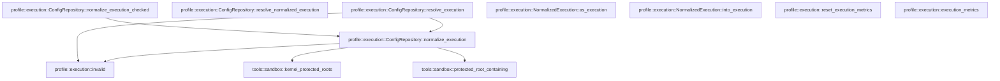

# profile::execution

[Package atlas](index.md) · [Source](../../src/execution.rs)

## Declarations

Visibility is the declaration spelling; trait members and reexports require their enclosing interface. `cfg` is not evaluated.

| Symbol | Kind | Visibility | Test / cfg |
|---|---|---|---|
| [profile::execution::NormalizedExecution](../../src/execution.rs#L11) | struct_item | `pub` |  |
| [profile::execution::NormalizedExecution::as_execution](../../src/execution.rs#L15) | function_item | `pub` |  |
| [profile::execution::NormalizedExecution::into_execution](../../src/execution.rs#L20) | function_item | `pub` |  |
| [profile::execution::reset_execution_metrics](../../src/execution.rs#L31) | function_item | `pub` |  |
| [profile::execution::execution_metrics](../../src/execution.rs#L38) | function_item | `pub` |  |
| [profile::execution::ConfigRepository::normalize_execution](../../src/execution.rs#L47) | function_item | `pub` |  |
| [profile::execution::ConfigRepository::normalize_execution_checked](../../src/execution.rs#L111) | function_item | `pub` |  |
| [profile::execution::ConfigRepository::resolve_normalized_execution](../../src/execution.rs#L120) | function_item | `pub` |  |
| [profile::execution::ConfigRepository::resolve_execution](../../src/execution.rs#L131) | function_item | `pub` |  |
| [profile::execution::invalid](../../src/execution.rs#L146) | function_item | `private` |  |

## Imports / reexports

| Local name | Source path | Visibility |
|---|---|---|
| `Path` | `std::path::Path` | `private` |
| `ConfigRepository` | `crate::ConfigRepository` | `private` |
| `ConfigSnapshot` | `crate::ConfigSnapshot` | `private` |
| `ProfileError` | `crate::ProfileError` | `private` |
| `ExecutionConfig` | `schema::ExecutionConfig` | `pub` |

## Module declarations

| Module | Visibility | Attributes |
|---|---|---|

## Function call graphs

Edges below are syntactically resolved calls only, including private functions. Graphs partition callers into groups of 20; they are not execution order. All unresolved sites are listed below and in the JSON inventory.

Functions 1–9: 6 direct edges

## Call sites

Includes test functions (marked in declarations). Receiver-type-required sites need type analysis/manual tracing. Calls in closures are attributed to their enclosing function; their occurrence here does not mean the closure executes immediately.

| Caller | Callee expression | Source lines | Target / classification |
|---|---|---|---|
| `reset_execution_metrics` | `NORMALIZE_CALLS.with` | [32](../../src/execution.rs#L32) | receiver-type-required |
| `reset_execution_metrics` | `c.set` | [32](../../src/execution.rs#L32), [33](../../src/execution.rs#L33) | receiver-type-required |
| `reset_execution_metrics` | `CANONICALIZE_CALLS.with` | [33](../../src/execution.rs#L33) | receiver-type-required |
| `execution_metrics` | `NORMALIZE_CALLS.with` | [40](../../src/execution.rs#L40) | receiver-type-required |
| `execution_metrics` | `CANONICALIZE_CALLS.with` | [41](../../src/execution.rs#L41) | receiver-type-required |
| `normalize_execution` | `NORMALIZE_CALLS.with` | [51](../../src/execution.rs#L51) | receiver-type-required |
| `normalize_execution` | `c.set` | [51](../../src/execution.rs#L51), [56](../../src/execution.rs#L56) | receiver-type-required |
| `normalize_execution` | `c.get` | [51](../../src/execution.rs#L51), [56](../../src/execution.rs#L56) | receiver-type-required |
| `normalize_execution` | `input             .validate()             .map_err` | [52](../../src/execution.rs#L52) | receiver-type-required |
| `normalize_execution` | `input             .validate` | [52](../../src/execution.rs#L52) | receiver-type-required |
| `normalize_execution` | `invalid` | [54](../../src/execution.rs#L54), [66](../../src/execution.rs#L66), [73](../../src/execution.rs#L73), [91](../../src/execution.rs#L91), [100](../../src/execution.rs#L100) | [profile::execution::invalid](../../src/execution.rs#L146) |
| `normalize_execution` | `reason.to_owned` | [54](../../src/execution.rs#L54) | receiver-type-required |
| `normalize_execution` | `CANONICALIZE_CALLS.with` | [56](../../src/execution.rs#L56) | receiver-type-required |
| `normalize_execution` | `std::fs::canonicalize` | [57](../../src/execution.rs#L57) | external-constructor-callback-or-unresolved |
| `normalize_execution` | `value.is_dir` | [58](../../src/execution.rs#L58) | receiver-type-required |
| `normalize_execution` | `value.parent().is_none` | [59](../../src/execution.rs#L59) | receiver-type-required |
| `normalize_execution` | `value.parent` | [59](../../src/execution.rs#L59) | receiver-type-required |
| `normalize_execution` | `tools::protected_root_containing(                     &tools::kernel_protected_roots(self.root()),                     &value,                 )                 .is_some` | [60](../../src/execution.rs#L60) | receiver-type-required |
| `normalize_execution` | `tools::protected_root_containing` | [60](../../src/execution.rs#L60) | [tools::sandbox::protected_root_containing](../../../tools/src/sandbox.rs#L241) |
| `normalize_execution` | `tools::kernel_protected_roots` | [61](../../src/execution.rs#L61) | [tools::sandbox::kernel_protected_roots](../../../tools/src/sandbox.rs#L179) |
| `normalize_execution` | `self.root` | [61](../../src/execution.rs#L61) | receiver-type-required |
| `normalize_execution` | `Err` | [66](../../src/execution.rs#L66), [91](../../src/execution.rs#L91), [100](../../src/execution.rs#L100) | external-constructor-callback-or-unresolved |
| `normalize_execution` | `value                 .into_os_string()                 .into_string()                 .map_err` | [70](../../src/execution.rs#L70) | receiver-type-required |
| `normalize_execution` | `value                 .into_os_string()                 .into_string` | [70](../../src/execution.rs#L70) | receiver-type-required |
| `normalize_execution` | `value                 .into_os_string` | [70](../../src/execution.rs#L70) | receiver-type-required |
| `normalize_execution` | `"execution root must be UTF-8".to_owned` | [73](../../src/execution.rs#L73) | receiver-type-required |
| `normalize_execution` | `values                 .iter()                 .map(&#124;value&#124; canonical(value))                 .collect::<Result<Vec<_>, _>>` | [76](../../src/execution.rs#L76) | receiver-type-required |
| `normalize_execution` | `values                 .iter()                 .map` | [76](../../src/execution.rs#L76) | receiver-type-required |
| `normalize_execution` | `values                 .iter` | [76](../../src/execution.rs#L76) | receiver-type-required |
| `normalize_execution` | `canonical` | [78](../../src/execution.rs#L78), [85](../../src/execution.rs#L85) | external-constructor-callback-or-unresolved |
| `normalize_execution` | `values.sort` | [80](../../src/execution.rs#L80) | receiver-type-required |
| `normalize_execution` | `values.dedup` | [81](../../src/execution.rs#L81) | receiver-type-required |
| `normalize_execution` | `Ok` | [82](../../src/execution.rs#L82), [106](../../src/execution.rs#L106) | external-constructor-callback-or-unresolved |
| `normalize_execution` | `input.clone` | [84](../../src/execution.rs#L84) | receiver-type-required |
| `normalize_execution` | `roots` | [86](../../src/execution.rs#L86), [88](../../src/execution.rs#L88), [89](../../src/execution.rs#L89) | external-constructor-callback-or-unresolved |
| `normalize_execution` | `output.read_roots.retain` | [87](../../src/execution.rs#L87) | receiver-type-required |
| `normalize_execution` | `output.toolchain_roots.iter().any` | [90](../../src/execution.rs#L90) | receiver-type-required |
| `normalize_execution` | `output.toolchain_roots.iter` | [90](../../src/execution.rs#L90) | receiver-type-required |
| `normalize_execution` | `root.contains` | [90](../../src/execution.rs#L90) | receiver-type-required |
| `normalize_execution` | `"toolchain root cannot contain PATH separator".to_owned` | [92](../../src/execution.rs#L92) | receiver-type-required |
| `normalize_execution` | `output.writable_roots.iter().any` | [95](../../src/execution.rs#L95) | receiver-type-required |
| `normalize_execution` | `output.writable_roots.iter` | [95](../../src/execution.rs#L95) | receiver-type-required |
| `normalize_execution` | `std::iter::once(&output.cwd)                 .chain(&output.read_roots)                 .any` | [96](../../src/execution.rs#L96) | receiver-type-required |
| `normalize_execution` | `std::iter::once(&output.cwd)                 .chain` | [96](../../src/execution.rs#L96) | receiver-type-required |
| `normalize_execution` | `std::iter::once` | [96](../../src/execution.rs#L96) | external-constructor-callback-or-unresolved |
| `normalize_execution` | `Path::new(root).starts_with` | [98](../../src/execution.rs#L98) | receiver-type-required |
| `normalize_execution` | `Path::new` | [98](../../src/execution.rs#L98) | external-constructor-callback-or-unresolved |
| `normalize_execution` | `"writable root is outside execution read roots".to_owned` | [101](../../src/execution.rs#L101) | receiver-type-required |
| `normalize_execution` | `output.allowed_tools.sort` | [104](../../src/execution.rs#L104) | receiver-type-required |
| `normalize_execution` | `output.allowed_tools.dedup` | [105](../../src/execution.rs#L105) | receiver-type-required |
| `normalize_execution_checked` | `self.normalize_execution(input).map` | [115](../../src/execution.rs#L115) | receiver-type-required |
| `normalize_execution_checked` | `self.normalize_execution` | [115](../../src/execution.rs#L115) | [profile::execution::ConfigRepository::normalize_execution](../../src/execution.rs#L47) |
| `resolve_normalized_execution` | `self.resolve_execution_snapshot` | [126](../../src/execution.rs#L126) | receiver-type-required |
| `resolve_execution` | `self.normalize_execution` | [137](../../src/execution.rs#L137) | [profile::execution::ConfigRepository::normalize_execution](../../src/execution.rs#L47) |
| `resolve_execution` | `Err` | [138](../../src/execution.rs#L138) | external-constructor-callback-or-unresolved |
| `resolve_execution` | `invalid` | [138](../../src/execution.rs#L138) | [profile::execution::invalid](../../src/execution.rs#L146) |
| `resolve_execution` | `"recorded execution roots are no longer canonical".to_owned` | [139](../../src/execution.rs#L139) | receiver-type-required |
| `resolve_execution` | `self.resolve_execution_snapshot` | [142](../../src/execution.rs#L142) | receiver-type-required |
| `invalid` | `"<execution>".into` | [148](../../src/execution.rs#L148) | receiver-type-required |
