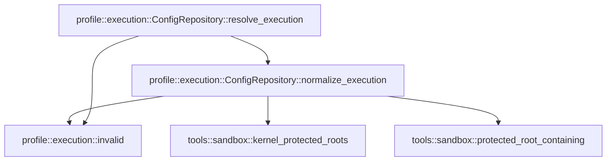

# profile::execution

[Package atlas](index.md) · [Source](../../src/execution.rs)

## Declarations

Visibility is the declaration spelling; trait members and reexports require their enclosing interface. `cfg` is not evaluated.

| Symbol | Kind | Visibility | Test / cfg |
|---|---|---|---|
| [profile::execution::ConfigRepository::normalize_execution](../../src/execution.rs#L10) | function_item | `pub` |  |
| [profile::execution::ConfigRepository::resolve_execution](../../src/execution.rs#L72) | function_item | `pub` |  |
| [profile::execution::invalid](../../src/execution.rs#L87) | function_item | `private` |  |

## Imports / reexports

| Local name | Source path | Visibility |
|---|---|---|
| `Path` | `std::path::Path` | `private` |
| `ConfigRepository` | `crate::ConfigRepository` | `private` |
| `ConfigSnapshot` | `crate::ConfigSnapshot` | `private` |
| `ProfileError` | `crate::ProfileError` | `private` |
| `ExecutionConfig` | `schema::ExecutionConfig` | `pub` |

## Module declarations

| Module | Visibility | Attributes |
|---|---|---|

## Function call graphs

Edges below are syntactically resolved calls only, including private functions. Graphs partition callers into groups of 20; they are not execution order. All unresolved sites are listed below and in the JSON inventory.

Functions 1–3: 5 direct edges

## Call sites

Includes test functions (marked in declarations). Receiver-type-required sites need type analysis/manual tracing. Calls in closures are attributed to their enclosing function; their occurrence here does not mean the closure executes immediately.

| Caller | Callee expression | Source lines | Target / classification |
|---|---|---|---|
| `normalize_execution` | `input             .validate()             .map_err` | [14](../../src/execution.rs#L14) | receiver-type-required |
| `normalize_execution` | `input             .validate` | [14](../../src/execution.rs#L14) | receiver-type-required |
| `normalize_execution` | `invalid` | [16](../../src/execution.rs#L16), [27](../../src/execution.rs#L27), [34](../../src/execution.rs#L34), [52](../../src/execution.rs#L52), [61](../../src/execution.rs#L61) | [profile::execution::invalid](../../src/execution.rs#L87) |
| `normalize_execution` | `reason.to_owned` | [16](../../src/execution.rs#L16) | receiver-type-required |
| `normalize_execution` | `std::fs::canonicalize` | [18](../../src/execution.rs#L18) | external-constructor-callback-or-unresolved |
| `normalize_execution` | `value.is_dir` | [19](../../src/execution.rs#L19) | receiver-type-required |
| `normalize_execution` | `value.parent().is_none` | [20](../../src/execution.rs#L20) | receiver-type-required |
| `normalize_execution` | `value.parent` | [20](../../src/execution.rs#L20) | receiver-type-required |
| `normalize_execution` | `tools::protected_root_containing(                     &tools::kernel_protected_roots(self.root()),                     &value,                 )                 .is_some` | [21](../../src/execution.rs#L21) | receiver-type-required |
| `normalize_execution` | `tools::protected_root_containing` | [21](../../src/execution.rs#L21) | [tools::sandbox::protected_root_containing](../../../tools/src/sandbox.rs#L213) |
| `normalize_execution` | `tools::kernel_protected_roots` | [22](../../src/execution.rs#L22) | [tools::sandbox::kernel_protected_roots](../../../tools/src/sandbox.rs#L151) |
| `normalize_execution` | `self.root` | [22](../../src/execution.rs#L22) | receiver-type-required |
| `normalize_execution` | `Err` | [27](../../src/execution.rs#L27), [52](../../src/execution.rs#L52), [61](../../src/execution.rs#L61) | external-constructor-callback-or-unresolved |
| `normalize_execution` | `value                 .into_os_string()                 .into_string()                 .map_err` | [31](../../src/execution.rs#L31) | receiver-type-required |
| `normalize_execution` | `value                 .into_os_string()                 .into_string` | [31](../../src/execution.rs#L31) | receiver-type-required |
| `normalize_execution` | `value                 .into_os_string` | [31](../../src/execution.rs#L31) | receiver-type-required |
| `normalize_execution` | `"execution root must be UTF-8".to_owned` | [34](../../src/execution.rs#L34) | receiver-type-required |
| `normalize_execution` | `values                 .iter()                 .map(&#124;value&#124; canonical(value))                 .collect::<Result<Vec<_>, _>>` | [37](../../src/execution.rs#L37) | receiver-type-required |
| `normalize_execution` | `values                 .iter()                 .map` | [37](../../src/execution.rs#L37) | receiver-type-required |
| `normalize_execution` | `values                 .iter` | [37](../../src/execution.rs#L37) | receiver-type-required |
| `normalize_execution` | `canonical` | [39](../../src/execution.rs#L39), [46](../../src/execution.rs#L46) | external-constructor-callback-or-unresolved |
| `normalize_execution` | `values.sort` | [41](../../src/execution.rs#L41) | receiver-type-required |
| `normalize_execution` | `values.dedup` | [42](../../src/execution.rs#L42) | receiver-type-required |
| `normalize_execution` | `Ok` | [43](../../src/execution.rs#L43), [67](../../src/execution.rs#L67) | external-constructor-callback-or-unresolved |
| `normalize_execution` | `input.clone` | [45](../../src/execution.rs#L45) | receiver-type-required |
| `normalize_execution` | `roots` | [47](../../src/execution.rs#L47), [49](../../src/execution.rs#L49), [50](../../src/execution.rs#L50) | external-constructor-callback-or-unresolved |
| `normalize_execution` | `output.read_roots.retain` | [48](../../src/execution.rs#L48) | receiver-type-required |
| `normalize_execution` | `output.toolchain_roots.iter().any` | [51](../../src/execution.rs#L51) | receiver-type-required |
| `normalize_execution` | `output.toolchain_roots.iter` | [51](../../src/execution.rs#L51) | receiver-type-required |
| `normalize_execution` | `root.contains` | [51](../../src/execution.rs#L51) | receiver-type-required |
| `normalize_execution` | `"toolchain root cannot contain PATH separator".to_owned` | [53](../../src/execution.rs#L53) | receiver-type-required |
| `normalize_execution` | `output.writable_roots.iter().any` | [56](../../src/execution.rs#L56) | receiver-type-required |
| `normalize_execution` | `output.writable_roots.iter` | [56](../../src/execution.rs#L56) | receiver-type-required |
| `normalize_execution` | `std::iter::once(&output.cwd)                 .chain(&output.read_roots)                 .any` | [57](../../src/execution.rs#L57) | receiver-type-required |
| `normalize_execution` | `std::iter::once(&output.cwd)                 .chain` | [57](../../src/execution.rs#L57) | receiver-type-required |
| `normalize_execution` | `std::iter::once` | [57](../../src/execution.rs#L57) | external-constructor-callback-or-unresolved |
| `normalize_execution` | `Path::new(root).starts_with` | [59](../../src/execution.rs#L59) | receiver-type-required |
| `normalize_execution` | `Path::new` | [59](../../src/execution.rs#L59) | external-constructor-callback-or-unresolved |
| `normalize_execution` | `"writable root is outside execution read roots".to_owned` | [62](../../src/execution.rs#L62) | receiver-type-required |
| `normalize_execution` | `output.allowed_tools.sort` | [65](../../src/execution.rs#L65) | receiver-type-required |
| `normalize_execution` | `output.allowed_tools.dedup` | [66](../../src/execution.rs#L66) | receiver-type-required |
| `resolve_execution` | `self.normalize_execution` | [78](../../src/execution.rs#L78) | [profile::execution::ConfigRepository::normalize_execution](../../src/execution.rs#L10) |
| `resolve_execution` | `Err` | [79](../../src/execution.rs#L79) | external-constructor-callback-or-unresolved |
| `resolve_execution` | `invalid` | [79](../../src/execution.rs#L79) | [profile::execution::invalid](../../src/execution.rs#L87) |
| `resolve_execution` | `"recorded execution roots are no longer canonical".to_owned` | [80](../../src/execution.rs#L80) | receiver-type-required |
| `resolve_execution` | `self.resolve_execution_snapshot` | [83](../../src/execution.rs#L83) | receiver-type-required |
| `invalid` | `"<execution>".into` | [89](../../src/execution.rs#L89) | receiver-type-required |
